<section id="title">AUTOSAR ECU 电源状态管理：启动、下电、唤醒与复位流程</section>

# 1. 简介和功能概述

本文档整理**AUTOSAR Classic Platform**标准中**ECU**电源状态管理的核心流程，包括**STARTUP**（启动）、**SHUTDOWN**（下电）、**SLEEP/WAKEUP**（睡眠与唤醒）以及**RESET**（复位）的标准处理流程，并收集规范中的时序图（**Sequence Diagram**）作为设计参考。

**ECU**管理器模块（**ECU Manager**，**EcuM**）是管理**ECU**状态的基础软件模块，负责：

* 初始化和去初始化**OS**、**SchM**和**BswM**以及一些基础软件驱动模块。
* 将**ECU**配置为**SLEEP**和**SHUTDOWN**状态。
* 管理**ECU**上的所有唤醒事件（**wakeup events**），并提供唤醒验证协议（**Wakeup validation protocol**）以区分真实（**real**）和不稳定（**erratic**）的唤醒事件。
* 提供部分或快速启动（**Partial or fast startup**）与交错启动（**Interleaved startup**）机制。
* 支持多核**ECU**：启动、关机、睡眠和唤醒能在**ECU**的所有内核上进行协调。

在灵活的**ECU**管理（**Flexible ECU Management**）架构下，大多数**ECU**状态由**BSW**模式管理器（**BswM**）通过可配置的规则（**rules**）和动作列表（**action lists**）实现，**EcuM**仅在以下场景接管控制：

* 早期启动阶段（**Early STARTUP phases**）。
* 后期关闭阶段（**Late SHUTDOWN phases**）。
* 调度程序锁定睡眠阶段（**SLEEP phases locked out by the scheduler**）。

# 2. 定义和缩写

**Callout**
> **Callout**是指系统设计人员使用代码替换的一种**Stub**函数，通常在配置时为**ECU**管理器模块提供附件功能，分为强制性和可选性两类。

**Phase（阶段）**
> 和**ECU**管理器的动作及事件相关的逻辑或时间组合，例如：**STARTUP**、**UP**、**SHUTDOWN**、**SLEEP**、**OFF**。阶段可以由通常称为序列（**Sequence**）的子阶段组成。

**Shutdown Target（下电目标）**
> **ECU**在进入睡眠、关闭电源或复位之前必须被关闭。**SLEEP**、**OFF**和**RESET**是有效的下电目标。应用程序通过选择下电目标，将其对**ECU**下次关闭后行为的期望传达给**ECU**管理器模块。

**Wakeup Event / Wakeup Source / Wakeup Reason**
> **Wakeup Event**（唤醒事件）是导致唤醒的物理事件（如**CAN**消息或**IO**跳变）；**Wakeup Source**（唤醒源）是处理唤醒事件的外围设备或**ECU**组件；**Wakeup Reason**（唤醒原因）是上次唤醒的实际原因。

**Passive Wakeup（被动唤醒）**
> 由连接的总线（**Attached bus**）引起的唤醒，区别于定时器或传感器活动等内部事件引起的唤醒。

**BswM**
> 基础软件模式管理器（**Basic Software Mode Manager**）

**SchM**
> 基础软件调度器（**BSW Scheduler**）

**RTE**
> 运行时环境（**Runtime Environment**）

**WdgM**
> 看门狗管理器（**Watchdog Manager**）

**Mcu**
> 微控制器单元（**Microcontroller Unit**）

**ComM**
> 通信管理器（**Communication Manager**）

# 3. 相关文档

[1] Specification of ECU State Manager
> AUTOSAR_SWS_ECUStateManager（Document ID 78, AUTOSAR CP R22-11）

[2] Guide to Mode Management
> AUTOSAR_EXP_ModeManagementGuide（Document ID 440, AUTOSAR CP Release 4.4.0）

[3] Specification of Basic Software Mode Manager
> AUTOSAR_SWS_BSWModeManager

[4] Specification of Operating System
> AUTOSAR_SWS_OS

# 4. ECU 阶段总览

**EcuM**将**ECU**生命周期划分为五个阶段（**Phase**）：**STARTUP**、**UP**、**SHUTDOWN**、**SLEEP**和**OFF**。图 4.1 显示了灵活的**ECU**管理器模块各阶段的概览及其转换关系。

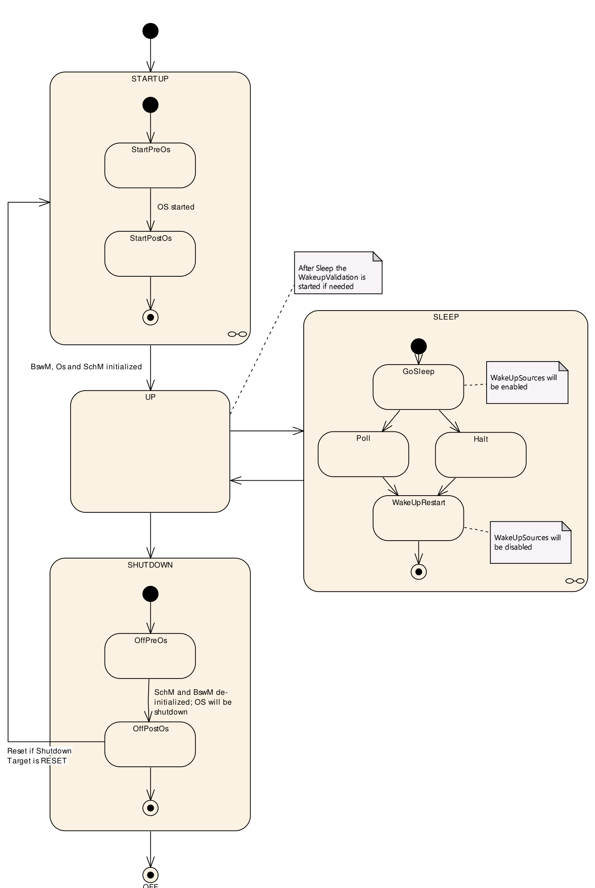

各阶段的职责如下：

| 阶段 | 职责描述 |
|------|----------|
| **STARTUP** | 初始化基础软件模块到通用模式管理设施（**Generic Mode Management facilities**）可运行的程度：初始化低级驱动程序、启动操作系统、初始化**BSW**调度程序和**BswM** |
| **UP** | **BSW**调度器已启动且**BswM_Init**已被调用。**BswM**负责模式仲裁及后续**BSW**初始化、启动**RTE**（隐式启动**SW-C**）；**EcuM**对来自**SW-C**的**RUN**和**POST_RUN**请求进行仲裁 |
| **SHUTDOWN** | 受控关闭基础软件模块，最终到达选定的下电目标**OFF**或**RESET** |
| **SLEEP** | **ECU**节省能量。通常不执行代码但仍有供电，可配置为可唤醒；提供可配置的硬件睡眠模式集合（功耗与重启时间的权衡） |
| **OFF** | **ECU**下电。仅具有集成电源控制（**integrated power control**）的唤醒源可在此状态唤醒；任何情况下**ECU**必须可启动（如通过复位事件） |

图 4.2 显示了**ECU**管理器模块与**OS**、**BswM**、**RTE**、驱动等周边模块的关系。

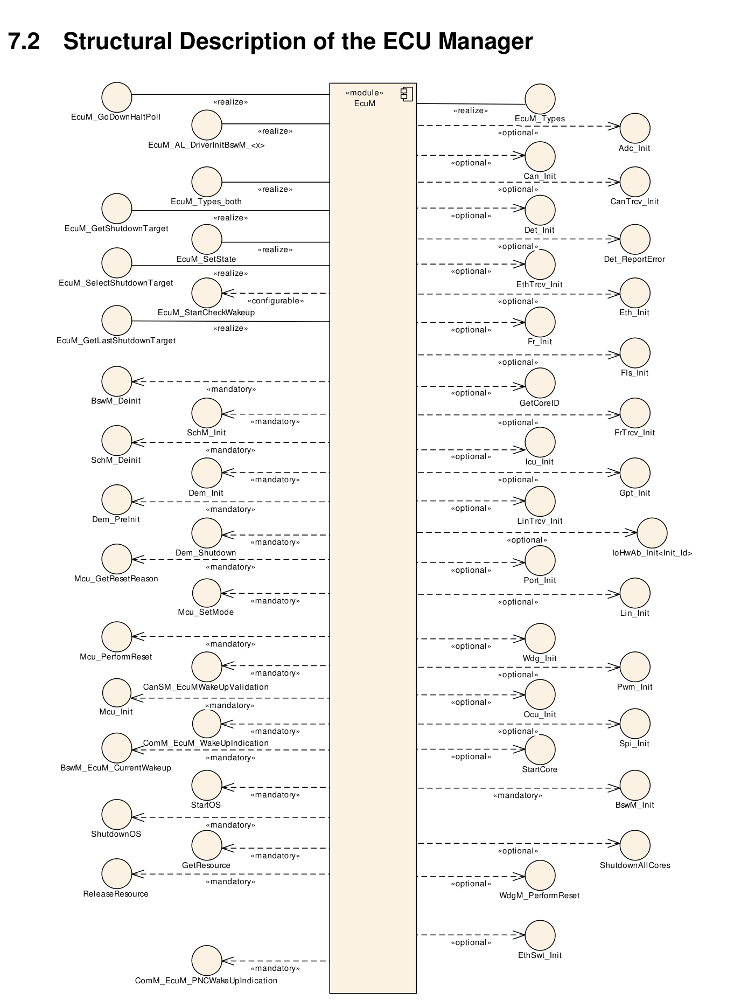

# 5. Startup（启动）流程

## 5.1 启动流程总览

图 5.1 显示了**ECU**的启动行为。当通过**EcuM_Init**调用时，**ECU**管理器模块接管**ECU**启动流程；调用**StartOS**时**ECU**管理器暂时交出控制权，集成商（**Integrator**）必须实现一个自动启动的**OS**任务，其第一个动作调用**EcuM_StartupTwo**以重新获得控制权。

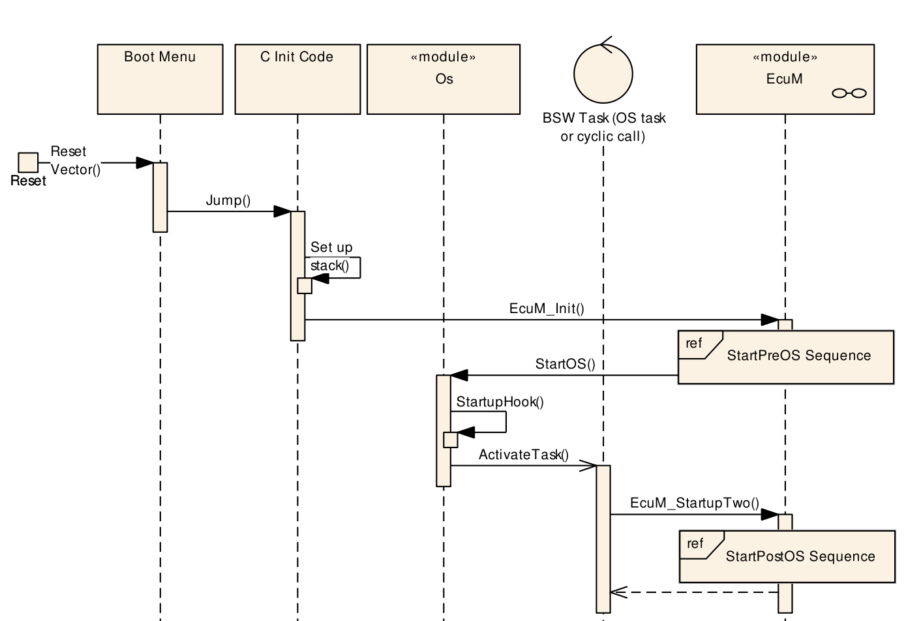

**注意**：在**EcuM_Init**被调用之前，**ECU**管理器模块假定**MCU**已完成最小初始化（栈已建立、代码可执行、**C**变量初始化已完成）。

## 5.2 StartPreOS 序列

**StartPreOS**序列在**EcuM_Init**中执行，是操作系统启动前的初始化活动，标准顺序如下（表 5.1）：

| 顺序 | 活动 | 说明 | 可选 |
|------|------|------|------|
| 1 | Callout **EcuM_AL_SetProgrammableInterrupts** | 在**OS**启动前设置可编程中断优先级 | 是 |
| 2 | Callout **EcuM_AL_DriverInitZero**（Init block 0） | 仅初始化不使用**post-build**配置参数的**BSW**模块，可包含任意**pre-OS**低级别初始化代码 | 是 |
| 3 | Callout **EcuM_DeterminePbConfiguration** | 返回包含**EcuM**及所有其他**BSW**模块**post-build**配置数据的**EcuM_ConfigType**结构指针 | 否 |
| 4 | 检查配置数据一致性 | 若检查失败调用**EcuM_ErrorHook**（**ECUM_E_CONFIGURATION_DATA_INCONSISTENT**）。**EcuM**在初始化第一个**BSW**模块前，不仅检查自身参数一致性，还检查所有**post-build**可配置**BSW**模块的一致性（通过配置工具计算的**ECUM_CONFIGCONSISTENCY_HASH**哈希值在运行时比对） | 否 |
| 5 | Callout **EcuM_AL_DriverInitOne**（Init block 1） | 驱动初始化及任意**pre-OS**低级别初始化代码 | 是 |
| 6 | 获取复位原因 | 通过**Mcu_GetResetReason**获取，并经**EcuMWakeupSource**配置容器映射为唤醒源 | 否 |
| 7 | 选择默认下电目标 | 见[SWS_EcuM_02181] | 否 |
| 8 | Callout **EcuM_LoopDetection** | 若启用环路检测，每次启动都会调用 | 是 |
| 9 | 启动**OS**（**StartOS**） | 启动**AUTOSAR OS**，见[SWS_EcuM_02603] | 否 |

图 5.2 显示了**StartPreOS**序列中**EcuM**、**Mcu**与集成代码的交互过程。

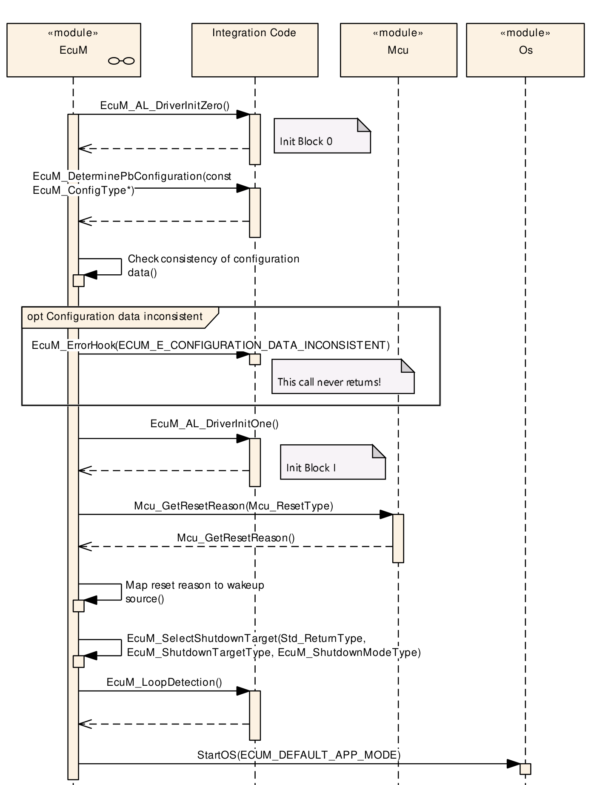

## 5.3 StartPostOS 序列

**OS**启动后，集成代码的任务调用**EcuM_StartupTwo**，**EcuM**继而执行**StartPostOS**序列（图 5.3）：

1. 调用**SchM_Init**初始化**BSW**调度器；
2. 调用**SchM_Start**启动**BSW**调度器；
3. 调用**BswM_Init**初始化**BSW**模式管理器；
4. 调用**SchM_StartTiming**完成**SchM**时序启动。

此后控制权移交**BswM**，**ECU**进入**UP**阶段。

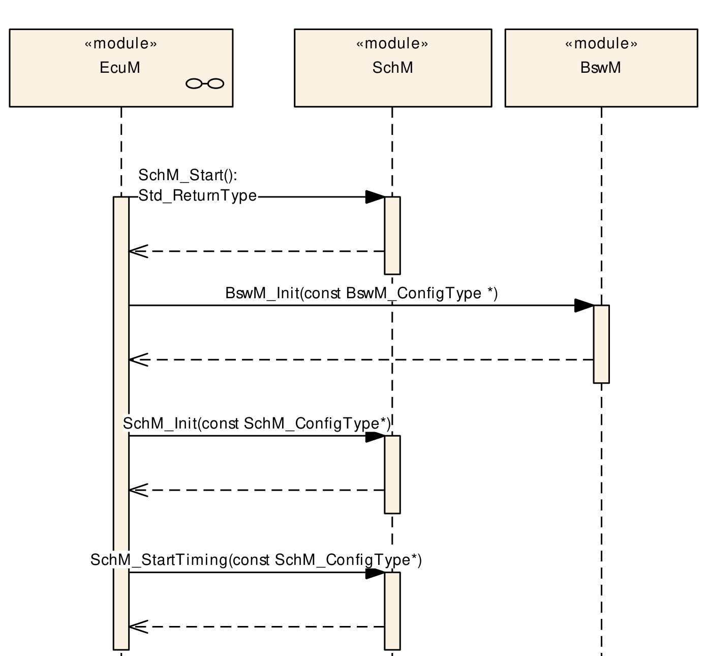

## 5.4 驱动初始化

驱动程序在初始化流程中的位置强烈依赖于其实现和目标硬件设计。驱动可被**EcuM**在**STARTUP**阶段的**Init Block 0**或**Init Block 1**中初始化，或在**WakeupRestart**序列的**EcuM_AL_DriverRestart**回调中重新初始化，也可由**BswM**在**UP**阶段初始化。

关键规则：

* **EcuM**配置须指定**Init block 0**（**EcuMDriverInitListZero**）和**Init block 1**（**EcuMDriverInitListOne**）内的初始化调用顺序。
* **EcuM**以从驱动**EcuMModuleService**配置容器派生的参数调用每个驱动的初始化函数。
* 唤醒重启时，**EcuMDriverRestartList**中的驱动按**Init block 0**和**Init block 1**组合列表的相同顺序重新初始化；该列表可包含作为唤醒源的驱动，**EcuM_AL_DriverRestart**须重新布防（**re-arm**）这些驱动"wakeup detected"回调的触发机制。
* **DET**的初始化有特殊要求：若至少有一个模块配置为跟踪开发错误，**EcuM**须在**StartPreOS**序列中、所有其他驱动之前初始化**DET**（调用**Det_Init**）；但**EcuM**默认不启动**DET**（**Det_Start**的时机由系统设计者在**EcuM_AL_DriverInitOne**等回调中配置）。

## 5.5 BSW 初始化与 UP 阶段

其余**BSW**模块由**BswM**初始化：**BswM**使用**EcuM**的配置函数（**EcuMDriverInitCalloutName**）执行由**EcuMDriverInitListBswM**配置的初始化函数列表，配置须指定**BSW**初始化内的调用顺序。

进入**UP**阶段时，**NvM**的初始化和**NvM_Readall**的调用也成为集成代码——集成商负责在**NvM_ReadAll**结束时触发**Com**、**DEM**和**FIM**的初始化，**NvM**完成**NvM_ReadAll**时通知**BswM**。**RTE**可在**NvM**和**COM**初始化之后启动。

# 6. 下电（SHUTDOWN）流程

## 6.1 下电目标（Shutdown Targets）

下电目标是状态机离开**UP**阶段时到达的目标状态，共三种：**OFF**、**SLEEP**、**RESET**。由于**BswM**控制大多数**ECU**资源，由**BswM**决定何时设置下电目标（例如在调用**EcuM_GoDownHaltPoll**前将默认目标改为**ECUM_STATE_SLEEP**）。

复位的执行有多种模态（**reset modalities**），由不同模块控制或触发：

* **Mcu_PerformReset**
* **WdgM_PerformReset**
* 通过**DIO**/**SPI**触发**I/O**引脚

**EcuM**通过跟踪历史复位的时间和原因来管理这些复位模态，各种复位模态被当作复位模式（**reset modes**），使用与睡眠相同的模式设施管理。

**EcuM_GoDownHaltPoll**（带下电目标**RESET**或**OFF**）启动**SHUTDOWN**阶段；带下电目标**SLEEP**则启动**SLEEP**阶段。

## 6.2 SHUTDOWN 阶段总览

图 6.1 显示了**SHUTDOWN**阶段的总体流程：**BswM**（或**SW-C**）调用**EcuM_GoDownHaltPoll**后，**EcuM**执行**OffPreOS**序列，**OS**关闭时调用关闭钩子（**ShutdownHook**），最终调用**EcuM_Shutdown**（该函数不返回，直接关闭**ECU**或触发复位）。

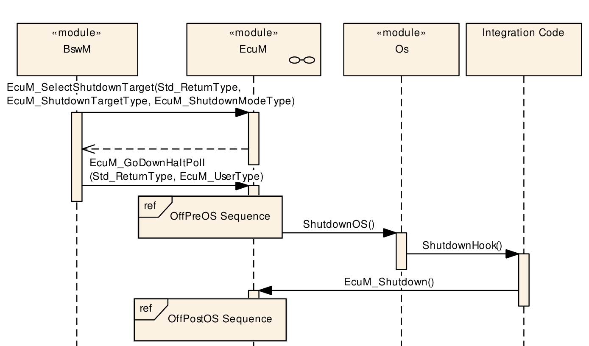

## 6.3 OffPreOS 序列

**OffPreOS**序列在**OS**关闭前执行，标准活动顺序如下（表 6.1）：

| 顺序 | 活动 | 说明 | 可选 |
|------|------|------|------|
| 1 | 去初始化**BswM**（**BswM_Deinit**） | — | 否 |
| 2 | 去初始化**BSW**调度器（**SchM_Deinit**） | — | 否 |
| 3 | 检查唤醒事件 | 根据**EcuMIgnoreWakeupEvValOffPreOS**配置，考虑所有挂起的唤醒事件或仅关闭期间验证过的唤醒事件，目的是检测关闭过程中发生的唤醒事件 | 否 |
| 4 | 若存在挂起唤醒事件，将**RESET**设为下电目标 | 仅在检测到挂起唤醒事件时执行（使用**EcuMDefaultResetModeRef**的默认复位模式），以便立即启动 | 否 |
| 5 | **ShutdownOS** | 此**OS**任务中的最后一个操作 | 否 |

关于唤醒事件检查的细化规则：

* 若**EcuMIgnoreWakeupEvValOffPreOS**配置为**true**，仅考虑不需要验证的唤醒事件，其他唤醒事件被忽略。
* 若配置为**false**，不需要验证的唤醒事件和需要验证的挂起唤醒事件都会被考虑。
* 注意：由于**SchM**已在**OffPreOS**序列中去初始化，调度函数不再执行，因此无法再进行唤醒验证。

图 6.2 显示了**OffPreOS**序列的详细交互。

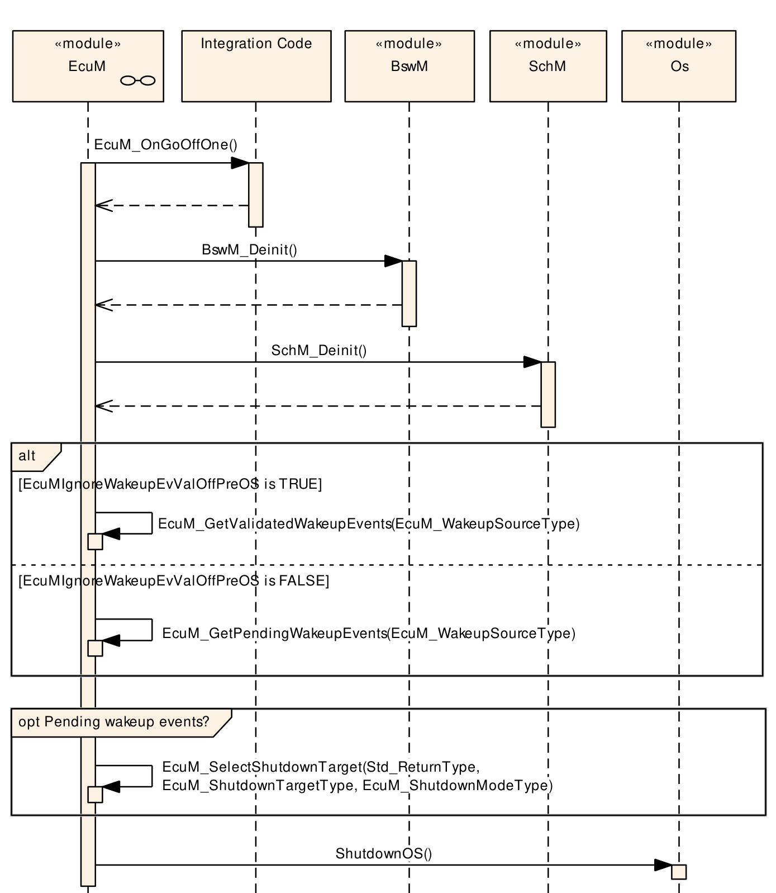

## 6.4 OffPostOS 序列

**OffPostOS**序列实现**OS**关闭后到达下电目标的最终步骤，由**EcuM_Shutdown**启动（图 6.3）：

* 下电目标为**RESET**时，**EcuM**调用**EcuM_AL_Reset**回调（复位模态由复位模式决定）；
* 下电目标为**OFF**时，**EcuM**调用**EcuM_AL_SwitchOff**回调；
* 之前**EcuM**会先调用**EcuM_OnGoOffTwo**回调。

**注意**：**OS**在关闭结束时调用关闭钩子（**ShutdownHook**），关闭钩子必须调用**EcuM_Shutdown**来终止关闭流程。

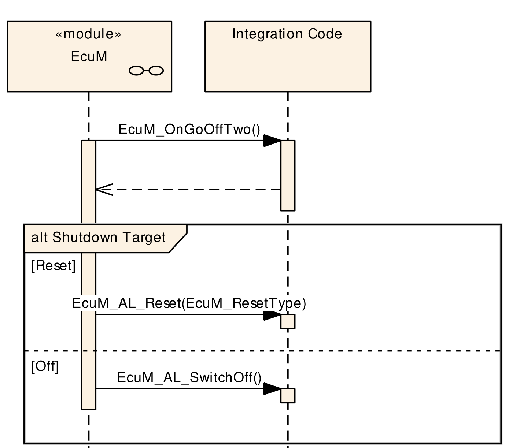

# 7. SLEEP 与唤醒流程

## 7.1 SLEEP 阶段总览

**SLEEP**阶段中**ECU**节省能量，通常不执行代码但仍有供电。**EcuM**提供可配置的硬件睡眠模式集合（**EcuMSleepModeSuspend**参数选择），通常是功耗与重启时间之间的权衡。

**EcuM_GoDownHaltPoll**（下电目标**SLEEP**）触发两条控制流（图 7.1）：**Halt**（休眠，微控制器停止，**EcuM**不执行任何代码）和**Poll**（轮询），它们共享睡眠准备与恢复的序列。

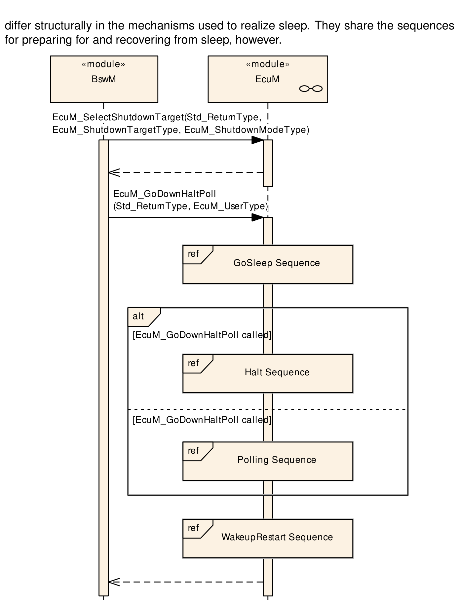

## 7.2 GoSleep 序列

在**GoSleep**序列中，**EcuM**为即将到来的睡眠阶段配置硬件，并为下一次唤醒事件设置**ECU**（图 7.2）：

* 对目标睡眠模式的**EcuMWakeupSourceMask**中配置的每个唤醒源执行**EcuM_EnableWakeupSources**回调；
* 多核**ECU**上**EcuM**为每个核保留专用资源（**RES_AUTOSAR_ECUM**），在**GoSleep**期间分配。

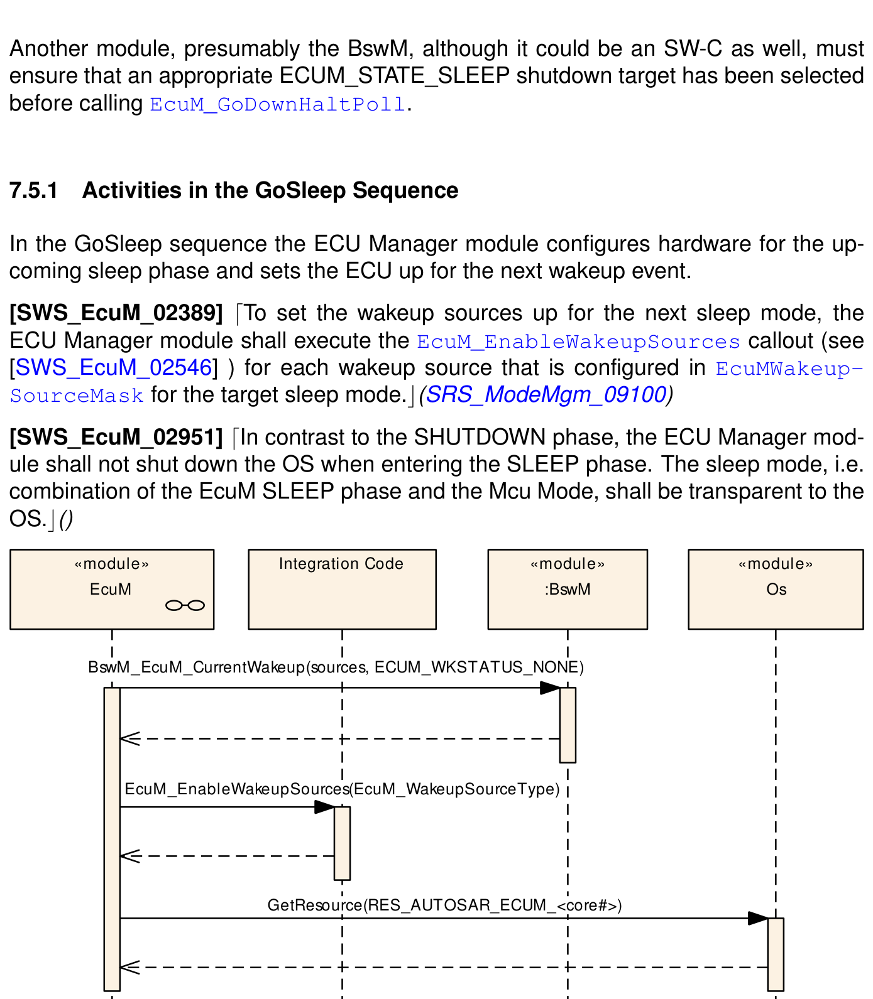

## 7.3 Halt 与 Poll 序列

**Halt**序列（图 7.3）在使微控制器休眠的睡眠模式中执行：

* **EcuM**在休眠微控制器前调用**EcuM_GenerateRamHash**回调，在处理器从休眠返回后调用**EcuM_CheckRamHash**回调（防止长期睡眠后**RAM**数据损坏导致不可预见行为；多核场景下由"master"**EcuM**执行）；
* 若**ECU**处于**Halt**或**Poll**时发生不规则事件（硬件复位或电源循环），**EcuM**须在**STARTUP**阶段重启**ECU**；
* 若调度器未作为资源获取，无法保证**HALT**指令后程序流继续（**ISR Cat 2**发生后会重新调度）。

**Poll**序列（图 7.4）适用于轮询睡眠模式：**EcuM**周期性地调用**EcuM_CheckWakeup**与**EcuM_SleepActivity**，通过**Mcu_SetMode**设置**MCU**模式。

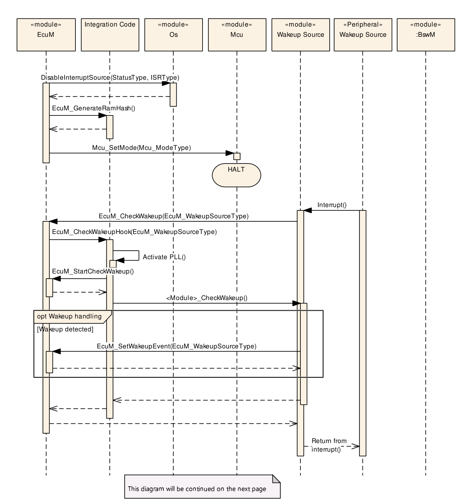

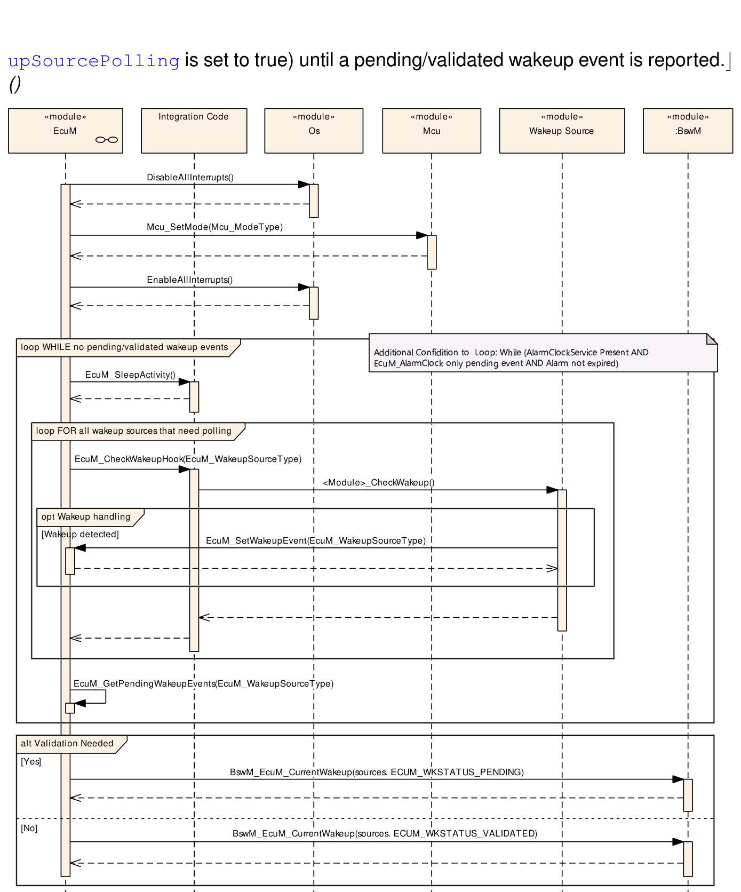

## 7.4 WakeupRestart 序列

唤醒事件（如**IO**跳变）发生时，**ECU**从**SLEEP**状态唤醒，执行在**MCU**驱动的**Mcu_SetMode**服务内恢复。**WakeupRestart**序列自动执行（图 7.5）：

* **EcuM**调用**EcuM_AL_DriverRestart**回调，用于重新初始化驱动程序（作为唤醒源的驱动通常需要重新初始化）；
* 重新初始化期间，驱动须检查其唤醒源之一是否为上次唤醒的原因，若为真必须调用其"wakeup detected"回调，进而调用**EcuM_SetWakeupEvent**；驱动只应调用一次唤醒回调，之后须被显式重新布防才能再次触发；
* 序列结束时**EcuM**获得待验证的唤醒事件候选列表。

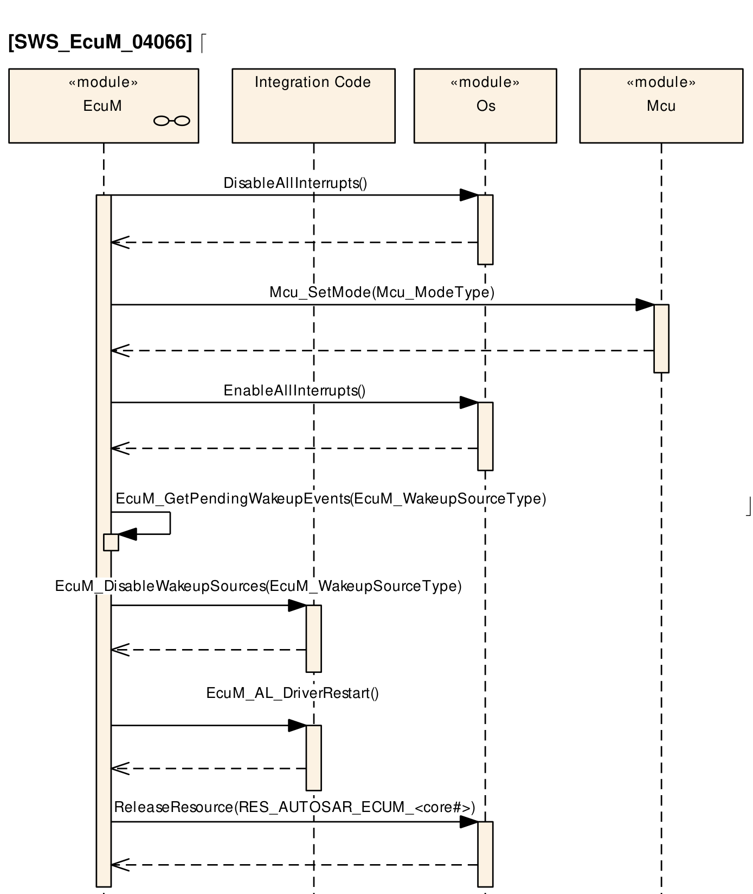

## 7.5 WakeupValidation（唤醒验证）序列

由于唤醒事件可能无意产生（如**CAN**线上的**EVM**毛刺），**ECU**恢复全面运行前必须验证唤醒。验证机制对所有唤醒源相同：需要验证的唤醒事件由**EcuM_MainFunction**中的验证协议处理，超时时间由配置（**ECUC_EcuM_00148**）定义。验证可由**BSW**中任意一个（但仅一个）合适的模块（驱动、接口、句柄或管理器）通过调用**EcuM_ValidateWakeupEvent**完成。

图 7.6 显示了以**CAN**唤醒为例的完整验证序列：**EcuM**启动唤醒源与验证超时，**CanIf**循环检查验证结果——验证成功则调用**EcuM_ValidateWakeupEvent**并通知**ComM**/**BswM**；验证超时则通知**BswM** **ECUM_WKSTATUS_EXPIRED**并停止唤醒源。

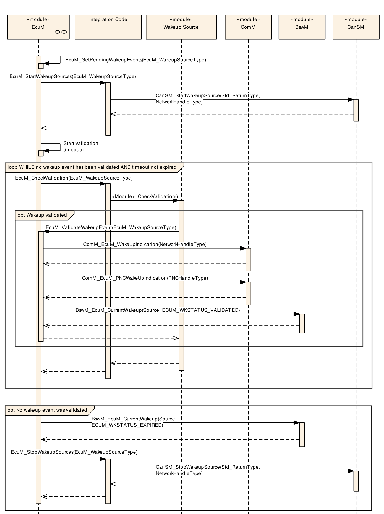

**注意**：**EcuM**从不对以下唤醒源执行验证：**ECUM_WKSOURCE_POWER**、**ECUM_WKSOURCE_RESET**、**ECUM_WKSOURCE_INTERNAL_RESET**、**ECUM_WKSOURCE_INTERNAL_WDG**、**ECUM_WKSOURCE_EXTERNAL_WDG**。

## 7.6 唤醒源状态机

**EcuM**用**EcuM_WakeupSourceType**位掩码管理最多**32**个唤醒源的状态，每个唤醒源经历**NONE**→**PENDING**→**VALIDATED**/**EXPIRED**的状态迁移（图 7.7）：

* **ECUM_WKSTATUS_NONE**：初始状态；
* **ECUM_WKSTATUS_PENDING**：**EcuM_SetWakeupEvent**被调用（需验证时进入），执行唤醒验证序列；
* **ECUM_WKSTATUS_VALIDATED**：**EcuM_ValidateWakeupEvent**验证通过；
* **ECUM_WKSTATUS_EXPIRED**：验证超时。

**EcuM**提供**EcuM_GetPendingWakeupEvents**、**EcuM_GetValidatedWakeupEvents**、**EcuM_GetExpiredWakeupEvents**查询接口，以及**EcuM_SetWakeupEvent**、**EcuM_ValidateWakeupEvent**、**EcuM_ClearWakeupEvent**、**EcuM_CheckWakeup**、**EcuM_EnableWakeupSources**、**EcuM_DisableWakeupSources**、**EcuM_StartWakeupSources**、**EcuM_StopWakeupSources**等操纵接口。

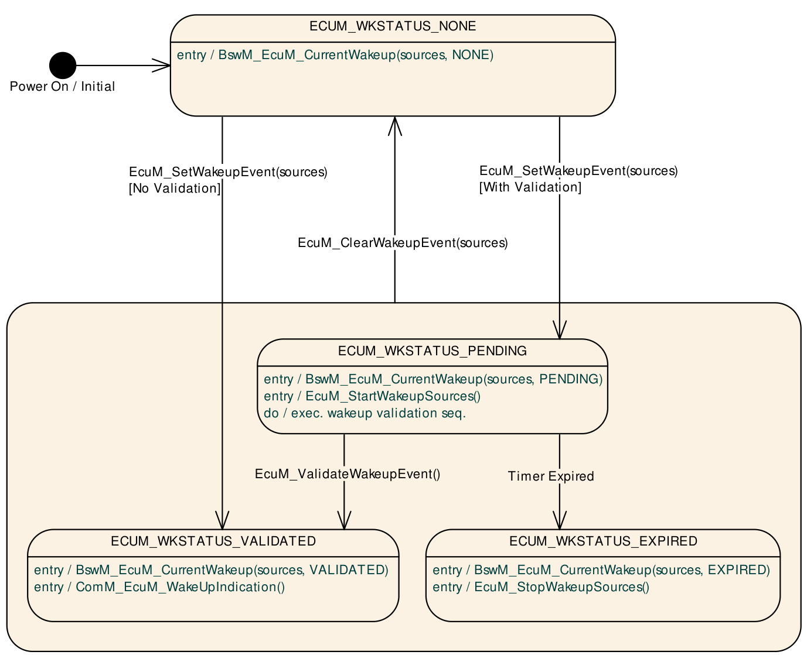

## 7.7 典型唤醒源时序

规范第 9 章给出了各类唤醒源的详细时序。以下收集最典型的几种：

**GPT 唤醒（中断方式，图 7.8）**：**GPT**通常在**ECU**睡眠前启动，硬件定时器到期产生中断唤醒微控制器，**GPT**模块的中断处理程序通知**EcuM**发生了**GPT**唤醒；集成商可为每个**GPT**通道分配不同的唤醒源标识符以区分不同通道引起的唤醒。

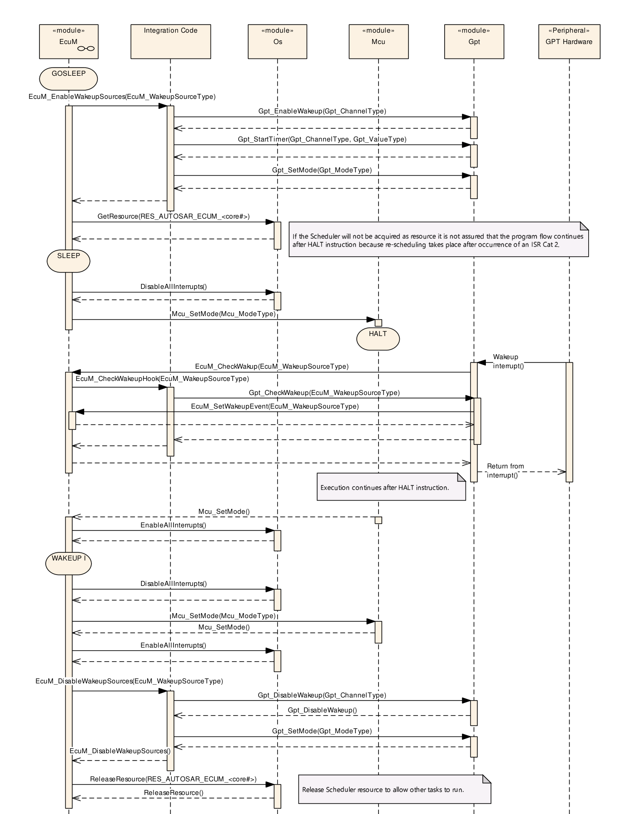

**GPT 唤醒（轮询方式，图 7.9）**：若**GPT**硬件能够锁存定时器溢出，也可轮询**GPT**获取唤醒事件。

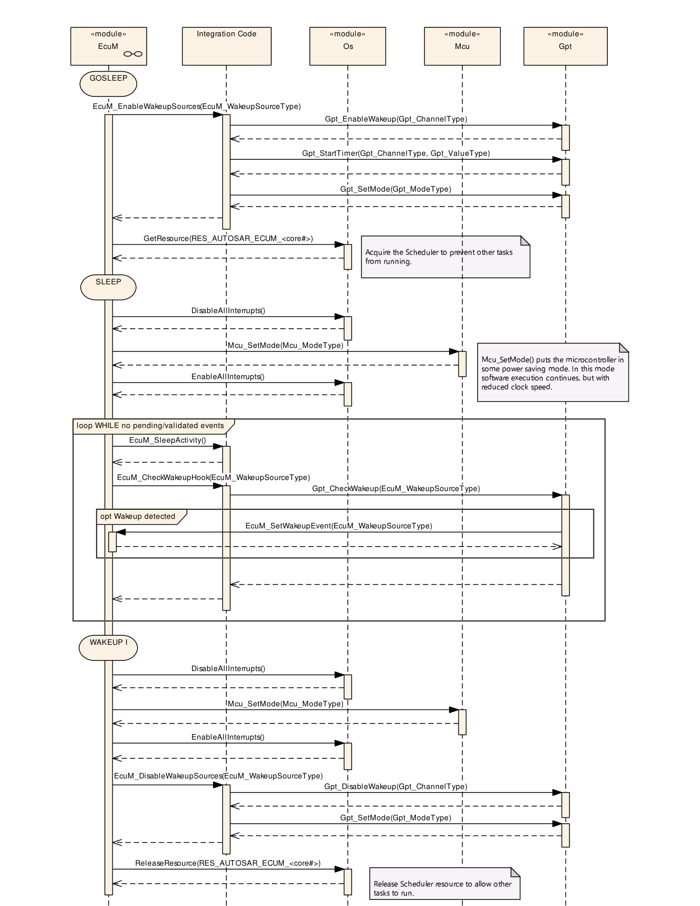

**CAN 收发器唤醒（中断方式，图 7.10）**：**CAN**总线活动引起唤醒，中断通常由**ICU**驱动处理，**CanTrcv**/**CanIf**将事件上报**EcuM**。

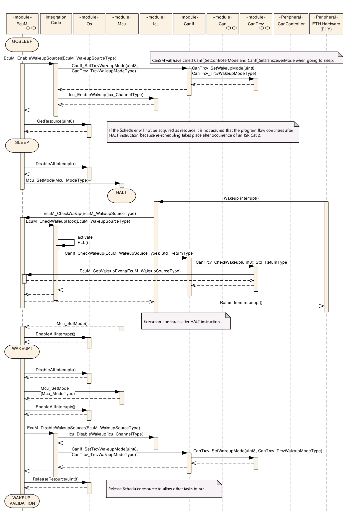

**CAN 控制器/收发器唤醒（轮询方式，图 7.11）**：**EcuM**周期调用**EcuM_CheckWakeup**，**CanIf**/**CanTrcv**检查硬件状态。

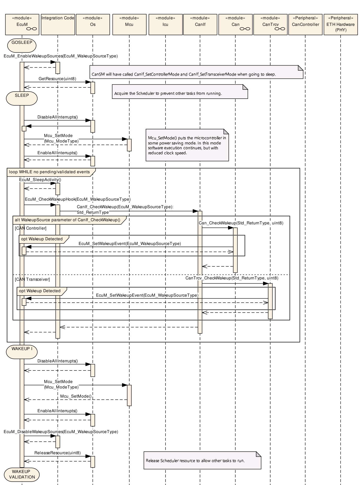

**CAN 唤醒验证（图 7.12）**：检测到唤醒事件后，**CanSM**启动唤醒源，**EcuM**启动验证超时；**CanIf**循环检查验证结果，**CAN**成功验证由正确接收的消息指示。验证成功/超时/未验证的分支处理如图所示。

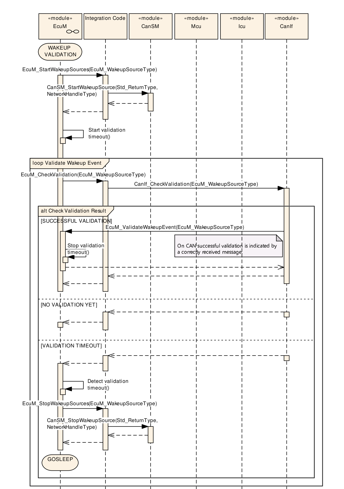

**集成电源控制的唤醒源**：**SLEEP**可由控制**MCU**电源供应的系统芯片实现（如带集成电源的**CAN**收发器，其在应用请求时切断电源、在**CAN**活动时打开电源）。此时对**EcuM**而言**SLEEP**就像**OFF**，被动**CAN**唤醒看起来就像上电复位，**ECU**将在唤醒事件后继续**STARTUP**序列——唤醒验证仍然必要，且系统设计者须负责检查**CAN**收发器的唤醒原因并通过**EcuM_SetWakeupEvent**/**EcuM_ClearWakeupEvent**将信息传递给**EcuM**。

# 8. Reset（复位）流程

## 8.1 复位与下电目标的关系

**RESET**是三种下电目标之一。当**BswM**（或**SW-C**）通过**EcuM_SelectShutdownTarget**选择**RESET**目标并调用**EcuM_GoDownHaltPoll**后，**ECU**按第 6 章的**SHUTDOWN**流程关闭**BSW**，最终在**OffPostOS**序列中由**EcuM_AL_Reset**回调执行具体复位，复位模态由**EcuM_ResetType**（复位模式）决定。

此外，**OffPreOS**序列中检测到挂起的唤醒事件时，**EcuM**会自动将**RESET**设为下电目标（使用**EcuMDefaultResetModeRef**的默认复位模式），以便立即启动。

若**EcuM**无法确定**Mcu**驱动返回的复位原因，则**EcuM**为默认唤醒源**ECUM_WKSOURCE_RESET**设置唤醒事件。

## 8.2 Boot Target（启动目标）选择

**Bootloader**、系统供应商**Bootloader**和应用是独立的程序镜像，多数情况下可以分别刷写。从一个镜像进入另一个镜像的唯一方式是通过复位。启动菜单（**Boot Menu**）根据所选的启动目标（**Boot Target**）分支进入相应的镜像（图 8.1）。

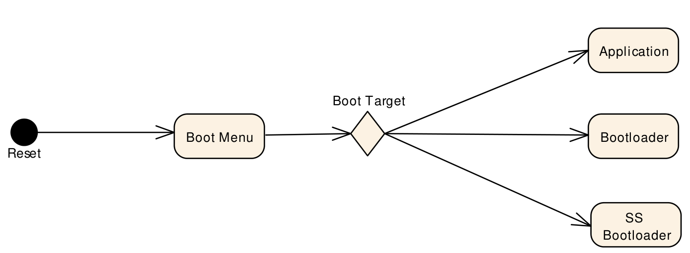

## 8.3 复位相关模块交互

**WdgM（看门狗管理器）**：**WdgM_PerformReset**是一种复位模态；看门狗相关唤醒源（**ECUM_WKSOURCE_INTERNAL_WDG**、**ECUM_WKSOURCE_EXTERNAL_WDG**）不需要唤醒验证。

**DCM（诊断通信管理器）**：诊断**ECU**复位（**ECU Reset**）场景中，**DCM**通过**BswM**通知**ECU**：① 准备**ECU**执行特定复位；② 显式执行该复位。根据诊断服务的不同，**DCM**等待**ECU**就绪确认（通过**EcuMode**通知）或立即切换到**EXECUTE**模式，后者将触发**BswM**调用**EcuM_GoDown**。

**Mcu（微控制器驱动）**：**Mcu_PerformReset**执行硬件复位；**Mcu_GetResetReason**在**StartPreOS**序列中提供复位原因，经**EcuMWakeupSource**配置映射为唤醒源，**EcuM**须记住该映射结果供**EcuM_MainFunction**验证。

# 9. 多核 ECU 协调

多核**ECU**上，**STARTUP**、**SHUTDOWN**、**SLEEP**和**WAKEUP**在所有核上协调执行。**EcuM**分为**master**和**slave**实例：

* **Master Core**：**StartPreOS**/**StartPostOS**/**OffPreOS**/**OffPostOS**/**GoSleep**/**Halt**/**Poll**/**WakeupRestart**各序列由**master EcuM**主导；
* **Slave Core**：**slave EcuM**通过核间信号（**SetEvent**/**WaitEvent**）与**master**同步；
* **Shutdown Synchronization**：各核在调用**ShutdownAllCores**前通过事件掩码同步，确保所有核就绪后统一关闭。

图 9.1 显示了**Master/Slave**核关闭同步的示例（规范注明此为示例而非强制流程）。

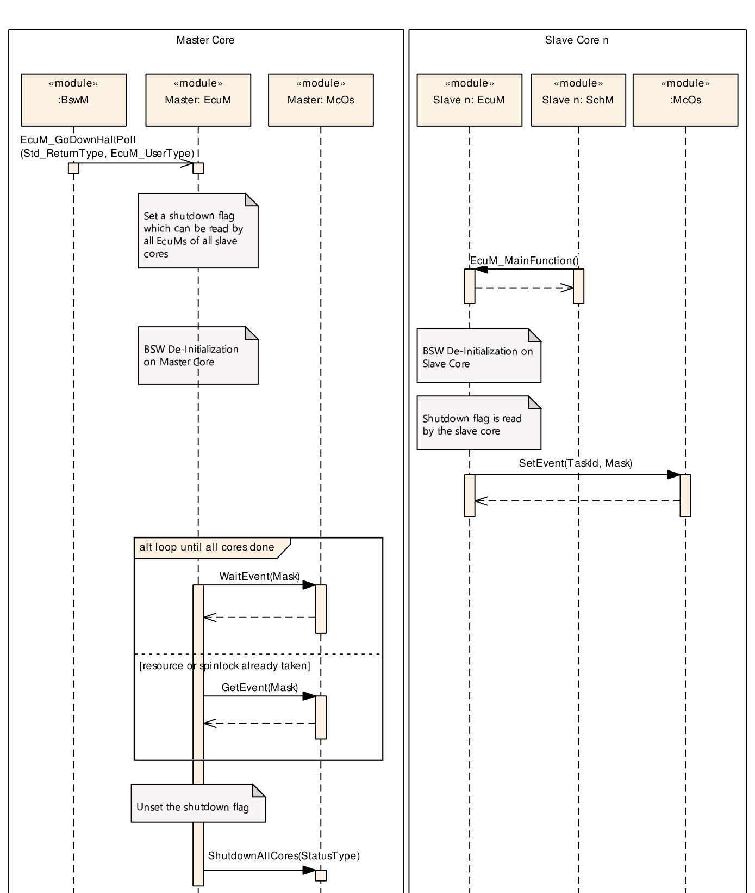

# 10. BswM 配套规则（集成指南）

根据**Guide to Mode Management**，**BswM**的规则（**rules**）和动作列表（**action lists**）配置是项目与**ECU**特定的，AUTOSAR 无法标准化，但规范给出了典型场景的配置指导：

**启动（Startup）**：**BswM**的**ECU Mode Handling**规则在**EcuM**初始化后初始化其余**BSW**模块（**LinSM_Init**、**FrIf_Init**、**PduR_Init**、**CANNM_Init**、**COM_Init**、**DCM_Init**、**ComM_Init**、**DEM_Init**、**FIM_Init**等），启动**RTE**（**Rte_Start**→**Rte_Init**→**Rte_StartTiming**），最后通过**EcuM_SetState(ECU_RUN)**置位运行状态。**NvM_ReadAll**作业完成后触发剩余初始化。

**运行（Run）**：只要至少一个应用**SW-C**请求**RUN**状态，**ECU**就保持运行；**EcuM**对**SW-C**的**RUN**/**POST_RUN**请求进行仲裁，通过**BswM_EcuM_RequestedState**通知**BswM**。

**下电与睡眠（Shutdown & Sleep）**：所有**ComM**通道报告无挂起请求后，**BswM**协调**POST_RUN**阶段、去初始化各模块，根据下电目标调用**EcuM_GoDown**（下电）或**EcuM_GoHalt**/**EcuM_GoPoll**（睡眠）。进入睡眠与下电序列类似，只是调用不同的**EcuM**下行**API**。

**唤醒（Wakeup）**：唤醒后的正确行为完全配置在**BswM**中——规则根据发生的**EcuM_WakeupSource**唤醒事件决定是否启动**ECU**，否则**ECU**将立即再次关闭。唤醒源验证有效时**BswM**将**ECU**恢复到**RUN**状态；所有唤醒事件回到**NONE**或**EXPIRED**后，**BswM**为**SLEEP**或**OFF**准备**BSW**并调用**EcuM_GoDownHaltPoll**。

**诊断复位（ECU Reset）**：**DCM**作为诊断用例的总模式管理器，通过模式接口通知**BswM**准备并执行**ECU**复位。

**分区重启（Reset of partitions）**：某分区出错需重启时，该分区的**BSW**模块须重新初始化；通过**BswMPartitionRestarted**模式请求源确定被重启的分区。

**错误处理**：**EcuM**忽略初始化期间发生的所有类型错误（如初始化函数返回值）——初始化是配置问题（**EcuMDriverInitListZero**、**EcuMDriverInitListOne**、**EcuMDriverRestartList**），无法标准化。**BSW**模块自行负责向**DEM**或**DET**报告初始化错误并采取特殊措施。

# 11. 小结

本文档基于**AUTOSAR CP R22-11** **ECU**状态管理器规范及**4.4.0**模式管理指南，整理了标准**ECU**电源状态管理的完整流程：

1. **Startup**：**EcuM_Init**前最小**MCU**初始化 → **StartPreOS**（中断设置、驱动**Init Block 0/1**、配置一致性检查、复位原因获取、默认下电目标选择、启动**OS**）→ **StartPostOS**（**SchM_Init/Start**、**BswM_Init**、**SchM_StartTiming**）→ **BswM**初始化其余**BSW**并启动**RTE** → **UP**阶段。
2. **下电**：**BswM**选择下电目标（**OFF**/**SLEEP**/**RESET**）并调用**EcuM_GoDownHaltPoll** → **OffPreOS**（**BswM_Deinit**、**SchM_Deinit**、唤醒事件检查、必要时改设**RESET**目标）→ **ShutdownOS** → **ShutdownHook**调用**EcuM_Shutdown** → **OffPostOS**（**EcuM_AL_SwitchOff**或**EcuM_AL_Reset**）。
3. **唤醒**：**GoSleep**（使能唤醒源）→ **Halt/Poll**（**RAM**哈希、**Mcu_SetMode**）→ 唤醒事件 → **WakeupRestart**（驱动重启、唤醒回调重新布防）→ **WakeupValidation**（**NONE**→**PENDING**→**VALIDATED**/**EXPIRED**状态机）。
4. **Reset**：作为下电目标经**OffPostOS**的**EcuM_AL_Reset**执行；支持**Mcu_PerformReset**、**WdgM_PerformReset**、**DIO/SPI**触发等多种复位模态；诊断**ECU**复位由**DCM**经**BswM**协调；启动目标（**Boot Target**）选择依赖复位在**Bootloader**与应用镜像间分支。

<section id="wechat">

<h4>微信扫一扫，获取更多及时资讯</h4>

</section>
