<!-- 源文档 AUTOSAR_CP_EXP_AIADASAndVMC（R23-11），讲述型指南（EXP），不受 Type A 七章骨架约束；章节结构镜像源文档自身编号（1–6，6 = Appendix）。 -->

**译者注：** 源文档第 [6.2](#62-appendix-b接口清单) 章（Appendix B）的接口清单表在 PDF→markdown 转换中存在 OCR 乱码（个别单元格残缺、行序交错）。本文按可读内容尽力重建为 GFM 表；**单元格取值在正式使用前应对照源 PDF 校验**（决策记录于 sync-todo 队列行）。

## 1. 引言

本文档解释车辆运动控制（Vehicle Motion Control，VMC）接口及其软件组件的架构模式，以及导致底盘域应用接口更新的设计决策，如图 1.1 所示。

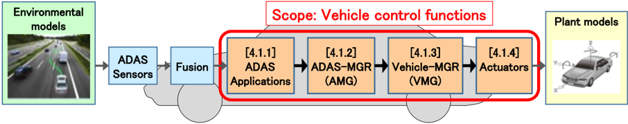

本文档中车辆控制功能的范围仅为「ADAS 需求的实现」。本文档将聚焦于为 ADAS 功能（特别是 ACC、AEB 与 LKA 功能）推荐的信号级联架构——将为其创建新的 SW 组件。对于其他底盘组件，包括车辆稳定控制（ABS/TCS 等），请参见 [1, AUTOSAR_EXP_AIChassis]。

在本文档中定义架构（功能结构、I/F）的目的在于：通过实现功能更新/变更的便利性、设计与验证的便利性以及相互理解的便利性，来提升各公司在非竞争领域的功能开发便利性与开发效率。

## 2. 术语与概念的描述

本文档涉及在底盘域（Domain Chassis）统一应用接口的规范化，其框架是带特定车辆运动控制接口的先进驾驶辅助系统（ADAS）的特定模式实现。底盘域的结果应与其他域——例如车身、动力总成、乘员与行人安全——对齐。应用接口表为这种对齐与冲突检测提供了良好的基础。

### 2.1. 轴系

底盘域使用的标准坐标系参考国际标准 [2, ISO 8855]。是否使用一个固定的几何点（例如接近某车型所有变体的平均重心（Centre of Gravity，CoG））作为基本重心的参考点，必须在项目层级决定。

### 2.2. 定义

#### 2.2.1 乘用车重心

汽车的底盘固定坐标系的原点位于前轴（Front Axle，FA）的中间，见图 2.1。汽车的重心定义为一个相对 FA 坐标系定位的、非底盘固定坐标系的原点。这两个坐标系的轴向定义如下：

车辆向前行驶时：

- x 向车头方向为正；
- y 向车左方向为正；
- z 向车顶方向为正；
- 侧倾（Roll）在左转弯、车身向右侧倾时为正；
- 俯仰（Pitch）在车辆制动、车身前倾时为正；
- 横摆（Yaw）在左转弯时为正。

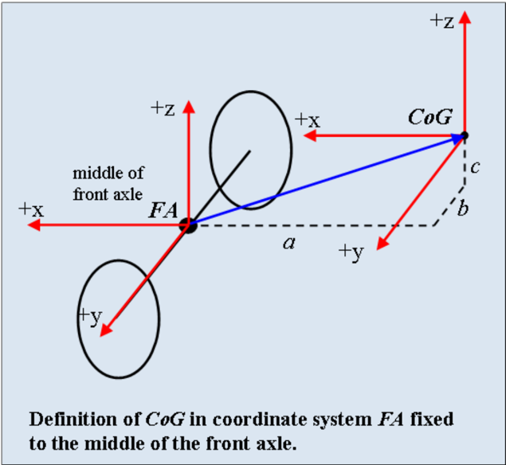

#### 2.2.2 极坐标系

极坐标系的定义如下：

- 车辆向前行驶时，φ 在逆时针方向为正。

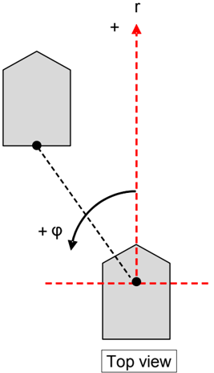

#### 2.2.3 车辆加速度/驱动力方向

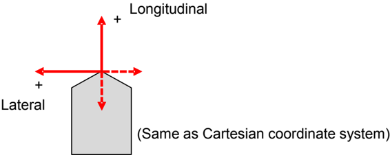

减速度以负值表示。

#### 2.2.4 超高（Cant）方向

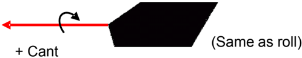

#### 2.2.5 转向盘转角

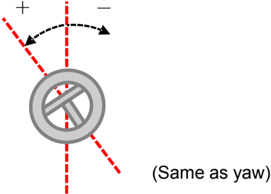

#### 2.2.6 道路变量

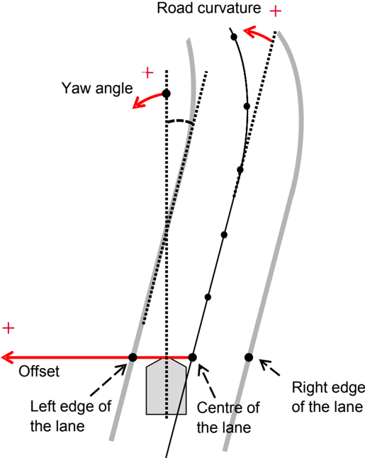

#### 2.2.7 曲率请求

基于从车辆位置出发的期望轨迹，计算相应的曲率请求。

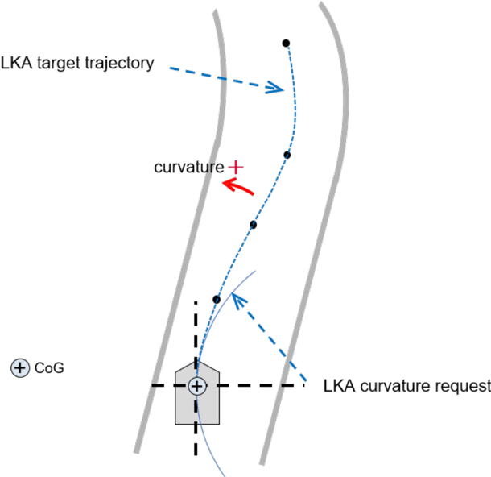

路径曲率请求相对于固定点上的轨迹定义——除非另有说明，该固定点为重心（CoG）。

#### 2.2.8 车辆周围的定义

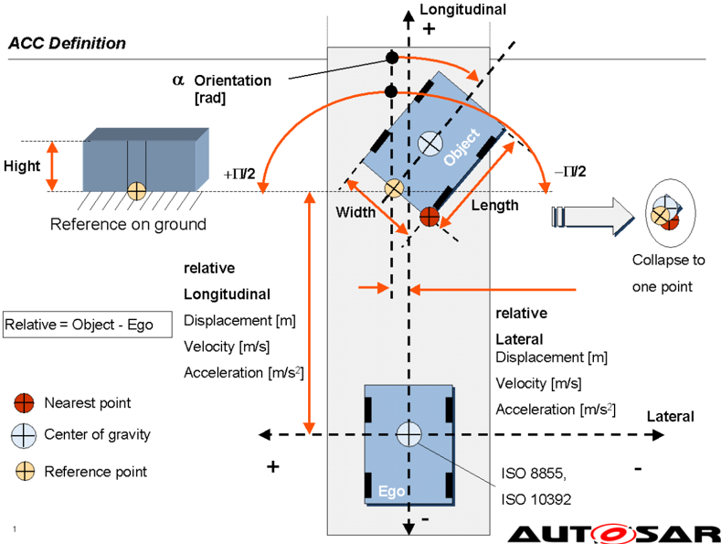

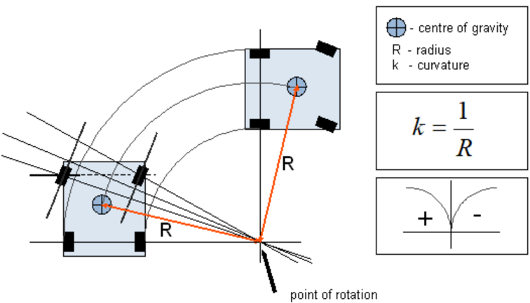

### 2.3. 缩略语与缩写

AUTOSAR 内常用术语与缩写的解释另请参见 [3, AUTOSAR_TR_Glossary]。

| 缩写/缩略语 | 说明 |
| --- | --- |
| ABS | Antilock Braking System（防抱死制动系统） |
| ACC | Adaptive Cruise Control（自适应巡航控制） |
| ACL | Acceleration（加速度） |
| ACT | Actuator（执行器） |
| ADAS | Advance Driver Assistance System（先进驾驶辅助系统） |
| AEB | Autonomous Emergency Braking（自主紧急制动） |
| BAS | Brake Assist（制动辅助） |
| BRK | Brake（制动） |
| BRWS | Basic Rear Wheel Steering（基本后轮转向） |
| BSTS | Basic Steering Torque Superposition（基本转向力矩叠加） |
| BSAS | Basic Steering Angle Superposition（基本转向角叠加） |
| CBC | Cornering Brake Control（弯道制动控制） |
| CoG | Centre of Gravity（重心） |
| DAS | Driver Assistance System（驾驶辅助系统） |
| DTC | Regulation of the Drag Torque（拖滞力矩调节） |
| EBD | Electronic Brake Force Distribution（电子制动力分配） |
| ECU | Electronic Control Unit（电子控制单元） |
| EPB | Electronic Parking Brake（电子驻车制动） |
| ESC | Electronic Stability Control（电子稳定控制） |
| FA | Front Axle（前轴） |
| HDC | Hill Decent Control（陡坡缓降控制） |
| HHC | Hill Hold Control（坡道起步辅助） |
| HMI | Human Machine Interface（人机接口） |
| HW | Hardware（硬件） |
| I/F | Interface（接口） |
| LKA | Lane Keep Assist（车道保持辅助） |
| MGR | Manager（管理器） |
| NVH | Noise, Vibration, Harshness（噪声、振动、平顺性） |
| OEM | Original Equipment Manufacturer（原始设备制造商） |
| PT | Powertrain（动力总成） |
| RA | Rear Axle（后轴） |
| RSC | Roll Stability Control（侧翻稳定控制） |
| SR | Situation Recognition（态势识别） |
| SSM | Stand Still Manager/Management（静止管理器/管理） |
| STR | Steering（转向） |
| SW | Software（软件） |
| SW-C | Software Component（软件组件） |
| TCS | Traction Control System（牵引力控制系统） |
| VFB | Virtual Function Bus（虚拟功能总线） |
| VGR | Variable Gear Ratio（可变传动比） |
| VLC | Vehicle Longitudinal Control（车辆纵向控制） |
| VM | Vehicle Model（车辆模型） |
| VMC | Vehicle Motion Control（车辆运动控制） |
| VSS | Vehicle State Sensors（车辆状态传感器） |
| YRC | Yaw Rate Control（横摆角速度控制） |

### 2.4. 一般性说明

#### 2.4.1 限制

所提出的逻辑架构不限制参与 AUTOSAR 的公司或组织的开发或产品。

#### 2.4.2 传感器信号

在 ADAS 中，为 I/F 定义处理不同处理层级的信号：

- 原始信号（Raw signal）：未经预处理的原始传感器数据；
- 预处理信号（Pre-processed signal）：经过预处理的传感器数据，对传感器硬件的抽象；
- 融合信号（Fused signal）：处理若干传感器信号以生成融合信号。

原始信号（原始数据）不应作为标准 I/F 使用，因为它们依赖硬件。

#### 2.4.3 功能安全

大多数 ADAS 域信号被视为与安全相关。本文档假定存在可靠的通信方法。本文档不提供通信方法的规定。

动态设计与安全概念不在本文档的考虑范围内。为了证明所讨论的用例符合安全要求（按照 [4, ISO 26262]、[5, ISO 21448] 等的定义），需要进行跨所有适用域的研究，且这些研究必须在项目层级执行。

#### 2.4.4 对 ADAS 应用的假定

本文档将该架构应用于三个 ADAS 应用（ACC、AEB 与 LKA）。

对这三个应用的假定如下所示：

- ACC：适用于包括静止工况在内的所有车速范围；
- AEB：不包括停止后的重新起步；
- LKA：适用于理想附着条件下高速公路或机动车道上的车道保持辅助功能（例如低车轮滑移、低加速度；如有必要，构成「理想附着」的确切条件可以是项目特定的）。

## 3. 相关文档

[6, 'JASPAR Standards Document: ST-AVI-1'] 也被用作本文档的参考。

[1] Explanation of Application Interfaces of the Chassis Domain
> AUTOSAR_CP_EXP_AIChassis

[2] ISO 8855:2011, Road vehicles - Vehicle dynamics and road-holding ability - Vocabulary
> https://www.iso.org

[3] Glossary
> AUTOSAR_FO_TR_Glossary

[4] ISO 26262:2018 (all parts) - Road vehicles - Functional Safety
> https://www.iso.org

[5] ISO/PAS 21448:2019 - Road vehicles - Safety of the intended functionality
> https://www.iso.org

[6] JASPAR Standards Document:ST-AVI-1 - AD/ADAS Vehicle Motion Control Interface Specification Ver. 3.01
> https://www.jaspar.jp/en

## 4. 架构概览

### 4.1. 功能结构

本文档在四个层级上定义 ADAS 的车辆控制功能（图 4.1 中的粗边框）：

1. ADAS 应用（ADAS Application）；
2. ADAS-MGR；
3. Vehicle-MGR；
4. 域执行器（+相关域传感器）。

为每个 ADAS 与执行器系统设置一个 MGR 层，并标准化各层之间的 I/F，以松散 ADAS 应用与执行器之间的关系，减少为一个元素增加或更改功能对另一个元素的影响。例如，为 ADAS 系统增加或更改功能的影响可以被 ADAS-MGR 层吸收。ADAS-MGR 可以经由标准化的 I/F 与 Vehicle-MGR 通信，这减少了对后续功能的影响。此外，它可以使增加和/或更改执行器变得更容易，而不会剧烈影响 Vehicle-MGR；相互依赖性的降低还可以简化系统的功能安全分析。

整个 ADAS 架构由上述四层、ADAS 传感器层与融合层组成。ADAS 传感器的例子包括视觉传感器（例如摄像头）、雷达与激光雷达。ADAS 传感器监控车辆周围环境，并向融合层发送原始信号（原始数据）或预处理信号。融合层融合来自各传感器的信号以识别周围环境。识别结果被发送到 ADAS 应用层。

本文档不涵盖与车辆控制没有直接 I/F 的 ADAS 传感器与融合层（如图 1.1 所述）。一般规则是：在 VMC 架构中，尽可能避免执行器之间的交互。

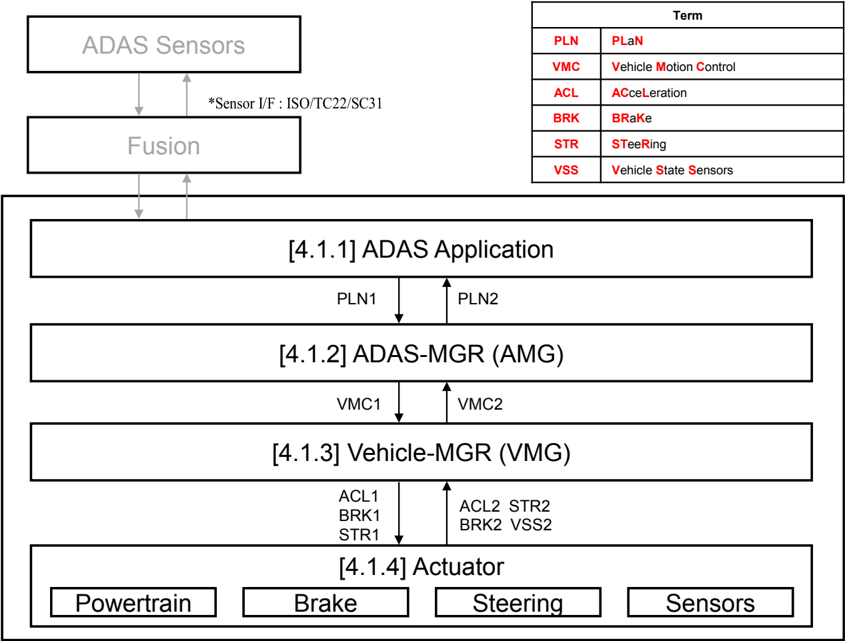

表 4.1 展示各层之间的主要 I/F。

| I/F | 说明 |
| --- | --- |
| PLN1 | 从 ADAS 应用层到 ADAS-MGR 层的 I/F |
| PLN2 | 从 ADAS-MGR 层到 ADAS 应用层的 I/F |
| VMC1 | 从 ADAS-MGR 层到 Vehicle-MGR 层的 I/F |
| VMC2 | 从 Vehicle-MGR 层到 ADAS-MGR 层的 I/F |
| ACL1 | 从 Vehicle-MGR 层到执行器层（动力总成）的 I/F |
| ACL2 | 从执行器层（动力总成）到 Vehicle-MGR 层的 I/F |
| BRK1 | 从 Vehicle-MGR 层到执行器层（制动）的 I/F |
| BRK2 | 从执行器层（制动）到 Vehicle-MGR 层的 I/F |
| STR1 | 从 Vehicle-MGR 层到执行器层（转向）的 I/F |
| STR2 | 从执行器层（转向）到 Vehicle-MGR 层的 I/F |
| VSS2 | 从执行器层（传感器）到 Vehicle-MGR 层的 I/F |

#### 4.1.1 ADAS 应用

ADAS 应用的功能如图 4.2 与表 4.2 所示。

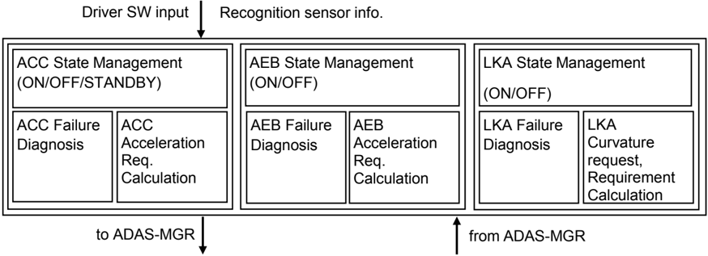

| 功能 |
| --- |
| 基于经由用户界面（例如开关）和/或识别传感器信息的驾驶辅助请求，每个 ADAS 应用请求单独的运动学计划（纵向加速度/减速度、曲率请求等），以在保障安全和/或舒适的同时遵守法规。 |
| 每个 ADAS 应用执行失效检测与功能停止判定，管理其内部状态，并根据内部状态采取动作。 |
| 每个 ADAS 应用根据由 ADAS-MGR 选择的 ADAS 应用的状态行动。 |

#### 4.1.2 ADAS-MGR

ADAS-MGR 的功能如图 4.3 与表 4.3 所示。

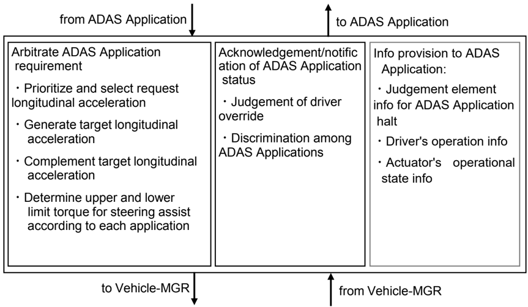

| 功能 |
| --- |
| ADAS-MGR 仲裁来自每个 ADAS 应用的各个运动学计划请求，并整合 ADAS 运动学计划以保障安全和/或舒适。 |
| ADAS-MGR 向 Vehicle-MGR 请求所请求运动学计划（包括为该运动学计划所做的准备）与驾驶员操作的仲裁模式。 |
| ADAS-MGR 基于车辆状态判断驾驶员加速/制动/转向操作的覆盖（override），并把运动学计划请求的仲裁结果以及所选 ADAS 应用告知每个 ADAS 应用。 |
| ADAS-MGR 向 ADAS 应用提供其停止（halt）的判定要素信息。此时，引起停止的来自各种传感器与执行器的信息（例如座椅传感器信息、发动机可靠性信息等）被抽象为不依赖特定系统配置的信息（例如乘员状态、驱动系统状态等），并传递给 ADAS 应用。（* 该功能的补充说明见第 [6.1](#61-appendix-aadas-应用的中断) 章 Appendix A：ADAS 应用的中断） |

#### 4.1.3 Vehicle-MGR

Vehicle-MGR 的功能如图 4.4 与表 4.4 所示。

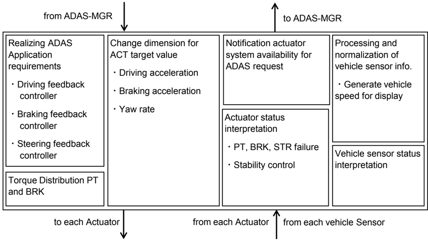

| 功能 |
| --- |
| Vehicle-MGR 为执行器系统计算/分发运动请求（驱动、制动、转向），以实现 ADAS-MGR 请求的运动学计划。 |
| Vehicle-MGR 向每个执行器请求运动请求与驾驶员操作请求之间的仲裁模式。 |
| Vehicle-MGR 基于每个执行器系统状态与（按需处理的）动量感知信息，把车辆状态告知 ADAS-MGR。 |

#### 4.1.4 执行器（Actuator）

表 4.5 展示执行器系统的功能描述。

| 功能 |
| --- |
| 执行器系统基于驾驶员操作实现车辆运动请求（驱动、制动、转向）。 |
| 执行器系统实现来自 Vehicle-MGR 的车辆运动请求（驱动、制动、转向）。 |
| 每个执行器系统基于来自 Vehicle-MGR 的仲裁请求实现车辆运动请求。 |
| 执行器系统把驾驶员操作（加速踏板、制动踏板、保持转向盘）的 ON/OFF 信息通知给 Vehicle-MGR。 |
| 执行器系统把执行器系统的状态（驱动、制动、转向）通知给 Vehicle-MGR。 |
| 执行器系统把关于车辆动量的信息通知给 Vehicle-MGR。 |

执行器系统由以下子系统组成。

**a) 动力总成（Powertrain）**

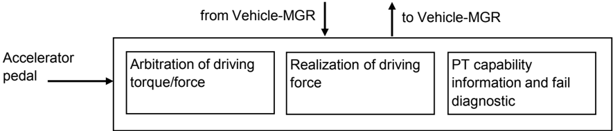

**b) 制动（Brake）**

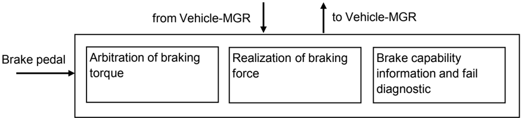

**c) 转向（Steering）**

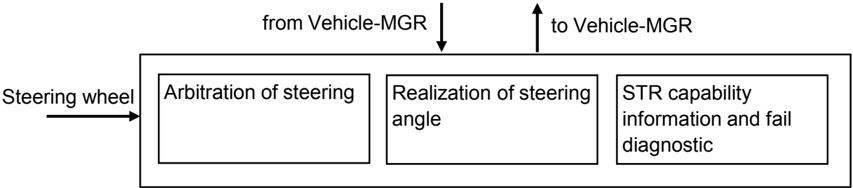

### 4.2. 接口

细节请参见第 [6.2](#62-appendix-b接口清单) 章 Appendix B：接口清单。

### 4.3. 可扩展性

下面展示将该架构应用于 ACC、AEB 与 LKA 的用例。可以选择要使用的 I/F 或功能，使得即使在组合多个 ADAS 应用或在未来增加应用时也能保持该架构的可扩展性。

#### 4.3.1 ACC

图 4.8 展示只使用 ACC 的用例。

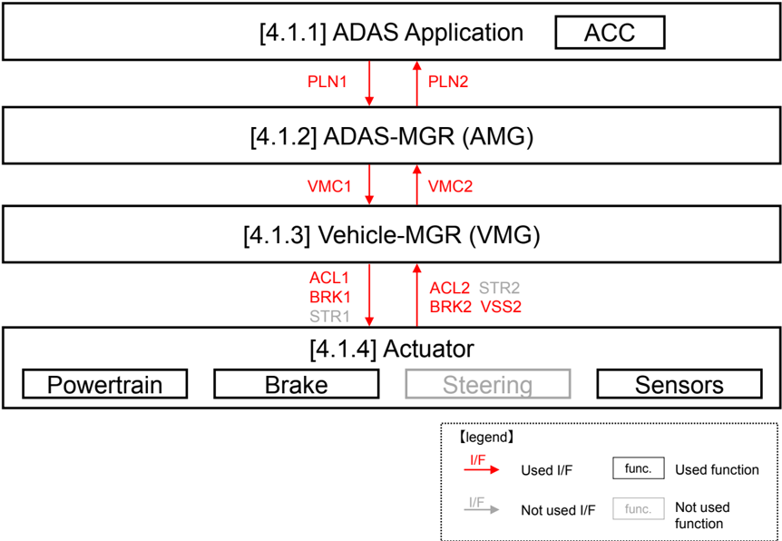

#### 4.3.2 AEB

图 4.9 展示只使用 AEB 的用例。

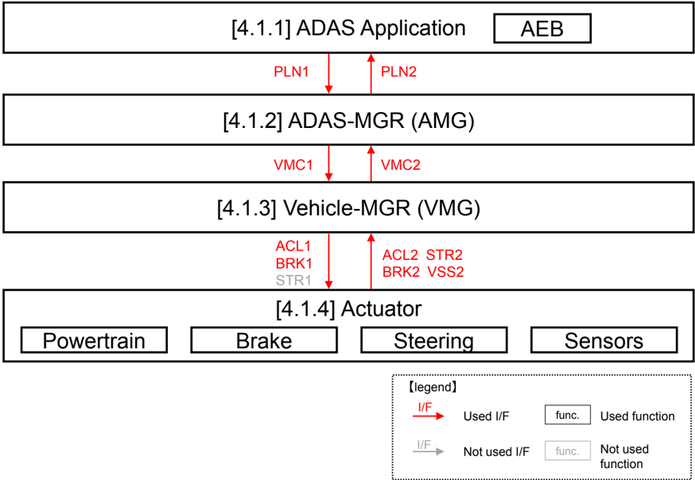

#### 4.3.3 LKA

图 4.10 展示只使用 LKA 的用例。

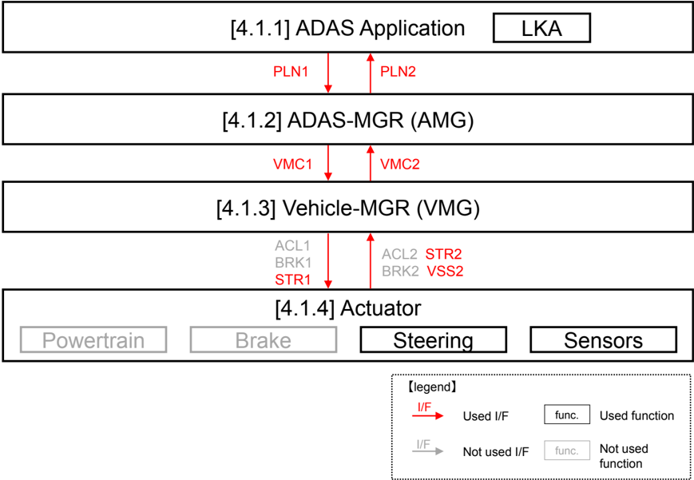

## 5. 用于 VMC 架构实现的底盘域软件组成与组件的描述

底盘域内 ADAS 功能的实现已经通过应用接口引入（图 5.1 与图 5.2）。

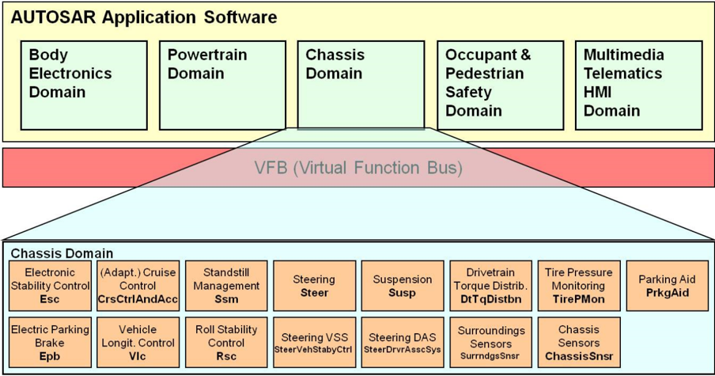

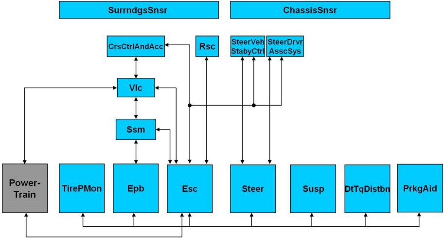

此外，如 [1, AUTOSAR_EXP_AIChassis] 第 5.1 章的示例所述，可以讨论多种结构来布置功能组件的全局架构，如下例（图 5.3）：

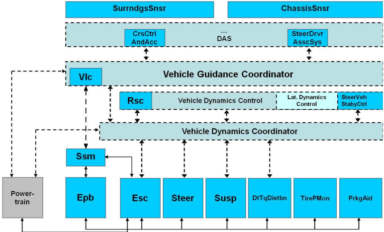

对 VMC 架构的理解还应被解释为另一种底盘域结构，其中 VMC 架构的每一层可以、也可以不由其他现有底盘域 SW 组件构成。

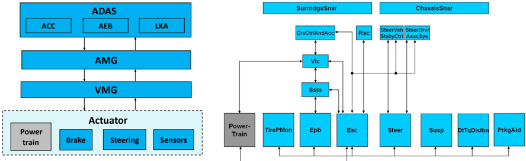

本文档的范围仅限于定义构成 VMC 架构的 SW 组件之间的接口：ADAS、AMG、VMG 与（现有的）执行器/传感器。因此，每个组件的内容留给项目自行决定，本文档不定义现有 SW 组件集成到 VMC 架构中的方式。但是，如果 VMC 架构沿 AI 底盘域中的现有 SW 组件实现，则需要：

- 限制来自当前现有底盘域 SW-C 端口的信息流；
- 考虑将通过新的 SW 组件定义的仲裁门。

## 6. 附录（Appendix）

### 6.1. Appendix A：ADAS 应用的中断

#### 6.1.1 前提

各种 ADAS 应用都被要求在 ADAS 系统发生异常、或乘员无法安全使用 ADAS 功能等情况下停止（或降级）其功能。由于 ADAS 应用的停止判定条件与停止时机因应用而异，因此有必要在应用设计中确保灵活性。从这个角度来看，本文档假定：ADAS 应用的停止判定功能放置在每个 ADAS 应用中，而作为停止判定素材的信息提供功能放置在 ADAS-MGR 层。

#### 6.1.2 与 ADAS 应用中断相关的信息分类

图 6.1 展示与 ADAS 应用停止相关的信息分类示例。

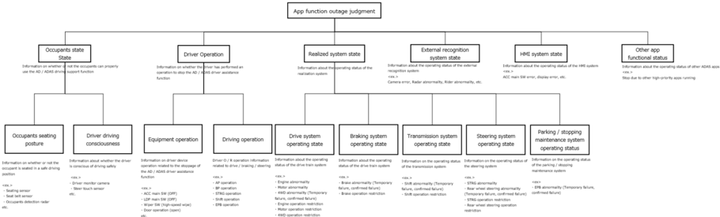

#### 6.1.3 接口清单中列出的接口信号

基于图 6.1 分类示例的接口信号，图 6.2 所示者列于接口清单中。

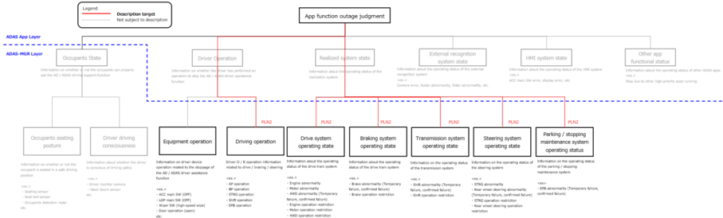

#### 6.1.4 未被描述涵盖的接口信号

与图 6.2 中被排除在接口表之外的信息分类相关联的接口信号，被本工作组判定为不适合在本文件中定义标准接口信号。这是因为它们超出本文档的范围（见第 [1](#1-引言) 章），并且尽管是相同的 ADAS 应用（例如 ACC、AEB、LKA），ADAS 应用的详细行为仍因各 OEM 公司而异。然而，从便于增加与修改功能（即本文档的目标）的角度出发，建议各 OEM 公司即使在排除的信息分类上，也基于 OEM 内部的相同视角定义接口信号。下面给出基于「乘员状态（Occupants state）」信息分类定义接口信号的示例。

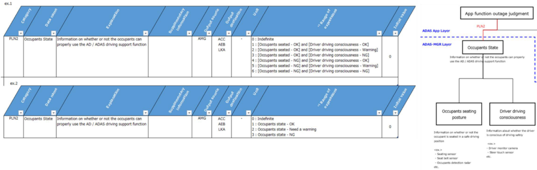
### 6.2. Appendix B：接口清单

**译者注：** 以下接口清单表重建自 OCR 乱码转换（源 PDF 中为完整表格图 Figure28/Figure29）。行集合按源图保留；「**」为源表中被遮蔽（PROTECTED 関係者外秘）的受保护条目；带 \* 的单元格为转换中残缺、需对照源 PDF 校验的取值。

#### PLN1（ADAS 应用 → AMG）

| No | ACC | AEB | LKA | 类型 | 数据名 | 说明 | 补充信息 | 输出源 | 输出目标 | 单位 | 取值范围 |
| --- | --- | --- | --- | --- | --- | --- | --- | --- | --- | --- | --- |
| 1 | 〇 | | | ACC 请求 | ACC 目标加速度 | 指示保障 ACC 性能的目标加速度 | ** | ACC | AMG | m/s² | 初值:0 |
| 2 | 〇 | | | ACC 状态 | ACC 目标加速度有效性信息 | 指示 ACC 目标加速度有效还是无效 | | ACC | AMG | - | 0: 无效 1: 有效 |
| 3 | 〇 | | | ACC 状态 | ACC 状态 | 指示 ACC 控制状态 | | ACC | AMG | - | 初值:0 0: OFF 1: STANDBY 2: ON |
| 4 | 〇 | | | ACC 请求 | ACC 静止控制请求 | 指示是否请求 ACC 静止控制 | | ACC | AMG | - | 0: 未请求 1: 已请求 初值:0 |
| 5 | | 〇 | | AEB 请求 | AEB 目标加速度 | 指示保障 AEB 性能的目标加速度 | | AEB | AMG | m/s² | 初值:0 |
| 6 | | 〇 | | AEB 状态 | AEB 目标加速度有效性信息 | 指示 AEB 目标加速度有效还是无效 | | AEB | AMG | - | 0: 无效 1: 有效 初值:0 |
| 7 | | 〇 | | AEB 状态 | AEB 状态 | 指示 AEB 控制状态 | | AEB | AMG | - | 0: OFF 1: (待机) 2: ON 3: 警告 4: 减速准备（+警告） 5: 缓减速（+警告） 6: 强减速（+警告） 7: 车辆停止保持 |
| 8 | | 〇 | | AEB 请求 | AEB 静止控制请求 | 指示是否请求 AEB 静止控制 | | AEB | AMG | - | 初值:0 0: 未请求 1: 已请求 |
| 9 | | | 〇 | LKA 请求 | LKA 目标曲率 | 指示 LKA 目标曲率 | | LKA | AMG | 1/m | 初值:0 |
| 10 | | | 〇 | LKA 状态 | LKA 目标有效性信息 | 指示 LKA 目标曲率有效还是无效 | | LKA | AMG | - | 1: 有效 |
| 11 | | | 〇 | LKA 状态 | LKA 状态 | 指示 LKA 控制状态 | | LKA | AMG | - | 0：OFF 1：STANDBY 2：ON |

#### PLN2（AMG → ADAS 应用）

| No | ACC | AEB | LKA | 类型 | 数据名 | 说明 | 补充信息 | 输出源 | 输出目标 | 单位 | 取值范围 |
| --- | --- | --- | --- | --- | --- | --- | --- | --- | --- | --- | --- |
| 1 | 〇 | | | 驾驶员操作 | 覆盖操作信息 | 指示是否存在覆盖操作 | | ACC/AEB | AMG | - | 0：无 1：有 |
| 2 | | 〇 | | 驾驶员操作 | 覆盖操作信息 | 指示是否存在覆盖操作 | | ACC/AEB | AMG | - | 0：无 1：有 |
| 3 | | | 〇 | 驾驶员操作 | 覆盖操作信息 | 指示是否存在覆盖操作 | | ACC/AEB/LKA | AMG | - | 0：无 1：有 |
| 4 | 〇 | | | 驾驶员请求 | 驾驶员要求加速度 | 指示由加速踏板操作计算的驾驶员所需加速度 | 加速时指示正值 | ACC/AEB | AMG | m/s² | 初值:0 |
| 5 | | 〇 | | 驾驶员请求 | 驾驶员要求制动加速度 | 指示驾驶员所需的加速度 | 减速时指示负值 | AEB | AMG | m/s² | 初值:0 |
| 6 | 〇 | | | 动力总成加速度 | 可实现的动力总成加速度上限 | 指示可作为运动控制实现的动力总成加速度上限 | 定义为可在 \*\* msec 内实现的值 | ACC | AMG | m/s² | 初值:0 |
| 7 | 〇 | | | 动力总成加速度 | 可实现的动力总成加速度下限 | 指示可作为运动控制实现的动力总成加速度下限 | 定义为可在 \*\* msec 内实现的值 | ACC | AMG | m/s² | 初值:0 |
| 9 | 〇 | 〇 | | PT 系统可靠性 | PT 系统可靠性信息 | 指示协调整个 ADAS 系统所需的 PT 内部状态 | | ACC/AEB | AMG | - | 0: 初始化中 … |
| 10 | 〇 | 〇 | | BRK 系统可靠性 | BRK 系统可靠性信息 | 指示协调整个 ADAS 系统所需的 BRK 内部状态 | | ACC/AEB | AMG | - | 状态迁移图 |
| 11 | | 〇 | 〇 | STR 系统可靠性 | STR 系统可靠性信息 | 指示协调整个 ADAS 系统所需的 STR 内部状态 | ** | AEB/LKA | AMG | - | 0: 初始化中 … |
| 12 | 〇 | 〇 | | 操作状态 | 制动力稳定过程操作状态 | 指示制动力稳定过程是否正在运行 | | ACC/AEB | AMG | - | 状态迁移图 |
| 13 | 〇 | | | 操作状态 | 驱动力稳定过程操作状态 | 指示驱动力稳定过程是否正在运行 | | ACC | AMG | - | 0: 停止 1: 运行中 |
| 14 | 〇 | 〇 | | 操作状态 | 转向力稳定过程操作状态 | 指示转向力稳定过程是否正在运行 | | ACC/AEB | AMG | - | 0: 停止 1: 运行中 |
| 15 | 〇 | 〇 | | 实际换挡区间 | 实际换挡区间信息 | 指示由 VMG 计算的当前换挡区间 | | ACC/AEB | AMG | - | 0: 不定 … |
| 16 | 〇 | | | 仲裁结果 | PT 内部仲裁结果 | 指示 PT 内部驾驶员请求与 VMG 请求的仲裁结果 | | ACC | AMG | - | 初值:0 |
| 17 | 〇 | 〇 | | 仲裁结果 | BRK 内部仲裁结果 | 指示 BRK 内部驾驶员请求与 VMG 请求的仲裁结果 | | ACC/AEB | AMG | - | 0: 驾驶员 … |
| 18 | 〇 | 〇 | | 车辆状态 | 车辆停止状态 | 车辆处于停止工况 | | ACC/AEB | AMG | - | 0：不定 … |
| 19 | 〇 | 〇 | | 静止装置 | 静止装置操作状态 | 指示静止装置的操作状态 | | ACC/AEB | AMG | - | 0: 停止 1: 运行中 |
| 20 | 〇 | 〇 | | 可靠性信息 | 可靠性信息 | 指示协调整个 ADAS 系统所需的可靠性信息 | | ACC/AEB | AMG | - | 2: 失效（已确认）… |
| 21 | | | 〇 | 驾驶员转向 | 驾驶员转向盘保持状态 | 指示驾驶员是否握住转向盘 | | LKA | AMG | - | 0: 未握住 … |
| 22 | 〇 | 〇 | | 驾驶员转向 | 驾驶员转向盘操作力矩 | 指示驾驶员操作转向盘时的力矩强度 | 逆时针方向定义为正 | AEB/LKA | AMG | Nm | 初值:0 |
| 23 | 〇 | 〇 | | 转向盘转角 | 转向盘转角 | 指示转向盘的转角 | 逆时针方向定义为正 | AEB/LKA | AMG | rad | 初值:0 |
| 24–25 | 〇 | 〇 | | 加速踏板 | 加速踏板 ON/OFF 信息 | 指示加速踏板是否被踩下 | | ACC/AEB | AMG | - | 0：OFF … |
| 26 | 〇 | 〇 | | 估计信息 | 估计纵向加速度（地面等效值） | 指示由 VMG 计算的估计纵向加速度 | 加速度定义为正 | ACC/AEB | AMG | m/s² | 初值:0 |
| 27 | 〇 | 〇 | 〇 | 估计信息 | 估计侧向加速度（地面等效值） | 指示估计的侧向加速度等效值 | | LKA 等 | AMG | m/s² | 初值:0 |
| 28–29 | 〇 | 〇 | 〇 | 估计车辆速度/横摆率 | 估计车辆速度、估计横摆率 | 指示由 VMG 计算的估计车辆横摆率 | 前向定义为正；逆时针方向定义为正 | ACC/AEB/LKA | AMG | m/s、rad/s | 初值:0 |
| 30 | 〇 | | | 仪表车速 | 仪表显示车速 | 指示仪表上的车辆速度 | | ACC | AMG | m/s | 初值:0 |
| 31–33 | 〇 | 〇 | 〇 | 可靠性信息 | 估计纵向/侧向/车速/横摆率可靠性 | 指示协调整个 ADAS 系统所需的估计值可靠性 | | ACC/AEB/LKA | AMG | - | 0: 初始化中 … |
| 34 | | | 〇 | 车辆动量 | 估计横摆率可靠性信息 | 指示协调整个 ADAS 系统所需的估计横摆率 | | AMG | LKA | - | 0: 初始化中 1: 标定中 2: 正常 4: 无效（确认前） 5: 失效 … |
| 35 | 〇 | | 〇 | HMI | 仪表显示车速可靠性信息 | 指示协调整个 ADAS 系统所需的仪表显示车速 | | AMG | ACC/LKA | - | 初值:0 0: 初始化中 1: 标定中 2: 正常 … |
| 36 | | | 〇 | 车辆动量 | 估计曲率 | 指示由 VMG 计算的、地面等效的估计车辆路径曲率 | | AMG | LKA | 1/m | 初值:0 |
| 37 | | | 〇 | 车辆动量 | 估计曲率可靠性信息 | 指示协调整个 ADAS 系统所需的估计曲率可靠性 | | AMG | LKA | - | 0: 初始化中 1: 标定中 2: 正常 … |
| 38 | | | 〇 | 车辆动量 | 可实现车辆曲率上限 | 指示可作为运动控制实现的车辆曲率上限 | | AMG | LKA | 1/m | 初值:0 |
| 39 | | | 〇 | 车辆动量 | 可实现车辆曲率下限 | 指示可作为运动控制实现的车辆曲率下限 | | AMG | LKA | 1/m | 初值:0 |

#### VMC1（AMG → VMG）

| No | 类型 | 数据名 | 说明 | 补充信息 | 输出源 | 输出目标 | 单位 | 取值范围 |
| --- | --- | --- | --- | --- | --- | --- | --- | --- |
| 1 | ACC 请求 | 最大选择用 AMG 目标加速度 | 指示假定以最大选择方式与驾驶员请求进行仲裁的 AMG 目标加速度 | | AMG | VMG | m/s² | 初值:0 |
| 2 | AEB 请求 | 最小选择用 AMG 目标加速度 | 指示假定以最小选择方式与驾驶员请求进行仲裁的 AMG 目标加速度 | | AMG | VMG | m/s² | 初值:0 |
| 3 | ACC/AEB 状态 | AMG 目标加速度有效性信息 | 指示 AMG 目标加速度有效还是无效 | | AMG | VMG | - | 0: 无效 1: 有效 初值:0 |
| 4 | ACC 状态 | ACC 状态 | 指示 ACC 控制状态 | | AMG | VMG | - | 0：OFF 1：STANDBY 2：ON 7：车辆停止保持 初值:0 |
| 5 | ACC 请求 | ACC 静止控制请求 | 指示是否请求 ACC 静止控制 | | AMG | VMG | - | 0: 未请求 1: 已请求 初值:0 |
| 6 | AEB 状态 | AEB 状态 | 指示 AEB 控制状态 | | AMG | VMG | - | 0: OFF 1: (待机) 2: ON 3: 警告 … |
| 7 | AEB 请求 | AEB 静止控制请求 | 指示是否请求 AEB 静止控制 | | AMG | VMG | - | 初值:0 0: 未请求 1: 已请求 |
| 8 | LKA 请求 | 仲裁后目标曲率 | 指示 AMG 目标曲率 | | AMG | VMG | 1/m | 初值:0 |
| 9 | LKA 状态 | 目标曲率有效性信息 | 指示 AMG 目标曲率有效还是无效 | | AMG | VMG | - | 0: 无效 1: 有效 初值:0 |
| 10 | LKA 状态 | LKA 状态 | 指示 LKA 状态 | | AMG | VMG | - | 0：OFF 1：STANDBY 2：ON 初值:0 |

#### VMC2（VMG → AMG）

| No | 类型 | 数据名 | 说明 | 补充信息 | 输出源 | 输出目标 | 单位 | 取值范围 |
| --- | --- | --- | --- | --- | --- | --- | --- | --- |
| 1–2 | 动力总成加速度 | 可实现的动力总成加速度上限/下限 | 指示可作为运动控制实现的动力总成加速度上限/下限 | 定义为可在 \*\* msec 内实现的值 | VMG | AMG | m/s² | 初值:0 |
| 3 | 驾驶员请求 | 驾驶员要求加速度 | 指示由加速踏板操作计算的驾驶员所需加速度 | | VMG | AMG | m/s² | 初值:0 |
| 4 | PT 状态 | PT 系统可靠性信息 | 指示协调整个 ADAS 系统所需的 PT 内部状态 | | VMG | AMG | - | 0: 初始化中 … |
| 5 | 操作状态 | 驱动力稳定过程操作状态 | 指示驱动力稳定过程是否正在运行 | | VMG | AMG | - | 状态迁移图 |
| 6 | 加速踏板 | 加速踏板 ON/OFF 信息 | 指示加速踏板是否被踩下 | | VMG | AMG | - | 初值:0 |
| 7 | 仲裁信息 | PT 内部仲裁结果 | 指示 PT 内部驾驶员请求与 VMG 请求的仲裁结果 | | VMG | AMG | - | 0: 驾驶员 … |
| 8 | 实际换挡区间 | 实际换挡区间信息 | 指示由 VMG 计算的当前换挡区间 | | VMG | AMG | - | 0: 不定 … |
| 9 | BRK 系统可靠性 | BRK 系统可靠性信息 | 指示协调整个 ADAS 系统所需的 BRK 内部状态 | | VMG | AMG | - | 0: 初始化中 … |
| 10 | 操作状态 | 制动力稳定过程操作状态 | 指示制动力稳定过程是否正在运行 | | VMG | AMG | - | 0: 停止 … |
| 11 | 制动踏板 | 制动踏板 ON/OFF 信息 | 指示制动踏板是否被踩下 | | VMG | AMG | - | 0: 制动踏板释放 … |
| 12 | 仲裁结果 | BRK 内部仲裁结果 | 指示 BRK 内部驾驶员请求与 VMG 请求的仲裁结果 | | VMG | AMG | - | 初值:0 |
| 13–14 | 驾驶员请求 | 驾驶员要求制动加速度 | 指示驾驶员请求的加速度 | 减速时指示负值 | VMG | AMG | m/s² | 初值:0 |
| 15 | 操作状态 | 转向力稳定过程操作状态 | 指示转向力稳定过程是否正在运行 | | VMG | AMG | - | 状态迁移图 |
| 16 | 驾驶员转向 | 驾驶员转向盘保持状态 | 指示驾驶员是否握住转向盘 | | VMG | AMG | - | 0: 未握住 … |
| 17 | 驾驶员转向 | 驾驶员转向盘操作力矩 | 指示驾驶员操作转向盘时的力矩强度 | 逆时针方向定义为正 | VMG | AMG | Nm | 初值:0 |
| 18–19 | 转向盘转角/估计 | 转向盘转角、估计纵向加速度 | 指示转向盘转角以及由 VMG 计算的估计纵向加速度 | 逆时针/前向为正 | VMG | AMG | rad、m/s² | 初值:0 |
| 20–21 | 估计车辆速度 | 估计车辆速度 | 指示由 VMG 计算的估计车辆速度 | 前向定义为正 | VMG | AMG | m/s | 初值:0 |
| 22 | 估计横摆率 | 估计横摆率 | 指示由 VMG 计算的估计横摆率 | 逆时针方向定义为正 | VMG | AMG | rad/s | 初值:0 |
| 23–28 | 车辆状态/估计 | 车辆停止状态、估计侧向加速度、估计曲率等 | 指示车辆停止状态、由 VMG 计算的估计值等 | \*（取值需对照源 PDF 校验） | VMG | AMG | m/s、1/m 等 | 初值:0 |
| 29–33 | 静止/可靠性 | 静止装置状态、可靠性信息、估计曲率可靠性等 | 指示静止装置操作状态、协调整个 ADAS 系统所需的可靠性信息等 | \*（取值需对照源 PDF 校验） | VMG | AMG | - | 0: 停止/初始化中 … |

#### ACL1（VMG → PT）

| No | 类型 | 数据名 | 说明 | 补充信息 | 输出源 | 输出目标 | 单位 | 取值范围 |
| --- | --- | --- | --- | --- | --- | --- | --- | --- |
| 1A | VMG 请求选择 | 最大选择用驱动力矩 | 指示假定以最大选择方式与驾驶员请求驱动力矩进行仲裁而向 PT 请求的驱动轴总驱动力矩 | ** | VMG | PT | Nm | 初值:0 |
| 1B | VMG 请求 | 最大选择用驱动力 | 指示假定以最大选择方式仲裁的驱动轴总驱动力 | | VMG | PT | N | 初值:0 |
| 2A | VMG 请求 | 最小选择用驱动力矩 | 指示假定以最小选择方式仲裁的驱动轴总驱动力矩 | | VMG | PT | Nm | 初值:0 |
| 2B | VMG 请求 | 最小选择用驱动力 | 指示假定以最小选择方式请求的驱动力 | | VMG | PT | N | 初值:0 |
| 3 | VMG 请求 | PT 最大选择模式 | 指示用于指定驾驶员请求驱动力矩与最大选择请求驱动力矩之间仲裁方法的信号 | | VMG | PT | - | 0: 未请求模式 1: 模式请求 A … |
| 4 | VMG 请求 | PT 最小选择模式 | 指示用于指定驾驶员请求驱动力矩与最小选择请求驱动力矩之间仲裁方法的信号 | | VMG | PT | - | 0: 未请求模式 … |

#### ACL2（PT → VMG）

| No | 类型 | 数据名 | 说明 | 补充信息 | 输出源 | 输出目标 | 单位 | 取值范围 |
| --- | --- | --- | --- | --- | --- | --- | --- | --- |
| 1 | PT 状态 | 驾驶员加速踏板 ON/OFF 信息 | 指示加速踏板是否被踩下 | | PT | VMG | - | 0: OFF 1: ON |
| 2 | PT 状态 | 驾驶员加速踏板操作量 | 指示加速踏板被踩下的程度 | | PT | VMG | % | 初值:0 |
| 3A/3B | PT 状态 | 驾驶员请求驱动力矩/驱动力 | 指示经由加速踏板请求的驱动轴总驱动力矩/驱动力 | | PT | VMG | Nm/N | 初值:0 |
| 4 | PT 状态 | PT 内驱动请求的选择结果 | 指示 PT 内部驾驶员请求与 VMG 请求驱动力矩的选择结果 | | PT | VMG | - | 0: 驾驶员 … |
| 5A/5B | PT 状态 | PT 实际驱动力矩/驱动力 | 指示当前的驱动轴总驱动力矩/驱动力（估计值） | | PT | VMG | Nm/N | 初值:0 |
| 6 | PT 状态 | 实际换挡区间信息 | 指示由 PT 计算的当前换挡区间 | | PT | VMG | - | 0: 不定 … |
| 8A/8B | PT 限制 | 可实现驱动力矩/驱动力上限 | 指示可作为运动控制实现的驱动轴总驱动力矩/驱动力上限值 | | PT | VMG | Nm/N | 初值:0 |
| 9A/9B | PT 限制 | 可实现驱动力矩/驱动力下限 | 指示可作为运动控制实现的驱动轴总驱动力矩/驱动力下限值 | | PT | VMG | Nm/N | 初值:0 |
| 10 | 可靠性信息 | PT 系统可靠性信息 | 指示协调整个 ADAS 系统所需的动力总成内部状态（ACL2-1 至 ACL2-9 的信号应与之状态一致） | ** | PT | VMG | - | 0: 初始化中 1: 标定中 2: 正常 3: 保护控制中 4: 无效 … |
| 11 | PT 状态 | 驱动系统可靠性信息 | 指示驱动系统的内部状态 | | PT | VMG | - | 状态迁移图 0: 初始化中 … |
| 12 | PT 状态 | 驱动力稳定过程操作状态 | 指示驱动力稳定过程是否正在运行 | | PT | VMG | - | 状态迁移 0: 停止 1: 运行中 初值:0 |

#### BRK1（VMG → BRK）

| No | 类型 | 数据名 | 说明 | 补充信息 | 输出源 | 输出目标 | 单位 | 取值范围 |
| --- | --- | --- | --- | --- | --- | --- | --- | --- |
| 1 | VMG 请求 | 制动控制用制动力矩 | 指示假定以最小选择方式与驾驶员请求制动力矩仲裁而向 BRK 请求的制动力矩 | | VMG | BRK | Nm | 初值:0 |
| 2 | VMG 请求 | 制动控制模式 | 指示用于指定驾驶员请求制动力矩与最小选择请求制动力矩之间仲裁方法的信号 | | VMG | BRK | - | 0: 未请求模式 1: 模式请求 A 2: 模式请求 B … 127: 模式请求 … |
| 3 | VMG 请求 | 制动准备请求 | 指示对可立即施加制动的状态的请求 | | VMG | BRK | - | 0: 未请求 1: 已请求 初值:0 |
| 4 | VMG 请求 | 车辆停止保持请求 | 指示是否请求车辆停止保持 | | VMG | BRK | - | 0: 未请求 1: 已请求 初值:0 |

#### BRK2（BRK → VMG）

| No | 类型 | 数据名 | 说明 | 补充信息 | 输出源 | 输出目标 | 单位 | 取值范围 |
| --- | --- | --- | --- | --- | --- | --- | --- | --- |
| 1 | BRK 状态 | 制动踏板 ON/OFF 信息 | 指示制动踏板是否被踩下 | | BRK | VMG | - | 0: 制动踏板释放（未请求驾驶员制动）1: 制动踏板踩下 |
| 2 | BRK 状态 | 驾驶员制动请求力矩 | 指示经由制动踏板请求的制动力矩 | | BRK | VMG | Nm | 初值:0 |
| 3 | BRK 状态 | 仲裁后制动请求力矩 | 指示 BRK 内部驾驶员请求与 VMG 请求作为请求制动力矩的仲裁结果 | | BRK | VMG | Nm | 初值:0 |
| 4 | BRK 状态 | 仲裁后已实现制动力矩 | 指示由 BRK 计算的当前制动力矩（估计值） | | BRK | VMG | Nm | 初值:0 |
| 5 | BRK 状态 | 制动系统可靠性信息 | 指示协调整个 ADAS 系统所需的 BRK 内部状态 | | BRK | VMG | - | 0: 初始化中 1: 标定中 2: 正常 3: 保护控制中 4: 无效 … |
| 6 | BRK 状态 | 制动力稳定过程操作状态 | 指示制动力稳定过程是否正在运行 | | BRK | VMG | - | 0: 停止 1: 运行中 |
| 7 | BRK 状态 | 静止装置信息 | 指示静止装置的操作状态 | | BRK | VMG | - | 初值:0 0: 停止 1: 运行中 |
| 8 | BRK 状态 | 静止装置可靠性信息 | 指示静止装置的可靠性信息 | | BRK | VMG | - | 初值:0 0: 正常 1: 暂时失效 2: 失效（已确认） |

#### STR1（VMG → STR）

| No | 类型 | 数据名 | 说明 | 补充信息 | 输出源 | 输出目标 | 单位 | 取值范围 |
| --- | --- | --- | --- | --- | --- | --- | --- | --- |
| 1 | VMG 请求 | 目标转向盘转角 | 指示 ADAS 系统的目标转向盘转角 | | VMG | STR | rad | 初值:0 |
| 2 | VMG 请求 | 转向盘转角控制模式 | 指示目标转向盘转角有效还是无效 | | VMG | STR | - | 0: 未请求控制 1: 已请求控制 2–7: \*\* 初值:0 |
| 3 | VMG 请求 | 转向盘上下限力矩 | 指示转向盘转角控制的上下限力矩（转向盘操作轻重感） | | VMG | STR | Nm | 初值:0 |

#### STR2（STR → VMG）

| No | 类型 | 数据名 | 说明 | 补充信息 | 输出源 | 输出目标 | 单位 | 取值范围 |
| --- | --- | --- | --- | --- | --- | --- | --- | --- |
| 1 | STR 状态 | STR 系统可靠性信息 | 指示协调整个 ADAS 系统所需的 STR 内部状态 | | STR | VMG | - | 0: 初始化中 1: 标定中 2: 正常 3: 保护控制中 4: 无效 … |
| 2 | STR 状态 | 转向力稳定过程操作状态 | 指示转向力稳定过程是否正在运行 | | STR | VMG | - | 0: 停止 1: 运行中 初值:0 |
| 3 | STR 状态 | 驾驶员转向盘保持状态 | 指示驾驶员是否握住转向盘（仅判断是否握住） | | STR | VMG | - | 0: 未握住转向盘 1: 握住转向盘 2: 不定 初值:0 |
| 4 | STR 状态 | 驾驶员转向盘操作力矩 | 指示驾驶员操作转向盘时的力矩强度 | | STR | VMG | Nm | 初值:0 |
| 5 | STR 状态 | 转向盘转角 | 指示转向盘的转角 | | STR | VMG | rad | 初值:0 |

#### VSS（车辆传感器 → VMG）

| No | 类型 | 数据名 | 说明 | 补充信息 | 输出源 | 输出目标 | 单位 | 取值范围 |
| --- | --- | --- | --- | --- | --- | --- | --- | --- |
| 1 | 车辆传感器值 | 纵向 G 传感器值 | 指示来自纵向加速度传感器的输入 | | 车辆 | VMG | m/s² | 初值:0 |
| 2 | 车辆传感器值 | 侧向 G 传感器值 | 指示来自侧向加速度传感器的输入 | | 车辆 | VMG | m/s² | 初值:0 |
| 3 | 车辆传感器值 | 轮速传感器值 | 指示来自轮速传感器的输入 | | 车辆 | VMG | m/s | 初值:0 |
| 4 | 车辆传感器值 | 横摆率传感器值 | 指示来自横摆率传感器的输入 | | 车辆 | VMG | rad/s | 初值:0 |
| 5 | 车辆传感器值 | 纵向 G 传感器可靠性信息 | 指示协调整个 ADAS 系统所需的纵向 G 传感器状态 | | 车辆 | VMG | - | 0: 初始化中 2: 正常 4: 无效（确认前）5: 失效（已确认）… |
| 6 | 车辆传感器值 | 侧向 G 传感器可靠性信息 | 指示协调整个 ADAS 系统所需的侧向 G 传感器状态 | | 车辆 | VMG | - | 0: 初始化中 2: 正常 4: 无效（确认前）5: 失效（已确认）… |
| 7 | 车辆传感器值 | 轮速传感器可靠性信息 | 指示协调整个 ADAS 系统所需的轮速传感器状态 | | 车辆 | VMG | - | 0: 初始化中 2: 正常 4: 无效（确认前）5: 失效（已确认）… |
