<!-- 源文档 AUTOSAR_CP_EXP_AIBodyAndComfort（R23-11），讲述型指南（EXP），不受 Type A 七章骨架约束；章节结构镜像源文档自身编号（1–6）。图内的端口名 UML 溢出文本按转换噪声剔除。 -->

## 1. 引言

本文档解释导向 AI（应用接口）内容的全部设计决策。

如果本文档中的图片与说明和 AI 之间存在不一致，以 AI 中的信息为准。

## 2. 车身与舒适域术语与概念的描述

### 2.1. 目标

本设计标准是第 [4](#4-软件组合与组件的描述) 章所述软件组合的 AUTOSAR 架构（RTE 视角）。它提供到 SW-C 的分解，以及与每个功能（如车内灯）相关的标准化接口列表。

该分解在粒度上限于传感器组件、适配器组件、核心功能与执行器组件。

其意图是让分解不达到原子 SW-C，而是达到「可采购的」SWC（只要这些不是传感器/执行器 SWC，出于形式原因它们被实现为 AUTOSAR 组合）。这些 SW-C 将作为一个整体获得，使所有内部（因而未被 AUTOSAR 标准化的）接口由单一供应商控制，即使所购单元内的 SW-C 驻留在不同的 ECU 上。来自不同供应商的 SW-C 之间的所有接口都应标准化。

此外，描述了所有端口及其 AUTOSAR 数据属性。失效（在需要处）定义为带内失效（in-band invalidation）。在适当处规定初始值，例如「off」「idle」「undefined」「unknown」等。在不适宜标准化的地方，可以提供建议。

虚线 SW-C（相对于实线 SW-C）表示本标准化不在更精确的层级上描述它。在实现期间，该 SW-C 可能被进一步分解。

### 2.2. 缩略语与缩写

表 2.1：本文档范围内使用的缩略语与缩写

| 缩写/缩略语 | 说明 |
| --- | --- |
| ATWS | Anti-Theft Warning System（防盗警告系统） |
| BBS | Battery Backed Sensor（电池备份传感器） |
| CAN | Controller Area Network（控制器局域网） |
| CHLH | Coming Home/Leaving Home（回家/离家） |
| CL | Central Locking（中央门锁） |
| ECM | Engine Control Module（发动机控制模块） |
| GBS | Glass Brake Sensor（玻璃破碎传感器） |
| HMI | Human Machine Interface（人机接口） |
| ID | Identity（身份） |
| IMMO | Immobilizer（防盗器） |
| INCL | Inclination sensor（倾角传感器） |
| ISC | Interior Scanner（车内扫描器） |
| LED | Light-Emitting Diode（发光二极管） |
| LHFD | Left Hand Front Door（左前门） |
| LHRD | Left Hand Rear Door（左后门） |
| OEM | Original Equipment Manufacturer（原始设备制造商） |
| PASE | Passive Entry（无钥匙进入） |
| PATS | Passive Alarm Theft Sensor（被动防盗报警传感器） |
| RF | Radio Frequency（射频） |
| RHFD | Right Hand Front Door（右前门） |
| RHRD | Right Hand Rear Door（右后门） |
| RKE | Remote Keyless Entry（遥控无钥匙进入） |
| HVAC | Heating, Ventilation and Air Conditioning（暖风、通风与空调） |
| DC | Defrost Control（除霜控制） |
| SC | Seat Climatization（座椅空调） |
| SA | Seat Adjustment（座椅调节） |
| SW-C | Software Component（软件组件） |

## 3. 分解概览

本节概述车身与舒适域的顶层分解。

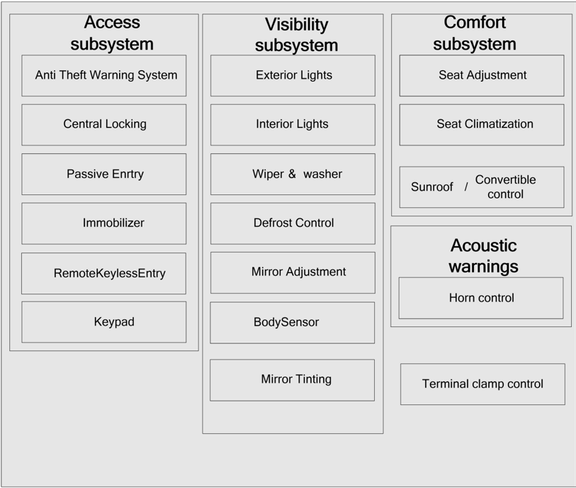

车身与舒适域的功能组件根据被控制的执行器组（电机、灯泡及其他特殊装置）与操作类型（车辆进入、照明、舒适、声学信号发送以及端子控制或电池监测（未来功能）等间接操作）来标识。考虑其他准则，这些功能组件也可以按不同方式分组。

已定义的子系统并不总是意味着所含功能组件之间的强链接。子系统之间也通过一组接口链接。例如，进入（Access）子系统与可视性（Visibility）子系统的一部分强链接。

车身域内部存在相当复杂的互连，同时也向其他域提供并要求一组接口。

## 4. 软件组合与组件的描述

在车身与舒适域中标识出以下软件组合与组件。

### 4.1. 刮水器/洗涤器（Wiper/Washer）

WiperWasher 软件组件组控制汽车的刮水与洗涤功能。WiperWasher 接收驾驶员意愿、感知环境并控制汽车刮水器与洗涤器的行为。

与 WiperWasher 相关的组件在以下各节描述。

- ExteriorLight 为雨量感应组件提供车外亮度信息。
- TerminalClampControl 与 BatteryMonitor（未来功能）提供车辆当前状态的信息。
- Rain Sensing（雨量感应）由雨量传感器与一个适配器组件组成，后者考虑来自 ExteriorLight 的输出及其他环境与车辆相关信息来计算刮水请求。
- WasherFluidTank 感知洗涤液容器（们）的液位；它被实例化两次以表示前、后洗涤液箱。
- EnableDisableWiperWasher 是一个适配组件，根据车辆特定需要管理刮水洗涤功能的启用。
- HMI 包含检测驾驶员与 WiperWasher 相关需求的全部传感器（与开关）组件。
- WiperWasherManager 提供核心功能。
- Washer 是执行器组件，提供洗涤所需的全部功能；它被复用以表示前、后洗涤器以及前照灯洗涤器。
- FrontWasher 是执行器组件，包含风挡玻璃洗涤的全部功能。
- RearWasher 是执行器组件，包含后风挡玻璃洗涤的全部功能。
- WasherHeadLamp 是执行器组件，包含前照灯洗涤的全部功能。
- Wiper 是执行器组件，提供车窗刮水所需的全部功能；它被实例化以表示前、后刮水器。
- FrontWiper 是执行器组件，提供风挡玻璃刮水所需的全部功能。
- RearWiper 是执行器组件，提供后风挡玻璃刮水所需的全部功能。
- NozzleHeater 是执行器组件，包含加热前照灯喷嘴（包括管路）的全部功能。该组件类型被实例化多次，以表示前、后洗涤器及前照灯洗涤器所需的加热器。

下面给出 WiperWasher 的 SWC 分解。数据流用箭头指示。

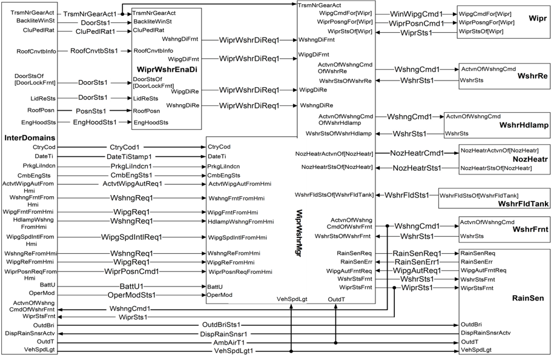

#### 4.1.1 雨量感应（Rain sensing）

本节解释 SW 组件雨量感应。下图展示 SW 组合雨量感应的分解。

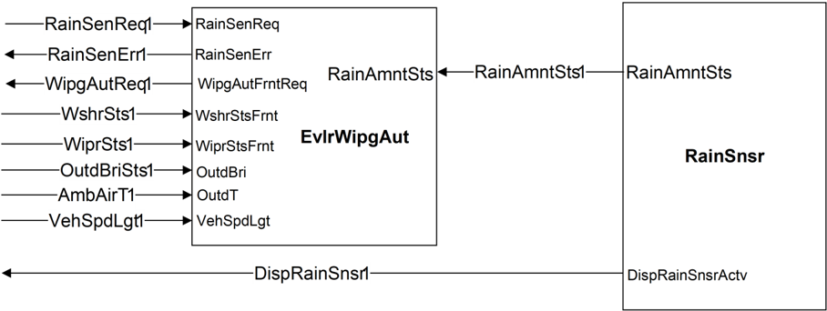

雨量感应可以拆分为基本的 RainSensor——它提供关于检测到的雨量的某些基本信息，可用于计算/评估自动前刮水的需求。

在上图中，该信息经由端口 RainAmountStatus（RainAmntSts）交换。由于该信息强烈依赖于所用技术，该数据元素的类型目前不具约束力。

AutoWipingEvaluator 计算/评估自动前刮水的请求。它把若干额外的环境信息考虑在内，包括温度、亮度、车速、刮水/洗涤信息。

### 4.2. 后视镜调节与防眩（Mirror Adjustment & Tinting）

后视镜调节与防眩控制汽车外后视镜或内后视镜的手动与自动调节，以及基于车外亮度强度的后视镜防眩等级。

该功能有两个独立的分解：一个用于调节，一个用于防眩。它们之间的联系是后视镜位置及其运动状态。

该功能需要来自其他车身域 SW-C 的信息以及跨域信息。

#### 4.2.1 后视镜调节（Mirror Adjustment）

与 MirrorAdjustment 相关的组件被打包在若干个块中。

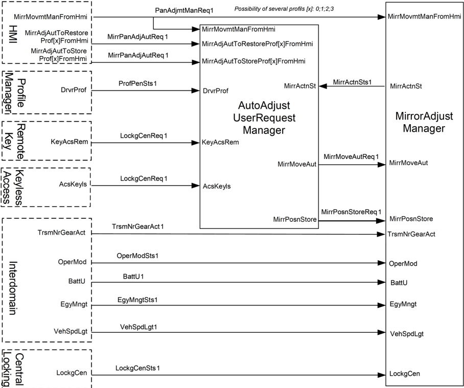

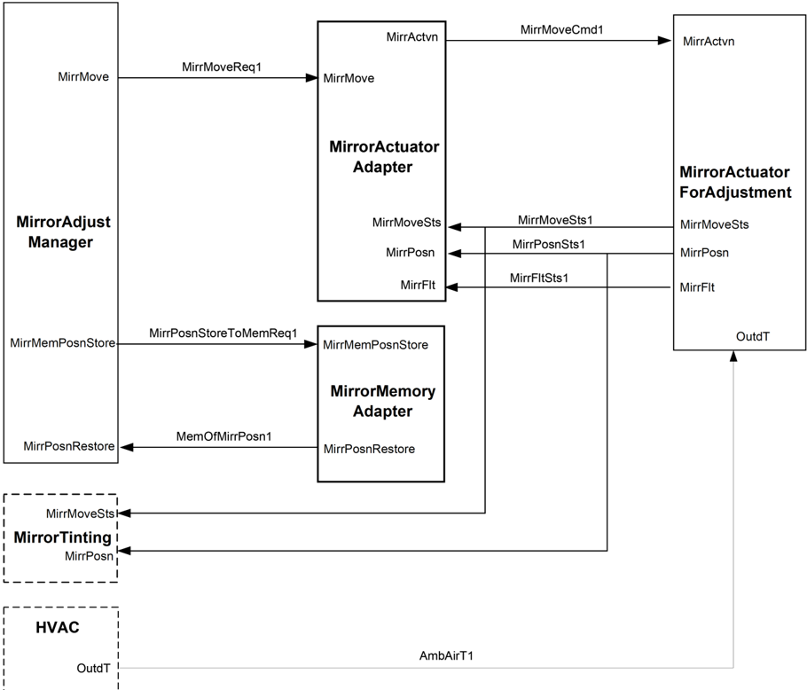

- 在 MirrorAdjustManager 内实现核心功能。
- HMI 包含后视镜手动调节（检测用户的手动调节需求）与后视镜自动调节（带记忆按钮的面板）。它检测用户存储与召回后视镜位置的请求。
- Profile 管理器使用来自钥匙转发器、无钥匙进入和遥控钥匙的信息生成当前的驾驶员 profile 标识。
- Remote key 指示来自遥控钥匙的用户请求，这可能触发自动调节用户请求适配器执行存储或召回。
- Keyless access 指示来自无钥匙进入的用户请求，这可能触发自动调节用户请求适配器执行存储或召回。
- Inter domain 封装交换跨域信息（如所选挡位、运行模式或能量管理）的 SW-C。经由域间接口交换跨域状态信息。
- 来自 Central Locking 组件接收中央门锁状态。
- 自动调节用户请求适配器组合来自上述各方的全部信息并排定优先级，请求后视镜运动与记忆位置的存储。
- 后视镜执行器适配器了解后视镜每根轴的电气与机械约束。它把来自后视镜调节管理器的请求转换为到每根轴（执行器）的命令。它把后视镜轴的当前位置与期望位置进行比较。
- 后视镜存储适配器负责实际的记忆位置存储与召回。根据个性化控制策略，这可以是本地或全局存储。外部温度信息用于补偿后视镜位置的存储与再存储。
- Mirror Actuator For Adjustment 是机械执行器的软件表示。它能够把后视镜的一根轴移动到某个方向，并检测该轴的位置。

#### 4.2.2 后视镜防眩（Mirror Tinting）

与后视镜防眩相关的组件被打包在若干个块中。

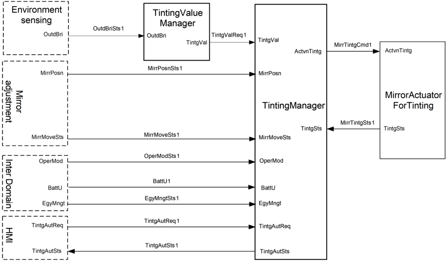

- 在 Tinting Manager 内实现核心功能。
- 基于环境感应组件的信息，防眩值管理器组件使用车外亮度信息计算期望的防眩值。
- Inter domain、HMI 与后视镜调节组件提供是否需要自动防眩的信息。
- 后视镜防眩执行器执行防眩管理器的请求，并把防眩状态信息返回给管理器。

### 4.3. 车内灯（Interior Light）

InteriorLight 软件组件组控制汽车的车内灯功能。InteriorLight 接收驾驶员意愿、感知环境并控制汽车车内光源的行为。

与 InteriorLight 相关的组件被打包在若干个块中。箭头指示数据流。

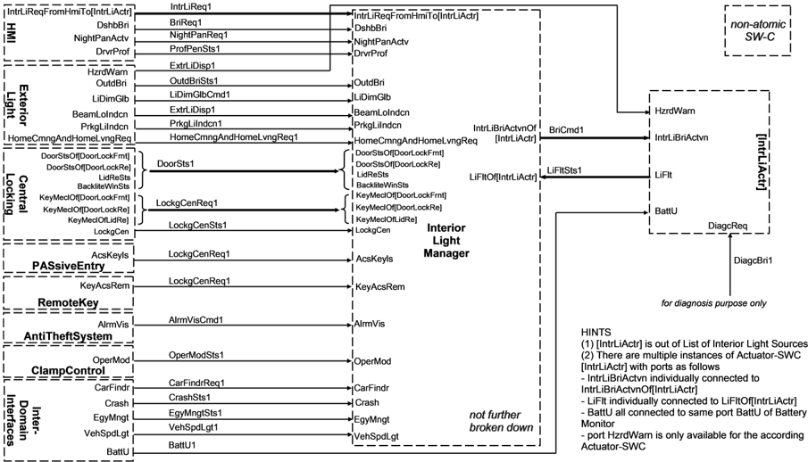

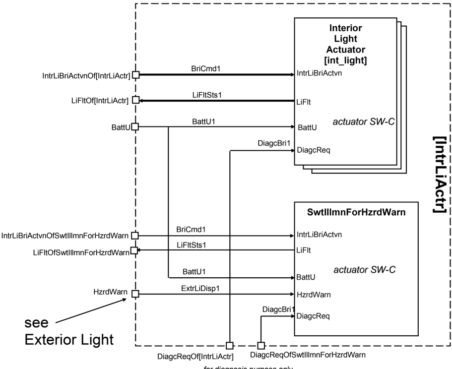

注：分解 [4.6](#46-车外灯exterior-light) 与 [4.7](#47-防盗警告系统antitheft-warning-system) 用于解释标准化接口。

#### 4.3.1 InteriorLightManager

在 InteriorLightManager 内实现核心功能。注释「not further broken down」与「Non atomic SW-C」表示本标准化不在更精确的层级描述它。在实现期间，该 SW-C 可能被进一步分解。

#### 4.3.2 车内灯的车身传感器（HMI）

HMI 包含检测驾驶员与车内灯相关需求的全部传感器组件。请注意，「HMI」仅用于非规范性的描述。

关于进一步分解见图 4.8，其中通常存在若干个 SW-C InteriorLightSensor[IntrLiActr]。关于门锁请参见图 4.12。

传感器 SW-C（HMI）的目的是（在需要的范围内）确保：

- 过滤（去抖动），例如通过去抖动计算稳定的输出值；
- 调理，例如计算平均值；
- 合理性检查，作为失效检测（不合理）的基础；
- 失效检测（但无错误处理/错误补偿），例如有效/无效。

注：图 4.8 中列出的 HMI SW-C 只是帮助理解的提议。

#### 4.3.3 CentralLocking（含门锁）/ 遥控钥匙 / PASE

从门锁生成对应车门是打开还是关闭的信息以及机械车门锁的信息。更多细节另见「Central Locking」单独章节。

锁定或解锁车辆的驾驶员请求也可以由 Remote Key 提供。车内灯只使用外部请求（即在车外发出的请求），而不使用内部请求（例如紧急锁定请求）。

还有来自 PASE 的信息被接收，以便在持有 PaseIdCard 的人靠近汽车（离开汽车）时能够打开（关闭）车内灯。

注意，车内灯在某些用例中也可能使用实际的车门锁定状态（自动重新上锁事件启动车内灯活动）。向驾驶员反映锁状态不是本标准化车内灯的预期特性。

#### 4.3.4 车外灯（Exterior Light）

其他块如 ExteriorLight 以及 Environment Sensing（例如光线传感器，提供车外亮度信息）也提供一些信息。

关于上述功能的更多细节另见「Exterior Light」单独章节。

#### 4.3.5 防盗系统（Anti-Theft-System）

该车身与舒适功能也提供一个接口。关于防盗系统的更多细节见相应章节。

#### 4.3.6 ProfileManager

假定只有一个单一来源协调来自某些个性化来源（遥控钥匙、无钥匙等）的 profile ID。ProfileManager 不在本文档的范围之内。

#### 4.3.7 端子控制（TerminalClampControl）

点火钥匙的状态由 Terminal ClampControl 提供。

#### 4.3.8 域间接口（Inter-Domain Interfaces）

经由域间接口交换跨域状态信息。

#### 4.3.9 电池监测器（未来功能）

Battery Monitor（未来功能）提供关于电池电压的信息。

#### 4.3.10 执行器（Actuators）

[IntrLiActr]（包括 HazardWarningSwitchIllumination）：所有车内灯执行器由 LightSource[IntrLiActr] 组件描述，其中 [IntrLiActr] 是单个光源（例如 CbnLiFrntCen 表示座舱灯「前-中」）或光源组（例如 LiForReadingGroup）的占位符。可能的有效名称列表见下一章。

它可以被分解为一个光执行器类型无关组件与一个光执行器类型相关组件，其中光执行器类型包括传统灯泡、LED 或其他分解——后者允许在更「通用」的层级上开关灯。

执行器还涵盖低层功能（例如防止因电压变化而闪烁的措施）以及过压/欠压补偿。也考虑硬件依赖（例如相应执行器是否支持 PWM）。生成状态反馈（仅正常/缺陷；无详细诊断）。执行器 SW-C 不考虑系统限制（例如由于机械原因对同时激活多个执行器的限制）。这应当是一个单独的执行器-适配器 SW-C 的任务。

对车内灯执行器的限制：IntrLiGroup0..15 的执行器只允许在该组内所有光源满足以下条件时使用：

1. 不是任何其他灯组的一部分；
2. 未被另一个光执行器直接使用。

对于 CbnLiGroup、TrCmptmtGroup、FootwellGroup 等组同样适用。

提示：请注意 HazardWarningSwitchIllumination 也是车内灯执行器。只是有一个额外的端口 HzrdWarn 由车外灯馈送。

#### 4.3.11 车内光源清单——光源组

下面的清单定义单个光源（如 CbnLiFrntRi）以及功能组（例如 CbnLiGroup）以及虚拟组（见 IntrLiGroup0..15）：

- CabinLights（座舱灯）：CbnLiFrntRi（front_right）、CbnLiFrntLe（front_left）、CbnLiFrntCen（front_center，例如正中）、CbnLiMidRi（middle_right）、CbnLiMidLe（middle_left）、CbnLiMidCen（middle_center）、CbnLiReRi（rear_right）、CbnLiReLe（rear_left）、CbnLiReCen（rear_center）
- TrunkCompartmentLights（行李舱灯）：TrCmptmtLiCen（light_middle）、TrCmptmtLiLoRi（lower_right）、TrCmptmtLiLoLe（lower_left）、TrCmptmtLiUpRi（upper_right）、TrCmptmtLiUpLe（upper_left）
- FootwellLights（脚坑灯）：FootwellLiFrntLe（front_left）、FootwellLiFrntCen（front_middle）、FootwellLiFrntRi（front_right）、FootwellLiMidLe（middle_left）、FootwellLiMidCen（middle_middle）、FootwellLiMidRi（middle_right）、FootwellLiReLe（rear_left）、FootwellLiReCen（rear_middle）、FootwellLiReRi（rear_right）
- AshtrayLights（烟灰缸灯）：AshtrayLiFrntLe（front_left）、AshtrayLiFrntCen（front_middle）、AshtrayLiFrntRi（front_right）、AshtrayLiMidLe（middle_left）、AshtrayLiMidCen（middle_middle）、AshtrayLiMidRi（middle_right）、AshtrayLiReLe（rear_left）、AshtrayLiReCen（rear_middle）、AshtrayLiReRi（rear_right）
- ReadingLights（阅读灯）：ReadingLiFrntLe（front_left）、ReadingLiFrntCen（front_middle）、ReadingLiFrntRi（front_right）、ReadingLiReLe（rear_left）、ReadingLiReCen（rear_middle）、ReadingLiReRi（rear_right）、ReadingLiThirdRowLe（ThirdRow_left）、ReadingLThirdRowCen（ThirdRow_middle）、ReadingLiThirdRowRi（ThirdRow_right）

注：Front 指第一排，Rear 指第二排，最后是第三排。

- CurbLights（路边灯）：CurbLiFrntLe（front_left）、CurbLiFrntRi（front_right）、CurbLiMidLe（middle_left）、CurbLiMidRi（middle_right）、CurbLiReLe（rear_left）、CurbLiReRi（rear_right）
- VanityLights（化妆镜灯）：VanityLiFrntLe（front_left）、VanityLiFrntRi（front_right）、VanityLiMidLe（middle_left）、VanityLiMidRi（middle_right）、VanityLiReLe（rear_left）、VanityLiReRi（rear_right）
- CigaretteLighterIlluminationLights（点烟器照明灯）：LiForCigaretteLighterIllmnFrntLe（front_left）、LiForCigaretteLighterIllmnFrntCen（front_middle）、LiForCigaretteLighterIllmnFrntRi（front_right）、LiForCigaretteLighterIllmnMidLe（middle_left）、LiForCigaretteLighterIllmnMidCen（middle_middle）、LiForCigaretteLighterIllmnMidRi（middle_right）、LiForCigaretteLighterIllmnReLe（rear_left）、LiForCigaretteLighterIllmnReCen（rear_middle）、LiForCigaretteLighterIllmnReRi（rear_right）、LiForCigaretteLighterIllmnTrLe（trunk_left）、LiForCigaretteLighterIllmnTrRi（trunk_right）
- DoorSillIlluminationLights（门槛照明灯）：LiForDoorSillIllmnFrntLe（front_left）、LiForDoorSillIllmnFrntRi（front_right）、LiForDoorSillIllmnMidLe（middle_left）、LiForDoorSillIllmnMidRi（middle_right）、LiForDoorSillIllmnReLe（rear_left）、LiForDoorSillIllmnReRi（rear_right）
- DoorOpenerIlluminationLights（车门开启器照明灯）：LiForDoorOpenerIllmnFrntLe（front_left）、LiForDoorOpenerIllmnFrntRi（front_right）、LiForDoorOpenerIllmnMidLe（middle_left）、LiForDoorOpenerIllmnMidRi（middle_right）、LiForDoorOpenerIllmnReLe（rear_left）、LiForDoorOpenerIllmnReRi（rear_right）
- SafetyBeltLockIlluminationLights（安全带锁照明灯）：LiForSftyBltLockIllmnFrntLe（front_left）、LiForSftyBltLockIllmnFrntCen（front_middle）、LiForSftyBltLockIllmnFrntRi（front_right）、LiForSftyBltLockIllmnMidLe（middle_left）、LiForSftyBltLockIllmnMidCen（middle_middle）、LiForSftyBltLockIllmnMidRi（middle_right）、LiForSftyBltLockIllmnReLe（rear_left）、LiForSftyBltLockIllmnReCen（rear_middle）、LiForSftyBltLockIllmnReRi（rear_right）
- Others（其他）：GlvCmptmtLi（GloveCompartmentLight）、EngCmptmtLi（EngineCompartmentLight）、IgnSwtIllmn（IgnitionSwitchIllumination）、SwtIllmnForHzrdWarn（HazardWarningSwitchIllumination）、ExtrLiSwtIllmn（ExteriorLightSwitchIllumination）

定义的功能组有：CbnLiGroup、TrCmptmtGroup、FootwellGroup、AshtrayLiGroup、LiForReadingGroup、CurbLiGroup、VanityLiGroup、LiForCigaretteLighterIllmnGroup、LiForDoorSillIllmnGroup、LiForDoorOpenerIllmnGroup、LiForSftyBltLockIllmnGroup。

这些车内灯接口组被定义（虚拟车内灯接口）：IntrLiGroup0、IntrLiGroup1、… IntrLiGroup15。

每个组 0..15 可以由任意数量的上述车内光源组成。这按实现可配置。

作为「IntrLiGroup」应用的一个进一步例子，有用于停用无意间遗留的车内灯负载的「BatterySaver 特性」（示例：手套箱——灯可能通过开关硬连线激活。如果意外地保持打开，可以在点火关闭后的某个超时之后提供一个单独的执行器来停用所有这些硬连线的灯）。

上述光源组（例如 IntrLiGroup0..15）可以借助「配置位域」（在实现层级）配置，其中每个位对应某个车内光源。这意味着该信息可以存储在 NVRAM 中并可通过标定和/或诊断工具访问。也可以把该信息作为静态输入提供给车内灯管理器。

#### 4.3.12 范围定义/可能的未来增强

本章的意图是澄清本标准化文档考虑了什么。这里也可以列出已知的缺陷和/或可能的未来增强。

##### 4.3.12.1 信号限定符：

只使用带内失效（见 AI 中的相应定义）。请注意，安全通信帧（例如与数据安全传输相关的措施）被视为与实现相关，不在本文档的范围之内。

提示：「带内失效」意味着除了「常规」枚举值之外还使用一个特殊值「invalid」（在需要失效的地方）。这是为了最小化相应接口的位宽。与此相反，「带外失效」对相应接口是无用的，因为数据元素要么是无效的，要么具有「有效」值。

##### 4.3.12.2 时序：

本文档的范围是 VFB 层级。因此既不考虑车辆功能层级也不考虑系统/实现层级的时序要求。

##### 4.3.12.3 变体处理：

本文档的范围是 VFB 层级。变体处理被视为项目特定的（例如实现特定的）。

### 4.4. 座椅调节（Seat Adjustment）

SeatAdjustment 软件组件组控制汽车的座椅调节功能。SeatAdjustment 接收驾驶员意愿、感知环境并控制汽车中座椅调节执行器的行为。

#### 4.4.1 座椅配置

下表列出为在 AUTOSAR 系统中使用而定义的允许座椅名称。该表还显示用于在端口与接口引用中替代占位符「[Seat]」的名称文本。

| 座椅名称 | 引用文本 |
| --- | --- |
| 驾驶员座椅 | DrvrSeat |
| 前排乘客座椅 | PassSeat |
| 前排中央座椅 | SeatRowFirstMid |
| 左中排座椅 | SeatRowSecLe |
| 中排中央座椅 | SeatRowSecMid |
| 右中排座椅 | SeatRowSecRi |
| 左后座椅 | SeatRowThrdLe |
| 后排中央座椅 | SeatRowThrdMid |
| 右后座椅 | SeatRowThrdRi |

下表列出为在 AUTOSAR 系统中使用而定义的允许轴名称。该表还显示用于在端口与接口引用中替代占位符「[SeatAxis]」的名称文本。

| 图示 ID | 轴名称 | 引用文本 |
| --- | --- | --- |
| 1 | 座椅高度 | AxisActrHei |
| 2 | 座椅前部高度 | AxisActrHeiFrnt |
| 3 | 座椅后部高度 | AxisActrHeiRe |
| 4 | 座椅滑动 | AxisActrSld |
| 5 | 座椅靠背倾角 | AxisActrIncl |
| 6 | 头枕高度 | AxisActrHdrestHei |
| 7 | 腰撑伸出 | AxisActrLumExtn |
| 8 | 腰撑高度 | AxisActrLumHei |
| 9 | 座垫伸出 | AxisActrCushExtn |
| 10 | 座椅靠背顶部倾角 | AxisActrTopIncl |
| 11 | 头枕折叠 | AxisActrHdrestFold |
| 12 | 头枕俯仰 | AxisActrHdrestTilt |
| 13 | 靠背右侧侧翼 | AxisActrBackBlstrRi |
| 14 | 靠背左侧侧翼 | AxisActrBackBlstrLe |
| 15 | 座垫右侧侧翼 | AxisActrCushBlstrRi |
| 16 | 座垫左侧侧翼 | AxisActrCushBlstrLe |

各轴展示在下图中，以显示位置数据的含义。

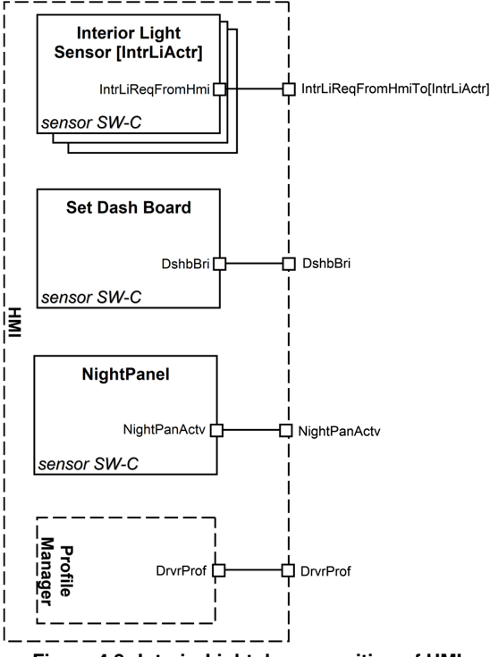

#### 4.4.2 座椅调节分解

座椅调节子系统如图 4.10 所示。

与 SeatAdjustment 相关的软件组件在正文中描述。箭头指示数据流。

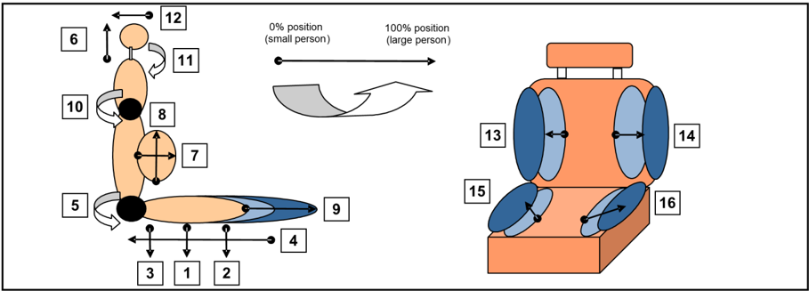

某些端口名使用方括号 […] 中的占位符，意味着这些端口可以多实例化；特别是：

- DoorLockFrnt 可以实例化为驾驶员门与乘客门；
- DoorLockRe 可以实例化为后左门与后右门。

**请注意：**

1. 每个座椅的单独信号——例如见接口 SeatAdjMan1：
   - SW-C MmedTelmHmi（HMI）每个座椅有一个端口：PanAdjManOfDrvrSeat、PanAdjManOfPassSeat……；
   - 每个 SW-C [Seat]SeatAdjMgr 有一个端口 PanAdjMan；
   - 例如 MmedTelmHmi/PanAdjManOfDrvrSeat → DrvrSeat/SeatAdjMgr/PanAdjMan，MmedTelmHmi/PanAdjManOfPassSeat → PassSeat/SeatAdjMgr/PanAdjMan……
2. 每个座椅的单独信号——例如见接口 SeatMoveSts1：
   - 每个 SW-C [Seat]SeatAdjMgr 有一个端口 SeatMoveSts；
   - 每个 SW-C [Seat]MgrOfSeatAdjAutReqByUsr 有一个端口 SeatMoveSts。注意：每个座椅的 SW-C [Seat]SeatAdjMgr 与 [Seat]MgrOfSeatAdjAutReqByUsr 之间是一对一连接；
   - 例如 DrvrSeat/SeatAdjMgr/SeatMoveSts → DrvrSeat/MgrOfDrvSeatAdjAutReqByUsr/SeatMoveSts，PassSeat/SeatAdjMgr/SeatMoveSts → PassSeat/MgrOfDrvSeatAdjAutReqByUsr/SeatMoveSts……
3. 每个座椅与轴的单独信号——例如见接口 SeatAxisPosnSts1：

考虑 DrvSeat SW-C，以如下可能的嵌套 SWC 为例：

- DrvSeat/AxisActrHei/SeatAxisActr（执行器示例）
- DrvSeat/AxisActrSld/SeatAxisActr（执行器示例）
- DrvSeat/AxisActrIncl/SeatAxisActr（执行器示例）

以及

- DrvSeat/AxisActrHei/SeatAxisActrAdpr（执行器适配器示例）
- DrvSeat/AxisActrSld/SeatAxisActrAdpr（执行器适配器示例）
- DrvSeat/AxisActrIncl/SeatAxisActrAdpr（执行器适配器示例）
- ……

这些 SWC 实例（执行器与执行器适配器均是）中每一个都有一个名为 SeatAxisPosn 的端口。

同样的情况适用于与其他座椅相关的其他 SWC，例如与 PassSeat SW-C 相关的：

- PassSeat/AxisActrHei/SeatAxisActr（执行器示例）与
- PassSeat/AxisActrHei/SeatAxisActrAdpr（执行器适配器示例）。

另一方面，SW-C DrvSeat/SeatAdjMgr 每根轴有一个端口：

- SeatAxisPosnOfAxisActrHei
- SeatAxisPosnOfAxisActrSld
- SeatAxisPosnOfAxisActrIncl
- ……

当然，同样的情况也适用于与其他座椅相关的其他 SWC，例如 PassSeat/SeatAdjMgr。

汇总这些说明，端口之间的对应关系例如为：

DrvSeat/AxisActrHei/SeatAxisActr/SeatAxisPosn →
DrvSeat/AxisActrAdprHei/SeatAxisActrAdpr/SeatAxisPosn →
DrvSeat/SeatAdjMgr/SeatAxisPosnOfAxisActrHei
……

##### 4.4.2.1 座椅调节的车身传感器（HMI）

HMI 包含检测驾驶员与座椅调节相关需求的全部传感器组件。请注意，「HMI」仅用于非规范性的描述。

MassgAdjReq1 使用户能够从按摩控制面板（例如开关组或触摸屏菜单）中选择一个或多个按摩程序，并告知 [Seat]/SeatAdjustManager。除已定义的座椅轴之外，可能还存在特定的「按摩执行器」。此处不命名这些执行器。

MassgAdjSts1 把活动按摩功能的状态提供回 HMI，以向用户告知当前的运行模式。

SeatAdjMan1 使用户能够使用手动运动控制面板（例如开关组或触摸屏菜单）激活座椅执行器，并告知 [Seat]/SeatAdjustManager。该信息额外进入 [Seat]/ManagerOfSeatAdjustAutoRequestByUser，使手动操作可用于覆盖记忆调节操作。

SeatAdjAut1 指示用户存储与召回座椅位置的请求。

EntryReq1 检测用户进入后排座椅的需求。这可能导致前排座椅向前移动。该特性也可能被称为自动滑移（auto glide）。类似地，也可以有前排便捷进入请求。

##### 4.4.2.2 车门、无钥匙进入与遥控钥匙

Central Locking 组件提供关于车辆进入装置（车门与锁）操作的信息，这些信息可能表明需要为乘坐准备座椅。ProfileManager 使用来自钥匙转发器、无钥匙进入和遥控钥匙的信息生成当前的驾驶员 profile 标识 ProfPenSts1。

如果接口 LockgCenSts1 内的 trigger_source（即用户做某事的输入）指示来自遥控钥匙或无钥匙进入的用户请求，这可能触发 [Seat]/ManagerOfSeatAdjustAutoRequestByUser 执行存储或召回。

CentralLocking 指示来自中央门锁系统的用户请求，这可能触发 [Seat]/ManagerOfSeatAdjustAutoRequestByUser 执行存储或召回。

DoorSts1 指示与该座椅相关联的车门是否已被打开或关闭，这可用于触发座椅运动或阻止运动（注：对于 R4.0.3，每个座椅都接收 DoorStsOfDrvrDoorLock、DoorStsOfPassDoorLock、DoorStsOfDoorLockReLe 与 DoorStsOfDoorLockReRi，即使在实际的 SWC 实现中只真正使用相关的 DoorSts）。

##### 4.4.2.3 域间接口

Inter-DomainInterfaces 封装与交换跨域信息（如车速、车辆纵向与侧向加速度、运行模式或能量管理状态）的 SW-C 的接口。跨域状态信息经由域间接口交换。

##### 4.4.2.4 AutoAdjustUserRequestManager

每个要求座椅调节的座椅都有一个与之关联的 [Seat]/ManagerOfSeatAdjustAutoRequestByUser。

[Seat]/ManagerOfSeatAdjustAutoRequestByUser 组合来自上述各方的全部信息并排定优先级，请求座椅运动与记忆位置的存储。

##### 4.4.2.5 SeatAxisActuatorAdapter

每个要求座椅调节控制的座椅中的每根轴都有一个与之关联的 [Seat]/[SeatAxis]/SeatAxisActuatorAdapter。[Seat]/[SeatAxis]/SeatAxisActuatorAdapter 了解座椅单根轴的电气与机械约束。它把来自 [Seat]SeatAdjustManager 的请求转换为到单根轴（执行器）的命令。它把座椅轴的当前位置与期望位置进行比较。

##### 4.4.2.6 SeatAxisActuator

每个要求座椅调节控制的座椅中的每根轴都有一个与之关联的 [Seat]/[SeatAxis]/SeatAxisActuator。

[Seat]/[SeatAxis]/SeatAxisActuator 是机械执行器的软件表示。它能够把座椅的一根轴移动到某个方向，还检测该轴的位置与速度。

##### 4.4.2.7 SeatAxisMemoryAdapter

每个要求座椅调节控制的座椅中的每根轴都有一个与之关联的 [Seat]/[SeatAxis]/SeatAxisMemoryAdapter。

[Seat]/[SeatAxis]/SeatAxisMemoryAdapter 负责实际的记忆位置存储与召回。根据个性化控制策略，这可以是本地或全局存储。

##### 4.4.2.8 SeatAdjustManager

最后，[Seat]/SeatAdjustManager 是座椅调节实现的核心。每个要求座椅调节的座椅都有一个与之关联的 [Seat]/SeatAdjustManager。该组件把所有各种请求与触发协调为针对某个座椅的特定控制策略。它还确保座椅调节安全地、按照特性功能优先级与行为执行。

#### 4.4.3 个性化问题

预期座椅调节可以个性化。

座椅调节功能个性化的已知用例例如：

- 存储驾驶员偏好的座椅位置；
- 启用/禁用某些座椅调节功能（例如便捷进入）。

#### 4.4.4 设计理由

本设计标准是座椅调节的 AUTOSAR 架构。它提供到 SW-C 的分解以及与座椅调节相关的标准化接口列表。

该分解在粒度上限于传感器组件、适配器组件、核心功能与执行器组件。它不打算只聚焦于事件驱动的实现，标准化也应对「周期性实现」开放——周期性发送信息（因此某些接口特意包含一个「idle」值）。

此外，描述了所有端口及 AUTOSAR 认可的数据属性。失效（在需要处）定义为带内失效。在适当处规定初始值，例如「off」「idle」「undefined」「unknown」……在不适宜标准化的地方，可以提供建议。

当前状态的分解足以形成对标准化接口的共识。如在外部灯标准化期间所注意到的，更细的粒度不会带来更大的标准化便利性。

特意地，分解不达到原子 SW-C，而是达到「可采购的」SWC（尽管传感器/执行器 SWC 出于形式原因被实现为 AUTOSAR 组合）。这些 SW-C 将作为一个整体获得，使所有内部（因而未被 AUTOSAR 标准化的）接口由单一供应商控制，即使所购单元内的 SW-C 驻留在不同的 ECU 上。来自不同供应商的 SW-C 之间的所有接口都应标准化。

### 4.5. 中央门锁（Central Locking）

CentralLocking 软件组件组控制汽车的中央门锁功能。CentralLocking 接收驾驶员意愿、感知环境并控制汽车中央门锁源的行为。

#### 4.5.1 中央门锁分解主视图

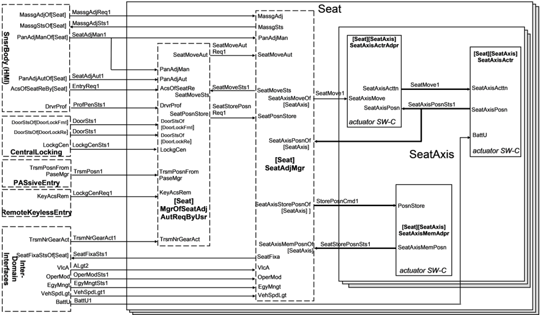

与 CentralLocking 相关的组件被打包在若干个块中。

**与 CL 分解相关的说明：**

上图只给出分解的主视图。为提高可读性，选择在单独的段落中提供 DoorLock SWC 与 KeyPadMgr SWC 的进一步分解以及所有可能端口的细节。

因此，要获得该功能的完整分解概览，请同时参阅以下段落中提供的 DoorLock SWC 与 KeyPadMgr SWC 端口细节的进一步分解。

请注意，诊断接口不属于图形的一部分。

某些端口名使用方括号 […] 中的占位符，意味着这些端口可以多实例化；特别是：

- [DoorLockFrnt] 可以实例化为驾驶员门与乘客门；
- [DoorLockRe] 可以实例化为后左门与后右门。

注：后盖（Rear Lid）与后风挡（BackLite Window）有带单实例的专用 SWC。

关于这些占位符的详细用法，请参阅以下段落中提供的 DoorLock SWC 的进一步分解。

#### 4.5.2 SW-C 的解释

##### 4.5.2.1 CentralLockingMaster

在 CentralLockingMaster 内实现核心功能（不再进一步分解）。

##### 4.5.2.2 HMI

HMI 包含检测驾驶员与中央门锁相关需求的全部其他传感器组件。请注意，「HMI」仅用作非规范性的描述。

##### 4.5.2.3 RemoteKey / Keyless Access

进入车辆的驾驶员请求可以由 RemoteKey 或无钥匙进入系统提供（包括用于个性化的 profile 信息）。

##### 4.5.2.4 DoorLock

从门锁生成门锁状态的信息以及机械钥匙的信息。

锁定命令以及用于拉手辅助与设置儿童保护机制的命令也被发送到车门。后盖与后风挡同样如此。另见「机械分解车门」与「机械事件与标准化接口」（见下文）。

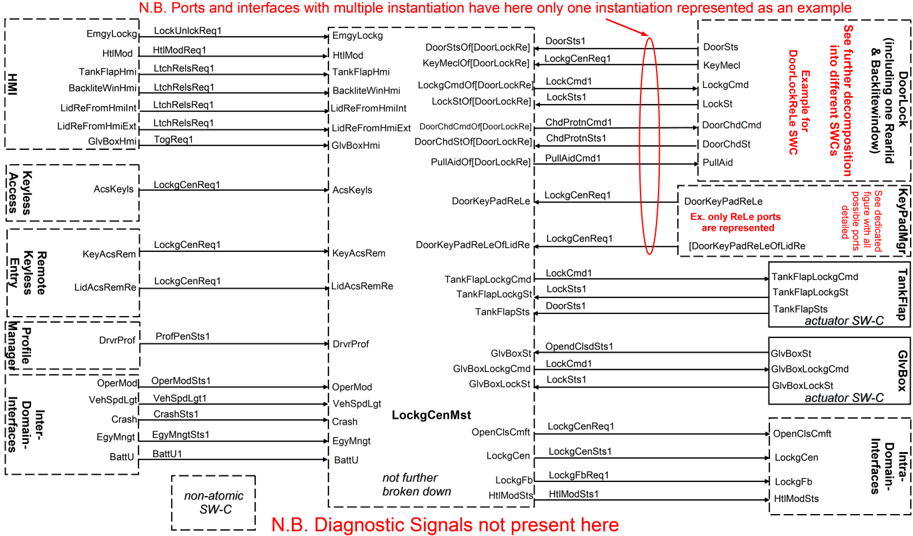

##### 4.5.2.5 KeyPad Manager

从键盘生成激活车门的 CL 功能的请求以及单独激活后盖的请求。

KeyPad 是一个单一的 SWC（可以是非原子的），它为前门、后门与后盖提供专用端口（见图 4.13）。

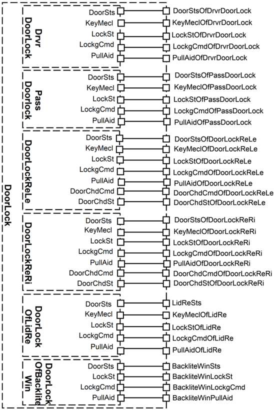

##### 4.5.2.6 GloveBox / Tankflap

其他块如 Glovebox 与 TankFlap 提供状态信息并（部分）接收锁定命令。发动机罩没有用例。

##### 4.5.2.7 域内接口（Intra-Domain-Interfaces）

经由域内接口向其他车身与舒适系统提供域内信息（请注意，本节的范围仅限于中央门锁）。

例子：

- 舒适打开/关闭功能被车窗与天窗请求。
- 视觉反馈被闪烁管理器请求（见 ExteriorLight 的单独文档）。

##### 4.5.2.8 域间接口（Inter-Domain-Interfaces）

经由域间接口交换跨域状态信息。

##### 4.5.2.9 ProfileManager

假定只有一个单一来源协调来自某些个性化来源（遥控钥匙、无钥匙等）的 profile ID。ProfileManager 不在本节的范围之内。

#### 4.5.3 关于中央门锁的进一步问题

##### 4.5.3.1 个性化

假定 Central Locking Master 是可个性化的。

中央门锁功能个性化的已知用例例如：

- 「车速锁」（Speedlock）：在某个车速（或以上）锁定所有车门；
- 选择性开门：只打开驾驶员门或打开所有车门；
- 启用/禁用某些中央门锁功能（例如视觉反馈）。

##### 4.5.3.2 机械分解车门

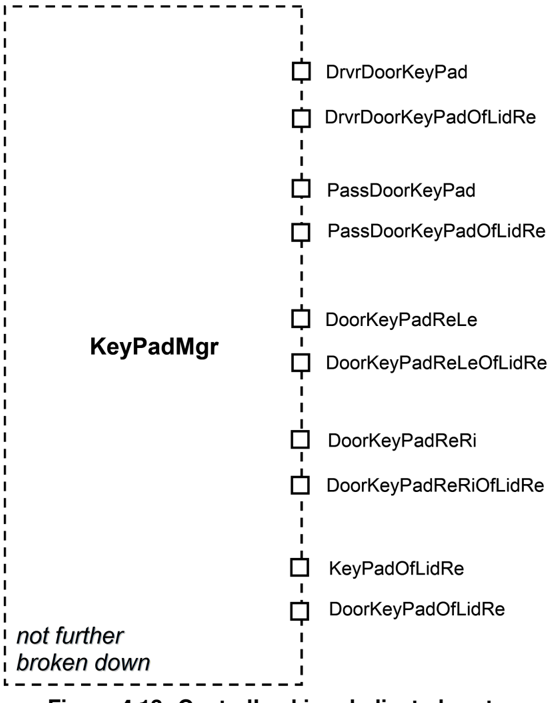

##### 4.5.3.3 机械动作与 SWC 接口的关系（仅车门）

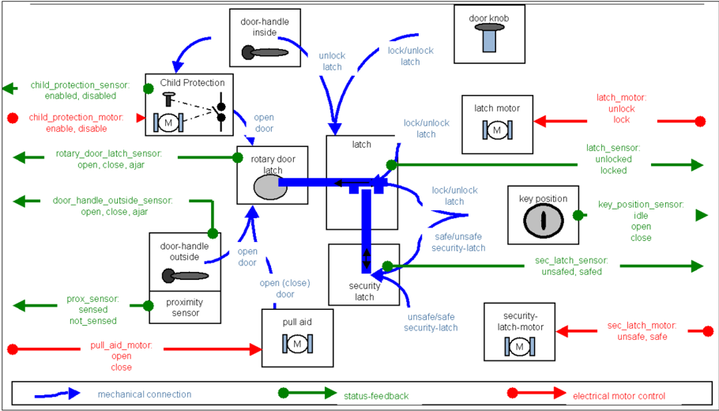

其目的只是给出用户的机械动作（在一扇门上）与其向/从 CL 管理器的「编码」为对应信号之间的关系——经由传感器/执行器所做的「翻译」。

注：此图与前面段落中已解释的功能的详细分解没有逐点对应，因此也不应用命名规范：所使用的名称只是为了便于理解信息。

##### 4.5.4 已知缺陷

诊断：诊断端口不是本说明性描述的一部分。尽管如此，诊断接口/端口已有定义（见 AI）。

### 4.6. 车外灯（Exterior Light）

ExteriorLight 软件组件组控制汽车的车外灯功能。ExteriorLight 接收驾驶员意愿、感知环境并控制汽车车外光源的行为。

尽管早在 100 多年前就已引入汽车，车外灯仍然是一个相当复杂的功能，不同制造商之间存在许多变化。因此，选择这种车外灯功能分解的驱动力是找到能够容易地适配不同灯光策略及其实现、并映射到不同车辆网络拓扑的组件。

描述的所有组件都带有提供与请求端口的超集。这应确保任何变体都能获得所有必要的数据。

与 ExteriorLight 相关的组件被打包在若干个块中。

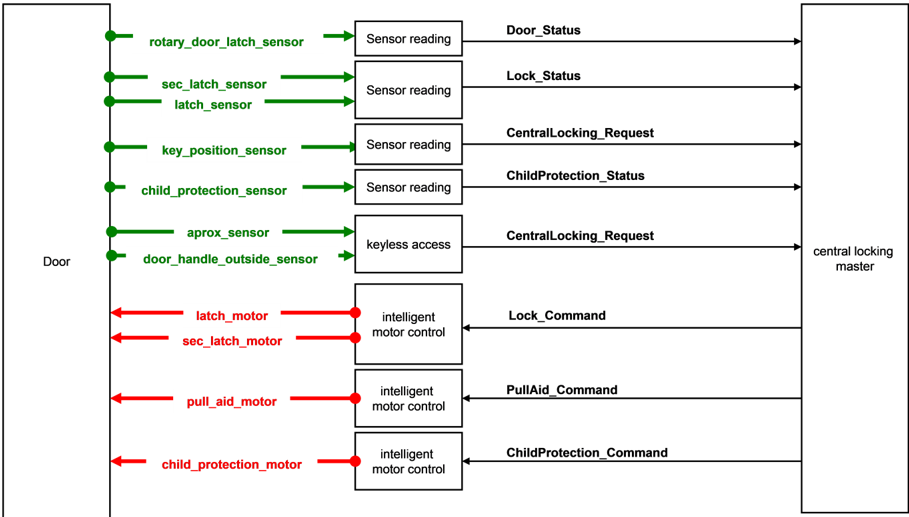

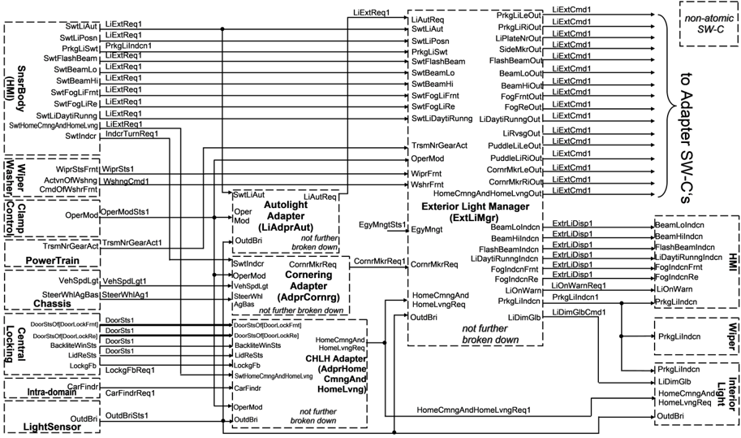

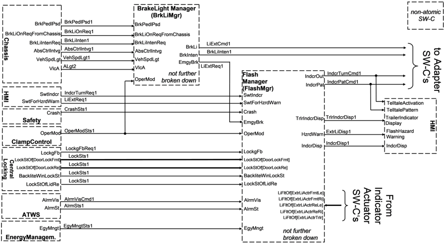

图 4.16 至 4.19 展示车外灯架构的分解。箭头指示数据流。

注：该分解用于解释标准化接口。

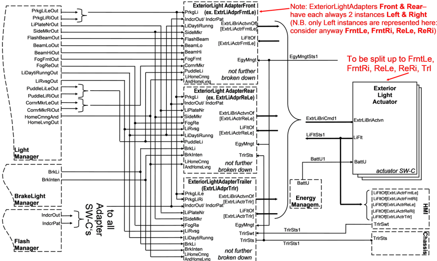

#### 4.6.1 车外灯概览

##### 4.6.1.1 ExteriorLightManager

在 ExteriorLightManager、BrakeLightManager、FlashManager 内实现相关的核心功能（不再进一步分解）。这些管理器组件被认为是可配置的。这意味着原则上标准化的实现应该是可行的，并且通过配置适配 OEM 特定的场景应该是可能的。

##### 4.6.1.2 ExteriorLightAdapter

ExteriorLightAdapter 组件充当 OEM 特定接口（它们很可能变化）之间的「翻译器」。OEM 之间的一个常见变化点是不同光源发生错误时的灯光替代处理。该任务被指派给 ExteriorLightAdapter 组件。应当能够以这样的方式构造该组件：通过简单地交换一些配置表就能交换其失效与替代策略。另请注意，ExteriorLightAdapter 前部与后部组件被视为可以在车辆中共存多个实例的组件。这是必需的，因为应当可能在一个物理前模块中运行其中一个，在另一个后模块或任何其他配置中运行另一个。

##### 4.6.1.3 ExteriorLightActuator

ExteriorLightActuator 最终寻址所有光源组件。请注意，ExtrLiActrFrntLe、ExtrLiActrFrntRi、ExtrLiActrReLe、ExtrLiActrReRi、ExtrLiActrTrlr 基本上是通用 SWC ExtrLiActr 的相同实例。创建这 5 个不同的 SWC 是为了绕过 AI 表的限制。

##### 4.6.1.4 车外灯的车身传感器（HMI）

HMI 包含负责收集用户对各种灯光模式（例如雾灯或远光）请求的软件组件。原始开关输入被去抖动，并提供从开关硬件的进一步抽象。还对输入信号进行合理性与可用性检查。请注意，「HMI」仅用于非规范性的描述。

##### 4.6.1.5 其他功能

其他块如 Chassis、Powertrain、TerminalClampControl 与 Exterior Light 交换某些信息。关于上文所示这些功能的更多细节见相应文档。

#### 4.6.2 ExteriorLightManager

灯光、制动与闪烁功能的模式主控被定义为单独的组件。ExteriorLightManager 组件还封装了在用户和/或系统请求同时发生时的优先级策略，由于公司特定的优先级策略它可能是 OEM 特定的，但应遵守本文档定义的接口。

其决定基于发动机与端子状态、车速以及若干个（可能相互竞争的）车外灯模式请求或这些输入的子集。车外灯的安全相关方面完全由 ExteriorLightManager 考虑，例如：起动期间的负载突降（loaddump）或美国法律对最多 2 个活动光源的限制（见下面的说明）。

除雾灯与闪烁远光之外，ExteriorLightManager 处理的主要灯光功能包括近光、远光、日间行车灯、驻车灯、回家、离家与寻车（carfinder）。自动灯光的决定也由 ExteriorLightManager 做出，基于用户请求与由 AutolightAdapter 设置的前提条件。

ExteriorLightManager 检查所请求灯光模式的可允许性，例如只有当 OperationMode 指示点火已打开时，它才设置近光的「命令」。它可能修改被请求的灯光功能——在后一个例子中，这意味着被请求的近光导致驻车灯被激活（由于点火是关闭的）。

在所有被请求的可允许功能中具有最高优先级的灯光功能被选择并经由其输出发布。

##### 4.6.2.1 说明

闪烁远光的决定包含在 ExteriorLightManager 中，因为与其他灯光模式存在互连。在美国，前灯一次被法律限制为 2 个。存在这样的用例：当雾灯与远光被激活时，近光必须被关闭。在其他需求中，当远光与近光都活动时，雾灯必须被关闭。

为了获得不受竞争功能影响的 ExteriorLightManager 组件，回家/离家（CHLH）的计算与自动灯光前提条件被转移到其他组件。然而，例如关于 CHLH 模式的最终决定是 ExteriorLightManager 的一部分，以避免例如从近光到回家功能过渡时的灯光熄灭毛刺（lights-off-glitches）。

日间行车灯在点火起动时自动打开，并在常规前照灯激活时被覆盖。日间行车灯通常是以降低强度运行的远光前照灯，或以全功率或降低功率运行的近光前照灯。尾灯和/或转向信号灯也可能点亮。

在下雨时存在开启灯光的法律要求的情况下，必须考虑当前的刮水请求。

LiDimGlbCmd1 是 ExteriorLightManager 基于车外亮度等级给出全局车外与车内灯光调光信息的命令。它例如用于根据车外亮度对车外灯进行调光。

ExteriorLightManager 交付要由例如 MMI 显示的功能状态。即使某个功能被暂时关闭，显示仍应显示该功能。用例：在闪烁远光期间（美国）被暂时关闭的雾灯仍必须显示在 MMI 上。对于在起动期间必须关闭的灯光功能同样如此。

#### 4.6.3 制动灯管理器（BrakeLight Manager）

建立单独的 BrakeLightManager 是因为制动灯功能与其他灯光和闪烁模式几乎没有功能交互，例如：

- 紧急制动时的危险警告。

紧急制动情况的判定被认为是车外照明的一部分（其他域如底盘将提供输入信息）。在制动力相关的制动灯的情况下，该组件计算制动灯强度的百分比信息。所需的信息可能是：

- 车速或车速变化（以确定制动引起的车速突然变化）；
- 自适应巡航控制的制动请求（例如在自动停走车流中）；
- 实际（减）加速度（提示：假定不需要制动踏板角度或制动踏板角度变化作为输入信息）。

借助这些信息，应当能够评估制动事件中的制动力，从而请求借助相应光源可视化某些灯光效果。

在传统制动灯的情况下，来自制动灯开关的二进制输入被一对一地用于零强度或全强度，而没有任何进一步的转换。请注意，BrakeLightsOnRequest 由底盘系统提供，指示系统产生的制动（例如防抱死系统）。

物理制动灯可以是自适应的，即它们可以在制动时以不同的亮度等级或不同数量（分段）的光源被激活。这样，可以向后续交通指示不同等级的制动紧急程度，从而指示制动强度。

#### 4.6.4 闪烁管理器（Flash Manager）

闪烁功能在 FlashManager 中实现，它封装了在用户和/或系统请求同时发生时的优先级策略。由于不同的优先级策略，每个 OEM 可能有必要建立自己的组件，但它应遵守本文档定义的接口。

FlashManager 软件组件必须执行以下操作：

- 从各种请求生成当前的闪烁模式；
- 为正常运行与驾驶员反馈生成正常与特殊的闪烁动态，依据：
  - 闪烁模式；
  - 端子状态；
  - 闪烁模式动态描述。

进入的请求基于当前执行的闪烁模式被评估。如有必要，当前执行的模式将被更改为适当的模式。当前的闪烁动态信息也将根据闪烁配置被更新。

FlashManager 必须设置 IndcrTurnCmd1 的内容。转向灯 on/off 相位的不同时序与排序必须成为可能（见下文：时序/同步）。

因此 IndcrTurnCmd1 包含一个具有五个字段的记录：

- IndcrTrig：闪烁功能的触发器（停止、左、右、双侧）；
- IndcrTelltl：（不）激活指示灯（telltale）；
- IndcrNrPat 提供在当前闪烁序列期间必须使用的模式句柄；
- IndcrCycForStop：当前周期 ON 或 OFF 相位上的硬停止/软停止；
- IndcrCycNotStop：indicator_cycle 是无需重新触发即要执行的剩余周期数。

FlashManager 还可以设置 IndcrPatCmd1 的内容（例如只要使用「静态」转向灯模式，就无需使用该信号）。IndcrPatCmd1 是一个包含以下字段的记录：

- IndcrNrPat
- TiOn
- TiOff

假定 ExteriorLightActuator 不执行复杂的位模式。

#### 4.6.5 用例描述

##### 4.6.5.1 闪烁模式转换

下方的闪烁模式转换表 4.1 摘录展示了 FlashManager 软件组件的一个示例实现的行为。

| 当前闪烁模式 | 请求 | 新闪烁模式 |
| --- | --- | --- |
| LockingFeedback | HazardWarning | HazardWarning |
| | CrashWarning | CrashWarning |
| | IndicatorLeft | IndicatorLeft |
| | IndicatorRight | IndicatorRight |
| | Alarm | Alarm |
| | PanicAlarm | PanicAlarm |
| | LockingFeedback | LockingFeedback |
| | ArmingFeedback | LockingFeedback |
| | KeyLearn | LockingFeedback |
| | None | None |

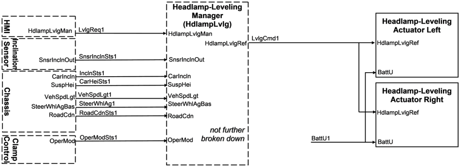

上图展示了闪烁模式转换的一个例子，缩减为已知的危险警告（右）与转向指示（左）模式。

转换从「其他模式」发生到「简单」模式（危险警告与转向指示闪烁），取决于请求。

从简单模式的转换在没有对该模式的特定请求、或另一个请求变为活动时发生。假定当前执行的状态是 Indication(left,right)，那么如果 RequestIndicator 被移除，将执行到「其他模式」的转换。

当在 IndicationBlinking 活动期间请求 hazard_warning 时，将执行 HazardWarning，直到 RequestHazardWarning 被移除。然后，如果 RequestIndicator 仍然活动，将再次执行 IndicationBlinking。

##### 4.6.5.2 时序/同步

###### 4.6.5.2.1 闪烁序列的时序信息：

对于不同的闪烁请求或其他情况，转向灯 on/off 相位的不同时序与排序必须成为可能：

- 点火关闭时危险警告的低占空比；
- 转向灯损坏时更高的频率；
- 多于一个具有不同占空比的 on-off 周期。

###### 4.6.5.2.2 触发有限数量的序列：

必须能够触发某个模式的一个或多个周期的闪烁序列：

- 为报警闪烁触发 3 个 on/off 周期的序列；
- 只触发一个 on/off 周期。

###### 4.6.5.2.3 触发连续闪烁序列：

必须能够由 FlashManager 直接启动与重新触发连续闪烁序列：

- 启动连续的危险闪烁，它不得被例如能量管理或模式管理停止；
- 启动连续的报警闪烁，它可以在特定情况下被停止，例如能量管理。

###### 4.6.5.2.4 由 Flash Manager 直接触发 on/off 周期：

必须能够由 FlashManager 直接触发 on/off 周期：

- 连续提交 on/off 命令；
- 提交 on 与 off 触发。

###### 4.6.5.2.4.1 时序用例示例

从一个闪烁模式（包括关闭）到另一个闪烁模式的改变总是可以从输出的 on 相位开始。当发送新的闪烁模式时，被请求的转向灯模式必须是最新的。

从右转向灯闪烁到左转向灯闪烁（及反向）的改变总是可以触发一个新周期，从 on 相位开始（见图 4.21）。

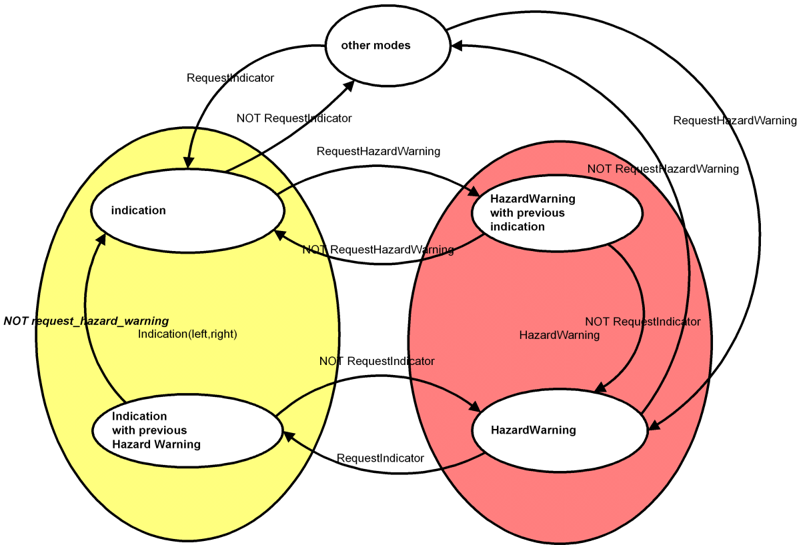

###### 4.6.5.3 其他

FlashManager 还可以设置布防反馈（Arming Feedback），例如显示布防系统激活的 LED。

EgyMngtSts1 可用于改变占空比/等级以节省能量。

TrlrSts1 可用于在挂车转向灯失效的情况下修改闪烁频率作为驾驶员反馈。TrlrSts1 作为挂车存在的指示应被仔细考虑，因为生成该信号有不同的可能性：

- 在有硬件开关的情况下，可以通过读取开关来检测挂车的存在，并把状态提供给任何感兴趣的 SW-C；
- 在没有开关的情况下，闪烁器（blinker）仍然通过测量流过灯泡的电流来检测挂车的存在（这是安全要求）。在这种情况下，提供给其他 SW-C 的信息可能导致错误。

注：「TrailerStatus」的评估计划用于未来的扩展。

#### 4.6.6 自动灯适配器（Autolight Adapter）

AutolightAdapter 封装自动打开/关闭近光（包括由于法律要求所需的其他灯，如尾灯等）的决定。

#### 4.6.7 弯道灯适配器（Cornering Adapter）

在 CorneringAdapter 内是算法——它根据各种输入信息决定静态弯道灯的（去）激活。

#### 4.6.8 CHLH 适配器（CHLH Adapter）

回家/离家（Coming Home Leaving Home，CHLH）功能为驾驶员提供一种特殊的灯光服务。一般 CHLH 的一个用例是：在驾驶员关闭发动机并离开汽车之后照亮回家的路。因此，例如前灯保持激活一段预定义的或个性化的时间。

CHLH 功能主要由以下逻辑组成：根据灯光开关、一般车辆状态信息（例如端子）与环境条件（例如亮度）确定期望的 CHLH 灯光请求。通常会生成一个定时器，在特定时间之后关闭灯光。该时间可以通过配置设置——经由车辆编码或个性化。

CHLH 模块可以使用来自以下方面的输入：

- 车门状态信息，包括乘员/驾驶员门与后盖；
- 指示当前 KL15 条件的端子信息；
- 由光线传感器提供的周围灯光特性（车外亮度）；
- 锁定反馈，作为控制 CHLH 的额外途径；
- 对离家功能的远端请求，例如寻车（远端离家功能的用例可以是在夜间离开房子之前经由遥控钥匙激活离家，以照亮通往汽车的路）；
- 通过开关对 CHLH 功能一般激活的驾驶员请求（在诸如发动机关闭等进一步条件满足时手动激活 CHLH 功能）。

CHLH 模块的输出被定义为 ExteriorLightManager 的前提条件。注意，CHLH 也可以经由个性化激活或停用。

#### 4.6.9 ExteriorLight AdapterFront/Rear/Trailer

OEM 之间的一个常见变化点是不同光源发生错误时的灯光替代处理。该任务被指派给 ExteriorLightAdapter 组件。应当能够以这样的方式构造这些组件：通过简单地交换一些配置表就能交换其失效与替代策略。另请注意，ExteriorLightAdapter 被视为在车辆中共存多个实例的组件。这是必需的，因为应当可能例如在一个前左 ECU 中运行一个 ExteriorLightAdapterFront、在前右 ECU 中运行另一个。

ExteriorLightAdapter 的任务是经由输出 BriCmd1 驱动车外灯执行器（由 ExteriorLightActuator 中的组件表示）。执行器亮度的设置主要基于灯光模式。该组件从 ExteriorLightManager 接收灯光模式作为输入，并从 FlashManager 接收闪烁模式（经由 IndcrTurnCmd1）。此外，它从 BrakeLightManager 接收用于制动灯的命令。

除了上述请求之外，关于在一个模式中哪些灯需要以何种亮度活动的决定还取决于：

- 国家编码及相关的灯光特定变体编码；
- 是否连接了挂车；
- 是否有灯损坏而必须被其他灯替代。

对于由 ExteriorLightAdapter 控制的每个灯，该软件组件通过考虑影响该特定灯的所有相关输入值来计算一个亮度值（相对于光源全亮度的百分比）。示例表如下所示。

| 驻车灯命令 | 日间行车灯命令 | 近光命令 | 位置灯前左的 LiFltSts1 | 近光（左）的 BriCmd1 |
| --- | --- | --- | --- | --- |
| Left | Off | Off | ok | 0% |
| Left | Off | Off | 失效 | 40% 替代损坏的位置灯 |
| Off | On | Off | <无关> | 92% 实现日间行车灯 |
| Off | Off | On | <无关> | 100% 近光 |

ExteriorLightAdapter 软件组件可以在一辆汽车中实例化一次或多次。取决于物理网络架构，可能只有中央 ECU 上的单个实例，或分布在多个 ECU 上的若干实例。多个实例的一个例子是：一辆汽车有一个 ECU 用一个 ExteriorLightAdapter 实例控制尾灯，还有两个 ECU 分别用于两个前灯系统，各有一个实例。

在 ExteriorLightManager 与 ExteriorLightAdapter 之间使用了若干个命令接口。这样做是因为主要的灯光功能应当彼此独立地激活。这样，对一个灯光功能（例如雾灯打开或关闭）的更改不会影响其他灯光功能（例如近光或远光）的状态。但请注意，并非所有组合都有效——灯光功能组合甚至可能存在国家特定的限制。

与所有模式由使用记录结构的同一接口支持的解决方案相比，把功能拆分到不同的接口有两个主要优点：

- 如前所述，可能存在控制车辆不同灯的多个 ExteriorLightAdapter 实例。某些实例可能不需要所有的模式接口作为输入；
- 当单个条目改变时，记录会被完整发送。让独立的数据位于独立的接口上以节省通信带宽可能更高效。

在以下段落中，列出所有请求的端口。描述数据为何被需要，旨在作为读者的提示，可能未涵盖该输入在软件组件中的所有用途。

输入 EgyMngtSts1 可在 ExteriorLightAdapter 中用于在能量管理提出要求时调暗某些灯。某功能的完全停用应当已经只由 ExteriorLightManager 或 FlashManager 考虑。另请注意，ExteriorLightAdapter 的输出是相对于灯的全亮度的百分比亮度值。因此 ExteriorLightAdapter 不执行由于电源过压引起的调光。这种调光是灯光类型特定的，必须由相应的 ExteriorLightActuator 组件执行。

对于由 ExteriorLightAdapter 控制的每个灯，该软件组件计算一个亮度值（相对于灯全亮度的百分比）。因此，0% 的值表示灯被关闭，100% 表示灯必须以全亮度点亮。选择亮度值是因为它们独立于光源实现（灯泡、霓虹、LED、LED 阵列、氙气等）。此外，即使是同类型的灯，全亮度所用的电压也可能不同，不同输入电压的响应曲线也不同。

对于不支持调光的光源（例如某些气体放电灯）或只支持有限亮度值集合的光源（例如开关或多或少 LED 的 LED 阵列），必须定义并由执行器组件设置从不同调暗系数到可设定等级的有用转换。

#### 4.6.10 车外灯执行器（Exterior Light Actuator）

所有车外灯执行器由 ExtrLiActr[ext_light] 组件描述（见 AI 表中的 SWC ExtrLiActrFrntLe、ExtrLiActrFrntRi、ExtrLiActrReLe、ExtrLiActrReRi、ExtrLiActrTrlr），其中 [ext_light] 是单个光源的占位符，例如后左驻车灯。它可以被分解为一个光执行器类型无关组件与一个光执行器类型相关组件，其中光执行器类型包括传统灯泡、LED、霓虹灯、卤素灯与氙气灯，或其他允许在更「通用」层级上开关灯的分解。

封装多于一个光源、带有若干单个执行器组合的 SW-C 也是可能的（示例：组合的制动-尾灯）。在这种情况下，组合执行器组件有多于一个的 ExtrLiBriActvn 端口与多于一个的 LiFlt 端口。

ExteriorLightActuator 的正常/缺陷反馈已经足够（例如用于灯泡缺陷时闪烁频率加倍）。尚不知道有这样的用例：ExteriorLightManager、Flash Manager、BrakeLight Manager 依据失效类型（开路负载、短路）有不同的行为。例如，区分它们只用于诊断目的。

#### 4.6.11 前照灯调平管理器（Headlamp-Leveling Manager）

Headlamp-Leveling Manager 控制前灯束的调平。没有必要区分左、右前照灯的调平值。

调平的请求与命令假定是百分比类型（以及车辆高度倾斜的信息）。

#### 4.6.12 外部接口

AntiTheftWarningSystem 封装汽车的防盗保护系统，并提供面向车外灯的必要接口。通常，AntiTheftWarningSystem 的布防状态由车外灯的视觉反馈给出，并且在发生盗窃事件时，AntiTheftWarningSystem 还请求车外照明以视觉上警示车辆（即打开转向灯或使其闪烁；除了使用转向指示灯之外不知道其他用例）。注意，AntiTheftWarningSystem 只请求报警；视觉呈现由车外灯负责。对于 CentralLocking 的可见反馈请求同样如此。

TerminalClampControl 提供关于驾驶员钥匙位置的基本信息。

车辆的碰撞检测系统封装在 Safety 中。注意，该组件可以隐藏多个碰撞传感器并只提供单一信号。

从 Chassis 提供是否连接了挂车的信息。制动踏板开关同样如此（见 BrakePedalPressed）。

关于是否选择了倒挡的信息将由 Powertrain 提供。

#### 4.6.13 面向 AUTOSAR 服务的端口

关于诊断端口及面向 AUTOSAR 服务的进一步端口，见车内灯一章内的相应说明。

#### 4.6.14 术语定义

**车外光源**

注：术语 Beam、Bulb、Lamp、Light、Lighting、Illumination 与 Signal（或其复数形式）假定可以互换，除非另有明确说明。例如 Stop Lamps 与 Stop Illumination 相同。

注：这些术语作为帮助理解类似车外照明功能的许多不同名称的指南呈现。该指南不得用作法定照明要求的参考来源。

注：下述灯的颜色是通用术语。「Yellow」在某些地区也可能被称为「Orange」或「Amber」。为确定任何给定地区某种颜色的实际光度要求，应参考法律要求文档。

| ID | 名称与描述 | 灯数量 | 颜色 | 位置 |
| --- | --- | --- | --- | --- |
| 1 | AFS，见 Advanced Front Lighting System（高级前照明系统）。 | - | - | - |
| 2 | Advanced Front Lighting System（高级前照明系统）：修改前照灯输出，使光束模式针对不同行驶条件（如车辆方向与速度）优化。AFS 通常作用于近光与远光照明元件。可以用结合卤素、高强度放电（HID）/氙气与 LED 光源的动态与静态系统实现。 | 2 或 4 | 白色 | 前部 |
| 3 | Backup Lamp(s)，见 Reverse Lighting（倒车照明）。 | - | - | - |
| 4 | Beam Steering（光束转向），见 Advanced Front Lighting System。 | - | - | - |
| 5 | Brake Lights（制动灯）：施加车辆制动时（非手刹）点亮的灯泡，用于警示后续车辆。 | 2 | 红色 | 后部——对称——尽可能远离 |
| 6 | Centre High Mounted Stop Lamp（中央高位制动灯）：安装在车辆后部、高于其他两个制动灯的单个制动灯。 | 1 | 红色 | 后部——中心线 |
| 7 | CHMSL，见 Centre High Mounted Stop Lamp。 | - | - | - |
| 8 | Cornering Lamps（弯道灯）：也称为 Static Bending Lamps（静态弯道灯）。车辆前角的灯泡，当车辆转弯时点亮，以照亮该弯道周围的潜在障碍物。反射器或光源没有移动。 | 2 | 白色 | 前部 |
| 9 | Daytime Running Lamps（日间行车灯）：Sidelights 与 Low Beam 的组合，在车辆运行时自动点亮，即使是白天。两种常见的…… | 最少 2 | 白色或黄色 | 前部——对称——尽可能远离 |
| 10 | Dipped Beam，见 Low Beam（近光）。 | - | - | - |
| 11 | Direction Indicators（方向指示灯）：这些灯位于车辆的角部。侧面的重复器也可用于前门前方。方向指示灯成组使用（所有左灯或所有右灯）以指示车辆转弯。此外，所有灯可以同时闪烁以充当危险警告灯。方向指示灯也可称为前、左、右或后转向指示灯。 | 最少 4 | 黄色 | 前部与后部——对称——尽可能远离 |
| 12 | Driving Lights（行车灯）：加在车辆前部的聚光灯，以改善对地面物体的前方视野。应加以调整，以免使迎面来车的驾驶员眩目。 | - | 白色 | - |
| 13 | DRL，见 Daytime Running Lamps。 | - | - | - |
| 14 | Dynamic Cornering Lamps（动态弯道灯）：动态地把光束模式转向道路弯道的改进近光照明。这增加了有效视距。这些系统通常使用转向角与车速来计算光束转向角。 | - | 白色 | - |
| 15 | Front Fog Lights（前雾灯）：额外的前部照明，通常安装在高光束与近光光源之下。这些灯瞄准较低，以改善雾天条件下的能见度，并减少与近光相比向驾驶员的背向散射。 | - | - | - |
| 16 | Front Side Marker Lamps（前侧标志灯）：前、后侧标志灯指示车辆的存在与长度。 | 最少 2 | 黄色 | 侧面前部——尽可能靠前 |
| 17 | Front Side Reflex Reflectors（前侧反射器）：前、后侧反射器指示车辆的存在与长度。 | 最少 2 | 黄色 | 侧面前部——尽可能靠前——朝向侧面 |
| 18 | Front Turn Signals（前转向信号灯）：车辆前部左右方向指示灯的通用术语。指示转弯方向。前转向信号灯通常也用作前危险警告灯。 | 最少 2 | 黄色 | 前部——对称——尽可能远离 |
| 19 | Hazard Warning Lights（危险警告灯）：左右方向指示灯（前、后）同时同步运行，以表明车辆失效并对其他车辆构成危险。 | 4+ | 黄色 | 全部 |
| 20 | Headlamps（前照灯）：涵盖 Low Beam 与 Main Beam 的通用术语。 | 4 | 白色 | 前部 |
| 21 | HIDs，见 High Intensity Discharge Lamps（高强度放电灯）。 | - | - | - |
| 22 | High Beam（远光）：用于远距离视野的前向道路照明。有来车时应关闭以防眩目。在某些车辆中（例如大众）也可用作遮板控制以产生近/远光。遮板（一种继电器控制）用于在只有一个灯泡输出的情况下分离近-远光活动。 | 最少 2 | 白色 | 前部——对称（4 灯系统时在内侧或近光之下） |
| 23 | High Intensity Discharge Lamps（高强度放电灯）：产生适合作为近光与远光的高输出照明的光源技术。通常需要自动调平以防止使迎面来车的驾驶员眩目。 | - | - | - |
| 24 | High Mounted Stop Lamp，见 Centre High Mounted Stop Lamp。 | - | - | - |
| 25 | HMSL，见 Centre High Mounted Stop Lamp。 | - | - | - |
| 26 | Left Turn Indicators（左转向指示灯）：车辆前部、侧面与后部左方向指示灯的通用术语。指示转弯方向（向左）。 | 最少 2 | 黄色 | 前部与后部——与右侧指示灯对称 |
| 27 | License Plate Lamp(s)（牌照灯）：车辆后部与前部（如有）外部牌照的照明。 | 最少 1 | 白色 | 后部——牌照上方或旁边 |
| 28 | Low Beam（近光）：夜间行驶时使用的前向道路照明。可以在有迎面来车的交通中使用。 | 最少 2 | 白色 | 前部——对称——尽可能远离（4 灯系统时在外侧或远光之上） |
| 29 | Main Beam，见 High Beam（远光）。 | - | - | - |
| 30 | Parking Lamps（驻车灯）：行驶期间指示车辆的存在与宽度。停车时可用于使车辆对其他道路使用者可见。需要低功耗以防止电池放电。某些系统允许独立选择左或右驻车灯，以只指示停放车辆的交通侧。 | 最少 2 | 白色或黄色 | 前部——对称——尽可能远离 |
| 32 | Rear Fog Lights（后雾灯）：雾天条件下使用的额外明亮的尾灯，用于指示车辆的存在并警示后续车辆。 | 1 或 2 | 红色 | 后部——对称——尽可能远离 |
| 37 | Rear Reflex Reflectors（后反射器）：这些无源反射器向后方车辆指示车辆的存在与宽度。 | 最少 2 | 红色 | 后部——对称——尽可能远离 |
| 38 | Rear Side Marker Lamps（后侧标志灯）：前、后侧标志灯指示车辆的存在与长度。 | 最少 2 | 红色 | 侧面后部——尽可能靠后 |
| 39 | Rear Side Reflex Reflectors（后侧反射器）：前、后侧反射器指示车辆的存在与长度。 | 最少 2 | 红色 | 侧面后部——尽可能靠后——朝向侧面 |
| 40 | Rear Turn Signals（后转向信号灯）：车辆后部左右方向指示灯的通用术语。指示转弯方向。后转向信号灯通常也用作后危险警告灯。 | 最少 2 | 黄色 | 后部——对称——尽可能远离 |
| 41 | Reverse Lighting（倒车照明）：改善倒车时车辆后方地面障碍物能见度的照明。同时警示从后方接近的车辆。 | 1 或 2 | 白色 | 后部 |
| 42 | Right Turn Indicators（右转向指示灯）：车辆前部、侧面与后部右方向指示灯的通用术语。指示转弯方向（向右）。 | 最少 2 | 黄色 | 前部与后部——与左侧指示灯对称 |
| 44 | Side Repeaters（侧重复器）：位于车辆侧面、前门前方的额外方向指示灯。它们作为左右转向信号组的一部分闪烁，并在危险警告灯工作时闪烁。它们使接近交叉路口的车辆能够从侧面看到车辆的方向指示灯。 | 2 | 黄色 | 车辆侧面——对称——朝向侧面 |
| 45 | Sidelights，见 Parking Lights（驻车灯）。 | | | |
| 46 | Spot Lights，见 Driving Lamps（行车灯）。 | - | - | - |
| 47 | Static Bending Lamps，见 Cornering Lamps（弯道灯）。 | - | - | - |
| 48 | Static Cornering Lamps，见 Cornering Lamps。 | - | - | - |
| 49 | Stop Lamps，见 Brake Lights（制动灯）。 | - | - | - |
| 50 | Tail Lamps（尾灯）：向后方车辆指示车辆的存在与宽度。 | 最少 2 | 红色 | 后部——对称——尽可能远离 |
| 51 | Turn Lights，见 Direction Indicators（方向指示灯）。 | - | - | - |

来源：SVN1，文件名：Terminology Definitions for Body 0.2.doc，作者：John Elvidge，Visteon UK Ltd.

#### 4.6.15 光源清单

LightSource[ext_light] 封装车辆的不同光源，并经由与实现无关的接口提供对这些光源的访问。使用无法发出调暗光的物理光源（例如氙气）的实现可以定义一个百分比值：高于它时光源打开，低于它时光源关闭。

把光源置入其运行状态所需的额外执行器（例如灯的翻折电机）也由此组件封装。

LightSource[ext_light]——为了减少文档量——是一个「模板组件」：它只被记录一次，其实例在下一节列出，产生许多组件，其中 [ext_light] 被下一节给出的名称替换（例如 BrkLiLe）。

LightSource[ext_light] 必须被以下实例之一替换（请注意，ExtrLiActrFrntLe、ExtrLiActrFrntRi、ExtrLiActrReLe、ExtrLiActrReRi、ExtrLiActrTrlr 基本上是通用 SWC ExtrLiActr 的相同实例。创建这 5 个不同的 SWC 是为了绕过 AI 表的限制。自然地，只有 LightSource[ext_light] 的适当实例可以与 ExtrLiActrFrntLe、ExtrLiActrFrntRi、ExtrLiActrReLe、ExtrLiActrReRi、ExtrLiActrTrlr 一起使用）：

- BrakeLights（制动灯）：BrkLiLe（左）、LampForStopOfBrkLiCenHiMntd、BrkLiRi（右）、BrkLiTrlrLe、BrkLiTrlrRi
- Indicators（转向指示灯）：IndcrFrntLe（front_left）、IndcrFrntRi、IndcrSideLe、IndcrSideRi、IndcrReLe、IndcrReRi（rear_right）、IndcrTrlrLe、IndcrTrlrRi
- FogLights（雾灯）：FogLiFrntLe、FogLiFrntRi、FogLiReLe、FogLiReRi、FogLiTrlrLe、FogLiTrlrRi
- Headlight（前照灯）：BeamHiLe、BeamHiRi、BeamLoLe、BeamLoRi
- Daytime running lights（日间行车灯）：LiDaytiRunngFrntLe、LiDaytiRunngFrntRi
- LicensePlateIllumination（牌照照明）：LiVehPlateNr（车辆）、LiTrlrPlateNr（挂车）
- ParkingLights（驻车灯）：PrkgLiFrntLe、PrkgLiFrntRi、PrkgLiReLe、PrkgLiReRi、PrkgLiTrlrLe、PrkgLiTrlrRi
- PuddleLights（迎宾灯）：PuddleLiFrntLe、PuddleLiFrntRi、PuddleLiReLe、PuddleLiReRi
- ReverseLights（倒车灯）：LiLeForRvsg、LiRiForRvsg、TrlrLiLeForRvsg、TrlrLiRiForRvsg
- SideMarkers（侧标志灯）：SideMkrFrntLe、SideMkrFrntRi、SideMkrCeLe、SideMkrCeRi、SideMkrReLe、SideMkrReRi
- CornerMarkers（角部标志灯）：CornrMkrFrntLe、CornrMkrFrntRi、CornrMkrCeLe、CornrMkrCeRi、CornrMkrReLe、CornrMkrReRi
- BatterySaver：由 ExteriorLightManager 切换的单独「执行器」（用例：近光等由开关直接硬连线）

路边灯（Curb lights）不被车外灯考虑，因为它们与车内灯功能强相关。它们将包含在车内灯的细化中。

#### 4.6.16 已知缺陷

其他未决的文档问题：

- 个性化参数与接口；
- 变体编码也包括依赖生命周期的模式（例如某些闪烁功能的激活/停用取决于生命周期模式，例如在运输期间禁用布防反馈；对于工厂使用所需的特殊接口以及其他非正常运行车辆模式同样适用）；
- 诊断编码/接口；
- 传感器与执行器组件的分解（例如分为灯光类型相关与灯光类型无关）；
- 自适应前照明系统（AFS）未被标准化（只有静态弯道灯作为车外灯标准化的一部分被认为足够）。

### 4.7. 防盗警告系统（Antitheft Warning System）

ATWS 功能表示一种防盗警告系统，它可以借助光学与声学信号警示对汽车的未授权进入尝试，此外还可以防止汽车的发动机被起动。所有这些决定都基于车辆开口的状态以及某些检测装置（如车内扫描传感器或车辆倾角传感器）的读数做出。

ATWS 功能分为以下子系统：

- 防盗报警：实现 ATWS 的基本功能，即警示对汽车的未授权侵入；
- 恐慌报警（panic alarm）：在驾驶员请求（通过遥控）时提供报警警告，独立于防盗报警系统的状态。

#### 4.7.1 报警触发器

报警系统可以由多个输入触发：车门（驾驶员门可以享受特殊处理）、发动机罩、行李舱、后车窗、玻璃破碎检测、收音机、车辆倾角、车内扫描器、电池备份发声器、点火、电池电压等级、油箱盖等。这些传感器中的任何一个如果在布防前被触发，都将触发报警。某些传感器（例如车内移动检测器、倾角变化检测器、电池备份发声器等）可以参与与报警系统的更复杂的通信。

#### 4.7.2 报警系统状态指示

- 通过使灯闪烁和/或鸣响喇叭，指示状态从撤防到布防的变化（反之亦然）（布防或撤防应答）；
- 通过点亮 LED 指示 ATWS 的布防状态（监控传感器以检测侵入）；
- 当用户撤防系统时，通过使灯闪烁或鸣响喇叭，指示当前布防时间段内发生的报警。

#### 4.7.3 报警状态

**已布防（Armed）**

- 由不同的 Central Locking 请求源布防、自动布防（例如遥控解锁但未开门时的重新布防等）。

**已撤防（Disarmed）**

- 由不同的 Central Unlocking 请求源或有效的点火钥匙等撤防。

**预布防（Prearmed）**

- 取决于需求，因传感器而异，与时间和触发器相关。

**报警（Alarm）**

- 布防状态期间不同传感器的激活，导致视觉与声学警告。

传感器可以在撤防状态下由用户干预临时排除。根据不同的前提条件，传感器在布防与撤防时可以处于不同状态，导致对它们的独立或成组处理。

防盗系统需要供应商相关的实现来与复杂传感器（例如倾角传感器、车内扫描器、电池备份传感器等）通信 → 带有命令与状态接口的复杂驱动。

- 防盗系统特性的实现受国际法规约束。

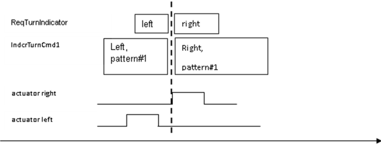

#### 4.7.4 恐慌报警（Panic Alarm）

恐慌报警允许用户独立于 ATWS 状态（布防、撤防、报警）激活车辆上安装的声学与视觉警告装置。车辆用户也可以关闭恐慌报警。

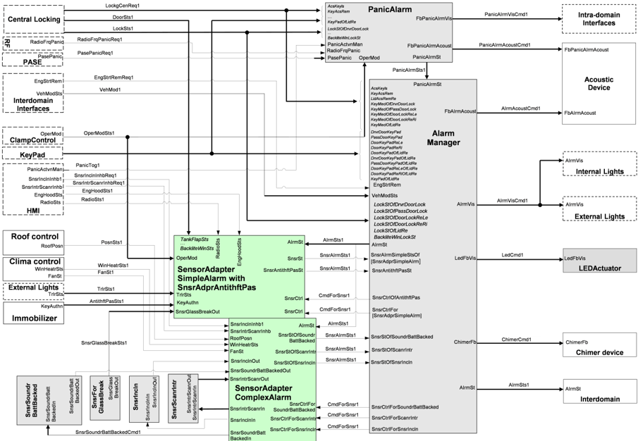

#### 4.7.5 ATWS 分解

在下图（图 4.22）中给出 ATWS SWC 的主要分解。在随后的图（图 4.23）中高亮显示 ATWS 传感器及其与报警管理器的连接。

报警管理器必须经由传感器适配器组件与大量传感器通信。这些适配器组件可以是简单的——传感器本身是开关型传感器。复杂适配器组件处理传感器本身可以通过某条通信线路进行控制的情形。在这种情况下，需要实现一个复杂驱动。传感器可以被报警管理器或用户排除或抑制。

考虑到 OEM 的时序约束，ATWS 可以分布在多个 ECU 上。

简单传感器适配器可以按照该类型传感器的数量、使用定义的通用接口并实例化端口来实例化。

### 4.8. 喇叭（Horn）

喇叭功能表示发出声音的特性，用于警示其他车辆、行人，或提供关于车辆状态的信息。

只有一个 SWC 管理器构成喇叭分解。

分解的不同输入如下：

- HMI，带一个开关；
- ATWS，作为防止盗窃的声学信号；
- 车外灯；
- 中央门锁，用于锁定/解锁状态的信息；
- TerminalClampControl；
- InterDomain；
- 遥控钥匙，用于使用喇叭寻车；
- 喇叭执行器的状态。

输出为：

- 向 HMI 指示喇叭可能存在缺陷；
- 到执行器的喇叭命令。

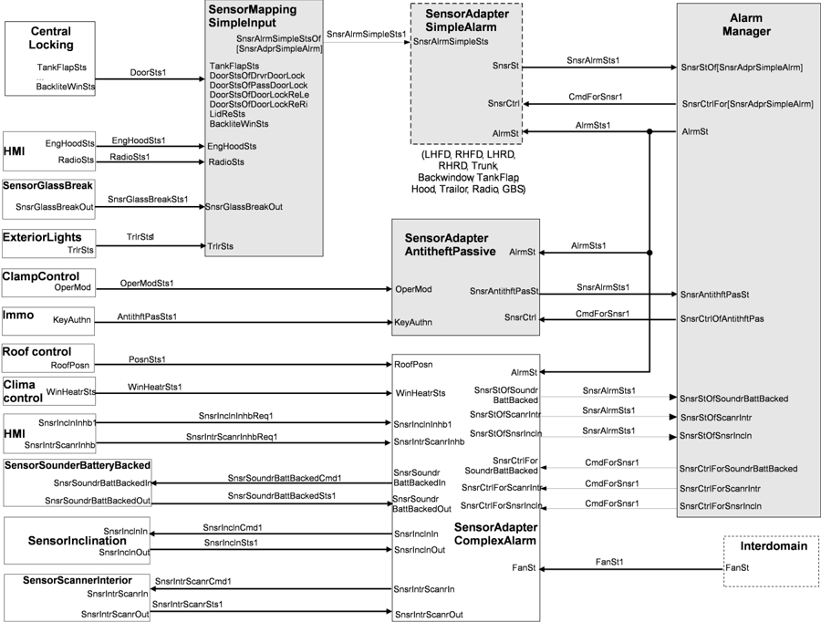

### 4.9. 除霜控制（Defrost Control）

#### 4.9.1 引言

本章描述一个基本架构并概述除霜控制（DC）功能。DefrostControl 软件组件组控制汽车的除霜控制功能。DefrostControl 接收驾驶员意愿、感知环境并控制汽车除霜控制面的行为。它把除霜控制功能分解为除霜控制管理器组件、传感器组件（收集所有可能的输入以激励该功能）与执行器组件（执行 DC 管理器处理过的动作）。

#### 4.9.2 传感器与执行器概览

到 DC 管理器的激励来自以下来源：

- HMI（可以由开关、触摸屏或其他输入/输出设备组成）；
- HVAC（因为除霜动作也可能由座舱空调发起）；
- TerminalClampControl；
- 其他域间接口（与能量管理条件及电池电压等级相关）。

从执行器方面，这里考虑两种主要类型：

- [Target]DefrostActuators：它们执行除霜动作的实际激活；
- DefrostTelltaleActuator：它只执行视觉指示。

为了澄清某些传感器与执行器的存在，特别是专用 DefrostTelltaleActuator 的使用，做一些额外的说明是有用的，如下文所强调。

关于来自 HVAC 的输入，请注意只考虑与除霜功能相关的接口（包括座舱空调的视觉反馈）。与除霜没有直接关系的空调功能，特别是风机控制，将是座舱空调分解的一部分。因为除霜功能经常与座舱气候控制紧密耦合实现，HMI 也可能合并。在这些情况下，座舱气候控制可能对除霜指示灯有某种形式的覆盖。如果选择了「最大（Maximum）」功能，即使系统实际上只使用鼓风机执行风挡清靓、而未使用除霜加热器，除霜指示灯也可能点亮。

另一个例子是后视镜除霜。只要选择了后风挡除霜，就可能自动选择外后视镜除霜，但接口允许显式的独立后视镜除霜控制。

此外，除霜功能可以是定时的，指示灯在定义的时间段结束时自动熄灭；或者该功能一旦启动就连续运行。

一般而言，指示灯始终经由 DC 管理器控制，但引起其激活的初始请求可能来自 HMI（即通过用户对除霜激活的请求）或来自 HVAC。无论哪种情况，指示灯都可以报告功能的实际状态，或者指示「已选择」状态——即使由于能量管理原因（例如起停功能动作）除霜被暂停，指示灯仍保持点亮。事实上，在近期的车辆配置中，存在这样的用例：仪表上关于除霜状态的指示灯与真实的除霜执行器状态不同。例如，在交通灯处停车期间发动机可能被自动停止（并在加速时重新起动），此时关于除霜激活的指示灯指示必须保持点亮，即使除霜执行器在该期间被停止，以避免驾驶员混淆。

出于这个特定目的，在域间接口中存在 EnergyManagement 输入，它也考虑 AlternatorStatus 以了解交流发电机是否正在为电池充电。

如上所述，同样的结果也适用于短时的电压跌落或尖峰——如果除霜已激活但除霜执行器未工作，指示灯必须保持点亮；这也解释了除霜功能中需要电压信号的原因。

考虑到上述两个用例，在执行器中引入了可实例化的 SW-C：除霜指示灯执行器。

其他执行器 SW-C 提供除霜动作的真实激活，与前部、后部及后视镜除霜器相关。对于所有这些执行器，都提供电压输入信号，因为在短时的电压跌落或尖峰的情况下，执行器可能独立于 DC 管理器的决定被关闭，以减少或节省负载。

#### 4.9.3 除霜控制分解

本节给出除霜控制功能的层级分解，分为除霜控制管理器、传感器与执行器组件。与 DefrostControl 相关的组件被打包在若干个块中。

箭头指示数据流。

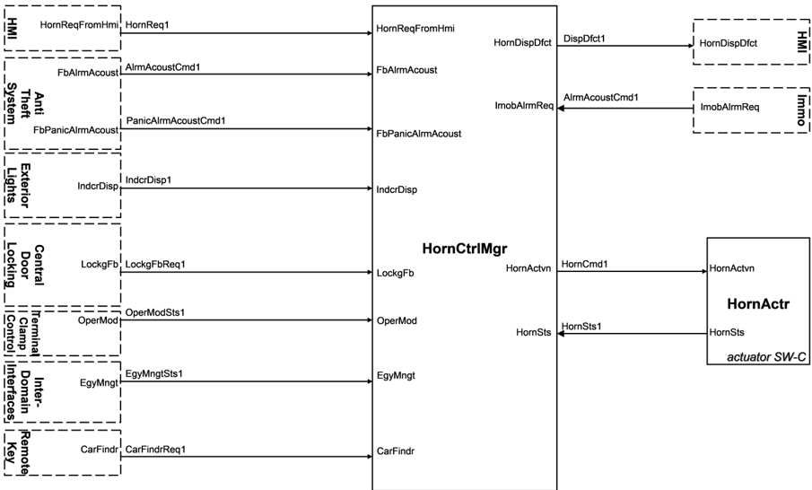

### 4.10. 端子控制（Terminal Clamp Control）

TerminalClampControl 软件组件组基于驾驶员的直接操作和/或由驾驶员或驾驶员的设备做出的远程操作，控制电力供应与行驶动力的模式变更。电源管理系统与动力总成系统应控制运行模式，与由端子控制功能生成的请求保持一致。

与 TerminalClampControl 相关的组件被打包在若干个块中：

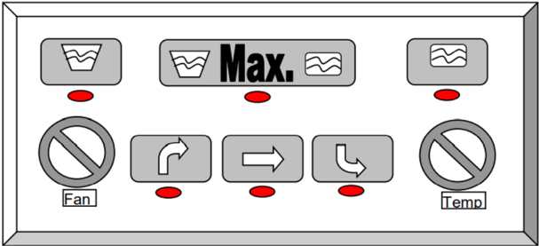

#### 4.10.1 SW-C 的解释

**端子管理器（Terminal Clamp Manager）**

端子管理器仲裁并控制来自驾驶员和/或某些系统的电源与行驶动力的变更请求，并生成独立于实际请求设备（例如机械钥匙或一键起动）的电源请求。

**机械钥匙筒（Mechanical Key Cylinder）**

它提供驾驶员切换到的机械钥匙筒中的钥匙位置；端子管理器收集该驾驶员变更电源与行驶动力的请求。

**按压开关（SwitchPush）**

它检测驾驶员变更运行模式（如「Start」或「Stop」）的请求，并把驾驶员的请求提供给端子管理器。

**PASE**

它还提供驾驶员带着遥控装置是否在车内的位置。

**远程发动机起动器（Remote Engine Starter）**

它提供车主对发动机起动/停止的请求。

**域间电源管理器、动力总成（Interdomain Power Manager, Powertrain）**

电源管理器不仅在全球系统正常驾驶的情况下，而且在运输、展示陈列，进一步还有低能量等情况下，基于来自与能量管理相关的其他系统的各种请求，向整个车辆系统最优地供电。

TerminalClmpModReq1 是端子管理器从包括远程发动机起动器在内的驾驶员请求的视角生成的电源与行驶动力的最终目标模式。电源管理器与动力总成应考虑它来控制电源模式与行驶动力模式。

PwrSplySts1 被定义为电源管理器中的当前电源模式。端子管理器使用它来观察电源模式的当前状态。

PtFlgEngRun1 是发动机是否正在运行的状态。端子管理器使用它来观察行驶动力模式的当前状态。

电源管理器与动力总成应把 PwrSplySts1 与 PtFlgEngRun1 中的各模式运行状态作为反馈数据告知端子管理器。

**运行模式管理器（Operation Mode Manager）**

它提供与电源和牵引驱动相关的车辆运行模式。它可以被视为抽象的车辆运行模式。

在下图中详细展示了车辆运行状态（「OperModeSts1」）的所有可能等级以及可能的转换：

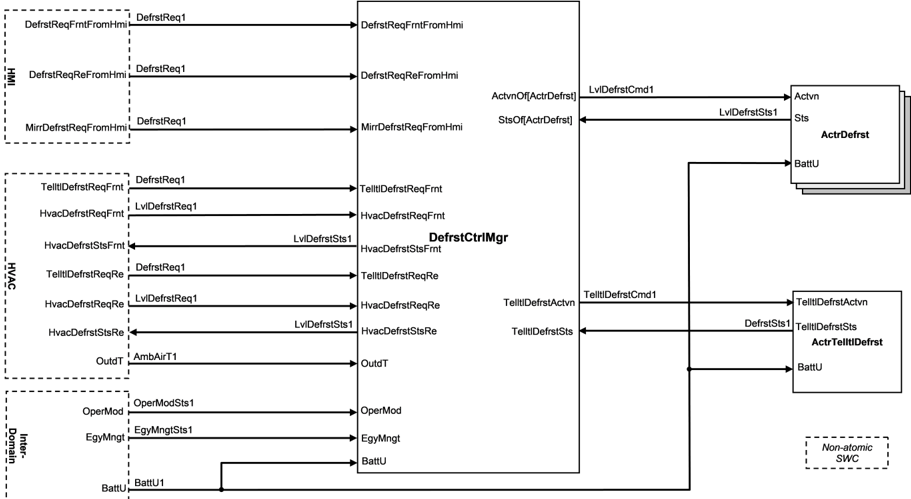

#### 4.10.2 用例描述

为了理解更多细节，下面展示 4 种类型的用例。

##### 4.10.2.1 带附件位的机械钥匙筒

这是带附件位（Accessory position）的机械钥匙筒的例子。在该用例中，TerminalClmpModReq1 的状态随钥匙位置的转换而变化。要从「IgnitionOn」转换到「Start」，需要考虑挡位位置与离合器踏板（手动变速器的情况）。

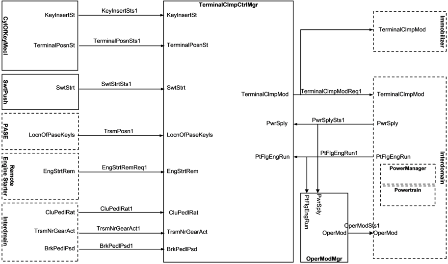

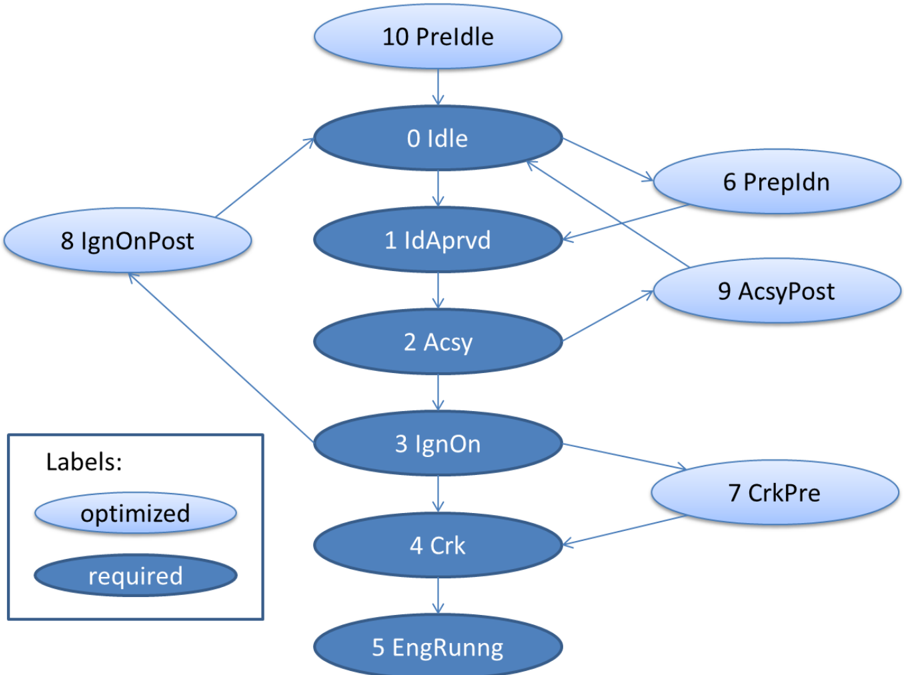

##### 4.10.2.2 无附件位的机械钥匙筒

这是不带附件位的机械钥匙筒的例子。在该用例中，插入钥匙时 TerminalClmpModReq1 变为「Accessory」，钥匙拔出后状态变为「Off」。其余与带附件位的机械钥匙筒的情况相同。

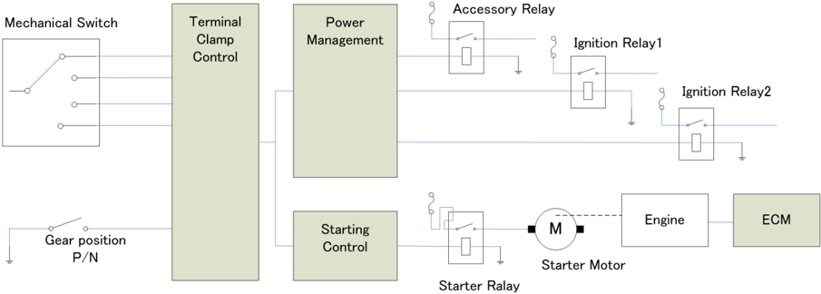

##### 4.10.2.3 一键起动系统（Push Start System）

这是一键起动系统的例子。在该用例中，TerminalClmpModReq1 的每次转换都由按下起动/停止引起的事件完成。由于防盗问题，必须考虑发送器位置（表示驾驶员持有发送器）。只有当发送器位置在车内时，TerminalClmpModReq1 的状态才从「Off」变为其他状态。

要从「Off」或「Accessory」转换到「IgnitionOn」，需要确认挡位位置是 P 或 N 且制动踏板开关为 ON。一旦安全得到确认，立即转换为 Start。其他情况则转换为「Accessory」。

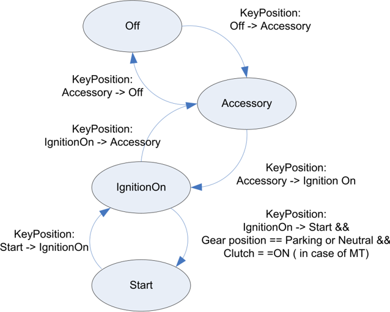

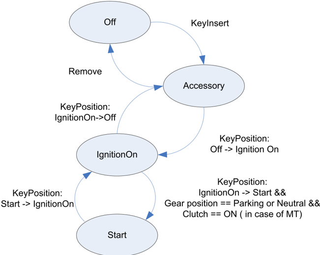

##### 4.10.2.4 远程发动机起动系统

这是远程发动机起动系统的例子。该系统能够使用无线通信从远处起动发动机。

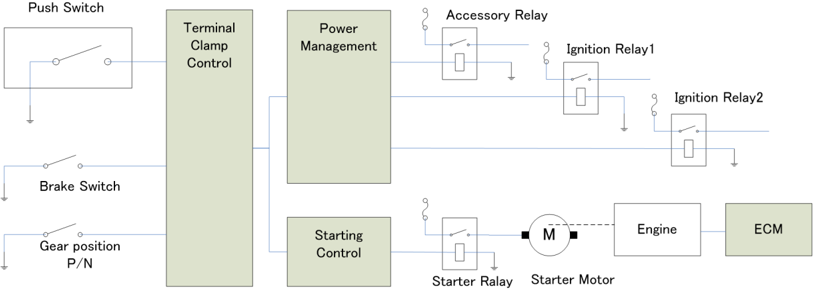

远程发动机起动系统必须在起动发动机之前和发动机运行期间处理安全与防盗问题。如果安全与防盗问题都得到满足，远程发动机起动系统请求端子控制把状态改变为 Start。在发动机系统起动之后，在远程发动机起动系统请求改变为「Off」、或系统定义的超时被触发、或安全状况因例如驾驶员的意外操作而改变的情况下，它改变为「Off」。

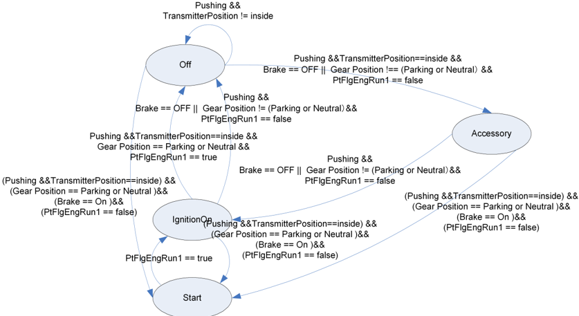

### 4.11. 防盗器（Immobilizer）

防盗器表示一种可以防止车辆发动机被起动的防盗系统。防盗器接收驾驶员的意图、感知环境并控制车辆中防盗器源的行为。

在任何未授权发动机起动的尝试的情况下，防盗器请求生成视觉与声学报警。

所有这些决定都基于用户提供的钥匙授权状态做出。

防盗器分解存在以下输入接口：

- PASE，带钥匙状态；
- RKE，带钥匙状态；
- Terminal Clamp Control，带运行模式状态；
- 转向管柱，带锁状态信息；
- Central locking，带中央门锁请求的状态；
- 域间接口。

防盗器分解存在以下输出接口：

- Horn，用于声学报警操作；
- ATWS，提供钥匙认证状态操作；
- HMI，用于防盗器状态显示。

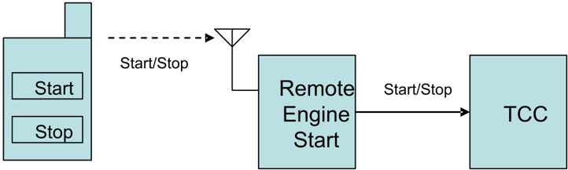

防盗器分解存在以下接口：

- 防盗器与 Fob（带转发器），用于获取钥匙码与 Fob 状态；
- 防盗器与 ECM（发动机控制模块），用于钥匙学习与验证操作。

注：\*——该接口对 R4.0 Rev3 尚未完全定义。

防盗器的核心功能在防盗器管理器内实现。它包含基本功能，如钥匙学习、已学习钥匙的验证、防盗器诊断等。

在正常模式运行中，防盗器管理器应根据依赖模块的状态与防盗器的环境验证钥匙 Fob。

防盗器状态将提供给：

- Horn，用于布防/撤防声学报警指示；
- ATWS，处理用户提供的钥匙认证以及用于警告指示的车外灯；
- HMI，显示防盗器状态。

Fob、防盗器与 ECM 之间共享的数据应被加密，以确保安全操作。

ATWS 应使用接口「AntitheftPasSts1」与 Exterior Light（AlmVisCmd1）模块一起生成视觉报警。

接口「AlrmAcoustCmd1」应用于与喇叭控制一起生成声学报警命令——如果车辆没有 ATWS。

#### 4.11.1 约束/限制

1. Fob、防盗器管理器与 ECM 之间的端口/接口使用数组类型数据结构，以提供灵活性并确保信号安全（例如钥匙学习、钥匙验证）。
2. Fob、防盗器与 ECM 之间加密数据的交换可以借助数组结构实现。例如，应降低通过替换防盗器、Fob 与 ECM 进行车辆盗窃的可能性。
3. Fob（带转发器的钥匙）的分解不是本防盗器分解的一部分。
4. 防盗器系统的时序约束是实现特定的，例如：命令的位间/字节间时序；命令/请求与状态的超时实现；防盗器请求结束与 Fob 响应开始；防盗器响应结束与 ECM 新请求开始。
5. 所用转发器的类型对防盗器分解架构没有影响。
6. 防盗器 SWC 规范与遥控无钥匙进入、无源进入系统 SWC 规范的详细同步尚待完成。

### 4.12. 座椅空调（Seat Climatization）

#### 4.12.1 引言

座椅空调功能提供调节车内座椅温度的可能性。包括座椅加热与制冷两者的调节。

#### 4.12.2 座椅空调分解

本节给出座椅空调功能的层级分解，分为管理器 SW-C、传感器与执行器 SW-C。

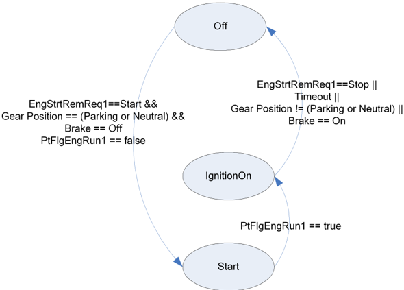

箭头指示数据流。

在分解中还存在来自执行器的反馈信号，指示驾驶员侧的状态/故障。该分解只考虑车内四个主要座椅（驾驶员、前排乘客、左后与右后乘客）的座椅空调。

**- SeatButtonManager**

- 把开关状态（on/off）转换为请求（阶段 1、2……）：加热或制冷。

**- SeatClimatizationManager**

- 接收来自用户的请求（ReqStage）；
- 根据用户请求、座椅的占用情况与车辆状态（能量管理与运行模式），生成到适配器的所需温度（[OFF, AdapterTemperatureLevel1, AdapterTemperatureLevel2, ...]）；
- 向 HMI 显示提供座椅空调的状态。

**- SeatForClimatization**

- 控制座椅空调，并被进一步分解为适配器 SWC 与执行器 SWC。

**- Adapter**

- 控制制冷/加热元件，以达到由座椅中一个或多个传感器测量的请求温度。

**- Actuator**

- 制冷（例如风扇）或加热（例如加热垫）元件；
- 报告检测到的任何故障（短路、开路负载等）；
- 每个执行器可以控制若干个物理元件（针对座椅、靠背等）。

### 4.13. PASE（无源进入，PASsive Entry）

#### 4.13.1 引言

无源进入（Passive entry）功能表示一种锁定系统，它可以帮助用户无需物理使用钥匙即可进入汽车。它基于遥控卡 ID 信息与车门传感器信息请求 CentralLockingMaster 锁定或解锁汽车。

#### 4.13.2 PASE 分解

下面给出 PASE 功能的 SWC 分解。

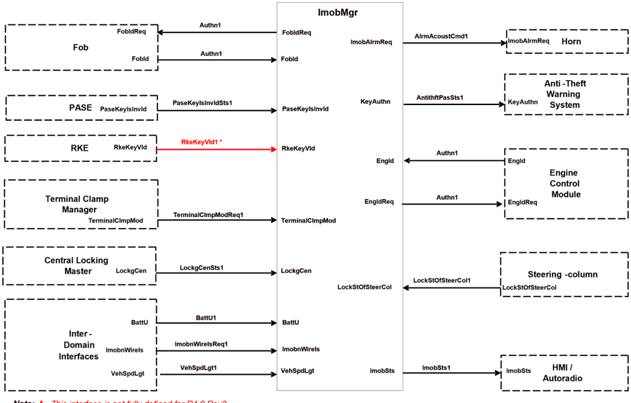

| SW 组件发送方 | 端口发送方 | 接口 | 端口接收方 | SW 组件接收方 | 注释/理由 |
| --- | --- | --- | --- | --- | --- |
| Central-Door-Locking | LockgFb（LockingFeedback） | LockgFbReq1（LockingFeedbackRequest） | LockgFb（LockingFeedback） | PaseMgr（PassiveEntryManager） | 出于以下原因需要该信息：1. 需要知道 PASE 发出的命令是否已被考虑；2. 需要知道是否已发出另一个锁定或解锁命令（例如 PASE 与机械钥匙的同步） |
| DoorSnsr（Door sensor） | DoorHndl（DoorHandle） | DoorHndlSts1（DoorHandleStatus） | DoorHndl（DoorHandle） | PaseMgr（PassiveEntryManager） | 在门把手上实现拉拽检测器的情况下 |
| DoorSnsr（Door sensor） | DoorHndlSen（DoorHandle-Sensing） | DoorHndlSenSts1（DoorHandle-SensingStatus） | DoorHndlSen（DoorHandle-Sensing） | PaseMgr（PassiveEntryManager） | 在门把手上实现触摸传感器的情况下 |
| Inter-Domain-Interfaces | VehModSts（VehicleModeStatus） | VehMod1（VehicleMode） | VehModSts（VehicleModeStatus） | PaseActvn（PassiveEntryActivation） | 需要该信息以了解车辆处于工厂模式、展厅模式还是客户模式 |
| PassiveEntryActivation | PaseActvn（PaseActivation） | PaseActvnSts1（PaseActivationStatus） | PaseActvn（PaseActivation） | PaseMgr（PassiveEntryManager） | 考虑车辆模式信息激活或停用 |
| PaseMgr（PassiveEntryManager） | AcsKeyls（AccessKeyless） | LockgCenReq1（LockingCentralRequest） | AcsKeyls（AccessKeyless） | Inter-Domain-Interfaces | 需要知道锁定或解锁命令是否来自无钥匙系统，以及 PASE 是否应考虑它 |

| SW 组件发送方 | 端口发送方 | 接口 | 端口接收方 | SW 组件接收方 | 注释/理由 |
| --- | --- | --- | --- | --- | --- |
| PaseKeylsRxn（PassiveEntryKeylessReception） | TrsmPosnForPase（TransmissionPositionForPassiveEntry） | TrsmPosn1（TransmissionPosition） | TrsmPosnForPase（TransmissionPositionForPassiveEntry） | PaseMgr（PassiveEntryManager） | 需要知道所有发送器的位置，例如：离车辆近或远；车辆的尾部或前部；车辆右侧或左侧；车内或车外 |
| PaseTrsmKeyls（PassiveEntryTransmissionKeyless） | TrsmId（TransmissionIdentifier） | TrsmId1（TransmissionIdentifier） | TrsmId（TransmissionIdentifier） | PaseKeylsRxn（PassiveEntryKeylessReception） | 需要知道所有发送器的 ID |
| PaseMgr（PassiveEntryManager） | DispPaseDfct（DefectDisplayPassiveEntry） | DispPaseDfct1（DisplayPassiveEntryDefect） | DispPaseDfct（DefectDisplayPassiveEntry） | HMI | PASE 缺陷的显示 |
| PaseMgr（PassiveEntryManager） | LocnOfPaseKeyls（LocationOfPaseKeyless） | LocnOfPaseKeylsSts1（LocationOfPaseKeylessStatus） | LocnOfPaseKeyls（LocationOfPaseKeyless） | Inter-Domain-Interfaces | 需要知道无钥匙装置是在车内还是车外 |
| PaseTrsmKeyls（PassiveEntryTransmissionKeyless） | PaseAcsRemKeylsForTrsm（PaseAccessRemoteKeylessForTransmission） | LockgCenReq1（CentralLockingRequest） | PaseAcsRemKeylsForTrsm（PaseAccessRemoteKeylessForTransmission） | PaseKeylsRxn（PassiveEntryKeylessReception） | 来自 PASE 发送器的锁定或解锁请求 |
| PaseTrsmKeyls（PassiveEntryTransmissionKeyless） | TrsmAuthent（TransmissionAuthentication） | TrsmAuthent1（TransmissionAuthentication） | TrsmAuthent（TransmissionAuthentication） | PaseKeylsRxn（PassiveEntryKeylessReception） | 发送器与接收器（车内设备）之间的认证过程：来自发送设备的请求（发送口令） |
| PaseKeylsRxn（PassiveEntryKeylessReception） | PaseAcsRemKeylsRxn（AccessRemotePaseKeylessReception） | LockgCenReq1（CentralLockingRequest） | PaseAcsRemKeylsRxn（AccessRemotePaseKeylessReception） | PaseMgr（PassiveEntryManager） | 来自发送器到 PASE 接收器的锁定或解锁请求 |
| PaseKeylsRxn（PassiveEntryKeylessReception） | TrsmIdFromRxn（TransmissionIdenitifierFromReception） | TrsmId1（TransmissionIdenitifier） | TrsmIdFromRxn（TransmissionIdenitifierFromReception） | PaseMgr（PassiveEntryManager） | PASE 无钥匙设备的 ID 被提供给接收器，并从接收器提供给 PASE |

| SW 组件发送方 | 端口发送方 | 接口 | 端口接收方 | SW 组件接收方 | 注释/理由 |
| --- | --- | --- | --- | --- | --- |
| PaseKeylsRxn（PassiveEntryKeylessReception） | TrsmAuthentFromRxn（TransmissionAuthenticationFromReception） | TrsmAuthent1（TransmissionAuthentication） | TrsmAuthentFromRxn（TransmissionAuthenticationFromReception） | PaseMgr（PassiveEntryManager） | 接收器与 PASE 管理器之间的认证过程：最初来自发送设备的请求由接收设备发送给 PaseMgr（发送口令） |
| PaseMgr（PassiveEntryManager） | TrsmAuthentFromPaseMgr（TransmissionAuthenticationFromPaseManager） | TrsmAuthent1（TransmissionAuthentication） | TrsmAuthentFromPaseMgr（TransmissionAuthenticationFromPaseManager） | PaseKeylsRxn（PassiveEntryKeylessReception） | 接收器与 PASE 管理器之间的认证过程。该信息包含：过程的状态：进行中、已完成；认证过程的状态（成功或失败）；如果成功，对认证请求的加密应答 |
| PaseMgr（PassiveEntryManager） | PaseIdCfmd（PaseIdentifierComfirmed） | IdCfmdSts1（IdentifierComfirmedStatus） | PaseIdCfmd（PaseIdentifierComfirmed） | Inter-Domain-Interfaces | 需要该信息以向其他功能确认 PASE 发送方是已知的 |
| PaseMgr（PassiveEntryManager） | PaseKeylsInvld（PaseKeylessInvalid） | PaseKeylsInvldSts1（PaseKeylessInvalidStatus） | PaseKeylsInvld（PaseKeylessInvalid） | Inter-Domain-Interfaces | 需要知道 pase 钥匙有效还是无效 |
| PaseKeylsRxn（PassiveEntryKeylessReception） | PasePanic（PasePanic） | PasePanicReq1（PasePanicRequest） | PasePanic（PasePanic） | Inter-Domain-Interfaces | 需要把客户的请求从 PASE 管理器传递到跨域以形成恐慌请求（Panic Request） |
| PaseTrsmKeyls（PassiveEntryTransmissionKeyless） | TrsmRxnOfPasePanic（TransmissionReceptionOfPasePanic） | TrsmRxnOfPasePanicReq1（TransmissionReceptionOfPasePanicRequest） | TrsmRxnOfPasePanic（TransmissionReceptionOfPasePanic） | PaseKeylsRxn（PassiveEntryKeylessReception） | 需要接收由 PASE 发送器递交的客户恐慌请求 |

| SW 组件发送方 | 端口发送方 | 接口 | 端口接收方 | SW 组件接收方 | 注释/理由 |
| --- | --- | --- | --- | --- | --- |
| PaseMgr（PassiveEntryManager） | TrsmPosnFromPaseMgr（TransmissionPositionFromPaseManager） | TrsmPosn1（TransmissionPosition） | TrsmPosnFromPaseMgr（TransmissionPositionFromPaseManager） | Inter-Domain-Interfaces + Seat Adjustment | 需要知道所有发送器的位置，例如：离车辆近或远；车辆的尾部或前部；车辆右侧或左侧。该接口用于在系统内传递信息 |
| Inter-Domain-Interfaces | DrvgSide（DrivingSide） | DrvgSide1（DrivingSide） | DrvgSide（DrivingSide） | PaseMgr（PassiveEntryManager） | |

### 4.14. RKE（遥控无钥匙进入，Remote Keyless Entry）

#### 4.14.1 引言

遥控无钥匙进入（RKE）系统是设计用于远程锁定或解锁汽车进入的系统。

- RKE 传输需要两个组件——发送器与接收器。
  - 发送器——RKE 钥匙扣、其他集成了 RKE 的 ID 设备；
  - 接收器——车身控制 ECU、其他集成了 RKE 的 ECU。
- RKE 通过在特定频率上单向广播无线电波来工作。
- RKE 系统实现加密与滚动码算法，以防止偷车贼截获并欺骗报文。
- 典型的 RKE 功能有：
  - 锁定；
  - 解锁；
  - 报警激活/停用；
  - 接近灯；
  - 舒适打开（打开所有车窗）；
  - 舒适关闭（关闭所有车窗）。

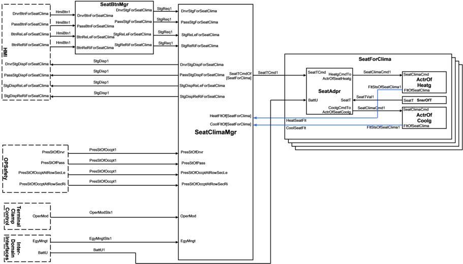

- BiCom 系统是把单向 RKE 扩展为双向 RKE 系统。
  - 钥匙扣 → 车辆（如同单向 RKE 系统）；
  - 车辆 → 钥匙扣（用于在钥匙扣上通过 LED 或显示器的车辆状态信息）。
- 传输到钥匙扣的典型 BiCom 状态信息有：
  - 车门状态；
  - 车窗状态；
  - 报警状态；
  - 服务信息；
  - 车辆电池信息；
  - 燃油状态；
  - 机油状态。

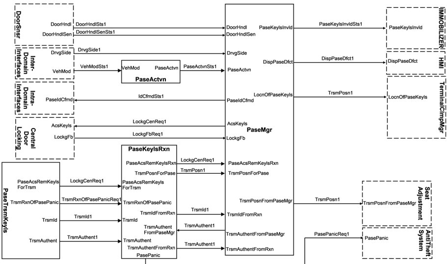

#### 4.14.2 RKE 分解

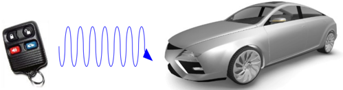

**KeyRemoteManager：**

RKE 管理器在理论上可以拆分为两个主要部分（在分解中未高亮）：

- 协议评估模块：主要提供与 Cryptography 和 KeyDataManagement SWC 的信息交换。该部分将在未来版本中增强；
- 命令评估模块：
  - 舒适处理；
  - 命令执行前提条件检查；
  - 命令执行触发（例如 CL、CAN 等）；
  - 注：锁定反馈将由 CL（闪烁器等）请求；
  - ID 过滤控制；
  - 重新同步；
  - 学习：学习模式检测；学习流程；
  - 诊断：存储诊断相关数据；提供诊断相关功能。

这种架构设计的理由是使更改为其他 RKE 系统更容易。所有协议与 RKE 系统相关的部分都位于协议评估模块中。命令评估模块以抽象的形式获得提取的数据。要更改 RKE 系统（协议、密码学、报文定义）但保持命令行为，只需替换协议评估模块。

AUTOSAR RTE [1] 可以位于这两个 RKE 模块之间。

**Cryptography（密码学）：**

为了对 RKE/BiCom 报文进行加密/解密，将使用以下函数：

- Cryptography Process Start
- Cryptography Process Stop
- Cryptography Process Status
- Cryptography Process Finished

**KeyDataManagement（钥匙数据管理）：**

一个单独的模块管理钥匙数据。这意味着它控制向非易失性存储器的写入，并提供一些服务函数，例如：

- 钥匙数据管理模块的状态；
- 写钥匙数据（RKE 必须提供通知回调）；
- 读钥匙数据；
- 擦除钥匙数据；
- 验证钥匙 ID；
- 已学习钥匙的数量。

**Radio Frequency Communication（射频通信）：**

在本模块中汇集了功能的以下部分：

- 接收器模式；
- 过滤操作；
- 发送缓冲区活动。

### 4.15. 敞篷控制（Convertible Control）

#### 4.15.1 引言

敞篷控制表示为敞篷汽车打开或关闭车顶的特性。车顶可以是硬顶或软顶，不加区分。

只有一个管理器构成敞篷控制的分解。

分解的不同输入如下：

- 中央门锁，检查车门/车顶是否可以打开；
- 敞篷传感器，检查车顶是否已解锁（在手动锁定系统的情况下），以及车顶开关是否也锁定；
- HMI，处理敞篷命令以及把车顶收入行李舱的意愿；
- 遥控钥匙，在车外打开车顶；
- 驻车辅助，检查行李舱附近是否有障碍物。在这种情况下，可能并不总是能够打开车顶；
- 动力总成，检查哪个挡位被挂入，以及手刹是否锁定；
- 端子控制，用于运行模式；
- 防滚架（Rool hoop）状态；
- 车窗控制，用于车窗状态；
- 敞篷执行器；
- 电池监测器（未来功能）。

输出为：

- 敞篷命令，用于命令车顶；
- 面向 Wiper Washer 与 ATWS，提供操作进度的状态。

#### 4.15.2 敞篷控制分解

下面给出敞篷控制功能的 SWC 分解。

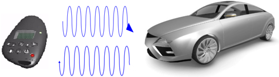

### 4.16. 车身传感器（BodySensors）

#### 4.16.1 引言

BodySensors 功能表示系统感知环境的能力。

#### 4.16.2 BodySensors 分解

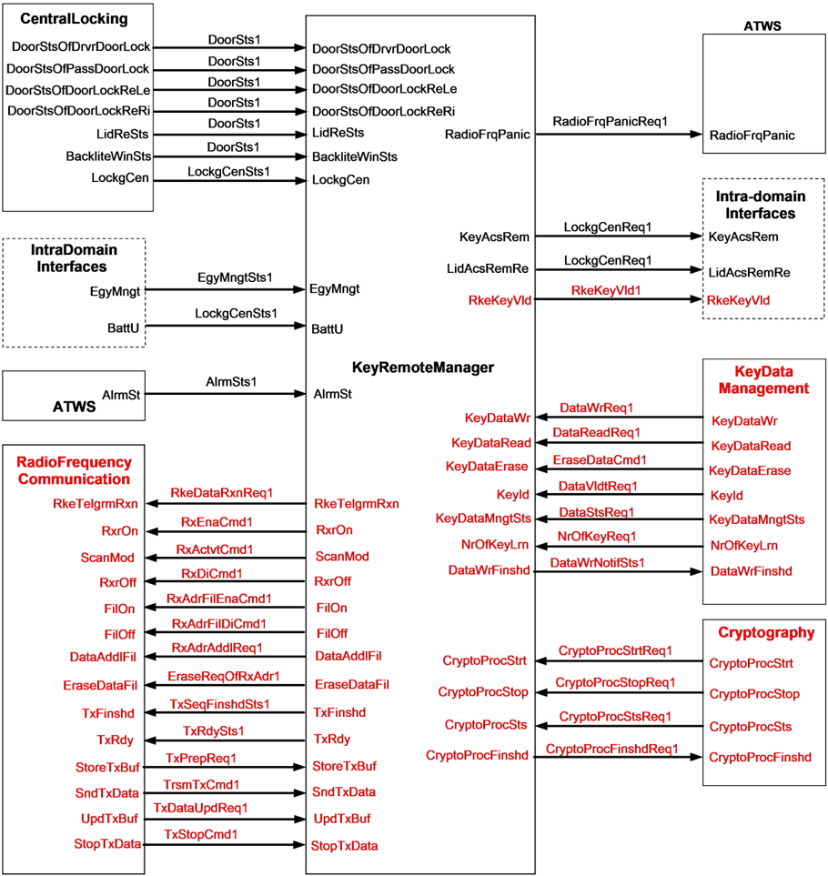

| SW 组件发送方 | 端口发送方 | 接口 | 端口接收方 | SW 组件接收方 | 注释/理由 |
| --- | --- | --- | --- | --- | --- |
| SnsrBody（SensorBody） | EngHoodSts（EngineHood-Status） | EngHoodSts1（EngineHood-State1） | EngHoodSts（EngineHood-Status） | WiprWshr（WiperWasher） | 该接口表示发动机罩的状态：打开或关闭 |
| SnsrBody（SensorBody） | TrlrSwt（TrailerSwitch） | TrlrSts1（TrailerStatus1） | TrlrSwt（TrailerSwitch） | ExtrLi（ExteriorLight） | 通过开关型检测检测挂车的存在。信息：Trailer attached 0 表示「不存在」1 表示「存在」 |
| SnsrBody（SensorBody） | SwtIndcr（TurnSignal-LeverSwitch） | IndcrTurnReq1（IndicatorTurn-Request1） | SwtIndcr（TurnSignal-LeverSwitch） | ExtrLi（ExteriorLight） | 激活/停用左或右转向灯闪烁或临时闪烁左/右（「高速闪烁」）的请求。只要请求方向指示，就应设置相应的值 |
| SnsrBody（SensorBody） | SwtLiAut（AutomaticlightSwitch） | LiExtReq1（LightExterior-Request1） | SwtLiAut（AutomaticlightSwitch） | ExtrLi（ExteriorLight） | 来自自动模式的车外灯请求 |
| SnsrBody（SensorBody） | SwtLiPosn（Position-lightSwitch） | LiExtReq1（LightExterior-Request1） | SwtLiPosn（Position-lightSwitch） | ExtrLi（ExteriorLight） | 位置灯的车外灯请求 |
| SnsrBody（SensorBody） | PrkgLiSwt（Parking-LightSwitch） | PrkgLiExtReq1（ParkingLightExteriorRequest） | PrkgLiSwt（Parking-LightSwitch） | ExtrLi（ExteriorLight） | 驻车灯的车外灯请求 |
| SnsrBody（SensorBody） | SwtFlashBeam（FlashBeam-Switch） | LiExtReq1（LightExterior-Request1） | SwtFlashBeam（FlashBeam-Switch） | ExtrLi（ExteriorLight） | 闪烁远光的车外灯请求 |
| SnsrBody（SensorBody） | SwtBeamLo（LowBeam-Switch） | LiExtReq1（LightExterior-Request1） | SwtBeamLo（LowBeam-Switch） | ExtrLi（ExteriorLight） | 车外灯请求：近光 |
| SnsrBody（SensorBody） | SwtBeamHi（HighBeam-Switch） | LiExtReq1（LightExterior-Request1） | SwtBeamHi（HighBeam-Switch） | ExtrLi（ExteriorLight） | 车外灯请求：远光 |
| SnsrBody（SensorBody） | SwtFogLiFrnt（FrontFog-lightSwitch） | LiExtReq1（LightExterior-Request1） | SwtFogLiFrnt（FrontFog-lightSwitch） | ExtrLi（ExteriorLight） | 车外灯请求：前雾灯 |
| SnsrBody（SensorBody） | SwtFogLiRe（RearFog-lightSwitch） | LiExtReq1（LightExterior-Request1） | SwtFogLiRe（RearFog-lightSwitch） | ExtrLi（ExteriorLight） | 车外灯请求：后雾灯 |
| SnsrBody（SensorBody） | SwtLi-DaytiRunng（DaytimeRunning-lightSwitch） | LiExtReq1（LightExterior-Request1） | SwtLi-DaytiRunng（DaytimeRunning-lightSwitch） | ExtrLi（ExteriorLight） | 车外灯请求：日间行车灯 |
| SnsrBody（SensorBody） | SwtHomeCmngAndHome-Lvng（ComingHome-LeavingHome-Switch） | LiExtReq1（LightExterior-Request1） | SwtHomeCmngAndHome-Lvng（ComingHome-LeavingHome-Switch） | ExtrLi（ExteriorLight） | 车外灯请求：回家与离家灯 |
| SnsrBody（SensorBody） | SwtForHzrd-Warn（HazardWarningSwitch） | LiExtReq1（LightExterior-Request1） | SwtForHzrd-Warn（HazardWarningSwitch） | ExtrLi（ExteriorLight） | 车外灯请求：危险警告灯 |

### 4.17. 键盘（KeyPad）

见 [4.5](#45-中央门锁central-locking) 节 Central Locking。

## 5. 附加信息（可选）

本章应包含不适合前几章的信息。需要适当的子标题。

本设计标准是车身域功能的 AUTOSAR 架构。它提供到 SW-C 的分解以及与它们相关的标准化接口列表。

每个分解在粒度上限于传感器组件、适配器组件、核心功能与执行器组件。其意图是让分解不达到原子 SW-C，而是达到「可采购的」SWC。这些 SW-C 将作为一个整体获得，使所有内部（因而未被 AUTOSAR 标准化的）接口由单一供应商控制，即使所购单元内的 SW-C 驻留在不同的 ECU 上。来自不同供应商的 SW-C 之间的所有接口都应标准化。

此外，描述了所有端口及其 AUTOSAR 数据属性。失效（在需要处）定义为带内失效。在适当处规定初始值，例如「off」「idle」「undefined」「unknown」……在不适宜标准化的地方，可以提供建议。

## 6. 相关文档

### 6.1. 输入文件和相关标准与规范

[1] Specification of RTE Software
> AUTOSAR_CP_SWS_RTE
