<!-- 源文档 AUTOSAR_CP_EXP_AIChassis（R23-11），讲述型指南（EXP），不受 Type A 七章骨架约束；章节结构镜像源文档自身编号（1–5）。PDF→markdown 转换中溢出的图内文字（UML/框图标签、坐标数字、图例）按转换噪声剔除。表 2.1 的簇归属按源 PDF 版面并以 R22-11 转换交叉核对。 -->

## 1. 文档目的

本文档解释与应用接口表 [\[1\]](#ref-1) 中与底盘域（Chassis Domain）相关内容的全部设计决策。

## 2. 术语与概念的描述

本文档涉及底盘域统一应用接口的表述。其目标是定义并发布所有统一接口与功能的功能目录。这包括乘用车与卡车的接口，也涵盖驾驶辅助系统（DAS）。底盘域的结果应与其他域对齐，例如车身（Body）、动力总成（Powertrain）、乘员与行人安全（Occupant and Pedestrian Safety）。应用接口表为这种对齐与冲突检测提供了良好的基础。

### 2.1. 坐标系

底盘域使用的标准坐标系参照国际标准 ISO 8855 [\[2\]](#ref-2)。

是否使用一个固定的几何点（例如接近某一车型所有变体的平均重心（CoG）的点）作为基本重心的参考点，须在项目层面决定。

### 2.2. 定义

#### 2.2.1 底盘域接口定义的优化方法学

##### 2.2.1.1 预期的优化

统一以下关键词在名称与描述中的使用：

- indication、state、request、mode、consolidate、target、confirmation、demand、command、information……
- 以及如何区分 fault、failure、error、state 与 mode

##### 2.2.1.2 「流」与「状态」的实现可能性概览

###### 2.2.1.2.1 控制流与信号流

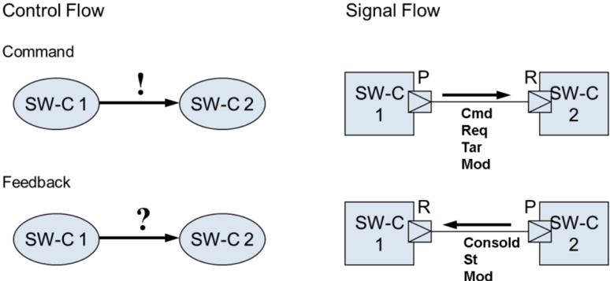

##### 2.2.1.3 定义/解释

###### 2.2.1.3.1 状态（State）

- 系统或实体当前的状况：
- 状态（物理学）（8 个定义的列表），特别是热力学、统计物理以及动力系统与混沌理论中的状态
- 状态（计算机科学），程序或机器中信息的一种唯一配置

###### 2.2.1.3.2 模式（Modus）

- 一种「工作模式」，通过诊断、驾驶员或其他方式的切换来设置。示例：悬架 =&gt; 舒适（Comfort）或运动（Sport）模式
- 对一个过程的调整：有时可被视为请求。示例：TPMS 功能的复位 =&gt; 它更像一个请求而非模式

###### 2.2.1.3.3 模式（Mode）

- 某事物的种类、方式

###### 2.2.1.3.4 指示（Indication）

- 一种将提供该信号的系统的相关状态告知外部系统的信号。一般而言，该信号的最终目的地预期是驾驶员或其他操作者。

###### 2.2.1.3.5 目标（Target）

- 自动控制系统将力求达到的设定点、设定值

###### 2.2.1.3.6 请求（Request）

- 控制器目标值的默认措辞

###### 2.2.1.3.7 「active」的含义

- 它处于开启状态 =&gt; 保留为「active」

###### 2.2.1.3.8 「intervention」的含义

- 当前正在主动干预 =&gt; 改为「intervention」（用于一个功能可以处于开启状态但并未干预的情形）。关键词：Intv

###### 2.2.1.3.9 故障（Fault）

- 起因/原因
- ISO/WD 26262-1 [\[3\]](#ref-3)：故障（fault）是错误（error）的起因；它可以是系统性的或随机性的。注意：不要使用 defect、mistake。

###### 2.2.1.3.10 失效（Failure）

- 意为不工作，但不一定是原因
- ISO/WD 26262-1 [\[3\]](#ref-3)：失效（failure）是（部件或系统）不能执行一项所要求功能的状态。

###### 2.2.1.3.11 错误（Error）

- 暂时/永久，与 failure 相同
- ISO/WD 26262-1 [\[3\]](#ref-3)：错误（error）是计算、观测或测量得到的值或状态与规定的正确值之间的偏差。

##### 2.2.1.4 命名一致性规则

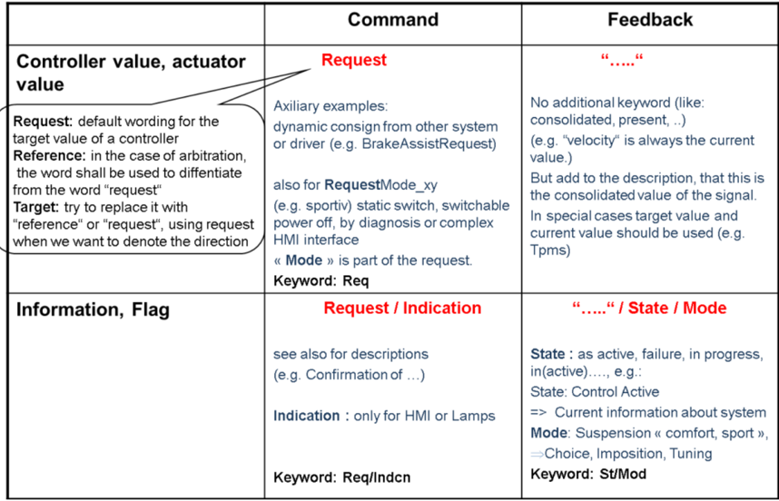

###### 2.2.1.4.1 优化描述的规则（针对端口、端口接口与数据元素、类型）

- 以名词开头（避免「information」「indicates」等词）
- 必须与 LongName 一致（例如若 LongName 中含「Mode」，描述中也应含有）
- 发送与接收组件都不应被点名（如 SSM、ESC）。可以点明用途（例如「用于向……显示」）
- 取自应用接口表的正例：

LongName：Steering Control Tuning Request

描述：驾驶员请求的转向控制器整定

与之相对的（反例）：指示 HMI 向「Steer」SWC 请求控制器整定。

#### 2.2.2 乘用车重心

车辆的底盘固连坐标系原点位于前轴（FA）中部，见图 2.3。车辆重心定义为底盘自由坐标系的原点，该坐标系相对前轴坐标系定位。这两个坐标系的轴向定义如下：

**车辆向前行驶时：**

- x 轴以车头方向为正。
- y 轴以车辆左侧为正。
- z 轴以车顶方向为正。
- 侧倾（Roll）在左转弯且车身向右侧倾倒时为正。
- 俯仰（Pitch）在车辆制动且车身向前倾倒时为正。
- 横摆（Yaw）在左转弯时为正。

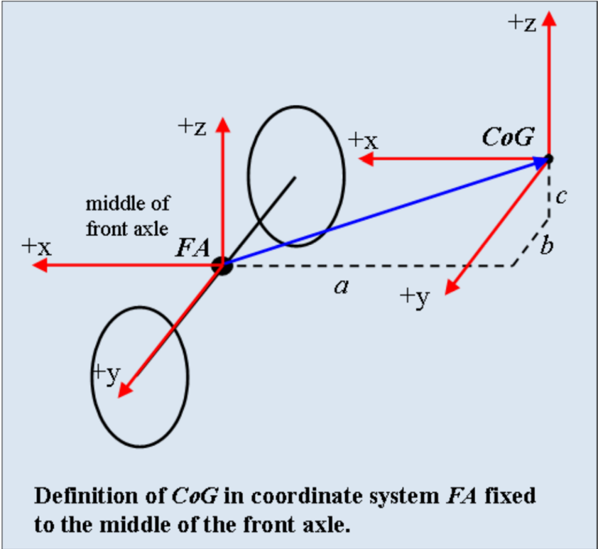

#### 2.2.3 车辆周边的定义（例如用于 ACC）

ACC 的车辆周边与预测航迹（predicted course）定义见图 2.4 与图 2.5。

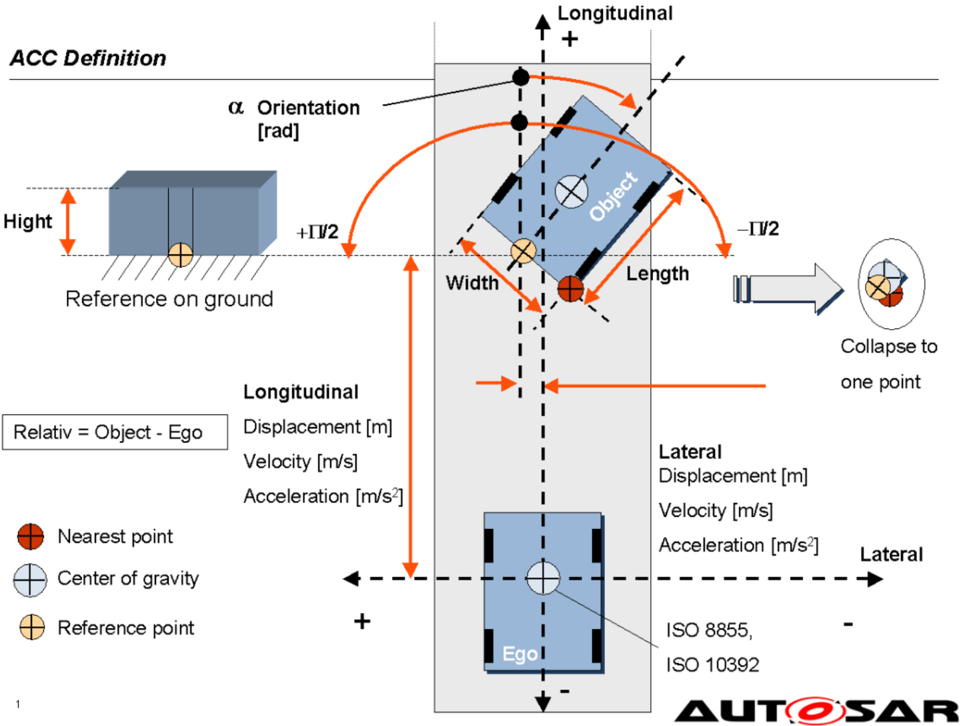

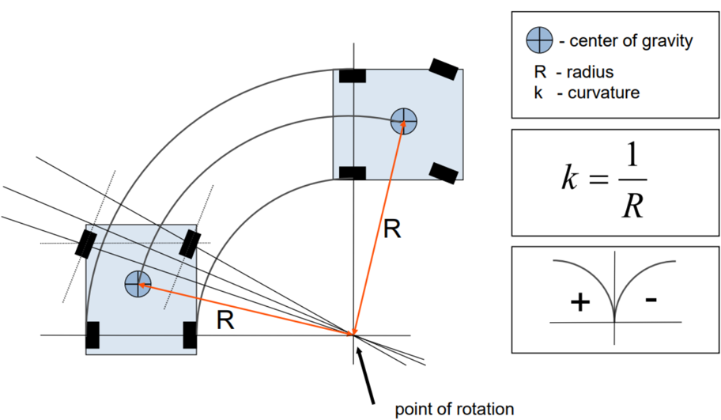

ACC 的对象列表定义于下表。

记录类型名 `ObjData1`（长名 **ObjectData**）——由环境传感器检测到的对象属性簇。该信息例如用于自适应巡航控制（ACC），但不限于该用例：

| 属性 | 说明 |
| --- | --- |
| DplLgt | &lt;Core&gt; 传感器与物体之间的距离。 |
| DplLat | &lt;Core&gt; 传感器中心与物体之间的横向距离。 |
| SpdLgtRel | &lt;Core&gt; 自车与物体之间的纵向速度差。 |
| DynPpty | &lt;Core&gt; 指示物体动态属性（如静止、运动等）的状态。Standing：从未被检测到运动。Stopped：曾被检测到运动，但现在静止。Moving：物体在任意方向上具有绝对速度。该定义按照 ISO 8855 [\[2\]](#ref-2) 定义的地面固连坐标系作出。 |
| StOfObjMeasd | &lt;Core&gt; 指示物体在当前周期内是被测量到的、还是仅被跟踪的状态。 |
| ObjId | &lt;Core&gt; 每个被跟踪物体的唯一编号。只要物体仍在列表中输出，它就保持同一 ID。当物体消失时，其 ID 可被复用于新物体。当新物体出现时，「object is new」属性会置位一个周期。ID=0 保留给「无物体」。 |
| SpdLatRel | &lt;Opt&gt; 自车与物体之间的横向速度差。 |
| ALgtRel | &lt;Opt&gt; 自车与物体之间的纵向加速度差。 |
| ALatRel | &lt;Opt&gt; 自车与物体之间的横向加速度差。 |
| Width | &lt;Opt&gt; 物体的横向长度。 |
| Hei | &lt;Opt&gt; 物体自地面起的垂直长度。 |
| Len | &lt;Opt&gt; 物体的纵向长度。 |
| Orntn | &lt;Opt&gt; 物体的横摆角。坐标系遵循 ISO 8855 [\[2\]](#ref-2)。 |
| ObjClassn | &lt;Opt&gt; 指示车辆类型（如卡车、乘用车等）的类别。 |
| DataQly | &lt;Core&gt; 对象数据的质量。当质量较差时（如因天气条件、物体反射率），该值降低。标定取决于传感器类型与信号处理算法，因此需要在接收功能侧应用参数。 |

记录类型名 `ObjDataRlvForFolwCtrl1`（长名 **ObjDataRelevantForFollowControl**）——跟车控制相关对象属性簇：

| 属性 | 说明 |
| --- | --- |
| DplLgt | &lt;Core&gt; 自车前缘与物体之间的距离。 |
| SpdLgtRel | &lt;Core&gt; 自车与物体之间的纵向速度差。 |
| DynPpty | &lt;Core&gt; 指示物体动态属性（如静止、运动等）的状态。Standing：从未被检测到运动。Stopped：曾被检测到运动，但现在静止。Moving：物体在任意方向上具有绝对速度。该定义按照 ISO 8855 [\[2\]](#ref-2) 定义的地面固连坐标系作出。 |
| ObjId | &lt;Core&gt; 每个被跟踪物体的唯一编号。只要物体仍在列表中输出，它就保持同一 ID。当物体消失时，其 ID 可被复用于新物体。当新物体出现时，「object is new」属性会置位一个周期。ID=0 保留给「无物体」。 |
| DplLat | &lt;Opt&gt; 自车中心与物体之间的横向距离。 |
| SpdLatRel | &lt;Opt&gt; 自车与物体之间的横向速度差。 |
| ALgtRel | &lt;Opt&gt; 自车与物体之间的纵向加速度差。 |
| StOfObjMeasd | &lt;Opt&gt; 指示物体在当前周期内是被测量到的、还是仅被跟踪的状态。 |
| ObstrcnProblty | &lt;Opt&gt; 障碍物无法被越过或无法从其上驶过的概率。 |
| LaneProblty | &lt;Opt&gt; 潜在目标物体位于行驶走廊或预测车辆航迹内的概率。 |
| CutInProblty | &lt;Opt&gt; 潜在目标物体切入行驶走廊或预测车辆航迹的概率。 |
| ObjRlvc | &lt;Opt&gt; 作为自适应巡航控制（ACC）目标物体的合理性度量；当 LaneProbability 持续较高时该度量增大。 |
| ObjRlvcUpprLim | &lt;Opt&gt; ObjectRelevance 的上限。超过该上限后，该物体成为自适应巡航控制（ACC）的目标物体。 |
| ObjRlvcLowrLim | &lt;Opt&gt; ObjectRelevance 的下限。低于该下限时，该物体不是自适应巡航控制（ACC）的目标物体。 |
| DstMaxForFolwCtrl | &lt;Opt&gt; 相关物体成为跟车控制目标物体的最大距离。 |

表2.1：ACC 对象列表（**Table Object list for ACC**）

### 2.3. 缩略语与缩写

表2.2：本文档范围内使用的缩略语与缩写（**Abbreviations used in the scope of this Document**）

| 缩写 | 说明 |
| --- | --- |
| ABS | Antilock Braking System（防抱死制动系统） |
| ACC | Adaptive Cruise Control（自适应巡航控制） |
| BAS | Brake Assist（制动辅助） |
| BRWS | Basic Rear Wheel Steering（基本后轮转向） |
| BSTS | Basic Steering Torque Superposition（基本转向力矩叠加） |
| BSAS | Basic Steering Angle Superposition（基本转向角叠加） |
| CBC | Cornering Brake Control（弯道制动控制） |
| CoG | Center of Gravity（重心） |
| DAS | Driver Assistance System（驾驶辅助系统） |
| DTC | Regulation of the Drag Torque（拖滞力矩调节） |
| EBD | Electronic Brake Force Distribution（制动力分配） |
| ECU | Electronic Control Unit（电子控制单元） |
| EPB | Electronic Parking Brake（电子驻车制动） |
| ESC | Electronic Stability Control（电子稳定控制） |
| FA | Front Axle（前轴） |
| HDC | Hill Decent Control（坡道缓降控制） |
| HHC | Hill Hold Control（坡道起步控制） |
| HMI | Human Machine Interface（人机接口） |
| HW | Hardware（硬件） |
| NVH | Noise, Vibration, Harshness（噪声、振动、平顺性） |
| OEM | Original Equipment Manufacturer（原始设备制造商） |
| RA | Rear Axle（后轴） |
| RSC | Roll Stability Control（侧翻稳定控制） |
| SR | Situation Recognition（态势识别） |
| SSM | Stand Still Manager/Management（静止管理） |
| SW | Software（软件） |
| SW-C | Software Component（软件组件） |
| TCS | Transaction Control System |
| VFB | Virtual Function Bus（虚拟功能总线） |
| VGR | Variable Gear Ratio（可变传动比） |
| VLC | Vehicle Longitudinal Control（车辆纵向控制） |
| VM | Vehicle Model（车辆模型） |
| YRC | Yaw Rate Control（横摆角速度控制） |

### 2.4. 参考文档

[1] 应用接口的 XML 规范
> AUTOSAR_CP_MOD_AISpecification

[2] ISO 8855:2011, Road vehicles - Vehicle dynamics and road-holding ability - Vocabulary https://www.iso.org

[3] ISO 26262 (Part 1-10) - Road vehicles - Functional Safety, First edition https://www.iso.org

[4] 软件组件模板的需求（Requirements on Software Component Template）
> AUTOSAR_CP_RS_SoftwareComponentTemplate

[5] 虚拟功能总线（Virtual Functional Bus）
> AUTOSAR_CP_EXP_VFB

### 2.5. 一般说明

SW-Composition 与 SW-Component 的定义见 [\[4\]](#ref-4)。

#### 2.5.1 SW 组件与 ECU 的区别

下文定义的 SW 组件不应与 ECU 功能混为一谈。

例如，一个 ESC ECU 可以包含 Esc SW 组件以及其他组件，如 Ssm SW 组件、SteerVehStabyCtrl SW 组件等。

#### 2.5.2 功能安全

- 底盘域的大多数信号被视为安全相关。假定在 AUTOSAR 中存在可靠的通信方法。底盘域不规定可靠通信。
- 注意这些值是最小要求，即在通信层内部进行优化是可能的。
- 诊断、时序与安全概念尚未在底盘域中考虑。为了证明所讨论的用例是安全合规的（按照即将出台的 ISO 26262 的定义），未来需要进行跨所有应用域的联合讨论。
- 没有为主动底盘系统提供安全概念。这必须在项目层面完成。这意味着必须针对每个具体项目检查所规定的接口是否满足安全需求。

#### 2.5.3 核心端口、条件端口与可选端口的概念

在底盘域中，定义了端口属性「core」「cond」「opt」，用于指示提供者或接收者端口今天被视为该 SW-C 的更核心还是更可选的接口，或者其使用是否取决于附加条件。由于所有接口都可在不同配置中使用，且不存在对单一接口的强制使用（另见第 [3](#3-架构概览) 章），该属性仅供参考。该属性在应用接口表 [\[1\]](#ref-1) 的 EXCEL 版本中给出。并非所有应用 SW 域都使用该属性，它也不会出现在应用接口的 ARXML 文件中。端口属性的取值为：

- 核心提供者与接收者端口
- 条件提供者与接收者端口
- 可选提供者与接收者端口

该定义与文档 AUTOSAR_Powertrain_AI_Explanation 不一致。在 R4.0 中应忽略应用接口表 [\[1\]](#ref-1) 中有关 Core/Cond/optional 属性的信息。

#### 2.5.4 传感器的概念

在底盘域中，为底盘应用接口定义建立了不同信号处理级别的概念。

备注 1：底盘域对传感器仅使用发送-接收接口。

备注 2：复杂设备驱动（CDD）也可用于传输传感器信号。

##### 2.5.4.1 内部状态传感器

- 原始信号（Raw signal）

未经预处理的原始传感器数据。不用作接口，因为这些原始信号依赖于硬件。例如 YawRate 与 PitchRate。

- 基础信号（Base signal）

经预处理的传感器数据。与模型无关。对传感器硬件的抽象。例如 YawRate 与 PitchRate。

- 标准信号（Standard signal）

依据公开的 AUTOSAR 规范由基础信号导出（滤波、偏移补偿、基于模型的合理性检查等）。SW 组合应将其传感器信息产生的标准信号提供给其他 SW 组合，以避免信号处理算法的重复。标准信号的定义请参见应用接口表 [\[1\]](#ref-1)。例如 YawRate 与 PitchRate。

- 融合信号（Fused signal）

处理多个传感器信号以导出融合信号。例如车速或车身侧偏角。

#### 2.5.4.2 环境传感器

仅标准化融合信号。该值与所用的任何传感器的物理输出相关。例如对象列表。

##### 2.5.5 限制

存在一些根本性的限制。这些限制可列举如下：

- 应用接口表 [\[1\]](#ref-1) 的目标不是提出任何软件架构建议。任何 AUTOSAR 文档中展示的架构仅用于澄清，必须被视为「无约束力的」。
- 接口定义在车辆相关物理量（如力矩或力）上，而不是在执行器特定的接口（如电流或 PWM（脉冲宽度调制）占空比）上。

## 3. 架构概览

下文结合其他 AUTOSAR 应用域——车身电子、动力总成、乘员与行人安全以及多媒体、远程信息处理与 HMI——对底盘域作粗略说明。

底盘域的任务聚焦于 AUTOSAR 应用层内功能域底盘的数据描述。

图中展示了底盘域的 SW 组件。这些 SW 组件可以彼此通信，也可以与其他域（如车身电子、动力总成、乘员与行人安全、HMI 或基础软件）通信。为了独立于物理实现地定义应用接口，虚拟功能总线（VFB）充当 AUTOSAR 软件组件互连的抽象，见 [\[5\]](#ref-5)。

由这些 SW 组件构建的底盘域结构示例见图 3.1。基于该结构，已为各个 SW 组件定义了应用接口。该结构是许多其他可能结构中的一个示例。因此，该结构意图是可扩展的，可以从该结构导出不同的配置。所有 SW 组件都可以拥有自己的控制与应用特定的车辆模型和态势识别。既不要求所有 SW 组件同时存在，也不要求所有 SW 组件之间的互连都以给定方式使用。

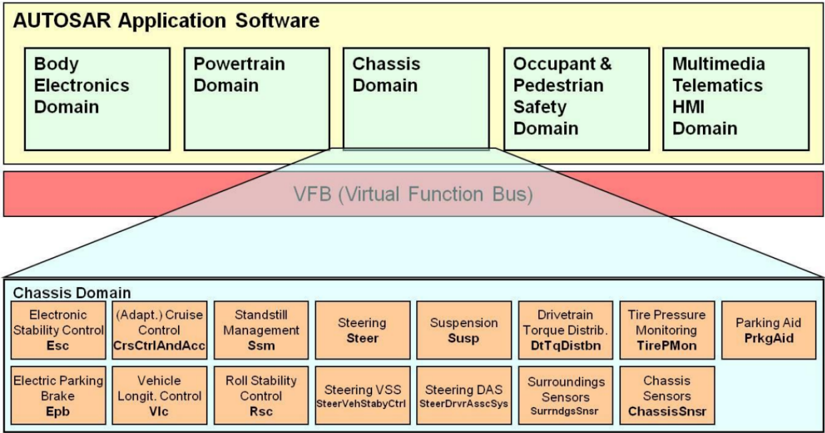

所实现的结构必须在项目层面定义。未来可以使用更复杂、更强大的结构，见第 [5](#5-展望) 章。

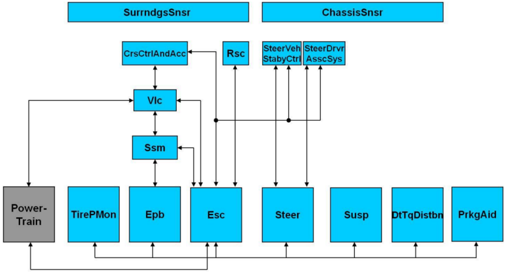

图 3.2 中描绘了底盘域与其他应用接口之间的域间依赖关系。

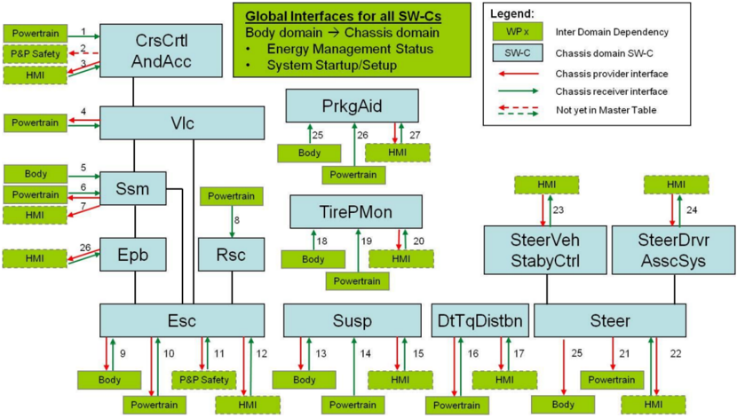

下面列出每个 SW 组件与其他应用接口的依赖关系，对应图 3.2 中带编号的连接：

1. 基础传动系设置（CrsCtrlAndAcc）
2. 碰撞预测与环境信息（CrsCtrlAndAcc）
3. 显示与控制（CrsCtrlAndAcc）
4. 力矩管理（Vlc）
5. 车门、车窗与挂车状态（Ssm）
6. 基础传动系设置与驻车请求（Ssm）
7. 驻车制动显示（Ssm）
8. 基础传动系设置与力矩信息（Rsc）
9. 制动、行驶与挂车状态（Esc）
10. 基于车轮的力矩控制（Esc）
11. 行驶动力学（如车速）（Esc）
12. 显示与控制（Esc）
13. 车门、车窗与挂车状态（Susp）
14. 基础传动系设置与力矩信息（Susp）
15. 显示与控制（Susp）
16. 力矩管理（DtTqDistbn）
17. 显示与控制（DtTqDistbn）
18. 环境温度（TirePMon）
19. 力矩信息（TirePMon）
20. 显示与控制（TirePMon）
21. 动力转向负载（Steer）
22. 显示与控制（Steer）
23. 显示与控制（SteerVehStabyCtrl）
24. 显示与控制（SteerDrvrAsscSys）
25. 前轮转角（Steer）
26. 激活按钮与反馈（Epb）

## 4. 底盘域软件组合与组件的描述

底盘域包含以下 SW 组合与组件：

表4.1：SW 组合及其组件（**SW-Composistions and their Components**）

| SW 组合 | 组件 |
| --- | --- |
| CrsCtrlAndAcc | Cruise Control and Adaptive Cruise Control（巡航控制与自适应巡航控制） |
| Esc | Electronic Stability Control（电子稳定控制，旧称「ESP」） |
| Ssm | Stand-still Manager（静止管理器） |
| Epb | Electronic Parking Brake（电子驻车制动） |
| Vlc | Vehicle Longitudinal Control（车辆纵向控制） |
| Rsc | Roll-Stability Control（侧翻稳定控制） |
| Steer | Steering System（转向系统） |
| SteerDrvrAsscSys | Steering Driver Assistance System（转向驾驶辅助系统（DAS）） |
| SteerVehStabyCtrl | Steering Vehicle Stabilizing Control（转向车辆稳定控制） |
| Susp | Suspension System（悬架系统） |
| TirePMon | Tire Pressure Monitoring System（胎压监测系统） |
| DtTqDistbn | Drivetrain Torque Distribution（传动系力矩分配，旧称「AWD」） |
| SurrndgsSnsr | Surroundings Sensor（环境传感器） |
| ChassisSnsr | Chassis Sensor（底盘传感器） |
| PrkgAid | Parking Aid（泊车辅助） |

### 4.1. 软件组合 CrsCtrlAndAcc（Cruise Control and Adaptive Cruise Control，巡航控制与自适应巡航控制）

SW 组合 CrsCtrlAndAcc 控制车速以及到前方车辆或其他障碍物的距离，在参考车速上下调节直至静止。所使用的传感器信号例如可以来自传感器（如雷达、激光雷达或摄像头）。CrsCtrlAndAcc SW 组合的输出是给 Vlc SW-C 的加速度指令值（ACC 定义见 ISO 15622）。当前 AUTOSAR 版本的 CrsCtrlAndAcc SW 组合中也考虑了独立式自由巡航控制（不带跟车控制）。它位于底盘域的 CrsCtrlAndAcc SW 组合中，而非动力总成域中。

在当前 AUTOSAR 版本中，向 SW 组合 CrsCtrlAndAcc 提供与前车交通参与者相关信息的核心 SW 组件是 SW-C SurrndgsSnsr，见 [4.13 节](#413-软件组件-surrndgssnsrsurroundings-sensor环境传感器)。

CrsCtrlAndAcc SW 组合分解为以下 SW 组件：

- AccSnsrDataFusion（ACC 传感器数据融合）
- AccObjTarSeln（ACC 目标物体选择）
- CrsCtrlFree（自由巡航控制）
- FolwCtrlAndAArbn（跟车控制与加速度仲裁）
- CrsCtrlAndAccStCtrl（巡航控制与 ACC 状态机）
- CrsCtrlAndAccObsvrForVehSt（巡航控制与 ACC 车辆状态观测器）

图 4.1 所示的分解使得 OEM 与供应商之间能够在 CrsCtrlAndAcc SW 组合内部的功能上实现具有不同责任边界的可变业务模式。

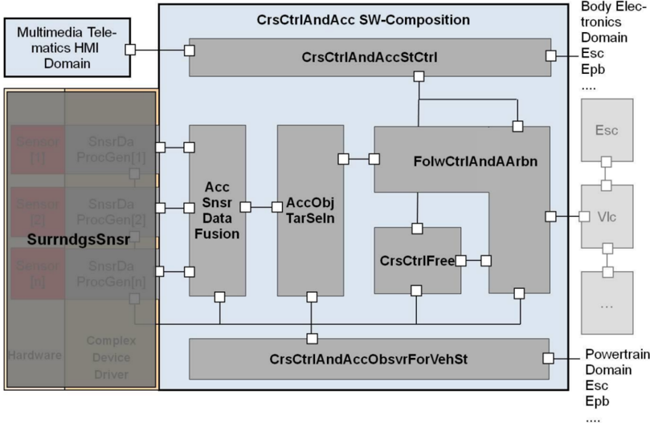

请注意，用于该 SW 组合的环境传感器的数量与类型应在项目层面确定。此外，SW-C SurrndgsSnsr 与 SW 组合 CrsCtrlAndAcc 之间的接口也应在项目层面定义。在当前版本中，定义了对象级别的接口，但也可以有其他接口，例如原始信号级别。就目前的技术水平而言，通常只使用一个环境传感器。在这种情况下，该 SW 组合可以不包含 SW-C AccSnsrDataFusion，因为不需要传感器数据融合，见图 4.2：

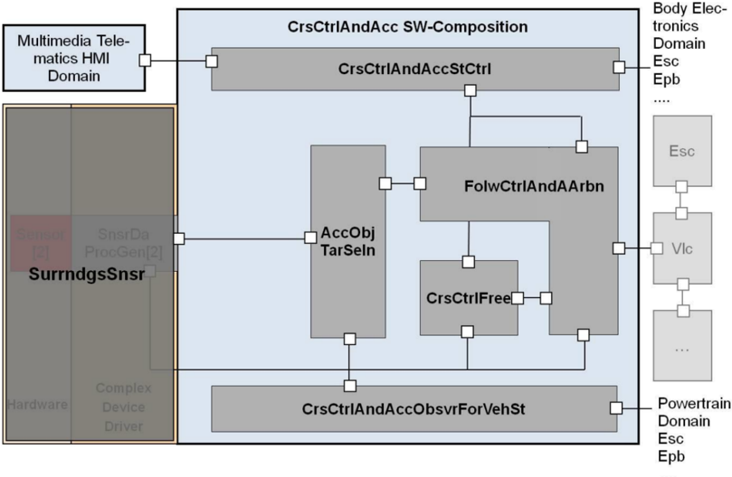

此外，该分解足够灵活，允许定义不带 ACC 功能的独立式自由巡航功能，这在当前更为常见，如图 4.3 所示。在仅有独立式自由巡航功能的情况下，CrsCtrlAndAcc SW 组合由以下 SW 组件组成：

- CrsCtrlFree（自由巡航控制）
- CrsCtrlAndAccStCtrl（巡航控制与 ACC 状态机）
- CrsCtrlAndAccObsvrForVehSt（巡航控制与 ACC 车辆状态观测器）

这里，如果 SW-C CrsCtrlAndAccObsvrForVehSt 进行的信号调理并非必需，可以在项目的 SW 组合中将其移除。

因此，CrsCtrlAndAcc 应用接口的设计能够处理这几种情况。注意图 4.1、图 4.2 与图 4.3 只是可能的 SW 组合的示例。

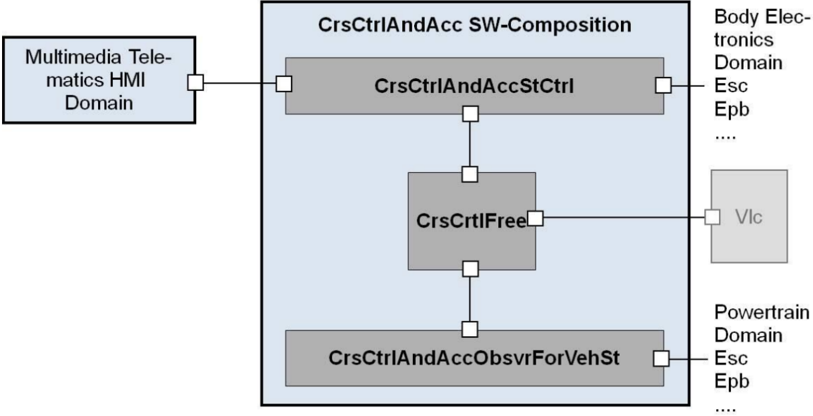

#### 4.1.1 AccSnsrDataFusion（ACC Sensor Data Fusion，ACC 传感器数据融合）

该 SW 组件的任务是执行多传感器融合，即在涉及多个环境传感器时，汇集来自 SW-C SurrndgsSnsr 的全部输入信息。

#### 4.1.2 AccObjTarSeln（ACC Object Target Selection，ACC 目标物体选择）

SW-C AccObjTarSeln 的角色是选择 ACC 相关的目标物体及其属性，这些是控制车速以及与本车与前车距离所必需的。注意 ACC 相关目标可以是多个物体。该 SW-C 的任务包括例如：

- 确定 ACC 相关属性（如车道概率）
- 确定 ACC 相关物体

#### 4.1.3 CrsCtrlFree（Free Cruise Control，自由巡航控制）

SW-C CrsCtrlFree 的角色是根据 HMI 提供的设定车速计算车辆加速度的目标控制值。该 SW-C 的任务例如：

- 为自由巡航控制确定目标加速度

在 ACC 功能的情况下，该 SW 组件的输出进入 SW-C FolwCtrlAndAArbn 并被仲裁。在独立式自由巡航功能的情况下，该组件的输出直接进入 SW-C Vlc（车辆纵向控制）。

#### 4.1.4 FolwCtrlAndAArbn（Follow Control and Acceleration Arbitration，跟车控制与加速度仲裁）

SW-C FolwCtrlAndAArbn 的角色是根据本车前方 ACC 相关物体的行为计算车辆加速度的目标控制值。其另一角色是对由跟车控制功能与自由巡航控制功能提供的目标加速度值进行仲裁。该 SW 组件中要完成的任务例如：

- 为跟车控制与静止确定目标加速度
- 仲裁跟车控制与自由巡航控制

注意控制与驾驶员干预之间的仲裁由 SW-C Vlc 处理。

#### 4.1.5 CrsCtrlAndAccStCtrl（Cruise Control and ACC State Machine，巡航控制与 ACC 状态机）

SW-C CrsCtrlAndAccStCtrl 的角色是确定系统控制模式，包括系统激活状态与 HMI 相关信息。由于该 SW 组件的功能可能因 OEM 而异，AUTOSAR 不会标准化 ISO 15622 所定义内容之外的功能与接口。其功能包括系统的诊断或失效检测。该 SW-C 的任务包括例如：

- 解释通过仪表输入的驾驶员操作
- 确定状态机
- 诊断

#### 4.1.6 CrsCtrlAndAccObsvrForVehSt（Cruise Control and ACC Vehicle State Observer，巡航控制与 ACC 车辆状态观测器）

SW-C CrsCtrlAndAccObsvrForVehSt 的角色是提供与本车行为相关的信息。该 SW 组件的任务包括例如：

- 基于横摆角速度信号预测车辆航迹
- 计算 ACC 特定的车辆动力学数据（如横摆角速度、车辆纵向速度等）

注意，为了利用物体信息获得更好的精度，预测车辆航迹可以由 SW-C SurrndgsSnsr 或 SW-C AccSnsrDataFusion 修正。

### 4.2. 软件组件 Esc（Electronic Stability Control，电子稳定控制）

SW-C Esc 通过控制车轮纵向滑移、车辆横摆角速度与车辆侧偏角来控制车辆在地面平面内运动的稳定性。所使用的传感器信号除其他外可以例如来自一个传感器簇，提供例如横摆角速度与侧向加速度。

在当前 AUTOSAR 版本中，SW-C Esc 控制施加于各车轮的制动力和/或动力总成总力矩。

SW-C Esc 至少由以下子功能组成，如图 4.4 所示：

- ABS 防抱死制动系统（Antilock Braking System）
- TCS 牵引力控制系统（Traction Control System）
- EBD 制动力分配（Electronic Brake Force Distribution）
- DTC 拖滞力矩调节（Regulation of the Drag Torque）（以上四者均控制纵向滑移）
- YRC 横摆角速度控制（Yaw Rate Control）
- VM 车辆模型（Vehicle Model）
- SR 态势识别（Situation Recognition）
- 执行器相关的驾驶辅助功能（出于性能、NVH 原因），例如：
  - BAS 制动辅助（Brake Assist）
  - HDC 坡道缓降控制（Hill Decent Control）
  - HHC 坡道起步控制（Hill Hold Control）
  - CBC 弯道制动控制（Cornering Brake Control）
- ……
- ESC 内部控制器以及到执行器软件的输入的仲裁
- 执行器软件（HW 驱动）

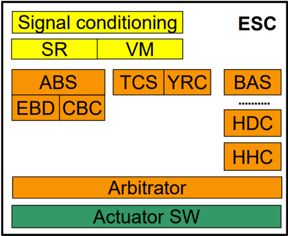

### 4.3. 软件组件 Ssm（Stand Still Manager，静止管理器）

SW 组件 Ssm 管理静止状态并支持驾驶员起步。它还保持车辆驻车（长期，例如车内无驾驶员、点火关闭），并在驾驶员请求下使车辆减速。为此，它依靠 Esc SW-C（行车制动）与 Epb SW-C（驻车制动），向它们发送制动请求。

创建 Ssm SW-C 的动因在于：在车辆上，这些「SSM 功能」可能既包含在 ESC ECU 中，也可能包含在 EPB ECU 中。

### 4.4. 软件组件 Epb（Electronic Parking Brake，电子驻车制动）

SW-C Epb 控制驻车制动执行器。其功能为：

- 通过控制 EPB 执行器来实现来自 Ssm 的请求。
- 在按下 EPB 按钮时解释驾驶员对底盘域的意愿。

当前市场上的 SW-C Epb 实现包含 3 种主要版本：

EPB 独立式：EPB 不与 ESC 协同工作；使用最小数量的接口以避免冲突。

EPB 主-ESC 从：EPB 单元将 ESC 作为一个执行器来控制。

ESC 主-EPB 从：ESC 控制 EPB 执行器；在 ESC 失效时，EPB 执行器单元实现一些备份模式。

EPB/ESC 接口的 AUTOSAR 定义支持全部 3 种变体。

表 4.2 给出了可由典型 EPB 配置实现的功能概览。由下表得出的与应用接口表 [\[1\]](#ref-1) 内容不一致的所有结论都不应被采纳。此表仅作说明之用。

表4.2：不同 EPB 配置的功能列表（**List of features of different EPB configurations**）

| 功能 | 功能描述 | 配置 I：EPB/ESC 协作 | 配置 II：EPB 独立（或配置 I 且制动执行器失效） | 配置 III：配置 I 且制动 ECU 或总线失效 |
| --- | --- | --- | --- | --- |
| EPB 驾驶员请求解释 | 开关处理与驾驶员指令（施加/释放）的生成 | SSM（可选 VLC 用于动态施加） | SSM | EPB |
| 主动车辆减速 | 对来自驾驶辅助系统、使用液压制动与动力总成的减速请求进行仲裁与控制 | ACC -&gt; VLC -&gt; ESC/PTC | n/a | n/a |
| EPB 动态施加 | 行驶中按下 EPB 开关时使用液压或机械制动使车辆减速 | EPB -&gt; SSM（可选 VLC） -&gt; ESC | EPB -&gt; SSM -&gt; EPB | EPB |
| EPB 静态施加 | 车辆静止时按下 EPB 开关时使用液压或机械制动保持/驻停车辆 | EPB -&gt; SSM -&gt; ESC/EPB | EPB -&gt; SSM -&gt; EPB | EPB |
| ACC 走停（Stop &amp; Go） | 应 ACC 请求使用液压或机械制动保持/驻停车辆 | ACC -&gt; VLC -&gt; SSM -&gt; ESC/EPB | n/a | n/a |
| EPB 起步释放 | 为起步释放液压和/或机械制动 | SSM -&gt; ESC/EPB | SSM -&gt; EPB | n/a |
| EPB 自动施加 | 无驾驶员对 EPB 控制的操作下自动施加（例如车辆静止且发动机关闭或点火关闭） | SSM -&gt; ESC/EPB | SSM -&gt; EPB | n/a |
| 溜车/打滑检测/预防 | 车辆意外开始移动时的系统行为 | SSM -&gt; ESC/EPB | SSM -&gt; EPB | 可能为 EPB |
| EPB 防抱死制动 | 防止行驶中因机械制动施加导致的车轮抱死 | n/a | EPB | n/a |
| 机械执行器控制 | 考虑所有执行器特定特性的力控制，例如因冷却下降导致的重新夹紧 | SSM -&gt; EPB 或仅 EPB | SSM -&gt; EPB 或仅 EPB | 可能为 EPB |
| 液压执行器控制 | 考虑所有执行器特定特性的制动液压力矩控制，例如阀门泄漏的补偿 | ESC | n/a | n/a |

### 4.5. 软件组件 Vlc（Vehicle Longitudinal Control，车辆纵向控制）

在当前版本中，SW-C Vlc 从 SW-C CrsCtrlAndAcc 获取纵向加速度指令，并向动力总成和/或制动系统分配力矩指令，以实现该纵向加速度指令。

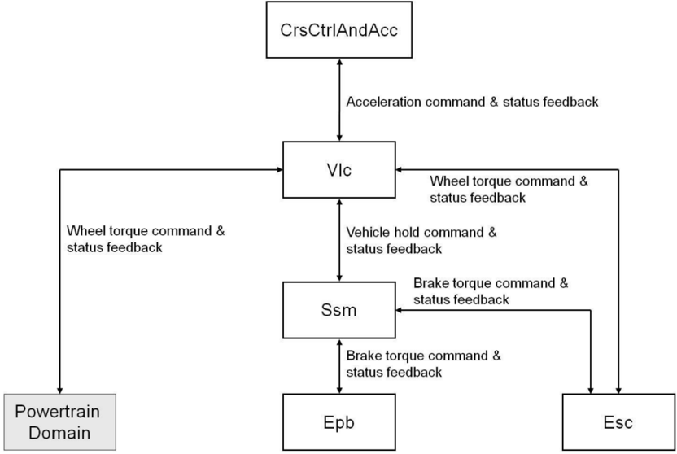

### 4.6. 软件组件 Rsc（Roll Stability Control，侧翻稳定控制）

Rsc SW-C 的目标是防止车辆侧翻。为此，它控制车辆的侧倾运动，即通过减小轮胎接触面处的侧向力来控制车身侧倾角。这些力的减小可以通过向 Esc SW-C 请求制动力矩和/或经由 Esc SW-C 向动力总成域请求动力总成力矩来实现。

### 4.7. 软件组件 Steer（Steering System，转向系统）

Steer SW-C 的三个主要功能（每个功能由特定的执行器实现）为：

- 基本转向力矩叠加（BSTS）：它提供转向力矩以在转向操作中支持驾驶员。这是助力矩，即动力转向助力或力矩叠加功能。
- 基本转向角叠加（BSAS）：它在驾驶员的转向盘转角上提供附加的前轮转向角，以在转向操作中支持驾驶员。这包括 VGR 功能（可变传动比）与「Lead Lag」补偿功能。
- 基本后轮转向（BRWS）：它生成后轮转向角以在转向操作中支持驾驶员。

小齿轮角与车轮转角之间的换算是 Steer SW-C 的一部分。该车轮转角被提供给其他 SW-C，例如 Esc SW-C。Steer SW-C 接收来自下文所述的高级转向功能的请求（转角请求或力矩请求）。Steer SW-C 对请求进行仲裁并将其分派给不同的转向执行器，如图 4.6 所示。

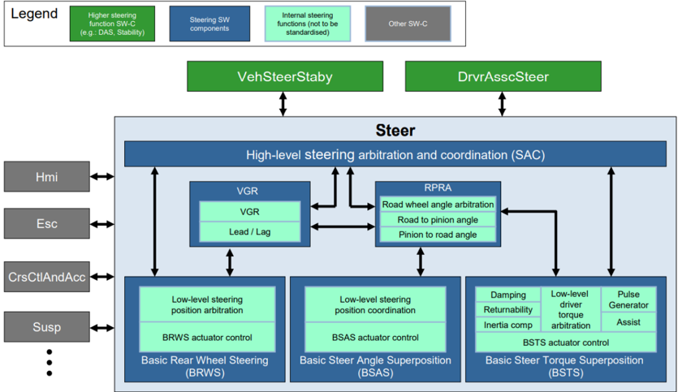

该架构的一种可能物理实现见图 4.7。

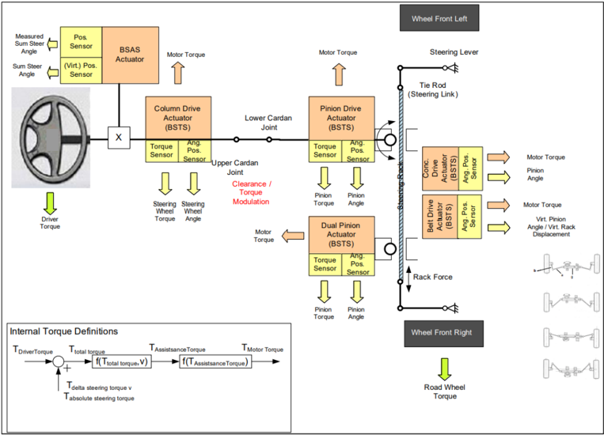

### 4.8. 软件组件 SteerDrvrAsscSys（Steering Driver Assistance System，转向驾驶辅助系统）

在当前版本中，SteerDrvrAsscSys SW-C 是向 Steer SW-C 发送请求的高级车辆舒适性功能的占位符。这些请求的性质（转角或力矩）取决于车辆搭载的转向系统。

这些高级转向驾驶辅助系统功能的示例有：

- 车道保持（Lane Keeping）
- 泊车辅助（Parking Aid）
- 触觉反馈请求（Haptic Feedback Request）

### 4.9. 软件组件 SteerVehStabyCtrl（Steering Vehicle Stabilizing Control，转向车辆稳定控制）

在当前版本中，SW-C SteerVehStabyCtrl 是 ESC 稳定系统的附加功能，作用于主动转向执行器：

- 叠加转向角执行器（前轴和/或后轴）
- 叠加转向力矩执行器（前轴）

其目的是在特殊行驶工况下，以比 ESC 内部 YRC 更舒适的方式改善车辆稳定性：

- 过转向支持
- 分离附着系数（splitµ）制动支持

由于功能细节取决于执行器能力，而叠加转向角执行器与转向力矩执行器的能力不同，下文按所用执行器组织用例描述。

#### 4.9.1 叠加转向角执行

使用叠加转向角执行器的目的是在特殊行驶工况下，通过减小驾驶员稳定车辆的负担，以比 ESC 内部 YRC 更舒适的方式改善车辆稳定性：

- 过转向支持：
  - 过转向控制功能在检测到过转向工况时，计算用于自动反向转向的转向角请求。
  - 该功能使用叠加转向角装置，按照驾驶员意图与物理极限稳定车辆。
  - 过转向工况由目标横摆角速度与实测横摆角速度之差检测。
  - 由于转向干预对驾驶员而言更舒适，它们可以比 ESC 的制动干预更早开始，且不稳定行驶工况更容易被控制。这一过程尽可能做到驾驶员不可感知，且速度损失最小。
- 分离附着系数（splitµ）支持：
  - 当在左右两侧摩擦系数不同（splitµ）的道路上制动或加速时，不均衡的车轮力会产生不期望的横摆力矩。该横摆力矩由 SteerVehStabyCtrl SW-C 请求的自动反向转向角干预来补偿。这大幅降低了驾驶员的转向负担。
  - 由于自动反向转向比驾驶员反向转向更快，因此可以容忍来自不均衡力的横摆力矩更快地建立。通过修改 ESC 内部横摆力矩建立延迟的参数，还可以缩短制动距离。

#### 4.9.2 叠加转向力矩执行

使用叠加转向力矩执行的目的是以比 ESC 内部 YRC 更舒适的方式改善车辆稳定性，并增强驾驶员的安全感，尤其是在特殊行驶工况下：

- 过转向：
  - 过转向控制功能在检测到过转向工况时，计算转向力矩指令以支持驾驶员反向转向。过转向工况例如由目标横摆角速度与实测横摆角速度之差检测。
  - 由于转向干预对驾驶员而言更舒适，它们可以比制动干预更早开始，且不稳定行驶工况能被更精细地控制。
- 分离附着系数（splitµ）支持：
  - 当在左右两侧摩擦系数不同（splitµ）的道路上制动或加速时，驾驶员必须针对不均衡车轮力产生的横摆力矩进行反向转向。splitµ 控制功能计算转向力矩请求以支持驾驶员反向转向。
  - 由于受辅助的反向转向比驾驶员单独反向转向更快，因此可以容忍来自不均衡车轮力的横摆力矩更快地建立。通过修改 ESC 内部横摆力矩建立延迟的参数，还可以缩短制动距离。

### 4.10. 软件组件 Susp（Suspension System，悬架系统）

SW-C Susp 控制的内容除其他外包括：

- 车身高度（高度控制）
- 制动与加速期间的车身俯仰
- 转弯与直线行驶期间的车身侧倾
- 通过悬架在崎岖路面上的平顺性控制与车轮力控制
- 通过悬架的侧倾行为

车辆上可能搭载的不同悬架执行器有：

- 半主动减震器
- 可切换减震器
- 主动稳定杆
- 可切换稳定杆（半主动稳定杆）
- 可切换弹簧
- 车身高度执行器

为描述悬架用例，建立了一种独特的方法：功能与技术矩阵，见表 4.3。图 4.8 给出了 SW-C Susp 的概览。

表4.3：悬架功能矩阵（**Feature Matrix Suspension**）

| | 半主动/可切换减震器 | 主动/可切换稳定杆 | 可切换弹簧车身高度执行器（仅车身高度控制） |
| --- | --- | --- | --- |
| 车身高度控制 | no | no | partly |
| 平顺性控制与车轮力控制 | yes | no | partly |
| 车身俯仰控制 | yes | no | yes |
| 车身侧倾控制 | yes | yes | yes |

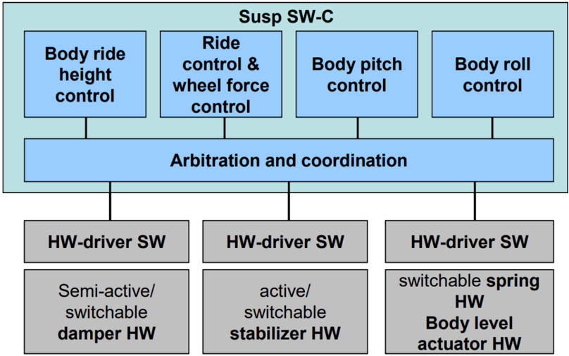

### 4.11. 软件组件 TirePMon（Tire Pressure Monitoring，胎压监测）

SW-C TirePMon 的目标是监测并识别显著的胎压损失。已知有两种不同的方法：

- 直接测量系统用内置于轮胎或轮辋的传感器测量胎压与温度，并通过射频传输将信息传给接收器。
- 间接测量系统基于轮速信息计算胎压。下文的详细描述仅涵盖间接系统。

间接测量系统的物理原理：

- 基于周长的方法：胎压是滚动周长变化的函数。
  - 将每个车轮的当前周长与学习到的默认值进行比较
  - 检测 1、2 或 3 个车轮的胎压损失
  - 胎压下降 30% 会导致轮速增加 0.2% 至 0.5%
- 基于频率的方法：胎压是轮胎共振频率的函数。
  - 将每个车轮的「共振频率」（通常约 42 Hz）与学习到的默认值进行比较
  - 检测所有车轮同时发生的胎压损失

这些物理原理的组合也是可能的。

有两种主要运行模式：

- 标定
  - 驾驶员「复位」系统，例如因更换轮胎
  - TirePMon（直接测量系统）将胎压标定到预设值，或（间接测量系统）在标称胎压下学习相对轮速差
- 检测
  - TirePMon 监测胎压，并分别通过直接测量、或（间接测量系统）将当前轮速信息与标定期间学习到的值进行比较，来检测显著的胎压损失。

### 4.12. 软件组件 DtTqDistbn（Drivetrain Torque Distribution，传动系力矩分配）

SW-C DtTqDistbn 包括对除发动机、变速器与手动变速器离合器之外的所有用于影响车辆横向动力学的动力矩分配主动传动系部件的控制，例如：

- 限滑差速器
- 力矩矢量分配装置
- 电控多片离合器（hang-on coupling，on-demand 四驱离合器）

它还包括针对单前轮或后轮驱动的依赖车轴的干预。

它不包含执行器控制。DtTqDistbn SW-C 将上述传动系部件用作智能执行器。

DtTqDistbn SW-C 影响车辆动力学的用例：

- 基础力矩分配
- 牵引力控制
- 分离附着系数（splitµ）支持
- 横摆角速度控制
- 操稳平衡

为了在众多传动系配置中控制多种传动系部件，定义了到三种基本传动系部件的接口：

1. 电控多片离合器（hang-on coupling）
2. 主动差速器
3. 力矩矢量分配装置

这些执行器的原理布局见图 4.9。

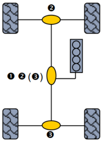

#### 4.12.1 电控多片离合器（Hang-on Coupling）

电控多片离合器是一种速度转换器。它将力矩从输入轴传递到输出轴。其框图见图 4.10。

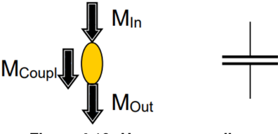

- 只有在输入轴与输出轴之间存在转速差时才能施加 M&lt;sub&gt;Coupl&lt;/sub&gt;
- 控制：
  - M&lt;sub&gt;Coupl&lt;/sub&gt; = M&lt;sub&gt;out&lt;/sub&gt; = f（离合器力，转速差）
  - 离合力受夹紧力限制
  - 对于控制，除当前施加的合离合器力之外，「执行器潜力」（actuator potential）指示可以（潜在）传递的最大力矩，其受例如过热、磨损、设计等限制。该执行器潜力可随时间变化。
- 输出力矩的范围在零与 M&lt;sub&gt;In&lt;/sub&gt; 之间：M&lt;sub&gt;out&lt;/sub&gt;/M&lt;sub&gt;in&lt;/sub&gt; = [0, 1]
- 符号约定：从较快的轴到较慢的轴为正

#### 4.12.2 主动差速器（Active Differentials）

主动差速器是一种将输入力矩分配给两个以不同转速运转的输出轴的装置。它通常由一个锥齿轮与一个可电控或液压控制的离合器组成。其框图见图 4.11。

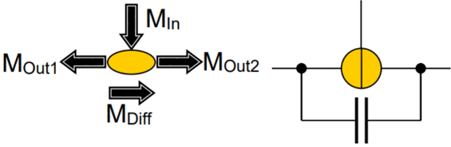

- M&lt;sub&gt;Diff&lt;/sub&gt; 是左右差动力矩的绝对值，可电控或液压控制。
- 为了将力矩从一侧传递到另一侧，设有一个离合器，例如在 splitµ 路面上，低附着系数一侧会空转。为避免这一点，离合器可以将力矩从一侧传递到另一侧。
- 用主动差速器进行力矩传递的前提是两个输出轴的转速存在差异。直线行驶时，左右各分配 50%/50%。离合器无法传递力矩。
- 力矩偏置比、摩擦损失等特殊效应不予考虑。
- 由于输入轴与输出轴之间可能存在传动比，M&lt;sub&gt;In&lt;/sub&gt; 必须与输出 M&lt;sub&gt;Out1,2&lt;/sub&gt; 处于同一层级考虑。
- 符号约定：
  - M&lt;sub&gt;Diff&lt;/sub&gt; 离合力矩：从较快一侧到较慢一侧，恒为正
- 控制：
  - 汇总的差动力矩 M&lt;sub&gt;Diff&lt;/sub&gt; = f（离合器力，转速差）
  - 由于只有存在转速差时才能施加差动力矩，「最大力矩」指示假如存在转速差时可潜在传递的力矩。该力矩受离合器夹紧力限制。
  - 对于控制，除当前施加的离合器力与最大力矩之外，「执行器潜力」指示可以（潜在）传递的最大值，其受例如过热、磨损、设计等限制。该执行器潜力可随时间变化。

#### 4.12.3 力矩矢量分配装置（Torque Vectoring Device）

与主动差速器一样，力矩矢量分配装置通过液压或机械装置将输入力矩分配给两个输出轴。与主动差速器不同的是，力矩矢量分配装置通过合适的齿轮组在内部「产生」轴间所需的转速差。这意味着，即使输出轴之间没有转速差，力矩矢量分配装置也能建立力矩差。其框图见图 4.12。

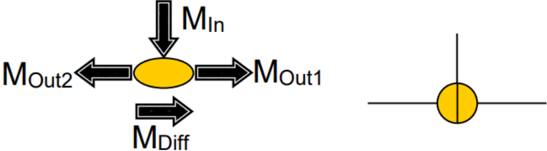

- 力矩分配：
  - M&lt;sub&gt;Out1&lt;/sub&gt; = 1/2 ∗ ( M&lt;sub&gt;In&lt;/sub&gt; + M&lt;sub&gt;Diff&lt;/sub&gt; )
  - M&lt;sub&gt;Out2&lt;/sub&gt; = 1/2 ∗ ( M&lt;sub&gt;In&lt;/sub&gt; − M&lt;sub&gt;Diff&lt;/sub&gt; )
  - M&lt;sub&gt;Out1&lt;/sub&gt; + M&lt;sub&gt;Out2&lt;/sub&gt; = M&lt;sub&gt;In&lt;/sub&gt;
  - M&lt;sub&gt;Out1&lt;/sub&gt; − M&lt;sub&gt;Out2&lt;/sub&gt; = M&lt;sub&gt;Diff&lt;/sub&gt;
  - 1 = 右或前；2 = 左或后
- 由于输入轴与输出轴之间可能存在传动比，M&lt;sub&gt;In&lt;/sub&gt; 必须与输出 M&lt;sub&gt;Out1,2&lt;/sub&gt; 处于同一层级考虑。
- M&lt;sub&gt;Diff&lt;/sub&gt; 是 1 与 2 之间差动力矩的绝对值，可受控。
- 符号约定：
  - M&lt;sub&gt;Diff&lt;/sub&gt; 离合力矩：向右或前为正
- 控制：
  - 差动力矩 M&lt;sub&gt;Diff&lt;/sub&gt;
  - 对于控制，除当前施加的差动力矩之外，「执行器潜力」指示可以（潜在）传递的最大值，其受例如过热、磨损、设计等限制。该执行器潜力可随时间变化。

### 4.13. 软件组件 SurrndgsSnsr（Surroundings Sensor，环境传感器）

SW-C SurrndgsSnsr 的角色是提供关于其他本地交通参与者以及与本车运动相关的静止物体（如车道标线）的信息。注意，关于交通参与者的信息不仅计划用于 ACC，也用于其他潜在用例（例如乘员安全系统）。

该 SW 组件的任务包括例如：

- 传感器信号处理
- 传感器硬件监测（致盲检测）
- 传感器失准的确定与补偿
- 物体跟踪与聚类
- 物体属性的确定与分类

### 4.14. 软件组件 ChassisSnsr（Chassis Sensor，底盘传感器）

SW-C ChassisSnsr 提供供底盘域内各 SW 组件使用的传感器信息。例如，SW-C ChassisSnsr 提供以下传感器信息：

- 纵向/横向/垂直加速度
- 车身高度
- 横摆/侧倾/俯仰角速度
- 侧倾/俯仰角
- 转向盘转角
- 转向盘力矩

注意这些传感器信息也可用于其他域。

说明：这些传感器属于前文所述的内部状态传感器。

### 4.15. 软件组件 PrkgAid（Parking Aid，泊车辅助）

SW-C PrkgAid 提供由超声波传感器测得的、不同泊车区段内检测到的障碍物距离。超声波传感器的典型用途见图 4.13：展示了 8 个超声波传感器的相关泊车区段，前部与后部的检测。

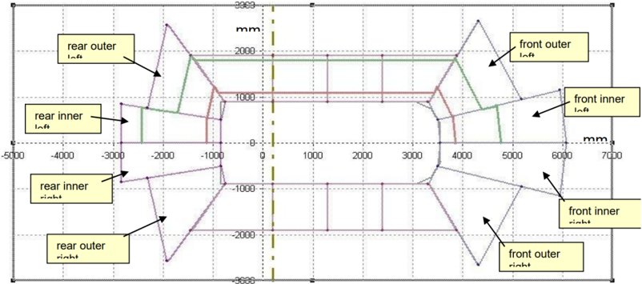

这些距离非常适合用于其他驾驶辅助功能，例如用于合理性检查。这些距离与这些信号的状态信息（枚举）一起，在 8 个区段各自的记录中组合。

## 5. 展望

### 5.1. 底盘域结构

对于 AUTOSAR R4.0 版本，SW-C 与应用接口的定义基于第 [3](#3-架构概览) 章所述的假定底盘域结构。该结构是许多其他可能结构与配置中的一个示例。在 AUTOSAR Phase II 期间，已讨论了若干结构。已经制定了一个更复杂、更强大结构的示例，见图 5.1。

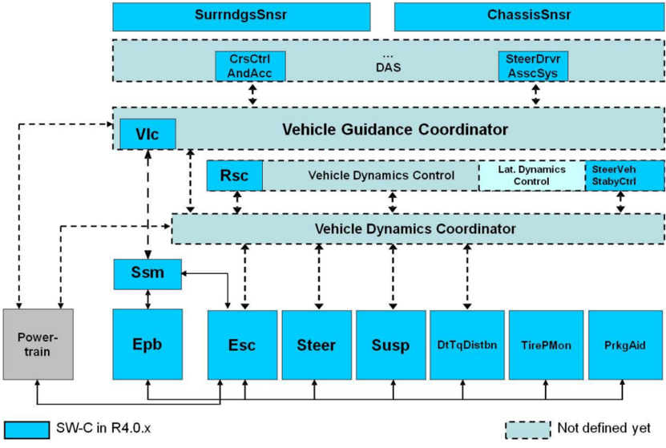

该结构由三层组成：

- 车辆引导层，包括 DAS 功能与车辆引导协调器（Vehicle Guidance Coordinator），
- 车辆稳定层，包括车辆动力学控制功能（如 RSC、横向动力学控制、转向 VSS）与车辆动力学协调器（Vehicle Dynamics Coordinator），
- 执行器系统及其关联的控制功能。

车辆引导协调器（Vehicle Guidance Coordinator）：

- 车辆引导协调器的目标是对来自车辆引导功能的车辆纵向与横向轨迹请求进行仲裁，并将其分配给执行器系统。
- 向车辆动力学协调器与动力总成域发送请求。

车辆动力学协调器（Vehicle Dynamics Coordinator）：

- 车辆动力学协调器的目标是对车辆稳定请求进行仲裁，并将其分配给执行器系统及其关联的控制功能。

### 5.2. 可扩展性

即使是这样一种更复杂结构的示例，也必须应对大量配置。该结构可扩展性的示例见图 5.2 至图 5.4。

- 用例：ESC、动力总成与胎压监测（TirePMon）

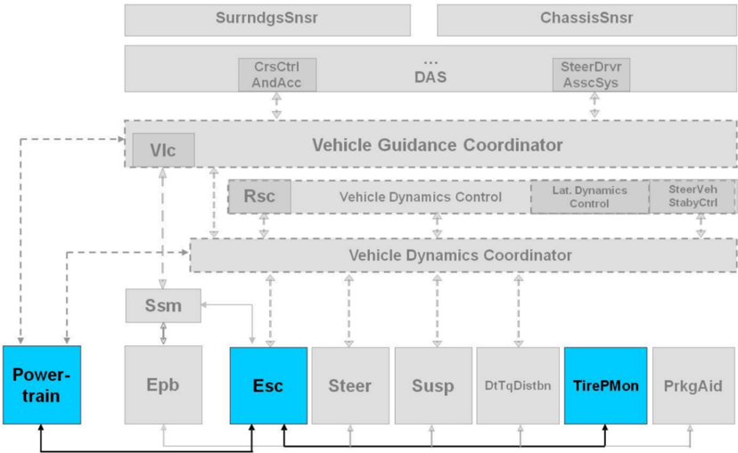

- 用例：巡航控制

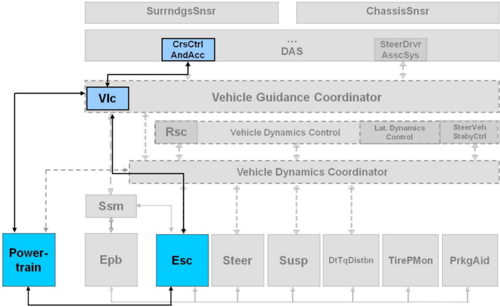

- 用例：转向 DAS 叠加转向力矩

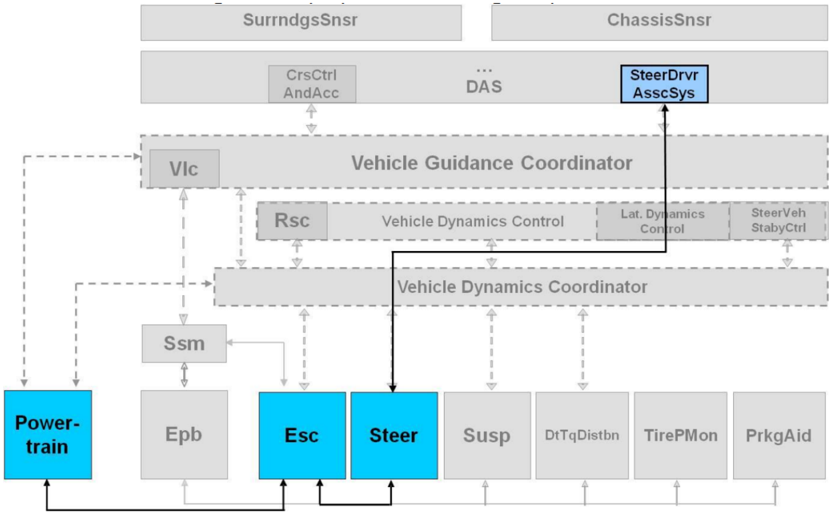
