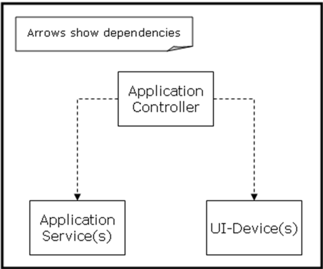
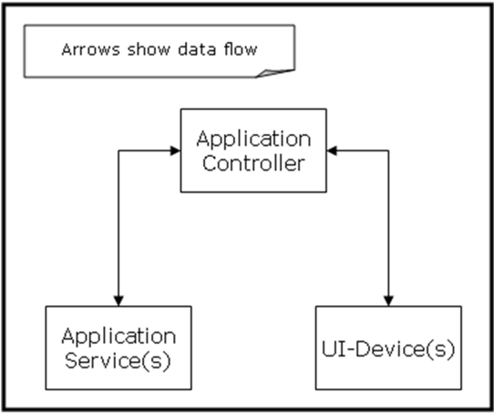
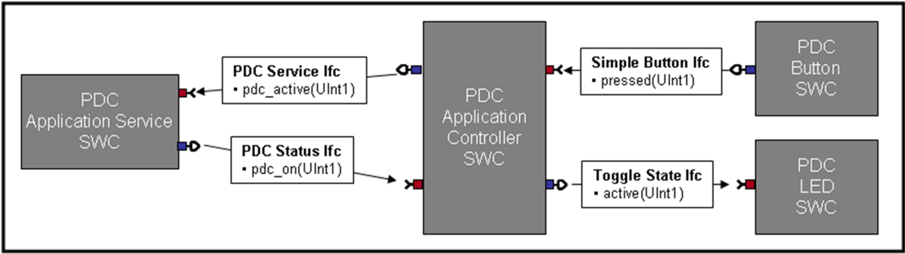
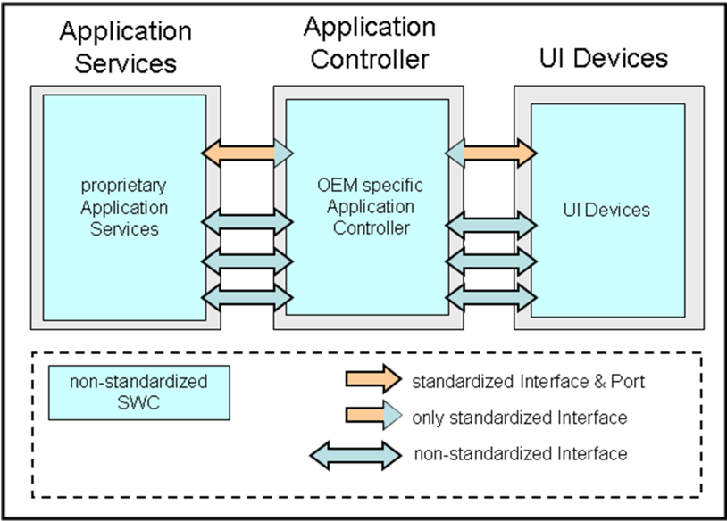
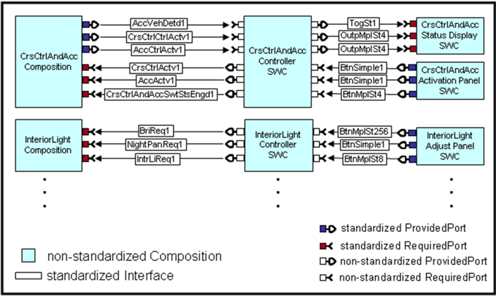
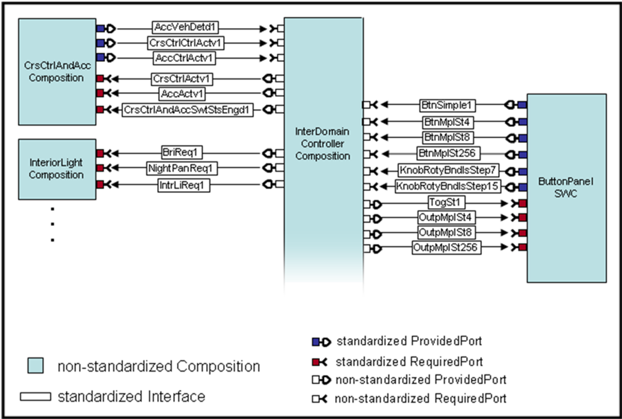

<!-- 源文档 AUTOSAR_CP_EXP_AIHMIMultimediaAndTelematics（R23-11），讲述型指南（EXP），不受 Type A 七章骨架约束；章节结构镜像源文档自身编号（1–7）。PDF→markdown 转换中溢出的图内文字（端口名、图例）按转换噪声剔除。 -->

## 1. 文档目的

本文档的目的是为多媒体（Multimedia，MM）、远程信息处理（Telematics，T）与人机接口（Human-Machine-Interface，HMI）子域所标准化的端口与接口提供解释。

截至本版本，HMI 子域中仅标准化了部分简单的 UI（User Interface，用户界面）设备接口（例如按钮、旋钮等）。

第 [3](#3-引言) 章简要介绍 MM/T/HMI 域的结构与特性；此外，对该域的高层需求也在同一章中描述。第 [4](#4-基本架构) 章给出 MM/T/HMI 域的域架构概览。第 [5](#5-软件组合与组件的描述) 章解释已标准化的 MM/T/HMI 端口与接口。

## 2. 缩略语与缩写

表2.1：本文档范围内使用的缩略语与缩写（**Acronyms and abbreviations used in the scope of this Document**）

| 缩写/缩略语 | 说明 |
| --- | --- |
| HMI | Human Machine Interface（人机接口） |
| LED | Light Emitting Diode（发光二极管） |
| MM/T/HMI | Multimedia / Telematics / Human Machine Interface（多媒体/远程信息处理/人机接口） |
| PDC | Park Distance Control（泊车距离控制） |
| SWC | Software Component（软件组件） |
| UI | User Interface（用户界面） |

## 3. 引言

MM/T/HMI 域复杂且相当庞大，不同类型的 SW 组件之间为实现各种目的而存在大量交互。MM/T/HMI 域包含不同应用类型的 SW 组件，例如多媒体、远程信息处理或 HMI 应用。此外，一些 SW 组件可由两种或更多应用类型共享。例如，视频显示器及其关联的 SW 组件由多媒体应用与 HMI 应用共享。HMI 域本身也很复杂，并且各汽车 OEM 对其设计与处理方式各不相同。

HMI 的方法与需求是异构的。有些系统非常简单，有些则非常复杂。一些系统设计希望保持对 HMI 逻辑的完全控制；另一些系统设计则需要一种通用的方法，使 HMI 核心软件的主体能够轻松地跨系统（即不同车型）复用。后一种方法需要强大的 HMI 核心软件，它不感知 HMI 设计流程，而是由其他组件指挥其执行 HMI 设计流程。当然，两种方法都是有效的，都应被所建议的架构覆盖。每种方法需要不同类型的 HMI 应用接口。域的复杂性以及对域架构的不同视角与需求，要求采用一个定义良好的分层且灵活的架构方法。该架构的目标是提供对最常用功能的访问，并允许不同的 HMI 架构设计，而不强加某种特定设计。

该架构旨在：

- 将「功能核心」世界与 HMI 世界分离
- 将 HMI 逻辑与 HMI 呈现分离
- 集中管理 HMI 资源（例如音频与显示器）
- 抽象物理设备（例如键盘）

## 4. 基本架构

本节描述一个简单系统的架构，以及用于区分不同类型应用组件（SWC）的术语。

该架构的基本原则是：将 HMI 部分与非 HMI 部分分离，将 OEM 特定部分与非 OEM 特定部分分离。

一个典型的架构包含以下几种类型的 SWC，如下一页的概览图所示。

这三种类型的 SWC 具有以下职责：

**1. 应用服务 SWC（Application Service SWC）**

主要功能的实现，例如 PDC（泊车距离控制）、CD/媒体播放器或后视镜调节。该功能独立于 HMI（Look &amp; Feel）。

**2. UI 设备 SWC（UI-Device SWC）**

所有用户界面（UI）设备（输入与输出设备）的表示。UI 设备的定义应不感知其所连接的功能。例如，一个开关 PDC 功能的按钮 SWC 应只提供「按下/未按下」信息，而不是 PDC 开/关信息（以使按钮可复用）。输入设备的例子有按钮、操纵杆、麦克风、触摸屏。输出设备的例子有屏幕、LED、蜂鸣器、振动装置。

**3. 应用控制器（Application Controller）**

应用控制器将应用服务映射到 UI 设备。它既负责行为（HMI 逻辑），也负责与 UI 设备的连接（HMI）。该组件在大多数情况下是高度 OEM 特定的。

这种架构使得应用服务可以在不同的 HMI 场景（例如带或不带显示屏的 HMI、语音识别等）中复用。这样，应用服务就独立于 HMI。

将 HMI 特定与 OEM 特定的方面封装在应用控制器中，使得应用服务与 UI 设备都可以复用——只需更改应用控制器即可获得所期望的行为。

**数据流（Data Flow）**

下面的概览展示了应用服务/应用控制器/UI 设备系统的数据流。注意，应用服务与 UI 设备之间绝不应有直接的数据流，因为一个基本原则是：UI 设备应当是通用的，对应用服务一无所知。

### 4.1. 应用服务 SWC

应用服务是实现 HMI 相关应用功能的 SWC。HMI 相关应用有很多例子：

- 泊车距离控制应用
- AM/FM 调谐器应用
- 导航应用
- 空调控制应用

应用服务不必特定于 MM/T/HMI 域，也可以派生自任何其他与用户交互的域，例如行驶动力学功能。这些应用中的一部分的端口与接口已在 AUTOSAR 内标准化，另一些可能在不同的标准化组织（例如 MOST 合作组织）中标准化。

本文档定义的 HMI 基本架构必须能够应对这一需求。为此引入了应用控制器 SWC 类型。

### 4.2. 应用控制器 SWC

应用控制器可以被看作应用服务的 HMI 特定包装器。由应用控制器实现的应用中 HMI 特定的部分包括以下方面：

- 决定应用服务提供的哪些数据以何种方式（音频、视频等）呈现给用户
- 解释用户输入并控制应用服务的功能
- 决定应用服务希望在何时处于活动状态（「请求焦点」）

每个 OEM 都会定义其特定的 HMI 行为（尤其是针对每个车辆变型）。因此，应用控制器对于每个 HMI 系统都是不同的。

### 4.3. UI 设备 SWC

UI 设备 SWC 提供来自用户的输入与到用户的输出。这些组件是输入与输出硬件设备的访问点。此类设备例如按钮、操纵杆、麦克风、屏幕、LED、蜂鸣器等。

请注意，有一些本工作包不处理的域特定 UI 设备，例如加速踏板。这些域特定 UI 设备与特定的应用服务强耦合，几乎不可复用。

输入 UI 设备 SWC 经由 I/O 抽象层或复杂驱动（Complex Driver）从输入硬件获取输入信号。然后它们转换所接收的输入信号，并经由标准化的应用接口将它们提供给其他（可能是远程的）SWC。

输出 UI 设备 SWC 用于经由输出硬件设备向用户提供输出。UI 设备 SWC 转换从其他 SWC 接收的输出数据，并经由 I/O 抽象层将其传递给输出硬件设备。

### 4.4. 示例：AUTOSAR PDC 应用

本节以泊车距离控制（PDC）应用为例解释 UI 设备接口的使用。这仅是一个示例，与实际标准化的 AUTOSAR PDC 端口和接口没有任何关系；后者在《车身与舒适域应用接口说明》文档 [\[1\]](#ref-1) 中解释。

基于上一节介绍的 MM/T/HMI 架构，示例 PDC 功能使用以下 SWC 实现：

1. PDC 应用服务 SWC
2. PDC 应用控制器 SWC
3. PDC 按钮 SWC
4. PDC LED SWC

PDC 应用服务提供 PDC 的基本功能（处理传感器、计算到障碍物的距离等）。PDC 控制器的主要目的是实现应用特定的 PDC 应用服务 SWC 与不感知 PDC 应用服务的 UI 设备之间的通信。

PDC 应用控制器使用两个接口与 PDC 应用服务通信：

- PDC 服务接口（PDC Service Interface）
- PDC 状态接口（PDC Status Interface）

这些接口由 PDC 域专家提供，并且必须独立于呈现给用户的用户界面。

为了保持示例简单，本示例省略了到用户的距离反馈。示例 PDC 应用控制器仅使用两个通道与用户界面通信：

- 一个简单的硬按钮，用于打开或关闭 PDC 功能（PDC 按钮 SWC）
- 一个 LED，用于向驾驶员反馈 PDC 功能处于打开还是关闭状态（PDC LED SWC）

图 4.3 描绘了用所引入 SWC 规格化的 PDC 功能。简单按钮接口（Simple Button Interface）实现 PDC 硬按钮的通信通道。数据字段「pressed」使用一位编码表达按钮被按下/释放。切换状态接口（Toggle State Interface）实现 LED 反馈通信通道。数据字段「active」使用一位编码表达 LED 处于激活/未激活状态。两个 UI 设备都独立于 PDC 功能。

两个接口都使用 AUTOSAR 发送/接收通信范式。

简单按钮接口与切换状态接口可以轻松连接到其他应用控制器，而无需更改 UI 设备接口。

## 5. 软件组合与组件的描述

本章介绍基本架构中在 AUTOSAR 内标准化的部分。

图 5.1 描绘了 HMI 基本架构中由 AUTOSAR 定义的部件。一些应用服务的接口与端口在 AUTOSAR 内标准化。应用控制器是 OEM 特定的，因此不在 AUTOSAR 内标准化。部分 UI 设备接口将在 AUTOSAR 内标准化。

图 5.2 展示了一个真实系统使用标准化的 AUTOSAR 应用服务接口与端口以及标准化 UI 设备接口的示例。

应用行为向用户的呈现（HMI 行为）始终是供应商乃至车辆变型特定的（硬按钮 vs. 触摸屏）。将应用服务到 UI 设备的映射标准化不在 AUTOSAR 的范围内。因此，没有任何应用控制器端口被标准化，因为它们定义了一个系统的 UI 设备映射。

在 AUTOSAR 应用接口模型中，使用了两个「虚拟辅助组合」（virtual helper compositions），作为真实系统的应用控制器与 UI 设备 SWC 的占位符。虚拟 ButtonPanel SWC 是 UI 设备 SWC 的占位符，InterDomainController 替代应用控制器（见图 5.3）。

### 5.1. 按钮面板组件（Button Panel Component）

ButtonPanel 是一个「虚拟辅助 SWC」，充当真实系统会包含的所有系统特定 UI 设备 SWC 的占位符（见图 5.3）。

ButtonPanel 为简单 UI 设备（如硬按钮、开关、LED 等）聚合了一组标准化的端口与接口。

UI 设备接口的标准化遵循以下原则：

- UI 设备接口永远不应特定于某种功能。
- UI 设备接口应尽可能在最基础的层级上标准化。如果需要更高级的功能（例如 N ms 后的长按信号），则该功能必须分层置于 UI 设备之上。

请注意：Button Panel 组件并不打算在真实系统中原样使用。它只是一个用于对标准化输入与输出接口进行分组的虚拟示例 SWC。

#### 5.1.1 简单按钮接口（Simple button interface）

| 项目 | 说明 |
| --- | --- |
| 描述 | 用于发送一个简单的用户请求。该请求由一个支持「pressed（按下）」与「not pressed（未按下）」两个不同取值的按钮提供（例如打开/关闭泊车距离控制功能）。 |
| 备注 | 长按处理不属于简单按钮的一部分。输出值反映按钮的物理位置。 |

#### 5.1.2 切换状态接口（Toggle state interface）

| 项目 | 说明 |
| --- | --- |
| 描述 | 接受简单的取值信息（激活/去激活）。典型的实现是一个 LED，显示相应功能处于激活还是未激活状态（例如泊车距离控制功能状态被打开/关闭）。 |
| 备注 | 不支持其他状态（例如闪烁状态）。 |

#### 5.1.3 多状态按钮接口（Multi state button interface）

| 项目 | 说明 |
| --- | --- |
| 描述 | 当按钮/开关/旋钮等具有多于两个物理位置时，用于向相应 SWC 发送带多取值信息的用户请求。状态信息的取值范围可以从小到大。状态值始终是离散值。 |
| 备注 | 多状态按钮也可用于滑块/仪表类 UI 设备，尤其是当这些 UI 设备具有固定物理状态时（状态不由软件处理）。当前状态值应表示按钮/滑块/仪表等的物理位置。「0」（零）状态值应表示「off（关闭）」状态。 |

#### 5.1.4 多状态输出接口（Multi state output interface）

| 项目 | 说明 |
| --- | --- |
| 描述 | 为具有多种可能状态的 UI 硬件设备接受状态值信息。与多状态按钮一样，使用具有不同取值范围的状态值信息（见多状态按钮描述）。（例如取值范围 0–3 的座椅加热调节，作为状态信息。） |
| 备注 | 「0」（零）状态值应表示「off（关闭）」状态。 |

#### 5.1.5 无界旋钮接口（Boundless rotary knob interface）

| 项目 | 说明 |
| --- | --- |
| 描述 | 用于为没有可由用户分辨的明确物理位置的输入设备发送状态输出（例如没有起始/停止位置的旋钮/滚轮）。移动（例如顺时针 1 步）影响的是功能（例如增大音量），而不是设备的物理位置。 |
| 备注 | 传输的值是自上次传输的值以来的步数/移动量。注意，所选的值深度（例如 +/- 15 步用 5 bit）与物理位置的数量无关；它限制的是用户旋转旋钮时可以施加多少步。所选的值深度与更新间隔相关。较大的更新间隔使用户能够把旋钮转得更远，从而产生更多步数。 |

### 5.2. InterDomainController 组合

InterDomainController 是一个「虚拟辅助组合」（见第 [5](#5-软件组合与组件的描述) 章）。它并不打算在真实的 AUTOSAR 系统中使用。它仅仅是一个占位符，扮演真实系统会包含的各种专有的、高度系统特定的应用控制器的角色（见图 5.2）。

InterDomainController 组合负责处理标准化的 AUTOSAR 应用服务端口与 ButtonPanel 的端口之间的所有通信（见 [5.1 节](#51-按钮面板组件button-panel-component)）。

对于标准化的 AUTOSAR 应用服务所需的全部用户输入，它提供一个提供所需用户输入的端口。对于由标准化 AUTOSAR 应用服务端口提供的到用户的反馈，它提供相应的必需端口（RequiredPorts）。

真实世界的应用控制器会将应用服务的用户输入与输出映射到 UI 设备。如第 [5](#5-软件组合与组件的描述) 章所述，将这种映射标准化不在 AUTOSAR 的范围内。因此，InterDomainController 并没有为每一个所需的/提供的用户输入/输出都连接相应的 UI 设备。它对每个标准化 UI 设备接口只有一个端口，以指示它在整体架构中所扮演的角色。

## 6. 术语表

若干广泛使用的术语需要在本档范围内具有唯一且共享的定义。

- **应用（Application）**：为解决需要信息处理的最终用户问题而规格化的软件（或程序）。

  一个应用具有功能部分（应用服务）与 HMI/行为部分（应用控制器）。

- **域（Domain）**：参照某种语义同质性归并在一起的车辆功能集合。在 AUTOSAR 中有 5 个功能域：车身与舒适、动力总成、底盘、乘员与行人安全、HMI/远程信息处理/多媒体。一个域可以划分为子域。
- **架构（Architecture）**：系统的基本组织，体现于其组件、组件之间以及组件与环境之间的静态与动态关系，以及指导其设计与演进的原则。
- **HMI 逻辑（HMI logic）**：被允许且所期望的用户交互序列。
- **全局 HMI 逻辑（Global HMI Logic）**：系统中各应用之间被允许且所期望的用户交互序列。
- **特定 HMI 逻辑（Specific HMI Logic）**：给定应用内被允许且所期望的用户交互序列。
- **模态（Modality）**：到用户的输出通道的类型，例如音频或视频输出。

## 7. 参考文档

[1] 车身与舒适域应用接口说明（Explanation of Application Interfaces of the Body and Comfort Domain）
> AUTOSAR_CP_EXP_AIBodyAndComfort
