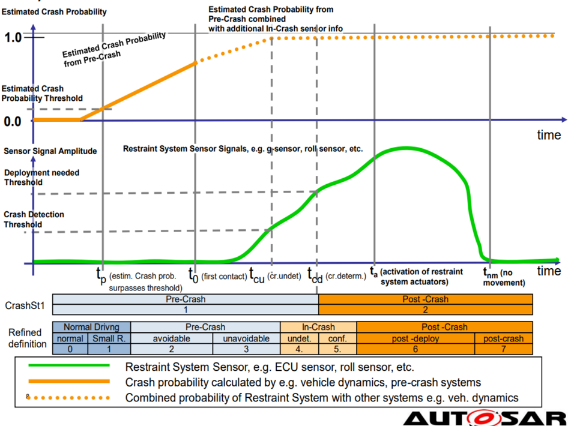
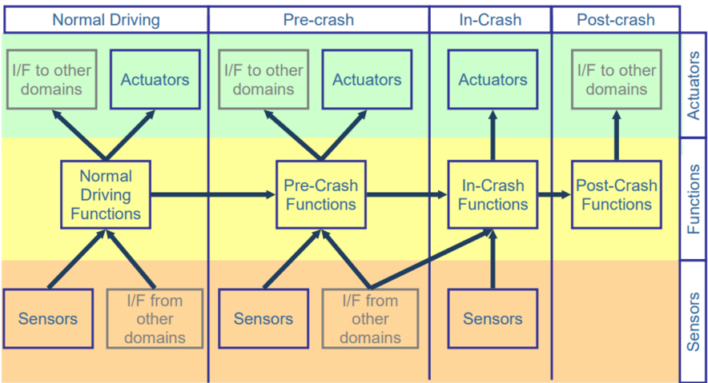
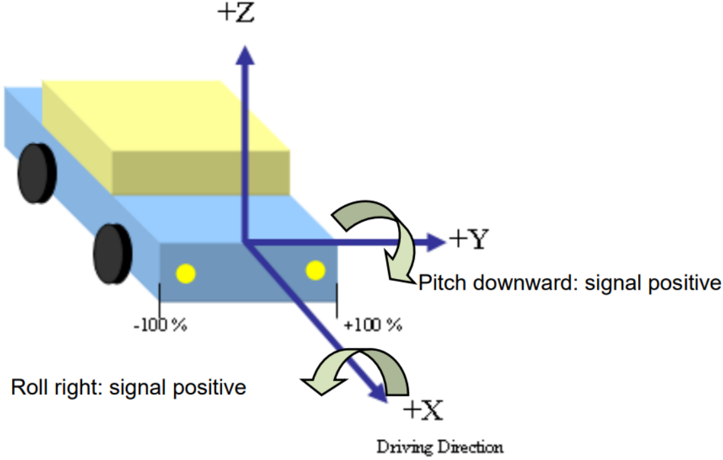
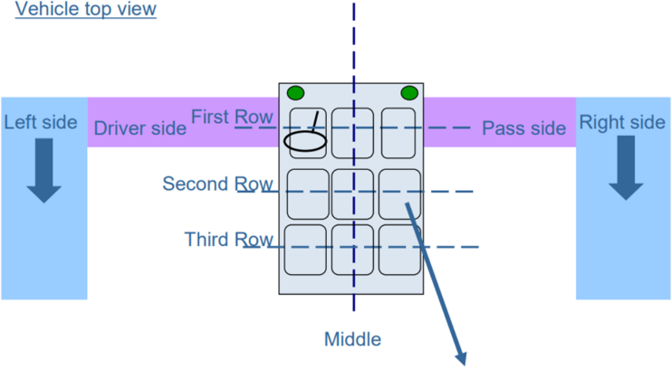
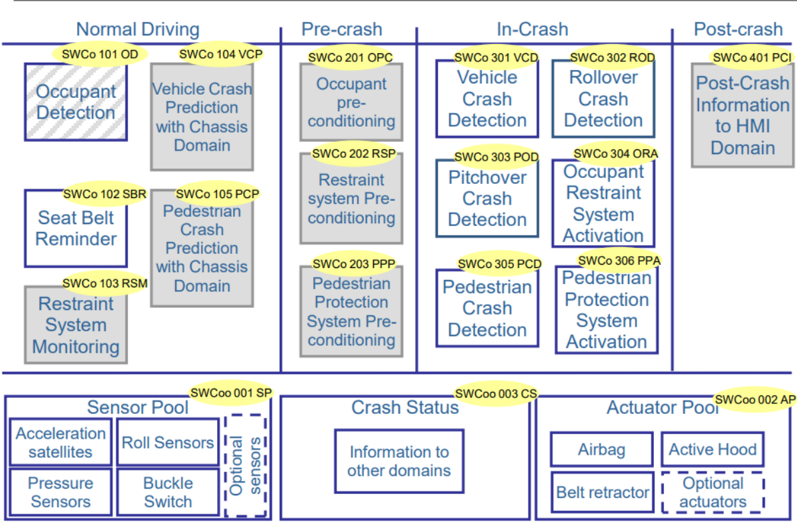
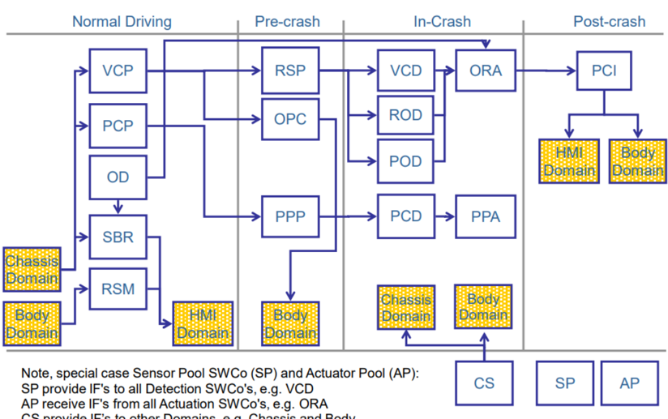
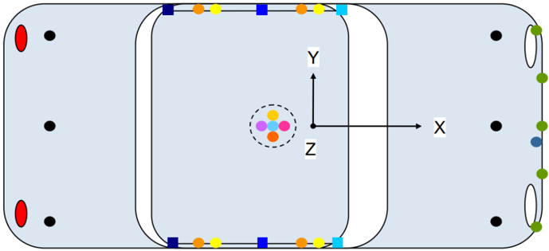
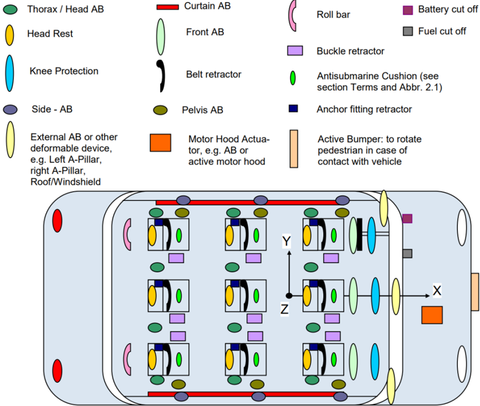
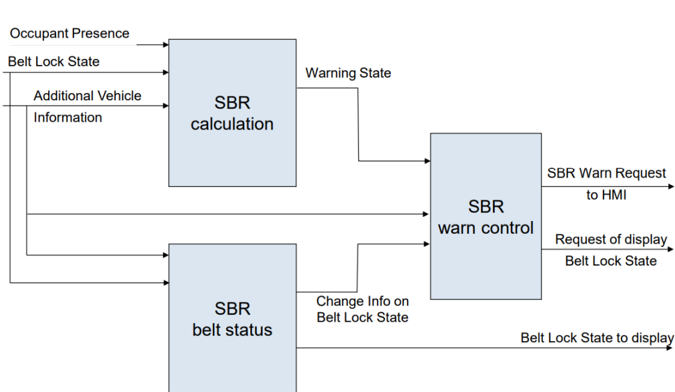
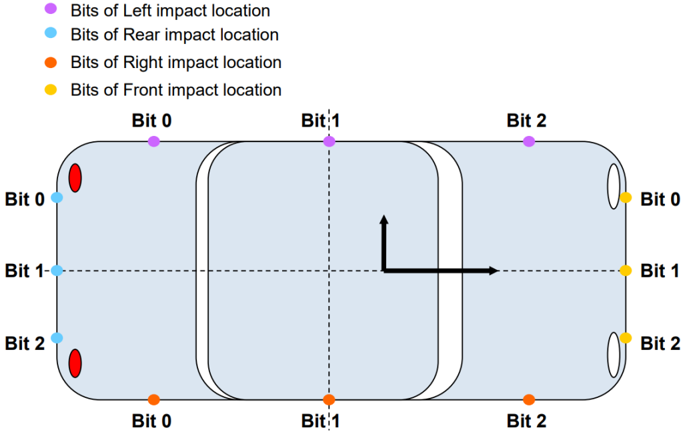

<!-- 源文档 AUTOSAR_CP_EXP_AIOccupantAndPedestrianSafety（R23-11），讲述型指南（EXP），不受 Type A 七章骨架约束；章节结构镜像源文档自身编号（1–5）。PDF→markdown 转换中溢出的图内文字（传感器/执行器位置标注、坐标刻度、图例）按转换噪声剔除。表 5.1/5.2 的行数按源 PDF 逐行核对（63/146 行）。 -->

## 1. 文档目的

本文档提供背景信息，例如促成「乘员与行人安全系统」（Occupant and Pedestrian Safety Systems）域应用接口定义的设计决策。

### 1.1. 参考文档

[1] 通用结构模板（Generic Structure Template）
> AUTOSAR_FO_TPS_GenericStructureTemplate

[2] 应用接口的 XML 规范
> AUTOSAR_CP_MOD_AISpecification

## 2. 术语与概念的描述

### 2.1. 缩略语与缩写

表2.1：本文档范围内使用的缩略语与缩写（**Acronyms and abbreviations used in the scope of this Document**）

| 缩写/缩略语 | 说明 |
| --- | --- |
| AB | Airbag（安全气囊） |
| AI | Application Interface（应用接口） |
| COOP | Critical Out of Position（严重离位） |
| eCall | Emergency Call（紧急呼叫） |
| HMI | Human Machine Interface（人机接口） |
| IF | Interface（接口） |
| OD | Occupant Detection（乘员检测） |
| OOP | Out Of Position（离位） |
| OPS | Occupant and Pedestrian Safety（乘员与行人安全） |
| OPSS | OPS Systems（OPS 系统） |
| ORA | Occupant Restraint Activation（乘员约束激活） |
| PCD | Pedestrian Crash Detection（行人碰撞检测） |
| PPA | Pedestrian Protection Actuator Activation（行人保护执行器激活） |
| SBR | Seat Belt Reminder（安全带提醒） |
| SRS | Safety Restraint System（安全约束系统） |
| SWC | Software Component（软件组件） |
| SWCo | Software Composition（软件组合） |
| VCD | Vehicle Crash Detection（车辆碰撞检测） |
| ROD | Rollover Crash Detection（翻滚碰撞检测） |
| POD | Pitchover Crash Detection（俯仰翻覆碰撞检测） |
| VH | Variant Handling concept（变型处理概念） |
| SP | Sensor Pool（传感器池） |
| AP | Actuator Pool（执行器池） |
| CS | Crash Status（碰撞状态） |
| ACC | Adaptive Cruise Controll |
| RSM | Restraint System Monitoring（约束系统监测） |
| VCP | Vehicle Crash Prediction（车辆碰撞预测） |
| PCP | Pedestrian Crash Prediction（行人碰撞预测） |
| OPC | Occupant Pre Conditioning（乘员预处理） |
| RSP | Restraint System Pre conditioning（约束系统预处理） |
| PPP | Pedestrian Protection system Pre conditioning（行人保护系统预处理） |
| VCD | Vehicle Crash Detection（车辆碰撞检测） |
| PCI | Post Crash Information（碰撞后信息） |

表2.2：本文档范围内术语的定义（**Definition of terms in the scope of this Document**）

| 术语 | 说明 |
| --- | --- |
| Antisubmarine（下潜） | 约束系统中与汽车应用相关的术语，指安全气囊在展开时通过托起乘员下半身、防止前排乘员下潜到仪表板下方。从而使人相对于前安全气囊处于更好的位置。 |

### 2.2. 「乘员与行人安全」域简介

乘员与行人安全领域旨在在发生碰撞的情况下保护车辆乘员与行人。在这个意义上，「碰撞」是一个相当宽泛的术语，用于对车辆与障碍物（正面、侧面、后部）发生碰撞、或与行人发生正面碰撞、甚至与地面碰撞（例如翻滚工况）等各种情形进行归类。

「碰撞」或「事故」的概念划定了 OPS 的范围，使其成为一个事件驱动的域。例如，车辆与灯杆发生侧面碰撞的事件会触发 SRS 展开侧面安全气囊，以防止乘员被因撞击而变形的车辆结构（如车门或 C 柱）撞到。

OPS 系统面向事件的特性使得将该域建模为一条阶段链成为合适的选择，每个阶段在某个确定的事件被触发后进入。下一节的时间线旨在给出主要 OPS 阶段及其对应事件的图形化表示。

### 2.3. OPS 阶段（事件时间线）

图 2.1 展示了一条汇总最重要 OPS 阶段的时间线。图中用一条传感器信号曲线代表性地描绘不同的碰撞阶段。每个 OPS 阶段被建模为由两个子阶段组成，从而进一步细化车辆相对于碰撞事件工况的状况。

这些 OPS 阶段可供其他域获知车辆处于事件的哪个阶段。简单的「碰撞后/碰撞前」分类对其他域而言通常已经足够，不过在先前的说明文档版本中曾提出过一个更细化的定义。

图 2.1 给出了这两种定义之间的对应关系。

#### 2.3.1 碰撞前阶段

碰撞前阶段可以划分为更细化的子阶段：

**正常行驶（Normal Driving）：**

车辆处于点火开启的状态（静止或行驶中），发生碰撞的概率极低。子阶段为：

- 正常行驶：在该子状态下未检测到明显的碰撞概率
- 具有小碰撞风险的正常行驶：在该子状态下存在较小的碰撞概率，但车辆的接触式碰撞传感器尚未检测到该事件。该阶段存在最小的碰撞风险，例如车辆稳定控制机制正在执行的工况

**碰撞前（Pre-Crash）：**

车辆处于正常行驶条件之外的工况，存在碰撞概率大于某个阈值的迹象。通常在该阶段激活可逆执行器，例如使乘员进入正确的坐姿，以便在随后的碰撞中获得 SRS 的最佳保护。子阶段为：

- 仍可避免的碰撞：碰撞前系统检测到碰撞危险，但仍评估出避免碰撞的机会，例如通过触觉警告、紧急制动或规避机动等手段
- 不可避免的碰撞：碰撞前系统得出结论，鉴于车辆及其环境的当前动力学状态，碰撞已无法避免

#### 2.3.2 碰撞后阶段

**碰撞中：已确定的碰撞（In-Crash: Determined collision）**

在「碰撞中：已确定的碰撞」工况下，通常激活不可逆执行器。碰撞事件还按其严重程度进一步分类，范围从轻微（例如激活安全带卷收器）到严重（例如激活安全气囊的第二级）。

**碰撞后（Post-Crash）：**

该状态在「碰撞中」工况之后进入，其后将出现：

- 在轻微程度的「碰撞中」事件后返回正常行驶条件，从而提供处理多次碰撞事件的机会
- 在「碰撞中」工况后达到静止
- 在约束执行器已被激活之后

**子阶段（Sub-phases）：**

- 部署后（Post-deployment）：在碰撞工况被确认后采取的首批动作。示例动作可以是车辆车门的自动解锁
- 碰撞后（Post-crash）：车辆再次达到静止，从而发起紧急呼叫

### 2.4. 域建模

当前所述域的范围限于被动安全功能。

其他功能，例如来自驾驶辅助系统（如 ACC）或主动安全系统（如 ESC）的功能，属于底盘域，不在此处涵盖。不过，来自这些系统的信息可以在 OPSS 域内使用。

图 2.2 给出了 OPSS 域的图形化表示。该域模型一方面考虑了图 2.1 所描绘的事件驱动特性，另一方面考虑了 AUTOSAR 对 SW 组件的「应用」（此处称为「功能」）、「传感器」与「执行器」分类。

### 2.5. 参考系统

为了确保对 OPSS 域接口元素的一致解释，采用了一系列业界先进的参考系统。下面对它们作简要总结。

#### 2.5.1 参考坐标系

OPSS 中使用的坐标参考系见图 2.3：

该坐标参考系是相对性质的，与替代性的定点坐标系（例如基于重心的坐标系）相对。对 OPS 域而言，首要的相关性在于能够首先确定车辆变形的方向，其次是确定其相应的严重程度。例如，正面碰撞事件中车辆变形的方向会决定可能被激活的约束系统执行器只有安全带卷收器与安全气囊；而碰撞的严重程度（可以用车辆变形来度量）则决定应部署哪些具体的安全带卷收器和/或安全气囊。

#### 2.5.2 座椅位置的命名约定

对于座椅位置的命名，例如用于安全带提醒功能，或用于解释车辆中执行器的位置，采用了图 2.4 所描绘的参考系统。该约定对车辆的第二与第三座椅排提供了唯一的命名，但为第一排的命名保留了一定的灵活性。OPS 域需要第一排的这种灵活性，因为重要功能通常要与驾驶员侧或乘员侧相耦合，并且在右舵或左舵车辆中应始终与相应的乘员位置保持一致（例如驾驶员特定的执行器）；而其他功能可能取决于绝对车辆侧，即左或右，而不论车辆是右舵还是左舵。

## 3. 架构概览

为了标准化应用接口，OPS 域模型按照上文详述的原则被拆分为示例性的 SW 组合（见图 2.1）。

图 3.1 中的 SW 组合可以彼此互连，也可以与其他 AUTOSAR 域（例如底盘域）互连。这些连接的概览见图 3.2。灰色背景的 SWCo 不包含在当前标准化中，但将在未来被标准化。一个特例是乘员检测 SWCo，其中一些接口已在本版本中定义，而另一些将在未来标准化。

注意，传感器池 SWCo（SP）与执行器池（AP）的特殊情况：

- SP 向所有检测 SWCo 提供接口，例如 VCD
- CS 向其他域提供接口，例如底盘与车身
- AP 从所有执行 SWCo 接收接口，例如 ORA

### 3.1. 变型处理

本文档所解释的 OPS AUTOSAR 接口代表了业界先进的约束系统最典型的应用。这并不意味着任何实现 AUTOSAR 接口的 OPS 系统都会与任何其他系统拥有完全相同的接口蓝图。实践中会有许多变型，反映针对特定约束系统实现所提出的需求。为了处理这些变型，AUTOSAR 元模型提供了一种建模概念，使得在接口元素中建模这种多样性成为可行。更多信息请参见 [\[1\]](#ref-1)。

对于 OPS 系统，当前版本没有固定的变型，但未来可能会扩展或实现。

## 4. 软件组合与组件的描述

下面是图 3.1 所描绘的 SWCo 的详细视图。

### 4.1. 传感器池（SWCo 001 SP）

OPS 域基于业界先进的传感技术实现其「碰撞中」功能检测，并为「正常行驶」与「碰撞前」功能采用先进的传感。

对于「碰撞中」功能，传感技术及其可能的位置见图 4.1。所采用的位置命名对左舵与右舵车辆均有效。

传感器被建模为属于传感器池 SW 组合的 SWC。对于加速度测量传感器，可以识别出以下用于标准化的组别：

- 内部加速度（Acceleration Internal）：这组传感器内置于一个控制单元中，该控制单元通常位于车辆内部受到良好保护的位置，例如车辆通道（请参见图 4.1）。
  - 低量程加速度（Acceleration Low Range）：典型测量范围约 +/-10g
  - 中量程加速度（Acceleration Mid Range）：典型测量范围约 +/-100g
  - 中央加速度（Acceleration Central）：这是默认的传感器类型，典型测量范围约 +/-200g
- 外部加速度（Acceleration External）：这组传感器安装在车辆周边。它们可以是单轴或双轴的，例如纵向与横向测量，或仅纵向或仅横向。由于暴露在车辆周边环境中，这些传感器的测量范围远高于内部传感器，例如 +/-800g。

传感器数据（无论是外部还是内部量程）可以是原始值或滤波值，取决于应用。

传感器池组合的 SWC 也可以按其传感技术分类。原则上，OPSS 域中的任何传感器 SWC 都唯一地属于以下传感器类型之一：

1. 加速度（Acceleration）：该类别的传感器 SWC 测量车辆碰撞事件中车辆结构沿定义轴（例如车辆 X 轴）的减速度。这些传感器可以安装在车辆的不同位置，例如通道内、车辆前部、B 柱等。完整描述请参见 [5.1 节](#51-传感器池端口名称的详细解释)。
2. 压力（Pressure）：该类别的传感器 SWC 测量由车辆结构中腔体截面（最典型的是车门腔体空间）的侵入和/或变形引起的差压。典型测量范围为 -50‰..+150‰。完整描述请参见 [5.1 节](#51-传感器池端口名称的详细解释)。
3. 温度（Temperature）：该类别的传感器 SWC 测量车辆中定义位置的环境温度或材料温度。该传感器的典型安装位置是车辆前部，传感器在该处测量局部温度，例如可用作行人保护碰撞检测功能的输入（请参见 [4.8 节](#48-行人保护碰撞检测swco-305-pcd)）。完整描述请参见 [5.1 节](#51-传感器池端口名称的详细解释)。
4. 锁扣状态（Buckle state）：该类别的传感器 SWC 检测车辆中不同座椅位置的安全带状态，以确定其锁扣状态。根据该状态，SBR SWC 可以决定向车辆乘员提供安全警告，以提醒该状态（请参见 [4.4 节](#44-安全带提醒swco-102-sbr)）。完整描述请参见 [5.1 节](#51-传感器池端口名称的详细解释)。
5. 旋转（Rotation）：该类别的传感器 SWC 测量车辆沿定义轴（例如绕 X 轴的侧翻角速度）的旋转速率。该传感器的典型安装位置是车辆重心。完整描述请参见 [5.1 节](#51-传感器池端口名称的详细解释)。

有关 AI 规范（见 [\[2\]](#ref-2)）中建模的传感器 SWC 的详细描述，请参见 [5.1 节](#51-传感器池端口名称的详细解释)。请参照「传感器类型」列来唯一识别 [5.1 节](#51-传感器池端口名称的详细解释)中列出的任何传感器 SWC。

### 4.2. 执行器池（SWCo 002 AP）

执行器是旨在吸收碰撞能量或限制人员在碰撞事件中自由运动的约束装置。根据 SWC 的功能，会采用不同的执行器。例如，对于行人保护，执行器位于车辆外部，其形式为安全气囊或其他可变形元件，如发动机罩举升装置（请参见图 4.2）。

图 4.2 给出了常见约束执行器及其典型安装位置的概览。所采用的位置命名对左舵与右舵车辆均有效。

所有执行器都是可选的，即具体的乘员与行人保护安全系统的实际执行器配置是项目特定的。

根据执行器的物理能力，相应的激活接口相当简单（例如用于激活（是/否）的布尔量）。对于更复杂的约束装置，可能存在附加的控制信号，例如用于在预定义力水平上限制安全带载荷的专用调节控制接口，或基于体积或刚度目标值的安全气囊充气控制接口。与简单的二元「部署或不部署」激活接口相比，复杂执行器的控制接口提供了对执行器更精细的部署控制。这些执行器可以按不同的激活程度部署，例如从「低激活」直到「完全激活」。

图 4.2 中的执行器也可以归入两大类：可逆与不可逆执行器。可逆执行器是可以无限次激活的执行器，例如可逆安全带卷收器；而不可逆执行器只能部署一次，例如前安全气囊。除安全气囊执行器这一唯一例外之外，所有其他执行器都既可以是可逆的也可以是不可逆的，取决于具体的项目实现。

执行器池组合的 SWC 也可以按其约束技术分类。原则上，OPSS 域中的任何执行器 SWC 都唯一地属于以下执行器类型之一：

1. 安全气囊（Airbag）：该类别的执行器 SWC 是用高压气体吹胀的充气袋，以确保快速的充气时间，从而在车辆乘员接触到车辆结构的坚硬部件（例如严重侧面碰撞事件中的车辆 B 柱）之前，用柔软的界面保护他们。完整描述请参见 [5.2 节](#52-执行器池端口名称的详细解释)。
2. 翻滚保护杆（Roll bar）：该类别的执行器 SWC 通常是能够在车辆发生翻滚事故时承受车辆重量的坚固金属杆，从而避免车辆乘员的上身与地面接触。完整描述请参见 [5.2 节](#52-执行器池端口名称的详细解释)。
3. 头枕（Head Rest）：该类别的执行器 SWC 是可移动的座椅头枕元件，它们被升起到正确的高度，以在碰撞事件（例如后部碰撞或正面碰撞中的头部回弹阶段）中防止就座乘员的头部被剧烈向后拉拽。完整描述请参见 [5.2 节](#52-执行器池端口名称的详细解释)。
4. 安全带张紧器（Belt Tensioner）：该类别的执行器 SWC 是能够快速收回安全带的带卷绕装置，从而使人处于防止碰撞的最佳位置，例如在正面碰撞中远离仪表板，从而为安全气囊的充气提供更多自由空间。完整描述请参见 [5.2 节](#52-执行器池端口名称的详细解释)。
5. 安全带限力器（Belt Limiter）：该类别的执行器 SWC 是限力装置，旨在在安全带把乘员拉回安全坐姿时缓和安全带所施加的力。这样做是为了避免典型安全带张紧器执行器的高约束力对乘员上身区域造成的伤害，特别是对身材瘦小的人员。完整描述请参见 [5.2 节](#52-执行器池端口名称的详细解释)。
6. 锚点张紧器（Anchor Fitting Tensioner）：该类别的执行器 SWC 是能够在锚固点快速收回安全带的收带装置，从而使人处于防止碰撞的最佳位置，例如避免人员因碰撞冲击力从座椅表面滑出。完整描述请参见 [5.2 节](#52-执行器池端口名称的详细解释)。
7. 锁扣回收器（Buckle Retractor）：该类别的执行器 SWC 是能够在带扣点快速收回安全带的收带装置，从而使人处于防止碰撞的最佳位置，例如避免人员因碰撞冲击力从座椅表面滑出。完整描述请参见 [5.2 节](#52-执行器池端口名称的详细解释)。
8. 发动机罩（Motor Hood）：该类别的执行器 SWC 是抬起车辆发动机罩/引擎盖的装置，以避免碰撞的行人与车辆发动机/引擎缸体直接接触。完整描述请参见 [5.2 节](#52-执行器池端口名称的详细解释)。
9. 其他（Others）：燃油泵切断（Fuel Pump Cut-Off）、电池切断（Battery Cut-Off）。这些是实现特殊安全功能的附加 SWC，例如切断电池与车辆的电气连接或停止车辆燃油泵，例如在碰撞事件中，以防止已被激活的燃油泵把燃油泵到路面上。完整描述请参见 [5.2 节](#52-执行器池端口名称的详细解释)。

有关 AI 规范（见 [\[2\]](#ref-2)）中建模的执行器 SWC 的详细描述，请参见 [5.2 节](#52-执行器池端口名称的详细解释)。请参照「执行器类型」列来唯一识别 [5.1 节](#51-传感器池端口名称的详细解释)中列出的任何传感器 SWC。

### 4.3. 碰撞状态（SWCo 003 CS）

基于 [2.3 节](#23-ops-阶段事件时间线)所述的 OPS 阶段，碰撞事件以简化的方式通过碰撞活动的子阶段建模。此处详述的 CS SWCo 负责收集来自车辆相关子系统的碰撞相关信息，并将这些信息合并为一个 AUTOSAR 接口。此处详述的 CS SWCo 基本上由一个具有以下数据的提供者端口组成：

| CrashSt1 取值 | 状态 | 可能的动作（示例） |
| --- | --- | --- |
| 1 | Pre-Crash（碰撞前） | 无 |
| 2 | Post-Crash（碰撞后） | 车门自动解锁、紧急呼叫、警告灯 |

注意：先前版本的说明文档曾提出一个更细化的定义。图 2.1 给出了这两种定义之间的对应关系。

该 SWCo 003 CS 将成为未来版本的一部分。

### 4.4. 安全带提醒（SWCo 102 SBR）

出于标准化的目的，安全带提醒功能被拆分为三个组件。模块化背后的逻辑是：在某一座椅位置具备乘员检测时，表示「乘员未系带时警告」的功能；同时对其余座椅位置（无乘员检测的那些）告知安全带是否系上。此外，SBR 有一个「警告控制」（Warn Control）组件，负责为用于实现指示/警告功能的人机接口元件调理信息。

如图 4.3 所示，SBR 计算与 SBR 带状态 SWC 共享若干公共接口信号。从接口的角度看，这两个 SWC 的主要区别在于：配备乘员感知系统的座椅的 SBR 计算使用乘员在场状态（Occupant Presence State），而未配备乘员感知系统的座椅的 SBR 使用安全带状态感知（SBR Belt State Sensing）。

#### 4.4.1 SWC 安全带提醒计算（Seat Belt Reminder Calculation）

该 SWC 负责根据乘员在场信息以及与车辆运动状态相关的其他条件评估锁扣状态，例如仅在车辆正在行驶且有乘员未系带时警告。

#### 4.4.2 SWC 安全带提醒带状态（Seat Belt Reminder Belt State）

该 SWC 负责在没有乘员在场信息的座椅位置检测锁扣状态，并评估与车辆运动状态相关的其他条件，例如仅在车辆正在行驶且某些座椅位置改变了锁扣状态时显示。

#### 4.4.3 SWC 安全带提醒警告控制（Seat Belt Reminder Warn Control）

该 SWC 负责为 SBR 计算与带状态 SWCo 的信息进行调理，以便进一步用于人机接口 SWCo。

### 4.5. 车辆碰撞检测（SWCo 301 VCD）

VCD SWCo 的主要目标是检测发生在以下碰撞方向上的车辆碰撞事件：

- 前部，例如左前、正前中、右前
- 后部，例如左后、正后中、右后；以及
- 侧向（侧面），例如左侧中部、右前部等

VCD 实现的碰撞检测功能主要基于传感器池 SWCo 的传感器所提供的信息（请参见 [4.1 节](#41-传感器池swco-001-sp)）。此外，VCD 可以接收并使用车辆中其他来源提供的进一步信息，典型的是由底盘组件（如电子稳定控制装置）提供的车辆动力学信号，或由前向驾驶辅助系统提供的环境信息（例如碰撞物体角度）。

为了检测碰撞事件，VCD 至少提供以下接口之一：

- 碰撞严重程度（Crash Severity）：这是对碰撞事件强度的估计，它取决于许多因素，例如车辆与碰撞对手之间的相对速度、车辆与其碰撞对手之间的质量比、车辆的整体耐撧行为等。

  一般而言，碰撞严重程度是一个从 0%（无碰撞）到「低」（碰撞对手之间低能量交换的碰撞事件）再到「非常高」（100%，可检测到的最高严重程度，即导致车辆结构与乘员高度损伤的事件）的值。

- 碰撞撞击位置（Crash Impact Location）：这是对车辆周界上碰撞事件发生的几何区域的估计，例如车辆左侧中部侧面碰撞撞击导致的碰撞变形。概览请参见图 4.4。由于碰撞位置无法实时精确确定，图中所示的概念旨在基于标识周界区域的位来粗略估计撞击位置。根据车辆的传感架构，可以向 VCD SWCo 提供补充信息，以更好地估计撞击位置。

  例如，如果碰撞事件覆盖了车辆前部的整个左侧，则 Bit0 与 Bit1 都会置位，而 Bit2 保持未置位。在无法准确确定撞击位置的情况下，所有位都置位（例如在仅配备一个卫星传感器的系统中）。其他示例请参见表 4.1 与表 4.2。

表4.1：左侧碰撞（对车辆右侧为对称情形）（**Collision Side Left**）

| Bit2, Bit1, Bit0 | 解释 |
| --- | --- |
| Binary 000 | 无碰撞撞击 |
| Binary 001 | 左后部撞击 |
| Binary 010 | 左中部撞击 |
| Binary 011 | 左后部与左中部撞击 |
| Binary 100 | 左前部撞击 |
| Binary 101 | 左后部与左前部撞击 |
| Binary 110 | 左中部与左前部撞击 |
| Binary 111 | 左后部、左中部与左前部撞击（即整个侧面撞击） |

表4.2：前部碰撞（对车辆后部为对称情形）（**Collision Front**）

| Bit2, Bit1, Bit0 | 解释 |
| --- | --- |
| Binary 000 | 无碰撞撞击 |
| Binary 001 | 左前撞击 |
| Binary 010 | 中前撞击 |
| Binary 011 | 左前与中前撞击 |
| Binary 100 | 右前撞击 |
| Binary 101 | 左前与右前撞击 |
| Binary 110 | 右前与中前撞击 |
| Binary 111 | 左前、中前与右前撞击（即整个正面撞击） |

### 4.6. 翻滚与俯仰翻覆碰撞检测（SWCo 302 ROD、303 POD）

ROD 与 POD SWCo 是旨在检测车辆绕 X 轴（翻滚）或 Y 轴（俯仰翻覆）发生强烈旋转事件的组件。

ROD 与 POD 功能的主要输入是由测量车辆旋转速度的传感器提供的信息，如 [第 4.1 章](#41-传感器池swco-001-sp)所述。借助这类传感器，SWCo 将确定是否将达到和/或超过一个临界倾角，这将导致车辆绕测量轴翻转。为支持这种判断，ROD 与 POD 还利用安装在车辆重心处的低、中量程横向与纵向加速度传感器等附加传感器。

ROD 与 POD SWCo 提供与旋转工况相关的信息，例如翻滚时车辆向左/向右转，或俯仰翻覆时向前（向下）/向后（向上）转。更多细节见 [2.5.1 节](#251-参考坐标系)。

### 4.7. 乘员约束系统激活（SWCo 304 ORA）

ORA SWCo 负责车辆约束系统的部署策略，首先基于碰撞检测功能 VCD 与翻滚/俯仰翻覆检测功能（ROD/POD）提供的信息，其次基于附加信息，例如由乘员检测 SWCo 提供的乘员状态信息（如已系带/未系带）（请参见 [4.10 节](#410-乘员检测swco-101-od)）。此外，ORA 还可以处理来自车辆中其他组件（例如底盘或驾驶辅助组件）提供的车辆动力学信息或环境信息等外部传入信息。

部署策略由以下要素组成：

- 决定执行器池（SWCo 002 AP）中的哪些具体执行器将被激活（部署），请参见 [4.2 节](#42-执行器池swco-002-ap)。
- 所选执行器的激活时序，即决定某个确定的执行器应在哪个时间点部署，以及定义随时间的激活顺序。例如，ORA 可能决定驾驶员侧安全带卷收器的部署必须紧接着驾驶员舱膝部安全气囊的部署，而后者又应紧接着前安全气囊第一级的激活；所有这些都发生在不同的时间点。

### 4.8. 行人保护碰撞检测（SWCo 305 PCD）

行人碰撞检测基于业界先进传感器提供的信息进行，这些传感器位于传感器池 SWCo 中（请参见 [4.1 节](#41-传感器池swco-001-sp)）。传感器分布在车辆的多个位置，如图 4.1 所示。

遵循与其对应组件——乘员安全的 VCD SWCo——相同的原则，PCD SWCo 至少计算以下接口之一：

- 行人碰撞严重程度（Pedestrian Crash Severity）：这是对碰撞事件强度的估计，它取决于许多因素，例如车速、车辆质量、车辆的行人耐撞性行为（例如坚硬或柔软的前部）等。

  一般而言，碰撞严重程度是一个从「低」（车辆传递给行人的撞击能量较低的碰撞事件）到「非常高」（可能导致行人严重受伤的事件）的值。

- 行人碰撞撞击位置（Pedestrian Crash Impact Location）：这是对车辆前部碰撞事件发生的几何区域的估计，例如从 -100% 到 +100% 覆盖车辆前部。根据车辆的传感架构，可以向 PCD 系统提供补充信息，以更好地估计撞击位置。

PCD SWCo 可以使用附加信息，例如前部温度传感器，或由底盘组件提供的车辆纵向速度。

### 4.9. 行人保护系统激活（SWCo 306 PPA）

PPA SWCo 的任务是基于 PCD SWCo 提供的信息实现行人保护执行器的部署策略。行人执行器 SWCo 的概览请参见图 4.2。

除 PCD 信息外，PPA SWCo 还可以评估附加的车辆动力学信息，例如纵向速度。

### 4.10. 乘员检测（SWCo 101 OD）

OD SWCo 的主要目标是检测车辆座椅位置上是否有乘员。此外，OD 将乘员分类到若干在场状态之一，例如「座椅空置」「儿童座椅」等。在场状态分类元素的完整列表请参见 [\[2\]](#ref-2)。

OD 执行的乘员检测功能主要基于乘员在场传感器提供的信息，这些传感器既不在本说明文档的范围内，也不在主 AI 规范文档的范围内。出于完整性的目的，OD SWCo 仅在前述文档中被部分建模，以便能够提供 VCD 与 ORA SWCo 更完整的视图。鉴于 OD SWCo 建模不完整这一总体限制，其当前的目的是：

- 将车辆任何座椅上的乘员分类到某个类别，例如「前向儿童座椅」「空置」「95% 成年人」等；
- 确定车辆任何座椅上的乘员重量；
- 确定乘员离位坐姿，例如严重离位（Critical Out of Position，即乘员坐得非常靠近前仪表板上安全气囊展开位置）、离位（Out of Position，乘员坐得靠近前仪表板上安全气囊展开位置但不太近）、在位（In Position，乘员坐得距前仪表板上安全气囊展开位置足够远）。可能状态的完整列表请参见 [\[2\]](#ref-2)。

以下是 OD SWCo 的输入（不限于）：

- 由乘员在场传感器提供的信息
- 安全带状态与座椅固定状态，例如来自传感器池（请参见 [4.1 节](#41-传感器池swco-001-sp)）

## 5. 附加信息

### 5.1. 传感器池端口名称的详细解释

下面是传感器池所有端口名称的列表，请参见图 4.1 与 [\[2\]](#ref-2)。

表5.1：传感器池端口名称（**Sensor Pool Port Names**）
| SWC 名称（提供者） | 传感器端口名称 | 传感器类型 | 感测方向 | 位置 | 详细位置 |
| --- | --- | --- | --- | --- | --- |
| SnsrAOnBmpAtFrntLe | AOnBmpAtFrntLe1 | 加速度 | 纵向 | 保险杠 | 左前 |
| SnsrAOnBmpAtFrntMidLe | AOnBmpAtFrntMidLe1 | 加速度 | 纵向 | 保险杠 | 左前中 |
| SnsrAOnBmpAtFrntMid | AOnBmpAtFrntMid1 | 加速度 | 纵向 | 保险杠 | 正前中 |
| SnsrAOnBmpAtFrntMidRi | AOnBmpAtFrntMidRi1 | 加速度 | 纵向 | 保险杠 | 右前中 |
| SnsrAOnBmpAtFrntRi | AOnBmpAtFrntRi1 | 加速度 | 纵向 | 保险杠 | 右前 |
| SnsrAAtFrntLe | ALgtAtFrntLe1 | 加速度 | 纵向 | 前部 | 左前 |
| SnsrAAtFrntMid | ALgtAtFrntMid1 | 加速度 | 纵向 | 前部 | 前中 |
| SnsrAAtFrntRi | ALgtAtFrntRi1 | 加速度 | 纵向 | 前部 | 右前 |
| SnsrAOnDoorAtFrntLe | ALatOnDoorAtFrntLe1 | 加速度 | 横向 | 前门 | 左 |
| SnsrAOnDoorAtFrntRi | ALatOnDoorAtFrntRi1 | 加速度 | 横向 | 前门 | 右 |
| SnsrAOnDoorAtReLe | ALatOnDoorAtReLe1 | 加速度 | 横向 | 后门 | 左 |
| SnsrAOnDoorAtReRi | ALatOnDoorAtReRi1 | 加速度 | 横向 | 后门 | 右 |
| SnsrAAtReLe | ALgtAtReLe1 | 加速度 | 纵向 | 后部 | Rear Left |
| SnsrAAtRearMid | ALgtAtRearMid1 | 加速度 | 纵向 | 后部 | Rear Mid |
| SnsrAAtReRi | ALgtAtReRi1 | 加速度 | 纵向 | 后部 | Rear Right |
| SnsrALgtAtCen | ALgtAtCen1 | 加速度 | 纵向 | 中央（如通道） |  |
| SnsrALatAtCen | ALatAtCen1 | 加速度 | 横向 | 中央（如通道） |  |
| SnsrAUpwAtCen | AUpwAtCen1 | 加速度 | 向上 | 中央（如通道） |  |
| SnsrPInDoorAtFrntLe | PInDoorAtFrntLe | 压力 | 车门 | 前 | 左 |
| SnsrPInDoorAtFrntRi | PInDoorAtFrntRi | 压力 | 车门 | 前 | 右 |
| SnsrPInDoorAtReLe | PInDoorAtReLe | 压力 | 车门 | 后 | 左 |
| SnsrPInDoorAtReRi | PInDoorAtReRi | 压力 | 车门 | 后 | 右 |
| BltLockAtDrvr | BltLockStAtDrvr | 锁扣 | 不相关 | 驾驶员座椅 |  |
| BltLockAtRowFirstMid | BltLockStAtRowFirstMid | 锁扣 | 不相关 | 第一座椅排 | 中 |
| BltLockAtPass | BltLockStAtPass | 锁扣 | 不相关 | 乘员座椅 |  |
| BltLockAtRowSecLe | BltLockStAtRowSecLe | 锁扣 | 不相关 | 第二座椅排 | 左 |
| BltLockAtRowSecMid | BltLockStAtRowSecMid | 锁扣 | 不相关 | 第二座椅排 | 中 |
| BltLockAtRowSecRi | BltLockStAtRowSecRi | 锁扣 | 不相关 | 第二座椅排 | 右 |
| BltLockAtRowThrdLe | BltLockStAtRowThrdLe | 锁扣 | 不相关 | 第三座椅排 | 左 |
| BltLockAtRowThrdMid | BltLockStAtRowThrdMid | 锁扣 | 不相关 | 第三座椅排 | 中 |
| BltLockAtRowThrdRi | BltLockStAtRowThrdRi | 锁扣 | 不相关 | 第三座椅排 | 右 |
| SnsrTAtBmp | TAtBmp | 温度 | 不相关 | 保险杠 |  |
| SnsrAAtFrntLe | ALatAtFrntLe1 | 加速度 | 横向 | 前部 | 左 |
| SnsrAAtFrntMid | ALatAtFrntMid1 | 加速度 | 横向 | 前部 | 中 |
| SnsrAAtFrntRi | ALatAtFrntRi1 | 加速度 | 横向 | 前部 | 右 |
| SnsrAOnDoorAtFrntLe | ALgtOnDoorAtFrntLe1 | 加速度 | 纵向 | 前门 | 左 |
| SnsrAOnDoorAtFrntRi | ALgtOnDoorAtFrntRi1 | 加速度 | 纵向 | 前门 | 右 |
| SnsrAOnDoorAtReLe | ALgtOnDoorAtReLe1 | 加速度 | 纵向 | 后门 | 左 |
| SnsrAOnDoorAtReRi | ALgtOnDoorAtReRi1 | 加速度 | 纵向 | 后门 | 右 |
| SnsrAAtReLe | ALatAtReLe1 | 加速度 | 横向 | 后部 | 左 |
| SnsrAAtReMid | ALatAtReMid1 | 加速度 | 横向 | 后部 | 中 |
| SnsrAAtReRi | ALatAtReRi1 | 加速度 | 横向 | 后部 | 右 |
| SnsrAAtApilLe | ALatAtApilLe1 | 加速度 | 横向 | A 柱 | 左 |
| SnsrAAtApilLe | ALgtAtApilLe1 | 加速度 | 纵向 | A 柱 | 左 |
| SnsrAAtApilRi | ALatAtApilRi1 | 加速度 | 横向 | A 柱 | 右 |
| SnsrAAtApilRi | ALgtAtApilRi1 | 加速度 | 纵向 | A 柱 | 右 |
| SnsrAAtBpilLe | ALatAtBpilLe1 | 加速度 | 横向 | B 柱 | 左 |
| SnsrAAtBpilLe | ALgtAtBpilLe1 | 加速度 | 纵向 | B 柱 | 左 |
| SnsrAAtBpilRi | ALatAtBpilRi1 | 加速度 | 横向 | B 柱 | 右 |
| SnsrAAtBpilRi | ALgtAtBpilRi1 | 加速度 | 纵向 | B 柱 | 右 |
| SnsrAAtCpilLe | ALatAtCpilLe1 | 加速度 | 横向 | C 柱 | 左 |
| SnsrAAtCpilLe | ALgtAtCpilLe1 | 加速度 | 纵向 | C 柱 | 左 |
| SnsrAAtCpilRi | ALatAtCpilRi1 | 加速度 | 横向 | C 柱 | 右 |
| SnsrAAtCpilRi | ALgtAtCpilRi1 | 加速度 | 纵向 | C 柱 | 右 |
| SnsrRngMidForALgtAtCen | ALgtAtCenWithRngMid | 加速度 | 纵向 | 中央（如通道） |  |
| SnsrRngMidForALatAtCen | ALatAtCenWithRngMid | 加速度 | 横向 | 中央（如通道） |  |
| SnsrRngMidForAUpwAtCen | AUpwAtCenWithRngMid | 加速度 | 向上 | 中央（如通道） |  |
| SnsrRngLoForALgtAtCen | ALgtAtCenWithRngLo | 加速度 | 纵向 | 中央（如通道） |  |
| SnsrRngLoForALatAtCen | ALatAtCenWithRngLo | 加速度 | 横向 | 中央（如通道） |  |
| SnsrRngLoForAtUpwAtCen | AUpwAtCenWithRngLo | 加速度 | 向上 | 中央（如通道） |  |
| SnsrPitchRateAtCen | PitchRateAtCen | 加速度 | 旋转 | 中央（如通道） |  |
| SnsrRollRateAtCen | RollRateAtCen | 加速度 | 旋转 | 中央（如通道） |  |
| SnsrYawRateAtCen (Future Release) | YawRateAtCen | 加速度 | 旋转 | 中央（如通道） |  |

### 5.2. 执行器池端口名称的详细解释

下面是执行器池所有端口名称的列表，请参见图 4.2 与 [\[2\]](#ref-2)。

表5.2：执行器池端口名称（**Actuator Pool Port Names**）

| 执行器端口名称 | 接口类型 | 执行器类型 | 位置 | 详细位置 | 用途 |
| --- | --- | --- | --- | --- | --- |
| ActvtOfActrAtHoodForPedProtn | 激活 | 例如发动机罩举升装置 | 前部 |  | 行人保护 |
| ActvtOfActrAtApilLeForPedProtn | 激活 | 例如安全气囊 | A 柱 |  | 行人保护 |
| ActvtOfActrAtApilRiForPedProtn | 激活 | 例如安全气囊 | A 柱 |  | 行人保护 |
| ActvtOfActrAtRoofForPedProtn | 激活 | 例如安全气囊 | 车顶 |  | 行人保护 |
| ActvtOfActrAtBmpForPedProtn | 激活 | 例如安全气囊 | 保险杠 |  | 行人保护 |
| CtrlOfActrAtApilLeForPedProtn | 控制 | 例如发动机罩举升装置 | 前部 |  | 行人保护 |
| CtrlOfActrAtApilLeForPedProtn | 控制 | 例如安全气囊 | A 柱 |  | 行人保护 |
| CtrlOfActrAtApilRiForPedProtn | 控制 | 例如安全气囊 | A 柱 |  | 行人保护 |
| CtrlOfActrAtRoofForPedProtn | 控制 | 例如安全气囊 | 车顶 |  | 行人保护 |
| CtrlOfActrAtBmpForPedProtn | 控制 | 例如安全气囊 | 保险杠 |  | 行人保护 |
| ActvtOfActrAirbFrntAtDrvr | 激活 | 安全气囊 | 驾驶员侧 |  | 碰撞约束 |
| CtrlOfActrAirbFrntAtDrvr | 控制 | 安全气囊 | 驾驶员侧 |  | 碰撞约束 |
| ActvtOfActrAirbFrntAtRowFirstMid | 激活 | 安全气囊 | 第一座椅排 | 中 | 碰撞约束 |
| CtrlOfActrAirbFrntAtRowFirstMid | 控制 | 安全气囊 | 第一座椅排 | 中 | 碰撞约束 |
| ActvtOfActrAirbFrntAtPass | 激活 | 安全气囊 | 乘员侧 |  | 碰撞约束 |
| CtrlOfActrAirbFrntAtPass | 控制 | 安全气囊 | 乘员侧 |  | 碰撞约束 |
| ActvtOfActrKneeProtnAtDrvr | 激活 | 安全气囊 | 驾驶员侧 |  | 碰撞约束 |
| CtrlOfActrKneeProtnAtDrvr | 控制 | 安全气囊 | 驾驶员侧 |  | 碰撞约束 |
| ActvtOfActrKneeProtnAtRowFirstMid | 激活 | 安全气囊 | 第一座椅排 | 中 | 碰撞约束 |
| CtrlOfActrKneeProtnAtRowFirstMid | 控制 | 安全气囊 | 第一座椅排 | 中 | 碰撞约束 |
| ActvtOfActrKneeProtnAtPass | 激活 | 安全气囊 | 乘员侧 |  | 碰撞约束 |
| CtrlOfActrKneeProtnAtPass | 控制 | 安全气囊 | 乘员侧 |  | 碰撞约束 |
| ActvtOfActrCurtAirbAtLe | 激活 | 安全气囊 | 左端 | 左 | 碰撞约束 |
| CtrlOfActrCurtAirbAtLe | 控制 | 安全气囊 | 左端 | 左 | 碰撞约束 |
| ActvtOfActrCurtAirbAtRi | 激活 | 安全气囊 | 右端 | 右 | 碰撞约束 |
| CtrlOfActrCurtAirbAtRi | 控制 | 安全气囊 | 右端 | 右 | 碰撞约束 |
| ActvtOfActrPelvProtnAtDrvr | 激活 | 例如安全气囊 | 驾驶员侧 |  | 碰撞约束 |
| CtrlOfActrPelvProtnAtDrvr | 控制 | 例如安全气囊 | 驾驶员侧 |  | 碰撞约束 |
| ActvtOfActrPelvProtnAtPass | 激活 | 例如安全气囊 | 乘员侧 |  | 碰撞约束 |
| CtrlOfActrPelvProtnAtPass | 控制 | 例如安全气囊 | 乘员侧 |  | 碰撞约束 |
| ActvtOfActrPelvProtnAtRowSecLe | 激活 | 例如安全气囊 | 第二座椅排 | 左 | 碰撞约束 |
| CtrlOfActrPelvProtnAtRowSecLe | 控制 | 例如安全气囊 | 第二座椅排 | 左 | 碰撞约束 |
| ActvtOfActrPelvProtnAtRowSecRi | 激活 | 例如安全气囊 | 第二座椅排 | 右 | 碰撞约束 |
| CtrlOfActrPelvProtnAtRowSecRi | 控制 | 例如安全气囊 | 第二座椅排 | 右 | 碰撞约束 |
| ActvtOfActrPelvProtnAtRowThrdLe | 激活 | 例如安全气囊 | 第三座椅排 | 左 | 碰撞约束 |
| CtrlOfActrPelvProtnAtRowThrdLe | 控制 | 例如安全气囊 | 第三座椅排 | 左 | 碰撞约束 |
| ActvtOfActrPelvProtnAtRowThrdRi | 激活 | 例如安全气囊 | 第三座椅排 | 右 | 碰撞约束 |
| CtrlOfActrPelvProtnAtRowThrdRi | 控制 | 例如安全气囊 | 第三座椅排 | 右 | 碰撞约束 |
| ActvtOfActrAirbSideAtDrvr | 激活 | 安全气囊 | 驾驶员侧 |  | 碰撞约束 |
| CtrlOfActrAirbSideAtDrvr | 控制 | 安全气囊 | 驾驶员侧 |  | 碰撞约束 |
| ActvtOfActrAirbSideAtPass | 激活 | 安全气囊 | 乘员侧 |  | 碰撞约束 |
| CtrlOfActrAirbSideAtPass | 控制 | 安全气囊 | 乘员侧 |  | 碰撞约束 |
| ActvtOfActrAirbSideAtRowSecLe | 激活 | 安全气囊 | 第二座椅排 | 左 | 碰撞约束 |
| CtrlOfActrAirbSideAtRowSecLe | 控制 | 安全气囊 | 第二座椅排 | 左 | 碰撞约束 |
| ActvtOfActrAirbSideAtRowSecRi | 激活 | 安全气囊 | 第二座椅排 | 右 | 碰撞约束 |
| CtrlOfActrAirbSideAtRowSecRi | 控制 | 安全气囊 | 第二座椅排 | 右 | 碰撞约束 |
| ActvtOfActrAirbSideAtRowThrdLe | 激活 | 安全气囊 | 第三座椅排 | 左 | 碰撞约束 |
| CtrlOfActrAirbSideAtRowThrdLe | 控制 | 安全气囊 | 第三座椅排 | 左 | 碰撞约束 |
| ActvtOfActrAirbSideAtRowThrdRi | 激活 | 安全气囊 | 第三座椅排 | 右 | 碰撞约束 |
| CtrlOfActrAirbSideAtRowThrdRi | 控制 | 安全气囊 | 第三座椅排 | 右 | 碰撞约束 |
| ActvtOfActrRollbarAtLe | 激活 | 翻滚保护杆 | 左端 | 左 | 翻滚保护 |
| CtrlOfActrRollbarAtRi | 激活 | 翻滚保护杆 | 右端 | 右 | 翻滚保护 |
| ActvtOfActrHdrestAtDrvr | 激活 | 头枕 | 驾驶员侧 |  | 碰撞约束 |
| CtrlOfActrHdrestAtDrvr | 控制 | 头枕 | 驾驶员侧 |  | 碰撞约束 |
| ActvtOfActrPort | 激活 | 头枕 | Location |  | 碰撞约束 |
| CtrlOfActrPort | 控制 | 头枕 | Location |  | 碰撞约束 |
| ActvtOfActrHdrestAtRowFirstMid | 激活 | 头枕 | 第一座椅排 | 中 | 碰撞约束 |
| CtrlOfActrHdrestAtRowFirstMid | 控制 | 头枕 | 第一座椅排 | 中 | 碰撞约束 |
| ActvtOfActrHdrestAtPass | 激活 | 头枕 | 乘员侧 |  | 碰撞约束 |
| CtrlOfActrHdrestAtPass | 控制 | 头枕 | 乘员侧 |  | 碰撞约束 |
| ActvtOfActrHdrestAtRowSecLe | 激活 | 头枕 | 第二座椅排 | 左 | 碰撞约束 |
| CtrlOfActrHdrestAtRowSecLe | 控制 | 头枕 | 第二座椅排 | 左 | 碰撞约束 |
| ActvtOfActrHdrestAtRowSecMid | 激活 | 头枕 | 第二座椅排 | 中 | 碰撞约束 |
| CtrlOfActrHdrestAtRowSecMid | 控制 | 头枕 | 第二座椅排 | 中 | 碰撞约束 |
| ActvtOfActrHdrestAtRowSecRi | 激活 | 头枕 | 第二座椅排 | 右 | 碰撞约束 |
| CtrlOfActrHdrestAtRowSecRi | 控制 | 头枕 | 第二座椅排 | 右 | 碰撞约束 |
| ActvtOfActrHdrestAtRowThrdLe | 激活 | 头枕 | 第三座椅排 | 左 | 碰撞约束 |
| CtrlOfActrHdrestAtRowThrdLe | 控制 | 头枕 | 第三座椅排 | 左 | 碰撞约束 |
| ActvtOfActrHdrestAtRowThrdMid | 激活 | 头枕 | 第三座椅排 | 中 | 碰撞约束 |
| CtrlOfActrHdrestAtRowThrdMid | 控制 | 头枕 | 第三座椅排 | 中 | 碰撞约束 |
| ActvtOfActrHdrestAtRowThrdRi | 激活 | 头枕 | 第三座椅排 | 右 | 碰撞约束 |
| CtrlOfActrHdrestAtRowThrdRi | 控制 | 头枕 | 第三座椅排 | 右 | 碰撞约束 |
| ActvtOfActrFuCutOff | 激活 | 不相关 | 不相关 |  | 碰撞防护 |
| ActvtOfActrBattCutOff | 激活 | 不相关 | 不相关 |  | 碰撞防护 |
| ActvtOfActrBltTensrAtDrvr | 激活 | 安全带张紧器 | 驾驶员侧 |  | 碰撞约束 |
| CtrlOfActrBltTensrAtDrvr | 控制 | 安全带张紧器 | 驾驶员侧 |  | 碰撞约束 |
| ActvtOfActrBltTensrAtRowFirstMid | 激活 | 安全带张紧器 | 第一座椅排 | 中 | 碰撞约束 |
| CtrlOfActrBltTensrAtRowFirstMid | 控制 | 安全带张紧器 | 第一座椅排 | 中 | 碰撞约束 |
| ActvtOfActrBltTensnrAtPass | 激活 | 安全带张紧器 | 乘员侧 |  | 碰撞约束 |
| CtrlOfActrBltTensnrAtPass | 控制 | 安全带张紧器 | 乘员侧 |  | 碰撞约束 |
| ActvtOfActrBltTensnrAtRowSecLe | 激活 | 安全带张紧器 | 第二座椅排 | 左 | 碰撞约束 |
| CtrlOfActrBltTensnrAtRowSecLe | 控制 | 安全带张紧器 | 第二座椅排 | 左 | 碰撞约束 |
| ActvtOfActrBltTensnrAtRowSecMid | 激活 | 安全带张紧器 | 第二座椅排 | 中 | 碰撞约束 |
| CtrlOfActrBltTensnrAtRowSecMid | 控制 | 安全带张紧器 | 第二座椅排 | 中 | 碰撞约束 |
| ActvtOfActrBltTensnrAtRowSecRi | 激活 | 安全带张紧器 | 第二座椅排 | 右 | 碰撞约束 |
| CtrlOfActrBltTensnrAtRowSecRi | 控制 | 安全带张紧器 | 第二座椅排 | 右 | 碰撞约束 |
| ActvtOfActrBltTensnrAtRowThrdLe | 激活 | 安全带张紧器 | 第三座椅排 | 左 | 碰撞约束 |
| CtrlOfActrBltTensnrAtRowThrdLe | 控制 | 安全带张紧器 | 第三座椅排 | 左 | 碰撞约束 |
| ActvtOfActrBltTensnrAtRowThrdMid | 激活 | 安全带张紧器 | 第三座椅排 | 中 | 碰撞约束 |
| CtrlOfActrBltTensnrAtRowThrdMid | 控制 | 安全带张紧器 | 第三座椅排 | 中 | 碰撞约束 |
| ActvtOfActrBltTensnrAtRowThrdRi | 激活 | 安全带张紧器 | 第三座椅排 | 右 | 碰撞约束 |
| CtrlOfActrBltTensnrAtRowThrdRi | 控制 | 安全带张紧器 | 第三座椅排 | 右 | 碰撞约束 |
| ActvtOfActrAnchrfitgTensnrAtDrvr | 激活 | 锚点张紧器 | 驾驶员侧 |  | 碰撞约束 |
| CtrlOfActrAnchrfitgTensnrAtDrvr | 控制 | 锚点张紧器 | 驾驶员侧 |  | 碰撞约束 |
| ActvtOfActrAnchrfitgTensnrAtRowFirstMid | 激活 | 锚点张紧器 | 第一座椅排 | 中 | 碰撞约束 |
| CtrlOfActrAnchrfitgTensnrAtRowFirstMid | 控制 | 锚点张紧器 | 第一座椅排 | 中 | 碰撞约束 |
| ActvtOfActrAnchrfitgTensnrAtPass | 激活 | 锚点张紧器 | 乘员侧 |  | 碰撞约束 |
| CtrlOfActrAnchrfitgTensnrAtPass | 控制 | 锚点张紧器 | 乘员侧 |  | 碰撞约束 |
| ActvtOfActrAnchrfitgTensnrAtRowSecLe | 激活 | 锚点张紧器 | 第二座椅排 | 左 | 碰撞约束 |
| CtrlOfActrAnchrfitgTensnrAtRowSecLe | 控制 | 锚点张紧器 | 第二座椅排 | 左 | 碰撞约束 |
| ActvtOfActrAnchrfitgTensnrAtRowSecMid | 激活 | 锚点张紧器 | 第二座椅排 | 中 | 碰撞约束 |
| CtrlOfActrAnchrfitgTensnrAtRowSecMid | 控制 | 锚点张紧器 | 第二座椅排 | 中 | 碰撞约束 |
| ActvtOfActrAnchrfitgTensnrAtRowSecRi | 激活 | 锚点张紧器 | 第二座椅排 | 右 | 碰撞约束 |
| CtrlOfActrAnchrfitgTensnrAtRowSecRi | 控制 | 锚点张紧器 | 第二座椅排 | 右 | 碰撞约束 |
| ActvtOfActrAnchrfitgTensnrAtRowThrdLe | 激活 | 锚点张紧器 | 第三座椅排 | 左 | 碰撞约束 |
| CtrlOfActrAnchrfitgTensnrAtRowThrdLe | 控制 | 锚点张紧器 | 第三座椅排 | 左 | 碰撞约束 |
| ActvtOfActrAnchrfitgTensnrAtRowThrdMid | 激活 | 锚点张紧器 | 第三座椅排 | 中 | 碰撞约束 |
| CtrlOfActrAnchrfitgTensnrAtRowThrdMid | 控制 | 锚点张紧器 | 第三座椅排 | 中 | 碰撞约束 |
| ActvtOfActrAnchrfitgTensnrAtRowThrdRi | 激活 | 锚点张紧器 | 第三座椅排 | 右 | 碰撞约束 |
| CtrlOfActrAnchrfitgTensnrAtRowThrdRi | 控制 | 锚点张紧器 | 第三座椅排 | 右 | 碰撞约束 |
| ActvtOfActrBltLimrAtDrvr | 激活 | 安全带限力器 | 驾驶员侧 |  | 碰撞约束 |
| CtrlOfActrBltLimrAtDrvr | 控制 | 安全带限力器 | 驾驶员侧 |  | 碰撞约束 |
| ActvtOfActrBltLimrAtRowFirstMid | 激活 | 安全带限力器 | 第一座椅排 | 中 | 碰撞约束 |
| CtrlOfActrBltLimrAtRowFirstMid | 控制 | 安全带限力器 | 第一座椅排 | 中 | 碰撞约束 |
| ActvtOfActrBltLimrAtPass | 激活 | 安全带限力器 | 乘员侧 |  | 碰撞约束 |
| CtrlOfActrBltLimrAtPass | 控制 | 安全带限力器 | 乘员侧 |  | 碰撞约束 |
| ActvtOfActrBltLimrAtRowSecLe | 激活 | 安全带限力器 | 第二座椅排 | 左 | 碰撞约束 |
| CtrlOfActrBltLimrAtRowSecLe | 控制 | 安全带限力器 | 第二座椅排 | 左 | 碰撞约束 |
| ActvtOfActrBltLimrAtRowSecMid | 激活 | 安全带限力器 | 第二座椅排 | 中 | 碰撞约束 |
| CtrlOfActrBltLimrAtRowSecMid | 控制 | 安全带限力器 | 第二座椅排 | 中 | 碰撞约束 |
| ActvtOfActrBltLimrAtRowSecRi | 激活 | 安全带限力器 | 第二座椅排 | 右 | 碰撞约束 |
| CtrlOfActrBltLimrAtRowSecRi | 控制 | 安全带限力器 | 第二座椅排 | 右 | 碰撞约束 |
| ActvtOfActrBltLimrAtRowThrdLe | 激活 | 安全带限力器 | 第三座椅排 | 左 | 碰撞约束 |
| CtrlOfActrBltLimrAtRowThrdLe | 控制 | 安全带限力器 | 第三座椅排 | 左 | 碰撞约束 |
| ActvtOfActrBltLimrAtRowThrdMid | 激活 | 安全带限力器 | 第三座椅排 | 中 | 碰撞约束 |
| CtrlOfActrBltLimrAtRowThrdMid | 控制 | 安全带限力器 | 第三座椅排 | 中 | 碰撞约束 |
| ActvtOfActrBltLimrAtRowThrdRi | 激活 | 安全带限力器 | 第三座椅排 | 右 | 碰撞约束 |
| CtrlOfActrBltLimrAtRowThrdRi | 控制 | 安全带限力器 | 第三座椅排 | 右 | 碰撞约束 |
| ActvtOfActrBucRtrtrAtDrvr | 激活 | 锁扣回收器 | 驾驶员侧 |  | 碰撞约束 |
| CtrlOfActrBucRtrtrAtDrvr | 控制 | 锁扣回收器 | 驾驶员侧 |  | 碰撞约束 |
| ActvtOfActrBucRtrtrAtRowFirstMid | 激活 | 锁扣回收器 | 第一座椅排 | 中 | 碰撞约束 |
| CtrlOfActrBucRtrtrAtRowFirstMid | 控制 | 锁扣回收器 | 第一座椅排 | 中 | 碰撞约束 |
| ActvtOfActrBucRtrtrAtPass | 激活 | 锁扣回收器 | 乘员侧 |  | 碰撞约束 |
| CtrlOfActrBucRtrtrAtPass | 控制 | 锁扣回收器 | 乘员侧 |  | 碰撞约束 |
| ActvtOfActrBucRtrtrAtRowSecLe | 激活 | 锁扣回收器 | 第二座椅排 | 左 | 碰撞约束 |
| CtrlOfActrBucRtrtrAtRowSecLe | 控制 | 锁扣回收器 | 第二座椅排 | 左 | 碰撞约束 |
| ActvtOfActrBucRtrtrAtRowSecMid | 激活 | 锁扣回收器 | 第二座椅排 | 中 | 碰撞约束 |
| CtrlOfActrBucRtrtrAtRowSecMid | 控制 | 锁扣回收器 | 第二座椅排 | 中 | 碰撞约束 |
| ActvtOfActrBucRtrtrAtRowSecRi | 激活 | 锁扣回收器 | 第二座椅排 | 右 | 碰撞约束 |
| CtrlOfActrBucRtrtrAtRowSecRi | 控制 | 锁扣回收器 | 第二座椅排 | 右 | 碰撞约束 |
| ActvtOfActrBucRtrtrAtRowThrdLe | 激活 | 锁扣回收器 | 第三座椅排 | 左 | 碰撞约束 |
| CtrlOfActrBucRtrtrAtRowThrdLe | 控制 | 锁扣回收器 | 第三座椅排 | 左 | 碰撞约束 |
| ActvtOfActrBucRtrtrAtRowThrdMid | 激活 | 锁扣回收器 | 第三座椅排 | 中 | 碰撞约束 |
| CtrlOfActrBucRtrtrAtRowThrdMid | 控制 | 锁扣回收器 | 第三座椅排 | 中 | 碰撞约束 |
| ActvtOfActrBucRtrtrAtRowThrdRi | 激活 | 锁扣回收器 | 第三座椅排 | 右 | 碰撞约束 |
| CtrlOfActrBucRtrtrAtRowThrdRi | 控制 | 锁扣回收器 | 第三座椅排 | 右 | 碰撞约束 |
