<!-- 源文档 AUTOSAR_CP_EXP_AIPowertrain（R23-11），讲述型指南（EXP），不受 Type A 七章骨架约束；章节结构镜像源文档自身编号（1–6）。PDF→markdown 转换中溢出的图内文字（信号名、图例、坐标标注）按转换噪声剔除。图 3.6 的图在 md 转换中丢失，按源 PDF 第 14 页版面位置提取补齐（Figure06.png）。 -->

## 1. 文档目的

本文档解释促成与动力总成域相关的标准化应用接口的设计决策。

本文档所述的传感器-执行器模式并非动力总成域特有，也可以应用于其他域，例如底盘域。

注意：如果图或文本中的任何信息（或由其得出的结论）与 [\[1\]](#ref-1) 或 [\[3\]](#ref-3) 中的信息冲突，且未明确提及，则应分别以 [\[1\]](#ref-1) 或 [\[3\]](#ref-3) 中的信息为准。

## 2. 相关文档

[1] 应用接口的 XML 规范
> AUTOSAR_CP_MOD_AISpecification

[2] 用于文档、测量与标定的唯一名称：建模与命名方面（含自动生成）
> AUTOSAR_CP_TR_AIMeasurementCalibrationDiagnostics

[3] 应用接口示例
> AUTOSAR_CP_MOD_AISpecificationExamples

[4] 术语表
> AUTOSAR_FO_TR_Glossary

[5] 底盘域应用接口说明
> AUTOSAR_CP_EXP_AIChassis

[6] SW-C 与系统建模指南
> AUTOSAR_CP_TR_SWCModelingGuide

[7] 应用设计模式目录
> AUTOSAR_CP_TR_AIDesignPatternsCatalogue

[8] 标准化模板
> AUTOSAR_FO_TPS_StandardizationTemplate

[9] 软件组件模板
> AUTOSAR_CP_TPS_SoftwareComponentTemplate

## 3. 术语与概念的描述

### 3.1. 缩写

本文档中使用的缩写请参见 [\[3\]](#ref-3) 中的关键词列表（.arxml 格式）。

此外，关于 AUTOSAR 中常用术语与缩写的解释，也请参见 [\[4\]](#ref-4)。

### 3.2. 术语——动力总成域内的力矩

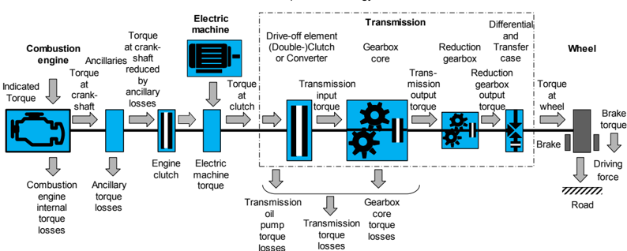

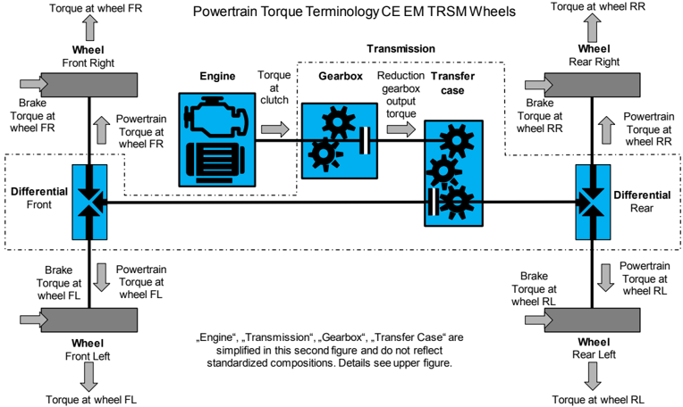

**离合器处力矩/车轮处力矩的符号定义：**

正值表示力矩从发动机传递到传动系/从动力总成传递到车轮。负值表示力矩从传动系传递到发动机/从车轮传递到动力总成。零表示发动机与传动系之间/车轮与动力总成之间没有力矩传递。

**附件力矩损失（Ancillary torque losses）：**

附件力矩损失是指对「扣除附件损失的曲轴力矩」与「离合器处力矩」产生影响损失，由例如发电机、空调、动力转向等引起。

**力矩信号中惯性的考虑：**

惯性对力矩的影响不予考虑，即发动机侧不允许附加考虑由惯性引起的力矩效应，即：

- 对于增大的发动机转速，指示力矩不允许加上正转速梯度所需的力矩
- 对于减小的发动机转速，指示力矩不允许减去负转速梯度所需的力矩

**发动机离合器（Engine Clutch）：**

对于混合动力系统，在内燃机与电机之间可以存在一个附加的离合器。

### 3.3. 术语——快与慢力矩请求

许多力矩请求接口带有附加的描述符「Fast（快）」或「Slow（慢）」。

这些描述符与汽油火花点火发动机相关，其力矩输出可以通过节气门开度（从而空气质量）与点火正时来改变。一般而言，由于进气歧管与缸盖中的流体动力学，力矩输出对节气门开度变化的响应较慢。而对点火正时变化的响应几乎是瞬时的，尤其是在较高转速下。

「Fast」指「立即」/「瞬时」的力矩请求，通常通过点火正时实现。

「Slow」指更长期的或「力矩储备」请求，通常是节气门控制的输入。

注意，以最佳点火正时运行的汽油发动机无法快速增大力矩，因为节气门是增大力矩的唯一手段。但是，通过预先开大节气门并以推迟点火运行以维持原有（较低）力矩，可以在不久的将来通过点火快速增大力矩。这一操作通常通过将「Slow」力矩请求设置为大于「Fast」力矩请求来提供这种「力矩储备」，从而允许通过增大「Fast」请求来快速增大力矩。

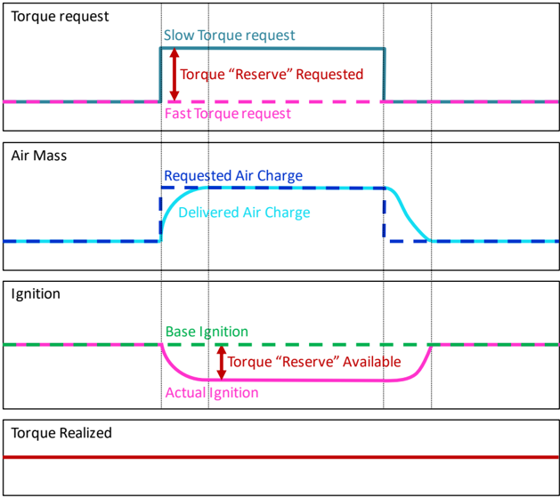

对于传统柴油发动机，只有快力矩接口是相关的。不过，未来的柴油发动机可能可以同时使用快与慢力矩接口。

### 3.4. 用于变速器换挡干预的典型信号组合

基本上，传递「离合器处换挡干预力矩请求」有两种不同的可能性：

- A）经由一个力矩信号的力矩请求，该信号可以传递增大与减小力矩请求：`Transmission: Request for Torque at Clutch for Shift Intervention`，与一个实现类型请求 `Transmission: Implementation Type of Request for Torque at Clutch for Shift Intervention` 组合使用，后者定义力矩信号上的请求是增大还是减小、绝对还是相对

或

- B）经由两个力矩信号与一个实现类型信号的请求：

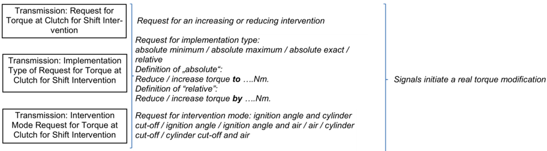

实现类型请求的定义：

「绝对」的定义：将力矩减小/增大到……Nm。

「相对」的定义：将力矩减小/增大……Nm。

干预模式请求：点火角与断缸

- 一个力矩信号定义「最大力矩」，反映允许力矩的上限。用于请求减小的力矩干预：`Transmission: Request for Maximum Torque at Clutch for Shift Intervention on Fast Path`
- 另一个力矩信号定义「最小力矩」，反映所请求力矩的下限。用于请求增大的力矩干预：`Transmission: Request for Minimum Torque at Clutch for Shift Intervention on Fast Path`
- 实现类型信号定义请求是绝对的（请求将力矩减小/增大到……Nm）还是相对的（请求将力矩减小/增大……Nm）：`Transmission: Implementation Type of Request for Maximum and Minimum Torque at Clutch for Shift Intervention on Fast and Slow Path`

两种可能性都可以在项目特定情况下附带扩展的或更详细的需求，例如：

- 干预模式（Intervention mode），要求干预必须通过点火角和/或空气和/或断缸来实现。
- 力矩储备（对「离合器处力矩」没有影响）及其实现类型请求。这两个信号为汽油发动机即将到来的快速增大力矩干预准备了可能性。

**关于可能性 A 的换挡干预请求：**

**关于可能性 B 的换挡干预请求：**

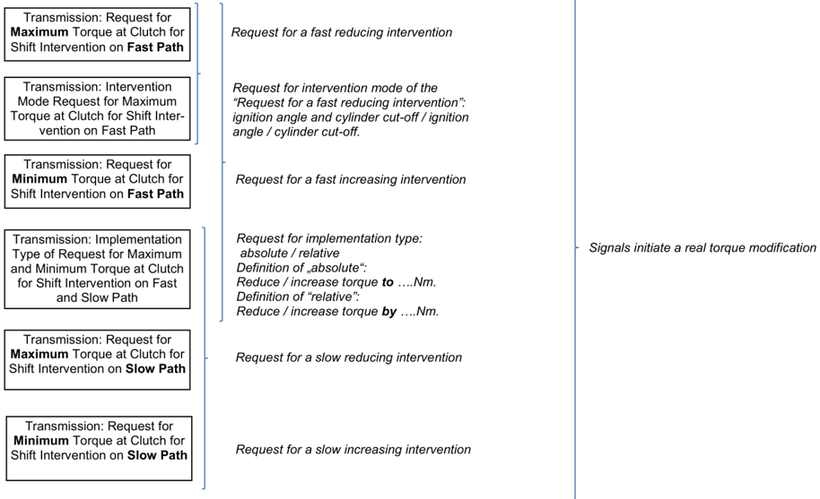

**作为可能性 A 与 B 附加项的力矩储备请求：**

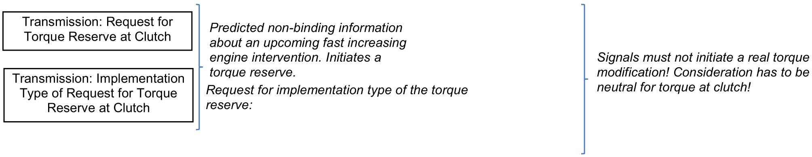

### 3.5. AUTOSAR 力矩应用接口概览

图例（Legend）：

- &lt;端口短名称&gt;
- &lt;端口长名称&gt;

箭头表示需求的方向（力矩的增大/减小）。水平线表示需求的目标水平。

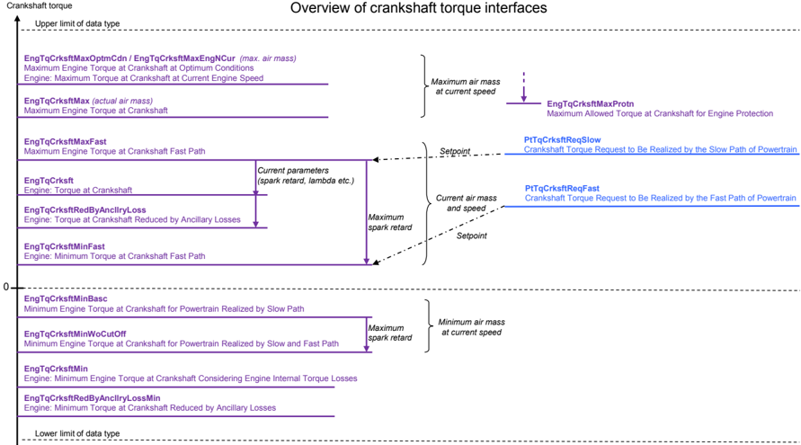

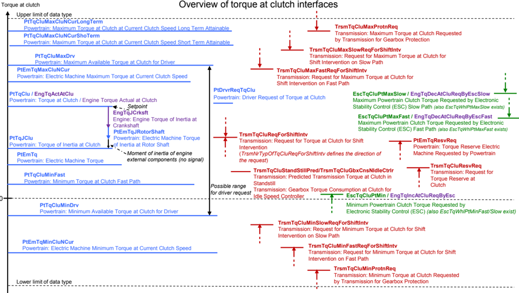

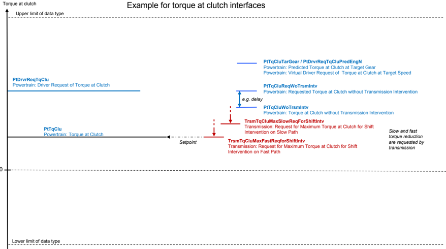

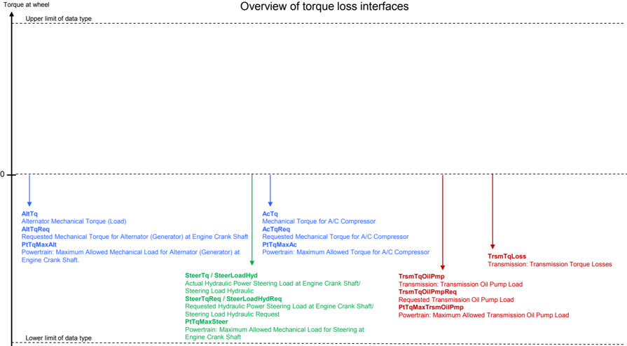

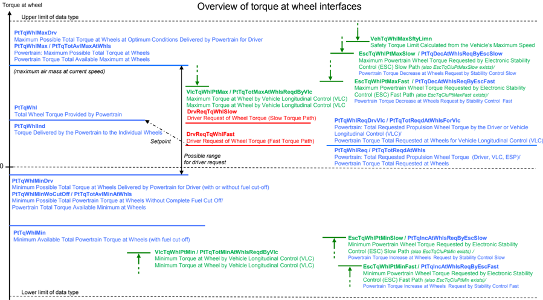

## 4. 架构概览

以下各图给出域或功能架构的概览。它们不一定给出完整的图景，而是展示最相关的互连与组件。

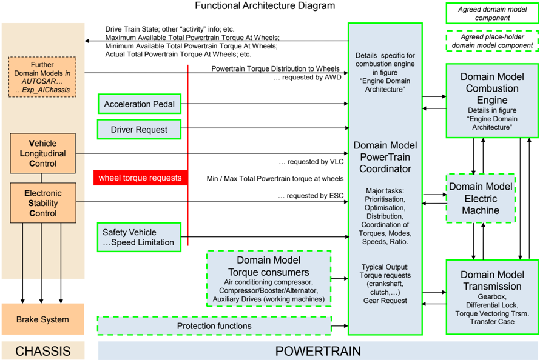

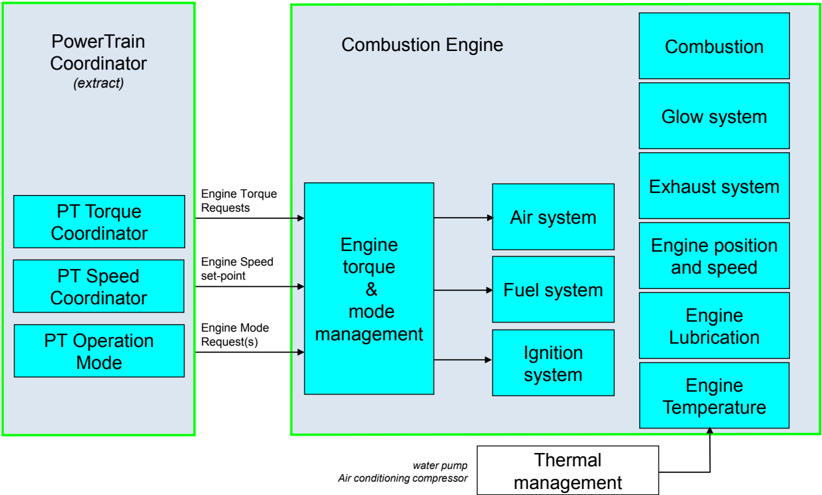

## 5. 示例软件组件的描述

为了能够使用与理解标准化的应用接口，采用了一个典型的域架构作为演示信号流的基础。下面描述该示例域架构的组件。

### 5.1. 动力总成协调器——PTC（PtCoorr）

该组合包括协调动力总成运行的所有功能，包括：

动力总成运行模式——所有执行器（例如内燃机、离合器、变速器、电机等）的状态管理，包括发动机起停管理（传统与混合动力总成）。

动力总成力矩协调——动力总成（PT）层面的力矩协调、力矩优先级排序、在 PT 层面实现的力矩分配、PTC 的力矩储备请求、混合动力可驾驶性功能的预协调、动力总成可驾驶性滤波器、用于力矩计算的动力总成总损失确定、车轮力矩计算（最小、最大、汇总）、离合器处力矩计算（最小、最大、汇总）、力矩设定点从车轮力矩到离合器处力矩的变换、力矩设定点从离合器处力矩到曲轴处力矩的变换、辅助驱动器/执行器的控制/协调。

动力总成转速协调——最高转速限制协调（保护所有 PT 组件免受超速损坏），以及来自所有来源（例如变速器）的怠速转速/发动机转速设定点请求的协调。

动力总成传动比协调——所有变速器传动比设定点逻辑。注意，传动比设定点的实现由变速器系统执行，而非 PTC。

### 5.2. 变速器系统（Trsm）

该组合包括变速器系统的所有功能，包括：

变速器系统协调——确定变速器、变矩器与差速器上的力矩与转速比，包括变速器系统中力矩损失的计算。协调传动系（变速器、传动轴等）的机械保护，包括力矩限制的计算。

对于手动变速器，该功能包括当前挡位与离合器状态的确定。

变速器——变速器中特定状态的管理，包括换挡过渡、起步工况、蠕行模式等。在换挡过渡的情况下，该功能计算力矩请求以优化过渡。

控制变速器执行器以将挡位调整到目标挡位（对于 CVT 则是将传动比调整到目标传动比）。传动比指属于每个挡位的理论/物理比值，而非任何实际测量值。不包括变速器副轴（低/高挡区）执行器的控制。

计算液力变矩器的力矩增益以及怠速时变矩器输入侧所需的力矩等，并控制离合器或变矩器执行器。

与变速器保护相关的所有功能，包括力矩限制的计算、变速器油温的测量或计算等，以及向其他系统发出的请求的计算。

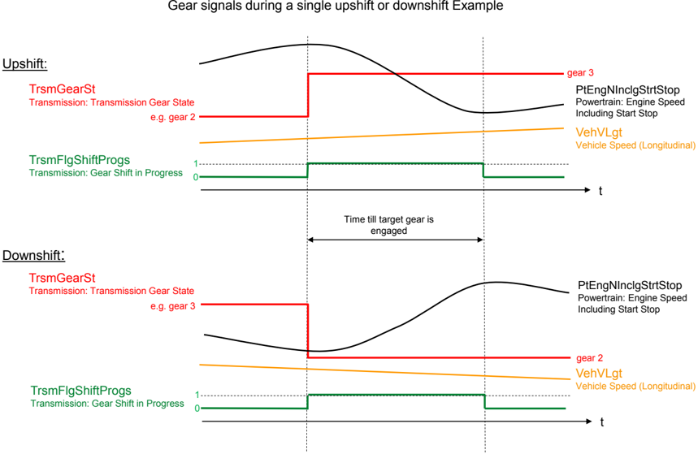

传动系力矩分配（DtTqDibtn）差速器锁——与差速器相关的所有功能，差速器管理左右车轮之间的力矩分配，例如差速器的锁止。不包括分配设定点的计算。

传动系力矩分配（DtTqDibtn）分动器——与分动器相关的所有功能，分动器管理前后车轮之间的力矩分配。不包括分配设定点的计算。

传动系力矩分配（DtTqDibtn）力矩矢量分配车轴变速器——与将动力总成力矩主动分配到全部四个车轮相关的所有功能。不包括分配设定点的计算。

关于传动系力矩分配（DtTqDibtn）的更多信息，另请参见 [\[5\]](#ref-5)。

### 5.3. 内燃机（CmbEng）

该组合包括与车辆内燃机运行和控制直接相关的所有功能。以下 5.3.1 至 5.3.3 节定义了迄今商定的内燃机功能分解所产生的组件。

#### 5.3.1 发动机转速与位置（EngSpdAndPosn）

提供与发动机轴位置和转速相关的所有参数的功能，包括曲轴与凸轮轴之间的同步。

曲轴与凸轮轴信号采集。

发动机位置的计算。

对于配备可变气门正时和/或升程的系统，相对凸轮轴位置的计算。

相关诊断与合理性检查。

#### 5.3.2 发动机力矩模式管理（EngTqModMngt)

包括发动机力矩设定点的计算、该设定点的实现（空气/燃油/点火等的协调）、汇总发动机力矩的确定、发动机转速的控制（怠速/非怠速/限制），以及发动机模式的管理（包括总体模式、发动机起动与停止的实现模式以及燃烧模式）。

#### 5.3.3 内燃机：杂项（CmbEngMisc）

内燃机杂项汇集了杂项发动机接口。一般而言，这些是发动机正确运行所需的公共数据（发动机温度、环境气压与电池电压）或故障安全动作所需的数据（碰撞状态）。这些接口的使用方式未被标准化。在未来的 AUTOSAR 版本中，这些接口可能会被移动到不同（更合适）的提供者或接收者组件/组合。

#### 5.3.4 内燃机：针对信号「Powertrain: Engine Speed Including Start Stop」的、变速器所需的时序与精度要求

信号 'Powertrain: Engine Speed Including Start Stop'（PtEngNInclgStrtStop）的时序与精度要求

（这些要求相应地适用于信号 'Powertrain: Clutch Speed'（PtCluN））

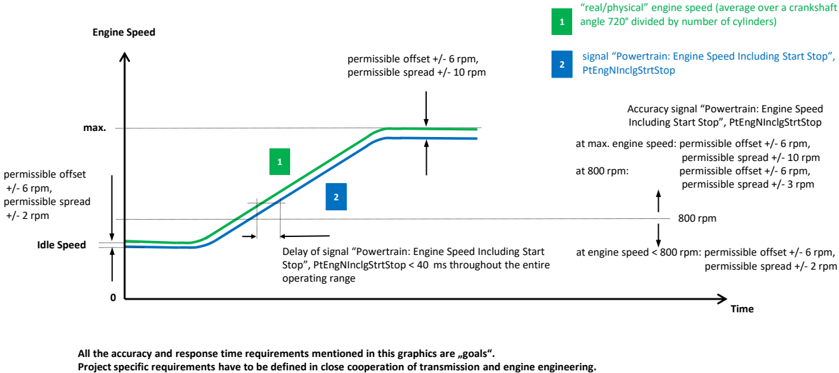

发动机起动与停机期间信号「Powertrain: Engine Speed Including Start Stop」时序与精度的附加要求：

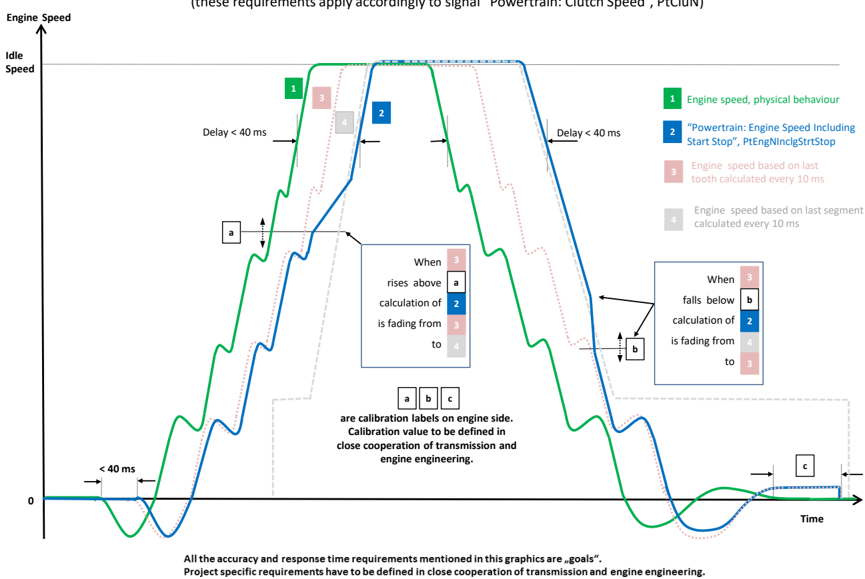

**图例（Legend）：**

发动机侧「Powertrain: Engine Speed Including Start Stop」的计算：由

「每 10 ms 基于最后区段计算的发动机转速」

与

「每 10 ms 基于最后齿计算的发动机转速」

组合而成。

对于高于上滞回限值「a」的高发动机转速，信号「Powertrain: Engine Speed Including Start Stop」为「每 10 ms 基于最后区段计算的发动机转速」。

对于低于下滞回限值「b」的低发动机转速，信号「Powertrain: Engine Speed Including Start Stop」为「每 10 ms 基于最后齿计算的发动机转速」。

高发动机转速与低发动机转速之间的转换由一个具有上阈值「a」与下阈值「b」的滞回定义。

如果发动机转速增大到超过「a」的值，则用于转速计算的齿数以定义的步宽递增，直至区段长度。

递增的执行取决于越过「a」之后的时间。

如果发动机转速减小到低于「b」的值，则用于转速计算的齿数以定义的步宽递减，直至 1。

递减的执行取决于越过「b」之后的时间。

滞回的输入是「每 10 ms 基于最后齿计算的发动机转速」。

在负发动机转速下，「Powertrain: Engine Speed Including Start Stop」基于一个齿计算。

为了确保舒适的发动机起动，还需要对「Powertrain: Engine Speed Including Start Stop」在 0 rpm 至怠速转速范围内的附加要求：

**对发动机起动的要求：**

第一份转速信息必须最迟在曲轴第一次运动之后 40 ms 内可用。这对于检测发动机何时开始旋转是必需的。

**对发动机停机的要求：**

- 当关闭发动机时，
  - 「Powertrain: Engine Speed Including Start Stop」必须提供直至 0 rpm 的物理正确值。
  - 发动机静止与信号「Powertrain: Engine Speed Including Start Stop」等于 0 rpm 之间存在允许的最大延迟时间「c」。
- 在「Powertrain: Engine Speed Including Start Stop」= 0 rpm 之前，发动机不允许关闭总线通信。

### 5.4. 与动力总成相关的车辆运动（VehMtnForPt）

该组合包括与车辆运动相关的动力总成功能。以下 5.4.1 至 5.4.3 节定义了迄今商定的属于该组合的组件。

#### 5.4.1 驾驶员请求（DrvReq）

加速踏板位置到请求力矩的驾驶员特定转换：确定与车辆运动相关的驾驶员请求。对于纵向运动，该功能将驾驶员请求解释为力矩请求。

#### 5.4.2 加速踏板位置（AccrPedlPosn）

该组件根据采集到的传感器位置计算百分比，并包含确保信息的合理性检查。强制降挡（kick-down）检测包含在该组件中。

#### 5.4.3 安全车速限制（VehSpdLimnForSfty）

通过减小发动机力矩对车速进行硬限制，不带任何舒适性功能。

#### 5.4.4 车辆运动（动力总成）：杂项（VehMtnForPtMisc）

VehMtnForPtMisc 汇集了车辆运动动力总成语境下的杂项接口。这些接口的使用方式未被标准化。在未来的 AUTOSAR 版本中，这些接口可能会被移动到不同（更合适）的提供者或接收者组件/组合。甚至不排除它们被移动到已经存在的组件。

例如，VehMtnForPtMisc 用于在以下情况下闭合开放接口：已约定车辆运动动力总成中的某个组件将请求或提供某接口，但尚未决定由哪个组件承担，或该组件尚不存在。

### 5.5. 动力总成：杂项（PtMisc）

PtMisc 汇集了动力总成的杂项接口。这些接口的使用方式未被标准化。在未来的 AUTOSAR 版本中，这些接口可能会被移动到不同（更合适）的提供者或接收者组件/组合。甚至不排除它们被移动到已经存在的组件。

例如，PtMisc 用于在以下情况下闭合开放接口：已约定动力总成中的某个组件将请求或提供某接口，但尚未决定由哪个组件承担，或该组件尚不存在。

## 6. 附加信息

### 6.1. SW-C 与 ECU 的区别

第 [4](#4-架构概览) 章中定义的 SW 组件不应与 ECU 的功能混淆。

例如，一个内燃机控制 ECU 可以包含内燃机 SW-C 加上其他 SW-C。

### 6.2. 功能安全

许多动力总成信号是安全相关的，因此

AUTOSAR RTE 将在低层为这些信号提供可靠的通信，并且

这些信号的诊断与安全概念必须在更高的功能层面应用。

AUTOSAR 不为动力总成系统提供安全概念。这必须在项目层面完成。这意味着必须针对每个具体项目检查所规定的接口是否满足安全需求。

### 6.3. 动力总成应用接口——决策/假设

#### 6.3.1 范围

本文档仅考虑乘用车。

#### 6.3.2 PTC 组合（PtCoorr）

PTC 不是一个原子的 AUTOSAR SW 组件。实际上，其功能应被拆分为若干子组件。这些子组件将彼此通信，并与 PTC 之外的 AUTOSAR SW 组件通信。子组件之间的接口不在当前范围内，当前范围限于定义非 PTC 组件与 PTC 子组件之间的主接口。

#### 6.3.3 过增增压（Overboost）的定义

过增增压是内燃机所能输出的最大力矩在有限时间段内被增大的状态。根据发动机类型，例如可以通过增大涡轮增压发动机的增压压力来实现。

#### 6.3.4 车辆层面的协调

车辆能量（机械/电气/热）、车辆运行模式、车辆个性化等的协调应在车辆层面完成。这不在动力总成应用接口的范围内。

组合 VehMtnForPtMisc 是作为与动力总成域相关的某些车辆层面问题的临时解决方案而添加的。

#### 6.3.5 PTC 对驾驶员与底盘力矩请求的仲裁

下面两幅图展示 VLC 与稳定控制的力矩请求可以如何与驾驶员请求进行仲裁。这只是阐明动力总成力矩请求接口背后概念的一个示例，并不打算标准化 PTC 中的仲裁行为。

**PTC 中的 VLC 与 ESP 仲裁：**

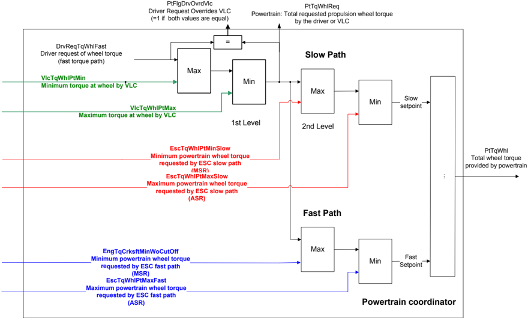

**基于离合器处力矩的 PTC 中的 VLC 与 ESP 仲裁：**

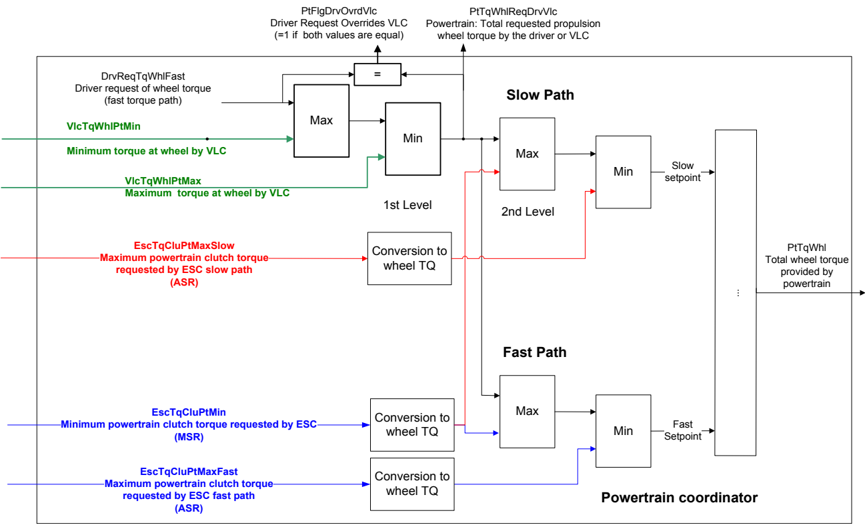

#### 6.3.6 针对动力总成域的建模风格与命名方面的假设

AUTOSAR 为模型元素的建模与命名提供了一份指南（[\[6\]](#ref-6)）。

还存在像 [\[7\]](#ref-7) 所述传感器-执行器设计模式这样的架构设计模式，它们也包含建模与命名方面。

本节仅解释所遵循的附加模式与建模风格，以便整体理解针对动力总成域标准化的信号。

请注意：这里标准化的端口或端口接口指标准化的端口原型蓝图或端口接口蓝图 [\[8\]](#ref-8)。

动力总成域内通常采用的建模方式（尤其当系统建模指南 [\[6\]](#ref-6) 给出一定自由度时）：

| 建模方式或假设 | 理由 |
| --- | --- |
| 所有标准化的 SenderReceiverInterface 都被假定为可测量。 | 在较早版本中，标准不包含关于标定与测量的信息。自 R4.0.3 起，所有数据类型默认允许测量（见生成的 .arxml [\[1\]](#ref-1)）。因此我们「所有信号皆可测量」的隐含假设得到满足。 |
| 所有端口都被假定为可选。 | 在我们的示例组件中，所有端口都被假定为可选。端口派生自同名的端口原型蓝图。默认情况下，端口原型蓝图允许被使用，但不一定在每个项目中都使用。在没有蓝图的先前版本中，这一假设非常重要，因为没有进行变型处理。因此动力总成域假定所有端口都是可选的。由于标准化的只有端口而非组件，这一点更加重要：它意味着供应商或 OEM 可以创建单个 SW-C（软件组件），并仅使用对其 SW 架构而言相关的标准化端口。 |
| 端口接口不设计为可复用：端口与端口接口之间存在 1:1 关系。端口接口与端口同名，外加系统建模指南 [\[6\]](#ref-6) 所要求的附加索引。例外：如果动力总成不是提供者，则遵循其他域的规则。 | 端口附着于 SW-C。由于 SW-C 未被标准化，直到 R3.1 版本，项目中真正被使用的只有端口接口。从 R4.0 起，通过元模型中所谓的 PortPrototypeBlueprint 支持端口的标准化。然而在实践中，仍在使用较旧版本的 AUTOSAR 元模型，现有工具尚未完全支持 PortPrototypeBlueprint。为了向后兼容并便于在动力总成域内引入标准化的应用接口，元模型的所有特性（例如连接具有不同端口接口短名称的兼容接口）因此尚未被完全利用。不支持连接具有不同端口接口短名称的兼容接口。 |
| 如果一个端口接口恰好包含一个数据原型，其名称与端口接口相同，只是去掉尾部索引。 | 只存在两种备选方案：使用全名；或对值使用名称「Val」。方案 2) 的缺点是：许多端口会被工具假定为兼容，因为（兼容接口的）相同数据原型名称允许自动连接。在 ASCET-SD 或 MATLAB/Simulink 等规格化工具中，可能只显示数据原型名称而不显示端口接口或端口名称。 |
| 数据类型的复用是动力总成域内的明确目标。 | 在动力总成域内，使用尽可能少的数据类型是一个重要的设计目标。 |
| 计算方法尚未成为复用的对象。 | 不支持计算方法的复用，只支持数据类型的复用。但下一版本应考虑计算方法的复用。 |
| 在大多数情况下，每个端口接口只定义一个数据原型。 | 这种建模方式在实现标准方面允许最大的灵活性。例如在组装层面，不允许 r 端口拥有比 p 端口更多的数据原型（[\[9\]](#ref-9)，图 6.3）。因此在这种情形下，当多个数据原型属于一个 r 端口时，数据原型本身不能被假定为可选，只有完整的 r 端口才可以。在 AUTOSAR 标准的较旧版本中，不允许子组件只提供端口的一部分，即如果多个数据原型属于一个端口接口，则隐含地标准化了由一个 SW-C 提供它。当把信息拆分到多个端口接口时，每个数据原型可以由不同的 SW-C 提供。 |
| 在大多数情况下，不使用记录（record）来定义端口接口。 | 理由与「每个端口接口只定义一个数据原型」假设所述类似。由于动力总成域内很少使用具有多个 DataPrototype 的端口接口，没有必要使用记录，并假定数据原型的时序相关方面将被单独处理——还有其他更灵活的处理方式。 |

动力总成域的特定命名假设：

| 假设 | 理由 |
| --- | --- |
| 这些名称的选择使得显示名称的自动生成成为可能。 | 动力总成 ECU 中有数千个与标定相关的数据。因此，以使显示名称的自动生成成为可能的方式应用系统建模指南 [\[6\]](#ref-6) 非常重要。详情见 [\[2\]](#ref-2)。 |
| 一般而言，关键词缩写「Consold」（Consolidated）以及缩写「Act」（Actual）被省略。 | 这样做的理由是尽可能使用短名称（见 [\[2\]](#ref-2) 中的 [TR_MCM_70020]）。示例：PtTqClu 表示「Torque at Clutch」。 |
| 如果端口仅用于快速路径或慢速路径，则加上「Fast」与「Slow」。在其他情况下，「SlowFast」被省略。 | 这样做的理由是尽可能使用短名称（见 [\[2\]](#ref-2) 中的 [TR_MCM_70020]）。示例：PtTqWhlMinWoCutOff 影响慢速与快速路径；EscTqWhlPtMaxSlow 或 EscTqWhlPtMaxFast 则针对特定路径。关于快慢路径的更多细节见 [3.3 节](#33-术语快与慢力矩请求)。 |
| 「State」用作「State」与「Status」二者的缩写「St」。 | 在大多数情况下，很难解释 State 与 Status 之间的区别。因此为了简单与一致，动力总成域内只使用「St」。 |
| TqWhl 表示车轮力矩之和，而 TqWhlInd 表示单个车轮的力矩。 | 在动力总成中，更常使用车轮力矩之和。因此当指单个车轮力矩时加上信息（「Ind」）。示例：PtTqWhl 表示「Total Wheel Torque Provided by Powertrain」；PtTqWhlInd 表示「Torque Delivered by the Powertrain to the Individual Wheels」。 |
| 只有在前置词确实有助于理解时，才在短名称中使用前置词。 | 在大多数情况下，前置词并不真正增加信息，却使短名称不必要地变长（见 [\[2\]](#ref-2) 中的 [TR_MCM_70020]）。示例：PtTqWhlMinWoCutOff 表示 Minimum Possible Total Powertrain Torque at Wheels Without Complete Fuel Cut Off，使用前置词「Wo」（without）；PtTqWhlReqDrvVlc 表示 Powertrain: Total Requested Propulsion Wheel Torque by the Driver or Vehicle Longitudinal Control (VLC)，而非系统建模指南 [\[6\]](#ref-6) 所建议的 PtTqAtWhlReqByDrvForVlc。 |
| 发动机-变速器接口的特殊规则 | 每个 Long Name 都以提供者与冒号「:」开头。只有当无法定义提供者时，才省略提供者与冒号。如果速度的参考对象与参考层级未明确说明，则速度的参考对象与参考层级就是对象本身。示例：a) 「Engine: Torque at Crankshaft」是当前曲轴转速下的力矩，而不是怠速转速、最高转速等下的力矩。b) 「Engine: Torque at Crankshaft」是曲轴层级（而非车轮层级）的力矩。 |
