<!-- 源文档 AUTOSAR_CP_EXP_AIUserGuide（R23-11），讲述型指南（EXP），不受 Type A 七章骨架约束；章节结构镜像源文档自身编号（1–10）。PDF→markdown 转换中溢出的图内文字（UML 类图标签、Excel 截图单元格文本）按转换噪声剔除；ARXML/XSD 清单逐字保留在代码块中。 -->

## 1. 文档目的

AUTOSAR 旨在通过相互通信的软件组件（SoftwareComponent）交付功能，这些组件几乎可以任意放置在 ECU 网络上。为确保来自不同来源（即不同供应商）的软件组件之间的互操作性，这些组件的接口应当统一。

应用接口表（AI Table）[\[1\]](#ref-1) 的内容是多个汽车域接口的规格。这些域的组合将构成表内的顶层域。其目标是定义并发布稳定且被广泛接受的应用接口。

本文档旨在解释关于 AI 表的所有相关细节，尤其是面向必须维护标准化应用接口的用户。有经验的用户可以跳过第 [3](#3-autosar-方法论) 章 AUTOSAR 方法论。部分章节包含来自其他 AUTOSAR 文档的摘录。如果内容存在差异，以原始 AUTOSAR 文档为准。

### 1.1. 文档概览

本文档给出应用接口的方法论背景概览。本文档还给出「应用接口表」的内容概览，即顶层（域间层）及其包含的域（车身、动力总成、底盘、乘员与行人安全、多媒体、远程信息处理、人机接口）。它还描述 AI 表（以 Excel 表实现）的结构并解释如何操作它。

表1.1：本文档范围内使用的缩略语与缩写（**Acronyms and abbreviations used in the scope of this Document**）

| 缩写/缩略语 | 说明 |
| --- | --- |
| .arxml | AUTOSAR 可扩展标记语言文件 |
| AI Table | Application Interface Table（应用接口表） |
| Bugzilla | 变更请求管理工具 |
| CPU | Central Processing Unit（中央处理单元） |
| ECU | Electronic Control Unit（电子控制单元） |
| Excel | Microsoft 电子表格应用 |
| MS | Milestone（里程碑） |
| RTE | Run-Time Environment（运行时环境） |
| SPEM | Software Process Engineering meta-model（软件过程工程元模型） |
| SVN | Subversion（版本控制系统） |
| SW-C | Software Component（软件组件） |
| SWC | Software Component（软件组件） |
| SW | Software（软件） |
| VB | Visual Basic |
| VFB | Virtual Function Bus（虚拟功能总线） |
| WP | Work package（工作包） |
| XML | Extensible Markup Language（可扩展标记语言） |
| XSD | XML Schema Definition（XML 模式定义） |
| HMI | Human Machine Interface（人机接口） |

## 2. 应用接口表简介

应用接口表（AI 表）是专用于管理定义应用接口的全部数据的用户界面（见图 2.1）。它在一个工具（Excel）中实现，带有校验与工作产物输出生成宏（例如 VB 脚本）。工具的输入基于 AUTOSAR 定义的方法论元模型数据。工具的输出是一个符合 XSD 并遵循模板所定义语义的 XML 模型。AUTOSAR XML 文件（称为 .ARXML 文件）以结构化格式包含所有标准化应用接口数据的详细信息。该 xml 文件包含被转换为普遍可读格式的应用接口定义，可作为例如 SW 开发公司开发部门的创作工具的输入。

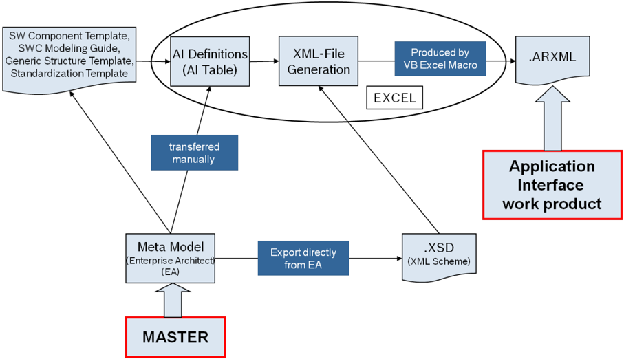

AI 表支持对 AI 定义的操纵，以产生结果：用于数据交换的 xml 文件。

SWC 模板 [\[2\]](#ref-2) 告诉我们可以建模什么。标准化模板 [\[3\]](#ref-3) 解释并支持蓝图方法。

AI 表的描述（即 XML）告诉我们在建模什么。AI 表的定义遵循 SWC 建模指南 [\[4\]](#ref-4) 所定义的建模指南。下面的图 2.2 展示了 SW 组合及其向组件分解的主要结构。

为了标准化应用接口，AI 表内描述了许多 SW 组件，分解到各域及其主要功能。不过，这些组件必须仅被视为示例（目前仅针对 R4.0 版本）。它们不是标准的一部分；但为了以一致的方式规格化端口/端口原型，它们是必需的。每个端口/端口原型都需要一个到组件的连接才能被恰当地规格化。

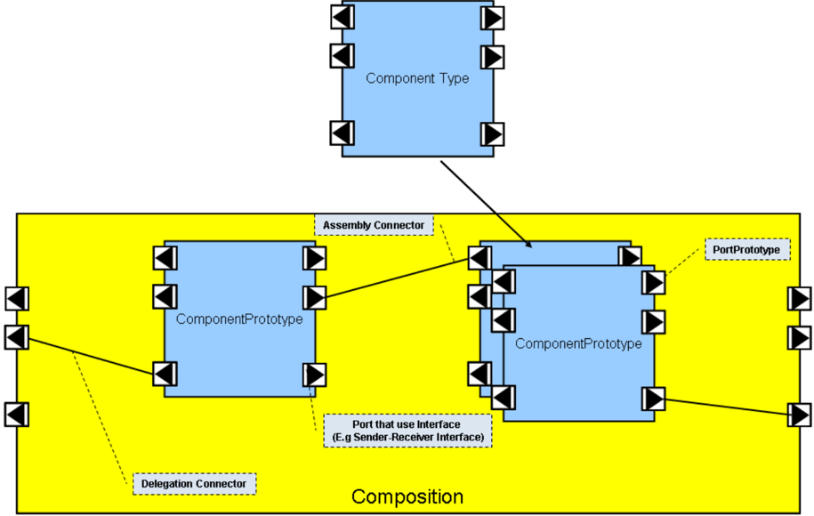

图 2.2 中的结构图解了使用 AUTOSAR 软件组件模板 [\[2\]](#ref-2) 对软件组合的分解。

注意：图中的黄色块表示 AI 表中黄色的列，即被分解为其他组合/组件的组合。这些组件类型与原型在同一 AI 表工作表的蓝色列中描述（见图中的蓝色块）。SwComponentPrototype 实现了 SwComponentType 在特定角色下的使用。

SwComponentPrototype 仅用于以特定角色实现 SwComponentType，即它们用于实例化 SwComponentType。

示例：SwComponentPrototype「LeftDoorControl」实现 SwComponentType「DoorControl」在车辆左车门的角色，而 SwComponentPrototype「RightDoorControl」实现 SwComponentType「DoorControl」在车辆右车门的角色。

AI 表是一个包含若干工作表的 Excel 表。在这些工作表中处理以下与应用接口相关的主要信息：

- 组合；主要组合来自域（1）车身、（2）动力总成、（3）底盘、（4）乘员与行人安全、（5）多媒体与远程信息处理及人机接口
- 组件
- 端口
- 端口接口及其 VariableDataPrototype
- VariableDataPrototype 的数据类型
- 单位
- 组件类型的实例
- 关键词

关于该表提供的工作表的详细列表，参见第 [8](#8-应用接口ai表的结构) 章。

### 2.1. AI 表中域的结构概览

当前 AI 表包含多个不同汽车域的规格。每个域的结果（包括域间连接）可以在 AI 表的工作表中识别：

- 域间层（顶层）工作表：0500
- 车身 工作表：0501*
- 动力总成 工作表：0502*
- 底盘 工作表：0503*
- 乘员与行人安全 工作表：0504*
- 多媒体、远程信息处理、人机接口（HMI）工作表：0505*

虽然该表按域组织结构，但所得到的组件/组合分解并不是 AUTOSAR 合规车辆架构的强制架构。AI 表展示组件/组合只是作为解释标准化端口与端口接口的示例。顶层组合是一个虚设组合，用于在 VFB 视图中表示域间端口。

关于域细节的进一步解释可在第 3.1.7 至 3.1.11 节及进一步引用的文档中找到。

## 3. AUTOSAR 方法论

AUTOSAR 要求系统开发的某些步骤采用正式的技术方法。这一方法称为「AUTOSAR 方法论」。AUTOSAR 方法论既不是完整的过程描述，也不是业务模型，该方法论中没有定义「角色」与「职责」。此外，它也不规定活动应执行的精确顺序。该方法论仅仅是工作产物流：它定义活动对工作产物的依赖。

在系统设计期间，必须选择软件组件与硬件，并识别整体系统约束。AUTOSAR 意图通过信息交换格式与模板的使用，简化这些初始系统设计决策的正式描述。因此，定义系统配置输入意味着填写或编辑相应的模板。AUTOSAR 方法论在此语境下允许高度复用。无论如何，这种编辑假定由编辑工具支持。以下是活动的简要描述：

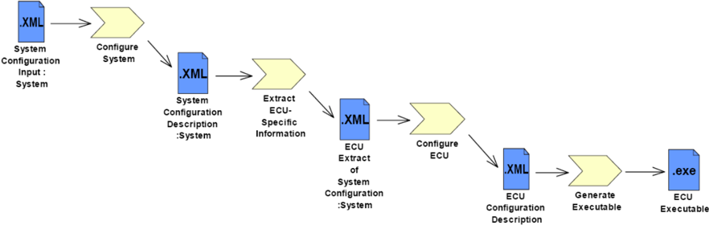

- 配置系统（Configure System）：主要在资源与时序需求方面将软件组件映射到 ECU。配置系统需要 SW 组件描述、系统约束描述与 ECU 资源描述。AI 表输出与内部行为一道定义 SW 组件描述。

  该活动的输出是系统配置描述。该描述包括所有系统信息（例如总线映射、拓扑）以及哪个软件组件位于哪个 ECU 的映射。

- 提取 ECU 特定信息（Extract ECU-Specific Information）：从系统配置描述中提取特定 ECU 所需的信息。然后将其放入系统配置的 ECU 提取（ECU Extract of System Configuration）中。
- 配置 ECU（Configure ECU）：添加实现所需的全部信息，如任务调度、所需的基础软件模块、基础软件的配置、可运行实体到任务的分配等。配置 ECU 活动的结果包含在 ECU 配置描述中，后者收集特定 ECU 本地的所有信息。可以从这些信息构建该特定 ECU 的可运行软件。
- 生成可执行文件（Generate Executable）：基于 ECU 配置描述中描述的 ECU 配置生成可执行文件。该步骤通常包括生成代码（例如 RTE 与基础软件）、编译代码（编译生成的代码或编译以源代码形式提供的软件组件）并将所有内容链接为可执行文件。

尽管如此，软件组件的实现或多或少独立于 ECU 配置。

本章的一般概念是详细的 AUTOSAR 方法论 [\[5\]](#ref-5) 的摘录。

### 3.1. 可用文档概览

详细信息可参考以下文档。

#### 3.1.1 软件组件模板

该文档 [\[2\]](#ref-2) 提供与软件组件定义相关的 AUTOSAR 元模型部分的介绍性描述与理由。

#### 3.1.2 标准化模板

该文档 [\[3\]](#ref-3) 旨在支持 AUTOSAR 交付标准化的模型元素。该文档还细化了用于标准化的蓝图方法。

#### 3.1.3 通用结构模板

该文档 [\[6\]](#ref-6) 用作 AUTOSAR 元模型所提供正式定义的补充。该文档提供与所有 AUTOSAR 模板相关的 AUTOSAR 元模型部分的介绍性描述与理由。

#### 3.1.4 AI 规范

本文档（[\[7\]](#ref-7)、[\[8\]](#ref-8)）是应用接口标准化的输出。输出以一组 .arxml 文件交付。

#### 3.1.5 应用接口建模指南

该文档 [\[4\]](#ref-4) 给出关于使用 AUTOSAR 模型元素以构建 AUTOSAR 系统的指南与约定。它不包含针对 AUTOSAR 元模型的指南。

#### 3.1.6 AUTOSAR 方法论

见上文 [\[5\]](#ref-5)。

#### 3.1.7 车身与舒适域应用接口说明

文档 [\[9\]](#ref-9) 解释促成车身与舒适域应用接口的设计决策与边界条件。

#### 3.1.8 动力总成域应用接口说明

文档 [\[10\]](#ref-10) 解释促成动力总成域应用接口的设计决策与边界条件。

#### 3.1.9 底盘域应用接口说明

文档 [\[11\]](#ref-11) 解释促成底盘域应用接口的设计决策与边界条件。

#### 3.1.10 乘员与行人安全域应用接口说明

文档 [\[12\]](#ref-12) 解释促成乘员与行人安全域应用接口的设计决策与边界条件。

#### 3.1.11 多媒体、远程信息处理、人机接口域应用接口说明

文档 [\[13\]](#ref-13) 解释促成多媒体、远程信息处理、人机接口域应用接口的设计决策与边界条件。

要查找这些文档，请参阅本文档末尾的表（见第 [10](#10-参考文档) 章）。

## 4. AI 表的元模型表示

本节描述元模型实现（AUTOSAR 元模型 [\[14\]](#ref-14)）与 AI 表 [\[1\]](#ref-1) 中表示之间的关系。

AUTOSAR 元模型在概念上定义为「M2」层，它描述称为软件组件与端口的实体。这些实体之间的关系及其语义是该模型的一部分。

### 4.1. 模型元素的类别

所有应用接口模型元素被划分为三个不同的类别。它们是：

- STANDARD（标准）
- BLUEPRINT（蓝图）
- EXAMPLE（示例）

#### 4.1.1 STANDARD

凡是只需将其包含进项目即可按定义使用的元素，都属于 STANDARD 类别。这些元素在项目中使用前无需修改。

STANDARD 类别的元素有：

- PhysicalDimensions（物理量纲）
- Units（单位）
- LifeCycleInfoSets（生命周期信息集）

#### 4.1.2 BLUEPRINT

蓝图是模型元素的预定义，构成进一步建模的基础。蓝图是可由其他模型元素通过复制而派生的模型元素。这些元素在所有方面并不完整。它们充当项目创建真实元素的模板。

BLUEPRINT 类别的元素有：

- ApplicationDataTypes（应用数据类型）
- CompuMethods（计算方法）
- DataConstraints（数据约束）
- KeywordSets（关键词集）
- PortInterfaces（端口接口）
- PortPrototypeBlueprints（端口原型蓝图）
- Collections（集合）

**从 BLUEPRINT 派生的原型的命名规则：**

AUTOSAR 标准化将对从蓝图派生的原型创建 ShortName 使用规则，即以下建议对 AUTOSAR 标准化工作是强制性的。

- 单次使用时的建议：&lt;ShortName&gt;
- 多次使用时的建议：&lt;ShortName&gt;{&lt;Keyword&gt;}0..n「」
- 派生模型元素的 ShortName 模式可以遵循关联蓝图的 {anyName} 模式

#### 4.1.3 EXAMPLE

不应被标准化但对理解有帮助的元素被创建为 EXAMPLE 类别。它们作为帮助用户实际创建其项目特定实现的辅助。EXAMPLE 类别的元素代表多种可能实现方式中的一种。

EXAMPLE 类别的元素有：

- SwComponentTypes
- ApplicationDataTypes
- BlueprintMappingSets
- CompuMethods
- DataConstrs
- PortInterfaces

被归类为示例的 ApplicationDataTypes、CompuMethods、DataConstrs 与 PortInterfaces是从其蓝图派生的元素，而不是额外的元素。

### 4.2. 元模型图与 AI 表

本节描述 AUTOSAR 元模型（M2）图以及它们与 AI 表内容之间实现应用软件组件的关系。

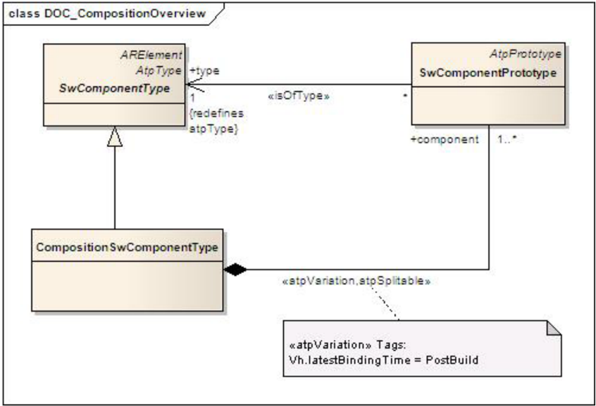

以下各图对应 AUTOSAR 元模型的 R4.0。

### 4.2.1 组合（Composition）

AUTOSAR CompositionSwComponentType 的目的是通过聚合现有软件组件来允许特定功能的封装。由于 CompositionSwComponentType 也是 SwComponentType，它可以再次在进一步的 CompositionSwComponentType 中被聚合。这种递归关系在图 4.1 中被正式表达。

需要理解的重要一点是：虽然组合允许（子）系统抽象，但它们仅仅是实现模型可扩展性的架构元素。它们只是对现有软件组件进行分组，从而在查看或设计逻辑系统架构时降低复杂性。

**元模型参考（Meta Model Reference）：**

`M2::AUTOSARTemplates::SWComponentTemplate::Composition` [\[2\]](#ref-2)

**AI 表参考（AI Table Reference）：**

AUTOSAR_ApplicationInterfaces.xls [\[1\]](#ref-1)

工作表名称：Compositions

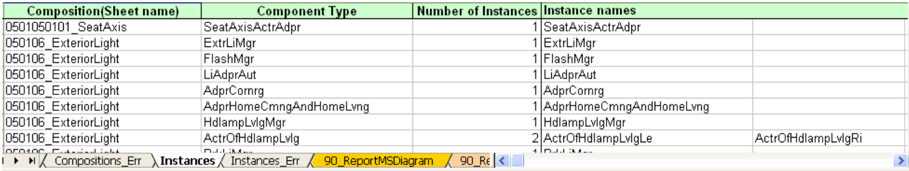

**示例：**

以工作表 050106_ExteriorLight 中的 Exterior light 组合为例：「ExtrLi」是一个 CompositionSwComponentType，由不同的组件类型组成，如 ExtrLiMgr、FlashMgr、LiAdprAut、AdprCornrg、AdprHomeCmngAndHomeLvng、HdlampLvlMgr、ActrOfHdlampLvlg 等。

**AI 表参考（AI Table Reference）：**

AUTOSAR_ApplicationInterfaces.xls [\[1\]](#ref-1)

工作表名称：Instances

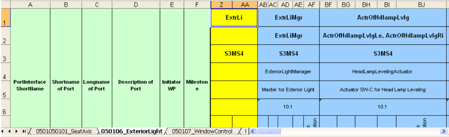

示例：组件类型 ExtrLiMgr 没有被进一步分解为组件类型，因此它只是一个组件类型。在 050106_ExteriorLight 中找到的组件原型 ExtrLiMgr（图 4.4 所示的单元格 AB2）的类型为 ExtrLiMgr（组件类型）。这里类型与原型具有相同的 ShortName。

在 050106_ExteriorLight 中找到的组件原型 ActrOfHdlampLvlgLe 与 ActrOfHdlampLvlgRi（图 4.4 所示的单元格 BF2）的类型为 ActrOfHdlampLvlg（组件类型）。这里类型与原型具有不同的 ShortName，并且该类型被实例化两次。

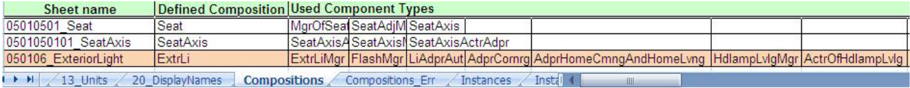

可以创建任意数量的引用特定 SwComponentType 的 SwComponentPrototype。注意 CompositionSwComponentType 也聚合抽象元类 SwConnector，用于将彼此所属的 SwComponentPrototype 连接起来。

#### 4.2.1.1 多重实例化

在设计系统时，运行时空间中的元素常常共享相同的结构。一个众所周知的示例领域是面向对象编程，其中从同一个类实例化的对象都具有由该类规定的相同结构。指定一次结构然后在设计的多个位置使用它的能力称为多重实例化（multiple instantiation）。

AI 表中为在一个域中存在多个副本的组件定义 SwComponentType 时使用了相同的概念。

在下例中，软件组件 WshrFrnt、WshrRe 与 WshrHdlamp 由 SwComponentType Wshr 创建。

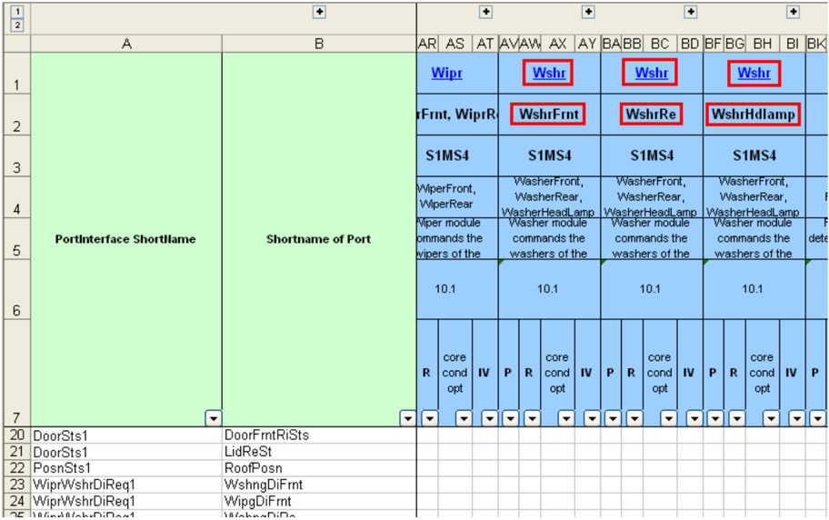

从 SwComponentType 实例化的所有 SwComponentPrototype 都将具有该 SwComponentType 的相同属性；换言之，例如如果 SwComponentType 定义了 2 个提供者 PortPrototype 与 3 个接收者 PortPrototype，那么 SwComponentType 的所有实例都将具有相同数量的提供者与接收者 PortPrototype。

如果两个 SwComponentType 相互连接，并且两个 SwComponentType 都被多重实例化，那么这些 SwComponentType 之间的连接可能是歧义的。然而由于 AI 表宏的限制，目前无法覆盖所有可能的模型场景。

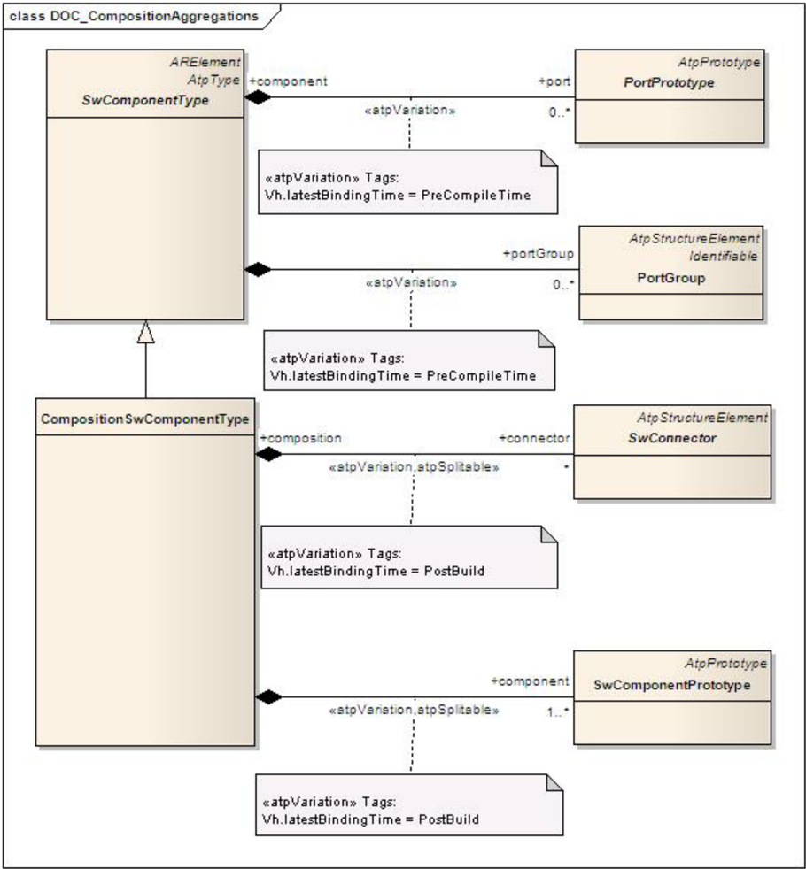

**元模型参考（Meta Model Reference）：**

`M2::AUTOSARTemplates::SWComponentTemplate::Components` [\[2\]](#ref-2)

**AI 表参考（AI Table Reference）：**

AUTOSAR_ApplicationInterfaces.xls [\[1\]](#ref-1)

工作表名称：050XXXXX 工作表

注意：作为 SwComponentType，CompositionSwComponentType 也向外界暴露 PortPrototype。但是，这些 PortPrototype 只是被委托（delegated），并不扮演与附着于 AtomicSwComponentType 的 PortPrototype 相同的角色（AtomicSwComponentType 封装其功能与行为的实现，仅向外界暴露定义良好的连接点，称为 PortPrototype）。更多细节请参见 SW 组件模板 [\[2\]](#ref-2)。

CompositionSwComponentType 包含两种类型的 SwConnector：

1. AssemblySwConnector，用于互连作为 CompositionSwComponentType 一部分的 SwComponentPrototype 的 PortPrototype
2. DelegationSwConnector，用于从「内部」PortPrototype 连接到被委托的「外部」PortPrototype

在外部 PortPrototype 被多个 DelegationSwConnector 引用的情况下，其语义是引用该外部 PortPrototype 的 AssemblySwConnector 的乘积。

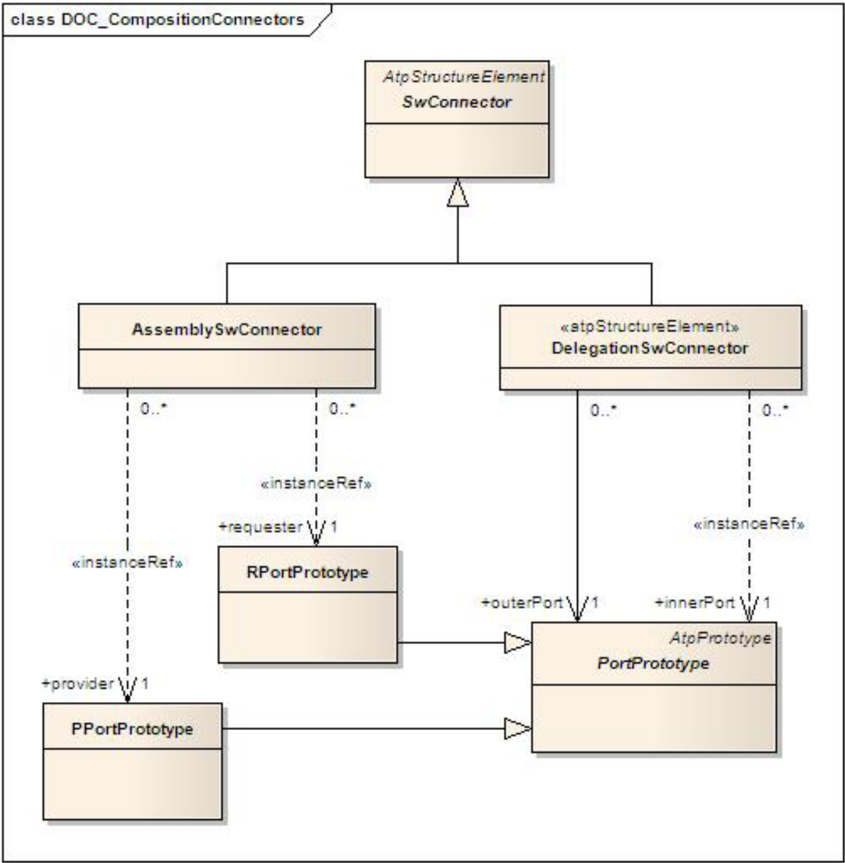

示例：在 Exterior light 分解中，「ExtrLi」软件组件原型是组合类型，它提供一个「外部」PPortPrototype「TrlrSts」，该端口从软件组件原型「ExtrLiAdprTrlr」的「内部」PPortPrototype 委托而来。同一个 PPortPrototype 通过组装连接器原型连接到「ExtrLiAdprReLe」与「ExtrLiAdprReRi」的 RPortPrototype。

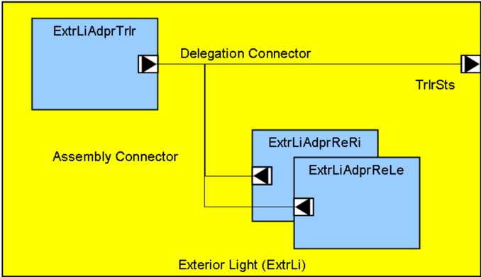

### 4.2.2 蓝图映射与 BlueprintMappingSet

蓝图映射（Blueprint mapping）充当蓝图与派生元素之间的引用。蓝图映射识别蓝图化元素与实际蓝图之间的关系。它还针对蓝图验证派生元素。这些 BlueprintMapping 的聚合是一个 BlueprintMappingSet。下图展示了 BlueprintMapping 与 BlueprintMappingSet。

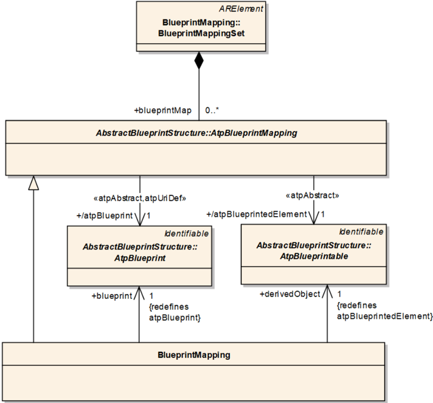

### 4.2.3 端口原型（PortPrototypes）

PortPrototype（在某些地方也称为 Ports）是不同软件组件之间通信的定义良好的连接点。PortPrototype 要么是必需类型，要么是提供类型。require-port（技术术语：RPortPrototype）需要某些服务或数据，而 provider-port（即 PPortPrototype）提供这些服务或数据。

两个 SwComponentPrototype 最终通过将一个 SwComponentPrototype 的 PPortPrototype 连接到另一个 SwComponentPrototype 的兼容 RPortPrototype 来连接。

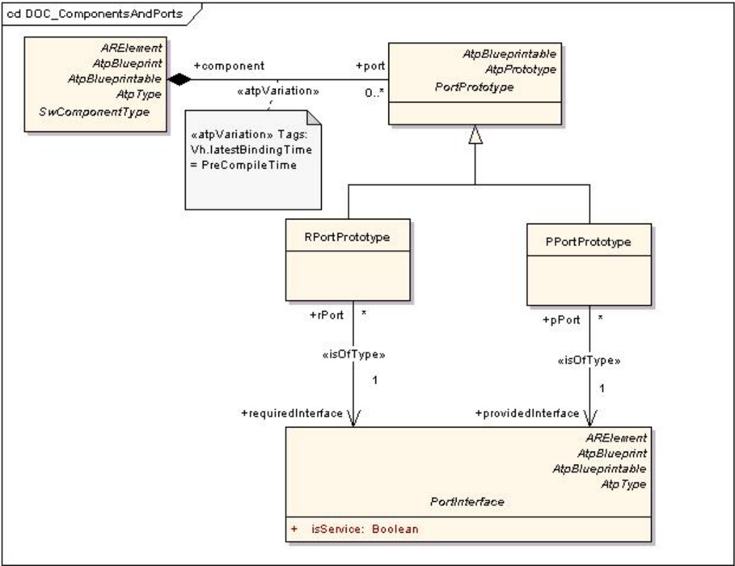

#### 4.2.3.1 端口原型蓝图（PortPrototypeBlueprints）

PortPrototypeBlueprint 是一个 ARElement，充当创建 PortPrototype 的蓝图。用户可以选择特定的 PortPrototypeBlueprint 并从中创建 PortPrototype。

PortPrototypeBlueprint 与 SwComponentType 无关。PortPrototypeBlueprint 在 AI 表中没有显式表示，它们可以在 XML 中作为一个单独的包找到。

PortPrototypeBlueprints 可以被看作一个库，用户可以从中选择一个 PortPrototypeBlueprint 作为模板来创建 PortPrototype。因此，PortPrototypeBlueprints 只是 PortPrototype 的集合，没有任何架构关系。一旦 PortPrototypeBlueprint 被附着到一个 SwComponentPrototype，它就成为一个 PortPrototype。

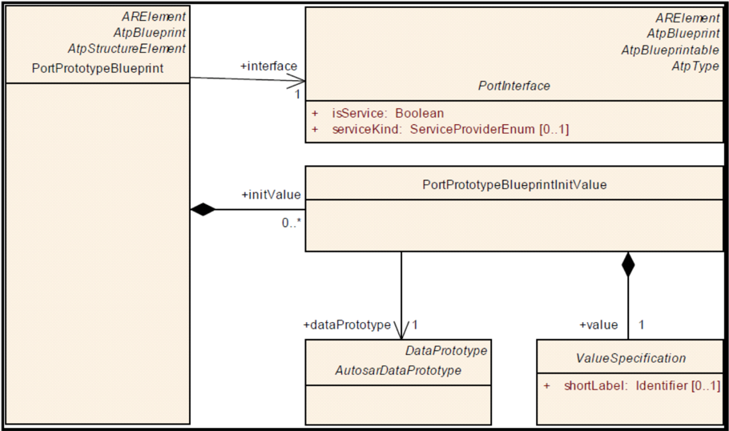

#### 4.2.3.2 PortPrototypeBlueprint 的蓝图映射

从可用的 PortPrototypeBlueprint 创建 PortPrototype 的过程称为 BlueprintMapping。BlueprintMapping 在图 4.9 中演示。PortPrototype 与 PortPrototypeBlueprint 之间的映射可以在包「BlueprintMappingSets_Example」内的 BlueprintMappingSet「PortPrototypeBlueprintMappings」中找到。

#### 4.2.3.3 Float 数据使用的规则与建议

以下是关于 Float 数据如何用于端口原型的一些规则与建议：

- 始终使用 1:1 标度：例如内部表示 = 10.1，使用物理值 10.1Pa
- 只应进行单精度计算（不推荐 f64）
- 在目标 ECU 已知的情况下：如果 RAM/栈资源比 CPU 负载更关键，则不要使用 float
- Float 应始终与作为物理表示的 SI 单位一起使用。
- 如果同一信号要么需要大范围低精度、要么需要小范围高精度，则强烈建议使用 Float。示例：
  - 压力（[Pa]）强烈建议使用 Float
  - 喷射量（[kg]）强烈建议使用 Float
- 在整数精度足够时不应使用 Float（例如温度（[K]））

在平面实例描述符（Flat Instance Descriptor，SW 信号）中使用 float 时，还有一些规则/建议：

- 必须满足 AUTOSAR 元模型的兼容性规则
- 可以使用任何物理显示表示

### 4.2.4 端口接口（PortInterfaces）

PortInterface 定义在两个 PortPrototype 之间传输的信息的类型。

PortInterface 用于支持「按契约设计」（design-by-contract）的工作流，即它们提供了一种形式化验证软件组件之间结构与动态兼容性的手段。换言之，PortInterface 代表 AUTOSAR 概念中的关键点。

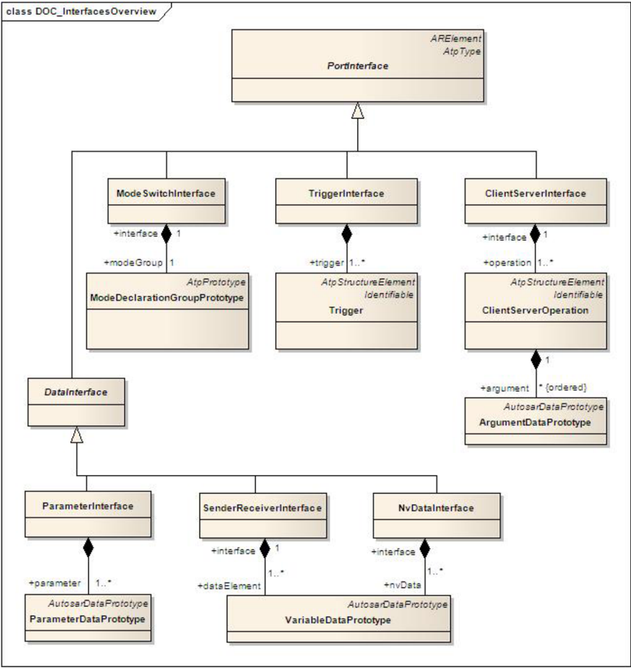

**元模型参考（Meta Model Reference）：**

`M2::AUTOSARTemplates::SWComponentTemplate::PortInterface` [\[2\]](#ref-2)

BlueprintMapping 是从 PortInterfaceBlueprint 创建 PortInterface 的过程。这在图 4.9 中演示。PortInterface 与 PortInterfaceBlueprint 之间的映射可以在包「BlueprintMappingSets_Example」内的 BlueprintMappingSet「PortInterfaceBlueprintMappings」中找到。

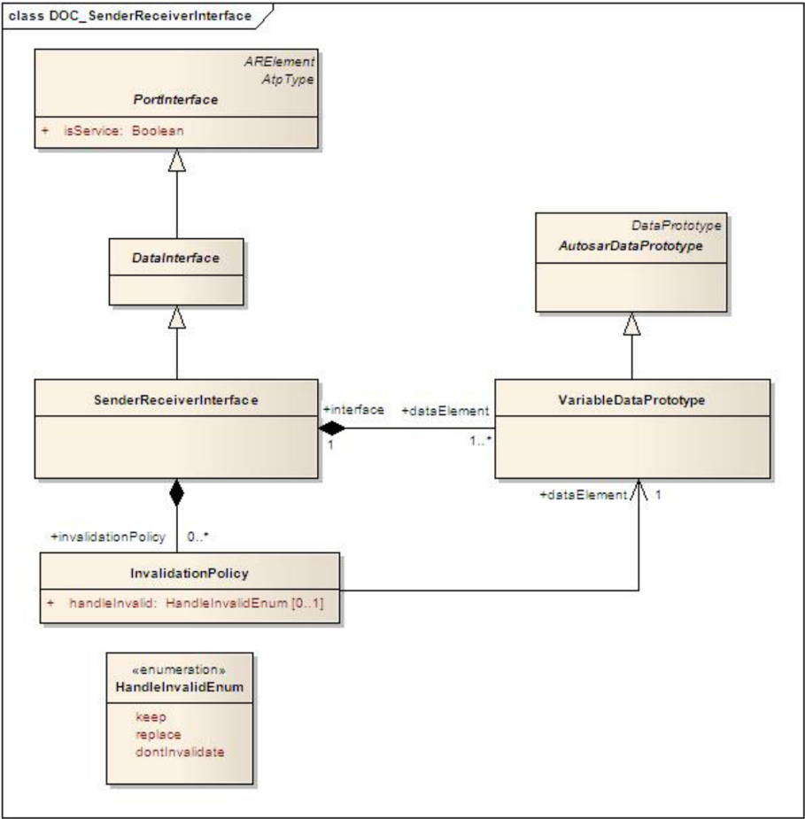

#### 4.2.4.1 发送-接收通信

SenderReceiverInterface 允许规格化典型的异步通信模式，其中发送者提供一个或多个接收者所需的数据。虽然实际通信经由相应的 PortPrototype 进行，但 SenderReceiverInterface 允许形式化地描述发送与接收的是哪类信息。

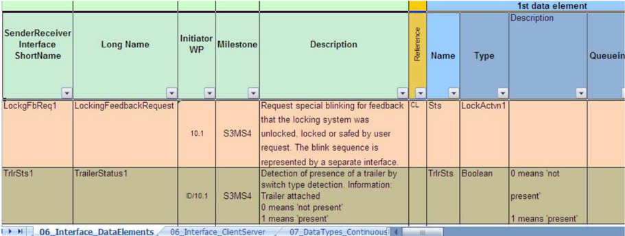

SenderReceiverInterface 声明若干要发送与接收的数据元素（VariableDataPrototype）。SenderReceiverInterface 聚焦于描述由 VariableDataPrototype 表示的信息项。以 dataElement 角色聚合的 VariableDataPrototype 表示在由 SenderReceiverInterface 类型化的 PortPrototype 之间传输的一条原子信息。

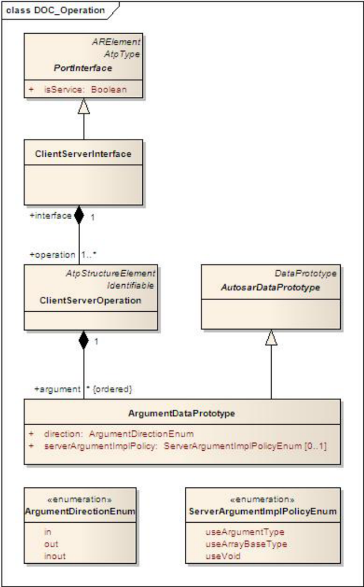

**AI 表参考（AI Table Reference）：**

AUTOSAR_ApplicationInterfaces.xls [\[1\]](#ref-1)

工作表名称：06_Interface_DataElements

示例：「TrlrSts1」是一个 SenderReceiver 接口，它有一个类型为「Boolean」的数据元素「TrlrSts」。

#### 4.2.4.2 客户端-服务器通信

客户端/服务器通信的底层语义是：客户端可以发起由支持该操作的服务器执行操作。服务器执行操作并立即向客户端提供结果（同步操作调用），否则客户端自行检查操作的完成（异步操作调用）。

ClientServerInterface 在一定程度上是 SenderReceiverInterface 的对应物。ClientServerInterface 不是定义在软件组件之间传输的信息片段，而是定义 ClientServerOperation 的集合。

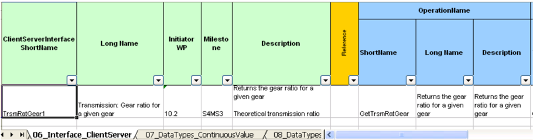

如图 4.15 所示，ClientServerInterface 由 ClientServerOperation 组成，即 ClientServerOperation 不能在不同 ClientServerInterface 的语境中复用。ClientServerOperation 由 0 到多个 ArgumentDataPrototype 组成。后者可以：

- 传递给操作
- 传递给操作并从操作返回
- 从操作返回

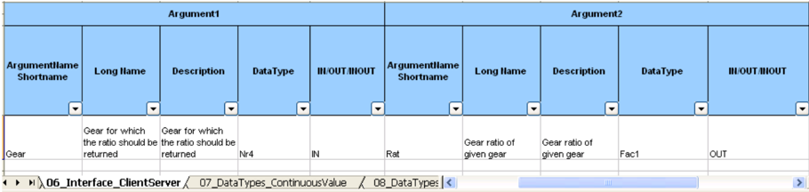

**AI 表参考（AI Table Reference）：**

AUTOSAR_ApplicationInterfaces.xls [\[1\]](#ref-1)

工作表名称：06_Interface_ClientServer

示例：在上面的截图中，定义了一个客户端/服务器接口「TrsmRatGear1」，用于返回给定挡位的传动比；客户端请求操作「GetTrsmRatGear」，输入参数为「Gear」。函数调用返回输出参数「Rat」。

### 4.2.5 数据类型（DataTypes）

可以从应用视角以及实现视角描述软件组件提供的数据。其背后的共同概念由抽象元类 AutosarDataType 表达，ApplicationDataType 与 ImplementationDataType 从中派生。图 4.18 展示了用于定义 AutosarDataType 的基本元类的汇总。

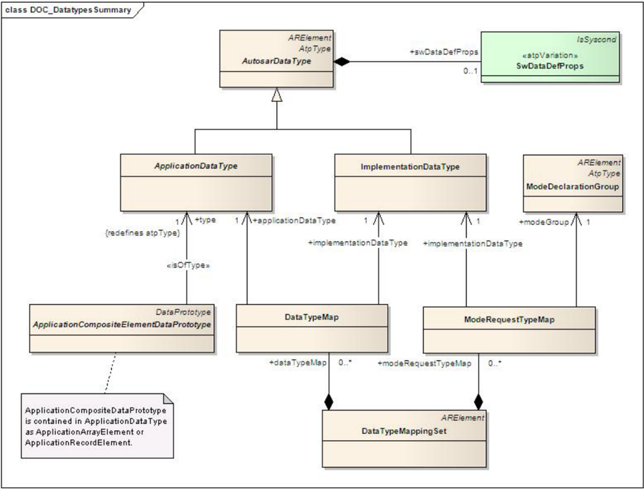

ApplicationDataType 可以由元素组成（以记录或数组的形式），这些元素本身由另一个 ApplicationDataType 类型化。这由元类 ApplicationCompositeElementDataPrototype 表达，图 4.18 中为完整性起见也展示了它。ImplementationDataType 也可以组合，但在这种情况下，没有应用类型/原型概念。

#### 4.2.5.1 应用数据类型（ApplicationDataTypes）

抽象元类 ApplicationDataType 进一步派生为 ApplicationPrimitiveDataType 与 ApplicationCompositeDataType。与任何 AutosarDataType 一样，应用层的原始类型与组合类型由其类别（category）与 SwDataDefProps 表征。对于给定的类别，SwDataDefProps 中只有有限的属性集是有意义的。

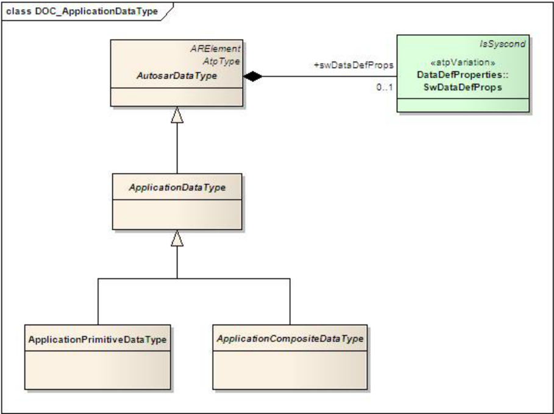

##### 4.2.5.1.1 应用原始数据类型

本章定义可用于端口接口或组合应用数据类型的数据原型的原始应用数据类型。

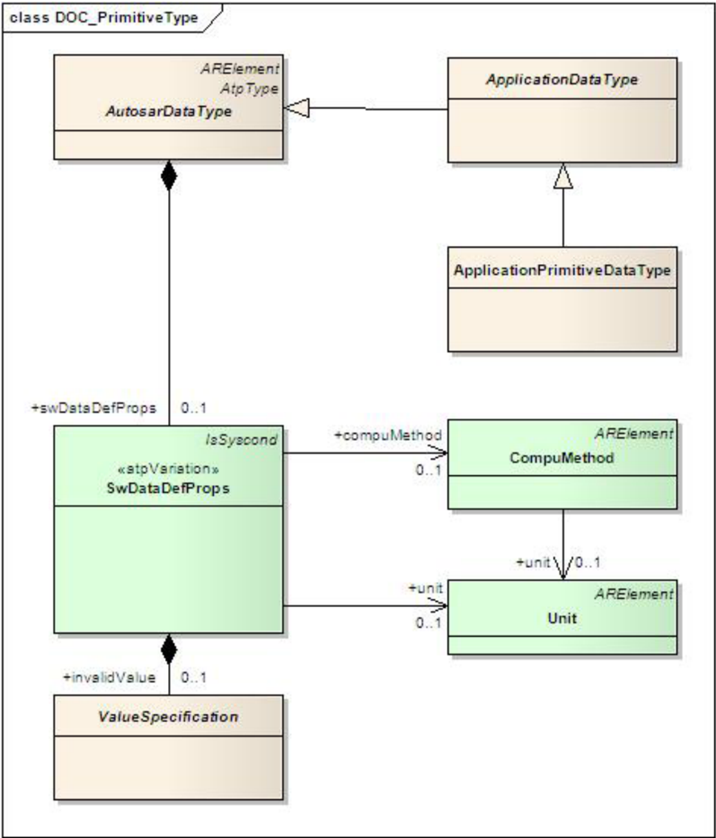

**元模型参考（Meta Model Reference）：**

`M2::AUTOSARTemplates::SWComponentTemplate::DataType::DataTypes` [\[2\]](#ref-2)

**AI 表参考（AI Table Reference）：**

AUTOSAR_ApplicationInterfaces.xls [\[1\]](#ref-1)

工作表名称：07_DataTypes_ContinuousValue

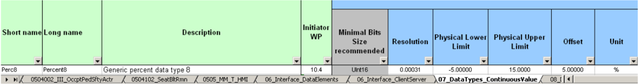

**AI 表参考（AI Table Reference）：**

AUTOSAR_ApplicationInterfaces.xls [\[1\]](#ref-1)

工作表名称：08_DataTypes_Enumeration


示例：在上面的截图中，定义了连续值（ContinuousValue）数据类型 Perc8。该数据类型的分辨率、物理下限与上限以及偏移与单位也显示在截图中。

示例：在上面的截图中，定义了枚举（Enumeration）数据类型 TrsmTyp1。枚举数据类型的所有允许值也包含在 AI 表中。

##### 4.2.5.1.2 应用组合数据类型

元类 ApplicationArrayDataType 与 ApplicationRecordDataType 提供定义组合数据类型的手段。如果应用软件希望访问组合的各个元素并对整个组合进行操作，例如希望在单个事务中传达完整的记录或数组，则需要这样的组合数据类型。

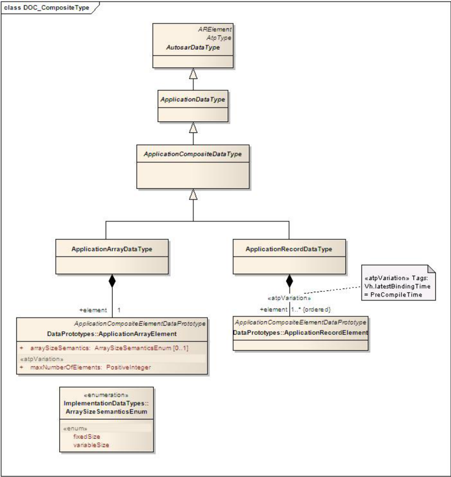

可以使用 ApplicationArrayDataType 与 ApplicationRecordDataType 的组合，使得 ApplicationArrayDataType 可以被定义为 ApplicationRecordDataType 的 ApplicationRecordElement，同样 ApplicationRecordDataType 也可以用作 ApplicationArrayDataType 的基础类型。嵌套 ApplicationComposite 数据类型的创建也是可能的。

##### 4.2.5.1.3 ApplicationArrayDataType

ApplicationArrayDataType 可以包含 maxNumberOfElements 个 ApplicationArrayElement。这些 ApplicationArrayElement 中的每一个必须具有相同的类型。在软件组件描述中引用数组内的元素时，元素索引从 0 到 (maxNumberOfElements-1) 运行。

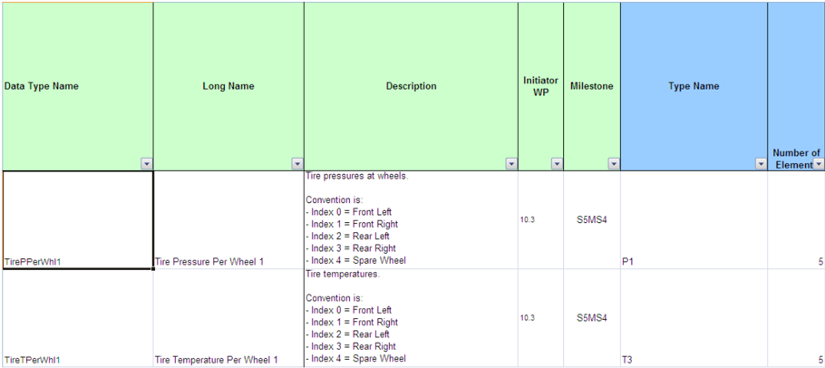

**AI 表参考（AI Table Reference）：**

AUTOSAR_ApplicationInterfaces.xls [\[1\]](#ref-1)

工作表名称：09_DataTypes_Array

示例：此处列出了应用组件开发中使用的 DataType 数组的标准变量，供参考。数组 DataType「TirePPerWhl1」包含 5 个元素，每个元素的 DataType 为「P1」。

##### 4.2.5.1.4 ApplicationRecordDataType

ApplicationRecordDataType 的声明描述了一组非空对象，每个对象相对于该 ApplicationRecordDataType 具有唯一标识符，且各自拥有自己的 ApplicationDataType。在 ApplicationRecordDataType 范围内，每个 ApplicationRecordElement 的 ShortName 必须唯一。

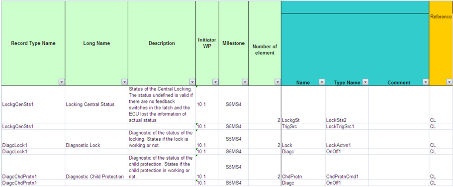

**AI 表参考（AI Table Reference）：**

AUTOSAR_ApplicationInterfaces.xls [\[1\]](#ref-1)

工作表名称：11_DataTypes_Record

示例：「IndcrTurnSeq1」是一个表示转向指示灯序列的记录类型变量。记录 DataType「IndcrTurnSeq1」包含 5 个元素，每个元素在以相应 DataType 定义的唯一行中表示。

### 4.2.6 物理单位（Physical Units）

与 DataType 关联的语义的一个重要部分是其物理量纲。单位用于为值补充附加信息，如 m/s 或升。这对于输入与输出过程中物理值的正确解释是必需的。单位涉及其物理量纲的信息。

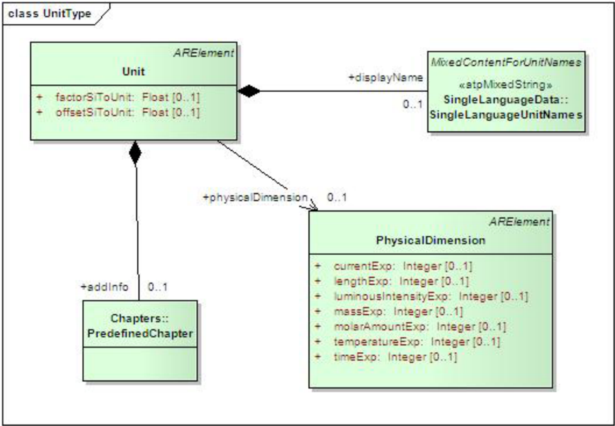

单位引用一个物理量纲。如果两个单位的物理量纲相同，则在它们之间可以进行转换。

**元模型参考（Meta Model Reference）：**

`M2::AUTOSARTemplates::SWComponentTemplate::DataType::Units` [\[2\]](#ref-2)

**AI 表参考（AI Table Reference）：**

AUTOSAR_ApplicationInterfaces.xls [\[1\]](#ref-1)

工作表名称：13_Units

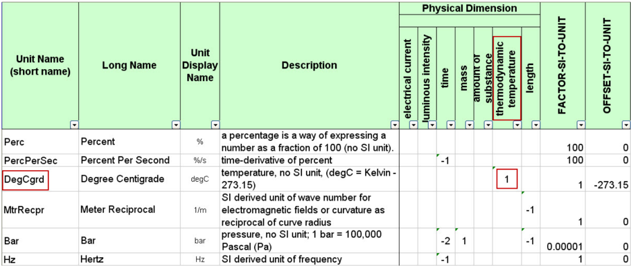

示例：表示为「DegCgrd」的单位，属于「热力学温度」物理量纲。

### 4.2.7 计算方法（Computation Methods）

该元类表示表达物理值与数学表示之间关系的能力。

注意这与数据类型中的技术实现仍然无关。它只规定内部值如何对应其物理对应物的公式。

CompuMethod 一般应当可复用，且不固定于特定数据类型。CompuMethod 可以被需要这种所述计算特性的任何类型的数据类型引用；强烈建议复用，并且对 float 数据类型定义是强制性的。应用接口工具（AIT）工具支持这种参数的交叉引用。更多信息请参见 SW-C 与系统建模指南 [\[4\]](#ref-4)。

#### 4.2.7.1 线性转换示例

以下示例说明如何使用 CompuMethod 规定线性转换。

```
F [kmh] = 30 [kmh] + 2 [kmh] * x

<COMPU-METHOD>
  <SHORT-NAME>LinearExample</SHORT-NAME>
  <CATEGORY>LINEAR</CATEGORY>
  <UNIT-REF DEST="UNIT">kmh</UNIT-REF>
  <COMPU-INTERNAL-TO-PHYS>
    <COMPU-SCALES>
      <COMPU-SCALE>
        <COMPU-RATIONAL-COEFFS>
          <COMPU-NUMERATOR>
            <V>30</V>
            <V>2</V>
          </COMPU-NUMERATOR>
          <COMPU-DENOMINATOR>
            <V>1</V>
          </COMPU-DENOMINATOR>
        </COMPU-RATIONAL-COEFFS>
      </COMPU-SCALE>
    </COMPU-SCALES>
  </COMPU-INTERNAL-TO-PHYS>
</COMPU-METHOD>
```

### 4.2.8 关键词与关键词集（Keyword and KeywordSet）

为组件类型、端口、端口接口或数据元素定义短名称的一个重要部分，是使用 AUTOSAR 中预定义的关键词及其缩写。其优点是这会产生具有既定含义的相对较短的名称。关键词聚合在类别 KeywordSets_Blueprint 之下。

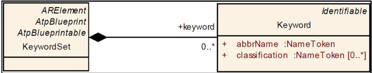


从上图可见，每个关键词由以下属性描述：

- ShortName：表示关键词的唯一名称，它不参与名称构造（上例中的 Prepn）
- longName：表示关键词的长形式（Preparation）
- desc：表示关键词的定义
- abbrName：规定关键词的缩写名称，用于构建 ShortName
- classification：描述关键词的语义领域（Mean-EnvironmentDevice、Action-PhysicalType、Condition-Qualifier、Index、Preposition）

如果文档其余部分没有另行规定，术语「关键词」指关键词的 longName，而缩写名称也可以称为「abbrName 属性」或「关键词缩写」。

生成的 xml 输出如下：

```
<SHORT-NAME>AISpecification</SHORT-NAME>
<AR-PACKAGES>
  <AR-PACKAGE>
    <SHORT-NAME>KeywordSets_Blueprint</SHORT-NAME>
    <CATEGORY>BLUEPRINT</CATEGORY>
    <ELEMENTS>
      <KEYWORD-SET>
        <SHORT-NAME>KeywordList</SHORT-NAME>
        <LONG-NAME><L-4 L="EN">AUTOSAR Keywords and Keywords Abbreviations</L-4></LONG-NAME>
        <KEYWORDS>
          <KEYWORD>
            <SHORT-NAME>Prepn</SHORT-NAME>
            <LONG-NAME><L-4 L="EN">Preparation</L-4></LONG-NAME>
            <DESC><L-2 L="EN">this characteristic is used to express a general status of preparation, e.g. processing of certain tasks before an activation of a certain component or functionality</L-2></DESC>
            <ABBR-NAME>Prepn</ABBR-NAME>
            <CLASSIFICATIONS>
              <CLASSIFICATION>Condition-Qualifier</CLASSIFICATION>
            </CLASSIFICATIONS>
          </KEYWORD>
          ...
```

为了构建可读且可理解的名称，关键词应按照语义规则排列。这些规则定义了必须以确定顺序使用的语义域（Semantic Fields）。这些在 [\[4\]](#ref-4) 中进一步描述。

## 5. 向后兼容性

### 5.1. 引言

在 AUTOSAR 标准的开发过程中，在较新的版本中人们认识到标准与其前代版本不兼容。这进而导致了严重的集成问题，尤其是对于打算使用规范更新版本中某些模块的配置。

因此，AUTOSAR 为新概念引入了向后兼容性（Backward Compatibility）需求，以确保混合实现版本的软件平稳且无错误地运行。

三个用例引出 AUTOSAR 将提供的三种兼容性声明—— respective 文档所有者提供变更列表，并附有对三种向后兼容性的影响分析：

- 规格层面的向后兼容性
- 总线层面的向后兼容性
- 应用层面的向后兼容性

对于应用层面的向后兼容性，它考虑的是对应用软件组件之间的交互有影响的、某个 AUTOSAR 版本的模块集合。

因此，应用接口的用例定义被推导为：

**水平「应用兼容性」（仅考虑标准化的应用接口）**

- 旧场景：基于（例如）R4.0.3 版本中定义的标准化应用接口进行应用开发
- 新场景：应用应针对（例如）R4.1.1 版本的标准化应用接口进行更新
- 问题：新的标准化应用接口是否无需适配即可与旧的（未更改的）标准化应用接口协同工作？

### 5.2. 向后兼容性定义

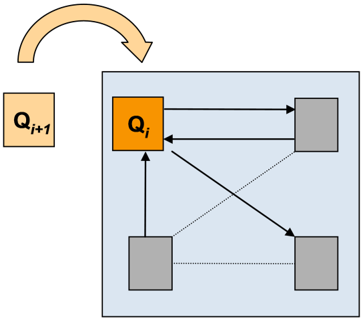

**根据 AUTOSAR；**

- 如果产品 Q<sub>i+1</sub> 能够取代 Q<sub>i</sub> 的位置——该 Q<sub>i</sub> 又与为产品 Q<sub>i</sub> 设计的其他产品（未被改动）交互——则称产品 Q<sub>i+1</sub> 与产品 Q<sub>i</sub> 兼容。
- 如果 Q<sub>i+1</sub> 与 Q<sub>i</sub> 兼容且 Q<sub>i+1</sub> 是 Q<sub>i</sub> 的后继者，则称产品 Q<sub>i+1</sub> 相对产品 Q<sub>i</sub> 向后兼容。

**因此在应用接口的语境中定义如下：**

- 如果蓝图 Q<sub>i+1</sub> 能够取代蓝图 Q<sub>i</sub> 的位置——该蓝图 Q<sub>i</sub> 又被端口（未被改动）引用——则称蓝图 Q<sub>i+1</sub> 与蓝图 Q<sub>i</sub> 兼容。
- 如果应用接口 Q<sub>i+1</sub> 能够取代应用接口 Q<sub>i</sub> 的位置——该接口 Q<sub>i</sub> 又被按照应用接口 Q<sub>i</sub> 设计的系统（未被改动）引用——则称应用接口 Q<sub>i+1</sub> 与应用接口 Q<sub>i</sub> 兼容。

**示例：**

**端口合规（PortCompliance）是：**

- ShortName 相等
- 端口蓝图的 InterfaceBlueprint 符合端口的接口
- ……

**接口合规（InterfaceCompliance）是：**

- 具有相同数量的 dataElementPrototype
- dataElementPrototype 的名称相同
- dataElementPrototype 的数据类型兼容

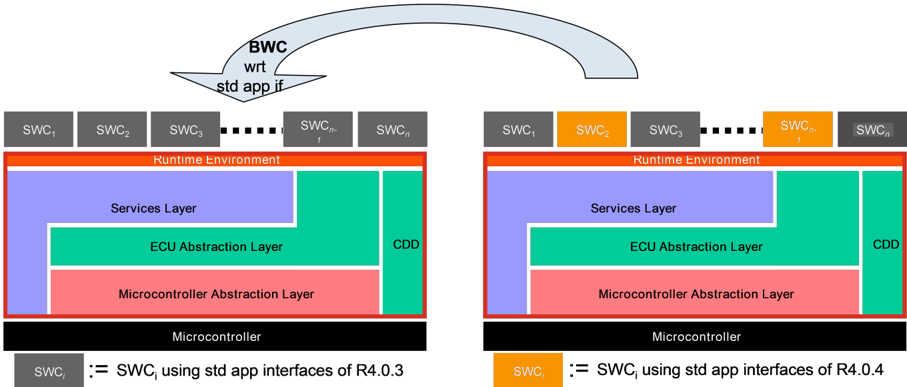

**解释：**

向后兼容性需求是支持交换具有新标准化应用接口的 SWC 的必要前提。

在基于（例如）R4.0.3 版本开发的 ECU 中——标准化应用接口应更新为（例如）R4.1.1 版本的新标准化应用接口。


**前提条件：**

- 标准化应用接口已更新到最新版本；其余一切保持不变
- 配置在语义上等价
- SWC 已重新编译

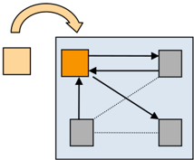

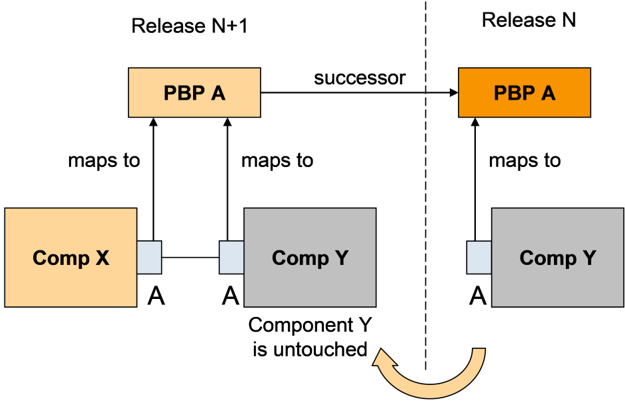

影响向后兼容性的元素；如果这些元素被更改，向后兼容性将受到影响（参见 SW-C 与系统建模指南 [\[4\]](#ref-4)，Future extensions（第 5.4 章））：

- 短名称
- 枚举数据类型
  - 枚举值、枚举值名称
- 连续数据类型
  - 分辨率、物理限值、偏移、单位
- 数组数据类型
  - 元素数量、元素类型
- 记录数据类型
  - 元素数量、元素名称、元素类型
- 发送-接收接口
  - 数据元素数量、数据元素名称、数据元素类型
- 客户端-服务器接口
  - 操作名称、参数数量、参数名称、参数数据类型、参数 in/out 属性

### 5.3. 总结

- 对端口蓝图及其引用的元素（PortInterface、应用数据类型与单位）的任何变更，都应创建所有受影响元素的新版本。例外：对描述性元素的更改（除非原始元素的含义被修改）
- 新元素使用与当前接口所使用的相同的定义序列编号（参见 SW-C 与系统建模指南 [\[4\]](#ref-4)，第 5.4 章）。
- 描述性元素并不必然导致新版本。这适用于以下元素：
  - Description（描述）
  - LongName（长名称）
  - Introduction（引言）

注意：如果蓝图的某个描述性元素发生变化，以致其相对于原始蓝图的含义也被改变，则应创建所有受影响元素的新版本。

对于 AI，R4.0.3 是 BWC 的基础。

## 6. 生命周期状态（Life Cycle States）

### 6.1. 引言

为了支持端口原型蓝图、PortInterface、关键词缩写及其他 STANDARD 或 BLUEPRINT 元素等标准化模型元素的演进与向后兼容性，AUTOSAR 需要支持生命周期状态。

**「生命周期」的定义 [\[15\]](#ref-15)**

模型元素在其生命周期内的发展/演化阶段进程。生命周期由一组生命周期状态组成。生命周期状态可以在其版本信息之外并行地附着到一个元素。

一个典型的生命周期是 {valid, obsolete}，意味着一个有效元素在首次引入时是最新的，但稍后被一个新的替代，因此获得生命周期状态「obsolete」。

元素的「生命周期状态」与其「版本」的不同之处在于：

版本：指在其开发历程中被追踪的、使其得以存在的信息（例如：proposal、in work、released……），而

生命周期追踪一个元素从其主流引入点到其过时的历程。

生命周期状态在通用结构模板 [\[6\]](#ref-6) 的第 11 章中进一步描述。

### 6.2. 在 AI 表中的表示

为了支持生命周期状态在 AI 表中的引入，已在受影响的工作表中添加了新列，如下图所示。

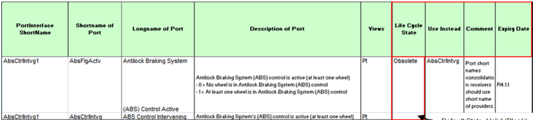

这些列的说明如下所示。当前为 AI 用途定义了两个生命周期状态：

- Obsolete（过时，附带过时原因与提供的替代项）
- Valid（有效，默认状态，在「Life Cycle State」列中留空）

也可以有两条可用于「Use Instead」属性的条目。在这种情况下，条目以逗号（,）分隔。

| 工作表 | 列描述 | 解释 |
| --- | --- | --- |
| 04*、05*、06*、07*、08*、09*、11*、13*、15* | Life Cycle State | 生命周期概念的扩展：字段为空时生命周期状态为 valid；字段为「obsolete」时生命周期状态为 obsolete |
| 04*、05*、06*、07*、08*、09*、11*、13*、15* | Use Instead | 引用将替代过时模型元素的模型元素短名称；若此列有两条条目，以逗号（,）分隔 |
| 04*、05*、06*、07*、08*、09*、11*、13*、15* | Comment | 备注字段，例如不再使用该模型元素的原因 |
| 04*、05*、06*、07*、08*、09*、11*、13*、15* | Expiry Date | 以 R4.1.1 形式给出的到期日 AUTOSAR 版本，即该元素变为过时的版本 |

请注意，AI 表布局的相应更改未反映在本文档的其他图中。


### 6.3. 在元模型与 arxml 中的表示

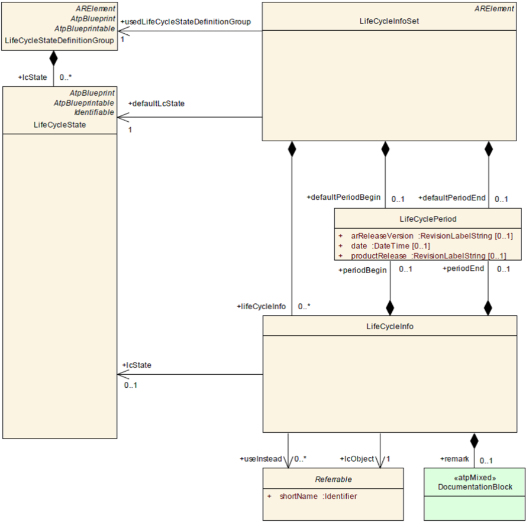

元素的生命周期信息可在以下生成的 xml 文件中获得：

- AUTOSAR_MOD_GeneralDefinition_LifeCycle.arxml：在 AUTOSAR 项目中全局适用、也用于基础 SW 领域的生命周期状态的定义（LifeCycleStateDefinitionGroup）。该文件不属于 AI 交付物，只在 AUTOSAR_MOD_GeneralDefinitions.zip 文件夹内被引用。
- AUTOSAR_MOD_AISpecification_&lt;Element&gt;_LifeCycle_Standard.arxml：生命周期的应用——指在应用接口内定义的元素及其关联的 LifeCycleState（LifeCycleInfoSet）。每个模型元素一个文件，是 AUTOSAR_MOD_AISpecification.zip 文件夹内 AI 交付物的一部分。


例如，从上表可见，端口 AbsFlgActv 被置为 Obsolete，并在 Use Instead 中指向 AbsCtrlIntvg。

同样的信息反映在文件 AUTOSAR_MOD_AISpecification_PortPrototypeBlueprint_LifeCycle_Standard.arxml 的 arxml 摘录中，如下所示。

```
<LIFE-CYCLE-INFO>
  <LC-OBJECT-REF DEST="PORT-PROTOTYPE-BLUEPRINT" BASE="PortPrototypeBlueprints_Blueprint">AbsFlgActv</LC-OBJECT-REF>
  <PERIOD-BEGIN>
    <AR-RELEASE-VERSION>4.1.1</AR-RELEASE-VERSION>
  </PERIOD-BEGIN>
  <REMARK>
    <P><L-1 L="EN">Port short names consolidation: receivers should use short name of providers.</L-1></P>
  </REMARK>
  <USE-INSTEAD-REFS>
    <USE-INSTEAD-REF DEST="PORT-PROTOTYPE-BLUEPRINT" BASE="PortPrototypeBlueprints_Blueprint">AbsCtrlIntvg</USE-INSTEAD-REF>
  </USE-INSTEAD-REFS>
</LIFE-CYCLE-INFO>
```

AUTOSAR_MOD_AISpecification_&lt;Element&gt;_LifeCycle_Standard.arxml 只包含那些被标记为 Obsolete 的元素（因为默认值为 Valid）以及相应的替代元素，即过时元素的替代者。到期版本定义元素过时周期的开始，即该元素第一次从 valid 被置为 obsolete 的 AUTOSAR 版本，本例中为「R4.1.1」。

## 7. 应用接口中的视图概念（变型处理）

### 7.1. 引言

变型处理概念将帮助使用应用接口在车辆中实现不同的架构。借助端口原型蓝图概念，接口的最终端到端通信将通过系统配置来执行。这也使得不同配置的物理车辆——如紧凑型车、高档车，乃至卡车应用——能够被纳入应用接口的标准化。

由于 AUTOSAR 只标准化蓝图，因此没有必要在 AI 规范中实现变型处理。为每个所需的变型添加新的蓝图元素很容易实现。为了区分不同的变型，引入了不同的视图（view）。视图允许针对特定变型或用例过滤蓝图元素。例如，如果引入「卡车」视图，就可以针对「truck」视图进行过滤，即过滤出与用例「卡车」相关的所有蓝图元素。

### 7.2. 在应用接口中的实现与元模型表示

10.x 所定义的视图位于一个类别为 BLUEPRINT 的包中。这样做的原因是：在企业环境中，可能会添加更多元素。

在首次引入视图时，只为每个域引入视图，即视图「Body」（Body）、「Powertrain」（Pt）、「Chassis」（Chassis）、「Occupant and Pedestrian Safety」（OccptPedSfty）与「Multimedia, Telematics and HMI」（MmedTelmHmi）。未来版本可能会添加更多视图。当前，这些视图可以为 AI 表中的 PortPrototypeBlueprint 与 ApplicationDataType 规定。属于特定视图的元素以括号中的术语标记，例如在 AI 表工作表的「Views」列下标记为「Pt」「Body」或「Chassis」，如下所示。设置过滤器后，即可看到相应的元素集合。

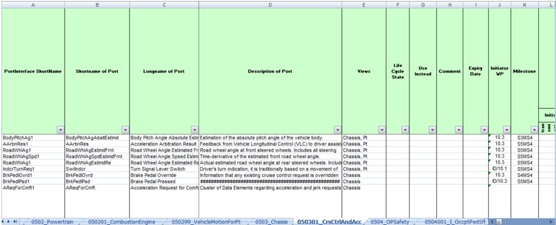

此外，也可以将「多个视图」分配给单个模型元素。例如，在上图中我们看到单个模型元素（BodyPitchAgAbsltEstimd）被分配了两个视图（Chassis 与 Pt），以「逗号」分隔。

请注意，AI 表布局的相应更改未反映在本文档的其他图中。

对于某些用例，需要建立一个元素集合。这样的集合与包是正交的。因此，集合驻留在一个包中，但通过与被收集元素的关联而建立，如下图所示。不过，对于应用接口，只使用该方法论的一个子集，更多细节见 [\[6\]](#ref-6)。

不同的视图将以类别为 SET、元素角色为 PART_OF_SUBSET 的集合形式规定。

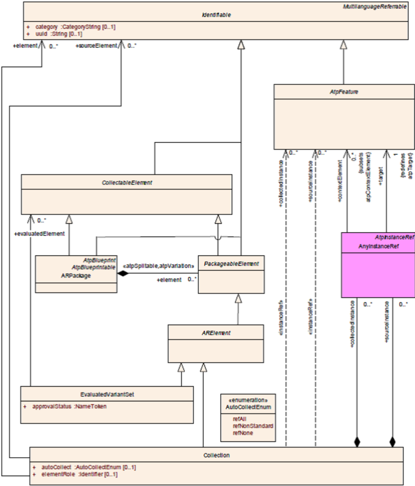

将规定两个集合来定义视图，一个 autoCollect=REF-ALL，另一个 autoCollect=REF-NONE。

REF-ALL 表示该集合将自动包括所有被引用的模型元素。这些元素不在集合内列出。

REF-NONE 表示该集合不包括任何被引用的模型元素。这意味着只有集合中列出的元素属于它。

对于生成的 XML，两个生成的集合将定义相应的内容。

参照下面的 xml 摘录：

autoCollect=REF-ALL 的集合包含一个 PortPrototypeBlueprint（AbsCtrlIntvg）。这意味着被引用的模型元素，如 PortInterface、ApplicationDataType、CompuMethod 与 Unit，也属于该集合。

autoCollect=REF-NONE 的集合包含一个 PortPrototypeBlueprint（AbsCtrlIntvg）以及被引用的模型元素（如 PortInterface、ApplicationDataType、CompuMethod 与 Unit）本身。

对于 AI 表内视图的规格化，在一张工作表上标记一个 PortPrototypeBlueprint 就足够了，例如提供者。这意味着即使未在接收者侧标记，它也将属于该视图。此外，也可以在不同工作表上规定两个不同的视图。XML 生成将考虑所有规定的视图。

```
<?xml version="1.0" encoding="UTF-8"?>
<AUTOSAR xmlns="http://autosar.org/schema/r4.0" xmlns:xsi="http://www.w3.org/2001/XMLSchema-instance" xsi:schemaLocation="http://autosar.org/schema/r4.0 AUTOSAR_4-1-1.xsd">
  <ADMIN-DATA>
    <LANGUAGE>EN</LANGUAGE>
    <USED-LANGUAGES>
      <L-10 L="EN" xml:space="default">English</L-10>
    </USED-LANGUAGES>
  </ADMIN-DATA>
  <AR-PACKAGES>
    <AR-PACKAGE>
      <SHORT-NAME>AUTOSAR</SHORT-NAME>
      <LONG-NAME><L-4 L="EN">AUTOSAR</L-4></LONG-NAME>
      <AR-PACKAGES>
        <AR-PACKAGE>
          <SHORT-NAME>AISpecification</SHORT-NAME>
          <AR-PACKAGES>
            <AR-PACKAGE>
              <SHORT-NAME>Collections_Blueprint</SHORT-NAME>
              <CATEGORY>BLUEPRINT</CATEGORY>
              <REFERENCE-BASES>
                <ELEMENTS>
                  <COLLECTION>
                    <SHORT-NAME>ChassisRefAll</SHORT-NAME>
                    <CATEGORY>SET</CATEGORY>
                    <AUTO-COLLECT>REF-ALL</AUTO-COLLECT>
                    <ELEMENT-ROLE>PART_OF_SUBSET</ELEMENT-ROLE>
                    <ELEMENT-REFS>
                      <ELEMENT-REF DEST="PORT-PROTOTYPE-BLUEPRINT" BASE="PortPrototypeBlueprints">AbsCtrlIntvg</ELEMENT-REF>
                    </ELEMENT-REFS>
                  </COLLECTION>
                  ...
                  <COLLECTION>
                    <SHORT-NAME>Chassis</SHORT-NAME>
                    <CATEGORY>SET</CATEGORY>
                    <AUTO-COLLECT>REF-NONE</AUTO-COLLECT>
                    <ELEMENT-ROLE>PART_OF_SUBSET</ELEMENT-ROLE>
                    <ELEMENT-REFS>
                      <ELEMENT-REF DEST="PORT-PROTOTYPE-BLUEPRINT" BASE="PortPrototypeBlueprints">AbsCtrlIntvg</ELEMENT-REF>
                      <ELEMENT-REF DEST="SENDER-RECEIVER-INTERFACE" BASE="PortInterfaces">AbsCtrlIntvg1</ELEMENT-REF>
                      <ELEMENT-REF DEST="APPLICATION-PRIMITIVE-DATA-TYPE" BASE="ApplicationDataTypes">CtrlSts1</ELEMENT-REF>
                      <ELEMENT-REF DEST="COMPU-METHOD" BASE="CompuMethods">CtrlSts1</ELEMENT-REF>
                      <ELEMENT-REF DEST="UNIT" BASE="Units">NoUnit</ELEMENT-REF>
                      <ELEMENT-REF DEST="PHYSICAL-DIMENSION" BASE="PhysicalDimensions">NoDimension</ELEMENT-REF>
                      <ELEMENT-REF DEST="DATA-CONSTR" BASE="DataConstrs">CtrlSts1</ELEMENT-REF>
                    </ELEMENT-REFS>
                  </COLLECTION>
                  ...
                </ELEMENTS>
              </REFERENCE-BASES>
            </AR-PACKAGE>
          </AR-PACKAGES>
        </AR-PACKAGE>
      </AR-PACKAGES>
    </AR-PACKAGE>
  </AR-PACKAGES>
</AUTOSAR>
```

## 8. 应用接口（AI）表的结构

AI 表被引用为 [\[1\]](#ref-1)。

### 8.1. AI 表的主要工作表

工作表的简要概览可在 AI 表的 02_General_Purposes 中找到。

以下小节借助图形表示详细解释其结构。AI 表的核心工作表列示如下；完整列表参见 8.2 节。

这些是用于修改 AI 表中标准化应用接口内容的相关工作表（不含管理工作表）。管理工作表包含一致性检查的结果，由宏自动填写。在一致性检查宏执行后，用户可能需要检查这些工作表。

| 工作表编号 | 内容 |
| --- | --- |
| 04_Keywords | 关键词的定义 |
| 05... 组合、组件 | 组合与组件及其端口的定义 |
| 06_Interface_DataElements / 06_Interface_ClientServer | 发送/接收接口与 ClientServerInterface 的定义 |
| 07_DataTypes_ContinuousValue | 连续值数据类型的定义 |
| 08_DataTypes_Enumeration | 枚举数据类型的定义 |
| 09_DataTypes_Array | 数组数据类型的定义 |
| 11_DataTypes_Record | 记录数据类型的定义 |
| 13_Units | 单位的定义 |
| 15_Redirected_Ports | 重定向端口的定义 |

在以下小节中，将详细解释工作表的所有主要类别。

注意：以下各节展示的所有图与截图仅为示例，它们可能与 AI 表内容不完全一致。

#### 8.1.1 工作表 04_Keywords

AI 表的「04_Keywords」工作表包含关键词及其缩写。「Short Name」「Long Name」「Abbr Name」与「Description」列用于定义 AUTOSAR 中共同约定的关键词（例如 Accept）与关键词缩写（例如 Acpt）。这些定义的关键词缩写用于在 AI 表中定义标准化元模型元素（例如 Port、PortInterface）的短名称。Keywords 工作表见图 8.1。

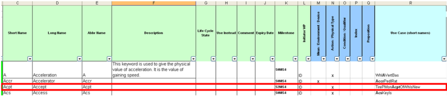

在某些情况下可以观察到，关键词根据使用语境可能具有多重含义。例如，当关键词的 Abbr Name 相同时——如「At」既可用作「Preposition（前置词）」也可用作「Automatic Transmission（自动变速器）」——如下图所示。此类关键词条目会重复录入：以相同的 Abbr Name 建立两条独立条目，并根据用途更新相应的短名称与分类。关键词的 Description 与 Classification 区分其用途与含义。

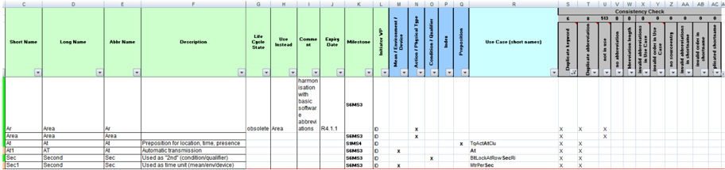

#### 8.1.2 工作表 05_TopLevel

TopLevel 工作表包含域间 PortPrototype 与 PortInterface 的连接矩阵。每个条目的 PortInterface 短名称、端口短名称、端口长名称与端口描述位于标题分别为「PortInterface ShortName」「ShortName of Port」「Long name of Port」与「Description of port」的列中。在这些列之后是管理列（Initiator、WP 与 Milestone<sup>1</sup>）以及一致性检查结果矩阵列（关于一致性检查的理解请参见 AI 表中的工作表 102_User_Documentation）。

> 1 AI 表内可见的数据质量始终带有基于步骤编号与里程碑组合的质量指示，如 SxMSy（x 可为 0、1、2、3……，y 可为 1、2、3、4）。Milestone 字段在每次评审之后或对模型元素的任何修改之后必须手动更改。PortInterface 的里程碑不能高于 DataType 的里程碑。类似地，端口的里程碑不能高于 PortInterface 的里程碑。

在这些管理列之后，通信相关信息在「transmissionAcknowledgementTimeout」与「canInvalidate」列中提供。「TransmissionAcknowledgement Timeout」列规定在出错之前的秒数；在允许冗余的情况下，该值会被再次发送。「canInvalidate」列提供组件是否可以主动使数据失效的状态。信息「TransmissionAcknowledgement Timeout」与「canInvalidate」不会在生成的 XML 文件中创建。

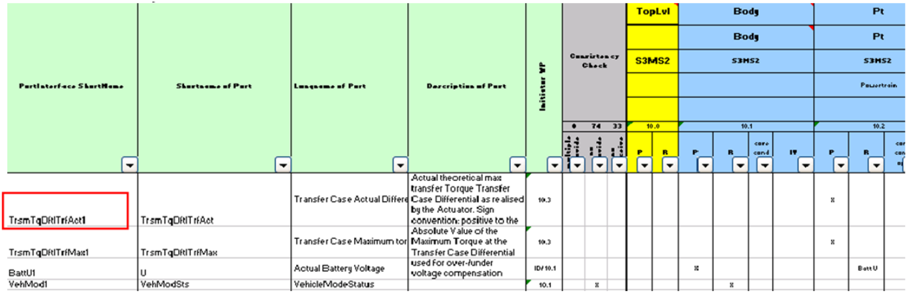

在灰色标记的「一致性检查」列之后，是黄色标记的「TopLvl」列。该黄色标记的列在此工作表中没有功能含义。每个域在后续列中表示。组合的组合类型短名称（例如 Body）与组合的组合原型短名称（例如 Body）在每个域列的单独行中给出。

每个域列包含 5 个子列：

- 提供者端口（标题为「P」）
- 接收者端口（标题为「R」）
- 端口的存在性（标题为「core cond opt」）
- 初始值（标题为 IV），以及
- 描述（标题为 components specific description）

对于 PortInterface 及其相应端口的每个条目，按需在「P」或「R」列中用「X」建立域间链接（数据交换连接）。

定义「core cond opt」列是为了表示相应端口是属于 SWC 的核心功能（Core），还是仅条件性存在（Cond）。但该信息在 ARXML 生成中被忽略。

「IV」列用于在发送组件尚未初始化的情况下规定初始值。如果发送者也规定了初始值，则使用接收者的值。该信息不会在宏生成的 XML 文件中创建。

「components specific description」用于为端口规定任何附加说明，这些说明将被纳入 XML 文件中 PortPrototype 的 description/introduction 属性（参见 [\[2\]](#ref-2)）。

按照 AUTOSAR 定义，应当有唯一的提供者，因此每个条目只有一列「P」被标记「X」。由于数据可以被多个端口接收，每个条目可以有若干「R」列被标记「X」。

在某些用例中，工作表中的 P 或 R 列可能在单元格中直接写入端口的短名称而不是「X」。这可能发生在端口短名称在不同域中不一致时，或由于多重实例化导致的组件建模。

对于每个端口，其对应的 PortInterface 与数据元素（对 SenderReceiver 接口）或操作参数（对 Client-Server 接口）一同定义。其定义与规格化的细节位于工作表 06_Interface_DataElements 与 06_Interface_ClientServer 中，作为接口定义的一部分。

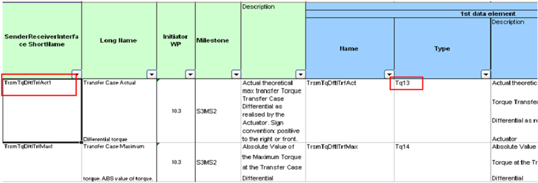

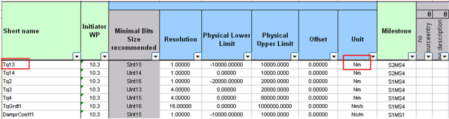

下图展示了域间接口定义，为简单起见仅展示「Body」与「Pt」两个域。

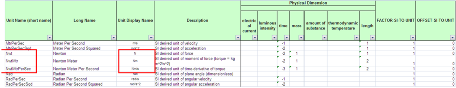

在上述图中，AI 表中的接口分配信息流以红色矩形框表示。

在理想的标准化的情况下，不应有任何开放端口，但在当前版本的 AI 表中，一些连接保持开放。因此「TopLevel」中允许开放端口，尽管这不是期望的情形。开放端口指那些只被定义为提供者「P」或只被定义为接收者「R」的端口，且在跨域的 SWC 之间没有建立闭合连接。

#### 8.1.3 工作表 050xxxxx

这些工作表的内容与「TopLevel」工作表中解释的内容非常相似。每个域存在一个格式为「050x_&lt;域名/组合组合&gt;」（例如 0501_Body）的工作表，包含该域内的软件组合数据交换矩阵。在第一个工作表之后，域可以有几个「050xy_&lt;域组合类型名称（分解组合）&gt;」（例如 050101_CentralLocking）工作表，包含子组合/SW 组件之间的数据交换矩阵。所有域的工作表命名与组织都按上述示例的方式安排。

下图是「Body」域工作表的示例，图中为简单起见仅展示了有限的信息。

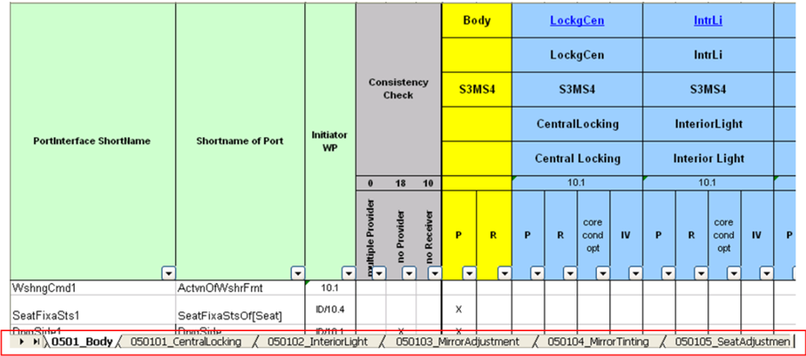

每个域的第一个工作表代表该域的顶层接口矩阵。域的相应工作表包含每个 SW 组合/组件的端口与 PortInterface 连接矩阵信息。

每个工作表包含以下信息：

每个接口的 PortInterface 短名称、端口短名称、端口长名称与端口描述位于标题分别为「PortInterface ShortName」「ShortName of Port」「Long name of Port」与「Description of port」的列中。在这些列之后是管理列与一致性检查结果矩阵列（关于一致性检查的理解请参见 AI 表中的工作表 102_User_Documentation）。在标题行中，每个域的组件/组合类型短名称与组件/组合原型短名称根据组件/组合的数量在不同的列中给出。

对于 PortInterface 及其相应端口的每个条目，按需在「P」或「R」列中用「X」建立域间链接（数据交换连接）。按照 AUTOSAR 定义，应当有唯一的提供者，因此每个条目只有一列「P」被标记「X」。由于数据可以被多个端口接收，每个条目可以有若干「R」列被标记「X」。

定义「core cond opt」列是为了表示相应端口是属于 SWC 的核心功能（Core），还是仅条件性存在（Cond）。但该信息在 ARXML 生成中被忽略。

「IV」列用于在发送组件尚未初始化的情况下规定初始值。如果发送者也规定了初始值，则使用接收者的值。该信息不会在宏生成的 XML 文件中创建。

「components specific description」用于为端口规定任何附加说明，这些说明将被纳入 XML 模型中 PortPrototype 的 description/introduction 属性（参见 [\[2\]](#ref-2)）。

在某些用例中，工作表中的 P 或 R 列可能在单元格中直接写入端口的短名称而不是「X」。这可能发生在端口短名称在不同域中不一致时，或由于多重实例化导致的组件建模。

对于每个端口，其对应的 PortInterface 与数据元素（对 SenderReceiver 接口）或操作参数（对 Client-Server 接口）一同定义。

其定义与规格化的细节位于工作表 06_Interface_DataElements 与 06_Interface_ClientServer 中，作为接口定义的一部分。

跨其他工作表的数据信息流示例图见第 8.1.2 章。

#### 8.1.4 工作表 06_Interfaces_DataElements（SenderReceiverInterface）

该工作表工作簿包含在任何一个 05xx 域/组合工作表中引用的所有 SenderReceiverInterface。每个 SenderReceiverInterface 可以在所有 05xx 域/组合工作表中使用多次。一个接口也可以用于不同的端口。

在该工作表中，每个接口的 PortInterface 短名称与长名称位于标题分别为「SenderReceiverInterface ShortName」与「Long Name」的列中。在这些列之后是管理数据列与「Description」列。「Description」列包含 PortInterface 的描述。对于每个接口，至少必须规定一个数据元素（Variable Data Prototype）。也允许规定多个数据元素。当前 AI 表中最多使用 6 个数据元素，但如果需要可以添加更多数据元素。每个数据元素在标题分别为「Name」「Type」「Description」「Queuing」与「Signal Qualifier」的单独列中具有数据元素名称、数据类型、数据元素描述、排队信息与信号质量信息。「Queuing」列指示 DataElement 在接收方必须被处理的方式。TRUE：元素加入 FIFO 数据结构的队列；FALSE：应用 last-is-best 语义。该信息尚未导出到 XML 模型中，目前未使用。「Signal Qualifier」列提供关于信号质量及其表示的附加信息。该信息尚未导出到 XML 模型中，其使用仍在讨论中。每个数据元素的数据类型可以是连续值、枚举、数组或记录数据类型，它们分别定义在工作表「07_DataTypes_ContinuousValue」「08_DataTypes_Enumeration」「09_DataTypes_Array」「11_DataTypes_Record」中。

此外，该工作表具有以灰色标题标记的列，用于一致性检查结果。

下图展示了接口工作表 06_Interfaces_DataElements 与数据类型工作表（例如 07_DataTypes_ContinuousValue）之间的数据信息流，以红色矩形框标记。

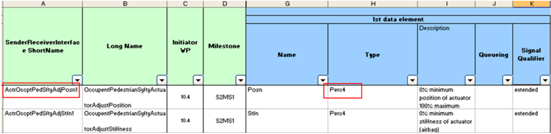

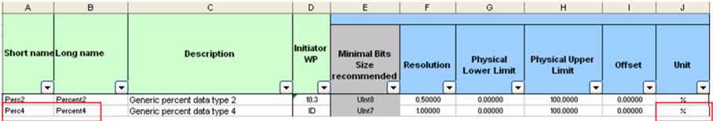

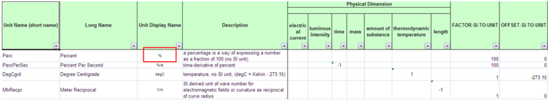

由于 PortInterface 的设计支持可复用性，建议对传输同类信息的 PortPrototype 复用已定义的 SenderReceiver PortInterface。

图 8.11 演示了 PortInterface 的可复用性。在下例中，PortInterface BodyRollAg1 被 PortPrototype BodyRollAgAbsltEstimd、BodyRollAgRelEstimd 与 BodyRollAgRelMeasd 使用。这些 PortPrototype 由 SW 组件 Esc 接收。PortPrototype BodyRollAgAbsltEstimd 与 BodyRollAgRelEstimd 由 SW 组件 Susp 提供，PortPrototype BodyRollAgRelEstimd 由 SW 组件 ChassisSnsr 提供。

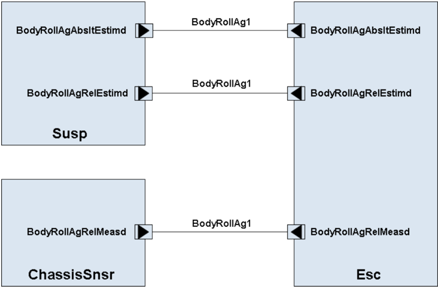

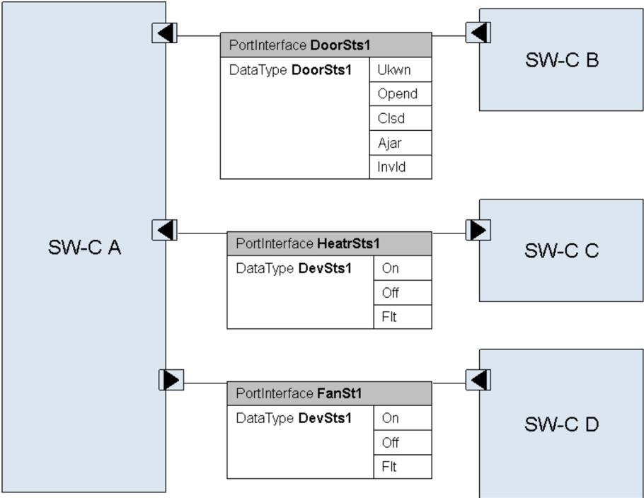

与 PortInterface 类似，建议复用已定义的数据类型。

注意，SW-C 与系统建模指南 [\[4\]](#ref-4) 中的一些规则（如 NR044 与 NR048）正是为支持数据类型的可复用性而定义的。

#### 8.1.5 工作表 06_Interface_ClientServer

该工作表包含在任何一个 05xx 组合组合/分解组合工作表中引用的所有 ClientServer 接口。每个定义的 ClientServer 接口可以在所有 05xx 域/组合工作表中使用多次。一个接口也可以用于不同的端口。

在该工作表中，每个接口的 PortInterface 短名称与长名称位于标题分别为「ClientServerInterface ShortName」与「Long Name」的列中。在这些列之后是管理数据列与「Description」列。「Description」列包含 PortInterface 的描述。在这些列之后定义了 ClientServer 接口的操作名称。这包含以下信息：操作短名称、操作长名称与操作描述，分别在标题为「ShortName」「Long Name」与「Description」的单独列中定义。一个接口由多个操作组成，这些操作在不同的行中规定。对每个操作，允许规定任意数量的参数。为简化 AI 表的当前状态，任何定义的接口最多可以规定三个参数。每个参数在标题分别为「ArgumentName ShortName」「Long Name」「Description」「DataType」与「IN/OUT/INOUT」的单独列中具有参数短名称、参数长名称、参数描述、参数数据类型与参数类型（输入、输出以及既输入又输出）。每个元素的数据类型可以是连续值、枚举、数组或记录类型，它们分别定义在工作表「07_DataTypes_ContinuousValue」「08_DataTypes_Enumeration」「09_DataTypes_Array」「11_DataTypes_Record」中。

此外，该工作表包含以灰色标题标记的列，用于一致性检查结果。

下图展示了接口工作表 06_Interface_ClientServer 与数据类型工作表之间的数据信息流，以红色矩形框标记。


数据类型 Nr4 的单位是「NoUnit」，表示为「-」。数据类型 Nr4 只是一个数字，不表示任何物理量，因此没有单位。

由于 PortInterface 的设计支持可复用性，建议对传输同类信息的 PortPrototype 复用已定义的 ClientServer PortInterface。

#### 8.1.6 工作表 07_DataTypes_ContinuousValue

该工作表包含定义了不同分辨率的数据类型，可供任何一个 06xx 工作表中定义的端口接口或复杂数据类型使用。

在该工作表中，每个数据类型定义条目的数据类型短名称、长名称与描述位于标题分别为「Short Name」「Long Name」与「Description」的列中。在管理数据列之后，定义了数据类型的分辨率与范围细节。这些列包含最小位数要求、分辨率、物理下限与上限、偏移值与物理单位的信息，标题分别为「Minimal Bits Size recommended」「Resolution」「Physical Lower Limit」「Physical Upper Limit」「Offset」与「Unit」。Minimal Bits Size recommended 由宏根据分辨率、物理下限、上限与偏移值列中提供的输入计算。单位列使用工作表「13_Units」中定义的、以「Unit Display Name」引用的物理单位。

此外，有一列「Is float」用于标记某个数据类型是否被推荐用作 float 数据类型。在这种情况下，该数据类型在此列中标记「x」。

此外，该工作表包含以灰色标题标记的列，用于一致性检查结果。

上文展示的图 8.13 与图 8.14 给出了从接口到 DataTypes_ContinuousValue 的数据信息流。

#### 8.1.7 工作表 08_DataTypes_Enumeration

该工作表包含带有取值的枚举数据类型，可供任何一个 06xx 工作表中定义的端口接口及复杂数据类型使用。

在该工作表中，每个枚举（enum）数据类型定义条目的枚举数据类型短名称、长名称与描述位于标题分别为「Data Type Name」「Long Name」与「Description」的列中。在管理数据列之后，定义了枚举数据类型所需最小位数、枚举元素的值与名称以及每个枚举的备注的信息，分别在标题为「Minimal Number of Bits」「value」「name」与「comment」的单独列中。每个枚举数据类型所需的 Minimal Bits Size 由宏计算，该值放在第一个枚举元素行中。每个枚举数据元素的值在单独的行中定义，因此每个枚举数据类型定义属于多行。

如果枚举数据类型定义的第一行在「is boolean」列中包含「X」，则生成器将为该数据类型分配类别「BOOLEAN」。否则，将使用类别「VALUE」。任何标记「is boolean」的数据类型必须恰好由两行定义组成，包含值 0 与 1 的字面量定义。

此外，该工作表包含以灰色标题标记的列，用于一致性检查结果。

下图展示了从接口工作表到枚举数据类型工作表的数据信息流，以红色矩形框标记。


#### 8.1.8 工作表 09_DataTypes_Array

该工作表包含定义的数组数据类型，可供任何一个 06xx 工作表工作簿中定义的端口接口及复杂数据类型使用。

在该工作表中，每个数组数据类型定义条目的数组数据类型短名称、长名称与描述位于标题分别为「Data Type Name」「Long Name」与「Description」的列中。在管理数据列之后，定义了数组元素的数据类型短名称与数组大小的信息，分别在标题为「Type Name」与「Number of Elements」的单独列中。数组的类型名称可以在工作表 07_DataTypes_ContinuousValue、08_DataTypes_Enumeration、09_DataTypes_Array 与 11_DataTypes_Record 之一中找到。

此外，该工作表包含以灰色标题标记的列，用于一致性检查结果。

下图展示了从接口工作表 06_Interfaces_DataElements 到数组数据类型工作表的数据信息流，以红色矩形框标记。


#### 8.1.9 工作表 11_DataTypes_Record

该工作表包含记录数据类型，其中每个记录元素/条目可以具有不同（子）数据类型。这些是与「C」语言结构类型类似的数据类型定义。这些记录数据类型被定义为可供任何一个 06xx 工作表工作簿中定义的端口接口及复杂数据类型使用。

在该工作表中，每个记录数据类型定义条目的记录数据类型短名称、长名称与描述位于标题分别为「Record Type Name」「Long Name」与「Description」的列中。在管理数据列之后，定义了所定义数据类型中记录数据元素的数量、记录元素的名称、记录元素的（子）数据类型以及每个元素的备注的信息，标题分别为「Number of element」「Name」「Type Name」与「Comment」。记录数据类型用于存储不同数据类型的多个值。记录数据类型可以有一个或多个记录元素，每个记录元素将具有不同的 ShortName，并且可以具有不同的（子）数据类型。对每个记录数据类型，第一行将在标题为「Number of element」的列中给出元素的数量。每个记录元素在单独的行中定义。记录元素（子）数据类型定义的短名称可以在工作表 07_DataTypes_ContinuousValue、08_DataTypes_Enumeration、09_DataTypes_Array 与 11_DataTypes_Record 之一中找到。

此外，该工作表包含以灰色标题标记的列，用于一致性检查结果。

下图展示了从接口工作表 06_Interfaces_DataElements 到记录数据类型工作表的数据信息流，以红色矩形框标记。


#### 8.1.10 工作表 13_Units

在该工作表中，定义了用于连续数据类型规格化的单位。单位由单位显示名称引用。

在该工作表中，每个物理单位条目的物理单位短名称、长名称、描述与显示名称位于标题分别为「Unit Name (short name)」「Long Name」「Unit Display Name」与「Description」的列中。在这些列之后，是物理量纲列表列。国际单位制的七个基本量分布在 E 列与 K 列之间。单位使用的因子与偏移在 L 列与 M 列中给出。其后是管理数据列以及用于一致性检查结果的灰色标题标记列。


#### 8.1.11 工作表 15_Redirected_Ports

该工作表用于为在某个 05 工作表中规定的连接矩阵中被重命名/重定向的端口提供 PortPrototypeBlueprint 定义。

如上所述，任何给定的组件原型都可以通过在连接矩阵中规定一个新的端口短名称（而不是在「P」或「R」字段中使用「X」）来本地重命名或重定向行首给定的端口名称。在这种情况下，行首列中规定的长名称与描述对于为重命名端口生成的 PortPrototypeBlueprint 往往不正确。

为了获得这些端口的完整定义，要么可以在另一个 05 组合工作表的语境中更详细地定义它们；要么可以通过在工作表 15_Redirected_Ports 中添加一个条目，以通用的（即与组合类型无关的）方式定义它们。

当宏「Update and Check」检测到此类重定向/重命名的端口没有恰当的定义时，它将在工作表 15 中创建一个新条目。但是，它会把「long name」与「description」条目留空；这些需要由人工用户填写。在这些条目完成之前，生成器将在连续的运行中发出错误消息。

如果一个端口被定义了多次——即某个 05 工作表包含一个可用的端口定义，或同一端口在工作表 15 中被定义多次——生成器将标记错误消息「redundant port def. for redirected port」或「unused def. of redirected port」。此时用户应从工作表 15 中删除重复条目以消除错误。


### 8.2. AI 表所有工作表的完整列表

| 标题 | 内容 |
| --- | --- |
| 01_History | 表的变更历史 |
| 02_General Purposes | 包含与各工作表相关的列标题列表；为在表内添加或更改数据集提供解释 |
| 04_Keywords | 约定的关键词及其缩写的列表，以及它们的使用语境描述 |
| 0500_TopLevel | 顶层组合包含与主要域组合（例如 Body、Powertrain）的域间端口原型相关的信息 |
| 0501_Body | (1) 车身域组合 |
| 050101_CentralLocking | 中央门锁组件 |
| 050102_InteriorLight | 车内灯组件 |
| 050103_MirrorAdjustment | 后视镜调节组件 |
| 050104_MirrorTinting | 后视镜防眩组件 |
| 050105_SeatAdjustment | 座椅调节组件 |
| 05010501_Seat | 座椅组件 |
| 0501050101_SeatAxis | SeatAxis 组件 |
| 050106_ExteriorLight | 车外灯组件 |
| 050107_WindowControl | 车窗控制组件 |
| 050108_WiperWasher | 刮水洗涤组件 |
| 05010801_NozzleHeater | 喷嘴加热组件 |
| 05010802_Wiper | 刮水器组件 |
| 05010803_Washer | 洗涤器组件 |
| 05010804_WasherFluidTank | 洗涤液罐组件 |
| 05010805_RainSensing | 雨量感应组件 |
| 050109_AntiTheftSystem | 防盗系统组件 |
| 050110_HornControl | 喇叭控制组件 |
| 050111_ConvertibleControl | 敞篷控制组件 |
| 050112_DefrostControl | 除霜控制组件 |
| 050113_ParkDistanceControl | 泊车距离控制组件 |
| 050114_Immobilizer | 发动机防盗锁止组件 |
| 050115_BodySensors | 车身传感器组件 |
| 050117_RemoteKeylessEntry | 无钥匙进入组件 |
| 050118_KeyPad | 键盘组件 |
| 050119_PassiveEntry | 被动进入组件 |
| 050120_TerminalClampControl | 端子控制组件 |
| 050121_SeatClimatization | 座椅空调组件 |
| 0502_Powertrain | (2) 动力总成组合 |
| 050201_CombustionEngine | 内燃机组件 |
| 050299_VehicleMotionforPt | 动力总成车辆运动组件 |
| 0503_Chassis | (3) 底盘组合 |
| 050301_CrsCtrlAndAcc | 巡航控制与自适应巡航控制组件 |
| 0504_OPSafety | (4) 乘员安全组合 |
| 0504001_OcctPedSftySnrsPool | 乘员与行人安全传感器池组件 |
| 0504002_I_OcctPedSftyActrPool | 乘员与行人安全执行器池组件 I |
| 0504002_II_OcctPedSftyActrPool | 乘员与行人安全执行器池组件 II |
| 0504002_III_OcctPedSftyActrPool | 乘员与行人安全执行器池组件 III |
| 0504102_SeatBltRmn | 安全带提醒组件 |
| 0505_MM_T_HMI | (5) 多媒体、远程信息处理、人机接口组件 |
| 06_Interface_DataElements | 发送-接收接口定义列表 |
| 06_Interface_ClientServer | ClientServerInterface 定义列表 |
| 07_DataTypes_ContinuousValue | 连续值数据类型列表 |
| 08_DataTypes_Enumeration | 枚举数据类型列表 |
| 09_DataTypes_Array | 数组数据类型列表 |
| 11_DataTypes_Record | 记录数据类型列表 |
| 13_Units | 单位列表 |
| 15_Redirected_Ports | 重定向端口定义列表 |
| 101_Description | 在汇总对话框中呈现的一致性检查结果的解释 |
| 102_User_Documentation | 包含可用的 Visual Basic 宏及其功能的列表 |

以下工作表为管理工作表，由宏自动填写：

| 标题 | 内容 |
| --- | --- |
| Compositions | AI 表中可用的组合/组件概览 |
| Compositions_Err | 组合及其分解未通过的一致性检查结果 |
| Instances | AI 表中可用的组合原型（实例）概览 |
| Instances_Err | 组合原型（实例）未通过的一致性检查结果 |
| 90_ReportMSDiagram | 表示表条目与模型元素相对里程碑的分布历史的图。该数据由宏生成。 |
| 90_ReportMSTable | 表条目相对里程碑与步骤的分布历史的数据透视表。该数据由宏生成。 |
| 90_ReportMSTableNoSteps | 表条目相对里程碑的分布历史的数据透视表。不含步骤信息。该数据由宏生成。 |
| 91_ReportErrDiagram | 表示检测到的错误概览的图。该数据由宏生成。 |
| 91_ReportErrTable | 检测到的错误的数据透视表。该数据由宏生成。 |

## 9. AI 表数据与 XML 输出的关系

AI 表中反映 AUTOSAR 元模型所定义结构的数据，用于生成 AUTOSAR 应用接口的 XML 描述。XML 描述应遵循由 AUTOSAR 元模型 [\[14\]](#ref-14) 生成的 AUTOSAR Schema [\[16\]](#ref-16)。

### 9.1. 概览

#### 9.1.1 XML 生成的依赖关系

图 9.1 阐明了 XML 生成过程中的依赖关系。当前，AI 表在一个数据库中反映多个版本的结构，即 R3.0 与 R4.0。该公共数据库随后被 AI XML 生成用于为每个受支持的版本生成 XML 描述。这一方法意味着并非 AI 表中的所有数据都会反映在所有生成的 XML 文件中，因为只考虑 R4.0 的数据。


#### 9.1.2 生成的 XML 的内容

XML 文件包含以下元素的描述：

- 公共元素
  - 包结构与类别
  - 引用（References）
  - 实例引用（Instance References）
  - 类型引用（Type References）
  - 描述（Descriptions）
- 组合类型，带有
  - 端口
  - 组件原型，以及
  - 连接器
- PortPrototypeBlueprint
  - PortPrototypeBlueprint 的 BlueprintMapping
- 接口
  - 发送-接收接口
  - 客户端-服务器接口
  - PortInterface 的 BlueprintMapping
- 应用数据类型，包括
  - 带约束的原始类型
  - 数组类型
  - 记录类型
  - ApplicationDataType 的 BlueprintMapping
  - 数据约束
  - 计算方法
  - CompuMethod 的 BlueprintMapping
- 单位
  - 物理量纲
- 关键词
- 数据约束
  - DataConstr 的 BlueprintMapping

##### 9.1.2.1 文件分布

从 R4.1.1 起，由 AI 表生成的 XML 被划分为以下 .arxml 文件，如下所示。这是由于 AUTOSAR 方法论要求严格区分 STANDARD 与 BLUEPRINT 类别。

应用接口域的交付结构：

官方发布版本 SVN 仓库的 Standard 部分提供：

- AUTOSAR_MOD_AISpecification.zip 归档，其中包含：
  - AUTOSAR_MOD_AISpecification_PhysicalDimension_Standard.arxml
  - AUTOSAR_MOD_AISpecification_Unit_Standard.arxml
  - AUTOSAR_MOD_AISpecification_DataConstr_Blueprint.arxml
  - AUTOSAR_MOD_AISpecification_CompuMethod_Blueprint.arxml
  - AUTOSAR_MOD_AISpecification_ApplicationDataType_Blueprint.arxml
  - AUTOSAR_MOD_AISpecification_PortInterface_Blueprint.arxml
  - AUTOSAR_MOD_AISpecification_PortPrototypeBlueprint_Blueprint.arxml
  - AUTOSAR_MOD_AISpecification_KeywordSet_Blueprint.arxml
  - AUTOSAR_MOD_AISpecification_Collection_Body_Blueprint.arxml
  - AUTOSAR_MOD_AISpecification_Collection_Pt_Blueprint.arxml
  - AUTOSAR_MOD_AISpecification_Collection_Chassis_Blueprint.arxml
  - AUTOSAR_MOD_AISpecification_Collection_OccptPedSfty_Blueprint.arxml
  - AUTOSAR_MOD_AISpecification_Collection_MmedTelmHmi_Blueprint.arxml
  - AUTOSAR_MOD_AISpecification_PortPrototypeBlueprint_LifeCycle_Standard.arxml
  - AUTOSAR_MOD_AISpecification_PortInterface_LifeCycle_Standard.arxml
  - AUTOSAR_MOD_AISpecification_ApplicationDataType_LifeCycle_Standard.arxml
  - AUTOSAR_MOD_AISpecification_CompuMethod_LifeCycle_Standard.arxml
  - AUTOSAR_MOD_AISpecification_DataConstr_LifeCycle_Standard.arxml
  - AUTOSAR_MOD_AISpecification_Unit_LifeCycle_Standard.arxml
  - AUTOSAR_MOD_AISpecification_PhysicalDimension_LifeCycle_Standard.arxml
  - AUTOSAR_MOD_AISpecification_Keyword_LifeCycle_Standard.arxml
  - AUTOSAR_MOD_AISpecification_Collection_AIMC_Keyword_Blueprint.arxml
  - AUTOSAR_CC_AISpecification.xml

请注意，文件「AUTOSAR_MOD_GeneralDefinition_Lifecycle.arxml」将在 AUTOSAR General Definitions 下发布，不属于应用接口交付物。更多细节请参阅应用接口交付物下的 readme.txt 文件。AUTOSAR_CC_AISpecification.xml 目录文件用于在特定工具需要时帮助解析引用。

官方发布版本 SVN 仓库的 Auxiliary 部分提供：

- AUTOSAR_MOD_AISpecification_Examples.zip 归档，其中包含：
  - AUTOSAR_MOD_AISpecification_Example.arxml
  - AUTOSAR_CC_AISpecificationExample.xml（*）
- AUTOSAR_TR_AIMeasurementCalibrationDiagnostics（pdf）
- AUTOSAR_TR_SWCModelingGuide（pdf）
- AUTOSAR_RS_SWCModeling（pdf）
- AUTOSAR_EXP_AIUserGuide（pdf）
- AUTOSAR_TR_AIDesignPatternCatalogue（pdf）

（*）AUTOSAR_CC_AISpecificationExample.xml 目录文件用于在特定工具需要时帮助解析引用。

#### 9.1.3 Schema 结构

为了理解 XML 生成，有必要理解元模型与 schema 之间的关系。一般而言，schema 对元模型的每个类包含一个 xsd:group。该 group 以 xsd:element 序列的形式包含该类的所有属性，包括聚合与引用。具体类（与抽象类相对）还具有相应的 xsd:complexType。它们是来自父元素的所有被继承 group 的序列。

schema 结构背后的一般概念将根据下图中的示例来描述，该图展示了元模型中 Unit 元素的结构，包括其继承层次。


这一结构可以在 AUTOSAR schema 的以下元素中找到：

```
<xsd:group name="UNIT">
  <xsd:annotation> ... </xsd:annotation>
  <xsd:sequence>
    <xsd:element name="DISPLAY-NAME" type="AR:SINGLE-LANGUAGE-UNIT-NAMES" minOccurs="0"/>
    <xsd:element name="FACTOR-SI-TO-UNIT" type="xsd:double" minOccurs="0"/>
    <xsd:element name="OFFSET-SI-TO-UNIT" type="xsd:double" minOccurs="0"/>
    <xsd:element name="PHYSICAL-DIMENSION-REF" minOccurs="0">
      ...
    </xsd:element>
  </xsd:sequence>
</xsd:group>

<!-- complex type for class Units::Unit -->
<xsd:complexType name="UNIT" abstract="false" mixed="false">
  <xsd:sequence>
    <xsd:group ref="AR:AR-OBJECT"/>
    <xsd:group ref="AR:REFERRABLE"/>
    <xsd:group ref="AR:IDENTIFIABLE"/>
    <xsd:group ref="AR:COLLECTABLE-ELEMENT"/>
    <xsd:group ref="AR:PACKAGEABLE-ELEMENT"/>
    <xsd:group ref="AR:AR-ELEMENT"/>
    <xsd:group ref="AR:UNIT"/>
  </xsd:sequence>
  ...
</xsd:complexType>
```

这种到 group（对所有类，包括抽象类）与 complexType（仅对具体类）的结构化导致了一个特殊性：只有具体类可以在 XML 实例层使用，并且继承层次在实例层不可见。以下示例展示了表「13_Units」中一个单位在实例层的样子，该表只包含来自 Identifiable 的属性：

```
<UNIT>
  <SHORT-NAME>DegCgrd</SHORT-NAME>
  <LONG-NAME><L-4 L="EN">Degree Centigrade</L-4></LONG-NAME>
  <DESC><L-2 L="EN">temperature, no SI unit, (degC = Kelvin - 273.15)</L-2></DESC>
  <DISPLAY-NAME>degC</DISPLAY-NAME>
  <FACTOR-SI-TO-UNIT>1</FACTOR-SI-TO-UNIT>
  <OFFSET-SI-TO-UNIT>-273.15</OFFSET-SI-TO-UNIT>
  <PHYSICAL-DIMENSION-REF DEST="PHYSICAL-DIMENSION" BASE="PhysicalDimensions">T1</PHYSICAL-DIMENSION-REF>
</UNIT>
```

关于元模型与 AUTOSAR Schema 关系的细节可在 Model Persistence Rules for XML [\[17\]](#ref-17) 中找到。另见图 9.1。

以下各节详细描述 AI 表与 XML 实例层元素的关系。关于 AI 表与元模型关系的细节在第 [4](#4-ai-表的元模型表示) 章中描述。

以下所有描述均针对 AUTOSAR R4.0 schema。

### 9.2. 公共元素

#### 9.2.1 包结构

XML 内容被结构化为层次化的包。顶层包名为 AUTOSAR，包含一个名为 AISpecification 的包。在该包之下，输出被结构化为如下所列的 20 个不同的包。

AISpecification 下不同的包为：

- PhysicalDimensions：STANDARD 类别的包，包含所有物理量纲
- Units：STANDARD 类别的包，包含所有标准化的单位
- Standard_LifeCycle：STANDARD 类别的包，包含模型元素的生命周期信息
- ApplicationDataTypes_Blueprint：BLUEPRINT 类别的包，包含所有 ApplicationDataType
- CompuMethods_Blueprint：BLUEPRINT 类别的包，包含所有计算方法
- DataConstrs_Blueprint：BLUEPRINT 类别的包，包含所有数据约束
- KeywordSets_Blueprint：BLUEPRINT 类别的包，包含所有关键词
- PortInterfaces_Blueprint：BLUEPRINT 类别的包，包含所有 PortInterface 蓝图
- PortPrototypeBlueprints_Blueprint：BLUEPRINT 类别的包，包含所有 PortPrototypeBlueprint
- Collection_Body_Blueprint：BLUEPRINT 类别的包，包含「Body」视图下的所有元素
- Collection_Pt_Blueprint：BLUEPRINT 类别的包，包含「Powertrain」视图下的所有元素
- Collection_Chassis_Blueprint：BLUEPRINT 类别的包，包含「Chassis」视图下的所有元素
- Collection_OccptPedSfty_Blueprint：BLUEPRINT 类别的包，包含「Occupant and Pedestrian Safety」视图下的所有元素
- Collection_MmedTelmHmi_Blueprint：BLUEPRINT 类别的包，包含「Multimedia Telematics and HMI」视图下的所有元素
- PL_List：包含覆盖信号的物理与逻辑类型的选定关键词；用于文档、测量与标定目的（AUTOSAR_MOD_AISpecification_Collection_AIMC_Keyword_Blueprint.arxml）
- SwComponentTypes_Example：EXAMPLE 类别的包，包含所有 SwComponentType
- BlueprintMappingSets_Example：EXAMPLE 类别的包，包含所有 Blueprint 元素的 BlueprintMappingSet
- ApplicationDataTypes_Example：EXAMPLE 类别的包，在该包中仅作为 ApplicationDataTypes_Blueprint 元素的副本存在
- PortInterfaces_Example：EXAMPLE 类别的包，在该包中仅作为 PortInterfaces_Blueprint 的副本存在
- CompuMethods_Example：EXAMPLE 类别的包，在该包中仅作为 CompuMethods_Blueprint 元素的副本存在
- DataConstrs_Example：EXAMPLE 类别的包，在该包中仅作为 DataConstrs_Blueprint 元素的副本存在

下面的 XML 摘录展示了这些类别各自的包结构。

```
<?xml version="1.0" encoding="UTF-8"?>
<AUTOSAR xmlns="http://autosar.org/schema/r4.0" xmlns:xsi="http://www.w3.org/2001/XMLSchema-instance" xsi:schemaLocation="http://autosar.org/schema/r4.0 AUTOSAR_4-1-1.xsd">
  <ADMIN-DATA>
    <LANGUAGE>EN</LANGUAGE>
    <USED-LANGUAGES>
      <L-10 L="EN" xml:space="default">English</L-10>
    </USED-LANGUAGES>
  </ADMIN-DATA>
  <AR-PACKAGES>
    <AR-PACKAGE>
      <SHORT-NAME>AUTOSAR</SHORT-NAME>
      <LONG-NAME><L-4 L="EN">AUTOSAR</L-4></LONG-NAME>
      <AR-PACKAGES>
        <AR-PACKAGE>
          <SHORT-NAME>AISpecification</SHORT-NAME>
          <AR-PACKAGES>
            <AR-PACKAGE>
              <SHORT-NAME>ApplicationDataTypes_Blueprint</SHORT-NAME>
              <CATEGORY>BLUEPRINT</CATEGORY>
              <REFERENCE-BASES> ... </REFERENCE-BASES>
              <ELEMENTS> ... </ELEMENTS>
            </AR-PACKAGE>
            <AR-PACKAGE>
              <SHORT-NAME>CompuMethods_Blueprint</SHORT-NAME>
              <CATEGORY>BLUEPRINT</CATEGORY>
              <REFERENCE-BASES> ... </REFERENCE-BASES>
              <ELEMENTS> ... </ELEMENTS>
            </AR-PACKAGE>
            <AR-PACKAGE>
              <SHORT-NAME>DataConstrs_Blueprint</SHORT-NAME>
              <CATEGORY>BLUEPRINT</CATEGORY>
              <REFERENCE-BASES> ... </REFERENCE-BASES>
              <ELEMENTS> ... </ELEMENTS>
            </AR-PACKAGE>
            <AR-PACKAGE>
              <SHORT-NAME>PortInterfaces_Blueprint</SHORT-NAME>
              <CATEGORY>BLUEPRINT</CATEGORY>
              <REFERENCE-BASES> ... </REFERENCE-BASES>
              <ELEMENTS> ... </ELEMENTS>
            </AR-PACKAGE>
            <AR-PACKAGE>
              <SHORT-NAME>PortPrototypeBlueprints_Blueprint</SHORT-NAME>
              <CATEGORY>BLUEPRINT</CATEGORY>
              <REFERENCE-BASES> ... </REFERENCE-BASES>
              <ELEMENTS> ... </ELEMENTS>
            </AR-PACKAGE>
          </AR-PACKAGES>
        </AR-PACKAGE>
      </AR-PACKAGES>
    </AR-PACKAGE>
  </AR-PACKAGES>
</AUTOSAR>
```

```
<?xml version="1.0" encoding="UTF-8"?>
<AUTOSAR xmlns="http://autosar.org/schema/r4.0" xmlns:xsi="http://www.w3.org/2001/XMLSchema-instance" xsi:schemaLocation="http://autosar.org/schema/r4.0 AUTOSAR_4-1-1.xsd">
  <ADMIN-DATA>
    <LANGUAGE>EN</LANGUAGE>
    <USED-LANGUAGES>
      <L-10 L="EN" xml:space="default">English</L-10>
    </USED-LANGUAGES>
  </ADMIN-DATA>
  <AR-PACKAGES>
    <AR-PACKAGE>
      <SHORT-NAME>AUTOSAR</SHORT-NAME>
      <LONG-NAME><L-4 L="EN">AUTOSAR</L-4></LONG-NAME>
      <AR-PACKAGES>
        <AR-PACKAGE>
          <SHORT-NAME>AISpecification</SHORT-NAME>
          <AR-PACKAGES>
            <AR-PACKAGE>
              <SHORT-NAME>ApplicationDataTypes_Example</SHORT-NAME>
              <CATEGORY>EXAMPLE</CATEGORY>
              <REFERENCE-BASES> ... </REFERENCE-BASES>
              <ELEMENTS> ... </ELEMENTS>
            </AR-PACKAGE>
            <AR-PACKAGE>
              <SHORT-NAME>BlueprintMappingSets_Example</SHORT-NAME>
              <CATEGORY>EXAMPLE</CATEGORY>
              <REFERENCE-BASES> ... </REFERENCE-BASES>
              <ELEMENTS> ... </ELEMENTS>
            </AR-PACKAGE>
            <AR-PACKAGE>
              <SHORT-NAME>CompuMethods_Example</SHORT-NAME>
              <CATEGORY>EXAMPLE</CATEGORY>
              <REFERENCE-BASES> ... </REFERENCE-BASES>
              <ELEMENTS> ... </ELEMENTS>
            </AR-PACKAGE>
            <AR-PACKAGE>
              <SHORT-NAME>DataConstrs_Example</SHORT-NAME>
              <CATEGORY>EXAMPLE</CATEGORY>
              <REFERENCE-BASES> ... </REFERENCE-BASES>
              <ELEMENTS> ... </ELEMENTS>
            </AR-PACKAGE>
            <AR-PACKAGE>
              <SHORT-NAME>PortInterfaces_Example</SHORT-NAME>
              <CATEGORY>EXAMPLE</CATEGORY>
              <REFERENCE-BASES> ... </REFERENCE-BASES>
              <ELEMENTS> ... </ELEMENTS>
            </AR-PACKAGE>
            <AR-PACKAGE>
              <SHORT-NAME>SwComponentTypes_Example</SHORT-NAME>
              <CATEGORY>EXAMPLE</CATEGORY>
              <REFERENCE-BASES> ... </REFERENCE-BASES>
              <ELEMENTS> ... </ELEMENTS>
            </AR-PACKAGE>
          </AR-PACKAGES>
        </AR-PACKAGE>
      </AR-PACKAGES>
    </AR-PACKAGE>
  </AR-PACKAGES>
</AUTOSAR>
```

清单9.1：AUTOSAR_MOD_AISpecification_ApplicationDataType_Blueprint

```
<?xml version="1.0" encoding="UTF-8"?>
<AUTOSAR xmlns="http://autosar.org/schema/r4.0" xmlns:xsi="http://www.w3.org/2001/XMLSchema-instance" xsi:schemaLocation="http://autosar.org/schema/r4.0 AUTOSAR_4-1-1.xsd">
  <ADMIN-DATA>
    <LANGUAGE>EN</LANGUAGE>
    <USED-LANGUAGES>
      <L-10 L="EN" xml:space="default">English</L-10>
    </USED-LANGUAGES>
  </ADMIN-DATA>
  <AR-PACKAGES>
    <AR-PACKAGE>
      <SHORT-NAME>AUTOSAR</SHORT-NAME>
      <LONG-NAME><L-4 L="EN">AUTOSAR</L-4></LONG-NAME>
      <AR-PACKAGES>
        <AR-PACKAGE>
          <SHORT-NAME>AISpecification</SHORT-NAME>
          <AR-PACKAGES>
            <AR-PACKAGE>
              <SHORT-NAME>KeywordSets_Blueprint</SHORT-NAME>
              <CATEGORY>BLUEPRINT</CATEGORY>
              <ELEMENTS> ... </ELEMENTS>
            </AR-PACKAGE>
          </AR-PACKAGES>
        </AR-PACKAGE>
      </AR-PACKAGES>
    </AR-PACKAGE>
  </AR-PACKAGES>
</AUTOSAR>
```

清单9.2：AUTOSAR_MOD_AISpecification_KeywordSet_Blueprint

```
<?xml version="1.0" encoding="UTF-8"?>
<AUTOSAR xmlns="http://autosar.org/schema/r4.0" xmlns:xsi="http://www.w3.org/2001/XMLSchema-instance" xsi:schemaLocation="http://autosar.org/schema/r4.0 AUTOSAR_4-1-1.xsd">
  <ADMIN-DATA>
    <LANGUAGE>EN</LANGUAGE>
    <USED-LANGUAGES>
      <L-10 L="EN" xml:space="default">English</L-10>
    </USED-LANGUAGES>
  </ADMIN-DATA>
  <AR-PACKAGES>
    <AR-PACKAGE>
      <SHORT-NAME>AUTOSAR</SHORT-NAME>
      <LONG-NAME><L-4 L="EN">AUTOSAR</L-4></LONG-NAME>
      <AR-PACKAGES>
        <AR-PACKAGE>
          <SHORT-NAME>AISpecification</SHORT-NAME>
          <AR-PACKAGES>
            <AR-PACKAGE>
              <SHORT-NAME>PhysicalDimensions</SHORT-NAME>
              <CATEGORY>STANDARD</CATEGORY>
              <ELEMENTS> ... </ELEMENTS>
            </AR-PACKAGE>
            <AR-PACKAGE>
              <SHORT-NAME>Units</SHORT-NAME>
              <CATEGORY>STANDARD</CATEGORY>
              <REFERENCE-BASES> ... </REFERENCE-BASES>
              <ELEMENTS> ... </ELEMENTS>
            </AR-PACKAGE>
          </AR-PACKAGES>
        </AR-PACKAGE>
      </AR-PACKAGES>
    </AR-PACKAGE>
  </AR-PACKAGES>
</AUTOSAR>
```

清单9.3：AUTOSAR_MOD_AISpecification_Standard.arxml

#### 9.2.2 引用

为应用接口生成的 XML 一致地使用引用基（reference base）与相对路径进行所有引用。相对路径以不以斜杠（「/」）开头来标识。以下 XML 片段展示对一个组合类型端口的引用。DEST 属性定义引用 XML 元素的类型，BASE 属性引用在任意父包中定义的最近的引用基，内容定义引用目标，本例中为包 /AUTOSAR/AISpecification/SwComponentTypes_Example 中组合类型 WiprWshr 的端口 WipgSpdIntlFromHmi。

引用基定义的示例：

```
<REFERENCE-BASE>
  <SHORT-LABEL>SwComponentTypes</SHORT-LABEL>
  <IS-DEFAULT>false</IS-DEFAULT>
  <IS-GLOBAL>false</IS-GLOBAL>
  <BASE-IS-THIS-PACKAGE>false</BASE-IS-THIS-PACKAGE>
  <PACKAGE-REF DEST="AR-PACKAGE">/AUTOSAR/AISpecification/SwComponentTypes_Example</PACKAGE-REF>
</REFERENCE-BASE>
```

引用基使用示例：

```
<DELEGATION-SW-CONNECTOR>
  <SHORT-NAME>WipgSpdIntlFromHmiToWipgSpdIntlFromHmiOfWiprWshrMgr</SHORT-NAME>
  <INNER-PORT-IREF>
    <R-PORT-IN-COMPOSITION-INSTANCE-REF>
      <CONTEXT-COMPONENT-REF DEST="SW-COMPONENT-PROTOTYPE" BASE="SwComponentTypes">WiprWshr/WiprWshrMgr</CONTEXT-COMPONENT-REF>
      <TARGET-R-PORT-REF DEST="R-PORT-PROTOTYPE" BASE="SwComponentTypes">WiprWshrMgr/WipgSpdIntlFromHmi</TARGET-R-PORT-REF>
    </R-PORT-IN-COMPOSITION-INSTANCE-REF>
  </INNER-PORT-IREF>
  <OUTER-PORT-REF DEST="R-PORT-PROTOTYPE" BASE="SwComponentTypes">WipgSpdIntlFromHmi</OUTER-PORT-REF>
</DELEGATION-SW-CONNECTOR>
```

#### 9.2.3 实例引用

AUTOSAR XML 允许使用实例引用（instance reference），从类型定义中为该类型的一个特定实例引用元素。例如，组件原型并不定义端口，而是只引用其组合类型，后者定义端口。如果需要引用该端口，则需要对上下文元素的引用。该引用包含实例与目标元素。对于端口，实例是组件原型，目标元素是组合类型中的端口定义。以下示例定义了对组件原型 /AUTOSAR/AISpecification/SwComponentTypes_Example/WiprWshr/WiprWshrMgr 处端口 WipgSpdIntlFromHmi 的引用，该端口定义在组合类型 /AUTOSAR/AISpecification/SwComponentTypes_Example/WiprWshrMgr 中。

```
<DELEGATION-SW-CONNECTOR>
  <SHORT-NAME>WipgSpdIntlFromHmiToWipgSpdIntlFromHmiOfWiprWshrMgr</SHORT-NAME>
  <INNER-PORT-IREF>
    <R-PORT-IN-COMPOSITION-INSTANCE-REF>
      <CONTEXT-COMPONENT-REF DEST="SW-COMPONENT-PROTOTYPE" BASE="SwComponentTypes">WiprWshr/WiprWshrMgr</CONTEXT-COMPONENT-REF>
      <TARGET-R-PORT-REF DEST="R-PORT-PROTOTYPE" BASE="SwComponentTypes">WiprWshrMgr/WipgSpdIntlFromHmi</TARGET-R-PORT-REF>
    </R-PORT-IN-COMPOSITION-INSTANCE-REF>
  </INNER-PORT-IREF>
  <OUTER-PORT-REF DEST="R-PORT-PROTOTYPE" BASE="SwComponentTypes">WiprWshr/WipgSpdIntlFromHmi</OUTER-PORT-REF>
</DELEGATION-SW-CONNECTOR>
```

#### 9.2.4 类型引用

当目标元素被引用为源元素的类型时，AUTOSAR XML 使用类型引用（type reference），即一个 *-TREF 元素。例如，以下片段引用元素 /AUTOSAR/AISpecification/ApplicationDataTypes_Blueprint/WipgSpdIntl1 作为数据原型 Req 的类型。

```
<VARIABLE-DATA-PROTOTYPE>
  <SHORT-NAME>Req</SHORT-NAME>
  <TYPE-TREF DEST="APPLICATION-PRIMITIVE-DATA-TYPE" BASE="ApplicationDataTypes">WipgSpdIntl1</TYPE-TREF>
</VARIABLE-DATA-PROTOTYPE>
```

#### 9.2.5 描述

描述不是简单地放入一个 description 元素中，而是在指示之处被解析并拆分为多个不同的元素。以下规则适用于描述字段的解析：

- 空行分隔文档/描述的各节（提示：换行应通过 Alt+Enter = Chr(10) 引入）

在 XML 中，这些描述字段被映射到以下两个不同的元素：

- 第一节进入 DESC 元素，它应包含简要描述。
- 后续各节作为独立的子元素进入 INTRODUCTION 元素
  - 以一个以冒号（:）结尾且完全大写的行（例如 REMARK:）开始的节将成为 NOTE 元素，第一行作为 LABEL，其余作为 P 元素
  - 不带标签的节将成为 INTRODUCTION 内的简单 P 元素。可以为特定 PortPrototype 在此处添加附加信息。
  - 以星号（「*」）或连字符（「-」）开始的节成为列表项。如果前一个节不是列表项，则启动一个列表元素
  - 以空格开始的节成为 verbatim 环境的一部分。如果前一个节不是 verbatim 环境的一部分，则启动 verbatim 环境

来自一个单元格的这些 verbatim 环境将被翻译为 XML 中的以下结构。

**单元格中的文本：**

```
Returns the gear ratio for a given gear
Theoretical transmission ratio i = ntransmission_in / ntransmission_out
transmission_in = after converter
transmission_out = gearbox out
The gear ratio means the theoretical/physical ratio belonging to each gear and not any actual measured value (proposal for Continuously Variable Transmission(CVT): if there is a wide range for gear states, this value could deliver a theoretical value).
Negative values: Reverse driving direction.
Without considering the:
* axle ratio
* converter ratio
* High/Low-Range ratio
REMARK: Default value after reset is 1.0
```

**XML 结构：**

```
<DESC>
  <L-2 L="EN">Returns the gear ratio for a given gear</L-2>
</DESC>
<INTRODUCTION>
  <P><L-1 L="EN">Theoretical transmission ratio i = ntransmission_in / ntransmission_out</L-1></P>
  <P><L-1 L="EN">transmission_in = after converter transmission_out = gearbox out</L-1></P>
  <P><L-1 L="EN">The gear ratio means the theoretical/physical ratio belonging to each gear and not any actual measured value (proposal for Continuously Variable Transmission(CVT): if there is a wide range for gear states, this value could deliver a theoretical value).</L-1></P>
  <P><L-1 L="EN">Negative values: Reverse driving direction.</L-1></P>
  <P><L-1 L="EN">Without considering the:</L-1></P>
  <LIST TYPE="UNNUMBER">
    <ITEM><P><L-1 L="EN">axle ratio</L-1></P></ITEM>
    <ITEM><P><L-1 L="EN">converter ratio</L-1></P></ITEM>
    <ITEM><P><L-1 L="EN">High/Low-Range ratio</L-1></P></ITEM>
  </LIST>
  <NOTE>
    <LABEL><L-4 L="EN">REMARK</L-4></LABEL>
    <P><L-1 L="EN">Default value after reset is 1.0</L-1></P>
  </NOTE>
</INTRODUCTION>
```

### 9.3. 组件类型

组合类型的数据收集在「05」工作表中。顶部的行定义组合类型，而下方的行定义组合类型的端口与连接器。

每个「05」工作表定义一个外部组合类型（黄色列）和多个内部组件，称为组件原型（蓝色列）。每个组件原型必须引用一个组件（组合）类型。如果该类型未在另一个「05」工作表上被声明为外部组合类型（由超链接引用），则它在本地定义。在后一种情况下，组合类型的定义方式与组件原型相同，并且不应在其他工作表中复用。


XML 生成器为 WiprWshr 组件生成以下 XML 片段：


以下各节描述来自 Ports、Components 与 Connectors 三个集合的元素。

#### 9.3.1 组合类型

XML 生成器为每个工作表的黄色列创建一个组合类型，并为每个不带超链接的蓝色列创建一个组合类型（带超链接的蓝色列的组合类型稍后在迭代所链接的「05」工作表时创建）。定义被写入包 /AUTOSAR/AISpecification/SwComponentTypes_Example。组合类型由其端口（绿色列）、组件（蓝色列）与连接器（带 X 的连接器矩阵）定义。组合短名称取自黄色列的第一行，如图 9.3 所示（单元格 Z1）。

#### 9.3.2 端口

「05」工作表的下部定义端口与连接器。绿色列定义端口，右侧部分（组件下方）定义端口的存在性与连接。例如，图 9.3 截图中的第 35 行为组合组件 WiprWshr 定义一个必需端口 WipgSpdIntlFromHmi（在单元格 AA35 中标记 X）。图 9.3 中 AA 列的标记在组合组件类型 WiprWshr 的 ports 集合中产生一个 R-Port-Prototype 项，如下所示：

```
<R-PORT-PROTOTYPE>
  <SHORT-NAME>WipgSpdIntlFromHmi</SHORT-NAME>
  <LONG-NAME><L-4 L="EN">Wiping Speed Interval From Hmi</L-4></LONG-NAME>
  <REQUIRED-INTERFACE-TREF DEST="SENDER-RECEIVER-INTERFACE" BASE="PortInterfaces">WipgSpdIntlReq1</REQUIRED-INTERFACE-TREF>
</R-PORT-PROTOTYPE>
```

被引用的接口必须是 06* 工作表中的有效接口（参见 8.1.4 与 8.1.5 节）。接口经由类型引用被引用。

由于图 9.3 中单元格 AC35 的标记，为组合类型 WiprWshrMgr 生成了一个同名的类似端口。（蓝色）端口列「core/cond/opt」与 IV 目前与 XML 生成无关。

#### 9.3.3 组件

内部组件原型（实例）取自蓝色列。每个组件原型有一个短名称，取自第 2 行（例如 AB2），并引用第 1 行（例如 AB1）中的组合类型，如图 9.3 所示。为组件原型 WiprWshrMgr 在组合类型 WiprWshr 的 &lt;COMPONENTS&gt; 集合中生成以下 XML 片段：

```
<SW-COMPONENT-PROTOTYPE>
  <SHORT-NAME>WiprWshrMgr</SHORT-NAME>
  <LONG-NAME><L-4 L="EN">Wiper Washer Manager</L-4></LONG-NAME>
  <DESC><L-2 L="EN">Wiper Washer Manager commands Wiper and Washers of the vehicle</L-2></DESC>
  <TYPE-TREF DEST="COMPOSITION-SW-COMPONENT-TYPE" BASE="SwComponentTypes">WiprWshrMgr</TYPE-TREF>
</SW-COMPONENT-PROTOTYPE>
```

经由 TYPE-TREF，组件原型引用一个组合类型，该类型按照原型定义生成，因为图 9.3 所示的单元格 AB1 不包含超链接。

在多重实例的情况下，将为第 2 行（例如 AG2）中以逗号分隔的列表中的每个实例生成这样的描述。

声明多个实例的另一种可能性是：通过以不同的原型名称多次定义同一组件，如下例所示：


#### 9.3.4 连接器

连接器的信息取自从单元格 Z8 开始的连接器矩阵（图 9.3 中不可见，因为第 8–34 行被隐藏）。连接可以用值 X 或特定短名称本身声明。像空单元格或字面量「N/A」这样的特殊值不会建立连接器。连接器的定义如下：

对于蓝色列中每个与黄色列中的 X 方向相同的 X，创建委托连接器（Delegation Connector）。例如，图 9.3 中单元格 AA35 与 AC35 中的 X 将产生以下委托连接器：

```
<DELEGATION-SW-CONNECTOR>
  <SHORT-NAME>WipgSpdIntlFromHmiToWipgSpdIntlFromHmiOfWiprWshrMgr</SHORT-NAME>
  <INNER-PORT-IREF>
    <R-PORT-IN-COMPOSITION-INSTANCE-REF>
      <CONTEXT-COMPONENT-REF DEST="SW-COMPONENT-PROTOTYPE" BASE="SwComponentTypes">WiprWshr/WiprWshrMgr</CONTEXT-COMPONENT-REF>
      <TARGET-R-PORT-REF DEST="R-PORT-PROTOTYPE" BASE="SwComponentTypes">WiprWshrMgr/WipgSpdIntlFromHmi</TARGET-R-PORT-REF>
    </R-PORT-IN-COMPOSITION-INSTANCE-REF>
  </INNER-PORT-IREF>
  <OUTER-PORT-REF DEST="R-PORT-PROTOTYPE" BASE="SwComponentTypes">WiprWshr/WipgSpdIntlFromHmi</OUTER-PORT-REF>
</DELEGATION-SW-CONNECTOR>
```

生成器按照以下规则创建委托连接器的短名称：

`&lt;outerPortName&gt;To&lt;innerPortName&gt;Of&lt;InnerComponentPrototypeName&gt;`

在上例中，&lt;outerPortName&gt; 为 WipgSpdIntlFromHmi，&lt;innerPortName&gt; 为 WipgSpdIntlFromHmi，&lt;InnerComponentPrototypeName&gt; 为 WiprWshrMgr。因此，上面展示的委托连接器的短名称为 WipgSpdIntlFromHmiToWipgSpdIntlFromHmiOfWiprWshrMgr。

内部端口使用实例引用（见 9.2.3 节）引用蓝色列中找到的组件原型的端口。注意，IREF 的上下文是组合 WiprWshr 内的组件原型 WiprWshrMgr，而目标端口引用所有组合类型的通用包 SwComponentTypes 中的组件类型 WiprWshrMgr，因此路径前缀不同。外部端口引用黄色列中属于组合类型 WiprWshr 的端口。

对于每个必需端口（R 列中的标记）与来自连接器矩阵的内部组件原型的相应 P 端口，创建组装连接器（Assembly Connector），例如图 9.3 中的单元格 AW43 与 AB43：

```
<ASSEMBLY-SW-CONNECTOR>
  <!--sheet=050108_WiperWasher, row=43, p_col=28, r_col=48-->
  <SHORT-NAME>ActvnOfWshngCmdOfWshrFrntOfWiprWshrMgrToActvnOfWshngCmdOfWshrFrnt</SHORT-NAME>
  <PROVIDER-IREF>
    <CONTEXT-COMPONENT-REF DEST="SW-COMPONENT-PROTOTYPE" BASE="SwComponentTypes">WiprWshr/WiprWshrMgr</CONTEXT-COMPONENT-REF>
    <TARGET-P-PORT-REF DEST="P-PORT-PROTOTYPE" BASE="SwComponentTypes">WiprWshrMgr/ActvnOfWshngCmdOfWshrFrnt</TARGET-P-PORT-REF>
  </PROVIDER-IREF>
  <REQUESTER-IREF>
    <CONTEXT-COMPONENT-REF DEST="SW-COMPONENT-PROTOTYPE" BASE="SwComponentTypes">WiprWshr/WshrFrnt</CONTEXT-COMPONENT-REF>
    <TARGET-R-PORT-REF DEST="R-PORT-PROTOTYPE" BASE="SwComponentTypes">WshrFrnt/ActvnOfWshngCmd</TARGET-R-PORT-REF>
  </REQUESTER-IREF>
</ASSEMBLY-SW-CONNECTOR>
```

从片段可见，两个端口都经由实例引用被引用。

生成器按照以下规则创建组装连接器的名称：

`&lt;P-Port-ShortName&gt;Of&lt;P-Port-SW-C-Prototype-ShortName&gt;To&lt;R-Port-ShortName&gt;Of&lt;R-Port-SW-C-Prototype-ShortName&gt;`

在上例的语境中，&lt;P-Port-ShortName&gt; 为 ActvnOfWshngCmdOfWshrFrnt，&lt;P-Port-SW-C-Prototype-ShortName&gt; 为 WiprWshrMgr，&lt;R-Port-ShortName&gt; 为 ActvnOfWshngCmd，&lt;R-Port-SW-C-Prototype-ShortName&gt; 为 WshrFrnt。因此，组装连接器的名称为 ActvnOfWshngCmdOfWshrFrntOfWiprWshrMgrToActvnOfWshngCmdOfWshrFrnt。

多重实例化在这种情况下是一个特殊性。端口 WipgCmdFor[Wipr]（图 9.3 中的单元格 B49）的名称按照 Wipr 所引用列中的实例名称展开。所有拥有该端口但未在所引用列中定义的组件，都按照所有实例名称拥有多个端口，例如 WiprWshrMgr 的 WipgCmdForWiprFrnt 与 WipgCmdForWiprRe，而对于来自提供实例迭代器的列的组件（即第一行中带有 Wipr 的第一列），名称收缩为 WipgCmd。

语义约束：为了保证 AUTOSAR XML 的语义正确生成，蓝色组件的 P 列中最多只能有一个 X。这意味着即使不满足约束，应用接口也将支持 AUTOSAR XML 的生成。以下截图展示什么被视为语义错误：


如图 9.5 所示，指定了两个委托（两个蓝色背景的 P 列被标记 X）。由于这代表组合处端口原型的歧义定义，它被视为对语义约束的违反。

因此，P 列中存在多个 X 标记被视为语义错误。请注意，即便如此，XML 的生成仍是可能的。

### 9.4. 端口原型蓝图（PortPrototypeBlueprints）

定义完整的系统组合不在 AUTOSAR 应用接口的范围内。所有软件组件组合类型都定义在一个类别为 EXAMPLE 的包中，仅作为标准化元素用法的说明。但是，描述接口在组合中可以扮演的角色在应用接口的范围内。这可以通过 PortPrototypeBlueprint 完成，它们定义组件类型的潜在端口，并且可以携带更多属性来为蓝图的使用预定义值，例如初始值。关于 PortPrototypeBlueprint 的细节请参见标准化模板 [\[3\]](#ref-3)。

PortPrototypeBlueprint 被收集在单一包 /AUTOSAR/AISpecification/PortPrototypeBlueprints_Blueprint 内：

```
<AR-PACKAGE>
  <SHORT-NAME>PortPrototypeBlueprints_Blueprint</SHORT-NAME>
  <CATEGORY>BLUEPRINT</CATEGORY>
  <REFERENCE-BASES> ... </REFERENCE-BASES>
  <ELEMENTS>
    <PORT-PROTOTYPE-BLUEPRINT>
      <SHORT-NAME NAME-PATTERN="{anyName}">AbsCtrlIntvg</SHORT-NAME>
      <LONG-NAME><L-4 L="EN">ABS Control Intervening</L-4></LONG-NAME>
      <DESC><L-2 L="EN">Antilock Braking Systems (ABS) control is active (at least one wheel)</L-2></DESC>
      <INTERFACE-REF DEST="SENDER-RECEIVER-INTERFACE" BASE="PortInterfaces">AbsCtrlIntvg1</INTERFACE-REF>
    </PORT-PROTOTYPE-BLUEPRINT>
    <PORT-PROTOTYPE-BLUEPRINT>
      <SHORT-NAME NAME-PATTERN="{anyName}">AbsFlgActv</SHORT-NAME>
      <LONG-NAME><L-4 L="EN">AbsControlActive</L-4></LONG-NAME>
      <DESC><L-2 L="EN">Anti Blocking Systems (ABS) control is active (at least one wheel)</L-2></DESC>
      <INTERFACE-REF DEST="SENDER-RECEIVER-INTERFACE" BASE="PortInterfaces">AbsCtrlIntvg1</INTERFACE-REF>
    </PORT-PROTOTYPE-BLUEPRINT>
    ...
  </ELEMENTS>
</AR-PACKAGE>
```

由于蓝图机制旨在辅助 PortPrototype 的创建，AUTOSAR XML 还提供一种映射机制，描述蓝图与原型之间的关系。该机制允许将 PortPrototype 与蓝图解耦，而不干扰架构需求。该映射作为对的序列规定，作为包 /AUTOSAR/AISpecification/SwComponentTypes_Example 的一部分，如下例所示：

```
<BLUEPRINT-MAPPING-SET>
  <SHORT-NAME>PortPrototypeBlueprintMappings</SHORT-NAME>
  <BLUEPRINT-MAPS>
    <BLUEPRINT-MAPPING>
      <BLUEPRINT-REF DEST="PORT-PROTOTYPE-BLUEPRINT" BASE="PortPrototypeBlueprints_Blueprint">AbsCtrlIntvg</BLUEPRINT-REF>
      <DERIVED-OBJECT-REF DEST="P-PORT-PROTOTYPE" BASE="SwComponentTypes">Chassis/AbsCtrlIntvg</DERIVED-OBJECT-REF>
    </BLUEPRINT-MAPPING>
    <BLUEPRINT-MAPPING>
      <BLUEPRINT-REF DEST="PORT-PROTOTYPE-BLUEPRINT" BASE="PortPrototypeBlueprints_Blueprint">AbsCtrlIntvg</BLUEPRINT-REF>
      <DERIVED-PORT-PROTOTYPE-REF DEST="R-PORT-PROTOTYPE" BASE="SwComponentTypes">Body/AbsCtrlIntvg</DERIVED-OBJECT-REF>
    </BLUEPRINT-MAPPING>
    ...
  </BLUEPRINT-MAPS>
</BLUEPRINT-MAPPING-SET>
```

### 9.5. 端口接口（PortInterfaces）

所提供或所需的 PortPrototype 引用 AI 表「06」工作表中定义的 PortInterface，发送-接收与客户端-服务器接口分开存放。

发送-接收接口与客户端-服务器接口都保存在包 /AUTOSAR/AISpecification/PortInterfaces_Blueprint 中。它们也是 /AUTOSAR/AISpecification/PortInterfaces_Example 的一部分，但只是作为蓝图的副本，以便它们可用于 PortPrototype。

#### 9.5.1 发送-接收接口（Sender-Receiver-Interface）

图 9.6 展示发送-接收接口表中的一个接口，它定义短名称、长名称、描述以及所包含的数据元素（该表能够为每个 SenderReceiverInterface 捕获最多六个数据元素）。数据流的方向由端口定义。


XML 生成器为上表行生成以下输出：

```
<SENDER-RECEIVER-INTERFACE>
  <SHORT-NAME NAME-PATTERN="{anyName}">WipgSpdIntlReq1</SHORT-NAME>
  <LONG-NAME><L-4 L="EN">Wiping Speed Interval Request</L-4></LONG-NAME>
  <DESC><L-2 L="EN">Requests the interval speed. As long as a interval wipe sequence is requested the provided value of interval speed has to be used.</L-2></DESC>
  <IS-SERVICE>false</IS-SERVICE>
  <DATA-ELEMENTS>
    <VARIABLE-DATA-PROTOTYPE>
      <SHORT-NAME NAME-PATTERN="{anyName}">Req</SHORT-NAME>
      <TYPE-TREF DEST="APPLICATION-PRIMITIVE-DATA-TYPE" BASE="ApplicationDataTypes">WipgSpdIntl1</TYPE-TREF>
    </VARIABLE-DATA-PROTOTYPE>
  </DATA-ELEMENTS>
</SENDER-RECEIVER-INTERFACE>
```

上述接口对应的 BlueprintMapping 为：

```
<BLUEPRINT-MAPPING-SET>
  <SHORT-NAME>PortInterfaceBlueprintMappings</SHORT-NAME>
  <BLUEPRINT-MAPS>
    <BLUEPRINT-MAPPING>
      <BLUEPRINT-REF DEST="SENDER-RECEIVER-INTERFACE" BASE="PortInterfaces_Blueprint">WipgSpdIntlReq1</BLUEPRINT-REF>
      <DERIVED-OBJECT-REF DEST="SENDER-RECEIVER-INTERFACE" BASE="PortInterfaces">WipgSpdIntlReq1</DERIVED-OBJECT-REF>
    </BLUEPRINT-MAPPING>
```

上面的 XML 摘录中展示了 Blueprint 与派生元素。该映射表明包 /AUTOSAR/AISpecification/PortInterfaces_Blueprint 提供蓝图接口，这些接口在 EXAMPLE 类别的包 /AUTOSAR/AISpecification/PortInterfaces_Example 内派生。

关于排队与信号限定的信息当前不用于 XML 生成。每个数据元素的引用类型必须在 DataType 工作表中定义。

#### 9.5.2 客户端-服务器接口（Client-Server-Interface）

图 9.7 展示客户端-服务器接口表中的一个接口，它定义短名称、长名称、描述以及所包含的操作（每行一个操作，该表能够为每个操作捕获最多三个参数），并将具有相同接口短名称的所有操作合并为一个接口。


XML 生成器为上述示例生成以下输出：

```
<CLIENT-SERVER-INTERFACE>
  <SHORT-NAME NAME-PATTERN="{anyName}">TrsmRatGear1</SHORT-NAME>
  <LONG-NAME><L-4 L="EN">Transmission: Gear Ratio for a Given Gear</L-4></LONG-NAME>
  <DESC><L-2 L="EN">Returns the gear ratio for a given gear</L-2></DESC>
  <INTRODUCTION> ... </INTRODUCTION>
  <IS-SERVICE>false</IS-SERVICE>
  <OPERATIONS>
    <CLIENT-SERVER-OPERATION>
      <SHORT-NAME NAME-PATTERN="{anyName}">GetTrsmRatGear</SHORT-NAME>
      <LONG-NAME><L-4 L="EN">Returns the Gear Ratio for a Given Gear</L-4></LONG-NAME>
      <DESC><L-2 L="EN">Returns the gear ratio for a given gear</L-2></DESC>
      <ARGUMENTS>
        <ARGUMENT-DATA-PROTOTYPE>
          <SHORT-NAME NAME-PATTERN="{anyName}">Gear</SHORT-NAME>
          <LONG-NAME><L-4 L="EN">Gear for Which the Ratio Should Be Returned</L-4></LONG-NAME>
          <DESC><L-2 L="EN">Gear for which the ratio should be returned</L-2></DESC>
          <TYPE-TREF DEST="APPLICATION-PRIMITIVE-DATA-TYPE" BASE="ApplicationDataTypes">Nr4</TYPE-TREF>
          <DIRECTION>IN</DIRECTION>
        </ARGUMENT-DATA-PROTOTYPE>
        <ARGUMENT-DATA-PROTOTYPE>
          <SHORT-NAME NAME-PATTERN="{anyName}">Rat</SHORT-NAME>
          <LONG-NAME><L-4 L="EN">Gear Ratio of Given Gear</L-4></LONG-NAME>
          <DESC><L-2 L="EN">Gear ratio of given gear</L-2></DESC>
          <TYPE-TREF DEST="APPLICATION-PRIMITIVE-DATA-TYPE" BASE="ApplicationDataTypes">Fac1</TYPE-TREF>
          <DIRECTION>OUT</DIRECTION>
        </ARGUMENT-DATA-PROTOTYPE>
      </ARGUMENTS>
    </CLIENT-SERVER-OPERATION>
  </OPERATIONS>
</CLIENT-SERVER-INTERFACE>
```

关于 description 与 introduction 元素生成的细节见 9.2.5 节。

### 9.6. 蓝图映射集（Blueprint Mapping Sets）

BlueprintMappingSet 用于建立蓝图与从该蓝图派生的元素之间的连接。这有助于追溯用于创建该元素的相应蓝图。Blueprint Mapping Set 用于不同的元素，包括 PortPrototypeBlueprint、PortInterface、ApplicationDataType 等。它们定义在包 /AUTOSAR/AISpecification/BlueprintMappingSets_Example 中。以下 xml 提供了 PortInterface 的 Blueprint Mapping 示例，对其他元素同样适用。

```
<BLUEPRINT-MAPPING-SET>
  <SHORT-NAME>PortInterfaceBlueprintMappings</SHORT-NAME>
  <BLUEPRINT-MAPS>
    <BLUEPRINT-MAPPING>
      <BLUEPRINT-REF DEST="CLIENT-SERVER-INTERFACE" BASE="PortInterfaces_Blueprint">TrsmRatGear1</BLUEPRINT-REF>
      <DERIVED-OBJECT-REF DEST="CLIENT-SERVER-INTERFACE" BASE="PortInterfaces">TrsmRatGear1</DERIVED-PORT-INTERFACE-REF>
    </BLUEPRINT-MAPPING>
    <BLUEPRINT-MAPPING>
      <BLUEPRINT-REF DEST="SENDER-RECEIVER-INTERFACE" BASE="PortInterfaces_Blueprint">ALgt2</BLUEPRINT-REF>
      <DERIVED-OBJECT-REF DEST="SENDER-RECEIVER-INTERFACE" BASE="PortInterfaces">ALgt2</DERIVED-PORT-INTERFACE-REF>
    </BLUEPRINT-MAPPING>
    ...
  </BLUEPRINT-MAPS>
</BLUEPRINT-MAPPING-SET>
```

该映射表明包 /AUTOSAR/AISpecification/PortInterfaces_Blueprint 提供蓝图接口，这些接口在 EXAMPLE 类别的包 /AUTOSAR/AISpecification/PortInterfaces_Example 内派生。

类似地，对于 DataConstraints，Blueprint Mapping 如下：

```
<BLUEPRINT-MAPPING-SET>
  <SHORT-NAME>DataConstrBlueprintMappings</SHORT-NAME>
  <BLUEPRINT-MAPS>
    <BLUEPRINT-MAPPING>
      <BLUEPRINT-REF DEST="DATA-CONSTR" BASE="DataConstrs_Blueprint">TrsmTyp1</BLUEPRINT-REF>
      <DERIVED-OBJECT-REF DEST="DATA-CONSTR" BASE="DataConstrs">TrsmTyp1</DERIVED-OBJECT-REF>
    </BLUEPRINT-MAPPING>
    ...
  </BLUEPRINT-MAPS>
</BLUEPRINT-MAPPING-SET>
```

### 9.7. 数据类型（Data Types）

接口在发送-接收接口的数据元素与客户端-服务器接口的参数中引用数据类型。数据类型定义在工作表「Sheet 07_DataTypes_ContinuousValue」「Sheet 08_DataTypes_Enumeration」「Sheet 09_DataTypes_Array」「Sheet 11_DataTypes_Record」中。

所有数据类型保存在包 /AUTOSAR/AISpecification/ApplicationDataTypes_Blueprint 中。它们也是 /AUTOSAR/AISpecification/ApplicationDataTypes_Example 的一部分，但作为蓝图的副本，以便它们可用于 PortInterface。

应用数据类型（Application DataType）定义从应用视角出发的、软件组件之间或软件组件与测量标定工具之间交换数据所需的数据属性。

AI 表不标准化实现数据类型（Implementation DataType）。更多细节请参见 [\[2\]](#ref-2)。

#### 9.7.1 连续值类型（Continuous Value Types）

连续值需要被缩放到整数；XML 生成器为一个连续类型创建三个元素：类型元素本身，它引用一个定义标度的 SwDataDefProps，以及一个定义整数值限值的数据约束。


以下片段定义整数数据类型 Perc8。类型元素给出名称（短名称与长名称）、描述，并使用「Minimal Bits Size recommended」字段提供推荐的实现类型，以及用于单位引用的 Unit 字段。到计算方法与数据约束的引用被生成：

```
<APPLICATION-PRIMITIVE-DATA-TYPE>
  <SHORT-NAME NAME-PATTERN="{anyName}">Perc8</SHORT-NAME>
  <LONG-NAME><L-4 L="EN">Percent 8</L-4></LONG-NAME>
  <DESC><L-2 L="EN">Generic data type for percent</L-2></DESC>
  <CATEGORY>VALUE</CATEGORY>
  <SW-DATA-DEF-PROPS>
    <SW-DATA-DEF-PROPS-VARIANTS>
      <SW-DATA-DEF-PROPS-CONDITIONAL>
        <SW-CALIBRATION-ACCESS>READ-ONLY</SW-CALIBRATION-ACCESS>
        <COMPU-METHOD-REF DEST="COMPU-METHOD" BASE="CompuMethods">Perc8</COMPU-METHOD-REF>
        <DATA-CONSTR-REF DEST="DATA-CONSTR" BASE="DataConstrs">Perc8</DATA-CONSTR-REF>
        <SW-INTENDED-RESOLUTION>0.00031</SW-INTENDED-RESOLUTION>
        <UNIT-REF DEST="UNIT" BASE="Units">Perc</UNIT-REF>
      </SW-DATA-DEF-PROPS-CONDITIONAL>
    </SW-DATA-DEF-PROPS-VARIANTS>
  </SW-DATA-DEF-PROPS>
</APPLICATION-PRIMITIVE-DATA-TYPE>
```

此外，上述数据类型「Percent 8」对应的 Blueprint Mapping 可在包 /AUTOSAR/AISpecification/ApplicationDataTypes_Example 中找到：

```
<BLUEPRINT-MAPPING-SET>
  <SHORT-NAME>ApplicationDataTypeBlueprintMappings</SHORT-NAME>
  <BLUEPRINT-MAPS>
    <BLUEPRINT-MAPPING>
      <BLUEPRINT-REF DEST="APPLICATION-PRIMITIVE-DATA-TYPE" BASE="ApplicationDataTypes_Blueprint">Perc8</BLUEPRINT-REF>
      <DERIVED-OBJECT-REF DEST="APPLICATION-PRIMITIVE-DATA-TYPE" BASE="ApplicationDataTypes">Perc8</DERIVED-OBJECT-REF>
    </BLUEPRINT-MAPPING>
    ...
  </BLUEPRINT-MAPS>
</BLUEPRINT-MAPPING-SET>
```

计算方法也定义为蓝图。同样提供计算方法的 BlueprintMapping，以帮助项目从蓝图创建实际的计算方法。计算方法的 BlueprintMapping 在包 BlueprintMappingSets_Example 的集合 CompuMethodBlueprintMappings 中分组。下面的 XML 片段展示了 CompuMethod Perc8 的 BlueprintMapping。

```
<BLUEPRINT-MAPPING>
  <BLUEPRINT-REF DEST="APPLICATION-PRIMITIVE-DATA-TYPE" BASE="ApplicationDataTypes_Blueprint">Perc8</BLUEPRINT-REF>
  <DERIVED-OBJECT-REF DEST="APPLICATION-PRIMITIVE-DATA-TYPE" BASE="ApplicationDataTypes">Perc8</DERIVED-OBJECT-REF>
</BLUEPRINT-MAPPING>
```

数据约束属于包 /AUTOSAR/AISpecification/DataConstrs_Blueprint。

```
<DATA-CONSTR>
  <SHORT-NAME NAME-PATTERN="{anyName}">Perc8</SHORT-NAME>
  <DATA-CONSTR-RULES>
    <DATA-CONSTR-RULE>
      <PHYS-CONSTRS>
        <LOWER-LIMIT INTERVAL-TYPE="CLOSED">-5</LOWER-LIMIT>
        <UPPER-LIMIT INTERVAL-TYPE="CLOSED">15</UPPER-LIMIT>
        <UNIT-REF DEST="UNIT" BASE="Units">Perc</UNIT-REF>
      </PHYS-CONSTRS>
    </DATA-CONSTR-RULE>
  </DATA-CONSTR-RULES>
</DATA-CONSTR>
```

对于 Float，用于 [-INF, +INF] 的通用数据约束：

```
<DATA-CONSTR>
  <SHORT-NAME NAME-PATTERN="{anyName}">FloatDataRange</SHORT-NAME>
  <!-- the name will be chosen based on naming rules -->
  <DATA-CONSTR-RULES>
    <DATA-CONSTR-RULE>
      <PHYS-CONSTRS>
        <LOWER-LIMIT INTERVAL-TYPE="CLOSED">-INF</LOWER-LIMIT>
        <UPPER-LIMIT INTERVAL-TYPE="CLOSED">+INF</UPPER-LIMIT>
        <!--<UNIT-REF BASE="Units" DEST="UNIT">MtrPerSecSqd</UNIT-REF> (no unit required) -->
      </PHYS-CONSTRS>
    </DATA-CONSTR-RULE>
  </DATA-CONSTR-RULES>
</DATA-CONSTR>
```

有符号范围的下限与上限的数据约束使用以下公式计算：

```
lowerLimit = Round((phys_lower_limit - offset) / factor)
upperLimit = Round((phys_upper_limit - offset) / factor)
```

对于无符号范围，使用以下公式：

```
lowerLimit = 0
upperLimit = Round((phys_lower_limit - offset) / factor) + Round((phys_upper_limit - offset) / factor) + 1
```

这些 lowerLimit 与 upperLimit 随后用于计算表示整个信号范围所需的最小位数。

在上述模型元素（Perc8）中：

```
Range = [15 - (-5) = 20], Resolution = 0.00031
```

因此，最小推荐位数为 [20/0.00031 = 64516]， hence「Uint16」。请注意，「最小推荐位数」仅用作规格化期间的信息，不会被标准化。

计算方法属于包 /AUTOSAR/AISpecification/CompuMethods_Blueprint。

```
<COMPU-METHOD>
  <SHORT-NAME NAME-PATTERN="{anyName}">Perc8</SHORT-NAME>
  <LONG-NAME><L-4 L="EN">Percent 8</L-4></LONG-NAME>
  <DESC><L-2 L="EN">Generic data type for percent</L-2></DESC>
  <CATEGORY>LINEAR</CATEGORY>
  <UNIT-REF DEST="UNIT" BASE="Units">Perc</UNIT-REF>
  <COMPU-PHYS-TO-INTERNAL>
    <COMPU-SCALES>
      <COMPU-SCALE>
        <LOWER-LIMIT INTERVAL-TYPE="CLOSED">-5</LOWER-LIMIT>
        <UPPER-LIMIT INTERVAL-TYPE="CLOSED">15</UPPER-LIMIT>
        <COMPU-RATIONAL-COEFFS>
          <COMPU-NUMERATOR>
            <V>5</V>
            <V>1</V>
          </COMPU-NUMERATOR>
          <COMPU-DENOMINATOR>
            <V>0.00031</V>
          </COMPU-DENOMINATOR>
        </COMPU-RATIONAL-COEFFS>
      </COMPU-SCALE>
    </COMPU-SCALES>
  </COMPU-PHYS-TO-INTERNAL>
</COMPU-METHOD>
```

在某些情况下，也希望规格化可以实现为浮点数据类型（float）的应用数据类型。原因可能是避免物理值与内部值之间消耗资源的转换（对 float 而言，物理值与内部值相同），或者达到更高的分辨率。

此类数据类型在「Is float」列中标记「x」。

与定点表示（整数）的主要区别之一是：浮点表示没有固定分辨率。小值的分辨率优于大值。然而在 AUTOSAR 中，只能为 swIntentedResolution 给出一个固定值。因此，决定为 swIntentedResolution 规定单个 float 的最佳情况分辨率，即「0.0000001」。因此，所有打算实现为 float 的数据类型都将该值规定为 swIntentedResolution。

以下展示标记为「float」使用的「Pressure 7」的 xml 摘录：

```
<APPLICATION-PRIMITIVE-DATA-TYPE>
  <SHORT-NAME NAME-PATTERN="{anyName}">P7</SHORT-NAME>
  <LONG-NAME><L-4 L="EN">Pressure 7</L-4></LONG-NAME>
  <DESC><L-2 L="EN">Generic data type for pressure</L-2></DESC>
  <CATEGORY>VALUE</CATEGORY>
  <INTRODUCTION>
    <P><L-1 L="EN">Examples for usage: ambient air pressure, particulate filter differential pressure, fuel pressure</L-1></P>
    <P><L-1 L="EN">Remark: use for floating point implementation</L-1></P>
  </INTRODUCTION>
  <SW-DATA-DEF-PROPS>
    <SW-DATA-DEF-PROPS-VARIANTS>
      <SW-DATA-DEF-PROPS-CONDITIONAL>
        <SW-CALIBRATION-ACCESS>READ-ONLY</SW-CALIBRATION-ACCESS>
        <COMPU-METHOD-REF DEST="COMPU-METHOD" BASE="CompuMethods">PaIdentcl</COMPU-METHOD-REF>
        <DATA-CONSTR-REF DEST="DATA-CONSTR" BASE="DataConstrs">P7</DATA-CONSTR-REF>
        <SW-INTENDED-RESOLUTION>0.0000001</SW-INTENDED-RESOLUTION>
        <UNIT-REF DEST="UNIT" BASE="Units">Pa</UNIT-REF>
      </SW-DATA-DEF-PROPS-CONDITIONAL>
    </SW-DATA-DEF-PROPS-VARIANTS>
  </SW-DATA-DEF-PROPS>
</APPLICATION-PRIMITIVE-DATA-TYPE>
```

由于 float 不需要在物理值与内部表示之间进行转换，这类数据类型的 compu method 定义物理值与内部值之间的 1:1 关系。为此，此类 compu method 的类别是「IDENTICAL」（而非「LINEAR」）。

此外，在这种情况下使用通用 compu method。由于对给定单位而言，所有定义 1:1 关系的 compu method 都是相同的，因此每个单位只定义一个 1:1 compu method。该 compu method 的 ShortName 为 &lt;单位短名称&gt; + Identcl（本例中为 PaIdentcl）。

为了通用，这些 compu method 也定义为不带任何限值，即从（-inf 到 +inf）：

```
<COMPU-METHOD>
  <SHORT-NAME NAME-PATTERN="{anyName}">KelvinIdentcl</SHORT-NAME>
  <LONG-NAME><L-4 L="EN">Kelvin Identical</L-4></LONG-NAME>
  <DESC/>
  <CATEGORY>IDENTICAL</CATEGORY>
  <UNIT-REF BASE="Units" DEST="UNIT">Kelvin</UNIT-REF>
</COMPU-METHOD>
```

#### 9.7.2 枚举类型（Enumeration Types）


表中具有相同数据类型名称的所有（连续）行包含在一个枚举类型中。该类型引用一个定义字面量的计算方法，其大小由字面量的数量计算得出；还引用基础类型的一个数据约束，同样反映字面量的数量。

注意：标签 &lt;CATEGORY&gt;&lt;/CATEGORY&gt; 将包含「BOOLEAN」或「VALUE」，取决于「is boolean」列是否被标记「x」。

```
<APPLICATION-PRIMITIVE-DATA-TYPE>
  <SHORT-NAME NAME-PATTERN="{anyName}">TrsmTyp1</SHORT-NAME>
  <LONG-NAME><L-4 L="EN">Transmission Type</L-4></LONG-NAME>
  <DESC><L-2 L="EN">Information on standard transmission. Other transmission types on value 5 -15</L-2></DESC>
  <CATEGORY>VALUE</CATEGORY>
  <SW-DATA-DEF-PROPS>
    <SW-DATA-DEF-PROPS-VARIANTS>
      <SW-DATA-DEF-PROPS-CONDITIONAL>
        <SW-CALIBRATION-ACCESS>READ-ONLY</SW-CALIBRATION-ACCESS>
        <COMPU-METHOD-REF DEST="COMPU-METHOD" BASE="CompuMethods">TrsmTyp1</COMPU-METHOD-REF>
        <DATA-CONSTR-REF DEST="DATA-CONSTR" BASE="DataConstrs">TrsmTyp1</DATA-CONSTR-REF>
        <UNIT-REF DEST="UNIT" BASE="Units">NoUnit</UNIT-REF>
      </SW-DATA-DEF-PROPS-CONDITIONAL>
    </SW-DATA-DEF-PROPS-VARIANTS>
  </SW-DATA-DEF-PROPS>
</APPLICATION-PRIMITIVE-DATA-TYPE>
```

下面的 XML 片段展示了枚举数据类型的 BlueprintMapping。

```
<BLUEPRINT-MAPPING>
  <BLUEPRINT-REF DEST="APPLICATION-PRIMITIVE-DATA-TYPE" BASE="ApplicationDataTypes_Blueprint">TrsmTyp1</BLUEPRINT-REF>
  <DERIVED-OBJECT-REF DEST="APPLICATION-PRIMITIVE-DATA-TYPE" BASE="ApplicationDataTypes">TrsmTyp1</DERIVED-OBJECT-REF>
</BLUEPRINT-MAPPING>
```

枚举类型的字面量编码在一个计算方法中，每个字面量对应一个 COMPU-SCALE。字面量的描述不按 9.2.5 节所述解析为多个元素。计算方法的长名称复制自其相应数据类型的长名称。

计算方法属于包 /AUTOSAR/AISpecification/CompuMethods_Blueprint。

```
<COMPU-METHOD>
  <SHORT-NAME NAME-PATTERN="{anyName}">TrsmTyp1</SHORT-NAME>
  <LONG-NAME><L-4 L="EN">Transmission Type</L-4></LONG-NAME>
  <CATEGORY>TEXTTABLE</CATEGORY>
  <COMPU-INTERNAL-TO-PHYS>
    <COMPU-SCALES>
      <COMPU-SCALE>
        <DESC><L-2 L="EN">0 = Mt (manual transmission)</L-2></DESC>
        <LOWER-LIMIT INTERVAL-TYPE="CLOSED">0</LOWER-LIMIT>
        <UPPER-LIMIT INTERVAL-TYPE="CLOSED">0</UPPER-LIMIT>
        <COMPU-CONST><VT>Mt</VT></COMPU-CONST>
      </COMPU-SCALE>
      <COMPU-SCALE>
        <DESC><L-2 L="EN">1 = At (automatic transmission)</L-2></DESC>
        <LOWER-LIMIT INTERVAL-TYPE="CLOSED">1</LOWER-LIMIT>
        <UPPER-LIMIT INTERVAL-TYPE="CLOSED">1</UPPER-LIMIT>
        <COMPU-CONST><VT>At</VT></COMPU-CONST>
      </COMPU-SCALE>
      <COMPU-SCALE>
        <DESC><L-2 L="EN">2 = Amt (direct shift/ automated Mt)</L-2></DESC>
        <LOWER-LIMIT INTERVAL-TYPE="CLOSED">2</LOWER-LIMIT>
        <UPPER-LIMIT INTERVAL-TYPE="CLOSED">2</UPPER-LIMIT>
        <COMPU-CONST><VT>Amt</VT></COMPU-CONST>
      </COMPU-SCALE>
      <COMPU-SCALE>
        <DESC><L-2 L="EN">3 = Cvt (continuously variable transmission)</L-2></DESC>
        <LOWER-LIMIT INTERVAL-TYPE="CLOSED">3</LOWER-LIMIT>
        <UPPER-LIMIT INTERVAL-TYPE="CLOSED">3</UPPER-LIMIT>
        <COMPU-CONST><VT>Cvt</VT></COMPU-CONST>
      </COMPU-SCALE>
      <COMPU-SCALE>
        <DESC><L-2 L="EN">4 = Dct (twin-clutch gearbox or dual or double clutch transmission (Dct))</L-2></DESC>
        <LOWER-LIMIT INTERVAL-TYPE="CLOSED">4</LOWER-LIMIT>
        <UPPER-LIMIT INTERVAL-TYPE="CLOSED">4</UPPER-LIMIT>
        <COMPU-CONST><VT>Dct</VT></COMPU-CONST>
      </COMPU-SCALE>
    </COMPU-SCALES>
  </COMPU-INTERNAL-TO-PHYS>
</COMPU-METHOD>
```

数据约束将基础类型的使用限制到真正需要的值，它们属于包 /AUTOSAR/AISpecification/DataConstrs_Blueprint。

```
<DATA-CONSTR>
  <SHORT-NAME NAME-PATTERN="{anyName}">TrsmTyp1</SHORT-NAME>
  <DATA-CONSTR-RULES>
    <DATA-CONSTR-RULE>
      <INTERNAL-CONSTRS>
        <LOWER-LIMIT INTERVAL-TYPE="CLOSED">0</LOWER-LIMIT>
        <UPPER-LIMIT INTERVAL-TYPE="CLOSED">4</UPPER-LIMIT>
      </INTERNAL-CONSTRS>
    </DATA-CONSTR-RULE>
  </DATA-CONSTR-RULES>
</DATA-CONSTR>
```

#### 9.7.3 数组类型（Array Types）


XML 生成从表条目直接进行，例如图 9.10 中第 5 行的 XML 为：

```
<APPLICATION-ARRAY-DATA-TYPE>
  <SHORT-NAME NAME-PATTERN="{anyName}">TirePPerWhl1</SHORT-NAME>
  <LONG-NAME><L-4 L="EN">Tire Pressure per Wheel 1</L-4></LONG-NAME>
  <DESC><L-2 L="EN">Tire pressures at wheels.</L-2></DESC>
  <CATEGORY>ARRAY</CATEGORY>
  <INTRODUCTION>
    <P><L-1 L="EN">Convention is:</L-1></P>
    <LIST TYPE="UNNUMBER">
      <ITEM><P><L-1 L="EN">Index 0 = Front Left</L-1></P></ITEM>
      <ITEM><P><L-1 L="EN">Index 1 = Front Right</L-1></P></ITEM>
      <ITEM><P><L-1 L="EN">Index 2 = Rear Left</L-1></P></ITEM>
      <ITEM><P><L-1 L="EN">Index 3 = Rear Right</L-1></P></ITEM>
      <ITEM><P><L-1 L="EN">Index 4 = Spare Wheel</L-1></P></ITEM>
    </LIST>
  </INTRODUCTION>
  <SW-DATA-DEF-PROPS>
    <SW-DATA-DEF-PROPS-VARIANTS>
      <SW-DATA-DEF-PROPS-CONDITIONAL>
        <SW-CALIBRATION-ACCESS>READ-ONLY</SW-CALIBRATION-ACCESS>
      </SW-DATA-DEF-PROPS-CONDITIONAL>
    </SW-DATA-DEF-PROPS-VARIANTS>
  </SW-DATA-DEF-PROPS>
  <ELEMENT>
    <SHORT-NAME NAME-PATTERN="{anyName}">TirePPerWhl1</SHORT-NAME>
    <TYPE-TREF DEST="APPLICATION-PRIMITIVE-DATA-TYPE" BASE="ApplicationDataTypes">P1</TYPE-TREF>
    <ARRAY-SIZE-SEMANTICS>FIXED-SIZE</ARRAY-SIZE-SEMANTICS>
    <MAX-NUMBER-OF-ELEMENTS>5</MAX-NUMBER-OF-ELEMENTS>
  </ELEMENT>
</APPLICATION-ARRAY-DATA-TYPE>
```

数组数据类型的 BlueprintMapping 如下面的 XML 片段所示。

```
<BLUEPRINT-MAPPING>
  <BLUEPRINT-REF DEST="APPLICATION-ARRAY-DATA-TYPE" BASE="ApplicationDataTypes_Blueprint">TirePPerWhl1</BLUEPRINT-REF>
  <DERIVED-OBJECT-REF DEST="APPLICATION-ARRAY-DATA-TYPE" BASE="ApplicationDataTypes">TirePPerWhl1</DERIVED-OBJECT-REF>
</BLUEPRINT-MAPPING>
```

描述按 9.2.5 节解析。

#### 9.7.4 记录类型（Record Types）


与枚举类型一样，具有相同记录类型名称的所有连续行包含在一个记录类型中，每个记录元素一行。例如，图 9.11 中的第 6 行与第 7 行将产生以下 XML。

```
<APPLICATION-RECORD-DATA-TYPE>
  <SHORT-NAME NAME-PATTERN="{anyName}">DiagcLock1</SHORT-NAME>
  <LONG-NAME><L-4 L="EN">Diagnostic Lock</L-4></LONG-NAME>
  <DESC><L-2 L="EN">Diagnostic of the status of the locking. States if the lock is working or not.</L-2></DESC>
  <CATEGORY>STRUCTURE</CATEGORY>
  <SW-DATA-DEF-PROPS>
    <SW-DATA-DEF-PROPS-VARIANTS>
      <SW-DATA-DEF-PROPS-CONDITIONAL>
        <SW-CALIBRATION-ACCESS>READ-ONLY</SW-CALIBRATION-ACCESS>
      </SW-DATA-DEF-PROPS-CONDITIONAL>
    </SW-DATA-DEF-PROPS-VARIANTS>
  </SW-DATA-DEF-PROPS>
  <ELEMENTS>
    <APPLICATION-RECORD-ELEMENT>
      <SHORT-NAME NAME-PATTERN="{anyName}">Lock</SHORT-NAME>
      <TYPE-TREF DEST="APPLICATION-PRIMITIVE-DATA-TYPE" BASE="ApplicationDataTypes">LockActvn1</TYPE-TREF>
    </APPLICATION-RECORD-ELEMENT>
    <APPLICATION-RECORD-ELEMENT>
      <SHORT-NAME NAME-PATTERN="{anyName}">Diagc</SHORT-NAME>
      <TYPE-TREF DEST="APPLICATION-PRIMITIVE-DATA-TYPE" BASE="ApplicationDataTypes">OnOff1</TYPE-TREF>
    </APPLICATION-RECORD-ELEMENT>
  </ELEMENTS>
</APPLICATION-RECORD-DATA-TYPE>
```

记录数据类型的 BlueprintMapping 如下所示。

```
<BLUEPRINT-MAPPING>
  <BLUEPRINT-REF DEST="APPLICATION-RECORD-DATA-TYPE" BASE="ApplicationDataTypes_Blueprint">DiagcLock1</BLUEPRINT-REF>
  <DERIVED-OBJECT-REF DEST="APPLICATION-RECORD-DATA-TYPE" BASE="ApplicationDataTypes">DiagcLock1</DERIVED-OBJECT-REF>
</BLUEPRINT-MAPPING>
```

描述按 9.2.5 节解析。

#### 9.7.5 Float 类型（Float Types）

float 表示的数据类型定义如下：

```
<APPLICATION-PRIMITIVE-DATA-TYPE>
  <SHORT-NAME NAME-PATTERN="{anyName}">T6</SHORT-NAME>
  <LONG-NAME><L-4 L="EN">Temperature 6</L-4></LONG-NAME>
  <DESC><L-2 L="EN">Generic data type for temperature</L-2></DESC>
  <CATEGORY>VALUE</CATEGORY>
  <INTRODUCTION>
    <P><L-1 L="EN">Examples for usage: glow plugs temperature, oil temperature, environment temperature, temperature differences Remark: use for floating point implementation</L-1></P>
  </INTRODUCTION>
  <SW-DATA-DEF-PROPS>
    <SW-DATA-DEF-PROPS-VARIANTS>
      <SW-DATA-DEF-PROPS-CONDITIONAL>
        <SW-CALIBRATION-ACCESS>READ-ONLY</SW-CALIBRATION-ACCESS>
        <COMPU-METHOD-REF BASE="CompuMethods" DEST="COMPU-METHOD">KelvinIdentcl</COMPU-METHOD-REF>
        <DATA-CONSTR-REF BASE="DataConstrs" DEST="DATA-CONSTR">FloatDatarange</DATA-CONSTR-REF>
        <SW-INTENDED-RESOLUTION>0.0000001</SW-INTENDED-RESOLUTION>
        <UNIT-REF BASE="Units" DEST="UNIT">Kelvin</UNIT-REF>
      </SW-DATA-DEF-PROPS-CONDITIONAL>
    </SW-DATA-DEF-PROPS-VARIANTS>
  </SW-DATA-DEF-PROPS>
</APPLICATION-PRIMITIVE-DATA-TYPE>
```

### 9.8. 单位（Units）


单位属于包 /AUTOSAR/AISpecification/Units。生成的 XML 按照以下示例从表条目直接导出。物理量纲也在 XML 中生成并引用相关的单位。物理量纲的短名称按照以下规则派生：

- 使用已存在的关键词缩写
- I 表示电流（electrical current）
- Cd 表示发光强度（luminous intensity）
- Ti 表示时间（time）
- M 表示质量（mass）
- Mol 表示物质的量（amount of substance）
- T 表示热力学温度（thermodynamic temperature）
- Len 表示长度（length）
- Neg 表示负值（negative values）

短名称以量纲的串联方式创建。

长名称的构造与短名称类似，只是使用完整的单词（例如 Length、Mass、Time、Amount of Substance 等）。负值单位的长名称应使用「-」而非 Negative。

对于无量纲单位，将使用物理量纲「NoDimension」。

```
<UNIT>
  <SHORT-NAME>KiloGr</SHORT-NAME>
  <LONG-NAME><L-4 L="EN">Kilo Gram</L-4></LONG-NAME>
  <DESC><L-2 L="EN">SI base unit of mass</L-2></DESC>
  <DISPLAY-NAME>kg</DISPLAY-NAME>
  <FACTOR-SI-TO-UNIT>1</FACTOR-SI-TO-UNIT>
  <PHYSICAL-DIMENSION-REF DEST="PHYSICAL-DIMENSION" BASE="PhysicalDimensions">M1</PHYSICAL-DIMENSION-REF>
</UNIT>
```

单位 KiloGr 引用物理量纲 M1，它在 XML 中的表示如下。

```
<PHYSICAL-DIMENSION>
  <SHORT-NAME>M1</SHORT-NAME>
  <LONG-NAME><L-4 L="EN">Mass 1</L-4></LONG-NAME>
  <MASS-EXP>1</MASS-EXP>
</PHYSICAL-DIMENSION>
```

### 9.9. 生命周期状态（Life Cycle State）

生命周期信息与要使用的替代项及到期日一起，添加在 AI Excel 表的「Life Cycle State」列中，如下所示。


这些元素在 AI 表中的生命周期状态输出到 XML 文件 AUTOSAR_MOD_AISpecification_Standard_LifeCycle.arxml。

每个模型元素应有一个生命周期信息集，按相应类别分组在 LifeCycleInfoSets 之下。每个类别下的过时元素被标记为 &lt;category&gt;Obslt（例如 KeywordObslt、ApplDataTypObslt、DataConstrObslt、CompuMethodObslt、PortIfObslt、PortPrototypeBlueprintObslt）。XML 生成器识别「obsolete」与「Obsolete」两种拼写，并且 DEFAULT-LCSTATE-REF 指向「obsolete」，如下所示。

对于上例，PortPrototype 元素 EngSpdGrdt 在 BASE「PortPrototypeBlueprints」下被置为 Obsolete，如下面的 XML 摘录所示。

PERIOD-BEGIN 用于描述元素的到期日（上例中为 R4.1.1），即该元素第一次被置为「obsolete」的 AUTOSAR 版本。

Comment 与 Use Instead 列在 XML 描述中分别转换为 REMARK 与 USE-INSTEAD 部分。

```
<?xml version="1.0" encoding="UTF-8"?>
<AUTOSAR xmlns="http://autosar.org/schema/r4.0" xmlns:xsi="http://www.w3.org/2001/XMLSchema-instance" xsi:schemaLocation="http://autosar.org/schema/r4.0 AUTOSAR_4-1-1.xsd">
  <ADMIN-DATA>
    <LANGUAGE>EN</LANGUAGE>
    <USED-LANGUAGES>
      <L-10 L="EN" xml:space="default">English</L-10>
    </USED-LANGUAGES>
  </ADMIN-DATA>
  <AR-PACKAGES>
    <AR-PACKAGE>
      <SHORT-NAME>AUTOSAR</SHORT-NAME>
      <LONG-NAME><L-4 L="EN">AUTOSAR</L-4></LONG-NAME>
      <AR-PACKAGES>
        <AR-PACKAGE>
          <SHORT-NAME>AISpecification</SHORT-NAME>
          <AR-PACKAGES>
            <AR-PACKAGE>
              <SHORT-NAME>LifeCycleInfoSets</SHORT-NAME>
              <CATEGORY>STANDARD</CATEGORY>
              <REFERENCE-BASES>
                <ELEMENTS>
                  ...
                  <LIFE-CYCLE-INFO-SET>
                    <SHORT-NAME>PortPrototypeBlueprintObslt</SHORT-NAME>
                    <DEFAULT-LC-STATE-REF DEST="LIFE-CYCLE-STATE" BASE="LifeCycleStateDefinitionGroups">AutosarLifeCycleStates/obsolete</DEFAULT-LC-STATE-REF>
                    ...
                    <LIFE-CYCLE-INFO>
                      <LC-OBJECT-REF DEST="PORT-PROTOTYPE-BLUEPRINT" BASE="PortPrototypeBlueprints">EngSpdGrdt</LC-OBJECT-REF>
                      <PERIOD-BEGIN>
                        <AR-RELEASE-VERSION>4.1.1</AR-RELEASE-VERSION>
                      </PERIOD-BEGIN>
                      <REMARK>
                        <P><L-1 L="EN">Port short names consolidation: receivers should use short name of providers.</L-1></P>
                      </REMARK>
                      <USE-INSTEAD-REFS>
                        <USE-INSTEAD-REF DEST="PORT-PROTOTYPE-BLUEPRINT" BASE="PortPrototypeBlueprints">EngNGrdt</USE-INSTEAD-REF>
                      </USE-INSTEAD-REFS>
                    </LIFE-CYCLE-INFO>
                    ...
                    <USED-LIFE-CYCLE-STATE-DEFINITION-GROUP-REF DEST="LIFECYCLE-STATE-DEFINITION-GROUP" BASE="LifeCycleStateDefinitionGroups">AutosarLifeCycleStates</USED-LIFE-CYCLE-STATE-DEFINITION-GROUP-REF>
                  </LIFE-CYCLE-INFO-SET>
                </ELEMENTS>
              </REFERENCE-BASES>
            </AR-PACKAGE>
          </AR-PACKAGES>
        </AR-PACKAGE>
      </AR-PACKAGES>
    </AR-PACKAGE>
  </AR-PACKAGES>
</AUTOSAR>
```

类似地，其他元素（例如 PortInterface、Keywords 等）的生命周期状态也在 XML 中生成，并引用相应的 BASE。此外，DataConstr 在 PrimitiveDataType 的范围内处理。如果 CompuMethod 链接到过时的数据类型，则它们也被标记为过时。如果在 05 工作表中标记，PortPrototypeBlueprint 也被标记为过时。被标记为 Obsolete 的元素不会出现在 Examples 包或 BlueprintMapping 中。

在某些情况下，「Use Instead」属性下可能有多条条目（见下图）。


对于这种情况，条目在「Use Instead」列中以逗号（,）分隔。在上例中，关键词短名称「Wind」被渲染为 Obsolete，改为「Windscreen」，并需要分别从「Wind」与「Screen」（Scrn）的缩写构建。

相应的 XML 摘录结果如下：

```
<LIFE-CYCLE-INFO>
  <LC-OBJECT-REF DEST="KEYWORD" BASE="KeywordSets">KeywordList/Wind</LC-OBJECT-REF>
  <PERIOD-BEGIN>
    <AR-RELEASE-VERSION>4.1.1</AR-RELEASE-VERSION>
  </PERIOD-BEGIN>
  <REMARK>
    <P><L-1 L="EN">correction according naming rules, To use Windscreen, please build the short name of the keyword abbreviations of Wind and Screen.</L-1></P>
  </REMARK>
  <USE-INSTEAD-REFS>
    <USE-INSTEAD-REF DEST="KEYWORD" BASE="KeywordSets">KeywordList/Wind1</USE-INSTEAD-REF>
    <USE-INSTEAD-REF DEST="KEYWORD" BASE="KeywordSets">KeywordList/Scrn</USE-INSTEAD-REF>
  </USE-INSTEAD-REFS>
</LIFE-CYCLE-INFO>
```

### 9.10. 视图（Views）

可以按照第 [7](#7-应用接口中的视图概念变型处理) 章所述为模型元素添加视图信息。

为了在 AI Excel 表中实现视图概念，向所有端口工作表（05* 工作表）与所有数据类型工作表添加一列。

视图应输出为 AUTOSAR_MOD_AISpecification_Collection_&lt;view&gt;_Blueprint.arxml 文件。

使用的视图如下（ShortName/longName）：

Truck（Truck）、Body（Body）、Pt（Powertrain）、Chassis（Chassis）、OccptPedSfty（Occupant and Pedestrian Safety）、MmedTelmHmi（Multimedia Telematics and HMI）

AI 表宏生成一个标记为 REF-ALL 的集合。该集合只包含在 AI 表中为该视图规定的元素，即主要是 PortPrototypeBlueprint。

第二步，创建一个标记为 REF-NONE 的集合。因此，包含标记为 REF-ALL 的集合的生成的 ARXML 文件需要被存储，并且需要一个附加的自动化作业运行。它使用带 REF-ALL 属性的集合构建带 REF-NONE 属性的集合。这意味着对于集合中包含的所有元素，被引用的元素也将被加入（如果尚未包含）。

这样，带 REF-NONE 属性的集合被构建并放入同一 ARXML 文件中的同一包内。之后新文件被再次存储。

REF-NONE 的集合包含被规定属于该视图的元素加上所有派生元素，例如，如果一个 PortPrototypeBlueprint（DoorSts）属于某个视图，则属于该集合的相应 PortInterface、数据类型等也会被列出。

视图的类别应为「SET」，元素角色应为「PART_OF_SUBSET」。

以逗号分隔的视图列表被解析为列表中各个视图的条目。对每个视图，创建一个 arxml 输出文件。

因此，XML 生成器的输出如下：

```
<AR-PACKAGES>
  <AR-PACKAGE>
    <SHORT-NAME>AISpecification</SHORT-NAME>
    <AR-PACKAGES>
      <AR-PACKAGE>
        <SHORT-NAME>Collections_Blueprint</SHORT-NAME>
        <CATEGORY>BLUEPRINT</CATEGORY>
        ...
        <ELEMENTS>
          <COLLECTION>
            <SHORT-NAME>Body</SHORT-NAME>
            <CATEGORY>SET</CATEGORY>
            <AUTO-COLLECT>REF-NONE</AUTO-COLLECT>
            <ELEMENT-ROLE>PART_OF_SUBSET</ELEMENT-ROLE>
            <ELEMENT-REFS>
              <ELEMENT-REF DEST="PORT-PROTOTYPE-BLUEPRINT" BASE="PortPrototypeBlueprints">DoorSts</ELEMENT-REF>
              <ELEMENT-REF DEST="SENDER-RECEIVER-INTERFACE" BASE="PortInterfaces">DoorSts1</ELEMENT-REF>
              <ELEMENT-REF DEST="APPLICATION-PRIMITIVE-DATA-TYPE" BASE="ApplicationDataTypes">DoorSts1</ELEMENT-REF>
              <ELEMENT-REF DEST="COMPU-METHOD" BASE="CompuMethods">DoorSts1</ELEMENT-REF>
              <ELEMENT-REF DEST="UNIT" BASE="Units">NoUnit</ELEMENT-REF>
              <ELEMENT-REF DEST="PHYSICAL-DIMENSION" BASE="PhysicalDimensions">NoDimension</ELEMENT-REF>
              <ELEMENT-REF DEST="DATA-CONSTR" BASE="DataConstrs">DoorSts1</ELEMENT-REF>
              ...
            </ELEMENT-REFS>
          </COLLECTION>
          <COLLECTION>
            <SHORT-NAME>BodyRefAll</SHORT-NAME>
            <CATEGORY>SET</CATEGORY>
            <AUTO-COLLECT>REF-ALL</AUTO-COLLECT>
            <ELEMENT-ROLE>PART_OF_SUBSET</ELEMENT-ROLE>
            <ELEMENT-REFS>
              <ELEMENT-REF DEST="PORT-PROTOTYPE-BLUEPRINT" BASE="PortPrototypeBlueprints">DoorSts</ELEMENT-REF>
              ...
            </ELEMENT-REFS>
          </COLLECTION>
        </ELEMENTS>
      </AR-PACKAGE>
    </AR-PACKAGES>
  </AR-PACKAGE>
</AR-PACKAGES>
```

## 10. 参考文档

<a id="ref-1"></a>[1] 应用接口表（AI Table）
> AUTOSAR_ApplicationInterfaces.xls

<a id="ref-2"></a>[2] 软件组件模板
> AUTOSAR_CP_TPS_SoftwareComponentTemplate

<a id="ref-3"></a>[3] 标准化模板
> AUTOSAR_FO_TPS_StandardizationTemplate

<a id="ref-4"></a>[4] SW-C 与系统建模指南
> AUTOSAR_CP_TR_SWCModelingGuide

<a id="ref-5"></a>[5] 经典平台方法论
> AUTOSAR_CP_TR_Methodology

<a id="ref-6"></a>[6] 通用结构模板
> AUTOSAR_FO_TPS_GenericStructureTemplate

<a id="ref-7"></a>[7] 应用接口的 XML 规范
> AUTOSAR_CP_MOD_AISpecification

<a id="ref-8"></a>[8] 应用接口示例
> AUTOSAR_CP_MOD_AISpecificationExamples

<a id="ref-9"></a>[9] 车身与舒适域应用接口说明
> AUTOSAR_CP_EXP_AIBodyAndComfort

<a id="ref-10"></a>[10] 动力总成（发动机）域应用接口说明
> AUTOSAR_CP_EXP_AIPowertrain

<a id="ref-11"></a>[11] 底盘域应用接口说明
> AUTOSAR_CP_EXP_AIChassis

<a id="ref-12"></a>[12] 乘员与行人安全系统域应用接口说明
> AUTOSAR_CP_EXP_AIOccupantAndPedestrianSafety

<a id="ref-13"></a>[13] HMI、多媒体与远程信息处理域应用接口说明
> AUTOSAR_CP_EXP_AIHMIMultimediaAndTelematics

<a id="ref-14"></a>[14] 元模型
> AUTOSAR_FO_MMOD_MetaModel

<a id="ref-15"></a>[15] 术语表
> AUTOSAR_FO_TR_Glossary

<a id="ref-16"></a>[16] 元模型生成的 XML Schema
> AUTOSAR_FO_MMOD_XMLSchema

<a id="ref-17"></a>[17] ARXML 序列化规则
> AUTOSAR_FO_TPS_ARXMLSerializationRules
