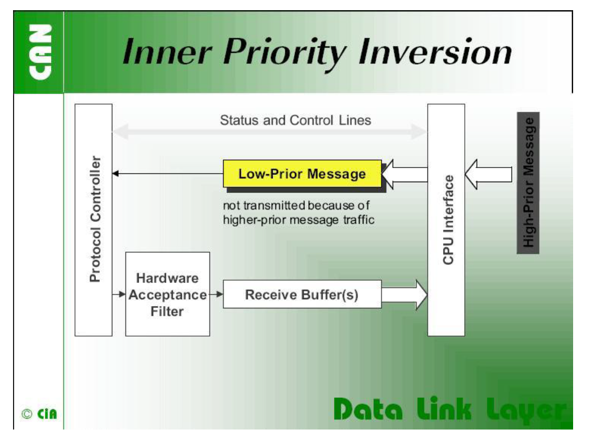
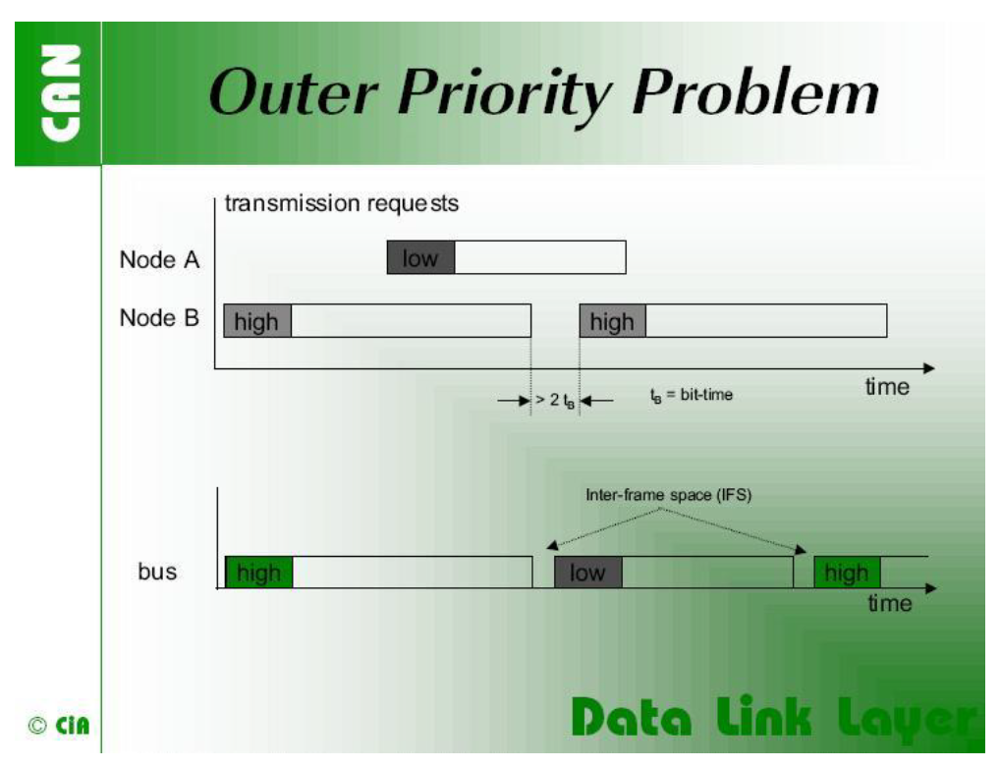
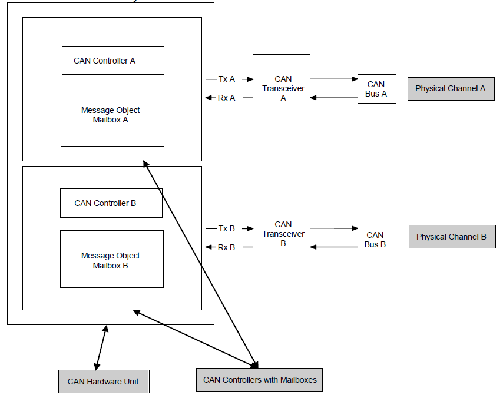
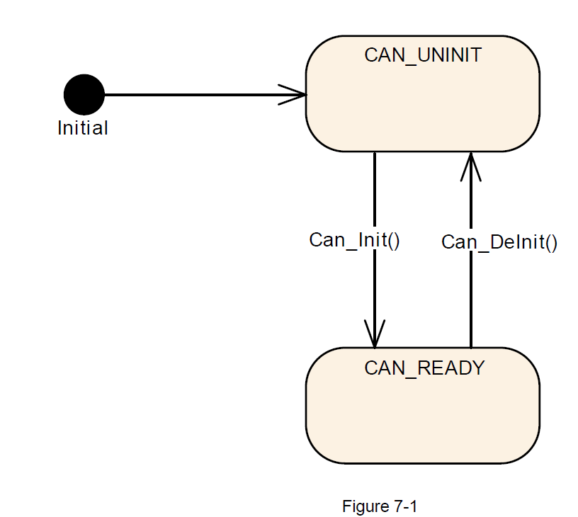
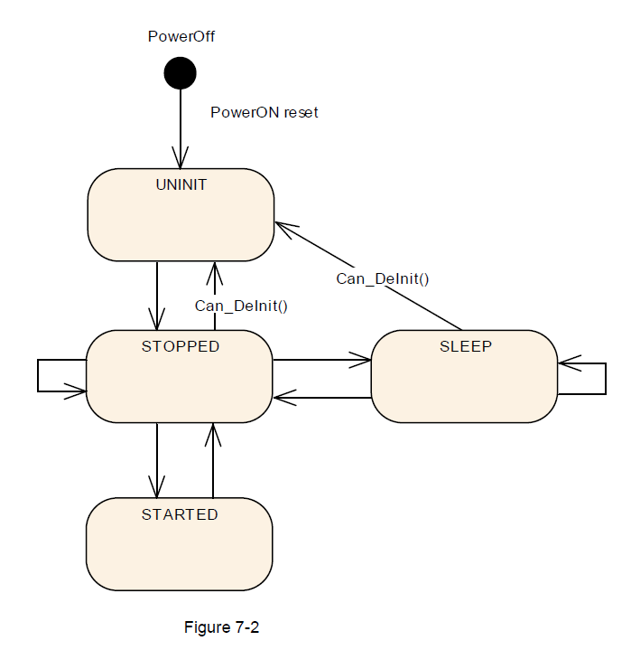
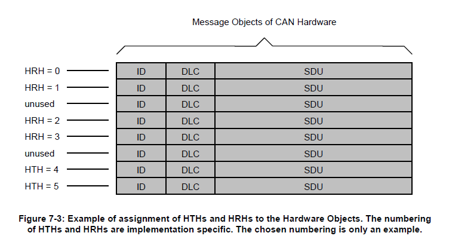
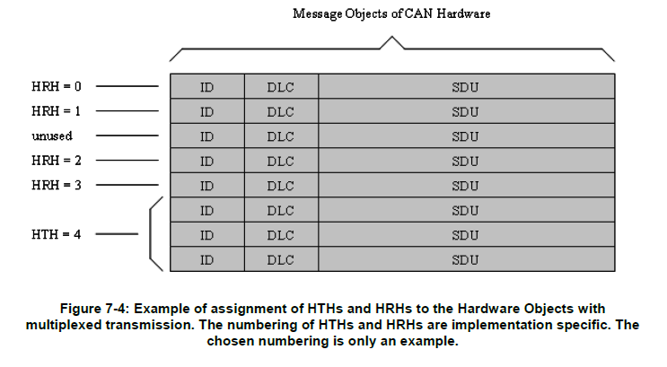
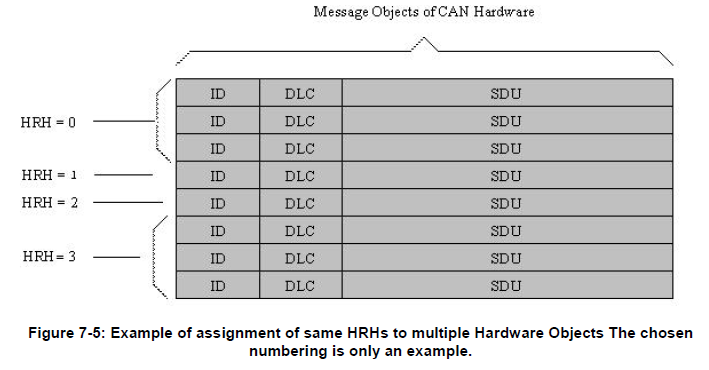

## 1. 简介和功能概述

本文介绍了AUTOSAR基础软件模块CAN驱动程序的功能、API和配置。

**Can**模块是底层的一部分，主要执行硬件访问，并向上层提供与硬件无关的API。只有上层模块**CanIf**模块能够唯一访问**Can**模块的。

**Can**模块为发起传输，并调用**CanIf**模块的回调函数来通知事件提供服务，它独立于硬件。此外，它还提供控制属于同一CAN硬件单元（**CAN Hardware Unit**）的CAN控制器（**CAN controller**）的行为和状态的服务。多个CAN控制器可以由一个CAN模块控制，只要它们属于同一个CAN硬件单元。

## 2. 缩略语

**CAN controller**
> CAN控制器仅服务于一个物理通道。

**CAN Hardware Unit**
> CAN硬件单元可以由一个或多个相同类型的CAN控制器和一个或多个CAN RAM区域组成。CAN硬件单元可以是片上设备，也可以是外部设备。CAN硬件单元由一个CAN驱动程序表示。

**CAN L-PDU**
> 数据链路层协议数据单元。由标识符（**Identifier**）、数据长度（**Data Length**）和数据（**Data (SDU)**）组成。（见[2]）

**CAN L-SDU**
> 数据链路层服务数据单元。在L-PDU内部传输的数据。（见[2]）

**DLC**
> 数据长度码（**Data Length Code**，CAN报文中描述SDU长度的部分）。

**Hardware Object**
> CAN硬件对象定义为CAN硬件单元/CAN控制器的CAN RAM中的一个PDU缓冲区。硬件对象定义为CAN硬件单元CAN RAM中的L-PDU缓冲器。

**Hardware Receive Handle (HRH)**
> 硬件接收句柄（**HRH**）由CAN驱动程序定义和提供。每个HRH通常只表示一个硬件对象。HRH可用于优化软件过滤。

**Hardware Transmit Handle (HTH)**
> 硬件传输句柄（**HTH**）由CAN驱动程序定义和提供。每个HTH通常只表示一个或多个硬件对象，这些硬件对象被配置为硬件传输缓冲池。

**Inner Priority Inversion**
> 高优先级的**L-PDU**的传输由于在同一个发送硬件对象中存在一个未决的低优先级的L-PDU而被阻止。

**ISR**
> 中断服务例程（**Interrupt Service Routine**）。

**L-PDU Handle**
> L-PDU句柄被定义并放置在**CanIf**模块层内。通常每个句柄代表一个L-PDU，它是一个包含Tx/Rx处理信息的常量结构。

**MCAL**
> 微控制器抽象层（**Microcontroller Abstraction Layer**）。

**Outer Priority Inversion**
> 由于两个连续发送的**L-PDU**之间存在时间间隔。在这种情况下，来自另一个节点的低优先级的**L-PDU**可以阻止发送自己的高优先级的**L-PDU**。此时，高优先级的**L-PDU**不能参与网络访问仲裁，因为低优先级的**L-PDU**已经赢得了仲裁。

**Physical Channel**
> 一个物理通道代表一个从CAN控制器到CAN网络的接口。CAN硬件单元的不同物理通道可能访问不同的网络。

**Priority**
> **CAN L-PDU**的优先级由CAN标识符（**CAN Identifier**）表示。标识符的数值越低，优先级越高。

**SFR**
> 特殊功能寄存器（**Special Function Register**），控制控制器行为的硬件寄存器。

**SPAL**
> 标准外围抽象层（**Standard Peripheral Abstraction Layer**）。

### 2.1. 优先级反转

#### 2.1.1. 内部优先级反转（**Inner Priority Inversion**）（Inner Priority Inversion）



如果只使用一个发送缓冲区，内部优先级反转可能会发生。由于低优先级，存储在缓冲区中的消息要等到“总线上的流量平静下来。在等待的时间内，该消息可以阻止由同一微控制器产生的高优先级消息在总线上传输。

#### 2.1.2. 外部优先级反转（**Outer Priority Inversion**）（Outer Priority Inversion）



在某些CAN实现中可能会出现外部优先级反转的问题。

假设CAN节点希望传输一个连续的高优先级消息包，这些消息包被存储在不同的消息缓冲区中。如果在CAN网络中，这些消息之间的帧间距大于CAN标准定义的最小帧间距，则第二个节点可以开始传输优先级较低的消息。最小帧间空间由3个隐性位组成的**Intermission**字段决定。一个消息因为在另一个消息的传输过程中被挂起，在总线空闲期间开始发送，最早在**Intermission**字段之后的位。例外是，有等待传输消息的节点将把中断的第三位的主导位解释为帧开始位，并从第一个标识位开始传输，而不首先发送SOF位。CAN模块的内部处理时间必须足够短，以发送连续的消息，帧间空间最小，以避免在上述所有场景下的外部优先级反转。

### 2.2. CAN 硬件单元

CAN硬件单元由一个或多个CAN控制器组成。这些控制器可以位于芯片上，也可以作为同一类型的外部独立设备，具有公共或单独的硬件对象（**Hardware Objects**）。

如下图所示，CAN硬件单元由两个CAN控制器连接两个物理通道组成:



## 3. 相关文档

- [1] Specification of CAN Interface（AUTOSAR_CP_SWS_CANInterface）
- [2] IEC: The Basic Model, IEC Norm
- [3] List of Basic Software Modules（AUTOSAR_CP_TR_BSWModuleList）
- [4] Specification of MCU Driver（AUTOSAR_CP_SWS_MCUDriver）
- [5] Specification of ECU State Manager（AUTOSAR_CP_SWS_ECUStateManager）
- [6] General Requirements on SPAL（AUTOSAR_CP_SRS_SPALGeneral）
- [7] CiA 610-1 version 1.0.0 (DSP) - CAN XL specifications and test plans - Part 1: Data link layer and physical coding sub-layer requirements（http://www.can-cia.org）
- [8] CiA 611-1 version 1.0.0 (DSP) - CAN XL higher layer functions - Part 1: Definition of service data unit types（http://www.can-cia.org）
- [9] General Specification of Basic Software Modules（AUTOSAR_CP_SWS_BSWGeneral）

### 3.1. 相关规范

AUTOSAR提供了基础软件模块的通用规范[3]（**SWS BSW General**），它也适用于**CAN**驱动程序。

因此，规范**SWS BSW General**应被视为**CAN**驱动程序的附加和必需规范。

## 4. 约束和假设

### 4.1. 限制

CAN控制器总是对应一个物理通道。允许在总线端连接物理通道。无论如何，CanIf模块将单独处理相关的CAN控制器。

有些CAN硬件单元可能支持通过使用CAN RAM组合几个CAN控制器，以扩展一个CAN控制器的消息对象的数量。这些组合的CAN控制器被CAN模块作为一个控制器处理。

Can模块不支持CAN的远程帧（**CAN remote frames**）。Can模块不传输由远程传输请求触发的消息。同时Can模块也应该初始化Can HW以忽略任何远程传输请求。

### 4.2. 汽车域的适用性

Can模块可用于任何使用Can协议的应用程序。

## 5. 对其他模块的依赖

### 5.1. 静态配置

第[9](#9-配置规范)章中描述的配置元素可以被其他**BSW**模块在其配置中引用。

### 5.2. 驱动程序服务的依赖

如果CAN控制器是片载的（on-chip），CAN模块不能使用其他驱动的任何服务。

[**Can_Init**](#7311-can_init)函数应该初始化CAN控制器使用的所有片上硬件资源。唯一的例外是数字I/O引脚配置（即使为CAN使用的引脚），这是是通过Port驱动程序完成的。

**Mcu**模块应配置与其他模块共享的寄存器设置。同时在初始化**Can**模块之前，需要先初始化**Mcu**模块。

如果使用芯片外CAN控制器，**CAN**模块可以使用其他**MCAL**驱动程序（如：**SPI**）的服务。同时如果Can模块使用了其他**MCAL**驱动的服务，必须确保这些驱动在初始化Can模块之前已经启动并运行。不同驱动的初始化顺序部分在[5]中指定。

**Can**模块应该使用底层**MCAL**驱动的同步API，并且不应该提供**MCAL**驱动可以调用的回调函数。因此μC和CAN硬件单元之间的连接类型只会对实现有影响，而对API没有影响。

### 5.3. 系统服务的依赖

在某些特殊的硬件情况下，Can模块可能需要轮询硬件事件。

Can模块需要使用系统服务提供的**OsCounter**进行超时检测，以防硬件在预期时间内没有反应（如：硬件的故障），从而避免出现循环。Can模块函数等待硬件反应的阻塞时间应小于Can主函数（即：[**Can_MainFunction_Read**](#752-can_mainfunction_read)）触发时间（trigger period），因为Can主函数无法用于此目的。

### 5.4. Can模块用户

Can模块需与其他模块进行直接的交互。如：默认错误跟踪（**DET**），Ecu状态管理器（**EcuM**）和**CanIf**模块。驱动程序只将**CanIf**模块视为起点和目的地。

### 5.5. 文件结构

**Can_GeneralTypes.h**应包含**AUTOSAR CAN**模块（**Can**、**CanIf**和**CanTrcv**）之间共享的所有类型和常量。

## 6. 功能规范

在**L-PDU**传输时，**Can**模块将**L-PDU**写入Can控制器硬件内部的适当缓冲区。在**L-PDU**接收时，**Can**模块以ID、数据长度和L-SDU指针为参数调用接收指示回调函数（**RX indication callback function**）。

**Can**模块需要提供了一个接口作为周期性处理函数，同时此函数由**Basic Software Scheduler**模块周期性地调用。此外，**Can**模块提供服务来控制CAN控制器（**CAN controller**）的状态。 通过回调函数通知Bus-Off和唤醒（**Wakeup**）事件。Can 模块是访问硬件资源的基础软件模块。 因此它需要满足AUTOSAR_SRS_SPAL中指定的基础软件模块的要求。

Can模块需要为所有所需的CAN硬件单元（**CAN Hardware Unit**）中断，实现中断服务程序（**interrupt service routine**）。同时Can模块也需要负责禁用CAN控制器（**CAN controller**）中所有未使用的中断。Can模块应在中断服务程序结束时重置中断标志（如果重置动作不是由硬件自动完成）。Can模块也不得设置向量表条目的配置（如：优先级）。

### 6.1. 驱动程序

一个**Can**模块提供对一个CAN硬件单元（**CAN Hardware Unit**）的访问，该硬件单元可能由多个CAN控制器（**CAN controller**）组成。对于不同类型的CAN硬件单元，需要实现不同的CAN模块。

如果在一个ECU中实现了多个CAN硬件单元（相同或不同供应商），则Can模块需要确保函数名称和的全局变量的名称不能重复。

**命名约定如下**：

<**Can module name**>_<**vendorID**>_<**Vendor specific API name**><**driver abbreviation**>()

如果必须在一个ECU上支持多种不同的CAN控制器类型，则必须使用以上的命名约定。如果只使用一种控制器类型，则没有任何<**driver abbreviation**>扩展的原始命名约定已经足够了。

### 6.2. Can驱动模块的状态机

**Can**模块只有一个非常简单的状态机，包括两个状态：**CAN_UNINIT**和**CAN_READY**。 图7.1显示了状态机。



1. 上电/复位后，Can模块应处于**CAN_UNINIT**状态。
2. [**Can_Init**](#7311-can_init)函数需在初始化硬件单元内的所有控制器之后，将Can模块更改为**CAN_READY**状态。
3. [**Can_DeInit**](#7313-can_deinit)函数需在取消初始化硬件单元内的所有控制器之前，将Can模块更改为 **CAN_UNINIT**状态。

[**Can_Init**](#7311-can_init)函数应根据其配置初始化所有CAN控制器。然后必须通过调用函数 **[Can_SetControllerMode](#7322-can_setcontrollermode)(CAN_CS_STARTED)**单独启动每个CAN控制器。

影响硬件单元内所有CAN控制器的硬件寄存器设置只能在函数[Can_Init](#7311-can_init)中设置。ECU状态管理器（**EcuM**）模块在运行时只能调用一次[**Can_Init**](#7311-can_init)函数。

### 6.3. CAN控制器状态机

每个CAN控制器都有以硬件实现的复杂状态机。 为简化起见，本文中将状态的数量减少为以下四种基本状态：未初始化（**UNINIT**）、停止（**STOPPED**）、启动（**STARTED**）和睡眠（**SLEEP**）。

任何CAN硬件访问都被Can模块的功能封装，但Can模块并不记忆状态的变化。Can模块提供[**Can_Init**](#7311-can_init)、[**Can_SetBaudrate**](#7321-can_setbaudrate)和[**Can_SetControllerMode**](#7322-can_setcontrollermode)等服务。这些服务执行必要的寄存器设置，最终会导致硬件CAN控制器状态发生所需的更改。

同时外部事件（**external event**）也能触发状态改变，这里有两种可能的外部事件：

* Bus-off事件。
* 硬件唤醒事件。

以上的事件可以通过中断或者在[**Can_MainFunction_BusOff**](#753-can_mainfunction_busoff)或 [**Can_MainFunction_Wakeup**](#754-can_mainfunction_wakeup)函数中轮询的状态位实习。

Can模块需要进行必要的寄存器设置，以实现所需的行为（如：在Bus-Off的情况下无硬件恢复）。然后Can模块通过调用相应的回调函数来通知CanIf模块，相关的软件状态也会在此回调函数中被更改。

如果开发错误被启用并且上层请求不允许转换，Can模块将产生开发错误[**CAN_E_TRANSITION**](#6121-开发错误)。但Can模块在执行[**Can_Write**](#7331-can_write)或调用回调函数之前，则不会检查实际状态。

#### 6.3.1. CAN控制器状态描述

**CAN控制器未初始化状态（UNINIT）**

在这种状态下，CAN控制器还未初始化。属于CAN模块的所有寄存器都处于复位状态，CAN中断被禁用，CAN控制器未参与CAN总线活动。

**CAN控制器停止状态（STOPPED）**

在这种状态下，CAN控制器被初始化但不参与总线活动。 此外也不会发送错误帧和确认帧。对于许多进入初始化模式（**Entering an initialization-mode**）的Can控制器，会导致CAN控制器进入停止状态。

**CAN控制器启动状态（STARTED）**

在这种状态下，CAN控制器已经处于具有完整功能的正常运行模式，也就是意味着它参与了网络。 对于许多离开初始化模式（**Leaving the initialization-mode**）的控制器，会导致CAN控制器进入启动状态。

**CAN控制器睡眠状态（SLEEP）**

对于支持睡眠模式的CAN硬件，只有硬件设置与的**STOPPED**状态不同，即能通过CAN硬件直接支持的CAN总线唤醒。

当CAN硬件支持睡眠模式，并被触发转换为SLEEP状态时，Can模块需要将控制器设置为**SLEEP**状态，以便于可以通过硬件来唤醒CAN总线。

当CAN硬件不支持睡眠模式，并被触发转换为SLEEP状态时，Can模块应模拟逻辑的**SLEEP**状态，并且仅当CAN控制器被软件触发转换为**STOPPED**状态后才从函数返回。CAN硬件应保持在**STOPPED**状态，而逻辑的**SLEEP**状态处于活动状态。

#### 6.3.2. CAN控制器的状态转换

状态转换由调用软件的[**Can_SetControllerMode**](#7322-can_setcontrollermode)函数触发，并将所需转换状态作为参数。 当触发状态成功转换后，回调函数**CanIf_ControllerModeIndication**会通知上层CanIf模块。 监控请求的状态是否完成，应该由上层CanIf模块负责，而不属于Can模块。

一些转换是由总线上的硬件事件触发的，这些转换通过回调函数进行通知。AUTOSAR标准未对无效转换的行为进行定义。 图7-2 显示了所有有效的状态转换。



#### 6.3.3. Can_Init函数引起的状态转换

1. 状态的变化：**UNINIT** -> **STOPPED**（适用于硬件单元中的所有控制器）。
2. 由软件调用[**Can_Init**](#7311-can_init)函数触发。
3. 对硬件单元内的所有CAN控制器进行配置，所有CAN控制器寄存器根据静态配置进行设置。

[**Can_Init**](#7311-can_init)函数应将所有**CAN**控制器设置为**STOPPED**状态。当进入[**Can_Init**](#7311-can_init)函数时，Can模块不在**CAN_UNINIT**状态或CAN控制器不在**UNINIT**状态时，将触发[**CAN_E_TRANSITION**](#6121-开发错误)的错误。

#### 6.3.4. Can_SetBaudrate函数引起的状态转换

1. 状态的变化：**STOPPED** -> **STOPPED**; **SLEEP** -> **SLEEP**; **STARTED** -> **STARTED** 
2. 由软件调用[**Can_SetBaudrate**](#7321-can_setbaudrate)函数触发
3. 更改CAN控制器配置，所有CAN控制器寄存器根据静态配置进行设置。

如果调用[**Can_SetBaudrate**](#7321-can_setbaudrate)函数后，将导致CAN控制器重新初始化，并且CAN控制器未处于**STOPPED**状态，则函数应返回**E_NOT_OK**。

如果需要重新初始化，[**Can_SetBaudrate**](#7321-can_setbaudrate)函数需要将CAN控制器保持在**STOPPED**状态；如果需要重新初始化， [Can_SetBaudrate](#7321-can_setbaudrate)函数也需要确保不会设置任何会导致CAN控制器参与网络的设置。

#### 6.3.5. Can_SetControllerMode函数引起的状态转换

软件可以使用[Can_SetControllerMode](#7322-can_setcontrollermode)函数来触发CAN控制器状态转换。 依赖于CAN硬件，寄存器设置更改后，转换到新的CAN 控制器状态，可能会存在时间的延迟。 Can模块在状态转换成功后，通知上层模块（**CanIf_ControllerModeIndication**）新状态。 监控请求的状态是否完成，应该由上层CanIf模块负责，而不属于Can模块。

**Can_Mainfunction_Mode**函数将轮询CAN状态寄存器的标志，直到该标志发出更改生效的信号。然后通过调用 **CanIf_ControllerModeIndication**函数通知上层模块，由**CanIf**模块的**ControllerId**引用的相应CAN控制器状态转换成功。

[**Can_SetControllerMode**](#7322-can_setcontrollermode)函数需要使用系统服务**GetCounterValue**，来进行超时监控以避免函数阻塞。如果表明状态更改标志一直没有生效，并且**CanTimeoutDuration**参数定义的最大时间已过，则应退出[Can_SetControllerMode](#7322-can_setcontrollermode)函数，但**Can_Mainfunction_Mode**应继续轮询状态更改标志。

**Can_Mainfunction_Mode**函数需要调用CanIf_ControllerModeIndication函数通知上层模块，由**CanIf**模块的**ControllerId**引用的相应CAN控制器状态转换成功，以防状态转换由[**Can_SetControllerMode**](#7322-can_setcontrollermode)函数再次触发。

###### 8.3.5.1. Can_SetControllerMode(CAN_CS_STARTED)

1. 状态的变化：**STOPPED** -> **STARTED**
2. 软件触发

**[Can_SetControllerMode](#7322-can_setcontrollermode)(CAN_CS_STARTED)** 需要通过设置硬件寄存器，以使CAN控制器能参与网络。 

**[Can_SetControllerMode](#7322-can_setcontrollermode)(CAN_CS_STARTED)** 需要等待一段有限的时间，已确保CAN控制器已经完全工作。在CAN控制器运行之前发起的传输请求会丢失。CAN控制器可操作性的唯一指标是接收到TX确认或RX指示。发送实体可能会收到确认超时，并且需要能够应对这种情况。

当**[Can_SetControllerMode](#7322-can_setcontrollermode)(CAN_CS_STARTED)** 被调用时，如果CAN控制器未处于STOPPED状态时，这需要被检测为一个无效的状态转换。

###### 8.3.5.2. Can_SetControllerMode(CAN_CS_STOPPED)

1. 状态的变化：**STARTED** -> **STOPPED**; **SLEEP** -> **STOPPED**
2. 由软件触发

[Can_SetControllerMode](#7322-can_setcontrollermode)(CAN_CS_STOPPED) 需要设置CAN硬件内部的配置，以使CAN控制器停止参与网络。[Can_SetControllerMode](#7322-can_setcontrollermode)(CAN_CS_STOPPED) 需要等待一段有限的时间，确保CAN控制器真正关闭，并且CAN控制器已经处于STOPPED状态。

如果CAN硬件不支持睡眠模式，则从**SLEEP**到**STOPPED**的转换，应从逻辑睡眠模式退出，但对CAN控制器状态其实没有影响，因为控制器在逻辑睡眠模式时，已经处于停止状态。

[Can_SetControllerMode](#7322-can_setcontrollermode)(CAN_CS_STOPPED) 应取消所有的pending的消息。

###### 8.3.5.3. Can_SetControllerMode(CAN_CS_SLEEP)

1. 状态的变化：**STOPPED** -> **SLEEP** 
2. 软件触发

**[Can_SetControllerMode](#7322-can_setcontrollermode)(CAN_CS_SLEEP)** 应将控制器设置为睡眠模式。

如果CAN硬件支持睡眠模式，**[Can_SetControllerMode](#7322-can_setcontrollermode)(CAN_CS_SLEEP)** 将等待有限的时间，直到CAN控制器处于SLEEP状态，并确保CAN硬件能够被唤醒。如果CAN硬件不支持睡眠模式，**[Can_SetControllerMode](#7322-can_setcontrollermode)(CAN_CS_SLEEP)** 应将CAN控制器设置为逻辑睡眠模式。仅当调用 **[Can_SetControllerMode](#7322-can_setcontrollermode)(CAN_CS_STOPPED)** 时，CAN控制器才需要离开此逻辑睡眠模式。

当**[Can_SetControllerMode](#7322-can_setcontrollermode)(CAN_CS_SLEEP)** 被调用，但CAN控制器既不在STOPPED状态也不处于SLEEP状态时，它应被检测为无效的状态转换。

#### 6.3.6. 硬件事件引起的状态转换

###### 8.3.7.1. 硬件唤醒（由CAN总线唤醒事件触发）

1. 状态的变化：**SLEEP** -> **STOPPED**。
2. 由接收到的**L-PDU**触发。
3. 通过**EcuM_CheckWakeup**函数通知EcuM模块。

这种状态转换只会发生在硬件支持睡眠模式的情况下。

在硬件唤醒（由CAN总线的唤醒事件触发）时，CAN控制器应转换为**STOPPED**状态，Can模块应在中断函数或者[**Can_MainFunction_Wakeup**](#754-can_mainfunction_wakeup) 中调用函数**EcuM_CheckWakeup**。Can模块不应进一步处理引起唤醒的L-PDU。

在睡眠转换期间，CAN总线唤醒的情况下，函数 [Can_SetControllerMode](#7322-can_setcontrollermode)(CAN_CS_STOPPED) 应返回 E_NOT_OK。


###### 8.3.7.2. Bus-Off（由CAN控制器的状态变化触发）

1. 状态的变化：**STARTED** -> **STOPPED**。
2. 当CAN控制器达到Bus-Off状态，由硬件触发。
3. 当转换为**STOPPED**状态后，通过**CanIf_ControllerBusOff**函数通知CanIf模块，通过**CanIf**模块的**ControllerId**引用的相应CAN控制器通知状态已发生变化。

检测到**Bus-Off**后，CAN控制器应转换为**STOPPED**状态，Can模块需要确保CAN控制器不再参与网络，同时取消仍待处理（pending）的消息。

Can模块禁用或抑制自动的Bus-Off恢复。

#### 6.3.7. Can_DeInit函数引起的状态转换

1. 状态的变化：STOPPED -> UNINIT; SLEEP -> UNINIT（适用于硬件单元中的所有控制器）。
2. 由软件调用[**Can_DeInit**](#7313-can_deinit)函数触发。
3. 准备重新配置硬件单元内的所有CAN控制器。

[**Can_DeInit**](#7313-can_deinit)函数需要将所有CAN控制器设置为**UNINIT**状态。当[Can_DeInit](#7313-can_deinit)函数被调用，如果Can模块不在**CAN_READY**状态或者任何CAN控制器处于**STARTED**状态时，需要引发[**CAN_E_TRANSITION**](#6121-开发错误)的错误。

### 6.4. Can模块/控制器初始化

ECU状态管理器模块（**EcuM**）应在启动阶段通过调用[**Can_Init**](#7311-can_init)函数来初始化Can模块，之后Can模块的其他接口函数才被允许被调用。

[**Can_Init**](#7311-can_init)函数应初始化：
* 静态变量，包括所有标志。
* 完整CAN硬件单元的通用设置。
* 每个CAN控制器的特定设置。

但是[**Can_Init**](#7311-can_init)函数不允许更改任何CAN控制器未使用硬件资源的寄存器。

Can模块需要遵守以下有关控制器寄存器初始化的规则：
* 如果硬件只允许寄存器的一种用途，则实现该功能的Can模块负责初始化寄存器。
* 如果寄存器可以影响多个硬件模块，并且如果它是一个I/O寄存器，它应该由**PORT**驱动程序初始化。
* 如果寄存器可以影响多个硬件模块，并且如果它不是一个I/O寄存器，则应由**MCU**驱动程序初始化。
* 一次性可写寄存器需要在复位后直接初始化，应由启动代码初始化。
* 所有其他寄存器都应由启动代码初始化。

如果[**Can_SetBaudrate**](#7321-can_setbaudrate)确定目标配置需要重新初始化，并且CAN控制器也处于**STOPPED**状态，则[**Can_SetBaudrate**](#7321-can_setbaudrate)函数需要重新初始化CAN控制器并进行控制器的特定设置。如果重新初始化是必须，则CAN控制器必须切换到**STOPPED**状态，然后才能执行 [**Can_SetBaudrate**](#7321-can_setbaudrate)来应用新的波特率配置。

[**Can_SetBaudrate**](#7321-can_setbaudrate)函数只影响包含单个CAN控制器的特定配置的寄存器区域。

Can模块配置定义全局CAN硬件单元设置和对默认CAN控制器配置集的引用。

### 6.5. L-PDU的传输

在**L-PDU**传输时，Can模块将**L-PDU**内容，ID和数据长度转换为硬件特定格式（如果需要），然后触发传输。

CAN到存储器的数据映射定义为先发出的CAN数据字节为数组第0个元素，最后发出的CAN数据字节为数组第7个元素或者为CAN FD的数据第63个元素。

如果CAN硬件缓冲区内的表示与AUTOSAR定义不同，则Can模块必须为上层提供经过调整的 SDU-Buffer。

可以配置多个具有唯一HTH的TX硬件对象。CanIf模块提供HTH作为TX请求的参数。有关可能的配置，请参见图 7-3。



[**Can_Write**](#7331-can_write)函数需要一直保存参数**PduInfo**中给出的**swPduHandle**，直到Can模块为此发送请求，调用了**CanIf_TxConfirmation**，其中**swPduHandle**作为参数给出。此特性用于CanIf模块实现中减少搜索的时间。

Can模块应调用**CanIf_TxConfirmation**以指示成功传输。在轮询模式的情况下，它也可以在相应硬件资源的TX中断服务程序中（**TX-interrupt service routine**）调用或在[**Can_MainFunction_Write**](#751-can_mainfunction_write)函数内部调用。

#### 6.5.1. 优先级反转

多路复用传输（**Multiplexed transmission**）可用于避免外部/内部优先级反转。同时Can模块允许多路复用传输功能在预编译时可静态配置使能或者禁止（ON | OFF）。

多个传输硬件对象（由CanHwObjectCount定义）可以由一个**HTH**分配，并且向上层模块表现为一个传输实体。

Can模块需要支持设备的多路传输机制：
* 多个发送硬件对象被分组到一个发送实体，并且可以填充在同一个寄存器集，同时微控制器将L-PDU自动存储到一个空闲缓冲区中。
* 硬件提供寄存器或函数来识别传输实体内的自由传输硬件对象。

Can模块需要支持按L-PDU优先级顺序发送L-PDU的设备的多路传输。

**注意**：

按优先级排序L-PDU避免了分配给配置为多路传输的Basic-CAN的L-PDU的内部优先级反转问题。 避免内部优先级反转的另一种可能性是将所有HTH配置为Full-CAN，如果CAN硬件能够使用CAN ID或相关优先级字段在传输时进行优先级传输。

应避免优先处理的软件仿真，因为额外的开销会使多路传输的优势无效。



#### 6.5.2. 传输数据一致性

Can模块需要直接从上层模块缓冲区复制数据。上层模块负责保持缓冲区一致，直到[**Can_Write**](#7331-can_write)函数被调用后返回。

### 6.6. L-PDU的接收

当接收到L-PDU时，Can模块应调用RX指示回调函数**CanIf_RxIndication**，其中包含了 **ID**、**HOH**，**Mailbox**参数中包含抽象的**CanIf**的**ControllerId**，以及参数**PduInfoPtr**中的数据长度和指向**L-SDU**缓冲区的指针。

在扩展CAN帧的情况下，Can模块应将ID转换为标准化格式，因为上层CAN IF模块不知道接收到的CAN帧是标准CAN帧（**Standard CAN frame**）还是扩展CAN帧（**Extended CAN frame**）。 如果是扩展CAN帧，需要将接收到的CAN帧ID的MSB设为**1**，以将接收到的 CAN帧标记为扩展。

在相应硬件资源的RX中断服务程序（**RX-interrupt service routine**）或者轮询模式下的[**Can_MainFunction_Read**](#752-can_mainfunction_read)函数需要调用回调函数**CanIf_RxIndication**。

CAN到内存的数据映射定义和数据传输一样，首先接收的CAN数据字节为数组第0个元素，最后接收的CAN数据字节为数组元素第7个或者CAN FD的第63个元素。如果CAN硬件缓冲区内的表示与AUTOSAR定义不同，则Can模块必须为上层模块提供经过调整的SDU-Buffer。

Can驱动需要指示接收到的消息是传统CAN帧（**Conventional CAN frame**）还是CAN FD帧（**CAN FD frame**），如[Can_IdType](#723-can_idtype)中定义，通过使用两个最高有效位来指定帧类型：

* -00 带有标准CAN ID的传统CAN帧
* -01 带有标准CAN ID的CAN FD帧
* -10 带有扩展CAN ID的传统CAN帧
* -11 带有扩展CAN ID的CAN FD帧

#### 6.6.1. 接收数据一致性

为了防止接收到消息的丢失，一些控制器支持为一组硬件对象（**hardware object**）构建一个先进先出队列（**FIFO**）。然而在其他一控制器上，可以配置另一个具有相同属性的硬件对象，在主对象出现忙碌的介入用作影子缓冲区（**shadow buffer**）。

CAN驱动程序需要支持实现了硬件FIFO的控制器。FIFO的大小通过**CanHwObjectCount**配置。

不支持硬件FIFO的控制器通常提供了实现影子缓冲区机制的能力。当主要硬件对象忙时，其他硬件对象会接管。硬件对象的数量也是通过**CanHwObjectCount**来进行配置。



如果CAN硬件无法保护（锁定）RX缓冲区，以防止数据被新接收到的消息所覆盖。Can模块需要在接收后，将L-SDU复制到影子缓冲区中。

如果CAN硬件不可全局访问，Can模块也需要将L-SDU复制到影子缓冲区中。完整的RX处理（包括复制到目标层，例如：COM）需要在RX中断程序的上下文或者 [Can_MainFunction_Read](#752-can_mainfunction_read)函数的上下文中完成。

Can模块应保证ISR和[Can_MainFunction_Read](#752-can_mainfunction_read)函数都不能被自己中断。这样CAN硬件（或影子）缓冲区始终是一致的，因为它是在一个永远不会被自身中断的函数中按顺序写入和读取的。

如果CAN硬件无法配置为在接收后锁定RX硬件对象（硬件功能），则可能会发生硬件缓冲区被新到达的消息覆盖的情况。在这种情况下，如果硬件支持，CAN控制器会检测到覆盖（**overwrite**）事件。

如果CAN硬件可以配置为在接收后锁定RX硬件对象，则可能会发生新到达的消息无法存储到硬件缓冲区的情况。在这种情况下，如果硬件支持，CAN控制器会检测到溢出（**overrun**）事件。

如果检测到“覆盖”或“溢出”事件，Can模块需要引发运行时[**CAN_E_DATALOST**](#6122-运行时错误)错误。系统设计者应确保消息接收（中断驱动或轮询）的运行时间与系统中可能的快速接收相匹配。

### 6.7. 唤醒概念

Can模块处理可由Can控制器本身检测到的唤醒，而不是通过Can收发器（**Can transceiver**）检测到的唤醒。 有两种可能的情况：中断唤醒（**wakeup by interrupt**）和轮询唤醒（**wakeup by polling**）。对于中断唤醒，当硬件检测到唤醒时调用Can模块的ISR。

如果唤醒事件的ISR被调用，它应该依次调用**EcuM_CheckWakeup**。传递给**EcuM_CheckWakeup**的参数应该是**CanWakeupSourceRef**配置参数引用的唤醒源的ID。然后，ECU状态管理器将设置MCU，并通过Can接口（**CanIf**）模块再调用Can模块，从而调用 [**Can_CheckWakeup**](#7325-can_checkwakeup)函数。

当通过轮询检测到唤醒事件时，ECU状态管理器会像以前一样通过Can接口（**CanIf**）模块周期性地调用[**Can_CheckWakeup**](#7325-can_checkwakeup)函数。

在这两种情况下，[**Can_CheckWakeup**](#7325-can_checkwakeup)都会检查Can控制器是否检测到唤醒并返回结果。然后，CAN驱动程序将通过**EcuM_SetWakeupEvent**通知ECU状态管理器（**EcuM**）收到唤醒事件（**wakeup event**）。

唤醒验证主要用于防止错误唤醒事件，它主要由ECU状态管理器（**EcuM**）和Can接口（**CanIf**）模块完成，无需Can模块的任何帮助。

有关唤醒机制和唤醒序列图的一般描述，请参阅ECU状态管理器规范[5]。

### 6.8. 具有选择性唤醒功能的CAN控制器

本节描述了对具有选择性唤醒（**selective wakeup**）功能的**CAN**控制器的要求。

部分网络（**Partial Networking**）是**CAN**系统中的一个状态，其中一些节点处于低功耗模式，而其他节点正在进行通信。这降低了整个网络的功耗。处于低功耗模式的节点通过预定义的唤醒帧（**wakeup frames**）被唤醒。

支持选择性唤醒的**CAN**控制器可以通过预定义的唤醒帧被唤醒。

如果**CAN**控制器硬件支持选择性唤醒，则应使用配置参数**CanHwPnSupport**进行指示。

如果支持选择性唤醒，则应使用参数**CanPnFrameCanId**、**CanPnFrameCanIdMask**和**CanPnFrameDataMask**将**CAN**控制器配置为在特定的**CAN**帧或一组**CAN**帧上唤醒。

有关唤醒机制和唤醒序列图的更多详细信息，另请参阅**CAN**主函数 [**Can_MainFunction_Read**](#752-can_mainfunction_read)、[**Can_MainFunction_Write**](#751-can_mainfunction_write)、[**Can_MainFunction_BusOff**](#753-can_mainfunction_busoff) 和 [**Can_MainFunction_Wakeup**](#754-can_mainfunction_wakeup) 的描述。

### 6.9. 通知概念

Can模块仅向上层CanIf模块提供事件触发通知接口。每个通知都由一个回调函数表示。

硬件事件可以通过中断或轮询硬件对象的状态标志来检测。有关轮询的配置可能性取决于硬件（即：哪些事件可以轮询，哪些事件需要轮询），并且不受AUTOSAR规范的限制。驱动程序同时也需要可以支持配置为完全不使用中断，即完全轮询。

轮不轮询的配置在Can驱动程序内部，在模块外部是不可见。轮询在CAN主函数（**Can_MainFunction_xxx**）内完成。 同时轮询事件也是通过适当的回调函数通知上层模块。 只不过回调函数地调用不是在ISR中，而是在CAN模块的主函数中。所有回调函数的实现都和在ISR中的实现相同。更多详细信息，可以参见CAN模块的主函数[**Can_MainFunction_Read**](#752-can_mainfunction_read)、[**Can_MainFunction_Write**](#751-can_mainfunction_write)、[**Can_MainFunction_BusOff**](#753-can_mainfunction_busoff)和[**Can_MainFunction_Wakeup**](#754-can_mainfunction_wakeup)的说明。

### 6.10. 重入问题（**Reentrancy issues**）

例程必须满足以下条件才能可重入：

* 它以原子方式使用所有共享变量，除非每个变量都分配给函数的特定实例。
* 它不调用不可重入函数。
* 它不会以非原子方式使用硬件。

传输请求仅会在**CanIf**模块的**CanIf_Transmit**函数内进行转发。由于函数**CanIf_Transmit**是可重入的，所以[Can_Write](#7331-can_write)函数需要实现线程安全（例如：通过使用互斥锁）。

当写入无法重入时，进一步的（抢占式）调用将返回**CAN_BUSY**。（例如：允许写入不同的硬件TX句柄，不允许写入相同的TX句柄）。在**CAN_BUSY**的情况下，**CanIf**模块需要对写入请求进行队列管理。（行为与所有硬件对象都忙的情况相同）。

**Can_EnableCanInterrupts**和**Can_DisableCanInterrupts**可能会在可重入函数中被调用，所以这两个函数也是需要是符合可重入设计的。

所有其他服务不需要实现为可重入函数。CAN主函数（如：[**Can_MainFunction_Read**](#752-can_mainfunction_read)）不允许被自己中断，所以这些**CAN**主函数都是不可重入的。

### 6.11. 硬件时间戳（**Hardware Timestamping**）

如果CAN控制器支持基于硬件的时间戳，Can模块可以使用硬件时间戳。这样可以提高CAN时间同步的精度。

如果支持基于硬件的时间戳，CAN驱动程序需要提供以下API：

* [**Can_GetCurrentTime**](#73210-can_getcurrenttime) 
* [**Can_EnableEgressTimeStamp**](#73211-can_enableegresstimestamp) 
* [**Can_GetEgressTimeStamp**](#73212-can_getegresstimestamp) 
* [**Can_GetIngressTimeStamp**](#73213-can_getingresstimestamp)

这些API需要通过配置参数**CanGlobalTimeSupport**使能。

基于硬件的时间戳功能的CAN控制器，需要提供一个自由运行（**free-running**）的计数器，用于获取CAN消息接收和发送的时间戳。自由运行计数器需要在达到其指定最大值后，向上计数并溢出到零。 CiA603标准中规定自由运行计数器对时钟周期进行计数，分辨率支持至少需要为1μs，最多可以1ns。强烈建议提供32位时间戳寄存器和32位计数器。

当CAN帧被认为有效时，发送和接收的CAN消息的时间戳将被捕获。CiA603标准中给出了详细信息。

### 6.12. 错误分类

文档「基础软件模块通用规范」的章节7.11「错误处理」（**Error Handling**）详细描述了基础软件的错误处理。其中最重要的是，它构成了一个由五种错误类型组成的分类方案，这些错误类型可能发生在**BSW**模块中。

基于此基础，以下章节在相应的小节中规定特定的错误。

**Can**模块应能够根据其配置（默认/生产）检测以下错误和异常。

#### 6.12.1. 开发错误

| 错误类型 | 相关错误码 | 错误值 |
| --- | --- | --- |
| 使用错误的参数调用API服务 | CAN_E_PARAM_POINTER | 0x01 |
| 使用错误的参数调用API服务 | CAN_E_PARAM_HANDLE | 0x02 |
| 使用错误的参数调用API服务 | CAN_E_PARAM_DATA_LENGTH | 0x03 |
| 使用错误的参数调用API服务 | CAN_E_PARAM_CONTROLLER | 0x04 |
| 未进行初始化就使用API服务 | CAN_E_UNINIT | 0x05 |
| 当前模式下的无效转换 | CAN_E_TRANSITION | 0x06 |
| 参数波特率（**Baudrate**）具有无效值 | CAN_E_PARAM_BAUDRATE | 0x07 |
| 无效的配置集选择 | CAN_E_INIT_FAILED | 0x09 |
| 使用无效的PDU ID调用API服务 | CAN_E_PARAM_LPDU | 0x0A |

#### 6.12.2. 运行时错误

| 错误类型 | 相关错误码 | 错误值 |
| --- | --- | --- |
| 接收到的**CAN**消息丢失 | CAN_E_DATALOST | 0x01 |

**Can**模块应指示由**Can**模块API的错误使用引起的错误。这包括API参数检查和调用序列错误。

在**DET**返回后，引发开发错误的**Can**模块函数应立即返回。

仅当**DET**开启且**Can**模块的函数提供返回值时，**Can**模块的环境才应在**Can**模块函数的返回值中指示开发错误。返回的值为**E_NOT_OK**。

#### 6.12.3. 瞬态故障

没有瞬态故障。

#### 6.12.4. 生产错误

没有生产错误。

#### 6.12.5. 扩展生产错误

没有扩展生产错误。

#### 6.12.6. 返回值

**CAN_BUSY**通过函数 [**Can_Write**](#7331-can_write) 的返回值报告。**CanIf**模块按照为**CanIf**模块规定的时序图做出反应。在向睡眠模式转换期间发生唤醒的情况下，通过返回值报告 **E_NOT_OK**。Bus-Off和唤醒（**Wake-up**）事件通过通知回调函数转发。

### 6.13. CAN FD支持

出于性能原因，一些**CAN**控制器允许使用称为**CAN FD**（参见「**CAN with Flexible Data-Rate**」规范）的灵活数据速率特性。在仲裁阶段指示后，可以在有效载荷（**payload**）和**CRC**期间切换到更高的波特率。这第二波特率必须通过使用 [**CanControllerFdBaudrateConfig**](#925-cancontrollerfdbaudrateconfig) 扩展 [**CanControllerBaudrateConfig**](#924-cancontrollerbaudrateconfig) 来配置。如果激活的波特率具有 **CAN FD** 配置（参见 [**CanControllerFdBaudrateConfig**](#925-cancontrollerfdbaudrateconfig) [9.2.5](#925-cancontrollerfdbaudrateconfig)节），则该控制器的 **CAN FD** 特性被启用。指定的第二波特率用于支持以位速率切换（**BRS**）接收 **CAN FD** 帧。第二波特率是否用于传输取决于配置参数 **CanControllerTxBitRateSwitch**（参见 [**CanControllerFdBaudrateConfig**](#925-cancontrollerfdbaudrateconfig) [9.2.5](#925-cancontrollerfdbaudrateconfig)节）。

但是，在某些情况下，可能需要在支持 **CAN-FD** 消息的网络中传输传统的 **CAN 2.0** 消息，例如为了实现 **CAN** 选择性唤醒。在这些情况下，必须支持将传统的 **CAN** 消息与 **CAN-FD** 消息交错传输。这可以在帧级别上通过使用在 [**Can_Write**](#7331-can_write) 期间传递的 **CanId**（参见 [**Can_IdType**](#723-can_idtype) [7.2.3](#723-can_idtype)节）的最高两位来实现，以指示应使用哪种帧。

**CAN FD** 还支持扩展的有效载荷，允许传输最多64字节。该特性也取决于 **CAN FD** 配置（参见 [**CanControllerFdBaudrateConfig**](#925-cancontrollerfdbaudrateconfig) [9.2.5](#925-cancontrollerfdbaudrateconfig)节）。因此，如果 **CAN** 控制器处于 **CAN FD** 模式（有效的 [**CanControllerFdBaudrateConfig**](#925-cancontrollerfdbaudrateconfig)）且传递给 **[Can_Write](#7331-can_write)()** 的 **CanId** 中设置了 **CAN FD** 标志，则**CAN**驱动程序支持传输长度最多64字节的 **PDU**。如果存在传输 **CAN FD** 帧的请求且 **CAN** 控制器不处于 **CAN FD** 模式（无 [**CanControllerFdBaudrateConfig**](#925-cancontrollerfdbaudrateconfig)），则只要 **PDU** 长度 &lt;= 8字节，该帧就作为传统 **CAN** 帧发送。

### 6.14. CAN XL扩展

**CAN**/**CAN-FD** 是经过验证、经济实惠且广泛部署的通信协议，其相应的通信栈已在 **AUTOSAR** 内规定。

在汽车行业中，不断增加通信带宽以应对现代**E/E**架构复杂性的趋势持续存在。拥有一个同样遵循这一趋势的低成本、鲁棒的总线系统显然被视为对 **AUTOSAR** 标准的有益补充。因此，引入了 **CAN XL**（参见[7]、[8]）。

目标是 **CAN XL** 将帮助弥合当前 **CAN** 实现与当前100 Mbit以太网解决方案之间的差距。在同一个网段上，**CAN 2.0**/**FD**/**XL** 和以太网流量可以共存。波特率不像 **10BASE-T1S** 那样固定为10 Mbit，而是可以灵活调整至最高20 Mbit/s。此外，有效载荷最多可达2048字节。

**CAN XL** 对现有 **AUTOSAR** 模块的影响极小，但仍带来了新特性的好处。

使用新引入的 **CAN XL** 驱动程序，仍然可以在不做任何更改的情况下发送 **CAN 2.0** 和 **CAN FD** 帧。

由于 **CAN XL** 驱动程序是作为现有**CAN**驱动程序的扩展实现的（带有新文档 AUTOSAR_CP_SWS_CANXLDriver.pdf），非 **CAN XL** 硬件仍将使用基本的**CAN**驱动程序实现。

**CAN XL** 驱动程序是**CAN**驱动程序的扩展，并引入了额外的API以支持 **CAN XL** 帧和以太网通信（更多详情参见 AUTOSAR_CP_SWS_CANXLDriver.pdf）。

### 6.15. CAN错误类型的报告

如果 **CanEnableSecurityEventReporting** 为 **true** 且**CAN**驱动程序检测到 **0x1-0xB** 范围内的 **CanErrorType**，则**CAN**驱动程序应以 **ControllerId** 和 **CanError** 为参数调用 **CanIf_ErrorNotification**。

如果没有预定义的 [**Can_ErrorType**](#729-can_errortype) 值与**CAN**硬件提供的错误匹配，则**CAN**驱动程序不应将该错误报告给 **CanIf**。

如果 **CanEnableSecurityEventReporting** 为 **true** 且**CAN**驱动程序检测到向错误状态被动（**error state passive**）的转换，则**CAN**驱动程序应以 **ControllerId** 以及 **Rx** 和 **Tx** 错误计数器的值为参数调用 **CanIf_ControllerErrorStatePassive**。


## 7. API规范

在具有多个**Can**模块的实现中，函数名称的前缀可以按照相关需求的规定进行更改。

### 7.1. 导入的类型

在本章中列出了从以下模块包含的所有类型：

| 模块 | 头文件 | 导入的类型 |
| --- | --- | --- |
| ComStack_Types | ComStack_Types.h | PduIdType |
| ComStack_Types | ComStack_Types.h | PduInfoType |
| ComStack_Types | ComStack_Types.h | PduLengthType |
| EcuM | EcuM.h | EcuM_WakeupSourceType |
| Icu | Icu.h | Icu_ChannelType |
| Os | Os.h | StatusType |
| Os | Os.h | TickRefType |
| Os | Os.h | TickType |
| Os | Rte_Os_Type.h | CounterType |
| Std | Std_Types.h | Std_ReturnType |
| Std | Std_Types.h | Std_VersionInfoType |

### 7.2. 类型定义

#### 7.2.1. Can_ConfigType

结构类型（**Structure**）。这是包含**CAN**驱动程序整体初始化数据以及影响所有控制器的**SFR**设置的外部数据结构的类型。此外，它还包含指向控制器配置结构的指针。初始化数据结构的内容是**CAN**硬件特定的。可通过**Can.h**获得。

#### 7.2.2. Can_PduType

结构类型（**Structure**），该类型为任意**CAN L-SDU**统一了 **PduId**（swPduHandle）、**SduLength**（length）、**SduData**（sdu）和 **CanId**（id）。元素：

| 元素 | 类型 | 说明 |
| --- | --- | --- |
| swPduHandle | PduIdType | - |
| length | uint8 | - |
| id | [Can_IdType](#723-can_idtype) | - |
| sdu | uint8* | - |

可通过**Can_GeneralTypes.h**获得。

#### 7.2.3. Can_IdType

类型（**Type**），派生自 **uint32**。表示**L-PDU**的标识符。最高两位指定帧类型：**00** = 带标准**CAN ID**的**CAN**消息；**01** = 带标准**CAN ID**的**CAN FD**帧；**10** = 带扩展**CAN ID**的**CAN**消息；**11** = 带扩展**CAN ID**的**CAN FD**帧。取值范围：**Standard32Bit**：0..0x400007FF；**Extended32Bit**：0..0xDFFFFFFF。变体（**Variation**）：-。可通过**Can_GeneralTypes.h**获得。

#### 7.2.4. Can_HwHandleType

类型（**Type**），派生自 **Basetype**（**uint16** 或 **uint8**，变体）。表示**CAN**硬件单元的硬件对象句柄。对于拥有超过255个硬件对象的**CAN**硬件单元，使用扩展范围。取值范围：**Standard**：0..0x0FF；**Extended**：0..0xFFFF。可通过**Can_GeneralTypes.h**获得。

#### 7.2.5. Can_HwType

结构类型（**Structure**）。该类型定义了一个数据结构，它明确地提供了一个硬件对象句柄（**Hardware Object Handle**）及其对应的**CAN**控制器（因此也包括**CAN**驱动程序）以及特定的 **CanId**。元素：

| 元素 | 类型 | 说明 |
| --- | --- | --- |
| CanId | [Can_IdType](#723-can_idtype) | **CAN L-PDU** 的标准/扩展 **CAN ID** |
| Hoh | [Can_HwHandleType](#724-can_hwhandletype) | 对应的硬件对象范围（**Hardware Object Range**）的ID |
| ControllerId | uint8 | 由 **CanIf** 提供的 **ControllerId**，明确标识对应的控制器 |

可通过**Can_GeneralTypes.h**获得。

#### 7.2.6. Std_ReturnType的扩展

**CAN_BUSY**（0x02）：由于没有可用的发送对象而无法处理传输请求。这是**CAN**驱动程序API **[Can_Write](#7331-can_write)()** 的 **Std_ReturnType** 叠加返回值。可通过**Can_GeneralTypes.h**获得。

#### 7.2.7. Can_ErrorStateType

枚举类型（**Enumeration**），**CAN**控制器的错误状态。取值范围：**CAN_ERRORSTATE_ACTIVE**：**CAN**控制器完全参与通信；**CAN_ERRORSTATE_PASSIVE**：**CAN**控制器参与通信，但不发送主动错误帧；**CAN_ERRORSTATE_BUSOFF**：**CAN**控制器不参与通信。可通过**Can_GeneralTypes.h**获得。

#### 7.2.8. Can_ControllerStateType

枚举类型（**Enumeration**），由多个 **ControllerMode** 函数使用的状态。取值范围：**CAN_CS_UNINIT**（0x00）：**CAN**控制器状态 **UNINIT**；**CAN_CS_STARTED**（0x01）：**CAN**控制器状态 **STARTED**；**CAN_CS_STOPPED**（0x02）：**CAN**控制器状态 **STOPPED**；**CAN_CS_SLEEP**（0x03）：**CAN**控制器状态 **SLEEP**。可通过**Can_GeneralTypes.h**获得。

#### 7.2.9. Can_ErrorType

枚举类型（**Enumeration**），表示典型 **CAN** 硬件能够报告的 **CAN** 错误类型的超集。这意味着并非所有 **CAN** 硬件都能够支持完整的集合。取值范围：**CAN_ERROR_BIT_MONITORING1**（0x01）：发送了0但读回1；**CAN_ERROR_BIT_MONITORING0**（0x02）：发送了1但读回0；**CAN_ERROR_BIT**（0x03）：硬件报告 **CAN** 位错误，但无法区分 **CAN_ERROR_BIT_MONITORING1** 和 **CAN_ERROR_BIT_MONITORING0**；**CAN_ERROR_CHECK_ACK_FAILED**（0x04）：应答（**Acknowledgement**）检查失败；**CAN_ERROR_ACK_DELIMITER**（0x05）：应答界定符检查失败；**CAN_ERROR_ARBITRATION_LOST**（0x06）：发送方在仲裁中失败；**CAN_ERROR_OVERLOAD**（0x07）：通过过载帧检测到 **CAN** 过载，表明接收器的接收缓冲区已满；**CAN_ERROR_CHECK_FORM_FAILED**（0x08）：违反固定帧格式；**CAN_ERROR_CHECK_STUFFING_FAILED**（0x09）：填充位与预期不符；**CAN_ERROR_CHECK_CRC_FAILED**（0xA）：**CRC**失败；**CAN_ERROR_BUS_LOCK**（0xB）：总线锁定（总线卡在显性电平）。可通过**Can_GeneralTypes.h**获得。

#### 7.2.10. Can_TimeStampType

结构类型（**Structure**）。此类型的变量用于表示基于相对时间的时间戳。取值范围：秒（**seconds**，**uint32**）：0 .. 4.294.967.295 s（约136年）；纳秒（**nanoseconds**，**uint32**）：0 .. 999.999.999 ns。可通过**Can_GeneralTypes.h**获得。

### 7.3. 函数定义

#### 7.3.1. 影响整个硬件单元的服务

##### 7.3.1.1. Can_Init

**说明**: 该函数初始化模块。可通过**Can.h**获得。本服务为同步调用，不可重入。参数 Config（in）：指向驱动程序配置的指针。该服务无返回值。

```C
void Can_Init ( const Can_ConfigType* Config )
```

可用配置集的符号名称由**Can**模块的配置描述提供。参见关于配置描述的第[9](#9-配置规范)章。

如果启用了**Can**模块的开发错误检测：如果驱动程序不处于 **CAN_UNINIT** 状态，则函数 **Can_Init** 应引发错误 [**CAN_E_TRANSITION**](#6121-开发错误)。

如果启用了**Can**模块的开发错误检测：如果**CAN**控制器不处于 **UNINIT** 状态，则函数 **Can_Init** 应引发错误 [**CAN_E_TRANSITION**](#6121-开发错误)。

##### 7.3.1.2. Can_GetVersionInfo

**说明**: 该函数返回该模块的版本信息。可通过**Can.h**获得。本服务为同步调用，可重入。参数 versioninfo（out）：指向存储该模块版本信息的位置的指针。该服务无返回值。

```C
void Can_GetVersionInfo ( Std_VersionInfoType* versioninfo )
```

如果启用了**Can**模块的开发错误检测：如果参数 versionInfo 是空指针，则函数 **Can_GetVersionInfo** 应引发错误 [**CAN_E_PARAM_POINTER**](#6121-开发错误)。

##### 7.3.1.3. Can_DeInit

**说明**: 该函数去初始化模块。可通过**Can.h**获得。本服务为同步调用，不可重入。该服务无参数、无返回值。

```C
void Can_DeInit ( void )
```

**注意：**去初始化函数的一般行为和约束由SWS_BSWGeneral中的相关需求规定。

注意事项（**Caveat**）：**Can_DeInit** 函数的调用者必须确保没有**CAN**控制器处于 **STARTED** 状态。

如果启用了**Can**模块的开发错误检测：如果驱动程序不处于 **CAN_READY** 状态，则函数 **Can_DeInit** 应引发错误 [**CAN_E_TRANSITION**](#6121-开发错误)。

如果启用了**Can**模块的开发错误检测：如果任何一个**CAN**控制器处于 **STARTED** 状态，则函数 **Can_DeInit** 应引发错误 [**CAN_E_TRANSITION**](#6121-开发错误)。

#### 7.3.2. 影响单个CAN控制器的服务

##### 7.3.2.1. Can_SetBaudrate

**说明**: 该服务应设置**CAN**控制器的波特率配置。根据必要的波特率修改，控制器可能必须复位。可通过**Can.h**获得。本服务为同步调用，对于不同的 **Controller** 可重入，对于相同的 **Controller** 不可重入。参数 Controller（in）：应设置波特率的**CAN**控制器；参数 BaudRateConfigID（in）：通过ID引用波特率配置（参见 **CanControllerBaudRateConfigID**）。返回值为**Std_ReturnType**：E_OK：服务请求已被接受，(新)波特率的设置已开始；E_NOT_OK：服务请求未被接受。

```C
Std_ReturnType Can_SetBaudrate ( uint8 Controller, uint16 BaudRateConfigID )
```

可能存在多个波特率配置。函数 **Can_SetBaudrate** 可用于在不同的配置之间切换。

根据旧的和新的波特率配置，在运行期间可能只能更改参数的一个子集，并且可以避免**CAN**控制器的重新初始化。

如果调用 **Can_SetBaudrate** 将导致**CAN**控制器的重新初始化，则在调用该函数时**CAN**控制器必须处于 **STOPPED** 状态。

(重新)初始化后，**CAN**控制器处于 **STOPPED** 状态。

如果启用了**Can**模块的开发错误检测：如果驱动程序尚未初始化，则函数 **Can_SetBaudrate** 应引发错误 [**CAN_E_UNINIT**](#6121-开发错误) 并返回 **E_NOT_OK**。

如果启用了**Can**模块的开发错误检测：如果参数 **BaudRateConfigID** 具有无效值，则函数 **Can_SetBaudrate** 应引发错误 [**CAN_E_PARAM_BAUDRATE**](#6121-开发错误) 并返回 **E_NOT_OK**。

如果启用了**Can**模块的开发错误检测：如果参数 **Controller** 超出范围，则函数 **Can_SetBaudrate** 应引发错误 [**CAN_E_PARAM_CONTROLLER**](#6121-开发错误) 并返回 **E_NOT_OK**。

如果所请求的波特率更改无法在不重新初始化**CAN**控制器的情况下执行，则应返回 **E_NO_OK**。

##### 7.3.2.2. Can_SetControllerMode

**说明**: 该函数执行**CAN**控制器状态机的软件触发状态转换。可通过**Can.h**获得。本服务为异步调用，不可重入。参数 Controller（in）：应更改状态的**CAN**控制器；参数 Transition（in）：请求新**CAN**控制器状态的转换值。返回值为**Std_ReturnType**：E_OK：请求已被接受；E_NOT_OK：请求未被接受，发生了开发错误。

```C
Std_ReturnType Can_SetControllerMode ( uint8 Controller, Can_ControllerStateType Transition )
```

函数 **Can_SetControllerMode** 应执行**CAN**控制器状态机的软件触发状态转换。

每次使用状态转换值 **CAN_CS_STARTED** 触发**CAN**控制器状态机时，函数 **Can_SetControllerMode** 都应使用先前由函数 [**Can_SetBaudrate**](#7321-can_setbaudrate) 或 [**Can_Init**](#7311-can_init) 使用的相同控制器配置集重新初始化**CAN**控制器。

有关在睡眠转换期间发生来自**CAN**总线的唤醒事件的情况，参见相关需求的规定。

函数 **Can_SetControllerMode** 应在检查唤醒状态时禁用唤醒中断。

函数 **Can_SetControllerMode** 应启用新状态所需的中断。

当**CAN**中断已被函数 [**Can_DisableControllerInterrupts**](#7323-can_disablecontrollerinterrupts) 禁用时，不应执行**CAN**中断的启用。

函数 **Can_SetControllerMode** 应禁用新状态中不允许的中断。

当**CAN**中断已被函数 [**Can_DisableControllerInterrupts**](#7323-can_disablecontrollerinterrupts) 禁用时，不应执行**CAN**中断的禁用。

如果启用了**Can**模块的开发错误检测：如果模块尚未初始化，则函数 **Can_SetControllerMode** 应引发开发错误 [**CAN_E_UNINIT**](#6121-开发错误) 并返回 **E_NOT_OK**。

如果启用了**Can**模块的开发错误检测：如果参数超出范围，则函数 **Can_SetControllerMode** 应引发开发错误 [**CAN_E_PARAM_CONTROLLER**](#6121-开发错误) 并返回 **E_NOT_OK**。

如果启用了**Can**模块的开发错误检测：如果请求了无效的转换，则函数 **Can_SetControllerMode** 应引发错误 [**CAN_E_TRANSITION**](#6121-开发错误) 并返回 **E_NOT_OK**。

如果硬件支持选择性唤醒且所请求的模式为 **CAN_CS_STARTED**，**CAN**控制器应为对应的抽象 **CanIf ControllerId** 调用API **CanIf_ConfirmCtrlPnAvailability()**。**CanIf_ConfirmCtrlPnAvailability** 通过 **CanIf** 和 **CanSM** 通知 **CanNm** 选择性唤醒已启用。

##### 7.3.2.3. Can_DisableControllerInterrupts

**说明**: 该函数禁用此**CAN**控制器的所有中断。可通过**Can.h**获得。本服务为同步调用，可重入。参数 Controller（in）：应为其禁用中断的**CAN**控制器。该服务无返回值。

```C
void Can_DisableControllerInterrupts ( uint8 Controller )
```

仅当该**CAN**控制器的中断已启用时，函数 **Can_DisableControllerInterrupts** 才应访问**CAN**控制器寄存器以仅禁用该**CAN**控制器的所有中断。

当 **Can_DisableControllerInterrupts** 被多次调用时，必须调用 [**Can_EnableControllerInterrupts**](#7324-can_enablecontrollerinterrupts) 同样的次数才能重新启用中断。实现说明：函数 **Can_DisableControllerInterrupts** 可以在每次执行时增加一个计数器，该计数器指示在启用中断之前需要调用多少次 [**Can_EnableControllerInterrupts**](#7324-can_enablecontrollerinterrupts)（增量禁用）。

**Can**模块应跟踪其他函数（即 [**Can_SetControllerMode**](#7322-can_setcontrollermode)）中所有单独的中断启用和禁用操作，以便可以恢复正确的中断启用状态。实现示例：在「中断启用模式」中，每次中断状态更改不仅修改中断启用位，还修改一个软件标志；在「中断禁用模式」中，仅修改软件标志；**Can_DisableControllerInterrupts** 和 [**Can_EnableControllerInterrupts**](#7324-can_enablecontrollerinterrupts) 不修改软件标志；[**Can_EnableControllerInterrupts**](#7324-can_enablecontrollerinterrupts) 读取软件标志以重新启用正确的中断。

如果启用了**Can**模块的开发错误检测：如果驱动程序尚未初始化，则函数 **Can_DisableControllerInterrupts** 应引发错误 [**CAN_E_UNINIT**](#6121-开发错误)。

如果启用了**Can**模块的开发错误检测：如果参数 **Controller** 超出范围，则函数 **Can_DisableControllerInterrupts** 应引发错误 [**CAN_E_PARAM_CONTROLLER**](#6121-开发错误)。

##### 7.3.2.4. Can_EnableControllerInterrupts

**说明**: 该函数启用所有允许的中断。可通过**Can.h**获得。本服务为同步调用，可重入。参数 Controller（in）：应为其重新启用中断的**CAN**控制器。该服务无返回值。

```C
void Can_EnableControllerInterrupts ( uint8 Controller )
```

函数 **Can_EnableControllerInterrupts** 应启用根据当前软件状态必须启用的所有中断。相关需求同样适用于该函数。

当之前未调用过 [**Can_DisableControllerInterrupts**](#7323-can_disablecontrollerinterrupts) 时，函数 **Can_EnableControllerInterrupts** 应不执行任何操作。另请参见「[**Can_DisableControllerInterrupts**](#7323-can_disablecontrollerinterrupts)」的实现示例。

如果启用了**Can**模块的开发错误检测：如果驱动程序尚未初始化，则函数 **Can_EnableControllerInterrupts** 应引发错误 [**CAN_E_UNINIT**](#6121-开发错误)。

如果启用了**Can**模块的开发错误检测：如果参数 **Controller** 超出范围，则函数 **Can_EnableControllerInterrupts** 应引发错误 [**CAN_E_PARAM_CONTROLLER**](#6121-开发错误)。

##### 7.3.2.5. Can_CheckWakeup

**说明**: 该函数检查给定的控制器是否发生了唤醒。可通过**Can.h**获得。本服务为同步调用，不可重入。参数 Controller（in）：要检查唤醒的控制器。返回值为**Std_ReturnType**：E_OK：API调用已被接受；E_NOT_OK：API调用未被接受。

```C
Std_ReturnType Can_CheckWakeup ( uint8 Controller )
```

函数 **Can_CheckWakeup** 应检查所请求的**CAN**控制器是否检测到了唤醒。如果成功检测到唤醒事件，应通过API **EcuM_SetWakeupEvent** 向 **EcuM** 报告。

如果启用了**Can**模块的开发错误检测：如果驱动程序尚未初始化，则函数 **Can_CheckWakeup** 应引发错误 [**CAN_E_UNINIT**](#6121-开发错误)。

如果启用了**Can**模块的开发错误检测：如果参数 **Controller** 超出范围，则函数 **Can_CheckWakeup** 应引发错误 [**CAN_E_PARAM_CONTROLLER**](#6121-开发错误)。

##### 7.3.2.6. Can_GetControllerErrorState

**说明**: 该服务获取**CAN**控制器的错误状态。可通过**Can.h**获得。本服务为同步调用，对于相同的 **ControllerId** 不可重入。参数 ControllerId（in）：分配给**CAN**控制器的抽象 **CanIf ControllerId**，该控制器被请求 **ErrorState**；参数 ErrorStatePtr（out）：指向存储**CAN**控制器错误状态的内存位置的指针。返回值为**Std_ReturnType**：E_OK：错误状态请求已被接受；E_NOT_OK：错误状态请求未被接受。

```C
Std_ReturnType Can_GetControllerErrorState ( uint8 ControllerId, Can_ErrorStateType* ErrorStatePtr )
```

如果启用了**Can**模块的开发错误检测：如果模块尚未初始化，则函数 **Can_GetControllerErrorState** 应引发开发错误 [**CAN_E_UNINIT**](#6121-开发错误) 并返回 **E_NOT_OK**。

如果启用了**Can**模块的开发错误检测：如果参数 **ControllerId** 超出范围，则函数 **Can_GetControllerErrorState** 应引发开发错误 [**CAN_E_PARAM_CONTROLLER**](#6121-开发错误) 并返回 **E_NOT_OK**。

如果启用了**Can**模块的开发错误检测：如果参数 **ErrorStatePtr** 是空指针，则函数 **Can_GetControllerErrorState** 应引发开发错误 [**CAN_E_PARAM_POINTER**](#6121-开发错误) 并返回 **E_NOT_OK**。

当以 **Controller Id** 作为输入参数调用API **Can_GetControllerErrorState()** 时，**CAN**驱动程序应读取**CAN**控制器的错误状态寄存器，并将错误状态返回给上层。

##### 7.3.2.7. Can_GetControllerMode

**说明**: 该服务报告所请求的**CAN**控制器的当前状态。可通过**Can.h**获得。本服务为同步调用，不可重入。参数 Controller（in）：应为其请求状态的**CAN**控制器；参数 ControllerModePtr（out）：指向存储**CAN**控制器当前模式的内存位置的指针。返回值为**Std_ReturnType**：E_OK：控制器模式请求已被接受；E_NOT_OK：控制器模式请求未被接受。

```C
Std_ReturnType Can_GetControllerMode ( uint8 Controller, Can_ControllerStateType* ControllerModePtr )
```

服务 **Can_GetControllerMode** 应返回所请求**CAN**控制器的模式。

如果启用了**Can**模块的开发错误检测：如果驱动程序尚未初始化，则函数 **Can_GetControllerMode** 应引发错误 [**CAN_E_UNINIT**](#6121-开发错误) 并返回 **E_NOT_OK**。

如果 **Can_GetControllerMode()** 的参数 **Controller** 具有无效值，则**CAN**驱动程序应向 **DET** 的 **Det_ReportError** 服务报告开发错误码 [**CAN_E_PARAM_CONTROLLER**](#6121-开发错误)。

如果 **Can_GetControllerMode()** 的参数 **ControllerModePtr** 是空指针，则**CAN**驱动程序应向 **DET** 的 **Det_ReportError** 服务报告开发错误码 [**CAN_E_PARAM_POINTER**](#6121-开发错误)。

##### 7.3.2.8. Can_GetControllerRxErrorCounter

**说明**: 返回**CAN**控制器的Rx错误计数器。该值可能并非对所有**CAN**控制器都可用，在这种情况下将返回 **E_NOT_OK**。请注意，API返回该值时，计数器的值可能不正确，因为Rx计数器在硬件中是异步处理的。应用程序不应基于此值对当前总线状态做任何假设。可通过**Can.h**获得。本服务为同步调用，对于相同的 **ControllerId** 不可重入。参数 ControllerId（in）：应获取其当前Rx错误计数器的**CAN**控制器；参数 RxErrorCounterPtr（out）：指向存储**CAN**控制器当前Rx错误计数器的内存位置的指针。返回值为**Std_ReturnType**：E_OK：Rx错误计数器可用；E_NOT_OK：错误的 **ControllerId**，或Rx错误计数器不可用。

```C
Std_ReturnType Can_GetControllerRxErrorCounter ( uint8 ControllerId, uint8* RxErrorCounterPtr )
```

如果启用了**Can**模块的开发错误检测：如果模块尚未初始化，则函数 **Can_GetControllerRxErrorCounter** 应引发开发错误 [**CAN_E_UNINIT**](#6121-开发错误) 并返回 **E_NOT_OK**。

如果启用了**Can**模块的开发错误检测：如果参数 **ControllerId** 超出范围，则函数 **Can_GetControllerRxErrorCounter** 应引发开发错误 [**CAN_E_PARAM_CONTROLLER**](#6121-开发错误) 并返回 **E_NOT_OK**。

如果启用了**Can**模块的开发错误检测：如果参数 **RxErrorCounterPtr** 是空指针，则函数 **Can_GetControllerRxErrorCounter** 应引发开发错误 [**CAN_E_PARAM_POINTER**](#6121-开发错误) 并返回 **E_NOT_OK**。

##### 7.3.2.9. Can_GetControllerTxErrorCounter

**说明**: 返回**CAN**控制器的Tx错误计数器。该值可能并非对所有**CAN**控制器都可用，在这种情况下将返回 **E_NOT_OK**。请注意，API返回该值时，计数器的值可能不正确，因为Tx计数器在硬件中是异步处理的。应用程序不应基于此值对当前总线状态做任何假设。可通过**Can.h**获得。本服务为同步调用，对于相同的 **ControllerId** 不可重入。参数 ControllerId（in）：应获取其当前Tx错误计数器的**CAN**控制器；参数 TxErrorCounterPtr（out）：指向存储**CAN**控制器当前Tx错误计数器的内存位置的指针。返回值为**Std_ReturnType**：E_OK：Tx错误计数器可用；E_NOT_OK：错误的 **ControllerId**，或Tx错误计数器不可用。

```C
Std_ReturnType Can_GetControllerTxErrorCounter ( uint8 ControllerId, uint8* TxErrorCounterPtr )
```

如果启用了**Can**模块的开发错误检测：如果模块尚未初始化，则函数 **Can_GetControllerTxErrorCounter** 应引发开发错误 [**CAN_E_UNINIT**](#6121-开发错误) 并返回 **E_NOT_OK**。

如果启用了**Can**模块的开发错误检测：如果参数 **ControllerId** 超出范围，则函数 **Can_GetControllerTxErrorCounter** 应引发开发错误 [**CAN_E_PARAM_CONTROLLER**](#6121-开发错误) 并返回 **E_NOT_OK**。

如果启用了**Can**模块的开发错误检测：如果参数 **TxErrorCounterPtr** 是空指针，则函数 **Can_GetControllerTxErrorCounter** 应引发开发错误 [**CAN_E_PARAM_POINTER**](#6121-开发错误) 并返回 **E_NOT_OK**。

当以 **Controller Id** 作为输入参数调用API **Can_GetControllerTxErrorCounter** 时，**CAN**驱动程序应读取**CAN**控制器的Tx错误计数器寄存器，并将Tx错误计数返回给上层。

##### 7.3.2.10. Can_GetCurrentTime

**说明**: 根据硬件的能力从硬件寄存器返回一个时间值。重要提示：**Can_GetCurrentTime** 可以在独占区域（**exclusive area**）内调用。可通过**Can.h**获得。本服务为同步调用，不可重入。参数 ControllerId（in）：被寻址**CAN**控制器的索引；参数 timeStampPtr（out）：当前时间戳。返回值为**Std_ReturnType**：E_OK：成功；E_NOT_OK：失败。

```C
Std_ReturnType Can_GetCurrentTime ( uint8 ControllerId, Can_TimeStampType* timeStampPtr )
```

如果启用了开发错误检测：该函数应检查先前是否已调用过服务 [**Can_Init**](#7311-can_init)。如果检查失败，该函数应引发开发错误 [**CAN_E_UNINIT**](#6121-开发错误)。

如果启用了开发错误检测：该函数应检查参数 **ControllerId** 是否有效。如果检查失败，该函数应引发开发错误 [**CAN_E_PARAM_CONTROLLER**](#6121-开发错误)。

如果启用了开发错误检测：该函数应检查参数 **timeStampPtr** 是否有效。如果检查失败，该函数应引发开发错误 [**CAN_E_PARAM_POINTER**](#6121-开发错误)。

该函数应可通过配置参数 **CanGlobalTimeSupport** 进行预编译时的开/关配置。

##### 7.3.2.11. Can_EnableEgressTimeStamp

**说明**: 在专用的 **HTH** 上激活出口时间戳（**egress time stamping**）。某些硬件会存储一次出口时间戳标记，而某些硬件在每次传输前都需要它。由于消息类型在网络设计上总是「带时间戳的」，因此不会有「禁用」功能。可通过**Can.h**获得。本服务为同步调用，不可重入。参数 Hth（in）：应用于启用时间戳的硬件传输句柄的信息。注意：这是可以添加的最小粒度。该服务无返回值。

```C
void Can_EnableEgressTimeStamp ( Can_HwHandleType Hth )
```

如果启用了开发错误检测：该函数应检查先前是否已调用过服务 [**Can_Init**](#7311-can_init)。如果检查失败，该函数应引发开发错误 [**CAN_E_UNINIT**](#6121-开发错误)。

如果启用了**Can**模块的开发错误检测：如果参数 **Hth** 不是已配置的硬件传输句柄，则函数 [**Can_Write**](#7331-can_write) 应引发错误 [**CAN_E_PARAM_HANDLE**](#6121-开发错误) 并返回 **E_NOT_OK**。

该函数应可通过配置参数 **CanGlobalTimeSupport** 进行预编译时的开/关配置。

注意事项（**Caveat**）：该函数要求先进行控制器初始化（[**Can_Init**](#7311-can_init)）。

##### 7.3.2.12. Can_GetEgressTimeStamp

**说明**: 在专用的消息对象上读回出口时间戳。需要在 **TxConfirmation()** 函数内调用。可通过**Can.h**获得。本服务为同步调用，对于相同的 **TxPduId** 不可重入。参数 TxPduId（in）：应为其返回时间戳的**CAN L-PDU** 的 **L-PDU** 句柄；参数 Hth（in）：应为其获取出口时间戳的硬件传输句柄；参数 timeStampPtr（out）：当前时间戳。返回值为**Std_ReturnType**：E_OK：成功；E_NOT_OK：读取时间戳失败。

```C
Std_ReturnType Can_GetEgressTimeStamp ( PduIdType TxPduId, Can_HwHandleType Hth, Can_TimeStampType* timeStampPtr )
```

如果启用了开发错误检测：该函数应检查先前是否已调用过服务 [**Can_Init**](#7311-can_init)。如果检查失败，该函数应引发开发错误 [**CAN_E_UNINIT**](#6121-开发错误)。

如果启用了开发错误检测：该函数应检查参数 **TxPduId** 是否有效。如果检查失败，该函数应引发开发错误 [**CAN_E_PARAM_LPDU**](#6121-开发错误)。

如果启用了**Can**模块的开发错误检测：如果参数 **Hth** 不是已配置的硬件传输句柄，则函数 **Can_GetEgressTimeStamp** 应引发错误 [**CAN_E_PARAM_HANDLE**](#6121-开发错误) 并返回 **E_NOT_OK**。

如果启用了开发错误检测：该函数应检查参数 **timeStampPtr** 是否有效。如果检查失败，该函数应引发开发错误 [**CAN_E_PARAM_POINTER**](#6121-开发错误)。

该函数应可通过配置参数 **CanGlobalTimeSupport** 进行预编译时的开/关配置。

注意事项（**Caveat**）：该函数要求先进行控制器初始化（[**Can_Init**](#7311-can_init)）。

##### 7.3.2.13. Can_GetIngressTimeStamp

**说明**: 在专用的消息对象上读回入口时间戳（**ingress time stamp**）。需要在 **RxIndication()** 函数内调用。可通过**Can.h**获得。本服务为同步调用，对于相同的 **Hrh** 不可重入，对于不同的 **Hrh** 可重入。参数 Hrh（in）：应为其获取入口时间戳的硬件接收句柄；参数 timeStampPtr（out）：当前时间戳。返回值为**Std_ReturnType**：E_OK：成功；E_NOT_OK：读取时间戳失败。

```C
Std_ReturnType Can_GetIngressTimeStamp ( Can_HwHandleType Hrh, Can_TimeStampType* timeStampPtr )
```

如果启用了开发错误检测：该函数应检查先前是否已调用过服务 [**Can_Init**](#7311-can_init)。如果检查失败，该函数应引发开发错误 [**CAN_E_UNINIT**](#6121-开发错误)。

如果启用了**Can**模块的开发错误检测：如果参数 **Hrh** 不是已配置的硬件接收句柄，则函数 **Can_GetIngressTimeStamp** 应引发错误 [**CAN_E_PARAM_HANDLE**](#6121-开发错误) 并返回 **E_NOT_OK**。

如果启用了开发错误检测：该函数应检查参数 **timeStampPtr** 是否有效。如果检查失败，该函数应引发开发错误 [**CAN_E_PARAM_POINTER**](#6121-开发错误)。

该函数应可通过配置参数 **CanGlobalTimeSupport** 进行预编译时的开/关配置。

注意事项（**Caveat**）：该函数要求先进行控制器初始化（[**Can_Init**](#7311-can_init)）。

#### 7.3.3. 影响硬件句柄的服务

##### 7.3.3.1. Can_Write

**说明**: **CanIf**调用该函数以将**CAN**消息传递给**CAN**驱动程序进行传输。可通过**Can.h**获得。本服务为同步调用，可重入（线程安全）。参数 Hth（in）：应用于传输的硬件传输句柄的信息。由于 **Hth** 编号在一个硬件单元内是唯一的，这也隐含了要使用的控制器的信息；参数 PduInfo（in）：指向**SDU**用户内存、数据长度和标识符的指针。返回值为**Std_ReturnType**：E_OK：写命令已被接受；E_NOT_OK：发生了开发错误；**CAN_BUSY**：没有可用的**TX**硬件缓冲区，或发生了无法以可重入方式处理的 **Can_Write** 抢占式调用。

```C
Std_ReturnType Can_Write ( Can_HwHandleType Hth, const Can_PduType* PduInfo )
```

函数 **Can_Write** 首先检查由 **HTH** 标识的硬件发送对象是否空闲，以及是否正在对同一 **HTH** 执行另一个 **Can_Write**。

如果硬件发送对象空闲，函数 **Can_Write** 应执行以下操作：

* 该 **HTH** 的互斥量（**mutex**）被设置为「已通知」（**signaled**）
* ID、数据长度和 **SDU** 被转换为适合硬件的格式（如有必要）并复制到适当的硬件寄存器/缓冲区中
* 完成启动传输所需的所有控制操作
* 释放该 **HTH** 的互斥量
* 函数以 **E_OK** 返回

如果硬件发送对象正忙于另一个**L-PDU**的传输请求，函数 **Can_Write** 应不执行任何操作：

1. 不应取消另一个**L-PDU**的传输，并且函数 **Can_Write** 不执行任何操作即返回。
2. 函数 **Can_Write** 应返回 **CAN_BUSY**。

如果发出了无法以可重入方式处理的 **Can_Write** 抢占式调用（即使用相同 **HTH** 的调用），函数 **Can_Write** 应返回 **CAN_BUSY**。

函数 **Can_Write** 应是非阻塞的。

如果启用了**Can**模块的开发错误检测：如果驱动程序尚未初始化，函数 **Can_Write** 应引发错误 [**CAN_E_UNINIT**](#6121-开发错误) 并返回 **E_NOT_OK**。

如果启用了**Can**模块的开发错误检测：如果参数 **Hth** 不是已配置的硬件传输句柄，函数 **Can_Write** 应引发错误 [**CAN_E_PARAM_HANDLE**](#6121-开发错误) 并返回 **E_NOT_OK**。

函数 **Can_Write** 应返回 **E_NOT_OK**，并且如果启用了**CAN**模块的开发错误检测，应引发错误 [**CAN_E_PARAM_DATA_LENGTH**](#6121-开发错误)：

* 如果长度超过64字节。
* 如果长度超过8字节且**CAN**控制器不处于**CAN FD**模式（无 [**CanControllerFdBaudrateConfig**](#925-cancontrollerfdbaudrateconfig)）。
* 如果长度超过8字节且**CAN**控制器处于**CAN FD**模式（有效的 [**CanControllerFdBaudrateConfig**](#925-cancontrollerfdbaudrateconfig)），但 **[Can_PduType](#722-can_pdutype)->id** 中未设置**CAN FD**标志（参见第[7.2.3](#723-can_idtype)节）。

如果启用了**CAN**驱动程序的开发错误检测：如果参数 **PduInfo** 是空指针，**Can_Write()** 应引发 [**CAN_E_PARAM_POINTER**](#6121-开发错误) 并返回 **E_NOT_OK**。

如果该硬件对象启用了触发传输API（**CanTriggerTransmitEnable** 为 **TRUE**），**Can_Write()** 应接受空指针作为 **SDU**（**[Can_PduType](#722-can_pdutype).Can_SduPtrType** 为 **NULL**）。

如果该硬件对象启用了触发传输API，**Can_Write()** 应将空指针作为 **SDU**（**[Can_PduType](#722-can_pdutype).Can_SduPtrType** 为 **NULL**）解释为使用触发传输接口的请求。如果是这样且硬件对象空闲，**Can_Write()** 应以消息缓冲区的最大大小调用 **CanIf_TriggerTransmit()** 以获取**PDU**的数据。

**注意：**使用消息缓冲区大小允许**PDU**大小的后期更改，例如，如果容器**PDU**（**container PDU**）在调用 **Can_Write()** 和调用 **CanIf_TriggerTransmit()** 之间接收到另一个被包含的**PDU**。

如果启用了**CAN**驱动程序的开发错误检测：如果该硬件对象的触发传输API被禁用（**CanTriggerTransmitEnable** = **FALSE**）且 **PduInfo** 内的**SDU**指针是空指针，**Can_Write()** 应引发 [**CAN_E_PARAM_POINTER**](#6121-开发错误) 并返回 **E_NOT_OK**。

如果触发传输API（**CanIf_TriggerTransmit()**）返回 **E_NOT_OK**，**Can_Write()** 应返回 **E_NOT_OK**。

**CAN**帧必须根据 **[Can_PduType](#722-can_pdutype)->id** 的最高两位发送。只有当**CAN**控制器处于**CAN FD**模式（有效的 [**CanControllerFdBaudrateConfig**](#925-cancontrollerfdbaudrateconfig)）时，才会评估**CAN FD**帧位。

如果 **PduInfo->SduLength** 与可能的 **DLC** 值不匹配，**CAN**驱动程序应使用下一个更高的有效 **DLC** 进行传输，并将未使用的字节初始化为相应 **CanFdPaddingValue** 的值。

### 7.4. 回调通知

本章列出了**Can**模块提供给下层模块的所有函数。**Can**模块的下层模块是**SPI**模块。**SPI**模块（**MCAL**的一部分）可用于在微控制器和外部**CAN**控制器之间交换数据。

**Can**模块不提供回调函数。只能使用同步的**MCAL API**访问外部**CAN**控制器。

#### 7.4.1. 回调函数（Call-out）

**AUTOSAR CAN**模块支持在每次接收到**L-PDU**时进行可选的**L-PDU**回调（**callout**）。

可配置接口 &lt;LPDU_CalloutName&gt;：本服务为异步调用，不可重入。参数 Hrh、CanId、CanDataLegth、CanSduPtr（in）：-。返回值为**boolean**。可通过**Can_Externals.h**获得。

```C
boolean <LPDU_CalloutName> ( uint8 Hrh, Can_IdType CanId, uint8 CanDataLegth, const uint8* CanSduPtr )
```

如果**L-PDU**回调返回 **false**，则该**L-PDU**不应被进一步处理。

#### 7.4.2. 唤醒通知的启用/禁用

**CAN**驱动程序应使用**ICU**驱动程序提供的以下API来启用和禁用唤醒事件通知：

* Icu_EnableNotification
* Icu_DisableNotification

当「外部」**CAN**控制器已转换为 **SLEEP** 状态时，应调用 **Icu_EnableNotification**。

当「外部」**CAN**控制器已转换为 **STOPPED** 状态时，应调用 **Icu_DisableNotification**。

### 7.5. 调度函数

这些函数由基础软件调度器（**Basic Software Scheduler**）直接调用。以下函数应没有返回值和参数。所有函数都应不可重入。

关于**CAN**主处理函数的执行顺序没有相关要求。

#### 7.5.1. Can_MainFunction_Write

**说明**: 当 **CAN_TX_PROCESSING** 设置为 **POLLING** 时，该函数执行**TX**确认的轮询。可通过**SchM_Can.h**获得。该服务无返回值。

```C
void Can_MainFunction_Write ( void )
```

当 **CanTxProcessing** 设置为 **POLLING** 或 **MIXED** 时，函数 **Can_MainFunction_Write** 应执行**TX**确认的轮询。在 **MIXED** 处理的情况下，仅轮询 **CanHardwareObjectUsesPolling** 设置为 **TRUE** 的硬件对象。

在不使用任何轮询的情况下，**Can**模块可以将函数 **Can_MainFunction_Write** 实现为空定义。

如果 [**CanMainFunctionRWPeriods**](#9211-canmainfunctionrwperiods) 配置了多个主函数周期，则对于至少被一个 **TRANSMIT** [**CanHardwareObject**](#928-canhardwareobject) 引用的每个 [**CanMainFunctionRWPeriods**](#9211-canmainfunctionrwperiods)，**Can_MainFunction_Write()** 函数的名称应为 **Can_MainFunction_Write_<[CanMainFunctionRWPeriods](#9211-canmainfunctionrwperiods).ShortName>()**。

#### 7.5.2. Can_MainFunction_Read

**说明**: 当 **CAN_RX_PROCESSING** 设置为 **POLLING** 时，该函数执行**RX**指示的轮询。可通过**SchM_Can.h**获得。该服务无返回值。

```C
void Can_MainFunction_Read ( void )
```

当 **CanRxProcessing** 设置为 **POLLING** 或 **MIXED** 时，函数 **Can_MainFunction_Read** 应执行**RX**指示的轮询。在 **MIXED** 处理的情况下，仅轮询 **CanHardwareObjectUsesPolling** 设置为 **TRUE** 的硬件对象。

在不使用任何轮询的情况下，**Can**模块可以将函数 **Can_MainFunction_Read** 实现为空定义。

如果 [**CanMainFunctionRWPeriods**](#9211-canmainfunctionrwperiods) 配置了多个主函数周期，则对于至少被一个 **RECEIVE** [**CanHardwareObject**](#928-canhardwareobject) 引用的每个 [**CanMainFunctionRWPeriods**](#9211-canmainfunctionrwperiods)，**Can_MainFunction_Read()** 函数的名称应为 **Can_MainFunction_Read_<[CanMainFunctionRWPeriods](#9211-canmainfunctionrwperiods).ShortName>()**。

#### 7.5.3. Can_MainFunction_BusOff

**说明**: 该函数执行被静态配置为「待轮询」的Bus-Off事件的轮询。可通过**SchM_Can.h**获得。该服务无返回值。

```C
void Can_MainFunction_BusOff ( void )
```

函数 **Can_MainFunction_BusOff** 应执行被静态配置为「待轮询」的Bus-Off事件的轮询。

在不使用任何轮询的情况下，**Can**模块可以将函数 **Can_MainFunction_BusOff** 实现为空定义。

#### 7.5.4. Can_MainFunction_Wakeup

**说明**: 该函数执行被静态配置为「待轮询」的唤醒事件的轮询。可通过**SchM_Can.h**获得。该服务无返回值。

```C
void Can_MainFunction_Wakeup ( void )
```

函数 **Can_MainFunction_Wakeup** 应执行被静态配置为「待轮询」的唤醒事件的轮询。

在不使用任何轮询的情况下，**Can**模块可以将函数 **Can_MainFunction_Wakeup** 实现为空定义。

#### 7.5.5. Can_MainFunction_Mode

**说明**: 该函数执行**CAN**控制器模式转换的轮询。可通过**SchM_Can.h**获得。该服务无返回值。

```C
void Can_MainFunction_Mode ( void )
```

函数 [**Can_MainFunction_Wakeup**](#754-can_mainfunction_wakeup) 应实现**CAN**状态寄存器标志的轮询，以检测**CAN**控制器状态的转换。与第[6.3.2](#632-can控制器的状态转换)节比较。

### 7.6. 期望接口

在本章中列出了从其他模块所需的所有接口。

#### 7.6.1. 必需接口

本章定义了实现该模块核心功能所需的所有接口。由**Can**模块调用的所有回调函数都在**CanIf**模块中实现。这些回调函数不可配置。

| API函数 | 头文件 | 说明 |
| --- | --- | --- |
| CanIf_ControllerBusOff | CanIf_Can.h | 该服务以抽象的 **CanIf ControllerId** 指示相应**CAN**控制器的控制器BusOff事件。 |
| CanIf_ControllerModeIndication | CanIf_Can.h | 该服务以抽象的 **CanIf ControllerId** 指示相应**CAN**控制器的控制器状态转换。 |
| CanIf_RxIndication | CanIf_Can.h | 该服务在通过所有过滤器和验证检查后，向 **CanIf** 指示成功接收到**CAN Rx L-PDU**。 |
| CanIf_TxConfirmation | CanIf_Can.h | 该服务确认先前成功处理的 **CAN TxPDU** 传输。 |
| Det_ReportRuntimeError | Det.h | 报告运行时错误的服务。如果已配置回调（callout），则应调用该回调。 |
| GetCounterValue | Os.h | 该服务读取计数器的当前计数值（如果计数器由硬件驱动，则返回硬件定时器节拍；如果用户驱动计数器，则返回软件节拍）。 |

#### 7.6.2. 可选接口

本章定义了实现该模块可选功能所需的所有接口。

| API函数 | 头文件 | 说明 |
| --- | --- | --- |
| CanIf_ConfirmCtrlPnAvailability | CanIf_CanDrv.h | 该服务以抽象的 **CanIf ControllerId** 指示控制器正以 **PN** 通信模式运行。 |
| CanIf_ControllerErrorStatePassive | CanIf_Can.h | 该函数从 **RxErrorCounter**/**TxErrorCounter** 值导出 **ErrorCounterTreshold**，并作为安全事件 **SEV_CAN_ERRORSTATE_PASSIVE** 向 **IdsM** 报告。它还为相应的安全事件准备上下文数据。 |
| CanIf_ErrorNotification | CanIf_Can.h | 该函数应从参数 **CanError** 导出总线错误源 **rx** 或 **tx**，并作为安全事件 **SEV_CAN_TX_ERROR_DETECTED** 或 **SEV_CAN_RX_ERROR_DETECTED** 报告总线错误。它还为相应的安全事件准备上下文数据。 |
| CanIf_TriggerTransmit | CanIf.h | 在此API中，上层模块将检查可用数据是否适合**PduInfoPtr->SduLength**报告的缓冲区大小。如果合适，它将其数据复制到**PduInfoPtr->SduDataPtr**提供的缓冲区中，并在**PduInfoPtr->SduLength**中更新实际复制数据的长度。如果不是，则返回**E_NOT_OK**而不更改**PduInfoPtr**。 |
| Det_ReportError | Det.h | 报告开发错误的服务。 |
| EcuM_CheckWakeup | EcuM.h | 可以调用该函数以检查给定的唤醒源。它会将参数传递给集成者函数 **EcuM_CheckWakeupHook**。唤醒源的**ISR**也可以调用它来设置**PLL**并检查可能连接到同一中断的其他唤醒源。 |
| EcuM_SetWakeupEvent | EcuM.h | 设置唤醒事件。 |
| Icu_DisableNotification | Icu.h | 该函数禁用通道的通知。 |
| Icu_EnableNotification | Icu.h | 该函数启用给定通道的通知。 |

#### 7.6.3. 可配置接口

**Can**模块没有可配置目标。**Can**模块始终向**CanIf**模块报告。

## 8. 时序图

### 8.1. Can模块与CanIf模块之间的交互

时序图参见**CanIf**模块规范[1]。

其中描述了传输、接收和错误处理的序列。

### 8.2. 唤醒序列

唤醒序列图参见**ECU**状态管理器规范[5]。

## 9. 配置规范

本章定义配置参数及其到容器的聚类组织。为了支持本规范，第9.1节描述基础知识，并规定了应用于参数规范的模板（表）。我们有意将第9.1节保留在规范中以保证可理解性。

第9.2节规定**Can**模块的结构（容器）和参数。

第9.3节规定**Can**模块的发布信息。

### 9.1. 阅读本章的方法

详情请参阅SWS_BSWGeneral[9]中的章节10.1「配置规范简介」（**Introduction to configuration specification**）。

### 9.2. 容器与配置参数

#### 9.2.1. Can

| SWS 条目 | [ECUC_Can_00489] |
| --- | --- |
| 模块名称 | Can |
| 描述 | 该容器保存单个**CAN**驱动程序的配置。 |
| Post-Build 变体支持 | true |
| 支持的配置变体 | VARIANT-LINK-TIME, VARIANT-PRE-COMPILE |

#### 9.2.2. CanGeneral

| SWS 条目 | [ECUC_Can_00497] |
| --- | --- |
| 容器名称 | CanGeneral |
| 父容器 | Can |
| 描述 | 该容器包含与每个**CAN**驱动程序单元相关的参数。 |
| 配置参数 | 见下方参数表 |

| SWS 条目 | [ECUC_Can_00064] |
| --- | --- |
| 参数名称 | CanDevErrorDetect |
| 父容器 | CanGeneral |
| 描述 | 开启或关闭开发错误检测与通知（true：启用检测与通知；false：禁用检测与通知）。 |
| 多重性 | 1 |
| 类型 | EcucBooleanParamDef |
| 默认值 | false |
| Post-Build 变体值 | false |
| 值配置类 | Pre-compile time：X（All Variants）；Link time：-；Post-build time：- |
| 作用域/依赖 | scope: local |

| SWS 条目 | [ECUC_Can_00496] |
| --- | --- |
| 参数名称 | CanEnableSecurityEventReporting |
| 父容器 | CanGeneral |
| 描述 | 开启或关闭向 **IdsM** 的安全事件报告（true：启用报告；false：禁用报告）。 |
| 多重性 | 1 |
| 类型 | EcucBooleanParamDef |
| 默认值 | false |
| Post-Build 变体值 | false |
| 值配置类 | Pre-compile time：X（All Variants）；Link time：-；Post-build time：- |
| 作用域/依赖 | scope: local |

| SWS 条目 | [ECUC_Can_00498] |
| --- | --- |
| 参数名称 | CanGlobalTimeSupport |
| 父容器 | CanGeneral |
| 描述 | 启用/禁用**CAN**控制器支持硬件时间戳时所使用的全局时间API。 |
| 多重性 | 1 |
| 类型 | EcucBooleanParamDef |
| 默认值 | - |
| Post-Build 变体值 | false |
| 值配置类 | Pre-compile time：X（All Variants）；Link time：-；Post-build time：- |
| 作用域/依赖 | scope: local |

| SWS 条目 | [ECUC_Can_00320] |
| --- | --- |
| 参数名称 | CanIndex |
| 父容器 | CanGeneral |
| 描述 | 规定该模块实例的 **InstanceId**。如果只存在一个实例，其ID应为0。 |
| 多重性 | 1 |
| 类型 | EcucIntegerParamDef |
| 取值范围 | 0 .. 255 |
| 默认值 | - |
| Post-Build 变体值 | false |
| 值配置类 | Pre-compile time：X（All Variants）；Link time：-；Post-build time：- |
| 作用域/依赖 | scope: ECU |

| SWS 条目 | [ECUC_Can_00434] |
| --- | --- |
| 参数名称 | CanLPduReceiveCalloutFunction |
| 父容器 | CanGeneral |
| 描述 | 该参数定义在成功接收到**CAN Rx L-PDU**后调用的回调（**callout**）函数的存在性和名称。如果省略该参数，则不应进行回调。 |
| 多重性 | 1 |
| 类型 | EcucStringParamDef |
| 默认值 | - |
| Post-Build 变体值 | false |
| 值配置类 | Pre-compile time：X（All Variants）；Link time：-；Post-build time：- |
| 作用域/依赖 | scope: local |

| SWS 条目 | [ECUC_Can_00355] |
| --- | --- |
| 参数名称 | CanMainFunctionBusoffPeriod |
| 父容器 | CanGeneral |
| 描述 | 该参数描述 **Can_MainFunction_Busoff** 周期性调用的周期。单位为秒。 |
| 多重性 | 0..1 |
| 类型 | EcucFloatParamDef |
| 取值范围 | ]0 .. INF[ |
| 默认值 | - |
| Post-Build 变体多重性 | false |
| Post-Build 变体值 | false |
| 多重性配置类 | Pre-compile time：X；Link time：-；Post-build time：- |
| 值配置类 | Pre-compile time：X（All Variants）；Link time：-；Post-build time：- |
| 作用域/依赖 | scope: local |

| SWS 条目 | [ECUC_Can_00376] |
| --- | --- |
| 参数名称 | CanMainFunctionModePeriod |
| 父容器 | CanGeneral |
| 描述 | 该参数描述 **Can_MainFunction_Mode** 周期性调用的周期。单位为秒。 |
| 多重性 | 1 |
| 类型 | EcucFloatParamDef |
| 取值范围 | ]0 .. INF[ |
| 默认值 | - |
| Post-Build 变体值 | false |
| 值配置类 | Pre-compile time：X（All Variants）；Link time：-；Post-build time：- |
| 作用域/依赖 | scope: local |

| SWS 条目 | [ECUC_Can_00357] |
| --- | --- |
| 参数名称 | CanMainFunctionWakeupPeriod |
| 父容器 | CanGeneral |
| 描述 | 该参数描述 **Can_MainFunction_Wakeup** 周期性调用的周期。单位为秒。 |
| 多重性 | 0..1 |
| 类型 | EcucFloatParamDef |
| 取值范围 | ]0 .. INF[ |
| 默认值 | - |
| Post-Build 变体多重性 | false |
| Post-Build 变体值 | false |
| 多重性配置类 | Pre-compile time：X（All Variants）；Link time：-；Post-build time：- |
| 值配置类 | Pre-compile time：X（All Variants）；Link time：-；Post-build time：- |
| 作用域/依赖 | scope: local |

| SWS 条目 | [ECUC_Can_00095] |
| --- | --- |
| 参数名称 | CanMultiplexedTransmission |
| 父容器 | CanGeneral |
| 描述 | 规定是否应支持多路复用传输。ON 或 OFF。 |
| 多重性 | 1 |
| 类型 | EcucBooleanParamDef |
| 默认值 | - |
| Post-Build 变体值 | false |
| 值配置类 | Pre-compile time：X（All Variants）；Link time：-；Post-build time：- |
| 作用域/依赖 | scope: ECU |

| SWS 条目 | [ECUC_Can_00482] |
| --- | --- |
| 参数名称 | CanSetBaudrateApi |
| 父容器 | CanGeneral |
| 描述 | **Can_SetBaudrate** API 的支持是可选的。如果该参数设置为 true，则应支持 **Can_SetBaudrate** API。否则不支持该API。 |
| 多重性 | 0..1 |
| 类型 | EcucBooleanParamDef |
| 默认值 | false |
| Post-Build 变体多重性 | false |
| Post-Build 变体值 | false |
| 多重性配置类 | Pre-compile time：X；Link time：-；Post-build time：- |
| 值配置类 | Pre-compile time：X（All Variants）；Link time：-；Post-build time：- |
| 作用域/依赖 | scope: ECU |

| SWS 条目 | [ECUC_Can_00113] |
| --- | --- |
| 参数名称 | CanTimeoutDuration |
| 父容器 | CanGeneral |
| 描述 | 规定阻塞函数直到检测到超时的最大时间。单位为秒。 |
| 多重性 | 1 |
| 类型 | EcucFloatParamDef |
| 取值范围 | [1E-6 .. 65.535] |
| 默认值 | - |
| Post-Build 变体值 | false |
| 值配置类 | Pre-compile time：X（All Variants）；Link time：-；Post-build time：- |
| 作用域/依赖 | scope: local |

| SWS 条目 | [ECUC_Can_00106] |
| --- | --- |
| 参数名称 | CanVersionInfoApi |
| 父容器 | CanGeneral |
| 描述 | 开启或关闭 **Can_GetVersionInfo()** API。 |
| 多重性 | 1 |
| 类型 | EcucBooleanParamDef |
| 默认值 | false |
| Post-Build 变体值 | false |
| 值配置类 | Pre-compile time：X（All Variants）；Link time：-；Post-build time：- |
| 作用域/依赖 | scope: local |

| SWS 条目 | [ECUC_Can_00491] |
| --- | --- |
| 参数名称 | CanEcucPartitionRef |
| 父容器 | CanGeneral |
| 描述 | 将**CAN**驱动程序映射到零个或多个 **ECUC** 分区，以使该模块的API在此分区中可用。**CAN**驱动程序将在每个分区中作为一个独立实例运行。 |
| 多重性 | 0..* |
| 类型 | 对 **EcucPartition** 的引用 |
| 默认值 | - |
| Post-Build 变体多重性 | true |
| Post-Build 变体值 | true |
| 多重性配置类 | Pre-compile time：X（All Variants）；Link time：-；Post-build time：- |
| 值配置类 | Pre-compile time：X（All Variants）；Link time：-；Post-build time：- |
| 作用域/依赖 | scope: ECU |

| SWS 条目 | [ECUC_Can_00431] |
| --- | --- |
| 参数名称 | CanOsCounterRef |
| 父容器 | CanGeneral |
| 描述 | 该参数包含对**CAN**驱动程序所使用的 **OsCounter** 的引用。 |
| 多重性 | 0..1 |
| 类型 | 对 **OsCounter** 的引用 |
| 默认值 | - |
| Post-Build 变体多重性 | false |
| Post-Build 变体值 | false |
| 多重性配置类 | Pre-compile time：X；Link time：-；Post-build time：- |
| 值配置类 | Pre-compile time：X（All Variants）；Link time：-；Post-build time：- |
| 作用域/依赖 | scope: local |

| SWS 条目 | [ECUC_Can_00430] |
| --- | --- |
| 参数名称 | CanSupportTTCANRef |
| 父容器 | CanGeneral |
| 描述 | 该参数引用**CAN**接口模块配置中的 **CanIfSupportTTCAN** 参数。**CanIfSupportTTCAN** 参数定义是否支持 **TTCAN**。 |
| 多重性 | 1 |
| 类型 | 对 **CanIfPrivateCfg** 的引用 |
| 默认值 | - |
| Post-Build 变体值 | false |
| 值配置类 | Pre-compile time：X（All Variants）；Link time：-；Post-build time：- |
| 作用域/依赖 | scope: ECU |


#### 9.2.3. CanController

| SWS 条目 | [ECUC_Can_00354] |
| --- | --- |
| 容器名称 | CanController |
| 父容器 | CanConfigSet |
| 描述 | 该容器包含**CAN**控制器的配置参数。 |
| 多重性 | 1..* |
| Post-Build 变体多重性 | false |
| 多重性配置类 | Pre-compile time：X（All Variants）；Link time：-；Post-build time：- |
| 配置参数 | 见下方参数表 |

| SWS 条目 | [ECUC_Can_00314] |
| --- | --- |
| 参数名称 | CanBusoffProcessing |
| 父容器 | CanController |
| 描述 | 启用/禁用API **Can_MainFunction_BusOff()** 以在轮询模式下处理Bus-Off事件。 |
| 多重性 | 1 |
| 类型 | EcucEnumerationParamDef |
| 取值范围 | INTERRUPT：中断模式的操作方式。 |
| 取值范围 | POLLING：轮询模式的操作方式。 |
| 默认值 | - |
| Post-Build 变体值 | false |
| 值配置类 | Pre-compile time：X（All Variants）；Link time：-；Post-build time：- |
| 作用域/依赖 | scope: local |

| SWS 条目 | [ECUC_Can_00315] |
| --- | --- |
| 参数名称 | CanControllerActivation |
| 父容器 | CanController |
| 描述 | 定义**CAN**控制器是否在配置中使用。 |
| 多重性 | 1 |
| 类型 | EcucBooleanParamDef |
| 默认值 | - |
| Post-Build 变体值 | false |
| 值配置类 | Pre-compile time：X（All Variants）；Link time：-；Post-build time：- |
| 作用域/依赖 | scope: local |

| SWS 条目 | [ECUC_Can_00382] |
| --- | --- |
| 参数名称 | CanControllerBaseAddress |
| 父容器 | CanController |
| 描述 | 规定**CAN**控制器基址。 |
| 多重性 | 1 |
| 类型 | EcucIntegerParamDef |
| 取值范围 | 0 .. 4294967295 |
| 默认值 | - |
| Post-Build 变体值 | false |
| 值配置类 | Pre-compile time：X（All Variants）；Link time：-；Post-build time：- |
| 作用域/依赖 | scope: local |

| SWS 条目 | [ECUC_Can_00316] |
| --- | --- |
| 参数名称 | CanControllerId |
| 父容器 | CanController |
| 描述 | 该参数提供在给定**CAN**驱动程序中唯一的控制器ID。该参数的值从0开始且连续无间隙。 |
| 多重性 | 1 |
| 类型 | EcucIntegerParamDef（为该参数生成符号名称） |
| 取值范围 | 0 .. 255 |
| 默认值 | - |
| Post-Build 变体值 | false |
| 值配置类 | Pre-compile time：X（All Variants）；Link time：-；Post-build time：- |
| 作用域/依赖 | scope: ECU |

| SWS 条目 | [ECUC_Can_00529] |
| --- | --- |
| 参数名称 | CanHwPnSupport |
| 父容器 | CanController |
| 描述 | 指示硬件是否支持选择性唤醒功能。TRUE = **CAN**控制器支持选择性唤醒特性；FALSE = **CAN**控制器不支持选择性唤醒功能。 |
| 多重性 | 1 |
| 类型 | EcucBooleanParamDef |
| 默认值 | false |
| Post-Build 变体值 | false |
| 值配置类 | Pre-compile time：X（All Variants）；Link time：-；Post-build time：- |
| 作用域/依赖 | scope: local；dependency: CanWakeupSupport |

| SWS 条目 | [ECUC_Can_00317] |
| --- | --- |
| 参数名称 | CanRxProcessing |
| 父容器 | CanController |
| 描述 | 启用/禁用API **Can_MainFunction_Read()** 以在轮询模式下处理**PDU**接收事件。 |
| 多重性 | 1 |
| 类型 | EcucEnumerationParamDef |
| 取值范围 | INTERRUPT：中断模式的操作方式。 |
| 取值范围 | MIXED：混合模式的操作方式 |
| 取值范围 | POLLING：轮询模式的操作方式。 |
| 默认值 | - |
| Post-Build 变体值 | false |
| 值配置类 | Pre-compile time：X（All Variants）；Link time：-；Post-build time：- |
| 作用域/依赖 | scope: local |

| SWS 条目 | [ECUC_Can_00318] |
| --- | --- |
| 参数名称 | CanTxProcessing |
| 父容器 | CanController |
| 描述 | 启用/禁用API **Can_MainFunction_Write()** 以在轮询模式下处理**PDU**传输事件。 |
| 多重性 | 1 |
| 类型 | EcucEnumerationParamDef |
| 取值范围 | INTERRUPT：中断模式的操作方式。 |
| 取值范围 | MIXED：混合模式的操作方式 |
| 取值范围 | POLLING：轮询模式的操作方式。 |
| 默认值 | - |
| Post-Build 变体值 | false |
| 值配置类 | Pre-compile time：X（All Variants）；Link time：-；Post-build time：- |
| 作用域/依赖 | scope: local |

| SWS 条目 | [ECUC_Can_00319] |
| --- | --- |
| 参数名称 | CanWakeupProcessing |
| 父容器 | CanController |
| 描述 | 启用/禁用API **Can_MainFunction_Wakeup()** 以在轮询模式下处理唤醒事件。 |
| 多重性 | 1 |
| 类型 | EcucEnumerationParamDef |
| 取值范围 | INTERRUPT：中断模式的操作方式。 |
| 取值范围 | POLLING：轮询模式的操作方式。 |
| 默认值 | - |
| Post-Build 变体值 | false |
| 值配置类 | Pre-compile time：X（All Variants）；Link time：-；Post-build time：- |
| 作用域/依赖 | scope: local |

| SWS 条目 | [ECUC_Can_00330] |
| --- | --- |
| 参数名称 | CanWakeupSupport |
| 父容器 | CanController |
| 描述 | **CAN**驱动程序对**CAN**总线上唤醒的支持。 |
| 多重性 | 1 |
| 类型 | EcucBooleanParamDef |
| 默认值 | - |
| Post-Build 变体值 | false |
| 值配置类 | Pre-compile time：X（All Variants）；Link time：-；Post-build time：- |
| 作用域/依赖 | scope: local |

| SWS 条目 | [ECUC_Can_00435] |
| --- | --- |
| 参数名称 | CanControllerDefaultBaudrate |
| 父容器 | CanController |
| 描述 | 对为**Can**控制器配置的波特率配置容器的引用。 |
| 多重性 | 1 |
| 类型 | 对 **CanControllerBaudrateConfig** 的引用 |
| 默认值 | - |
| Post-Build 变体值 | true |
| 值配置类 | Pre-compile time：X（VARIANT-PRE-COMPILE）；Link time：-；Post-build time：X（VARIANT-POST-BUILD） |
| 作用域/依赖 | scope: local |

| SWS 条目 | [ECUC_Can_00492] |
| --- | --- |
| 参数名称 | CanControllerEcucPartitionRef |
| 父容器 | CanController |
| 描述 | 将**CAN**控制器映射到零个或一个 **ECUC** 分区。被引用的 **ECUC** 分区是**CAN**驱动程序所映射到的 **ECUC** 分区的子集。 |
| 多重性 | 0..1 |
| 类型 | 对 **EcucPartition** 的引用 |
| 默认值 | - |
| Post-Build 变体多重性 | true |
| Post-Build 变体值 | true |
| 多重性配置类 | Pre-compile time：X；Link time：-；Post-build time：- |
| 值配置类 | Pre-compile time：X（All Variants）；Link time：-；Post-build time：- |
| 作用域/依赖 | scope: ECU |

| SWS 条目 | [ECUC_Can_00313] |
| --- | --- |
| 参数名称 | CanCpuClockRef |
| 父容器 | CanController |
| 描述 | 对**CPU**时钟配置的引用，该配置在**MCU**驱动程序配置中设置。 |
| 多重性 | 1 |
| 类型 | 对 **McuClockReferencePoint** 的引用 |
| 默认值 | - |
| Post-Build 变体值 | false |
| 值配置类 | Pre-compile time：X（All Variants）；Link time：-；Post-build time：- |
| 作用域/依赖 | scope: local |

| SWS 条目 | [ECUC_Can_00359] |
| --- | --- |
| 参数名称 | CanWakeupSourceRef |
| 父容器 | CanController |
| 描述 | 该参数包含对此控制器在**ECU**状态管理器中定义的唤醒源的引用。实现类型：对 **EcuM_WakeupSourceType** 的引用。 |
| 多重性 | 0..1 |
| 类型 | 对 **EcuMWakeupSource** 的符号名称引用 |
| 默认值 | - |
| Post-Build 变体多重性 | false |
| Post-Build 变体值 | false |
| 多重性配置类 | Pre-compile time：X；Link time：-；Post-build time：- |
| 值配置类 | Pre-compile time：X（All Variants）；Link time：-；Post-build time：- |
| 作用域/依赖 | scope: local |


| 包含的容器 | 容器名称 | 多重性 | 作用域/依赖 |
| --- | --- | --- | --- |
| 包含的容器 | CanControllerBaudrateConfig | 0..* | 该容器包含**CAN**控制器的位时序相关配置参数。 |
| 包含的容器 | CanControllerFdBaudrateConfig | 0..* | 该可选容器包含**CAN**控制器的位时序相关配置参数（用于**CAN FD**帧的有效载荷和**CRC**）。 |
| 包含的容器 | CanPartialNetwork | 0..1 | 该容器向**CAN**控制器驱动程序提供部分网络功能配置的相关信息。 |

#### 9.2.4. CanControllerBaudrateConfig

| SWS 条目 | [ECUC_Can_00387] |
| --- | --- |
| 容器名称 | CanControllerBaudrateConfig |
| 父容器 | CanController |
| 描述 | 该容器包含**CAN**控制器的位时序相关配置参数。 |
| 多重性 | 0..* |
| Post-Build 变体多重性 | true |
| 多重性配置类 | Pre-compile time：X（VARIANT-PRE-COMPILE）；Link time：-；Post-build time：X（VARIANT-POST-BUILD） |
| 配置参数 | 见下方参数表 |

| SWS 条目 | [ECUC_Can_00005] |
| --- | --- |
| 参数名称 | CanControllerBaudRate |
| 父容器 | CanController |
| 描述 | 规定控制器的波特率（单位kbps）。 |
| 多重性 | 1 |
| 类型 | EcucFloatParamDef |
| 取值范围 | [0 .. 2000] |
| 默认值 | - |
| Post-Build 变体值 | true |
| 值配置类 | Pre-compile time：X（VARIANT-PRE-COMPILE）；Link time：-；Post-build time：X（VARIANT-POST-BUILD） |
| 作用域/依赖 | scope: local |

| SWS 条目 | [ECUC_Can_00471] |
| --- | --- |
| 参数名称 | CanControllerBaudRateConfigID |
| 父容器 | CanController |
| 描述 | 该ID由 **SetBaudrate** API使用，并在控制器配置内唯一标识一个特定的波特率配置。 |
| 多重性 | 1 |
| 类型 | EcucIntegerParamDef |
| 取值范围 | 0 .. 65535 |
| 默认值 | 0 |
| Post-Build 变体值 | true |
| 值配置类 | Pre-compile time：X（VARIANT-PRE-COMPILE）；Link time：-；Post-build time：X（VARIANT-POST-BUILD） |
| 作用域/依赖 | scope: ECU；dependency: CanSetBaudrateApi |

| SWS 条目 | [ECUC_Can_00073] |
| --- | --- |
| 参数名称 | CanControllerPropSeg |
| 父容器 | CanController |
| 描述 | 规定以时间量子（**time quantas**）为单位的传播延迟。 |
| 多重性 | 1 |
| 类型 | EcucIntegerParamDef |
| 取值范围 | 0 .. 384 |
| 默认值 | - |
| Post-Build 变体值 | true |
| 值配置类 | Pre-compile time：X（VARIANT-PRE-COMPILE）；Link time：-；Post-build time：X（VARIANT-POST-BUILD） |
| 作用域/依赖 | scope: local |

| SWS 条目 | [ECUC_Can_00074] |
| --- | --- |
| 参数名称 | CanControllerSeg1 |
| 父容器 | CanController |
| 描述 | 规定以时间量子为单位的时间段1（**phase segment 1**）。 |
| 多重性 | 1 |
| 类型 | EcucIntegerParamDef |
| 取值范围 | 0 .. 255 |
| 默认值 | - |
| Post-Build 变体值 | true |
| 值配置类 | Pre-compile time：X（VARIANT-PRE-COMPILE）；Link time：-；Post-build time：X（VARIANT-POST-BUILD） |
| 作用域/依赖 | scope: local |

| SWS 条目 | [ECUC_Can_00075] |
| --- | --- |
| 参数名称 | CanControllerSeg2 |
| 父容器 | CanController |
| 描述 | 规定以时间量子为单位的时间段2（**phase segment 2**）。 |
| 多重性 | 1 |
| 类型 | EcucIntegerParamDef |
| 取值范围 | 0 .. 255 |
| 默认值 | - |
| Post-Build 变体值 | true |
| 值配置类 | Pre-compile time：X（VARIANT-PRE-COMPILE）；Link time：-；Post-build time：X（VARIANT-POST-BUILD） |
| 作用域/依赖 | scope: local |

| SWS 条目 | [ECUC_Can_00383] |
| --- | --- |
| 参数名称 | CanControllerSyncJumpWidth |
| 父容器 | CanController |
| 描述 | 规定控制器以时间量子为单位的同步跳转宽度（**synchronization jump width**）。 |
| 多重性 | 1 |
| 类型 | EcucIntegerParamDef |
| 取值范围 | 0 .. 255 |
| 默认值 | - |
| Post-Build 变体值 | true |
| 值配置类 | Pre-compile time：X（VARIANT-PRE-COMPILE）；Link time：-；Post-build time：X（VARIANT-POST-BUILD） |
| 作用域/依赖 | scope: local |


#### 9.2.5. CanControllerFdBaudrateConfig

| SWS 条目 | [ECUC_Can_00473] |
| --- | --- |
| 容器名称 | CanControllerFdBaudrateConfig |
| 父容器 | CanController |
| 描述 | 该可选容器包含**CAN**控制器的位时序相关配置参数（用于**CAN FD**帧的有效载荷和**CRC**）。如果存在该容器，则控制器支持**CAN FD**帧。 |
| 多重性 | 0..* |
| 配置参数 | 见下方参数表 |

| SWS 条目 | [ECUC_Can_00481] |
| --- | --- |
| 参数名称 | CanControllerFdBaudRate |
| 父容器 | CanController |
| 描述 | 规定控制器数据段（**data segment**）的波特率（单位kbps）。 |
| 多重性 | 1 |
| 类型 | EcucFloatParamDef |
| 取值范围 | [0 .. 16000] |
| 默认值 | - |
| Post-Build 变体值 | true |
| 值配置类 | Pre-compile time：X（VARIANT-PRE-COMPILE）；Link time：-；Post-build time：X（VARIANT-POST-BUILD） |
| 作用域/依赖 | scope: local |

| SWS 条目 | [ECUC_Can_00476] |
| --- | --- |
| 参数名称 | CanControllerPropSeg |
| 父容器 | CanController |
| 描述 | 规定以时间量子为单位的传播延迟。 |
| 多重性 | 1 |
| 类型 | EcucIntegerParamDef |
| 取值范围 | 0 .. 255 |
| 默认值 | - |
| Post-Build 变体值 | true |
| 值配置类 | Pre-compile time：X（VARIANT-PRE-COMPILE）；Link time：-；Post-build time：X（VARIANT-POST-BUILD） |
| 作用域/依赖 | scope: local |

| SWS 条目 | [ECUC_Can_00477] |
| --- | --- |
| 参数名称 | CanControllerSeg1 |
| 父容器 | CanController |
| 描述 | 规定以时间量子为单位的时间段1。 |
| 多重性 | 1 |
| 类型 | EcucIntegerParamDef |
| 取值范围 | 0 .. 255 |
| 默认值 | - |
| Post-Build 变体值 | true |
| 值配置类 | Pre-compile time：X（VARIANT-PRE-COMPILE）；Link time：-；Post-build time：X（VARIANT-POST-BUILD） |
| 作用域/依赖 | scope: local |

| SWS 条目 | [ECUC_Can_00478] |
| --- | --- |
| 参数名称 | CanControllerSeg2 |
| 父容器 | CanController |
| 描述 | 规定以时间量子为单位的时间段2。 |
| 多重性 | 1 |
| 类型 | EcucIntegerParamDef |
| 取值范围 | 0 .. 255 |
| 默认值 | - |
| Post-Build 变体值 | true |
| 值配置类 | Pre-compile time：X（VARIANT-PRE-COMPILE）；Link time：-；Post-build time：X（VARIANT-POST-BUILD） |
| 作用域/依赖 | scope: local |

| SWS 条目 | [ECUC_Can_00494] |
| --- | --- |
| 参数名称 | CanControllerSspOffset |
| 父容器 | CanController |
| 描述 | 规定以最小时间量子为单位的发送器延迟补偿偏移量（**Transmitter Delay Compensation Offset**）（参见[17]）。发送器延迟补偿偏移量用于调整次级采样点（**Secondary Sample Point**，**SSP**）相对于接收位起始位置的位置。如果配置了该参数，则发送器延迟补偿由**CAN**控制器通过测量完成。如果未规定，则发送器延迟补偿被禁用。**注意：**MTQ == 最小时间量子（单位秒）== 1/(**CAN**控制器时钟频率)。以秒为单位的次级采样点偏移 = **CanControllerSspOffset** * MTQ。示例：**CAN**控制器时钟频率 = 20MHz ⇒ MTQ = 1/20 * 10^(-6) s = 0,05 us = 50ns；波特率 = 1MBit/s ⇒ BitTime = 1/(1 * 10^6) s/Bit = 1 * 10^(-6) = 1us/Bit；SSP = 75% ⇒ 以秒为单位的SSP = 0,75 * 1us = 750 ns；以MTQ为单位的 **CanControllerSspOffset** = 750ns / 50ns = 15。**注意：**请考虑[17]中给出的最小范围（0..63）以及[19]中使用的范围定义（0..127）。 |
| 多重性 | 0..1 |
| 类型 | EcucIntegerParamDef |
| 取值范围 | 0 .. 255 |
| 默认值 | - |
| Post-Build 变体多重性 | true |
| Post-Build 变体值 | true |
| 多重性配置类 | Pre-compile time：X（VARIANT-PRE-COMPILE）；Link time：-；Post-build time：X（VARIANT-POST-BUILD） |
| 值配置类 | Pre-compile time：X（VARIANT-PRE-COMPILE）；Link time：-；Post-build time：X（VARIANT-POST-BUILD） |
| 作用域/依赖 | scope: local |

| SWS 条目 | [ECUC_Can_00479] |
| --- | --- |
| 参数名称 | CanControllerSyncJumpWidth |
| 父容器 | CanController |
| 描述 | 规定控制器以时间量子为单位的同步跳转宽度。 |
| 多重性 | 1 |
| 类型 | EcucIntegerParamDef |
| 取值范围 | 0 .. 255 |
| 默认值 | - |
| Post-Build 变体值 | true |
| 值配置类 | Pre-compile time：X（VARIANT-PRE-COMPILE）；Link time：-；Post-build time：X（VARIANT-POST-BUILD） |
| 作用域/依赖 | scope: local |

| SWS 条目 | [ECUC_Can_00475] |
| --- | --- |
| 参数名称 | CanControllerTxBitRateSwitch |
| 父容器 | CanController |
| 描述 | 规定传输是否应使用位速率切换（**bit rate switching**）。如果为 **FALSE**：发送**CAN FD**帧时不应进行位速率切换。 |
| 多重性 | 1 |
| 类型 | EcucBooleanParamDef |
| Post-Build 变体值 | true |
| 值配置类 | Pre-compile time：X（VARIANT-PRE-COMPILE）；Link time：-；Post-build time：X（VARIANT-POST-BUILD） |
| 作用域/依赖 | scope: local |


#### 9.2.6. CanPartialNetwork

| SWS 条目 | [ECUC_Can_00530] |
| --- | --- |
| 容器名称 | CanPartialNetwork |
| 父容器 | CanController |
| 描述 | 该容器向**CAN**控制器驱动程序提供部分网络功能配置的相关信息。 |
| 多重性 | 0..1 |
| Post-Build 变体多重性 | false |
| 多重性配置类 | Pre-compile time：X（All Variants）；Link time：-；Post-build time：- |
| 配置参数 | 见下方参数表 |

| SWS 条目 | [ECUC_Can_00531] |
| --- | --- |
| 参数名称 | CanPnEnabled |
| 父容器 | CanController |
| 描述 | 指示硬件中选择性唤醒功能是启用还是禁用。TRUE = 控制器硬件中启用选择性唤醒特性；FALSE = 控制器硬件中禁用选择性唤醒特性。 |
| 多重性 | 1 |
| 类型 | EcucBooleanParamDef |
| 默认值 | false |
| Post-Build 变体值 | true |
| 值配置类 | Pre-compile time：X（VARIANT-PRE-COMPILE）；Link time：-；Post-build time：X（VARIANT-POST-BUILD） |
| 作用域/依赖 | scope: local |

| SWS 条目 | [ECUC_Can_00532] |
| --- | --- |
| 参数名称 | CanPnFrameCanId |
| 父容器 | CanController |
| 描述 | 唤醒帧（**Wake-up Frame**）的**CAN ID**。 |
| 多重性 | 1 |
| 类型 | EcucIntegerParamDef |
| 默认值 | - |
| Post-Build 变体值 | true |
| 值配置类 | Pre-compile time：X（VARIANT-PRE-COMPILE）；Link time：-；Post-build time：X（VARIANT-POST-BUILD） |
| 作用域/依赖 | scope: local |

| SWS 条目 | [ECUC_Can_00533] |
| --- | --- |
| 参数名称 | CanPnFrameCanIdMask |
| 父容器 | CanController |
| 描述 | 用于**CAN**控制器选择性激活的ID掩码。它用于在一组ID上启用帧唤醒（**WUF**）。 |
| 多重性 | 1 |
| 类型 | EcucIntegerParamDef |
| 取值范围 | 0 .. 4294967295 |
| 默认值 | - |
| Post-Build 变体值 | true |
| 值配置类 | Pre-compile time：X（VARIANT-PRE-COMPILE）；Link time：-；Post-build time：X（VARIANT-POST-BUILD） |
| 作用域/依赖 | scope: local |

| SWS 条目 | [ECUC_Can_00535] |
| --- | --- |
| 参数名称 | CanPnFrameDlc |
| 父容器 | CanController |
| 描述 | 唤醒帧（**WUF**）的数据长度。 |
| 多重性 | 1 |
| 类型 | EcucIntegerParamDef |
| 取值范围 | 0 .. 8 |
| 默认值 | - |
| Post-Build 变体值 | true |
| 值配置类 | Pre-compile time：X（VARIANT-PRE-COMPILE）；Link time：-；Post-build time：X（VARIANT-POST-BUILD） |
| 作用域/依赖 | scope: local |


#### 9.2.7. CanPnFrameDataMaskSpec

| SWS 条目 | [ECUC_Can_00534] |
| --- | --- |
| 容器名称 | CanPnFrameDataMaskSpec |
| 父容器 | CanPartialNetwork |
| 描述 | 定义用于接收到的有效载荷的数据有效载荷掩码，以确定控制器是否必须被接收到的唤醒帧（**WUF**）唤醒。 |
| 多重性 | 0..* |
| Post-Build 变体多重性 | false |
| 多重性配置类 | Pre-compile time：X（All Variants）；Link time：-；Post-build time：- |
| 配置参数 | 见下方参数表 |

| SWS 条目 | [ECUC_Can_00536] |
| --- | --- |
| 参数名称 | CanPnFrameDataMask |
| 父容器 | CanPnFrameDataMaskSpec |
| 描述 | 定义数据有效载荷掩码的第n个字节（**Byte0** = **LSB**），该掩码用于接收到的有效载荷，以确定控制器是否必须被接收到的唤醒帧（**WUF**）唤醒。 |
| 多重性 | 1 |
| 类型 | EcucIntegerParamDef |
| 取值范围 | 0 .. 255 |
| 默认值 | - |
| Post-Build 变体值 | true |
| 值配置类 | Pre-compile time：X（VARIANT-PRE-COMPILE）；Link time：-；Post-build time：X（VARIANT-POST-BUILD） |
| 作用域/依赖 | scope: local |

| SWS 条目 | [ECUC_Can_00537] |
| --- | --- |
| 参数名称 | CanPnFrameDataMaskIndex |
| 父容器 | CanPnFrameDataMaskSpec |
| 描述 | 保存掩码部分在帧中的位置n。 |
| 多重性 | 1 |
| 类型 | EcucIntegerParamDef |
| 取值范围 | 0 .. 7 |
| 默认值 | - |
| Post-Build 变体值 | true |
| 值配置类 | Pre-compile time：X（VARIANT-PRE-COMPILE）；Link time：-；Post-build time：X（VARIANT-POST-BUILD） |
| 作用域/依赖 | scope: local |


#### 9.2.8. CanHardwareObject

| SWS 条目 | [ECUC_Can_00324] |
| --- | --- |
| 容器名称 | CanHardwareObject |
| 父容器 | CanConfigSet |
| 描述 | 该容器包含**CAN**硬件对象的配置（参数）。 |
| 多重性 | 1..* |
| Post-Build 变体多重性 | true |
| 多重性配置类 | Pre-compile time：X（VARIANT-PRE-COMPILE）；Link time：-；Post-build time：X（VARIANT-POST-BUILD） |
| 配置参数 | 见下方参数表 |

| SWS 条目 | [ECUC_Can_00485] |
| --- | --- |
| 参数名称 | CanFdPaddingValue |
| 父容器 | CanHardwareObject |
| 描述 | 规定用于在大于8字节的**CAN FD**帧中填充未规定数据的填充值（以供传输）。这是必要的，因为大于8字节时**DLC**的可能取值是离散的。如果请求发送的**PDU**的长度与允许的**DLC**值不匹配，则直到下一个可能取值的剩余字节应使用该值填充。 |
| 多重性 | 0..1 |
| 类型 | EcucIntegerParamDef |
| 取值范围 | 0 .. 255 |
| 默认值 | 0 |
| Post-Build 变体多重性 | true |
| Post-Build 变体值 | true |
| 多重性配置类 | Pre-compile time：X（VARIANT-PRE-COMPILE）；Link time：-；Post-build time：X（VARIANT-POST-BUILD） |
| 值配置类 | Pre-compile time：X（VARIANT-PRE-COMPILE）；Link time：-；Post-build time：X（VARIANT-POST-BUILD） |
| 作用域/依赖 | scope: ECU |

| SWS 条目 | [ECUC_Can_00323] |
| --- | --- |
| 参数名称 | CanHandleType |
| 父容器 | CanHardwareObject |
| 描述 | 规定硬件对象的类型（**Full-CAN**或**Basic-CAN**）。 |
| 多重性 | 1 |
| 类型 | EcucEnumerationParamDef |
| 取值范围 | BASIC：由该硬件对象处理多个**L-PDU**。 |
| 取值范围 | FULL：由该硬件对象仅处理一个**L-PDU**（标识符）。 |
| 默认值 | - |
| Post-Build 变体值 | true |
| 值配置类 | Pre-compile time：X（VARIANT-PRE-COMPILE）；Link time：-；Post-build time：X（VARIANT-POST-BUILD） |
| 作用域/依赖 | scope: ECU；dependency: 该配置元素仅用作**CAN**接口的信息。相关的**CAN**驱动程序配置通过过滤掩码和标识符完成。 |

| SWS 条目 | [ECUC_Can_00490] |
| --- | --- |
| 参数名称 | CanHardwareObjectUsesPolling |
| 父容器 | CanHardwareObject |
| 描述 | 启用该硬件对象的轮询。 |
| 多重性 | 0..1 |
| 类型 | EcucBooleanParamDef |
| Post-Build 变体值 | true |
| 值配置类 | Pre-compile time：X（All Variants）；Link time：-；Post-build time：- |
| 作用域/依赖 | scope: ECU |

| SWS 条目 | [ECUC_Can_00467] |
| --- | --- |
| 参数名称 | CanHwObjectCount |
| 父容器 | CanHardwareObject |
| 描述 | 用于实现一个 **HOH** 的硬件对象数量。对于 **HRH**，该参数定义硬件**FIFO**中的元素数量或影子缓冲区（**shadow buffers**）的数量；对于 **HTH**，它定义用于多路复用传输的硬件对象数量，或由 **FullCAN HTH** 使用的硬件**FIFO**的数量。 |
| 多重性 | 1 |
| 类型 | EcucIntegerParamDef |
| 取值范围 | 1 .. 65535 |
| 默认值 | 1 |
| Post-Build 变体多重性 | true |
| Post-Build 变体值 | true |
| 多重性配置类 | Pre-compile time：X（VARIANT-PRE-COMPILE）；Link time：-；Post-build time：X（VARIANT-POST-BUILD） |
| 值配置类 | Pre-compile time：X（VARIANT-PRE-COMPILE）；Link time：-；Post-build time：X（VARIANT-POST-BUILD） |
| 作用域/依赖 | scope: ECU |

| SWS 条目 | [ECUC_Can_00065] |
| --- | --- |
| 参数名称 | CanIdType |
| 父容器 | CanHardwareObject |
| 描述 | 规定 **IdValue** 的类型是标准标识符、扩展标识符还是混合模式。实现类型：**Can_IdType**。 |
| 多重性 | 1 |
| 类型 | EcucEnumerationParamDef |
| 取值范围 | EXTENDED：所有**CANID**仅为扩展类型（29位）。 |
| 取值范围 | MIXED：**CANID**的类型可以是标准或扩展。 |
| 取值范围 | STANDARD：所有**CANID**仅为标准类型（11位）。 |
| 默认值 | - |
| Post-Build 变体值 | true |
| 值配置类 | Pre-compile time：X（VARIANT-PRE-COMPILE）；Link time：-；Post-build time：X（VARIANT-POST-BUILD） |
| 作用域/依赖 | scope: ECU |

| SWS 条目 | [ECUC_Can_00326] |
| --- | --- |
| 参数名称 | CanObjectId |
| 父容器 | CanHardwareObject |
| 描述 | 保存 **HRH** 或 **HTH** 的句柄ID。该参数的值在给定的**CAN**驱动程序中是唯一的，它应从0开始且连续无间隙。**HRH**和**HTH**的ID共享一个共同的ID范围。示例：HRH0-0、HRH1-1、HTH0-2、HTH1-3。 |
| 多重性 | 1 |
| 类型 | EcucIntegerParamDef（为该参数生成符号名称） |
| 取值范围 | 0 .. 65535 |
| 默认值 | - |
| Post-Build 变体值 | false |
| 值配置类 | Pre-compile time：X（All Variants）；Link time：-；Post-build time：- |
| 作用域/依赖 | scope: ECU |

| SWS 条目 | [ECUC_Can_00495] |
| --- | --- |
| 参数名称 | CanObjectPayloadLength |
| 父容器 | CanHardwareObject |
| 描述 | 规定硬件对象可以存储的最大**L-PDU**有效载荷长度（以字节为单位）。如果未提供该参数，**CAN**驱动程序配置生成器必须假定底层**CAN**衍生型号的最大长度，例如**CAN**为8字节，**CAN-FD**为64字节。 |
| 多重性 | 0..1 |
| 类型 | EcucEnumerationParamDef |
| 取值范围 | CAN_OBJECT_PL_8：有效载荷长度为8字节 |
| 取值范围 | CAN_OBJECT_PL_12：有效载荷长度为12字节 |
| 取值范围 | CAN_OBJECT_PL_16：有效载荷长度为16字节 |
| 取值范围 | CAN_OBJECT_PL_20：有效载荷长度为20字节 |
| 取值范围 | CAN_OBJECT_PL_24：有效载荷长度为24字节 |
| 取值范围 | CAN_OBJECT_PL_32：有效载荷长度为32字节 |
| 取值范围 | CAN_OBJECT_PL_48：有效载荷长度为48字节 |
| 取值范围 | CAN_OBJECT_PL_64：有效载荷长度为64字节 |
| 默认值 | - |
| Post-Build 变体值 | true |
| 值配置类 | Pre-compile time：X（VARIANT-PRE-COMPILE）；Link time：-；Post-build time：X（VARIANT-POST-BUILD） |
| 作用域/依赖 | scope: ECU |

| SWS 条目 | [ECUC_Can_00327] |
| --- | --- |
| 参数名称 | CanObjectType |
| 父容器 | CanHardwareObject |
| 描述 | 规定 **HardwareObject** 用作传输对象还是接收对象。 |
| 多重性 | 1 |
| 类型 | EcucEnumerationParamDef |
| 取值范围 | RECEIVE：接收 **HOH** |
| 取值范围 | TRANSMIT：发送 **HOH** |
| Post-Build 变体值 | true |
| 值配置类 | Pre-compile time：X（VARIANT-PRE-COMPILE）；Link time：-；Post-build time：X（VARIANT-POST-BUILD） |
| 作用域/依赖 | scope: local |

| SWS 条目 | [ECUC_Can_00486] |
| --- | --- |
| 参数名称 | CanTriggerTransmitEnable |
| 父容器 | CanHardwareObject |
| 描述 | 该参数定义 **Can** 是否支持该句柄的触发传输API。 |
| 多重性 | 0..1 |
| 类型 | EcucBooleanParamDef |
| 默认值 | false |
| Post-Build 变体值 | false |
| 值配置类 | Pre-compile time：X（All Variants）；Link time：-；Post-build time：- |
| 作用域/依赖 | scope: ECU |

| SWS 条目 | [ECUC_Can_00322] |
| --- | --- |
| 参数名称 | CanControllerRef |
| 父容器 | CanHardwareObject |
| 描述 | 对 **HOH** 所关联的**CAN**控制器的引用。 |
| 多重性 | 1 |
| 类型 | 对 **CanController** 的引用 |
| 默认值 | - |
| Post-Build 变体值 | true |
| 值配置类 | Pre-compile time：X（VARIANT-PRE-COMPILE）；Link time：-；Post-build time：X（VARIANT-POST-BUILD） |
| 作用域/依赖 | scope: local |

| SWS 条目 | [ECUC_Can_00438] |
| --- | --- |
| 参数名称 | CanMainFunctionRWPeriodRef |
| 父容器 | CanHardwareObject |
| 描述 | 对 **CanMainFunctionPeriod** 的引用。如果已配置，该硬件对象将被轮询。 |
| 多重性 | 0..1 |
| 类型 | 对 **CanMainFunctionRWPeriods** 的引用 |
| 默认值 | - |
| Post-Build 变体多重性 | true |
| Post-Build 变体值 | true |
| 多重性配置类 | Pre-compile time：X（VARIANT-PRE-COMPILE）；Link time：-；Post-build time：X（VARIANT-POST-BUILD） |
| 值配置类 | Pre-compile time：X（VARIANT-PRE-COMPILE）；Link time：-；Post-build time：X（VARIANT-POST-BUILD） |


| 包含的容器 | 容器名称 | 多重性 | 作用域/依赖 |
| --- | --- | --- | --- |
| 包含的容器 | CanHwFilter | 0..1 | 该容器仅对 **HRH** 有效，包含一个硬件过滤器的配置（参数）。 |

#### 9.2.9. CanHwFilter

| SWS 条目 | [ECUC_Can_00468] |
| --- | --- |
| 容器名称 | CanHwFilter |
| 父容器 | CanHardwareObject |
| 描述 | 该容器仅对 **HRH** 有效，包含一个硬件过滤器的配置（参数）。 |
| 多重性 | 0..1 |
| 配置参数 | 见下方参数表 |

| SWS 条目 | [ECUC_Can_00469] |
| --- | --- |
| 参数名称 | CanHwFilterCode |
| 父容器 | CanHwFilter |
| 描述 | （与过滤掩码一起）规定通过硬件过滤器的标识符范围。 |
| 多重性 | 1 |
| 类型 | EcucIntegerParamDef |
| 取值范围 | 0 .. 4294967295 |
| 默认值 | - |
| Post-Build 变体值 | true |
| 值配置类 | Pre-compile time：X（VARIANT-PRE-COMPILE）；Link time：-；Post-build time：X（VARIANT-POST-BUILD） |

| SWS 条目 | [ECUC_Can_00470] |
| --- | --- |
| 参数名称 | CanHwFilterMask |
| 父容器 | CanHwFilter |
| 描述 | 描述用于基于硬件的**CAN**标识符过滤的掩码。传入消息的**CAN**标识符会与相应的 **CanFilterMaskValue** 进行掩码运算。为0的位表示「不关心」（**don't care**），即不比较消息标识符在相应位位置上的值。掩码应通过前导0填充构建。在 **CanIdType** 为 **EXTENDED** 或 **MIXED** 的情况下，应构建29位掩码；在 **CanIdType** 为 **STANDARD** 的情况下，应构建11位掩码。 |
| 多重性 | 1 |
| 类型 | EcucIntegerParamDef |
| 取值范围 | 0 .. 4294967295 |
| 默认值 | - |
| Post-Build 变体值 | true |
| 值配置类 | Pre-compile time：X（VARIANT-PRE-COMPILE）；Link time：-；Post-build time：X（VARIANT-POST-BUILD） |
| 作用域/依赖 | dependency: 过滤掩码设置必须为**CanIf**配置所知，以优化软件过滤器。 |

#### 9.2.10. CanConfigSet

| SWS 条目 | [ECUC_Can_00343] |
| --- | --- |
| 容器名称 | CanConfigSet |
| 父容器 | Can |
| 描述 | 该容器包含**AUTOSAR Can**模块的配置参数和子容器。 |
| 多重性 | 1..* |
| 配置参数 | 见下方参数表 |

| 包含的容器 | 容器名称 | 多重性 | 作用域/依赖 |
| --- | --- | --- | --- |
| 包含的容器 | CanController | 1..* | 该容器包含**CAN**控制器的配置参数。 |
| 包含的容器 | CanHardwareObject | 1..* | 该容器包含**CAN**硬件对象的配置（参数）。 |
| 包含的容器 | CanMainFunctionRWPeriods | 0..* | 该容器包含用于配置 **Can_MainFunction_Read** 或 **Can_MainFunction_Write** 周期性调用周期的参数（取决于引用项）。 |
| 包含的容器 | CanTTController | 0..* | **CanTTController** 在SWS TTCAN中规定，包含**TTCAN**控制器的配置参数。 |
| 包含的容器 | CanTTHardwareObjectTrigger | 0..* | **CanTTHardwareObjectTrigger** 在SWS TTCAN中规定，包含硬件对象的**TTCAN**触发器配置（参数）。 |
| 包含的容器 | CanXLGeneral | 0..1 | 该容器在SWS CAN XL驱动程序中规定，包含**CAN XL**驱动程序的全局参数。 |
| 包含的容器 | CanXLController | 0..* | 该容器在SWS CAN XL驱动程序中规定，表示一个**CAN XL**通道。 |
| 包含的容器 | CanXLHardwareObject | 0..* | 该容器在SWS CAN XL驱动程序中规定，包含**CAN XL**硬件对象的配置（参数）。 |
| 包含的容器 | CanXLBaudrateConfig | 0..* | 该容器在SWS CAN XL驱动程序中规定，包含**CAN XL**帧的位时序相关配置参数。 |
| 包含的容器 | CanXLEthEgressFifo | 0..* | 表示出口侧的**Fifo**。 |
| 包含的容器 | CanXLEthIngressFifo | 0..* | 表示入口侧的**Fifo**。 |

#### 9.2.11. CanMainFunctionRWPeriods

| SWS 条目 | [ECUC_Can_00437] |
| --- | --- |
| 容器名称 | CanMainFunctionRWPeriods |
| 父容器 | CanConfigSet |
| 描述 | 该容器包含用于配置 **Can_MainFunction_Read** 或 **Can_MainFunction_Write** 周期性调用周期的参数（取决于引用项）。 |
| 多重性 | 0..* |
| Post-Build 变体多重性 | false |
| 多重性配置类 | Pre-compile time：X（All Variants）；Link time：-；Post-build time：- |
| 配置参数 | 见下方参数表 |

| SWS 条目 | [ECUC_Can_00484] |
| --- | --- |
| 参数名称 | CanMainFunctionPeriod |
| 父容器 | CanMainFunctionRWPeriods |
| 描述 | 该参数描述 **Can_MainFunction_Read** 或 **Can_MainFunction_Write** 周期性调用的周期（取决于引用项）。单位为秒。如果配置了多个 **CanMainFunctionPeriod**，则可以配置不同的轮询周期。在这种情况下，**CAN**驱动程序模块将提供多个 **Can_MainFunction_Read()** 或 **Can_MainFunction_Write()**。 |
| 多重性 | 1 |
| 类型 | EcucFloatParamDef |
| 取值范围 | ]0 .. INF[ |
| 默认值 | - |
| Post-Build 变体值 | false |
| 值配置类 | Pre-compile time：X（All Variants）；Link time：-；Post-build time：- |
| 作用域/依赖 | scope: local |


#### 9.2.12. CanTTController

| SWS 条目 | [ECUC_Can_00001] |
| --- | --- |
| 容器名称 | CanTTController |
| 父容器 | CanConfigSet |
| 描述 | **CanTTController** 在SWS TTCAN中规定，包含**TTCAN**控制器的配置参数（在**CAN**控制器的配置参数之外额外需要的参数）。仅当控制器支持**TTCAN**、已启用（参见 **CanSupportTTCANRef**）且被使用时，才包含该容器且该容器有效。 |
| 多重性 | 0..* |
| 配置参数 | 见下方参数表 |

| SWS 条目 | [ECUC_Can_00139] |
| --- | --- |
| 参数名称 | CanTTControllerApplWatchdogLimit |
| 父容器 | CanTTController |
| 描述 | 定义应用程序必须服务看门狗的最大时间周期（单位为256倍 **NTU**）。 |
| 多重性 | 1 |
| 类型 | EcucIntegerParamDef |
| 取值范围 | 0 .. 255 |
| 默认值 | - |
| Post-Build 变体值 | true |
| 值配置类 | Pre-compile time：X（VARIANT-PRE-COMPILE）；Link time：-；Post-build time：X（VARIANT-POST-BUILD） |
| 作用域/依赖 | scope: ECU |

| SWS 条目 | [ECUC_Can_00138] |
| --- | --- |
| 参数名称 | CanTTControllerCycleCountMax |
| 父容器 | CanTTController |
| 描述 | 定义 **cycle_count_max** 的值。允许的值：0x00：1个基本周期；0x01：2个基本周期；0x03：4个基本周期；0x07：8个基本周期；0x0F：16个基本周期；0x1F：32个基本周期；0x3F：64个基本周期。 |
| 多重性 | 1 |
| 类型 | EcucIntegerParamDef |
| 取值范围 | 0 .. 63 |
| 默认值 | - |
| Post-Build 变体值 | true |
| 值配置类 | Pre-compile time：X（VARIANT-PRE-COMPILE）；Link time：-；Post-build time：X（VARIANT-POST-BUILD） |
| 作用域/依赖 | scope: ECU |

| SWS 条目 | [ECUC_Can_00136] |
| --- | --- |
| 参数名称 | CanTTControllerExpectedTxTrigger |
| 父容器 | CanTTController |
| 描述 | **expected_tx_trigger** 的数量。 |
| 多重性 | 1 |
| 类型 | EcucIntegerParamDef |
| 取值范围 | 0 .. 255 |
| 默认值 | - |
| Post-Build 变体值 | true |
| 值配置类 | Pre-compile time：X（VARIANT-PRE-COMPILE）；Link time：-；Post-build time：X（VARIANT-POST-BUILD） |
| 作用域/依赖 | scope: local |

| SWS 条目 | [ECUC_Can_00135] |
| --- | --- |
| 参数名称 | CanTTControllerExternalClockSynchronisation |
| 父容器 | CanTTController |
| 描述 | 启用/禁用外部时钟同步。TRUE：启用外部时钟同步；FALSE：禁用外部时钟同步。仅当参数 **CanTTControllerLevel2** 等于 **TRUE** 时该参数才可配置。 |
| 多重性 | 1 |
| 类型 | EcucBooleanParamDef |
| 默认值 | - |
| Post-Build 变体值 | true |
| 值配置类 | Pre-compile time：X（VARIANT-PRE-COMPILE）；Link time：-；Post-build time：X（VARIANT-POST-BUILD） |
| 作用域/依赖 | scope: ECU；dependency: CanTTControllerLevel2 |

| SWS 条目 | [ECUC_Can_00134] |
| --- | --- |
| 参数名称 | CanTTControllerGlobalTimeFiltering |
| 父容器 | CanTTController |
| 描述 | 启用/禁用全局时间过滤。TRUE：启用全局时间过滤；FALSE：禁用全局时间过滤。仅当参数 **CanTTControllerLevel2** 等于 **TRUE** 时该参数才可配置。 |
| 多重性 | 1 |
| 类型 | EcucBooleanParamDef |
| 默认值 | - |
| Post-Build 变体值 | true |
| 值配置类 | Pre-compile time：X（VARIANT-PRE-COMPILE）；Link time：-；Post-build time：X（VARIANT-POST-BUILD） |
| 作用域/依赖 | scope: local；dependency: CanTTControllerLevel2 |

| SWS 条目 | [ECUC_Can_00128] |
| --- | --- |
| 参数名称 | CanTTControllerInitialRefOffset |
| 父容器 | CanTTController |
| 描述 | 定义 **ref trigger offset** 的初始值。 |
| 多重性 | 1 |
| 类型 | EcucIntegerParamDef |
| 取值范围 | 0 .. 127 |
| 默认值 | - |
| Post-Build 变体值 | true |
| 值配置类 | Pre-compile time：X（VARIANT-PRE-COMPILE）；Link time：-；Post-build time：X（VARIANT-POST-BUILD） |
| 作用域/依赖 | scope: ECU |

| SWS 条目 | [ECUC_Can_00140] |
| --- | --- |
| 参数名称 | CanTTControllerInterruptEnable |
| 父容器 | CanTTController |
| 描述 | 启用/禁用相应的中断。位位置设置为1：启用相应中断；位位置设置为0：禁用相应中断。位位置/中断源：10：应用看门狗；9：到达监视触发器；8：到达初始化监视触发器；7：错误级别改变；6：Tx溢出；5：Tx下溢；4：全局时间错误；3：间隙（**Gap**）；2：周期开始；1：时间不连续；0：主状态改变。位位置「1：时间不连续」和「4：全局时间错误」仅当参数 **CanTTControllerLevel2** 等于 **TRUE** 时才可配置。 |
| 多重性 | 1 |
| 类型 | EcucIntegerParamDef |
| 取值范围 | 0 .. 1023 |
| 默认值 | - |
| Post-Build 变体值 | true |
| 值配置类 | Pre-compile time：X（VARIANT-PRE-COMPILE）；Link time：-；Post-build time：X（VARIANT-POST-BUILD） |
| 作用域/依赖 | scope: local |

| SWS 条目 | [ECUC_Can_00131] |
| --- | --- |
| 参数名称 | CanTTControllerLevel2 |
| 父容器 | CanTTController |
| 描述 | 定义使用 **Level 2** 还是 **Level 1**。TRUE：**Level 2**；FALSE：**Level 1**。如果该参数设置为 **FALSE**，则所有依赖于 **CanTTControllerLevel2** 的参数都无需配置。 |
| 多重性 | 1 |
| 类型 | EcucBooleanParamDef |
| 默认值 | - |
| Post-Build 变体值 | true |
| 值配置类 | Pre-compile time：X（VARIANT-PRE-COMPILE）；Link time：-；Post-build time：X（VARIANT-POST-BUILD） |
| 作用域/依赖 | scope: local |

| SWS 条目 | [ECUC_Can_00141] |
| --- | --- |
| 参数名称 | CanTTControllerNTUConfig |
| 父容器 | CanTTController |
| 描述 | 定义 **NTU**（网络时间单元，**network time unit**）的配置值。值以微秒为单位。配置的值应大于0。结合本地振荡器周期，可以从 **NTU** 导出 **TUR**（时间单元比率）。仅当参数 **CanTTControllerLevel2** 等于 **TRUE** 时该参数才可配置。 |
| 多重性 | 1 |
| 类型 | EcucFloatParamDef |
| 默认值 | - |
| Post-Build 变体值 | true |
| 值配置类 | Pre-compile time：X（VARIANT-PRE-COMPILE）；Link time：-；Post-build time：X（VARIANT-POST-BUILD） |
| 作用域/依赖 | scope: local；dependency: CanTTControllerLevel2 |

| SWS 条目 | [ECUC_Can_00127] |
| --- | --- |
| 参数名称 | CanTTControllerOperationMode |
| 父容器 | CanTTController |
| 描述 | 定义操作模式。 |
| 多重性 | 1 |
| 类型 | EcucEnumerationParamDef |
| 取值范围 | CAN_TT_EVENT_SYNC_TIME_TRIGGERED：事件同步的时间触发操作 |
| 取值范围 | CAN_TT_EVENT_TRIGGERED：事件触发操作（无时间调度的普通CAN操作） |
| 取值范围 | CAN_TT_TIME_TRIGGERED：时间触发操作 |
| 默认值 | - |
| Post-Build 变体值 | true |
| 值配置类 | Pre-compile time：X（VARIANT-PRE-COMPILE）；Link time：-；Post-build time：X（VARIANT-POST-BUILD） |
| 作用域/依赖 | scope: ECU |

| SWS 条目 | [ECUC_Can_00132] |
| --- | --- |
| 参数名称 | CanTTControllerSyncDeviation |
| 父容器 | CanTTController |
| 描述 | 定义最大同步偏差：以 **NTU**（网络时间单元）的百分比给出。配置的值应大于0。仅当参数 **CanTTControllerLevel2** 等于 **TRUE** 时该参数才可配置。 |
| 多重性 | 1 |
| 类型 | EcucFloatParamDef |
| 取值范围 | [0 .. 100] |
| 默认值 | - |
| Post-Build 变体值 | true |
| 值配置类 | Pre-compile time：X（VARIANT-PRE-COMPILE）；Link time：-；Post-build time：X（VARIANT-POST-BUILD） |
| 作用域/依赖 | scope: local；dependency: CanTTControllerLevel2；同步偏差 <= 2^(CanTTSyncDeviation + 5) |

| SWS 条目 | [ECUC_Can_00129] |
| --- | --- |
| 参数名称 | CanTTControllerTimeMaster |
| 父容器 | CanTTController |
| 描述 | 定义控制器是否充当潜在的时间主机（**time master**）。TRUE：潜在时间主机；FALSE：时间从机（**time slave**）。 |
| 多重性 | 1 |
| 类型 | EcucBooleanParamDef |
| 默认值 | - |
| Post-Build 变体值 | true |
| 值配置类 | Pre-compile time：X（VARIANT-PRE-COMPILE）；Link time：-；Post-build time：X（VARIANT-POST-BUILD） |
| 作用域/依赖 | scope: ECU |

| SWS 条目 | [ECUC_Can_00130] |
| --- | --- |
| 参数名称 | CanTTControllerTimeMasterPriority |
| 父容器 | CanTTController |
| 描述 | 定义时间主机优先级。 |
| 多重性 | 1 |
| 类型 | EcucIntegerParamDef |
| 取值范围 | 0 .. 7 |
| 默认值 | - |
| Post-Build 变体值 | true |
| 值配置类 | Pre-compile time：X（VARIANT-PRE-COMPILE）；Link time：-；Post-build time：X（VARIANT-POST-BUILD） |
| 作用域/依赖 | scope: ECU |

| SWS 条目 | [ECUC_Can_00133] |
| --- | --- |
| 参数名称 | CanTTControllerTURRestore |
| 父容器 | CanTTController |
| 描述 | 启用/禁用 **TUR** 恢复。注意，为 **TUR** 配置的值可以从为 **NTU** 配置的值和本地振荡器周期导出。TRUE：启用 **TUR** 恢复；FALSE：禁用 **TUR** 恢复。仅当参数 **CanTTControllerLevel2** 等于 **TRUE** 时该参数才可配置。 |
| 多重性 | 1 |
| 类型 | EcucBooleanParamDef |
| 默认值 | - |
| Post-Build 变体值 | true |
| 值配置类 | Pre-compile time：X（VARIANT-PRE-COMPILE）；Link time：-；Post-build time：X（VARIANT-POST-BUILD） |
| 作用域/依赖 | scope: local；dependency: CanTTControllerLevel2 |

| SWS 条目 | [ECUC_Can_00137] |
| --- | --- |
| 参数名称 | CanTTControllerTxEnableWindowLength |
| 父容器 | CanTTController |
| 描述 | 以**CAN**位时间为单位的**Tx**使能窗口长度。定义参数「CanTTControllerTxEnableWindowlength」的用法为：使能窗口长度 = **CanTTControllerTxEnableWindowLength** + 1。 |
| 多重性 | 1 |
| 类型 | EcucIntegerParamDef |
| 默认值 | - |
| Post-Build 变体值 | true |
| 值配置类 | Pre-compile time：X（VARIANT-PRE-COMPILE）；Link time：-；Post-build time：X（VARIANT-POST-BUILD） |
| 作用域/依赖 | scope: local |

| SWS 条目 | [ECUC_Can_00158] |
| --- | --- |
| 参数名称 | CanTTControllerWatchTriggerGapTimeMark |
| 父容器 | CanTTController |
| 描述 | 间隙（**gap**）之后的监视触发器时间标记。 |
| 多重性 | 1 |
| 类型 | EcucIntegerParamDef |
| 取值范围 | 0 .. 65535 |
| 默认值 | - |
| Post-Build 变体值 | true |
| 值配置类 | Pre-compile time：X（VARIANT-PRE-COMPILE）；Link time：-；Post-build time：X（VARIANT-POST-BUILD） |
| 作用域/依赖 | scope: local |

| SWS 条目 | [ECUC_Can_00157] |
| --- | --- |
| 参数名称 | CanTTControllerWatchTriggerTimeMark |
| 父容器 | CanTTController |
| 描述 | 监视触发器时间标记。 |
| 多重性 | 1 |
| 类型 | EcucIntegerParamDef |
| 取值范围 | 0 .. 65535 |
| 默认值 | - |
| Post-Build 变体值 | true |
| 值配置类 | Pre-compile time：X（VARIANT-PRE-COMPILE）；Link time：-；Post-build time：X（VARIANT-POST-BUILD） |
| 作用域/依赖 | scope: local |

| SWS 条目 | [ECUC_Can_00142] |
| --- | --- |
| 参数名称 | CanTTIRQProcessing |
| 父容器 | CanTTController |
| 描述 | 启用/禁用API **Can_MainFunction_BusOff()** 以在轮询模式下处理Bus-Off事件。 |
| 多重性 | 1 |
| 类型 | EcucEnumerationParamDef |
| 取值范围 | INTERRUPT：中断模式的操作方式。 |
| 取值范围 | POLLING：轮询模式的操作方式。 |
| 默认值 | - |
| Post-Build 变体值 | true |
| 值配置类 | Pre-compile time：X（VARIANT-PRE-COMPILE）；Link time：-；Post-build time：X（VARIANT-POST-BUILD） |
| 作用域/依赖 | scope: ECU |

| SWS 条目 | [ECUC_Can_00493] |
| --- | --- |
| 参数名称 | CanTTControllerEcucPartitionRef |
| 父容器 | CanTTController |
| 描述 | 将时间触发的**CAN**控制器映射到零个或一个 **ECUC** 分区。被引用的 **ECUC** 分区是**CAN**驱动程序所映射到的 **ECUC** 分区的子集。 |
| 多重性 | 0..1 |
| 类型 | 对 **EcucPartition** 的引用 |
| 默认值 | - |
| Post-Build 变体多重性 | false |
| Post-Build 变体值 | true |
| 多重性配置类 | Pre-compile time：X；Link time：-；Post-build time：- |
| 值配置类 | Pre-compile time：X（VARIANT-PRE-COMPILE）；Link time：-；Post-build time：X（VARIANT-POST-BUILD） |
| 作用域/依赖 | scope: ECU |


#### 9.2.13. CanTTHardwareObjectTrigger

| SWS 条目 | [ECUC_Can_00002] |
| --- | --- |
| 容器名称 | CanTTHardwareObjectTrigger |
| 父容器 | CanConfigSet |
| 描述 | **CanTTHardwareObjectTrigger** 在SWS TTCAN中规定，包含硬件对象的**TTCAN**触发器配置（参数），它们是**CAN**硬件对象配置（参数）之外的额外配置。仅当控制器支持**TTCAN**、已启用（参见 **CanSupportTTCANRef**）且被使用时，才包含该容器且该容器有效。 |
| 多重性 | 0..* |
| 配置参数 | 见下方参数表 |

| SWS 条目 | [ECUC_Can_00147] |
| --- | --- |
| 参数名称 | CanTTHardwareObjectBaseCycle |
| 父容器 | CanTTHardwareObjectTrigger |
| 描述 | 定义 **cycle_offset**。**CanTTHardwareObjectBaseCycle** 不得大于 **cycle_count_max**。 |
| 多重性 | 1 |
| 类型 | EcucIntegerParamDef |
| 取值范围 | 0 .. 63 |
| 默认值 | - |
| Post-Build 变体值 | true |
| 值配置类 | Pre-compile time：X（VARIANT-PRE-COMPILE）；Link time：-；Post-build time：X（VARIANT-POST-BUILD） |
| 作用域/依赖 | scope: local |

| SWS 条目 | [ECUC_Can_00148] |
| --- | --- |
| 参数名称 | CanTTHardwareObjectCycleRepetition |
| 父容器 | CanTTHardwareObjectTrigger |
| 描述 | 定义 **repeat_factor**。**CanTTHardwareObjectCycleRepetition** 应为2的幂，大于 **cycle_offset** 且不大于 **cycle_count_max** + 1。 |
| 多重性 | 1 |
| 类型 | EcucIntegerParamDef |
| 取值范围 | 1 .. 64 |
| 默认值 | - |
| Post-Build 变体值 | true |
| 值配置类 | Pre-compile time：X（VARIANT-PRE-COMPILE）；Link time：-；Post-build time：X（VARIANT-POST-BUILD） |
| 作用域/依赖 | scope: local |

| SWS 条目 | [ECUC_Can_00146] |
| --- | --- |
| 参数名称 | CanTTHardwareObjectTimeMark |
| 父容器 | CanTTHardwareObjectTrigger |
| 描述 | 定义触发器将被激活的时间点。值以周期时间给出。 |
| 多重性 | 1 |
| 类型 | EcucIntegerParamDef |
| 取值范围 | 0 .. 65535 |
| 默认值 | - |
| Post-Build 变体值 | true |
| 值配置类 | Pre-compile time：X（VARIANT-PRE-COMPILE）；Link time：-；Post-build time：X（VARIANT-POST-BUILD） |
| 作用域/依赖 | scope: local |

| SWS 条目 | [ECUC_Can_00155] |
| --- | --- |
| 参数名称 | CanTTHardwareObjectTriggerId |
| 父容器 | CanTTHardwareObjectTrigger |
| 描述 | 顺序编号，用于区分为一个硬件对象配置的不同**TTCAN**触发器。 |
| 多重性 | 1 |
| 类型 | EcucIntegerParamDef |
| 取值范围 | 0 .. 63 |
| 默认值 | - |
| Post-Build 变体值 | true |
| 值配置类 | Pre-compile time：X（VARIANT-PRE-COMPILE）；Link time：-；Post-build time：X（VARIANT-POST-BUILD） |
| 作用域/依赖 | scope: local |

| SWS 条目 | [ECUC_Can_00145] |
| --- | --- |
| 参数名称 | CanTTHardwareObjectTriggerType |
| 父容器 | CanTTHardwareObjectTrigger |
| 描述 | 定义与硬件对象关联的触发器的类型。该参数取决于普通**CAN**参数 **CAN_OBJECT_TYPE**。如果 **CAN_OBJECT_TYPE** 等于 **RECEIVE**，则该参数固定为 **CAN_TT_RX_TRIGGER**。如果 **CAN_OBJECT_TYPE** 等于 **TRANSMIT**，则以下字面量之一是可配置的：**CAN_TT_TX_REF_TRIGGER**、**CAN_TT_TX_REF_TRIGGER_GAP**、**CAN_TT_TX_TRIGGER**。 |
| 多重性 | 1 |
| 类型 | EcucEnumerationParamDef |
| 取值范围 | CAN_TT_RX_TRIGGER |
| 取值范围 | CAN_TT_TX_REF_TRIGGER |
| 取值范围 | CAN_TT_TX_REF_TRIGGER_GAP |
| 取值范围 | CAN_TT_TX_TRIGGER_EXCLUSIVE |
| 取值范围 | CAN_TT_TX_TRIGGER_MERGED |
| 取值范围 | CAN_TT_TX_TRIGGER_SINGLE |
| 默认值 | - |
| Post-Build 变体值 | true |
| 值配置类 | Pre-compile time：X（VARIANT-PRE-COMPILE）；Link time：-；Post-build time：X（VARIANT-POST-BUILD） |
| 作用域/依赖 | scope: local |


#### 9.2.14. CanXLGeneral

| SWS 条目 | [ECUC_Can_00524] |
| --- | --- |
| 容器名称 | CanXLGeneral |
| 父容器 | CanConfigSet |
| 描述 | 该容器在SWS CAN XL驱动程序中规定，包含**CAN XL**驱动程序的全局参数。 |
| 多重性 | 0..1 |
| 配置参数 | 见下方参数表 |

| SWS 条目 | [ECUC_Can_00525] |
| --- | --- |
| 参数名称 | CanXLEthGlobalTimeSupport |
| 父容器 | CanXLGeneral |
| 描述 | 启用/禁用以太网接口的全局时间API（当**CAN**控制器支持硬件时间戳时使用）。 |
| 多重性 | 1 |
| 类型 | EcucBooleanParamDef |
| Post-Build 变体值 | false |
| 值配置类 | Pre-compile time：X（All Variants）；Link time：-；Post-build time：- |
| 作用域/依赖 | scope: local |


#### 9.2.15. CanXLController

| SWS 条目 | [ECUC_Can_00499] |
| --- | --- |
| 容器名称 | CanXLController |
| 父容器 | CanConfigSet |
| 描述 | 该容器在SWS CAN XL驱动程序中规定，表示一个**CAN XL**通道。如果存在该容器，则**CAN**驱动程序将提供扩展的 **CanXL API**。 |
| 多重性 | 0..* |
| 配置参数 | 见下方参数表 |

| SWS 条目 | [ECUC_Can_00500] |
| --- | --- |
| 参数名称 | CanXLCtrlEthDefaultPriority |
| 父容器 | CanXLController |
| 描述 | 定义用于输出隧道以太网帧的默认**CAN XL**优先级ID。 |
| 多重性 | 1 |
| 类型 | EcucIntegerParamDef |
| 取值范围 | 0 .. 65535 |
| 默认值 | - |
| Post-Build 变体值 | false |
| 值配置类 | Pre-compile time：X（All Variants）；Link time：-；Post-build time：- |
| 作用域/依赖 | scope: local |

| SWS 条目 | [ECUC_Can_00501] |
| --- | --- |
| 参数名称 | CanXLEthDefaultQueue |
| 父容器 | CanXLController |
| 描述 | 定义用于输出隧道以太网帧的默认**CAN XL**队列。 |
| 多重性 | 1 |
| 类型 | EcucIntegerParamDef |
| 取值范围 | 0 .. 255 |
| 默认值 | - |
| Post-Build 变体值 | false |
| 值配置类 | Pre-compile time：X（All Variants）；Link time：-；Post-build time：- |
| 作用域/依赖 | scope: local |

| SWS 条目 | [ECUC_Can_00506] |
| --- | --- |
| 参数名称 | CanXLEthPhysAddress |
| 父容器 | CanXLController |
| 描述 | 规定控制器唯一的48位物理地址（**MAC**地址），按网络字节序。 |
| 多重性 | 1 |
| 类型 | EcucIntegerParamDef |
| 默认值 | - |
| Post-Build 变体值 | false |
| 值配置类 | Pre-compile time：X（All Variants）；Link time：-；Post-build time：- |
| 作用域/依赖 | scope: local |

| SWS 条目 | [ECUC_Can_00511] |
| --- | --- |
| 参数名称 | CanXLEthEcucPartitionRef |
| 父容器 | CanXLController |
| 描述 | 将**CAN XL**控制器的以太网接口访问映射到零个或一个 **ECUC** 分区。 |
| 多重性 | 0..1 |
| 类型 | 对 **EcucPartition** 的引用 |
| 默认值 | - |
| Post-Build 变体值 | false |
| 值配置类 | Pre-compile time：X（All Variants）；Link time：-；Post-build time：- |
| 作用域/依赖 | scope: local |


#### 9.2.16. CanXLHardwareObject

| SWS 条目 | [ECUC_Can_00526] |
| --- | --- |
| 容器名称 | CanXLHardwareObject |
| 父容器 | CanConfigSet |
| 描述 | 该容器在SWS CAN XL驱动程序中规定，包含**CAN XL**硬件对象的配置（参数）。 |
| 多重性 | 0..* |
| 配置参数 | 见下方参数表 |

| SWS 条目 | [ECUC_Can_00327] |
| --- | --- |
| 参数名称 | CanObjectType |
| 父容器 | CanXLHardwareObject |
| 描述 | 规定 **HardwareObject** 用作传输对象还是接收对象。 |
| 多重性 | 1 |
| 类型 | EcucEnumerationParamDef |
| 取值范围 | RECEIVE：接收 **HOH** |
| 取值范围 | TRANSMIT：发送 **HOH** |
| Post-Build 变体值 | false |
| 值配置类 | Pre-compile time：X（All Variants）；Link time：-；Post-build time：- |
| 作用域/依赖 | scope: local |

| SWS 条目 | [ECUC_Can_00527] |
| --- | --- |
| 参数名称 | CanXLObjectId |
| 父容器 | CanXLHardwareObject |
| 描述 | 保存**CAN XL HRH**或**HTH**的句柄ID。 |
| 多重性 | 1 |
| 类型 | EcucIntegerParamDef |
| 取值范围 | 0 .. 65535 |
| 默认值 | - |
| Post-Build 变体值 | false |
| 值配置类 | Pre-compile time：X（All Variants）；Link time：-；Post-build time：- |
| 作用域/依赖 | scope: local |

| SWS 条目 | [ECUC_Can_00322] |
| --- | --- |
| 参数名称 | CanControllerRef |
| 父容器 | CanXLHardwareObject |
| 描述 | 对 **HOH** 所关联的**CAN**控制器的引用。 |
| 多重性 | 1 |
| 类型 | 对 **CanController** 的引用 |
| 默认值 | - |
| Post-Build 变体值 | false |
| 值配置类 | Pre-compile time：X（All Variants）；Link time：-；Post-build time：- |
| 作用域/依赖 | scope: local；dependency: 被引用的 **CanController** 必须包含一个 **CanXLController**。 |

| SWS 条目 | [ECUC_Can_00438] |
| --- | --- |
| 参数名称 | CanMainFunctionRWPeriodRef |
| 父容器 | CanXLHardwareObject |
| 描述 | 对 **CanMainFunctionPeriod** 的引用。如果已配置，该硬件对象将被轮询。 |
| 多重性 | 0..1 |
| 类型 | 对 **CanMainFunctionRWPeriods** 的引用 |
| Post-Build 变体值 | false |
| 值配置类 | Pre-compile time：X（All Variants）；Link time：-；Post-build time：- |
| 作用域/依赖 | scope: local |


#### 9.2.17. CanXLHwFilter

| SWS 条目 | [ECUC_Can_00528] |
| --- | --- |
| 容器名称 | CanXLHwFilter |
| 父容器 | CanConfigSet |
| 描述 | 该容器仅对**CAN XL HRH**有效，包含一个硬件过滤器的配置（参数）。该容器有意保持为空，因为这些参数非常依赖于硬件。 |
| 多重性 | 0..* |

#### 9.2.18. CanXLBaudrateConfig

| SWS 条目 | [ECUC_Can_00512] |
| --- | --- |
| 容器名称 | CanXLBaudrateConfig |
| 父容器 | CanConfigSet |
| 描述 | 该容器在SWS CAN XL驱动程序中规定，包含**CAN XL**帧的有效载荷和**CRC**的位时序相关配置参数。 |
| 多重性 | 0..* |
| 配置参数 | 见下方参数表 |

| SWS 条目 | [ECUC_Can_00513] |
| --- | --- |
| 参数名称 | CanXLBaudRate |
| 父容器 | CanXLBaudrateConfig |
| 描述 | 规定控制器数据段的波特率（单位kbps）。**注意：CAN XL**波特率应至少为标称比特率的两倍，以便错误标志能够安全地破坏一个**CAN XL**帧。 |
| 多重性 | 1 |
| 类型 | EcucFloatParamDef |
| 取值范围 | [0 .. 20000] |
| 默认值 | - |
| Post-Build 变体值 | false |
| 值配置类 | Pre-compile time：X（All Variants）；Link time：-；Post-build time：- |
| 作用域/依赖 | scope: local |

| SWS 条目 | [ECUC_Can_00523] |
| --- | --- |
| 参数名称 | CanXLErrorSignaling |
| 父容器 | CanXLBaudrateConfig |
| 描述 | 规定是否应启用错误信令（**error signaling**）。 |
| 多重性 | 1 |
| 类型 | EcucBooleanParamDef |
| Post-Build 变体值 | false |
| 值配置类 | Pre-compile time：X（All Variants）；Link time：-；Post-build time：- |
| 作用域/依赖 | scope: local |

| SWS 条目 | [ECUC_Can_00517] |
| --- | --- |
| 参数名称 | CanXLPropSeg |
| 父容器 | CanXLBaudrateConfig |
| 描述 | 规定以时间量子为单位的传播延迟。 |
| 多重性 | 1 |
| 类型 | EcucIntegerParamDef |
| 取值范围 | 0 .. 255 |
| 默认值 | - |
| Post-Build 变体值 | false |
| 值配置类 | Pre-compile time：X（All Variants）；Link time：-；Post-build time：- |
| 作用域/依赖 | scope: local |

| SWS 条目 | [ECUC_Can_00514] |
| --- | --- |
| 参数名称 | CanXLPwmL |
| 父容器 | CanXLBaudrateConfig |
| 描述 | 规定**PWM**长相位（**long phase**）的长度。 |
| 多重性 | 1 |
| 类型 | EcucIntegerParamDef |
| 取值范围 | 0 .. 255 |
| 默认值 | - |
| Post-Build 变体值 | false |
| 值配置类 | Pre-compile time：X（All Variants）；Link time：-；Post-build time：- |
| 作用域/依赖 | scope: local |

| SWS 条目 | [ECUC_Can_00516] |
| --- | --- |
| 参数名称 | CanXLPwmO |
| 父容器 | CanXLBaudrateConfig |
| 描述 | 规定**PWM**时间偏移。 |
| 多重性 | 1 |
| 类型 | EcucIntegerParamDef |
| 取值范围 | 0 .. 255 |
| 默认值 | - |
| Post-Build 变体值 | false |
| 值配置类 | Pre-compile time：X（All Variants）；Link time：-；Post-build time：- |
| 作用域/依赖 | scope: local |

| SWS 条目 | [ECUC_Can_00515] |
| --- | --- |
| 参数名称 | CanXLPwmS |
| 父容器 | CanXLBaudrateConfig |
| 描述 | 规定**PWM**短相位（**short phase**）的长度。 |
| 多重性 | 1 |
| 类型 | EcucIntegerParamDef |
| 取值范围 | 0 .. 255 |
| 默认值 | - |
| Post-Build 变体值 | false |
| 值配置类 | Pre-compile time：X（All Variants）；Link time：-；Post-build time：- |
| 作用域/依赖 | scope: local |

| SWS 条目 | [ECUC_Can_00518] |
| --- | --- |
| 参数名称 | CanXLSeg1 |
| 父容器 | CanXLBaudrateConfig |
| 描述 | 规定以时间量子为单位的时间段1。 |
| 多重性 | 1 |
| 类型 | EcucIntegerParamDef |
| 取值范围 | 0 .. 255 |
| 默认值 | - |
| Post-Build 变体值 | false |
| 值配置类 | Pre-compile time：X（All Variants）；Link time：-；Post-build time：- |
| 作用域/依赖 | scope: local |

| SWS 条目 | [ECUC_Can_00519] |
| --- | --- |
| 参数名称 | CanXLSeg2 |
| 父容器 | CanXLBaudrateConfig |
| 描述 | 规定以时间量子为单位的时间段2。 |
| 多重性 | 1 |
| 类型 | EcucIntegerParamDef |
| 取值范围 | 0 .. 255 |
| 默认值 | - |
| Post-Build 变体值 | false |
| 值配置类 | Pre-compile time：X（All Variants）；Link time：-；Post-build time：- |
| 作用域/依赖 | scope: local |

| SWS 条目 | [ECUC_Can_00521] |
| --- | --- |
| 参数名称 | CanXLSspOffset |
| 父容器 | CanXLBaudrateConfig |
| 描述 | 规定以最小时间量子为单位的发送器延迟补偿偏移量。如果配置了该参数，则发送器延迟补偿由**CAN**控制器通过测量完成。如果未规定，则发送器延迟补偿被禁用。详情参见 **ECUC_Can_00494**。 |
| 多重性 | 1 |
| 类型 | EcucIntegerParamDef |
| 默认值 | - |
| Post-Build 变体值 | false |
| 值配置类 | Pre-compile time：X（All Variants）；Link time：-；Post-build time：- |
| 作用域/依赖 | scope: local |

| SWS 条目 | [ECUC_Can_00520] |
| --- | --- |
| 参数名称 | CanXLSyncJumpWidth |
| 父容器 | CanXLBaudrateConfig |
| 描述 | 规定控制器以时间量子为单位的同步跳转宽度。 |
| 多重性 | 1 |
| 类型 | EcucIntegerParamDef |
| 取值范围 | 0 .. 255 |
| 默认值 | - |
| Post-Build 变体值 | false |
| 值配置类 | Pre-compile time：X（All Variants）；Link time：-；Post-build time：- |
| 作用域/依赖 | scope: local |

| SWS 条目 | [ECUC_Can_00522] |
| --- | --- |
| 参数名称 | CanXLTrcvPwmMode |
| 父容器 | CanXLBaudrateConfig |
| 描述 | 规定是否应将收发器设置为**PWM**模式。 |
| 多重性 | 1 |
| 类型 | EcucBooleanParamDef |
| Post-Build 变体值 | false |
| 值配置类 | Pre-compile time：X（All Variants）；Link time：-；Post-build time：- |
| 作用域/依赖 | scope: local |


#### 9.2.19. CanXLEthEgressFifo

| SWS 条目 | [ECUC_Can_00502] |
| --- | --- |
| 容器名称 | CanXLEthEgressFifo |
| 父容器 | CanXLController |
| 描述 | 表示出口侧的**Fifo**。 |
| 多重性 | 0..* |
| 配置参数 | 见下方参数表 |

| SWS 条目 | [ECUC_Can_00503] |
| --- | --- |
| 参数名称 | CanXLEthEgressFifoCanXLPriority |
| 父容器 | CanXLEthEgressFifo |
| 描述 | 定义使用此**FIFO**输出隧道以太网帧时所使用的**CAN XL**优先级ID。 |
| 多重性 | 1 |
| 类型 | EcucIntegerParamDef |
| 取值范围 | 0 .. 65535 |
| 默认值 | - |
| Post-Build 变体值 | false |
| 值配置类 | Pre-compile time：X（All Variants）；Link time：-；Post-build time：- |
| 作用域/依赖 | scope: local |

| SWS 条目 | [ECUC_Can_00504] |
| --- | --- |
| 参数名称 | CanXLEthEgressFifoCanXLQueue |
| 父容器 | CanXLEthEgressFifo |
| 描述 | 定义使用此**FIFO**输出隧道以太网帧时所使用的**CAN XL**队列。 |
| 多重性 | 1 |
| 类型 | EcucIntegerParamDef |
| 取值范围 | 0 .. 255 |
| 默认值 | - |
| Post-Build 变体值 | false |
| 值配置类 | Pre-compile time：X（All Variants）；Link time：-；Post-build time：- |
| 作用域/依赖 | scope: local |

| SWS 条目 | [ECUC_Can_00505] |
| --- | --- |
| 参数名称 | CanXLEthEgressFifoIdx |
| 父容器 | CanXLEthEgressFifo |
| 描述 | 出口 **Fifo** 索引。 |
| 多重性 | 1 |
| 类型 | EcucIntegerParamDef |
| 取值范围 | 0 .. 255 |
| 默认值 | - |
| Post-Build 变体值 | false |
| 值配置类 | Pre-compile time：X（All Variants）；Link time：-；Post-build time：- |
| 作用域/依赖 | scope: local |


#### 9.2.20. CanXLEthIngressFifo

| SWS 条目 | [ECUC_Can_00507] |
| --- | --- |
| 容器名称 | CanXLEthIngressFifo |
| 父容器 | CanXLController |
| 描述 | 表示入口侧的**Fifo**。 |
| 多重性 | 0..* |
| 配置参数 | 见下方参数表 |

| SWS 条目 | [ECUC_Can_00509] |
| --- | --- |
| 参数名称 | CanXLEthIngressFifoCanXLQueue |
| 父容器 | CanXLEthIngressFifo |
| 描述 | 定义使用此**FIFO**输入隧道以太网帧时所使用的**CAN XL**队列。 |
| 多重性 | 1 |
| 类型 | EcucIntegerParamDef |
| 取值范围 | 0 .. 255 |
| 默认值 | - |
| Post-Build 变体值 | false |
| 值配置类 | Pre-compile time：X（All Variants）；Link time：-；Post-build time：- |
| 作用域/依赖 | scope: local |

| SWS 条目 | [ECUC_Can_00508] |
| --- | --- |
| 参数名称 | CanXLEthIngressFifoIdx |
| 父容器 | CanXLEthIngressFifo |
| 描述 | 入口 **Fifo** 索引。 |
| 多重性 | 1 |
| 类型 | EcucIntegerParamDef |
| 取值范围 | 0 .. 255 |
| 默认值 | - |
| Post-Build 变体值 | false |
| 值配置类 | Pre-compile time：X（All Variants）；Link time：-；Post-build time：- |
| 作用域/依赖 | scope: local |

| SWS 条目 | [ECUC_Can_00510] |
| --- | --- |
| 参数名称 | CanXLEthIngressFifoVcid |
| 父容器 | CanXLEthIngressFifo |
| 描述 | 配置此**FIFO**要接受的 **VCID**。如果不存在，则应接受所有 **VCID**。 |
| 多重性 | 1 |
| 类型 | EcucIntegerParamDef |
| 取值范围 | 0 .. 255 |
| 默认值 | - |
| Post-Build 变体值 | false |
| 值配置类 | Pre-compile time：X（All Variants）；Link time：-；Post-build time：- |
| 作用域/依赖 | scope: local |


### 9.3. 发布信息

详情请参阅SWS_BSWGeneral[9]中的章节10.3「发布信息」（**Published Information**）。

<section id="wechat">

<h4>微信扫一扫，获取更多及时资讯</h4>


</section>
