## 1. 简介和功能概述

本文档描述了AUTOSAR CAN网络管理 (**CanNm**) 的概念、核心功能、可配置特性、接口和配置问题。

AUTOSAR CAN网络管理是一个独立于硬件的协议，只能在**CAN**上使用（有关限制，请参阅[章节4.1](#41-限制)）。其主要目的是协调网络正常运行和总线睡眠模式之间的转换。

除了核心功能外，还提供了可配置的功能，例如：实现一个服务来检测所有当前节点或检测所有其他节点是否准备好休眠。

CAN网络管理 (**CanNm**) 功能提供网络管理接口 (**NmIf**) 和 CAN接口 (**CanIf**) 模块之间的适配。有关AUTOSAR网络管理功能的一般理解，请参阅[\[1\]](#ref-1)。

## 2. 缩略语

下面的词汇表包括与**CanNm**模块相关、且未包含在AUTOSAR术语表[\[3\]](#ref-3)中的首字母缩略词和缩写词。

**CanIf**
> CAN接口（**CAN Interface**）的缩写

**CanNm**
> CAN网络管理（**CAN Network Management**）的缩写

**CBV**
> 控制位向量（**Control Bit Vector**）

**CWU**
> 整车唤醒（**Car Wakeup**）

**ERA**
> 外部请求数组（**External Request Array**）

**EIRA**
> 外部和内部请求数组（**External and Internal Request Array**）

**NM**
> 网络管理（**Network Management**）

**PNC**
> 部分网络集群（**Partial Network Cluster**）

**PNI**
> 部分网络信息（**Partial Network Information**）

**PNL**
> 部分网络学习（**Partial Network Learning**）

**SNI**
> 源节点标识符（**Source Node Identifier**）


**PDU传输能力被禁用**（**PDU transmission ability is disabled**）
> 这意味着网络管理**PDU**传输已被服务[**CanNm_DisableCommunication**](#736-cannm_disablecommunication)禁用。

**重复报文请求位指示**（**Repeat Message Request Bit Indication**）
> [**CanNm_RxIndication**](#742-cannm_rxindication)在收到的网络管理**PDU**的控制位向量中找到**RptMsgRequest**集。

**顶级PNC协调员**（**Top-level PNC coordinator**）
> 顶级PNC协调器是一个**ECU**，它充当网络中的PNC网关，并在所有分配的通道上主动协调处理至少一个PNC。如果启用了同步PNC关闭，如果网络中没有其他ECU请求它们，顶级PNC协调器将为这些PNC触发关闭。

**中间PNC协调器**（**Intermediate PNC coordinator**）
> 中间PNC协调器是一个**ECU**，它充当网络中的PNC网关，并在至少一个分配的通道上将至少一个PNC处理为被动协调。如果启用了同步PNC关闭，它会将收到的这些PNC的关闭请求转发到相应的主动协调通道，并相应地启动它们的关闭。

**PNC叶节点**（**PNC leaf node**）
> PNC叶节点是一个**ECU**，在网络中根本不充当PNC协调器。它像通常的NM消息一样处理PN关闭消息。

**PN关闭消息**（**PN shutdown message**）
> 顶级PNC协调器传输PN关闭消息以指示跨PN拓扑的同步PNC关闭。PN关闭消息是作为**NM**消息，它在控制位向量中具有**PNSR**位，并且所有被指示用于同步关闭的PNC都设置为**1**

**即时传输确认**（**Immediate Transmission Confirmation**）
> 每个NM PDU传输请求都直接被视为已被总线确认，不需要超时处理。该机制可用于那些总线流量经过设计、确保每次传输总能被发送到总线上的总线系统。

## 3. 相关文档

### 3.1. 输入文件和相关标准与规范

<a id="ref-1"></a>[1] Specification of the AUTOSAR Network Management Protocol
> AUTOSAR_FO_PRS_NetworkManagementProtocol

<a id="ref-2"></a>[2] Specification of Network Management Interface
> AUTOSAR_CP_SWS_NetworkManagementInterface

<a id="ref-3"></a>[3] Glossary
> AUTOSAR_FO_TR_Glossary

<a id="ref-4"></a>[4] General Specification of Basic Software Modules
> AUTOSAR_CP_SWS_BSWGeneral

<a id="ref-5"></a>[5] Specification of CAN Interface
> AUTOSAR_CP_SWS_CANInterface

<a id="ref-6"></a>[6] General Requirements on Basic Software Modules
> AUTOSAR_CP_SRS_BSWGeneral

<a id="ref-7"></a>[7] Requirements on AUTOSAR Network Management
> AUTOSAR_FO_RS_NetworkManagement

<a id="ref-8"></a>[8] Specification of Communication Manager
> AUTOSAR_CP_SWS_COMManager

<a id="ref-9"></a>[9] System Template
> AUTOSAR_CP_TPS_SystemTemplate

<a id="ref-10"></a>[10] Specification of ECU Configuration
> AUTOSAR_CP_TPS_ECUConfiguration

<a id="ref-11"></a>[11] Guide to Mode Management
> AUTOSAR_CP_EXP_ModeManagementGuide

<a id="ref-12"></a>[12] Specification of CAN State Manager
> AUTOSAR_CP_SWS_CANStateManager

<a id="ref-13"></a>[13] Specification of Communication Stack Types
> AUTOSAR_CP_SWS_CommunicationStackTypes

<a id="ref-14"></a>[14] Specification of Standard Types
> AUTOSAR_CP_SWS_StandardTypes

### 3.2. 相关规范

AUTOSAR 提供了基础软件模块的通用规范 [\[4\]](#ref-4) (**General Specification of Basic Software Modules**)，它也适用于**CAN**网络管理。

因此，规范基础软件模块的通用规范应被视为**CAN**网络管理的附加和必需规范。

## 4. 约束和假设

### 4.1. 限制

1. **CanNm**的一个通道只关联一个网络中的一个网络管理集群（**network management cluster**）。
2. 一个网络管理集群的一个节点只能有一个**CanNm**通道。
3. **CanNm**的一个通道只关联同一个ECU内的一个网络。
4. **CanNm**仅适用于**CAN**系统。

图4-1展示了一个示例**ECU**中的**AUTOSAR**网络管理堆栈，该示例**ECU**至少包含一个**CanNm**集群。

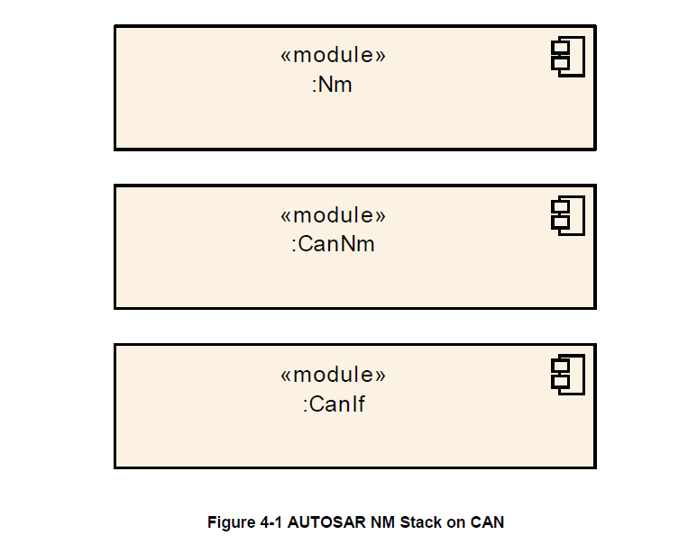

### 4.2. 汽车域的适用性

**CanNm**模块可以在上述限制下应用于任何汽车领域。

## 5. 对其他模块的依赖

CAN网络管理（**CanNm**）主要使用CAN接口（**CanIf**[\[5\]](#ref-5)）的服务，并为通用网络管理接口（**NmIf**[\[2\]](#ref-2)）提供服务。

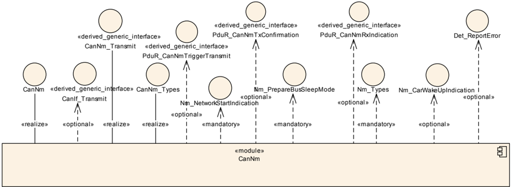

### 5.1. 文件结构

#### 5.1.1. 代码文件结构

请参阅SWS_BSWGeneral[\[4\]](#ref-4)中的章节5.1.6「代码文件结构」（**Code file structure**）。

#### 5.1.2. 头文件结构

请参阅SWS_BSWGeneral[\[4\]](#ref-4)中的章节5.1.7「头文件结构」（**Header file structure**）。

应包含ComStack_Types.h。

**注意：**

以下头文件由ComStack_Types.h间接包含：

* Std_Types.h（用于AUTOSAR标准类型）
* Platform_Types.h（用于平台特定类型）

为对接默认错误跟踪器（**Default Error Tracer**），应包含Det.h。

为使用公共的网络管理类型，应包含NmStack_Types.h。

为对接**CanIf**，应包含CanIf.h。

如果启用了**COM**用户数据支持，则应包含PduR_CanNm.h。

### 5.2. 协议层依赖

CAN网络管理基于[1, Specification of the AUTOSAR Network Management Protocol]中提到的协议。

## 6. 功能规格

### 6.1. 协调算法

**AUTOSAR CanNm**基于分散的直接网络管理策略，这意味着每个网络节点仅根据在通信系统内接收或传输的网络管理**PDU**执行自给自足的活动。

#### 6.1.1. 概念

**AUTOSAR CanNm**算法基于周期性的网络管理**PDU**，集群中的所有节点通过广播传输接收这些**PDU**。网络管理**PDU**的接收表明传输节点希望保持网络管理集群处于唤醒状态。如果任何节点准备好进入总线睡眠（**Bus-Sleep**）模式，它就会停止传输网络管理**PDU**，但只要收到来自其他节点的网络管理**PDU**，节点就需推迟转换到总线睡眠模式。最后，如果由于不再接收到网络管理**PDU**而导致专用计时器超时，则每个节点都会启动到总线睡眠模式的转换。

如果网络管理集群中的任何节点需要总线通信，它可以通过传输网管**PDU**将网络管理集群从总线睡眠模式唤醒。有关唤醒过程本身的更多详细信息，请参阅通讯管理器规格[\[8\]](#ref-8)。

**AUTOSAR CanNm**算法的主要概念可以通过以下两个关键要求来定义：**CanNm**集群中的每个网络节点只要需要总线通信，就应该定期传输网络管理**PDU**；否则它将无需传输网络管理**PDU**。

如果**CanNmStayInPbsEnabled**被禁用，并且**CanNm**集群中的总线通信被释放，并且在可配置的（CanNmTimeoutTime + CanNmWaitBusSleepTime）时间里，总线上没有任何网络管理**PDU**，则需执行转换到总线睡眠模式。

#### 6.1.2. 状态机

**AUTOSAR CanNm**算法的整体状态机可以定义如下：

**AUTOSAR CanNm**状态机应包含从网络管理集群中单个节点的角度来看的**AUTOSAR CanNm**算法所需的状态、转换和触发器。

**注意：**

状态转换必须在下一个主函数中最晚执行。

### 6.2. 操作模式

以下章节将详细介绍**AUTOSAR CanNm**算法的操作模式。

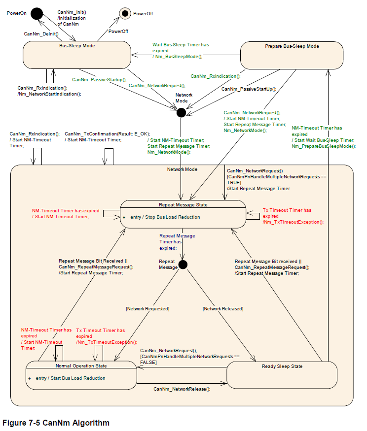

**AUTOSAR CanNm**应包含在模块接口上可见的三种操作模式：

* 网络模式（**Network Mode**）
* 准备总线睡眠模式（**Prepare Bus-Sleep Mode**）
* 总线睡眠模式（**Bus-Sleep Mode**）

**AUTOSAR CanNm**操作模式的变化需通过回调函数通知上层。当[**CanNm_GetState**](#7315-cannm_getstate)被调用时，**CanNm**将返回当前的**NM**状态和模式。

#### 6.2.1. 网络模式

网络模式应包括三个内部状态：

* 重复消息状态（**Repeat Message State**）
* 正常操作状态（**Normal Operation State**）
* 就绪睡眠状态（**Ready Sleep State**)

当从总线睡眠模式（**Bus-Sleep Mode**）进入网络模式（**Network Mode**）时，**CanNm**模块需默认进入重复消息状态（**Repeat Message State**）。

当从准备总线睡眠模式（**Prepare Bus-Sleep Mode**）进入网络模式（**Network Mode**）时，**CanNm**模块需默认进入重复消息状态（**Repeat Message State**）。

当进入网络模式时，**CanNm**模块需启动NM超时计时器（**NM-Timeout Timer**），同时通过调用回调函数**Nm_NetworkMode**通知上层新的当前操作模式。

在网络模式下成功接收网络管理PDU（调用[**CanNm_RxIndication**](#742-cannm_rxindication)）后，如果启用了**PDU**传输能力，**CanNm**模块需重新启动NM超时计时器。

在网络模式下成功传输网络管理PDU（使用**E_OK**调用[**CanNm_TxConfirmation**](#741-cannm_txconfirmation)）时，**CanNm**模块需重新启动NM超时计时器。

**注意：**

如果启用**CanNmImmediateTxConfEnabled**，则假定每个网络管理**PDU**传输请求都会导致网络管理**PDU**传输成功。

**CanNm**模块需在每次启动或重启时，重置NM超时计时器。

如果在网络模式下调用[**CanNm_PassiveStartUp**](#733-cannm_passivestartup)，**CanNm**模块将不执行该服务并返回**E_NOT_OK**。

如果在**CanNmDynamicPncToChannelMappingEnabled**设置为**TRUE**，且**CanNm**处于网络模式的通道上调用函数[**CanNm_PnLearningRequest**](#7320-cannm_pnlearningrequest)，则 **CanNm**模块需在该通道上将**CBV**中的重复消息位和部分网络学习（**Partial Network Learning**）位设置为**1**，并更改为或重新启动重复消息状态（**Repeat Message State**）。

如果在**CanNmDynamicPncToChannelMappingEnabled**设置为**TRUE**，且**CanNm**处于网络模式的通道上接收到的部分网络学习（**Partial Network Learning**）位和 **Repeat Message Request**位的值为**1**，则**CanNm**应在该通道上将**CBV**中的**Partial Network Learning Bit**设置为**1**，并更改或重新启动重复消息状态。

###### 6.2.1.1. 重复消息状态（Repeat Message State）

对于不处于被动模式的节点（请参阅[第6.9.3章节](#693-被动模式)），重复消息状态确保从总线睡眠或准备总线睡眠到网络模式的任何转换，对网络上的其他节点都是可见的。 此外它还确保任何节点在最短的时间内保持活动状态。它可用于存在节点的检测。

当进入重复消息状态时，**CanNm**模块需（重新）开始传输网络管理PDU，除非被动模式被启用或者通信被禁止。

当NM超时计时器在重复消息状态中超时到期时，**CanNm**模块需（重新）启动NM超时计时器，同时需向**DET**报告[**CANNM_E_NETWORK_TIMEOUT**](#6142-运行时错误)。

网络管理状态机应在由配置参数**CanNmRepeatMessageTime**确定的可配置时间量内保持在重复消息状态；在此时间后，**CanNm**模块需离开重复消息状态。

当离开重复消息状态时，如果网络已被请求，**CanNm**模块需进入正常操作状态（**Normal Operation State**）；如果网络已经被释放，则**CanNm**模块需进入就绪睡眠状态（**Ready Sleep State**）。

如果**CanNmNodeDetectionEnabled**设置为**TRUE**，**CanNm**将在离开重复消息状态时，清除重复消息位。

如果在重复消息状态（**Repeat Message State**）、总线睡眠模式（**Prepare Bus-Sleep Mode**）或总线睡眠模式（**Bus-Sleep Mode**）中调用服务[**CanNm_RepeatMessageRequest**](#7313-cannm_repeatmessagerequest)，CanNm模块应不执行该服务并返回**E_NOT_OK**。

如果**CanNmDynamicPncToChannelMappingEnabled**设置为**TRUE**，**CanNm**将在离开重复消息状态时清除部分网络学习位。

###### 6.2.1.2. 正常操作状态

正常操作状态确保只要网络被请求，任何节点都可以保持网络管理集群处于唤醒状态。

当从就绪睡眠状态（**Ready Sleep State**)进入正常操作状态（**Normal Operation State**）时，**CanNm**模块将开始传输网络管理**PDU**。

**注意：**

如果被动模式被启用或者网络管理PDU传输被禁用，则**NM PDU**不会被传输，所以无任何操作需被执行。

当NM超时计时器在正常操作状态下超时到期，**CanNm**模块需（重新）启动 NM超时计时器，同时需向**DET**报告[**CANNM_E_NETWORK_TIMEOUT**](#6142-运行时错误)。

当前状态为正常操作状态（**Normal Operation State**），如果网络被释放，则**CanNm**模块需进入就绪睡眠状态（**Ready Sleep State**)。

如果**CanNmNodeDetectionEnabled**设置为**TRUE**，并且在正常操作状态（**Normal Operation State**）下接收到重复报文请求位，则**CanNm**模块需进入重复消息状态（**Repeat Message State**）。

如果**CanNmNodeDetectionEnabled**设置为**TRUE**，并且在正常操作状态（**Normal Operation State**）下调用函数[**CanNm_RepeatMessageRequest**](#7313-cannm_repeatmessagerequest)，则**CanNm**模块也需进入重复消息状态（**Repeat Message State**），并且CanNm模块需设置重复消息位（**Repeat Message Bit**）。

###### 6.2.1.3. 就绪睡眠状态

就绪睡眠状态（**Ready Sleep State**）确保只要有其他节点保持网络管理集群处于唤醒状态，网络管理集群中的任何节点就会等待进入准备总线睡眠模式。

当从重复消息状态（**Repeat Message State**）或正常操作状态（**Normal Operation State**）进入就绪睡眠状态（**Ready Sleep State**）时，**CanNm**模块将停止网络管理**PDU**的传输。

**注意：**

如果被动模式被启用，则**NM PDU**不会被传输，所以无任何操作需被执行。

在某些情况下，如果被动模式被禁用，则需要在就绪睡眠状态（**Ready Sleep State**）下传输**NM PDU**，以保证网络同步关闭。例如：PN关闭消息（PN shutdown messages）的重新传输。

当NM超时计时器在就绪睡眠状态（**Ready Sleep State**）下超时到期，**CanNm**模块将进入准备总线睡眠模式（**Prepare Bus-Sleep Mode**）。

当网络请求时，当前状态为就绪睡眠状态（**Ready Sleep State**）时，**CanNm**模块需进入正常操作状态（**Normal Operation State**）。

如果**CanNmNodeDetectionEnabled**设置为**TRUE**，并且在就绪睡眠状态（**Ready Sleep State**）下收到重复报文请求位，则**CanNm**模块进入重复消息状态（**Repeat Message State**）。

如果**CanNmNodeDetectionEnabled**设置为**TRUE**，并且在就绪睡眠状态（**Ready Sleep State**）下调用[**CanNm_RepeatMessageRequest**](#7313-cannm_repeatmessagerequest)函数，则**CanNm**模块需进入重复消息状态（**Repeat Message State**），并且CanNm模块需设置重复消息位（**Repeat Message Bit**）。

#### 6.2.2. 准备总线睡眠模式

准备总线睡眠模式的目的是确保所有节点在进入总线休眠模式之前有时间停止它们的网络活动。在准备总线睡眠模式下，总线活动平静下来(即，为了使所有的tx -buffer为空，传输排队的消息)，最后，在准备总线睡眠模式下，总线上没有活动。

当进入准备总线睡眠模式（**Prepare Bus-Sleep Mode**）时，**CanNm**模块将通过调用**Nm_PrepareBusSleepMode**通知上层。

如果**CanNmStayInPbsEnabled**被禁用，**CanNm**应在由配置参数**CanNmWaitBusSleepTime**确定的可配置时间内保持在准备总线睡眠模式（**Prepare Bus-Sleep Mode**）。当时间超时后，需离开准备总线睡眠模式（**Prepare Bus-Sleep Mode**）并进入总线睡眠模式（**Bus-Sleep Mode**）。

**注意：**

此需求隐含地包含，如果启用**CanNmStayInPbsEnabled**，**CanNm**将永远不会因为超时而离开，即**CanNm**将一直保持在准备总线睡眠模式（**Prepare Bus-Sleep Mode**），直到**ECU**进入电源关闭或重启。

在准备总线睡眠模式（**Prepare Bus-Sleep Mode**）下成功接收到网络管理**PDU**后，**CanNm**模块需进入网络模式（**Network Mode**）。在默认情况下，**CanNm**模块需进入重复消息状态（**Repeat Message State**）。

在准备总线睡眠模式（**Prepare Bus-Sleep Mode**）下，当网络被请求后，**CanNm**模块需进入网络模式。并且默认情况下，**CanNm**模块需进入重复消息状态（**Repeat Message State**）。

在准备总线睡眠模式（**Prepare Bus-Sleep Mode**）下，当网络被请求后，**CanNm**模块已进入网络模式，如果配置参数**CanNmImmediateRestartEnabled**设置为**TRUE**，则**CanNm**模块需传输网络管理**PDU**。

**论据：**

集群中的其他节点仍处于准备总线睡眠模式（**Prepare Bus-Sleep Mode**）。在上述异常情况下，应避免过渡到总线睡眠模式（**Bus-Sleep Mode**），并且需尽快恢复总线通信。

由于**CanNm**中网络管理**PDU**的传输偏移，第一个处于重复消息状态的网络管理**PDU**的传输可能会显着延迟。为了避免网络延迟重新启动，可以立即请求网络管理**PDU**的传输。

**注意：**

如果**CanNmImmediateRestartEnabled**设置为**TRUE**，并且唤醒硬性（**wake-up line**）被使用，如果所有网络节点在准备总线睡眠模式（**Prepare Bus-Sleep Mode**）下收到网络请求，则会发生网络管理**PDU**突发。

#### 6.2.3. 总线睡眠模式

总线睡眠模式（**Bus-Sleep Mode**）的目的是在当没有消息交换时降低节点的功耗。通信控制器（**communication controller**）被切换到睡眠模式（**sleep mode**），相应的唤醒机制被激活，最终功耗降低到总线睡眠模式中的适当水平。

如果**CanNmStayInPbsEnabled**被禁用，可通过配置参数**CanNmTimeoutTime + CanNmWaitBusSleepTime**来确定的进入总线睡眠模式的时间。当整个网络管理集群中的所有节点都配置了相同的时间，则网络管理集群中使用**AUTOSAR**网络管理算法协调的所有节点，几乎会在非常接近的一个时间点执行到总线睡眠模式（**Bus-Sleep Mode**）的转换。

**注意：**

对于在这个网络管理集群的所有网络节点，参数**CanNmTimeoutTime**和**CanNmWaitBusSleepTime**需要具有相同的配置值。但是根据具体实现，总线睡眠模式（**Bus-Sleep Mode**）的转换会发生可能会在完全相同或者大致相同的一个时间点。

此转换的时间上的误差主要取决于以下因素：

* 内部时钟精度（振荡器漂移）。
* 网络任务的周期时间。（如：任务并未进行全局的时间同步）。
* Tx队列中的网络管理**PDU**等待时间。（如果在传输请求后立即进行传输确认）。

其实在最佳情况下，一般只需考虑振荡器的漂移即可，该时间可通过值配置参数**CanNmTimeoutTime + CanNmWaitBusSleepTime**来确定。

除了初始化时默认进入总线睡眠模式（**Bus-Sleep Mode**）的情况，其他进入总线睡眠模式（**Bus-Sleep Mode**）时，**CanNm**模块需通过调用回调函数**Nm_BusSleepMode**通知上层。

当**CanNm**模块在总线睡眠模式（**Bus-Sleep Mode**）下成功接收到网络管理**PDU**（[**CanNm_RxIndication**](#742-cannm_rxindication)调用）时，**CanNm**模块将通过调用回调函数**Nm_NetworkStartIndication**通知上层，同时应向**DET**报告错误[**CANNM_E_NET_START_IND**](#6142-运行时错误)。

**论据：**

为了避免网络和模式管理之间的竞争条件和状态不一致，**CanNm**不会自动执行从总线睡眠模式（**Bus-Sleep Mode**）到网络模式（**Network Mode**）的转换。**CanNm**只会通知必须做出唤醒决策的上层。总线睡眠模式下（**Bus-Sleep Mode**）的网络管理**PDU**接收必须根据**ECU**关闭/启动过程的当前状态进行处理。

如果在总线睡眠模式（**Bus-Sleep Mode**）或者准备总线睡眠模式（**Prepare Bus-Sleep Mode**）下，调用[**CanNm_PassiveStartUp**](#733-cannm_passivestartup)，**CanNm**模块应进入网络模式（**Network Mode**）。同时在默认情况下，**CanNm**模块需进入重复消息状态（**Repeat Message State**）。

**注意：**

在准备总线睡眠模式（**Prepare Bus-Sleep Mode**）和总线睡眠模式（**Bus-Sleep Mode**）中，除非有明确的总线通信请求，一般都假定网络已经被释放。

当在总线睡眠模式（**Bus-Sleep Mode**）模式下，网络被再次请求，**CanNm**模块应进入网络模式（**Network Mode**）。同时在默认情况下，**CanNm**模块需进入重复消息状态（**Repeat Message State**）。

### 6.3. 网络状态

网络状态包括两类：被请求（**requested**）和被释放（**released**）。它是**AUTOSAR CanNm**状态机的两个附加的状态，并与状态机同时存在。

网络状态表示软件组件是否需要在总线上通信。当软件组件需要在总线上通信时，网络状态转换为被请求。当软件组件无需在总线上通信时，网络状态转换为被释放；但需注意的是即使网络被释放了，一个**ECU**仍然可以通信，因为其他一些ECU仍然在请求网络。

通过调用函数[**CanNm_NetworkRequest**](#734-cannm_networkrequest)，可以用来请求网络。**CanNm**模块需将当前的网络状态更改为被请求。

通过调用函数[**CanNm_NetworkRelease**](#735-cannm_networkrelease)，可以用来释放网络。**CanNm**模块需将当前的网络状态更改为被释放。

### 6.4. 初始化

如果**CanNm**模块初始化成功，即：调用函数[**CanNm_Init**](#731-cannm_init)成功，则**CanNm**模块应将网络管理状态设置为总线睡眠模式（**Bus-Sleep Mode**）。

**注意：**

**CanNm**模块应该在**CanIf**初始化之后，并且在任何其他网络管理服务被调用之前，进行初始化。

初始化后，默认情况下，**CanNm**模块需将网络状态设置为已释放（**released**），**CanNm**模块需进入到总线睡眠模式（**Bus-Sleep Mode**）。

[**CanNm_Init**](#731-cannm_init)函数应通过传递的配置指针参数选择活动配置集。

如果**CanNmGlobalPnSupport**设置为**TRUE**，并且**CanNm**已被初始化（调用[**CanNm_Init**](#731-cannm_init)），则**CanNm**需停止NM消息传输超时计时器（**NM Message Tx Timeout Timer**）。

在初始化期间，**CanNm**模块应停用总线，减少总线负载。

初始化后，**CanNm**模块应通过停止消息周期定时器（**Message Cycle Timer**）来停止网络管理**PDU**的传输。

**注意：**

如果**CanNmPassiveModeEnabled**设置为**TRUE**，因为此类节点不传输网络管理 PDU，所有不需要**CanNm**消息周期（**Message Cycle**）。

在初始化期间，**CanNm**模块应将用户数据的每个字节设置为**0xFF**，并且控制位向量设置为**0x00**

在初始化期间，如果**CanNmPnEnabled**为**TRUE**，**CanNm**模块应将**PNC**位向量的每个字节设置为**0x00**。

### 6.5. 执行

#### 6.5.1. 处理器架构

**AUTOSAR CanNm**算法需独立于处理器。这也就意味着，它不应依赖于任何处理器特定的硬件支持，所以它需要支持在**AUTOSAR**范围内的任何处理器架构上的实现。

#### 6.5.2. 时间参数

配置参数**CanNmTimeoutTime**定义了**AUTOSAR CanNm**的NM超时的时间（**NM-Timeout Time**）。

配置参数**CanNmRepeatMessageTime**定义了**AUTOSAR CanNm**的重复消息发送的时间（**Repeat Message Time**）。

配置参数**CanNmWaitBusSleepTime**定义了**AUTOSAR CanNm** 的等待总线睡眠时间（**Wait Bus-Sleep Time**）。

配置参数**CanNmRemoteSleepIndTime**定义了**AUTOSAR CanNm**远程睡眠指示时间（**Remote Sleep Indication Time**）。

### 6.6. 网络管理PDU结构

下表显示了以**8**字节为例的网络管理**PDU**格式，其中源节点标识符（**SNI**）位于第一个字节，控制位向量（**CBV**）位于第二个字节，使用了用户数据且部分网络已启用。用户数据范围位于系统字节与**PNC**位向量之间：

表7.1：网络管理PDU格式示例（**Network Management PDU Format Example**）

|      | 位7 | 位6 | 位5 | 位4 | 位3 | 位2 | 位1 | 位0 |
| --- | --- | --- | --- | --- | --- | --- | --- | --- |
| 字节7 | PNC位向量 - 字节3 | PNC位向量 - 字节3 | PNC位向量 - 字节3 | PNC位向量 - 字节3 | PNC位向量 - 字节3 | PNC位向量 - 字节3 | PNC位向量 - 字节3 | PNC位向量 - 字节3 |
| 字节6 | PNC位向量 - 字节2 | PNC位向量 - 字节2 | PNC位向量 - 字节2 | PNC位向量 - 字节2 | PNC位向量 - 字节2 | PNC位向量 - 字节2 | PNC位向量 - 字节2 | PNC位向量 - 字节2 |
| 字节5 | PNC位向量 - 字节1 | PNC位向量 - 字节1 | PNC位向量 - 字节1 | PNC位向量 - 字节1 | PNC位向量 - 字节1 | PNC位向量 - 字节1 | PNC位向量 - 字节1 | PNC位向量 - 字节1 |
| 字节4 | PNC位向量 - 字节0 | PNC位向量 - 字节0 | PNC位向量 - 字节0 | PNC位向量 - 字节0 | PNC位向量 - 字节0 | PNC位向量 - 字节0 | PNC位向量 - 字节0 | PNC位向量 - 字节0 |
| 字节3 | 用户数据1 | 用户数据1 | 用户数据1 | 用户数据1 | 用户数据1 | 用户数据1 | 用户数据1 | 用户数据1 |
| 字节2 | 用户数据0 | 用户数据0 | 用户数据0 | 用户数据0 | 用户数据0 | 用户数据0 | 用户数据0 | 用户数据0 |
| 字节1 | 控制位向量（CBV） | 控制位向量（CBV） | 控制位向量（CBV） | 控制位向量（CBV） | 控制位向量（CBV） | 控制位向量（CBV） | 控制位向量（CBV） | 控制位向量（CBV） |
| 字节0 | 源节点标识符（SNI） | 源节点标识符（SNI） | 源节点标识符（SNI） | 源节点标识符（SNI） | 源节点标识符（SNI） | 源节点标识符（SNI） | 源节点标识符（SNI） | 源节点标识符（SNI） |

源节点标识符（**Source Node Identifier**）的位置应可通过**CanNmPduNidPosition**配置为字节**0**、字节**1**或者关闭（**off**）。

**注意：**

将**CanNmPduNidPosition**设置为**off**，意味着在**NM PDU**中没有空间被源节点标识符占用，因此会多一个字节可用于用户数据或**PNC**位向量。

控制位向量（**Control Bit Vector**）的位置应可通过**CanNmPduCbvPosition**配置为字节**0**、字节**1**或者关闭（**off**）。

**注意：**

* 将**CanNmPduCbvPosition**设置为**off**，意味着在**NM PDU**中没有空间被控制位向量（**CBV**）占用，因此会多一个字节可用于用户数据。
* **PNC**位向量的位置可通过相应**NM**通道的**NmPncBitVectorOffset**和**NmPncBitVectorLength**进行配置。**PNC**位向量位于系统字节（**CBV**和**SNI**）之后，且处于**NM-PDU**的**PduLength**范围内。

未分配给**Nm**系统字节或**PNC**位向量的剩余字节应可用于用户数据（**User Data**）。

**注意：**

根据[\[9\]](#ref-9)（系统模板），用户数据的使用和位置是可配置的。如果使用了用户数据，则用户数据被放置在**NM-PDU**的**PduLength**范围内，且不会与系统字节或**PNC**位向量的范围重叠。如果启用了部分网络功能（**CanNmPnEnabled**设置为**TRUE**）且使用了用户数据，则用户数据范围要么独占地位于系统字节和**PNC**位向量之间，要么位于**PNC**位向量和**NM-PDU**末尾之间。用户数据范围的长度必须根据以下限制计算：

* 如果用户数据范围位于系统字节和**PNC**位向量之间，则用户数据范围的长度由**PNC**位向量偏移量与系统字节长度之差确定。
* 如果用户数据范围位于**PNC**位向量和**NM-PDU**末尾之间，则用户数据范围的长度由**NM-PDU**长度与**PNC**位向量最后一个字节的位置/索引（由**PNC**位偏移量 + **PNC**位向量长度定义）之差确定。

如果部分网络功能被禁用（**CanNmPnEnabled**设置为**FALSE**）且使用了用户数据，则用户数据范围由**NM-PDU**长度与系统字节长度之差确定。

**注意：**

网络管理**PDU**的长度由"全局"**EcuC**模块中的**PduLength**参数定义（参见ECU配置规范[\[10\]](#ref-10)）。

下表描述了控制位向量（**Control Bit Vector**）的格式：

表7.2：网络管理PDU - 控制位向量（CBV）（**Network Management PDU - Control Bit Vector (CBV)**）

|      | 位7 | 位6 | 位5 | 位4 | 位3 | 位2 | 位1 | 位0 |
| --- | --- | --- | --- | --- | --- | --- | --- | --- |
| CBV | 保留 | 部分网络信息位 | 部分网络学习位 | 主动唤醒位 | NM协调器睡眠就绪位 | 保留 | PN关闭请求位 | 重复消息请求 |

**注意：**

在**AUTOSAR**的**R3.2**版本中，位**1**和位**2**用作NM协调器ID（低位）（**NM Coordinator ID (Low Bit)**）。

**注意：**

**CBV**在初始化期间用**0x00**进行初始化。

**CanNm**模块需使用配置参数**CanNmNodeId**设置源节点标识符，除非**CanNmPduNidPosition**设置为关闭。

如果**CanNm**由于调用[**CanNm_NetworkRequest**](#734-cannm_networkrequest)（即：主动唤醒）而执行从总线睡眠模式（**Bus Sleep Mode**）或者准备总线睡眠模式（**Prepare Bus Sleep Mode**）到网络模式（**Network Mode**）的状态更改，并且**CanNmActiveWakeupBitEnabled**为**TRUE**，则**CanNm**需在**CBV**中设置**ActiveWakeupBit**。

如果**CanNm**模块离开网络模式并且**CanNmActiveWakeupBitEnabled**为**TRUE**，则**CanNm**模块需清除**CBV**中的**ActiveWakeupBit**。

### 6.7. 通信调度

#### 6.7.1. 传输（Transmission）

本节中所描述的传输机制仅适用在网络管理**PDU**传输能力被启用的情况。网络管理**PDU**传输能力可通过**CanNmPassiveModeEnabled**进行配置。

**注意：**

本节中描述的传输机制仅在**CanNmPassiveModeEnabled**为**FALSE**时被开启。

**CanNm**模块需提供周期性传输模式。在这种传输模式下，**CanNm**模块将定期发送网络管理**PDU**。

**CanNm**模块需可选地提供具有降低总线负载的周期性传输模式。在这种传输模式下，**CanNm**模块将根据特定算法传输网络管理**PDU**。

周期性传输模式可用于重复消息状态（**Repeat Message State**）和正常操作状态（**Normal Operation State**）。具有降低总线负载的周期性传输模式仅在正常操作状态（**Normal Operation State**）下可用。

**注意：**

如果禁用了降低总线负载机制，则在重复消息状态（**Repeat Message State**）和正常操作状态（**Normal Operation State**）中可使用周期性传输模式。

如果启用了降低总线负载机制，则仅在正常操作状态（**Normal Operation State**）中使用具有降低总线负载的周期性传输模式。

即时传输确认机制（**Immediate transmission confirmation**）应可通过**CanNmImmediateTxConfEnabled**进行配置。

**注意：**

即时传输确认机制用于不想使用**CanIf**的真实确认的系统。

**论据：**

如果总线访问完全通过离线系统设计工具进行调节，则通知网络管理传输成功的实际传输确认可被视为是多余的。由于最大仲裁时间是已知的，所以在传输请求时间立即提出确认是可以接受的。

此外，在这样的系统中仅针对一条**NM**消息，执行多余的实际传输确认，将意味着与整个Can接口（**CanIf**）和Can驱动程序层的执行时间有关的重大性能损失，从而使计算的时间的效率低下。

如果不是通过调用[**CanNm_NetworkRequest**](#734-cannm_networkrequest)，进入重复消息状态（**Repeat Message State**），或者**CanNmImmediateNmTransmissions**为零，则在进入重复消息状态（**Repeat Message State**）后，**NM PDU**的传输应延迟**CanNmMsgCycleOffset**。

如果从就绪睡眠状态（**Ready Sleep State**）进入正常操作状态（**Normal Operation State**），则需立即开始**NM PDU**的传输。

如果**CanNmPnHandleMultipleNetworkRequests**设置为**TRUE**，[**CanNm_NetworkRequest**](#734-cannm_networkrequest)将触发从网络模式（**Network Mode**）到重复消息状态（**Repeat Message State**）的状态转换。如果启用了**PDU**传输能力，则需使用**CanNmImmediateNmCycleTime**作为周期时间来传输**NM PDU**。第一帧**NM PDU**的传输需尽快地被触发。 在**PDU**被传输后，消息周期计时器需用**CanNmImmediateNmCycleTime**进行重新加载 。在这种情况下不应使用**CanNmMsgCycleOffset**。

**注意：**

在这种情况下，由于**ECUC_CanNm_00056**，所以**CanNmImmediateNmTransmissions**必须大于零。

如果**NM PDU**需使用**CanNmImmediateNmCycleTime**来进行传输，**CanNm**需确保具有此时间的**CanNmImmediateNmTransmission**（包括第一次立即传输）被成功请求。 如果对CanIf的传输请求失败（即：返回**E_NOT_OK**），**CanNm**将在下一个主函数中重试传输请求。

接着**CanNm**需使用**CanNmMsgCycleTime**来继续传输**NM PDU**。

**注意：**

当使用**CanNmImmediateNmCycleTime**传输**NM PDU**时，不得传输其他**Nm PDU**（即：**CanNmMsgCycleTime**传输周期已经被停止）。

如果**NM PDU**的传输已经开始，在下列的两种场景中，**CanNm**模块需通过调用**CanIf_Transmit**，发送**NM PDU**。

1. **CanNmSynchronizedPncShutdownEnabled**设置为**FALSE**，并且**CanNm**消息周期计时器（**Message Cycle Timer**）超时。
2. **CanNmSynchronizedPncShutdownEnabled**设置为**TRUE**，并且没有同步**PNC**关闭的请求在等待处理（**pending**），

**注意：**

如果**CanIf_Transmit**的函数调用失败，需按[章节6.12中所描述的传输错误处理](#612-传输错误处理)，通知**CanNm**模块。

如果**NM PDU**的传输已经开始，**CanNm**消息周期计时器到期，并且**CanNmSynchronizedPncShutdownEnabled**设置为**TRUE**，同步PNC关闭的请求正等待处理（**pending**），**NM PDU**的传输应推迟到下一个**CanNm_Main**函数调用。

**注意：**

* 同步的**PNC**关闭必须立即发送，所以使用**CanNmMsgCycleTime**传输的周期的**NM**消息的处理必须被延迟。在极少数情况下，这可能会导致一个以上主函数周期时间的延迟。
* 在网络管理时序上，因为必须考虑使用**CanNmMsgCycleTime**传输的**NM**消息可能会延迟一个以上的主函数周期时间，所以必须满足以下条件，以容忍这些**NM**消息的多次延迟：(CanNmPnResetTime – CanNmMsgCycleTime) > n * CanNmMainFunctionPeriod，其中**n**表示如果没有收到**NM**消息，则在**PnResetTime**超时到期之前允许的延迟数。

如果**CanNm**消息周期计时器到期，则**CanNm**模块必须使用**CanNmMsgCycleTime**来重新启动。

如果**NM PDU**的传输已停止，**CanNm**模块需取消消息周期计时器。

#### 6.7.2. 接收（Reception）

如果成功接收到**NM PDU**，**CanIf**模块将调用回调函数[**CanNm_RxIndication**](#742-cannm_rxindication)。

在调用回调函数[**CanNm_RxIndication**](#742-cannm_rxindication)时，**CanNm**模块应将函数参数中引用的**NM PDU**的数据复制到内部缓冲区。

### 6.8. 降低总线负载机制

**NM PDU**的传输周期通常由时间参数**CanNmMsgCycleTime**决定。对于属于网络管理集群的所有**NM**节点，该参数必须相等。如果不采取任何行动，这将导致一个总线负载（**bus load**）的问题。同时问题是依据网络管理集群成员数量所决定的。即使可以通过节点特定时间参数**CanNmMsgCycleOffset**来防止突发，但也需要一种独立于网络管理集群的大小的机制来减少总线负载。

为了实现这哥1机制，以下两个方面必须予以考虑：

1. 当接收到**NM PDU**，**CanNm**消息周期计时器需使用此节点特定的时间参数**CanNmMsgReducedTime**进行重新加载。则此节点特定时间**CanNmMsgReducedTime**应大于 **½ CanNmMsgCycleTime**且小于**CanNmMsgCycleTime**。
2. 当**NM PDU**被传输后，**CanNm**消息周期定时器需使用此网络管理集群特定的时间参数**CanNmMsgCycleTime**进行重新加载。

这会导致以下行为：

只有两个具有最小**CanNmMsgReducedTime**时间的节点，在网络上交替传输**NM PDU**。如果其中一个节点停止传输，则下一个最小**CanNmMsgReducedTime**时间的节点将开始传输**NM PDU**。如果网络上只有一个节点需要总线通信，则每个**CanNmMsgCycleTime**传输一个**NM PDU**。

该算法确保总线负载限制为每个**CanNmMsgCycleTime**最多只有两个**NM PDU**。

降低总线负载机制需通过参数**CanNmBusLoadReductionEnabled**进行静态配置。

当从总线睡眠模式（**Bus-Sleep Mode**）、准备总线睡眠模式（**Prepare Bus-Sleep Mode**）、正常操作状态（**Normal Operation State**）或就绪睡眠状态（**Ready Sleep State**）进入重复消息状态（**Repeat Message State**）时，**CanNm**模块应停用降低总线负载机制。

当从重复消息状态（**Repeat Message State**）或就绪睡眠状态（**Ready Sleep State**）进入正常操作状态（**Normal Operation State**）并且 **CanNmBusLoadReductionEnabled**为**TRUE**，**CanNm**模块需激活降低总线负载机制。

如果降低总线负载机制全局启用，即**CanNmBusLoadReductionEnabled**为**TRUE**。对于激活的特定网络，**PDU**传输能力被启用，并为此网络调用了函数[**CanNm_RxIndication**](#742-cannm_rxindication)，**CanNm**模块需使用节点特定的时间参数**CanNmMsgReducedTime**，重新启动**CanNm**消息周期计时器。

### 6.9. 附加的功能

#### 6.9.1. 远程睡眠指示检测

远程睡眠指示（**Remote Sleep Indication**）表示为以下的一种特殊的场景。

1. 网络管理集群中某一个节点处于正常操作状态（**Normal Operation State**）。
2. 网络管理集群中的所有其他节点都准备好进入睡眠状态，即：都处于就绪睡眠状态（**Ready Sleep State**）。 
3. 处于正常操作状态（**Normal Operation State**）的节点仍将继续保持总线唤醒状态。

远程睡眠指示的检测应使用配置参数**CanNmRemoteSleepIndEnabled**进行静态配置。

如果**CanNm**模块在由配置参数**CanNmRemoteSleepIndTime**决定的可配置时间量内，没有接收到处于正常操作状态的**NM PDU**，则**CanNm**模块需调用回调函数 **Nm_RemoteSleepIndication**。

通过调用**Nm_RemoteSleepIndication**，**CanNm**通知模块**Nm**模块，集群中的所有节点都准备好​​进入睡眠状态，也就是所谓的远程睡眠指示（**Remote Sleep Indication**）。

先前已检测到远程睡眠指示，并且在正常操作状态（**Normal Operation State**）或就绪睡眠状态（**Ready Sleep State**）中接收到**NM PDU**，则模块**CanNm**需调用回调函数**Nm_RemoteSleepCancellation**。

先前已检测到远程睡眠指示，并且从正常操作状态（**Normal Operation State**）或就绪睡眠状态（**Ready Sleep State**）进入重复消息状态（**Repeat Message State**），则**CanNm**模块需调用回调函数**Nm_RemoteSleepCancellation**。

通过调用**Nm_RemoteSleepCancellation**，**CanNm**通知模块**Nm**模块，集群中的某些节点不再准备好进入睡眠状态，也就是所谓的远程睡眠取消（**Remote Sleep Cancellation**）。

当服务[**CanNm_CheckRemoteSleepIndication**](#7318-cannm_checkremotesleepindication)被调用，并且当前状态为总线睡眠模式（**Bus-Sleep Mode**）、准备总线睡眠模式（**Prepare Bus-Sleep Mode**）或者重复消息状态（**Repeat Message State**）时，**CanNm**模块不应执行该服务并应返回**E_NOT_OK**。

#### 6.9.2. 用户数据

为了支持网络管理用户数据，可以使用配置参数**CanNmUserDataEnabled**开关进行静态配置。

当[**CanNm_SetUserData**](#738-cannm_setuserdata)被调用时，**CanNm**模块需为接下来在总线上传输的**NM PDU**设置网络管理用户数据。

当[**CanNm_GetUserData**](#739-cannm_getuserdata)被调用时，**CanNm**模块需将返回最近收到的**NM PDU**的网络管理用户数据。

**注意：**

如果配置了用户数据，它肯定会在重复消息状态（**Repeat Message State**）下发送。在正常操作状态（**Normal Operation State**）下，是否发送用户数据取决于降低总线负载机制的配置。处于就绪睡眠状态（**Ready Sleep State**）的用户数据将不会被发送。

###### 6.9.2.1. COM 用户数据 

除了使用**CanNm API**来设置和获取用户数据之外，**CanNm**还可以使用**COM**来检索其用户数据。

如果**CanNmComUserDataSupport**被启用，则**API** [**CanNm_SetUserData**](#738-cannm_setuserdata)将不再可用。

如果**CanNmComUserDataSupport**被启用，并且**NM-PDU** 未配置为**CanIf**中的触发传输，即：**CanIfTxPduTriggerTransmit**设置为**FALSE**，则**CanNm**需通过调用**PduR_CanNmTriggerTransmit**，从被引用的**NM I-PDU**收集网络管理用户数据。同时在它每次请求传输相应的**NM PDU**之前，将用户数据与**NM**字节组进行合并。

**注意：**

在触发式传输的情况下，传输请求不需要数据，只需要长度。数据将在[**CanNm_TriggerTransmit**](#744-cannm_triggertransmit)中收集。

如果**CanNmComUserDataSupport**被启用，并且**PduR_CanNmTriggerTransmit** 返回**E_NOT_OK**，则**NM**将使用最后传输的**NmUserData**值。

**注意：**

避免过时的**NM**数据的传输，可以通过不停止**COM**中用于网络管理用户数据传输的**I-PDU**。

如果**CanNmComUserDataSupport**被启用，并调用[**CanNm_TxConfirmation**](#741-cannm_txconfirmation)，**CanNm**将通过调用**PduR_CanNmTxConfirmation**将传输确认结果转发给**PduR**。

如果**CanNmComUserDataSupport**被启用，并且可用的用户数据字节数与引用的**I-PDU**的长度不匹配，则应在生成配置时报告错误。

#### 6.9.3. 被动模式

在被动模式下，节点仅接收**NM PDU**，但不发送任何**NM PDU**。

被动模式需使用配置参数**CanNmPassiveModeEnabled** 开关进行静态配置。

**注意：**

必须为一个**ECU**中的所有**NM**网络启用或禁用被动模式。

#### 6.9.4. 网络管理PDU的Rx指示

在调用回调函数[**CanNm_RxIndication**](#742-cannm_rxindication)时，当且仅当配置参数**CanNmPduRxIndicationEnabled**设置为**TRUE**时，**CanNm**模块需调用**Nm**的回调函数**Nm_PduRxIndication**。

#### 6.9.5. 状态变化通知

如果回调**Nm_StateChangeNotification**被启用，即：配置参数**CanNmStateChangeIndEnabled**设置为**TRUE**，**AUTOSAR CanNm**状态的所有变化都应通过调用**Nm_StateChangeNotification**通知上层。

#### 6.9.6. 通讯控制

通信控制（**Communication Control**）需通过配置参数**CanNmComControlEnabled**进行静态配置。

如果服务[**CanNm_DisableCommunication**](#736-cannm_disablecommunication)被调用，则**CanNm**模块需禁用**NM PDU**的传输能力。

**注意：**

此行为也同样适用于重复消息状态（**Repeat Message State**）。通信控制功能不影响重复消息状态（**Repeat Message State**）的持续时间。

当**NM PDU**传输能力被禁用时，需执行以下操作：

1. **CanNm**模块需停止**CanNm**消息周期定时器（**CanNm Message Cycle Timer**），以停止网络管理**PDU**的传输。
2. **CanNm**模块需停止NM超时计时器（**NM-Timeout Timer**）。
3. **CanNm**模块需停止远程睡眠指示检测（**Remote Sleep Indication Detection**）。

当**NM PDU**传输能力被启用时，需执行以下操作：

1. **NM PDU**的传输应最晚在下一个**NM**主函数中重新开始。
2. **CanNm**模块将重新启动NM超时计时器（**NM-Timeout Timer**）。
3. 如果**CanNmRemoteSleepIndEnabled**设置为**TRUE**，则**CanNm**模块应重新启动远程睡眠指示检测。

如果**NM PDU**传输能力被禁用，服务[**CanNm_RequestBusSynchronization**](#7317-cannm_requestbussynchronization)需返回**E_NOT_OK**。

#### 6.9.7. 协调器同步支持

当有多个协调器连接到同一总线时，**CBV**中有一个特殊位**NmCoordinatorSleepReady**，用于指示主协调器请求启动关闭序列（**shutdown sequence**）。该算法的主要功能已在**Nm**模块中进行了描述。

如果**CanNmCoordinatorSyncSupport**设置为**TRUE**，**CanNm**已进入网络模式（**Network Mode**）或已调用**Nm_CoordReadyToSleepCancellation**，则它应在第一次接收到**NmCoordinatorSleepReady**位设置为**1**的**NM PDU**时，通过调用**Nm_CoordReadyToSleepIndication**来通知**Nm**模块。

如果**CanNmCoordinatorSyncSupport**设置为**TRUE**，**CanNm**调用**Nm_CoordReadyToSleepIndication**并且仍处于网络模式（**Network Mode**），则它应在第一次接收到**NmCoordinatorSleepReady**位设置为**0**的**NM PDU**时，通过调用**Nm_CoordReadyToSleepCancellation**来通知**Nm**模块。

如果**CanNmCoordinatorSyncSupport**设置为**TRUE**，并且[**CanNm_SetSleepReadyBit**](#7319-cannm_setsleepreadybit)函数被调用，则**CanNm**应将NM协调器睡眠就绪位（**NM Coordinator Sleep ready Bit**）设置为传递的值，并触发单个**NM PDU**。

### 6.10. 整车唤醒

整车唤醒位（**Car Wakeup bit**）在**NM-PDU**中的位置，由配置参数**CanNmCarWakeUpBytePosition**和**CanNmCarWakeUpBitPosition**定义。

#### 6.10.1. 接收路径（Rx Path）

如果接收到的**NM PDU**中的整车唤醒位为**1**，并且**CanNmCarWakeUpRxEnabled**为**TRUE**，**CanNmCarWakeUpFilterEnabled**为**FALSE**, 则**CanNm**需调用**Nm_CarWakeUpIndication**，并执行标准**Rx**指示处理。

如果在**Nm_CarWakeUpIndication**上下文中，[**CanNm_GetPduData**](#7314-cannm_getpdudata)被调用，并且**CanNmNodeDetectionEnabled**或者**CanNmUserDataEnabled**或者**CanNmNodeIdEnabled**设置为**TRUE**，**CanNm**需返回导致**Nm_CarWakeUpIndication**被调用的**PDU**中所包含的**PDU**数据。

**注意：**

这是使**ECU**能够识别有关整车唤醒请求发送者的详细信息所必需的。

如果**CanNmCarWakeUpFilterEnabled**为**TRUE**，接收到的**NM PDU**中的整车唤醒位为**1**，同时**CanNmCarWakeUpRxEnabled**为**TRUE**，并且接收到的**NM PDU**中的节点**ID**等于**CanNmCarWakeUpFilterNodeId**，**CanNm**模块应调用**Nm_CarWakeUpIndication**，并执行标准的**Rx**指示处理。

**注意：**

整车唤醒过滤器对于只考虑实现中央网关（**Central Gateway**）的整车唤醒的子网关是必需的，可以避免错误唤醒。

#### 6.10.2. 传输路径（Tx Path）

整车唤醒位的传输需由应用程序来处理，可以通过使用**CanNm**模块提供的网络管理用户数据（**NM user data**）机制实现。

### 6.11. 部分联网

#### 6.11.1. NM PDU的Rx处理

如果**CanNmPnEnabled**为**FALSE**，**CanNm**不应从进一步的**Rx**指示处理中丢弃**NM PDU**，并且部分网络（**partial networking**）扩展需被禁用。

如果**CanNmPnEnabled**为**TRUE**，接收到的**NM-PDU**中的**PNI位**为**0**，并且**CanNmAllNmMessagesKeepAwake**为**TRUE**，则**CanNm**模块不应从进一步的 **Rx**指示处理中丢弃**NM PDU**，并需省略部分网络的扩展。

**注意：**

这是使网关在任何类型的**NM-PDU**上都能保持唤醒所必需的。

如果**CanNmPnEnabled**为**TRUE**，接收到的**NM-PDU**中的**PNI位**为**0**，并且**CanNmAllNmMessagesKeepAwake**为**FALSE**，则**CanNm**模块需忽略所接收到的**NM-PDU**。

如果**CanNmPnEnabled**设置为**TRUE**，接收到的**NM-PDU**中的**PNI位**设置为**1**，且以下前置条件之一有效：

* **CanNmSynchronizedPncShutdownEnabled**设置为**FALSE**
* **CanNmSynchronizedPncShutdownEnabled**设置为**TRUE**且**PNSR位**设置为**0**

则**CanNm**模块应按照部分网络配置（相应**NM**通道的**NmPncBitVectorOffset**和**NmPncBitVectorLength**）从接收到的**NM-PDU**中提取**PNC**位向量，并通过调用**Nm_PncBitVectorRxIndication**转发该**PNC**位向量。

**注意：**

只有当**CanNmSynchronizedPncShutdownEnabled**设置为**TRUE**时，才应评估**PNSR位**。

如果**CanNmPnEnabled**设置为**TRUE**且**Nm_PncBitVectorRxIndication**已被调用，则接收到的**NM PDU**仅在以下条件下才被考虑用于进一步处理：

* **CanNmAllNmMessagesKeepAwake**设置为**TRUE**，或者
* [**CanNm_ConfirmPnAvailability**](#743-cannm_confirmpnavailability)尚未被调用，或者
* **RelevantPncRequestDetectedPtr**的输出值设置为**TRUE**

**注意：**

* 需要**CanNmAllNmMessagesKeepAwake**以使网关能够在任何类型的**NM-PDU**上保持唤醒。
* 如果**CanSM**尚未确认**PN**可用性，则所有**PNC**请求都被视为相关请求，因此**Nm**在接收到**NM-PDU**时会重新启动NM超时计时器。这是为了允许发生故障的部分网络相关硬件（例如具备**PN**能力的**CAN**收发器）与其余网络同步关闭。
* 作为上述需求的结果，如果并非所有消息都应使**ECU**保持唤醒，且**PN**可用性已得到确认但未检测到相关的**PNC**位向量，则该**NM PDU**不会被考虑用于进一步处理。

**示例：**

* CanNmPduCbvPosition = 0
* CanNmPduNidPosition = 1
* NmPncBitVectorOffset = 4
* NmPncBitVectorLength = 4
* 计算得到的用户数据范围长度 = 2

**NM PDU**的字节**2**和字节**3**包含用户数据，且**NM PDU**的字节**4**至字节**7**包含**PNC**位向量：

表7.3：包含相关PNC位向量的示例NM PDU（**Example NM PDU containing relevant PNC bit vector**）

| 字节0 | 字节1 | 字节2 | 字节3 | 字节4 | 字节5 | 字节6 | 字节7 |
| --- | --- | --- | --- | --- | --- | --- | --- |
| CBV | NID | 用户数据 | 用户数据 | PNC位向量 | PNC位向量 | PNC位向量 | PNC位向量 |
| 0x40 | 0x00 | 0xFF | 0xFF | 0x12 | 0x8E | 0x80 | 0x01 |

如果**CanNmSynchronizedPncShutdownEnabled**设置为**TRUE**，当接收到的**NM PDU**中**PNI位**和**PNSR位**均为**1**，并且通过**CanNmComMNetworkHandleRef**配置的相应**ComMChannel**处于主动协调状态（**ComMPncGatewayType**设置为**COMM_GATEWAY_TYPE_ACTIVE**）时，**CanNm**模块应向**DET**报告运行时错误[**CANNM_E_INVALID_PN_SYNC_SHUTDOWN_REQUEST**](#6142-运行时错误)，忽略**PNSR位**并像普通**NM PDU**一样处理该**PDU**。

**注意：**

该处理应在一个**ECU**的**NM**发生故障时，支持**PN**在同步关闭处理方面的鲁棒性。

如果**CanNmSynchronizedPncShutdownEnabled**为**TRUE**，接收到的**NM-PDU**中的**PNI位**设置为**1**且**PNSR位**设置为**1**，则**CanNm**模块应按照部分网络配置（相应**NM**通道的**NmPncBitVectorOffset**和**NmPncBitVectorLength**）从接收到的**NM-PDU**中提取**PNC**位向量，并通过调用**Nm_ForwardSynchronizedPncShutdown**转发该**PNC**位向量。

**注意：**

**PNSR位**设置为**1**只有在请求同步**PNC**关闭时才可能出现。同步**PNC**关闭应跨**PN**拓扑进行处理。因此，假定要么所有协调器都启用了同步**PNC**关闭，要么所有协调器都禁用了同步**PNC**关闭。两者的混合会导致不同步的**PNC**关闭，这是必须避免的。

#### 6.11.2. NM PDU的Tx处理

如果**CanNmPnEnabled**为**TRUE**，**CanNm**模块应将发送的**PNI位**的值设置为**1**。

如果**CanNmPnEnabled**为**FALSE**，**CanNm**模块应将发送的**PNI位**的值始终设置为**0**。

**注意：**

如果使用部分网络，则必须使用**CBV**。

如果**CanNmGlobalPnSupport**设置为**TRUE**，则每次通过调用**Nm_PncBitVectorTxIndication**从**Nm**模块获取**PNC**位向量时，**CanNm**模块都应存储每个**NM**通道最新的**PNC**位向量。

如果**CanNmGlobalPnSupport**设置为**TRUE**，已在一个**NM**通道上传输了**NM-PDU**，并且针对该**NM-PDU**调用了结果为**E_OK**的[**CanNm_TxConfirmation**](#741-cannm_txconfirmation)，则**CanNm**应通过以结果**E_OK**调用**Nm_PncBitVectorTxConfirmation**并使用为该**NM**通道存储的**PNC**位向量，将确认转发给**Nm**。

**注意：**

无论传输**NM-PDU**的原因如何（例如：以**CanNmMsgCycleTime**周期传输的**NM-PDU**，或作为**PN**关闭消息传输的**NM-PDU**），总是会执行向**Nm**的确认。

如果**CanNmGlobalPnSupport**设置为**TRUE**，已在一个**NM**通道上传输了**NM-PDU**，并且针对该**NM-PDU**调用了结果为**E_NOT_OK**的[**CanNm_TxConfirmation**](#741-cannm_txconfirmation)，或者该**NM-PDU**的传输请求未被接受（**CanIf_Transmit**返回**E_NOT_OK**），则**CanNm**模块应通过以结果**E_NOT_OK**调用**Nm_PncBitVectorTxConfirmation**并使用为该**NM**通道存储的**PNC**位向量，将确认转发给**Nm**。

**注意：**

**Nm**模块使用以**E_NOT_OK**进行的**Nm_PncBitVectorTxConfirmation**调用来执行同步**PNC**关闭处理（如果配置了**PNC**关闭处理）。

如果**CanNmPnEnabled**为**TRUE**且必须传输**NM-PDU**（无论是以**CanNmMsgCycleTime**周期传输的**NM-PDU**，还是作为**PN**关闭消息），则**CanNm**模块应在请求传输该**NM-PDU**之前，额外通过调用**Nm_PncBitVectorTxIndication**获取**PNC**位向量，并根据相应**NM**通道的**NmPncBitVectorOffset**和**NmPncBitVectorLength**将**PNC**位向量复制到该**NM-PDU**中。

**注意：**

* 如果配置了用户数据的使用，则**NM-PDU**的传输必须考虑用户数据。请参阅第[6.9.2](#692-用户数据)节用户数据。
* 无论**CanIfTxPduTriggerTransmit**设置为**TRUE**还是**FALSE**，**PNC**位向量总是在传输请求之前被获取。这应确保在传输请求时重新启动**Nm**中受影响**PNC**的**PN**重置计时器。

如果**CanNmSynchronizedPncShutdownEnabled**设置为**TRUE**，该**NM**通道上**PN**关闭消息的传输处于活动状态，且先前在该**NM**通道上作为**PN**关闭消息传输**NM-PDU**的调用不存在等待处理的传输确认，则**CanNm**模块应在下一个主函数调用中通过调用**CanIf_Transmit**请求传输一个作为**PN**关闭消息的**NM-PDU**。

**注意：**

**PNC**关闭消息的传输以更高的优先级处理。在同步**PNC**关闭消息所在的同一主函数中，不传输周期性**NM**消息。只要同步**PNC**关闭请求处于等待处理状态，它们就会被延迟到下一个主函数周期。

#### 6.11.3. 网络管理PDU过滤算法

**NM-PDU**过滤算法的目的是丢弃所有收到的与**ECU**无关的**NM-PDU**。如果网络上没有与接收**ECU**相关的**NM-PDU**，则**NM**超时计时器不再重新启动，并且**CanNm**模块在活动总线通信期间更改为准备总线睡眠模式（**Prepare Bus-Sleep Mode**）。

为了区分与**ECU**相关的**NM-PDU**和不相关的**PDU**，**CanNm**评估包含请求**ECU**提供的**PN**请求的**NM**用户数据。**PN**请求信息的每一位代表一个**PN**。

如果**ECU**是某个特定部分网络的一部分。它是静态配置的。如果**ECU**不是请求的部分网络的一部分，则忽略**NM-PDU**。

在初始化期间，**CanNm**需在**CanNmPnEnabled**为**TRUE**的所有网络上，禁用**NM-PDU**过滤算法。

如果**CanSm**调用[**CanNm_ConfirmPnAvailability**](#743-cannm_confirmpnavailability)，**NM-PDU**过滤算法则需在指定的通道上被启用。

**论据：**

这是允许发生故障的**PN**收发器（**PN transceiver**）与其余网络同步关闭所必需的。

**注意：**

如果未启用**NM-PDU**过滤算法，例如：由于**PN**收发器（**PN transceiver**）故障，**CanNm**在接收到**NM-PDU**时会重新启动**NM-Timeout Timer**，从而接着执行正常的关机行为。

**NM-PDU**过滤算法应评估接收到的由**CanNmPnInfoOffset**定义的**NM-PDU**的字节（以字节为单位），从字节**0**开始到**CanNmPnInfoLength**（以字节为单位）。此范围称为**PN**信息范围（**PN Info Range**）。

**PN**信息范围的每一位代表一个部分网络（**Partial Network**）。如果该位设置为**1**，则请求部分网络。如果该位设置为**0**，则没有对该**PN**的请求。

过滤算法应将接收到的**PN**信息与**PN**过滤掩码进行比较（按位进行与操作），以检测是否请求了相关的**PN**。

**PN**过滤器掩码的每一位应具有以下含义：
* 0：**PN**请求与**ECU**无关。如果在接收到的**NM-PDU**中设置了该位，则**ECU**的通信堆栈不会保持唤醒。
* 1：**PN**请求与**ECU**相关。如果在接收到的**NM-PDU**中设置了该位，则**ECU**的通信堆栈保持唤醒。

如果在收到的**NM-PDU**中请求了至少一个相关的**PN**，则此**PDU**不应从进一步的**Rx**指示处理中丢弃。

如果在收到的**NM-PDU**中没有请求相关的**PN**，并且**CanNmAllNmMessagesKeepAwake**为**FALSE**，则此**PDU**应从进一步的处理中删除 。

如果在收到的**NM-PDU**中没有请求相关的**PN**，并且**CanNmAllNmMessagesKeepAwake**为**TRUE**，则此**PDU**不应从进一步的**Rx**指示处理中丢弃。

**注意：**

这是使网关在任何类型的**NM-PDU**上保持清醒所必需的。

###### 6.11.3.1. 举例

如下图所示，**NM PDU**只有字节**4**和字节**5**包含PN信息：

* CanNmPnInfoOffset = 4
* CanNmPnInfoLength = 2

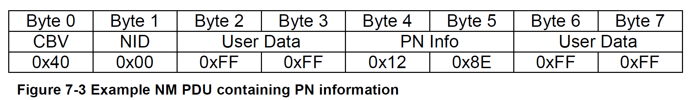

对于此示例，定义了两个**CanNmPnFilterMaskBytes**，例如：

* **CanNmPnFilterMaskByteIndex** = 0，**CanNmPnFilterMaskByteValue** = 0x01
* **CanNmPnFilterMaskByteIndex** = 1，**CanNmPnFilterMaskByteValue** = 0x97

过滤器算法的动作和结果将是：

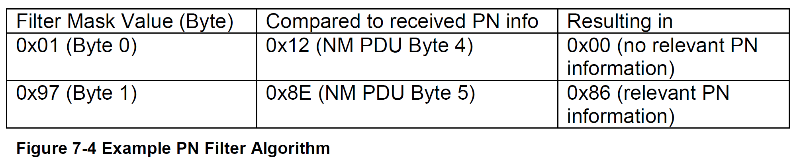

由于其中的一个字节包含相关信息，所以该**NM PDU**不会在进一步的**Rx**指示处理中被丢弃。

#### 6.11.4. 内部和外部请求的部分网络的聚合

由于部分网络的活动（例如，为了防止错误超时），每个必须切换**I-PDU**组的**ECU**都使用到此功能。

如果内部或外部请求相应的**PN**，则**I-PDU**组需要被打开。直到所有对相应**PN**的内部和外部请求都被释放后，**I-PDU**组才需要被关闭。

切换**I-PDU**组的逻辑是由**ComM**实现。**CanNm**仅提供某个**PN**是否被请求的信息。**COM**模块被用于将数据传输到上层模块。

为了在所有直接连接的**ECU**上同步切换**I-PDU**组，**CanNm**需在每个**ECU**上，同时或者几乎同时，向上层提供请求变更的信息。这就是为什么在每次接收和发送**NM PDU**时，都会重启重置计时器（**Reset timer**）的原因。

内部/外部请求的PN的聚集状态称为**EIRA**外部内部请求数组（**External Internal Request Array**）。

如果**CanNmPnEiraCalcEnabled**为**TRUE**，**CanNm**需提供存储在所有相关通道（**CanNmPnEnabled**为**TRUE**的所有**CanNm**通道）上组合的外部和内部请求**PN**的可能性。在初始化时，所有**PN**的值应设置为**0**（未请求）。

如果以下条件都满足，**CanNm**需要存储这些**PN**的请求信息（数值为**1**）。

* **CanNmPnEiraCalcEnabled**为**TRUE**。
* 收到一个**NM-PDU**
* 在此消息中**PN**已经被请求。即：比特位设置为**1**。
* 请求的**PN**在配置的**PN**过滤器掩码内设置为**1**。

如果以下条件都满足，**CanNm**也需要存储这些**PN**的请求信息（数值为**1**）。

* **CanNmPnEiraCalcEnabled**为**TRUE**。
* **CanNm**正在请求发送**NM-PDU**
* 在此消息中**PN**已经被请求。即：比特位设置为**1**。
* 请求的**PN**在配置的**PN**过滤器掩码内设置为**1**。

如果**CanNmPnEiraCalcEnabled**为**TRUE**，**CanNm**需提供监控每个**PN**的可能性，如果该**PN**在至少一个相关通道上，仍然被外部或内部请求。

**注意：**

这意味着只需要一个计时器就可以处理多个连接的物理通道上的一个**PN**。例如：对于**6**个物理通道的网关，处理**8**个部分网络（**PN**）的请求，只需要8个**EIRA**重置计时器来处理即可。这样可行是因为**PN PDU-Group**的切换是由**ECU**全局完成的，并不依赖于物理通道。

如果**CanNmPnEiraCalcEnabled**为**TRUE**，并且在消息接收或发送时，PN被请求 ，则需根据**CanNmPnResetTime**重新启动对该**PN**的监视。

**注意：**

必须将**CanNmPnResetTime**配置为大于**CanNmMsgCycleTime**的值。如果**CanNmPnResetTime**配置小于**CanNmMsgCycleTime**的值，并且只有一个**ECU**请求**PN**，则请求状态在**EIRA**中切换。因为请求的**ECU**在能够发送下一个**NM PDU**之前，请求状态已停止。

同时必须将**CanNmPnResetTime**配置为小于**CanNmTimeoutTime**的值，以避免在**NM**已更改为准备总线睡眠后，计时器才可能会超时。

如果**CanNmPnEiraCalcEnabled**为**TRUE**，并且在**CanNmPnResetTime**内未再次请求**PN**，则该**PN**的相应存储值应设置为未请求（数值为**0**）。

如果**CanNmPnEiraCalcEnabled**为**TRUE**，并且存储的**PN**值更改为已请求或恢复为未请求。**CanNm**应通过为配置的**EIRA PDU**，调用**PduR_CanNmRxIndication**来通知上层模块，即：更改的**EIRA**信息应传递给**COM**。

#### 6.11.5. 外部请求的部分网络的聚合

此功能可供网关使用来只收集外部的**PN**请求。

外部**PN**请求被镜像回请求总线，并提供给中央网关的其他（必需的）物理通道。在子网关的情况下，请求位不得镜像回请求的物理通道，以避免中央网关和子网关之间的静态唤醒。该逻辑应由**ComM**实施。**CanNm**模块提供是否有**PN**被外部请求的信息。**COM**模块用于向上层传输数据。

外部请求 PN 的聚合状态称为**ERA**外部请求数组（**External Request Array**）。

如果**CanNmPnEraCalcEnabled**为**TRUE**，**CanNm**应提供在每个相关通道上存储外部请求的**PN**的可能性。在初始化时，所有**PN**的值应设置为**0**，即未被请求状态。

如果以下条件都满足，CanNm需存储这些PN的请求信息（数值为**1**）

* **CanNmPnEraCalcEnabled**为**TRUE**
* 收到一个**NM-PDU**
* 在此消息中**PN**已经被请求。即：比特位设置为**1**。
* 请求的**PN**在配置的**PN**过滤器掩码内设置为**1**。

如果**CanNmPnEraCalcEnabled**为**TRUE**，则**CanNm**应提供在每个相关通道上监视每个**PN**的可能性，确认每个**PN**是否仍然被外部请求。

**注意：**

这意味着需要一个单独的计时器来处理多个物理通道上的一个**PN**。例如：对于**6**个物理通道的网关，处理**8**个部分网络（**PN**）的请求，需要48个**ERA**重置计时器处理。不能像**EIRA**定时器那样组合复位定时器，因为外部请求不能通过子网关镜像回请求总线，所以需要检测作为请求位源的物理通道。

如果**CanNmPnEraCalcEnabled**为**TRUE**，并且消息接收有PN的请求，则需根据**CanNmPnResetTime**时间重新启动对该**PN**的监视。

**注意：**

必须将**CanNmPnResetTime**配置为大于**CanNmMsgCycleTime**的值。如果**CanNmPnResetTime**配置小于**CanNmMsgCycleTime**的值，并且只有一个**ECU**请求**PN**，则请求状态在**ERA**中切换。因为请求的**ECU**在能够发送下一个**NM PDU**之前，请求状态已停止。

同时必须将**CanNmPnResetTime**配置为小于**CanNmTimeoutTime**的值，以避免在**NM**已更改为准备总线睡眠后，计时器才可能会超时。

如果**CanNmPnEraCalcEnabled**为**TRUE**，并且在**CanNmPnResetTime**内未再次请求**PN**，则该**PN**的相应存储值应设置为未请求（数值为**0**）。

如果**CanNmPnEraCalcEnabled**为**TRUE**，并且存储的**PN**值更改为已请求或恢复为未请求。**CanNm**应通过为配置的**ERA PDU**，调用**PduR_CanNmRxIndication**来通知上层模块，即：更改的**ERA**信息应传递给**COM**。

如果**CanNmPnEiraCalcEnabled**为**TRUE**, 并且**CanNmPnEraCalcEnabled**为**TRUE** ，则**PN**状态信息必须分别存储，同时包含**EIRA**和**ERA**信息。

#### 6.11.6. 内部请求的部分网络集群的处理

所有内部**PNC**请求都由**ComM**维护。**ComM**将每个通道上聚合的内部**PNC**请求作为**PNC**位向量转发给**Nm**。该**PNC**位向量承载所谓的「内部请求数组」（**Internal Request Array**，**IRA**）。**CanNm**必须在每次传输**NM PDU**时从**Nm**获取最新的**IRA**。**Nm**向**CanNm**提供**IRA**信息并更新**PNC**重置计时器（每次传输相关**PNC**时，**PNC**重置计时器都会重新启动）。

**注意：**

对于**CanNmPnEnabled**设置为**TRUE**的所有已配置**NM**通道，**CanNm**将调用**Nm_PncBitVectorTxIndication**（&lt;NM通道&gt;，&lt;用于存储聚合内部**PNC**请求的未过滤**PNC**位向量的缓冲区&gt;）以指示传输，并根据配置的**NmPncBitVectorLength**获取作为**PNC**位向量的当前内部**PNC**请求。**CanNm**会将接收到的内部**PNC**请求复制到**NM-PDU**的**PNC**位向量字节中。

#### 6.11.7. 通过CanNm_NetworkRequest自发传输NM PDU

如果[**CanNm_NetworkRequest**](#734-cannm_networkrequest)被调用，并且**CanNmPnHandleMultipleNetworkRequests**为**TRUE**，**CanNm**处于就绪睡眠状态（**Ready Sleep State**)、正常操作状态（**Normal Operation State**）或重复消息状态（**Repeat Message State**），则**CanNm**需更改为或者重新启动为重复消息状态（**Repeat Message State**）。

**注意：**

如果**CanNmPnHandleMultipleNetworkRequests**设置为**TRUE**，则**CanNm**的立即传输（**Immediate Transmission**）功能是强制性的。

如果**PN**请求位发生变化，**PN**控制模块（例如：**ComM**）负责调用[**CanNm_NetworkRequest**](#734-cannm_networkrequest)。

### 6.12. 传输错误处理

根据配置，**CanNm**需评估**NM PDU**是否已成功传输的确认。

**CanNm**将监视这些确认，并在以下情况向上层模块发出警报

* 收到带有结果**E_NOT_OK**的传输确认
* 在特定时间量内未收到传输确认。 

对于部分网络（PN），超时监控是必须的。监控确保当网络上的所有**ECU**使用部分网络收发器时，第一条消息会得到确认。否则**CanSM**被会通知，并需重新启动**CAN**驱动程序。

如果**CanNmPassiveModeEnabled**设置为**TRUE**或者**CanNmImmediateTxConfEnabled**设置为**TRUE**，**CanNm**不需执行传输错误处理。

**理由：**

只有在允许节点传输**NM PDU**，并且来自**CanIf**模块的真实确认被评估时，传输错误处理才有意义。

当**CanNmGlobalPnSupport**设置为**TRUE**，定义了**CanNmMsgTimeoutTime**，如果**CanNm**通过调用**CanIf_Transmit**请求传输**NM PDU**，则**CanNm**将使用 **CanNmMsgTimeoutTime**启动**NM消息Tx超时计时器**。

当**CanNmGlobalPnSupport**设置为**TRUE**，定义了**CanNmMsgTimeoutTime**，如果[**CanNm_TxConfirmation**](#741-cannm_txconfirmation)函数被调用，则**CanNm**将停止**NM消息Tx超时计时器**。

如果下列条件中有一条被满足，则**CanNm**需调用**Nm_TxTimeoutException**函数：

* [**CanNm_TxConfirmation**](#741-cannm_txconfirmation)调用结果为**E_NOT_OK** 
* 当**CanNmGlobalPnSupport**设置为**TRUE**，并且**NM消息Tx超时计时器**已经超时。

如果**CanNmGlobalPnSupport**设置为**TRUE**，并且**NM消息Tx超时计时器**已经超时，则**CanNm**需调用**CanSM_TxTimeoutException**函数。

### 6.13. CanNm API的功能需求

如果**CanNmNodeDetectionEnabled**和**CanNmRepeatMsgIndEnabled**都设置为**TRUE**，并且接收到重复消息请求位，**CanNm**模块需调用回调函数**Nm_RepeatMessageIndication**。

如果**CanNmUserDataEnabled**被启用，但并没有可用的用户数据字节，则**CanNm**模块将在配置或编译期间引发错误。

### 6.14. 错误分类

文档[\[4\]](#ref-4)「基础软件模块通用规范」的「错误处理」（**Error Handling**）章节详细描述了基础软件的错误处理。其中最重要的是，它构成了一个由五种错误类型组成的分类方案，这些错误类型可能发生在**BSW**模块中。

基于此基础，以下章节在相应的小节中规定特定的错误。

#### 6.14.1. 开发错误

| 错误类型 | 相关错误码 | 错误值 |
| --- | --- | --- |
| 未进行模块初始化就使用API服务 | CANNM_E_UNINIT | 0x01 |
| 使用错误的通道句柄调用API服务 | CANNM_E_INVALID_CHANNEL | 0x02 |
| 使用错误的PDU-ID调用API服务 | CANNM_E_INVALID_PDUID | 0x03 |
| **CanNm**初始化失败，例如所选的配置集不存在。 | CANNM_E_INIT_FAILED | 0x05 |
| 空指针作为参数传入 | CANNM_E_PARAM_POINTER | 0x12 |
| 在并非所有**CAN**网络都处于总线睡眠模式时调用**DeInit API**服务 | CANNM_E_NOT_IN_BUS_SLEEP | 0x13 |

#### 6.14.2. 运行时错误

| 错误类型 | 相关错误码 | 错误值 |
| --- | --- | --- |
| 在总线睡眠模式下接收**NM PDU**。 | CANNM_E_NET_START_IND | 0x04 |
| NM超时计时器在就绪睡眠状态（**Ready Sleep State**）之外异常超时；其可能发生的原因：(1)由于Bus-Off状态，(2)如果某些**ECU**在NM超时计时器到期前不久请求总线通信或节点检测，导致**NM PDU**无法及时传输；这种竞争条件适用于事件触发的系统 | CANNM_E_NETWORK_TIMEOUT | 0x11 |
| 在由**ComM PNC**网关主动协调的通道上接收到设置了**PN**关闭请求位的**NM**消息。 | CANNM_E_INVALID_PN_SYNC_SHUTDOWN_REQUEST | 0x20 |

#### 6.14.3. 瞬态故障

没有瞬态故障。

#### 6.14.4. 生产错误

没有生产错误。

#### 6.14.5. 扩展生产错误

没有扩展生产错误。

### 6.15. 主函数的调度

有关详细信息，请参阅SWS_BSWGeneral[\[4\]](#ref-4)中的章节8.5「调度函数」（**Scheduled functions**）。

### 6.16. 应用注释

#### 6.16.1. 唤醒通知

唤醒通知在**ECU**状态管理器规范中有详细定义。

#### 6.16.2. 耦合网络的协调

需通过使用配置参数**CanNmBusSynchronizationEnabled**（配置参数）进行静态配置，来支持按需的总线同步。

**注意：**

由于**CanNm**的关闭可以随时进行，所以不支持调用API **Nm_SynchronizationPoint**。

### 6.17. CanNm时序需求汇总

本节给出了**CanNm**时序需求的汇总。请注意，本章仅是一个汇总，不取代也不作为需求。此外，本节不要求任何特定的实现方式。

| 时序类型 | 需求 |
| --- | --- |
| NM超时相关 | `SWS_CanNm_00061` `SWS_CanNm_00096` `SWS_CanNm_00098` `SWS_CanNm_00099` `SWS_CanNm_00101` `SWS_CanNm_00109` `SWS_CanNm_00117` `SWS_CanNm_00174` `SWS_CanNm_00179` `SWS_CanNm_00193` `SWS_CanNm_00194` `SWS_CanNm_00206` |
| Tx确认超时相关 | `SWS_CanNm_00064` `SWS_CanNm_00065` `SWS_CanNm_00066` |
| NmPdu传输相关 | `SWS_CanNm_00005` `SWS_CanNm_00040` `SWS_CanNm_00051` `SWS_CanNm_00061` `SWS_CanNm_00069` `SWS_CanNm_00173` `SWS_CanNm_00178` `SWS_CanNm_00512` |
| 远程睡眠指示相关 | `SWS_CanNm_00175` `SWS_CanNm_00180` |

### 6.18. UML状态图

下图显示了有关**API**规范的UML状态图。模式变更相关的转换以绿色表示，错误处理相关的转换以红色表示，可选的节点检测/动态**PNC**到通道映射相关的转换以蓝色表示。

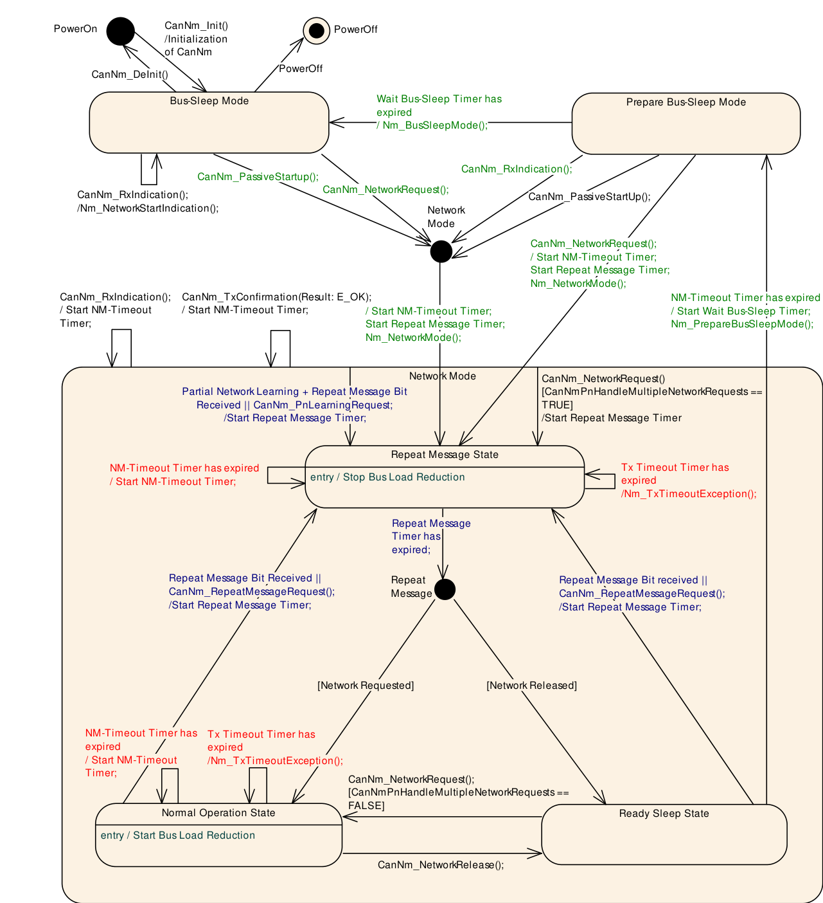

## 7. API规范

**CanNm**模块不应通过API函数返回开发错误；如果发生开发错误，应中止相应API函数的执行，并在适用的情况下返回**E_NOT_OK**。

**CanNm**模块不应通过API函数返回生产错误；如果发生生产错误，应中止相应API函数的执行，并在适用的情况下返回**E_NOT_OK**。

当使用无效的网络句柄调用**CanNm**服务时，被调用的函数不应执行，并在适用的情况下向调用函数返回**E_NOT_OK**。如果启用了开发错误检测（**CanNmDevErrorDetect**设置为**TRUE**），则应向**DET**报告相应的错误[**CANNM_E_INVALID_CHANNEL**](#6141-开发错误)。

**注意：**

网络句柄无效是指它与允许的配置值不同。

当向**CanNm**服务传递了空指针时，被调用的函数不应执行，并在适用的情况下向调用函数返回**E_NOT_OK**。如果启用了开发错误检测（**CanNmDevErrorDetect**设置为**TRUE**），则应向**DET**报告相应的错误[**CANNM_E_PARAM_POINTER**](#6141-开发错误)。

当使用无效的**PDU ID**调用**CanNm**服务时，被调用的函数不应执行，并在适用的情况下向调用函数返回**E_NOT_OK**。如果启用了开发错误检测（**CanNmDevErrorDetect**设置为**TRUE**），则应向**DET**报告相应的错误[**CANNM_E_INVALID_PDUID**](#6141-开发错误)。

**CanNm**模块应拒绝执行使用无效参数调用的服务，并通知**DET**。

**AUTOSAR CanNm API**由若干服务组成，这些服务是**CAN**特定的，可以在需要时随时调用；除[**CanNm_Init**](#731-cannm_init)外，每个服务仅针对一个**NM**通道。

### 7.1. 导入的类型

在本章中列出了从以下模块包含的所有类型：

| 模块 | 头文件 | 导入的类型 |
| --- | --- | --- |
| ComStack_Types | ComStack_Types.h | NetworkHandleType |
| ComStack_Types | ComStack_Types.h | PduIdType |
| ComStack_Types | ComStack_Types.h | PduInfoType |
| ComStack_Types | ComStack_Types.h | PduLengthType |
| Nm | NmStack_types.h | Nm_ModeType |
| Nm | NmStack_types.h | Nm_StateType |
| Std | Std_Types.h | Std_ReturnType |
| Std | Std_Types.h | Std_VersionInfoType |

有关这些类型的更多详细信息，请参阅相应的规范[\[13\]](#ref-13)、[\[2\]](#ref-2)和[\[14\]](#ref-14)。

### 7.2. 类型定义

#### 7.2.1. CanNm_ConfigType

结构类型（**Structure**）。元素为实现特定（**implementation specific**）。该类型应至少包含根据第[9](#9-配置规范)章可进行编译后配置（**post-build**）的所有参数。可通过**CanNm.h**获得。

### 7.3. 函数定义

#### 7.3.1. CanNm_Init

**说明**: 初始化**CanNm**模块。可通过**CanNm.h**获得。本服务为同步调用，不可重入。参数 cannmConfigPtr（in）：指向所选配置结构的指针。该服务无返回值。

```C
void CanNm_Init( const CanNm_ConfigType* cannmConfigPtr )
```

**CanNm_Init**的注意事项（**Caveats**）：函数**CanNm_Init**必须在**CanIf**初始化之后调用。

#### 7.3.2. CanNm_DeInit

**说明**: 去初始化**CanNm**模块。可通过**CanNm.h**获得。本服务为同步调用，不可重入。该服务无参数、无返回值。

```C
void CanNm_DeInit( void )
```

**注意：**去初始化函数的一般行为和约束由SWS_BSWGeneral中的相关需求规定。

注意事项（**Caveat**）：**CanNm_DeInit**函数的调用者必须确保所有**CAN**网络都处于总线睡眠模式。

如果启用了**CanNm**模块的开发错误检测：如果并非所有**CAN**网络都处于总线睡眠模式，则函数**CanNm_DeInit**应引发错误[**CANNM_E_NOT_IN_BUS_SLEEP**](#6141-开发错误)。

#### 7.3.3. CanNm_PassiveStartUp

**说明**: AUTOSAR CAN NM的被动启动。它触发从总线睡眠模式（**Bus-Sleep Mode**）或者准备总线睡眠模式（**Prepare Bus-Sleep Mode**）到重复消息状态（**Repeat Message State**）的网络模式（**Network Mode**）的转换。可通过**CanNm.h**获得。本服务为异步调用，可重入（但对于同一**NM**通道不可重入）。参数 nmChannelHandle（in）：**NM**通道的标识。返回值为**Std_ReturnType**：E_OK：无错误；E_NOT_OK：网络管理的被动启动已失败。

```C
Std_ReturnType CanNm_PassiveStartUp( NetworkHandleType nmChannelHandle )
```

**CanNm_PassiveStartUp**的注意事项（**Caveats**）：**CanNm**模块已被正确初始化。

#### 7.3.4. CanNm_NetworkRequest

**说明**: **ECU**需要在总线上通信，从而请求网络。可通过**CanNm.h**获得。本服务为异步调用，可重入（但对于同一**NM**通道不可重入）。参数 nmChannelHandle（in）：**NM**通道的标识。返回值为**Std_ReturnType**：E_OK：无错误；E_NOT_OK：网络的请求已失败。

```C
Std_ReturnType CanNm_NetworkRequest( NetworkHandleType nmChannelHandle )
```

函数**CanNm_NetworkRequest**应将网络状态更改为「已请求」（**requested**）。

**CanNm_NetworkRequest**的注意事项（**Caveats**）：**CanNm**模块已被正确初始化。

**CanNm_NetworkRequest**的配置（**Configuration**）：可选（仅在**CanNmPassiveModeEnabled**未定义时可用）。

#### 7.3.5. CanNm_NetworkRelease

**说明**: **ECU**无需在总线上通信，从而释放网络。可通过**CanNm.h**获得。本服务为异步调用，可重入（但对于同一**NM**通道不可重入）。参数 nmChannelHandle（in）：**NM**通道的标识。返回值为**Std_ReturnType**：E_OK：无错误；E_NOT_OK：网络的释放已失败。

```C
Std_ReturnType CanNm_NetworkRelease( NetworkHandleType nmChannelHandle )
```

**CanNm_NetworkRelease**的注意事项（**Caveats**）：**CanNm**模块已被正确初始化。

**CanNm_NetworkRelease**的配置（**Configuration**）：可选（仅在**CanNmPassiveModeEnabled**未定义时可用）。

#### 7.3.6. CanNm_DisableCommunication

**说明**: 由于**ISO 14229**通信控制（28 hex）服务而禁用**NM PDU**传输能力。可通过**CanNm.h**获得。本服务为异步调用，可重入（但对于同一**NM**通道不可重入）。参数 nmChannelHandle（in）：**NM**通道的标识。返回值为**Std_ReturnType**：E_OK：无错误；E_NOT_OK：**NM PDU**传输能力的禁用已失败。

```C
Std_ReturnType CanNm_DisableCommunication( NetworkHandleType nmChannelHandle )
```

**CanNm_DisableCommunication**的注意事项（**Caveats**）：**CanNm**模块已被正确初始化。

**CanNm_DisableCommunication**的配置（**Configuration**）：可选（仅在**CanNmComControlEnabled**设置为**TRUE**时可用）。

如果当前模式不是网络模式（**Network Mode**），则服务**CanNm_DisableCommunication**应返回**E_NOT_OK**。

#### 7.3.7. CanNm_EnableCommunication

**说明**: 由于**ISO 14229**通信控制（28 hex）服务而启用**NM PDU**传输能力。可通过**CanNm.h**获得。本服务为异步调用，可重入（但对于同一**NM**通道不可重入）。参数 nmChannelHandle（in）：**NM**通道的标识。返回值为**Std_ReturnType**：E_OK：无错误；E_NOT_OK：**NM PDU**传输能力的启用已失败。

```C
Std_ReturnType CanNm_EnableCommunication( NetworkHandleType nmChannelHandle )
```

如果网络管理**PDU**传输能力被禁用，则服务**CanNm_EnableCommunication**应启用网络管理**PDU**传输能力。

如果网络管理**PDU**传输能力已启用，则服务**CanNm_EnableCommunication**应返回**E_NOT_OK**。

如果当前模式不是网络模式（**Network Mode**），则服务**CanNm_EnableCommunication**应返回**E_NOT_OK**。

**CanNm_EnableCommunication**的注意事项（**Caveats**）：**CanNm**模块已被正确初始化。

**CanNm_EnableCommunication**的配置（**Configuration**）：可选（仅在**CanNmComControlEnabled**设置为**TRUE**时可用）。

#### 7.3.8. CanNm_SetUserData

**说明**: 为总线上接下来传输的**NM PDU**设置用户数据。可通过**CanNm.h**获得。本服务为同步调用，可重入（但对于同一**NM**通道不可重入）。参数 nmChannelHandle（in）：**NM**通道的标识；参数 nmUserDataPtr（in）：指向的地址，下一条传输的**NM PDU**的用户数据将从该处复制。返回值为**Std_ReturnType**：E_OK：无错误；E_NOT_OK：用户数据的设置已失败。

```C
Std_ReturnType CanNm_SetUserData( NetworkHandleType nmChannelHandle, const uint8* nmUserDataPtr )
```

**CanNm_SetUserData**的注意事项（**Caveats**）：**CanNm**模块已被正确初始化。

**CanNm_SetUserData**的配置（**Configuration**）：可选（仅在**CanNmUserDataEnabled**设置为**TRUE**且**CanNmPassiveModeEnabled**未定义时可用）。

#### 7.3.9. CanNm_GetUserData

**说明**: 从最近收到的**NM PDU**中获取用户数据。可通过**CanNm.h**获得。本服务为同步调用，可重入。参数 nmChannelHandle（in）：**NM**通道的标识；参数 nmUserDataPtr（out）：指向的地址，最近接收的**NM PDU**中的用户数据将复制到该处。返回值为**Std_ReturnType**：E_OK：无错误；E_NOT_OK：用户数据的获取已失败。

```C
Std_ReturnType CanNm_GetUserData( NetworkHandleType nmChannelHandle, uint8* nmUserDataPtr )
```

**CanNm_GetUserData**的注意事项（**Caveats**）：**CanNm**模块已被正确初始化。

**CanNm_GetUserData**的配置（**Configuration**）：可选（仅在**CanNmUserDataEnabled**设置为**TRUE**时可用）。

#### 7.3.10. CanNm_Transmit

**说明**: 请求传输**PDU**。可通过**CanNm.h**获得。本服务为同步调用，对于不同的**PduId**可重入，对于相同的**PduId**不可重入。参数 TxPduId（in）：要传输的**PDU**的标识符；参数 PduInfoPtr（in）：**PDU**数据的长度和指针以及指向**MetaData**的指针。返回值为**Std_ReturnType**：E_OK：传输请求已被接受；E_NOT_OK：传输请求未被接受。

```C
Std_ReturnType CanNm_Transmit( PduIdType TxPduId, const PduInfoType* PduInfoPtr )
```

如果**CanNmComUserDataSupport**或**CanNmGlobalPnSupport**被启用，则**CanNm**实现应提供API **CanNm_Transmit**。

如果**CanNmComUserDataSupport**被启用，且**CanNm**处于重复消息状态（**RepeatMessage**）或正常操作状态（**NormalOperation**），且**CanNm_Transmit()**被调用，则**CanNm**应请求使用当前用户数据额外传输一次**NM PDU**。

**注意：**

调用**CanNm_Transmit**请求在周期性传输之间使用当前数据（例如：系统字节、用户数据和**PNC**位向量）传输一个**NM PDU**。

#### 7.3.11. CanNm_GetNodeIdentifier

**说明**: 从最近收到的**NM PDU**中获取节点标识符。可通过**CanNm.h**获得。本服务为同步调用，可重入。参数 nmChannelHandle（in）：**NM**通道的标识；参数 nmNodeIdPtr（out）：指向的地址，最近接收的**NM PDU**中的节点标识符将复制到该处。返回值为**Std_ReturnType**：E_OK：无错误；E_NOT_OK：从最近接收的**NM PDU**中获取节点标识符已失败，或未针对此网络句柄配置。

```C
Std_ReturnType CanNm_GetNodeIdentifier( NetworkHandleType nmChannelHandle, uint8* nmNodeIdPtr )
```

如果**CanNmNodeIdEnabled**设置为**TRUE**，则服务调用**CanNm_GetNodeIdentifier**应提供最近接收的网络管理**PDU**中的节点标识符。

**CanNm_GetNodeIdentifier**的注意事项（**Caveats**）：**CanNm**模块已被正确初始化。

#### 7.3.12. CanNm_GetLocalNodeIdentifier

**说明**: 获取为本地节点配置的节点标识符。可通过**CanNm.h**获得。本服务为同步调用，可重入。参数 nmChannelHandle（in）：**NM**通道的标识；参数 nmNodeIdPtr（out）：指向的地址，本地节点的节点标识符将复制到该处。返回值为**Std_ReturnType**：E_OK：无错误；E_NOT_OK：获取本地节点的节点标识符已失败，或未针对此网络句柄配置。

```C
Std_ReturnType CanNm_GetLocalNodeIdentifier( NetworkHandleType nmChannelHandle, uint8* nmNodeIdPtr )
```

如果**CanNmNodeIdEnabled**设置为**TRUE**，则服务调用**CanNm_GetLocalNodeIdentifier**应提供为本地主机节点配置的节点标识符。

**CanNm_GetLocalNodeIdentifier**的注意事项（**Caveats**）：**CanNm**模块已被正确初始化。

#### 7.3.13. CanNm_RepeatMessageRequest

**说明**: 为总线上接下来传输的**NM PDU**设置重复消息请求位。可通过**CanNm.h**获得。本服务为异步调用，可重入（但对于同一**NM**通道不可重入）。参数 nmChannelHandle（in）：**NM**通道的标识。返回值为**Std_ReturnType**：E_OK：无错误；E_NOT_OK：重复消息请求位的设置已失败，或未针对此网络句柄配置。

```C
Std_ReturnType CanNm_RepeatMessageRequest( NetworkHandleType nmChannelHandle )
```

**CanNm_RepeatMessageRequest**的注意事项（**Caveats**）：**CanNm**模块已被正确初始化。

#### 7.3.14. CanNm_GetPduData

**说明**: 从最近收到的**NM PDU**中获取整个**PDU**数据。可通过**CanNm.h**获得。本服务为同步调用，可重入。参数 nmChannelHandle（in）：**NM**通道的标识；参数 nmPduDataPtr（out）：指向的地址，**NM PDU**将复制到该处。返回值为**Std_ReturnType**：E_OK：无错误；E_NOT_OK：**NM PDU**数据的获取已失败，或未针对此网络句柄配置。

```C
Std_ReturnType CanNm_GetPduData( NetworkHandleType nmChannelHandle, uint8* nmPduDataPtr )
```

**CanNm_GetPduData**的注意事项（**Caveats**）：**CanNm**模块已被正确初始化。

如果**CanNmNodeDetectionEnabled**或**CanNmUserDataEnabled**或**CanNmNodeIdEnabled**设置为**TRUE**，则服务调用**CanNm_GetPduData**应提供最近接收的网络管理**PDU**的完整**PDU**数据（节点ID、控制位向量和用户数据）。

#### 7.3.15. CanNm_GetState

**说明**: 返回网络管理的状态和模式。可通过**CanNm.h**获得。本服务为同步调用，可重入。参数 nmChannelHandle（in）：**NM**通道的标识；参数 nmStatePtr（out）：指向的地址，网络管理的状态将复制到该处；参数 nmModePtr（out）：指向的地址，网络管理的模式将复制到该处。返回值为**Std_ReturnType**：E_OK：无错误；E_NOT_OK：**NM**状态的获取已失败。

```C
Std_ReturnType CanNm_GetState( NetworkHandleType nmChannelHandle, Nm_StateType* nmStatePtr, Nm_ModeType* nmModePtr )
```

**CanNm_GetState**的注意事项（**Caveats**）：**CanNm**模块已被正确初始化。

#### 7.3.16. CanNm_GetVersionInfo

**说明**: 该服务返回该模块的版本信息。可通过**CanNm.h**获得。本服务为同步调用，可重入。参数 versioninfo（out）：指向存储该模块版本信息的位置的指针。该服务无返回值。

```C
void CanNm_GetVersionInfo( Std_VersionInfoType* versioninfo )
```

#### 7.3.17. CanNm_RequestBusSynchronization

**说明**: 请求总线同步。可通过**CanNm.h**获得。本服务为同步调用，不可重入。参数 nmChannelHandle（in）：**NM**通道的标识。返回值为**Std_ReturnType**：E_OK：无错误；E_NOT_OK：总线同步的请求已失败。

```C
Std_ReturnType CanNm_RequestBusSynchronization( NetworkHandleType nmChannelHandle )
```

**CanNm_RequestBusSynchronization**的注意事项（**Caveats**）：**CanNm**模块已被正确初始化。

**CanNm_RequestBusSynchronization**的配置（**Configuration**）：可选（仅在**CanNmBusSynchronizationEnabled**设置为**TRUE**且**CanNmPassiveModeEnabled**未定义时可用）。

如果**CanNmPassiveModeEnabled**（配置参数）未定义，则服务调用**CanNm_RequestBusSynchronization**应触发单个网络管理**PDU**的传输。

**论据：**该服务通常用于支持**NM**网关扩展。

如果在总线睡眠模式（**BusSleep Mode**）和准备总线睡眠模式（**Prepare Bus-Sleep Mode**）中调用**CanNm_RequestBusSynchronization**，则**CanNm**模块不应执行该服务，并应返回**E_NOT_OK**。

#### 7.3.18. CanNm_CheckRemoteSleepIndication

**说明**: 检查远程睡眠指示是否发生。可通过**CanNm.h**获得。本服务为同步调用，可重入。参数 nmChannelHandle（in）：**NM**通道的标识；参数 nmRemoteSleepIndPtr（out）：指向的地址，远程睡眠指示的检查结果将复制到该处。返回值为**Std_ReturnType**：E_OK：无错误；E_NOT_OK：远程睡眠指示位的检查已失败。

```C
Std_ReturnType CanNm_CheckRemoteSleepIndication( NetworkHandleType nmChannelHandle, boolean* nmRemoteSleepIndPtr )
```

服务调用**CanNm_CheckRemoteSleepIndication**应提供关于远程睡眠指示（**Remote Sleep Indication**）当前状态的信息（即是否已检测到）。

**CanNm_CheckRemoteSleepIndication**的注意事项（**Caveats**）：**CanNm**模块已被正确初始化。

**CanNm_CheckRemoteSleepIndication**的配置（**Configuration**）：可选（仅在**CanNmRemoteSleepIndEnabled**设置为**TRUE**时可用）。

#### 7.3.19. CanNm_SetSleepReadyBit

**说明**: 设置控制位向量中的**NM**协调器睡眠就绪位。可通过**CanNm.h**获得。本服务为同步调用，可重入（但对于同一**NM**通道不可重入）。参数 nmChannelHandle（in）：**NM**通道的标识；参数 nmSleepReadyBit（in）：写入**CBV**中**ReadySleep**位的值。返回值为**Std_ReturnType**：E_OK：无错误；E_NOT_OK：远程睡眠指示位的写入已失败。

```C
Std_ReturnType CanNm_SetSleepReadyBit( NetworkHandleType nmChannelHandle, boolean nmSleepReadyBit )
```

**CanNm_SetSleepReadyBit**的注意事项（**Caveats**）：**CanNm**模块已被正确初始化。

**CanNm_SetSleepReadyBit**的配置（**Configuration**）：可选（仅在**CanNmCoordinatorSyncSupport**设置为**TRUE**时可用）。

#### 7.3.20. CanNm_PnLearningRequest

**说明**: 为总线上接下来传输的**NM**消息设置重复消息请求位和部分网络学习位。这将强制所有节点进入**PNC**学习阶段（**PNC Learning Phase**）。这是可选的动态**PNC**到通道映射（**Dynamic PNC-to-channel-mapping**）功能所需要的。可通过**CanNm.h**获得。本服务为异步调用，可重入（但对于同一**NM**通道不可重入）。参数 nmChannelHandle（in）：**NM**通道的标识。返回值为**Std_ReturnType**：E_OK：无错误；E_NOT_OK：**PN**学习请求已失败，或未针对此网络句柄配置。

```C
Std_ReturnType CanNm_PnLearningRequest( NetworkHandleType nmChannelHandle )
```

如果在准备总线睡眠模式（**Prepare Bus-Sleep Mode**）或总线睡眠模式（**Bus Sleep Mode**）中调用函数**CanNm_PnLearningRequest**，则不应执行任何功能，并应返回**E_NOT_OK**。

只有当**CanNmDynamicPncToChannelMappingSupport**设置为**TRUE**时，函数**CanNm_PnLearningRequest**才可用。

#### 7.3.21. CanNm_ActivateTxPnShutdownMsg

**说明**: **NM**指示激活给定**NM**通道上**PN**关闭消息的传输。这将导致传输**PNSR**位设置为**1**的**NM-PDU**（**PN**关闭消息）。可通过**CanNm.h**获得。本服务为同步调用，对于不同的nmChannelHandle可重入，对于相同的nmChannelHandle不可重入。参数 nmChannelHandle（in）：启动**PNC**关闭过程的**NM**通道的标识符。返回值为**Std_ReturnType**：E_OK：请求已被接受；E_NOT_OK：请求未被接受。

```C
Std_ReturnType CanNm_ActivateTxPnShutdownMsg( NetworkHandleType nmChannelHandle )
```

如果**CanNmSynchronizedPncShutdownEnabled**设置为**TRUE**，则**CanNm**实现应提供API **CanNm_ActivateTxPnShutdownMsg**。

如果**CanNmSynchronizedPncShutdownEnabled**设置为**TRUE**，且使用有效的**NM**通道（nmChannelHandle）调用**CanNm_ActivateTxPnShutdownMsg**，则**CanNm**模块应将**PN**关闭消息传输视为在给定**NM**通道上处于活动状态，将**CBV**中的**PNSR**位设置为**1**，并以**E_OK**返回。

#### 7.3.22. CanNm_DeactivateTxPnShutdownMsg

**说明**: **NM**指示停用给定**NM**通道上**PN**关闭消息的传输。这将导致传输**PNSR**位设置为**0**的普通**NM-PDU**。可通过**CanNm.h**获得。本服务为同步调用，对于不同的nmChannelHandle可重入，对于相同的nmChannelHandle不可重入。参数 nmChannelHandle（in）：停止**PNC**关闭过程的**NM**通道的标识符。返回值为**Std_ReturnType**：E_OK：请求已被接受；E_NOT_OK：请求未被接受。

```C
Std_ReturnType CanNm_DeactivateTxPnShutdownMsg( NetworkHandleType nmChannelHandle )
```

如果**CanNmSynchronizedPncShutdownEnabled**设置为**TRUE**，则**CanNm**实现应提供API **CanNm_DeactivateTxPnShutdownMsg**。

如果**CanNmSynchronizedPncShutdownEnabled**设置为**TRUE**，且使用有效的**NM**通道（nmChannelHandle）调用**CanNm_DeactivateTxPnShutdownMsg**，则**CanNm**模块应将**PN**关闭消息传输视为在给定**NM**通道上处于非活动状态，将**CBV**中的**PNSR**位设置为**0**，并以**E_OK**返回。

### 7.4. 回调通知

这是为其他模块提供的函数列表。

**CanNm**中没有其他回调通知以外的回调函数。

#### 7.4.1. CanNm_TxConfirmation

**说明**: 下层通信接口模块确认**PDU**的传输，或者**PDU**的传输失败。可通过**CanNm.h**获得。本服务为同步调用，对于不同的**PduId**可重入，对于相同的**PduId**不可重入。参数 TxPduId（in）：已传输的**PDU**的ID；参数 result（in）：E_OK：**PDU**已传输；E_NOT_OK：**PDU**传输失败。该服务无返回值。

```C
void CanNm_TxConfirmation( PduIdType TxPduId, Std_ReturnType result )
```

**CanNm_TxConfirmation**的注意事项（**Caveats**）：

* 调用上下文要么处于中断级（中断模式），要么处于任务级（轮询模式）。该回调服务对于多个**CAN**控制器的使用是可重入的。
* **CanNm**模块已被正确初始化。

**CanNm_TxConfirmation**的配置（**Configuration**）：可选（仅在**CanNmPassiveModeEnabled**和**CanNmImmediateTxconfEnabled**都设置为**FALSE**时可用）。

#### 7.4.2. CanNm_RxIndication

**说明**: 指示从较低层通信接口模块接收到的**PDU**。可通过**CanNm.h**获得。本服务为同步调用，对于不同的**PduId**可重入，对于相同的**PduId**不可重入。参数 RxPduId（in）：接收到的**PDU**的ID；参数 PduInfoPtr（in）：包含接收到的**PDU**的长度（**SduLength**）、指向包含该**PDU**的缓冲区的指针（**SduDataPtr**）以及与该**PDU**相关的**MetaData**。该服务无返回值。

```C
void CanNm_RxIndication( PduIdType RxPduId, const PduInfoType* PduInfoPtr )
```

**注意：**回调函数**CanNm_RxIndication**由**CAN**接口调用，由**CanNm**模块实现。它在**CAN**驱动程序的接收指示事件发生时被调用。

**CanNm_RxIndication**的注意事项（**Caveats**）：

* 在该服务返回之前，**CAN**接口不会访问canSduPtr。在指示返回之前，canSduPtr仅对上层有效并可供上层使用。**CAN**接口保证为此**CanNmRxPduId**配置的字节数是有效的。调用上下文要么处于中断级（中断模式），要么处于任务级（轮询模式）。该回调服务对于多个**CAN**控制器的使用是可重入的。
* **CanNm**模块已被正确初始化。

#### 7.4.3. CanNm_ConfirmPnAvailability

**说明**: 在指定的**NM**通道上启用**PN**过滤器功能。可用性：**API**仅在**CanNmGlobalPnSupport**为**TRUE**时可用。可通过**CanNm.h**获得。本服务为同步调用，可重入（但对于同一**NM**通道不可重入）。参数 nmChannelHandle（in）：**NM**通道的标识。该服务无返回值。

```C
void CanNm_ConfirmPnAvailability( NetworkHandleType nmChannelHandle )
```

**CanNm_ConfirmPnAvailability**的注意事项（**Caveats**）：**CanNm**模块已被正确初始化。

**CanNm_ConfirmPnAvailability**的配置（**Configuration**）：可选（仅在**CanNmGlobalPnSupport**设置为**TRUE**时可用）。

#### 7.4.4. CanNm_TriggerTransmit

**说明**: 在此**API**中，上层模块将检查可用数据是否适合**PduInfoPtr->SduLength**报告的缓冲区大小。如果合适，它将其数据复制到**PduInfoPtr->SduDataPtr**提供的缓冲区中，并在**PduInfoPtr->SduLength**中更新实际复制数据的长度。如果不是，则返回**E_NOT_OK**而不更改**PduInfoPtr**。可通过**CanNm.h**获得。本服务为同步调用，对于不同的**PduId**可重入，对于相同的**PduId**不可重入。参数 TxPduId（in）：请求传输的**SDU**的ID；参数 PduInfoPtr（inout）：包含指向缓冲区的指针（**SduDataPtr**，**SDU**数据应复制到该缓冲区）以及**SduLength**中的可用缓冲区大小。返回时，该服务将在**SduLength**中指示复制的**SDU**数据的长度。返回值为**Std_ReturnType**：E_OK：**SDU**已被复制，**SduLength**指示已复制的字节数；E_NOT_OK：未复制任何**SDU**数据，不得使用**PduInfoPtr**，因为它可能包含**NULL**指针或指向无效数据。

```C
Std_ReturnType CanNm_TriggerTransmit( PduIdType TxPduId, PduInfoType* PduInfoPtr )
```

**注意：**在调用**CanNm_TriggerTransmit**时不会更新**PNC**位向量，而是在每个**NM**消息传输请求之前更新。这确保了独立于**CanIfTxPduTriggerTransmit**设置（**TRUE**或**FALSE**）的统一处理。

如果调用了**CanNm_TriggerTransmit**且**CanNmComUserDataSupport**被启用，则**CanNm**应通过调用**PduR_CanNmTriggerTransmit**从被引用的**NM I-PDU**中收集**NM**用户数据，并将数据复制到**NM-PDU**的用户数据范围。

函数**CanNm_TriggerTransmit**应复制由TxPduId请求的相应**NM PDU**的**NM PDU**数据。

**注意：****CanNm_TriggerTransmit**函数可能会由**CanIf**在中断上下文中调用。

### 7.5. 调度函数

这些函数由基础软件调度器（**Basic Software Scheduler**）直接调用。以下函数应没有返回值和参数。所有函数都应不可重入。

#### 7.5.1. CanNm_MainFunction

**说明**: 处理本文档中所描述算法的**CanNm**主函数。可通过**SchM_CanNm.h**获得。该服务无返回值。

```C
void CanNm_MainFunction( void )
```

**注意：**如SWS_BSWGeneral中的相关需求所规定，如果模块未初始化，**CanNm_MainFunction**将在不执行任何功能的情况下返回。

### 7.6. 期望接口

在本章中列出了从其他模块所需的所有接口。

#### 7.6.1. 必需接口

**注意：**本节定义了实现该模块核心功能所需的所有接口。

| API函数 | 头文件 | 说明 |
| --- | --- | --- |
| Det_ReportRuntimeError | Det.h | 报告运行时错误的服务。如果已配置回调（callout），则应调用该回调。 |
| Nm_BusSleepMode | Nm.h | 通知网络管理已进入总线睡眠模式（**Bus-Sleep Mode**）。 |
| Nm_NetworkMode | Nm.h | 通知网络管理已进入网络模式（**Network Mode**）。 |
| Nm_NetworkStartIndication | Nm.h | 通知在总线睡眠模式（**Bus-Sleep Mode**）中收到了**NM**消息，这表明网络中的某些节点已经进入了网络模式（**Network Mode**）。 |
| Nm_PrepareBusSleepMode | Nm.h | 通知网络管理已进入准备总线睡眠模式（**Prepare Bus-Sleep Mode**）。 |

#### 7.6.2. 可选接口

本节定义了实现该模块可选功能所需的所有接口。

| API函数 | 头文件 | 说明 |
| --- | --- | --- |
| CanIf_Transmit | CanIf.h | 请求传输**PDU**。 |
| CanSM_TxTimeoutException | CanSM_CanIf.h | 该函数应通知**CanSM**模块，**CanNm**已针对受影响的部分**CAN**网络检测到Tx超时异常，该异常应在**CanSM**模块的相应网络状态机内恢复。 |
| Det_ReportError | Det.h | 报告开发错误的服务。 |
| Nm_CarWakeUpIndication | Nm.h | 该函数由&lt;Bus&gt;Nm调用，以指示接收到**CWU**请求。 |
| Nm_CoordReadyToSleepCancellation | Nm.h | 当控制位向量中的**NM Coordinator Sleep Ready**位被重新设置为**0**时，取消指示。 |
| Nm_CoordReadyToSleepIndication | Nm.h | 当控制位向量中的**NM Coordinator Sleep Ready**位被设置时，设置指示。 |
| Nm_ForwardSynchronizedPncShutdown | Nm.h | 通知网络管理已在特定**NM**通道上接收到**PN**关闭消息。这用于实现跨整个**PN**拓扑的近乎同步的**PNC**关闭。 |
| Nm_PduRxIndication | Nm.h | 通知已接收到**NM**消息。 |
| Nm_PncBitVectorRxIndication | Nm.h | 指示总线特定的网络管理已在特定**NM**通道上接收到包含**PNC**位向量的**NM**消息。这用于聚合外部**PNC**请求。该函数评估给定的**PNC**位向量中是否存在相关的**PNC**请求（**PNC**位设置为「1」）。如果存在相关的**PNC**请求（**PNC**位通过**PNC**位向量过滤器），则**RelevantPncRequestDetectedPtr**引用一个设置为**TRUE**的布尔值；否则引用一个设置为**FALSE**的布尔值。被调用的&lt;Bus&gt;Nm模块会评估**RelevantPncRequestDetectedPtr**，以限定对接收到的**NM-PDU**的进一步处理。 |
| Nm_PncBitVectorTxConfirmation | Nm.h | 由&lt;Bus&gt;Nm调用的函数，用于确认给定**NM**通道上给定**PNC**位向量的传输状态。 |
| Nm_PncBitVectorTxIndication | Nm.h | 由&lt;Bus&gt;Nm调用的函数，用于请求聚合的内部**PNC**请求以便在**Nm**消息中传输。 |
| Nm_RemoteSleepCancellation | Nm.h | 通知网络管理已检测到并非网络上所有其他节点都仍然准备好进入总线睡眠模式（**Bus-Sleep Mode**）。 |
| Nm_RemoteSleepIndication | Nm.h | 通知网络管理已检测到网络上的所有其他节点都准备好进入总线睡眠模式（**Bus-Sleep Mode**）。 |
| Nm_RepeatMessageIndication | Nm.h | 指示已接收到设置了重复消息请求位的**NM**消息的服务。这是节点检测和动态**PNC**到通道映射功能所需要的。 |
| Nm_StateChangeNotification | Nm.h | 通知下层&lt;Bus&gt;Nm的状态已发生变化。 |
| Nm_TxTimeoutException | Nm.h | 指示发送**NM**消息的尝试失败的服务。 |
| PduR_CanNmRxIndication | PduR_CanNm.h | 指示从较低层通信接口模块接收到的**PDU**。 |
| PduR_CanNmTriggerTransmit | PduR_CanNm.h | 在此**API**中，上层模块将检查可用数据是否适合**PduInfoPtr->SduLength**报告的缓冲区大小。如果合适，它将其数据复制到**PduInfoPtr->SduDataPtr**提供的缓冲区中，并在**PduInfoPtr->SduLength**中更新实际复制数据的长度。如果不是，则返回**E_NOT_OK**而不更改**PduInfoPtr**。 |
| PduR_CanNmTxConfirmation | PduR_CanNm.h | 下层通信接口模块确认**PDU**的传输，或者**PDU**的传输失败。 |

#### 7.6.3. 可配置接口

**CanNm**不提供任何可配置接口。

#### 7.6.4. 作业结束通知

**CanNm**不提供任何作业结束通知。

### 7.7. 服务接口

**CanNm**不提供任何服务接口。

## 8. 时序图

### 8.1. CanNm传输

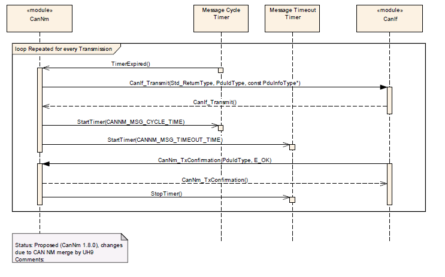

### 8.2. CanNm接收

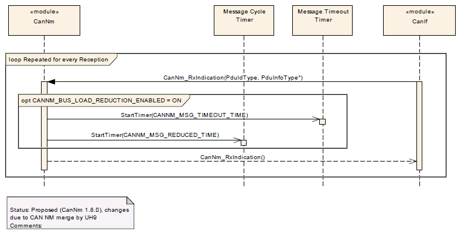

### 8.3. Nm协调

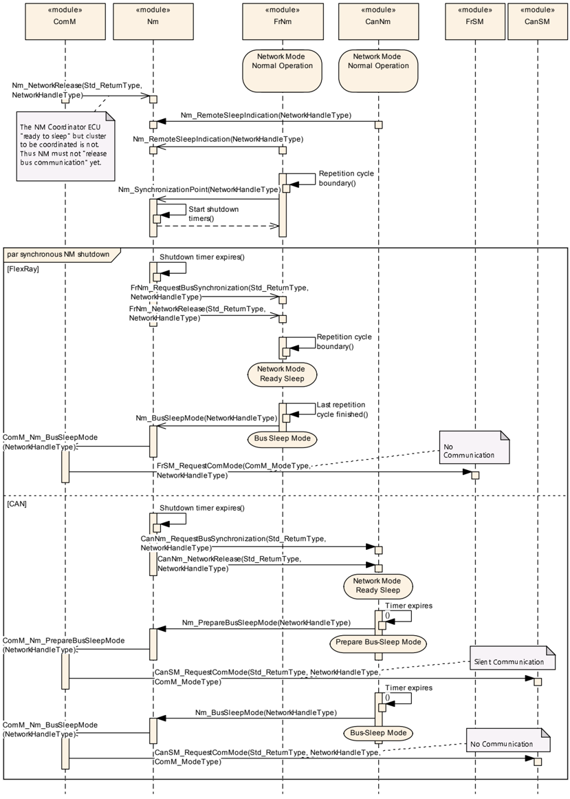

## 9. 配置规范

总体而言，本章定义配置参数及其到容器的聚类组织。为了支持本规范，第9.1节描述基础知识，并规定了应用于参数规范的模板（表）。我们有意将第9.1节保留在规范中以保证可理解性。

第9.2节规定模块**CanNm**的结构（容器）和参数。

第9.3节规定模块**CanNm**的发布信息。

### 9.1. 阅读本章的方法

详情请参阅SWS_BSWGeneral[\[4\]](#ref-4)中的章节10.1「配置规范简介」（**Introduction to configuration specification**）。

此外，强烈建议阅读文档《ECU配置规范》[\[10\]](#ref-10)。该文档详细描述了**AUTOSAR**配置方法和**AUTOSAR**配置元模型。

### 9.2. 容器与配置参数

以下各节汇总所有配置参数。各参数的详细含义在第6章和第7章中描述。

本章定义的配置参数用于为**AUTOSAR**工具链创建数据模型。在代码中的实现是实现特定的。

配置参数分为：用于启用功能的参数、影响**CanNm**所有通道的参数以及影响**CanNm**各自通道的参数。

#### 9.2.1. CanNm

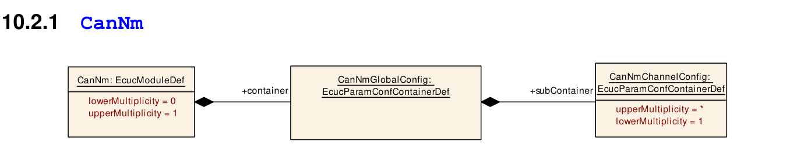

| SWS 条目 | [ECUC_CanNm_00087] |
| --- | --- |
| 模块名称 | CanNm |
| 描述 | **CAN NM**模块的配置参数。 |
| Post-Build 变体支持 | true |
| 支持的配置变体 | VARIANT-LINK-TIME, VARIANT-POST-BUILD, VARIANT-PRE-COMPILE |

| 包含的容器 | 容器名称 | 多重性 | 作用域/依赖 |
| --- | --- | --- | --- |
| 包含的容器 | CanNmGlobalConfig | 1 | 该容器包含**CanNm**的全局配置参数。这些参数以及子容器的参数应（在可能的情况下）映射到传递给**CanNm_Init**函数的C数据类型**CanNm_ConfigType**。 |

#### 9.2.2. CanNmGlobalConfig

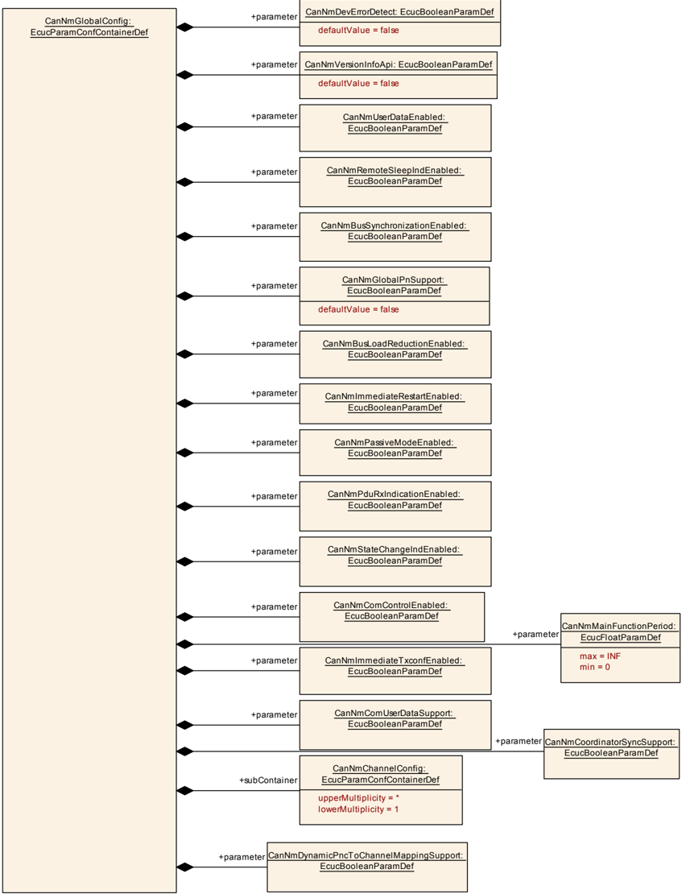

| SWS 条目 | [ECUC_CanNm_00001] |
| --- | --- |
| 容器名称 | CanNmGlobalConfig |
| 父容器 | CanNm |
| 描述 | 该容器包含**CanNm**的全局配置参数。这些参数以及子容器的参数应（在可能的情况下）映射到传递给**CanNm_Init**函数的C数据类型**CanNm_ConfigType**。 |
| 配置参数 | 见下方参数表 |

| SWS 条目 | [ECUC_CanNm_00040] |
| --- | --- |
| 参数名称 | CanNmBusLoadReductionEnabled |
| 父容器 | CanNmGlobalConfig |
| 描述 | 用于启用总线负载降低支持的预处理器开关。 |
| 多重性 | 1 |
| 类型 | EcucBooleanParamDef |
| 默认值 | - |
| Post-Build 变体值 | false |
| 值配置类 | Pre-compile time：X（All Variants）；Link time：-；Post-build time：- |
| 作用域/依赖 | scope: local；dependency: 如果**CanNmPassiveModeEnabled** == true 或 **CanNmGlobalPnSupport** == true，则 **CanNmBusLoadReductionEnabled** = false |

| SWS 条目 | [ECUC_CanNm_00006] |
| --- | --- |
| 参数名称 | CanNmBusSynchronizationEnabled |
| 父容器 | CanNmGlobalConfig |
| 描述 | 用于启用总线同步支持的预处理器开关。该功能仅网关节点需要。 |
| 多重性 | 1 |
| 类型 | EcucBooleanParamDef |
| 默认值 | - |
| Post-Build 变体值 | false |
| 值配置类 | Pre-compile time：X（All Variants）；Link time：-；Post-build time：- |
| 作用域/依赖 | scope: ECU；dependency: calculationFormula = If (CanNmPassiveModeEnabled == False) then Equal(NmBusSynchronizationEnabled) else Equal(False) |

| SWS 条目 | [ECUC_CanNm_00013] |
| --- | --- |
| 参数名称 | CanNmComControlEnabled |
| 父容器 | CanNmGlobalConfig |
| 描述 | 用于启用通信控制（**Communication Control**）支持的预处理器开关。 |
| 多重性 | 1 |
| 类型 | EcucBooleanParamDef |
| 默认值 | - |
| Post-Build 变体值 | false |
| 值配置类 | Pre-compile time：X（All Variants）；Link time：-；Post-build time：- |
| 作用域/依赖 | scope: ECU；dependency: If (CanNmPassiveModeEnabled == False) then Equal(NmComControlEnabled) else Equal(False) |

| SWS 条目 | [ECUC_CanNm_00044] |
| --- | --- |
| 参数名称 | CanNmComUserDataSupport |
| 父容器 | CanNmGlobalConfig |
| 描述 | 用于启用**COM**用户数据**Tx**路径的预处理器开关。用例：通过**SWC**设置**NMUserData**。 |
| 多重性 | 1 |
| 类型 | EcucBooleanParamDef |
| 默认值 | - |
| Post-Build 变体值 | false |
| 值配置类 | Pre-compile time：X（All Variants）；Link time：-；Post-build time：- |
| 作用域/依赖 | scope: ECU；dependency: 如果 **CanNmPassiveModeEnabled** == true，或者**NM PDU**的所有字节都被**NM**系统字节和**PNC**位向量使用而没有为用户数据留下空间，则 **CanNmComUserDataSupport** 应设置为 False。 |

| SWS 条目 | [ECUC_CanNm_00080] |
| --- | --- |
| 参数名称 | CanNmCoordinatorSyncSupport |
| 父容器 | CanNmGlobalConfig |
| 描述 | 启用/禁用协调器同步支持。 |
| 多重性 | 1 |
| 类型 | EcucBooleanParamDef |
| 默认值 | - |
| Post-Build 变体值 | false |
| 值配置类 | Pre-compile time：X（All Variants）；Link time：-；Post-build time：- |
| 作用域/依赖 | scope: ECU；dependency: 如果 **CanNmPassiveModeEnabled** 设置为 **TRUE**，则 **CanNmCoordinatorSyncSupport** 必须设置为 **FALSE**。 |

| SWS 条目 | [ECUC_CanNm_00002] |
| --- | --- |
| 参数名称 | CanNmDevErrorDetect |
| 父容器 | CanNmGlobalConfig |
| 描述 | 开启或关闭开发错误检测与通知（true：启用检测与通知；false：禁用检测与通知）。 |
| 多重性 | 1 |
| 类型 | EcucBooleanParamDef |
| 默认值 | false |
| Post-Build 变体值 | false |
| 值配置类 | Pre-compile time：X（All Variants）；Link time：-；Post-build time：- |
| 作用域/依赖 | scope: local |

| SWS 条目 | [ECUC_CanNm_00094] |
| --- | --- |
| 参数名称 | CanNmDynamicPncToChannelMappingSupport |
| 父容器 | CanNmGlobalConfig |
| 描述 | 用于启用动态**PNC**到通道映射处理的预编译开关。False：禁用动态**PNC**到通道映射；True：启用动态**PNC**到通道映射。 |
| 多重性 | 1 |
| 类型 | EcucBooleanParamDef |
| 默认值 | - |
| Post-Build 变体值 | false |
| 值配置类 | Pre-compile time：X（All Variants）；Link time：-；Post-build time：- |
| 作用域/依赖 | scope: ECU；dependency: 仅当 **CanNmGlobalPnSupport** == **TRUE** 且 **CanNmPassiveModeEnabled** == **FALSE** 时才允许 **CanNmDynamicPncToChannelMappingSupport** == **TRUE** |

| SWS 条目 | [ECUC_CanNm_00086] |
| --- | --- |
| 参数名称 | CanNmGlobalPnSupport |
| 父容器 | CanNmGlobalConfig |
| 描述 | 用于全局启用部分网络支持的预处理器开关。 |
| 多重性 | 1 |
| 类型 | EcucBooleanParamDef |
| 默认值 | false |
| Post-Build 变体值 | false |
| 值配置类 | Pre-compile time：X（All Variants）；Link time：-；Post-build time：- |
| 作用域/依赖 | scope: local |

| SWS 条目 | [ECUC_CanNm_00009] |
| --- | --- |
| 参数名称 | CanNmImmediateRestartEnabled |
| 父容器 | CanNmGlobalConfig |
| 描述 | 用于在准备总线睡眠模式中收到总线通信请求时立即传输**NM PDU**的预处理器开关。 |
| 多重性 | 1 |
| 类型 | EcucBooleanParamDef |
| 默认值 | - |
| Post-Build 变体值 | false |
| 值配置类 | Pre-compile time：X（All Variants）；Link time：-；Post-build time：- |
| 作用域/依赖 | scope: local；dependency: 如果 **CanNmPassiveModeEnabled** == true，则不得定义。 |

| SWS 条目 | [ECUC_CanNm_00041] |
| --- | --- |
| 参数名称 | CanNmImmediateTxconfEnabled |
| 父容器 | CanNmGlobalConfig |
| 描述 | 启用/禁用立即**Tx**确认。 |
| 多重性 | 1 |
| 类型 | EcucBooleanParamDef |
| 默认值 | - |
| Post-Build 变体值 | false |
| 值配置类 | Pre-compile time：X（All Variants）；Link time：-；Post-build time：- |
| 作用域/依赖 | scope: ECU；dependency: 如果启用了 **CanNmPassiveModeEnabled**，则不应启用 **CanNmImmediateTxconfEnabled**。 |

| SWS 条目 | [ECUC_CanNm_00032] |
| --- | --- |
| 参数名称 | CanNmMainFunctionPeriod |
| 父容器 | CanNmGlobalConfig |
| 描述 | **CanNm_MainFunction**的调用周期（以秒为单位）。 |
| 多重性 | 1 |
| 类型 | EcucFloatParamDef |
| 取值范围 | ]0 .. INF[ |
| 默认值 | - |
| Post-Build 变体值 | false |
| 值配置类 | Pre-compile time：X（VARIANT-PRE-COMPILE）；Link time：X（VARIANT-LINK-TIME, VARIANT-POST-BUILD）；Post-build time：- |
| 作用域/依赖 | scope: local |

| SWS 条目 | [ECUC_CanNm_00010] |
| --- | --- |
| 参数名称 | CanNmPassiveModeEnabled |
| 父容器 | CanNmGlobalConfig |
| 描述 | 用于启用被动模式（**Passive Mode**）支持的预处理器开关。 |
| 多重性 | 1 |
| 类型 | EcucBooleanParamDef |
| 默认值 | - |
| Post-Build 变体值 | false |
| 值配置类 | Pre-compile time：X（All Variants）；Link time：-；Post-build time：- |
| 作用域/依赖 | scope: ECU |

| SWS 条目 | [ECUC_CanNm_00011] |
| --- | --- |
| 参数名称 | CanNmPduRxIndicationEnabled |
| 父容器 | CanNmGlobalConfig |
| 描述 | 用于启用**PDU Rx**指示的预处理器开关。 |
| 多重性 | 1 |
| 类型 | EcucBooleanParamDef |
| 默认值 | - |
| Post-Build 变体值 | false |
| 值配置类 | Pre-compile time：X（All Variants）；Link time：-；Post-build time：- |
| 作用域/依赖 | scope: ECU；dependency: calculationFormula = Equal(NmPduRxIndicationEnabled) |

| SWS 条目 | [ECUC_CanNm_00055] |
| --- | --- |
| 参数名称 | CanNmRemoteSleepIndEnabled |
| 父容器 | CanNmGlobalConfig |
| 描述 | 用于启用远程睡眠指示支持的预处理器开关。该功能仅网关节点需要。 |
| 多重性 | 1 |
| 类型 | EcucBooleanParamDef |
| 默认值 | - |
| Post-Build 变体值 | false |
| 值配置类 | Pre-compile time：X（All Variants）；Link time：-；Post-build time：- |
| 作用域/依赖 | scope: local；dependency: calculationFormula = If (CanNmPassiveModeEnabled == False) then Equal(NmRemoteSleepIndEnabled) else Equal(False) |

| SWS 条目 | [ECUC_CanNm_00012] |
| --- | --- |
| 参数名称 | CanNmStateChangeIndEnabled |
| 父容器 | CanNmGlobalConfig |
| 描述 | 用于启用**CAN NM**状态变化通知的预处理器开关。 |
| 多重性 | 1 |
| 类型 | EcucBooleanParamDef |
| 默认值 | - |
| Post-Build 变体值 | false |
| 值配置类 | Pre-compile time：X（All Variants）；Link time：-；Post-build time：- |
| 作用域/依赖 | scope: ECU |

| SWS 条目 | [ECUC_CanNm_00004] |
| --- | --- |
| 参数名称 | CanNmUserDataEnabled |
| 父容器 | CanNmGlobalConfig |
| 描述 | 用于启用用户数据支持的预处理器开关。 |
| 多重性 | 1 |
| 类型 | EcucBooleanParamDef |
| 默认值 | - |
| Post-Build 变体值 | false |
| 值配置类 | Pre-compile time：X（All Variants）；Link time：-；Post-build time：- |
| 作用域/依赖 | scope: ECU；dependency: 如果**NM PDU**的所有字节都被**NM**系统字节和**PNC**位向量使用而没有为用户数据留下空间，则 **CanNmUserDataEnabled** 应设置为 **FALSE**。否则，该参数应按照以下公式设置： |

| SWS 条目 | [ECUC_CanNm_00003] |
| --- | --- |
| 参数名称 | CanNmVersionInfoApi |
| 父容器 | CanNmGlobalConfig |
| 描述 | 用于启用版本信息**API**支持的预处理器开关。 |
| 多重性 | 1 |
| 类型 | EcucBooleanParamDef |
| 默认值 | false |
| Post-Build 变体值 | false |
| 值配置类 | Pre-compile time：X（All Variants）；Link time：-；Post-build time：- |
| 作用域/依赖 | scope: ECU |

| 包含的容器 | 容器名称 | 多重性 | 作用域/依赖 |
| --- | --- | --- | --- |
| 包含的容器 | CanNmChannelConfig | 1..* | 该容器包含**CanNm**的通道特定配置参数。 |

#### 9.2.3. CanNmChannelConfig

容器**CanNmChannelConfig**规定的配置参数应位于**CanNm_ConfigType**类型的数据结构中。

下面列出的运行时可配置参数应针对每个网络管理集群单独进行配置。

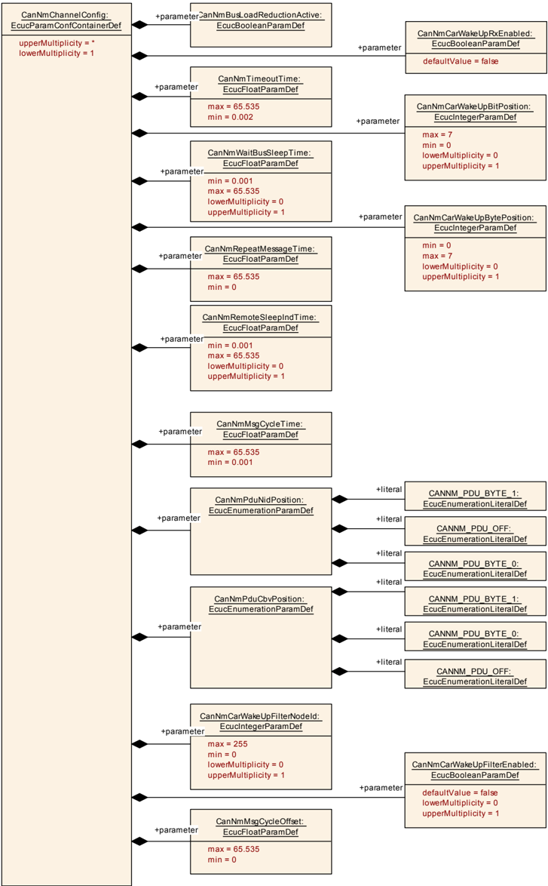

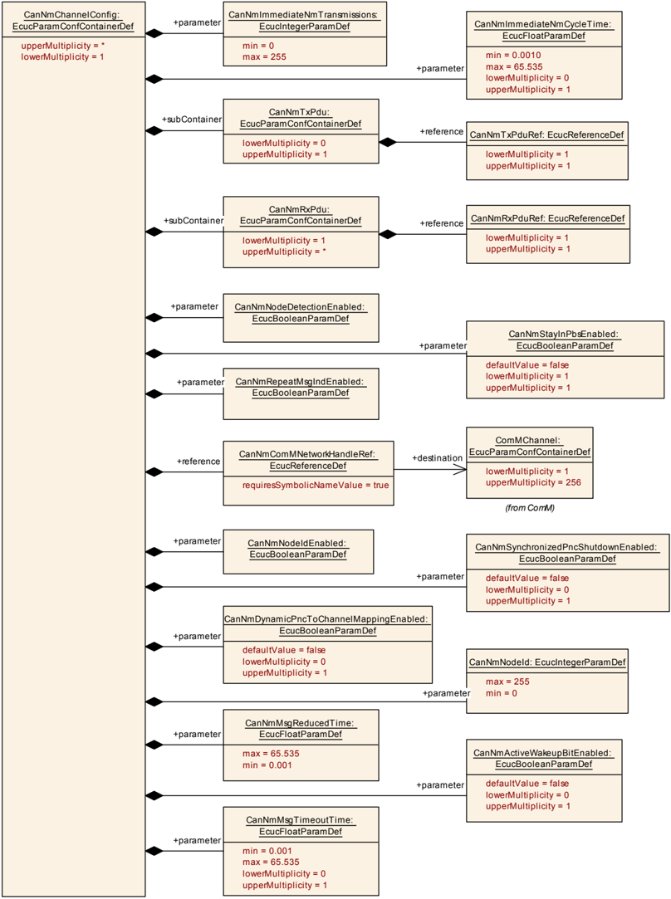

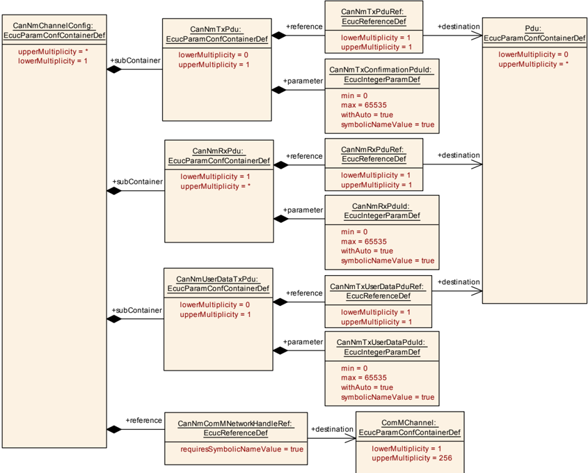

| SWS 条目 | [ECUC_CanNm_00017] |
| --- | --- |
| 容器名称 | CanNmChannelConfig |
| 父容器 | CanNmGlobalConfig |
| 描述 | 该容器包含**CanNm**的通道特定配置参数。 |
| Post-Build 变体多重性 | true |
| 多重性配置类 | Pre-compile time：X（VARIANT-PRE-COMPILE, VARIANT-LINK-TIME, VARIANT-POST-BUILD）；Link time：-；Post-build time：- |
| 配置参数 | 见下方参数表 |

| SWS 条目 | [ECUC_CanNm_00084] |
| --- | --- |
| 参数名称 | CanNmActiveWakeupBitEnabled |
| 父容器 | CanNmChannelConfig |
| 描述 | 启用/禁用**CanNm**模块中对主动唤醒位（**Active Wakeup Bit**）的处理。 |
| 多重性 | 0..1 |
| 类型 | EcucBooleanParamDef |
| 默认值 | false |
| Post-Build 变体多重性 | false |
| Post-Build 变体值 | false |
| 多重性配置类 | Pre-compile time：X（VARIANT-PRE-COMPILE）；Link time：X（VARIANT-LINK-TIME, VARIANT-POST-BUILD）；Post-build time：- |
| 值配置类 | Pre-compile time：X（VARIANT-PRE-COMPILE）；Link time：X（VARIANT-LINK-TIME, VARIANT-POST-BUILD）；Post-build time：- |
| 作用域/依赖 | scope: local；dependency: 仅当 **CanNmPassiveModeEnabled** 为 **False** 时该参数有效。 |

| SWS 条目 | [ECUC_CanNm_00068] |
| --- | --- |
| 参数名称 | CanNmAllNmMessagesKeepAwake |
| 父容器 | CanNmChannelConfig |
| 描述 | 规定**CanNm**是否丢弃无关的**NM PDU**。false：只有 **PNI** 位 = true 且包含针对本**ECU**的**PN**请求的**NM PDU**才触发标准的Rx指示处理；true：每个**NM PDU**都触发标准的Rx指示处理。 |
| 多重性 | 0..1 |
| 类型 | EcucBooleanParamDef |
| 默认值 | false |
| Post-Build 变体多重性 | false |
| Post-Build 变体值 | false |
| 多重性配置类 | Pre-compile time：X（VARIANT-PRE-COMPILE）；Link time：X（VARIANT-LINK-TIME, VARIANT-POST-BUILD）；Post-build time：- |
| 值配置类 | Pre-compile time：X（VARIANT-PRE-COMPILE）；Link time：X（VARIANT-LINK-TIME, VARIANT-POST-BUILD）；Post-build time：- |
| 作用域/依赖 | scope: local；dependency: 仅当 **NmPnEiraCalcEnabled** == true 或 **NmPnEraCalcEnabled** == true 时有效 |

| SWS 条目 | [ECUC_CanNm_00042] |
| --- | --- |
| 参数名称 | CanNmBusLoadReductionActive |
| 父容器 | CanNmChannelConfig |
| 描述 | 该参数定义相应**NM**通道的总线负载降低是否处于活动状态。 |
| 多重性 | 1 |
| 类型 | EcucBooleanParamDef |
| 默认值 | - |
| Post-Build 变体值 | false |
| 值配置类 | Pre-compile time：X（VARIANT-PRE-COMPILE）；Link time：X（VARIANT-LINK-TIME, VARIANT-POST-BUILD）；Post-build time：- |
| 作用域/依赖 | scope: local；dependency: 如果 **CanNmBusLoadReductionEnabled** == false，则 **CanNmBusLoadReductionActive** = false |

| SWS 条目 | [ECUC_CanNm_00075] |
| --- | --- |
| 参数名称 | CanNmCarWakeUpBitPosition |
| 父容器 | CanNmChannelConfig |
| 描述 | 规定**CWU**在**NM PDU**中的位位置。 |
| 多重性 | 0..1 |
| 类型 | EcucIntegerParamDef |
| 取值范围 | 0 .. 7 |
| 默认值 | - |
| Post-Build 变体多重性 | false |
| Post-Build 变体值 | false |
| 多重性配置类 | Pre-compile time：X（VARIANT-PRE-COMPILE）；Link time：X（VARIANT-LINK-TIME, VARIANT-POST-BUILD）；Post-build time：- |
| 值配置类 | Pre-compile time：X（VARIANT-PRE-COMPILE）；Link time：X（VARIANT-LINK-TIME, VARIANT-POST-BUILD）；Post-build time：- |
| 作用域/依赖 | scope: local；dependency: 仅当 **CanNmCarWakeUpRxEnabled** == **TRUE** 时可用 |

| SWS 条目 | [ECUC_CanNm_00076] |
| --- | --- |
| 参数名称 | CanNmCarWakeUpBytePosition |
| 父容器 | CanNmChannelConfig |
| 描述 | 规定**CWU**在**NM PDU**中的字节位置。 |
| 多重性 | 0..1 |
| 类型 | EcucIntegerParamDef |
| 取值范围 | 0 .. 7 |
| 默认值 | - |
| Post-Build 变体多重性 | false |
| Post-Build 变体值 | false |
| 多重性配置类 | Pre-compile time：X（VARIANT-PRE-COMPILE）；Link time：X（VARIANT-LINK-TIME, VARIANT-POST-BUILD）；Post-build time：- |
| 值配置类 | Pre-compile time：X（VARIANT-PRE-COMPILE）；Link time：X（VARIANT-LINK-TIME, VARIANT-POST-BUILD）；Post-build time：- |
| 作用域/依赖 | scope: local；dependency: 仅当 **CanNmCarWakeUpRxEnabled** == **TRUE** 时可用；**CanNmCarWakeupBytePosition** >= 启用的系统字节（CBV、NID）的数量 |

| SWS 条目 | [ECUC_CanNm_00077] |
| --- | --- |
| 参数名称 | CanNmCarWakeUpFilterEnabled |
| 父容器 | CanNmChannelConfig |
| 描述 | 如果支持**CWU**过滤，则只有源节点标识符为 **CanNmCarWakeUpFilterNodeId** 的**NM PDU**内的**CWU**位才被视为**CWU**请求。FALSE：不支持**CWU**过滤；TRUE：支持**CWU**过滤。 |
| 多重性 | 0..1 |
| 类型 | EcucBooleanParamDef |
| 默认值 | false |
| Post-Build 变体多重性 | false |
| Post-Build 变体值 | false |
| 多重性配置类 | Pre-compile time：X（VARIANT-PRE-COMPILE）；Link time：X（VARIANT-LINK-TIME, VARIANT-POST-BUILD）；Post-build time：- |
| 值配置类 | Pre-compile time：X（VARIANT-PRE-COMPILE）；Link time：X（VARIANT-LINK-TIME, VARIANT-POST-BUILD）；Post-build time：- |
| 作用域/依赖 | scope: local；dependency: 仅当 **CanNmCarWakeUpRxEnabled** == **TRUE** 时可用 |

| SWS 条目 | [ECUC_CanNm_00078] |
| --- | --- |
| 参数名称 | CanNmCarWakeUpFilterNodeId |
| 父容器 | CanNmChannelConfig |
| 描述 | 用于**CWU**过滤的源节点标识符。如果支持**CWU**过滤，则只有源节点标识符为 **CanNmCarWakeUpFilterNodeId** 的**NM PDU**内的**CWU**位才被视为**CWU**请求。 |
| 多重性 | 0..1 |
| 类型 | EcucIntegerParamDef |
| 取值范围 | 0 .. 255 |
| 默认值 | - |
| Post-Build 变体多重性 | false |
| Post-Build 变体值 | false |
| 多重性配置类 | Pre-compile time：X（VARIANT-PRE-COMPILE）；Link time：X（VARIANT-LINK-TIME, VARIANT-POST-BUILD）；Post-build time：- |
| 值配置类 | Pre-compile time：X（VARIANT-PRE-COMPILE）；Link time：X（VARIANT-LINK-TIME, VARIANT-POST-BUILD）；Post-build time：- |
| 作用域/依赖 | scope: local；dependency: 仅当 **CanNmCarWakeUpFilterEnabled** == **TRUE** 时可用 |

| SWS 条目 | [ECUC_CanNm_00074] |
| --- | --- |
| 参数名称 | CanNmCarWakeUpRxEnabled |
| 父容器 | CanNmChannelConfig |
| 描述 | 启用或禁用对接收到的**NM PDU**中整车唤醒（**CarWakeUp**）位求值的支持。FALSE：不支持**CarWakeUp**；TRUE：支持**CarWakeUp**。 |
| 多重性 | 1 |
| 类型 | EcucBooleanParamDef |
| 默认值 | false |
| Post-Build 变体值 | false |
| 值配置类 | Pre-compile time：X（VARIANT-PRE-COMPILE）；Link time：X（VARIANT-LINK-TIME, VARIANT-POST-BUILD）；Post-build time：- |
| 作用域/依赖 | scope: ECU |

| SWS 条目 | [ECUC_CanNm_00093] |
| --- | --- |
| 参数名称 | CanNmDynamicPncToChannelMappingEnabled |
| 父容器 | CanNmChannelConfig |
| 描述 | 用于启用动态**PNC**到通道映射功能的通道特定参数。False：禁用动态**PNC**到通道映射；True：启用动态**PNC**到通道映射。 |
| 多重性 | 0..1 |
| 类型 | EcucBooleanParamDef |
| 默认值 | false |
| Post-Build 变体值 | false |
| 值配置类 | Pre-compile time：X（VARIANT-PRE-COMPILE）；Link time：X（VARIANT-LINK-TIME, VARIANT-POST-BUILD）；Post-build time：- |
| 作用域/依赖 | scope: ECU；dependency: 仅当 **CanNmDynamicPncToChannelMappingSupport** 为 **TRUE** 时才应为 **TRUE** |

| SWS 条目 | [ECUC_CanNm_00057] |
| --- | --- |
| 参数名称 | CanNmImmediateNmCycleTime |
| 父容器 | CanNmChannelConfig |
| 描述 | 定义立即**NM PDU**周期时间（以秒为单位），用于 **CanNmImmediateNmTransmissions** 次**NM PDU**传输。 |
| 多重性 | 0..1 |
| 类型 | EcucFloatParamDef |
| 取值范围 | [0.001 .. 65.535] |
| 默认值 | - |
| Post-Build 变体多重性 | false |
| Post-Build 变体值 | false |
| 多重性配置类 | Pre-compile time：X（VARIANT-PRE-COMPILE）；Link time：X（VARIANT-LINK-TIME, VARIANT-POST-BUILD）；Post-build time：- |
| 值配置类 | Pre-compile time：X（VARIANT-PRE-COMPILE）；Link time：X（VARIANT-LINK-TIME, VARIANT-POST-BUILD）；Post-build time：- |
| 作用域/依赖 | scope: local；dependency: 仅当 **CanNmImmediateNmTransmissions** 大于1时该参数有效。 |

| SWS 条目 | [ECUC_CanNm_00056] |
| --- | --- |
| 参数名称 | CanNmImmediateNmTransmissions |
| 父容器 | CanNmChannelConfig |
| 描述 | 定义应传输的立即**NM PDU**的数量。如果该值为零，则不传输立即**NM PDU**。立即**NM PDU**的周期时间由 **CanNmImmediateNmCycleTime** 定义。 |
| 多重性 | 1 |
| 类型 | EcucIntegerParamDef |
| 取值范围 | 0 .. 255 |
| 默认值 | - |
| Post-Build 变体值 | false |
| 值配置类 | Pre-compile time：X（VARIANT-PRE-COMPILE）；Link time：X（VARIANT-LINK-TIME, VARIANT-POST-BUILD）；Post-build time：- |
| 作用域/依赖 | scope: local；dependency: 如果 **CanNmImmediateRestartEnabled** = true，则 **CanNmImmediateNmTransmissions** = 0；如果 **CanNmPnHandleMultipleNetworkRequests** == True，则 **CanNmImmediateNmTransmissions** 必须大于0。 |

| SWS 条目 | [ECUC_CanNm_00029] |
| --- | --- |
| 参数名称 | CanNmMsgCycleOffset |
| 父容器 | CanNmChannelConfig |
| 描述 | 周期传输模式中的时间偏移。它决定传输的启动延迟。以秒为单位。 |
| 多重性 | 1 |
| 类型 | EcucFloatParamDef |
| 取值范围 | [0 .. 65.535] |
| 默认值 | - |
| Post-Build 变体值 | true |
| 值配置类 | Pre-compile time：X（VARIANT-PRE-COMPILE）；Link time：X（VARIANT-LINK-TIME, VARIANT-POST-BUILD）；Post-build time：- |
| 作用域/依赖 | scope: local；dependency: 参数值 < **CanNmMsgCycleTime**；仅当 **CanNmPassiveModeEnabled** 为 **False** 时该参数有效。 |

| SWS 条目 | [ECUC_CanNm_00028] |
| --- | --- |
| 参数名称 | CanNmMsgCycleTime |
| 父容器 | CanNmChannelConfig |
| 描述 | **NM PDU**的周期（以秒为单位）。它确定「具有总线负载降低的周期性传输模式」中的周期速率，并且是「不具有总线负载降低的周期性传输模式」中传输调度的基础。 |
| 多重性 | 1 |
| 类型 | EcucFloatParamDef |
| 取值范围 | [0.001 .. 65.535] |
| 默认值 | - |
| Post-Build 变体值 | false |
| 值配置类 | Pre-compile time：X（VARIANT-PRE-COMPILE）；Link time：X（VARIANT-LINK-TIME, VARIANT-POST-BUILD）；Post-build time：- |
| 作用域/依赖 | scope: ECU；dependency: 仅当 **CanNmPassiveModeEnabled** 为 **False** 时该参数有效。 |

| SWS 条目 | [ECUC_CanNm_00043] |
| --- | --- |
| 参数名称 | CanNmMsgReducedTime |
| 父容器 | CanNmChannelConfig |
| 描述 | 具有总线负载降低的周期性传输模式中节点特定的总线周期时间。以秒为单位。 |
| 多重性 | 1 |
| 类型 | EcucFloatParamDef |
| 取值范围 | [0.001 .. 65.535] |
| 默认值 | - |
| Post-Build 变体值 | true |
| 值配置类 | Pre-compile time：X（VARIANT-PRE-COMPILE）；Link time：X（VARIANT-LINK-TIME, VARIANT-POST-BUILD）；Post-build time：- |
| 作用域/依赖 | scope: local；dependency: 0,5 * **CanNmMsgCycleTime** <= **CanNmMsgReducedTime** < **CanNmMsgCycleTime**；仅当 **CanNmBusLoadReductionEnabled** == **True** 且 **CanNmBusLoadReductionActive** == **True** 且 **CanNmPassiveModeEnabled** == **False** 时该参数有效，否则不使用该参数。 |

| SWS 条目 | [ECUC_CanNm_00030] |
| --- | --- |
| 参数名称 | CanNmMsgTimeoutTime |
| 父容器 | CanNmChannelConfig |
| 描述 | 当使用部分网络且定义了该超时时间时，**CanNm**监控**NM-PDU**是否在此传输超时时间内成功传输，否则提供错误通知。 |
| 多重性 | 0..1 |
| 类型 | EcucFloatParamDef |
| 取值范围 | [0.001 .. 65.535] |
| 默认值 | - |
| Post-Build 变体多重性 | true |
| Post-Build 变体值 | true |
| 多重性配置类 | Pre-compile time：X（VARIANT-PRE-COMPILE）；Link time：X（VARIANT-LINK-TIME, VARIANT-POST-BUILD）；Post-build time：- |
| 值配置类 | Pre-compile time：X（VARIANT-PRE-COMPILE）；Link time：X（VARIANT-LINK-TIME, VARIANT-POST-BUILD）；Post-build time：- |
| 作用域/依赖 | scope: local；dependency: **CanNmMsgTimeoutTime** < **CanNmMsgCycleTime**；仅当 **CanNmPassiveModeEnabled** 和 **CanNmImmediateTxConfEnabled** 设置为 **FALSE** 且 **CanNmPnEnabled** 设置为 **TRUE** 时该参数有效。 |

| SWS 条目 | [ECUC_CanNm_00088] |
| --- | --- |
| 参数名称 | CanNmNodeDetectionEnabled |
| 父容器 | CanNmChannelConfig |
| 描述 | 用于启用节点检测功能的预编译开关。 |
| 多重性 | 1 |
| 类型 | EcucBooleanParamDef |
| 默认值 | - |
| Post-Build 变体值 | false |
| 值配置类 | Pre-compile time：X（VARIANT-PRE-COMPILE）；Link time：X（VARIANT-LINK-TIME, VARIANT-POST-BUILD）；Post-build time：- |
| 作用域/依赖 | scope: ECU；dependency: 仅当 **CanNmNodeIdEnabled** 设置为 **TRUE** 时有效；如果 **CanNmPassiveModeEnabled** == **True**，则 **CanNmNodeDetection** = **False** |

| SWS 条目 | [ECUC_CanNm_00031] |
| --- | --- |
| 参数名称 | CanNmNodeId |
| 父容器 | CanNmChannelConfig |
| 描述 | 本地节点的节点标识符。 |
| 多重性 | 1 |
| 类型 | EcucIntegerParamDef |
| 取值范围 | 0 .. 255 |
| 默认值 | - |
| Post-Build 变体值 | true |
| 值配置类 | Pre-compile time：X（VARIANT-PRE-COMPILE）；Link time：X（VARIANT-LINK-TIME）；Post-build time：X（VARIANT-POST-BUILD） |
| 作用域/依赖 | scope: local |

| SWS 条目 | [ECUC_CanNm_00090] |
| --- | --- |
| 参数名称 | CanNmNodeIdEnabled |
| 父容器 | CanNmChannelConfig |
| 描述 | 用于启用源节点标识符的预处理器开关。 |
| 多重性 | 1 |
| 类型 | EcucBooleanParamDef |
| 默认值 | - |
| Post-Build 变体值 | false |
| 值配置类 | Pre-compile time：X（VARIANT-PRE-COMPILE）；Link time：X（VARIANT-LINK-TIME, VARIANT-POST-BUILD）；Post-build time：- |
| 作用域/依赖 | scope: ECU；dependency: calculationFormula = Equal(NmNodeIdEnabled) |

| SWS 条目 | [ECUC_CanNm_00026] |
| --- | --- |
| 参数名称 | CanNmPduCbvPosition |
| 父容器 | CanNmChannelConfig |
| 描述 | 定义控制位向量在**NM PDU**中的位置。该参数的值表示控制位向量在**NM PDU**中的位置（**CanNmPduByte0** 表示字节0，**CanNmPduByte1** 表示字节1，**CanNmPduOff** 表示源节点标识符不是**NM PDU**的一部分）。实现类型：**CanNm_PduPositionType**。 |
| 多重性 | 1 |
| 类型 | EcucEnumerationParamDef |
| 取值范围 | CANNM_PDU_BYTE_0：使用字节0 |
| 取值范围 | CANNM_PDU_BYTE_1：使用字节1 |
| 取值范围 | CANNM_PDU_OFF：不使用控制位向量 |
| Post-Build 变体值 | false |
| 值配置类 | Pre-compile time：X（VARIANT-PRE-COMPILE）；Link time：X（VARIANT-LINK-TIME, VARIANT-POST-BUILD）；Post-build time：- |
| 作用域/依赖 | scope: ECU；dependency: **CanNmPduNidPosition**；如果 **CanNmNodeDetectionEnabled** == true，则 **CanNmPduCbvPosition** != **CANNM_PDU_OFF**；如果 (**CanNmPduCbvPosition** != **CANNM_PDU_OFF** 且 **CanNmPduNidPosition** != **CANNM_PDU_OFF**)，则 **CanNmPduCbvPosition** != **CanNmPduNidPosition**；如果 (**CanNmPduCbvPosition** != **CANNM_PDU_OFF** 且 **CanNmPduNidPosition** == **CANNM_PDU_OFF**)，则 **CanNmPduCbvPosition** = **CANNM_PDU_BYTE0** |

| SWS 条目 | [ECUC_CanNm_00025] |
| --- | --- |
| 参数名称 | CanNmPduNidPosition |
| 父容器 | CanNmChannelConfig |
| 描述 | 定义源节点标识符在**NM PDU**中的位置。该参数的值表示源节点标识符在**NM PDU**中的位置（**CANNM_PDU_BYTE_0** 表示字节0，**CANNM_PDU_BYTE_1** 表示字节1，**CANNM_PDU_OFF** 表示源节点标识符不是**NM PDU**的一部分）。实现类型：**CanNm_PduPositionType**。 |
| 多重性 | 1 |
| 类型 | EcucEnumerationParamDef |
| 取值范围 | CANNM_PDU_BYTE_0：使用字节0 |
| 取值范围 | CANNM_PDU_BYTE_1：使用字节1 |
| 取值范围 | CANNM_PDU_OFF：不使用节点标识 |
| Post-Build 变体值 | false |
| 值配置类 | Pre-compile time：X（VARIANT-PRE-COMPILE）；Link time：X（VARIANT-LINK-TIME, VARIANT-POST-BUILD）；Post-build time：- |
| 作用域/依赖 | scope: ECU；dependency: **CanNmPduCbvPosition**；如果 **CanNmNodeIdEnabled** == true，则 **CanNmPduNidPosition** != **CANNM_PDU_OFF**；如果 (**CanNmPduNidPosition** != **CANNM_PDU_OFF** 且 **CanNmPduCbvPosition** != **CANNM_PDU_OFF**)，则 **CanNmPduNidPosition** != **CanNmPduCbvPosition**；如果 (**CanNmPduNidPosition** != **CANNM_PDU_OFF** 且 **CanNmPduCbvPosition** == **CANNM_PDU_OFF**)，则 **CanNmPduNidPosition** = **CANNM_PDU_BYTE0** |

| SWS 条目 | [ECUC_CanNm_00066] |
| --- | --- |
| 参数名称 | CanNmPnEnabled |
| 父容器 | CanNmChannelConfig |
| 描述 | 启用或禁用部分网络支持。false：不支持部分网络；true：支持部分网络。 |
| 多重性 | 0..1 |
| 类型 | EcucBooleanParamDef |
| 默认值 | false |
| Post-Build 变体多重性 | true |
| Post-Build 变体值 | true |
| 多重性配置类 | Pre-compile time：X（VARIANT-PRE-COMPILE）；Link time：X（VARIANT-LINK-TIME）；Post-build time：X（VARIANT-POST-BUILD） |
| 值配置类 | Pre-compile time：X（VARIANT-PRE-COMPILE）；Link time：X（VARIANT-LINK-TIME）；Post-build time：X（VARIANT-POST-BUILD） |
| 作用域/依赖 | scope: ECU；dependency: 仅当 **CanNmGlobalPnSupport** == true 时有效 |

| SWS 条目 | [ECUC_CanNm_00073] |
| --- | --- |
| 参数名称 | CanNmPnHandleMultipleNetworkRequests |
| 父容器 | CanNmChannelConfig |
| 描述 | 规定**CanNm**是否执行从网络模式（**Network Mode**）到重复消息状态（**Repeat Message State**）的额外转换（true）或不执行（false）。 |
| 多重性 | 0..1 |
| 类型 | EcucBooleanParamDef |
| 默认值 | false |
| Post-Build 变体多重性 | false |
| Post-Build 变体值 | false |
| 多重性配置类 | Pre-compile time：X（VARIANT-PRE-COMPILE）；Link time：X（VARIANT-LINK-TIME, VARIANT-POST-BUILD）；Post-build time：- |
| 值配置类 | Pre-compile time：X（VARIANT-PRE-COMPILE）；Link time：X（VARIANT-LINK-TIME, VARIANT-POST-BUILD）；Post-build time：- |
| 作用域/依赖 | scope: local；dependency: 仅当 **CanNmGlobalPnSupport** == true 时有效 |

| SWS 条目 | [ECUC_CanNm_00023] |
| --- | --- |
| 参数名称 | CanNmRemoteSleepIndTime |
| 父容器 | CanNmChannelConfig |
| 描述 | 远程睡眠指示的超时时间。它定义了识别所有其他节点已准备好睡眠所需的时间（以秒为单位）。 |
| 多重性 | 0..1 |
| 类型 | EcucFloatParamDef |
| 取值范围 | [0.001 .. 65.535] |
| 默认值 | - |
| Post-Build 变体值 | false |
| 值配置类 | Pre-compile time：X（VARIANT-PRE-COMPILE）；Link time：X（VARIANT-LINK-TIME, VARIANT-POST-BUILD）；Post-build time：- |
| 作用域/依赖 | scope: local；dependency: **CanNmRemoteSleepIndTime** >= **CanNmMsgCycleTime**；仅当 **CanNmRemoteSleepIndEnabled** = true 时才需要 **CanNmRemoteSleepIndTime** |

| SWS 条目 | [ECUC_CanNm_00022] |
| --- | --- |
| 参数名称 | CanNmRepeatMessageTime |
| 父容器 | CanNmChannelConfig |
| 描述 | 重复消息状态的超时时间。它定义了NM应在重复消息状态中停留的时间（以秒为单位）。 |
| 多重性 | 1 |
| 类型 | EcucFloatParamDef |
| 取值范围 | [0 .. 65.535] |
| 默认值 | - |
| Post-Build 变体值 | false |
| 值配置类 | Pre-compile time：X（VARIANT-PRE-COMPILE）；Link time：X（VARIANT-LINK-TIME, VARIANT-POST-BUILD）；Post-build time：- |
| 作用域/依赖 | scope: local；dependency: **CanNmRepeatMessageTime** = n * **CanNmMsgCycleTime**；**CanNmRepeatMessageTime** > **CanNmImmediateNmTransmissions** * **CanNmImmediateNmCycleTime**。通常它应等于 n * **CanNmMsgCycleTime**，其中 n 表示在重复消息状态中正常发送的**NM PDU**的数量。n 减1后的值决定了节点检测过程能够容忍的丢失**NM PDU**的数量。值0表示未配置重复消息状态。这意味着重复消息状态是瞬态的，即进入后立即离开，因此不会产生启动稳定性。 |

| SWS 条目 | [ECUC_CanNm_00089] |
| --- | --- |
| 参数名称 | CanNmRepeatMsgIndEnabled |
| 父容器 | CanNmChannelConfig |
| 描述 | 启用/禁用「已接收到重复消息请求位」的通知。 |
| 多重性 | 1 |
| 类型 | EcucBooleanParamDef |
| 默认值 | - |
| Post-Build 变体值 | false |
| 值配置类 | Pre-compile time：X（VARIANT-PRE-COMPILE）；Link time：X（VARIANT-LINK-TIME, VARIANT-POST-BUILD）；Post-build time：- |
| 作用域/依赖 | scope: ECU；dependency: 如果 **CanNmPassiveModeEnabled** == **TRUE**，或者 (**CanNmNodeDetectionEnabled** == **FALSE** 且 **CanNmDynamicPncToChannelMappingEnabled** == **FALSE**)，则 **CanNmRepeatMsgIndEnabled** = **FALSE**。如果 **CanNmDynamicPncToChannelMappingEnabled** == **TRUE**，则 **CanNmRepeatMsgIndEnabled** = **TRUE**。 |

| SWS 条目 | [ECUC_CanNm_00092] |
| --- | --- |
| 参数名称 | CanNmStayInPbsEnabled |
| 父容器 | CanNmChannelConfig |
| 描述 | 如果禁用该参数，则准备总线睡眠模式（**Prepare Bus-Sleep Mode**）会在 **CanNmWaitBusSleepTime** 之后离开。如果启用该参数，则只有在**ECU**断电或出现任何重启原因时才能离开准备总线睡眠模式。 |
| 多重性 | 1 |
| 类型 | EcucBooleanParamDef |
| 默认值 | false |
| Post-Build 变体值 | false |
| 值配置类 | Pre-compile time：X（VARIANT-PRE-COMPILE）；Link time：X（VARIANT-LINK-TIME, VARIANT-POST-BUILD）；Post-build time：- |
| 作用域/依赖 | scope: local |

| SWS 条目 | [ECUC_CanNm_00097] |
| --- | --- |
| 参数名称 | CanNmSynchronizedPncShutdownEnabled |
| 父容器 | CanNmChannelConfig |
| 描述 | 规定**CanNm**是否处理**PN**关闭消息以支持跨**PN**拓扑的同步**PNC**关闭。这仅用于充当顶级**PNC**协调器或中间**PNC**协调器角色的**ECU**。因此，**PNC**网关功能被启用，因此使用**ERA**计算。FALSE：禁用同步**PNC**关闭；TRUE：启用同步**PNC**关闭。 |
| 多重性 | 0..1 |
| 类型 | EcucBooleanParamDef |
| 默认值 | false |
| Post-Build 变体多重性 | false |
| Post-Build 变体值 | false |
| 多重性配置类 | Pre-compile time：X（VARIANT-PRE-COMPILE）；Link time：X（VARIANT-LINK-TIME）；Post-build time：- |
| 值配置类 | Pre-compile time：X（VARIANT-PRE-COMPILE）；Link time：X（VARIANT-LINK-TIME）；Post-build time：- |
| 作用域/依赖 | scope: local；dependency: 仅当 **CanNmPnEnabled** == **TRUE** 且 **NmPnEraCalcEnabled** == **TRUE** 时可用。 |

| SWS 条目 | [ECUC_CanNm_00020] |
| --- | --- |
| 参数名称 | CanNmTimeoutTime |
| 父容器 | CanNmChannelConfig |
| 描述 | 如果NM处于就绪睡眠状态（**Ready Sleep State**），它表示在最后一次**NM PDU**传输或接收之后，经过多长时间（以秒为单位）启动到准备总线睡眠模式（**Prepare Bus-Sleep Mode**）的状态转换。如果NM处于重复消息状态或正常操作状态，且在此时间内无法传输或接收**NM PDU**，则会引发运行时错误。 |
| 多重性 | 1 |
| 类型 | EcucFloatParamDef |
| 取值范围 | [0.002 .. 65.535] |
| 默认值 | - |
| Post-Build 变体值 | false |
| 值配置类 | Pre-compile time：X（VARIANT-PRE-COMPILE）；Link time：X（VARIANT-LINK-TIME, VARIANT-POST-BUILD）；Post-build time：- |
| 作用域/依赖 | scope: ECU；dependency: **CanNmTimeoutTime** > **CanNmMsgCycleTime**；对于集群中的所有节点它应相等；它应大于 **CanNmMsgCycleTime**。 |

| SWS 条目 | [ECUC_CanNm_00021] |
| --- | --- |
| 参数名称 | CanNmWaitBusSleepTime |
| 父容器 | CanNmChannelConfig |
| 描述 | 总线冷却阶段（**bus calm down phase**）的超时时间。它表示NM应在准备总线睡眠模式中停留多长时间（以秒为单位），之后才转换到总线睡眠模式（**Bus-Sleep Mode**）。 |
| 多重性 | 0..1 |
| 类型 | EcucFloatParamDef |
| 取值范围 | [0.001 .. 65.535] |
| 默认值 | - |
| Post-Build 变体值 | false |
| 值配置类 | Pre-compile time：X（VARIANT-PRE-COMPILE）；Link time：X（VARIANT-LINK-TIME, VARIANT-POST-BUILD）；Post-build time：- |
| 作用域/依赖 | scope: local；dependency: 对于集群中的所有节点它应相等；它应足够长以使所有**Tx**缓冲区清空。如果禁用了 **CanNmStayInPbsEnabled**，则该参数 |

| SWS 条目 | [ECUC_CanNm_00018] |
| --- | --- |
| 参数名称 | CanNmComMNetworkHandleRef |
| 父容器 | CanNmChannelConfig |
| 描述 | 该引用指向由 **ComMChannel** 定义的唯一通道，并提供对 **ComMChannelId** 中唯一通道索引值的访问。 |
| 多重性 | 1 |
| 类型 | 对 **ComMChannel** 的符号名称引用（**Symbolic name reference**） |
| Post-Build 变体值 | false |
| 值配置类 | Pre-compile time：-；Link time：X（VARIANT-LINK-TIME, VARIANT-POST-BUILD）；Post-build time：- |
| 作用域/依赖 | scope: local |

| 包含的容器 | 容器名称 | 多重性 | 作用域/依赖 |
| --- | --- | --- | --- |
| 包含的容器 | CanNmRxPdu | 1..* | 该容器用于配置**CanNm**通道所使用的Rx **PDU**属性。 |
| 包含的容器 | CanNmTxPdu | 0..1 | 该容器包含 **CanNmTxConfirmationPduId** 和 **CanNmTxPduRef**。 |
| 包含的容器 | CanNmUserDataTxPdu | 0..1 | 该可选容器用于配置 **UserNm PDU**。仅当启用了 **CanNmComUserDataSupport** 时该容器才可用。 |

#### 9.2.4. CanNmRxPdu

| SWS 条目 | [ECUC_CanNm_00038] |
| --- | --- |
| 容器名称 | CanNmRxPdu |
| 父容器 | CanNmChannelConfig |
| 描述 | 该容器用于配置**CanNm**通道所使用的Rx **PDU**属性。 |
| 配置参数 | 见下方参数表 |

| SWS 条目 | [ECUC_CanNm_00054] |
| --- | --- |
| 参数名称 | CanNmRxPduId |
| 父容器 | CanNmRxPdu |
| 描述 | 该参数定义与此**CanNm**通道关联的 **CanIf** L-PDU 范围的Rx **PDU ID**。 |
| 多重性 | 1 |
| 类型 | EcucIntegerParamDef（为该参数生成符号名称） |
| 取值范围 | 0 .. 65535 |
| 默认值 | - |
| Post-Build 变体值 | false |
| 值配置类 | Pre-compile time：X（All Variants）；Link time：-；Post-build time：- |
| 作用域/依赖 | scope: ECU |

| SWS 条目 | [ECUC_CanNm_00039] |
| --- | --- |
| 参数名称 | CanNmRxPduRef |
| 父容器 | CanNmRxPdu |
| 描述 | 对此**CanNm**通道所使用的全局**PDU**的引用。 |
| 多重性 | 1 |
| 类型 | 对 **Pdu** 的引用（**Reference to Pdu**） |
| Post-Build 变体值 | true |
| 值配置类 | Pre-compile time：X（VARIANT-PRE-COMPILE）；Link time：X（VARIANT-LINK-TIME）；Post-build time：X（VARIANT-POST-BUILD） |
| 作用域/依赖 | scope: local |

无包含的容器。

#### 9.2.5. CanNmTxPdu

| SWS 条目 | [ECUC_CanNm_00036] |
| --- | --- |
| 容器名称 | CanNmTxPdu |
| 父容器 | CanNmChannelConfig |
| 描述 | 该容器包含 **CanNmTxConfirmationPduId** 和 **CanNmTxPduRef**。 |
| 配置参数 | 见下方参数表 |

| SWS 条目 | [ECUC_CanNm_00048] |
| --- | --- |
| 参数名称 | CanNmTxConfirmationPduId |
| 父容器 | CanNmTxPdu |
| 描述 | 由下层用于向下层确认 **CanNmTx Pdu** 传输的句柄ID。 |
| 多重性 | 1 |
| 类型 | EcucIntegerParamDef（为该参数生成符号名称） |
| 取值范围 | 0 .. 65535 |
| 默认值 | - |
| Post-Build 变体值 | false |
| 值配置类 | Pre-compile time：X（All Variants）；Link time：-；Post-build time：- |
| 作用域/依赖 | scope: ECU |

| SWS 条目 | [ECUC_CanNm_00037] |
| --- | --- |
| 参数名称 | CanNmTxPduRef |
| 父容器 | CanNmTxPdu |
| 描述 | 对公共**PDU**结构的引用。 |
| 多重性 | 1 |
| 类型 | 对 **Pdu** 的引用（**Reference to Pdu**） |
| Post-Build 变体值 | true |
| 值配置类 | Pre-compile time：X（VARIANT-PRE-COMPILE）；Link time：X（VARIANT-LINK-TIME）；Post-build time：X（VARIANT-POST-BUILD） |
| 作用域/依赖 | scope: local |

无包含的容器。

#### 9.2.6. CanNmUserDataTxPdu

| SWS 条目 | [ECUC_CanNm_00045] |
| --- | --- |
| 容器名称 | CanNmUserDataTxPdu |
| 父容器 | CanNmChannelConfig |
| 描述 | 该可选容器用于配置 **UserNm PDU**。仅当启用了 **CanNmComUserDataSupport** 时该容器才可用。 |
| 配置参数 | 见下方参数表 |

| SWS 条目 | [ECUC_CanNm_00047] |
| --- | --- |
| 参数名称 | CanNmTxUserDataPduId |
| 父容器 | CanNmUserDataTxPdu |
| 描述 | 该参数定义**NM**用户数据 **I-PDU** 的句柄ID。 |
| 多重性 | 1 |
| 类型 | EcucIntegerParamDef（为该参数生成符号名称） |
| 取值范围 | 0 .. 65535 |
| 默认值 | - |
| Post-Build 变体值 | false |
| 值配置类 | Pre-compile time：X（All Variants）；Link time：-；Post-build time：- |
| 作用域/依赖 | scope: ECU |

| SWS 条目 | [ECUC_CanNm_00046] |
| --- | --- |
| 参数名称 | CanNmTxUserDataPduRef |
| 父容器 | CanNmUserDataTxPdu |
| 描述 | 对全局**PDU**集合中**NM**用户数据 **I-PDU** 的引用。 |
| 多重性 | 1 |
| 类型 | 对 **Pdu** 的引用（**Reference to Pdu**） |
| Post-Build 变体值 | true |
| 值配置类 | Pre-compile time：X（VARIANT-PRE-COMPILE）；Link time：X（VARIANT-LINK-TIME）；Post-build time：X（VARIANT-POST-BUILD） |
| 作用域/依赖 | scope: local |

无包含的容器。

### 9.3. 发布信息

详情请参阅SWS_BSWGeneral[\[4\]](#ref-4)中的章节10.3「发布信息」（**Published Information**）。

## 10. 示例

### 10.1. 具有降低总线负载的周期性传输模式示例

三个节点连接到总线并处于「正常操作」状态。具有最小 **CanNmMsgReducedTime** 的节点（节点1和节点2）交替发送它们的网络管理**PDU**。一段时间后，节点1进入「就绪睡眠」状态。现在节点2和节点3交替发送网络管理**PDU**。一段时间后，节点2也进入「就绪睡眠」状态。由于节点3是总线上最后一个节点，只有节点3以 **CanNmMsgCycleTime** 发送消息。


### 10.2. 网络管理PDU的示例时序行为

假设一个由三个节点1、2、3组成的示例网络（另见图A.2）。节点特定的周期偏移分别等于 t1 < t2 < t3 < T。NM周期时间等于T（见图A.3）。

在重复消息状态（**Repeat Message State**）中发送到总线上的网络管理**PDU**如图A.4所示，而在正常操作/就绪睡眠状态（**Normal Operation / Ready Sleep State**）中的如图A.5所示。图A.5中的每个点都表示NM超时计时器的重新启动。

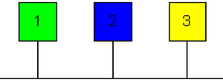

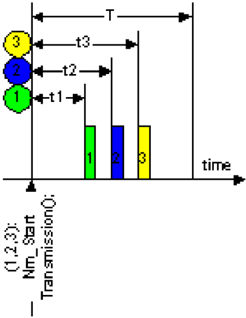

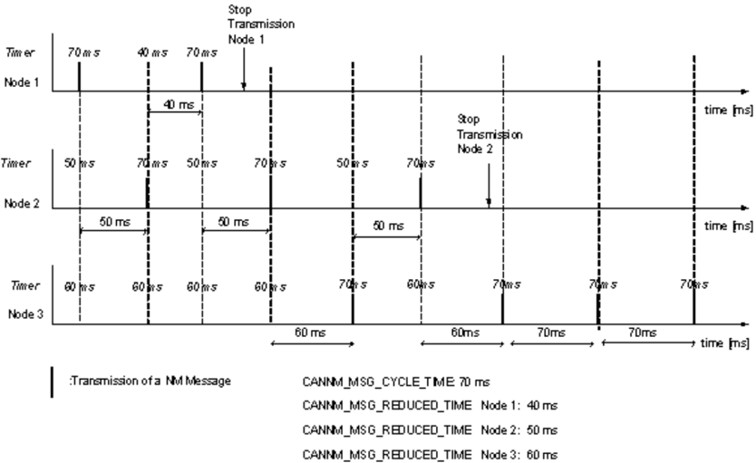

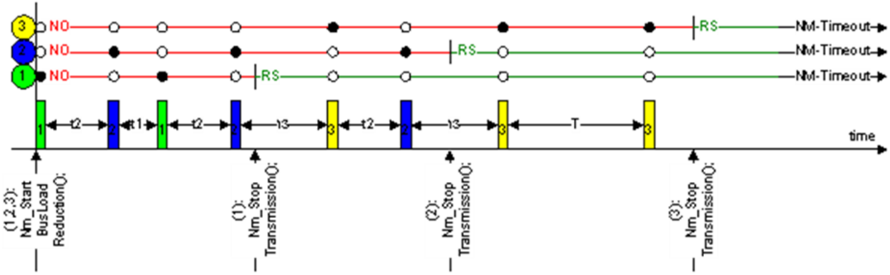

<section id="wechat">

<h4>微信扫一扫，获取更多及时资讯</h4>


</section>

