## 1. 简介和功能概述

本规范描述了CAN收发器驱动模块（**CAN Transceiver Driver**）的功能、API 和配置。CAN收发器驱动模块负责处理ECU上的CAN收发器硬件芯片。

CAN收发器是一种硬件设备，它将CAN总线上使用的信号电平调整为微控制器识别的逻辑（数字）信号电平。

此外，收发器能够检测电气故障，如接线问题、接地偏移或长显性信号的传输。根据与微控制器的接口，它们标记由单个端口引脚检测到的错误或由SPI检测到的详细错误的汇总。

一些收发器支持电源控制和通过CAN总线的唤醒。市场上通常有不同的唤醒/睡眠和电源概念。

在汽车环境中，主要使用三种不同的CAN总线物理特性。这些是用于高速CAN（高达：1Mbits/s）的**ISO11898**，用于低速 CAN（高达：125Kbits/s）的**ISO11519**，和用于单线CAN的**SAE J2411**。

最新发展包括SBC系统基础芯片（**System Basis Chips**），其中除了CA 之外还实现了电源控制和高级看门狗。它们封装在一个外壳中，并通过单一接口（例如通过 SPI）进行控制。

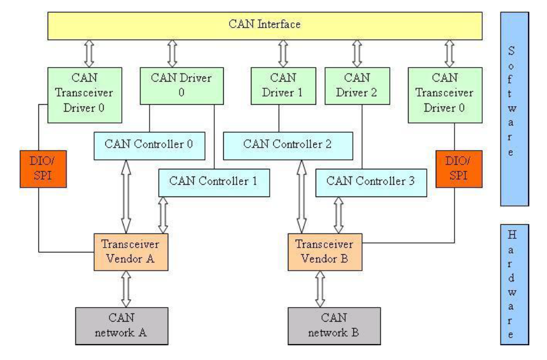

### 1.1. CAN收发器驱动程序的目标

AUTOSAR CAN收发器驱动程序的目标是为适用于大多数当前和未来CAN收发器设备定义接口和行为。CAN收发器驱动程序抽象了CAN收发器硬件。它为更高层提供了一个独立于硬件的接口。 它通过使用**MCAL**层的API来访问CAN收发器硬件，以便实现ECU布局中的抽象化。

### 1.2. 明确未覆盖的CAN收发器功能

一些CAN总线收发器提供附加功能，例如：用于诊断的ECU自检或者错误检测功能。**ECU**自检和错误检测并未在AUTOSAR标准中定义，AUTOSAR所需要实现的功能主要锁定在大多数当前使用的收发器硬件芯片。因此，也不支持接地偏移检测（**ground shift detection**）、选择性唤醒（**selective wake up**）、斜率控制模式（**slope control**）等功能。

AUTOSAR不支持根据**SAE J2411**的单线CAN收发器。

### 1.3. 符合SAE J2411的单线CAN收发器

AUTOSAR不支持符合**SAE J2411**的单线**CAN**。

## 2. 缩略语

**ComM**         
> Communication Manager

**DEM**      
> Diagnostic Event Manager

**DET**
> Default Error Tracer 

**DIO**
> Digital Input Output (SPAL module)

**EB**
> 外部缓冲通道。位于SPI处理程序/驱动程序之外，包含要传输的数据的缓冲区。

**EcuM**
> ECU State Manager
    
**IB**
> 内部缓冲通道。位于 SPI 处理程序/驱动程序内部，包含要传输的数据的缓冲区。

**ISR**
> Interrupt Service Routine 中断服务程序 

**MCAL**
> Micro Controller Abstraction Layer 

**Port**
> Port module (SPAL module)

**SBC** 
> System Basis Chip 系统基础芯片。集成了例如 CAN 和/或 LIN 收发器、看门狗和电源控制。

**SPAL**         
> 标准外设抽象 

**SPI Channel**
> 一个通道是使用相同标准定义的软件数据交换介质。请参阅SPI驱动程序规范 
    
**SPI Job**
> 一个作业由一个或多个具有相同片选的通道组成。作业被认为是原子的，因此不能被中断。 作业也具有指定的优先级。 有关详细信息，请参阅SPI驱动程序规范。

**SPI Sequence** 
> 一个序列是要传输的多个连续作业。 序列取决于静态配置。 有关详细信息，请参阅 SPI 驱动程序规范。 

**CAN Channel**
> 从**CAN**控制器通过**CAN**收发器连接到**CAN**网络的物理通道。

**API**
> 应用编程接口（**Application Programming Interface**）。

## 3. 相关文档

### 3.1. 输入文件和相关标准与规范

<a id="ref-1"></a>[1] Glossary
> AUTOSAR_FO_TR_Glossary

<a id="ref-2"></a>[2] Layered Software Architecture
> AUTOSAR_CP_EXP_LayeredSoftwareArchitecture

<a id="ref-3"></a>[3] General Specification of Basic Software Modules
> AUTOSAR_CP_SWS_BSWGeneral

<a id="ref-4"></a>[4] Specification of CAN Interface
> AUTOSAR_CP_SWS_CANInterface

<a id="ref-5"></a>[5] Specification of CAN XL Transceiver Driver
> AUTOSAR_CP_SWS_CANXLTransceiverDriver

<a id="ref-6"></a>[6] Specification of ECU State Manager
> AUTOSAR_CP_SWS_ECUStateManager

### 3.2. 相关规范

AUTOSAR提供了基础软件模块的通用规范[3, SWS BSW General]，它也适用于**CAN**收发器驱动程序。

因此，规范**SWS BSW General**应被视为**CAN**收发器驱动程序的附加和必需规范。

## 4. 约束和假设

### 4.1. 限制

**CAN**总线收发器硬件应提供可映射到**AUTOSAR CAN**收发器驱动程序操作模式模型的功能和接口。

另见第[6.1](#61-can收发器驱动操作模式)节。

### 4.2. 汽车域的适用性

该驱动程序可能适用于所有使用**CAN**进行通信的汽车域。

## 5. 对其他模块的依赖

| 模块 | 依赖关系 |
| --- | --- |
| CanIf | 所有**CAN**收发器驱动程序都位于**CanIf**之下。 |
| ComM | **ComM**通过**CanIf**控制**CAN**收发器驱动程序的通信模式。每个**CAN**收发器驱动程序都是独立控制的。 |
| DET | **DET**从**CAN**收发器驱动程序获取开发错误信息。 |
| DEM | **DEM**从**CAN**收发器驱动程序获取生产错误信息。 |
| DIO | **DIO**模块用于访问通过端口连接的**CAN**收发器设备。 |
| EcuM | **EcuM**通过**CanIf**从**CAN**收发器驱动程序获取唤醒事件信息。 |
| SPI | **SPI**模块用于访问通过**SPI**连接的**CAN**收发器设备。 |

### 5.1. 文件结构

#### 5.1.1. 代码文件结构

**AUTOSAR**规定的命名约定适用于**CanTrcv**模块的所有文件。

| 文件名 | 需求 | 描述 |
| --- | --- | --- |
| CanTrcv.c | SWS_CanTrcv_00069 | 通用实现C文件。它不包含中断例程。 |
| CanTrcv.h | SWS_CanTrcv_00052 | 它仅包含与其他**BSW**模块相关的信息（API）。根据配置的不同API差异被封装起来。 |

**CanTrcv**模块由这些文件组成。

## 6. 功能规格

### 6.1. CAN收发器驱动操作模式

CanTrcv模块需实现如下所示的状态图，并独立于每个配置的收发器。

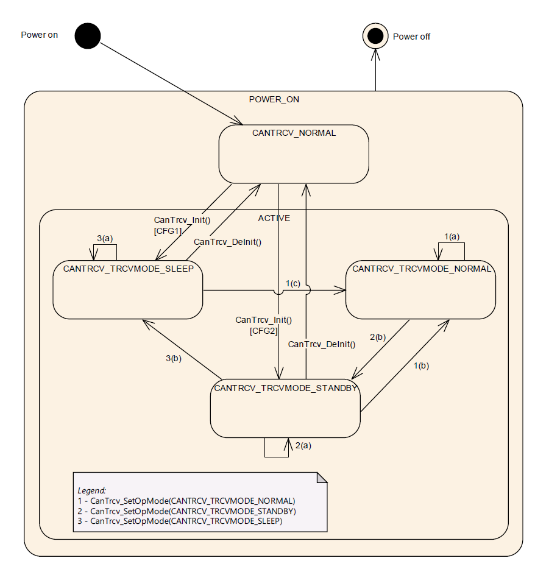

此图的主要思想是通过使用通用方案，来支持众多的迄今为止可用的CAN总线收发器。根据CAN收发器硬件的不同，模型可能具有超出给定 CAN收发器硬件所需的一个或两个状态，但这显然会将**ComM**和**EcuM**与使用的硬件分离。

**1. POWER_ON**

> **ECU**已完全通电。

**2. NOT_ACTIVE**
> CAN收发器硬件的状态取决于ECU硬件以及**Dio**和**Port**驱动程序配置。CAN收发器驱动程序未初始化，因此未激活。

**3. ACTIVE**

> 函数[**CanTrcv_Init**](#731-cantrcv_init)已被调用。CAN收发器驱动程序进入活动状态。根据配置，CAN收发器驱动程序进入状态**CANTRCV_TRCVMODE_SLEEP**或**CANTRCV_TRCVMODE_STANDBY**。

**4. CANTRCV_TRCVMODE_NORMAL**

> 总线处于全通信。如果CAN收发器硬件控制ECU电源，则ECU完全供电。CAN收发器驱动程序未检测到进一步的唤醒信息。

**5. CANTRCV_TRCVMODE_STANDBY**

> 可能无通信。如果CAN收发器硬件控制ECU电源，ECU仍然供电。 仅在此模式下，才能到**CANTRCV_TRCVMODE_SLEEP**的转换。可以通过总线或本地唤醒事件唤醒。

**6. CANTRCV_TRCVMODE_SLEEP**

> 可能无通信。ECU可能没有电源，依赖于谁复杂电源控制。可以通过总线或本地唤醒事件唤醒。

函数[**CanTrcv_Init**](#731-cantrcv_init)会使收发器的状态更改为**CANTRCV_TRCVMODE_SLEEP**或**CANTRCV_TRCVMODE _STANDBY**。这取决于配置，并且可以为每个收发器独立配置。

如果一个CAN收发器驱动程序覆盖多个CAN收发器（配置为通道），则所有收发器（通道）要么处于 **NOT_ACTIVE**状态，要么处于**ACTIVE**状态。在状态**ACTIVE**中，每个收发器可能处于不同的子状态。

#### 6.1.1. 操作模式切换

可以通过调用函数[**CanTrcv_SetOpMode**](#732-cantrcv_setopmode)请求模式切换。允许对当前模式的模式切换请求，并且即使启用了DET，也不应该导致错误。

对于每次调用 [**CanTrcv_SetOpMode**](#732-cantrcv_setopmode)的模式切换请求，在到达请求的模式后，CanTrcv模块需要使用**CanIf**的**TransceiverId**引用相应的CAN收发器，调用回调函数**CanIf_TrcvModeIndication**通知上层模块。

### 6.2. CAN收发器硬件操作模式

实际的CAN收发器硬件可能支持比上面状态图中显示的更多的模式转换。此章节会解释了这种依赖关系和推荐的实现行为。

决定CAN收发器硬件状态通过CAN收发器驱动程序哪个软件状态覆盖是由具体实现决定的。同时实现也必须确保所描述的CAN收发器驱动程序软件状态的全部功能会由实现达成。

#### 6.2.1. 临时进入睡眠（Go-To-Sleep）模式的示例

通常称为进入睡眠（**Go-to-sleep**）的模式是从正常切换到睡眠时的临时模式。驱动程序将这种临时模式封装在CAN收发器驱动程序软件状态之一中。 此外，CAN 收发器驱动程序首先从正常切换到待机，然后通过额外的 API 调用从待机切换到睡眠。

#### 6.2.2. PowerOn/ListenOnly模式示例

通常称为PowerOn或ListenOnly的模式是CAN收发器硬件只能接收消息但不能发送消息的模式。此外，在接收消息期间确认位的发送被抑制。此模式不被支持，因为它不属于CAN标准，并且并非所有CAN收发器硬件芯片都支持。

### 6.3. CAN收发器唤醒类型

有三种不同的场景通常被称为唤醒：

**场景一：**
1. MCU未通电。
2. 包括CAN收发器硬件在内的部分ECU已上电。
3. 所需考虑的CAN收发器处于**SLEEP**模式。
4. CAN收发器硬件检测到CAN总线上的唤醒事件。
5. CAN收发器硬件让MCU上电。

就AUTOSAR而言，这可以被认为是冷启动，而不是唤醒。

**场景二：**
1. MCU处于低功耗模式。
2. 包括CAN收发器硬件在内的部件ECU已上电。
3. 所关心的CAN收发器处于待机（**STANDBY**）模式。
4. CAN收发器硬件检测到CAN总线上的唤醒事件。
5. CAN 收发器硬件会触发唤醒的软件中断（**SW interrupt**）。
   
就AUTOSAR而言，这可以被认为是CAN通道和MCU的唤醒。

**场景三：**
1. MCU处于全功率模式。
2. 至少包括CAN收发器硬件在内的部分ECU已上电。
3. 所关心的CAN收发器处于待机（**STANDBY**）模式。
4. CAN收发器硬件检测到CAN总线上的唤醒事件。
5. CAN收发器硬件会使能唤醒事件的SW中断或者通过周期性轮询唤醒事件。
   
就AUTOSAR而言，这可以被认为CAN通道的唤醒。

### 6.4. 启用/禁用唤醒通知

CanTrcv驱动程序需要使用ICU驱动程序，提供的以下API来启用和禁用唤醒事件通知：

* **Icu_EnableNotification**
* **Icu_DisableNotification**
  
只有配置了参数**CanTrcvIcuChannelRef**，CanTrcv驱动程序才能启用/禁用ICU通道。

CanTrcv驱动程序需注意以下内容以避免唤醒事件的丢失：
* 当收发器转换到待机模式（**CANTRCV_STANDBY**）时，它需要启用ICU通道。
* 当收发器转换到正常模式 (**CANTRCV_NORMAL**) 时，它需要禁用ICU通道。

### 6.5. CAN收发器唤醒模式

CAN收发器驱动程序提供两种唤醒模式：NOT_SUPPORTED模式和POLLING模式

#### 6.5.1. NOT_SUPPORTED模式

在**NOT_SUPPORTED**模式下，CAN收发器驱动程序不会产生唤醒。 所有CAN收发器硬件类型都支持此模式。

#### 6.5.2. POLLING模式

在**POLLING**模式下，CAN收发器驱动程序产生的唤醒可能会导致CAN通道唤醒。在此模式下，无法唤醒MCU。该模式由需依赖使用的CAN收发器硬件类型。 **POLLING**唤醒模式会在函数[**CanTrcv_CheckWakeup**](#7312-cantrcv_checkwakeup)和主函数[**CanTrcv_MainFunction**](#741-cantrcv_mainfunction)中支持实现。

#### 6.5.3. 唤醒模式处理

主函数[**CanTrcv_MainFunction**](#741-cantrcv_mainfunction)由BSW调度程序调用，[**CanTrcv_CheckWakeup**](#7312-cantrcv_checkwakeup)由**CanIf**模块调用。

唤醒模式的选择由配置参数**CanTrcvWakeUpSupport**实现。可以通过配置参数**CanTrcvWakeupByBusUsed**为每个单独CAN收发器的唤醒设置打开和关闭的支持。

注意：在这两种唤醒模式下，功能[**CanTrcv_CheckWakeup**](#7312-cantrcv_checkwakeup)都需要存在，但功能应基于配置的唤醒模式（**NOT_SUPPORTED**或**POLLING**）。

在检测到唤醒后，如果CAN收发器需要由软件启动特定状态转换（例如：睡眠->正常），这可以由CanTrcv模块在执行[**CanTrcv_CheckWakeup**](#7312-cantrcv_checkwakeup)期间完成，此行为是特定于实现的。

当收发器需要特定的状态转换时，必须通过配置这些涉及唤醒过程模块（EcuM、CanIf、ICU 等）来确保[**CanTrcv_CheckWakeup**](#7312-cantrcv_checkwakeup)被调用。

### 6.6. 错误分类

文档[\[3\]](#ref-3)「基础软件模块通用规范」的「错误处理」（**Error Handling**）章节详细描述了基础软件的错误处理。其中最重要的是，它构成了一个由五种错误类型组成的分类方案，这些错误类型可能发生在**BSW**模块中。

基于此基础，以下章节在相应的小节中规定特定的错误。

#### 6.6.1. 开发错误

| 错误类型 | 相关错误码 | 错误值 |
| --- | --- | --- |
| 使用错误的**CAN**收发器参数调用API | CANTRCV_E_INVALID_TRANSCEIVER | 1 |
| 使用空指针参数调用API | CANTRCV_E_PARAM_POINTER | 2 |
| 未进行初始化就使用API服务 | CANTRCV_E_UNINIT | 11 |
| 在错误的收发器操作模式下调用API服务（期望为 **STANDBY**） | CANTRCV_E_TRCV_NOT_STANDBY | 21 |
| 在错误的收发器操作模式下调用API服务（期望为 **NORMAL**） | CANTRCV_E_TRCV_NOT_NORMAL | 22 |
| 使用 **Trcv WakeupMode** 的无效参数调用API服务 | CANTRCV_E_PARAM_TRCV_WAKEUP_MODE | 23 |
| 使用 **Op Mode** 的无效参数调用API服务 | CANTRCV_E_PARAM_TRCV_OPMODE | 24 |
| 收发器不支持配置的波特率 | CANTRCV_E_BAUDRATE_NOT_SUPPORTED | 25 |
| 模块初始化失败，例如在编译后（**postbuild**）使用无效指针调用 **[CanTrcv_Init](#731-cantrcv_init)()**。 | CANTRCV_E_INIT_FAILED | 27 |

#### 6.6.2. 运行时错误

| 错误类型 | 相关错误码 | 错误值 |
| --- | --- | --- |
| 与收发器无通信/通信不正确。 | CANTRCV_E_NO_TRCV_CONTROL | 26 |

#### 6.6.3. 瞬态故障

没有瞬态故障。

#### 6.6.4. 生产错误

没有生产错误。

#### 6.6.5. 扩展生产错误

| 错误名称 | CANTRCV_E_BUS_ERROR |
| --- | --- |
| 简要描述 | 通信期间发生**CAN**总线错误。 |
| 详细描述 | 当收发器在**CAN**通信期间检测到总线故障时，应报告该扩展生产错误。 |
| 检测条件（**Failed**） | 当设置了与总线故障对应的标志时，应以参数 **EventId** 为 **CANTRCV_E_BUS_ERROR**、**EventStatus** 为 **DEM_EVENT_STATUS_FAILED** 报告 **Dem_SetEventStatus**。 |
| 检测条件（**Passed**） | 当未设置与总线故障对应的标志时，应以参数 **EventId** 为 **CANTRCV_E_BUS_ERROR**、**EventStatus** 为 **DEM_EVENT_STATUS_PASSED** 报告 **Dem_SetEventStatus**。 |
| 次要参数 | N/A |
| 所需时间 | N/A |
| 监控频率 | 连续（**continuous**） |

当设置了总线错误（**BUSERR**）标志时，**CAN**收发器模块应能检测到扩展生产错误 **CANTRCV_E_BUS_ERROR**（由 **DEM** 分配值），具体取决于它是否已配置并受硬件支持。

### 6.7. 驱动程序初始化的前提条件

CanTrcv模块的环境应确保所有供CanTrcv模块使用的BSW驱动程序已被初始化，并且在调用[**CanTrcv_Init**](#731-cantrcv_init)之前已可用。

CAN收发器驱动程序主要使用**Spi**和**Dio**驱动程序来控制CAN总线收发器硬件。因此在初始化CAN总线收发器驱动程序之前，这些驱动程序必须可用，并准备好运行。

CAN收发器驱动程序可能对初始化序列和对收发器设备的访问有时序要求，这些使用的底层驱动程序必须满足这些要求。对时序的要求可能包含：
1. CAN总线收发器驱动程序初始化的调用必须在上电后尽快的执行，以便能够为**ECU**的所有其他应用及时地从收发器硬件中读取到所有必要的信息。
2. 所使用的底层服务的运行时间需非常短并且是同步的，以使驱动程序能够满足自身硬件设备所需的时序需求地限制。
3. 驱动程序的运行时间可能会由于某些硬件设备配置端口引脚电平有效而延长。例如：等待50μs后，再次更改引脚电平，以达到某特定状态（睡眠）。

### 6.8. 实例概念

对于每种不同的CAN收发器硬件类型，ECU都有一个CAN收发器驱动程序实例。这个实例服务于所有相同类型的CAN收发器硬件。

### 6.9. 等待状态

为了改变操作模式，CAN收发器硬件可能必须执行等待状态。

CAN收发器驱动程序需使用时间服务（Time service）的**Tm_BusyWait1us16bit**接口来实现收发器状态变化的等待时间。

### 6.10. 具有选择性唤醒功能的收发器

部分联网（**Partial Networking**）是CAN系统中的一种状态。在这种状态下，网络中的一些节点处于低功耗模式，而其他节点却保持通信。这降低了整个网络的功耗。处于低功耗模式的节点会被预定义的唤醒帧唤醒。

除了普通收发器提供的**WUP**唤醒模式（**Wake Up Pattern**）唤醒之外，支持选择性唤醒的收发器还可以通过**WUF**唤醒帧（**Wake Up Frame**）唤醒。

如果收发器硬件支持选择性唤醒，则可以通过配置参数**CanTrcvHwPnSupport**来使能。

选择性唤醒功能可通过配置容器（[**CanTrcvPartialNetwork**](#9211-cantrcvpartialnetwork)）和以下API获得支持：

* [**CanTrcv_GetTrcvSystemData**](#737-cantrcv_gettrcvsystemdata)
* **CanTrcv_ClearTrcvWufFlg**
* [**CanTrcv_ReadTrcvTimeoutFlag**](#739-cantrcv_readtrcvtimeoutflag)
* [**CanTrcv_ClearTrcvTimeoutFlag**](#7310-cantrcv_cleartrcvtimeoutflag)
* [**CanTrcv_ReadTrcvSilenceFlag**](#7311-cantrcv_readtrcvsilenceflag)
  
但是仅当**CanTrcvHwPnSupport = TRUE**时才进行配置和调用。

如果支持选择性唤醒，则CAN收发器需配置参数**CanTrcvPnFrameCanId**、**CanTrcvPnFrameCanIdMask**和**CanTrcvPnFrameDataMask** 实现被特定 CAN帧或一组CAN帧唤醒。

如果收发器具有识别总线故障的能力（区分：总线故障和其他硬件故障），则可以使用配置参数**CanTrcvBusErrFlag**来实现总线故障诊断功能。

**注意：**
对于支持选择性唤醒功能的CAN收发器，可以在正常模式（**CANTRCV_TRCVMODE_NORMAL**）期间检测唤醒帧。检测到的唤醒帧由收发器 **WUF Flag**标识。 这可确保在转换到待机模式（**CANTRCV_TRCVMODE_STANDBY**）期间不会丢失唤醒帧。

### 6.11. CAN XL扩展

**CAN XL**收发器驱动程序是作为现有**CAN**收发器驱动程序的扩展实现的（参见[5, Specification of Can XL]），非 **CAN XL** 硬件仍将使用基本的**CAN**收发器驱动程序实现。

**CAN XL**收发器驱动程序是**CAN**收发器驱动程序的扩展，它引入了额外的API以支持以太网接口，并向**CAN XL**收发器驱动程序提供模式接口（更多详情参见[5, Specification of Can XL]）。

### 6.12. 安全事件

该模块不报告安全事件。

## 7. API规范

### 7.1. 导入的类型

在本章中列出了从以下文件包含的所有类型：

| 模块 | 头文件 | 导入的类型 |
| --- | --- | --- |
| Dem | Rte_Dem_Type.h | Dem_EventIdType |
| Dem | Rte_Dem_Type.h | Dem_EventStatusType |
| Dio | Dio.h | Dio_ChannelGroupType |
| Dio | Dio.h | Dio_ChannelType |
| Dio | Dio.h | Dio_LevelType |
| Dio | Dio.h | Dio_PortLevelType |
| Dio | Dio.h | Dio_PortType |
| EcuM | EcuM.h | EcuM_WakeupSourceType |
| Icu | Icu.h | Icu_ChannelType |
| Spi | Spi.h | Spi_ChannelType |
| Spi | Spi.h | Spi_DataBufferType |
| Spi | Spi.h | Spi_NumberOfDataType |
| Spi | Spi.h | Spi_SequenceType |
| Spi | Spi.h | Spi_StatusType |
| Std | Std_Types.h | Std_ReturnType |
| Std | Std_Types.h | Std_VersionInfoType |

### 7.2. 类型定义

#### 7.2.1. CanTrcv_ConfigType

结构类型（**Structure**），元素为实现特定（**Implementation specific**）。这是包含**CAN**收发器驱动程序整体初始化数据以及影响所有收发器的设置的外部数据结构的类型。此外，它还包含指向收发器配置结构的指针。初始化数据结构的内容是**CAN**收发器硬件特定的。可通过**CanTrcv.h**获得。

#### 7.2.2. CanTrcv_PNActivationType

枚举类型（**Enumeration**），用于描述**CanTrcv**中的**PN**唤醒功能是启用还是禁用。取值范围：**PN_ENABLED**：**CanTrcv**中的**PN**唤醒功能已启用；**PN_DISABLED**：**CanTrcv**中的**PN**唤醒功能已禁用。可通过**CanTrcv.h**获得。

#### 7.2.3. CanTrcv_TrcvFlagStateType

枚举类型（**Enumeration**），提供收发器硬件中标志的状态。取值范围：**CANTRCV_FLAG_SET**：标志在收发器硬件中被设置；**CANTRCV_FLAG_CLEARED**：标志在收发器硬件中被清除。可通过**CanTrcv.h**获得。

#### 7.2.4. CanTrcv_TrcvModeType

枚举类型（**Enumeration**），**CAN**收发器驱动程序的操作模式。取值范围：**CANTRCV_TRCVMODE_SLEEP**：收发器模式 **SLEEP**；**CANTRCV_TRCVMODE_STANDBY**：收发器模式 **STANDBY**；**CANTRCV_TRCVMODE_NORMAL**（0x00）：收发器模式 **NORMAL**。可通过**Can_GeneralTypes.h**获得。

#### 7.2.5. CanTrcv_TrcvWakeupModeType

枚举类型（**Enumeration**），该类型应用于控制**CAN**收发器的唤醒事件和唤醒通知。取值范围：**CANTRCV_WUMODE_ENABLE**（0x00）：在寻址的收发器上启用唤醒事件的通知；**CANTRCV_WUMODE_DISABLE**（0x01）：在寻址的收发器上禁用唤醒事件的通知；**CANTRCV_WUMODE_CLEAR**（0x02）：在寻址的收发器上清除存储的唤醒事件。可通过**Can_GeneralTypes.h**获得。

#### 7.2.6. CanTrcv_TrcvWakeupReasonType

枚举类型（**Enumeration**），该类型详细表示**CAN**收发器检测到的唤醒原因。取值范围：**CANTRCV_WU_ERROR**（0x00）：由于错误而未检测到唤醒原因。仅当错误事先报告给**DEM**时才可报告该值；**CANTRCV_WU_NOT_SUPPORTED**（0x01）：收发器不支持任何唤醒原因信息；**CANTRCV_WU_BY_BUS**（0x02）：收发器已检测到网络导致了**ECU**的唤醒；**CANTRCV_WU_INTERNALLY**（0x03）：收发器已检测到网络通过请求 **NORMAL** 模式唤醒了**ECU**；**CANTRCV_WU_RESET**（0x04）：收发器已检测到「唤醒」是由于**ECU**复位；**CANTRCV_WU_POWER_ON**（0x05）：收发器已检测到「唤醒」是由于上电后的**ECU**复位；**CANTRCV_WU_BY_PIN**（0x06）：收发器在收发器的某个引脚（而非**CAN**总线）上检测到了唤醒事件；**CANTRCV_WU_BY_SYSERR**（0x07）：收发器已检测到**ECU**的唤醒是由硬件相关设备故障引起的。可通过**Can_GeneralTypes.h**获得。

### 7.3. 函数定义

#### 7.3.1. CanTrcv_Init

**说明**: 初始化**CanTrcv**模块。本服务为同步调用，不可重入。参数 ConfigPtr（in）：指向驱动配置的指针。该服务无返回值。可通过**CanTrcv.h**获得。

```C
void CanTrcv_Init ( const CanTrcv_ConfigType* ConfigPtr )
```

函数**CanTrcv_Init**应基于所有连接的CAN收发器的初始化序列和配置（由参数**ConfigPtr**提供），初始化这些收发器。同时，它也应支持AUTOSAR协议栈的配置序列。

请注意，在上电与调用**CanTrcv_Init**之间的时间段内，CAN收发器硬件可能处于不同的状态。这取决于硬件和SPAL驱动程序配置。

复位后（例如上电）的初始化序列对CAN收发器驱动程序而言是一个关键阶段。

该API应存储初始化期间出现的任何唤醒事件。

如果硬件支持，**CanTrcv_Init**应校验是否因收发器活动而发生了唤醒；如果为TRUE，则应通过API **EcuM_SetWakeupEvent**向**EcuM**报告，唤醒源为**CanTrcvWakeupSourceRef**所引用的唤醒源。

如果启用了选择性唤醒且硬件支持：**CanTrcv_Init** API应检查收发器状态的**POR**和**SYSERR**标志。

如果**POR**标志或**SYSERR**标志被置位，则收发器应通过运行配置序列重新配置选择性唤醒功能。如果**POR**标志或**SYSERR**标志未被置位，则收发器内存中存储的配置仍然有效，无需重新配置。

如果**POR**标志被置位，则应通过API **EcuM_SetWakeupEvent**向**EcuM**报告唤醒，唤醒源值为：在**CanTrcvPorWakeupSourceRef**所引用的符号名称值对应的位位置上为「1」，其余所有位为「0」。

如果**SYSERR**标志被置位，则应通过API **EcuM_SetWakeupEvent**向**EcuM**报告唤醒，唤醒源值为：在**CanTrcvSyserrWakeupSourceRef**所引用的符号名称值对应的位位置上为「1」，其余所有位为「0」。

如果与收发器之间没有通信或通信不正确，函数**CanTrcv_Init**应向**DET**（**Default Error Tracer**）报告运行时错误码[**CANTRCV_E_NO_TRCV_CONTROL**](#662-运行时错误)。例如，存在不同的收发器类型和不同的访问方式（端口连接、SPI）。如果检测到与硬件的任何通信异常，则应报告该运行时错误。取决于连接类型和收发器硬件，可能不会出现必须报告该错误的情况。

如果为**CanTrcv**模块启用了开发错误检测：如果配置的波特率不被收发器支持，函数**CanTrcv_Init**应引发开发错误[**CANTRCV_E_BAUDRATE_NOT_SUPPORTED**](#661-开发错误)。

为了实现AUTOSAR部分联网（**Partial Networking**）机制，CAN收发器应支持为唤醒帧（**Wake Up Frame**）定义数据掩码（**CanTrcvPnFrameDataMask**的配置结构是强制的）。

#### 7.3.2. CanTrcv_SetOpMode

**说明**: 将收发器的模式设置为值**OpMode**。本服务为异步调用，对于不同的收发器可重入。参数 Transceiver（in）：应用该API调用的CAN收发器。参数 OpMode（in）：期望的操作模式。返回值为**Std_ReturnType**：E_OK：收发器模式切换请求已被接受；E_NOT_OK：收发器模式切换请求未被接受或任一参数超出允许范围。可通过**CanTrcv.h**获得。

```C
Std_ReturnType CanTrcv_SetOpMode ( 
    uint8 Transceiver, CanTrcv_TrcvModeType OpMode )
```

函数**CanTrcv_SetOpMode**应将**Transceiver**的内部状态切换为参数**OpMode**的值，该值可以是**CANTRCV_TRCVMODE_NORMAL**、**CANTRCV_TRCVMODE_STANDBY**或**CANTRCV_TRCVMODE_SLEEP**。

**注意：** 如果收发器处于**CANTRCV_TRCVMODE_NORMAL**模式，**CanTrcv**模块的用户可以以 OpMode = **CANTRCV_TRCVMODE_STANDBY** 或 **CANTRCV_TRCVMODE_NORMAL** 调用函数**CanTrcv_SetOpMode**。

**注意：** 如果收发器处于**CANTRCV_TRCVMODE_STANDBY**模式，**CanTrcv**模块的用户可以以 OpMode = **CANTRCV_TRCVMODE_SLEEP**、**CANTRCV_TRCVMODE_STANDBY** 或 **CANTRCV_TRCVMODE_NORMAL** 调用函数**CanTrcv_SetOpMode**。

该API适用于每个收发器的每个参数**CanTrcv_SetOpMode**取值，无论收发器硬件是否支持这些模式。这样做是为了简化**CanIf**对其所分配总线的视图。

如果底层收发器硬件不支持所请求的模式，函数**CanTrcv_SetOpMode**应返回**E_NOT_OK**。

支持的通道（bus）数量在配置阶段设定。

如果硬件支持选择性唤醒：**CanTrcv_SetOpMode** API应检查收发器状态的**POR**和**SYSERR**标志。

如果**POR**标志被置位，则收发器应重新初始化，以运行收发器的配置序列。

如果**SYSERR**标志未被置位且请求的模式为**CANTRCV_NORMAL**，则收发器应对相应的抽象**CanIf TransceiverId**调用API **CanIf_ConfirmPnAvailability**。**CanIf_ConfirmPnAvailability**（经由**CanIf**和**CanSm**）通知**CanNm**选择性唤醒已启用。

如果与收发器之间没有通信或通信不正确，函数**CanTrcv_SetOpMode**应向**DET**报告运行时错误码[**CANTRCV_E_NO_TRCV_CONTROL**](#662-运行时错误)，并返回**E_NOT_OK**。

如果为**CanTrcv**模块启用了开发错误检测：如果以 OpMode = **CANTRCV_TRCVMODE_STANDBY** 调用函数**CanTrcv_SetOpMode**，且收发器不处于**CANTRCV_TRCVMODE_NORMAL**或**CANTRCV_TRCVMODE_STANDBY**模式，则函数**CanTrcv_SetOpMode**应引发开发错误[**CANTRCV_E_TRCV_NOT_NORMAL**](#661-开发错误)；否则（如果DET被禁用）返回**E_NOT_OK**。

如果为**CanTrcv**模块启用了开发错误检测：如果以 OpMode = **CANTRCV_TRCVMODE_SLEEP** 调用函数**CanTrcv_SetOpMode**，且收发器不处于**CANTRCV_TRCVMODE_STANDBY**或**CANTRCV_TRCVMODE_SLEEP**模式，则函数**CanTrcv_SetOpMode**应引发开发错误[**CANTRCV_E_TRCV_NOT_STANDBY**](#661-开发错误)；否则（如果DET被禁用）返回**E_NOT_OK**。

如果为**CanTrcv**模块启用了开发错误检测：如果在**CanTrcv**模块尚未初始化之前被调用，函数**CanTrcv_SetOpMode**应引发开发错误[**CANTRCV_E_UNINIT**](#661-开发错误)；否则（如果DET被禁用）返回**E_NOT_OK**。

如果为**CanTrcv**模块启用了开发错误检测：如果以无效的收发器编号被调用，函数**CanTrcv_SetOpMode**应引发开发错误[**CANTRCV_E_INVALID_TRANSCEIVER**](#661-开发错误)；否则（如果DET被禁用）返回**E_NOT_OK**。

如果为**CanTrcv**模块启用了开发错误检测：如果以无效的**OpMode**被调用，函数**CanTrcv_SetOpMode**应引发开发错误[**CANTRCV_E_PARAM_TRCV_OPMODE**](#661-开发错误)；否则（如果DET被禁用）返回**E_NOT_OK**。

#### 7.3.3. CanTrcv_GetOpMode

**说明**: 获取收发器的模式，并保存在**OpMode**中返回。本服务为同步调用，可重入。参数 Transceiver（in）：应用该API调用的CAN收发器。参数 OpMode（out）：该API所应用于的总线的操作模式指针。返回值为**Std_ReturnType**：E_OK：操作模式已被检测到；E_NOT_OK：操作模式未被检测到。可通过**CanTrcv.h**获得。

```C
Std_ReturnType CanTrcv_GetOpMode ( 
    uint8 Transceiver, CanTrcv_TrcvModeType* OpMode )
```

函数**CanTrcv_GetOpMode**应将CAN收发器驱动程序的当前状态收集到输出参数**OpMode**中。

关于CAN收发器驱动程序初始化之后、直到第一次操作模式切换请求之前所提供的状态，请参见函数[**CanTrcv_Init**](#731-cantrcv_init)。

支持的通道（bus）数量在配置阶段静态设定。

如果与收发器之间没有通信或通信不正确，函数**CanTrcv_GetOpMode**应向**DET**报告运行时错误码[**CANTRCV_E_NO_TRCV_CONTROL**](#662-运行时错误)，并返回**E_NOT_OK**。

如果为**CanTrcv**模块启用了开发错误检测：如果在**CanTrcv**模块尚未初始化之前被调用，函数**CanTrcv_GetOpMode**应引发开发错误[**CANTRCV_E_UNINIT**](#661-开发错误)；否则（如果DET被禁用）返回**E_NOT_OK**。

如果为**CanTrcv**模块启用了开发错误检测：如果以无效的收发器编号被调用，函数**CanTrcv_GetOpMode**应引发开发错误[**CANTRCV_E_INVALID_TRANSCEIVER**](#661-开发错误)；否则（如果DET被禁用）返回**E_NOT_OK**。

如果为**CanTrcv**模块启用了开发错误检测：如果以 OpMode = NULL 被调用，函数**CanTrcv_GetOpMode**应引发开发错误[**CANTRCV_E_PARAM_POINTER**](#661-开发错误)；否则（如果DET被禁用）返回**E_NOT_OK**。

#### 7.3.4. CanTrcv_GetBusWuReason

**说明**: 获取收发器的唤醒原因，并保存在参数**Reason**中返回。本服务为同步调用，可重入。参数 Transceiver（in）：应用该API调用的CAN收发器。参数 reason（out）：该API所应用于的总线的唤醒原因指针。返回值为**Std_ReturnType**：E_OK：收发器唤醒原因已提供；E_NOT_OK：没有可用的唤醒原因，或由于开发错误导致服务请求失败。可通过**CanTrcv.h**获得。

```C
Std_ReturnType CanTrcv_GetBusWuReason ( 
    uint8 Transceiver, CanTrcv_TrcvWakeupReasonType* reason )
```

函数**CanTrcv_GetBusWuReason**应将CAN收发器检测到的唤醒原因收集到参数**Reason**中。

检测并区分可能的唤醒原因的能力在很大程度上取决于CAN收发器硬件。

请注意，如果有多条总线可用，则每条总线可能报告不同的唤醒原因。例如，如果ECU具有CAN，则可能发生由CAN引起的唤醒，并且输入数据可能导致另一条CAN总线的内部唤醒。

CAN收发器驱动程序具有「按总线」的视图，并且在内部不对更重要的原因或顺序进行表决。如果例如一个收发器控制电源，而另一个收发器仅被供电或未被供电，情况也可能相同。

支持的通道（bus）数量在配置阶段静态设定。

如果与收发器之间没有通信或通信不正确，函数**CanTrcv_GetBusWuReason**应向**DET**报告运行时错误码[**CANTRCV_E_NO_TRCV_CONTROL**](#662-运行时错误)，并返回**E_NOT_OK**。

如果为**CanTrcv**模块启用了开发错误检测：如果在**CanTrcv**模块尚未初始化之前被调用，函数**CanTrcv_GetBusWuReason**应引发开发错误[**CANTRCV_E_UNINIT**](#661-开发错误)；否则（如果DET被禁用）返回**E_NOT_OK**。

如果为**CanTrcv**模块启用了开发错误检测：如果以无效的收发器编号被调用，函数**CanTrcv_GetBusWuReason**应引发开发错误[**CANTRCV_E_INVALID_TRANSCEIVER**](#661-开发错误)；否则（如果DET被禁用）返回**E_NOT_OK**。

如果为**CanTrcv**模块启用了开发错误检测：如果以 reason = NULL 被调用，函数**CanTrcv_GetBusWuReason**应引发开发错误[**CANTRCV_E_PARAM_POINTER**](#661-开发错误)；否则（如果DET被禁用）返回**E_NOT_OK**。

#### 7.3.5. CanTrcv_VersionInfo

**说明**: 获取模块的版本并保存在**VersionInfo**中返回。本服务为同步调用，可重入。参数 versioninfo（out）：指向该模块版本信息的指针。该服务无返回值。可通过**CanTrcv.h**获得。

```C
void CanTrcv_GetVersionInfo ( Std_VersionInfoType* versioninfo )
```

#### 7.3.6. CanTrcv_SetWakeupMode

**说明**: 根据**TrcvWakeupMode**启用、禁用或清除收发器的唤醒事件。本服务为同步调用，对于不同的收发器可重入。参数 Transceiver（in）：应用该API调用的CAN收发器。参数 TrcvWakeupMode（in）：请求的收发器唤醒原因。返回值为**Std_ReturnType**：E_OK：唤醒状态已切换为请求的模式；E_NOT_OK：唤醒状态切换失败或参数超出允许范围，原有状态未被更改。可通过**CanTrcv.h**获得。

```C
Std_ReturnType CanTrcv_SetWakeupMode ( 
    uint8 Transceiver, CanTrcv_TrcvWakeupModeType TrcvWakeupMode )
```

启用：如果以 TrcvWakeupMode = **CANTRCV_WUMODE_ENABLE** 调用函数**CanTrcv_SetWakeupMode**，且**CanTrcv**模块对寻址的总线存在已存储的待处理唤醒事件，则**CanTrcv**模块应将其唤醒事件更新为「存在」。

禁用：如果以 TrcvWakeupMode = **CANTRCV_WUMODE_DISABLE** 调用函数**CanTrcv_SetWakeupMode**，则寻址的收发器上的唤醒事件被禁用。收发器器件和收发器驱动程序需要检测唤醒事件并在内部存储，以便在唤醒模式再次启用时引发这些唤醒事件。

清除：如果以 TrcvWakeupMode = **CANTRCV_WUMODE_CLEAR** 调用函数**CanTrcv_SetWakeupMode**，则寻址的收发器上已存储的唤醒事件被清除。

当唤醒通知被禁用时，应使用清除唤醒事件的方式，在更高层的控制下清除所有已存储的唤醒事件。

实现可以启用、禁用或清除来自前一个通信周期的唤醒事件。非常重要的是，在禁用期间不得丢失唤醒事件。

支持的通道（bus）数量在配置阶段静态设定。

如果与收发器之间没有通信或通信不正确，函数**CanTrcv_SetWakeupMode**应向**DET**报告运行时错误码[**CANTRCV_E_NO_TRCV_CONTROL**](#662-运行时错误)，并返回**E_NOT_OK**。

如果为**CanTrcv**模块启用了开发错误检测：如果在**CanTrcv**初始化之前被调用，函数**CanTrcv_SetWakeupMode**应引发开发错误[**CANTRCV_E_UNINIT**](#661-开发错误)；否则（如果DET被禁用）返回**E_NOT_OK**。

如果为**CanTrcv**模块启用了开发错误检测：如果以无效的收发器编号被调用，函数**CanTrcv_SetWakeupMode**应引发开发错误[**CANTRCV_E_INVALID_TRANSCEIVER**](#661-开发错误)；否则（如果DET被禁用）返回**E_NOT_OK**。

如果为**CanTrcv**模块启用了开发错误检测：如果以无效的**TrcvWakeupMode**被调用，函数**CanTrcv_SetWakeupMode**应引发开发错误[**CANTRCV_E_PARAM_TRCV_WAKEUP_MODE**](#661-开发错误)；否则（如果DET被禁用）返回**E_NOT_OK**。

#### 7.3.7. CanTrcv_GetTrcvSystemData

**说明**: 读取收发器配置/状态数据，并通过参数**TrcvSysData**返回。此API仅在**CanTrcvHwPnSupport = TRUE**时存在。本服务为同步调用，不可重入。参数 Transceiver（in）：CAN收发器ID。参数 TrcvSysData（out）：收发器的配置/状态数据。返回值为**Std_ReturnType**：E_OK：收发器状态已被成功读取；E_NOT_OK：收发器状态数据不可用或发生开发错误。可通过**CanTrcv.h**获得。

```C
Std_ReturnType CanTrcv_GetTrcvSystemData ( 
    uint8 Transceiver, uint32* TrcvSysData )
```

函数**CanTrcv_GetTrcvSystemData**应读取CAN收发器的配置/状态，并将读取的数据存储到输出参数**TrcvSysData**中。如果成功，则应返回**E_OK**。

**提示：** 此API可以通过诊断服务调用，或在初始化期间调用来确定收发器状态及其可用性。

**注意：** 目前尚未就收发器硬件规范的参数集达成一致。因此，诊断数据目前以**uint32**（即存储在收发器寄存器中的形式）返回。当定义了确定的、标准的参数集后，可能会定义一个数据结构来抽象诊断数据。

如果与收发器之间没有通信或通信不正确，函数**CanTrcv_GetTrcvSystemData**应向**DET**报告运行时错误码[**CANTRCV_E_NO_TRCV_CONTROL**](#662-运行时错误)，并返回**E_NOT_OK**。

如果为**CanTrcv**模块启用了开发错误检测：如果在**CanTrcv**初始化之前被调用，函数**CanTrcv_GetTrcvSystemData**应引发开发错误[**CANTRCV_E_UNINIT**](#661-开发错误)；否则（如果DET被禁用）返回**E_NOT_OK**。

如果为**CanTrcv**模块启用了开发错误检测：如果参数**Transceiver**为无效的收发器ID，函数**CanTrcv_GetTrcvSystemData**应引发开发错误[**CANTRCV_E_INVALID_TRANSCEIVER**](#661-开发错误)；否则（如果DET被禁用）返回**E_NOT_OK**。

如果为**CanTrcv**模块启用了开发错误检测：如果参数**TrcvSysData**为NULL指针，函数**CanTrcv_GetTrcvSystemData**应引发开发错误[**CANTRCV_E_PARAM_POINTER**](#661-开发错误)；否则（如果DET被禁用）返回**E_NOT_OK**。

#### 7.3.8. CanTrcv_ClearTrcvWufFlag

**说明**: 清除收发器硬件中的WUF标志。该API只有在**CanTrcvHwPnSupport = TRUE**时才存在。本服务为同步调用，对于不同的收发器可重入。参数 Transceiver（in）：CAN收发器ID。返回值为**Std_ReturnType**：E_OK：WUF标志已被清除；E_NOT_OK：WUF标志未被清除或发生开发错误。可通过**CanTrcv.h**获得。

```C
Std_ReturnType CanTrcv_ClearTrcvWufFlag ( uint8 Transceiver )
```

函数**CanTrcv_ClearTrcvWufFlag**应清除CAN收发器中的唤醒标志。如果成功，则应返回**E_OK**。

**实现提示：** 该API应由**CanSm**模块使用，以确保在进入低功耗模式期间不会丢失任何帧唤醒事件。该API清除**WUF**标志。清除**WUF**标志后，CAN收发器应被置于待机模式（**CANTRCV_STANDBY**）。如果在启用选择性唤醒功能期间发生系统错误（**SYSERR**，例如配置错误），收发器将禁用该功能。收发器将在下一个CAN唤醒模式（**WUP**）到来时唤醒。如果发生任何其他硬件错误（例如帧检测错误），则当收发器内部的错误计数器溢出时，收发器将会唤醒。

**CanTrcv**应通过回调通知**CanIf_ClearTrcvWufFlagIndication**，以相应的抽象**CanIf TransceiverId**通知**CanIf**：所请求的**Transceiver**的唤醒标志已被清除。

如果与收发器之间没有通信或通信不正确，函数**CanTrcv_ClearTrcvWufFlag**应向**DET**报告运行时错误[**CANTRCV_E_NO_TRCV_CONTROL**](#662-运行时错误)，并返回**E_NOT_OK**。

如果为**CanTrcv**模块启用了开发错误检测：如果在**CanTrcv**初始化之前被调用，函数**CanTrcv_ClearTrcvWufFlag**应引发开发错误[**CANTRCV_E_UNINIT**](#661-开发错误)；否则（如果DET被禁用）返回**E_NOT_OK**。

如果为**CanTrcv**模块启用了开发错误检测：如果参数**Transceiver**为无效的收发器ID，函数**CanTrcv_ClearTrcvWufFlag**应引发开发错误[**CANTRCV_E_INVALID_TRANSCEIVER**](#661-开发错误)；否则（如果DET被禁用）返回**E_NOT_OK**。

#### 7.3.9. CanTrcv_ReadTrcvTimeoutFlag

**说明**: 从收发器硬件读取超时标志的状态。该API只有在**CanTrcvHwPnSupport = TRUE**时才存在。本服务为同步调用，不可重入。参数 Transceiver（in）：CAN收发器ID。参数 FlagState（out）：超时标志的状态。返回值为**Std_ReturnType**：E_OK：超时标志的状态已被成功读取；E_NOT_OK：超时标志的状态无法读取。可通过**CanTrcv.h**获得。

```C
Std_ReturnType CanTrcv_ReadTrcvTimeoutFlag ( 
    uint8 Transceiver, CanTrcv_TrcvFlagStateType* FlagState )
```

如果为**CanTrcv**模块启用了开发错误检测：如果以无效的收发器ID**Transceiver**被调用，函数**CanTrcv_ReadTrcvTimeoutFlag**应引发开发错误[**CANTRCV_E_INVALID_TRANSCEIVER**](#661-开发错误)；否则（如果DET被禁用）返回**E_NOT_OK**。

如果为**CanTrcv**模块启用了开发错误检测：如果以 FlagState = NULL 被调用，函数**CanTrcv_ReadTrcvTimeoutFlag**应引发开发错误[**CANTRCV_E_PARAM_POINTER**](#661-开发错误)；否则（如果DET被禁用）返回**E_NOT_OK**。

#### 7.3.10. CanTrcv_ClearTrcvTimeoutFlag

**说明**: 清除收发器硬件中超时标志的状态。该API只有在**CanTrcvHwPnSupport = TRUE**时才存在。本服务为同步调用，不可重入。参数 Transceiver（in）：CAN收发器ID。返回值为**Std_ReturnType**：E_OK：超时标志已被成功清除；E_NOT_OK：超时标志无法被清除。可通过**CanTrcv.h**获得。

```C
Std_ReturnType CanTrcv_ClearTrcvTimeoutFlag ( uint8 Transceiver )
```

如果为**CanTrcv**模块启用了开发错误检测：如果以无效的收发器ID**Transceiver**被调用，函数**CanTrcv_ClearTrcvTimeoutFlag**应引发开发错误[**CANTRCV_E_INVALID_TRANSCEIVER**](#661-开发错误)；否则（如果DET被禁用）返回**E_NOT_OK**。

#### 7.3.11. CanTrcv_ReadTrcvSilenceFlag

**说明**: 从收发器硬件读取沉默标志的状态。该API只有在**CanTrcvHwPnSupport = TRUE**时才存在。本服务为同步调用，不可重入。参数 Transceiver（in）：CAN收发器ID。参数 FlagState（out）：沉默标志的状态。返回值为**Std_ReturnType**：E_OK：沉默标志的状态已被成功读取；E_NOT_OK：沉默标志的状态无法读取。可通过**CanTrcv.h**获得。

```C
Std_ReturnType CanTrcv_ReadTrcvSilenceFlag ( 
    uint8 Transceiver, CanTrcv_TrcvFlagStateType* FlagState )
```

如果为**CanTrcv**模块启用了开发错误检测：如果以无效的收发器ID**Transceiver**被调用，函数**CanTrcv_ReadTrcvSilenceFlag**应引发开发错误[**CANTRCV_E_INVALID_TRANSCEIVER**](#661-开发错误)；否则（如果DET被禁用）返回**E_NOT_OK**。

如果为**CanTrcv**模块启用了开发错误检测：如果以 FlagState = NULL 被调用，函数**CanTrcv_ReadTrcvSilenceFlag**应引发开发错误[**CANTRCV_E_PARAM_POINTER**](#661-开发错误)；否则（如果DET被禁用）返回**E_NOT_OK**。

#### 7.3.12. CanTrcv_CheckWakeup

**说明**: 在检测到唤醒中断的情况下，由底层**CanIf**调用的服务。本服务为同步调用，可重入。参数 Transceiver（in）：应用该API调用的CAN收发器。返回值为**Std_ReturnType**：E_OK：API调用已被接受；E_NOT_OK：API调用未被接受。可通过**CanTrcv.h**获得。

```C
Std_ReturnType CanTrcv_CheckWakeup ( uint8 Transceiver )
```

如果为**CanTrcv**模块启用了开发错误检测：如果在**CanTrcv**模块尚未初始化之前被调用，函数**CanTrcv_CheckWakeup**应引发开发错误[**CANTRCV_E_UNINIT**](#661-开发错误)；否则（如果DET被禁用）返回**E_NOT_OK**。

如果为**CanTrcv**模块启用了开发错误检测：如果以无效的收发器编号被调用，函数**CanTrcv_CheckWakeup**应引发开发错误[**CANTRCV_E_INVALID_TRANSCEIVER**](#661-开发错误)；否则（如果DET被禁用）返回**E_NOT_OK**。

如果硬件支持，**CanTrcv_CheckWakeup**应校验是否因收发器活动而发生了唤醒；如果为TRUE，则应通过API **EcuM_SetWakeupEvent**向**EcuM**报告，唤醒源为**CanTrcvWakeupSourceRef**所引用的唤醒源。

#### 7.3.13. CanTrcv_SetPNActivationState

**说明**: 该API将收发器的唤醒配置为待机和睡眠模式：CAN收发器由远程唤醒模式（标准CAN唤醒）唤醒，或由配置的远程唤醒帧唤醒。本服务为同步调用，不可重入。参数 ActivationState（in）：PN_ENABLED：**CanTrcv**中的**PN**唤醒功能应被启用；PN_DISABLED：**CanTrcv**中的**PN**唤醒功能应被禁用。返回值为**Std_ReturnType**：E_OK：**PN**已更改为请求的配置；E_NOT_OK：**PN**配置更改失败，原有配置未被更改。可通过**CanTrcv.h**获得。

```C
Std_ReturnType CanTrcv_SetPNActivationState ( 
    CanTrcv_PNActivationType ActivationState )
```

如果为**CanTrcv**模块启用了开发错误检测：如果在**CanTrcv**模块尚未初始化之前被调用，函数**CanTrcv_SetPNActivationState**应引发开发错误[**CANTRCV_E_UNINIT**](#661-开发错误)；否则（如果DET被禁用）返回**E_NOT_OK**。

当以 ActivationState = **PN_ENABLED** 调用函数**CanTrcv_SetPNActivationState**时，**CanTrcv**应启用**PN**唤醒功能并返回**E_OK**。

当以 ActivationState = **PN_DISABLED** 调用函数**CanTrcv_SetPNActivationState**时，**CanTrcv**应禁用**PN**唤醒功能并返回**E_OK**。

#### 7.3.14. CanTrcv_CheckWakeFlag

**说明**: 请求从收发器硬件检查唤醒标志的状态。本服务为异步调用，不可重入。参数 Transceiver（in）：CAN收发器ID。返回值为**Std_ReturnType**：E_OK：检查唤醒标志的请求已被接受；E_NOT_OK：检查唤醒标志的请求未被接受。可通过**CanTrcv.h**获得。

```C
Std_ReturnType CanTrcv_CheckWakeFlag (uint8 Transceiver )
```

**CanTrcv**应通过回调通知**CanIf_CheckTrcvWakeFlagIndication**通知**CanIf**：具有相应**TransceiverId**的CAN收发器的唤醒标志已被检查。

如果为**CanTrcv**模块启用了开发错误检测：如果以无效的收发器ID**Transceiver**被调用，函数**CanTrcv_CheckWakeFlag**应引发开发错误[**CANTRCV_E_INVALID_TRANSCEIVER**](#661-开发错误)；否则（如果DET被禁用）返回**E_NOT_OK**。

#### 7.3.15. CanTrcv_DeInit

**说明**: 取消初始化**CanTrcv**模块。本服务为同步调用，不可重入。该服务无参数、无返回值。可通过**CanTrcv.h**获得。

```C
void CanTrcv_DeInit ( void )
```

函数**CanTrcv_DeInit**应基于所有连接的CAN收发器的去初始化序列，去初始化这些收发器。

函数**CanTrcv_DeInit**应将CAN收发器硬件置于**NOT_ACTIVE**状态。

**注意：** 在**NOT_ACTIVE**状态下，CAN收发器硬件允许以新的配置序列重新配置。

如果与收发器之间没有通信或通信不正确，函数**CanTrcv_DeInit**应向**DET**报告运行时错误码[**CANTRCV_E_NO_TRCV_CONTROL**](#662-运行时错误)。例如，存在不同的收发器类型和不同的访问方式（端口连接、SPI）。如果检测到与硬件的任何通信异常，则应报告该运行时错误。取决于连接类型和收发器硬件，可能不会出现必须报告该错误的情况。

如果为**CanTrcv**模块启用了开发错误检测：如果收发器不处于**CANTRCV_TRCVMODE_STANDBY**或**CANTRCV_TRCVMODE_SLEEP**模式，函数**CanTrcv_DeInit**应引发错误[**CANTRCV_E_TRCV_NOT_STANDBY**](#661-开发错误)。

### 7.4. 调度函数

本章列出 **CanTrcv** 模块提供的、由基础软件模块调度器（**BSW Module Scheduler**）直接调用的所有函数。

#### 7.4.1. CanTrcv_MainFunction

**说明**: 用于扫描所有总线以查找唤醒事件并执行这些事件的服务。可通过**SchM_CanTrcv.h**获得。

```C
void CanTrcv_MainFunction ( void )
```

CAN总线收发器驱动程序可能具有周期性作业，例如轮询唤醒事件（如果已配置）。

**CanTrcv_MainFunction**应扫描处于**STANDBY**和**SLEEP**的所有总线以查找唤醒事件。该函数应设置唤醒事件标志以执行这些事件。

主处理函数应由基本任务分配，无需保持特殊的调用顺序。该函数由基础软件调度器（**Basic Software Scheduler**）直接调用。

参见配置参数**CanTrcvWakeUpSupport**。

#### 7.4.2. CanTrcv_MainFunctionDiagnostics

**说明**: 定期读取收发器诊断状态并相应地报告生产或开发的错误。可通过**SchM_CanTrcv.h**获得。

```C
void CanTrcv_MainFunctionDiagnostics ( void )
```

周期函数**CanTrcv_MainFunctionDiagnostics**应周期性地读取收发器状态，并相应地报告生产/开发错误。

周期函数**CanTrcv_MainFunctionDiagnostics**仅在**CanTrcvBusErrFlag = TRUE**时才存在。

如果已配置且硬件支持：如果从**BSW**报告的**BUSERR**标志被置位，函数**CanTrcv_MainFunctionDiagnostics**应调用API **Dem_SetEventStatus**，参数 EventId 为[**CANTRCV_E_BUS_ERROR**](#665-扩展生产错误)、EventStatus 为**DEM_EVENT_STATUS_FAILED**。

如果已配置且硬件支持：如果从**BSW**报告的**BUSERR**标志被复位，函数**CanTrcv_MainFunctionDiagnostics**应调用API **Dem_SetEventStatus**，参数 EventId 为[**CANTRCV_E_BUS_ERROR**](#665-扩展生产错误)、EventStatus 为**DEM_EVENT_STATUS_PASSED**。

### 7.5. 回调通知

由于 **CanTrcv** 是驱动程序模块，它不为下层模块提供任何回调函数。

### 7.6. 期望接口

本章列出模块 **CanTrcv** 需要从其他模块获得的所有函数。

#### 7.6.1. 必需接口

本章定义了实现该模块核心功能所需的所有接口。

| API函数 | 头文件 | 说明 |
| --- | --- | --- |
| CanIf_TrcvModeIndication | CanIf_CanTrcv.h | 该服务以抽象的 **CanIf TransceiverId** 指示相应**CAN**收发器的收发器状态转换。 |
| Det_ReportRuntimeError | Det.h | 报告运行时错误的服务。如果已配置回调（callout），则应调用该回调。 |

#### 7.6.2. 可选接口

本章定义了实现该模块可选功能所需的所有接口。

| API函数 | 头文件 | 说明 |
| --- | --- | --- |
| CanIf_CheckTrcvWakeFlagIndication | CanIf_CanTrcv.h | 该服务以抽象的 **CanIf TransceiverId** 指示相应**CAN**收发器已完成对其唤醒标志的检查。该指示用于应对异步的收发器通信。 |
| CanIf_ClearTrcvWufFlagIndication | CanIf_CanTrcv.h | 该服务以抽象的 **CanIf TransceiverId** 指示收发器已清除 **WufFlag**。 |
| CanIf_ConfirmPnAvailability | CanIf_CanTrcv.h | 该服务以抽象的 **CanIf TransceiverId** 指示收发器正以 **PN** 通信模式运行。 |
| Dem_SetEventStatus | Dem.h | 由**SW-C**或**BSW**模块调用，以向**DEM**报告监控状态信息。调用 **Dem_SetEventStatus** 的**BSW**模块可以安全地忽略返回值。仅当（{Dem/DemConfigSet/DemEventParameter/DemEventReportingType} == **STANDARD_REPORTING**）时该API才可用。 |
| Det_ReportError | Det.h | 报告开发错误的服务。 |
| Dio_ReadChannel | Dio.h | 返回指定 **DIO** 通道的值。 |
| Dio_ReadChannelGroup | Dio.h | 该服务读取端口中相邻位的一个子集。 |
| Dio_ReadPort | Dio.h | 返回该端口所有通道的电平。 |
| Dio_WriteChannel | Dio.h | 设置通道电平的服务。 |
| Dio_WriteChannelGroup | Dio.h | 将端口中相邻位的一个子集设置为指定电平的服务。 |
| Dio_WritePort | Dio.h | 设置端口值的服务。 |
| EcuM_SetWakeupEvent | EcuM.h | 设置唤醒事件。 |
| Icu_DisableNotification | Icu.h | 该函数禁用通道的通知。 |
| Icu_EnableNotification | Icu.h | 该函数启用给定通道的通知。 |
| Spi_GetStatus | Spi.h | 返回 **SPI** 处理程序/驱动程序软件模块状态的服务。 |
| Spi_ReadIB | Spi.h | 用于从参数指定的 **IB SPI** 处理程序/驱动程序通道同步读取一个或多个数据的服务。 |
| Spi_SetupEB | Spi.h | 为指定的 **EB SPI** 处理程序/驱动程序通道设置缓冲区和数据长度的服务。 |
| Spi_SyncTransmit | Spi.h | 在 **SPI** 总线上传输数据的服务。 |
| Spi_WriteIB | Spi.h | 用于向参数指定的 **IB SPI** 处理程序/驱动程序通道写入一个或多个数据的服务。 |
| Tm_BusyWait1us16bit | Tm.h | 通过具有保证最短等待时间的轮询方式执行忙等待。 |

1. 如果存在容器[**CanTrcvSpiSequence**](#929-cantrcvspisequence)的实例，则**CanTrcv**模块使用**SPI**模块的接口。
2. 如果存在容器[**CanTrcvDioAccess**](#926-cantrcvdioaccess)的实例，则**CanTrcv**模块使用**DIO**模块的接口。

**注意：** 如果CAN收发器通过Dio/Spi控制，则Dio/Spi接口是实现该模块核心功能所必需的。具体需要哪些接口，本规范不再进一步详述。

#### 7.6.3. 可配置接口

**CanTrcv**没有可配置接口。

## 8. 时序图

以下时序图的重点在于CAN收发器驱动程序与BSW模块**CanIf**、**ComM**、**EcuM**和**Dio**之间的交互。取决于CAN收发器硬件，可能需要对**Dio_WriteChannels**进行一次或多次调用。

取决于收发器硬件，某些状态转换可能需要等待状态。

### 8.1. 有效校验下的唤醒

关于所有与唤醒相关的时序图，请参见[\[6\]](#ref-6)的第9章。

### 8.2. 与DIO模块的交互

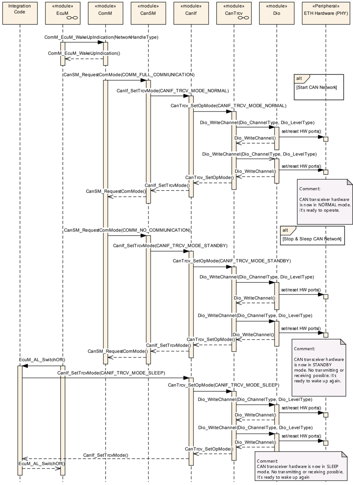

### 8.3. 去初始化（SPI同步）

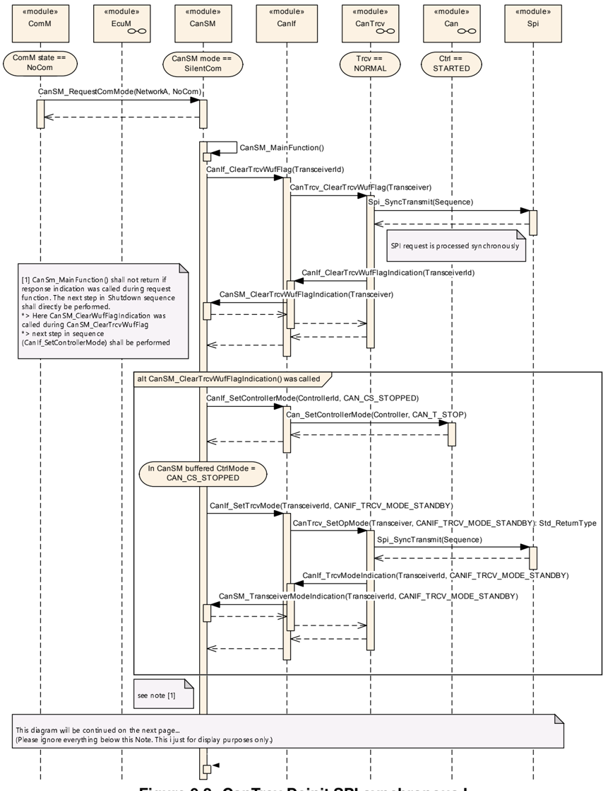

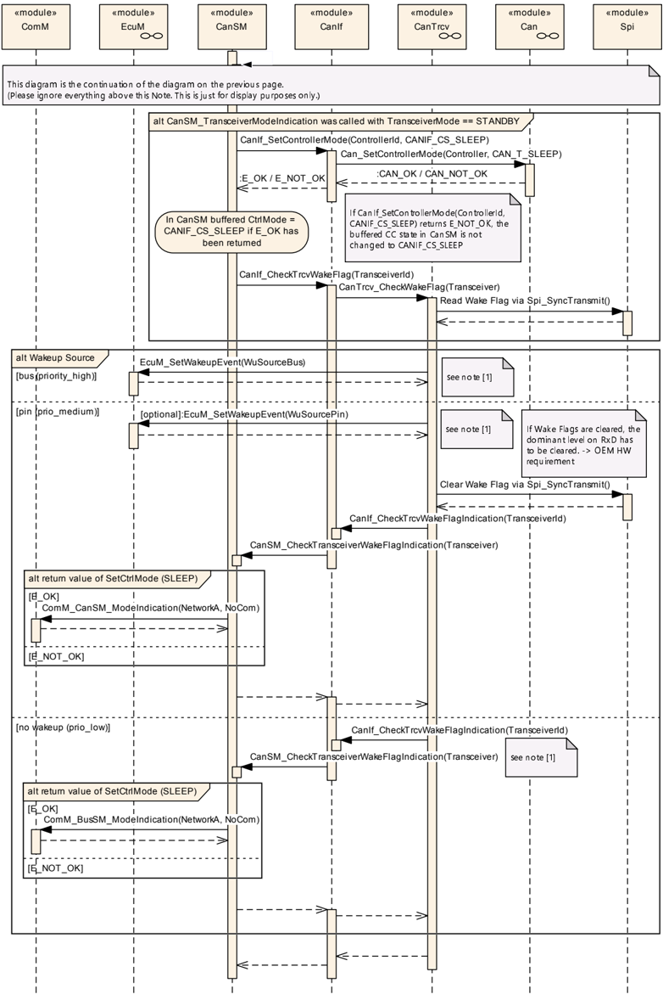

### 8.4. 去初始化（SPI异步）

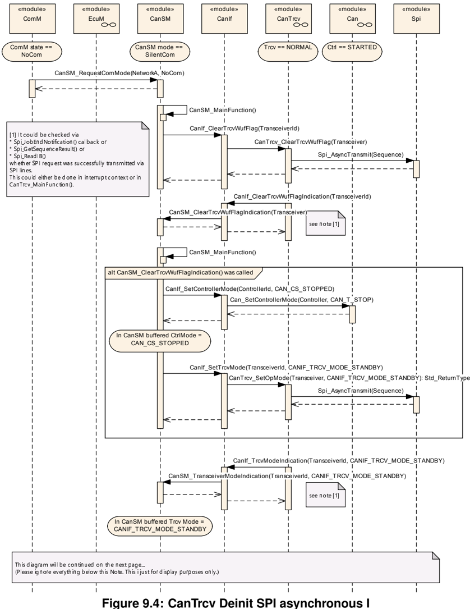

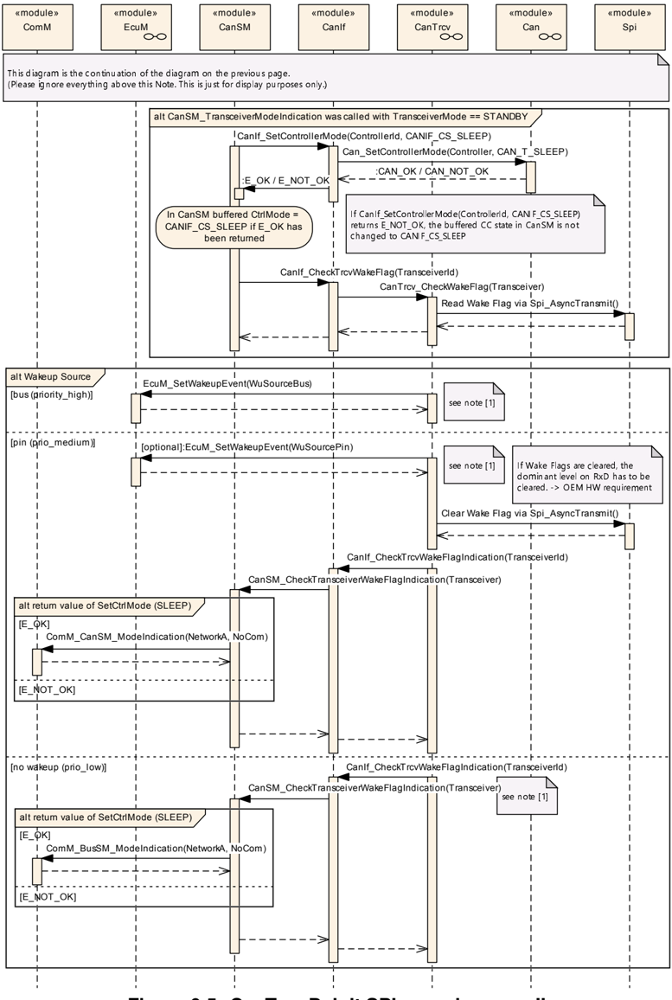

## 9. 配置规范

总体而言，本章定义了配置参数及其到容器的聚类组织。为支持本规范，第9.1节描述了基础知识。

第9.2节规定了模块**CanTrcv**的结构（容器）和参数。

第9.3节规定了模块**CanTrcv**的发布信息。

### 9.1. 如何阅读本章

详情请参阅[\[3\]](#ref-3)的第10.1章「配置规范简介」。

如果实现不支持分区映射，则CAN收发器驱动程序模块应拒绝此类配置。

### 9.2. 容器与配置参数

#### 9.2.1. CanTrcv

| SWS 条目 | [ECUC_CanTrcv_00192] |
| --- | --- |
| 模块名称 | CanTrcv |
| 描述 | **CanTrcv**（CAN收发器驱动程序）模块的配置。 |
| Post-Build 变体支持 | true |
| 支持的配置变体 | VARIANT-LINK-TIME, VARIANT-POST-BUILD, VARIANT-PRE-COMPILE |

| 包含的容器 | 容器名称 | 多重性 | 作用域/依赖 |
| --- | --- | --- | --- |
| 包含的容器 | CanTrcvConfigSet | 1 | 该容器包含AUTOSAR **CanTrcv**模块的配置参数和子容器。 |
| 包含的容器 | CanTrcvGeneral | 1 | 该容器给出CAN收发器驱动程序的基本信息。 |

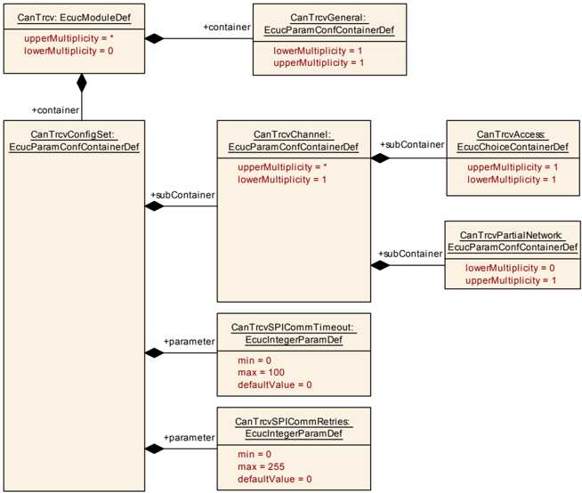

#### 9.2.2. CanTrcvGeneral

| SWS 条目 | [ECUC_CanTrcv_00090] |
| --- | --- |
| 容器名称 | CanTrcvGeneral |
| 父容器 | CanTrcv |
| 描述 | 该容器给出CAN收发器驱动程序的基本信息。 |
| 配置参数 | 见下方参数表 |

| SWS 条目 | [ECUC_CanTrcv_00152] |
| --- | --- |
| 参数名称 | CanTrcvDevErrorDetect |
| 父容器 | CanTrcvGeneral |
| 描述 | 打开或关闭开发错误检测与通知。**true**：检测和通知已启用；**false**：检测和通知已禁用。 |
| 多重性 | 1 |
| 类型 | EcucBooleanParamDef |
| 默认值 | false |
| Post-Build 变体值 | false |
| 值配置类 | Pre-compile time：X（All Variants）；Link time：-；Post-build time：- |
| 作用域/依赖 | scope: local |

| SWS 条目 | [ECUC_CanTrcv_00184] |
| --- | --- |
| 参数名称 | CanTrcvIndex |
| 父容器 | CanTrcvGeneral |
| 描述 | 指定该模块实例的**InstanceId**。如果只存在一个实例，则其Id应为0。 |
| 多重性 | 1 |
| 类型 | EcucIntegerParamDef |
| 取值范围 | 0 .. 255 |
| 默认值 | - |
| Post-Build 变体值 | false |
| 值配置类 | Pre-compile time：X（All Variants）；Link time：-；Post-build time：- |
| 作用域/依赖 | scope: local |

| SWS 条目 | [ECUC_CanTrcv_00187] |
| --- | --- |
| 参数名称 | CanTrcvMainFunctionDiagnosticsPeriod |
| 父容器 | CanTrcvGeneral |
| 描述 | 该参数描述周期调用**CanTrcv_MainFunctionDiagnostics**的周期。单位为秒。 |
| 多重性 | 0..1 |
| 类型 | EcucFloatParamDef |
| 取值范围 | ]0 .. INF[ |
| 默认值 | - |
| Post-Build 变体多重性 | false |
| Post-Build 变体值 | false |
| 多重性配置类 | Pre-compile time：X；Link time：-；Post-build time：- |
| 值配置类 | Pre-compile time：X；Link time：-；Post-build time：- |
| 作用域/依赖 | scope: local |

| SWS 条目 | [ECUC_CanTrcv_00186] |
| --- | --- |
| 参数名称 | CanTrcvMainFunctionPeriod |
| 父容器 | CanTrcvGeneral |
| 描述 | 该参数描述周期调用**CanTrcv_MainFunction**的周期。单位为秒。 |
| 多重性 | 0..1 |
| 类型 | EcucFloatParamDef |
| 取值范围 | ]0 .. INF[ |
| 默认值 | - |
| Post-Build 变体多重性 | false |
| Post-Build 变体值 | false |
| 多重性配置类 | Pre-compile time：X（All Variants）；Link time：-；Post-build time：- |
| 值配置类 | Pre-compile time：X（All Variants）；Link time：-；Post-build time：- |
| 作用域/依赖 | scope: local |

| SWS 条目 | [ECUC_CanTrcv_00190] |
| --- | --- |
| 参数名称 | CanTrcvTimerType |
| 父容器 | CanTrcvGeneral |
| 描述 | 时间服务预定义计时器的类型。 |
| 多重性 | 0..1 |
| 类型 | EcucEnumerationParamDef |
| 取值范围 | Timer_1us16bit：16位1微秒计时器 |
| Post-Build 变体多重性 | false |
| Post-Build 变体值 | false |
| 值配置类 | Pre-compile time：X（All Variants）；Link time：-；Post-build time：- |
| 作用域/依赖 | scope: local |

| SWS 条目 | [ECUC_CanTrcv_00153] |
| --- | --- |
| 参数名称 | CanTrcvVersionInfoApi |
| 父容器 | CanTrcvGeneral |
| 描述 | 打开或关闭版本信息API。如果关闭，则函数无需存在于已编译代码中。 |
| 多重性 | 1 |
| 类型 | EcucBooleanParamDef |
| 默认值 | false |
| Post-Build 变体值 | false |
| 值配置类 | Pre-compile time：X（All Variants）；Link time：-；Post-build time：- |
| 作用域/依赖 | scope: local |

| SWS 条目 | [ECUC_CanTrcv_00191] |
| --- | --- |
| 参数名称 | CanTrcvWaitTime |
| 父容器 | CanTrcvGeneral |
| 描述 | 收发器状态变化的等待时间，单位为秒。 |
| 多重性 | 0..1 |
| 类型 | EcucFloatParamDef |
| 取值范围 | [0 .. 2.55E-4] |
| 默认值 | - |
| Post-Build 变体多重性 | false |
| Post-Build 变体值 | false |
| 多重性配置类 | Pre-compile time：X（All Variants）；Link time：-；Post-build time：- |
| 值配置类 | Pre-compile time：X（All Variants）；Link time：-；Post-build time：- |
| 作用域/依赖 | scope: local |

| SWS 条目 | [ECUC_CanTrcv_00154] |
| --- | --- |
| 参数名称 | CanTrcvWakeUpSupport |
| 父容器 | CanTrcvGeneral |
| 描述 | 说明唤醒是通过轮询支持，还是不受支持。如果硬件不支持唤醒，则该设置必须为**CANTRCV_WAKEUP_NOT_SUPPORTED**。只有在唤醒通过轮询支持的情况下，函数**CanTrcv_MainFunction**才必须存在并由调度器调用。 |
| 多重性 | 1 |
| 类型 | EcucEnumerationParamDef |
| 取值范围 | CANTRCV_WAKEUP_BY_POLLING：通过轮询唤醒；CANTRCV_WAKEUP_NOT_SUPPORTED：不支持唤醒 |
| Post-Build 变体值 | false |
| 值配置类 | Pre-compile time：X（All Variants）；Link time：-；Post-build time：- |
| 作用域/依赖 | scope: local dependency: CanTrcvWakeupByBusUsed |

| SWS 条目 | [ECUC_CanTrcv_00193] |
| --- | --- |
| 参数名称 | CanTrcvEcucPartitionRef |
| 父容器 | CanTrcvGeneral |
| 描述 | 将CAN收发器驱动程序映射到零个或多个ECUC分区，以使该模块的API在该分区中可用。该模块在每个分区中将作为独立实例运行。 |
| 多重性 | 0..* |
| 类型 | 对 EcucPartition 的引用 |
| Post-Build 变体多重性 | true |
| Post-Build 变体值 | true |
| 值配置类 | Pre-compile time：All Variants；Link time：-；Post-build time：- |
| 作用域/依赖 | scope: ECU |

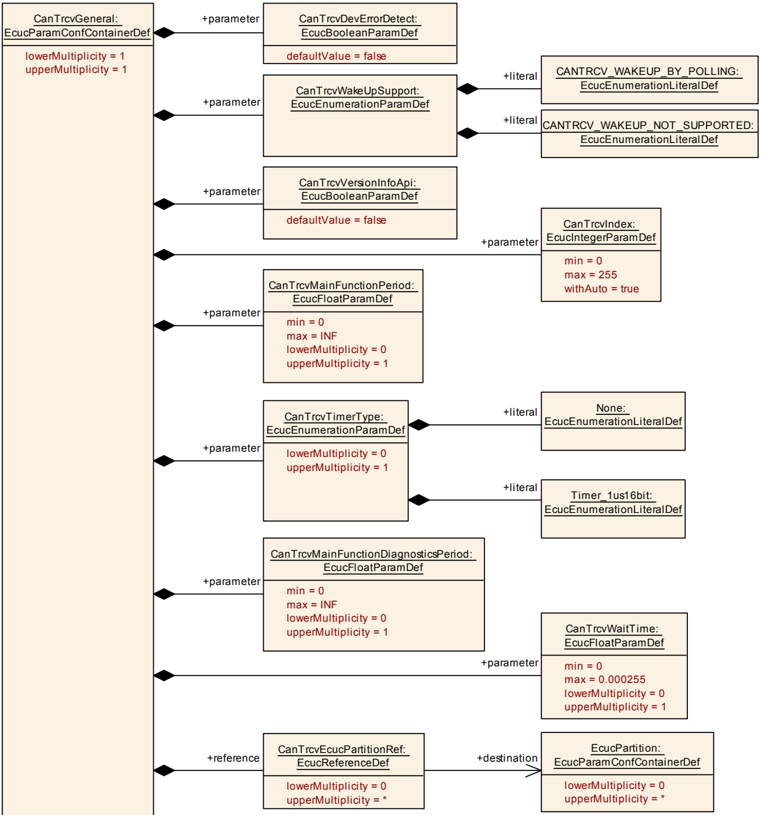

无包含的容器。

#### 9.2.3. CanTrcvConfigSet

| SWS 条目 | [ECUC_CanTrcv_00173] |
| --- | --- |
| 容器名称 | CanTrcvConfigSet |
| 父容器 | CanTrcv |
| 描述 | 该容器包含AUTOSAR **CanTrcv**模块的配置参数和子容器。 |
| 配置参数 | 见下方参数表 |

| SWS 条目 | [ECUC_CanTrcv_00175] |
| --- | --- |
| 参数名称 | CanTrcvSPICommRetries |
| 父容器 | CanTrcvConfigSet |
| 描述 | 表示SPI通信失败时允许的最大通信重试次数（同时适用于通信超时以及响应数据中的错误/NACK）。如果配置值为「0」，则不允许重试（期望通信在第一次尝试时即成功）。 |
| 多重性 | 1 |
| 类型 | EcucIntegerParamDef |
| 取值范围 | 0 .. 255 |
| 默认值 | 0 |
| Post-Build 变体值 | true |
| 值配置类 | Pre-compile time：X（VARIANT-PRE-COMPILE）；Link time：X（VARIANT-LINK-TIME）；Post-build time：X（VARIANT-POST-BUILD） |
| 作用域/依赖 | scope: local dependency: 只有当**CanTrcvSpiSequence**中至少引用了一个SPI序列时，该参数才存在。 |

| SWS 条目 | [ECUC_CanTrcv_00174] |
| --- | --- |
| 参数名称 | CanTrcvSPICommTimeout |
| 父容器 | CanTrcvConfigSet |
| 描述 | 表示**CanTrcv**被允许用于（肯定或否定地）应答SPI命令的最大时间。超时以毫秒为单位配置。超时值为「0」表示**CanTrcv**不使用特定超时，通信以SPI硬件的最佳能力执行。 |
| 多重性 | 1 |
| 类型 | EcucIntegerParamDef |
| 取值范围 | 0 .. 100 |
| 默认值 | 0 |
| Post-Build 变体值 | true |
| 值配置类 | Pre-compile time：X（VARIANT-PRE-COMPILE）；Link time：X（VARIANT-LINK-TIME）；Post-build time：X（VARIANT-POST-BUILD） |
| 作用域/依赖 | scope: local dependency: 只有当**CanTrcvSpiSequence**中至少引用了一个SPI序列时，该参数才存在。 |

| 包含的容器 | 容器名称 | 多重性 | 作用域/依赖 |
| --- | --- | --- | --- |
| 包含的容器 | CanTrcvChannel | 1..* | 该容器给出CAN收发器驱动程序关于单个CAN收发器（通道）的信息。 |

#### 9.2.4. CanTrcvChannel

| SWS 条目 | [ECUC_CanTrcv_00143] |
| --- | --- |
| 容器名称 | CanTrcvChannel |
| 父容器 | CanTrcvConfigSet |
| 描述 | 该容器给出CAN收发器驱动程序关于单个CAN收发器（通道）的信息。 |
| 配置参数 | 见下方参数表 |

| SWS 条目 | [ECUC_CanTrcv_00155] |
| --- | --- |
| 参数名称 | CanTrcvChannelId |
| 父容器 | CanTrcvChannel |
| 描述 | CAN收发器通道的唯一标识符。 |
| 多重性 | 1 |
| 类型 | EcucIntegerParamDef（为该参数生成符号名称） |
| 取值范围 | 0 .. 255 |
| 默认值 | - |
| Post-Build 变体值 | false |
| 值配置类 | Pre-compile time：X（All Variants）；Link time：-；Post-build time：- |
| 作用域/依赖 | scope: ECU |

| SWS 条目 | [ECUC_CanTrcv_00096] |
| --- | --- |
| 参数名称 | CanTrcvChannelUsed |
| 父容器 | CanTrcvChannel |
| 描述 | 是否使用相关的CAN收发器通道？ |
| 多重性 | 1 |
| 类型 | EcucBooleanParamDef |
| 默认值 | true |
| Post-Build 变体值 | false |
| 值配置类 | Pre-compile time：X（All Variants）；Link time：-；Post-build time：- |
| 作用域/依赖 | scope: local |

| SWS 条目 | [ECUC_CanTrcv_00097] |
| --- | --- |
| 参数名称 | CanTrcvControlsPowerSupply |
| 父容器 | CanTrcvChannel |
| 描述 | ECU的电源是否由该收发器控制？**TRUE** = 由收发器控制；**FALSE** = 不由收发器控制。 |
| 多重性 | 1 |
| 类型 | EcucBooleanParamDef |
| 默认值 | false |
| Post-Build 变体值 | false |
| 值配置类 | Pre-compile time：X（All Variants）；Link time：-；Post-build time：- |
| 作用域/依赖 | scope: local |

| SWS 条目 | [ECUC_CanTrcv_00160] |
| --- | --- |
| 参数名称 | CanTrcvHwPnSupport |
| 父容器 | CanTrcvChannel |
| 描述 | 指示硬件是否支持选择性唤醒功能。**TRUE** = 收发器支持选择性唤醒功能；**FALSE** = 收发器不具备选择性唤醒功能。 |
| 多重性 | 1 |
| 类型 | EcucBooleanParamDef |
| 默认值 | false |
| Post-Build 变体值 | false |
| 值配置类 | Pre-compile time：X（All Variants）；Link time：-；Post-build time：- |
| 作用域/依赖 | scope: local |

| SWS 条目 | [ECUC_CanTrcv_00146] |
| --- | --- |
| 参数名称 | CanTrcvInitState |
| 父容器 | CanTrcvChannel |
| 描述 | 调用**CanTrcv_Init**之后CAN收发器的状态。 |
| 多重性 | 1 |
| 类型 | EcucEnumerationParamDef |
| 取值范围 | CANTRCV_OP_MODE_SLEEP：睡眠操作模式；CANTRCV_OP_MODE_STANDBY：待机操作模式 |
| Post-Build 变体值 | false |
| 值配置类 | Pre-compile time：X（All Variants）；Link time：-；Post-build time：- |
| 作用域/依赖 | scope: local |

| SWS 条目 | [ECUC_CanTrcv_00147] |
| --- | --- |
| 参数名称 | CanTrcvMaxBaudrate |
| 父容器 | CanTrcvChannel |
| 描述 | 表示以kbps为单位的传输速率。收发器硬件类型允许的最大传输速率，以kbps为单位。仅用于校验目的。该值可供配置工具使用。 |
| 多重性 | 1 |
| 类型 | EcucIntegerParamDef |
| 取值范围 | 0 .. 20000 |
| 默认值 | - |
| Post-Build 变体值 | false |
| 值配置类 | Pre-compile time：X（All Variants）；Link time：-；Post-build time：- |
| 作用域/依赖 | scope: local |

| SWS 条目 | [ECUC_CanTrcv_00148] |
| --- | --- |
| 参数名称 | CanTrcvWakeupByBusUsed |
| 父容器 | CanTrcvChannel |
| 描述 | 总线唤醒是否被支持？如果CAN收发器硬件不支持总线唤醒，则该值恒为**FALSE**。如果CAN收发器硬件支持总线唤醒，则该值为**TRUE**或**FALSE**，取决于是否使用该功能。**TRUE** = 已使用；**FALSE** = 未使用。 |
| 多重性 | 0..1 |
| 类型 | EcucBooleanParamDef |
| 默认值 | false |
| Post-Build 变体多重性 | false |
| Post-Build 变体值 | false |
| 多重性配置类 | Pre-compile time：All Variants；Link time：-；Post-build time：- |
| 值配置类 | Pre-compile time：All Variants；Link time：-；Post-build time：- |
| 作用域/依赖 | scope: local dependency: CanTrcvWakeUpSupport |

| SWS 条目 | [ECUC_CanTrcv_00194] |
| --- | --- |
| 参数名称 | CanTrcvChannelEcucPartitionRef |
| 父容器 | CanTrcvChannel |
| 描述 | 将CAN收发器通道映射到零个或一个ECUC分区。所引用的ECUC分区是CAN收发器驱动程序所映射到的ECUC分区的子集。 |
| 多重性 | 0..1 |
| 类型 | 对 EcucPartition 的引用 |
| Post-Build 变体多重性 | true |
| Post-Build 变体值 | true |
| 值配置类 | Pre-compile time：X；Link time：-；Post-build time：- |
| 作用域/依赖 | scope: ECU |

| SWS 条目 | [ECUC_CanTrcv_00185] |
| --- | --- |
| 参数名称 | CanTrcvIcuChannelRef |
| 父容器 | CanTrcvChannel |
| 描述 | 对用于启用/禁用唤醒中断的**IcuChannel**的引用。 |
| 多重性 | 0..1 |
| 类型 | 对 IcuChannel 的符号名引用 |
| Post-Build 变体多重性 | false |
| Post-Build 变体值 | false |
| 值配置类 | Pre-compile time：X（All Variants）；Link time：-；Post-build time：- |
| 作用域/依赖 | scope: local |

| SWS 条目 | [ECUC_CanTrcv_00181] |
| --- | --- |
| 参数名称 | CanTrcvPorWakeupSourceRef |
| 父容器 | CanTrcvChannel |
| 描述 | 符号名引用，用于指定在调用**EcuM_SetWakeupEvent**时应使用的唤醒源，如需求中所述。如果硬件支持**POR**或**SYSERR**标志，则该引用是强制的。 |
| 多重性 | 0..1 |
| 类型 | 对 EcuMWakeupSource 的符号名引用 |
| Post-Build 变体多重性 | false |
| Post-Build 变体值 | false |
| 值配置类 | Pre-compile time：X；Link time：-；Post-build time：- |
| 作用域/依赖 | scope: ECU |

| SWS 条目 | [ECUC_CanTrcv_00182] |
| --- | --- |
| 参数名称 | CanTrcvSyserrWakeupSourceRef |
| 父容器 | CanTrcvChannel |
| 描述 | 符号名引用，用于指定在调用**EcuM_SetWakeupEvent**时应使用的唤醒源，如需求中所述。如果硬件支持**POR**或**SYSERR**标志，则该引用是强制的。 |
| 多重性 | 0..1 |
| 类型 | 对 EcuMWakeupSource 的符号名引用 |
| Post-Build 变体多重性 | false |
| Post-Build 变体值 | false |
| 值配置类 | Pre-compile time：X；Link time：-；Post-build time：- |
| 作用域/依赖 | scope: ECU |

| SWS 条目 | [ECUC_CanTrcv_00177] |
| --- | --- |
| 参数名称 | CanTrcvWakeupSourceRef |
| 父容器 | CanTrcvChannel |
| 描述 | 对**EcuM**配置中某个唤醒源的引用。只有当**CanTrcvWakeupByBusUsed**为true时才需要该引用。 |
| 多重性 | 0..1 |
| 类型 | 对 EcuMWakeupSource 的符号名引用 |
| Post-Build 变体多重性 | false |
| Post-Build 变体值 | false |
| 值配置类 | Pre-compile time：All Variants；Link time：-；Post-build time：- |
| 作用域/依赖 | scope: ECU dependency: CanTrcvWakeupByBusUsed |

| 包含的容器 | 容器名称 | 多重性 | 作用域/依赖 |
| --- | --- | --- | --- |
| 包含的容器 | CanTrcvAccess | 1 | 该容器给出**CanTrcv**驱动程序关于访问单个CAN收发器的信息。 |
| 包含的容器 | CanTrcvDemEventParameterRefs | 0..1 | 对**DemEventParameter**元素的引用的容器；当相应错误发生时，应使用API **Dem_SetEventStatus**调用这些元素。**EventId**取自所引用的**DemEventParameter**的**DemEventId**符号值。本容器中提供了标准化错误，并可通过供应商特定的错误引用进行扩展。 |
| 包含的容器 | CanTrcvPartialNetwork | 0..1 | 该容器给出CAN收发器驱动程序关于部分联网功能配置的信息。 |
| 包含的容器 | CanXLTrcvChannel | 0..1 | 该容器在SWS CAN XL Transceiver Driver中规定，表示一个CAN XL收发器通道。如果存在该容器，则CAN收发器将提供扩展的**CanXLTrcv** API。 |

由**CanTrcvChannelEcucPartitionRef**引用的ECUC分区，应是**CanTrcvEcucPartitionRef**所引用ECUC分区的子集。

如果**CanTrcvEcucPartitionRef**引用了一个或多个ECUC分区，则**CanTrcvChannelEcucPartitionRef**的多重性应为1，并且也应引用这些ECUC分区之一。

同一通信通道的**CanTrcvChannel**和**CanController**应全部引用同一个ECUC分区。

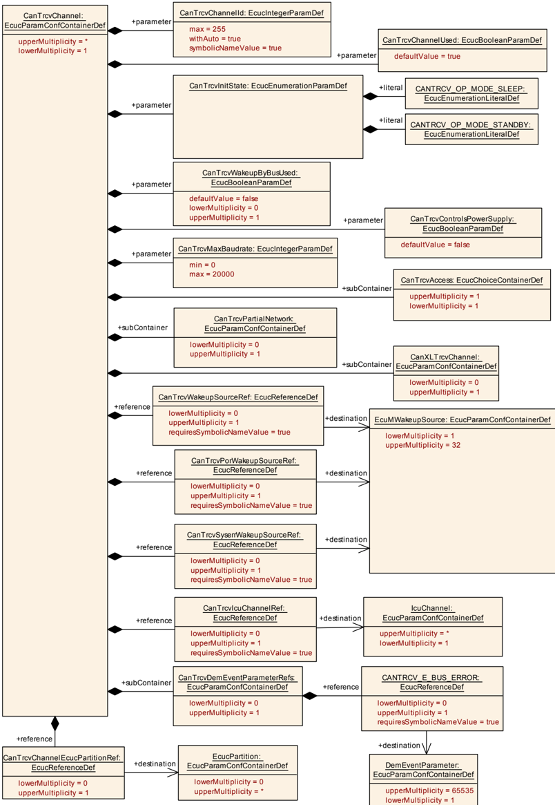

#### 9.2.5. CanTrcvAccess

| SWS 条目 | [ECUC_CanTrcv_00101] |
| --- | --- |
| 选择容器名称 | CanTrcvAccess |
| 父容器 | CanTrcvChannel |
| 描述 | 该容器给出**CanTrcv**驱动程序关于访问单个CAN收发器的信息。 |

| 容器选择 | 容器名称 | 多重性 | 作用域/依赖 |
| --- | --- | --- | --- |
| 容器选择 | CanTrcvDioAccess | 0..1 | 该容器给出CAN收发器驱动程序关于访问端口和端口引脚的信息。此外还给出了CAN收发器硬件引脚名称与**Dio**端口访问信息之间的关系。如果CAN收发器硬件没有**Dio**接口，则不存在该容器的实例。 |
| 容器选择 | CanTrcvSpiAccess | 0..1 | 该容器给出CAN收发器驱动程序关于访问**Spi**的信息。如果CAN收发器硬件没有**Spi**接口，则不存在该容器的实例。 |

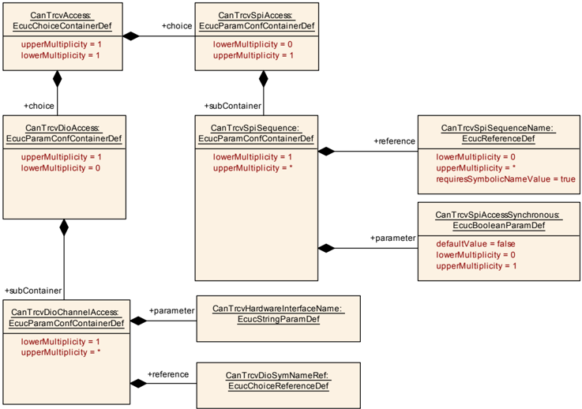

#### 9.2.6. CanTrcvDioAccess

| SWS 条目 | [ECUC_CanTrcv_00145] |
| --- | --- |
| 容器名称 | CanTrcvDioAccess |
| 父容器 | CanTrcvAccess |
| 描述 | 该容器给出CAN收发器驱动程序关于访问端口和端口引脚的信息。此外还给出了CAN收发器硬件引脚名称与**Dio**端口访问信息之间的关系。如果CAN收发器硬件没有**Dio**接口，则不存在该容器的实例。 |
| 配置参数 | 见下方参数表 |

| 包含的容器 | 容器名称 | 多重性 | 作用域/依赖 |
| --- | --- | --- | --- |
| 包含的容器 | CanTrcvDioChannelAccess | 1..* | 该容器给出按单个**Can**收发器通道进行的**DIO**通道访问。 |

#### 9.2.7. CanTrcvDioChannelAccess

| SWS 条目 | [ECUC_CanTrcv_00157] |
| --- | --- |
| 容器名称 | CanTrcvDioChannelAccess |
| 父容器 | CanTrcvDioAccess |
| 描述 | 该容器给出按单个**Can**收发器通道进行的**DIO**通道访问。 |
| 配置参数 | 见下方参数表 |

| SWS 条目 | [ECUC_CanTrcv_00150] |
| --- | --- |
| 参数名称 | CanTrcvHardwareInterfaceName |
| 父容器 | CanTrcvDioChannelAccess |
| 描述 | CAN收发器硬件接口名称。通常为引脚名称。从**Dio**的角度看，它要么是一个端口、单个通道，要么是一个通道组。据此，**CANTRCV_DIO_PORT_SYMBOLIC_NAME**、**CANTRCV_DIO_CHANNEL_SYMBOLIC_NAME**或**CANTRCV_DIO_CHANNEL_GROUP_SYMBOLIC_NAME**之一应引用一个**Dio**配置。CAN收发器驱动程序的实现说明应为相应的CAN收发器硬件列出该名称。 |
| 多重性 | 1 |
| 类型 | EcucStringParamDef |
| 默认值 | - |
| 正则表达式 | - |
| Post-Build 变体值 | false |
| 值配置类 | Pre-compile time：X（All Variants）；Link time：-；Post-build time：- |
| 作用域/依赖 | scope: local |

| SWS 条目 | [ECUC_CanTrcv_00149] |
| --- | --- |
| 参数名称 | CanTrcvDioSymNameRef |
| 父容器 | CanTrcvDioChannelAccess |
| 描述 | 对**DIO**端口、**DIO**通道或**DIO**通道组的选择引用。该引用取代了Can Trcv SWS中的**CANTRCV_DIO_PORT_SYM_NAME**、**CANTRCV_DIO_CHANNEL_SYM_NAME**和**CANTRCV_DIO_GROUP_SYM_NAME**引用。 |
| 多重性 | 1 |
| 类型 | 对 [DioChannel, DioChannelGroup, DioPort] 的选择引用 |
| Post-Build 变体值 | false |
| 值配置类 | Pre-compile time：X（All Variants）；Link time：-；Post-build time：- |
| 作用域/依赖 | scope: local |

无包含的容器。

#### 9.2.8. CanTrcvSpiAccess

| SWS 条目 | [ECUC_CanTrcv_00183] |
| --- | --- |
| 容器名称 | CanTrcvSpiAccess |
| 父容器 | CanTrcvAccess |
| 描述 | 该容器给出CAN收发器驱动程序关于访问**Spi**的信息。如果CAN收发器硬件没有**Spi**接口，则不存在该容器的实例。 |
| 配置参数 | 见下方参数表 |

| 包含的容器 | 容器名称 | 多重性 | 作用域/依赖 |
| --- | --- | --- | --- |
| 包含的容器 | CanTrcvSpiSequence | 1..* | 该容器给出CAN收发器驱动程序关于一个SPI序列的信息。CAN收发器驱动程序使用的一个SPI序列由它独占使用，不允许其他驱动程序访问该序列。CAN收发器驱动程序可以使用一个序列访问n个同一类型的CAN收发器硬件芯片，或者使用n个序列访问单个CAN收发器硬件芯片。如果CAN收发器硬件没有**SPI**接口，则不存在该容器的实例。 |

#### 9.2.9. CanTrcvSpiSequence

| SWS 条目 | [ECUC_CanTrcv_00144] |
| --- | --- |
| 容器名称 | CanTrcvSpiSequence |
| 父容器 | CanTrcvSpiAccess |
| 描述 | 该容器给出CAN收发器驱动程序关于一个SPI序列的信息。CAN收发器驱动程序使用的一个SPI序列由它独占使用，不允许其他驱动程序访问该序列。CAN收发器驱动程序可以使用一个序列访问n个同一类型的CAN收发器硬件芯片，或者使用n个序列访问单个CAN收发器硬件芯片。如果CAN收发器硬件没有**SPI**接口，则不存在该容器的实例。 |
| 配置参数 | 见下方参数表 |

| SWS 条目 | [ECUC_CanTrcv_00176] |
| --- | --- |
| 参数名称 | CanTrcvSpiAccessSynchronous |
| 父容器 | CanTrcvSpiSequence |
| 描述 | 该参数用于定义对**Spi**序列的访问是同步还是异步。**true**：SPI访问为同步；**false**：SPI访问为异步。 |
| 多重性 | 0..1 |
| 类型 | EcucBooleanParamDef |
| 默认值 | false |
| Post-Build 变体多重性 | false |
| Post-Build 变体值 | false |
| 值配置类 | Pre-compile time：X；Link time：-；Post-build time：- |
| 作用域/依赖 | scope: local |

| SWS 条目 | [ECUC_CanTrcv_00151] |
| --- | --- |
| 参数名称 | CanTrcvSpiSequenceName |
| 父容器 | CanTrcvSpiSequence |
| 描述 | 对**Spi**序列配置容器的引用。 |
| 多重性 | 0..* |
| 类型 | 对 SpiSequence 的符号名引用 |
| Post-Build 变体多重性 | false |
| Post-Build 变体值 | false |
| 值配置类 | Pre-compile time：X（All Variants）；Link time：-；Post-build time：- |
| 作用域/依赖 | scope: local dependency: SpiSequence |

无包含的容器。

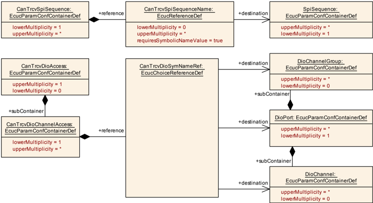

#### 9.2.10. CanTrcvDemEventParameterRefs

| SWS 条目 | [ECUC_CanTrcv_00188] |
| --- | --- |
| 容器名称 | CanTrcvDemEventParameterRefs |
| 父容器 | CanTrcvChannel |
| 描述 | 对**DemEventParameter**元素的引用的容器；当相应错误发生时，应使用API **Dem_SetEventStatus**调用这些元素。**EventId**取自所引用的**DemEventParameter**的**DemEventId**符号值。本容器中提供了标准化错误，并可通过供应商特定的错误引用进行扩展。 |
| 配置参数 | 见下方参数表 |

| SWS 条目 | [ECUC_CanTrcv_00189] |
| --- | --- |
| 参数名称 | CANTRCV_E_BUS_ERROR |
| 父容器 | CanTrcvDemEventParameterRefs |
| 描述 | 对**DemEventParameter**的引用，当发生总线错误时应发出该事件。 |
| 多重性 | 0..1 |
| 类型 | 对 DemEventParameter 的符号名引用 |
| Post-Build 变体多重性 | false |
| Post-Build 变体值 | false |
| 值配置类 | Pre-compile time：X；Link time：-；Post-build time：- |
| 作用域/依赖 | scope: ECU dependency: DEM |

无包含的容器。

#### 9.2.11. CanTrcvPartialNetwork

| SWS 条目 | [ECUC_CanTrcv_00161] |
| --- | --- |
| 容器名称 | CanTrcvPartialNetwork |
| 父容器 | CanTrcvChannel |
| 描述 | 该容器给出CAN收发器驱动程序关于部分联网功能配置的信息。 |
| 配置参数 | 见下方参数表 |

| SWS 条目 | [ECUC_CanTrcv_00169] |
| --- | --- |
| 参数名称 | CanTrcvBaudRate |
| 父容器 | CanTrcvPartialNetwork |
| 描述 | 表示以kbps为单位的传输速率。 |
| 多重性 | 1 |
| 类型 | EcucIntegerParamDef |
| 取值范围 | 0 .. 12000 |
| 默认值 | - |
| Post-Build 变体值 | true |
| 值配置类 | Pre-compile time：X（VARIANT-PRE-COMPILE）；Link time：X（VARIANT-LINK-TIME）；Post-build time：X（VARIANT-POST-BUILD） |
| 作用域/依赖 | scope: local dependency: 尽管技术上可能实现DLC=0的**WUF**，但明确不期望这样做。 |

| SWS 条目 | [ECUC_CanTrcv_00171] |
| --- | --- |
| 参数名称 | CanTrcvBusErrFlag |
| 父容器 | CanTrcvPartialNetwork |
| 描述 | 指示总线错误（**BUSERR**）标志是否由**BSW**管理。当收发器检测到总线故障时，该标志被置位。**TRUE** = 由收发器支持并由**BSW**管理；**FALSE** = 不由**BSW**管理。 |
| 多重性 | 1 |
| 类型 | EcucBooleanParamDef |
| 默认值 | false |
| Post-Build 变体值 | true |
| 值配置类 | Pre-compile time：X（VARIANT-PRE-COMPILE）；Link time：X（VARIANT-LINK-TIME）；Post-build time：X（VARIANT-POST-BUILD） |
| 作用域/依赖 | scope: local |

| SWS 条目 | [ECUC_CanTrcv_00164] |
| --- | --- |
| 参数名称 | CanTrcvPnCanIdIsExtended |
| 父容器 | CanTrcvPartialNetwork |
| 描述 | 指示使用的是扩展ID还是标准ID。**TRUE** = 使用扩展**Can**标识符；**FALSE** = 使用标准**Can**标识符。 |
| 多重性 | 1 |
| 类型 | EcucBooleanParamDef |
| 默认值 | false |
| Post-Build 变体值 | true |
| 值配置类 | Pre-compile time：X（VARIANT-PRE-COMPILE）；Link time：X（VARIANT-LINK-TIME）；Post-build time：X（VARIANT-POST-BUILD） |
| 作用域/依赖 | scope: local |

| SWS 条目 | [ECUC_CanTrcv_00172] |
| --- | --- |
| 参数名称 | CanTrcvPnEnabled |
| 父容器 | CanTrcvPartialNetwork |
| 描述 | 指示硬件中是否启用选择性唤醒功能。**TRUE** = 收发器硬件中已启用选择性唤醒功能；**FALSE** = 收发器硬件中已禁用选择性唤醒功能。 |
| 多重性 | 1 |
| 类型 | EcucBooleanParamDef |
| 默认值 | false |
| Post-Build 变体值 | true |
| 值配置类 | Pre-compile time：X（VARIANT-PRE-COMPILE）；Link time：X（VARIANT-LINK-TIME）；Post-build time：X（VARIANT-POST-BUILD） |
| 作用域/依赖 | scope: local |

| SWS 条目 | [ECUC_CanTrcv_00163] |
| --- | --- |
| 参数名称 | CanTrcvPnFrameCanId |
| 父容器 | CanTrcvPartialNetwork |
| 描述 | 唤醒帧（**WUF**）的CAN ID。 |
| 多重性 | 1 |
| 类型 | EcucIntegerParamDef |
| 取值范围 | 0 .. 4294967295 |
| 默认值 | - |
| Post-Build 变体值 | true |
| 值配置类 | Pre-compile time：X（VARIANT-PRE-COMPILE）；Link time：X（VARIANT-LINK-TIME）；Post-build time：X（VARIANT-POST-BUILD） |
| 作用域/依赖 | scope: local |

| SWS 条目 | [ECUC_CanTrcv_00162] |
| --- | --- |
| 参数名称 | CanTrcvPnFrameCanIdMask |
| 父容器 | CanTrcvPartialNetwork |
| 描述 | 用于收发器选择性激活的ID掩码。它用于对一组ID启用帧唤醒（**WUF**）。 |
| 多重性 | 1 |
| 类型 | EcucIntegerParamDef |
| 取值范围 | 0 .. 4294967295 |
| 默认值 | - |
| Post-Build 变体值 | true |
| 值配置类 | Pre-compile time：X（VARIANT-PRE-COMPILE）；Link time：X（VARIANT-LINK-TIME）；Post-build time：X（VARIANT-POST-BUILD） |
| 作用域/依赖 | scope: local |

| SWS 条目 | [ECUC_CanTrcv_00168] |
| --- | --- |
| 参数名称 | CanTrcvPnFrameDlc |
| 父容器 | CanTrcvPartialNetwork |
| 描述 | 唤醒帧（**WUF**）的数据长度。 |
| 多重性 | 1 |
| 类型 | EcucIntegerParamDef |
| 取值范围 | 0 .. 8 |
| 默认值 | - |
| Post-Build 变体值 | true |
| 值配置类 | Pre-compile time：X（VARIANT-PRE-COMPILE）；Link time：X（VARIANT-LINK-TIME）；Post-build time：X（VARIANT-POST-BUILD） |
| 作用域/依赖 | scope: local |

| SWS 条目 | [ECUC_CanTrcv_00170] |
| --- | --- |
| 参数名称 | CanTrcvPowerOnFlag |
| 父容器 | CanTrcvPartialNetwork |
| 描述 | 指示上电复位（**POR**）标志是否可用并由收发器管理。**TRUE** = 硬件支持；**FALSE** = 硬件不支持。 |
| 多重性 | 1 |
| 类型 | EcucBooleanParamDef |
| 默认值 | false |
| Post-Build 变体值 | true |
| 值配置类 | Pre-compile time：X（VARIANT-PRE-COMPILE）；Link time：X（VARIANT-LINK-TIME）；Post-build time：X（VARIANT-POST-BUILD） |
| 作用域/依赖 | scope: local |

| 包含的容器 | 容器名称 | 多重性 | 作用域/依赖 |
| --- | --- | --- | --- |
| 包含的容器 | CanTrcvPnFrameDataMaskSpec | 0..8 | 定义用于接收载荷的数据载荷掩码，以便确定收发器是否必须被所收到的唤醒帧（**WUF**）唤醒。 |

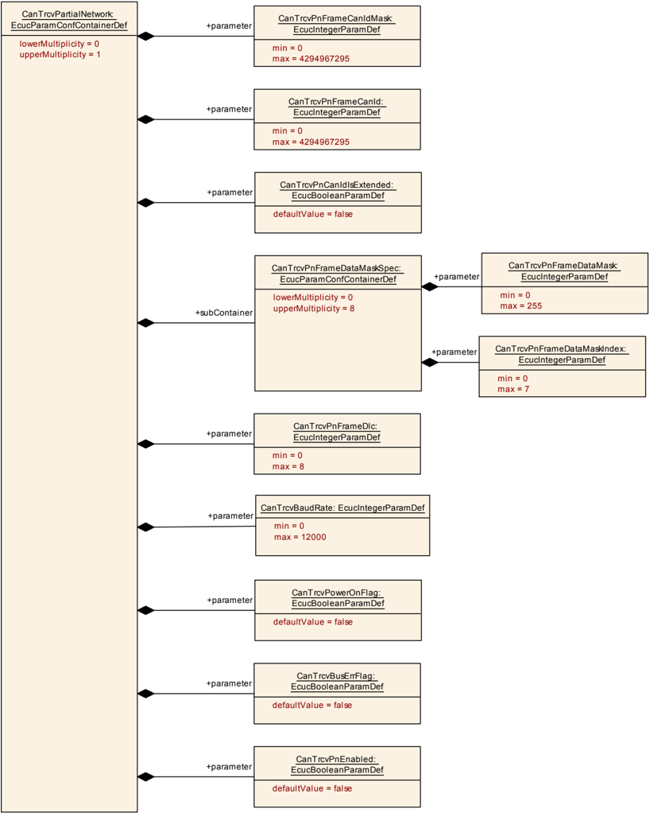

#### 9.2.12. CanTrcvPnFrameDataMaskSpec

| SWS 条目 | [ECUC_CanTrcv_00165] |
| --- | --- |
| 容器名称 | CanTrcvPnFrameDataMaskSpec |
| 父容器 | CanTrcvPartialNetwork |
| 描述 | 定义用于接收载荷的数据载荷掩码，以便确定收发器是否必须被所收到的唤醒帧（**WUF**）唤醒。 |
| 配置参数 | 见下方参数表 |

| SWS 条目 | [ECUC_CanTrcv_00166] |
| --- | --- |
| 参数名称 | CanTrcvPnFrameDataMask |
| 父容器 | CanTrcvPnFrameDataMaskSpec |
| 描述 | 定义数据载荷掩码的第n个字节（**Byte0** = LSB），该掩码用于接收载荷，以便确定收发器是否必须被所收到的唤醒帧（**WUF**）唤醒。 |
| 多重性 | 1 |
| 类型 | EcucIntegerParamDef |
| 取值范围 | 0 .. 255 |
| 默认值 | - |
| Post-Build 变体值 | true |
| 值配置类 | Pre-compile time：X（VARIANT-PRE-COMPILE）；Link time：X（VARIANT-LINK-TIME）；Post-build time：X（VARIANT-POST-BUILD） |
| 作用域/依赖 | scope: local |

| SWS 条目 | [ECUC_CanTrcv_00167] |
| --- | --- |
| 参数名称 | CanTrcvPnFrameDataMaskIndex |
| 父容器 | CanTrcvPnFrameDataMaskSpec |
| 描述 | 保存掩码部分在帧中的位置n。 |
| 多重性 | 1 |
| 类型 | EcucIntegerParamDef |
| 取值范围 | 0 .. 7 |
| 默认值 | - |
| Post-Build 变体值 | true |
| 值配置类 | Pre-compile time：X（VARIANT-PRE-COMPILE）；Link time：X（VARIANT-LINK-TIME）；Post-build time：X（VARIANT-POST-BUILD） |
| 作用域/依赖 | scope: local |

无包含的容器。

### 9.3. 发布信息

详情请参阅[\[3\]](#ref-3)的第10.3章「发布信息」。

## B. AUTOSAR 可追溯项变更历史

请注意，本章中的列表也包括在后续版本中已从规范中移除的约束和规范条目。这些约束和规范条目不会在文档中显示为超链接。

### B.1. 本文档根据 AUTOSAR R23-11 版本的可追溯项历史

#### B.1.1. R23-11 中新增的规范条目

```
[SWS_CanTrcv_00001] [SWS_CanTrcv_00002] [SWS_CanTrcv_00005] [SWS_CanTrcv_00007] [SWS_CanTrcv_00008] [SWS_CanTrcv_00009] [SWS_CanTrcv_00013] [SWS_CanTrcv_00016] [SWS_CanTrcv_00050] [SWS_CanTrcv_00055] [SWS_CanTrcv_00064] [SWS_CanTrcv_00065] [SWS_CanTrcv_00084] [SWS_CanTrcv_00085] [SWS_CanTrcv_00086] [SWS_CanTrcv_00087] [SWS_CanTrcv_00089] [SWS_CanTrcv_00090] [SWS_CanTrcv_00091] [SWS_CanTrcv_00093] [SWS_CanTrcv_00094] [SWS_CanTrcv_00095] [SWS_CanTrcv_00098] [SWS_CanTrcv_00099] [SWS_CanTrcv_00102] [SWS_CanTrcv_00105] [SWS_CanTrcv_00106] [SWS_CanTrcv_00107] [SWS_CanTrcv_00111] [SWS_CanTrcv_00112] [SWS_CanTrcv_00113] [SWS_CanTrcv_00114] [SWS_CanTrcv_00115] [SWS_CanTrcv_00116] [SWS_CanTrcv_00117] [SWS_CanTrcv_00120] [SWS_CanTrcv_00121] [SWS_CanTrcv_00122] [SWS_CanTrcv_00123] [SWS_CanTrcv_00124] [SWS_CanTrcv_00125] [SWS_CanTrcv_00127] [SWS_CanTrcv_00129] [SWS_CanTrcv_00130] [SWS_CanTrcv_00131] [SWS_CanTrcv_00132] [SWS_CanTrcv_00133] [SWS_CanTrcv_00143] [SWS_CanTrcv_00144] [SWS_CanTrcv_00145] [SWS_CanTrcv_00146] [SWS_CanTrcv_00148] [SWS_CanTrcv_00150] [SWS_CanTrcv_00158] [SWS_CanTrcv_00161] [SWS_CanTrcv_00163] [SWS_CanTrcv_00164] [SWS_CanTrcv_00165] [SWS_CanTrcv_00167] [SWS_CanTrcv_00168] [SWS_CanTrcv_00171] [SWS_CanTrcv_00172] [SWS_CanTrcv_00173] [SWS_CanTrcv_00174] [SWS_CanTrcv_00175] [SWS_CanTrcv_00177] [SWS_CanTrcv_00178] [SWS_CanTrcv_00180] [SWS_CanTrcv_00181] [SWS_CanTrcv_00182] [SWS_CanTrcv_00183] [SWS_CanTrcv_00184] [SWS_CanTrcv_00186] [SWS_CanTrcv_00187] [SWS_CanTrcv_00188] [SWS_CanTrcv_00189] [SWS_CanTrcv_00190] [SWS_CanTrcv_00191] [SWS_CanTrcv_00192] [SWS_CanTrcv_00193] [SWS_CanTrcv_00194] [SWS_CanTrcv_00195] [SWS_CanTrcv_00196] [SWS_CanTrcv_00197] [SWS_CanTrcv_00198] [SWS_CanTrcv_00199] [SWS_CanTrcv_00200] [SWS_CanTrcv_00201] [SWS_CanTrcv_00202] [SWS_CanTrcv_00203] [SWS_CanTrcv_00204] [SWS_CanTrcv_00205] [SWS_CanTrcv_00206] [SWS_CanTrcv_00209] [SWS_CanTrcv_00210] [SWS_CanTrcv_00211] [SWS_CanTrcv_00213] [SWS_CanTrcv_00214] [SWS_CanTrcv_00215] [SWS_CanTrcv_00216] [SWS_CanTrcv_00217] [SWS_CanTrcv_00218] [SWS_CanTrcv_00219] [SWS_CanTrcv_00220] [SWS_CanTrcv_00221] [SWS_CanTrcv_00222] [SWS_CanTrcv_00223] [SWS_CanTrcv_00224] [SWS_CanTrcv_00225] [SWS_CanTrcv_00226] [SWS_CanTrcv_00227] [SWS_CanTrcv_00228] [SWS_CanTrcv_00229] [SWS_CanTrcv_00230] [SWS_CanTrcv_00231] [SWS_CanTrcv_00233] [SWS_CanTrcv_00234] [SWS_CanTrcv_91001] [SWS_CanTrcv_91002] [SWS_CanTrcv_91003] [SWS_CanTrcv_91004] [SWS_CanTrcv_91005] [SWS_CanTrcv_91006]
```

#### B.1.2. R23-11 中变更的规范条目

无。

#### B.1.3. R23-11 中删除的规范条目

无。

#### B.1.4. R23-11 中新增的约束

```
[SWS_CanTrcv_CONSTR_00235]
```

#### B.1.5. R23-11 中变更的约束

无。

#### B.1.6. R23-11 中删除的约束

无。

<section id="wechat">

<h4>微信扫一扫，获取更多及时资讯</h4>


</section>
