## 1. 简介和功能概述

本规范描述AUTOSAR基本软件模块CAN状态管理器（**CAN State Manager**）的功能、API和配置。

AUTOSAR BSW堆栈为每种通信总线规定了一个总线特定的状态管理器。该模块应实现相应总线的控制流。如下图所示，CAN状态管理器（**CanSM**）是通信服务层（**Communication Service Layer**）的成员。它与通信硬件抽象层和系统服务层交互。

图1.1：从CanSM角度看的分层软件架构（**Layered Software Architecture from CanSM point of view**）

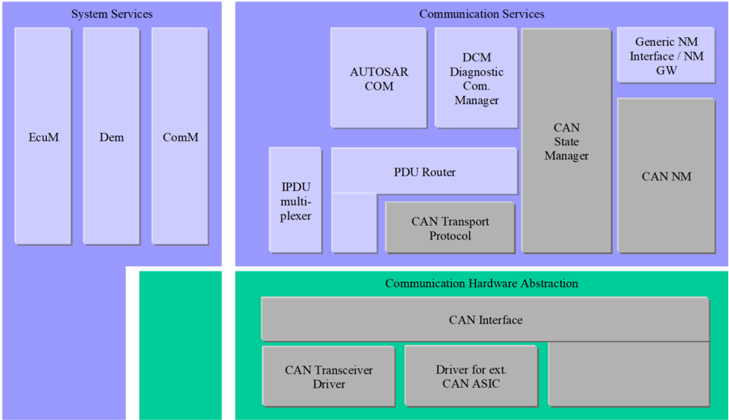

## 2. 缩略语

下面的词汇表包含与CAN状态管理器模块相关、但未包含在[1, AUTOSAR 术语表]中的缩略语和缩写。

表2.1：本文档范围内使用的缩略语和缩写（**Acronyms and abbreviations used in the scope of this Document**）

**API**

> 应用程序接口（**Application Program Interface**）。

**BSW**

> 基础软件（**Basic Software**）。

**CAN**

> 控制器局域网（**Controller Area Network**）。

**CanIf**

> CAN接口（**CAN Interface**）。

**CanSM**

> CAN状态管理器（**CAN State Manager**）。

**ComM**

> 通信管理器（**Communication Manager**）。

**DEM**

> 诊断事件管理器（**Diagnostic Event Manager**）。

**DET**

> 默认错误跟踪器（**Default Error Tracer**）。

**EcuM**

> ECU状态管理器（**ECU State Manager**）。

**PDU**

> 协议数据单元（**Protocol Data Unit**）。

**RX**

> 接收（**Receive**）。

**TX**

> 发送（**Transmit**）。

**SchM**

> BSW调度器（**BSW Scheduler**）。

**SWC**

> 软件组件（**Software Component**）。

**BswM**

> 基础软件模式管理器（**Basic Software Mode Manager**）。

## 3. 相关文档

### 3.1. 输入文件和相关标准与规范

- [1] AUTOSAR 术语表 AUTOSAR_FO_TR_Glossary
- [2] 基本软件模块通用规范 AUTOSAR_CP_SWS_BSWGeneral
- [3] ECU状态管理器规范 AUTOSAR_CP_SWS_ECUStateManager
- [4] RTE软件规范 AUTOSAR_CP_SWS_RTE
- [5] 通信管理器规范 AUTOSAR_CP_SWS_COMManager
- [6] CAN接口规范 AUTOSAR_CP_SWS_CANInterface
- [7] 诊断事件管理器规范 AUTOSAR_CP_SWS_DiagnosticEventManager
- [8] 基础软件模式管理器规范 AUTOSAR_CP_SWS_BSWModeManager
- [9] CAN网络管理规范 AUTOSAR_CP_SWS_CANNetworkManagement
- [10] 默认错误跟踪器规范 AUTOSAR_CP_SWS_DefaultErrorTracer
- [11] CAN收发器驱动程序规范 AUTOSAR_CP_SWS_CANTransceiverDriver
- [12] 基本软件模块的通用需求 AUTOSAR_CP_SRS_BSWGeneral

### 3.2. 相关规范

AUTOSAR提供了基本软件模块的通用规范[2, SWS BSW General]，它对CAN状态管理器同样有效。

因此，规范SWS BSW General应被视为CAN状态管理器的附加且必需的规范。

## 4. 约束和假设

### 4.1. 限制

**CanSM**模块只能用于CAN通信。它的任务是与**CanIf**模块协作，以控制一个或多个下层CAN控制器和CAN收发器驱动程序。不支持CAN以外的其他协议（即LIN或FlexRay）。

### 4.2. 汽车域的适用性

只要使用CAN协议，CAN状态管理器模块就可用于所有域的应用。

## 5. 对其他模块的依赖

以下各节简要描述**CanSM**模块需要从其他模块获得的配置信息和服务。

图5.1：CanSM模块的模块依赖关系（**Module dependencies of the CanSM module**）

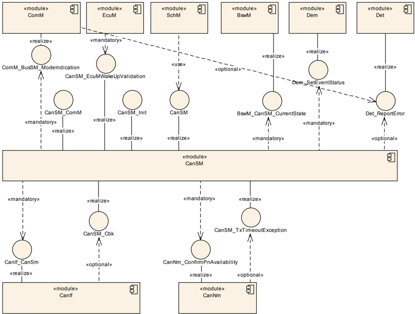

### 5.1. ECU状态管理器（EcuM）

**EcuM**模块初始化**CanSM**模块，并为CAN唤醒验证与**CanSM**模块交互（该模块的详细规范参见[3, Specification of ECU State Manager]）。

### 5.2. BSW调度器（SchM，RTE的一部分）

BSW调度器模块调用**CanSM**模块的主函数，这是**CanSM**模块周期性过程所必需的。该模块的详细规范参见[4, Specification of RTE Software]。

### 5.3. 通信管理器（ComM）

**ComM**模块使用**CanSM**模块的API来请求CAN网络的通信模式，CAN网络用唯一的网络句柄标识（该模块的详细规范参见[5, Specification of Communication Manager]）。

**CanSM**模块向**ComM**模块通知其CAN网络的当前通信模式。

### 5.4. CAN接口（CanIf）

**CanSM**模块使用**CanIf**模块的API来控制分配给CAN网络的CAN控制器和CAN收发器的操作模式（该模块的详细规范参见[6, Specification of CAN Interface]）。

**CanIf**模块向**CanSM**模块通知外设事件。

### 5.5. 诊断事件管理器（DEM）

**CanSM**模块向**DEM**模块报告总线特定的生产错误（该模块的详细规范参见[7, Specification of Diagnostic Event Manager]）。

### 5.6. 基础软件模式管理器（BswM）

**CanSM**需要向**BswM**模块通知总线特定的模式变更（该模块的详细规范参见[8, Specification of Basic Software Mode Manager]）。

### 5.7. CAN网络管理（CanNm）

**CanSM**模块需要向**CanNm**模块通知部分网络的可用性，并在部分网络的情况下处理通知的**CanNm**超时异常（该模块的详细规范参见[9, Specification of CAN Network Management]）。

### 5.8. 默认错误跟踪器（DET）

**CanSM**模块向**DET**模块报告开发错误和运行时错误。只有当开发错误处理通过配置开启时才报告开发错误（该模块的详细规范参见[10, Specification of Default Error Tracer]）。

### 5.9. 文件结构

#### 5.9.1. 代码文件结构

详情请参阅[2, SWS BSW General]第5.1.6章「代码文件结构」（**Code file structure**）。

#### 5.9.2. 头文件结构

头文件CanSM.h应导出**CanSM**模块特定的类型以及API [**CanSM_GetVersionInfo**](#7371-cansm_getversioninfo)和[**CanSM_Init**](#731-cansm_init)。

#### 5.9.3. 版本检查

详情请参阅[2, SWS BSW General]第5.1.8章「版本检查」（**Version Check**）。

## 6. 功能规格

本章规定AUTOSAR BSW架构中**CanSM**模块的不同功能。

一个ECU可以拥有不同的通信网络。每个网络必须用唯一的网络句柄标识。**ComM**模块向网络请求通信模式。它通过其配置知道哪个句柄被分配给哪种网络。对于CAN，它使用**CanSM**模块。

**CanSM**模块负责CAN网络的控制流抽象：

它根据来自**ComM**模块的模式请求更改已配置CAN网络的通信模式。

因此，**CanSM**模块使用**CanIf**模块的API。**CanIf**模块负责已配置CAN控制器和CAN收发器的控制流抽象（**CanIf**模块的数据流抽象与**CanSM**模块无关）。CAN控制器模式和CAN收发器模式的任何变更都将由**CanIf**模块通知给**CanSM**模块。根据这些通知和**CanSM**模块应为每个已配置CAN网络实现的CAN网络状态机的状态，**CanSM**模块向**ComM**和**BswM**发出通知（详情参见第[6.2](#62-每个can网络的状态机)节）。

注意：

**CanSM**模块在初始化之后不会向**ComM**通知其通信模式，除非**ComM**已显式请求了某个通信模式。

### 6.1. 通用需求

图7.1：CANSM_BSM，一个CAN网络的状态机图（**CANSM_BSM, state machine diagram for one CAN network**）

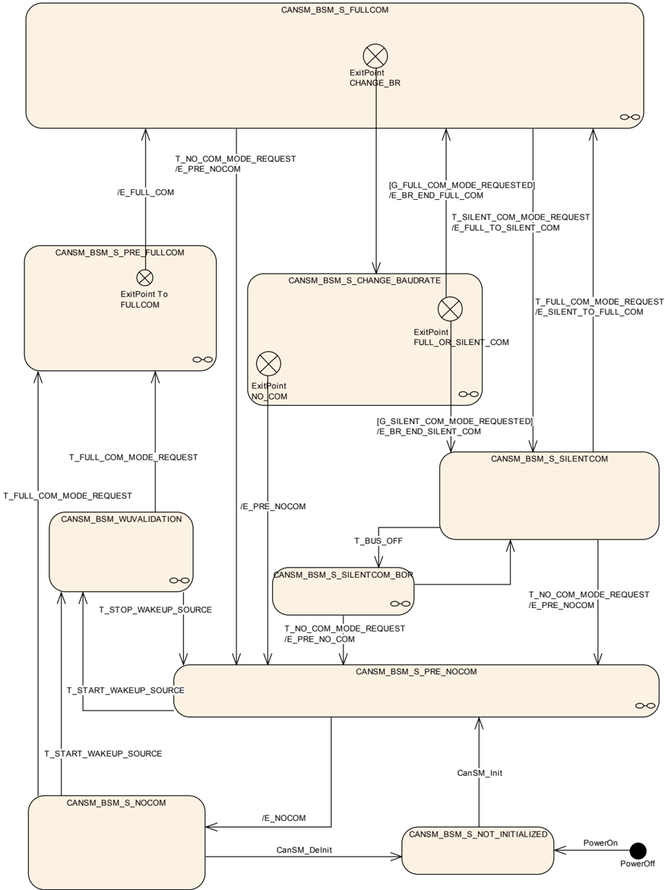

**CanSM**模块应在内部为每个已配置的CAN网络存储当前网络模式（参见[ECUC_CanSM_00126]）。

**CanSM**模块内部存储的网络模式可以取值**COMM_NO_COMMUNICATION**、**COMM_SILENT_COMMUNICATION**、**COMM_FULL_COMMUNICATION**。

**CanSM**状态机CANSM_BSM的所有效果（**effects**）应在**CanSM**主函数的上下文中操作（参见SWS_CanSM_00065）。

如果**CanSM**状态机CANSM_BSM处于状态**CANSM_BSM_S_NOT_INITIALIZED**，则它应拒绝来自**ComM**模块的网络模式请求（参见SWS_CanSM_00062）。

如果**CanSM**重复**CanIf** API调用**CanIf_SetControllerMode**（参见SWS_CanSM_91002）、**CanIf_SetTrcvMode**（参见SWS_CanSM_91002）、**CanIf_ClearTrcvWufFlag**（参见SWS_CanSM_91002）或**CanIf_CheckTrcvWakeFlag**（参见SWS_CanSM_91002）的次数超过了**CanSMModeRequestRepetitionMax**（参见[ECUC_CanSM_00335]），而没有得到返回值**E_OK**或没有得到相应的模式指示回调[**CanSM_ControllerModeIndication**](#742-cansm_controllermodeindication)、[**CanSM_TransceiverModeIndication**](#743-cansm_transceivermodeindication)、[**CanSM_ClearTrcvWufFlagIndication**](#745-cansm_cleartrcvwufflagindication)或[**CanSM_CheckTransceiverWakeFlagIndication**](#746-cansm_checktransceiverwakeflagindication)，则**CanSM**应以ErrorId参数[**CANSM_E_MODE_REQUEST_TIMEOUT**](#632-运行时错误)调用函数**Det_ReportRuntimeError**（参见SWS_CanSM_91002）。

如果**CanIf**模块以回调函数[**CanSM_ConfirmPnAvailability**](#747-cansm_confirmpnavailability)（参见SWS_CanSM_00419）向**CanSM**模块通知某个已配置CAN收发器的PN可用性，则**CanSM**模块应以相关CAN网络作为通道调用API **CanNm_ConfirmPnAvailability**（参见SWS_CanSM_91002），以向**CanNm**模块确认PN可用性。

如果**CanIf**模块以回调函数[**CanSM_ConfirmCtrlPnAvailability**](#748-cansm_confirmctrlpnavailability)（参见SWS_CanSM_91004）向**CanSM**模块通知某个已配置CAN控制器的PN可用性，则**CanSM**模块应以相关CAN网络作为通道调用API **CanNm_ConfirmPnAvailability**（参见SWS_CanSM_91002），以向**CanNm**模块确认PN可用性。

如果没有为某个CAN网络配置**CanSMTransceiverId**（参见[ECUC_CanSM_00137]），则**CanSM**模块应绕过为该CAN网络规定的所有**CanIf_SetTrcvMode**（参见SWS_CanSM_91002）调用（例如[SWS_CanSM_00446]），并在不同的状态迁移中按已经收到了假定的[**CanSM_TransceiverModeIndication**](#743-cansm_transceivermodeindication)那样继续（例如[SWS_CanSM_00448]）。

**CanSM**模块应为每个已配置的CAN网络（参见[ECUC_CanSM_00126]）存储已被[**CanSM_RequestComMode**](#733-cansm_requestcommode)（参见[SWS_CanSM_00062]、[SWS_CanSM_00182]）以返回**E_OK**接受的最新通信模式请求，并将其用作相关CAN网络状态机的触发（[SWS_CanSM_00427]、[SWS_CanSM_00429]、[SWS_CanSM_00499]、[SWS_CanSM_00542]、[SWS_CanSM_00543]、[SWS_CanSM_00425]、[SWS_CanSM_00426]）。

**CanSM**模块应在每次成功的CAN控制器模式变更（参见SWS_CanSM_00396）或总线关闭导致变更为**CAN_CS_STOPPED**（参见SWS_CanSM_00064）之后，在内部为每个CAN控制器存储变更后的模式。

### 6.2. 每个CAN网络的状态机

图（参见图7.1）规定了**CanSM**模块的行为状态机，它应为每个已配置的CAN网络（参见[ECUC_CanSM_00126]）实现。

#### 6.2.1. 触发：PowerOn

上电（**PowerOn**）之后，**CanSM**状态机应处于状态**CANSM_BSM_NOT_INITIALIZED**。

#### 6.2.2. 触发：CanSM_Init

如果**CanSM**模块被以函数[**CanSM_Init**](#731-cansm_init)请求，这应以触发[**CanSM_Init**](#731-cansm_init)触发所有已配置CAN网络（参见[ECUC_CanSM_00126]）的**CanSM**状态机。

#### 6.2.3. 触发：CanSM_DeInit

如果**CanSM**模块被以函数[**CanSM_DeInit**](#732-cansm_deinit)请求，这应以触发[**CanSM_DeInit**](#732-cansm_deinit)触发所有已配置CAN网络（参见[ECUC_CanSM_00126]）的**CanSM**状态机。

注意：[**CanSM_DeInit**](#732-cansm_deinit)函数的调用者必须确保所有CAN网络都处于状态**CANSM_NO_COMMUNICATION**。

#### 6.2.4. 触发：T_START_WAKEUP_SOURCE

如果API请求[**CanSM_StartWakeupSource**](#735-cansm_startwakeupsource)（参见SWS_CanSM_00609）返回**E_OK**（参见SWS_CanSM_00616），则应以**T_START_WAKEUP_SOURCE**触发状态机。

#### 6.2.5. 触发：T_STOP_WAKEUP_SOURCE

如果API请求[**CanSM_StopWakeupSource**](#736-cansm_stopwakeupsource)（参见SWS_CanSM_00610）返回**E_OK**（参见SWS_CanSM_00622），则应以**T_STOP_WAKEUP_SOURCE**触发状态机。

#### 6.2.6. 触发：T_FULL_COM_MODE_REQUEST

**ComM_Mode**参数等于**COMM_FULL_COMMUNICATION**的API请求[**CanSM_RequestComMode**](#733-cansm_requestcommode)（参见SWS_CanSM_00635），在函数参数network与配置参数**CanSMComMNetworkHandleRef**（参见[ECUC_CanSM_00161]）匹配的情况下，应以**T_FULL_COM_MODE_REQUEST**触发状态机。

#### 6.2.7. 触发：T_SILENT_COM_MODE_REQUEST

**ComM_Mode**参数等于**COMM_SILENT_COMMUNICATION**的API请求[**CanSM_RequestComMode**](#733-cansm_requestcommode)（参见SWS_CanSM_00635），在函数参数network与配置参数**CanSMComMNetworkHandleRef**（参见[ECUC_CanSM_00161]）对应的情况下，应以**T_SILENT_COM_MODE_REQUEST**触发子状态机**CANSM_BSM_S_FULLCOM**。

理由：从**CanNm**网络模式到**CanNm** Prepare Bus-Sleep模式的常规用例。

#### 6.2.8. 触发：T_NO_COM_MODE_REQUEST

**ComM_Mode**参数等于**COMM_NO_COMMUNICATION**的API请求[**CanSM_RequestComMode**](#733-cansm_requestcommode)（参见SWS_CanSM_00635），在函数参数network与配置参数**CanSMComMNetworkHandleRef**（参见[ECUC_CanSM_00161]）匹配的情况下，应以**T_NO_COM_MODE_REQUEST**触发状态机。

备注：根据**ComM**的配置，**ComM**模块将先请求**COMM_SILENT_COMMUNICATION**再请求**COMM_NO_COMMUNICATION**，或者直接请求**COMM_NO_COMMUNICATION**（**ComMNmVariant**=LIGHT）。

#### 6.2.9. 触发：T_BUS_OFF

回调函数[**CanSM_ControllerBusOff**](#741-cansm_controllerbusoff)（参见SWS_CanSM_00064）在其某个已配置CAN控制器与回调函数[**CanSM_ControllerBusOff**](#741-cansm_controllerbusoff)的函数参数ControllerId匹配的情况下，应以**T_BUS_OFF**触发该CAN网络的CANSM_BSM状态机。

#### 6.2.10. 守护条件：G_FULL_COM_MODE_REQUESTED

CANSM_BSM状态机的守护条件（**guarding condition**）**G_FULL_COM_MODE_REQUESTED**应评估：用[**CanSM_RequestComMode**](#733-cansm_requestcommode)（参见SWS_CanSM_00635）为该状态机的相应网络句柄发出的、被接受的最新通信模式请求，其**ComM_Mode**参数是否等于**COMM_FULL_COMMUNICATION**。

#### 6.2.11. 守护条件：G_SILENT_COM_MODE_REQUESTED

CANSM_BSM状态机的守护条件**G_SILENT_COM_MODE_REQUESTED**应评估：用[**CanSM_RequestComMode**](#733-cansm_requestcommode)（参见SWS_CanSM_00635）为该状态机的相应网络句柄发出的、被接受的最新通信模式请求，其**ComM_Mode**参数是否等于**COMM_SILENT_COMMUNICATION**。

#### 6.2.12. 效果：E_PRE_NOCOM

CANSM_BSM状态机的效果**E_PRE_NOCOM**应为相应的CAN网络调用API **BswM_CanSM_CurrentState**（参见SWS_CanSM_91002），参数为Network := CanSMComMNetworkHandleRef、CurrentState := **CANSM_BSWM_NO_COMMUNICATION**。

#### 6.2.13. 效果：E_NOCOM

CANSM_BSM状态机的效果**E_NOCOM**应将被寻址CAN网络的内部存储网络模式（参见SWS_CanSM_00266）更改为**COMM_NO_COMMUNICATION**。

如果该网络的通信模式请求已经存在（参见SWS_CanSM_00635）且存储的通信模式请求为**COMM_NO_COMMUNICATION**，则CANSM_BSM状态机的效果**E_NOCOM**应以参数Channel := CanSMComMNetworkHandleRef（参见[ECUC_CanSM_00161]）、ComMode := **COMM_NO_COMMUNICATION**调用API **ComM_BusSM_ModeIndication**（参见SWS_CanSM_91002）。

#### 6.2.14. 效果：E_FULL_COM

如果ECU passive为FALSE（参见SWS_CanSM_00646），则CANSM_BSM状态机的效果**E_FULL_COM**应首先为该CAN网络的每个已配置CAN控制器调用API **CanIf_SetPduMode**（参见SWS_CanSM_91002），参数为ControllerId := CanSMControllerId（参见[ECUC_CanSM_00141]）、PduModeRequest := **CANIF_ONLINE**。

如果ECU passive为TRUE（参见SWS_CanSM_00646），则CANSM_BSM状态机的效果**E_FULL_COM**应首先为该CAN网络的每个已配置CAN控制器调用API **CanIf_SetPduMode**（参见SWS_CanSM_91002），参数为ControllerId := CanSMControllerId（参见[ECUC_CanSM_00141]）、PduModeRequest := **CANIF_TX_OFFLINE_ACTIVE**。

在效果**E_FULL_COM**的上下文中考虑了[SWS_CanSM_00539]和[SWS_CanSM_00647]之后，**CanSM**模块应为相应的CAN网络调用API **ComM_BusSM_ModeIndication**（参见SWS_CanSM_91002），参数为Channel := CanSMComMNetworkHandleRef（参见[ECUC_CanSM_00161]）、ComMode := **COMM_FULL_COMMUNICATION**。

在效果**E_FULL_COM**的上下文中考虑了[SWS_CanSM_00435]之后，**CanSM**模块应为相应的CAN网络调用API **BswM_CanSM_CurrentState**（参见SWS_CanSM_91002），参数为Network := CanSMComMNetworkHandleRef、CurrentState := **CANSM_BSWM_FULL_COMMUNICATION**。

#### 6.2.15. 效果：E_FULL_TO_SILENT_COM

CANSM_BSM状态机的效果**E_FULL_TO_SILENT_COM**应首先为相应的CAN网络调用API **BswM_CanSM_CurrentState**（参见SWS_CanSM_91002），参数为Network := CanSMComMNetworkHandleRef、CurrentState := **CANSM_BSWM_SILENT_COMMUNICATION**。

CANSM_BSM状态机的效果**E_FULL_TO_SILENT_COM**应第二为该CAN网络的每个已配置CAN控制器调用API **CanIf_SetPduMode**（参见SWS_CanSM_91002），参数为ControllerId := CanSMControllerId（参见[ECUC_CanSM_00141]）、PduModeRequest := **CANIF_TX_OFFLINE**。

CANSM_BSM状态机的效果**E_FULL_TO_SILENT_COM**应第三为相应的CAN网络调用API **ComM_BusSM_ModeIndication**（参见SWS_CanSM_91002），参数为Channel := CanSMComMNetworkHandleRef（参见[ECUC_CanSM_00161]）、ComMode := **COMM_SILENT_COMMUNICATION**。

#### 6.2.16. 效果：E_BR_END_FULL_COM

CANSM_BSM状态机的效果**E_BR_END_FULL_COM**应与**E_FULL_COM**相同。

#### 6.2.17. 效果：E_BR_END_SILENT_COM

CANSM_BSM状态机的效果**E_BR_END_SILENT_COM**应与**E_FULL_TO_SILENT_COM**相同。

#### 6.2.18. 效果：E_SILENT_TO_FULL_COM

CANSM_BSM状态机的效果**E_SILENT_TO_FULL_COM**应与**E_FULL_COM**相同。

#### 6.2.19. 子状态机 CANSM_BSM_WUVALIDATION

图7.2：CANSM_BSM_WUVALIDATION，CANSM_BSM的子状态机（**CANSM_BSM_WUVALIDATION**）

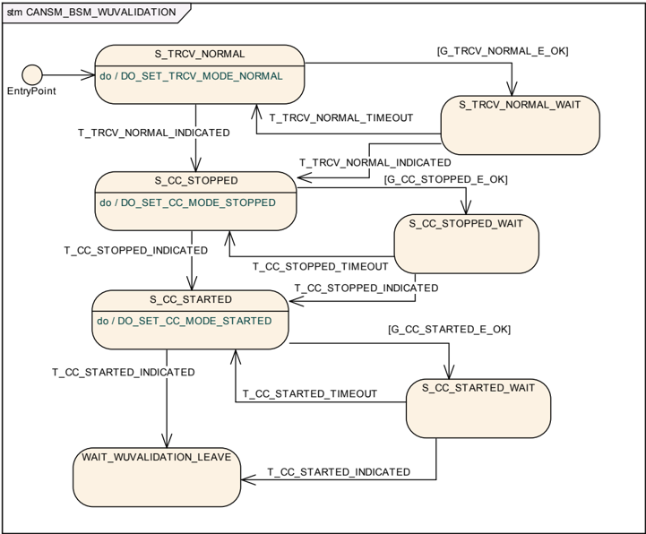

##### 6.2.19.1. 状态操作：S_TRCV_NORMAL

如果为该CAN网络配置了CAN收发器（参见[ECUC_CanSM_00137]），则只要子状态机CANSM_BSM_WUVALIDATION处于状态**S_TRCV_NORMAL**，**CanSM**模块就应操作do动作**DO_SET_TRCV_MODE_NORMAL**，因此为该CAN网络的已配置CAN收发器（参见[ECUC_CanSM_00137]）重复API请求**CanIf_SetTrcvMode**（参见SWS_CanSM_91002），TransceiverMode等于**CANTRCV_TRCVMODE_NORMAL**。

##### 6.2.19.2. 守护条件 G_TRCV_NORMAL_E_OK

子状态机CANSM_BSM_WUVALIDATION的守护条件**G_TRCV_NORMAL_E_OK**应在[SWS_CanSM_00483]的API调用返回**E_OK**时通过。

##### 6.2.19.3. 触发：T_TRCV_NORMAL_INDICATED

如果**CanSM**模块在相应请求（参见SWS_CanSM_00623）之后收到了该CAN网络已配置CAN收发器（参见[ECUC_CanSM_00137]）的**CANTRCV_TRCVMODE_NORMAL**模式指示（参见SWS_CanSM_00399），这应以**T_TRCV_NORMAL_INDICATED**触发该CAN网络的子状态机CANSM_BSM_WUVALIDATION。

##### 6.2.19.4. 触发：T_TRCV_NORMAL_TIMEOUT

在假定的收发器normal指示（参见SWS_CanSM_00625）超过**CANSM_MODEREQ_REPEAT_TIME**（参见[ECUC_CanSM_00336]）超时之后，该条件应以**T_TRCV_NORMAL_TIMEOUT**触发相应网络的子状态机CANSM_BSM_WUVALIDATION。

##### 6.2.19.5. 状态操作：S_CC_STOPPED

只要子状态机CANSM_BSM_WUVALIDATION处于状态**S_CC_STOPPED**，**CanSM**模块就应操作do动作**DO_SET_CC_MODE_STOPPED**，因此在当前CAN控制器模式（参见SWS_CanSM_00638）不同的情况下，为该CAN网络的所有已配置CAN控制器（参见[ECUC_CanSM_00141]）重复API请求**CanIf_SetControllerMode**（参见SWS_CanSM_91002），ControllerMode等于**CAN_CS_STOPPED**。

##### 6.2.19.6. 守护条件：G_CC_STOPPED_OK

子状态机CANSM_BSM_WUVALIDATION的守护条件**G_CC_STOPPED_OK**应在[SWS_CanSM_00627]的所有API调用都返回**E_OK**时通过。

##### 6.2.19.7. 触发：T_CC_STOPPED_INDICATED

如果**CanSM**模块在为停止该CAN网络的CAN控制器而发出的相应请求（参见SWS_CanSM_00627）之后，收到了该CAN网络所有已配置CAN控制器（参见[ECUC_CanSM_00141]）的所有模式指示（参见SWS_CanSM_00396），这应以**T_CC_STOPPED_INDICATED**触发该CAN网络的子状态机CANSM_BSM_WUVALIDATION。

##### 6.2.19.8. 触发：T_CC_STOPPED_TIMEOUT

在所有假定的控制器stopped模式指示（参见SWS_CanSM_00629）超过**CANSM_MODEREQ_REPEAT_TIME**（参见[ECUC_CanSM_00336]）超时之后，该条件应以**T_CC_STOPPED_TIMEOUT**触发相应网络的子状态机CANSM_BSM_WUVALIDATION。

##### 6.2.19.9. 状态操作：S_CC_STARTED

只要子状态机CANSM_BSM_WUVALIDATION处于状态**S_CC_STARTED**，**CanSM**模块就应操作do动作**DO_SET_CC_MODE_STARTED**，因此在当前CAN控制器模式（参见SWS_CanSM_00638）不同的情况下，为该CAN网络的所有已配置CAN控制器（参见[ECUC_CanSM_00141]）重复API请求**CanIf_SetControllerMode**，ControllerMode等于**CAN_CS_STARTED**。

##### 6.2.19.10. 守护条件：G_CC_STARTED_E_OK

子状态机CANSM_BSM_WUVALIDATION的守护条件**G_CC_STARTED_OK**应在[SWS_CanSM_00631]的所有API调用都返回**E_OK**时通过。

##### 6.2.19.11. 触发：T_CC_STARTED_INDICATED

如果**CanSM**模块在为启动该CAN网络的CAN控制器而发出的相应请求（参见SWS_CanSM_00631）之后，收到了该CAN网络所有已配置CAN控制器（参见[ECUC_CanSM_00141]）的所有模式指示（参见SWS_CanSM_00396），这应以**T_CC_STARTED_INDICATED**触发该CAN网络的子状态机CANSM_BSM_WUVALIDATION。

##### 6.2.19.12. 触发：T_CC_STARTED_TIMEOUT

在所有假定的控制器started模式指示（参见SWS_CanSM_00633）超过**CANSM_MODEREQ_REPEAT_TIME**（参见[ECUC_CanSM_00336]）超时之后，该条件应以**T_CC_STARTED_TIMEOUT**触发相应网络的子状态机CANSM_BSM_WUVALIDATION。

#### 6.2.20. 子状态机：CANSM_BSM_S_PRE_NOCOM

图7.3：CANSM_BSM_S_PRE_NOCOM，CANSM_BSM的子状态机（**CANSM_BSM_S_PRE_NOCOM**）

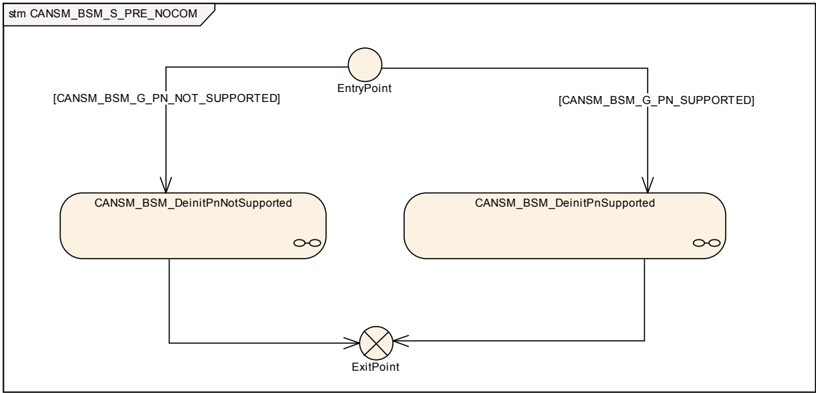

##### 6.2.20.1. 守护条件：CANSM_BSM_G_PN_NOT_SUPPORTED

子状态机CANSM_BSM_S_PRE_NO_COM的守护条件**CANSM_BSM_G_PN_NOT_SUPPORTED**应评估：配置参数**CanTrcvPnEnabled**（参见[11, ECUC_CanTrcv_00172]）是否为FALSE（经由引用**CanSMTransceiverId**（参见[ECUC_CanSM_00137]）可用），或者是否完全没有配置**CanSMTransceiverId**。

##### 6.2.20.2. 守护条件：CANSM_BSM_G_PN_SUPPORTED

子状态机CANSM_BSM_S_PRE_NO_COM的守护条件**CANSM_BSM_G_PN_SUPPORTED**应评估：是否配置了**CanSMTransceiverId**（参见[ECUC_CanSM_00137]），并且配置参数**CanTrcvPnEnabled**（参见[11, ECUC_CanTrcv_00172]）是否为TRUE（经由引用**CanSMTransceiverId**（参见[ECUC_CanSM_00137]）可用）。

##### 6.2.20.3. 子状态机：CANSM_BSM_DeinitPnSupported

图7.4：CANSM_BSM_DeinitPnSupported，CANSM_BSM_S_PRE_NOCOM的子状态机（**CANSM_BSM_DeinitPnSupported**）

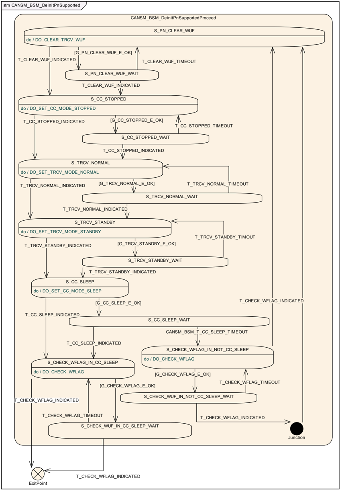

###### 6.2.20.3.1. 状态操作：S_PN_CLEAR_WUF

只要子状态机CANSM_BSM_DeinitPnSupported处于状态**S_PN_CLEAR_WUF**，**CanSM**模块就操作do动作**DO_CLEAR_TRCV_WUF**，因此重复API请求**CanIf_ClearTrcvWufFlag**，并使用已配置的收发器（参见[ECUC_CanSM_00137]）作为API函数参数。

###### 6.2.20.3.2. 守护条件：G_PN_CLEAR_WUF_E_OK

子状态机CANSM_BSM_DeinitPnSupported的守护条件**G_PN_CLEAR_WUF_E_OK**应在[SWS_CanSM_00438]的API调用返回**E_OK**时通过。

###### 6.2.20.3.3. 触发：T_CLEAR_WUF_INDICATED

回调函数[**CanSM_ClearTrcvWufFlagIndication**](#745-cansm_cleartrcvwufflagindication)（参见SWS_CanSM_00413）在其函数参数Transceiver与该CAN网络的已配置CAN收发器（参见[ECUC_CanSM_00137]）匹配的情况下，应以**T_CLEAR_WUF_INDICATED**触发该CAN网络的子状态机CANSM_BSM_DeinitPnSupported。

###### 6.2.20.3.4. 触发：T_CLEAR_WUF_TIMEOUT

在回调函数[**CanSM_ClearTrcvWufFlagIndication**](#745-cansm_cleartrcvwufflagindication)（参见SWS_CanSM_00440）超过**CANSM_MODEREQ_REPEAT_TIME**（参见[ECUC_CanSM_00336]）超时之后，该条件应以**T_CLEAR_WUF_TIMEOUT**触发相应网络的子状态机CANSM_BSM_DeinitPnSupported。

###### 6.2.20.3.5. 状态操作：S_CC_STOPPED

只要子状态机CANSM_BSM_DeinitPnSupported处于状态**S_CC_STOPPED**，**CanSM**模块就应操作do动作**DO_SET_CC_MODE_STOPPED**，因此在当前CAN控制器模式（参见SWS_CanSM_00638）不同的情况下，为该CAN网络的所有已配置CAN控制器（参见[ECUC_CanSM_00141]）重复API请求**CanIf_SetControllerMode**，ControllerMode等于**CAN_CS_STOPPED**。

###### 6.2.20.3.6. 守护条件：G_CC_STOPPED_E_OK

子状态机CANSM_BSM_DeinitPnSupported的守护条件**G_CC_STOPPED_E_OK**应在[SWS_CanSM_00441]的所有API调用都返回**E_OK**时通过。

###### 6.2.20.3.7. 触发：T_CC_STOPPED_INDICATED

如果**CanSM**模块在为停止该CAN网络的CAN控制器而发出的相应请求（参见SWS_CanSM_00442）之后，收到了该CAN网络所有已配置CAN控制器（参见[ECUC_CanSM_00141]）的所有模式指示（参见SWS_CanSM_00396），这应以**T_CC_STOPPED_INDICATED**触发该CAN网络的子状态机CANSM_BSM_DeinitPnSupported。

###### 6.2.20.3.8. 触发：T_CC_STOPPED_TIMEOUT

在所有假定的控制器stopped模式指示（参见SWS_CanSM_00444）超过**CANSM_MODEREQ_REPEAT_TIME**（参见[ECUC_CanSM_00336]）超时之后，该条件应以**T_CC_STOPPED_TIMEOUT**触发相应网络的子状态机CANSM_BSM_DeinitPnSupported。

###### 6.2.20.3.9. 状态操作：S_TRCV_NORMAL

只要子状态机CANSM_BSM_DeinitPnSupported处于状态**S_TRCV_NORMAL**，**CanSM**模块就应操作do动作**DO_SET_TRCV_MODE_NORMAL**，因此为该CAN网络的已配置CAN收发器（参见[ECUC_CanSM_00137]）重复API请求**CanIf_SetTrcvMode**（参见SWS_CanSM_91002），TransceiverMode等于**CANTRCV_TRCVMODE_NORMAL**。

###### 6.2.20.3.10. 守护条件：G_TRCV_NORMAL_E_OK

子状态机CANSM_BSM_DeinitPnSupported的守护条件**G_TRCV_NORMAL_E_OK**应在[SWS_CanSM_00446]的API调用返回**E_OK**时通过。

###### 6.2.20.3.11. 触发：T_TRCV_NORMAL_INDICATED

如果**CanSM**模块在相应请求（参见SWS_CanSM_00446）之后收到了该CAN网络已配置CAN收发器（参见[ECUC_CanSM_00137]）的**CANTRCV_TRCVMODE_NORMAL**模式指示（参见SWS_CanSM_00399），这应以**T_TRCV_NORMAL_INDICATED**触发该CAN网络的子状态机CANSM_BSM_DeinitPnSupported。

###### 6.2.20.3.12. 触发：T_TRCV_NORMAL_TIMEOUT

在假定的收发器normal指示（参见SWS_CanSM_00448）超过**CANSM_MODEREQ_REPEAT_TIME**（参见[ECUC_CanSM_00336]）超时之后，该条件应以**T_TRCV_NORMAL_TIMEOUT**触发相应网络的子状态机CANSM_BSM_DeinitPnSupported。

###### 6.2.20.3.13. 状态操作：S_TRCV_STANDBY

只要子状态机CANSM_BSM_DeinitPnSupported处于状态**S_TRCV_STANDBY**，**CanSM**模块就应操作do动作**DO_SET_TRCV_STANDBY**，因此为该CAN网络的已配置CAN收发器（参见[ECUC_CanSM_00137]）重复API请求**CanIf_SetTrcvMode**（参见SWS_CanSM_91002），TransceiverMode等于**CANTRCV_TRCVMODE_STANDBY**。

###### 6.2.20.3.14. 守护条件：G_TRCV_STANDBY_E_OK

子状态机CANSM_BSM_DeinitPnSupported的守护条件**G_TRCV_STANDBY_E_OK**应在[SWS_CanSM_00450]的API调用返回**E_OK**时通过。

###### 6.2.20.3.15. 触发：T_TRCV_STANDBY_INDICATED

如果**CanSM**模块在相应请求（参见SWS_CanSM_00450）之后收到了该CAN网络已配置CAN收发器（参见[ECUC_CanSM_00137]）的**CANTRCV_TRCVMODE_STANDBY**模式指示（参见SWS_CanSM_00399），这应以**T_TRCV_STANDBY_INDICATED**触发该CAN网络的子状态机CANSM_BSM_DeinitPnSupported。

###### 6.2.20.3.16. 触发：T_TRCV_STANDBY_TIMEOUT

在假定的收发器standby指示（参见SWS_CanSM_00452）超过**CANSM_MODEREQ_REPEAT_TIME**（参见[ECUC_CanSM_00336]）超时之后，该条件应以**T_TRCV_STANDBY_TIMEOUT**触发相应网络的子状态机CANSM_BSM_DeinitPnSupported。

###### 6.2.20.3.17. 状态操作：S_CC_SLEEP

只要子状态机CANSM_BSM_DeinitPnSupported处于状态**S_CC_SLEEP**，**CanSM**模块就应操作do动作**DO_SET_CC_MODE_SLEEP**，因此在当前CAN控制器模式（参见SWS_CanSM_00638）不同的情况下，为该CAN网络的所有已配置CAN控制器（参见[ECUC_CanSM_00141]）重复API请求**CanIf_SetControllerMode**（参见SWS_CanSM_91002），ControllerMode等于**CAN_CS_SLEEP**。

###### 6.2.20.3.18. 守护条件：G_CC_SLEEP_E_OK

子状态机CANSM_BSM_DeinitPnSupported的守护条件**G_CC_SLEEP_E_OK**应在[SWS_CanSM_00453]的所有API调用都返回**E_OK**时通过。

###### 6.2.20.3.19. 触发：T_CC_SLEEP_INDICATED

如果**CanSM**模块在为将该CAN网络的CAN控制器设置为睡眠模式而发出的相应请求（参见SWS_CanSM_00453）之后，收到了该CAN网络所有已配置CAN控制器（参见[ECUC_CanSM_00141]）的所有模式指示（参见SWS_CanSM_00396），这应以**T_CC_SLEEP_INDICATED**触发该CAN网络的子状态机CANSM_BSM_DeinitPnSupported。

###### 6.2.20.3.20. 触发：CANSM_BSM_T_CC_SLEEP_TIMEOUT

在所有假定的控制器sleep模式指示（参见SWS_CanSM_00456）超过**CANSM_MODEREQ_REPEAT_TIME**（参见[ECUC_CanSM_00336]）超时之后，该条件应以**CANSM_BSM_T_CC_SLEEP_TIMEOUT**触发相应网络的子状态机CANSM_BSM_DeinitPnSupported（参见图7-4）。

###### 6.2.20.3.21. 状态操作：S_CHECK_WFLAG_IN_CC_SLEEP

只要子状态机CANSM_BSM_DeinitPnSupported处于状态**S_CHECK_WFLAG_IN_CC_SLEEP**，**CanSM**模块就操作do动作**DO_CHECK_WFLAG**，因此重复API请求**CanIf_CheckTrcvWakeFlag**（参见SWS_CanSM_91002），并使用相关网络（参见[ECUC_CanSM_00137]）的已配置CAN收发器作为Transceiver参数。

###### 6.2.20.3.22. 守护条件：G_CHECK_WFLAG_E_OK

子状态机CANSM_BSM_DeinitPnSupported的守护条件**G_CHECK_WFLAG_E_OK**应在[SWS_CanSM_00458]或[SWS_CanSM_00462]的API调用返回**E_OK**时通过。

###### 6.2.20.3.23. 触发：T_CHECK_WFLAG_INDICATED

回调函数[**CanSM_CheckTransceiverWakeFlagIndication**](#746-cansm_checktransceiverwakeflagindication)（参见SWS_CanSM_00416）在其函数参数Transceiver与该CAN网络的已配置CAN收发器（参见[ECUC_CanSM_00137]）匹配的情况下，应以**T_CHECK_WFLAG_INDICATED**触发该CAN网络的子状态机CANSM_BSM_DeinitPnSupported。

###### 6.2.20.3.24. 触发：T_CHECK_WFLAG_TIMEOUT

在回调函数[**CanSM_CheckTransceiverWakeFlagIndication**](#746-cansm_checktransceiverwakeflagindication)（参见SWS_CanSM_00460）超过**CANSM_MODEREQ_REPEAT_TIME**（参见[ECUC_CanSM_00336]）超时之后，该条件应以**T_CHECK_WFLAG_TIMEOUT**触发相应网络的子状态机CANSM_BSM_DeinitPnSupported。

###### 6.2.20.3.25. 状态操作：S_CHECK_WFLAG_IN_NOT_CC_SLEEP

只要子状态机CANSM_BSM_DeinitPnSupported处于状态**S_CHECK_WFLAG_IN_NOT_CC_SLEEP**，**CanSM**模块就操作do动作**DO_CHECK_WFLAG**，因此重复API请求**CanIf_CheckTrcvWakeFlag**（参见SWS_CanSM_91002），并使用相关网络（参见[ECUC_CanSM_00137]）的已配置CAN收发器作为Transceiver参数。

##### 6.2.20.4. 子状态机：CANSM_BSM_DeinitPnNotSupported

图7.5：CANSM_BSM_DeinitPnNotSupported，CANSM_BSM_S_PRE_NOCOM的子状态机（**CANSM_BSM_DeinitPnNotSupported**）

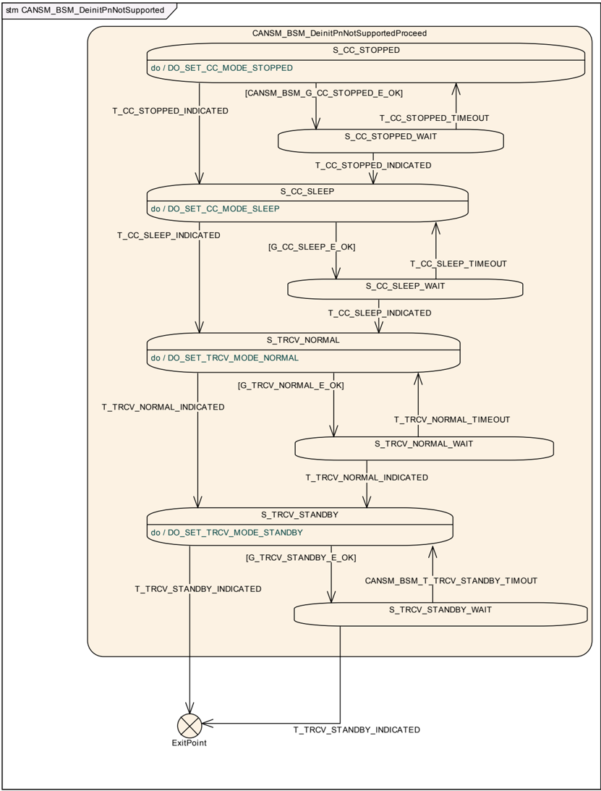

###### 6.2.20.4.1. 状态操作：S_CC_STOPPED

只要子状态机CANSM_BSM_DeinitPnNotSupported处于状态**S_CC_STOPPED**，**CanSM**模块就应操作do动作**DO_SET_CC_MODE_STOPPED**，因此在当前CAN控制器模式（参见SWS_CanSM_00638）不同的情况下，为该CAN网络的所有已配置CAN控制器（参见[ECUC_CanSM_00141]）重复API请求**CanIf_SetControllerMode**（参见SWS_CanSM_91002），ControllerMode等于**CAN_CS_STOPPED**。

###### 6.2.20.4.2. 守护条件：CANSM_BSM_G_CC_STOPPED_OK

子状态机CANSM_BSM_DeinitPnNotSupported的守护条件**CANSM_BSM__CC_STOPPED_OK**应在[SWS_CanSM_00464]的所有API调用都返回**E_OK**时通过。

###### 6.2.20.4.3. 触发：T_CC_STOPPED_INDICATED

如果**CanSM**模块在为停止该CAN网络的CAN控制器而发出的相应请求（参见SWS_CanSM_00464）之后，收到了该CAN网络所有已配置CAN控制器（参见[ECUC_CanSM_00141]）的所有模式指示（参见SWS_CanSM_00396），这应以**T_CC_STOPPED_INDICATED**触发该CAN网络的子状态机CANSM_BSM_DeinitPnNotSupported。

###### 6.2.20.4.4. 触发：T_CC_STOPPED_TIMEOUT

在所有假定的控制器stopped模式指示（参见SWS_CanSM_00466）超过**CANSM_MODEREQ_REPEAT_TIME**（参见[ECUC_CanSM_00336]）超时之后，该条件应以**T_CC_STOPPED_TIMEOUT**触发相应网络的子状态机CANSM_BSM_DeinitPnNotSupported。

###### 6.2.20.4.5. 状态操作：S_CC_SLEEP

只要子状态机CANSM_BSM_DeinitPnNotSupported处于状态**S_CC_SLEEP**，**CanSM**模块就应操作do动作**DO_SET_CC_MODE_SLEEP**，因此在当前CAN控制器模式（参见SWS_CanSM_00638）不同的情况下，为该CAN网络的所有已配置CAN控制器（参见[ECUC_CanSM_00141]）重复API请求**CanIf_SetControllerMode**（参见SWS_CanSM_91002），ControllerMode等于**CAN_CS_SLEEP**。

###### 6.2.20.4.6. 守护条件：G_CC_SLEEP_E_OK

子状态机CANSM_BSM_DeinitPnNotSupported的守护条件**G_CC_SLEEP_E_OK**应在[SWS_CanSM_00468]的所有API调用都返回**E_OK**时通过。

###### 6.2.20.4.7. 触发：T_CC_SLEEP_INDICATED

如果**CanSM**模块在为将该CAN网络的CAN控制器设置为睡眠模式而发出的相应请求（参见SWS_CanSM_00468）之后，收到了该CAN网络所有已配置CAN控制器（参见[ECUC_CanSM_00141]）的所有模式指示（参见SWS_CanSM_00396），这应以**T_CC_SLEEP_INDICATED**触发该CAN网络的子状态机CANSM_BSM_DeinitPnNotSupported。

###### 6.2.20.4.8. 触发：T_CC_SLEEP_TIMEOUT

在所有假定的控制器sleep模式指示（参见SWS_CanSM_00470）超过**CANSM_MODEREQ_REPEAT_TIME**（参见[ECUC_CanSM_00336]）超时之后，该条件应以**T_CC_SLEEP_TIMEOUT**触发相应网络的子状态机CANSM_BSM_DeinitPnNotSupported。

###### 6.2.20.4.9. 状态操作：S_TRCV_NORMAL

如果为该CAN网络配置了CAN收发器（参见[ECUC_CanSM_00137]），则只要子状态机CANSM_BSM_DeinitPnNotSupported处于状态**S_TRCV_NORMAL**，**CanSM**模块就应操作do动作**DO_SET_TRCV_MODE_NORMAL**，因此为该CAN网络的已配置CAN收发器（参见[ECUC_CanSM_00137]）重复API请求**CanIf_SetTrcvMode**（参见SWS_CanSM_91002），TransceiverMode等于**CANTRCV_TRCVMODE_NORMAL**。

###### 6.2.20.4.10. 守护条件：G_TRCV_NORMAL_E_OK

子状态机CANSM_BSM_DeinitPnNotSupported的守护条件**G_TRCV_NORMAL_E_OK**应在[SWS_CanSM_00472]的API调用返回**E_OK**时通过。

###### 6.2.20.4.11. 触发：T_TRCV_NORMAL_INDICATED

如果**CanSM**模块在相应请求（参见SWS_CanSM_00472）之后收到了该CAN网络已配置CAN收发器（参见[ECUC_CanSM_00137]）的**CANTRCV_TRCVMODE_NORMAL**模式指示（参见SWS_CanSM_00399），这应以**T_TRCV_NORMAL_INDICATED**触发该CAN网络的子状态机CANSM_BSM_DeinitPnNotSupported。

如果没有为该CAN网络配置CAN收发器，则这应以**T_TRCV_NORMAL_INDICATED**触发该CAN网络处于状态**S_TRCV_NORMAL**的子状态机CANSM_BSM_DeinitPnNotSupported。

###### 6.2.20.4.12. 触发：T_TRCV_NORMAL_TIMEOUT

在假定的收发器normal指示（参见SWS_CanSM_00474）超过**CANSM_MODEREQ_REPEAT_TIME**（参见[ECUC_CanSM_00336]）超时之后，该条件应以**T_TRCV_NORMAL_TIMEOUT**触发相应网络的子状态机CANSM_BSM_DeinitPnNotSupported。

###### 6.2.20.4.13. 状态操作：S_TRCV_STANDBY

如果为该CAN网络配置了CAN收发器（参见[ECUC_CanSM_00137]），则只要子状态机CANSM_BSM_DeinitPnNotSupported处于状态**S_TRCV_STANDBY**，**CanSM**模块就应操作do动作**DO_SET_TRCV_MODE_STANDBY**，因此为该CAN网络的已配置CAN收发器（参见[ECUC_CanSM_00137]）重复API请求**CanIf_SetTrcvMode**（参见SWS_CanSM_91002），TransceiverMode等于**CANTRCV_TRCVMODE_STANDBY**。

###### 6.2.20.4.14. 守护条件：G_TRCV_STANDBY_E_OK

子状态机CANSM_BSM_DeinitPnNotSupported的守护条件**G_TRCV_STANDBY_E_OK**应在[SWS_CanSM_00476]的API调用返回**E_OK**时通过。

###### 6.2.20.4.15. 触发：T_TRCV_STANDBY_INDICATED

如果**CanSM**模块在相应请求（参见SWS_CanSM_00476）之后收到了该CAN网络已配置CAN收发器（参见[ECUC_CanSM_00137]）的**CANTRCV_TRCVMODE_STANDBY**模式指示（参见SWS_CanSM_00399），这应以**T_TRCV_STANDBY_INDICATED**触发该CAN网络的子状态机CANSM_BSM_DeinitPnNotSupported。

如果没有为该CAN网络（参见[ECUC_CanSM_00137]）配置CAN收发器，则这应以**T_TRCV_STANDBY_INDICATED**触发该CAN网络处于状态**S_TRCV_STANDBY**的子状态机CANSM_BSM_DeinitPnNotSupported。

###### 6.2.20.4.16. 触发：CANSM_BSM_T_TRCV_STANDBY_TIMEOUT

在假定的收发器standby指示（参见SWS_CanSM_00478）超过**CANSM_MODEREQ_REPEAT_TIME**（参见[ECUC_CanSM_00336]）超时之后，该条件应以**CANSM_BSM_T_TRCV_STANDBY_TIMEOUT**触发相应网络的子状态机CANSM_BSM_DeinitPnNotSupported。

#### 6.2.21. 子状态机：CANSM_BSM_S_SILENTCOM_BOR

图7.6：CANSM_BSM_S_SILENTCOM_BOR，CANSM_BSM的子状态机（**CANSM_BSM_S_SILENTCOM_BOR**）

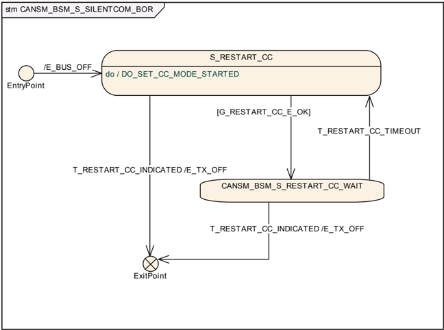

##### 6.2.21.1. 效果：E_BUS_OFF

子状态机CANSM_BSM_S_SILENTCOM_BOR的效果**E_BUS_OFF**应以参数EventId := [**CANSM_E_BUS_OFF**](#635-扩展生产错误)（参见[ECUC_CanSM_00070]）、EventStatus := **DEM_EVENT_STATUS_PRE_FAILED**调用**Dem_SetEventStatus**（参见SWS_CanSM_91002）。

##### 6.2.21.2. 状态操作：S_RESTART_CC

只要子状态机CANSM_BSM_S_SILENTCOM_BOR处于状态**S_RESTART_CC**，**CanSM**模块就应操作do动作**DO_SET_CC_MODE_STARTED**，因此在当前CAN控制器模式（参见SWS_CanSM_00638）不同的情况下，为该CAN网络的所有已配置CAN控制器（参见[ECUC_CanSM_00141]）重复API请求**CanIf_SetControllerMode**（参见SWS_CanSM_91002），ControllerMode等于**CAN_CS_STARTED**。

##### 6.2.21.3. 守护条件 G_RESTART_CC_E_OK

子状态机CANSM_BSM_S_SILENTCOM_BOR的守护条件**G_RESTART_CC_OK**应在[SWS_CanSM_00604]的所有API调用都返回**E_OK**时通过。

##### 6.2.21.4. 触发：T_RESTART_CC_INDICATED

如果**CanSM**模块在为启动该CAN网络的CAN控制器而发出的相应请求（参见SWS_CanSM_00604）之后，收到了该CAN网络所有已配置CAN控制器（参见[ECUC_CanSM_00141]）的所有模式指示（参见SWS_CanSM_00396），这应以**T_RESTART_CC_INDICATED**触发该CAN网络的子状态CANSM_BSM_S_SILENTCOM_BOR。

##### 6.2.21.5. 触发 T_RESTART_CC_TIMEOUT

在所有假定的控制器started模式指示（参见SWS_CanSM_00600）超过**CANSM_MODEREQ_REPEAT_TIME**（参见[ECUC_CanSM_00336]）超时之后，该条件应以**T_RESTART_CC_TIMEOUT**触发相应网络的子状态机CANSM_BSM_S_SILENTCOM_BOR。

##### 6.2.21.6. 效果：E_TX_OFF

效果**E_TX_OFF**不做任何事（CAN控制器重启之后的默认PDU模式已经是TX OFF，参见CanIf SWS）。

#### 6.2.22. 子状态机：CANSM_BSM_S_PRE_FULLCOM

图7.7：CANSM_BSM_S_PRE_FULLCOM，CANSM_BSM的子状态机（**CANSM_BSM_S_PRE_FULLCOM**）

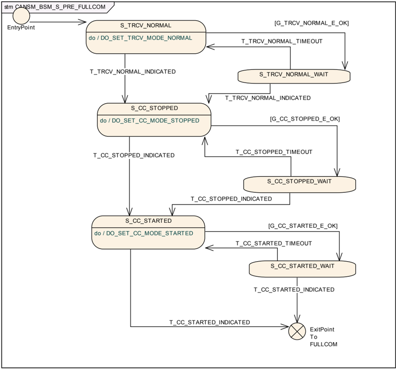

##### 6.2.22.1. 状态操作：S_TRCV_NORMAL

如果为该CAN网络配置了CAN收发器（参见[ECUC_CanSM_00137]），则只要子状态机CANSM_BSM_S_PRE_FULLCOM处于状态**S_TRCV_NORMAL**，**CanSM**模块就应操作do动作**DO_SET_TRCV_MODE_NORMAL**，因此为该CAN网络的已配置CAN收发器（参见[ECUC_CanSM_00137]）重复API请求**CanIf_SetTrcvMode**（参见SWS_CanSM_91002），TransceiverMode等于**CANTRCV_TRCVMODE_NORMAL**。

##### 6.2.22.2. 守护条件：G_TRCV_NORMAL_E_OK

子状态机CANSM_BSM_S_PRE_FULLCOM的守护条件**G_TRCV_NORMAL_E_OK**应在[SWS_CanSM_00483]的API调用返回**E_OK**时通过。

##### 6.2.22.3. 触发：T_TRCV_NORMAL_INDICATED

如果**CanSM**模块在相应请求（参见SWS_CanSM_00483）之后收到了该CAN网络已配置CAN收发器（参见[ECUC_CanSM_00137]）的**CANTRCV_TRCVMODE_NORMAL**模式指示（参见SWS_CanSM_00399），这应以**T_TRCV_NORMAL_INDICATED**触发该CAN网络的子状态机CANSM_BSM_S_PRE_FULLCOM。

如果没有为该CAN网络（参见[ECUC_CanSM_00137]）配置CAN收发器，则这应以**T_TRCV_NORMAL_INDICATED**触发该CAN网络处于状态**S_TRCV_NORMAL**的子状态机CANSM_BSM_S_PRE_FULLCOM。

##### 6.2.22.4. 触发：T_TRCV_NORMAL_TIMEOUT

在假定的收发器normal指示（参见SWS_CanSM_00485）超过**CANSM_MODEREQ_REPEAT_TIME**（参见[ECUC_CanSM_00336]）超时之后，该条件应以**T_TRCV_NORMAL_TIMEOUT**触发相应网络的子状态机CANSM_BSM_S_PRE_FULLCOM。

##### 6.2.22.5. 状态操作：S_CC_STOPPED

只要子状态机CANSM_BSM_S_PRE_FULLCOM处于状态**S_CC_STOPPED**，**CanSM**模块就应操作do动作**DO_SET_CC_MODE_STOPPED**，因此在当前CAN控制器模式（参见SWS_CanSM_00638）不同的情况下，为该CAN网络的所有已配置CAN控制器（参见[ECUC_CanSM_00141]）重复API请求**CanIf_SetControllerMode**（参见SWS_CanSM_91002），ControllerMode等于**CAN_CS_STOPPED**。

##### 6.2.22.6. 守护条件：G_CC_STOPPED_OK

子状态机CANSM_BSM_S_PRE_FULLCOM的守护条件**G_CC_STOPPED_OK**应在[SWS_CanSM_00487]的所有API调用都返回**E_OK**时通过。

##### 6.2.22.7. 触发：T_CC_STOPPED_INDICATED

如果**CanSM**模块在为停止该CAN网络的CAN控制器而发出的相应请求（参见SWS_CanSM_00487）之后，收到了该CAN网络所有已配置CAN控制器（参见[ECUC_CanSM_00141]）的所有模式指示（参见SWS_CanSM_00396），这应以**T_CC_STOPPED_INDICATED**触发该CAN网络的子状态机CANSM_BSM_S_PRE_FULLCOM。

##### 6.2.22.8. 触发：T_CC_STOPPED_TIMEOUT

在所有假定的控制器stopped模式指示（参见SWS_CanSM_00489）超过**CANSM_MODEREQ_REPEAT_TIME**（参见[ECUC_CanSM_00336]）超时之后，该条件应以**T_CC_STOPPED_TIMEOUT**触发相应网络的子状态机CANSM_BSM_S_PRE_FULLCOM。

##### 6.2.22.9. 状态操作：S_CC_STARTED

只要子状态机CANSM_BSM_S_PRE_FULLCOM处于状态**S_CC_STARTED**，**CanSM**模块就应操作do动作**DO_SET_CC_MODE_STARTED**，因此在当前CAN控制器模式（参见SWS_CanSM_00638）不同的情况下，为该CAN网络的所有已配置CAN控制器（参见[ECUC_CanSM_00141]）重复API请求**CanIf_SetControllerMode**（参见SWS_CanSM_91002），ControllerMode等于**CAN_CS_STARTED**。

##### 6.2.22.10. 守护条件：G_CC_STARTED_OK

子状态机CANSM_BSM_S_PRE_FULLCOM的守护条件**G_CC_STARTED_OK**应在[SWS_CanSM_00491]的所有API调用都返回**E_OK**时通过。

##### 6.2.22.11. 触发：T_CC_STARTED_INDICATED

如果**CanSM**模块在为启动该CAN网络的CAN控制器而发出的相应请求（参见SWS_CanSM_00491）之后，收到了该CAN网络所有已配置CAN控制器（参见[ECUC_CanSM_00141]）的所有模式指示（参见SWS_CanSM_00396），这应以**T_CC_STARTED_INDICATED**触发该CAN网络的子状态机CANSM_BSM_S_PRE_FULLCOM。

##### 6.2.22.12. 触发：T_CC_STARTED_TIMEOUT

在所有假定的控制器started模式指示（参见SWS_CanSM_00493）超过**CANSM_MODEREQ_REPEAT_TIME**（参见[ECUC_CanSM_00336]）超时之后，该条件应以**T_CC_STARTED_TIMEOUT**触发相应网络的子状态机CANSM_BSM_S_PRE_FULLCOM。

#### 6.2.23. 子状态机 CANSM_BSM_S_FULLCOM

图7.8：CANSM_BSM_S_FULLCOM，CANSM_BSM的子状态机（**CANSM_BSM_S_FULLCOM**）

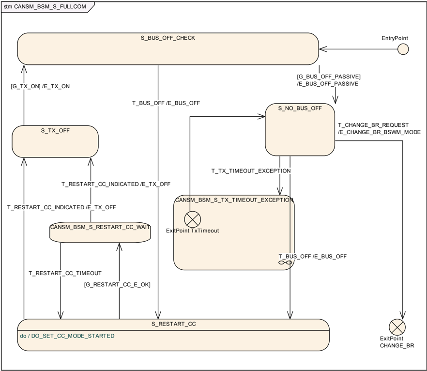

##### 6.2.23.1. 守护条件：G_BUS_OFF_PASSIVE

子状态机CANSM_BSM_S_FULLCOM的守护条件**G_BUS_OFF_PASSIVE**应在**CANSM_BOR_TX_CONFIRMATION_POLLING**被禁用（参见[ECUC_CanSM_00339]）且自效果**E_TX_ON**以来经过的时间大于等于配置参数**CANSM_BOR_TIME_TX_ENSURED**（参见[ECUC_CanSM_00130]）时通过。

子状态机CANSM_BSM_S_FULLCOM的守护条件**G_BUS_OFF_PASSIVE**应在**CANSM_BOR_TX_CONFIRMATION_POLLING**被启用（参见[ECUC_CanSM_00339]）且API **CanIf_GetTxConfirmationState**（参见SWS_CanSM_91002）为该CAN网络的所有已配置CAN控制器（参见[ECUC_CanSM_00141]）返回**CANIF_TX_RX_NOTIFICATION**时通过。

##### 6.2.23.2. 效果：E_BUS_OFF_PASSIVE

子状态机CANSM_BSM_S_FULLCOM的效果**E_BUS_OFF_PASSIVE**应以参数EventId := [**CANSM_E_BUS_OFF**](#635-扩展生产错误)（参见[ECUC_CanSM_00070]）、EventStatus := **DEM_EVENT_STATUS_PASSED**调用**Dem_SetEventStatus**（参见SWS_CanSM_91002）。

##### 6.2.23.3. 触发：T_CHANGE_BR_REQUEST

如果不存在拒绝[**CanSM_SetBaudrate**](#7372-cansm_setbaudrate)请求的条件（参见SWS_CanSM_00503），这应以**T_CHANGE_BR_REQUEST**触发状态机CANSM_BSM_S_FULLCOM以及相应的父状态机CanSM_BSM（导致在可能的情况下经由**CanIf_SetBaudrate**（参见SWS_CanSM_91003）直接更改波特率，或启动所需的异步过程来完成该操作）。

##### 6.2.23.4. 效果：E_CHANGE_BR_BSW_MODE

子状态机CANSM_BSM_S_FULLCOM的效果**E_CHANGE_BR_BSW_MODE**应为相应的CAN网络调用API **BswM_CanSM_CurrentState**（参见SWS_CanSM_91002），参数为Network := CanSMComMNetworkHandleRef、CurrentState := **CANSM_BSWM_CHANGE_BAUDRATE**。

##### 6.2.23.5. 触发：T_BUS_OFF

回调函数[**CanSM_ControllerBusOff**](#741-cansm_controllerbusoff)（参见SWS_CanSM_00064）在其某个已配置CAN控制器与回调函数[**CanSM_ControllerBusOff**](#741-cansm_controllerbusoff)的函数参数ControllerId匹配的情况下，应以**T_BUS_OFF**触发该CAN网络的子状态机CANSM_BSM_S_FULLCOM。

如果一个CAN网络拥有多个CAN控制器，且其中一个控制器的总线关闭经由[**CanSM_ControllerBusOff**](#741-cansm_controllerbusoff)被指示，则**CanSM**应在效果**E_BUS_OFF**的上下文中也停止该CAN网络的其他CAN控制器。

##### 6.2.23.6. 效果：E_BUS_OFF

子状态机CANSM_BSM_S_FULLCOM的效果**E_BUS_OFF**应首先为相应的CAN网络调用API **BswM_CanSM_CurrentState**（参见SWS_CanSM_91002），参数为Network := CanSMComMNetworkHandleRef、CurrentState := **CANSM_BSWM_BUS_OFF**。

子状态机CANSM_BSM_S_FULLCOM的效果**E_BUS_OFF**应第二为相应的CAN网络调用API **ComM_BusSM_ModeIndication**（参见SWS_CanSM_91002），参数为Channel := CanSMComMNetworkHandleRef（参见[ECUC_CanSM_00161]）、ComMode := **COMM_SILENT_COMMUNICATION**。

子状态机CANSM_BSM_S_FULLCOM的效果**E_BUS_OFF**应以参数EventId := [**CANSM_E_BUS_OFF**](#635-扩展生产错误)（参见[ECUC_CanSM_00070]）、EventStatus := **DEM_EVENT_STATUS_PRE_FAILED**调用**Dem_SetEventStatus**（参见SWS_CanSM_91002）。

##### 6.2.23.7. 状态操作：S_RESTART_CC

只要子状态机CANSM_BSM_S_FULLCOM处于状态**S_RESTART_CC**，**CanSM**模块就应操作do动作**DO_SET_CC_MODE_STARTED**，因此在当前CAN控制器模式（参见SWS_CanSM_00638）不同的情况下，为该CAN网络的所有已配置CAN控制器（参见[ECUC_CanSM_00141]）重复API请求**CanIf_SetControllerMode**（参见SWS_CanSM_91002），ControllerMode等于**CAN_CS_STARTED**。

##### 6.2.23.8. 守护条件：G_RESTART_CC_OK

子状态机CANSM_BSM_S_FULLCOM的守护条件**G_RESTART_CC_OK**应在[SWS_CanSM_00509]的所有API调用都返回**E_OK**时通过。

##### 6.2.23.9. 触发：T_RESTART_CC_INDICATED

如果**CanSM**模块在为启动该CAN网络的CAN控制器而发出的相应请求（参见SWS_CanSM_00509）之后，收到了该CAN网络所有已配置CAN控制器（参见[ECUC_CanSM_00141]）的所有模式指示（参见SWS_CanSM_00396），这应以**T_RESTART_CC_INDICATED**触发该CAN网络的子状态CANSM_BSM_S_FULLCOM。

##### 6.2.23.10. 触发：T_RESTART_CC_TIMEOUT

在所有假定的控制器started模式指示（参见SWS_CanSM_00511）超过**CANSM_MODEREQ_REPEAT_TIME**（参见[ECUC_CanSM_00336]）超时之后，该条件应以**T_RESTART_CC_TIMEOUT**触发相应网络的子状态机CANSM_BSM_S_FULLCOM。

##### 6.2.23.11. 效果：E_TX_OFF

效果**E_TX_OFF**不做任何事。

##### 6.2.23.12. 守护条件：G_TX_ON

如果**CanSMEnableBusOffDelay**为FALSE，则子状态机CANSM_BSM_S_FULLCOM的守护条件**G_TX_ON**应在相对于最后一次**T_BUS_OFF**经过**CanSMBorTimeL1**（参见[ECUC_CanSM_00128]）的时间持续时间之后通过，前提是未通过守护条件**G_BUS_OFF_PASSIVE**的、使用**E_BUS_OFF**的总线关闭恢复重试次数低于**CanSMBorCounterL1ToL2**（参见[ECUC_CanSM_00131]）。

如果**CanSMEnableBusOffDelay**为FALSE，则子状态机CANSM_BSM_S_FULLCOM的守护条件**G_TX_ON**应在相对于最后一次**T_BUS_OFF**经过**CanSMBorTimeL2**（参见[ECUC_CanSM_00129]）的时间持续时间之后通过，前提是未通过守护条件**G_BUS_OFF_PASSIVE**的、使用**E_BUS_OFF**的总线关闭恢复重试次数大于等于**CanSMBorCounterL1ToL2**（参见[ECUC_CanSM_00131]）。

如果**CanSMEnableBusOffDelay**为TRUE，则[SWS_CanSM_00514]和[SWS_CanSM_00515]的守护条件应分别在各自规定的时间持续时间加上附加的随机延迟值之后通过；该随机延迟值应在总线关闭事件之后通过已配置的callout函数&lt;User_GetBusOffDelay&gt;（API名称由**CanSMGetBusOffDelayFunction**定义）请求。

##### 6.2.23.13. 效果：E_TX_ON

如果ECU passive为FALSE（参见SWS_CanSM_00646），则子状态机CANSM_BSM_S_FULLCOM的效果**E_TX_ON**应首先为该CAN网络的已配置CAN控制器（参见[ECUC_CanSM_00141]）调用API函数**CanIf_SetPduMode**（参见SWS_CanSM_91002），参数为ControllerId := CanSMControllerId（参见[ECUC_CanSM_00141]）、PduModeRequest := **CANIF_ONLINE**。

如果ECU passive为TRUE（参见SWS_CanSM_00646），则子状态机CANSM_BSM_S_FULLCOM的效果**E_TX_ON**应首先为该CAN网络的已配置CAN控制器（参见[ECUC_CanSM_00141]）调用API函数**CanIf_SetPduMode**（参见SWS_CanSM_91002），参数为ControllerId := CanSMControllerId（参见[ECUC_CanSM_00141]）、PduModeRequest := **CANIF_TX_OFFLINE_ACTIVE**。

子状态机CANSM_BSM_S_FULLCOM的效果**E_TX_ON**应第二为相应的CAN网络调用API **BswM_CanSM_CurrentState**（参见SWS_CanSM_91002），参数为Network := CanSMComMNetworkHandleRef、CurrentState := **CANSM_BSWM_FULL_COMMUNICATION**。

子状态机CANSM_BSM_S_FULLCOM的效果**E_TX_ON**应第三调用API **ComM_BusSM_ModeIndication**（参见SWS_CanSM_91002），参数为Channel := CanSMComMNetworkHandleRef（参见[ECUC_CanSM_00161]）、ComMode := **COMM_FULL_COMMUNICATION**。

##### 6.2.23.14. 触发：T_TX_TIMEOUT_EXCEPTION

回调函数[**CanSM_TxTimeoutException**](#744-cansm_txtimeoutexception)（参见SWS_CanSM_00410）应以**T_TX_TIMEOUT_EXCEPTION**触发子状态机CANSM_BSM_S_FULLCOM。

##### 6.2.23.15. 注释

在状态**S_NO_BUS_OFF**中，**CanSM**模块不需要任何状态操作。

##### 6.2.23.16. 子状态机：CANSM_BSM_S_TX_TIMEOUT_EXCEPTION

图7.9：CANSM_BSM_S_TX_TIMEOUT_EXCEPTION，CANSM_BSM_S_FULLCOM的子状态机（**CANSM_BSM_S_TX_TIMEOUT_EXCEPTION**）

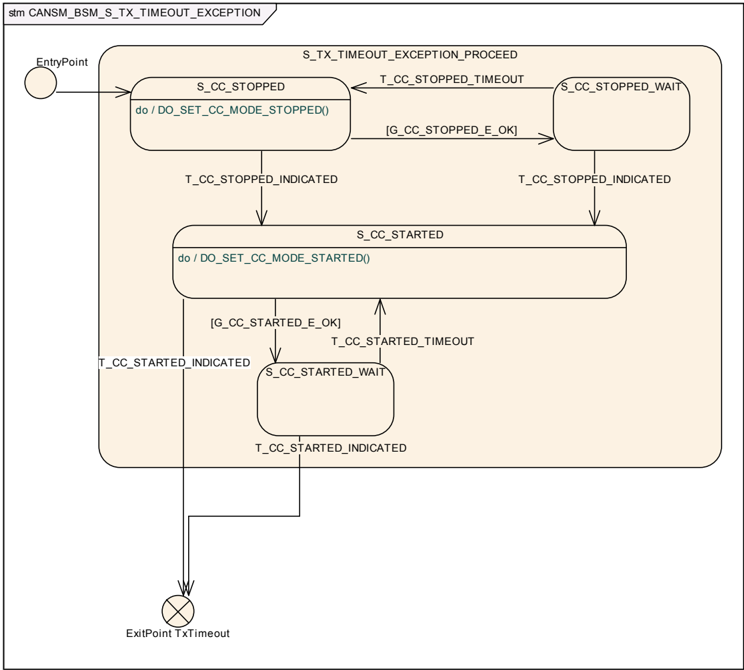

###### 6.2.23.16.1. 触发：T_CC_STOPPED_TIMEOUT

在所有假定的控制器stopped模式指示（参见SWS_CanSM_00579）超过**CANSM_MODEREQ_REPEAT_TIME**（参见[ECUC_CanSM_00336]）超时之后，该条件应以**T_CC_STOPPED_TIMEOUT**触发相应网络的子状态机CANSM_BSM_S_TX_TIMEOUT_EXCEPTION。

###### 6.2.23.16.2. 守护条件：G_CC_STOPPED_E_OK

子状态机CANSM_BSM_S_TX_TIMEOUT_EXCEPTION的守护条件**G_CC_STOPPED_E_OK**应在[SWS_CanSM_00578]的所有API调用都返回**E_OK**时通过。

###### 6.2.23.16.3. 状态操作：DO_SET_CC_MODE_STOPPED ()

只要子状态机CANSM_BSM_S_TX_TIMEOUT_EXCEPTION处于状态**S_CC_STOPPED**，**CanSM**模块就应操作do动作**DO_SET_CC_MODE_STOPPED**，因此在当前CAN控制器模式（参见SWS_CanSM_00638）不同的情况下，为该CAN网络的所有已配置CAN控制器（参见[ECUC_CanSM_00141]）重复API请求**CanIf_SetControllerMode**（参见SWS_CanSM_91002），ControllerMode等于**CAN_CS_STOPPED**。

###### 6.2.23.16.4. 触发：T_CC_STOPPED_INDICATED

如果**CanSM**模块在为停止该CAN网络的CAN控制器而发出的相应请求（参见SWS_CanSM_00524）之后，收到了该CAN网络所有已配置CAN控制器（参见[ECUC_CanSM_00141]）的所有模式指示（参见SWS_CanSM_00396），这应以**T_CC_STOPPED_INDICATED**触发该CAN网络的子状态机CANSM_BSM_S_TX_TIMEOUT_EXCEPTION。

###### 6.2.23.16.5. 触发：T_CC_STARTED_INDICATED

如果**CanSM**模块在为启动该CAN网络的CAN控制器而发出的相应请求（参见SWS_CanSM_00582）之后，收到了该CAN网络所有已配置CAN控制器（参见[ECUC_CanSM_00141]）的所有模式指示（参见SWS_CanSM_00396），这应以**T_CC_STARTED_INDICATED**触发该CAN网络的子状态机CANSM_BSM_S_TX_TIMEOUT_EXCEPTION。

###### 6.2.23.16.6. 守护条件：G_CC_STARTED_E_OK

子状态机CANSM_BSM_S_TX_TIMEOUT_EXCEPTION的守护条件**G_CC_STARTED_E_OK**应在[SWS_CanSM_00582]的所有API调用都返回**E_OK**时通过。

###### 6.2.23.16.7. 状态操作：DO_SET_CC_MODE_STARTED

只要子状态机CANSM_BSM_S_TX_TIMEOUT_EXCEPTION处于状态**S_CC_STARTED**，**CanSM**模块就应操作do动作**DO_SET_CC_MODE_STARTED**，因此在当前CAN控制器模式（参见SWS_CanSM_00638）不同的情况下，为该CAN网络的所有已配置CAN控制器（参见[ECUC_CanSM_00141]）重复API请求**CanIf_SetControllerMode**（参见SWS_CanSM_91002），ControllerMode等于**CAN_CS_STARTED**。

###### 6.2.23.16.8. 出口点：TxTimeout

如果子状态机CANSM_BSM_S_TX_TIMEOUT_EXCEPTION被以**T_CC_STARTED_INDICATED**触发，则应以**CANIF_ONLINE**调用API **CanIf_SetPduMode**（参见SWS_CanSM_91002）。

#### 6.2.24. 子状态机：CANSM_BSM_S_CHANGE_BAUDRATE

图7.10：CANSM_BSM_S_CHANGE_BAUDRATE，CANSM_BSM的子状态机（**CANSM_BSM_S_CHANGE_BAUDRATE**）

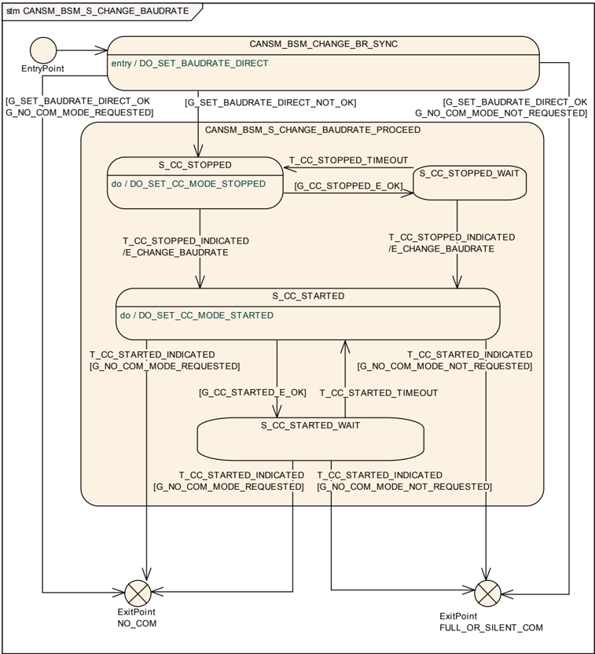

##### 6.2.24.1. 入口处执行的状态操作：DO_SET_BAUDRATE_DIRECT

状态操作**DO_SET_BAUDRATE_DIRECT**应为该CAN网络的所有已配置CAN控制器（参见[ECUC_CanSM_00141]）以相应的ControllerId参数调用API请求**CanIf_SetBaudrate**（参见SWS_CanSM_91003）。它应使用来自[**CanSM_SetBaudrate**](#7372-cansm_setbaudrate)调用的相应函数参数BaudRateConfigID作为BaudRateConfigID参数。

##### 6.2.24.2. 守护条件：G_SET_BAUDRATE_DIRECT_OK

如果所有**CanIf_SetBaudrate**（参见SWS_CanSM_91003）（参见SWS_CanSM_00639）请求都返回**E_OK**，则守护条件**G_SET_BAUDRATE_DIRECT_OK**应通过。

##### 6.2.24.3. 守护条件：G_SET_BAUDRATE_DIRECT_NOT_OK

如果任何**CanIf_SetBaudrate**（参见SWS_CanSM_91003）（参见SWS_CanSM_00639）请求返回了**E_NOT_OK**，则状态**CANSM_BSM_CHANGE_BR_SYNC**的守护条件**G_SET_BAUDRATE_NOT_OK**应通过。

##### 6.2.24.4. 状态操作：S_CC_STOPPED

只要子状态机CANSM_BSM_S_CHANGE_BAUDRATE处于状态**S_CC_STOPPED**，**CanSM**模块就应操作do动作**DO_SET_CC_MODE_STOPPED**，因此在当前CAN控制器模式（参见SWS_CanSM_00638）不同的情况下，为该CAN网络的所有已配置CAN控制器（参见[ECUC_CanSM_00141]）重复API请求**CanIf_SetControllerMode**（参见SWS_CanSM_91002），ControllerMode等于**CAN_CS_STOPPED**。

##### 6.2.24.5. 守护条件：G_CC_STOPPED_OK

子状态机CANSM_BSM_S_CHANGE_BAUDRATE的守护条件**G_CC_STOPPED_OK**应在[SWS_CanSM_00524]的所有API调用都返回**E_OK**时通过。

##### 6.2.24.6. 触发：T_CC_STOPPED_INDICATED

如果**CanSM**模块在为停止该CAN网络的CAN控制器而发出的相应请求（参见SWS_CanSM_00524）之后，收到了该CAN网络所有已配置CAN控制器（参见[ECUC_CanSM_00141]）的所有模式指示（参见SWS_CanSM_00396），这应以**T_CC_STOPPED_INDICATED**触发该CAN网络的子状态机CANSM_BSM_S_CHANGE_BAUDRATE。

##### 6.2.24.7. 触发：T_CC_STOPPED_TIMEOUT

在所有假定的控制器stopped模式指示（参见SWS_CanSM_00526）超过**CANSM_MODEREQ_REPEAT_TIME**（参见[ECUC_CanSM_00336]）超时之后，该条件应以**T_CC_STOPPED_TIMEOUT**触发相应网络的子状态机CANSM_BSM_S_CHANGE_BAUDRATE。

##### 6.2.24.8. 效果：E_CHANGE_BAUDRATE

子状态机CANSM_BSM_S_CHANGE_BAUDRATE的效果**E_CHANGE_BAUDRATE**应首先为相应的CAN网络调用API **ComM_BusSM_ModeIndication**（参见SWS_CanSM_91002），参数为Channel := CanSMComMNetworkHandleRef（参见[ECUC_CanSM_00161]）、ComMode := **COMM_NO_COMMUNICATION**。

子状态机CANSM_BSM_S_CHANGE_BAUDRATE的效果**E_CHANGE_BAUDRATE**应第二为该CAN网络的所有已配置CAN控制器（参见[ECUC_CanSM_00141]）以相应的ControllerId参数调用API请求**CanIf_SetBaudrate**（参见SWS_CanSM_91003），并使用从[**CanSM_SetBaudrate**](#7372-cansm_setbaudrate)调用中记住的BaudRateConfigID作为BaudRateConfigID参数。

##### 6.2.24.9. 状态操作：S_CC_STARTED

只要子状态机CANSM_BSM_S_CHANGE_BAUDRATE处于状态**S_CC_STARTED**，**CanSM**模块就应操作do动作**DO_SET_CC_MODE_STARTED**，因此在当前CAN控制器模式（参见SWS_CanSM_00638）不同的情况下，为该CAN网络的所有已配置CAN控制器（参见[ECUC_CanSM_00141]）重复API请求**CanIf_SetControllerMode**（参见SWS_CanSM_91002），ControllerMode等于**CAN_CS_STARTED**。

##### 6.2.24.10. 守护条件：G_CC_STARTED_OK

子状态机CANSM_BSM_S_CHANGE_BAUDRATE的守护条件**G_CC_STARTED_OK**应在[SWS_CanSM_00532]的所有API调用都返回**E_OK**时通过。

##### 6.2.24.11. 触发：T_CC_STARTED_INDICATED

如果**CanSM**模块在为启动该CAN网络的CAN控制器而发出的相应请求（参见SWS_CanSM_00532）之后，收到了该CAN网络所有已配置CAN控制器（参见[ECUC_CanSM_00141]）的所有模式指示（参见SWS_CanSM_00396），这应以**T_CC_STARTED_INDICATED**触发该CAN网络的子状态机CANSM_BSM_S_CHANGE_BAUDRATE。

##### 6.2.24.12. 触发：T_CC_STARTED_TIMEOUT

在所有假定的控制器started模式指示（参见SWS_CanSM_00534）超过**CANSM_MODEREQ_REPEAT_TIME**（参见[ECUC_CanSM_00336]）超时之后，该条件应以**T_CC_STARTED_TIMEOUT**触发相应网络的子状态机CANSM_BSM_S_CHANGE_BAUDRATE。

##### 6.2.24.13. 守护条件：G_NO_COM_MODE_REQUESTED

在用[**CanSM_RequestComMode**](#733-cansm_requestcommode)（参见SWS_CanSM_00635）为该状态机的相应网络句柄发出的、被接受的最新通信模式请求，其**ComM_Mode**参数等于**COMM_NO_COMMUNICATION**的情况下，子状态机CANSM_BSM_S_CHANGE_BAUDRATE应通过守护条件**G_NO_COM_MODE_REQUESTED**。

##### 6.2.24.14. 守护条件：G_NO_COM_MODE_NOT_REQUESTED

在用[**CanSM_RequestComMode**](#733-cansm_requestcommode)（参见SWS_CanSM_00635）为该状态机的相应网络句柄发出的、被接受的最新通信模式请求，其**ComM_Mode**参数等于**COMM_SILENT_COMMUNICATION**或**COMM_FULL_COMMUNICATION**的情况下，子状态机CANSM_BSM_S_CHANGE_BAUDRATE应通过守护条件**G_NO_COM_MODE_NOT_REQUESTED**。

### 6.3. 错误分类

文档[2]「基本软件模块通用规范」的「错误处理」章详细描述了基本软件的错误处理。首先，它构成了一个由五种错误类型组成的分类方案，这些错误可能发生在BSW模块中。

在此基础上，以下各节在相应的小节中规定了具体的错误。

#### 6.3.1. 开发错误

**CanSM**模块开发错误的定义：

| 错误类型 | 相关错误代码 | 错误值 |
| --- | --- | --- |
| 在模块未初始化的情况下使用API服务 | CANSM_E_UNINIT | 0x01 |
| 以错误的指针调用API服务 | CANSM_E_PARAM_POINTER | 0x02 |
| 以错误的参数调用API服务 | CANSM_E_INVALID_NETWORK_HANDLE | 0x03 |
| 以错误的参数调用API服务 | CANSM_E_PARAM_CONTROLLER | 0x04 |
| 以错误的参数调用API服务 | CANSM_E_PARAM_TRANSCEIVER | 0x05 |
| 在并非所有CAN网络都处于状态CANSM_NO_COMMUNICATION时调用DeInit API服务 | CANSM_E_NOT_IN_NO_COM | 0x0B |

#### 6.3.2. 运行时错误

**CanSM**模块运行时错误的定义：

| 错误类型 | 相关错误代码 | 错误值 |
| --- | --- | --- |
| 某个网络的模式请求失败次数超过了配置允许的次数 | CANSM_E_MODE_REQUEST_TIMEOUT | 0x0A |

#### 6.3.3. 瞬态故障

没有瞬态故障。

#### 6.3.4. 生产错误

没有生产错误。

#### 6.3.5. 扩展生产错误

没有扩展生产错误。

##### 6.3.5.1. CANSM_E_BUS_OFF

| 错误名称 | [CANSM_E_BUS_OFF](#635-扩展生产错误)（参见ECUC_CanSM_00070） |
| --- | --- |
| 简要描述 | 总线关闭检测（**Bus-off detection**）。 |
| 详细描述 | 某个CAN网络的总线关闭恢复状态机检测到了一定数量的、未成功恢复的连续总线关闭。 |
| 推荐DTC | 由**DEM**分配。 |
| 检测条件 | Fail：当[**CanSM_ControllerBusOff**](#741-cansm_controllerbusoff)被调用时（T_BUS_OFF/E_BUS_OFF）PRE_FAILED，去抖动由OEM在**DEM**中定义。 |
| 检测条件 | Pass：在CAN帧成功发送之后（G_BUS_OFF_PASSIVE/E_BUS_OFF_PASSIVE）。 |
| 次要参数 | 无。 |
| 所需时间 | 立即PRE_FAILED（在错误中断上下文中），FAILED取决于**DEM**的去抖动配置。 |
| 监控频率 | Continuous |
| MIL点亮 | 由**DEM**分配。 |

### 6.4. ECU在线主动/被动模式

**CanSM**模块应存储所请求的ECU passive模式的状态（参见SWS_CanSM_00644）。

当以CanSM_Passive = true调用[**CanSM_SetEcuPassive**](#7373-cansm_setecupassive)时（参见SWS_CanSM_00644），**CanSM**应通过以参数ControllerId := CanSMControllerId（参见[ECUC_CanSM_00141]）、PduModeRequest := **CANIF_TX_OFFLINE_ACTIVE**调用API **CanIf_SetPduMode**（参见SWS_CanSM_91002），将当前为**CANIF_ONLINE**的所有已配置CAN控制器的所有PDU模式更改为**CANIF_TX_OFFLINE_ACTIVE**。

如果以CanSM_Passive = false调用[**CanSM_SetEcuPassive**](#7373-cansm_setecupassive)（参见SWS_CanSM_00644），则**CanSM**应通过以参数ControllerId := CanSMControllerId（参见[ECUC_CanSM_00141]）、PduModeRequest := **CANIF_ONLINE**调用API **CanIf_SetPduMode**（参见SWS_CanSM_91002），将当前为**CANIF_TX_OFFLINE_ACTIVE**的所有已配置CAN控制器的所有PDU模式更改为**CANIF_ONLINE**。

如果**CanSM**模块需要关于实际**PduMode**的信息，则**CanSM**应调用API **CanIf_GetPduMode**（参见SWS_CanSM_91002）以获取**CanIf**的当前PDU模式。

### 6.5. 非功能性设计规则

**CanSM**应满足[12, General Requirements on Basic Software Modules]的软件模块设计需求。

## 7. API规范

### 7.1. 导入的类型

在本章中，列出从以下模块中包含的所有类型：

| 模块 | 头文件 | 导入的类型 |
| --- | --- | --- |
| Can | Can_GeneralTypes.h | Can_ControllerStateType |
| CanIf | CanIf.h | CanIf_NotifStatusType |
| CanIf | CanIf.h | CanIf_PduModeType |
| CanTrcv | Can_GeneralTypes.h | CanTrcv_TrcvModeType |
| ComM | Rte_ComM_Type.h | ComM_ModeType |
| ComStack_Types | ComStack_Types.h | NetworkHandleType |
| Dem | Rte_Dem_Type.h | Dem_EventIdType |
| Dem | Rte_Dem_Type.h | Dem_EventStatusType |
| Std | Std_Types.h | Std_ReturnType |
| Std | Std_Types.h | Std_VersionInfoType |

### 7.2. 类型定义

以下各表包含**CanSM**模块的类型定义。

#### 7.2.1. CanSM_ConfigType

| 名称 | CanSM_ConfigType |
| --- | --- |
| 类型（Kind） | Structure（结构体） |
| 元素 | - |
| 元素 | 类型：- |
| 元素 | 注释：- |
| 描述 | 该类型定义了**CanSM**的Post-Build参数的数据结构。在初始化时，**CanSM**获得一个指向该类型结构的指针，以访问其初始化所需的配置数据。 |
| 可通过 | CanSM.h |

#### 7.2.2. CanSM_BswMCurrentStateType

| 名称 | CanSM_BswMCurrentStateType |
| --- | --- |
| 类型（Kind） | Enumeration（枚举） |
| 范围 | CANSM_BSWM_NO_COMMUNICATION（-）：-；CANSM_BSWM_SILENT_COMMUNICATION（-）：-；CANSM_BSWM_FULL_COMMUNICATION（-）：-；CANSM_BSWM_BUS_OFF（-）：-；CANSM_BSWM_CHANGE_BAUDRATE（-）：- |
| 描述 | 通知给**BswM**模块的CAN特定的通信模式/状态。 |
| 可通过 | CanSM.h |

### 7.3. 函数定义

以下各节规定**CanSM**模块提供的API函数。

#### 7.3.1. CanSM_Init

**说明**:

```C
void CanSM_Init ( const CanSM_ConfigType* ConfigPtr )
```

| 服务名 | CanSM_Init |
| --- | --- |
| 服务ID[hex] | 0x00 |
| 同步/异步 | 同步 |
| 可重入 | 不可重入 |
| 参数（in） | ConfigPtr |
| | 指向**CanSM**的Post-Build参数初始化结构的指针。 |
| 参数（inout） | 无 |
| 参数（out） | 无 |
| 返回值 | 无 |
| 说明 | 该服务初始化**CanSM**模块。 |
| 可通过 | CanSM.h |

#### 7.3.2. CanSM_DeInit

**说明**:

```C
void CanSM_DeInit ( void )
```

| 服务名 | CanSM_DeInit |
| --- | --- |
| 服务ID[hex] | 0x14 |
| 同步/异步 | 同步 |
| 可重入 | 不可重入 |
| 参数（in） | 无 |
| 参数（inout） | 无 |
| 参数（out） | 无 |
| 返回值 | 无 |
| 说明 | 该服务去初始化**CanSM**模块。 |
| 可通过 | CanSM.h |

注意：去初始化函数的一般行为和约束由SWS_BSW_00152、SWS_BSW_00072、SWS_BSW_00232、SWS_BSW_00233规定。

注意事项：**CanSM_DeInit**函数的调用者必须确保所有CAN网络都处于状态**CANSM_NO_COMMUNICATION**。

如果为**CanSM**模块启用了开发错误检测：在并非所有CAN网络都处于状态**CANSM_NO_COMMUNICATION**的情况下，函数**CanSM_DeInit**应引发错误[**CANSM_E_NOT_IN_NO_COM**](#631-开发错误)。

#### 7.3.3. CanSM_RequestComMode

**说明**:

```C
Std_ReturnType CanSM_RequestComMode ( NetworkHandleType network, ComM_ModeType ComM_Mode )
```

| 服务名 | CanSM_RequestComMode |
| --- | --- |
| 服务ID[hex] | 0x02 |
| 同步/异步 | 异步 |
| 可重入 | 可重入（仅针对不同的网络句柄） |
| 参数（in） | network |
| | 请求的目标通信网络的句柄。 |
| | ComM_Mode |
| | 请求的通信模式。 |
| 参数（inout） | 无 |
| 参数（out） | 无 |
| 返回值 | Std_ReturnType |
| | E_OK：服务被接受；E_NOT_OK：服务被拒绝。 |
| 说明 | 该服务应将某个CAN网络的通信模式更改为所请求的模式。 |
| 可通过 | CanSM.h |

备注：关于通信模式的详细描述，请参阅[5, Specification of Communication Manager]。

函数**CanSM_RequestComMode**应在请求的NetworkHandle参数是**CanSM**模块配置（参见[ECUC_CanSM_00161]）中包含的句柄时接受其请求。

函数**CanSM_RequestComMode**应在请求的NetworkHandle参数不是**CanSM**模块配置（参见[ECUC_CanSM_00161]）中包含的句柄时拒绝其请求。

在[**CanSM_Init**](#731-cansm_init)请求（参见[SWS_CanSM_00423]、[SWS_CanSM_00430]）之后，所请求CAN网络的初始迁移尚未完成的情况下，**CanSM**模块应拒绝API请求**CanSM_RequestComMode**。

函数**CanSM_RequestComMode**在不接受请求的网络句柄的情况下，应以ErrorId参数[**CANSM_E_INVALID_NETWORK_HANDLE**](#631-开发错误)调用函数**Det_ReportError**（参见SWS_CanSM_91003）。

如果函数**CanSM_RequestComMode**接受了该请求，则**CanSM**状态机（参见SWS_CanSM_00635）应考虑该请求。

如果在调用函数**CanSM_RequestComMode**时**CanSM**模块未初始化，则该函数应以ErrorId参数[**CANSM_E_UNINIT**](#631-开发错误)调用函数**Det_ReportError**（参见SWS_CanSM_91003）。

#### 7.3.4. CanSM_GetCurrentComMode

**说明**:

```C
Std_ReturnType CanSM_GetCurrentComMode ( NetworkHandleType network, ComM_ModeType* ComM_ModePtr )
```

| 服务名 | CanSM_GetCurrentComMode |
| --- | --- |
| 服务ID[hex] | 0x03 |
| 同步/异步 | 同步 |
| 可重入 | 可重入 |
| 参数（in） | network |
| | 应输出其当前通信模式的网络句柄。 |
| 参数（inout） | 无 |
| 参数（out） | ComM_ModePtr |
| | 输出当前通信模式的位置的指针。 |
| 返回值 | Std_ReturnType |
| | E_OK：服务被接受。 |
| 说明 | 该服务应输出某个CAN网络的当前通信模式。 |
| 可通过 | CanSM.h |

在调用所提供的API [**CanSM_Init**](#731-cansm_init)（参见SWS_CanSM_00023）之前，**CanSM**模块应为API请求**CanSM_GetCurrentComMode**返回**E_NOT_OK**。

函数**CanSM_GetCurrentComMode**应在请求的NetworkHandle参数是**CanSM**模块配置（参见[ECUC_CanSM_00161]）中包含的句柄时接受其请求。

函数**CanSM_GetCurrentComMode**应在请求的NetworkHandle参数不是**CanSM**模块配置（参见[ECUC_CanSM_00161]）中包含的句柄时拒绝其请求。

函数**CanSM_GetCurrentComMode**在不接受请求的网络句柄的情况下，应以ErrorId参数[**CANSM_E_INVALID_NETWORK_HANDLE**](#631-开发错误)调用函数**Det_ReportError**（参见SWS_CanSM_91003）。

函数**CanSM_GetCurrentComMode**在接受请求的情况下，应将网络句柄（参见SWS_CanSM_00266）的当前通信模式输出到**ComM_ModeType**类型的指定指针。

如果在调用函数**CanSM_GetCurrentComMode**时**CanSM**模块未初始化（参见SWS_CanSM_00282），则该函数应以ErrorId参数[**CANSM_E_UNINIT**](#631-开发错误)调用函数**Det_ReportError**（参见SWS_CanSM_91003）。

如果该函数的用户传入NULL指针作为ComM_ModePtr，则函数**CanSM_GetCurrentComMode**应向DET报告开发错误[**CANSM_E_PARAM_POINTER**](#631-开发错误)。

#### 7.3.5. CanSM_StartWakeupSource

**说明**:

```C
Std_ReturnType CanSM_StartWakeupSource ( NetworkHandleType network )
```

| 服务名 | CanSM_StartWakeupSource |
| --- | --- |
| 服务ID[hex] | 0x11 |
| 同步/异步 | 同步 |
| 可重入 | 不可重入 |
| 参数（in） | network |
| | 受影响的CAN网络。 |
| 参数（inout） | 无 |
| 参数（out） | 无 |
| 返回值 | Std_ReturnType |
| | E_OK：请求被接受；E_NOT_OK：请求被拒绝。 |
| 说明 | 当某个唤醒源应被启动时，**EcuM**应调用该函数。 |
| 可通过 | CanSM.h |

在**CanSM**模块尚未以[**CanSM_Init**](#731-cansm_init)（参见SWS_CanSM_00023）初始化的情况下，API函数**CanSM_StartWakeupSource**应返回**E_NOT_OK**。

在**CanSM**模块尚未以[**CanSM_Init**](#731-cansm_init)（参见SWS_CanSM_00023）初始化的情况下，函数**CanSM_StartWakeupSource**应以ErrorId参数[**CANSM_E_UNINIT**](#631-开发错误)调用函数**Det_ReportError**（参见SWS_CanSM_91003）。

在**CanSM**模块已初始化且请求的network参数不是**CanSM**模块配置（参见[ECUC_CanSM_00161]）中包含的句柄的情况下，函数**CanSM_StartWakeupSource**应返回**E_NOT_OK**。

在**CanSM**模块已初始化且所请求的句柄相对于**CanSM**配置（参见[ECUC_CanSM_00161]）无效的情况下，函数**CanSM_StartWakeupSource**应以ErrorId参数[**CANSM_E_INVALID_NETWORK_HANDLE**](#631-开发错误)调用函数**Det_ReportError**（参见SWS_CanSM_91003）。

在**CanSM**模块已初始化且所请求的句柄相对于**CanSM**配置（参见[ECUC_CanSM_00161]）有效的情况下，函数**CanSM_StartWakeupSource**应返回**E_OK**，并且它应被视为相关网络状态机的触发（参见SWS_CanSM_00607）。

#### 7.3.6. CanSM_StopWakeupSource

**说明**:

```C
Std_ReturnType CanSM_StopWakeupSource ( NetworkHandleType network )
```

| 服务名 | CanSM_StopWakeupSource |
| --- | --- |
| 服务ID[hex] | 0x12 |
| 同步/异步 | 同步 |
| 可重入 | 不可重入 |
| 参数（in） | network |
| | 受影响的CAN网络。 |
| 参数（inout） | 无 |
| 参数（out） | 无 |
| 返回值 | Std_ReturnType |
| | E_OK：请求被接受；E_NOT_OK：请求被拒绝。 |
| 说明 | 当某个唤醒源应被停止时，**EcuM**应调用该函数。 |
| 可通过 | CanSM.h |

在**CanSM**模块尚未以[**CanSM_Init**](#731-cansm_init)（参见SWS_CanSM_00023）初始化的情况下，API函数**CanSM_StopWakeupSource**应返回**E_NOT_OK**。

在**CanSM**模块尚未以[**CanSM_Init**](#731-cansm_init)（参见SWS_CanSM_00023）初始化的情况下，函数**CanSM_StopWakeupSource**应以ErrorId参数[**CANSM_E_UNINIT**](#631-开发错误)调用函数**Det_ReportError**（参见SWS_CanSM_91003）。

在**CanSM**模块已初始化且请求的network参数不是**CanSM**模块配置（参见[ECUC_CanSM_00161]）中包含的句柄的情况下，函数**CanSM_StopWakeupSource**应返回**E_NOT_OK**。

在**CanSM**模块已初始化且所请求的句柄相对于**CanSM**配置（参见[ECUC_CanSM_00161]）无效的情况下，函数**CanSM_StopWakeupSource**应以ErrorId参数[**CANSM_E_INVALID_NETWORK_HANDLE**](#631-开发错误)调用函数**Det_ReportError**（参见SWS_CanSM_91003）。

在**CanSM**模块已初始化且所请求的句柄相对于**CanSM**配置（参见[ECUC_CanSM_00161]）有效的情况下，函数**CanSM_StopWakeupSource**应返回**E_OK**，并且它应被视为相关网络状态机的触发（参见SWS_CanSM_00608）。

#### 7.3.7. 可选（Optional）

##### 7.3.7.1. CanSM_GetVersionInfo

**说明**:

```C
void CanSM_GetVersionInfo ( Std_VersionInfoType* VersionInfo )
```

| 服务名 | CanSM_GetVersionInfo |
| --- | --- |
| 服务ID[hex] | 0x01 |
| 同步/异步 | 同步 |
| 可重入 | 可重入 |
| 参数（in） | 无 |
| 参数（inout） | 无 |
| 参数（out） | VersionInfo |
| | 指向存储该模块版本信息位置的指针。 |
| 返回值 | 无 |
| 说明 | 该服务输出该模块的版本信息（模块ID、厂商ID、与BSW00407相关的厂商特定版本号）。 |
| 可通过 | CanSM.h |

如果该函数的用户传入NULL指针作为VersionInfo，则函数**CanSM_GetVersionInfo**应向DET报告开发错误[**CANSM_E_PARAM_POINTER**](#631-开发错误)。

##### 7.3.7.2. CanSM_SetBaudrate

**说明**:

```C
Std_ReturnType CanSM_SetBaudrate ( NetworkHandleType Network, uint16 BaudRateConfigID )
```

| 服务名 | CanSM_SetBaudrate |
| --- | --- |
| 服务ID[hex] | 0x0d |
| 同步/异步 | 同步 |
| 可重入 | 不同的Network可重入；相同的Network不可重入 |
| 参数（in） | Network |
| | 波特率变更所针对的CAN网络的句柄。 |
| | BaudRateConfigID |
| | 通过ID引用一个波特率配置（见CanController BaudRateConfigID）。 |
| 参数（inout） | 无 |
| 参数（out） | 无 |
| 返回值 | Std_ReturnType |
| | E_OK：服务请求被接受，（新）波特率的设置已启动；E_NOT_OK：服务请求未被接受。 |
| 说明 | 该服务应启动一个异步过程来更改某个CAN网络的已配置CAN控制器的波特率。根据所需的波特率修改，控制器可能必须复位。 |
| 可通过 | CanSM.h |

如果参数**CanSMSetBaudrateApi**配置为值TRUE，则**CanSM**模块应提供API函数**CanSM_SetBaudrate**。

如果**CanSMSetBaudrateApi**配置为值FALSE，则**CanSM**模块不应提供API函数**CanSM_SetBaudrate**。

在NetworkHandle参数与**CanSM**模块已配置的网络句柄（参见[ECUC_CanSM_00161]）不匹配的情况下，**CanSM**模块应拒绝**CanSM_SetBaudrate** API请求。

函数**CanSM_SetBaudrate**在不接受请求的网络句柄的情况下，应以ErrorId参数[**CANSM_E_INVALID_NETWORK_HANDLE**](#631-开发错误)调用函数**Det_ReportError**（参见SWS_CanSM_91003）。

在所请求的CAN网络不处于通信模式**COMM_FULL_COMMUNICATION**的情况下，函数**CanSM_SetBaudrate**应拒绝其请求。

在**CanSM**模块未初始化的情况下，**CanSM**模块应拒绝**CanSM_SetBaudrate** API请求。

如果调用函数**CanSM_SetBaudrate**时**CanSM**模块未初始化，则该函数应以ErrorId参数[**CANSM_E_UNINIT**](#631-开发错误)调用函数**Det_ReportError**（参见SWS_CanSM_91003）。

如果根据[SWS_CanSM_00502]、[SWS_CanSM_00505]、[SWS_CanSM_00530]不存在拒绝**CanSM_SetBaudrate**请求的条件，则**CanSM**模块应返回**E_OK**，并按照[SWS_CanSM_00507]的规定执行所请求的波特率变更过程。

##### 7.3.7.3. CanSM_SetEcuPassive

**说明**:

```C
Std_ReturnType CanSM_SetEcuPassive ( boolean CanSM_Passive )
```

| 服务名 | CanSM_SetEcuPassive |
| --- | --- |
| 服务ID[hex] | 0x13 |
| 同步/异步 | 同步 |
| 可重入 | 不可重入 |
| 参数（in） | CanSM_Passive |
| | TRUE：将所有**CanSM**通道设置为被动（**passive**），即只接收；FALSE：将所有**CanSM**通道恢复为非被动。 |
| 参数（inout） | 无 |
| 参数（out） | 无 |
| 返回值 | Std_ReturnType |
| | E_OK：请求被接受；E_NOT_OK：请求未被接受。 |
| 说明 | 该函数可用于将ECU的所有**CanSM**通道设置为只接收模式。 |
| 可通过 | CanSM.h |

如果参数**CanSMTxOfflineActiveSupport**配置为值TRUE，则**CanSM**模块应提供API函数**CanSM_SetEcuPassive**。

### 7.4. 回调通知

这是提供给其他模块的函数列表。

#### 7.4.1. CanSM_ControllerBusOff

**说明**:

```C
void CanSM_ControllerBusOff ( uint8 ControllerId )
```

| 服务名 | CanSM_ControllerBusOff |
| --- | --- |
| 服务ID[hex] | 0x04 |
| 同步/异步 | 同步 |
| 可重入 | 可重入（仅针对不同的CanController） |
| 参数（in） | ControllerId |
| | 检测到总线关闭事件的CAN控制器。 |
| 参数（inout） | 无 |
| 参数（out） | 无 |
| 返回值 | 无 |
| 说明 | 该回调函数就某个CAN控制器上的总线关闭事件通知**CanSM**，该事件需要通过针对受影响CAN网络规定的总线关闭恢复处理来加以考虑。 |
| 可通过 | CanSM_CanIf.h |

如果函数**CanSM_ControllerBusOff**得到的Controller在**CanSM**模块的配置中未配置为**CanSMControllerId**，则它应以ErrorId参数[**CANSM_E_PARAM_CONTROLLER**](#631-开发错误)调用函数**Det_ReportError**（参见SWS_CanSM_91003）。

如果在调用函数**CanSM_ControllerBusOff**时**CanSM**模块未初始化，则函数**CanSM_ControllerBusOff**应以ErrorId参数[**CANSM_E_UNINIT**](#631-开发错误)调用函数**Det_ReportError**（参见SWS_CanSM_91003）。

如果**CanSM**模块已初始化且输入参数Controller是配置了参数**CanSMControllerId**的CAN控制器之一，则该总线关闭事件应由CAN网络状态机考虑（参见SWS_CanSM_00500）。

**附加说明：**

1. 调用上下文要么在中断级（中断模式），要么在任务级（轮询模式）。
2. 多CAN控制器使用需要可重入性。

#### 7.4.2. CanSM_ControllerModeIndication

**说明**:

```C
void CanSM_ControllerModeIndication ( uint8 ControllerId, Can_ControllerStateType ControllerMode )
```

| 服务名 | CanSM_ControllerModeIndication |
| --- | --- |
| 服务ID[hex] | 0x07 |
| 同步/异步 | 同步 |
| 可重入 | 可重入（仅针对不同的CAN控制器） |
| 参数（in） | ControllerId |
| | 模式已变更的CAN控制器。 |
| | ControllerMode |
| | 通知的CAN控制器模式。 |
| 参数（inout） | 无 |
| 参数（out） | 无 |
| 返回值 | 无 |
| 说明 | 该回调应就CAN控制器模式变更通知**CanSM**模块。 |
| 可通过 | CanSM_CanIf.h |

如果函数**CanSM_ControllerModeIndication**得到的ControllerId在**CanSM**模块的配置中未配置为**CanSMControllerId**，则它应以ErrorId参数[**CANSM_E_PARAM_CONTROLLER**](#631-开发错误)调用函数**Det_ReportError**（参见SWS_CanSM_91003）。

如果在调用函数**CanSM_ControllerModeIndication**时**CanSM**模块未初始化，则函数**CanSM_ControllerModeIndication**应以ErrorId参数[**CANSM_E_UNINIT**](#631-开发错误)调用函数**Det_ReportError**（参见SWS_CanSM_91003）。

#### 7.4.3. CanSM_TransceiverModeIndication

**说明**:

```C
void CanSM_TransceiverModeIndication ( uint8 TransceiverId, CanTrcv_TrcvModeType TransceiverMode )
```

| 服务名 | CanSM_TransceiverModeIndication |
| --- | --- |
| 服务ID[hex] | 0x09 |
| 同步/异步 | 同步 |
| 可重入 | 不同的CAN收发器可重入 |
| 参数（in） | TransceiverId |
| | 模式已变更的CAN收发器。 |
| | TransceiverMode |
| | 通知的CAN收发器模式。 |
| 参数（inout） | 无 |
| 参数（out） | 无 |
| 返回值 | 无 |
| 说明 | 该回调应就CAN收发器模式变更通知**CanSM**模块。 |
| 可通过 | CanSM_CanIf.h |

注意：**CANTRCV_TRCVMODE_SLEEP**状态只能由集成代码请求**Can_Trcv**模块，而不能由**CanSM**模块请求。因此，当为**CANTRCV_TRCVMODE_SLEEP**调用**CanSM_TransceiverModeIndication()**时，**CanSM**模块应忽略该请求。

如果函数**CanSM_TransceiverModeIndication**得到的TransceiverId在**CanSM**模块的配置中未配置为**CanSM**TransceiverId，则它应以ErrorId参数[**CANSM_E_PARAM_TRANSCEIVER**](#631-开发错误)调用函数**Det_ReportError**（参见SWS_CanSM_91003）。

如果在调用函数**CanSM_TransceiverModeIndication**时**CanSM**模块未初始化，则函数**CanSM_TransceiverModeIndication**应以ErrorId参数[**CANSM_E_UNINIT**](#631-开发错误)调用函数**Det_ReportError**（参见SWS_CanSM_91003）。

#### 7.4.4. CanSM_TxTimeoutException

**说明**:

```C
void CanSM_TxTimeoutException ( NetworkHandleType Channel )
```

| 服务名 | CanSM_TxTimeoutException |
| --- | --- |
| 服务ID[hex] | 0x0b |
| 同步/异步 | 同步 |
| 可重入 | 可重入 |
| 参数（in） | Channel |
| | 受影响的CAN网络。 |
| 参数（inout） | 无 |
| 参数（out） | 无 |
| 返回值 | 无 |
| 说明 | 该函数应通知**CanSM**模块：**CanNm**已为受影响的部分CAN网络检测到tx超时异常，该异常应在**CanSM**模块的相应网络状态机内恢复。 |
| 可通过 | CanSM_CanIf.h |

在**CanSM**模块尚未初始化的情况下，函数**CanSM_TxTimeoutException**应向DET报告[**CANSM_E_UNINIT**](#631-开发错误)。

如果函数**CanSM_TxTimeoutException**被引用的Channel在**CanSM**配置中未配置为**CanSMNetworkHandle**，则它应向DET报告[**CANSM_E_INVALID_NETWORK_HANDLE**](#631-开发错误)。

备注：不同的Channel需要可重入性。

#### 7.4.5. CanSM_ClearTrcvWufFlagIndication

**说明**:

```C
void CanSM_ClearTrcvWufFlagIndication ( uint8 Transceiver )
```

| 服务名 | CanSM_ClearTrcvWufFlagIndication |
| --- | --- |
| 服务ID[hex] | 0x08 |
| 同步/异步 | 同步 |
| 可重入 | 不同的CAN收发器可重入 |
| 参数（in） | Transceiver |
| | 被请求的收发器。 |
| 参数（inout） | 无 |
| 参数（out） | 无 |
| 返回值 | 无 |
| 说明 | 该回调函数应为被通知的CAN收发器指示**CanIf_ClearTrcvWufFlag** API过程结束。 |
| 可通过 | CanSM_CanIf.h |

在**CanSM**模块尚未初始化的情况下，函数**CanSM_ClearTrcvWufFlagIndication**应向DET报告[**CANSM_E_UNINIT**](#631-开发错误)。

如果函数**CanSM_ClearTrcvWufFlagIndication**得到的TransceiverId在**CanSM**模块的配置中未配置（参见[ECUC_CanSM_00137]），则它应以ErrorId参数[**CANSM_E_PARAM_TRANSCEIVER**](#631-开发错误)调用函数**Det_ReportError**（参见SWS_CanSM_91003）。

#### 7.4.6. CanSM_CheckTransceiverWakeFlagIndication

**说明**:

```C
void CanSM_CheckTransceiverWakeFlagIndication ( uint8 Transceiver )
```

| 服务名 | CanSM_CheckTransceiverWakeFlagIndication |
| --- | --- |
| 服务ID[hex] | 0x0a |
| 同步/异步 | 同步 |
| 可重入 | 不同的CAN收发器可重入 |
| 参数（in） | Transceiver |
| | 被请求的收发器。 |
| 参数（inout） | 无 |
| 参数（out） | 无 |
| 返回值 | 无 |
| 说明 | 该回调函数为被通知的CAN收发器指示**CanIf_CheckTrcvWakeFlag** API过程结束。 |
| 可通过 | CanSM_CanIf.h |

在**CanSM**模块尚未初始化的情况下，函数**CanSM_CheckTransceiverWakeFlagIndication**应向DET报告[**CANSM_E_UNINIT**](#631-开发错误)。

如果函数**CanSM_CheckTransceiverWakeFlagIndication**得到的TransceiverId在**CanSM**模块的配置中未配置（参见[ECUC_CanSM_00137]），则它应以ErrorId参数[**CANSM_E_PARAM_TRANSCEIVER**](#631-开发错误)调用函数**Det_ReportError**（参见SWS_CanSM_91003）。

#### 7.4.7. CanSM_ConfirmPnAvailability

**说明**:

```C
void CanSM_ConfirmPnAvailability ( uint8 TransceiverId )
```

| 服务名 | CanSM_ConfirmPnAvailability |
| --- | --- |
| 服务ID[hex] | 0x06 |
| 同步/异步 | 同步 |
| 可重入 | 可重入 |
| 参数（in） | TransceiverId |
| | 已被检查PN可用性的CAN收发器。 |
| 参数（inout） | 无 |
| 参数（out） | 无 |
| 返回值 | 无 |
| 说明 | 该回调函数指示该收发器正在PN通信模式下运行。 |
| 可通过 | CanSM_CanIf.h |

函数**CanSM_ConfirmPnAvailability**在以一个已配置的收发器作为输入参数（参见[ECUC_CanSM_00137]）被调用的情况下，应通知**Can_Nm**模块（参见SWS_CanSM_00422）。

在**CanSM**模块尚未初始化的情况下，函数**CanSM_ConfirmPnAvailability**应向DET报告[**CANSM_E_UNINIT**](#631-开发错误)。

如果函数**CanSM_ConfirmPnAvailability**得到的TransceiverId在**CanSM**模块的配置中未配置（参见[ECUC_CanSM_00137]），则它应以ErrorId参数[**CANSM_E_PARAM_TRANSCEIVER**](#631-开发错误)调用函数**Det_ReportError**（参见SWS_CanSM_91003）。

#### 7.4.8. CanSM_ConfirmCtrlPnAvailability

**说明**:

```C
void CanSM_ConfirmCtrlPnAvailability ( uint8 ControllerId )
```

| 服务名 | CanSM_ConfirmCtrlPnAvailability |
| --- | --- |
| 服务ID[hex] | 0x15 |
| 同步/异步 | 同步 |
| 可重入 | 可重入 |
| 参数（in） | ControllerId |
| | 已被检查PN可用性的CAN控制器。 |
| 参数（inout） | 无 |
| 参数（out） | 无 |
| 返回值 | 无 |
| 说明 | 该回调函数指示该控制器正在PN通信模式下运行。 |
| 可通过 | CanSM_CanIf.h |

函数**CanSM_ConfirmCtrlPnAvailability**在以一个已配置的Controller作为输入参数（参见[ECUC_CanSM_00141]）被调用的情况下，应通知**CanNm**模块（参见SWS_CanSM_00667）。

在**CanSM**模块尚未初始化的情况下，函数**CanSM_ConfirmCtrlPnAvailability**应向DET报告[**CANSM_E_UNINIT**](#631-开发错误)。

如果函数**CanSM_ConfirmCtrlPnAvailability**得到的ControllerId在**CanSM**模块的配置中未配置（参见[ECUC_CanSM_00141]），则它应以ErrorId参数[**CANSM_E_PARAM_CONTROLLER**](#631-开发错误)调用函数**Det_ReportError**（参见SWS_CanSM_91003）。

### 7.5. 调度函数

详情请参阅SWS_BSWGeneral第8.5章「调度函数」（**Scheduled functions**）。

#### 7.5.1. CanSM_MainFunction

**说明**:

```C
void CanSM_MainFunction ( void )
```

| 服务名 | CanSM_MainFunction |
| --- | --- |
| 服务ID[hex] | 0x05 |
| 说明 | **CanSM**的调度函数。 |
| 可通过 | SchM_CanSM.h |

**CanSM**模块的主函数应操作**CanSM**状态机的效果，**CanSM**模块应为每个已配置的CAN网络实现该状态机。

### 7.6. 期望接口

在本章中，列出了从其他模块需要的所有接口。

#### 7.6.1. 必需接口（Mandatory Interfaces）

本章定义了实现模块核心功能所需的全部接口。

| API函数 | 头文件 | 描述 |
| --- | --- | --- |
| BswM_CanSM_CurrentState | BswM_CanSM.h | 由**CanSM**调用以指示其当前状态的函数。 |
| CanIf_CheckTrcvWakeFlag | CanIf.h | 请求**CanIf**模块检查指定CAN收发器的唤醒（**Wake**）标志。 |
| CanIf_ClearTrcvWufFlag | CanIf.h | 请求**CanIf**模块清除指定CAN收发器的WUF标志。 |
| CanIf_GetPduMode | CanIf.h | 该服务报告所请求PDU通道的当前模式。 |
| CanIf_GetTxConfirmationState | CanIf.h | 该服务报告自上次CAN控制器启动以来，整个CAN控制器是否进行过任何TX确认。 |
| CanIf_SetControllerMode | CanIf.h | 该服务调用相应的CAN驱动程序服务来更改CAN控制器模式。 |
| CanIf_SetPduMode | CanIf.h | 该服务在预定义的逻辑PDU通道的L-PDU上设置所请求的模式。 |
| CanIf_SetTrcvMode | CanIf.h | 该服务通过调用相应的CAN收发器驱动程序服务来更改收发器TransceiverId的操作模式。 |
| CanNm_ConfirmPnAvailability | CanNm.h | 在所指示的NM通道上启用PN过滤功能。可用性：仅当**CanNmGlobalPnSupport**为TRUE时该API才可用。 |
| ComM_BusSM_ModeIndication | ComM.h | 由相应的总线状态管理器指示实际的总线模式。**ComM**应经由**RTE**和**BswM**将所指示的状态传播给用户。 |
| Dem_SetEventStatus | Dem.h | 由SWC或BSW模块调用，向**Dem**报告监控状态信息。调用Dem_SetEventStatus的BSW模块可以安全地忽略返回值。仅当{Dem/DemConfigSet/DemEventParameter/DemEventReportingType} == STANDARD_REPORTING时此API才可用。 |
| Det_ReportRuntimeError | Det.h | 报告运行时错误的服务。如果配置了callout，则应调用该callout。 |

##### 7.6.1.1. 备注：CanIf_SetPduMode的使用

尽管**CanIf**模块提供了更多可请求的PDU模式，但**CanSM**模块在调用API **CanIf_SetPduMode**时只使用参数**CANIF_ONLINE**、**CANIF_TX_OFFLINE_ACTIVE**和**CANIF_TX_OFFLINE**。

**CANIF_OFFLINE**模式由**CanIf**自动假定，不需要由**CanSM**设置。

#### 7.6.2. 可选接口（Optional Interfaces）

本章定义了实现模块可选功能所需的全部接口。

| API函数 | 头文件 | 描述 |
| --- | --- | --- |
| CanIf_SetBaudrate | CanIf.h | 该服务应设置CAN控制器的波特率配置。根据所需的波特率修改，控制器可能必须复位。 |
| Det_ReportError | Det.h | 报告开发错误的服务。 |

#### 7.6.3. 可配置接口（Configurable Interfaces）

在本章中，列出了目标函数可以配置的所有接口。目标函数通常是回调函数。这类接口的名称不是固定的，因为它们是可配置的。

##### 7.6.3.1. &lt;User_GetBusOffDelay&gt;

**说明**:

```C
void <User_GetBusOffDelay> ( NetworkHandleType network, uint8* delayCyclesPtr )
```

| 服务名 | &lt;User_GetBusOffDelay&gt; |
| --- | --- |
| 同步/异步 | 同步 |
| 可重入 | 不同的网络可重入 |
| 参数（in） | network |
| | 发生了总线关闭（**BusOff**）的CAN网络。 |
| 参数（inout） | 无 |
| 参数（out） | delayCyclesPtr |
| | 在发生总线关闭之后，除L1/L2之外额外等待的**CanSM**基础周期数。 |
| 返回值 | 无 |
| 说明 | 该callout函数返回在发生总线关闭之后，除L1/L2之外额外等待的**CanSM**基础周期数。 |
| 可通过 | 配置参数CanSM/[CanSMGeneral](#923-cansmgeneral)/CanSMGetBusOffDelayHeader |

## 8. 时序图

**CanSM**模块与依赖模块**CanIf**、**ComM**、**BswM**、**Dem**和**CanNm**的所有交互都在状态机图（参见图7-1至图7-10）中规定。因此，**CanSM** SWS只为启动和停止某个CAN网络的CAN控制器这一用例提供了一些示例序列。

备注：关于带有部分网络支持的CAN网络去初始化这一特殊用例，请参阅[11, Specification of CAN Transceiver Driver]的第9章。

### 8.1. 时序图 CanSm_StartCanController

图9.1：CanSm_StartCanController（**CanSm_StartCanController**）

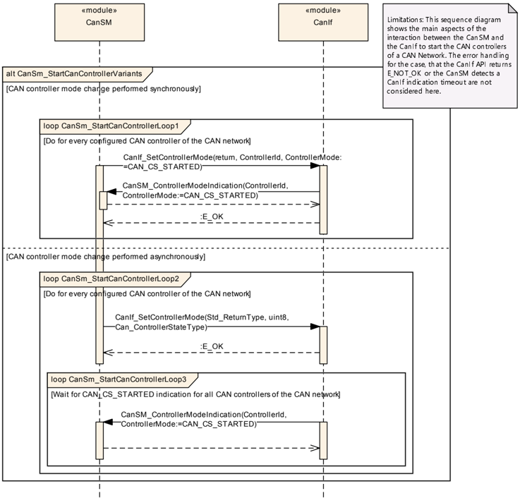

### 8.2. 时序图 CanSm_StopCanController

图9.2：CanSm_StopCanController（**CanSm_StopCanController**）

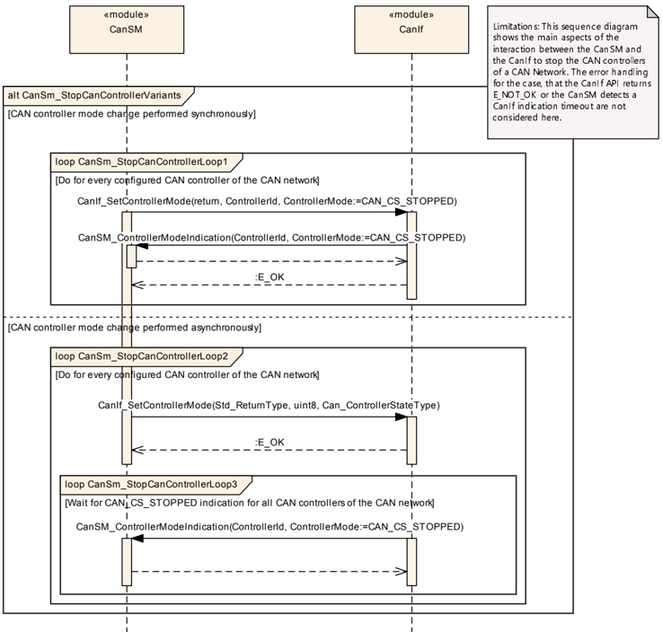
## 9. 配置规范

第9.2节规定模块**CanSM**的结构（容器）和参数。

第9.2节规定模块**CanSM**的发布信息。

### 9.1. 容器与配置参数

以下各章汇总了所有配置参数。参数的详细含义在第6章和第7章中描述。

以太网交换机驱动程序模块应拒绝实现不支持的、带有分区映射的配置。

#### 9.2.1. CanSM

| SWS 条目 | [] |
| --- | --- |
| 容器名称 | CanSM |
| 配置参数 | 见下方参数表 |

| 包含的容器 | 容器名称 | 多重性 | 作用域/依赖 |
| --- | --- | --- | --- |
| 包含的容器 | CanSMConfiguration | 1 | 该容器包含**CanSM**的全局参数以及用于CAN网络特定配置的子容器。 |
| 包含的容器 | CanSMGeneral | 1 | **CanSM**模块的通用预编译参数的容器。 |

#### 9.2.2. CanSMConfiguration

| SWS 条目 | [] |
| --- | --- |
| 容器名称 | CanSMConfiguration |
| 配置参数 | 见下方参数表 |

| 包含的容器 | 容器名称 | 多重性 | 作用域/依赖 |
| --- | --- | --- | --- |
| 包含的容器 | CanSMManagerNetwork | 1..* | This container contains the CAN network specific parameters of each CAN network |

| SWS 条目 | [ECUC_CanSM_00336] |
| --- | --- |
| 参数名称 | CanSMModeRequestRepetitionMax |
| 描述 | 规定在没有来自**CanIf**模块的相应模式指示的情况下，模式请求重复的最大次数；超过该次数后，**CanSM**模块将向**Det**报告开发错误并尝试回到无通信状态。 |
| 多重性 | 1 |
| 类型 | EcucIntegerParamDef |
| 范围 | 0 .. 255 |
| 默认值 | - |
| Post-Build 变体值 | true |
| 值配置类 | Pre-compile：time X VARIANT-PRE-COMPILE；Link：time X VARIANT-LINK-TIME；Post-build：time X VARIANT-POST-BUILD |
| 作用域/依赖 | scope: local |

| SWS 条目 | [ECUC_CanSM_00336] |
| --- | --- |
| 参数名称 | CanSMModeRequestRepetitionTime |
| 描述 | 规定**CanSM**模块应使用**CanIf**模块的API在多长的时间间隔内重复模式变更请求。 |
| 多重性 | 1 |
| 类型 | EcucFloatParamDef |
| 范围 | [0 .. 65.535] |
| 默认值 | - |
| Post-Build 变体值 | true |
| 值配置类 | Pre-compile：time X VARIANT-PRE-COMPILE；Link：time X VARIANT-LINK-TIME；Post-build：time X VARIANT-POST-BUILD |
| 作用域/依赖 | scope: local |

#### 9.2.3. CanSMGeneral

| SWS 条目 | [] |
| --- | --- |
| 容器名称 | CanSMGeneral |
| 配置参数 | 见下方参数表 |

无包含的容器。

| SWS 条目 | [ECUC_CanSM_00347] |
| --- | --- |
| 参数名称 | CanSMDevErrorDetect |
| 描述 | 开启或关闭开发错误检测与通知（true：启用检测与通知；false：禁用检测与通知）。 |
| 多重性 | 1 |
| 类型 | EcucBooleanParamDef |
| 默认值 | false |
| Post-Build 变体值 | false |
| 值配置类 | Pre-compile：time X All Variants；Link：time -；Post-build：time - |
| 作用域/依赖 | scope: local |

| SWS 条目 | [ECUC_CanSM_00348] |
| --- | --- |
| 参数名称 | CanSMGetBusOffDelayFunction |
| 描述 | 该参数配置&lt;User_GetBusOffDelay&gt; callout函数的名称，**CanSM**使用它来获取额外的L1/L2延迟时间。该函数只为启用了**CanSMEnableBusOffDelay**的通道调用。 |
| 多重性 | 0..1 |
| 类型 | EcucFunctionNameDef |
| 默认值 | - |
| Post-Build 变体值 | false |
| 值配置类 | Pre-compile：time X；Link：time -；Post-build：time -；Pre-compile：time X；Link：time -；Post-build：time - |
| 作用域/依赖 | scope: local |

| SWS 条目 | [ECUC_CanSM_00348] |
| --- | --- |
| 参数名称 | CanSMGetBusOffDelayHeader |
| 描述 | 该参数配置包含&lt;User_GetBusOffDelay&gt; callout函数原型的头文件。 |

#### 9.2.4. CanSMManagerNetwork

| SWS 条目 | [] |
| --- | --- |
| 容器名称 | CanSMManagerNetwork |
| 配置参数 | 见下方参数表 |

| 包含的容器 | 容器名称 | 多重性 | 作用域/依赖 |
| --- | --- | --- | --- |
| 包含的容器 |  | 0 .. 255 | Range |
| 包含的容器 |  | [0 .. 65.535] | Range |
| 包含的容器 | CanSMController | 1..* | 该容器包含分配给某个CAN网络的控制器ID。 |
| 包含的容器 | CanSMDemEventParameterRefs | 0..1 | Container for the references to DemEventParameter elements which shall be invoked using the API Dem_SetEventStatus in case the corresponding error occurs. The EventId is taken from the referenced DemEventParameter's DemEventId symbolic value. The standardized errors are provided in this container and can be extended by vendor-specific error references. |

| SWS 条目 | [ECUC_CanSM_00141] |
| --- | --- |
| 参数名称 | CanSMControllerId |
| 描述 | 用于标识某个特定CAN控制器的唯一句柄。对**CanIf**模块所管理的CAN控制器之一的引用。 |
| 多重性 | 1 |
| 类型 | Symbolic name reference to CanIfCtrlCfg |
| Post-Build 变体值 | true |
| 值配置类 | Pre-compile：time X VARIANT-PRE-COMPILE；Link：time X VARIANT-LINK-TIME；Post-build：time X VARIANT-POST-BUILD |
| 作用域/依赖 | scope: local |

#### 9.2.5. CanSMDemEventParameterRefs

| SWS 条目 | [] |
| --- | --- |
| 容器名称 | CanSMDemEventParameterRefs |
| 配置参数 | 见下方参数表 |

无包含的容器。

| SWS 条目 | [ECUC_CanSM_00352] |
| --- | --- |
| 参数名称 | CANSM_E_BUS_OFF |
| 描述 | 对已配置DEM事件的引用，用于报告该CAN网络的总线关闭错误。 |
| 多重性 | 0..1 |
| 类型 | Symbolic name reference to DemEventParameter |
| Post-Build 变体值 | true |
| 值配置类 | Pre-compile：time X VARIANT-PRE-COMPILE；Link：time X VARIANT-LINK-TIME；Post-build：time X VARIANT-POST-BUILD；Pre-compile：time X VARIANT-PRE-COMPILE；Link：time X VARIANT-LINK-TIME；Post-build：time X VARIANT-POST-BUILD |
| 作用域/依赖 | scope: local dependency: Dem scope: local dependency: Dem scope: local dependency: Dem |

| SWS 条目 | [ECUC_CanSM_00352] |
| --- | --- |
| 参数名称 | CANSM_E_MODE_REQUEST_TIMEOUT |
| 描述 | 对已配置DEM事件的引用，用于报告该CAN网络的总线关闭错误。 |
| 多重性 | 0..1 |
| 类型 | Symbolic name reference to DemEventParameter |
| Post-Build 变体值 | true |
| 值配置类 | Pre-compile：time X VARIANT-PRE-COMPILE；Link：time X VARIANT-LINK-TIME；Post-build：time X VARIANT-POST-BUILD；Pre-compile：time X VARIANT-PRE-COMPILE；Link：time X VARIANT-LINK-TIME；Post-build：time X VARIANT-POST-BUILD |
| 作用域/依赖 | scope: local |

### 9.2. 发布信息

第9.1节中定义的配置参数没有发布信息。
