## 1. 简介和功能概述

本规范定义AUTOSAR基础软件模块CAN传输层（**CAN Transport Layer**，CanTp）的功能、API和配置。

CanTp位于PDU路由器（**PDU Router**）与CAN接口模块（**CAN Interface**）之间（见图1.1）。CAN TP模块的主要目的是对长度超过8字节（CAN FD情况下超过64字节）的CAN I-PDU进行分段和重组。

PDU路由器将AUTOSAR COM和DCM的I-PDU部署到不同的通信协议上。经由某一网络系统类型（如CAN、LIN和FlexRay）的路由取决于I-PDU标识符。PDU路由器还决定是否必须使用传输协议。最后，在没有速率转换的情况下，该模块还执行网关功能。

CAN接口（**CanIf**）提供相同的机制来访问CAN总线通道，而不论其位置（微控制器内部/外部）。它从CAN控制器的位置（片上/板上）提取ECU硬件布局和CAN驱动程序的数量。由于CanTp只处理传输协议帧（即SF、FF、CF和FC PDU），因此CAN接口必须根据N-PDU ID将I-PDU转发给CanTp或PduR。

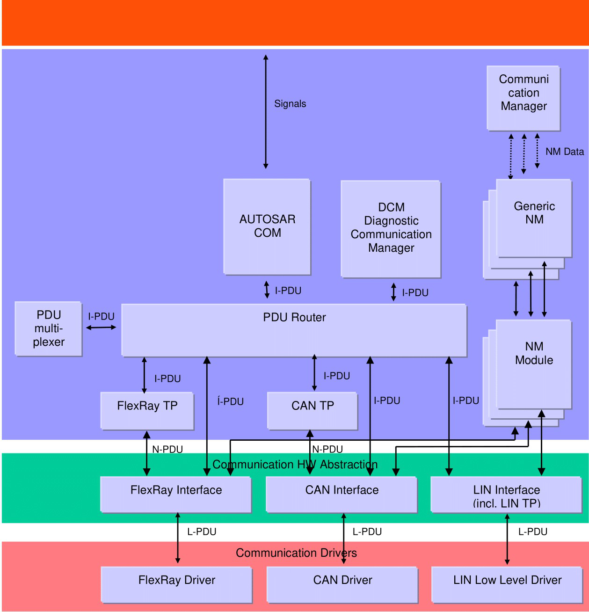

根据AUTOSAR基础软件架构，CanTp提供以下服务：

- 发送方向的数据分段
- 接收方向的数据重组
- 数据流控制
- 分段会话的错误检测
- 发送取消
- 接收取消

AUTOSAR决定将基础软件模块规范建立在现有标准之上，因此本AUTOSAR CAN传输层规范基于汽车领域使用最广泛的国际标准ISO 15765。

ISO 15765（包含四个部分）描述了两种适用的CAN传输层规范：用于OEM增强型诊断的ISO 15765-2 [\[1\]](#ref-1)和用于OBD诊断的ISO 15765-4 [\[2\]](#ref-2)。在传输层方面，ISO 15765-4（ISO 15765中同时覆盖数据链路层和物理层的部分）与ISO 15765-2一致，但有一些限制/增补。为了使ISO 15765-2与ISO 15765-4之间不存在不兼容问题，差异将通过CAN传输层的配置来解决。

虽然CAN传输协议主要用于车辆诊断系统，但它也被开发用于满足其他需要传输层协议的基于CAN的系统的需求。

## 2. 缩略语

下面的词汇表包含与CAN传输层模块相关、但未包含在[\[3, AUTOSAR 术语表\]](#ref-3)中的缩略语和缩写。

本文档使用的前缀表示法如下：

**I-**

> 相对于AUTOSAR COM交互层（**Interaction Layer**）
**L-**

> 相对于CAN接口模块，它等同于逻辑链路控制（**Logical Link Control**，数据链路层的上半部分——下半部分称为媒体访问控制）
**N-**

> 相对于CAN传输层，它等同于OSI网络层（**Network Layer**）

所有特定于CAN传输层、因此未包含在AUTOSAR术语表中的缩略语和缩写说明如下：

**CAN L-SDU**

> 这是CAN接口模块的SDU。从CAN接口模块的角度看，它类似于CAN N-PDU。

**CAN LSduId**

> 这是SDU在CAN接口内的唯一标识符。它用于引用L-SDU的路由属性。因此，为了通过CAN接口的API与之交互，上层使用CAN LSduId来引用CAN L-SDU信息结构。

**CAN N-PDU**

> 这是CAN传输层的PDU。它包含一个唯一标识符、数据长度和数据（协议控制信息加上整个N-SDU或其一部分）。

**CAN N-SDU**

> 这是CAN传输层的SDU。在AUTOSAR架构中，它是来自PDU路由器的一组数据。

**CAN N-SDU Info Structure**

> 这是CAN传输层内部的常量结构，包含处理相关CAN N-SDU的发送、接收、分段和重组所需的特定CAN传输层信息。

**CAN NSduId**

> SDU在CAN传输层内的唯一标识符。它用于引用N-SDU的路由属性。因此，为了通过CAN传输层的API与之交互，上层使用CAN NSduId来引用CAN N-SDU信息结构。

**I-PDU**

> 这是AUTOSAR COM模块的PDU。

**PDU**

> 在分层系统中，它指在给定层的协议中规定的数据单元。它包含该层的用户数据（SDU）以及可能的协议控制信息。此外，X层的PDU是其下一层X-1的SDU（即(X)-PDU = (X-1)-SDU）。

**PduInfoType**

> 该类型指用于存储处理PDU（或SDU）发送/接收所需基本信息（即指向RAM中其有效载荷的指针和相应的长度（以字节为单位））的结构。

**SDU**

> 在分层系统中，它指由给定层服务的用户发送的一组数据，并被传输到对等服务用户，同时在语义上保持不变。

**BS**

> 块大小（**Block Size**）
**Can**

> CAN驱动程序模块
**CAN CF**

> CAN连续帧N-PDU
**CAN FC**

> CAN流控N-PDU
**CAN FF**

> CAN首帧N-PDU
**CAN SF**

> CAN单帧N-PDU
**CanIf**

> CAN接口
**CanTp**

> CAN传输层
**CanTrcv**

> CAN收发器模块
**CF**

> 见「CAN CF」
**Com**

> AUTOSAR COM模块
**Dcm**

> 诊断通信管理器模块
**DEM**

> 诊断事件管理器
**DET**

> 默认错误跟踪器
**DLC**

> 数据长度码（CAN PDU中描述SDU长度的部分）
**FC**

> 见「CAN FC」
**FF**

> 见「CAN FF」
**FIM**

> 功能禁用管理器
**MetaData**

> 与PDU一起传输的元数据，由一组元数据项组成
**MetaDataItem**

> 具有定义的类型和大小的单个MetaData项
**Mtype**

> 消息类型（可能取值：诊断、远程诊断）
**N_AI**

> 网络地址信息（见ISO 15765-2）
**N_AE**

> 网络地址扩展（见ISO 15765-2 [\[1\]](#ref-1)）
**N_Ar**

> 接收方CAN帧（任意N-PDU）的传输时间（见ISO 15765-2 [\[1\]](#ref-1)）
**N_As**

> 发送方CAN帧（任意N-PDU）的传输时间（见ISO 15765-2 [\[1\]](#ref-1)）
**N_Br**

> 直到发送下一个流控N-PDU的时间（见ISO 15765-2 [\[1\]](#ref-1)）
**N_Bs**

> 直到接收到下一个流控N-PDU的时间（见ISO 15765-2 [\[1\]](#ref-1)）
**N_Cr**

> 直到接收到下一个连续帧N-PDU的时间（见ISO 15765-2 [\[1\]](#ref-1)）
**N_Cs**

> 直到发送下一个连续帧N-PDU的时间（见ISO 15765-2 [\[1\]](#ref-1)）
**N_Data**

> 传输层的数据信息
**N_PCI**

> 传输层的协议控制信息
**N_SA**

> 网络源地址（见ISO 15765-2 [\[1\]](#ref-1)）
**N_TA**

> 网络目标地址（见ISO 15765-2 [\[1\]](#ref-1)）。在扩展寻址的情况下，它可能已包含N_TAtype（物理/功能）
**N_TAtype**

> 网络目标地址类型（见ISO 15765-2 [\[1\]](#ref-1)）
**OBD**

> 车载诊断
**PduR**

> PDU路由器
**SN**

> 序列号（见ISO 15765-2 [\[1\]](#ref-1)）
**STmin**

> 发送方在两次CF传输之间需等待的最短时间（见ISO 15765-2 [\[1\]](#ref-1)）
**FS**

> 流状态（**Flow Status**）
**CAN FD**

> CAN灵活数据速率
**CAN_DL**

> CAN帧数据长度
**TX_DL**

> 发送数据链路层数据长度
**RX_DL**

> 接收数据链路层数据长度
**SF_DL**

> 单帧数据长度（字节）
**WFTmax**

> 接收方允许连续发送的FC.WAIT数量的上限（见ISO 15765-2 [\[1\]](#ref-1)）

下表包含对本工作有用的一些概念：

**Default Error Tracer**

> 默认错误跟踪器仅用于支持软件开发和集成，不包含在生产代码中。其API是定义了的，但功能可以由开发人员根据其特定需求进行选择和实现。

**Diagnostic Event Manager**

> 诊断事件管理器是生产代码中提供的标准AUTOSAR模块，其功能在AUTOSAR项目中规定。

**Extended addressing format**

> 为每个N_SA和Mtype的组合分配一个唯一的CAN标识符。在CAN帧数据域的第一个数据字节中，为每个N_TA和N_TAtype的组合填入一个唯一的地址。N_PCI和N_Data填入CAN帧数据域的其余字节。

**Function Inhibition Manager**

> 功能禁用管理器（**FIM**）代表事件的评估和分配，以及软件组件所需操作（例如禁用特定的「监控功能」）的分配。当事件状态发生变化时，DEM会通知并更新功能禁用管理器（**FIM**），以便根据分配的依赖关系停止或释放功能实体。功能实体的接口由模式管理器定义和支持。FIM不是DEM的一部分。

**Functional addressing**

> 在传输层中，功能寻址指的是N_TAtype参数（它是用于编码通信模型的N_TA参数[\[1\]](#ref-1)的扩展）取值为functional的N-SDU。这意味着该N-SDU用于1到n的通信。因此，对于CAN协议，功能寻址仅支持单帧通信。在应用方面，如果外部（或内部）测试仪不知道应响应服务请求的ECU的物理地址，或者ECU的功能是作为分布在多个ECU上的分布式服务器实现的，则外部（或内部）测试仪会使用功能寻址。使用功能寻址时，通信是从外部测试仪到一个或多个ECU的通信广播（1到n通信）。用例有（例如）广播消息，如「ECUReset」或「Communication Control」。OBD通信将始终作为功能寻址的一部分执行。

**Mixed addressing format**

> 为每个N_SA、N_TA、N_TAtype的组合分配一个唯一的CAN标识符。N_AE放置在CAN帧数据域的第一个数据字节中。N_PCI和N_Data放置在CAN帧数据域的其余字节中。

**Multiple connection**

> CAN传输层应同时管理多个传输协议通信会话。

**Normal addressing format**

> 为每个N_SA、N_TA、N_TAtype和Mtype的组合分配一个唯一的CAN标识符。N_PCI和N_Data填入CAN帧数据域。

**Physical addressing**

> 在传输层中，物理寻址指的是N_TAtype参数（它是用于编码通信模型的N_TA参数[\[1\]](#ref-1)的扩展）取值为physical的N-SDU。这意味着该N-SDU用于1到1的通信，因此所有类型的网络层消息都支持物理寻址。在应用方面，如果外部（或内部）测试仪知道应响应服务请求的ECU的物理地址，则外部（或内部）测试仪会使用物理寻址。使用物理寻址时，通信为点对点通信（1对1通信）。用例有（例如）「ReadDataByIdentifier」或「InputOutputControlByIdentifier」等消息。

**Single connection**

> CAN传输层一次只管理一个传输协议通信会话。

**Connection channel**

> CAN传输层管理多个连接所使用的资源以节省RAM。当一个连接变为活动状态时，该连接使用的通道将对其他连接不可用。

**Connection**

> 一个传输协议会话，或者是N-SDU上的发送会话，或者是接收会话。
## 3. 相关文档

### 3.1. 输入文件和相关标准与规范

<a id="ref-1"></a>[1] Road vehicles - Diagnostics on Controller Area Networks (CAN) - Part 2: Network layer services
<a id="ref-2"></a>[2] Diagnostics on controller area network (CAN) - Part 4: Requirements for emission-related systems (Release 2005-01-04)
<a id="ref-3"></a>[3] Glossary AUTOSAR\_FO\_TR\_Glossary
<a id="ref-4"></a>[4] General Specification of Basic Software Modules AUTOSAR\_CP\_SWS\_BSWGeneral
<a id="ref-5"></a>[5] Specification of PDU Router AUTOSAR\_CP\_SWS\_PDURouter
<a id="ref-6"></a>[6] Specification of CAN Interface AUTOSAR\_CP\_SWS\_CANInterface
<a id="ref-7"></a>[7] General Requirements on Basic Software Modules AUTOSAR\_CP\_SRS\_BSWGeneral
<a id="ref-8"></a>[8] Requirements on CAN AUTOSAR\_CP\_SRS\_CAN
<a id="ref-9"></a>[9] ISO 11898-1:2015 - Road vehicles - Controller area network (CAN)

### 3.2. 相关规范

AUTOSAR提供了基础软件模块的通用规范（见[\[4\]](#ref-4)），该规范同样对CAN传输层有效。因此，SWS BSW通用规范[\[4\]](#ref-4)应被视为CAN传输层的附加规范和必备规范。

## 4. 约束和假设

### 4.1. 限制

AUTOSAR架构定义了特定于通信系统的传输层（CanTp、LinTp（包括LinIf）、FlexRayTp）。因此，CAN传输层只涵盖CAN传输协议的特定内容。

CAN传输层只有一个到下层CAN接口层的接口和一个到上层PDU路由器模块的接口。

根据AUTOSAR发布计划，本CAN传输层规范有以下限制：

- CAN传输层仅以事件触发模式运行

### 4.2. 汽车域的适用性

只要CAN通信系统连接到相应的ECU，CAN传输层就可以用于所有域。

## 5. 对其他模块的依赖

本节阐述CanTp与其他AUTOSAR基础软件模块之间的关系。它包含CanTp从其他模块所需的一些AUTOSAR基本概念、配置信息和服务的简短说明。

### 5.1. AUTOSAR架构基本概念

#### 5.1.1. CAN传输层连接

在AUTOSAR架构的最终版本中，传输协议设施将用于传输诊断I-PDU（如OBD和UDS协议）和AUTOSAR COM I-PDU。因此，CanTp模块能够同时处理多个连接（即多个并行的分段会话）。

同时连接的最大数量是静态配置的。该配置对生成代码的复杂性和资源消耗（CPU、ROM和RAM）有重要影响，因为必须为每个并发访问保留资源（如Rx和Tx状态机、用于处理N-PCI数据的变量等）。

为了允许用户选择哪些I-PDU可以同时接收（或发送），每个N-SDU标识符将在内部通过一个配置好的CanTp「连接通道」进行路由。由于「连接通道」不能从外部访问，传输N-SDU所需的所有信息（见第[9.2](#92-容器与配置参数)节）都将与N-SDU标识符相关联（如「连接通道」编号、超时、寻址格式等）。

根据MetaData配置，N-SDU既可作为具有定义的N_AI的特定连接，也可作为通用连接，其中N_TA、N_SA和N_AE在运行时变化，而N_TAtype、MType和寻址格式是静态定义的。

#### 5.1.2. CAN传输层的交互

下图显示了CanTp、PduR和CanIf模块之间的交互。

CanTp的上层接口向PduR模块提供全局访问，以发送和接收数据。该访问通过CAN N-SDU标识符（CAN NSduId）实现。CAN NSduId引用一个由描述CAN N-SDU的属性组成的常量数据结构。每个CAN N-SDU特定的数据结构可以包含如下属性：N-SDU的类型（Tx或Rx）、其寻址格式、该消息的L-SDU标识符或其他对实现有用的属性。

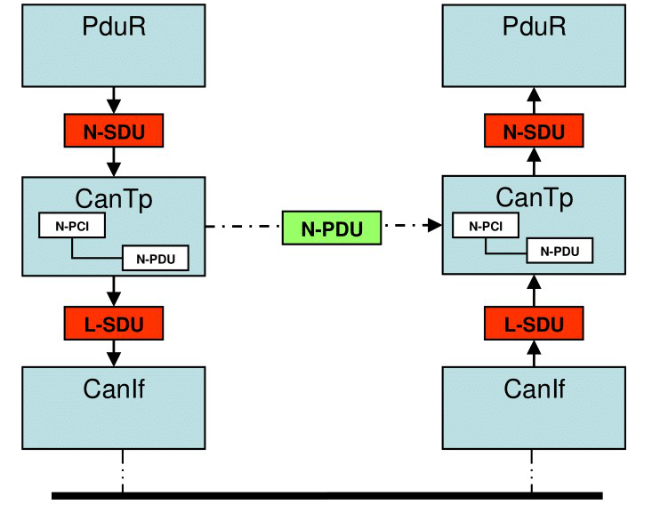

#### 5.1.3. 处理模式

AUTOSAR通信栈同时支持轮询和事件触发模式。因此，每个通信层都可以通过不同的机制从其下层接收信息并向其上层传递信息。

对于CAN传输层，只支持事件触发模式。

#### 5.1.4. 数据一致性

为了优化通信栈，AUTOSAR限制了CAN传输层的缓冲能力。因此，CanTp将N-SDU有效载荷直接从上层（DCM、COM或PduR——在1:1 TP路由的情况下）复制到CAN驱动程序，反之亦然。为了保证数据一致性，上层应遵守以下规则：

- 发送时，N-SDU数据有效载荷从发送请求开始直到接收到发送确认期间保持不变
- 接收时，N-SDU数据访问从接收开始直到接收到接收指示期间被锁定

#### 5.1.5. 静态配置

在运行时，CAN传输模块必须拥有管理传输连接所需的全部信息。因此，以下属性应静态配置：

- CAN N-SDU的数量
- 每个CAN N-SDU的唯一标识符
- 每个CAN N-SDU的通信方向（Tx或Rx）
- 每个连接的寻址格式（normal、extended、mixed 11bit、normal fixed或mixed 29 bit），并且根据寻址格式，还需要附加配置：
  - Normal：无
  - Extended：N_TA
  - Mixed 11 bit：N_AE
  - Normal fixed：N_TA、N_SA
  - Mixed 29 bit：N_TA、N_SA、N_AE

  对于使用带MetaData的N-SDU的通用连接，可以省略静态寻址信息。

- 每个连接的寻址格式（normal、extended或mixed），并且在扩展寻址格式的情况下为N_TA值，在混合寻址格式的情况下为N_AE值
- 每个CAN N-SDU标识符关联的CAN L-SDU标识符，以及必要时（多帧分段会话）用于发送CAN FC N-PDU的CAN L-SDU标识符
- 经典CAN帧和CAN FD帧

CAN传输层的配置可以在预编译时或Post-Build时执行（见第[9.2](#92-容器与配置参数)节）。

#### 5.1.6. PDU路由器服务

CAN传输层使用PDU路由器的回调函数来复制发送数据、确认发送、启动接收、复制接收数据和指示消息的接收：

- PduR\_CanTpRxIndication
- PduR\_CanTpStartOfReception
- PduR\_CanTpCopyRxData
- PduR\_CanTpCopyTxData
- PduR\_CanTpTxConfirmation

有关这些函数的更多信息，请参阅PDU路由器模块规范[\[5\]](#ref-5)。

#### 5.1.7. CAN接口服务

CAN传输层使用CAN接口的以下服务来发送CAN N-PDU：

- CanIf\_Transmit

有关此函数的更多信息，请参阅CAN接口模块规范[\[6\]](#ref-6)。

### 5.2. 文件结构

#### 5.2.1. 代码文件结构

详情请参阅SWS\_BSWGeneral的第[5.1.6](#516-pdu路由器服务)章「代码文件结构」。

#### 5.2.2. 头文件结构

AUTOSAR规定，ECU可以由以目标代码、源代码（生成的或非生成的）甚至混合形式提供的模块构建。

以目标代码还是源代码形式提供模块，取决于知识产权保护、测试覆盖率、代码效率和系统生成时的可配置性之间的折衷。因此，根据OEM的可配置性要求，供应商可以以目标代码、生成代码或源代码的形式交付CanTp模块。

#### 5.2.3. 版本检查

版本号宏可用于在编译时和运行时检查和读取软件模块的软件版本。

#### 5.2.4. 设计规则

详情请参阅SWS\_BSWGeneral的第7.1.4、7.1.8、7.1.9章。

## 6. 功能规格

本节描述CAN传输层的功能。它解释了提供给上层和下层的服务以及CAN传输层的内部行为。

CanTp模块提供分段、带流控制的发送和消息重组等服务。它的主要目的是发送和接收可能适合也可能不适合单个CAN帧的消息。不适合单个CAN帧的消息被分段成多个部分，使每个部分都可以在单个CAN帧中发送。

在阅读本文档时，必须牢记该模块将遵循ISO 15765-2（OEM增强型诊断[\[1\]](#ref-1)）的建议，并且应能够满足ISO 15765-4（排放相关系统的要求[\[2\]](#ref-2)）。

如果ISO 15765-2的某项建议未在本SWS中明确排除，则CanTp模块应遵循该建议。

有关SF、FF、CF和FC帧、网络层时序参数以及CAN传输层的其他功能的进一步描述，请参阅ISO 15765-2规范[\[1\]](#ref-1)。

ISO 15765-4是ISO 15765-2的一种特例。因此，CAN传输层将是可配置的，以便能够使模块适应所有ISO 15765-4用例（例如特定的时序、填充配置、寻址模式）。详情见第[9](#9-配置规范)章「配置规范」。

### 6.1. 提供给上层的服务

CanTp模块的服务接口可以分为以下主要类别：

- 初始化和关闭
- 通信服务

以下各段描述每个服务类别的功能。

#### 6.1.1. 初始化和关闭

CanTp模块应有两个内部状态：CANTP\_OFF和CANTP\_ON。

CanTp模块在上电后应处于CANTP\_OFF状态。

在CANTP\_OFF状态下，CanTp应允许更新Post-Build配置。

当CanTp已通过CanTp\_Init()成功初始化时，CanTp模块应切换到内部状态CANTP\_ON。

只有当CanTp处于CANTP\_ON状态时，CanTp模块才应执行分段和重组任务。

函数CanTp\_Init应初始化模块的所有全局变量，并将所有传输协议连接置为CANTP\_ON的一个子状态，在该子状态下既没有分段发送也没有分段接收正在进行（Rx线程处于CANTP\_RX\_WAIT状态，Tx线程处于CANTP\_TX\_WAIT状态）。

如果启用了CanTp模块的开发错误检测，则当PDU路由器或CAN接口在函数CanTp\_Init被调用之前试图使用任何函数（CanTp\_GetVersionInfo除外）时，CanTp模块应报出错误（CANTP\_E\_UNINIT）。

如果在CanTp模块处于全局状态CANTP\_ON时调用，函数CanTp\_Init应将模块返回到Idle状态（状态为CANTP\_ON，但发送和接收均未进行）。

如果在CanTp模块处于全局状态CANTP\_ON时调用CanTp\_Init，则CanTp模块应放弃所有当前连接。

函数CanTp\_Shutdown应恰当地停止CanTp模块。

下图总结了上述所有要求：

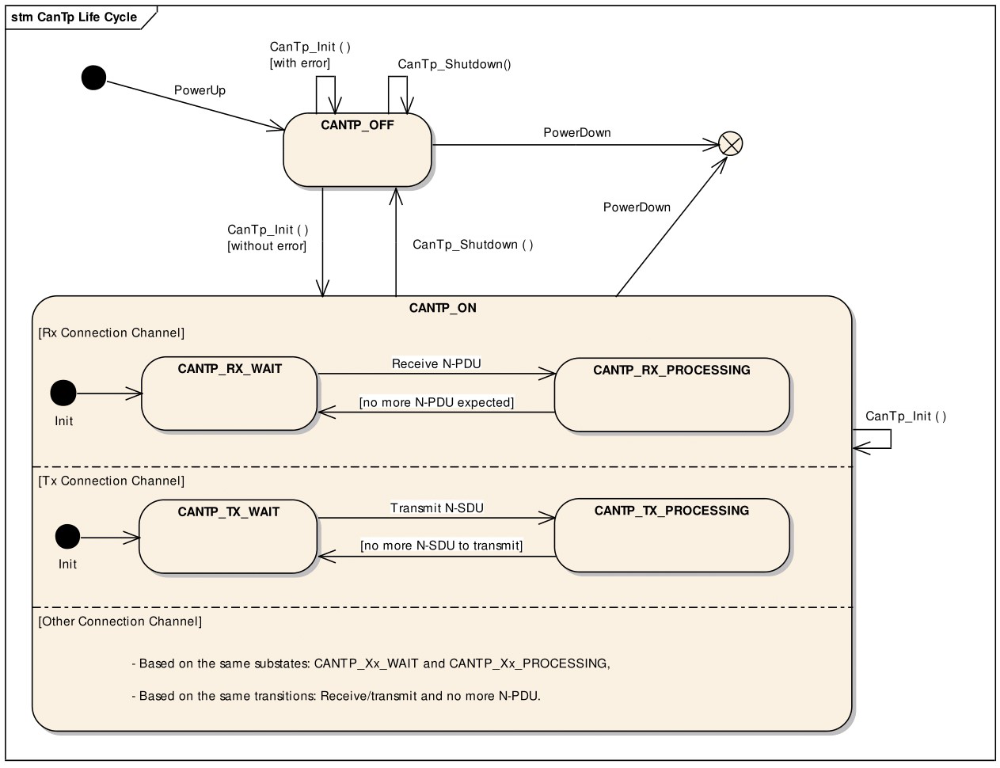

#### 6.1.2. 发送请求

发送操作CanTp\_Transmit()允许上层使用CAN传输协议设施（分段、扩展寻址格式等）请求数据传输。

函数CanTp\_Transmit()应为异步的。

在发送请求被接受后，如果N-SDU传输被完整处理（无论成功与否），CanTp模块应通知其上层。

#### 6.1.3. 发送取消

发送取消特性允许上层取消正在进行的发送。

用例：由于接收到另一个具有更高优先级的诊断协议而取消一次诊断发送。

该特性应通过静态配置（参数CanTpTc）（去）激活。

发送取消由调用CanTp\_CancelTransmit()触发。

调用服务CanTp\_CancelTransmit()后，该连接上的传输应被中止。

**注意：** 在发送取消之后，应以E\_NOT\_OK值调用API PduR\_CanTpTxConfirmation()。（另见第[7.3.4](#734-cantp_transmit)节中CanTp\_CancelTransmit的相关要求。）

请注意，如果传输正在进行，这将在接收方产生一个超时错误。

### 6.2. 提供给下层的服务

根据AUTOSAR通信栈规范，CAN传输层向CAN接口提供以下两个回调函数：CanTp\_TxConfirmation()和CanTp\_RxIndication()。

#### 6.2.1. 发送确认

CanIf模块应调用发送确认函数，通知CAN传输层由CanTp请求的CAN帧发送已成功或失败。调用时关联L-PDU标识符，以识别相应的发送。

当在最大时间（等于N_As）之后仍未接收到发送确认时，CanTp模块应中止相应的会话。在接收到TxConfirmation（无论成功与否）之前，该N-PDU对其他并发会话保持不可用。

对于确认调用，CanTp模块应提供函数CanTp\_TxConfirmation()。

当以结果E\_NOT\_OK调用CanTp\_TxConfirmation()时，CanTp应中止相应的会话。

#### 6.2.2. 接收指示

CanIf模块应调用接收指示函数，通知CanTp模块已接收到新的CAN N-PDU帧（即一个传输协议帧）。

根据CanIf配置，接收指示可以在ISR上下文中执行。

对于接收指示，CanTp模块应提供CanTp\_RxIndication()。

### 6.3. 内部行为

CAN传输层的内部操作提供了完成本模块主要目的（即在单个CAN帧或多个CAN帧中传输消息）的基本机制。

CAN传输层的整个行为都是事件触发的，因此CanTp可以直接处理来自PDU路由器（或CAN接口）的N-SDU（或L-SDU）的传输。

#### 6.3.1. N-SDU接收

当接收到SF或FF N-PDU时，CanTp模块应使用PduR\_CanTpStartOfReception函数将此接收通知上层（PDU Router）。

**注意：** 上层将为接收N-SDU预留并锁定一个缓冲区。

CanTp应使用PduR\_CanTpStartOfReception()的参数TpSduInfoPtr向PduR提供FF/SF的内容。

接收到的数据链路层数据长度（RX_DL）应根据CAN帧/PDU的第一个接收有效载荷长度（CAN_DL）推导如下：

- 对于小于或等于8字节的CAN_DL值，RX_DL值应为8。
- 对于大于8字节的CAN_DL值，RX_DL值等于CAN_DL值。

**注意：** ISO帧概览表：

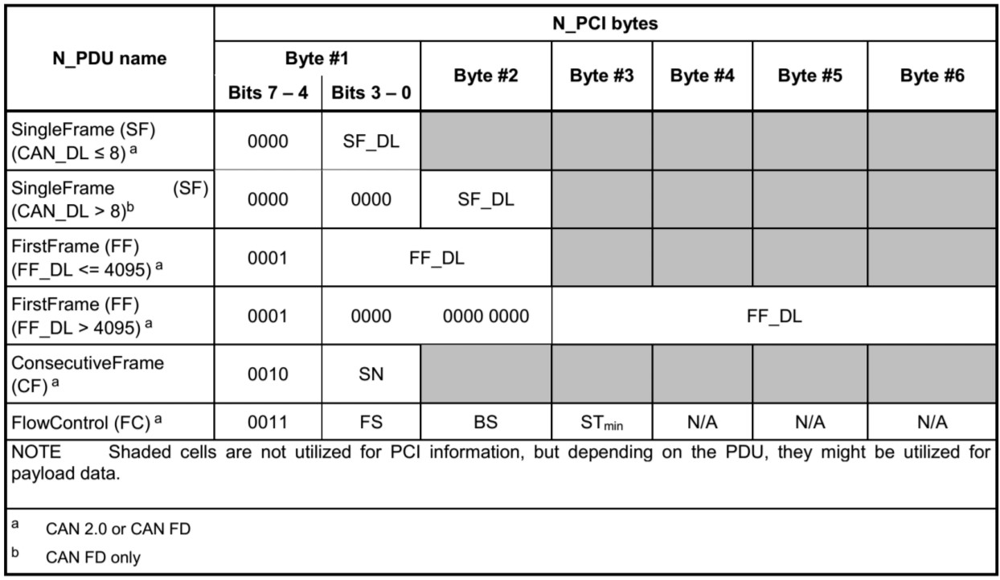

当对带MetaData的SF或FF N-PDU（指示一个通用连接）调用CanTp\_RxIndication时，CanTp模块应存储该PDU的MetaData中包含的寻址信息，并使用该信息来启动与上层的连接、发送FC N-PDU以及识别CF N-PDU。MetaData中的寻址信息取决于寻址格式：

- Normal、Extended、Mixed 11 bit：无
- Normal fixed、Mixed 29 bit：N_SA、N_TA

对于通用连接（带MetaData的N-SDU），在调用PduR\_CanTpStartOfReception()时，CanTp模块应通过该N-SDU的MetaData转发提取出的寻址信息。MetaData中的寻址信息取决于寻址格式：

- Normal：无
- Extended：N_TA
- Mixed 11 bit：N_AE
- Normal fixed：N_SA、N_TA
- Mixed 29 bit：N_SA、N_TA、N_AE

对于通用连接（带MetaData的N-PDU）上的FC，在调用CanIf\_Transmit()时，CanTp模块应通过该N-PDU的MetaData提供所存储的寻址信息。MetaData中的寻址信息取决于寻址格式：

- Normal、Extended、Mixed 11 bit：无
- Normal fixed、Mixed 29 bit：N_SA（保存的N_TA）、N_TA（保存的N_SA）

当对通用连接（带MetaData的N-PDU）上的CF调用CanTp\_RxIndication时，CanTp模块应将N-PDU的MetaData中包含的寻址信息与从FF存储的值进行比对。

在接收到FF或一个块的最后一个CF时，CanTp模块应在调用PduR\_CanTpStartOfReception或PduR\_CanTpCopyRxData之前启动一个N_Br超时。

可用的Rx缓冲区大小通过PduR\_CanTpStartOfReception()服务的输出指针参数报告给CanTp。可用的Rx缓冲区可以小于预期的N-SDU数据长度。

**注意：** 如果上层由于错误（例如在网关情况下，它可能指示到目标网络的传输会话已中断）或资源限制（例如N-SDU长度超过上层的最大缓冲区大小）而无法提供缓冲区，则PduR\_CanTpStartOfReception()函数返回BUFREQ\_E\_NOT\_OK或BUFREQ\_E\_OVFL。

在接收到首帧或单帧后，如果函数PduR\_CanTpStartOfReception()向CanTp模块返回BUFREQ\_E\_NOT\_OK，则CanTp模块应中止该N-SDU的接收。在这种情况下，不发送任何流控，也不会调用PduR\_CanTpRxIndication()。

在接收到首帧后，如果函数PduR\_CanTpStartOfReception()向CanTp模块返回BUFREQ\_E\_OVFL，则CanTp模块应发送一个带溢出状态（FC(OVFLW)）的流控N-PDU，并中止N-SDU接收。

在接收到单帧后，如果函数PduR\_CanTpStartOfReception()向CanTp模块返回BUFREQ\_E\_OVFL，则CanTp模块应中止N-SDU接收。

在接收到首帧或单帧后，如果函数PduR\_CanTpStartOfReception()返回BUFREQ\_OK但可用缓冲区大小小于已接收数据所需的大小，则CanTp模块应中止N-SDU的接收，并以结果E\_NOT\_OK调用PduR\_CanTpRxIndication()。

在接收到首帧后，如果函数PduR\_CanTpStartOfReception()返回BUFREQ\_OK但可用缓冲区大小小于下一个块所需的大小，则CanTp模块应启动定时器N_Br。

如果在接收到一个块的最后一个连续帧之后调用的函数PduR\_CanTpCopyRxData()返回BUFREQ\_OK，但剩余缓冲区不足以接收下一个块，则CanTp模块应启动定时器N_Br。

当定时器N_Br处于活动状态时，CanTp模块在MainFunction的每次处理中都应以数据长度0（零）和数据缓冲区NULL\_PTR调用服务PduR\_CanTpCopyRxData()。

**注意：** ISO 15765-2规范定义了以下性能要求：(N_Br + N_Ar) < 0.9 * N_Bs超时。

如果N_Br定时器到期且可用缓冲区大小仍然不够大，则CanTp模块应发送一个新的FC(WAIT)以挂起该N-SDU的接收，并重新装载N_Br定时器。

CanTp模块应最多发送WFTmax个连续的FC(WAIT) N-PDU。如果达到该数量，CanTp模块应中止该N-SDU的接收（接收方未发送任何FC N-PDU，因此发送方的N_Bs定时器到期，随后发送被中止），并发生一个带E\_NOT\_OK的接收指示。

在发生N_Ar超时的情况下（所发送的任何FC帧均未收到CAN驱动程序的确认），CanTp模块应中止接收，并通过以结果E\_NOT\_OK调用指示函数PduR\_CanTpRxIndication()将此失败通知上层。

当Rx缓冲区足够容纳下一个块时（直接在首帧之后或一个块的最后一个连续帧之后，或按照上文要求在重复调用PduR\_CanTpCopyRxData()之后），CanTp模块应发送一个带ClearToSend状态（FC(CTS)）的流控N-PDU，然后等待连续帧N-PDU的接收。

在接收到每个连续帧后，CanTp模块应使用包含数据缓冲区和数据长度的PduInfo指针调用PduR\_CanTpCopyRxData()函数：

- 对于CAN 2.0帧，在块的最后一个CF的情况下为6或7字节或更少
- 对于CAN FD帧，为DLC - 1或DLC - 2字节（见第[6.3.8](#638-n-pdu填充)节）

输出指针参数在数据复制后向CanTp提供可用的Rx缓冲区大小。

**注意：** 详情见图7.3。

CanTp模块应在每次指示收到CF时（一个块中的最后一个CF除外）以及在发送方启动CF发送的每次FC发送确认时（FS=CTS的FC）启动一个N_Cr超时。

在发生N_Cr超时的情况下，CanTp模块应中止接收，并通过以结果E\_NOT\_OK调用指示函数PduR\_CanTpRxIndication()将此失败通知上层。

如果在接收到一个块中的连续帧后PduR\_CanTpCopyRxData()返回BUFREQ\_E\_NOT\_OK，则CanTp应中止N-SDU的接收，并通过以结果E\_NOT\_OK调用PduR\_CanTpRxIndication()通知PduR模块。

CanTp应检查分段接收期间接收到的每个SN的正确性。如果接收到错误的SN，CanTp模块应中止接收，并通过以结果E\_NOT\_OK调用指示函数PduR\_CanTpRxIndication()将此失败通知上层。

当传输接收会话完成时（无论成功与否），CanTp模块应调用上层通知服务PduR\_CanTpRxIndication()。

关于FF N-PDU的接收，流控N-PDU的内容取决于PduR\_CanTpStartOfReception()服务的结果。

此外，应当注意，在接收FF N-PDU时，只有在得到PduR\_CanTpStartOfReception()服务的结果之后才应发送流控。

重要的是要注意，FC N-PDU只会在每个由BS（块大小）个连续帧组成的块之后发送。

CanTp在分段接收期间发送的每个FC上应使用相同的BS和STmin参数值。在不同的N-SDU接收上可以使用这些参数的不同值。

当发送FC时CanIf\_Transmit()返回E\_NOT\_OK，CanTp应终止当前的接收连接。

#### 6.3.2. N-SDU发送

如第[6.1.2](#612-发送请求)节所述，上层通过调用CanTp\_Transmit()请求发送N-SDU。CanTp\_Transmit()的参数描述了CAN NSduId和要发送的完整Tx N-SDU长度。

对于不使用MetaData的特定连接，函数CanTp\_Transmit只应使用完整的SduLength信息，而不应使用可用的N-SDU数据缓冲区来准备单帧或首帧PCI。

当对带MetaData的N-SDU调用CanTp\_Transmit时，CanTp模块应存储该N-SDU的MetaData中包含的寻址信息，并使用该信息来发送SF、FF和CF N-PDU以及识别FC N-PDU。MetaData中的寻址信息取决于寻址格式：

- Normal：无
- Extended：N_TA
- Mixed 11 bit：N_AE
- Normal fixed：N_SA、N_TA
- Mixed 29 bit：N_SA、N_TA、N_AE

对于通用连接（带MetaData的N-PDU）的SF、FF或CF，在调用CanIf\_Transmit()时，CanTp模块应通过该N-PDU的MetaData提供所存储的寻址信息。MetaData中的寻址信息取决于寻址格式：

- Normal、Extended、Mixed 11 bit：无
- Normal fixed、Mixed 29 bit：N_SA、N_TA

当对通用连接（带MetaData的N-PDU）上的FC调用CanTp\_RxIndication时，CanTp模块应将MetaData中包含的寻址信息与存储的值进行比对。

在上层发出传输请求后，CanTp模块应在调用PduR\_CanTpCopyTxData之前启动N_Cs超时。如果在定时器到期之前没有数据可用，CanTp模块应中止通信。

CanTp模块应为发送的每个分段（SF、FF和CF）调用PduR\_CanTpCopyTxData服务。上层在PduInfoType结构上复制发送数据。

API PduR\_CanTpCopyTxData()包含一个用于恢复机制的参数——「retry」。由于ISO 15765-2不支持这种机制，CAN传输层不实现任何形式的恢复。因此，该参数始终设置为NULL指针。

如果上层由于错误而无法提供Tx数据（例如在网关情况下，它可能指示来自源网络的传输会话已终止），则PduR\_CanTpCopyTxData()函数返回BUFREQ\_E\_NOT\_OK。

如果PduR\_CanTpCopyTxData()返回BUFREQ\_E\_NOT\_OK，则CanTp模块应中止发送请求，并通过以结果E\_NOT\_OK调用回调函数PduR\_CanTpTxConfirmation()将此失败通知上层。

**注意：** 如果上层暂时没有可用的Tx缓冲区，则PduR\_CanTpCopyTxData()函数返回BUFREQ\_E\_BUSY。

如果PduR\_CanTpCopyTxData()函数返回BUFREQ\_E\_BUSY，则CanTp模块应稍后（取决于实现）重试复制数据。

**注意：** 如果在N_Cs定时器到期之前没有数据可用（ISO 15765-2规范定义了以下性能要求：(N_Cs + N_As) < 0.9 * N_Cr超时），则CanTp模块应中止此发送会话。

如果在N_Cs超时内数据不可用，则CanTp模块应通过以结果E\_NOT\_OK调用回调函数PduR\_CanTpTxConfirmation将此失败通知上层。

当Tx数据可用时，CanTp模块应恢复N-SDU的发送。

在发生N_As超时的情况下（无来自CAN驱动程序的确认），CanTp模块应通过以结果E\_NOT\_OK调用回调函数PduR\_CanTpTxConfirmation()通知上层。

如果接收到的FC帧的FS被设置为OVFLW，则CanTp模块应中止发送请求，并通过以结果E\_NOT\_OK调用回调函数PduR\_CanTpTxConfirmation()通知上层。

如果接收到的FC帧带有无效的FS，则CanTp模块应中止此消息的发送，并通过以结果E\_NOT\_OK调用回调函数PduR\_CanTpTxConfirmation()通知上层。

CanTp模块应在FF发送确认时、一个块最后一个CF的发送确认时，以及在每次FS=WT的FC指示时（即直到接收到下一个FC的时间）启动一个N_Bs时间的超时监视。

在发生N_Bs超时的情况下，CanTp模块应中止此消息的发送，并通过以结果E\_NOT\_OK调用回调函数PduR\_CanTpTxConfirmation()通知上层。

当传输发送会话成功完成时，CanTp模块应以结果E\_OK调用上层通知服务PduR\_CanTpTxConfirmation()。

当发送SF、FF或CF时CanIf\_Transmit()返回E\_NOT\_OK，CanTp应终止当前的发送连接。

#### 6.3.3. 缓冲区策略

由于CanTp没有缓冲能力，要发送的N-SDU有效载荷不会被内部复制，接收到的N-PDU也不会在内部重组。

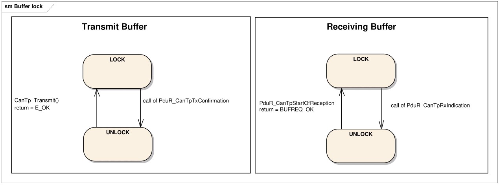

CAN传输层直接工作在上层的内存区域上（如PduR、DCM或COM）。为了访问这些内存区域，CAN传输层使用PduR\_CanTpCopyTxData()或PduR\_CanTpCopyRxData()函数。

因此，为了保证数据一致性，上层应锁定该内存区域，直到发生指示为止。

当发送缓冲区被锁定时，上层不得在缓冲区区域内写入数据。

当接收缓冲区被锁定时，CAN传输层不保证缓冲区的数据一致性。上层既不应读取也不应写入缓冲区区域。

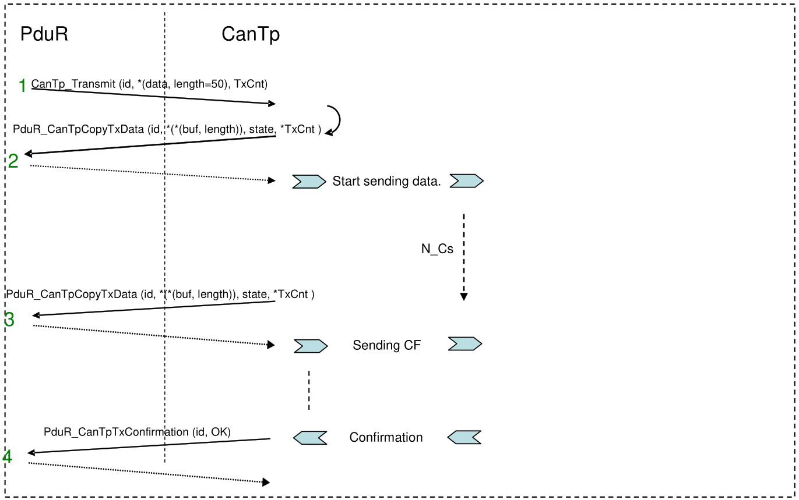

假定上层模块在向PduR\_CanTpStartOfReception()调用返回状态BUFREQ\_OK时，或者在CanTp\_Transmit()返回E\_OK时已锁定了缓冲区，并且应保持缓冲区锁定，直到发生确认或指示（PduR\_CanTpTxConfirmation()或PduR\_CanTpRxIndication()调用）。

下图提供了一个示例，总结利用CAN 2.0帧发送50字节长度帧的过程。

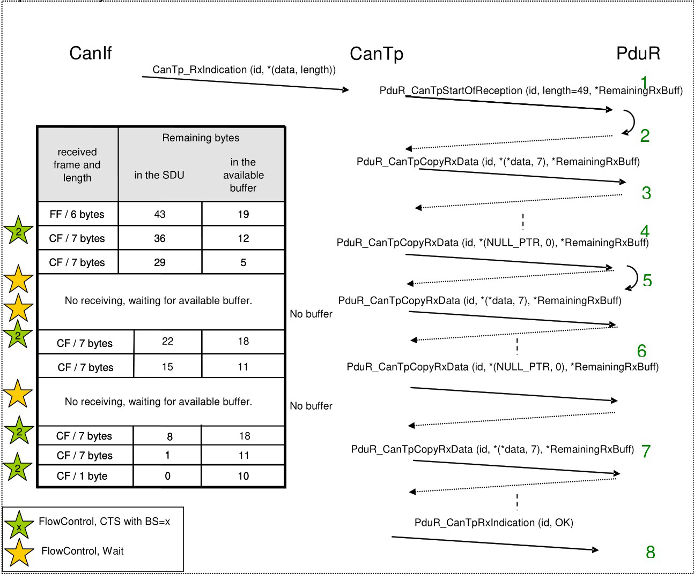

- 1：PduR请求发送50个数据字节；
- 2：CanTp向PduR请求有效载荷数据；CanTp发送首帧；
- 3：CanTp以连续帧序列的形式发送其余有效载荷数据；每个CF上由上层复制6或7个有效载荷数据字节；
- 4：CanTp确认有效载荷数据的发送。

下一个图是N-SDU接收49字节、上层报告25字节可用Rx缓冲区的示例。

- 1：CanIf通过CanTp\_RxIndication()通知一次新的接收。CanTp将此通知转发给PduR；
- 2：PduR返回25字节的可用缓冲区大小，CanTp向发起方发送流控CTS；
- 3：CanTp将每个接收帧的数据提供给PduR，并监视剩余的缓冲区大小。在第二个连续帧之后，剩余缓冲区大小不足以接收下一个块（两个连续帧）；
- 4：CanTp通过以0作为数据长度、NULL\_PTR作为数据调用PduR\_CanTpCopyRxData()来向PduR询问剩余缓冲区大小，并向发起方发送流控Wait。重复此操作直到下一个块有足够的缓冲区可用；
- 5：当缓冲区大小最终足以容纳下一个块时，CanTp将向发起方发送流控CTS，并继续接收下一个连续帧块；
- 6：在复制完该块的最后一个连续帧之后，剩余缓冲区对于下一个块来说太低，因此CanTp再次发送等待帧并监视剩余缓冲区大小；
- 7：当最后一个块的缓冲区可用时，CanTp将继续接收；
- 8：CanTp通过调用PduR\_CanTpRxIndication()将接收结束告知PduR。

#### 6.3.4. 协议参数设置服务

CanTp模块应支持可选的原语（在ISO 15765-2规范中提出），用于由应用动态设置某些传输协议内部参数（STmin和BS）。

BS值只是一个最大值。出于缓冲区长度的原因，CAN传输层可以在所配置的最大值范围内调整BS值。

#### 6.3.5. Tx和Rx数据流

下图显示了非分段消息发送和分段消息发送的示例。

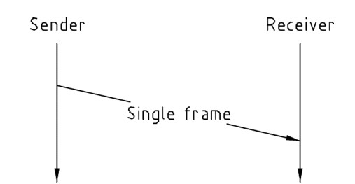

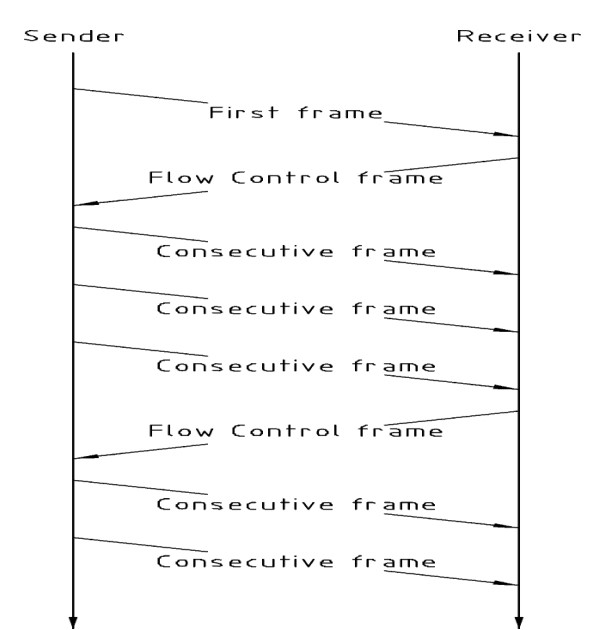

流控用于使发送方适应接收方的能力。该传输协议的主要用途是对等通信（即1对1通信——物理寻址[\[1\]](#ref-1)）。

CanTp模块应提供1到n的通信（即功能寻址[\[1\]](#ref-1)），其形式为针对SF N-PDU的功能（且仅针对SF N-SDU）。

配置工具应检查是否只有SF N-PDU被配置了功能寻址属性。

如果发生多个分段会话（在接收方和发送方两侧），且其句柄的通信类型为functional，则CanTp模块应拒绝该请求，并向默认错误跟踪器报告运行时错误代码CANTP\_E\_INVALID\_TATYPE。

#### 6.3.6. CAN NSduId与CAN LSduId之间的关系

本章描述CAN NSduId与CAN LSduId之间存在的联系，以使传输协议数据单元的发送和接收成为可能。

一个CAN NSduId只应与一个用于发送SF、FF、FC和CF帧的CAN LSduId相关联。

然而，如果消息被配置为使用扩展寻址格式或混合寻址格式，则CanTp模块必须用N_TA（在扩展寻址的情况下）或N_AE（在混合寻址的情况下）的值填充每个发送分段（SF、FF和CF）的第一个字节。因此，一个CAN NSduId也可能与一个N_TA或N_AE值相关联。

FC协议数据单元使接收方能够通过授权或延迟后续CF N-PDU的发送来控制发送方的数据流。

对于扩展寻址格式，FC的第一个数据字节还包含N_TA值或N_TA与N_TAtype值的唯一组合。对于混合寻址格式，FC的第一个数据字节包含N_AE值。

因此，FC帧的CAN LSduId与其N_TA值（例如N_AI）或N_AE值组合，只应标识一个CAN NSduId。

在接收方向上，每个（SF、FF或CF）传输协议数据单元的第一个数据字节的值将用于确定相关的N-SDU。

因此，在扩展寻址的N-PDU接收中，CanTp模块应提取N_TA值以建立相关的N-SDU。对于混合寻址模式，同样的过程应应用于N_AE值。

下图总结了这些讨论。

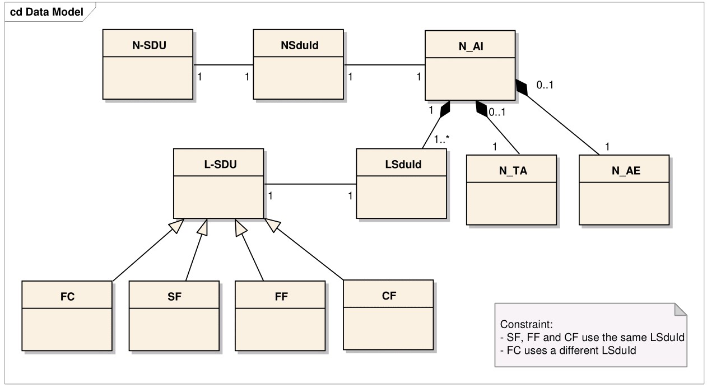

#### 6.3.7. 并发连接

CAN传输层能够同时管理多个连接（例如可以同时接收UDS请求和OBD请求）。

CanTp模块应同时支持多个连接。

可以在CanTp模块中配置并发连接。

连接通道仅用于CAN TP内部使用，因此不能从外部访问。

所有必要的信息（通道编号、时序参数……）都在CAN传输层模块内部配置。

每个N-SDU静态地链接到一个连接通道。该连接通道代表发送或接收N-SDU的内部路径。一个连接通道可以附加到一个或多个N-SDU。

每个连接通道独立于其他连接通道。这意味着一个连接通道使用自己的资源，例如内部缓冲区、定时器或状态机。

CanTp模块应通过正确配置的连接通道来路由N-SDU。

CanTp模块不应接受并行接收或发送具有相同标识符的N-SDU，否则接收到的帧将无法分配给正确的连接。当只使用特定连接（不带MetaData）时，该要求由配置来保证，因为每个N-SDU只链接到一个连接通道。

如果用户想将一个特定的连接通道专用于一个N-SDU，则应在配置过程中只将该连接通道分配给一个N-SDU。

如果一个连接通道被分配给多个N-SDU，则资源在不同的N-SDU之间共享，并且如果没有空闲的连接通道可用，CAN传输层将拒绝发送或中止接收。

连接通道的数量不可直接配置。它将由配置工具在配置过程中通过分析N-SDU/通道路由表来确定。

如果所配置的发送连接通道正在使用中（状态CANTP\_TX\_PROCESSING），则CanTp模块应拒绝链接到该通道的新发送请求。为拒绝发送，当上层通过CanTp\_Transmit()函数请求发送时，CanTp返回E\_NOT\_OK。

当接收到不带MetaData的SF或FF N-PDU，且相应的连接通道当前正在接收同一连接（状态CANTP\_RX\_PROCESSING，相同的N_AI）时，CanTp模块应中止正在进行的接收，并将接收到的帧作为新接收的开始进行处理。

当在不带MetaData的SF或FF N-PDU上接收到活动连接通道上另一个连接（不同的N_AI）的SF或FF时，该SF或FF应被忽略。

当接收到带MetaData的SF或FF N-PDU（指示一个通用连接），且相应的连接通道当前正在接收时，该SF或FF应被忽略。

当一个Tx N-PDU被不同通道上的两个或更多不同的连接使用时，对该N-PDU的访问应通过使用TxConfirmation来串行化。只有在使用扩展寻址或混合寻址时，或当该N-PDU带有MetaData时（因此属于通用连接），Rx N-PDU才能用于两个或更多不同的连接通道。

**注意：** CAN FD帧和CAN帧将由CanIf根据帧格式（CAN FD或CAN 2.0）映射到不同的PDU。因此，可以区分CAN FD通信和经典CAN通信。

#### 6.3.8. N-PDU填充

为了保证与上层关于帧数据长度的所有要求完全兼容（例如OBD要求数据长度始终设置为8字节，而UDS则不是），填充的激活是在预编译时针对每个N-SDU可配置的，对Rx N-SDU使用CanTpRxPaddingActivation，对Tx N-SDU使用CanTpTxPaddingActivation。

在填充和不填充两种模式下，CanTp模块只应向上层传递已使用的数据字节。

用于填充字节的值可通过配置参数CANTP\_PADDING\_BYTE进行配置（见CanTpPaddingByte）。

如果有效载荷 ≤ 8的帧（CAN 2.0帧或小的CAN FD帧）用于某个Rx N-SDU，且CanTpRxPaddingActivation等于CANTP\_ON，则CanTp应只接受属于该N-SDU、长度为8字节（即PduInfoPtr.SduLength = 8）的SF Rx N-PDU或最后一个CF Rx N-PDU。

如果有效载荷 ≤ 8的帧（CAN 2.0帧或小的CAN FD帧）用于某个Rx N-SDU，且CanTpRxPaddingActivation等于CANTP\_ON，而CanTp通过CanTp\_RxIndication()调用接收到属于该N-SDU、长度小于8字节（即PduInfoPtr.SduLength < 8）的SF Rx N-PDU，则CanTp应拒绝接收。运行时错误代码CANTP\_E\_PADDING应报告给默认错误跟踪器。

如果有效载荷 ≤ 8的帧（CAN 2.0帧或小的CAN FD帧）用于某个Rx N-SDU，且CanTpRxPaddingActivation等于CANTP\_ON，而CanTp通过CanTp\_RxIndication()调用接收到属于该N-SDU、长度小于8字节（即PduInfoPtr.SduLength != 8）的最后一个CF Rx N-PDU，则CanTp应以结果E\_NOT\_OK调用PduR\_CanTpRxIndication()来中止正在进行的接收。运行时错误代码CANTP\_E\_PADDING应报告给默认错误跟踪器。

如果某个Rx N-SDU的CanTpRxPaddingActivation等于CANTP\_ON，则CanTp模块应发送长度为8字节的FC N-PDU。N-PDU中未使用的字节应以CANTP\_PADDING\_BYTE填充（见CanTpPaddingByte）。

如果有效载荷 ≤ 8的帧（CAN 2.0帧或小的CAN FD帧）用于某个Tx N-SDU，且CanTpTxPaddingActivation等于CANTP\_ON，则CanTp应通过CanIf\_Transmit()调用，以8字节的长度（即PduInfoPtr.SduLength = 8）发送属于该Tx N-SDU的SF Tx N-PDU或最后一个CF Tx N-PDU。N-PDU中未使用的字节应以CANTP\_PADDING\_BYTE填充（见CanTpPaddingByte）。

如果某个Tx N-SDU的CanTpTxPaddingActivation等于CANTP\_ON，并且在该N-SDU正在进行的发送中通过CanTp\_RxIndication()调用接收到该Tx N-SDU的FC N-PDU，且该FC的长度小于8字节（即PduInfoPtr.SduLength < 8），则CanTp模块应以结果E\_NOT\_OK调用PduR\_CanTpTxConfirmation()来中止发送会话。运行时错误代码CANTP\_E\_PADDING应报告给默认错误跟踪器。

如果要通过CanIf\_Transmit()发送的数据长度与可能的DLC值（0..8、12、16、20、24、32、48或64）不匹配，则CanTp应使用下一个更高的有效DLC进行发送，并将未使用的字节初始化为CANTP\_PADDING\_BYTE的值（见CanTpPaddingByte）。

**原理解释：** ISO 11898-1:2015 [\[9\]](#ref-9)中，从9到15的DLC值被分配给最大64字节CAN帧有效载荷长度的非线性离散值。为防止未初始化数据的发送，当要发送的N_PDU大小不等于[\[9\]](#ref-9) DLC表中定义的离散长度值之一时，DLC值大于8的CAN帧数据必须进行填充。对于从9到15的DLC值，只应使用强制填充。

下图表示一个ISO帧：

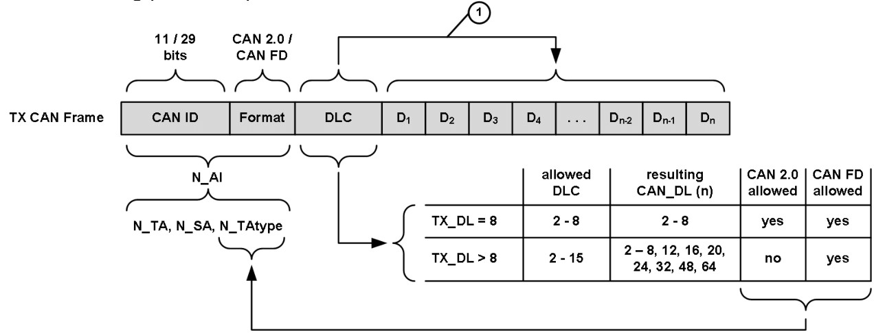

#### 6.3.9. 非预期N-PDU到达的处理

CAN传输层在非预期N-PDU到达时的行为很大程度上取决于所处理N-SDU的通信方向类型。

如果接收到非预期的帧，CanTp模块应按照下表行动。该表规定了考虑当前CanTp内部状态（CanTp状态）时的N-PDU处理方式。

必须理解，接收到的N-PDU所包含的地址信息（N_AI）与接收或发送时可能正在进行中的N-PDU相同。

表1：N-PDU到达的处理（**Handling of N-PDU arrivals**）

| CanTp状态 | 接收SF N-PDU | 接收FF N-PDU | 接收CF N-PDU | 接收FC N-PDU | 接收未知N-PDU |
| --- | --- | --- | --- | --- | --- |
| 分段发送进行中 | 如果有接收正在进行，按照下方单元格处理，否则将SF N-PDU作为新接收的开始进行处理 | 如果有接收正在进行，按照下方单元格处理，否则将FF N-PDU作为新接收的开始进行处理 | 如果有接收正在进行，按照下方单元格处理，否则忽略它 | 如果正在等待，处理该FC N-PDU，否则忽略它 | 忽略 |
| 分段接收进行中 | 终止当前接收，向上层报告参数Result设置为E\_NOT\_OK的指示，并将SF N-PDU作为新接收的开始进行处理 | 终止当前接收，向上层报告参数Result设置为E\_NOT\_OK的指示，并将FF N-PDU作为新接收的开始进行处理 | 在正在进行的接收中处理该CF N-PDU并执行所需的检查（例如SN顺序正确） | 如果有发送正在进行，按照上方单元格处理，否则忽略它 | 忽略 |
| Idle<sup>1</sup> | 将SF N-PDU作为新接收的开始进行处理 | 将FF N-PDU作为新接收的开始进行处理 | 忽略 | 忽略 | 忽略 |

> 1 Idle = CANTP\_ON.CANTP\_RX\_WAIT和CANTP\_ON.CANTP\_TX\_WAIT

### 6.4. 错误分类

本节描述CanTp模块在本基础软件生命周期内可能出现的几类错误的处理方式。

在错误和异常情况下，CanTp模块不应修改其当前的模块状态（见图7.1），而只需报告错误事件。

在生产错误的情况下，诊断事件管理器模块（通过功能禁用管理器）将执行适当的操作（例如修改调用模块的状态）。

#### 6.4.1. 开发错误

| 错误类型 | 相关错误码 | 错误值 |
| --- | --- | --- |
| 以错误的参数调用API服务：当CanTp\_ChangeParameter以无效值调用时。 | CANTP\_E\_PARAM\_CONFIG | 0x01 |
| 以错误的参数调用API服务：当CanTp\_ChangeParameter或CanTp\_ReadParameter以无效的参数ID调用时。 | CANTP\_E\_PARAM\_ID | 0x02 |
| 以NULL指针调用API服务。 | CANTP\_E\_PARAM\_POINTER | 0x03 |
| 模块初始化失败，例如在Post-Build下以无效指针调用CanTp\_Init()。 | CANTP\_E\_INIT\_FAILED | 0x04 |
| 在未初始化模块的情况下使用API服务：当CanTp处于CANTP\_OFF状态时，调用除CanTp\_Init()、CanTp\_GetVersionInfo()和CanTp\_MainFunction()之外的任何API。 | CANTP\_E\_UNINIT | 0x20 |
| 无效的发送PDU标识符（例如以不存在的Tx PDU标识符调用服务） | CANTP\_E\_INVALID\_TX\_ID | 0x30 |
| 无效的接收PDU标识符（例如以不存在的Rx PDU标识符调用服务） | CANTP\_E\_INVALID\_RX\_ID | 0x40 |

#### 6.4.2. 运行时错误

| 错误类型 | 相关错误码 | 错误值 |
| --- | --- | --- |
| 接收到的PDU长度小于8字节。（即PduInfoPtr.SduLength < 8） | CANTP\_E\_PADDING | 0x70 |
| 对配置为功能寻址的Tx I-Pdu调用CanTp\_Transmit()，且长度参数表明该消息无法以SF发送 | CANTP\_E\_INVALID\_TATYPE | 0x90 |
| 请求的操作不受支持——对不在发送/接收过程中的N-SDU发出取消发送/取消接收请求 | CANTP\_E\_OPER\_NOT\_SUPPORTED | 0xA0 |
| 在接收或发送期间发生协议超时错误以外的实现特定错误时报告的事件 | CANTP\_E\_COM | 0xB0 |
| 在接收期间发生协议超时错误时报告的事件 | CANTP\_E\_RX\_COM | 0xC0 |
| 在发送期间发生协议超时错误时报告的事件 | CANTP\_E\_TX\_COM | 0xD0 |

如果任务因As、Bs、Cs、Ar、Br、Cr超时而中止，则CanTp模块应报出开发错误CANTP\_E\_RX\_COM（在接收操作的情况下）或CANTP\_E\_TX\_COM（在发送操作的情况下）。如果任务因任何其他协议错误而中止，则CanTp模块应向默认错误跟踪器报出运行时错误代码CANTP\_E\_COM。

#### 6.4.3. 瞬态故障

没有瞬态故障。

#### 6.4.4. 生产错误

没有生产错误。

#### 6.4.5. 扩展生产错误

##### 6.4.5.1. CANTP\_E\_CANTPNAS\_TIMEOUT\_OCCURRED

| 项目 | 内容 |
| --- | --- |
| 错误名称 | CANTP\_E\_CANTPNAS\_TIMEOUT\_OCCURRED |
| 简短描述 | 检测到N_As超时 |
| 详细描述 | 当检测到N_As超时时，CanTp应向DEM报告CANTP\_E\_CANTPNAS\_TIMEOUT\_OCCURRED扩展生产错误。 |
| 检测条件 | 失败（Fail）：N_As定时器到期 |
| 检测条件 | 通过（Pass）：CanTp\_Init函数调用 |
| 次要参数 | FAIL和/或PASS检测处于活动状态的条件：无 |
| 所需时间 | 不适用 |
| 监视频率 | 事件触发（on event） |

##### 6.4.5.2. CANTP\_E\_CANTPNAR\_TIMEOUT\_OCCURRED

| 项目 | 内容 |
| --- | --- |
| 错误名称 | CANTP\_E\_CANTPNAR\_TIMEOUT\_OCCURRED |
| 简短描述 | 检测到N_Ar超时 |
| 详细描述 | 当检测到N_Ar超时时，CanTp应向DEM报告CANTP\_E\_CANTPNAR\_TIMEOUT\_OCCURRED扩展生产错误。 |
| 检测条件 | 失败（Fail）：N_Ar定时器到期 |
| 检测条件 | 通过（Pass）：CanTp\_Init函数调用 |
| 次要参数 | FAIL和/或PASS检测处于活动状态的条件：无 |
| 所需时间 | 不适用 |
| 监视频率 | 事件触发（on event） |

##### 6.4.5.3. CANTP\_E\_CANTPNBS\_TIMEOUT\_OCCURRED

| 项目 | 内容 |
| --- | --- |
| 错误名称 | CANTP\_E\_CANTPNBS\_TIMEOUT\_OCCURRED |
| 简短描述 | 检测到N_Bs超时 |
| 详细描述 | 当检测到N_Bs超时时，CanTp应向DEM报告CANTP\_E\_CANTPNBS\_TIMEOUT\_OCCURRED扩展生产错误。 |
| 检测条件 | 失败（Fail）：N_Bs定时器到期 |
| 检测条件 | 通过（Pass）：CanTp\_Init函数调用 |
| 次要参数 | FAIL和/或PASS检测处于活动状态的条件：无 |
| 所需时间 | 不适用 |
| 监视频率 | 事件触发（on event） |

##### 6.4.5.4. CANTP\_E\_CANTPNBR\_TIMEOUT\_OCCURRED

| 项目 | 内容 |
| --- | --- |
| 错误名称 | CANTP\_E\_CANTPNBR\_TIMEOUT\_OCCURRED |
| 简短描述 | 检测到N_Br超时 |
| 详细描述 | 当检测到N_Br超时时，CanTp应向DEM报告CANTP\_E\_CANTPNBR\_TIMEOUT\_OCCURRED扩展生产错误。 |
| 检测条件 | 失败（Fail）：N_Br定时器到期 |
| 检测条件 | 通过（Pass）：CanTp\_Init函数调用 |
| 次要参数 | FAIL和/或PASS检测处于活动状态的条件：无 |
| 所需时间 | 不适用 |
| 监视频率 | 事件触发（on event） |

##### 6.4.5.5. CANTP\_E\_CANTPNCS\_TIMEOUT\_OCCURRED

| 项目 | 内容 |
| --- | --- |
| 错误名称 | CANTP\_E\_CANTPNCS\_TIMEOUT\_OCCURRED |
| 简短描述 | 检测到N_Cs超时 |
| 详细描述 | 当检测到N_Cs超时时，CanTp应向DEM报告CANTP\_E\_CANTPNCS\_TIMEOUT\_OCCURRED扩展生产错误。 |
| 检测条件 | 失败（Fail）：N_Cs定时器到期 |
| 检测条件 | 通过（Pass）：CanTp\_Init函数调用 |
| 次要参数 | FAIL和/或PASS检测处于活动状态的条件：无 |
| 所需时间 | 不适用 |
| 监视频率 | 事件触发（on event） |

##### 6.4.5.6. CANTP\_E\_CANTPNCR\_TIMEOUT\_OCCURRED

| 项目 | 内容 |
| --- | --- |
| 错误名称 | CANTP\_E\_CANTPNCR\_TIMEOUT\_OCCURRED |
| 简短描述 | 检测到N_Cr超时 |
| 详细描述 | 当检测到N_Cr超时时，CanTp应向DEM报告CANTP\_E\_CANTPNCR\_TIMEOUT\_OCCURRED扩展生产错误。 |
| 检测条件 | 失败（Fail）：N_Cr定时器到期 |
| 检测条件 | 通过（Pass）：CanTp\_Init函数调用 |
| 次要参数 | FAIL和/或PASS检测处于活动状态的条件：无 |
| 所需时间 | 不适用 |
| 监视频率 | 事件触发（on event） |

##### 6.4.5.7. CANTP\_E\_SWAPPED\_CONSECUTIVE\_FRAMES\_RECEIVED

| 项目 | 内容 |
| --- | --- |
| 错误名称 | CANTP\_E\_SWAPPED\_CONSECUTIVE\_FRAMES\_RECEIVED |
| 简短描述 | 接收到乱序的连续帧 |
| 详细描述 | 当接收到乱序的连续帧时，CanTp应向DEM报告CANTP\_E\_SWAPPED\_CONSECUTIVE\_FRAMES\_RECEIVED扩展生产错误。 |
| 检测条件 | 失败（Fail）：接收到乱序的连续帧 |
| 检测条件 | 通过（Pass）：CanTp\_Init函数调用 |
| 次要参数 | FAIL和/或PASS检测处于活动状态的条件：无 |
| 所需时间 | 不适用 |
| 监视频率 | 事件触发（on event） |

##### 6.4.5.8. CANTP\_E\_DROPPED\_CONSECUTIVE\_FRAMES\_DETECTED

| 项目 | 内容 |
| --- | --- |
| 错误名称 | CANTP\_E\_DROPPED\_CONSECUTIVE\_FRAMES\_DETECTED |
| 简短描述 | 检测到缺失的连续帧 |
| 详细描述 | 当检测到缺失的连续帧时，CanTp应向DEM报告CANTP\_E\_DROPPED\_CONSECUTIVE\_FRAMES\_DETECTED扩展生产错误。 |
| 检测条件 | 失败（Fail）：检测到缺失的连续帧 |
| 检测条件 | 通过（Pass）：CanTp\_Init函数调用 |
| 次要参数 | FAIL和/或PASS检测处于活动状态的条件：无 |
| 所需时间 | 不适用 |
| 监视频率 | 事件触发（on event） |

##### 6.4.5.9. CANTP\_E\_FC\_OVERFLOW\_RECEIVED

| 项目 | 内容 |
| --- | --- |
| 错误名称 | CANTP\_E\_FC\_OVERFLOW\_RECEIVED |
| 简短描述 | 接收到状态为溢出（Overflow）的流控 |
| 详细描述 | 当接收到状态为溢出（Overflow）的流控时，CanTp应向DEM报告CANTP\_E\_FC\_OVERFLOW\_RECEIVED扩展生产错误。 |
| 检测条件 | 失败（Fail）：接收到状态为溢出（Overflow）的流控 |
| 检测条件 | 通过（Pass）：CanTp\_Init函数调用 |
| 次要参数 | FAIL和/或PASS检测处于活动状态的条件：无 |
| 所需时间 | 不适用 |
| 监视频率 | 事件触发（on event） |

##### 6.4.5.10. CANTP\_E\_FC\_OVERFLOW\_TRANSMITTED

| 项目 | 内容 |
| --- | --- |
| 错误名称 | CANTP\_E\_FC\_OVERFLOW\_TRANSMITTED |
| 简短描述 | 发送了状态为溢出（Overflow）的流控 |
| 详细描述 | 当发送了状态为溢出（Overflow）的流控时，CanTp应向DEM报告CANTP\_E\_FC\_OVERFLOW\_TRANSMITTED扩展生产错误。 |
| 检测条件 | 失败（Fail）：发送了状态为溢出（Overflow）的流控 |
| 检测条件 | 通过（Pass）：CanTp\_Init函数调用 |
| 次要参数 | FAIL和/或PASS检测处于活动状态的条件：无 |
| 所需时间 | 不适用 |
| 监视频率 | 事件触发（on event） |

## 7. API规范

### 7.1. 导入的类型

本章列出从以下模块导入的所有类型：

| 模块 | 头文件 | 导入的类型 |
| --- | --- | --- |
| ComStack_Types | ComStack_Types.h | BufReq_ReturnType |
| ComStack_Types | ComStack_Types.h | PduIdType |
| ComStack_Types | ComStack_Types.h | PduInfoType |
| ComStack_Types | ComStack_Types.h | PduLengthType |
| ComStack_Types | ComStack_Types.h | RetryInfoType |
| ComStack_Types | ComStack_Types.h | TPParameterType |
| ComStack_Types | ComStack_Types.h | TpDataStateType |
| Std | Std_Types.h | Std_ReturnType |
| Std | Std_Types.h | Std_VersionInfoType |

为了为AUTOSAR通信栈提供一致的API，定义了一些基本类型。CAN传输层使用这些类型与PDU路由器和CAN接口层通信。

有关更多信息，这些基本类型在AUTOSAR COM栈API规范中有深入介绍。

这些AUTOSAR标准类型将被直接使用，不做任何类型重定义。

如果出于实现原因需要定义一些附加类型，则CanTp模块应按以下方式标记这些类型：CanTp\_&lt;TypeName&gt;Type，其中&lt;TypeName&gt;是该类型的名称，遵循以下规则：

- 不使用下划线
- 每个单词的首字母大写，连续字母小写。

CanTp模块应确保实现特定的类型在CanTp之外不可见，否则完整的架构将被破坏。

### 7.2. 类型定义

#### 7.2.1. CanTp\_ConfigType

| 项目 | 内容 |
| --- | --- |
| 名称 | CanTp_ConfigType |
| 类别 | 结构体（Structure） |
| 描述 | Post-Build配置参数的数据结构类型。 |
| 可用性 | CanTp.h |

### 7.3. 函数定义

这是提供给上层模块的函数列表。

#### 7.3.1. CanTp\_Init

**说明**：该函数初始化CanTp模块。服务ID 0x01；同步；不可重入；输入参数CfgPtr指向CanTp的Post-Build配置数据；无输入输出参数；无输出参数；无返回值；可通过CanTp.h使用。

```C
void CanTp_Init ( const CanTp_ConfigType* CfgPtr )
```

上电后，CanTp处于称为CANTP\_OFF的状态（见上文）。在这种状态下，CanTp尚未配置，因此无法执行任何通信任务。

函数CanTp\_Init用给定的配置集初始化CAN传输层的所有全局变量，并将其置于空闲状态（状态为CANTP\_ON，但发送和接收均未进行）。

函数CanTp\_Init没有返回值，因为配置数据错误应在配置阶段（例如由配置工具）检测出来。此外，如果发生硬件错误，将通过错误管理器模块报告。

CanTp模块的环境应在将CanTp模块用于进一步处理之前调用CanTp\_Init。

初始化函数的参数检查在BSW通用规范[\[4\]](#ref-4)中规定。

应将一个表示BSW模块是否已初始化的静态状态变量在调用BSW模块的任何API之前初始化为值0。

BSW模块的初始化函数会将该静态状态变量设置为一个不等于0的值。

该变量用于在调用API之前检查模块是否已初始化。

#### 7.3.2. CanTp\_GetVersionInfo

**说明**：该函数返回CanTp模块的版本信息。服务ID 0x07；同步；可重入；无输入参数；无输入输出参数；输出参数versioninfo指示存储该模块版本信息的位置；无返回值；可通过CanTp.h使用。

```C
void CanTp_GetVersionInfo ( Std_VersionInfoType* versioninfo )
```

如果启用了开发错误检测，当参数为NULL指针时，函数CanTp\_GetVersionInfo应报出CANTP\_E\_PARAM\_POINTER错误。

#### 7.3.3. CanTp\_Shutdown

**说明**：调用该函数以关闭CanTp模块。服务ID 0x02；同步；不可重入；无输入参数；无输入输出参数；无输出参数；无返回值；可通过CanTp.h使用。

```C
void CanTp_Shutdown ( void )
```

函数CanTp\_Shutdown应关闭所有未决的传输协议连接，释放所有资源，并将CanTp模块置为CANTP\_OFF状态。

函数CanTp\_Shutdown不应发出关于未决帧发送或接收的通知。

#### 7.3.4. CanTp\_Transmit

**说明**：请求发送一个PDU。服务ID 0x49；同步；对不同PduId可重入，对相同PduId不可重入；输入参数TxPduId为要发送的PDU的标识符，输入参数PduInfoPtr为PDU数据的长度和指针以及指向MetaData的指针；无输入输出参数；无输出参数；返回值Std_ReturnType（E\_OK：发送请求已被接受；E\_NOT_OK：发送请求未被接受）；可通过CanTp.h使用。

```C
Std_ReturnType CanTp_Transmit ( PduIdType TxPduId, const PduInfoType* PduInfoPtr )
```

如果数据适合关联的N-PDU，则函数CanTp\_Transmit()应发送SF N-PDU。

如果数据不适合关联的N-PDU，则函数CanTp\_Transmit()应启动多帧发送会话。

N-PDU的最大Tx长度应从EcuC的PduLength配置参数推导。该参数等同于ISO 15765-2的TX_DL。

当发送请求完成时，CanTp模块应通过调用PduR\_CanTpTxConfirmation回调通知上层。

如果发生错误（溢出、N_As超时、N_Bs超时等），CanTp模块应中止发送请求，并以E\_NOT_OK结果值调用PduR\_CanTpTxConfirmation回调函数。

如果CanTp\_Transmit服务被调用时所针对的N-SDU标识符正被当前运行的CAN传输层会话使用，则函数CanTp\_Transmit应拒绝该请求。

CanTp的缓冲能力有限，因此要发送的N-SDU有效载荷不在内部复制。CAN传输层通过PduR\_CanTpCopyTxData服务直接从上层获取数据。

因此，为了保证数据一致性，上层（例如DCM、PduRouter或AUTOSAR COM）必须锁定该内存区域，直到发生确认通知。

当上层对不带MetaData的N-SDU调用此函数时，只需使用PduInfoPtr所指示结构的数据长度信息。其值表示要发送的N-SDU的有效载荷长度。

对于带MetaData的N-SDU，除了长度信息之外，通过PduInfoPtr提供的MetaData也是相关的。为获得实际的Tx数据，CAN传输层应调用PduR\_CanTpCopyTxData服务。

如果启用了开发错误检测，当参数PduInfoPtr为NULL指针时，函数CanTp\_Transmit应报出CANTP\_E\_PARAM\_POINTER错误。

如果启用了开发错误检测，函数CanTp\_Transmit应检查函数参数TxPduId的有效性。如果其值无效，则CanTp\_Transmit函数应报出开发错误CANTP\_E\_INVALID\_TX\_ID。

#### 7.3.5. CanTp\_CancelTransmit

**说明**：请求取消下层通信模块中正在进行的PDU发送。服务ID 0x4a；同步；对不同PduId可重入，对相同PduId不可重入；输入参数TxPduId为要取消的PDU的标识；无输入输出参数；无输出参数；返回值Std_ReturnType（E\_OK：取消已由目标模块成功执行；E\_NOT_OK：取消被目标模块拒绝）；可通过CanTp.h使用。

```C
Std_ReturnType CanTp_CancelTransmit ( PduIdType TxPduId )
```

该服务取消已通过调用CanTp\_Transmit服务请求发送的N-SDU的发送。

如果启用了开发错误检测，函数CanTp\_CancelTransmit应检查函数参数TxPduId的有效性。如果其值无效，则CanTp\_CancelTransmit函数应报出开发错误CANTP\_E\_INVALID\_TX\_ID。

如果参数值指示的是对不在发送过程中的N-SDU的取消发送请求，则CanTp模块应向默认错误跟踪器报告运行时错误代码CANTP\_E\_OPER\_NOT\_SUPPORTED，并且该服务应返回E\_NOT_OK。

如果服务返回E\_OK，则CanTp应中止当前N-SDU的发送。

如果CanTp\_CancelTransmit服务已成功执行，则CanTp应以通知结果E\_NOT_OK调用PduR\_CanTpTxConfirmation。

#### 7.3.6. CanTp\_CancelReceive

**说明**：请求取消下层传输协议模块中正在进行的PDU接收。服务ID 0x4c；同步；不可重入；输入参数RxPduId为要取消的PDU的标识；无输入输出参数；无输出参数；返回值Std_ReturnType（E\_OK：取消已由目标模块成功执行；E\_NOT_OK：取消被目标模块拒绝）；可通过CanTp.h使用。

```C
Std_ReturnType CanTp_CancelReceive ( PduIdType RxPduId )
```

服务CanTp\_CancelReceive取消由首帧接收及随后的PduR\_StartOfReception调用发起的N-SDU的接收。当该函数返回时，给定N-SDU标识符不再有接收正在进行。

如果启用了开发错误检测，函数CanTp\_CancelReceive应检查函数参数RxPduId的有效性。如果其值无效，则CanTp\_CancelReceive函数应报出开发错误CANTP\_E\_INVALID\_RX\_ID。

如果参数值指示的是对不在接收过程中的N-SDU的取消接收请求，则CanTp模块应向默认错误跟踪器报告运行时错误代码CANTP\_E\_OPER\_NOT\_SUPPORTED，并且该服务应返回E\_NOT_OK。

如果服务返回E\_OK，则CanTp应中止当前N-SDU的接收。

在单帧接收的情况下，或者当CanTp正在接收N-SDU的最后一个连续帧时（即在该最后一个连续帧的N_Cr超时启动之后调用该服务），CanTp应拒绝取消接收的请求。在这种情况下，CanTp应返回E\_NOT_OK。

如果CanTp\_CancelReceive服务已成功执行，则CanTp应以通知结果E\_NOT_OK调用PduR\_CanTpRxIndication。

#### 7.3.7. CanTp\_ChangeParameter

**说明**：请求更改特定的传输协议参数（例如块大小）。服务ID 0x4b；同步；不可重入；输入参数id为参数更改应影响的PDU的标识，输入参数parameter为要更改的参数的ID，输入参数value为参数的新值；无输入输出参数；无输出参数；返回值Std_ReturnType（E\_OK：参数更改成功；E\_NOT_OK：参数更改被拒绝）；可通过CanTp.h使用。

```C
Std_ReturnType CanTp_ChangeParameter ( PduIdType id, TPParameterType parameter, uint16 value )
```

服务CanTp\_ChangeParameter用于更改与每个接收的N-SDU相关联的接收参数BS和STmin的值。

该服务的实现取决于配置参数CanTpChangeParameterApi（即当该参数设置为TRUE时应实现该服务）。

只有当相关的N-SDU不在接收过程中时才可能进行参数更改——即在接收到FF之后直到该相关N-SDU最后一个CF接收的指示之间，无法更改参数值。

如果对正在接收过程中的N-SDU请求更改参数，则服务CanTp\_ChangeParameter立即返回E\_NOT_OK，且不更改任何参数值。

当对带MetaData的N-SDU（指示一个通用连接）调用CanTp\_ChangeParameter时，该更改应应用于所有通用连接，从而用于其后的所有接收。

如果启用了开发错误检测，函数CanTp\_ChangeParameter应检查函数参数（parameter和value）的有效性。如果参数parameter无效，则CanTp\_ChangeParameter函数应报出开发错误CANTP\_E\_PARAM\_ID。如果参数value无效，则CanTp\_ChangeParameter函数应报出开发错误CANTP\_E\_PARAM\_CONFIG。

如果启用了开发错误检测，函数CanTp\_ChangeParameter应检查函数参数id的有效性。如果其值无效，则CanTp\_ChangeParameter函数应报出开发错误CANTP\_E\_INVALID\_RX\_ID。

#### 7.3.8. CanTp\_ReadParameter

**说明**：该服务用于读取指定N-SDU的接收参数BS和STmin的当前值。服务ID 0x0b；同步；不可重入；输入参数id为读取其接收参数的所接收N-SDU的标识符，输入参数parameter指定要读取其值的参数（BS或STmin）；无输入输出参数；输出参数value为提供参数值的指针；返回值Std_ReturnType（E\_OK：请求被接受；E\_NOT_OK：请求未被接受）；可通过CanTp.h使用。

```C
Std_ReturnType CanTp_ReadParameter ( PduIdType id, TPParameterType parameter, uint16* value )
```

该服务的实现取决于配置参数CanTpChangeParameterApi（即当该参数设置为TRUE时应实现该服务）。

如果启用了开发错误检测，函数CanTp\_ReadParameter应检查函数参数parameter的有效性。如果其值无效，则CanTp\_ReadParameter函数应报出开发错误CANTP\_E\_PARAM\_ID。

如果启用了开发错误检测，函数CanTp\_ReadParameter应检查函数参数id的有效性。如果其值无效，则CanTp\_ReadParameter函数应报出开发错误CANTP\_E\_INVALID\_RX\_ID。

### 7.4. 回调通知

以下是提供给下层模块的函数列表。

#### 7.4.1. CanTp\_RxIndication

**说明**：来自下层通信接口模块的PDU接收指示。服务ID 0x42；同步；对不同PduId可重入，对相同PduId不可重入；输入参数RxPduId为所接收PDU的ID，输入参数PduInfoPtr包含所接收PDU的长度（SduLength）、指向包含该PDU的缓冲区（SduDataPtr）的指针以及与该PDU相关的MetaData；无输入输出参数；无输出参数；无返回值；可通过CanTp.h使用。

```C
void CanTp_RxIndication ( PduIdType RxPduId, const PduInfoType* PduInfoPtr )
```

CanIf模块应在成功接收到Rx CAN L-PDU之后调用此函数。

数据由CanTp通过PDU结构PduInfoType复制。在这种情况下，L-PDU缓冲区不是全局的，因此分布在相应的CAN传输层中。

请注意，对于动态Rx N-PDU，PduInfoPtr还包含MetaData。

函数CanTp\_RxIndication应可在中断上下文中调用（它可能从CAN接收中断调用）。

如果启用了开发错误检测，当参数PduInfoPtr为NULL指针时，函数CanTp\_RxIndication应报出CANTP\_E\_PARAM\_POINTER错误。

如果启用了开发错误检测，函数CanTp\_RxIndication应检查函数参数RxPduId的有效性。如果其值无效，则CanTp\_RxIndication函数应报出开发错误CANTP\_E\_INVALID\_RX\_ID。

#### 7.4.2. CanTp\_TxConfirmation

**说明**：下层通信接口模块确认PDU的发送，或PDU发送失败。服务ID 0x40；同步；对不同PduId可重入，对相同PduId不可重入；输入参数TxPduId为已发送PDU的ID，输入参数result为E\_OK：该PDU已发送；E\_NOT_OK：该PDU发送失败；无输入输出参数；无输出参数；无返回值；可通过CanTp.h使用。

```C
void CanTp_TxConfirmation ( PduIdType TxPduId, Std_ReturnType result )
```

函数CanTp\_TxConfirmation应可在中断上下文中调用（它可能从CAN发送中断调用）。

如果启用了开发错误检测，函数CanTp\_TxConfirmation应检查函数参数TxPduId的有效性。如果其值无效，则CanTp\_TxConfirmation函数应报出开发错误CANTP\_E\_INVALID\_TX\_ID。

### 7.5. 调度函数

#### 7.5.1. CanTp\_MainFunction

**说明**：用于调度CAN TP的主函数。服务ID 0x06；可通过SchM_CanTp.h使用。

```C
void CanTp_MainFunction ( void )
```

用于调度CAN TP的主函数（调度的入口点）。

主函数将由调度管理器（**Schedule Manager**）或自由运行定时器模块根据所需的调用周期调用。CanTp\_MainFunction参与处理CAN TP超时N_As、N_Bs、N_Cs、N_Ar、N_Br、N_Cr和STmin。

函数CanTp\_MainFunction受配置参数CanTpMainFunctionPeriod的影响。

### 7.6. 期望接口

本章列出从其他模块所需的所有接口。

#### 7.6.1. 必需接口（Mandatory Interfaces）

本章定义了为实现模块核心功能而需要的所有接口。

| API函数 | 头文件 | 描述 |
| --- | --- | --- |
| CanIf_Transmit | CanIf.h | 请求发送一个PDU。 |
| Det_ReportRuntimeError | Det.h | 报告运行时错误的服务。如果已配置callout，则应调用该callout。 |
| PduR_CanTpCopyRxData | PduR_CanTp.h | 调用此函数以将I-PDU分段（N-PDU）的接收数据提供给上层。每次调用此函数都提供I-PDU数据的下一个部分。剩余缓冲区的大小写入bufferSizePtr所指示的位置。 |
| PduR_CanTpCopyTxData | PduR_CanTp.h | 调用此函数以获取I-PDU分段（N-PDU）的发送数据。每次调用此函数都提供I-PDU数据的下一个部分，除非retry->TpDataState为TP_DATARETRY。在这种情况下，该函数从retry->TxTpDataCnt所指示的当前位置偏移处开始重新复制数据。剩余数据的大小写入availableDataPtr所指示的位置。 |
| PduR_CanTpRxIndication | PduR_CanTp.h | 在通过TP API接收到I-PDU之后调用，其结果指示传输是否成功。 |
| PduR_CanTpStartOfReception | PduR_CanTp.h | 在开始接收一个N-SDU时调用。该N-SDU可能被分段为多个N-PDU（FF后跟一个或多个CF），也可能由单个N-PDU（SF）组成。当以等于0的TpSduLength调用时，该服务应提供当前可用的最大缓冲区大小。 |
| PduR_CanTpTxConfirmation | PduR_CanTp.h | 在I-PDU已在其网络上发送之后调用，其结果指示发送是否成功。 |

#### 7.6.2. 可选接口（Optional Interfaces）

本章定义了为实现模块可选功能而需要的接口。

| API函数 | 头文件 | 描述 |
| --- | --- | --- |
| Det_ReportError | Det.h | 报告开发错误的服务。 |

## 8. 时序图

本章的目的是通过描述大多数更常见和更复杂的用例，使CAN传输层更易于理解。因此，以下图序列并非详尽无遗，也未反映所有规定的API可能性。

### 8.1. SF N-SDU已接收且无可用缓冲区

#### 8.1.1. 假设

- 所有输入参数均正常；
- N-SDU数据长度适合关联的N-PDU；
- 上层无法提供Rx缓冲区。

#### 8.1.2. 时序图

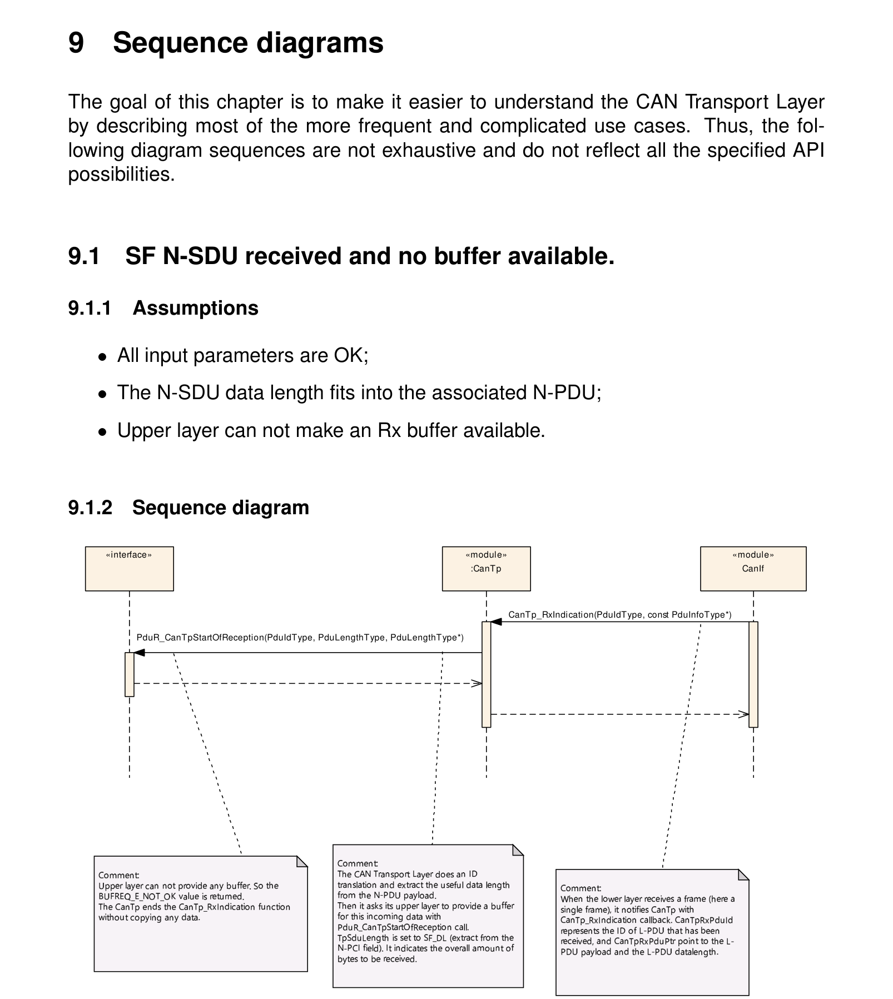

**注意：** 该时序图只演示CAN\_Tp模块的工作。但是，如果在这样的接收过程中考虑整个系统，则会涉及更多的模块。由于此接收可能在CAN ISR上下文中触发，因此CAN\_Tp的操作应尽可能短。

#### 8.1.3. 转换描述

| 转换 | 名称 | 描述 |
| --- | --- | --- |
| 1 | CanTp_RxIndication ( RxPduId, PduInfoPtr ) | 当下层接收到一个帧（此处为单帧）时，它通过CanTp_RxIndication回调通知CanTp。RxPduId表示已接收的L-PDU的ID，PduInfoPtr指示L-PDU有效载荷和L-PDU数据长度。 |
| 2 | PduR_CanTpStartOfReception( id, info, TpSduLength, bufferSizePtr ) | CAN传输层执行一次ID转换，并从N-PDU有效载荷中提取有用数据长度。然后它通过PduR_CanTpStartOfReception回调请求其上层为该传入数据提供一个缓冲区。TpSduLength被设置为SF_DL（从N-PCI字段提取），它指示要接收的字节总量。 |
| 3 | BUFREQ_E_NOT_OK | 上层无法提供任何缓冲区，因此返回BUFREQ_E_NOT_OK值。CanTp在未复制任何数据的情况下结束CanTp_RxIndication函数。 |

### 8.2. 成功的SF N-PDU接收

#### 8.2.1. 假设

- 所有输入参数均正常；
- N-SDU数据长度适合关联的N-PDU；
- SF N-PDU被成功接收。

#### 8.2.2. 时序图

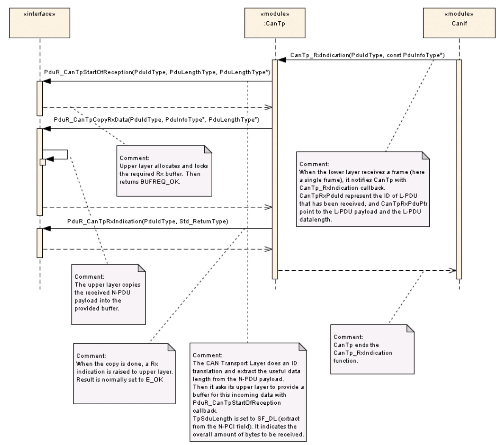

**注意：** 该时序图只演示CAN\_Tp模块的工作。但是，如果在这样的接收过程中考虑整个系统，则会涉及更多的模块。由于此接收可能在CAN ISR上下文中触发，因此CAN\_Tp的操作应尽可能短。

#### 8.2.3. 转换描述

| 转换 | 名称 | 描述 |
| --- | --- | --- |
| 1 | CanTp_RxIndication ( RxPduId, PduInfoPtr ) | 当下层接收到一个帧（此处为单帧）时，它通过CanTp_RxIndication回调通知CanTp。RxPduId表示已接收的L-PDU的ID，PduInfoPtr指示L-PDU有效载荷和L-PDU数据长度。 |
| 2 | PduR_CanTpStartOfReception( id, info, TpSduLength, bufferSizePtr ) | CAN传输层执行一次ID转换，并从N-PDU有效载荷中提取有用数据长度。然后它通过PduR_CanTpStartOfReception回调请求其上层为该传入数据提供一个缓冲区。TpSduLength被设置为SF_DL（从N-PCI字段提取），它指示要接收的字节总量。 |
| 3 | BUFREQ_OK | 上层分配并锁定所需的Rx缓冲区，然后返回BUFREQ_OK。 |
| 4 | PduR_CanTpCopyRxData( id, info, bufferSizePtr ) | 上层将接收到的N-PDU有效载荷复制到缓冲区中。 |
| 5 | PduR_CanTpRxIndication ( id, result ) | 复制完成后，向上层发送Rx指示。结果设置为E_OK。 |
| 6 |  | CanTp结束CanTp_RxIndication函数。 |

### 8.3. SF N-SDU的发送请求

#### 8.3.1. 假设

- 所有输入参数均正常；
- N-SDU数据长度适合关联的N-PDU；
- 发送被成功处理。

#### 8.3.2. 时序图

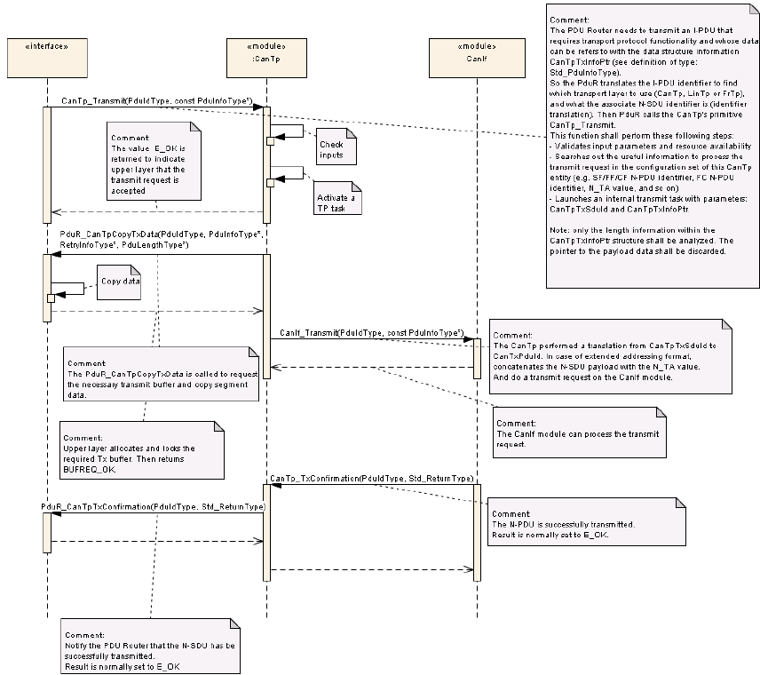

#### 8.3.3. 转换描述

| 转换 | 名称 | 描述 |
| --- | --- | --- |
| 1 | CanTp_Transmit( TxPduId, PduInfoPtr ) | PDU路由器需要发送一个需要传输协议功能、且其数据可由数据结构信息PduInfoPtr引用（见类型定义：Std_PduInfoType）的I-PDU。因此PduR转换该I-PDU标识符，以找出要使用的传输层（CanTp、LinTp或FrTp）以及关联的N-SDU标识符（标识符转换）。然后PduR调用CanTp的原语CanTp_Transmit。该函数应执行以下步骤：验证输入参数和资源可用性；在该CanTp实体的配置集中检索处理发送请求的有用信息（例如SF/FF/CF N-PDU标识符、FC N-PDU标识符、N_TA值等）；以参数TxPduId和PduInfoPtr启动一个内部发送任务。注意：只应分析PduInfoPtr结构内的长度信息。指向有效载荷数据的指针应被丢弃。 |
| 2 | E_OK | 返回值E_OK向上层指示发送请求已被接受。 |
| 3 | PduR_CanTpCopyTxdata( id, info, retry, availableDataPtr ) | 调用PduR_CanTpCopyTxData以复制分段数据。 |
| 4 | BUFREQ_OK | 上层复制数据，然后返回BUFREQ_OK。 |
| 5 | CanIf_Transmit( TxPduId, PduInfoPtr ) | CanTp执行TxPduId的转换。在扩展寻址格式的情况下，它将N-SDU有效载荷与N_TA值级联，以在CanIf模块上执行发送请求。 |
| 6 | E_OK | CanIf模块可以处理该发送请求。 |
| 7 | CanTp_TxConfirmation( TxPduId, result ) | N-PDU已成功发送。 |
| 8 | PduR_CanTpTxConfirmation ( id, result ) | 通知PDU路由器该N-SDU已成功发送。因此必须解锁PduInfoType结构。结果设置为E_OK。 |

### 8.4. 较大N-SDU的发送请求

#### 8.4.1. 假设

- 所有输入参数均正常；
- N-SDU数据长度不适合关联的N-PDU；
- 发送被成功处理。

#### 8.4.2. 时序图

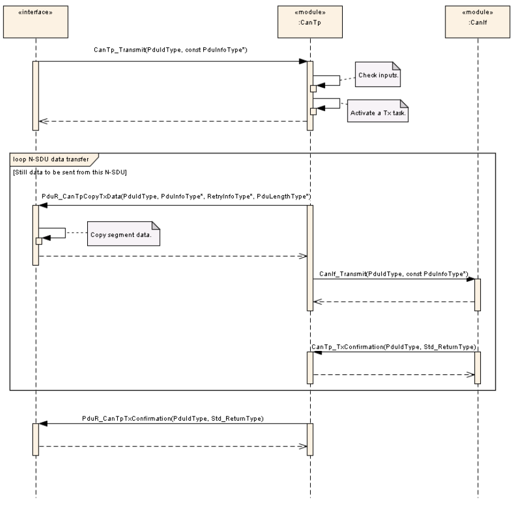

#### 8.4.3. 转换描述

| 转换 | 名称 | 描述 |
| --- | --- | --- |
| 1 | CanTp_Transmit ( TxPduId, PduInfoPtr ) | PDU路由器需要发送一个需要传输协议功能、且其数据由数据结构信息PduInfoPtr引用（见类型定义：PduInfoType）的I-PDU。因此PduR转换该I-PDU标识符，以找出要使用的传输层（CanTp、LinTp或FrTp）以及关联的N-SDU标识符（标识符转换）。然后PduR调用CanTp的原语CanTp_Transmit。该函数应执行以下步骤：验证输入参数和资源可用性；在该CanTp实体的配置集中检索处理发送请求的有用信息（例如SF/FF/CF N-PDU标识符、FC N-PDU标识符、N_TA值等）；以参数TxPduId和PduInfoPtr启动一个内部发送任务。注意：只应分析PduInfoPtr结构内的长度信息。指向有效载荷数据的指针应被丢弃。 |
| 2 | E_OK | 上层分配并锁定所需的Tx缓冲区，然后返回E_OK。 |
| 3 | PduR_CanTpCopyTxData( id, info, retry, availableDataPtr ) | 调用PduR_CanTpCopyTxData。上层将分段数据复制到目标缓冲区。 |
| 4 | CanIf_Transmit ( TxPduId, PduInfoPtr ) | 在该任务内，CanTp通过CanIf_Transmit调用CAN接口，其中TxPduId标识L-SDU（必须在CanTp使用的N-SDU Id与CAN接口使用的L-SDU Id之间进行转换），PduInfoPtr指示数据及其长度。 |
| 5 | CanTp_TxConfirmation( TxPduId, result ) | CanTp等待来自CAN接口的确认（CanTp_TxConfirmation）。 |
| 6 | PduR_CanTpCopyTxData ( id, info, retry, availableDataPtr ) | 对于每个连续帧，CanTp请求PDU路由器提供新的待发送数据。 |
| 7 | PduR_CanTpTxConfirmation ( id, result ) | 当所有数据都已发送或发生错误时，CanTp通过PduR_CanTpTxConfirmation通知PDU路由器。Id标识确认其发送的N-SDU，result指示发送是否已完成。 |

### 8.5. 大N-SDU接收

#### 8.5.1. 假设

- 所有输入参数均正常；
- N-SDU数据长度不适合关联的N-PDU；
- 接收被成功处理。

#### 8.5.2. 时序图

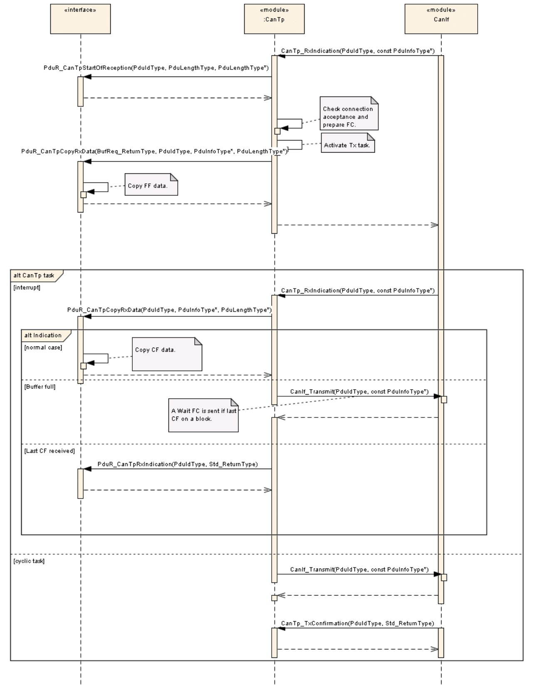

**注意：** 该时序图只演示CAN\_Tp模块的工作。但是，如果在这样的接收过程中考虑整个系统，则会涉及更多的模块。由于此接收可能在CAN ISR上下文中触发，因此CAN\_Tp的操作应尽可能短。

#### 8.5.3. 转换描述

| 转换 | 名称 | 描述 |
| --- | --- | --- |
| 1 | CanTp_RxIndication ( RxPduId, PduInfoPtr ) | 当CAN接口接收到一个帧（此处为首帧）时，它通过CanTp_RxIndication回调通知CanTp。RxPduId表示已接收的L-PDU的ID，PduInfoPtr向L-SDU指示有效载荷和L-SDU数据长度。 |
| 2 | PduR_CanTpStartOfReception( id, info, TpSduLength, bufferSizePtr ) | CanTp通过PduR_CanTpStartOfReception回调请求PDU路由器为传入数据提供一个缓冲区。 |
| 3 |  | 检查连接的接受性并准备FC参数。 |
| 4 |  | CanTp激活一个任务，用于发送Flow Status设置为ContinueToSend的FC（见第8步）。 |
| 5 | CanTp_RxIndication ( RxPduId, PduInfoPtr ) | 当CAN接口接收到一个帧（此处为连续帧）时，CAN接口通过CanTp_RxIndication回调通知CanTp。RxPduId表示已接收的CAN帧的ID，PduInfoPtr向L-SDU指示有效载荷。 |
| 6 |  | CanTp应校验序列号，如果正确，则请求PduR复制数据。 |
| 7 | PduR_CanTpCopyRxData( id, info, bufferSizePtr ) 或 PduR_CanTpRxIndication ( id, result ) | 可以适用三种情况：正常情况：接收到的连续帧不是最后一帧。CanTp将接收到的数据转发给上层。收到最后一个CF：该连续帧是最后一帧（总长度信息作为参数位于首帧中）。CanTp应通过PduR_CanTpRxIndication回调通知PDU路由器。 |
| 8 |  | 当需要发送流控时，CanTp周期任务应通过CanIf_Transmit调用CAN接口，并等待来自CAN接口的确认。根据上层的可用缓冲区，流控可以是ContinueToSend或Wait。 |

## 9. 配置规范

通常，本章定义配置参数及其到容器中的聚集。为支持本规范，第9.1节描述了基本原理。它还规定了应用于参数规范的模板（表）。我们打算将该节保留在规范中以保证可理解性。

第9.2节规定模块CAN传输层的结构（容器）和参数。

第9.3节规定模块CAN传输层的发布信息。

所列配置项可以从基于EcuConfigurationTemplate的网络描述数据库中导出。配置工具应提取配置CAN传输协议所需的所有信息。

配置的一致性必须由配置工具在配置阶段检查。

### 9.1. 如何阅读本章

详情请参阅SWS\_BSWGeneral的第10.1章「配置规范简介」。

### 9.2. 容器与配置参数

以下各章汇总了所有配置参数。参数的详细含义在第6章和第7章中描述。

同一个NPdu可以被多个NSdu（RxNSdu或TxNSdu，通过CanTpRxNPdu、CanTpTxFcNPdu、CanTpTxNPdu或CanTpRxFcNPdu）引用，与所使用的寻址格式无关。

#### 9.2.1. CanTp

| SWS 条目 | [ECUC_CanTp_00306] |
| --- | --- |
| 模块名称 | CanTp |
| 描述 | CanTp（CAN传输协议）模块的配置。 |
| Post-Build变体支持 | true |
| 支持的配置变体 | VARIANT-POST-BUILD、VARIANT-PRE-COMPILE |

| 包含的容器 | 容器名称 | 多重性 | 作用域/依赖 |
| --- | --- | --- | --- |
| 包含的容器 | CanTpConfig | 1 | 该容器包含AUTOSAR CanTp模块的配置参数和子容器。 |
| 包含的容器 | CanTpDemEventParameterRefs | 0..1 | 包含对DemEventParameter元素的引用的容器，当相应错误发生时，将使用API Dem_SetEventStatus调用这些元素。事件ID取自所引用DemEventParameter的DemEventId符号值。该容器提供标准化的错误，并可通过供应商特定的错误引用进行扩展。 |
| 包含的容器 | CanTpGeneral | 1 | 该容器包含CanTp模块的通用配置参数。 |

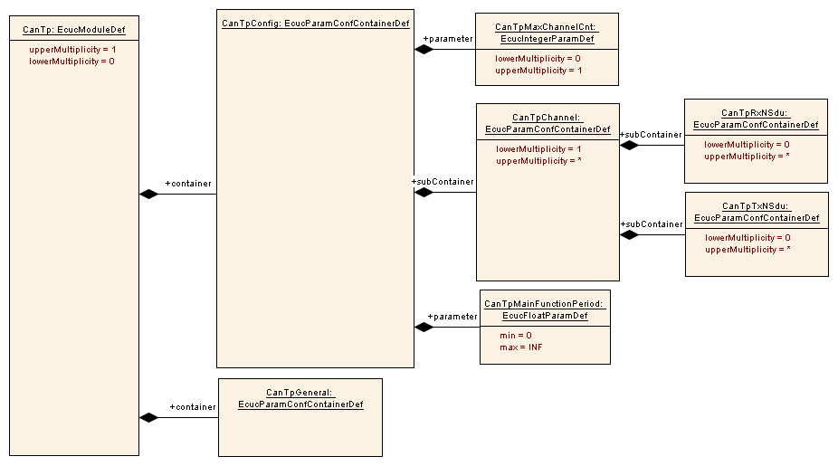

#### 9.2.2. CanTpConfig

| SWS 条目 | [ECUC_CanTp_00290] |
| --- | --- |
| 容器名称 | CanTpConfig |
| 父容器 | CanTp |
| 描述 | 该容器包含AUTOSAR CanTp模块的配置参数和子容器。 |
| 配置参数 | 见下方参数表 |

| SWS 条目 | [ECUC_CanTp_00240] |
| --- | --- |
| 参数名称 | CanTpMainFunctionPeriod |
| 父容器 | CanTpConfig |
| 描述 | 允许配置MainFunction的时间（以秒为单位的浮点数）。应为CanTpMainFunctionPeriod分配一个对于CanTp在TX和RX数据传输中配置的所有定时器而言最优的值，即与配置时序的差异应尽可能小。请注意：该周期应与调用CanTp主函数的周期任务的调用周期时间相同。 |
| 多重性 | 1 |
| 类型 | EcucFloatParamDef |
| 范围 | ]0 .. INF[ |
| 默认值 | - |
| Post-Build 变体值 | false |
| 值配置类 | Pre-compile time：X（All Variants）；Link time：-；Post-build time：- |
| 作用域/依赖 | scope: ECU |

| SWS 条目 | [ECUC_CanTp_00304] |
| --- | --- |
| 参数名称 | CanTpMaxChannelCnt |
| 父容器 | CanTpConfig |
| 描述 | 通道的最大数量。仅在使用静态内存分配的Post-Build可加载实现的情况下需要该参数。 |
| 多重性 | 0..1 |
| 类型 | EcucIntegerParamDef |
| 范围 | 0 .. 18446744073709551615 |
| 默认值 | - |
| Post-Build 变体多重性 | false |
| Post-Build 变体值 | false |
| 多重性配置类 | Pre-compile time：X；Link time：-；Post-build time：- |
| 值配置类 | Pre-compile time：X；Link time：-；Post-build time：- |
| 作用域/依赖 | scope: local |

| 包含的容器 | 容器名称 | 多重性 | 作用域/依赖 |
| --- | --- | --- | --- |
| 包含的容器 | CanTpChannel | 1..* | 该容器包含CanTp通道的配置参数。 |

#### 9.2.3. CanTpGeneral

| SWS 条目 | [ECUC_CanTp_00278] |
| --- | --- |
| 容器名称 | CanTpGeneral |
| 父容器 | CanTp |
| 描述 | 该容器包含CanTp模块的通用配置参数。 |
| 配置参数 | 见下方参数表 |

无包含的容器。

| SWS 条目 | [ECUC_CanTp_00299] |
| --- | --- |
| 参数名称 | CanTpChangeParameterApi |
| 父容器 | CanTpGeneral |
| 描述 | 该参数如果设置为true，则为该模块启用CanTp_ChangeParameterRequest API。 |
| 多重性 | 1 |
| 类型 | EcucBooleanParamDef |
| 默认值 | - |
| Post-Build 变体值 | false |
| 值配置类 | Pre-compile time：X（All Variants）；Link time：-；Post-build time：- |
| 作用域/依赖 | scope: local |

| SWS 条目 | [ECUC_CanTp_00239] |
| --- | --- |
| 参数名称 | CanTpDevErrorDetect |
| 父容器 | CanTpGeneral |
| 描述 | 开启或关闭开发错误检测与通知（**true**：启用检测与通知；**false**：禁用检测与通知）。 |
| 多重性 | 1 |
| 类型 | EcucBooleanParamDef |
| 默认值 | false |
| Post-Build 变体值 | false |
| 值配置类 | Pre-compile time：X（All Variants）；Link time：-；Post-build time：- |
| 作用域/依赖 | scope: local |

| SWS 条目 | [ECUC_CanTp_00302] |
| --- | --- |
| 参数名称 | CanTpDynIdSupport |
| 父容器 | CanTpGeneral |
| 描述 | 启用通过N-PDU元数据（**MetaData**）进行的动态ID处理支持。 |
| 多重性 | 0..1 |
| 类型 | EcucBooleanParamDef |
| 默认值 | false |
| Post-Build 变体多重性 | false |
| Post-Build 变体值 | false |
| 多重性配置类 | Pre-compile time：All Variants；Link time：-；Post-build time：- |
| 值配置类 | Pre-compile time：All Variants；Link time：-；Post-build time：- |
| 作用域/依赖 | scope: local |

| SWS 条目 | [ECUC_CanTp_00305] |
| --- | --- |
| 参数名称 | CanTpFlexibleDataRateSupport |
| 父容器 | CanTpGeneral |
| 描述 | 启用对CAN FD帧的支持。 |
| 多重性 | 0..1 |
| 类型 | EcucBooleanParamDef |
| 默认值 | true |
| 值配置类 | Pre-compile time：X（All Variants）；Link time：-；Post-build time：- |
| 作用域/依赖 | scope: local |

| SWS 条目 | [ECUC_CanTp_00303] |
| --- | --- |
| 参数名称 | CanTpGenericConnectionSupport |
| 父容器 | CanTpGeneral |
| 描述 | 启用对使用带MetaData的N-SDU的通用连接的处理支持。需要CanTpDynIdSupport。 |
| 多重性 | 0..1 |
| 类型 | EcucBooleanParamDef |
| 默认值 | false |
| Post-Build 变体多重性 | false |
| Post-Build 变体值 | false |
| 多重性配置类 | Pre-compile time：All Variants；Link time：-；Post-build time：- |
| 值配置类 | Pre-compile time：All Variants；Link time：-；Post-build time：- |
| 作用域/依赖 | scope: local；依赖：需要CanTpDynIdSupport |

| SWS 条目 | [ECUC_CanTp_00298] |
| --- | --- |
| 参数名称 | CanTpPaddingByte |
| 父容器 | CanTpGeneral |
| 描述 | 用于以某个特定值初始化未使用的字节。 |
| 多重性 | 1 |
| 类型 | EcucIntegerParamDef |
| 范围 | 0 .. 255 |
| 默认值 | - |
| Post-Build 变体值 | false |
| 值配置类 | Pre-compile time：X（All Variants）；Link time：-；Post-build time：- |
| 作用域/依赖 | scope: local |

| SWS 条目 | [ECUC_CanTp_00300] |
| --- | --- |
| 参数名称 | CanTpReadParameterApi |
| 父容器 | CanTpGeneral |
| 描述 | 该参数如果设置为true，则为该模块启用CanTp_ReadParameterApi。 |
| 多重性 | 1 |
| 类型 | EcucBooleanParamDef |
| 默认值 | - |
| Post-Build 变体值 | false |
| 值配置类 | Pre-compile time：X（All Variants）；Link time：-；Post-build time：- |
| 作用域/依赖 | scope: local |

| SWS 条目 | [ECUC_CanTp_00283] |
| --- | --- |
| 参数名称 | CanTpVersionInfoApi |
| 父容器 | CanTpGeneral |
| 描述 | 函数CanTp_GetVersionInfo可通过该配置参数配置（开/关）。 |
| 多重性 | 1 |
| 类型 | EcucBooleanParamDef |
| 默认值 | false |
| Post-Build 变体值 | false |
| 值配置类 | Pre-compile time：X（All Variants）；Link time：-；Post-build time：- |
| 作用域/依赖 |  |

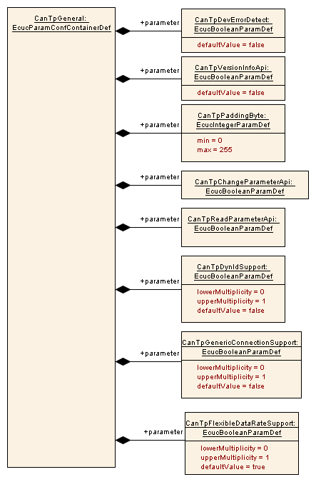

#### 9.2.4. CanTpDemEventParameterRefs

| SWS 条目 | [ECUC_CanTp_00307] |
| --- | --- |
| 容器名称 | CanTpDemEventParameterRefs |
| 父容器 | CanTp |
| 描述 | 包含对DemEventParameter元素的引用的容器，当相应错误发生时，将使用API Dem_SetEventStatus调用这些元素。事件ID取自所引用DemEventParameter的DemEventId符号值。该容器提供标准化的错误，并可通过供应商特定的错误引用进行扩展。 |
| Post-Build 变体多重性 | false |
| 多重性配置类 | Pre-compile time：X（All Variants）；Link time：-；Post-build time：- |
| 配置参数 | 见下方参数表 |

以下各参数的类型均为「对DemEventParameter的符号名称引用（**Symbolic name reference to DemEventParameter**）」，多重性均为0..1，Post-Build 变体多重性为false、Post-Build 变体值为false，多重性配置类和值配置类均为「Pre-compile time：X；Link time：-；Post-build time：-」，作用域/依赖均为scope: ECU。

| SWS 条目 | [ECUC_CanTp_00308] |
| --- | --- |
| 参数名称 | CANTP_E_CANTPNAS_TIMEOUT_OCCURRED |
| 父容器 | CanTpDemEventParameterRefs |
| 描述 | 对DemEventParameter元素的引用，当发生CANTP_E_CANTPNAS_TIMEOUT_OCCURRED错误时，将使用API Dem_SetEventStatus调用该元素。事件ID取自所引用DemEventParameter的DemEventId符号值。 |

| SWS 条目 | [ECUC_CanTp_00309] |
| --- | --- |
| 参数名称 | CANTP_E_CANTPNAR_TIMEOUT_OCCURRED |
| 父容器 | CanTpDemEventParameterRefs |
| 描述 | 对DemEventParameter元素的引用，当发生CANTP_E_CANTPNAR_TIMEOUT_OCCURRED错误时，将使用API Dem_SetEventStatus调用该元素。事件ID取自所引用DemEventParameter的DemEventId符号值。 |

| SWS 条目 | [ECUC_CanTp_00310] |
| --- | --- |
| 参数名称 | CANTP_E_CANTPNBS_TIMEOUT_OCCURRED |
| 父容器 | CanTpDemEventParameterRefs |
| 描述 | 对DemEventParameter元素的引用，当发生CANTP_E_CANTPNBS_TIMEOUT_OCCURRED错误时，将使用API Dem_SetEventStatus调用该元素。事件ID取自所引用DemEventParameter的DemEventId符号值。 |

| SWS 条目 | [ECUC_CanTp_00311] |
| --- | --- |
| 参数名称 | CANTP_E_CANTPNBR_TIMEOUT_OCCURRED |
| 父容器 | CanTpDemEventParameterRefs |
| 描述 | 对DemEventParameter元素的引用，当发生CANTP_E_CANTPNBR_TIMEOUT_OCCURRED错误时，将使用API Dem_SetEventStatus调用该元素。事件ID取自所引用DemEventParameter的DemEventId符号值。 |

| SWS 条目 | [ECUC_CanTp_00312] |
| --- | --- |
| 参数名称 | CANTP_E_CANTPNCS_TIMEOUT_OCCURRED |
| 父容器 | CanTpDemEventParameterRefs |
| 描述 | 对DemEventParameter元素的引用，当发生CANTP_E_CANTPNCS_TIMEOUT_OCCURRED错误时，将使用API Dem_SetEventStatus调用该元素。事件ID取自所引用DemEventParameter的DemEventId符号值。 |

| SWS 条目 | [ECUC_CanTp_00313] |
| --- | --- |
| 参数名称 | CANTP_E_CANTPNCR_TIMEOUT_OCCURRED |
| 父容器 | CanTpDemEventParameterRefs |
| 描述 | 对DemEventParameter元素的引用，当发生CANTP_E_CANTPNCR_TIMEOUT_OCCURRED错误时，将使用API Dem_SetEventStatus调用该元素。事件ID取自所引用DemEventParameter的DemEventId符号值。 |

| SWS 条目 | [ECUC_CanTp_00314] |
| --- | --- |
| 参数名称 | CANTP_E_SWAPPED_CONSECUTIVE_FRAMES_RECEIVED |
| 父容器 | CanTpDemEventParameterRefs |
| 描述 | 对DemEventParameter元素的引用，当发生CANTP_E_SWAPPED_CONSECUTIVE_FRAMES_RECEIVED错误时，将使用API Dem_SetEventStatus调用该元素。事件ID取自所引用DemEventParameter的DemEventId符号值。 |

| SWS 条目 | [ECUC_CanTp_00315] |
| --- | --- |
| 参数名称 | CANTP_E_DROPPED_CONSECUTIVE_FRAMES_DETECTED |
| 父容器 | CanTpDemEventParameterRefs |
| 描述 | 对DemEventParameter元素的引用，当发生CANTP_E_DROPPED_CONSECUTIVE_FRAMES_DETECTED错误时，将使用API Dem_SetEventStatus调用该元素。事件ID取自所引用DemEventParameter的DemEventId符号值。 |

| SWS 条目 | [ECUC_CanTp_00316] |
| --- | --- |
| 参数名称 | CANTP_E_FC_OVERFLOW_RECEIVED |
| 父容器 | CanTpDemEventParameterRefs |
| 描述 | 对DemEventParameter元素的引用，当发生CANTP_E_FC_OVERFLOW_RECEIVED错误时，将使用API Dem_SetEventStatus调用该元素。事件ID取自所引用DemEventParameter的DemEventId符号值。 |

| SWS 条目 | [ECUC_CanTp_00317] |
| --- | --- |
| 参数名称 | CANTP_E_FC_OVERFLOW_TRANSMITTED |
| 父容器 | CanTpDemEventParameterRefs |
| 描述 | 对DemEventParameter元素的引用，当发生CANTP_E_FC_OVERFLOW_TRANSMITTED错误时，将使用API Dem_SetEventStatus调用该元素。事件ID取自所引用DemEventParameter的DemEventId符号值。 |

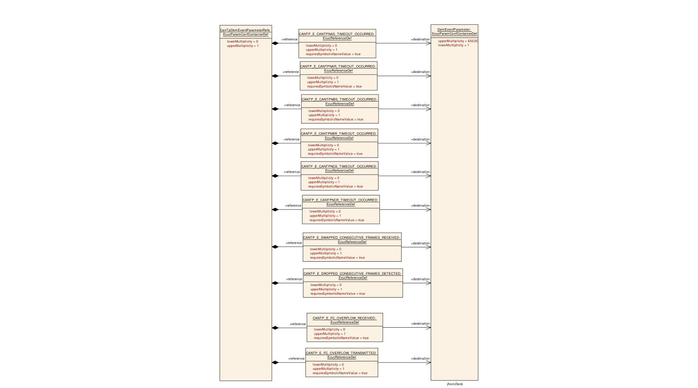

#### 9.2.5. CanTpChannel

| SWS 条目 | [ECUC_CanTp_00288] |
| --- | --- |
| 容器名称 | CanTpChannel |
| 父容器 | CanTpConfig |
| 描述 | 该容器包含CanTp通道的配置参数。 |
| Post-Build 变体多重性 | true |
| 多重性配置类 | Pre-compile time：X；Link time：-；Post-build time：- |
| 配置参数 | 见下方参数表 |

| 包含的容器 | 容器名称 | 多重性 | 作用域/依赖 |
| --- | --- | --- | --- |
| 包含的容器 | CanTpRxNSdu | 0..* | 需为CanTp模块通过该CanTpChannel接收的每个CAN N-SDU配置以下参数。该N-SDU产生SOURCE_ADDRESS_16、TARGET_ADDRESS_16和ADDRESS_EXTENSION_8类型的元数据项。 |
| 包含的容器 | CanTpTxNSdu | 0..* | 需为CanTp模块通过该CanTpChannel发送的每个CAN N-SDU配置以下参数。该N-SDU消费SOURCE_ADDRESS_16、TARGET_ADDRESS_16和ADDRESS_EXTENSION_8类型的元数据项。 |

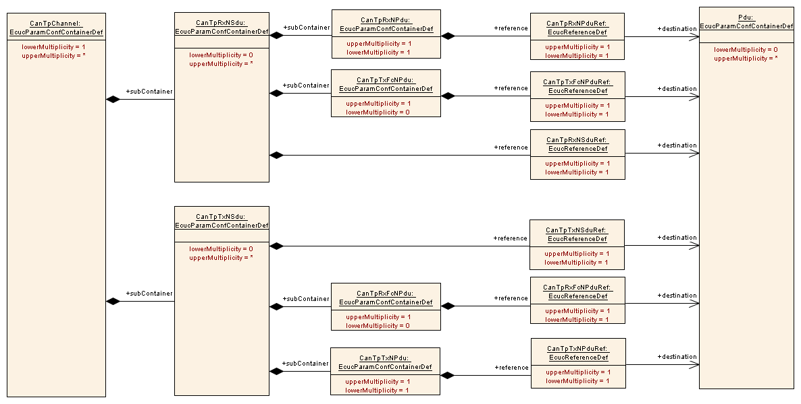

#### 9.2.6. CanTpRxNSdu

| SWS 条目 | [ECUC_CanTp_00137] |
| --- | --- |
| 容器名称 | CanTpRxNSdu |
| 父容器 | CanTpChannel |
| 描述 | 需为CanTp模块通过该CanTpChannel接收的每个CAN N-SDU配置以下参数。该N-SDU产生SOURCE_ADDRESS_16、TARGET_ADDRESS_16和ADDRESS_EXTENSION_8类型的元数据项。 |
| Post-Build 变体多重性 | true |
| 多重性配置类 | Pre-compile time：X；Link time：-；Post-build time：- |
| 配置参数 | 见下方参数表 |

| SWS 条目 | [ECUC_CanTp_00276] |
| --- | --- |
| 参数名称 | CanTpBs |
| 父容器 | CanTpRxNSdu |
| 描述 | 设置CanTp接收方允许发送方在等待继续发送后续N-PDU的授权之前发送的N-PDU数量。有关该参数值的更多细节，请参阅ISO 15765-2规范。 |
| 多重性 | 0..1 |
| 类型 | EcucIntegerParamDef |
| 范围 | 0 .. 255 |
| 默认值 | - |
| Post-Build 变体多重性 | true |
| 作用域/依赖 | scope: local |

| SWS 条目 | [ECUC_CanTp_00277] |
| --- | --- |
| 参数名称 | CanTpNar |
| 父容器 | CanTpRxNSdu |
| 描述 | N_Ar超时的值（以秒为单位）。N_Ar是接收方CAN帧（任意N_PDU）的传输时间。 |
| 多重性 | 0..1 |
| 类型 | EcucFloatParamDef |
| 范围 | ]0 .. INF] |
| 默认值 | - |
| Post-Build 变体多重性 | true |
| Post-Build 变体值 | true |
| 多重性配置类 | Pre-compile time：X；Link time：-；Post-build time：- |
| 值配置类 | Pre-compile time：X；Link time：-；Post-build time：- |
| 作用域/依赖 | scope: local |

| SWS 条目 | [ECUC_CanTp_00245] |
| --- | --- |
| 参数名称 | CanTpNbr |
| 父容器 | CanTpRxNSdu |
| 描述 | 性能要求(N_Br + N_Ar)的值（以秒为单位）。N_Br是从FF或CF的接收指示或FC的发送确认起，到下一个FC的发送请求为止所经过的时间。 |
| 多重性 | 0..1 |
| 类型 | EcucFloatParamDef |
| 范围 | ]0 .. INF] |
| 默认值 | - |
| Post-Build 变体值 | true |
| 值配置类 | Pre-compile time：X；Link time：-；Post-build time：- |
| 作用域/依赖 | scope: local |

| SWS 条目 | [ECUC_CanTp_00279] |
| --- | --- |
| 参数名称 | CanTpNcr |
| 父容器 | CanTpRxNSdu |
| 描述 | N_Cr超时的值（以秒为单位）。N_Cr是直到接收到下一个连续帧N_PDU的时间。 |
| 多重性 | 0..1 |
| 类型 | EcucFloatParamDef |
| 范围 | ]0 .. INF] |
| 默认值 | - |
| Post-Build 变体多重性 | true |
| Post-Build 变体值 | true |
| 多重性配置类 | Pre-compile time：X；Link time：-；Post-build time：X |
| 值配置类 | Pre-compile time：X；Link time：-；Post-build time：X |
| 作用域/依赖 | scope: local |

| SWS 条目 | [ECUC_CanTp_00281] |
| --- | --- |
| 参数名称 | CanTpRxAddressingFormat |
| 父容器 | CanTpRxNSdu |
| 描述 | 声明该RxNSdu支持哪种通信寻址模式。枚举值定义：CanTpStandard使用普通寻址格式；CanTpExtended使用扩展寻址格式；CanTpMixed使用混合11位寻址格式；CanTpNormalFixed使用普通固定寻址格式；CanTpMixed29Bit使用混合29位寻址格式。 |
| 多重性 | 1 |
| 类型 | EcucEnumerationParamDef |
| 范围 | CANTP_EXTENDED、CANTP_MIXED、CANTP_MIXED29BIT、CANTP_NORMALFIXED、CANTP_STANDARD |
| Post-Build 变体值 | false |
| 值配置类 | Pre-compile time：X；Link time：-；Post-build time：- |
| 作用域/依赖 | scope: local |

| SWS 条目 | [ECUC_CanTp_00301] |
| --- | --- |
| 参数名称 | CanTpRxNSduId |
| 父容器 | CanTpRxNSdu |
| 描述 | 上层用于调用CanTp_CancelReceive、CanTp_ChangeParameter和CanTp_ReadParameter的唯一标识符。 |
| 多重性 | 1 |
| 类型 | EcucIntegerParamDef |
| 范围 | 0 .. 65535 |
| 默认值 | - |
| Post-Build 变体值 | false |
| 值配置类 | Pre-compile time：X |
| 作用域/依赖 | scope: local |

| SWS 条目 | [ECUC_CanTp_00249] |
| --- | --- |
| 参数名称 | CanTpRxPaddingActivation |
| 父容器 | CanTpRxNSdu |
| 描述 | 定义接收帧是否使用填充。该参数限于8字节的N-PDU。枚举值定义：CanTpOn：接收的N-PDU对SF、FC和最后一个CF使用填充（CAN 2.0情况下N-PDU长度始终 ≥ 8字节）；CanTpOff：接收的N-PDU对SF、FC和最后一个CF不使用填充（N-PDU长度为动态——任何有效DLC值）。注意：长度大于8字节的N-PDU到下一个更高有效DLC值的强制映射不受此参数影响。 |
| 多重性 | 1 |
| 类型 | EcucEnumerationParamDef |
| 范围 | CANTP_OFF、CANTP_ON |
| Post-Build 变体值 | true |
| 值配置类 | Pre-compile time：X；Link time：-；Post-build time：- |
| 作用域/依赖 | scope: local |

| SWS 条目 | [ECUC_CanTp_00250] |
| --- | --- |
| 参数名称 | CanTpRxTaType |
| 父容器 | CanTpRxNSdu |
| 描述 | 声明该Rx N-SDU的通信类型。 |
| 多重性 | 1 |
| 类型 | EcucEnumerationParamDef |
| 范围 | CANTP_FUNCTIONAL、CANTP_PHYSICAL |
| Post-Build 变体值 | false |
| 值配置类 | Pre-compile time：X；Link time：-；Post-build time：- |
| 作用域/依赖 | scope: local |

| SWS 条目 | [ECUC_CanTp_00251] |
| --- | --- |
| 参数名称 | CanTpRxWftMax |
| 父容器 | CanTpRxNSdu |
| 描述 | 该参数指示接收方可以连续发送多少个流控等待N-PDU。它是节点本地的，不会在FC协议数据单元内部发送。 |
| 多重性 | 0..1 |
| 类型 | EcucIntegerParamDef |
| 范围 | 0 .. 65535 |
| 默认值 | - |
| Post-Build 变体多重性 | true |
| Post-Build 变体值 | true |
| 多重性配置类 | Pre-compile time：X；Link time：-；Post-build time：X |
| 值配置类 | Pre-compile time：X；Link time：-；Post-build time：X |
| 作用域/依赖 | scope: local |

| SWS 条目 | [ECUC_CanTp_00252] |
| --- | --- |
| 参数名称 | CanTpSTmin |
| 父容器 | CanTpRxNSdu |
| 描述 | 设置CanTp发送方在两次CF N-PDU发送之间应等待的最短时间。有关该参数值的更多细节，请参阅ISO 15765-2规范。 |
| 多重性 | 0..1 |
| 类型 | EcucFloatParamDef |
| 范围 | [0 .. INF] |
| 默认值 | - |
| Post-Build 变体多重性 | true |
| Post-Build 变体值 | true |
| 多重性配置类 | Pre-compile time：X；Link time：-；Post-build time：- |
| 值配置类 | Pre-compile time：X；Link time：-；Post-build time：- |
| 作用域/依赖 | scope: local |

| 包含的容器 | 容器名称 | 多重性 | 作用域/依赖 |
| --- | --- | --- | --- |
| 包含的容器 | CanTpNTa | 0..1 | 见9.2.12节CanTpNTa。 |
| 包含的容器 | CanTpNSa | 0..1 | 见9.2.13节CanTpNSa。 |
| 包含的容器 | CanTpNAe | 0..1 | 见9.2.14节CanTpNAe。 |
| 包含的容器 | CanTpTxFcNPdu | 0..1 | 见9.2.7节CanTpTxFcNPdu。 |
| 包含的容器 | CanTpRxNPdu | 0..1 | 见9.2.8节CanTpRxNPdu。 |

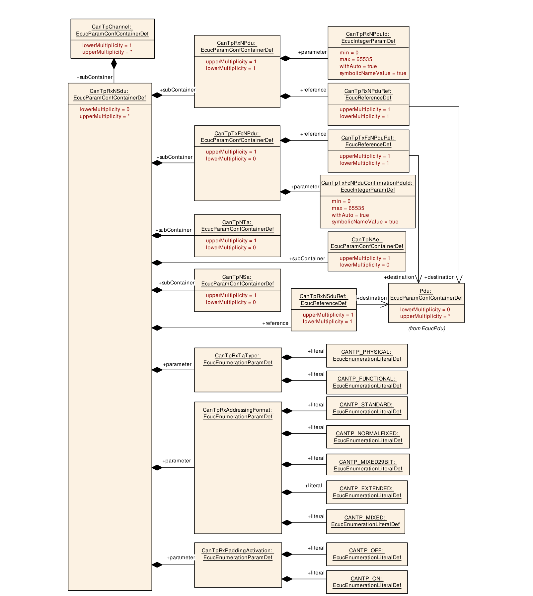

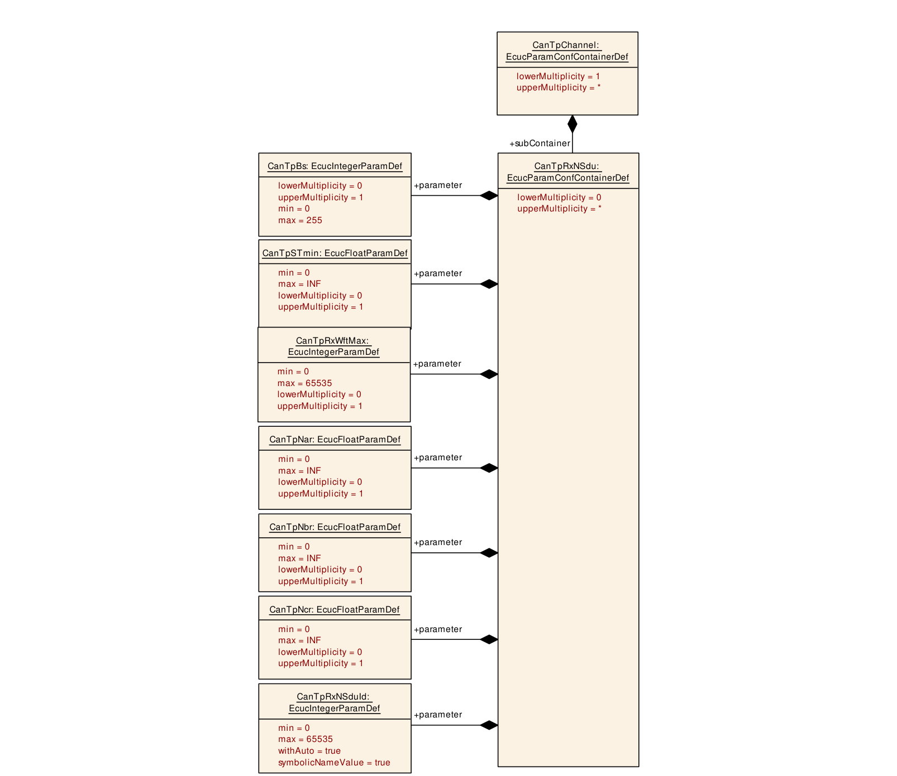

#### 9.2.7. CanTpTxFcNPdu

| SWS 条目 | [ECUC_CanTp_00259] |
| --- | --- |
| 容器名称 | CanTpTxFcNPdu |
| 父容器 | CanTpRxNSdu |
| 描述 | 用于将PDU的ID与对PDU的引用分组。该N-PDU产生CAN_ID_32类型的元数据项。 |
| 配置参数 | 见下方参数表 |

| SWS 条目 | [ECUC_CanTp_00287] |
| --- | --- |
| 参数名称 | CanTpTxFcNPduConfirmationPduId |
| 父容器 | CanTpTxFcNPdu |
| 描述 | CanIf用于向CanIf模块确认CanTpTxFcNPdu发送的句柄ID。 |
| 多重性 | 1 |
| 类型 | EcucIntegerParamDef（为该参数生成符号名称） |
| 范围 | 0 .. 65535 |
| 默认值 | - |
| Post-Build 变体值 | false |
| 值配置类 | Pre-compile time：X；Link time：-；Post-build time：- |
| 作用域/依赖 | scope: local |

| SWS 条目 | [ECUC_CanTp_00260] |
| --- | --- |
| 参数名称 | CanTpTxFcNPduRef |
| 父容器 | CanTpTxFcNPdu |
| 描述 | 对COM栈中某个Pdu的引用。 |
| 多重性 | 1 |
| 类型 | 对Pdu的引用 |
| Post-Build 变体值 | true |
| 值配置类 | Pre-compile time：X；Link time：-；Post-build time：- |
| 作用域/依赖 |  |

#### 9.2.8. CanTpRxNPdu

| SWS 条目 | [ECUC_CanTp_00256] |
| --- | --- |
| 容器名称 | CanTpRxNPdu |
| 父容器 | CanTpRxNSdu |
| 描述 | 用于将PDU的ID与对PDU的引用分组。该N-PDU消费CAN_ID_32类型的元数据项。 |
| 配置参数 | 见下方参数表 |

| SWS 条目 | [ECUC_CanTp_00258] |
| --- | --- |
| 参数名称 | CanTpRxNPduId |
| 父容器 | CanTpRxNPdu |
| 描述 | 附加到RxNsdu的N-PDU标识符由CanTpRxNSduId标识。每个RxNsdu标识符只链接到一个SF/FF/CF N-PDU标识符。但是，在扩展或混合寻址格式的情况下，CanTp还必须填充每个发送N-PDU的第一个数据字节，因此可能需要第二个N-PDU标识符。 |
| 多重性 | 1 |
| 类型 | EcucIntegerParamDef（为该参数生成符号名称） |
| 范围 | 0 .. 65535 |
| 默认值 | - |
| Post-Build 变体值 | false |
| 值配置类 | Pre-compile time：X；Link time：-；Post-build time：- |
| 作用域/依赖 | scope: local |

| SWS 条目 | [ECUC_CanTp_00257] |
| --- | --- |
| 参数名称 | CanTpRxNPduRef |
| 父容器 | CanTpRxNPdu |
| 描述 | 对COM栈中某个Pdu的引用。 |
| 多重性 | 1 |
| 类型 | 对Pdu的引用 |
| Post-Build 变体值 | true |
| 值配置类 | Pre-compile time：X；Link time：-；Post-build time：- |
| 作用域/依赖 |  |

#### 9.2.9. CanTpTxNSdu

| SWS 条目 | [ECUC_CanTp_00138] |
| --- | --- |
| 容器名称 | CanTpTxNSdu |
| 父容器 | CanTpChannel |
| 描述 | 需为CanTp模块通过该CanTpChannel发送的每个CAN N-SDU配置以下参数。该N-SDU消费SOURCE_ADDRESS_16、TARGET_ADDRESS_16和ADDRESS_EXTENSION_8类型的元数据项。 |
| Post-Build 变体多重性 | true |
| 多重性配置类 | Pre-compile time：X；Link time：-；Post-build time：- |
| 配置参数 | 见下方参数表 |

| SWS 条目 | [ECUC_CanTp_00263] |
| --- | --- |
| 参数名称 | CanTpNas |
| 父容器 | CanTpTxNSdu |
| 描述 | N_As超时的值（以秒为单位）。N_As是发送方部分CAN帧（任意N_PDU）的传输时间。 |
| 多重性 | 1 |
| 类型 | EcucFloatParamDef |
| 范围 | ]0 .. INF] |
| 默认值 | - |
| Post-Build 变体值 | true |
| 值配置类 | Pre-compile time：X；Link time：-；Post-build time：- |
| 作用域/依赖 | scope: local |

| SWS 条目 | [ECUC_CanTp_00264] |
| --- | --- |
| 参数名称 | CanTpNbs |
| 父容器 | CanTpTxNSdu |
| 描述 | N_Bs超时的值（以秒为单位）。N_Bs是直到接收到下一个流控N_PDU的传输时间。 |
| 多重性 | 0..1 |
| 类型 | EcucFloatParamDef |
| 范围 | ]0 .. INF] |
| 默认值 | - |
| Post-Build 变体多重性 | true |
| Post-Build 变体值 | true |
| 多重性配置类 | Pre-compile time：X；Link time：-；Post-build time：- |
| 值配置类 | Pre-compile time：X；Link time：-；Post-build time：- |
| 作用域/依赖 | scope: local |

| SWS 条目 | [ECUC_CanTp_00265] |
| --- | --- |
| 参数名称 | CanTpNcs |
| 父容器 | CanTpTxNSdu |
| 描述 | 与N_Cs相关的性能要求的值（以秒为单位）。CanTpNcs是允许CanTp向PduR请求连续帧N_PDU的Tx数据的时间。 |
| 多重性 | 0..1 |
| 类型 | EcucFloatParamDef |
| 范围 | ]0 .. INF] |
| 默认值 | - |
| Post-Build 变体多重性 | true |
| Post-Build 变体值 | true |
| 多重性配置类 | Pre-compile time：X；Link time：-；Post-build time：X |
| 值配置类 | Pre-compile time：X；Link time：-；Post-build time：X |
| 作用域/依赖 | scope: local |

| SWS 条目 | [ECUC_CanTp_00282] |
| --- | --- |
| 参数名称 | CanTpTc |
| 父容器 | CanTpTxNSdu |
| 描述 | 启用发送取消功能的开关。 |
| 多重性 | 1 |
| 类型 | EcucBooleanParamDef |
| 默认值 | - |
| Post-Build 变体值 | false |
| 值配置类 | Pre-compile time：X；Link time：-；Post-build time：- |
| 作用域/依赖 | scope: local |

| SWS 条目 | [ECUC_CanTp_00262] |
| --- | --- |
| 参数名称 | CanTpTxAddressingFormat |
| 父容器 | CanTpTxNSdu |
| 描述 | 声明该TxNSdu支持哪种通信寻址格式。枚举值定义：CanTpStandard使用普通寻址格式；CanTpExtended使用扩展寻址格式；CanTpMixed使用混合11位寻址格式；CanTpNormalFixed使用普通固定寻址格式；CanTpMixed29Bit使用混合29位寻址格式。 |
| 多重性 | 1 |
| 类型 | EcucEnumerationParamDef |
| 范围 | CANTP_EXTENDED、CANTP_MIXED、CANTP_MIXED29BIT、CANTP_NORMALFIXED、CANTP_STANDARD |
| Post-Build 变体值 | false |
| 值配置类 | Pre-compile time：X；Link time：-；Post-build time：- |
| 作用域/依赖 | scope: local |

| SWS 条目 | [ECUC_CanTp_00268] |
| --- | --- |
| 参数名称 | CanTpTxNSduId |
| 父容器 | CanTpTxNSdu |
| 描述 | 指向一个结构的唯一标识符，该结构包含处理TxNsdu发送所需的所有有用信息。 |
| 多重性 | 1 |
| 类型 | EcucIntegerParamDef（为该参数生成符号名称） |
| 范围 | 0 .. 65535 |
| 默认值 | - |
| Post-Build 变体值 | false |
| 值配置类 | Pre-compile time：X（All Variants）；Link time：-；Post-build time：- |
| 作用域/依赖 | scope: local |

| SWS 条目 | [ECUC_CanTp_00269] |
| --- | --- |
| 参数名称 | CanTpTxPaddingActivation |
| 父容器 | CanTpTxNSdu |
| 描述 | 定义发送帧是否使用填充。该参数限于8字节的N-PDU。枚举值定义：CanTpOn：发送的N-PDU对SF、FC和最后一个CF使用填充（CAN 2.0情况下N-PDU长度始终为8字节）；CanTpOff：发送的N-PDU对SF、CF和最后一个CF不使用填充（N-PDU长度为动态——任何有效DLC值）。注意：长度大于8字节的N-PDU到下一个更高有效DLC值的强制映射不受此参数影响。 |
| 多重性 | 1 |
| 类型 | EcucEnumerationParamDef |
| 范围 | CANTP_OFF、CANTP_ON |
| Post-Build 变体值 | true |
| 值配置类 | Pre-compile time：X；Link time：-；Post-build time：- |
| 作用域/依赖 | scope: local |

| SWS 条目 | [ECUC_CanTp_00270] |
| --- | --- |
| 参数名称 | CanTpTxTaType |
| 父容器 | CanTpTxNSdu |
| 描述 | 声明该TxNsdu的通信类型。枚举值：CanTpPhysical用于1:1通信；CanTpFunctional用于1:n通信。 |
| 多重性 | 1 |
| 类型 | EcucEnumerationParamDef |
| 范围 | CANTP_FUNCTIONAL、CANTP_PHYSICAL |
| Post-Build 变体值 | false |
| 值配置类 | Pre-compile time：X；Link time：-；Post-build time：- |
| 作用域/依赖 | scope: local |

| SWS 条目 | [ECUC_CanTp_00261] |
| --- | --- |
| 参数名称 | CanTpTxNSduRef |
| 父容器 | CanTpTxNSdu |
| 描述 | 对COM栈中某个Pdu的引用。 |
| 多重性 | 1 |
| 类型 | 对Pdu的引用 |
| Post-Build 变体值 | true |
| 值配置类 | Pre-compile time：X；Link time：-；Post-build time：- |
| 作用域/依赖 |  |

| 包含的容器 | 容器名称 | 多重性 | 作用域/依赖 |
| --- | --- | --- | --- |
| 包含的容器 | CanTpNTa | 0..1 | 见9.2.12节CanTpNTa。 |
| 包含的容器 | CanTpNSa | 0..1 | 见9.2.13节CanTpNSa。 |
| 包含的容器 | CanTpNAe | 0..1 | 见9.2.14节CanTpNAe。 |
| 包含的容器 | CanTpTxNPdu | 0..1 | 见9.2.10节CanTpTxNPdu。 |
| 包含的容器 | CanTpRxFcNPdu | 0..1 | 见9.2.11节CanTpRxFcNPdu。 |

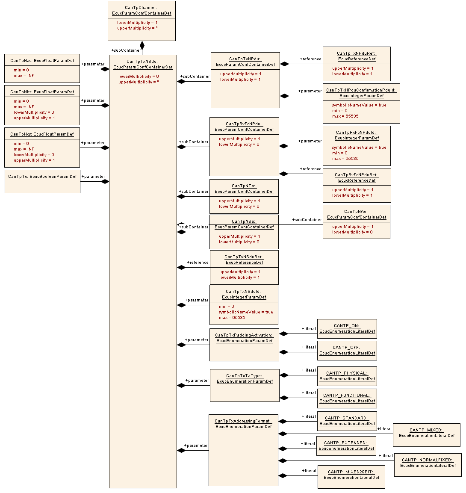

#### 9.2.10. CanTpTxNPdu

| SWS 条目 | [ECUC_CanTp_00274] |
| --- | --- |
| 容器名称 | CanTpTxNPdu |
| 父容器 | CanTpTxNSdu |
| 描述 | 用于将PDU的ID与对PDU的引用分组。该N-PDU产生CAN_ID_32类型的元数据项。 |
| 配置参数 | 见下方参数表 |

| SWS 条目 | [ECUC_CanTp_00286] |
| --- | --- |
| 参数名称 | CanTpTxNPduConfirmationPduId |
| 父容器 | CanTpTxNPdu |
| 描述 | CanIf用于向CanIf模块确认CanTpTxNPdu发送的句柄ID。 |
| 多重性 | 1 |
| 类型 | EcucIntegerParamDef（为该参数生成符号名称） |
| 范围 | 0 .. 65535 |
| 默认值 | - |
| Post-Build 变体值 | false |
| 值配置类 | Pre-compile time：X；Link time：-；Post-build time：- |
| 作用域/依赖 | scope: local |

| SWS 条目 | [ECUC_CanTp_00275] |
| --- | --- |
| 参数名称 | CanTpTxNPduRef |
| 父容器 | CanTpTxNPdu |
| 描述 | 对COM栈中某个Pdu的引用。 |
| 多重性 | 1 |
| 类型 | 对Pdu的引用 |
| Post-Build 变体值 | true |
| 值配置类 | Pre-compile time：X；Link time：-；Post-build time：- |
| 作用域/依赖 |  |

#### 9.2.11. CanTpRxFcNPdu

| SWS 条目 | [ECUC_CanTp_00271] |
| --- | --- |
| 容器名称 | CanTpRxFcNPdu |
| 父容器 | CanTpTxNSdu |
| 描述 | 用于将PDU的ID与对PDU的引用分组。该N-PDU消费CAN_ID_32类型的元数据项。 |
| 配置参数 | 见下方参数表 |

| SWS 条目 | [ECUC_CanTp_00273] |
| --- | --- |
| 参数名称 | CanTpRxFcNPduId |
| 父容器 | CanTpRxFcNPdu |
| 描述 | 附加到该TxNsdu的FC N-PDU的N-PDU标识符由CanTpTxNSduId标识。每个TxNsdu标识符只链接到一个Rx FC N-PDU标识符。但是，在扩展寻址格式的情况下，FC的第一个数据字节还包含N_TA值，因此可能需要第二个N-PDU标识符。 |
| 多重性 | 1 |
| 类型 | EcucIntegerParamDef（为该参数生成符号名称） |
| 范围 | 0 .. 65535 |
| 默认值 | - |
| Post-Build 变体值 | false |
| 值配置类 | Pre-compile time：X；Link time：-；Post-build time：- |
| 作用域/依赖 | scope: local |

| SWS 条目 | [ECUC_CanTp_00272] |
| --- | --- |
| 参数名称 | CanTpRxFcNPduRef |
| 父容器 | CanTpRxFcNPdu |
| 描述 | 对COM栈中某个Pdu的引用。 |
| 多重性 | 1 |
| 类型 | 对Pdu的引用 |
| Post-Build 变体值 | true |
| 值配置类 | Pre-compile time：X；Link time：-；Post-build time：- |
| 作用域/依赖 |  |

#### 9.2.12. CanTpNTa

| SWS 条目 | [ECUC_CanTp_00139] |
| --- | --- |
| 容器名称 | CanTpNTa |
| 父容器 | CanTpRxNSdu、CanTpTxNSdu |
| 描述 | 寻址格式为CANTP_EXTENDED的每个RxNSdu和TxNSdu都需要该容器。当启用DynIdSupport时，寻址格式为CANTP_NORMALFIXED或CANTP_MIXED29BIT的每个RxNSdu也需要该容器。当启用DynIdSupport且未启用GenericConnectionSupport时，寻址格式为CANTP_NORMALFIXED或CANTP_MIXED29BIT的每个TxNSdu也需要该容器。 |
| 配置参数 | 见下方参数表 |

| SWS 条目 | [ECUC_CanTp_00255] |
| --- | --- |
| 参数名称 | CanTpNTa |
| 父容器 | CanTpNTa |
| 描述 | 该参数包含传输协议目标地址值。 |
| 多重性 | 1 |
| 类型 | EcucIntegerParamDef |
| 范围 | 0 .. 255 |
| 默认值 | - |
| Post-Build 变体值 | false |
| 值配置类 | Pre-compile time：X；Link time：-；Post-build time：- |
| 作用域/依赖 | scope: local |

#### 9.2.13. CanTpNSa

| SWS 条目 | [ECUC_CanTp_00253] |
| --- | --- |
| 容器名称 | CanTpNSa |
| 父容器 | CanTpRxNSdu、CanTpTxNSdu |
| 描述 | RxTaType为CANTP_PHYSICAL且CanTpAddressingFormat为CANTP_EXTENDED的每个RxNSdu和TxNSdu都需要该容器。当启用DynIdSupport时，寻址格式为CANTP_NORMALFIXED或CANTP_MIXED29BIT的每个TxNSdu也需要该容器。当启用DynIdSupport且未启用GenericConnectionSupport时，寻址格式为CANTP_NORMALFIXED或CANTP_MIXED29BIT的每个RxNSdu也需要该容器。 |
| 配置参数 | 见下方参数表 |

| SWS 条目 | [ECUC_CanTp_00254] |
| --- | --- |
| 参数名称 | CanTpNSa |
| 父容器 | CanTpNSa |
| 描述 | 该参数包含传输协议源地址值。 |
| 多重性 | 1 |
| 类型 | EcucIntegerParamDef |
| 茖围 | 0 .. 255 |
| 默认值 | - |
| Post-Build 变体值 | false |
| 值配置类 | Pre-compile time：X；Link time：-；Post-build time：- |
| 作用域/依赖 | scope: local |

#### 9.2.14. CanTpNAe

| SWS 条目 | [ECUC_CanTp_00284] |
| --- | --- |
| 容器名称 | CanTpNAe |
| 父容器 | CanTpRxNSdu、CanTpTxNSdu |
| 描述 | 寻址格式为CANTP_MIXED或CANTP_MIXED29BIT的每个RxNSdu和TxNSdu都需要该容器。 |
| 配置参数 | 见下方参数表 |

| SWS 条目 | [ECUC_CanTp_00285] |
| --- | --- |
| 参数名称 | CanTpNAe |
| 父容器 | CanTpNAe |
| 描述 | 该参数包含传输协议地址扩展值。 |
| 多重性 | 1 |
| 类型 | EcucIntegerParamDef |
| 茖围 | 0 .. 255 |
| 默认值 | - |
| Post-Build 变体值 | false |
| 值配置类 | Pre-compile time：X；Link time：-；Post-build time：- |
| 作用域/依赖 | scope: local |

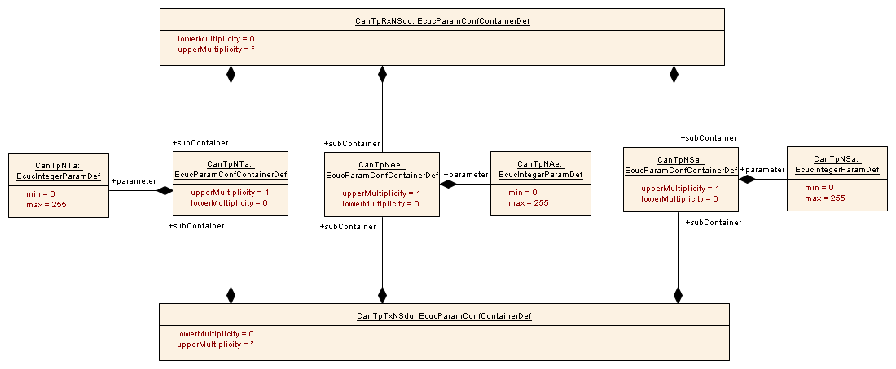

### 9.3. 发布信息

详情请参阅SWS\_BSWGeneral的第10.3章「发布信息」。

## B. AUTOSAR 可追溯项变更历史

请注意，本章中的列表还包括在后续版本中已从规范中移除的可追溯项。这些项不会作为超链接出现在文档中。

### B.1. 本文档根据AUTOSAR R23-11版本的可追溯项历史

#### B.1.1. R23-11中新增的规范项

```
[SWS_CanTp_00361] [SWS_CanTp_00362] [SWS_CanTp_00363] [SWS_CanTp_00364]
[SWS_CanTp_00365] [SWS_CanTp_00366] [SWS_CanTp_00367] [SWS_CanTp_00368]
[SWS_CanTp_00369] [SWS_CanTp_00370]
```

#### B.1.2. R23-11中变更的规范项

```
[SWS_CanTp_00328]
```

#### B.1.3. R23-11中删除的规范项

无。
