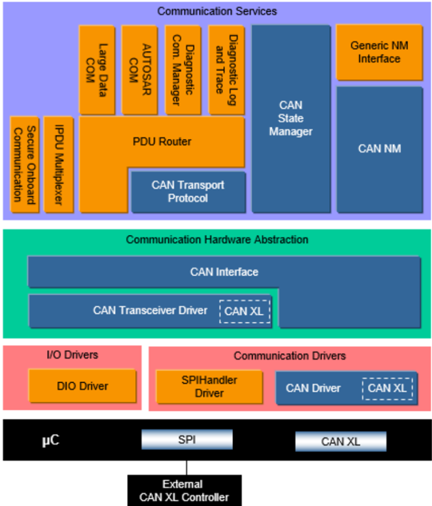

## 1. 简介和功能概述

本规范描述 **AUTOSAR** 基础软件模块 **CAN XL Driver**（CAN XL 驱动程序）的功能、**API** 和配置。

本文档的基础是 [\[1\]](#ref-1)（CiA610-1）和 [\[2\]](#ref-2)（CiA611-1）。假定读者已经熟悉这些规范。本文档不会再次描述 **CAN XL** 的功能。

**CAN XL Driver** 属于最底层，执行硬件访问，并为上层提供与硬件无关的 **API**。可以访问 **CAN XL Driver** 的两个上层模块是 **CanIf** 和 **EthIf**。

**CAN XL Driver** 是 **CAN Driver** 模块的扩展，因此本文档只应提供在现有 **CAN** 协议栈之上进行扩展所需的信息和规范。为了更好地理解，本文也给出了一些一般性的信息。

**CAN XL Driver** 提供用于发起传输的服务，并调用 **CanIf** 和 **EthIf** 模块的回调函数来通知事件，这些都与硬件无关。

此外，它还提供用于控制 **CAN XL** 控制器特定硬件的服务，包括例如通用 **CAN XL** 帧的发送与接收。



## 2. 缩略语

以下术语表列出了与 **CAN XL Driver** 模块相关、但未包含在 [\[3\]](#ref-3)（**AUTOSAR** 术语表）中的首字母缩略词和缩略语。

**XLFF**
> XL 帧格式（**XL Frame Format**）。

**SDU type**
> 服务数据单元类型（**service data unit type**）。

**retransmit counter**
> 部分 **CAN XL** 控制器提供的一项特性：当 **ACK** 槽未在总线上置位时，允许将一个 **CAN** 帧连续多次发送。该计数器给出了最大发送次数。

## 3. 相关文档

### 3.1. 输入文件和相关标准与规范

<a id="ref-1"></a>[1] CiA 610-1 version 1.0.0 (DSP) - CAN XL specifications and test plans - Part 1: Data link layer and physical coding sub-layer requirements
> http://www.can-cia.org

<a id="ref-2"></a>[2] CiA 611-1 version 1.0.0 (DSP) - CAN XL higher layer functions - Part 1: Definition of service data unit types
> http://www.can-cia.org

<a id="ref-3"></a>[3] Glossary
> AUTOSAR_FO_TR_Glossary

<a id="ref-4"></a>[4] General Specification of Basic Software Modules
> AUTOSAR_CP_SWS_BSWGeneral

<a id="ref-5"></a>[5] Specification of CAN Driver
> AUTOSAR_CP_SWS_CANDriver

<a id="ref-6"></a>[6] Specification of CAN XL Transceiver Driver
> AUTOSAR_CP_SWS_CANXLTransceiverDriver

<a id="ref-7"></a>[7] Specification of CAN Interface
> AUTOSAR_CP_SWS_CANInterface

<a id="ref-8"></a>[8] Specification of Ethernet Interface
> AUTOSAR_CP_SWS_EthernetInterface

<a id="ref-9"></a>[9] General Requirements on Basic Software Modules
> AUTOSAR_CP_SRS_BSWGeneral

<a id="ref-10"></a>[10] Requirements on CAN
> AUTOSAR_CP_SRS_CAN

<a id="ref-11"></a>[11] ISO 11898-1:2015 - Road vehicles - Controller area network (CAN)

<a id="ref-12"></a>[12] Specification of Ethernet Driver
> AUTOSAR_CP_SWS_EthernetDriver

### 3.2. 相关规范

**AUTOSAR** 提供了一份基础软件模块通用规范 [\[4\]](#ref-4)（**SWS BSW General**），它对 **CAN XL Driver** 同样有效。

因此，规范 **SWS BSW General** 应被视为 **CAN XL Driver** 的附加且必需的规范。

## 4. 约束和假设

**CAN XL Driver** 的约束和假设与 **CAN Driver** 模块的相同。

假定所有 **CAN XL** 硬件均开箱即用地支持 ingress 和 egress 时间戳。如果该能力不可用，则需要在软件中对其进行模拟。

### 4.1. 限制

在 [\[2\]](#ref-2)（CiA611-1）中规定了若干种 **SDU** 类型，**AUTOSAR CAN XL** 协议栈不直接支持它们。**AUTOSAR** 通信栈中唯一被直接支持的 **SDU** 类型如下：

1. 01h（基于内容的 **CAN XL** 帧）
2. 03h（隧道传输的 **CAN** 2.0/**FD** 帧）
3. 05h（映射的隧道传输 **802.3** 以太网帧）

其他任何类型（如 02h（节点寻址）和 04h（非映射的隧道传输 **802.3** 以太网帧））都不应被直接支持。它们仍然可以通过 **CDD** 使用，详情参见 **[CanXL_Write](#7319-canxl_write)()** 和 **CanIf_XLRxIndication()** **API**。

此外，利用 **CAN XL** 帧头中 **SEC** 位的未来扩展（如 **Security** 和 **Multi-PDU**）目前尚在开发中，因此还不受支持。

## 5. 对其他模块的依赖

**CAN XL Driver** 模块扩展了 **CAN Driver** [\[5\]](#ref-5)，并与 [\[6\]](#ref-6)（**CAN XL Transceiver Driver**）、[\[5\]](#ref-5)（**CAN Driver**）、[\[7\]](#ref-7)（**CAN Interface**）和 [\[8\]](#ref-8)（**Ethernet Interface**）存在接口关系。

### 5.1. 文件结构

本节说明 **CAN XL Driver** 模块的文件结构。

#### 5.1.1. 代码文件结构

详情请参阅 [\[4\]](#ref-4)（**SWS BSW General**）中的 5.1.6 节「代码文件结构」。

## 6. 功能规格

### 6.1. 初始化

**Can_Init()** 应扩展所有必要的功能，以正确地初始化 **CAN XL Driver**。

### 6.2. 状态处理

#### 6.2.1. 通信请求

状态处理按总线单独执行：对于原生 **CAN** 由 **CanSM** 执行，对于通过 **CAN XL** 隧道传输的 **Ethernet** 由 **EthSM** 执行。**EthIf** 直接与作为下层的 **CAN XL Driver** 和 **CAN XL** 收发器通信。

实际的物理总线状态仅由 **CAN** 协议栈控制。**CAN XL** 收发器通过 **LinkState** 轮询向以太网协议栈指示物理总线状态，与以太网控制器模式无关。

以太网控制器模式由 **CAN XL Driver** 存储，并应请求返回。

以太网控制器模式初始应设置为 **ETH_MODE_DOWN**。

以太网协议栈通过 **[CanXL_SetControllerMode](#7314-canxl_setcontrollermode)()** 请求的控制器模式不应对 **CAN XL** 控制器硬件产生影响。新模式应仅被存储。

**[CanXL_GetControllerMode](#732-canxl_getcontrollermode)()** 应返回所存储的模式。

当以太网控制器模式发生变化时，**CAN XL Driver** 应通过 **EthIf_CtrlModeIndication()** 报告该变化。

#### 6.2.2. BusOff处理

即使不使用原生 **CAN** 通信，也始终需要配置一个 **CAN** 协议栈，并且 **BusOff** 处理按照 **CAN Driver** 中的定义执行。

总线错误状态的变化应通过调用 **CanXLTrcv_ReportErrorState()** 通知 **CAN XL** 收发器。

如果发生 **BusOff**，受影响的 **CAN XL** 控制器的所有缓冲区会在 **CAN XL Driver** 内被清空。

如果配置了以太网协议栈，则在发生 **BusOff** 事件时，包含以太网帧的缓冲区也应被清空，并且应以结果 **E_NOT_OK** 调用 **EthIf_TxConfirmation()**。

**EthIf** 轮询其硬件以确认当前模式和链路状态是否与所请求的模式和链路状态匹配。**BusOff** 事件由 **CAN XL** 收发器在 **CanTrcv_GetLinkState()** 的上下文中通过报告链路断开而返回给 **EthIf**。此外，**EthIf** 中的链路状态不区分错误主动状态和错误被动状态，二者都被报告为链路接通。更多信息参见 [\[6\]](#ref-6)（**CAN XL Transceiver Driver**）。

#### 6.2.3. 无错误信号通知的BusOff处理

如果使用了收发器模式切换，则对于当前已存在的收发器必须关闭错误信号通知。在没有错误信号通知的情况下，控制器硬件自身也不会进行任何 **BusOff** 处理。因此，在这种情况下，**CAN XL Driver** 中应有一个简单的实现来仍然执行babbling保护（混淆茁壮保护）。

如果错误信号通知被禁用，应在软件中模拟一种基于 **TEC**（Transmission Error Counter，发送错误计数器）和 **REC**（Reception Error Counter，接收错误计数器）的基本 **CAN BusOff** 处理。

以下示例展示了这种处理通常的样子：

**TEC** 通常是一个初始化为 0、在 0 到 256 范围内饱和的计数器，**REC** 是一个初始化为 0、在 0 到 128 范围内饱和的计数器。重传计数器被完全关闭，或至少被配置为一个非常低的值。

状态机会遵循以下基本规则集：

* 当一个帧被发送但总线上没有置位 **ACK** 槽时，**TEC** 应增加 8。自上次启动或 **BusOff** 恢复以来，在总线上至少接收到一个帧（无论该帧是否被成功接收）之前，**TEC** 不应增加到超过 128。
* 当一个帧被发送且总线上置位了 **ACK** 槽时，**TEC** 应减 1。
* 当接收到一个帧但该帧不一致时，**REC** 应增加 1。
* 当接收到一个一致的帧时，**REC** 应减 1。

这些事件的检测会在各自上下文（**MainFunction** 或 **ISR**）中随发送和接收处理一同执行，另外，根据硬件能力，还会在 **BusOff** 上下文中执行对错误事件的检测。

状态转换预期与 [\[11\]](#ref-11)（ISO 11898-1:2015）第 12.1.4.4 章「Bus-off management（Bus-off 管理）」中定义的状态转换相对应。在 **BusOff** 状态下，**TEC** 和 **REC** 会立即复位。基本上，在错误信号通知被禁用时，**CAN XL Driver** 的状态转换不应与错误信号通知可用时的处理有所不同。

#### 6.2.4. 唤醒

基本的唤醒处理不发生变化。

对于触发唤醒的已接收帧，不应就其 **SDU** 类型进行区分；**CAN XL Driver** 接收到的任何帧都应通知一个 **CAN** 唤醒。

**EcuM_SetWakeupEvent()** 仅为 **CAN** 调用。它从不会为 **Ethernet** 通知，**CAN XL** 收发器而是通过 **LinkState** 轮询向以太网协议栈指示物理总线状态。

### 6.3. 接收处理

**CAN XL** 帧的所有已用接收队列应各自单独映射到 **CAN XL HRH**。

接收队列也将用于映射到 **CAN HRH** 的 **CAN** 2.0 和 **CAN FD** 帧。

**SDU** 类型的接收机制应为 **XLFF** 进行扩展，例如在轮询模式下应扩展 **Can_MainFunction_Read()**。详情参见 **CAN Driver** 的「L-PDU reception（L-PDU 接收）」一章。

在 **XLFF** 的 L-PDU 接收中，应首先执行所有已配置的过滤，然后才执行其他功能。

在 **XLFF** 的 L-PDU 接收中，如果 **SDU** 类型等于 05h（映射的隧道传输 **802.3** 以太网帧），**CAN XL Driver** 应从接收到的帧中提取有效载荷和寻址信息，并将其传递给 **EthIf_RxIndication()**；否则应将接收到的帧直接传递给 **CanIf_XLRxIndication()**。

根据硬件所支持的过滤能力，可能有多个接收队列可用于将接收到的帧过滤到其中。

由于这高度依赖于硬件供应商，此处除以下内容外不给出更多细节：

**CAN XL** 帧头中可用的任何字段都可用于过滤，不仅限于验收字段（Acceptance Field）。目的可能是流量的分类分离，例如基于 **Priority ID**、**VCID** 和/或 **SDU** 类型。

当涉及以太网帧的隧道传输时，一个常见的用例是过滤所有接收到的、匹配已配置以太网 **MAC** 地址的 **SDU** 类型 05h（映射的隧道传输 **802.3** 以太网帧）L-PDU（参见 **EthCtrlPhyAddress**）。

这有助于先处理高优先级流量再处理低优先级流量。此外，还可以将不需要的流量放入一个单独的队列中保留以供进一步检查，而不是将其过滤掉。

在 **XLFF** 的 L-PDU 接收中，应按照 CiA 611-1 第 5 章「SDU types（SDU 类型）」规范检查帧的一致性。

如果一致性检查失败，则应丢弃接收到的帧，并报告运行时错误 [**CANXL_E_INV_DATA**](#652-运行时错误)。

### 6.4. 发送处理

由于 **CAN XL** 的设计可从小型系统扩展到大型系统，且有效载荷范围可达 2048 字节，具体的硬件实现可能有所不同。

**CAN XL HTH** 的使用方式与 **CAN HTH** 类似。详情参见 **CAN Driver** 的「L-PDU transmission（L-PDU 发送）」一章。

**CAN HTH** 用于映射到逻辑发送对象。根据可用的硬件特性，它们可能映射到独立的报文对象或硬件支持的队列。

**CAN XL** 帧的所有已用发送队列应各自单独映射到 **CAN XL HTH**。

**CAN XL** 发送队列的大小也可以为 1，因而对应于传统的 **CAN** 硬件对象。**CAN** 2.0 和 **CAN FD** 帧的发送队列将以与 **CAN HTH** 类似的方式映射。

由于硬件支持的队列的可用性和行为高度依赖于硬件供应商，此处不给出细节。如何处理不同的 **CAN XL HTH** 由 **CAN XL Driver** 供应商负责文档化。对于相同的硬件，可能会根据系统的特定需求实现多种映射。

函数 **[CanXL_Transmit](#7316-canxl_transmit)()**（用于 **SDU** 类型 05h）和 **[CanXL_Write](#7319-canxl_write)()**（用于其他 **SDU** 类型）应将 **XLFF** 控制信息和数据传送给硬件，并应请求开始发送。

在 **XLFF** 于总线上成功发送后，如果原始发送的 **SDU** 类型等于 05h（映射的隧道传输 **802.3** 以太网帧），**CAN XL Driver** 应以结果 **E_OK** 调用 **EthIf_TxConfirmation()**，否则应调用 **CanIf_TxConfirmation()**。

如果发送无法成功执行，当原始发送的 **SDU** 类型等于 05h（映射的隧道传输 **802.3** 以太网帧）时，**CAN XL Driver** 应以结果 **E_NOT_OK** 调用 **EthIf_TxConfirmation()**。

如果 **CAN XL** 控制器处于 **CAN_CS_STARTED** 以外的其他状态，则受影响的 **CAN XL** 控制器的所有缓冲区应被清空。

### 6.5. 错误分类

《基础软件模块通用规范》（**General Specification of Basic Software Modules**）[19] 的第 7.2 章「错误处理」详细描述了基础软件的错误处理。最重要的是，它构成了一个由可能发生在 **BSW** 模块中的五种错误类型组成的分类方案。在此基础上，以下各节规定了安排在相应小节中的特定错误。

#### 6.5.1. 开发错误

| 错误类型 | 相关错误代码 | 错误值 |
|---|---|---|
| 以错误的参数调用 **API** 服务 | CANXL_E_PARAM_POINTER | 0x01 |
| 以错误的参数调用 **API** 服务 | CANXL_E_PARAM_HANDLE | 0x02 |
| 以错误的参数调用 **API** 服务 | CANXL_E_PARAM_DATA_LENGTH | 0x03 |
| 以错误的参数调用 **API** 服务 | CANXL_E_PARAM_CONTROLLER | 0x04 |
| 在模块未初始化的情况下使用 **API** 服务 | CANXL_E_UNINIT | 0x05 |
| 无效参数 | CANXL_E_INV_PARAM | 0x10 |
| 无效模式 | CANXL_E_INV_MODE | 0x11 |
| 无效时钟单元索引 | CANXL_E_INV_CLKUNIT_IDX | 0x12 |

#### 6.5.2. 运行时错误

| 错误类型 | 相关错误代码 | 错误值 |
|---|---|---|
| 无效数据 | CANXL_E_INV_DATA | 0x12 |

#### 6.5.3. 瞬态故障

没有其他瞬态故障。

#### 6.5.4. 生产错误

没有其他生产错误。

#### 6.5.5. 扩展生产错误

没有其他扩展生产错误。

## 7. API规范

请注意，**CAN XL Driver** 对与 [\[5\]](#ref-5)（**CAN Driver**）共享的部分使用模块简称（MSN）**Can**，而对本文档中定义的扩展使用 MSN **CanXL**。与 SRS_BSW_00101 和 SRS_BSW_00407 不同，**CAN XL Driver** 不提供带有 MSN **CanXL** 的独立 Init 和 GetVersionInfo **API**。遵循 SWS_MemMap_00022，与本文档定义的 **API** 关联的内存段将使用 MSN **CanXL**，并且按照 TPS_ECUC_02108，引用本文档定义的容器的符号名取值也将使用 MSN **CanXL**。

### 7.1. 导入的类型

在本章中，列出了从以下文件包含的所有类型。

**CanXL** 模块的导入数据类型定义

| 模块 | 头文件 | 导入的类型 |
|---|---|---|
| Can | Can_GeneralTypes.h | Can_ErrorStateType |
| Can | Can_GeneralTypes.h | Can_HwHandleType |
| ComStack_Types | ComStack_Types.h | BufReq_ReturnType |
| ComStack_Types | ComStack_Types.h | PduIdType |
| ComStack_Types | ComStack_Types.h | PduInfoType |
| ComStack_Types | ComStack_Types.h | PduLengthType |
| ComStack_Types | ComStackTypes.h | TimeStampQualType |
| ComStack_Types | ComStackTypes.h | TimeStampType |
| ComStack_Types | ComStackTypes.h | TimeTupleType |
| Eth | Eth_GeneralTypes.h | Eth_BufIdxType |
| Eth | Eth_GeneralTypes.h | Eth_CounterType |
| Eth | Eth_GeneralTypes.h | Eth_DataType |
| Eth | Eth_GeneralTypes.h | Eth_FilterActionType |
| Eth | Eth_GeneralTypes.h | Eth_FrameType |
| Eth | Eth_GeneralTypes.h | Eth_ModeType |
| Eth | Eth_GeneralTypes.h | Eth_RxStatsType |
| Eth | Eth_GeneralTypes.h | Eth_RxStatusType |
| Eth | Eth_GeneralTypes.h | Eth_TxErrorCounterValuesType |
| Eth | Eth_GeneralTypes.h | Eth_TxStatsType |
| Std | Std_Types.h | Std_ReturnType |

### 7.2. 类型定义

#### 7.2.1. CanXL_Params

结构类型（**Structure**）。包含 **CAN XL** 特定的信息。元素：

| 元素 | 类型 | 说明 |
|---|---|---|
| PriorityId | uint16 | **CAN XL** 报文的 **Priority ID**。 |
| Vcid | uint16 | **CAN XL** 报文的 **VCID**。 |
| SduType | uint8 | **CAN XL** 报文的 **SDU** 类型。 |
| AcceptanceField | uint32 | **CAN XL** 报文的验收字段（Acceptance field）。 |
| Sec | uint8 | **CAN XL** 报文的简单扩展内容字段（Simple extended content field）。 |

可通过**Can_GeneralTypes.h**获得。

#### 7.2.2. CanXL_PduType

结构类型（**Structure**）。元素：

| 元素 | 类型 | 说明 |
|---|---|---|
| swPduHandle | PduIdType | 包含 **PDU ID**。 |
| length | uint16 | 数据的长度。 |
| sdu | uint8* | **SDU** 数据指针。 |
| XLParams | [CanXL_Params](#721-canxl_params)* | 指向 **CAN XL** 参数的指针。 |

该类型扩展了经典的 **Can_PduType**，具有更大的 **PDU** 长度、[**CanXL_Params**](#721-canxl_params) 以及用于指示简单内容或扩展内容的 **Sec**。可通过**Can_GeneralTypes.h**获得。

#### 7.2.3. CanXL_HwType

结构类型（**Structure**）。元素：

| 元素 | 类型 | 说明 |
|---|---|---|
| XLParams | [CanXL_Params](#721-canxl_params)* | 指向 **CAN XL** 参数的指针。 |
| ControllerId | uint8 | 由 **CanIf** 提供的 ControllerId，标识对应的 **CAN XL** 控制器。 |
| Hoh | Can_HwHandleType | 对应的 **CAN XL** 硬件对象范围（Hardware Object Range）的 ID。 |

该类型定义了一个数据结构，它提供了一个 **CAN XL** 硬件对象句柄，包括其对应的 **CAN** 控制器（即 **CanDrv**）以及特定的 **CAN XL** 参数。可通过**Can_GeneralTypes.h**获得。

### 7.3. 函数定义

#### 7.3.1. CanXL_EnableEgressTimeStamp

**说明**: 在专用的消息对象上激活 egress 时间戳。某些硬件会一次性存储 egress 时间戳标记，而某些硬件在每次发送前都需要它。将不会提供「禁用」功能，这是因为按照网络设计，该消息类型总是「带时间戳的」。可通过**CanXL.h**获得。本服务为同步调用，不可重入。参数 CtrlIdx（in）：被寻址控制器的索引。参数 BufIdx（in）：应用期望 egress 时间戳的消息缓冲区的索引。返回值：无。

```C
void CanXL_EnableEgressTimeStamp ( uint8 CtrlIdx, Eth_BufIdxType BufIdx )
```

**注意：** 本 **API** 源自 **Ethernet Driver**。为更好地理解该 **API** 的原始意图，可查阅 [\[8\]](#ref-8)（**Ethernet Interface**）和 [\[12\]](#ref-12)（**Ethernet Driver**）。它由 **AUTOSAR Ethernet Interface** 调用，以实现与 **CAN XL** 无关的兼容行为。

服务 **CanXL_EnableEgressTimeStamp()** 不具有任何功能，应直接返回而不执行任何操作。

#### 7.3.2. CanXL_GetControllerMode

**说明**: 获取被索引控制器的通信状态。可通过**CanXL.h**获得。本服务为同步调用，不可重入。参数 CtrlIdx（in）：驱动程序上下文中控制器的索引。参数 CtrlModePtr（out）：**ETH_MODE_DOWN**：控制器的 Rx/Tx 通信被禁用；**ETH_MODE_ACTIVE**：控制器的 Rx/Tx 通信被启用。返回值：Std_ReturnType，E_OK：成功；E_NOT_OK：无法获取控制器模式。

```C
Std_ReturnType CanXL_GetControllerMode ( uint8 CtrlIdx, Eth_ModeType* CtrlModePtr )
```

**注意：** 本 **API** 源自 **Ethernet Driver**。为更好地理解该 **API** 的原始意图，可查阅 [\[8\]](#ref-8)（**Ethernet Interface**）和 [\[12\]](#ref-12)（**Ethernet Driver**）。

该函数应读取被索引控制器的当前通信状态。

当前通信状态按照第 [6.2.1](#621-通信请求) 章的规定设置。

如果启用了开发错误检测：**CanXL_GetControllerMode()** 应检查参数 **CtrlIdx** 是否有效。如果检查失败，该函数应引发开发错误 [**CANXL_E_PARAM_CONTROLLER**](#651-开发错误)。

如果启用了开发错误检测：如果驱动程序尚未初始化，**CanXL_GetControllerMode()** 应引发错误 [**CANXL_E_UNINIT**](#651-开发错误)。

#### 7.3.3. CanXL_GetCounterValues

**说明**: 读取相应控制器的丢弃计数器值列表。这些值的含义在 **Eth_CounterType** 中描述。可通过**CanXL.h**获得。本服务为同步调用，不可重入。参数 CtrlIdx（in）：驱动程序上下文中控制器的索引。参数 CounterPtr（out）：依据 IETF RFC 1757、RFC 1643 和 RFC 2233 的计数器值。返回值：Std_ReturnType，E_OK：成功；E_NOT_OK：计数器值读取失败。

```C
Std_ReturnType CanXL_GetCounterValues ( uint8 CtrlIdx, Eth_CounterType* CounterPtr )
```

**注意：** 本 **API** 源自 **Ethernet Driver**。为更好地理解该 **API** 的原始意图，可查阅 [\[8\]](#ref-8)（**Ethernet Interface**）和 [\[12\]](#ref-12)（**Ethernet Driver**）。它由 **AUTOSAR Ethernet Interface** 调用，以实现与 **CAN XL** 无关的兼容行为。

服务 **CanXL_GetCounterValues()** 不具有任何功能，应始终返回 **E_NOT_OK** 而不执行任何操作。

#### 7.3.4. CanXL_GetCurrentTime

**说明**: 根据硬件的能力从硬件寄存器返回一个时间值。如果硬件的分辨率低于 **Eth_TimeStampType** 的分辨率或范围，则剩余的位将以 0 填充。重要提示：**Eth_GetCurrentTime** 可能会在独占区内被调用。可通过**CanXL.h**获得。本服务为同步调用，不可重入。参数 CtrlIdx（in）：被寻址控制器的索引。参数 timeQualPtr（out）：硬件时间戳的质量，例如基于当前漂移。参数 timeStampPtr（out）：当前时间戳。返回值：Std_ReturnType，E_OK：成功；E_NOT_OK：失败。

```C
Std_ReturnType CanXL_GetCurrentTime ( uint8 CtrlIdx, TimeStampQualType* timeQualPtr, TimeStampType* timeStampPtr )
```

**注意：** 本 **API** 源自 **Ethernet Driver**。为更好地理解该 **API** 的原始意图，可查阅 [\[8\]](#ref-8)（**Ethernet Interface**）和 [\[12\]](#ref-12)（**Ethernet Driver**）。

如果启用了开发错误检测：该函数应检查参数 **CtrlIdx** 是否有效。如果检查失败，该函数应引发开发错误 [**CANXL_E_PARAM_CONTROLLER**](#651-开发错误)。

如果启用了开发错误检测：该函数应检查参数 **timeQualPtr** 和 **timeStampPtr** 是否有效。如果检查失败，该函数应引发开发错误 [**CANXL_E_PARAM_POINTER**](#651-开发错误)。

该函数应可通过配置参数 **CanXLEthGlobalTimeSupport** 进行预编译期配置（开/关）。

如果启用了开发错误检测：如果驱动程序尚未初始化，**CanXL_GetCurrentTime()** 应引发错误 [**CANXL_E_UNINIT**](#651-开发错误)。

在 Com 栈分布在多个分区的情况下，**Can**/**Ethernet** 栈可能与调用 **CanXL_GetCurrentTime()**（通过 **EthIf_GetCurrentTime()**）**API** 的 **StbM** 模块处于不同的分区中，这意味着 **CanXL_GetCurrentTime()** 的调用可能发生在另一个分区中。

**CAN XL** 模块应采用适当的机制，以允许从其 Main 函数之外的其他分区调用 **CanXL_GetCurrentTime()**，例如通过提供一个 **CAN XL** satellite。

#### 7.3.5. CanXL_GetCurrentTimeTuple

**说明**: 在一个原子操作中读取时间戳时钟的当前时间与 **PHC** 的当前时间所组成的时间元组（time tuple）。如果不支持 **PHC**，则 **PHC** 的值将是时间戳时钟值的副本。可通过**CanXL.h**获得。本服务为同步调用，不可重入。参数 CtrlIdx（in）：被寻址控制器的索引。参数 ClkUnitIdx（in）：被寻址的、用于提供时间元组的时钟单元的索引。参数 currentTimeTuplePtr（out）：以时间元组形式提供的当前时间。返回值：Std_ReturnType，E_OK：成功提供当前时间；E_NOT_OK：当前时间不可用。

```C
Std_ReturnType CanXL_GetCurrentTimeTuple ( uint8 CtrlIdx, uint8 ClkUnitIdx, TimeTupleType* currentTimeTuplePtr )
```

**注意：** 本 **API** 源自 **Ethernet Driver**。为更好地理解该 **API** 的原始意图，可查阅 [\[8\]](#ref-8)（**Ethernet Interface**）和 [\[12\]](#ref-12)（**Ethernet Driver**）。

如果启用了开发错误检测：该函数应检查参数 **CtrlIdx** 是否有效。如果检查失败，该函数应引发开发错误 [**CANXL_E_PARAM_CONTROLLER**](#651-开发错误)。

如果启用了开发错误检测：该函数应检查参数 **ClkUnitIdx** 是否有效。如果检查失败，该函数应引发开发错误 [**CANXL_E_INV_CLKUNIT_IDX**](#651-开发错误)。

如果启用了开发错误检测：该函数应检查参数 **currentTimeTuplePtr** 是否有效。如果检查失败，该函数应引发开发错误 [**CANXL_E_PARAM_POINTER**](#651-开发错误)。

该函数应可通过配置参数 **CanXLEthGlobalTimeSupport** 进行预编译期配置（开/关）。

如果启用了开发错误检测：如果驱动程序尚未初始化，**CanXL_GetCurrentTimeTuple()** 应引发错误 [**CANXL_E_UNINIT**](#651-开发错误)。

在 Com 栈分布在多个分区的情况下，**Can**/**Ethernet** 栈可能与调用 **CanXL_GetCurrentTimeTuple()**（通过 **EthIf_GetCurrentTimeTuple()**）**API** 的 **StbM** 模块处于不同的分区中，这意味着 **CanXL_GetCurrentTimeTuple()** 的调用可能发生在另一个分区中。

**CAN XL** 模块应采用适当的机制，以允许从其 Main 函数之外的其他分区调用 **CanXL_GetCurrentTimeTuple()**，例如通过提供一个 **CAN XL** satellite。

#### 7.3.6. CanXL_GetEgressTimeStamp

**说明**: 在专用的消息对象上读回 egress 时间戳。必须在 **TxConfirmation()** 函数内调用。可通过**CanXL.h**获得。本服务为同步调用，不可重入。参数 CtrlIdx（in）：被寻址控制器的索引。参数 BufIdx（in）：应用期望 egress 时间戳的消息缓冲区的索引。参数 timeQualPtr（out）：硬件时间戳的质量，例如基于当前漂移。参数 timeStampPtr（out）：当前时间戳。返回值：Std_ReturnType，E_OK：成功；E_NOT_OK：读取时间戳失败。

```C
Std_ReturnType CanXL_GetEgressTimeStamp ( uint8 CtrlIdx, Eth_BufIdxType BufIdx, TimeStampQualType* timeQualPtr, TimeStampType* timeStampPtr )
```

**注意：** 本 **API** 源自 **Ethernet Driver**。为更好地理解该 **API** 的原始意图，可查阅 [\[8\]](#ref-8)（**Ethernet Interface**）和 [\[12\]](#ref-12)（**Ethernet Driver**）。

如果启用了开发错误检测：该函数应检查参数 **CtrlIdx** 是否有效。如果检查失败，该函数应引发开发错误 [**CANXL_E_PARAM_CONTROLLER**](#651-开发错误)。

如果启用了开发错误检测：该函数应检查参数 **timeQualPtr** 和 **timeStampPtr** 是否有效。如果检查失败，该函数应引发开发错误 [**CANXL_E_PARAM_POINTER**](#651-开发错误)。

该函数应可通过配置参数 **CanXLEthGlobalTimeSupport** 进行预编译期配置（开/关）。

如果启用了开发错误检测：如果驱动程序尚未初始化，**CanXL_GetEgressTimeStamp()** 应引发错误 [**CANXL_E_UNINIT**](#651-开发错误)。

#### 7.3.7. CanXL_GetIngressTimeStamp

**说明**: 在专用的消息对象上读回 ingress 时间戳。必须在 **RxIndication()** 函数内调用。可通过**CanXL.h**获得。本服务为同步调用，不可重入。参数 CtrlIdx（in）：被寻址控制器的索引。参数 DataPtr（in）：应用期望 ingress 时间戳的消息缓冲区的指针。参数 timeQualPtr（out）：硬件时间戳的质量，例如基于当前漂移。参数 timeStampPtr（out）：当前时间戳。返回值：Std_ReturnType，E_OK：成功；E_NOT_OK：读取时间戳失败。

```C
Std_ReturnType CanXL_GetIngressTimeStamp ( uint8 CtrlIdx, const Eth_DataType* DataPtr, TimeStampQualType* timeQualPtr, TimeStampType* timeStampPtr )
```

**注意：** 本 **API** 源自 **Ethernet Driver**。为更好地理解该 **API** 的原始意图，可查阅 [\[8\]](#ref-8)（**Ethernet Interface**）和 [\[12\]](#ref-12)（**Ethernet Driver**）。

如果启用了开发错误检测：该函数应检查参数 **CtrlIdx** 是否有效。如果检查失败，该函数应引发开发错误 [**CANXL_E_PARAM_CONTROLLER**](#651-开发错误)。

如果启用了开发错误检测：该函数应检查参数 **DataPtr**、**timeQualPtr** 和 **timeStampPtr** 是否有效。如果检查失败，该函数应引发开发错误 [**CANXL_E_PARAM_POINTER**](#651-开发错误)。

该函数应可通过配置参数 **CanXLEthGlobalTimeSupport** 进行预编译期配置（开/关）。

如果启用了开发错误检测：如果驱动程序尚未初始化，**CanXL_GetIngressTimeStamp()** 应引发错误 [**CANXL_E_UNINIT**](#651-开发错误)。

#### 7.3.8. CanXL_GetPhysAddr

**说明**: 获取被索引控制器所使用的物理源地址。可通过**CanXL.h**获得。本服务为同步调用，不可重入。参数 CtrlIdx（in）：驱动程序上下文中控制器的索引。参数 PhysAddrPtr（out）：网络字节序的物理源地址（**MAC** 地址）。返回值：无。

```C
void CanXL_GetPhysAddr ( uint8 CtrlIdx, uint8* PhysAddrPtr )
```

**注意：** 本 **API** 源自 **Ethernet Driver**。为更好地理解该 **API** 的原始意图，可查阅 [\[8\]](#ref-8)（**Ethernet Interface**）和 [\[12\]](#ref-12)（**Ethernet Driver**）。

该函数应读取被索引控制器所使用的源地址（参见 **CanXLEthPhysAddress**）。

如果启用了开发错误检测：该函数应检查参数 **CtrlIdx** 是否有效。如果检查失败，该函数应引发开发错误 [**CANXL_E_PARAM_CONTROLLER**](#651-开发错误)。

如果启用了开发错误检测：该函数应检查参数 **PhysAddrPtr** 是否有效。如果检查失败，该函数应引发开发错误 [**CANXL_E_PARAM_POINTER**](#651-开发错误)。

如果启用了开发错误检测：如果驱动程序尚未初始化，**CanXL_GetPhysAddr()** 应引发错误 [**CANXL_E_UNINIT**](#651-开发错误)。

#### 7.3.9. CanXL_GetRxStats

**说明**: 返回依据 IETF RFC2819 的以下列表，其中最大可能取值应表示无效值，例如该计数器不可用时：1. etherStatsDropEvents；2. etherStatsOctets；3. etherStatsPkts；4. etherStatsBroadcastPkts；5. etherStatsMulticastPkts；6. etherStatsCrcAlignErrors；7. etherStatsUndersizePkts；8. etherStatsOversizePkts；9. etherStatsFragments；10. etherStatsJabbers；11. etherStatsCollisions；12. etherStatsPkts64Octets；13. etherStatsPkts65to127Octets；14. etherStatsPkts128to255Octets；15. etherStatsPkts256to511Octets；16. etherStatsPkts512to1023Octets；17. etherStatsPkts1024to1518Octets。可通过**CanXL.h**获得。本服务为同步调用，不可重入。参数 CtrlIdx（in）：驱动程序上下文中控制器的索引。参数 RxStats（out）：依据 IETF RFC 2819（Remote Network Monitoring Management Information Base）的取值列表。返回值：Std_ReturnType，E_OK：成功；E_NOT_OK：无法获取丢弃计数器。

```C
Std_ReturnType CanXL_GetRxStats ( uint8 CtrlIdx, Eth_RxStatsType* RxStats )
```

**注意：** 本 **API** 源自 **Ethernet Driver**。为更好地理解该 **API** 的原始意图，可查阅 [\[8\]](#ref-8)（**Ethernet Interface**）和 [\[12\]](#ref-12)（**Ethernet Driver**）。它由 **AUTOSAR Ethernet Interface** 调用，以实现与 **CAN XL** 无关的兼容行为。

服务 **CanXL_GetRxStats()** 不具有任何功能，应始终返回 **E_NOT_OK** 而不执行任何操作。

#### 7.3.10. CanXL_GetTxErrorCounterValues

**说明**: 返回由 **Eth_TxErrorCounterValuesType** 定义的、来自 IETF RFC1213 和 RFC1643 的发送错误计数器列表，其中最大可能取值应表示无效值，例如该计数器不可用时。可通过**CanXL.h**获得。本服务为同步调用，不可重入。参数 CtrlIdx（in）：驱动程序上下文中控制器的索引。参数 TxErrorCounterValues（out）：用于读取发送统计错误计数器值的取值列表。返回值：Std_ReturnType，E_OK：成功；E_NOT_OK：无法获取发送统计信息。

```C
Std_ReturnType CanXL_GetTxErrorCounterValues ( uint8 CtrlIdx, Eth_TxErrorCounterValuesType* TxErrorCounterValues )
```

**注意：** 本 **API** 源自 **Ethernet Driver**。为更好地理解该 **API** 的原始意图，可查阅 [\[8\]](#ref-8)（**Ethernet Interface**）和 [\[12\]](#ref-12)（**Ethernet Driver**）。它由 **AUTOSAR Ethernet Interface** 调用，以实现与 **CAN XL** 无关的兼容行为。

服务 **CanXL_GetTxErrorCounterValues()** 不具有任何功能，应始终返回 **E_NOT_OK** 而不执行任何操作。

#### 7.3.11. CanXL_GetTxStats

**说明**: 返回由 **Eth_TxStatsType** 定义的、来自 IETF RFC1213 的发送统计信息列表，其中最大可能取值应表示无效值，例如该计数器不可用时。可通过**CanXL.h**获得。本服务为同步调用，不可重入。参数 CtrlIdx（in）：驱动程序上下文中控制器的索引。参数 TxStats（out）：用于读取发送统计取值的取值列表。返回值：Std_ReturnType，E_OK：成功；E_NOT_OK：无法获取发送统计信息。

```C
Std_ReturnType CanXL_GetTxStats ( uint8 CtrlIdx, Eth_TxStatsType* TxStats )
```

**注意：** 本 **API** 源自 **Ethernet Driver**。为更好地理解该 **API** 的原始意图，可查阅 [\[8\]](#ref-8)（**Ethernet Interface**）和 [\[12\]](#ref-12)（**Ethernet Driver**）。它由 **AUTOSAR Ethernet Interface** 调用，以实现与 **CAN XL** 无关的兼容行为。

服务 **CanXL_GetTxStats()** 不具有任何功能，应始终返回 **E_NOT_OK** 而不执行任何操作。

#### 7.3.12. CanXL_ProvideTxBuffer

**说明**: 提供对与指定优先级相关的队列的发送缓冲区的访问。可通过**CanXL.h**获得。本服务为同步调用，可重入。参数 CtrlIdx（in）：驱动程序上下文中控制器的索引。参数 Priority（in）：用于发送缓冲区队列选择的帧优先级。参数 LenBytePtr（in/out）：输入：期望的长度（以字节为单位）；输出：授予的长度（以字节为单位）。参数 BufIdxPtr（out）：指向被授予缓冲区资源的索引。用于后续请求。参数 BufPtr（out）：指向被授予缓冲区的指针。返回值：BufReq_ReturnType，BUFREQ_OK：成功；BUFREQ_E_NOT_OK：请求未被接受；BUFREQ_E_BUSY：所有缓冲区均在使用中；BUFREQ_E_OVFL：请求的缓冲区过大。

```C
BufReq_ReturnType CanXL_ProvideTxBuffer ( uint8 CtrlIdx, uint8 Priority, Eth_BufIdxType* BufIdxPtr, uint8** BufPtr, uint16* LenBytePtr )
```

**注意：** 本 **API** 源自 **Ethernet Driver**。为更好地理解该 **API** 的原始意图，可查阅 [\[8\]](#ref-8)（**Ethernet Interface**）和 [\[12\]](#ref-12)（**Ethernet Driver**）。

该函数应提供一个发送缓冲区资源。**CAN XL Driver** 应锁定该缓冲区，直到它收到携带 **BufIdxPtr** 参数中返回的缓冲区索引的后续 **[CanXL_Transmit](#7316-canxl_transmit)()** 服务调用为止。

如果控制器的 **CanXLEthEgressFifoIdx** 中存在与参数 **Priority** 匹配的配置，则应使用其中包含的参数 **CanXLEthEgressFifoCanXLPriority** 和 **CanXLEthEgressFifoCanXLQueue**。否则应采用默认值 **CanXLCtrlEthDefaultPriority** 和 **CanXLEthDefaultQueue**。

如果通过 **CanXL_ProvideTxBuffer()** 请求的缓冲区大于可用缓冲区长度，则不应锁定该缓冲区，而应返回可用长度和 **BUFREQ_E_OVFL**。

如果所有可用缓冲区均在使用中，该组件应返回 **BUFREQ_E_BUSY**。

如果启用了开发错误检测：该函数应检查参数 **CtrlIdx** 是否有效。如果检查失败，该函数应引发开发错误 [**CANXL_E_PARAM_CONTROLLER**](#651-开发错误)。

如果启用了开发错误检测：该函数应检查参数 **BufIdxPtr** 是否有效。如果检查失败，该函数应引发开发错误 [**CANXL_E_PARAM_POINTER**](#651-开发错误)。

如果启用了开发错误检测：该函数应检查参数 **BufPtr** 是否有效。如果检查失败，该函数应引发开发错误 [**CANXL_E_PARAM_POINTER**](#651-开发错误)。

如果启用了开发错误检测：该函数应检查参数 **LenBytePtr** 是否有效。如果检查失败，该函数应引发开发错误 [**CANXL_E_PARAM_POINTER**](#651-开发错误)。

如果启用了开发错误检测：如果驱动程序尚未初始化，**CanXL_ProvideTxBuffer()** 应引发错误 [**CANXL_E_UNINIT**](#651-开发错误)。

#### 7.3.13. CanXL_Receive

**说明**: 从相关队列接收一个帧。可通过**CanXL.h**获得。本服务为同步调用；对不同队列可重入，对同一队列不可重入。参数 CtrlIdx（in）：驱动程序上下文中控制器的索引。参数 QueueIdx（in）：指定相关的队列。参数 RxStatusPtr（out）：指示是否已接收到一个帧，如果有，是否还有更多帧可用于相关队列。返回值：无。

```C
void CanXL_Receive ( uint8 CtrlIdx, uint8 QueueIdx, Eth_RxStatusType* RxStatusPtr )
```

**注意：** 本 **API** 源自 **Ethernet Driver**。为更好地理解该 **API** 的原始意图，可查阅 [\[8\]](#ref-8)（**Ethernet Interface**）和 [\[12\]](#ref-12)（**Ethernet Driver**）。

如果启用了开发错误检测：该函数应检查参数 **CtrlIdx** 是否有效。如果检查失败，该函数应引发开发错误 [**CANXL_E_PARAM_CONTROLLER**](#651-开发错误)。

该函数应从参数 **FifoIdx** 所引用的对应队列的接收缓冲区中读取下一个帧。该函数使用回调函数 **EthIf_RxIndication()** 将接收到的帧传递给以太网接口，并指示接收缓冲区中是否还有更多帧。

如果启用了开发错误检测：如果驱动程序尚未初始化，**CanXL_Receive()** 应引发错误 [**CANXL_E_UNINIT**](#651-开发错误)。

#### 7.3.14. CanXL_SetControllerMode

**说明**: 启用/禁用被索引控制器的 Rx/Tx 通信。结果通过 **EthIf_CtrlModeIndication** 异步报告。可通过**CanXL.h**获得。本服务为异步调用，不可重入。参数 CtrlIdx（in）：驱动程序上下文中控制器的索引。参数 CtrlMode（in）：**ETH_MODE_DOWN**：禁用控制器的 Rx/Tx 通信；**ETH_MODE_ACTIVE**：启用控制器的 Rx/Tx 通信。返回值：Std_ReturnType，E_OK：成功；E_NOT_OK：无法改变控制器模式。

```C
Std_ReturnType CanXL_SetControllerMode ( uint8 CtrlIdx, Eth_ModeType CtrlMode )
```

**注意：** 本 **API** 源自 **Ethernet Driver**。为更好地理解该 **API** 的原始意图，可查阅 [\[8\]](#ref-8)（**Ethernet Interface**）和 [\[12\]](#ref-12)（**Ethernet Driver**）。

该函数应存储被索引控制器的当前通信状态，而不影响 **CAN XL** 控制器硬件。

另请参见第 [6.2.1](#621-通信请求) 章。

如果启用了开发错误检测：该函数应检查参数 **CtrlIdx** 是否有效。如果检查失败，该函数应引发开发错误 [**CANXL_E_PARAM_CONTROLLER**](#651-开发错误)。

如果启用了开发错误检测：如果驱动程序尚未初始化，**CanXL_SetControllerMode()** 应引发错误 [**CANXL_E_UNINIT**](#651-开发错误)。

#### 7.3.15. CanXL_SetPhysAddr

**说明**: 设置被索引控制器所使用的物理源地址。可通过**CanXL.h**获得。本服务为同步调用；对同一 **CtrlIdx** 不可重入，对不同控制器可重入。参数 CtrlIdx（in）：驱动程序上下文中控制器的索引。参数 PhysAddrPtr（in）：指向保存网络字节序物理源地址（**MAC** 地址）的内存的指针。返回值：无。

```C
void CanXL_SetPhysAddr ( uint8 CtrlIdx, const uint8* PhysAddrPtr )
```

**注意：** 本 **API** 源自 **Ethernet Driver**。为更好地理解该 **API** 的原始意图，可查阅 [\[8\]](#ref-8)（**Ethernet Interface**）和 [\[12\]](#ref-12)（**Ethernet Driver**）。

该函数应更新被索引控制器所使用的源地址（参见 **CanXLEthPhysAddress**）。

如果启用了开发错误检测：该函数应检查参数 **CtrlIdx** 是否有效。如果检查失败，该函数应引发开发错误 [**CANXL_E_PARAM_CONTROLLER**](#651-开发错误)。

如果启用了开发错误检测：该函数应检查参数 **PhysAddrPtr** 是否有效。如果检查失败，该函数应引发开发错误 [**CANXL_E_PARAM_POINTER**](#651-开发错误)。

如果启用了开发错误检测：如果驱动程序尚未初始化，**CanXL_SetPhysAddr()** 应引发错误 [**CANXL_E_UNINIT**](#651-开发错误)。

#### 7.3.16. CanXL_Transmit

**说明**: 触发发送一个先前已填充的发送缓冲区。可通过**CanXL.h**获得。本服务为同步调用；对不同缓冲区索引和不同控制器索引可重入。参数 CtrlIdx（in）：驱动程序上下文中控制器的索引。参数 BufIdx（in）：缓冲区资源的索引。参数 FrameType（in）：以太网帧类型。参数 TxConfirmation（in）：激活发送确认。参数 LenByte（in）：数据长度（以字节为单位）。参数 PhysAddrPtr（in）：网络字节序的物理目标地址（**MAC** 地址）。返回值：Std_ReturnType，E_OK：成功；E_NOT_OK：发送失败。

```C
Std_ReturnType CanXL_Transmit ( uint8 CtrlIdx, Eth_BufIdxType BufIdx, Eth_FrameType FrameType, boolean TxConfirmation, uint16 LenByte, const uint8* PhysAddrPtr )
```

**注意：** 本 **API** 源自 **Ethernet Driver**。为更好地理解该 **API** 的原始意图，可查阅 [\[8\]](#ref-8)（**Ethernet Interface**）和 [\[12\]](#ref-12)（**Ethernet Driver**）。

该函数应使用给定的物理目标地址（**MAC** 地址）构建以太网帧头，并触发发送一个先前已填充的发送缓冲区。

发送之后，驱动程序需要释放已分配的缓冲区。实际缓冲区释放发生的时机由实现决定，例如在 [**CanXL_TxConfirmation**](#7317-canxl_txconfirmation) 的上下文中、在 **Can_MainFunction** 中，或在下一次 [**CanXL_ProvideTxBuffer**](#7312-canxl_providetxbuffer) 期间。

**注意：** 每次成功发送都会在 **CAN XL** 物理总线上产生一个 **SDU** 类型 05h（映射的隧道传输 **802.3** 以太网帧）的 **XLFF**。

如果启用了开发错误检测：该函数应检查参数 **CtrlIdx** 是否有效。如果检查失败，该函数应引发开发错误 [**CANXL_E_PARAM_CONTROLLER**](#651-开发错误)。

如果启用了开发错误检测：该函数应检查参数 **BufIdx** 是否有效。如果检查失败，该函数应引发开发错误 [**CANXL_E_INV_PARAM**](#651-开发错误)。

如果启用了开发错误检测：该函数应检查参数 **PhysAddrPtr** 是否有效。如果检查失败，该函数应引发开发错误 [**CANXL_E_PARAM_POINTER**](#651-开发错误)。

如果启用了开发错误检测：该函数应检查控制器模式是否处于活动状态。如果检查失败，该函数应引发开发错误 [**CANXL_E_INV_MODE**](#651-开发错误)。

如果在没有事先调用 **[CanXL_ProvideTxBuffer](#7312-canxl_providetxbuffer)()** 的情况下调用 **CanXL_Transmit()**，它应返回 **E_NOT_OK**。

如果启用了开发错误检测：如果驱动程序尚未初始化，**CanXL_Transmit()** 应引发错误 [**CANXL_E_UNINIT**](#651-开发错误)。

#### 7.3.17. CanXL_TxConfirmation

**说明**: 触发帧发送确认。可通过**CanXL.h**获得。本服务为同步调用，不可重入。参数 CtrlIdx（in）：驱动程序上下文中控制器的索引。返回值：无。

```C
void CanXL_TxConfirmation ( uint8 CtrlIdx )
```

**注意：** 本 **API** 源自 **Ethernet Driver**。为更好地理解该 **API** 的原始意图，可查阅 [\[8\]](#ref-8)（**Ethernet Interface**）和 [\[12\]](#ref-12)（**Ethernet Driver**）。

该函数应检查所有已填充的发送缓冲区是否发送成功。如果先前的 **[CanXL_Transmit](#7316-canxl_transmit)()** 服务调用有此请求，该函数会使用回调函数 **EthIf_TxConfirmation()** 为每个已发送的帧发出发送确认。

如果先前的 **[CanXL_Transmit](#7316-canxl_transmit)()** 调用启用了发送确认，该函数应释放缓冲区资源。

如果启用了开发错误检测：该函数应检查参数 **CtrlIdx** 是否有效。如果检查失败，该函数应引发开发错误 [**CANXL_E_PARAM_CONTROLLER**](#651-开发错误)。

如果启用了开发错误检测：该函数应检查控制器模式是否处于活动状态。如果检查失败，该函数应引发开发错误 [**CANXL_E_INV_MODE**](#651-开发错误)。

如果启用了开发错误检测：如果驱动程序尚未初始化，**CanXL_TxConfirmation()** 应引发错误 [**CANXL_E_UNINIT**](#651-开发错误)。

#### 7.3.18. CanXL_UpdatePhysAddrFilter

**说明**: 向被索引控制器的过滤器中添加物理地址，或从中移除物理地址。如果控制器不具备过滤能力，则必须由软件来完成。可通过**CanXL.h**获得。本服务为同步调用；对同一 **CtrlIdx** 不可重入，对不同控制器可重入。参数 CtrlIdx（in）：驱动程序上下文中控制器的索引。参数 PhysAddrPtr（in）：指向保存网络字节序物理目标地址（**MAC** 地址）的内存的指针。这是第 2 层报文的多播目标地址。参数 Action（in）：将该地址加入控制器的过滤器或从中移除。返回值：Std_ReturnType，E_OK：过滤器成功更改；E_NOT_OK：无法更改过滤器。

```C
Std_ReturnType CanXL_UpdatePhysAddrFilter ( uint8 CtrlIdx, const uint8* PhysAddrPtr, Eth_FilterActionType Action )
```

**注意：** 本 **API** 源自 **Ethernet Driver**。为更好地理解该 **API** 的原始意图，可查阅 [\[8\]](#ref-8)（**Ethernet Interface**）和 [\[12\]](#ref-12)（**Ethernet Driver**）。

该函数应在被索引控制器的物理地址接收过滤器可用时更新它。

**注意：** 参见第 [6.3](#63-接收处理) 章「接收处理」。

如果启用了开发错误检测：该函数应检查参数 **CtrlIdx** 是否有效。如果检查失败，该函数应引发开发错误 [**CANXL_E_PARAM_CONTROLLER**](#651-开发错误)。

如果启用了开发错误检测：该函数应检查参数 **PhysAddrPtr** 是否有效。如果检查失败，该函数应引发开发错误 [**CANXL_E_PARAM_POINTER**](#651-开发错误)。

如果启用了开发错误检测：如果驱动程序尚未初始化，**CanXL_UpdatePhysAddrFilter()** 应引发错误 [**CANXL_E_UNINIT**](#651-开发错误)。

#### 7.3.19. CanXL_Write

**说明**: 本函数由 **CanIf** 调用，用于将一条 **CAN XL** 报文传递给 **CAN XL** 驱动程序进行发送。它在硬件句柄和实际 **PDU** 信息之外，还提供了 **CAN XL** 特定的参数。可通过**CanXL.h**获得。本服务为同步调用；对不同 **Hth** 可重入。参数 Hth（in）：指示应使用哪个硬件发送句柄进行发送。由于 **Hth** 编号在一个硬件单元内是唯一的，这也隐含了关于应使用哪个控制器的信息。参数 PduInfo（in）：指向 **SDU** 用户内存、数据长度和标识符的指针。返回值：Std_ReturnType，E_OK：写命令已被接受；E_NOT_OK：发生了开发错误；CAN_BUSY：没有可用的 **TX** 硬件缓冲区，或者 **CanXL_Write()** 的抢占式调用无法以可重入方式实现（见 **Can_ReturnType**）。

```C
Std_ReturnType CanXL_Write ( Can_HwHandleType Hth, const CanXL_PduType* PduInfo )
```

该函数是 **Can_Write()** 的对应函数，并期望由 **PduInfo** 中的 **XLParams** 给出额外的 **XLFF** 特定参数。

**Can_Write()** 用于请求发送 **CAN** 2.0/**FD** 帧，而本函数用于请求发送具有以下 **SDU** 类型的 **CAN XL** 帧：

* 01h（基于内容的 **CAN XL** 帧）
* 03h（隧道传输的 **CAN** 2.0/**FD** 帧）
* [\[2\]](#ref-2)（CiA611-1）中定义的其他 **SDU** 类型

**SDU** 类型 05h（映射的隧道传输 **802.3** 以太网帧）不受本函数支持，专由 **[CanXL_Transmit](#7316-canxl_transmit)()** 使用。

对于 **CAN** 2.0 和 **CAN FD** 帧，**CanHardwareObject** 被配置为 **CAN HTH**；而对于 **CAN XL** 帧，[**CanXLHardwareObject**](#916-canxlhardwareobject) 被配置为 **CAN XL HTH**。**CanHardwareObject** 和 [**CanXLHardwareObject**](#916-canxlhardwareobject) 可以共享同一个硬件队列。

当调用 **CanXL_Write()** 来发送隧道传输的 **CAN** 2.0/**FD** 帧（**SDU** 类型 03h）时，它负责准备 **LLC** 数据。其结构请参阅 [\[2\]](#ref-2)（CiA611-1）。**LLC** 数据字节 1 应由以下内容组成：

* **ESI** 始终为错误主动（error active）
* **BRS** 始终为禁用
* 隧道传输的 **CAN** 2.0/**FD** 帧的 **DLC**

对于其他 **SDU** 类型，**SDU** 数据被直接传送给硬件。

如果该硬件对象启用了触发发送 **API**（**CanTriggerTransmitEnable** = **TRUE**），**CanXL_Write()** 应接受空指针作为 **SDU**（**Can_PduType.Can_SduPtrType** = **NULL**）。

如果该硬件对象启用了触发发送 **API**，**CanXL_Write()** 应将空指针作为 **SDU**（**Can_PduType.Can_SduPtrType** = **NULL**）解释为使用触发发送接口的请求。如果是这样且硬件对象空闲，**CanXL_Write()** 应以已分配消息缓冲区的总大小调用 **CanIf_TriggerTransmit()** 以获取该 **PDU** 的数据。

该函数首先检查由 **HTH** 标识的硬件发送对象是否空闲，以及针对同一 **HTH** 是否有另一个发送请求正在进行。

如果硬件发送对象正忙于处理另一个 L-PDU 的发送请求，该函数不应执行任何操作，并应返回 **CAN_BUSY**。

如果 **CanXL_Write()** 发生了无法以可重入方式处理的抢占式调用（即使用同一 **HTH** 的调用），该函数应返回 **CAN_BUSY**。

如果启用了开发错误检测：如果驱动程序尚未初始化，**CanXL_Write()** 应引发错误 [**CANXL_E_UNINIT**](#651-开发错误)。

如果启用了开发错误检测：如果参数 **Hth** 不是已配置的 **CAN XL** 硬件发送句柄，该函数应引发错误 [**CANXL_E_PARAM_HANDLE**](#651-开发错误)。

如果启用了开发错误检测：如果给定的 **SduType** 取值为 05h，该函数应引发错误 [**CANXL_E_INV_PARAM**](#651-开发错误)。

如果启用了开发错误检测：如果 **SDU** 类型不是 03h，当长度为 0 或超过 2048 时，该函数应引发错误 [**CANXL_E_PARAM_DATA_LENGTH**](#651-开发错误)。

如果启用了开发错误检测：如果 **PduInfo** 依据 CiA 611-1 的「SDU types（SDU 类型）」第 5 章不一致，该函数应引发错误 [**CANXL_E_INV_PARAM**](#651-开发错误)。

如果启用了开发错误检测：如果 PduInfo-&gt;XLParams-&gt;Vcid 大于 255，该函数应引发错误 [**CANXL_E_INV_PARAM**](#651-开发错误)。

如果启用了开发错误检测：如果参数 **PduInfo** 为空指针，该函数应引发 [**CANXL_E_PARAM_POINTER**](#651-开发错误)。

如果启用了开发错误检测：如果 **XLParams** 指针为空指针，该函数应引发 [**CANXL_E_PARAM_POINTER**](#651-开发错误)。

### 7.4. 回调通知

**CAN XL Driver** 没有其他回调通知。

### 7.5. 调度函数

**CAN XL Driver** 没有其他调度函数。

### 7.6. 期望接口

在本章中，列出了从其他模块需要的所有接口。

#### 7.6.1. 强制接口

**注意：** 本节定义实现模块核心功能所需的全部接口。

| API 函数 | 头文件 | 描述 |
|---|---|---|
| CanIf_XLRxIndication | CanIf_Can.h | 该服务在通过所有过滤和一致性检查后，向 **CanIf** 指示成功接收到一个 **CAN XL** Rx L-PDU。它在硬件和实际 L-PDU 信息之外，还提供了 **CAN XL** 特定的参数。 |
| CanXLTrcv_ReportErrorState | CanXLTrcv.h | 报告 **CAN** 错误状态的每一次变化。 |

#### 7.6.2. 可选接口

**注意：** 本节定义实现模块可选功能所需的全部接口。

| API 函数 | 头文件 | 描述 |
|---|---|---|
| EthIf_CtrlModeIndication | EthIf.h | 在读出模式后异步调用。由先前的 &lt;EthDrv&gt;_SetControllerMode 调用触发。可以直接在触发函数内调用。 |
| EthIf_RxIndication | EthIf.h | 由被索引控制器接收到的以太网帧的接收指示 |
| EthIf_TxConfirmation | EthIf.h | 确认由被索引控制器进行的帧发送 |

#### 7.6.3. 可配置接口

**注意：** **CAN XL Driver** 不使用可配置接口。

## 8. 时序图

无需时序图。相关序列与 **CAN**/**Ethernet** 相比没有差异。

## 9. 配置规范

总体而言，本章定义配置参数及其到**容器**（container）的聚类组织。为支持本规范，第 9.1 章描述基础知识，并规定了应用于参数规范的模板（表）。我们有意将这些内容保留在规范中以保证可理解性。

第 9.1 章规定模块 **CAN XL Driver** 的结构（容器）和参数。

第 9.3 章规定模块 **CAN XL Driver** 的发布信息。

### 9.1. 容器与配置参数

以下各章汇总所有配置参数。各参数的详细含义见第 6 章和第 7 章。

#### 9.1.1. CanXLGeneral

| SWS 条目 | [ECUC_Can_00524] |
|---|---|
| 容器名称 | CanXLGeneral |
| 父容器 | CanGeneral |
| 描述 | 该容器在 SWS **CAN XL Driver** 中规定，包含 **CAN XL Driver** 的全局参数。 |
| Post-Build 变体多重性 | false |
| 多重性配置类 | Pre-compile time：x（All Variants）；Link time：-；Post-build time：- |
| 配置参数 | 见下方参数表 |

| SWS 条目 | [ECUC_Can_00525] |
|---|---|
| 参数名称 | CanXLEthGlobalTimeSupport |
| 父容器 | CanXLGeneral |
| 描述 | 当 **CAN** 控制器支持硬件时间戳时，启用/禁用以太网接口使用的全局时间 **API**。 |
| 多重性 | 1 |
| 类型 | EcucBooleanParamDef |
| 默认值 | - |
| Post-Build 变体值 | false |
| 值配置类 | Pre-compile time：x（All Variants）；Link time：-；Post-build time：- |
| 作用域/依赖 | scope: local |

无包含的容器。

#### 9.1.2. CanXLController

| SWS 条目 | [ECUC_Can_00499] |
|---|---|
| 容器名称 | CanXLController |
| 父容器 | CanController |
| 描述 | 该容器在 SWS **CAN XL Driver** 中规定，表示一个 **CAN XL** 通道。如果存在该容器，**CAN** 驱动程序将提供扩展的 **CanXL API**。 |
| Post-Build 变体多重性 | false |
| 多重性配置类 | Pre-compile time：x（All Variants）；Link time：-；Post-build time：- |
| 配置参数 | 见下方参数表 |

| SWS 条目 | [ECUC_Can_00500] |
|---|---|
| 参数名称 | CanXLCtrlEthDefaultPriority |
| 父容器 | CanXLController |
| 描述 | 定义用于发送隧道传输以太网帧的默认 **CAN XL Priority ID**。 |
| 多重性 | 0..1 |
| 类型 | EcucIntegerParamDef |
| 范围 | 0 .. 65535 |
| 默认值 | - |
| Post-Build 变体多重性 | false |
| Post-Build 变体值 | true |
| 多重性配置类 | Pre-compile time：x（All Variants）；Link time：-；Post-build time：- |
| 值配置类 | Pre-compile time：x（VARIANT-PRE-COMPILE）；Link time：-；Post-build time：x（VARIANT-POST-BUILD） |
| 作用域/依赖 | scope: local |

| SWS 条目 | [ECUC_Can_00501] |
|---|---|
| 参数名称 | CanXLEthDefaultQueue |
| 父容器 | CanXLController |
| 描述 | 定义用于发送隧道传输以太网帧的默认 **CAN XL** 队列。 |
| 多重性 | 0..1 |
| 类型 | EcucIntegerParamDef |
| 范围 | 0 .. 255 |
| 默认值 | - |
| Post-Build 变体多重性 | false |
| Post-Build 变体值 | true |
| 多重性配置类 | Pre-compile time：x（All Variants）；Link time：-；Post-build time：- |
| 值配置类 | Pre-compile time：x（VARIANT-PRE-COMPILE）；Link time：-；Post-build time：x（VARIANT-POST-BUILD） |
| 作用域/依赖 | scope: local |

| SWS 条目 | [ECUC_Can_00506] |
|---|---|
| 参数名称 | CanXLEthPhysAddress |
| 父容器 | CanXLController |
| 描述 | 以网络字节序指定控制器的唯一 48 位物理地址（**MAC** 地址）。 |
| 多重性 | 0..1 |
| 类型 | EcucStringParamDef |
| 默认值 | - |
| 长度 | 17-17 |
| 正则表达式 | ([0-9a-fA-F]{2}:){5}[0-9a-fA-F]{2} |
| Post-Build 变体多重性 | false |
| Post-Build 变体值 | true |
| 多重性配置类 | Pre-compile time：x（All Variants）；Link time：-；Post-build time：- |
| 值配置类 | Pre-compile time：x（VARIANT-PRE-COMPILE）；Link time：-；Post-build time：x（VARIANT-POST-BUILD） |
| 作用域/依赖 | scope: local |

| SWS 条目 | [ECUC_Can_00511] |
|---|---|
| 参数名称 | CanXLEthEcucPartitionRef |
| 父容器 | CanXLController |
| 描述 | 将对 **CAN XL** 控制器的以太网接口访问映射到零个或一个 **ECUC** 分区。 |
| 多重性 | 0..1 |
| 类型 | Reference to EcucPartition |
| Post-Build 变体多重性 | false |
| Post-Build 变体值 | false |
| 多重性配置类 | Pre-compile time：x（All Variants）；Link time：-；Post-build time：- |
| 值配置类 | Pre-compile time：x（All Variants）；Link time：-；Post-build time：- |
| 作用域/依赖 | scope: local |

| 容器名称 | 多重性 | 作用域/依赖 |
|---|---|---|
| CanXLEthEgressFifo | 0..* | 表示 egress 侧的一个 Fifo。 |
| CanXLEthIngressFifo | 0..* | 表示 ingress 侧的一个 Fifo。 |

该模块应在每个分区中作为一个独立的实例运行，这意味着所调用的 **API** 将仅作用于其被调用所在的分区。

如果 **CanEcucPartitionRef** 引用一个或多个 **ECUC** 分区，则 **CanXLEthControllerEcucPartitionRef** 的多重性必须为 1，并且也要引用一个 **ECUC** 分区。

**注意：** **CanXLEthControllerEcucPartitionRef** 可以引用与 **CanEcucPartitionRef** 中任何引用所不同的分区。

#### 9.1.3. CanXLEthEgressFifo

| SWS 条目 | [ECUC_Can_00502] |
|---|---|
| 容器名称 | CanXLEthEgressFifo |
| 父容器 | CanXLController |
| 描述 | 表示 egress 侧的一个 Fifo。 |
| Post-Build 变体多重性 | true |
| 多重性配置类 | Pre-compile time：x（VARIANT-PRE-COMPILE）；Link time：-；Post-build time：x（VARIANT-POST-BUILD） |
| 配置参数 | 见下方参数表 |

| SWS 条目 | [ECUC_Can_00503] |
|---|---|
| 参数名称 | CanXLEthEgressFifoCanXLPriority |
| 父容器 | CanXLEthEgressFifo |
| 描述 | 定义使用此 **FIFO** 发送隧道传输以太网帧时所使用的 **CAN XL Priority ID**。 |
| 多重性 | 1 |
| 类型 | EcucIntegerParamDef |
| 范围 | 0 .. 65535 |
| 默认值 | - |
| Post-Build 变体值 | true |
| 值配置类 | Pre-compile time：x（VARIANT-PRE-COMPILE）；Link time：-；Post-build time：x（VARIANT-POST-BUILD） |
| 作用域/依赖 | scope: local |

| SWS 条目 | [ECUC_Can_00504] |
|---|---|
| 参数名称 | CanXLEthEgressFifoCanXLQueue |
| 父容器 | CanXLEthEgressFifo |
| 描述 | 定义使用此 **FIFO** 发送隧道传输以太网帧时所使用的 **CAN XL** 队列。 |
| 多重性 | 1 |
| 类型 | EcucIntegerParamDef |
| 范围 | 0 .. 255 |
| 默认值 | - |
| Post-Build 变体值 | true |
| 值配置类 | Pre-compile time：x（VARIANT-PRE-COMPILE）；Link time：-；Post-build time：x（VARIANT-POST-BUILD） |
| 作用域/依赖 | scope: local |

| SWS 条目 | [ECUC_Can_00505] |
|---|---|
| 参数名称 | CanXLEthEgressFifoIdx |
| 父容器 | CanXLEthEgressFifo |
| 描述 | Egress Fifo 索引。 |
| 多重性 | 1 |
| 类型 | EcucIntegerParamDef（为该参数生成符号名） |
| 范围 | 0 .. 255 |
| 默认值 | - |
| Post-Build 变体值 | true |
| 值配置类 | Pre-compile time：x（VARIANT-PRE-COMPILE）；Link time：-；Post-build time：x（VARIANT-POST-BUILD） |
| 作用域/依赖 | scope: local |

无包含的容器。

#### 9.1.4. CanXLEthIngressFifo

| SWS 条目 | [ECUC_Can_00507] |
|---|---|
| 容器名称 | CanXLEthIngressFifo |
| 父容器 | CanXLController |
| 描述 | 表示 ingress 侧的一个 Fifo。 |
| Post-Build 变体多重性 | true |
| 多重性配置类 | Pre-compile time：x（VARIANT-PRE-COMPILE）；Link time：-；Post-build time：x（VARIANT-POST-BUILD） |
| 配置参数 | 见下方参数表 |

| SWS 条目 | [ECUC_Can_00509] |
|---|---|
| 参数名称 | CanXLEthIngressFifoCanXLQueue |
| 父容器 | CanXLEthIngressFifo |
| 描述 | 定义使用此 **FIFO** 接收隧道传输以太网帧时所使用的 **CAN XL** 队列。 |
| 多重性 | 1 |
| 类型 | EcucIntegerParamDef |
| 范围 | 0 .. 255 |
| 默认值 | - |
| Post-Build 变体值 | true |
| 值配置类 | Pre-compile time：x（VARIANT-PRE-COMPILE）；Link time：-；Post-build time：x（VARIANT-POST-BUILD） |
| 作用域/依赖 | scope: local |

| SWS 条目 | [ECUC_Can_00508] |
|---|---|
| 参数名称 | CanXLEthIngressFifoIdx |
| 父容器 | CanXLEthIngressFifo |
| 描述 | Ingress Fifo 索引。 |
| 多重性 | 1 |
| 类型 | EcucIntegerParamDef（为该参数生成符号名） |
| 范围 | 0 .. 255 |
| 默认值 | - |
| Post-Build 变体值 | true |
| 值配置类 | Pre-compile time：x（VARIANT-PRE-COMPILE）；Link time：-；Post-build time：x（VARIANT-POST-BUILD） |
| 作用域/依赖 | scope: local withAuto = true |

| SWS 条目 | [ECUC_Can_00510] |
|---|---|
| 参数名称 | CanXLEthIngressFifoVcid |
| 父容器 | CanXLEthIngressFifo |
| 描述 | 配置此 **FIFO** 要接受的一个 **VCID**。如果未配置，则应接受所有 **VCID**。 |
| 多重性 | 0..* |
| 类型 | EcucIntegerParamDef |
| 范围 | 0 .. 255 |
| 默认值 | - |
| Post-Build 变体多重性 | true |
| Post-Build 变体值 | true |
| 多重性配置类 | Pre-compile time：x（VARIANT-PRE-COMPILE）；Link time：-；Post-build time：x（VARIANT-POST-BUILD） |
| 值配置类 | Pre-compile time：x（VARIANT-PRE-COMPILE）；Link time：-；Post-build time：x（VARIANT-POST-BUILD） |
| 作用域/依赖 | scope: local |

无包含的容器。

#### 9.1.5. CanXLBaudrateConfig

| SWS 条目 | [ECUC_Can_00512] |
|---|---|
| 容器名称 | CanXLBaudrateConfig |
| 父容器 | CanControllerBaudrateConfig |
| 描述 | 该容器在 SWS **CAN XL Driver** 中规定，包含 **CAN** 控制器针对 **CAN XL** 帧的有效载荷和 **CRC** 的位时序相关配置参数。 |
| Post-Build 变体多重性 | true |
| 多重性配置类 | Pre-compile time：x（VARIANT-PRE-COMPILE）；Link time：-；Post-build time：x（VARIANT-POST-BUILD） |
| 配置参数 | 见下方参数表 |

| SWS 条目 | [ECUC_Can_00513] |
|---|---|
| 参数名称 | CanXLBaudRate |
| 父容器 | CanXLBaudrateConfig |
| 描述 | 以 kbps 为单位指定控制器的数据段波特率。注意：**CAN XL** 波特率应至少为标称比特率的两倍，以便错误标志能够可靠地销毁一个 **CAN XL** 帧。 |
| 多重性 | 1 |
| 类型 | EcucFloatParamDef |
| 范围 | [0 .. 20000] |
| 默认值 | - |
| Post-Build 变体值 | true |
| 值配置类 | Pre-compile time：x（VARIANT-PRE-COMPILE）；Link time：-；Post-build time：x（VARIANT-POST-BUILD） |
| 作用域/依赖 | scope: local dependency: 必须至少是 **CanControllerBaudRate** 的两倍。 |

| SWS 条目 | [ECUC_Can_00523] |
|---|---|
| 参数名称 | CanXLErrorSignaling |
| 父容器 | CanXLBaudrateConfig |
| 描述 | 指定是否应启用错误信号通知。 |
| 多重性 | 1 |
| 类型 | EcucBooleanParamDef |
| 默认值 | - |
| Post-Build 变体值 | true |
| 值配置类 | Pre-compile time：x（VARIANT-PRE-COMPILE）；Link time：-；Post-build time：x（VARIANT-POST-BUILD） |
| 作用域/依赖 | scope: local dependency: 仅在 **CanXLTrcvPwmMode** 被禁用时相关。 |

| SWS 条目 | [ECUC_Can_00517] |
|---|---|
| 参数名称 | CanXLPropSeg |
| 父容器 | CanXLBaudrateConfig |
| 描述 | 以时间份额（time quanta）为单位指定传播延迟。 |
| 多重性 | 1 |
| 类型 | EcucIntegerParamDef |
| 范围 | 0 .. 255 |
| 默认值 | - |
| Post-Build 变体值 | true |
| 值配置类 | Pre-compile time：x（VARIANT-PRE-COMPILE）；Link time：-；Post-build time：x（VARIANT-POST-BUILD） |
| 作用域/依赖 | scope: local |

| SWS 条目 | [ECUC_Can_00514] |
|---|---|
| 参数名称 | CanXLPwmL |
| 父容器 | CanXLBaudrateConfig |
| 描述 | 指定 **PWM** 长相位的长度。 |
| 多重性 | 1 |
| 类型 | EcucIntegerParamDef |
| 范围 | 0 .. 255 |
| 默认值 | - |
| Post-Build 变体值 | true |
| 值配置类 | Pre-compile time：x（VARIANT-PRE-COMPILE）；Link time：-；Post-build time：x（VARIANT-POST-BUILD） |
| 作用域/依赖 | scope: local |

| SWS 条目 | [ECUC_Can_00516] |
|---|---|
| 参数名称 | CanXLPwmO |
| 父容器 | CanXLBaudrateConfig |
| 描述 | 指定 **PWM** 时间偏移。 |
| 多重性 | 1 |
| 类型 | EcucIntegerParamDef |
| 范围 | 0 .. 255 |
| 默认值 | - |
| Post-Build 变体值 | true |
| 值配置类 | Pre-compile time：x（VARIANT-PRE-COMPILE）；Link time：-；Post-build time：x（VARIANT-POST-BUILD） |
| 作用域/依赖 | scope: local |

| SWS 条目 | [ECUC_Can_00515] |
|---|---|
| 参数名称 | CanXLPwmS |
| 父容器 | CanXLBaudrateConfig |
| 描述 | 指定 **PWM** 短相位的长度。 |
| 多重性 | 1 |
| 类型 | EcucIntegerParamDef |
| 范围 | 0 .. 255 |
| 默认值 | - |
| Post-Build 变体值 | true |
| 值配置类 | Pre-compile time：x（VARIANT-PRE-COMPILE）；Link time：-；Post-build time：x（VARIANT-POST-BUILD） |
| 作用域/依赖 | scope: local |

| SWS 条目 | [ECUC_Can_00518] |
|---|---|
| 参数名称 | CanXLSeg1 |
| 父容器 | CanXLBaudrateConfig |
| 描述 | 以时间份额为单位指定相位段 1。 |
| 多重性 | 1 |
| 类型 | EcucIntegerParamDef |
| 范围 | 0 .. 255 |
| 默认值 | - |
| Post-Build 变体值 | true |
| 值配置类 | Pre-compile time：x（VARIANT-PRE-COMPILE）；Link time：-；Post-build time：x（VARIANT-POST-BUILD） |
| 作用域/依赖 | scope: local |

| SWS 条目 | [ECUC_Can_00519] |
|---|---|
| 参数名称 | CanXLSeg2 |
| 父容器 | CanXLBaudrateConfig |
| 描述 | 以时间份额为单位指定相位段 2。 |
| 多重性 | 1 |
| 类型 | EcucIntegerParamDef |
| 范围 | 0 .. 255 |
| 默认值 | - |
| Post-Build 变体值 | true |
| 值配置类 | Pre-compile time：x（VARIANT-PRE-COMPILE）；Link time：-；Post-build time：x（VARIANT-POST-BUILD） |
| 作用域/依赖 | scope: local |

| SWS 条目 | [ECUC_Can_00521] |
|---|---|
| 参数名称 | CanXLSspOffset |
| 父容器 | CanXLBaudrateConfig |
| 描述 | 以最小时间份额为单位指定发送器延迟补偿偏移量。如果配置了该参数，则发送器延迟补偿由 **CAN** 控制器通过测量完成。如果未指定，则禁用发送器延迟补偿。详情参见 **ECUC_Can_00494**。 |
| 多重性 | 0..1 |
| 类型 | EcucIntegerParamDef |
| 范围 | 0 .. 255 |
| 默认值 | - |
| Post-Build 变体多重性 | true |
| Post-Build 变体值 | true |
| 多重性配置类 | Pre-compile time：x（VARIANT-PRE-COMPILE）；Link time：-；Post-build time：x（VARIANT-POST-BUILD） |
| 值配置类 | Pre-compile time：x（VARIANT-PRE-COMPILE）；Link time：-；Post-build time：x（VARIANT-POST-BUILD） |
| 作用域/依赖 | scope: local |

| SWS 条目 | [ECUC_Can_00520] |
|---|---|
| 参数名称 | CanXLSyncJumpWidth |
| 父容器 | CanXLBaudrateConfig |
| 描述 | 以时间份额为单位指定控制器的同步跳转宽度。 |
| 多重性 | 1 |
| 类型 | EcucIntegerParamDef |
| 范围 | 0 .. 255 |
| 默认值 | - |
| Post-Build 变体值 | true |
| 值配置类 | Pre-compile time：x（VARIANT-PRE-COMPILE）；Link time：-；Post-build time：x（VARIANT-POST-BUILD） |
| 作用域/依赖 | scope: local |

| SWS 条目 | [ECUC_Can_00522] |
|---|---|
| 参数名称 | CanXLTrcvPwmMode |
| 父容器 | CanXLBaudrateConfig |
| 描述 | 指定是否应将收发器设置为 **PWM** 模式。 |
| 多重性 | 1 |
| 类型 | EcucBooleanParamDef |
| 默认值 | - |
| Post-Build 变体值 | true |
| 值配置类 | Pre-compile time：x（VARIANT-PRE-COMPILE）；Link time：-；Post-build time：x（VARIANT-POST-BUILD） |
| 作用域/依赖 | scope: local |

无包含的容器。

#### 9.1.6. CanXLHardwareObject

| SWS 条目 | [ECUC_Can_00526] |
|---|---|
| 容器名称 | CanXLHardwareObject |
| 父容器 | CanConfigSet |
| 描述 | 该容器在 SWS **CAN XL Driver** 中规定，包含 **CAN XL** 硬件对象的配置（参数）。 |
| Post-Build 变体多重性 | true |
| 多重性配置类 | Pre-compile time：x（VARIANT-PRE-COMPILE）；Link time：-；Post-build time：x（VARIANT-POST-BUILD） |
| 配置参数 | 见下方参数表 |

| SWS 条目 | [ECUC_Can_00327] |
|---|---|
| 参数名称 | CanObjectType |
| 父容器 | CanXLHardwareObject |
| 描述 | 指定该硬件对象（HardwareObject）用作发送对象还是接收对象。 |
| 多重性 | 1 |
| 类型 | EcucEnumerationParamDef |
| 范围 | **RECEIVE**：接收 HOH；**TRANSMIT**：发送 HOH |
| 默认值 | - |
| Post-Build 变体值 | true |
| 值配置类 | Pre-compile time：x（VARIANT-PRE-COMPILE）；Link time：-；Post-build time：x（VARIANT-POST-BUILD） |
| 作用域/依赖 | scope: local |

| SWS 条目 | [ECUC_Can_00527] |
|---|---|
| 参数名称 | CanXLObjectId |
| 父容器 | CanXLHardwareObject |
| 描述 | 保存 **CAN XL HRH** 或 **HTH** 的句柄 ID。 |
| 多重性 | 1 |
| 类型 | EcucIntegerParamDef（为该参数生成符号名） |
| 范围 | 0 .. 65535 |
| 默认值 | - |
| Post-Build 变体值 | false |
| 值配置类 | Pre-compile time：x（All Variants）；Link time：-；Post-build time：- |
| 作用域/依赖 | scope: local |

| SWS 条目 | [ECUC_Can_00322] |
|---|---|
| 参数名称 | CanControllerRef |
| 父容器 | CanXLHardwareObject |
| 描述 | 对该 **HOH** 所关联的 **CAN** 控制器的引用。 |
| 多重性 | 1 |
| 类型 | Reference to CanController |
| Post-Build 变体值 | true |
| 值配置类 | Pre-compile time：x（VARIANT-PRE-COMPILE）；Link time：-；Post-build time：x（VARIANT-POST-BUILD） |
| 作用域/依赖 | scope: local dependency: 被引用的 **CanController** 必须包含一个 **CanXLController**。 |

| SWS 条目 | [ECUC_Can_00438] |
|---|---|
| 参数名称 | CanMainFunctionRWPeriodRef |
| 父容器 | CanXLHardwareObject |
| 描述 | 对 **CanMainFunctionPeriod** 的引用。如果已配置，该硬件对象将被轮询。 |
| 多重性 | 0..1 |
| 类型 | Reference to CanMainFunctionRWPeriods |
| Post-Build 变体多重性 | true |
| Post-Build 变体值 | true |
| 多重性配置类 | Pre-compile time：x（VARIANT-PRE-COMPILE）；Link time：-；Post-build time：x（VARIANT-POST-BUILD） |
| 值配置类 | Pre-compile time：x（VARIANT-PRE-COMPILE）；Link time：-；Post-build time：x（VARIANT-POST-BUILD） |
| 作用域/依赖 | scope: local |

| 容器名称 | 多重性 | 作用域/依赖 |
|---|---|---|
| CanXLHwFilter | 0..* | 该容器仅对 **CAN XL HRH** 有效，包含一个硬件过滤器的配置（参数）。该容器有意留空，因为各参数非常依赖硬件，应由 **VSMD** 填写。 |

#### 9.1.7. CanXLHwFilter

| SWS 条目 | [ECUC_Can_00528] |
|---|---|
| 容器名称 | CanXLHwFilter |
| 父容器 | CanXLHardwareObject |
| 描述 | 该容器仅对 **CAN XL HRH** 有效，包含一个硬件过滤器的配置（参数）。该容器有意留空，因为各参数非常依赖硬件，应由 **VSMD** 填写。 |
| Post-Build 变体多重性 | true |
| 多重性配置类 | Pre-compile time：x（VARIANT-PRE-COMPILE）；Link time：-；Post-build time：x（VARIANT-POST-BUILD） |

无包含的容器。

### 9.2. 配置提示

**CAN XL** 总线预期仅通过 **CAN** 协议栈控制，而以太网协议栈像一条虚拟总线那样切换 **CAN XL** 总线，实际的总线状态在以太网侧仅以链路状态（Link State）的形式可见。

**ComM** 支持不同 **ComM 通道**（ComM Channel）之间的这种连接方式，该模式主要用于不需要独立网络管理的 **VLAN**。这种支持的形式是一个管理通道（managing channel，此处为与 **CanController** 关联的 **ComM** 通道）和一个或多个被管理通道（managed channels，此处为所有以太网通道，包括所有 **VLAN**）。被管理通道通过 **ComMManageReference** 引用管理通道。

### 9.3. 发布信息

详情请参阅 SWS_BSWGeneral 第 10.3 章「发布信息」。

## B. AUTOSAR 可追溯项变更历史

请注意，本章中的列表还包括在后续版本中已从规范中移除的约束和规范项。这些约束和规范项不会以超链接的形式出现在文档中。

### B.1. 本文档的可追溯项历史（按AUTOSAR R22-11版本）

#### B.1.1. R22-11中新增的规范项

```
[CP_SWS_CanXL_00001] [CP_SWS_CanXL_00002] [CP_SWS_CanXL_00003] [CP_SWS_CanXL_00004] [CP_SWS_CanXL_00005] [CP_SWS_CanXL_00006] [CP_SWS_CanXL_00007] [CP_SWS_CanXL_00008] [CP_SWS_CanXL_00009] [CP_SWS_CanXL_00010] [CP_SWS_CanXL_00011] [CP_SWS_CanXL_00012] [CP_SWS_CanXL_00013] [CP_SWS_CanXL_00020] [CP_SWS_CanXL_00021] [CP_SWS_CanXL_00022] [CP_SWS_CanXL_00023] [CP_SWS_CanXL_00024] [CP_SWS_CanXL_00025] [CP_SWS_CanXL_00026] [CP_SWS_CanXL_00027] [CP_SWS_CanXL_00028] [CP_SWS_CanXL_00029] [CP_SWS_CanXL_00031] [CP_SWS_CanXL_00032] [CP_SWS_CanXL_00034] [CP_SWS_CanXL_00036] [CP_SWS_CanXL_00037] [CP_SWS_CanXL_00039] [CP_SWS_CanXL_00040] [CP_SWS_CanXL_00042] [CP_SWS_CanXL_00043] [CP_SWS_CanXL_00044] [CP_SWS_CanXL_00046] [CP_SWS_CanXL_00047] [CP_SWS_CanXL_00048] [CP_SWS_CanXL_00058] [CP_SWS_CanXL_00059] [CP_SWS_CanXL_00060] [CP_SWS_CanXL_00061] [CP_SWS_CanXL_00063] [CP_SWS_CanXL_00064] [CP_SWS_CanXL_00065] [CP_SWS_CanXL_00066] [CP_SWS_CanXL_00067] [CP_SWS_CanXL_00068] [CP_SWS_CanXL_00069] [CP_SWS_CanXL_00073] [CP_SWS_CanXL_00075] [CP_SWS_CanXL_00076] [CP_SWS_CanXL_00077] [CP_SWS_CanXL_00078] [CP_SWS_CanXL_00081] [CP_SWS_CanXL_00082] [CP_SWS_CanXL_00083] [CP_SWS_CanXL_00084] [CP_SWS_CanXL_00086] [CP_SWS_CanXL_00087] [CP_SWS_CanXL_00090] [CP_SWS_CanXL_00091] [CP_SWS_CanXL_00096] [CP_SWS_CanXL_00097] [CP_SWS_CanXL_00103] [CP_SWS_CanXL_00104] [CP_SWS_CanXL_00106] [CP_SWS_CanXL_00107] [CP_SWS_CanXL_00108] [CP_SWS_CanXL_00109] [CP_SWS_CanXL_00110] [CP_SWS_CanXL_00112] [CP_SWS_CanXL_00113] [CP_SWS_CanXL_00114] [CP_SWS_CanXL_00116] [CP_SWS_CanXL_00117] [CP_SWS_CanXL_00118] [CP_SWS_CanXL_00119] [CP_SWS_CanXL_00120] [CP_SWS_CanXL_00121] [CP_SWS_CanXL_00122] [CP_SWS_CanXL_00123] [CP_SWS_CanXL_00124] [CP_SWS_CanXL_00125] [CP_SWS_CanXL_00126] [CP_SWS_CanXL_00127] [CP_SWS_CanXL_00128] [CP_SWS_CanXL_00129] [CP_SWS_CanXL_00130] [CP_SWS_CanXL_00131] [CP_SWS_CanXL_00132] [CP_SWS_CanXL_00999] [CP_SWS_CanXL_10001] [CP_SWS_CanXL_10002] [CP_SWS_CanXL_10003] [CP_SWS_CanXL_10004] [CP_SWS_CanXL_10005] [CP_SWS_CanXL_10006] [CP_SWS_CanXL_10007] [CP_SWS_CanXL_10009] [CP_SWS_CanXL_10010] [CP_SWS_CanXL_10012] [CP_SWS_CanXL_10013] [CP_SWS_CanXL_10014] [CP_SWS_CanXL_10015] [CP_SWS_CanXL_10016] [CP_SWS_CanXL_10017] [CP_SWS_CanXL_10018] [CP_SWS_CanXL_10020] [CP_SWS_CanXL_10021] [CP_SWS_CanXL_10022] [CP_SWS_CanXL_10023] [CP_SWS_CanXL_10024] [CP_SWS_CanXL_10025] [CP_SWS_CanXL_10026] [CP_SWS_CanXL_10027] [CP_SWS_CanXL_CONSTR_00001]
```

#### B.1.2. R22-11中变更的规范项

无

#### B.1.3. R22-11中删除的规范项

无

#### B.1.4. R22-11中新增的约束

无

#### B.1.5. R22-11中变更的约束

无

#### B.1.6. R22-11中删除的约束

无

### B.2. 本文档的可追溯项历史（按AUTOSAR R23-11版本）

#### B.2.1. R23-11中新增的规范项

```
[CP_SWS_CanXL_00133] [CP_SWS_CanXL_00134] [CP_SWS_CanXL_00135] [CP_SWS_CanXL_00136] [CP_SWS_CanXL_00137] [CP_SWS_CanXL_00138] [CP_SWS_CanXL_90000]
```

#### B.2.2. R23-11中变更的规范项

```
[CP_SWS_CanXL_00025] [CP_SWS_CanXL_00026] [CP_SWS_CanXL_00027] [CP_SWS_CanXL_00028] [CP_SWS_CanXL_00029] [CP_SWS_CanXL_10006] [CP_SWS_CanXL_10007] [CP_SWS_CanXL_10008] [CP_SWS_CanXL_10021] [CP_SWS_CanXL_10023] [CP_SWS_CanXL_10024]
```

#### B.2.3. R23-11中删除的规范项

无

#### B.2.4. R23-11中新增的约束

无

#### B.2.5. R23-11中变更的约束

无

#### B.2.6. R23-11中删除的约束

无
