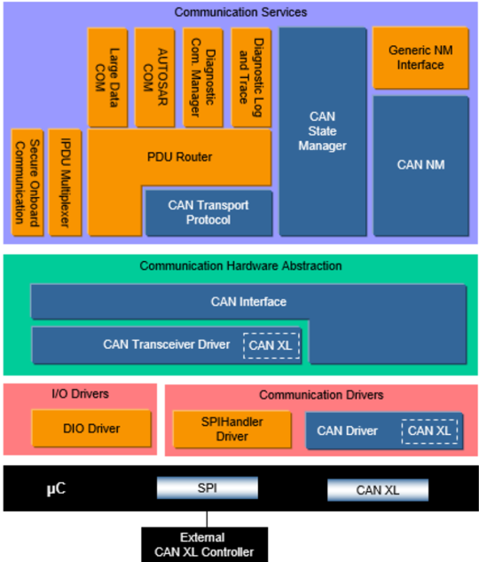
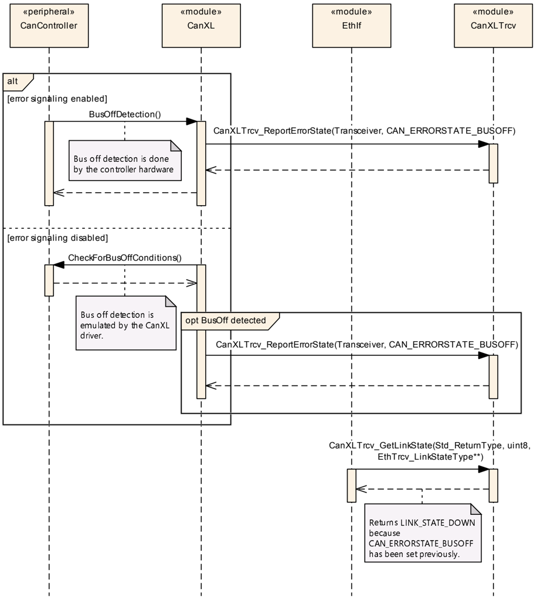

## 1. 简介和功能概述

本规范描述 **AUTOSAR** 基础软件模块 **CAN XL Transceiver Driver**（CAN XL 收发器驱动程序）的功能、**API** 和配置。**CAN XL Transceiver Driver** 是 **CAN Transceiver Driver** 的扩展，因此本文档只应提供与 **CAN Transceiver Driver** 不同的信息和规范。为了更好地理解，本文也给出了一些一般性的信息。



## 2. 缩略语

**CAN XL Transceiver Driver** 未定义任何未包含在 [\[1\]](#ref-1)（**AUTOSAR** 术语表）中的局部首字母缩略词或缩略语。

## 3. 相关文档

### 3.1. 输入文件和相关标准与规范

<a id="ref-1"></a>[1] Glossary
> AUTOSAR_FO_TR_Glossary

<a id="ref-2"></a>[2] General Specification of Basic Software Modules
> AUTOSAR_CP_SWS_BSWGeneral

<a id="ref-3"></a>[3] Specification of CAN Transceiver Driver
> AUTOSAR_CP_SWS_CANTransceiverDriver

<a id="ref-4"></a>[4] Specification for CAN XL Driver
> AUTOSAR_CP_SWS_CANXLDriver

<a id="ref-5"></a>[5] Specification of CAN Driver
> AUTOSAR_CP_SWS_CANDriver

<a id="ref-6"></a>[6] Specification of CAN Interface
> AUTOSAR_CP_SWS_CANInterface

<a id="ref-7"></a>[7] Specification of Ethernet Interface
> AUTOSAR_CP_SWS_EthernetInterface

<a id="ref-8"></a>[8] CiA 610-1 version 1.0.0 (DSP) - CAN XL specifications and test plans - Part 1: Data link layer and physical coding sub-layer requirements
> http://www.can-cia.org

<a id="ref-9"></a>[9] CiA 611-1 version 1.0.0 (DSP) - CAN XL higher layer functions - Part 1: Definition of service data unit types
> http://www.can-cia.org

<a id="ref-10"></a>[10] General Requirements on Basic Software Modules
> AUTOSAR_CP_SRS_BSWGeneral

<a id="ref-11"></a>[11] Requirements on CAN
> AUTOSAR_CP_SRS_CAN

<a id="ref-12"></a>[12] Specification of Ethernet Transceiver Driver
> AUTOSAR_CP_SWS_EthernetTransceiverDriver

### 3.2. 相关规范

**AUTOSAR** 提供了一份基础软件模块通用规范 [\[2\]](#ref-2)（**SWS BSW General**），它对 **CAN XL Transceiver Driver** 同样有效。

因此，规范 **SWS BSW General** 应被视为 **CAN XL Transceiver Driver** 的附加且必需的规范。

## 4. 约束和假设

**CAN XL Transceiver Driver** 的约束和假设与 **CAN Transceiver Driver** 模块的相同。

## 5. 对其他模块的依赖

**CAN XL Transceiver Driver** 模块扩展了 **CAN Transceiver Driver** [\[3\]](#ref-3)，并与 [\[4\]](#ref-4)（**CAN XL Driver**）、[\[5\]](#ref-5)（**CAN Driver**）、[\[6\]](#ref-6)（**CAN Interface**）和 [\[7\]](#ref-7)（**Ethernet Interface**）存在接口关系。

### 5.1. 文件结构

本节说明 **CAN XL Transceiver Driver** 模块的文件结构。

#### 5.1.1. 代码文件结构

详情请参阅 [\[2\]](#ref-2)（**SWS BSW General**）中的 5.1.6 节「代码文件结构」。

## 6. 功能规格

以下各节仅描述 **CAN XL** 收发器特定的「功能规格」。**CAN Transceiver Driver** 规范 [\[3\]](#ref-3) 是本 **CanXLTransceiverDriver**「扩展」的基础。

关于 **CAN XL** 特定功能行为的描述，请参阅 **CanXLDriver** 规范。

### 6.1. 初始化

**CanTrcv_Init()** 应扩展所有初始化 **CanXLTransceiverDriver** 所必需的功能。

### 6.2. 通信状态处理

每个 **CAN XL** 收发器的运行模式仅通过 **CAN** 协议栈经由 **CanTrcv_SetOpMode()** 控制，如 **CAN Transceiver Driver** 规范 [\[3\]](#ref-3) 中所述。来自以太网协议栈的任何收发器模式请求对 **CAN XL** 收发器的实际运行模式都没有影响。之所以仍然需要相应的 **API**，只是为了让 **CanXLTransceiverDriver** 与以太网协议栈兼容。为了向以太网协议栈告知经由 **CAN** 总线的通信是否可行，复用以太网协议栈中已知的链路状态。当前链路状态由 **CAN XL** 收发器运行模式（**CANTRCV_TRCVMODE_NORMAL**、**CANTRCV_TRCVMODE_STANDBY** 或 **CANTRCV_TRCVMODE_SLEEP**）、相应物理 **CAN** 总线的状态（**CAN_ERRORSTATE_ACTIVE**、**CAN_ERRORSTATE_PASSIVE** 或 **CAN_ERRORSTATE_BUSOFF**）以及来自以太网协议栈的所请求链路状态（**ETHTRCV_LINK_STATE_DOWN** 或 **ETHTRCV_LINK_STATE_ACTIVE**）组成。

以太网收发器模式由 **CAN XL Transceiver Driver** 存储，并应请求返回。**[CanXLTrcv_SetTransceiverMode](#733-canxltrcv_settransceivermode)()** 和 **[CanXLTrcv_GetTransceiverMode](#734-canxltrcv_gettransceivermode)()** 的行为参见第 [7.3.2](#732-canxltrcv_transceiverlinkstaterequest) 章和第 [7.3.3](#733-canxltrcv_settransceivermode) 章。

以太网收发器模式初始应设置为 **ETH_MODE_DOWN**。

所请求的以太网链路状态由 **CAN XL Transceiver Driver** 存储，并按照第 [7.3.1](#731-canxltrcv_reporterrorstate) 章的描述通过 [**CanXLTrcv_TransceiverLinkStateRequest**](#732-canxltrcv_transceiverlinkstaterequest) 更新。

所请求的以太网链路状态初始应设置为 **ETHTRCV_LINK_STATE_DOWN**。

**CAN XL** 收发器所连接的物理 **CAN** 总线的状态，会在每次发生变化时由 **CanXLDriver** 通过 [**CanXLTrcv_ReportErrorState**](#731-canxltrcv_reporterrorstate) 作为 **CAN** 错误状态报告给 **CanXLTransceiverDriver**。

如果 **CAN XL** 收发器运行模式为 **CANTRCV_TRCVMODE_NORMAL**、所存储的 **CAN** 错误状态为 **CAN_ERRORSTATE_ACTIVE** 或 **CAN_ERRORSTATE_PASSIVE** 且所请求的链路状态为 **ETHTRCV_LINK_STATE_ACTIVE**，则 [**CanXLTrcv_GetLinkState**](#735-canxltrcv_getlinkstate) 报告的链路状态应为 **ETHTRCV_LINK_STATE_ACTIVE**。

如果所请求的链路状态为 **ETHTRCV_LINK_STATE_DOWN**（与当前的 **CAN XL** 收发器运行模式和所存储的 **CAN** 错误状态无关），则 [**CanXLTrcv_GetLinkState**](#735-canxltrcv_getlinkstate) 报告的链路状态应为 **ETHTRCV_LINK_STATE_DOWN**。

如果所存储的 **CAN** 错误状态为 **CAN_ERRORSTATE_BUSOFF**（与当前的 **CAN XL** 收发器运行模式和所请求的链路状态无关），则 [**CanXLTrcv_GetLinkState**](#735-canxltrcv_getlinkstate) 报告的链路状态应为 **ETHTRCV_LINK_STATE_DOWN**。

所存储的 **CAN** 错误状态应初始化为 **CAN_ERRORSTATE_BUSOFF**。

如果 **CAN XL** 收发器运行模式为 **CANTRCV_TRCVMODE_STANDBY** 或 **CANTRCV_TRCVMODE_SLEEP**（与所存储的 **CAN** 错误状态和所请求的链路状态无关），则 [**CanXLTrcv_GetLinkState**](#735-canxltrcv_getlinkstate) 报告的链路状态应为 **ETHTRCV_LINK_STATE_DOWN**。

### 6.3. 唤醒处理

每个 **CAN XL** 收发器的唤醒处理仅经由 **CAN** 协议栈执行，如 **CAN Transceiver Driver** 规范 [\[3\]](#ref-3) 中所述。以太网协议栈既不参与唤醒处理，也不会被告知已发生的唤醒事件。**CAN XL** 收发器的省电状态以 **ETHTRCV_LINK_STATE_DOWN** 的形式指示给以太网协议栈（参见第 [6.2](#62-通信状态处理) 章）。在成功的唤醒序列之后，以太网协议栈可以通过链路状态被告知（参见第 [6.2](#62-通信状态处理) 章）经由 **CAN** 总线的通信再次可行。

[**CanXLTrcv_CheckWakeup**](#736-canxltrcv_checkwakeup) 不应主动参与 **CAN XL** 收发器的唤醒处理。

### 6.4. 错误分类

《基础软件模块通用规范》（**General Specification of Basic Software Modules**）[19] 的第 7.2 章「错误处理」详细描述了基础软件的错误处理。最重要的是，它构成了一个由可能发生在 **BSW** 模块中的五种错误类型组成的分类方案。在此基础上，以下各节规定了安排在相应小节中的特定错误。

#### 6.4.1. 开发错误

| 错误类型 | 相关错误代码 | 错误值 |
|---|---|---|
| 以针对 **CAN** 收发器的错误参数调用 **API** | CANXLTRCV_E_INVALID_TRANSCEIVER | 0x01 |
| 以空指针参数调用 **API** | CANXLTRCV_E_PARAM_POINTER | 0x02 |
| 在模块未初始化的情况下使用 **API** 服务 | CANXLTRCV_E_UNINIT | 0x11 |
| 无效错误状态 | CANXLTRCV_E_INVALID_ERROR_STATE | 0x30 |
| 无效链路状态 | CANXLTRCV_E_INVALID_LINK_STATE | 0x31 |

#### 6.4.2. 运行时错误

没有其他运行时错误。

#### 6.4.3. 瞬态故障

没有其他瞬态故障。

#### 6.4.4. 生产错误

没有其他生产错误。

#### 6.4.5. 扩展生产错误

没有其他扩展生产错误。

## 7. API规范

请注意，**CAN XL Transceiver Driver** 对与 [\[3\]](#ref-3)（**CAN Transceiver Driver**）共享的部分使用模块简称（MSN）**CanTrcv**，而对本文档中定义的扩展使用 MSN **CanXLTrcv**。与 SRS_BSW_00101 和 SRS_BSW_00407 不同，**CAN XL Transceiver Driver** 不提供带有 MSN **CanXL** 的独立 Init 和 GetVersionInfo **API**。遵循 SWS_MemMap_00022，与本文档定义的 **API** 关联的内存段将使用 MSN **CanXL**，并且按照 TPS_ECUC_02108，引用本文档定义的容器的符号名取值也将使用 MSN **CanXL**。

### 7.1. 导入的类型

在本章中，列出了从以下文件包含的所有类型。

**CanXLTrcv** 模块的导入数据类型定义

| 模块 | 头文件 | 导入的类型 |
|---|---|---|
| Can | Can_GeneralTypes.h | Can_ErrorStateType |
| Eth | Eth_GeneralTypes.h | Eth_ModeType |
| EthTrcv | Eth_GeneralTypes.h | EthTrcv_LinkStateType |
| Std | Std_Types.h | Std_ReturnType |

### 7.2. 类型定义

没有其他类型定义。

### 7.3. 函数定义

#### 7.3.1. CanXLTrcv_ReportErrorState

**说明**: 报告 **CAN** 错误状态的每一次变化。可通过**CanXLTrcv.h**获得。本服务为同步调用，不可重入。参数 Transceiver（in）：该 **API** 调用应施加到的 **CAN** 收发器。参数 ErrorState（in）：相应 **CAN** 控制器的新错误状态。返回值：Std_ReturnType，E_OK：报告成功；E_NOT_OK：调用被拒绝。

```C
Std_ReturnType CanXLTrcv_ReportErrorState ( uint8 Transceiver, Can_ErrorStateType ErrorState )
```

**注意：** 服务 **CanXLTrcv_ReportErrorState()** 实现于 **CanXLTransceiverDriver** 中，由 **CanXLDriver** 在相应 **CAN XL** 控制器的 **CAN** 错误状态每次发生变化后调用。

**CAN** 错误状态应为每个 **CAN XL** 收发器存储在 **CanXLTransceiverDriver** 中，并应在每次调用 **CanXLTrcv_ReportErrorState()** 时更新。

如果启用了开发错误检测：该函数应检查先前是否已调用过服务 **CanTrcv_Init()**。如果检查失败，该函数应引发开发错误 [**CANXLTRCV_E_UNINIT**](#641-开发错误)。

如果启用了开发错误检测：该函数应检查参数 **Transceiver** 是否有效。如果检查失败，该函数应引发开发错误 [**CANXLTRCV_E_INVALID_TRANSCEIVER**](#641-开发错误)。

如果启用了开发错误检测：该函数应检查参数 **ErrorState** 是否有效。如果检查失败，该函数应引发开发错误 [**CANXLTRCV_E_INVALID_ERROR_STATE**](#641-开发错误)。

#### 7.3.2. CanXLTrcv_TransceiverLinkStateRequest

**说明**: 为给定的收发器请求给定的链路状态。可通过**CanXLTrcv.h**获得。本服务为异步调用；对不同 **TrcvIdx** 可重入，对同一 **TrcvIdx** 不可重入。参数 TrcvIdx（in）：收发器驱动程序上下文中收发器的索引。参数 LinkState（in）：物理连接的链路状态。返回值：Std_ReturnType，E_OK：请求已被接受；E_NOT_OK：请求未被接受。

```C
Std_ReturnType CanXLTrcv_TransceiverLinkStateRequest ( uint8 TrcvIdx, EthTrcv_LinkStateType LinkState )
```

**注意：** 本 **API** 源自 **Ethernet Transceiver Driver**。为更好地理解该 **API** 的原始意图，可查阅 [\[7\]](#ref-7)（**Ethernet Interface**）和 [\[12\]](#ref-12)（**Ethernet Transceiver Driver**）。

所请求的链路状态应为每个 **CAN XL** 收发器存储在 **CanXLTransceiverDriver** 中，并应在每次调用 **CanXLTrcv_TransceiverLinkStateRequest()** 时更新。

如果启用了开发错误检测：该函数应检查先前是否已调用过服务 **CanTrcv_Init**。如果检查失败，该函数应引发开发错误 [**CANXLTRCV_E_UNINIT**](#641-开发错误)。

如果启用了开发错误检测：该函数应检查参数 **TrcvIdx** 是否有效。如果检查失败，该函数应引发开发错误 [**CANXLTRCV_E_INVALID_TRANSCEIVER**](#641-开发错误)。

如果启用了开发错误检测：该函数应检查参数 **LinkState** 是否有效。如果检查失败，该函数应引发开发错误 [**CANXLTRCV_E_INVALID_LINK_STATE**](#641-开发错误)。

另请参见第 [6.2](#62-通信状态处理) 章。

#### 7.3.3. CanXLTrcv_SetTransceiverMode

**说明**: 启用/禁用被索引的收发器。可通过**CanXLTrcv.h**获得。本服务为异步调用，不可重入。参数 TrcvIdx（in）：收发器驱动程序上下文中收发器的索引。参数 TrcvMode（in）：**ETH_MODE_DOWN**：禁用收发器；**ETH_MODE_ACTIVE**：启用收发器；**ETH_MODE_ACTIVE_WITH_WAKEUP_REQUEST**：启用收发器，并且——如果所使用的 **PHY** 支持此类特性——请求在网络上触发一次唤醒。例如用于符合 OA TC10 的 **PHY**。返回值：Std_ReturnType，E_OK：服务被接受；E_NOT_OK：服务被拒绝。

```C
Std_ReturnType CanXLTrcv_SetTransceiverMode ( uint8 TrcvIdx, Eth_ModeType TrcvMode )
```

**注意：** 本 **API** 源自 **Ethernet Transceiver Driver**。为更好地理解该 **API** 的原始意图，可查阅 [\[7\]](#ref-7)（**Ethernet Interface**）和 [\[12\]](#ref-12)（**Ethernet Transceiver Driver**）。

所设置的收发器模式应为每个 **CAN XL** 收发器存储在 **CanXLTransceiverDriver** 中，并应在每次调用 **CanXLTrcv_SetTransceiverMode()** 时更新。**CanXLTrcv** 应直接调用 **EthIf_TrcvModeIndication()**。

新请求的 **CanXLTrcv** 模式应覆盖上一次请求的 **CanXLTrcv** 模式。如果请求的是 **ETH_MODE_ACTIVE_WITH_WAKEUP_REQUEST**，则应存储 **ETH_MODE_ACTIVE**。

如果启用了开发错误检测：该函数应检查先前是否已调用过服务 **CanTrcv_Init**。如果检查失败，该函数应引发开发错误 [**CANXLTRCV_E_UNINIT**](#641-开发错误)。

如果启用了开发错误检测：该函数应检查参数 **TrcvIdx** 是否有效。如果检查失败，该函数应引发开发错误 [**CANXLTRCV_E_INVALID_TRANSCEIVER**](#641-开发错误)。

另请参见第 [6.2](#62-通信状态处理) 章。

#### 7.3.4. CanXLTrcv_GetTransceiverMode

**说明**: 获取被索引收发器的状态。可通过**CanXLTrcv.h**获得。本服务为同步调用，不可重入。参数 TrcvIdx（in）：收发器驱动程序上下文中收发器的索引。参数 TrcvModePtr（out）：**ETH_MODE_DOWN**：收发器被禁用；**ETH_MODE_ACTIVE**：收发器被启用。返回值：Std_ReturnType，E_OK：成功；E_NOT_OK：无法初始化收发器。

```C
Std_ReturnType CanXLTrcv_GetTransceiverMode ( uint8 TrcvIdx, Eth_ModeType* TrcvModePtr )
```

**注意：** 本 **API** 源自 **Ethernet Transceiver Driver**。为更好地理解该 **API** 的原始意图，可查阅 [\[7\]](#ref-7)（**Ethernet Interface**）和 [\[12\]](#ref-12)（**Ethernet Transceiver Driver**）。

该函数应返回 **CanXLTransceiverDriver** 中为相应收发器所存储的、所请求的收发器模式。

如果启用了开发错误检测：该函数应检查先前是否已调用过服务 **CanTrcv_Init**。如果检查失败，该函数应引发开发错误 [**CANXLTRCV_E_UNINIT**](#641-开发错误)。

如果启用了开发错误检测：该函数应检查参数 **TrcvIdx** 是否有效。如果检查失败，该函数应引发开发错误 [**CANXLTRCV_E_INVALID_TRANSCEIVER**](#641-开发错误)。

如果启用了开发错误检测：该函数应检查参数 **TrcvModePtr** 是否有效。如果检查失败，该函数应引发开发错误 [**CANXLTRCV_E_PARAM_POINTER**](#641-开发错误)。

另请参见第 [6.2](#62-通信状态处理) 章。

#### 7.3.5. CanXLTrcv_GetLinkState

**说明**: 获取被索引收发器的链路状态。可通过**CanXLTrcv.h**获得。本服务为同步调用，不可重入。参数 TrcvIdx（in）：收发器驱动程序上下文中收发器的索引。参数 LinkStatePtr（out）：**ETHTRCV_LINK_STATE_DOWN**：收发器已断开；**ETHTRCV_LINK_STATE_ACTIVE**：收发器已连接。返回值：Std_ReturnType，E_OK：成功；E_NOT_OK：无法初始化收发器。

```C
Std_ReturnType CanXLTrcv_GetLinkState ( uint8 TrcvIdx, EthTrcv_LinkStateType* LinkStatePtr )
```

**注意：** 本 **API** 源自 **Ethernet Transceiver Driver**。为更好地理解该 **API** 的原始意图，可查阅 [\[7\]](#ref-7)（**Ethernet Interface**）和 [\[12\]](#ref-12)（**Ethernet Transceiver Driver**）。

如果启用了开发错误检测：该函数应检查先前是否已调用过服务 **CanTrcv_Init()**。如果检查失败，该函数应引发开发错误 [**CANXLTRCV_E_UNINIT**](#641-开发错误)。

如果启用了开发错误检测：该函数应检查参数 **TrcvIdx** 是否有效。如果检查失败，该函数应引发开发错误 [**CANXLTRCV_E_INVALID_TRANSCEIVER**](#641-开发错误)。

如果启用了开发错误检测：该函数应检查参数 **LinkStatePtr** 是否有效。如果检查失败，该函数应引发开发错误 [**CANXLTRCV_E_PARAM_POINTER**](#641-开发错误)。

另请参见第 [6.2](#62-通信状态处理) 章。

#### 7.3.6. CanXLTrcv_CheckWakeup

**说明**: 在检测到唤醒中断时由 **EthIf** 调用的服务。可通过**CanXLTrcv.h**获得。本服务为同步调用，可重入。参数 TrcvIdx（in）：收发器驱动程序上下文中收发器的索引。返回值：Std_ReturnType，E_OK：函数已成功执行；E_NOT_OK：函数无法成功执行。

```C
Std_ReturnType CanXLTrcv_CheckWakeup ( uint8 TrcvIdx )
```

**注意：** 本 **API** 源自 **Ethernet Transceiver Driver**。为更好地理解该 **API** 的原始意图，可查阅 [\[7\]](#ref-7)（**Ethernet Interface**）和 [\[12\]](#ref-12)（**Ethernet Transceiver Driver**）。

本函数不应具有任何功能行为，并应返回 **E_OK**。

如果启用了开发错误检测：函数 **CanXLTrcv_CheckWakeup()** 应检查先前是否已调用过服务 **CanTrcv_Init**。如果检查失败，该函数应引发开发错误 [**CANXLTRCV_E_UNINIT**](#641-开发错误)。

如果启用了开发错误检测：函数 **CanXLTrcv_CheckWakeup()** 应检查参数 **TrcvIdx** 是否有效。如果检查失败，该函数应引发开发错误 [**CANXLTRCV_E_INVALID_TRANSCEIVER**](#641-开发错误)。

### 7.4. 回调通知

**CAN XL Transceiver Driver** 未规定任何回调通知。

### 7.5. 调度函数

这些函数由基础软件调度程序直接调用。以下函数应没有返回值和参数。所有函数都应不可重入。

本模块未规定任何调度函数。

### 7.6. 期望接口

在本章中，列出了从其他模块需要的所有接口。

#### 7.6.1. 强制接口

**CAN XL Transceiver Driver** 未规定任何强制接口。

#### 7.6.2. 可选接口

本节定义实现模块可选功能所需的全部接口。

| API 函数 | 头文件 | 描述 |
|---|---|---|
| EthIf_TrcvModeIndication | EthIf.h | 在读出模式变化后异步调用。如果该函数由先前的 **EthTrcv_SetTransceiverMode** 调用触发，则可以直接在触发函数内调用。 |

#### 7.6.3. 可配置接口

**CAN XL Transceiver Driver** 未规定任何可配置接口。

## 8. 时序图

### 8.1. CanXL BusOff handling for Ethernet



## 9. 配置规范

总体而言，本章定义配置参数及其到**容器**（container）的聚类组织。为支持本规范，第 9.1 章描述基础知识，并规定了应用于参数规范的模板（表）。我们有意将这些内容保留在规范中以保证可理解性。

第 9.1 章规定模块 **CAN XL Transceiver Driver** 的结构（容器）和参数。

第 9.2 章规定模块 **CAN XL Transceiver Driver** 的发布信息。

### 9.1. 容器与配置参数

以下各章汇总所有配置参数。各参数的详细含义见第 6 章和第 7 章。

#### 9.1.1. CanXLTrcvChannel

| SWS 条目 | [ECUC_CanTrcv_00195] |
|---|---|
| 容器名称 | CanXLTrcvChannel |
| 父容器 | CanTrcvChannel |
| 描述 | 该容器在 SWS **CAN XL Transceiver Driver** 中规定，表示一个 **CAN XL** 收发器通道。如果存在该容器，**CAN** 收发器将提供扩展的 **CanXLTrcv API**。 |
| Post-Build 变体多重性 | false |
| 多重性配置类 | Pre-compile time：x（All Variants）；Link time：-；Post-build time：- |
| 配置参数 | 见下方参数表 |

| SWS 条目 | [ECUC_CanTrcv_00196] |
|---|---|
| 参数名称 | CanXLTrcvEthEcucPartitionRef |
| 父容器 | CanXLTrcvChannel |
| 描述 | 将对 **CAN XL** 收发器通道的以太网接口访问映射到零个或一个 **ECUC** 分区。 |
| 多重性 | 0..1 |
| 类型 | Reference to EcucPartition |
| Post-Build 变体多重性 | false |
| Post-Build 变体值 | false |
| 多重性配置类 | Pre-compile time：x（All Variants）；Link time：-；Post-build time：- |
| 值配置类 | Pre-compile time：x（All Variants）；Link time：-；Post-build time：- |
| 作用域/依赖 | scope: local |

无包含的容器。

### 9.2. 发布信息

详情请参阅 SWS_BSWGeneral 第 10.3 章「发布信息」。

## B. AUTOSAR 可追溯项变更历史

请注意，本章中的列表还包括在后续版本中已从规范中移除的约束和规范项。这些约束和规范项不会以超链接的形式出现在文档中。

### B.1. 本文档的可追溯项历史（按AUTOSAR R22-11版本）

#### B.1.1. R22-11中新增的规范项

```
[CP_SWS_CanXLTrcv_00001] [CP_SWS_CanXLTrcv_00002] [CP_SWS_CanXLTrcv_00005] [CP_SWS_CanXLTrcv_00006] [CP_SWS_CanXLTrcv_00011] [CP_SWS_CanXLTrcv_00012] [CP_SWS_CanXLTrcv_00015] [CP_SWS_CanXLTrcv_00016] [CP_SWS_CanXLTrcv_00017] [CP_SWS_CanXLTrcv_00018] [CP_SWS_CanXLTrcv_00020] [CP_SWS_CanXLTrcv_00021] [CP_SWS_CanXLTrcv_00022] [CP_SWS_CanXLTrcv_00027] [CP_SWS_CanXLTrcv_00028] [CP_SWS_CanXLTrcv_00032] [CP_SWS_CanXLTrcv_00033] [CP_SWS_CanXLTrcv_00034] [CP_SWS_CanXLTrcv_00035] [CP_SWS_CanXLTrcv_00036] [CP_SWS_CanXLTrcv_00037] [CP_SWS_CanXLTrcv_00038] [CP_SWS_CanXLTrcv_00039] [CP_SWS_CanXLTrcv_00040] [CP_SWS_CanXLTrcv_00041] [CP_SWS_CanXLTrcv_00047] [CP_SWS_CanXLTrcv_00048] [CP_SWS_CanXLTrcv_00049] [CP_SWS_CanXLTrcv_00050] [CP_SWS_CanXLTrcv_00051] [CP_SWS_CanXLTrcv_00052] [CP_SWS_CanXLTrcv_10001] [CP_SWS_CanXLTrcv_10002] [CP_SWS_CanXLTrcv_10004] [CP_SWS_CanXLTrcv_10006] [CP_SWS_CanXLTrcv_10007] [CP_SWS_CanXLTrcv_10008] [CP_SWS_CanXLTrcv_10009] [CP_SWS_CanXLTrcv_10010] [CP_SWS_CanXLTrcv_10011] [CP_SWS_CanXLTrcv_NA_00999]
```

#### B.1.2. R22-11中变更的规范项

无

#### B.1.3. R22-11中删除的规范项

无

### B.2. 本文档的可追溯项历史（按AUTOSAR R23-11版本）

#### B.2.1. R23-11中新增的规范项

无

#### B.2.2. R23-11中变更的规范项

无

#### B.2.3. R23-11中删除的规范项

无
