## 1. 简介和功能概述

本规范是AUTOSAR COM模块的软件规范（**Software Specification**）。它基于AUTOSAR COM SRS [1]，规定了AUTOSAR COM SRS的需求应如何实现。也就是说，AUTOSAR COM模块的功能和API都在本文档中描述。

在AUTOSAR分层架构中，AUTOSAR COM模块位于其用户（如**RTE**、**SwCluC**）与PDU路由器（**PDU Router**）之间，见[2]。

AUTOSAR COM模块源自[3]。详情见第6.2.1节。AUTOSAR COM模块提供信号网关（**signal gateway**）功能。详情见第[6.2.5](#625-信号网关)节。

主要特性：

- 为用户（如**RTE**、**SwCluC**）提供面向信号的数据接口
- 将AUTOSAR信号打包为待发送的I-PDU
- 解包接收到的I-PDU并向用户（如**RTE**、**SwCluC**）提供所接收的信号
- 将来自所接收I-PDU的信号路由到待发送的I-PDU中
- 将来自所接收I-PDU的信号组路由到待发送的I-PDU中
- 通信传输控制（I-PDU组的启动/停止）
- 发送请求的重复（**replication**）
- 保证发送I-PDU之间的最小距离
- 接收信号的监控（信号超时）
- 针对传入信号的过滤机制
- 不同的通知机制
- 提供初始值和更新指示
- 字节序转换
- 符号扩展
- 每个I-PDU支持两种不同的传输模式
- 基于信号的网关
- 支持大数据类型和动态长度数据类型

## 2. 缩略语、缩写和定义

### 2.1. 缩略语和缩写

下面的词汇表包含与COM模块相关、但未包含在[4, AUTOSAR 术语表]中的缩略语和缩写。

表2.1：本文档范围内的缩略语（**Acronyms used in the scope of this Document**）

**AUTOSAR COM**

> AUTOSAR COM模块源自[3]。详情见第6.2.1节。

**DM**

> 截止期监控（**Deadline Monitoring**），详情见第[6.3.6](#636-截止期监控)节。

**I-PDU**

> 交互层协议数据单元（**Interaction Layer Protocol Data Unit**）。I-PDU携带信号，其定义见[3]。

**L-PDU**

> 数据链路层协议数据单元（**Data Link Layer Protocol Data Unit**）。在AUTOSAR中，数据链路层等同于通信硬件抽象层和微控制器抽象层。

**MDT**

> 最小延迟定时器（**Minimum Delay Timer**）的详细描述见[3]。另见第6.3.5.5节。

**PDU Router**

> PDU路由器是在模块之间传输I-PDU的模块。PDU路由器可用于网关操作和内部路由目的。

**SDU**

> 服务数据单元（**Service Data Unit**）。描述见[2]第4章。

**TM**

> 传输模式（**Transmission Mode**）。

**TMC**

> 传输模式条件（**Transmission Mode Condition**），见第[6.3.3.2](#6332-特定i-pdu传输模式的选择)节。

**TMS**

> 传输模式选择器（**Transmission Mode Selector**），见第[6.3.3.2](#6332-特定i-pdu传输模式的选择)节。

### 2.2. 定义

表2.2：本文档范围内的术语（**Terms used in the scope of this Document**）

**Confirmation**

> 确认（**Confirmation**）是PDU路由器对AUTOSAR COM模块请求已成功完成的报告。它是对COM请求的响应，例如PDU已成功发送。

**Data Invalid Value**

> 数据无效值（**Data Invalid Value**）是AUTOSAR COM模块发送的值，用于指示发送侧的AUTOSAR软件组件无法提供有效值。

**Dynamic Length Signal**

> 动态长度信号（**Dynamic Length Signal**）是其长度可以在运行时变化的信号。

**Dynamic Length I-PDU**

> 动态长度I-PDU（**Dynamic Length I-PDU**）是包含动态长度信号的I-PDU。其长度随所包含动态长度信号的长度而变化。

**Group signal**

> 组信号（**Group signal**）是包含在信号组中的信号。

**Indication**

> 指示（**Indication**）是从PDU路由器到COM的异步信息，例如确认已接收到某些内容。

**Init Value**

> 初始值（**Init Value**）。AUTOSAR COM模块在启动后将I-PDU和信号设置为初始值。在被覆盖之前一直使用该值。

**I-PDU group**

> I-PDU组（**I-PDU group**）是COM模块中同方向（即发送或接收）I-PDU的任意集合。

**Inter-ECU-communication**

> ECU间通信（**Inter-ECU-communication**）是两个或多个ECU之间的通信，例如经由CAN网络。

**Intra-ECU-communication**

> ECU内通信（**Intra-ECU-communication**）是驻留在同一ECU上的软件组件之间的通信。

**Large Signal**

> 大信号（**Large Signal**）是太大而无法放入底层通信协议单个L-PDU的信号。

**Large I-PDU**

> 大I-PDU（**Large I-PDU**）是太大而无法放入底层通信协议单个L-PDU的I-Signal-I-PDU。大I-PDU由COM像其他I-PDU一样处理，但经由TP API发送/接收。请注意，如果大I-PDU只包含一个信号，或者信号可以由RTE（反）序列化，**LargeDataCOM**可以更高效地处理它们。但如果信号必须被单独处理或必须被路由，则大I-PDU必须由COM处理。

**Message**

> [3]始终使用同义词消息（**message**）。在AUTOSAR中，message被signal替换，但含义相同。

**Metadata**

> 元数据（**Metadata**）。对于某些I-PDU（如J1939 I-PDU），有效载荷会扩展以包含附加的元数据，例如CAN-ID。

**Notification**

> 通知（**Notification**）是AUTOSAR COM模块向其用户（如**RTE**、**SwCluC**）提供的信息，例如新数据可用或发生错误。

**Signal**

> 在AUTOSAR COM模块的上下文中，信号（**Signal**）等同于[3]中的消息；另见[1]。

**Signal group**

> 在AUTOSAR中使用所谓的复杂数据类型（**complex data types**）。在复杂数据类型内部，有一个或多个数据元素（基本数据类型），就像C结构体一样。这种复杂数据类型的数据一致性必须得到保证。用户（如**RTE**或**SwCluC**）将复杂数据类型分解为单个信号并将其发送给AUTOSAR COM模块。由于这些信号需要被一致地处理，它们被称为信号组（**signal group**）。另见[1]。

**Update-bit**

> 更新位（**Update-bit**）是AUTOSAR COM模块支持的一种机制，信号/信号组的接收者可以借此识别发送者是否在发送之前更新了该信号/信号组中的数据。见第[6.9](#69-更新位)节。

## 3. 相关文档

### 3.1. 输入文件和相关标准与规范

- [1] 通信的需求 AUTOSAR_CP_SRS_COM
- [2] 分层软件架构 AUTOSAR_CP_EXP_LayeredSoftwareArchitecture
- [3] ISO 17356-4:Road vehicles - Open interface for embedded automotive applications - Part 4:OSEK/VDX Communication (COM)
- [4] AUTOSAR 术语表 AUTOSAR_FO_TR_Glossary
- [5] 基本软件模块通用规范 AUTOSAR_CP_SWS_BSWGeneral
- [6] PDU路由器规范 AUTOSAR_CP_SWS_PDURouter
- [7] RTE软件规范 AUTOSAR_CP_SWS_RTE
- [8] 软件集群连接模块规范 AUTOSAR_CP_SWS_SoftwareClusterConnection
- [9] 基本软件模块的通用需求 AUTOSAR_CP_SRS_BSWGeneral
- [10] 网关的需求 AUTOSAR_CP_SRS_Gateway
- [11] 系统模板 AUTOSAR_CP_TPS_SystemTemplate
- [12] ISO 11898-1:2015 - Road vehicles - Controller area network (CAN)
- [13] CAN传输层规范 AUTOSAR_CP_SWS_CANTransportLayer
- [14] FlexRay ISO传输层规范 AUTOSAR_CP_SWS_FlexRayISOTransportLayer
- [15] 标准类型规范 AUTOSAR_CP_SWS_StandardTypes
- [16] ISO 17356-6:Road vehicles - Open interface for embedded automotive applications - Part 6:OSEK/VDX Implementation Language (OIL)
- [17] 通用结构模板 AUTOSAR_FO_TPS_GenericStructureTemplate
- [18] ECU配置规范 AUTOSAR_CP_TPS_ECUConfiguration

### 3.2. 相关规范

AUTOSAR提供了基本软件模块的通用规范[5, SWS BSW General]，它对COM同样有效。

因此，规范SWS BSW General应被视为COM的附加且必需的规范。

## 4. 约束和假设

### 4.1. 限制

AUTOSAR COM模块基于[3]。尽管如此，[3]的某些特性未被包含，某些特性有所不同。未包含特性的列表见SWS_Com_00013。

### 4.2. 汽车域的适用性

无限制。

## 5. 对其他模块的依赖

本章列出AUTOSAR COM模块使用的其他模块的所有特性，以及AUTOSAR COM模块向其他模块提供的功能。关于AUTOSAR COM模块在通信堆栈中的位置，见图5.1。

图5.1：AUTOSAR COM模块的上下文视图（**AUTOSAR COM module's context view**）

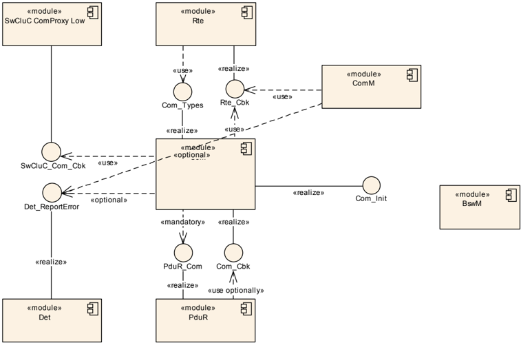

### 5.1. PDU 路由器

AUTOSAR COM模块使用PDU路由器两组上层模块API的并集，即使用TP的上层模块API和不使用TP的上层模块API。这是必要的，因为AUTOSAR COM模块或者经由简单L-PDU不分段地传输I-PDU，或者经由TP分段传输I-PDU。

以下汇总AUTOSAR COM模块需要下层PDU路由器提供的功能：

- 传入I-PDU的指示
- 传出I-PDU的发送接口，包括I-PDU已被通信控制器发送的确认
- 触发接口，使PDU路由器能够促使AUTOSAR COM模块进行传输
- TP通信的缓冲区处理

第[6.5](#65-大数据类型)节和第[8.1](#81-autosar-com模块与pdu路由器之间的接口)节包含与PDU路由器接口的详细描述。更多信息见[6]。

### 5.2. Com模块用户

#### 5.2.1. 运行时环境（RTE）

RTE使用AUTOSAR COM模块的能力来发送和接收信号。在AUTOSAR中，RTE是AUTOSAR COM模块之上的更高层。更多信息见[7]。

#### 5.2.2. SwCluC

**SwCluC**建立软件集群间连接，用于交换（提供和消费）信号和信号组。应用软件集群（**Application Software Clusters**）中的Com用户可以经由SwCluC Com High Proxy访问信号和信号组。在主机软件集群（**Host Software Cluster**）中，SwCluC Com Low Proxy拥有到COM模块的接口。

因此，SwCluC Com Low Proxy为信号和信号组的接收与发送提供回调。它还可以调用COM API进行信号接收和发送。SwCluC回调的存在取决于配置。更多信息见[8]。

## 6. 功能规格

### 6.1. 引言

### 6.2. 通用功能

#### 6.2.1. AUTOSAR COM基础

ISO 17356-4:2005 Road vehicles - Open interface for embedded automotive applications - Part 4: OSEK / VDX Communication (COM) 是AUTOSAR COM模块的功能基础。在本文档中它被引用为[3]。

AUTOSAR COM模块应实现[3]的所有功能和所有API，但SWS_Com_00013中提到的特性和API除外。

如果本AUTOSAR COM规范以与[3]中的定义不同的方式定义了某项功能，则AUTOSAR COM模块应实现本AUTOSAR COM规范中定义的功能。

AUTOSAR COM模块还应额外实现本AUTOSAR COM规范中定义的、不属于[3]的所有特性。

AUTOSAR COM模块可以实现[3]的以下特性。如果在特定的AUTOSAR COM模块中实现了它们，配置应默认将其禁用。这也适用于特定实现可能提供的所有其他附加特性。

表7.1：AUTOSAR COM模块中[3]的被排除特性（**Excluded features of [3] in the AUTOSAR COM module**）

| [3]中的特性 | 理由 | [3]中的相关API |
| --- | --- | --- |
| 将接收到的网络消息（在I-PDU内）映射到多个消息数据对象（1:n拆分机制） | 不需要，由RTE完成，见[7] | 无 |
| 将内部消息映射到多个消息数据对象（1:n拆分机制） | 不需要，由RTE完成，见[7] | 无 |
| 将仅在本地发送的消息映射到外部发送消息对象和内部接收消息对象两者（1:n拆分机制） | 不需要，由RTE完成，见[7] | 无 |
| M:1发送；将来自多个发送者的消息映射到同一个消息对象 | 不需要，由RTE保证，见[7] | SendMessage |
| 排队消息（**Queued messages**） | 不需要，由RTE完成，见[7] | GetMessageStatus |
| 零大小消息（**Zero size messages**） | 可以在没有它们的情况下建立通信；该功能部分由[Com_TriggerTransmit](#7341-com_triggertransmit)覆盖 | SendZeroMessage |
| 通知机制TASK、FLAG和EVENT | 不需要，由RTE完成，见[7] | 无 |
| I-PDU中的重叠消息 | 无用例，危险的概念 | 无 |
| OIL的使用 | OIL不用于配置AUTOSAR COM模块 | 无 |
| 应用模式（**Application modes**） | 不需要 | GetComApplicationMode |
| 启动行为 | 被•[Com_Init](#7321-com_init) •[Com_DeInit](#7322-com_deinit) •[Com_IpduGroupStart](#7323-com_ipdugroupstart)取代 | StartCOM, StopCOM, StartCOMExtensions, InitMessage |
| 周期消息的启动和停止 | 无用例，由I-PDU组机制实现 | StartPeriodic, StopPeriodic |
| 可重入性 | 并非所有AUTOSAR API调用都是可重入的。见第[7.3](#73-函数定义)节。 | 见第[7.3](#73-函数定义)节。 |
| 间接NM的接口 | 不需要 | I_MessageTransfer, I_MessageTimeOut |
| 发送侧过滤 | 无用例，过滤条件仍用于传输模式的选择，但没有信号过滤 | 无 |
| 网络序消息callout / CPU序消息callout | AUTOSAR COM模块只支持具有已定义AUTOSAR接口的I-PDU callout。这是为了避免专有解决方案。 | 无 |
| 错误钩子例程（**Error hook routine**） | AUTOSAR COM模块定义了自己的错误报告接口，而不是使用错误钩子 | COMErrorHook, COMError_Name1_Name2宏, COMErrorGetServiceId |
| 回调例程的接口 | AUTOSAR COM模块所用回调函数的签名将在AUTOSAR COM模块规范中明确定义 | COMCallback |
| 内部通信 | 不需要，由RTE保证，见[7] | SendMessage, ReceiveMessage |

#### 6.2.2. 信号值

由AUTOSAR COM模块发送或接收的信号可以具有表7.2中定义的值。

表7.2：可能的信号值（**Possible signal values**）

| 信号值 | 备注 |
| --- | --- |
| 初始值（**init value**） | 详情见第[6.3.1.4](#6314-信号和更新位的初始化)节。 |
| 数据无效值（**data invalid value**） | 详情见第[6.3.4](#634-信号失效)节。 |
| &lt;value&gt; | 这是正常情况：初始化阶段之后的有效值，由AUTOSAR COM模块发送或由AUTOSAR COM模块接收。 |

#### 6.2.3. 字节序转换和符号扩展

AUTOSAR COM模块应支持以下数据类型：

- boolean
- uint8
- uint16
- uint32
- uint64
- sint8
- sint16
- sint32
- sint64
- uint8[n]
- float32
- float64

类型uint8[n]映射到**ComSignalType** UINT8_N或UINT8_DYN。

AUTOSAR COM模块应对所有支持的有符号和无符号整数数据类型（见SWS_Com_00675）支持字节序转换。

AUTOSAR COM模块应将非整数数据类型（如uint8[n]或float32）视为匹配大小的整数数据类型来处理，或者在其**ComSignalEndianness**配置为OPAQUE的情况下不解释其内容。

AUTOSAR COM模块应将不透明数据（**opaque data**）解释为uint8[n]，并应始终将其映射到n字节大小的信号。

对于不透明数据的字节序，转换必须配置为OPAQUE（见**ComSignalEndianness**）。

AUTOSAR COM模块应将[3]第2.4章中定义的字节序转换扩展到有符号数据类型。

[3]第2.4章定义了无符号数据类型的字节序转换。相关配置见第9章。另见**ComSignalType**和**ComSignalEndianness**。

AUTOSAR COM模块应将[3]第2.4章中定义的字节序转换扩展到信号组的信号。

对于字节序转换，AUTOSAR COM对信号和组信号的处理是同等的。

AUTOSAR COM模块应将接收到的数据扩展到接收信号的**ComSignalType**的大小（符号扩展，**sign extension**）。

必须考虑平台特定的有符号数据表示。有符号数据的负值将被正确映射。

示例：接收到一个10位有符号信号，并通过[**Com_ReceiveSignal**](#7333-com_receivesignal)将其复制到一个16位有符号整数变量中。如果接收到(-3)十进制，则接收到的10位信号的值为1111111101b。在将其复制到16位整数变量时，该值将被扩展为1111111111111101b。

AUTOSAR COM模块应将信号的初始值（**ComSignalInitValue**）扩展到其**ComSignalType**的大小。

请注意，AUTOSAR COM模块在发送侧不需要执行符号扩展，因为可以保证要发送的值始终已被符号扩展。另见SWS_Com_00785。

AUTOSAR COM模块不应支持float32和float64数据类型的符号扩展。

AUTOSAR COM模块应在发送侧的I-PDU callout之前执行字节序转换。

概览见第[6.12](#612-autosar-com模块的交互模型)节。

AUTOSAR COM模块应在接收侧执行过滤和通知检测之前执行符号扩展和字节序转换。

除字节序转换之外，AUTOSAR COM模块不应支持**ComSignalType**为FLOAT32或FLOAT64的信号的进一步转换。即应支持字节序转换，但不支持对小数、指数、符号或偏置值（**bias values**）的复杂转换或归一化。

#### 6.2.4. 过滤

AUTOSAR COM模块应将每个过滤条件评估为true或false。

AUTOSAR COM模块应只在接收侧过滤掉信号。

AUTOSAR COM模块应在发送侧使用过滤机制实现传输模式条件（**TMC**），但不应在发送侧过滤掉信号。

关于传输模式选择（**TMS**），见第[6.3.3.2](#6332-特定i-pdu传输模式的选择)节和第[6.3.3.3](#6333-信号流和传输模式选择)节。

AUTOSAR COM模块只提供[3]中定义的以下**ComFilterAlgorithm**：

- ALWAYS
- NEVER
- MASKED_NEW_EQUALS_X
- MASKED_NEW_DIFFERS_X
- MASKED_NEW_DIFFERS_MASKED_OLD
- NEW_IS_WITHIN
- NEW_IS_OUTSIDE
- ONE_EVERY_N

为降低复杂性，AUTOSAR COM模块不支持[3]中定义的所有过滤器。不支持的过滤器要么已过时，要么是其他过滤器的特例。例如，过滤器NEW_IS_DIFFERENT是MASKED_NEW_DIFFERS_MASKED_OLD在掩码全为1时的特例。

AUTOSAR COM模块应支持**ComFilterAlgorithm**中列出的所有过滤机制，同时考虑SWS_Com_00380和SWS_Com_00439中定义的例外。

对于**ComSignalType**为FLOAT32、FLOAT64、UINT8_N或UINT8_DYN的信号，AUTOSAR COM模块应只支持配置为ALWAYS、NEVER或ONE_EVERY_N的**ComFilterAlgorithm**。

对于**ComSignalType**配置为BOOLEAN的信号，AUTOSAR COM模块应只支持配置为以下值的**ComFilterAlgorithm**：

- ALWAYS
- NEVER
- MASKED_NEW_EQUALS_X
- MASKED_NEW_DIFFERS_X
- MASKED_NEW_DIFFERS_MASKED_OLD
- ONE_EVERY_N

对于**ComBitSize**配置为0的信号和组信号，AUTOSAR COM模块不应支持过滤算法MASKED_NEW_DIFFERS_MASKED_OLD。

如果已配置的过滤条件为MASKED_NEW_DIFFERS_X、MASKED_NEW_EQUALS_X、NEW_IS_OUTSIDE或NEW_IS_WITHIN，则AUTOSAR COM模块应仅使用过滤参数的最低有效**ComBitSize**位来计算接收过滤器。

如果AUTOSAR COM模块在接收侧过滤掉某个信号（即过滤条件评估为false），则AUTOSAR COM模块应丢弃该信号且不处理它。另见SWS_Com_00303。

如果AUTOSAR COM模块在接收侧过滤掉某个组信号（即过滤条件评估为false），则AUTOSAR COM模块应丢弃整个信号组且不处理它。

AUTOSAR COM模块应支持**ComFilterAlgorithm**中定义的过滤机制，同样适用于有符号数据类型。

如果在发送API写入相应信号之前评估过滤器，则需要一种方法来确定该信号的过滤器状态。某些过滤器需要一个new\_value来评估过滤器。然而，它只有在信号已使用发送API更新之后才可用。因此，有必要定义在第一次发送发生之前过滤器为new\_value使用的值。

AUTOSAR COM模块应在启动期间将每个信号的过滤机制的old\_value设置为**ComSignalInitValue**。另见[3]。

在应用尚未更新某个信号的过滤机制的new\_value之前，AUTOSAR COM模块应使用**ComSignalInitValue**作为该信号的new\_value。

以下两个需求澄清了[3]中关于过滤器old\_value更新的定义。

如果AUTOSAR COM模块将某个信号的过滤器评估为true（该值未被过滤掉），则AUTOSAR COM模块应将该信号的值放入old\_value（如[3]中定义）。

当某个值被过滤时，如果过滤器不允许该值通过（即过滤器评估为false），则AUTOSAR COM模块不应将该值放入old\_value（如[3]中定义）。

在**ComFilterAlgorithm**配置为ONE_EVERY_N的情况下，AUTOSAR COM模块应：

- 当OCCURRENCE == PERIOD时，将OCCURRENCE设置为零
- 当OCCURRENCE == OFFSET时，将FILTER设置为true
- 在过滤处理之后递增OCCURRENCE

关于OCCURRENCE、FILTER、OFFSET和PERIOD的定义见[3]。

将某个信号的**ComFilterAlgorithm**配置为ONE_EVERY_N的效果是：每PERIOD次过滤器调用中，该信号通过过滤器一次（即过滤器返回true）。如果OFFSET参数为零，则第一次使用过滤器时信号即被允许通过（即过滤器返回true）。如果OFFSET大于零，则必须有多个信号通过过滤器后它才返回true。

如果I-PDU由[**Com_IpduGroupStart**](#7323-com_ipdugroupstart)以参数initialize设置为true启动，则OCCURRENCE也被设置为零，见SWS_Com_00787。

此定义的存在是为了澄清[3]中ONE_EVERY_N过滤器的描述。

相关配置项见第[9](#9-配置规范)章，见[**ComFilter**](#928-comfilter)。

对于配置了接收过滤器MASKED_NEW_DIFFERS_MASKED_OLD的信号，AUTOSAR COM模块应将该信号发生接收截止期监控超时后为该信号接收的第一个值，按该值已通过过滤条件一样的方式处理。

因此，对于过滤器MASKED_NEW_DIFFERS_MASKED_OLD，在关联I-PDU发生RX截止期超时之后，AUTOSAR COM模块将放行任何值。

#### 6.2.5. 信号网关

AUTOSAR COM模块提供集成的信号网关（**Signal Gateway**），用于以1:n的方式转发信号和组信号。

路由关系通过[**ComGwMapping**](#9219-comgwmapping)配置容器静态配置。

如图7.3和图7.4所示，集成的信号网关作为所有被配置为网关信号源的信号或组信号的接收者。

信号网关收到要路由的信号或组信号后，立即充当这些信号或组信号的发送者。如图7.2和图7.4所示。如果集成的信号网关转发信号/组信号，或者软件组件发送它，信号处理没有区别。

由于网关关系是静态配置的，优化的信号网关对于特定配置可以跳过某些处理阶段。例如，在某些情况下字节序转换不是必需的。当然，此类优化不应导致任何不同的逻辑行为或目标总线上的不同表示。优化只能用于提升信号网关的性能。

如图7.3所示，接收到的信号或组信号可能在本地ECU上被接收，同时又是网关动作的源。

图7.2和图7.3只为由RTE接收的组信号显示影子缓冲区。集成的信号网关当然必须确保一致地处理组信号，但没有预先确定必须如何实现这一点。

如果没有信号路由功能需求，AUTOSAR COM模块的信号网关应缩减为零大小。

### 6.3. 正常操作

#### 6.3.1. 启动行为

本章描述在[**Com_Init**](#7321-com_init)期间执行的动作。

AUTOSAR COM模块应在[**Com_Init**](#7321-com_init)执行期间初始化每个I-PDU：首先按**ComTxIPduUnusedAreasDefault**值逐字节填充，然后根据所包含信号的初始值（**ComSignalInitValue**）和更新位逐位初始化（见SWS_Com_00117）。

##### 6.3.1.1. 前提条件

C初始化代码（也称为启动代码）用初始值初始化全局和静态变量。它必须在任何AUTOSAR COM模块服务的调用之前执行。

##### 6.3.1.2. 初始化

AUTOSAR COM模块的初始化函数[**Com_Init**](#7321-com_init)应初始化尚未由启动代码初始化的所有内部数据，例如C结构体。

本初始化章节并不完整。关于AUTOSAR COM模块某些特性初始化的细节在各特性章节中描述。

##### 6.3.1.3. I-PDU未使用区域的初始化

AUTOSAR COM模块应使用由配置参数**ComTxIPduUnusedAreasDefault**确定的值（例如0xFF）填充I-PDU中未使用的区域。

##### 6.3.1.4. 信号和更新位的初始化

AUTOSAR COM模块应在发送侧和接收侧用其配置参数**ComSignalInitValue**的低n位初始化每个n位大小信号类型的信号。

所配置的**ComSignalInitValue**也用于相关I-PDU中信号的初始化；见SWS_Com_00217。

信号的**ComSignalInitValue**可以与其**ComSignalDataInvalidValue**相同。它们对于每个信号可以不同。

AUTOSAR COM模块应在初始化期间清除所有更新位。另见SWS_Com_00059。

##### 6.3.1.5. I-PDU组的初始化

默认情况下，所有I-PDU组应处于停止状态，并且它们不应由[**Com_Init**](#7321-com_init)的调用自动启动。

#### 6.3.2. 去初始化

AUTOSAR COM模块提供API函数[**Com_DeInit**](#7322-com_deinit)用于COM层的去初始化。这意味着，在该层去初始化之后，无法再经由AUTOSAR COM模块进行通信，并且所有已启动的I-PDU组都被停止，另见SWS_Com_00129。

#### 6.3.3. 通信模式

本章定义AUTOSAR COM模块中的信号流。它进一步定义AUTOSAR COM模块提供的不同传输模式。第[6.3.3.2](#6332-特定i-pdu传输模式的选择)节定义了在一个I-PDU的两种传输模式之间切换的机制。信号的重复在第[6.3.3.4](#6334-信号发送请求的重复)节中定义。

AUTOSAR COM模块可以处理的示例通信用例见第[10](#10-附录)章。

##### 6.3.3.1. 传输属性和I-PDU传输模式

###### 6.3.3.1.1. 信号

AUTOSAR COM模块为信号支持若干种传输属性（**transfer properties**），为I-PDU支持若干种传输模式。本章中的定义基于[3]第2.3.3章的定义，并将对其进行补充。

对于具有**ComTransferProperty** TRIGGERED、且被分配给**ComTxModeMode**为DIRECT或MIXED的I-PDU的信号的任何发送请求，AUTOSAR COM模块应立即（最迟在下一个主函数中）发起所分配I-PDU的**ComTxModeNumberOfRepetitions**加一次传输。

对于具有**ComTransferProperty** TRIGGERED_WITHOUT_REPETITION、且被分配给**ComTxModeMode**为DIRECT或MIXED的I-PDU的信号的任何发送请求，AUTOSAR COM模块应立即（最迟在下一个主函数中）发起所分配I-PDU的一次传输。

对于具有**ComTransferProperty** TRIGGERED_ON_CHANGE、且被分配给**ComTxModeMode**为DIRECT或MIXED的I-PDU的信号的发送请求，如果新发送的信号在长度或值上与本地存储的（最后发送的或初始）值不同，则AUTOSAR COM模块应立即（最迟在下一个主函数中）发起所分配I-PDU的**ComTxModeNumberOfRepetitions**加一次传输。

对于具有**ComTransferProperty** TRIGGERED_ON_CHANGE_WITHOUT_REPETITION、且被分配给**ComTxModeMode**为DIRECT或MIXED的I-PDU的信号的发送请求，如果新发送的信号在长度或值上与本地存储的（最后发送的或初始）值不同，则AUTOSAR COM模块应立即（最迟在下一个主函数中）发起所分配I-PDU的一次传输。

AUTOSAR COM模块不应支持**ComBitSize**配置为0的信号和组信号的传输属性TRIGGERED_ON_CHANGE和TRIGGERED_ON_CHANGE_WITHOUT_REPETITION。

传输属性TRIGGERED_ON_CHANGE和TRIGGERED_ON_CHANGE_WITHOUT_REPETITION的支持不限于特定信号类型。因此，它们为所有可能的信号类型所支持。这甚至包括字节数组类型，如UINT8_N。

传输重复机制的细节在第[6.3.3.4](#6334-信号发送请求的重复)节中规定。

AUTOSAR COM模块不应为**ComTxModeMode**为NONE的I-PDU发起传输。

可以通过[**Com_TriggerTransmit**](#7341-com_triggertransmit)请求**ComTxModeMode**为NONE的I-PDU。

与某个I-PDU关联的待发送信号（**pending signal**）会在该I-PDU的传输因任何原因被触发时被发送。例如，同一I-PDU中具有**ComTransferProperty** TRIGGERED的信号被发送，或I-PDU因**ComTxModeMode**为PERIODIC或MIXED而被调度发送。

I-PDU的总线时序可以由用户（如**RTE**、**SwCluC**）的发送请求结合上述传输模式和传输属性来控制。此外，PDU路由器（尤其是在FlexRay和LIN的情况下）可以通过服务[**Com_TriggerTransmit**](#7341-com_triggertransmit)来控制它。在后一种情况下，PDU路由器请求AUTOSAR COM模块发送I-PDU。

函数[**Com_TriggerTransmit**](#7341-com_triggertransmit)可以为任何I-PDU调用，而不管其传输模式如何。这使得LIN和FlexRay能够使用所有可用的传输模式，特别是对于偶发通信。NM也使用这种机制发送用户数据。

###### 6.3.3.1.2. 信号组

在AUTOSAR COM中，信号组和组信号也可以具有传输属性，与传输模式相结合，定义了在信号组或组信号更新时是否发送I-PDU。

对于具有**ComTransferProperty** TRIGGERED、且被分配给**ComTxModeMode**为DIRECT或MIXED的I-PDU的信号组的任何发送请求，AUTOSAR COM模块应立即（最迟在下一个主函数中）发起所分配I-PDU的**ComTxModeNumberOfRepetitions**加一次传输。

对于具有**ComTransferProperty** TRIGGERED_WITHOUT_REPETITION、且被分配给**ComTxModeMode**为DIRECT或MIXED的I-PDU的信号组的任何发送请求，AUTOSAR COM模块应最迟在下一个主函数中发起所分配I-PDU的一次传输。

关于不包含任何配置了自身**ComTransferProperty**的信号的、**ComTransferProperty**为TRIGGERED_ON_CHANGE的信号组：

对于分配给**ComTxModeMode**为DIRECT或MIXED的I-PDU的此类信号组的任何发送请求，如果至少一个新的已发送组信号在长度或值上与本地存储的（最后发送的或初始）值不同，则AUTOSAR COM模块应立即（最迟在下一个主函数中）发起所分配I-PDU的**ComTxModeNumberOfRepetitions**加一次传输。

关于包含配置了自身**ComTransferProperty**的信号的、**ComTransferProperty**为TRIGGERED_ON_CHANGE的信号组：

对于分配给**ComTxModeMode**为DIRECT或MIXED的I-PDU的此类信号组的任何发送请求，如果至少一个新的已发送组信号（配置了**ComTransferProperty** TRIGGERED_ON_CHANGE）在长度或值上与本地存储的（最后发送的或初始）值不同，则AUTOSAR COM模块应立即（最迟在下一个主函数中）发起所分配I-PDU的**ComTxModeNumberOfRepetitions**加一次传输。

对于具有**ComTransferProperty** TRIGGERED_ON_CHANGE_WITHOUT_REPETITION、且被分配给**ComTxModeMode**为DIRECT或MIXED的I-PDU的信号组的发送请求，如果至少一个新的已发送组信号在长度或值上与本地存储的（最后发送的或初始）值不同，则AUTOSAR COM模块应立即（最迟在下一个主函数中）发起所分配I-PDU的一次传输。

###### 6.3.3.2. 特定I-PDU传输模式的选择

I-PDU携带信号。由于一个I-PDU可以包含多个信号，下面定义一种方法，从一个特定I-PDU所包含信号的状态导出该I-PDU的传输模式。

AUTOSAR COM模块允许为每个I-PDU静态配置两种不同的传输模式（见SWS_Com_00032）。在特定时间点有效的I-PDU传输模式仅使用映射到该I-PDU的信号的值来选择。

一个I-PDU中参与两种传输模式之一选择的信号以及用于选择传输模式的条件是静态配置的，见SWS_Com_00676。

对于传输模式的选择，AUTOSAR COM模块将组信号视为普通信号。

为了评估TMS，AUTOSAR COM模块应考虑其配置包含已配置[**ComFilter**](#928-comfilter)容器的所有（组）信号。见[**ComSignal**](#9213-comsignal)和[**ComGroupSignal**](#9215-comgroupsignal)的包含容器。

如果**ComIPduDirection**配置为SEND的I-PDU的某个信号的配置包含[**ComFilter**](#928-comfilter)容器，则称该信号参与该I-PDU的TMS。如果该信号的配置容器没有分配[**ComFilter**](#928-comfilter)配置容器，则它不参与TMS。

如果I-PDU内没有信号参与TMS的计算，则AUTOSAR COM模块应将该I-PDU的TMS评估为true。

如果AUTOSAR COM模块将某个参与信号的TMC评估为true，则AUTOSAR COM模块应将TMS评估为true。

如果AUTOSAR COM模块将所有参与信号的TMC都评估为非true，则AUTOSAR COM模块应将TMS评估为false。

AUTOSAR COM模块应为每个I-PDU定义一个传输模式选择器（**TMS**）。见上面的TMS定义。

在所包含的信号通过调用[**Com_SendSignal**](#7331-com_sendsignal)或[**Com_SendSignalGroup**](#7335-com_sendsignalgroup)被更新之后，AUTOSAR COM模块应重新计算该I-PDU的TMS。

对于使用已配置条件MASKED_NEW_DIFFERS_MASKED_OLD的传输模式计算，AUTOSAR COM模块应仅使用最低有效的**ComBitSize**位。

对于使用已配置条件MASKED_NEW_DIFFERS_X、MASKED_NEW_EQUALS_X、NEW_IS_OUTSIDE或NEW_IS_WITHIN的传输模式计算，AUTOSAR COM模块应使用已配置**ComSignalType**的所有位。

请注意，**ComFilterAlgorithm**配置为ALWAYS的信号将始终把相应I-PDU的TMS设置为true。因此，在定义参与TMS的信号时必须小心。

如果某个I-PDU的TMS评估为true，则AUTOSAR COM模块应为该I-PDU使用配置容器[**ComTxModeTrue**](#9217-comtxmodetrue)中定义的**ComTxModeMode**。

如果某个I-PDU的TMS评估为false，则AUTOSAR COM模块应为该I-PDU使用配置容器[**ComTxModeFalse**](#9218-comtxmodefalse)中定义的**ComTxModeMode**。

在两个TMS状态中的每一个状态下，应适用[3]第2.3章中定义的信号传输属性与I-PDU传输模式的组合规则。

当I-PDU的TMS状态发生变化时，AUTOSAR COM模块应立即（最迟在下一个主函数中）使用现在有效的传输模式。也就是说，AUTOSAR COM模块首先执行模式变更，然后执行由模式变更导致的任何**PduR_ComTransmit**调用。

如果TMS的变化导致I-PDU传输模式的变更，则AUTOSAR COM模块应重启传输模式PERIODIC和MIXED的循环时间定时器。

当对[**Com_SendSignal**](#7331-com_sendsignal)或[**Com_SendSignalGroup**](#7335-com_sendsignalgroup)的调用导致已启动I-PDU的传输模式变更为传输模式PERIODIC或MIXED时，AUTOSAR COM模块应最迟在下一个主函数中通过调用**PduR_ComTransmit**开始新的传输周期。无论导致传输模式切换的信号或信号组的传输属性如何，都应发起该传输。最小延迟时间仍应被遵守。

另见图7.3「AUTOSAR COM模块的接收交互模型」。

**ComTxModeTimeOffset**不被遵守。它仅在显式的I-PDU传输模式切换时被遵守，例如通过[**Com_IpduGroupStart**](#7323-com_ipdugroupstart)或[**Com_SwitchIpduTxMode**](#73321-com_switchipdutxmode)。

如果TMS的变化导致传输模式变更为DIRECT，则应立即（除非因MDT而推迟，否则最迟在下一个主函数中）向下层发起直接/n次传输。

上述需求澄清了当TMS切换到**ComTxModeMode** DIRECT由具有**ComTransferProperty** PENDING的信号触发时的行为。

如果I-PDU的**ComTxModeMode**配置为NONE，AUTOSAR COM不会发起传输。这可用于阻止I-PDU的发送，例如在TMS评估为false的情况下。

AUTOSAR COM模块在一次[**Com_MainFunctionTx**](#7352-com_mainfunctiontx)调用内最多发送一个I-PDU一次。

###### 6.3.3.3. 信号流和传输模式选择

在用户（如**RTE**或**SwCluC**）对特定信号的发送请求之后，该信号被写入配置所定义的相应I-PDU缓冲区，并根据第[6.3.3.2](#6332-特定i-pdu传输模式的选择)节完成I-PDU传输模式的选择。

图7.1展示了信号流（条件（**Conditions**）等同于[3]中的过滤器（**Filters**））：

图7.1：映射到一个I-PDU（IPDUk）的两个信号（Signal1和Signal2）在AUTOSAR COM模块中的逻辑信号流（**Logical signal flow**）

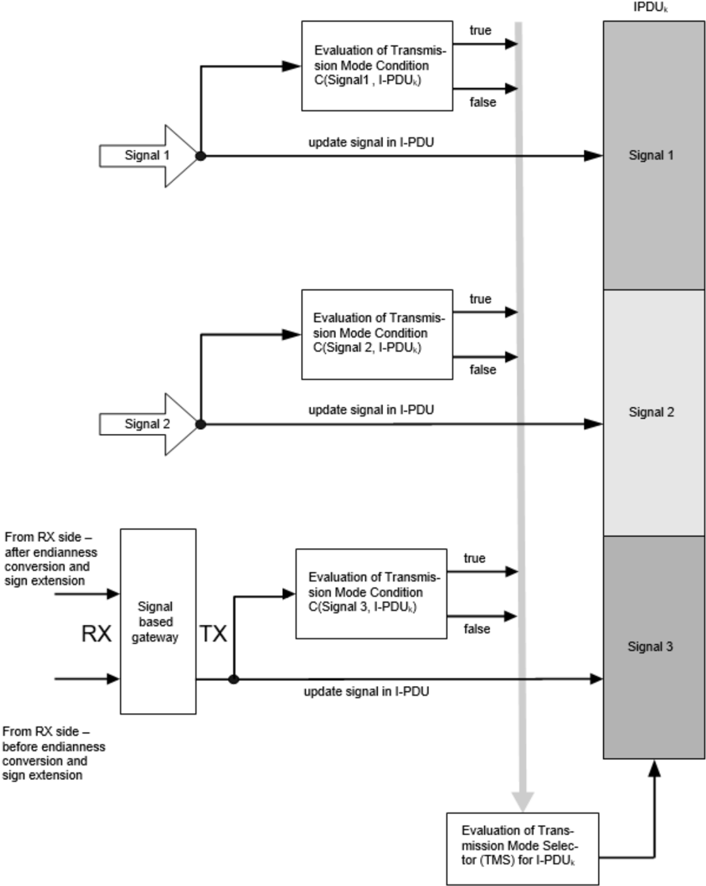

###### 6.3.3.4. 信号发送请求的重复

**ComTxModeMode**为DIRECT或MIXED时，用户（如**RTE**或**SwCluC**）发送请求的传输请求重复次数由配置参数**ComTxModeNumberOfRepetitions**定义。

如果**ComRetryFailedTransmitRequests**未设置为true，并且**ComTxModeMode**为DIRECT或MIXED、**ComTxModeNumberOfRepetitions**设置为0的I-PDU被触发发送，则AUTOSAR COM模块应为该I-PDU只调用一次**PduR_ComTransmit**，而与确认结果无关。

将**ComTxModeNumberOfRepetitions**配置为0模仿了[3]最初的直接传输模式。

如果在发送属于一起的n次传输期间（例如5次重复中的第3次之后，见SWS_Com_00305）收到来自用户（如**RTE**或**SwCluC**）的新发送请求，AUTOSAR COM模块应取消未完成的传输重复，并最迟在下一个主函数中开始处理新请求。另见用例B.4。

在发送**ComTxModeMode**为DIRECT或MIXED且**ComTxModeNumberOfRepetitions**大于0的I-PDU的情况下，AUTOSAR COM模块应以周期**ComTxModeRepetitionPeriod**周期性地调用**PduR_ComTransmit**，直到该发送请求收到**ComTxModeNumberOfRepetitions**加一次成功确认。

[SWS_Com_00305]假定CAN没有为这些I-PDU提供队列。CAN驱动程序、接口和硬件之间的交互中存在竞态条件，在某些不太可能发生的情况下可能导致额外的传输。

如果下层在N次传输进行期间返回**E_NOT_OK**，则该错误通知将被忽略，除非**ComRetryFailedTransmitRequests**设置为true（另见SWS_Com_00773）。如[SWS_Com_00305]所规定，只有已确认的传输才计入N次传输，错误的发送请求可以被安全地忽略。

如果在传输模式MIXED中，在具有待处理确认的MIXED传输模式的周期性传输之后请求N次传输，则周期性传输的确认将被分配给N次传输。在这种情况下，只能观察到N次请求新值的n-1次传输。发送截止期监控定时器最早在N次请求完成后被重置。在结合MIXED传输模式和N次传输配置发送截止期监控定时器时必须考虑到这一点。

如果在传输模式MIXED中，N次传输请求与混合传输的周期部分重叠，则周期性传输应计入N次传输请求的相应传输。

如果在N次传输完成之前发生发送截止期监控超时，则AUTOSAR COM模块不应为该N次传输发起进一步的传输。

最小延迟时间将始终按照[3]第2.3.4章的定义被考虑。

为了避免启动时的突发，可以为每个I-PDU配置一个时间偏移。详情见**ComTxModeTimeOffset**。

两次重复之间的时间由配置参数**ComTxModeRepetitionPeriod**配置。

如果传输模式变更为通过发送触发信号启动MIXED传输模式，并且**ComTxModeNumberOfRepetitions**配置为大于等于1，则在MIXED传输模式开始时，将至少有**ComTxModeNumberOfRepetitions**加一次对PDU路由器的传输请求。另见SWS_Com_00305。

###### 6.3.3.5. 失败传输请求的重试

如果**ComRetryFailedTransmitRequests**设置为true，则应评估**PduR_ComTransmit**的返回值。如果**PduR_ComTransmit**的返回值不等于**E_OK**，则AUTOSAR COM模块应在下一个[**Com_MainFunctionTx**](#7352-com_mainfunctiontx)内再次为未发送的I-PDU调用**PduR_ComTransmit**。

如果I-PDU在此期间被更新，则将发送新数据。

[SWS_Com_00773]可能导致对同一失败的传输请求进行多次重试。[SWS_Com_00773]不受传输模式变更的影响。[SWS_Com_00773]对潜在的重复周期没有影响。任何重复都将像没有发生重试一样发生。

AUTOSAR COM模块应独立于可能的重试启动发送截止期监控。后续的重试不应影响发送截止期监控。

如果**ComRetryFailedTransmitRequests**设置为true且某个I-PDU发生发送截止期监控超时，则AUTOSAR COM模块应使该I-PDU的任何待处理传输请求过期。

周期传输的周期定时器应始终从第一次发送尝试开始。

#### 6.3.4. 信号失效

AUTOSAR COM模块为发送者提供了一种可能性，以表明它无法为相应信号提供有效值，例如在传感器故障的情况下。AUTOSAR COM模块允许在配置期间定义**ComSignalDataInvalidValue**。

##### 6.3.4.1. 失效信号的传输

通过调用[**Com_InvalidateSignal**](#73317-com_invalidatesignal)，AUTOSAR COM模块应在内部执行一次使用已配置**ComSignalDataInvalidValue**的[**Com_SendSignal**](#7331-com_sendsignal)。

**ComTransferProperty**和传输模式决定**ComSignalDataInvalidValue**在总线上的传输。以数据无效值在内部执行的[**Com_SendSignal**](#7331-com_sendsignal)导致数据无效值被用作过滤器和TMS的当前值。

数据无效值按[**ComGroupSignal**](#9215-comgroupsignal)配置。

VFB只为复杂数据类型定义了一个属性。因此，将失效的复杂数据类型映射到失效信号组的最佳方式是使信号组的所有组信号失效。因此，用户（如**RTE**或**SwCluC**）也可以请求通过调用[**Com_InvalidateSignalGroup**](#73318-com_invalidatesignalgroup)使完整的信号组失效。

##### 6.3.4.2. 失效信号的接收

如果为某个信号收到了已配置的**ComSignalDataInvalidValue**，且该信号的**ComDataInvalidAction**配置为NOTIFY，则AUTOSAR COM模块应经由已配置的&lt;ComUser_CbkInv&gt;函数通知用户（如**RTE**、**SwCluC**）。在这种情况下，不得进行其他信号处理，如过滤或正常信号指示。

在接收到无效信号或信号组的情况下，接收截止期监控定时器也会重启，见SWS_Com_00738。

如果为某个信号收到了已配置的**ComSignalDataInvalidValue**，且该信号的**ComDataInvalidAction**配置为REPLACE，则AUTOSAR COM模块应将该信号的值替换为其已配置的**ComSignalInitValue**。替换之后，正常的信号处理（如过滤和通知）应像收到的是**ComSignalInitValue**而不是**ComSignalDataInvalidValue**那样进行。

如果为某个信号组的至少一个组信号收到了已配置的**ComSignalDataInvalidValue**，且该信号组的**ComDataInvalidAction**配置为NOTIFY，则AUTOSAR COM模块应经由已配置的&lt;ComUser_CbkInv&gt;函数通知用户（如**RTE**、**SwCluC**）。在这种情况下，不得进行其他信号组/组信号处理，如正常指示。

如果为某个信号组的至少一个组信号收到了已配置的**ComSignalDataInvalidValue**，且该信号组的**ComDataInvalidAction**配置为REPLACE，则AUTOSAR COM模块应将该信号组的所有组信号替换为其已配置的**ComSignalInitValue**值。替换之后，正常的信号组/组信号处理（如接收通知）应像所有组信号收到的是**ComSignalInitValue**那样进行。

如果为某个信号收到了已配置的**ComSignalDataInvalidValue**，且其**ComDataInvalidAction**配置为NOTIFY，则AUTOSAR COM模块不应将收到的**ComSignalDataInvalidValue**存储到信号对象中。

下一次调用[**Com_ReceiveSignal**](#7333-com_receivesignal)将返回最后有效接收的信号，或在尚未收到信号的情况下返回**ComSignalInitValue**。

如果为某个信号组的至少一个组信号收到了已配置的**ComSignalDataInvalidValue**，且其**ComDataInvalidAction**配置为NOTIFY，则AUTOSAR COM模块不应将任何收到的组信号存储到信号对象中。

下一次调用[**Com_ReceiveSignalGroup**](#7336-com_receivesignalgroup)会将最后有效接收的组信号，或在信号组尚未收到的情况下将**ComSignalInitValue**复制到影子缓冲区。

#### 6.3.5. I-PDU的处理

##### 6.3.5.1. I-PDU组定义

对于I-PDU组，适用以下规则：

1. 一个I-PDU可以属于任何I-PDU组。
2. 如果一个I-PDU属于某个已启动的I-PDU组（见SWS_Com_00771），或者它不属于任何I-PDU组且被隐式启动（见SWS_Com_00840），则它是活动的（已启动）。
3. I-PDU组的最大数量是预编译期可配置的。
4. I-PDU组只能包含同方向（即发送或接收）的I-PDU，见SWS_Com_00871。

规则1和3由COM配置支持。支持的I-PDU组的最大数量可以通过**ComSupportedIPduGroups**配置。

如果至少有一个I-PDU组处于活动（已启动）状态且该I-PDU属于其中，则该I-PDU是活动的（已启动）。

对于AUTOSAR COM模块，I-PDU组的嵌套纯粹是概念上的，必须通过适当的配置和/或AUTOSAR COM模块的使用来解决。

例如，如果I-PDU「BUS1 RX Function1」属于I-PDU组「BUS1 RX」，而I-PDU组「BUS1 RX」包含在I-PDU组「BUS1」中，那么I-PDU「BUS1 RX Function1」也必须包含在I-PDU组「BUS1」中。此类依赖关系需要在配置时解决。

再次强调，COM模块不知道也不处理I-PDU的任何分组。任何I-PDU分组必须通过配置或调用模块来处理。

此外，预期I-PDU组的完整状态处理在AUTOSAR COM模块之外完成，例如在基础软件模式管理器内。在状态变化的情况下，管理I-PDU组状态的模块通过[**Com_IpduGroupStart**](#7323-com_ipdugroupstart)和[**Com_IpduGroupStop**](#7324-com_ipdugroupstop)一致地启动或停止I-PDU组。

未分配给任何I-PDU组的I-PDU的状态无法更改，因此它们被隐式启动：

如果某个I-PDU未分配给任何I-PDU组，则AUTOSAR COM应在[**Com_Init**](#7321-com_init)内启动该I-PDU，就像它由[**Com_IpduGroupStart**](#7323-com_ipdugroupstart)以参数Initialize设置为true启动一样。另见第[6.3.5.2](#6352-i-pdu组的启动)节。

由于AUTOSAR COM从不隐式停止这样的I-PDU，并且它未分配给任何I-PDU组，这样的I-PDU永远无法被停止。

##### 6.3.5.2. I-PDU组的启动

默认情况下所有I-PDU组都是停止的，见SWS_Com_00444。对[**Com_IpduGroupStart**](#7323-com_ipdugroupstart)的调用会在之前为停止状态时启动一个I-PDU组。

如果某个I-PDU由[**Com_IpduGroupStart**](#7323-com_ipdugroupstart)启动，则AUTOSAR COM模块应允许其信号和信号组的发送/接收。另见表7.4。

如果某个I-PDU由[**Com_IpduGroupStart**](#7323-com_ipdugroupstart)启动，则AUTOSAR COM模块应始终初始化该I-PDU的以下属性：

1. 传输模式为DIRECT或MIXED的I-PDU的**ComMinimumDelayTime**
2. 为所有配置了非零**ComFirstTimeout**的信号重启所有接收截止期监控定时器
3. 取消所有发送截止期监控定时器，并在I-PDU激活之后第一次启动发送定时器时使用**ComFirstTimeout**（如果已配置）作为值
4. 所有包含的更新位应被清除
5. 重置**ComFilterAlgorithm**为ONE_EVERY_N的过滤器的OCCURRENCE

如果某个I-PDU由[**Com_IpduGroupStart**](#7323-com_ipdugroupstart)以参数Initialize设置为true启动，则除了[SWS_Com_00787]之外，AUTOSAR COM模块还应初始化该I-PDU的以下属性：

1. 按[SWS_Com_00217]定义的I-PDU数据
2. 所包含信号组的影子缓冲区
3. 每个信号过滤机制的old\_value设置为**ComSignalInitValue**
4. PERIODIC或MIXED传输模式下I-PDU的**ComTxModeTimePeriod**和**ComTxModeTimeOffset**

如果某个I-PDU由[**Com_IpduGroupStart**](#7323-com_ipdugroupstart)启动，则AUTOSAR COM模块应根据其当前数据内容确定其传输模式。

在某些情况下，某个I-PDU在其所有包含的信号被写入之前由[**Com_IpduGroupStart**](#7323-com_ipdugroupstart)启动。在这种情况下，AUTOSAR COM模块应为缺失的信号数据使用**ComSignalInitValue**。

当某个I-PDU被启动，并且该I-PDU中的一个或多个信号已经由上层通过发送API之一写入时，AUTOSAR COM模块应使用最近获得的值来确定该I-PDU的TMS。

如果某个I-PDU由[**Com_IpduGroupStart**](#7323-com_ipdugroupstart)启动且该I-PDU包含配置了截止期监控**ComFirstTimeout**、**ComTimeout**的信号，则AUTOSAR COM模块应独立于initialize参数的值为这些信号启动截止期监控。

注意，如果某个I-PDU由[**Com_IpduGroupStart**](#7323-com_ipdugroupstart)启动且参数initialize设置为false，则内部缓冲区不会更改，I-PDU包含最后一次设置的或初始值。特别是，如果I-PDU第一次启动且initialize设置为false，COM将基于[**Com_Init**](#7321-com_init)设置的初始值运行。

如果某个I-PDU不属于任何I-PDU组，它在COM初始化期间被启动。其启动传输模式应根据参与其TMS的信号的**ComSignalInitValue**进行评估。

对于这种情况，评估已经可以在配置时完成，因为信号在COM初始化之前无法被写入。

##### 6.3.5.3. I-PDU组的停止

对[**Com_IpduGroupStop**](#7324-com_ipdugroupstop)的调用会在之前为启动状态时停止一个I-PDU组。

为了禁用某个I-PDU的传输，包含该I-PDU的所有I-PDU组都需要被停止。因此，为了实现只听模式（**listen-only-mode**），所有包含发送I-PDU的I-PDU组都需要被停止。I-PDU的接收也可以被停止。

通过调用函数[**Com_SendSignal**](#7331-com_sendsignal)、[**Com_SendSignalGroup**](#7335-com_sendsignalgroup)或[**Com_InvalidateSignal**](#73317-com_invalidatesignal)，AUTOSAR COM模块应更新其内部缓冲区的值，即使I-PDU已停止。另见表7.3。

如果写入已停止I-PDU的信号在I-PDU未停止的情况下会触发该I-PDU的传输，则该触发不会被存储。在重新启动相应的I-PDU组之后，这样的旧触发不会导致I-PDU的立即传输。

如果某个I-PDU由[**Com_IpduGroupStop**](#7324-com_ipdugroupstop)停止，则AUTOSAR COM模块应取消该I-PDU的任何未完成传输请求。这包括取消与**ComRetryFailedTransmitRequests**相关的任何潜在重试。

如果某个I-PDU由[**Com_IpduGroupStop**](#7324-com_ipdugroupstop)停止，则AUTOSAR COM模块应取消所有待处理确认的截止期监控。

AUTOSAR COM模块应忽略已停止I-PDU的任何发送确认。

AUTOSAR COM模块无法禁止调用[**Com_TriggerTransmit**](#7341-com_triggertransmit)函数。但是，对于已停止的I-PDU，函数[**Com_TriggerTransmit**](#7341-com_triggertransmit)返回**E_NOT_OK**。见SWS_Com_00884。

如果某个I-PDU由[**Com_IpduGroupStop**](#7324-com_ipdugroupstop)停止，则AUTOSAR COM模块应禁用其接收处理。

如果某个大I-PDU由[**Com_IpduGroupStop**](#7324-com_ipdugroupstop)停止，则AUTOSAR COM模块应停止接收过程并忽略部分接收的I-PDU。

如果某个I-PDU由[**Com_IpduGroupStop**](#7324-com_ipdugroupstop)停止，则AUTOSAR COM模块应取消其截止期监控。

如果某个I-PDU由[**Com_IpduGroupStop**](#7324-com_ipdugroupstop)停止，则AUTOSAR COM模块应立即为该已停止I-PDU未确认的已发送信号/信号组调用已配置的&lt;ComUser_CbkTxErr&gt;。

如果某个大I-PDU在其传输已在进行中时被停止，则AUTOSAR COM模块应立即停止传输过程。

表7.3概述了已停止I-PDU的行为：

表7.3：已停止I-PDU的行为（**Behavior of stopped I-PDUs**）

| 已停止I-PDU的行为 | 已停止I-PDU的行为 |
| --- | --- |
| 接收侧（RX） | 发送侧（TX） |
| • 禁用RX截止期监控 • 对来自用户（如**RTE**、**SwCluC**）的[Com_RxIndication](#7342-com_rxindication)不采取动作，不存储该I-PDU • 在[Com_ReceiveSignal](#7333-com_receivesignal)和[Com_ReceiveSignalGroup](#7336-com_receivesignalgroup)上返回码为COM_SERVICE_NOT_AVAILABLE，并返回最后已知值（或初始值）作为数据 | • 禁用发送 • 禁用TX截止期监控 • 忽略[Com_TxConfirmation](#7344-com_txconfirmation) • 在调用[Com_SendSignal](#7331-com_sendsignal)、[Com_SendSignalGroup](#7335-com_sendsignalgroup)、[Com_InvalidateSignal](#73317-com_invalidatesignal)时，AUTOSAR COM模块内部缓冲区的值仍然被更新，但返回码COM_SERVICE_NOT_AVAILABLE • 未完成的传输请求（如N次传输）将被取消 • [Com_TriggerTransmit](#7341-com_triggertransmit)上的返回码为E_NOT_OK |
|  | 对于周期性（TX）：不再发送 |

表7.4概述了已启动I-PDU的行为：

表7.4：已启动I-PDU的行为（**Behavior of started I-PDUs**）

| 已启动I-PDU的行为 | 已启动I-PDU的行为 |
| --- | --- |
| 接收侧（RX） | 发送侧（TX） |
| • 如果Initialize==true则重新初始化超时（**ComFirstTimeout**、**ComTimeout**） • 对[Com_RxIndication](#7342-com_rxindication) / [Com_TpRxIndication](#7343-com_tprxindication)的正常反应 • 对[Com_ReceiveSignal](#7333-com_receivesignal)和[Com_ReceiveSignalGroup](#7336-com_receivesignalgroup)的正常反应 | • 对[Com_InvalidateSignal](#73317-com_invalidatesignal)、[Com_SendSignal](#7331-com_sendsignal)和[Com_SendSignalGroup](#7335-com_sendsignalgroup)的正常反应 • 在下一次发送之前没有传输超时通知 • 对[Com_TxConfirmation](#7344-com_txconfirmation) / [Com_TpTxConfirmation](#7345-com_tptxconfirmation)的正常反应 • 对[Com_TriggerTransmit](#7341-com_triggertransmit)的正常反应 |
|  | 对于周期性（TX）：从0开始 |

##### 6.3.5.4. 信号指示（I-PDU的解包）

为了同时支持中断驱动和轮询系统，可以配置信号指示发生的时间。有两种可配置的信号指示模式IMMEDIATE和DEFERRED，通过**ComIPduSignalProcessing**配置。

如果某个I-PDU的**ComIPduSignalProcessing**配置为IMMEDIATE，则AUTOSAR COM模块应分别在[**Com_RxIndication**](#7342-com_rxindication)或[**Com_TpRxIndication**](#7343-com_tprxindication)函数内为所包含的信号和信号组调用已配置的&lt;ComUser_CbkRxAck&gt;。

如果某个I-PDU的**ComIPduSignalProcessing**配置为DEFERRED，则AUTOSAR COM模块应首先在[**Com_RxIndication**](#7342-com_rxindication)函数或相关的TP接收函数内，将所接收I-PDU的相关数据（如已配置的[**ComSignal**](#9213-comsignal)）从PduR复制到COM。然后AUTOSAR COM模块应在下一次调用[**Com_MainFunctionRx**](#7351-com_mainfunctionrx)期间异步地为所包含的信号和信号组调用已配置的&lt;ComUser_CbkRxAck&gt;。

对于动态长度的信号，AUTOSAR COM必须根据**ComSignalLength**配置的长度考虑缓冲区分配。

如果在延迟解包发生之前调用了[**Com_ReceiveSignal**](#7333-com_receivesignal)（在DEFERRED模式下），则返回之前未更新的值。

包含两种指示选项的时序图见第[8.3](#83-pdu路由器autosar-com模块和rte之间的指示处理)节。这些模式的配置在**ComIPduSignalProcessing**中定义。

在解包I-PDU时，AUTOSAR COM模块应检查所接收的数据长度（PduInfoPtr->SduLength），并只通过&lt;ComUser_CbkRxAck&gt;解包并通知完整接收的信号。

在接收到小于经由参数**ComPduIdRef**导出的长度的I-PDU的情况下，当且仅当其配置位置小于或等于部分接收的I-PDU的已接收大小时，才接收大小为0的信号。

在接收到小于预期的I-PDU导致某个信号在没有其已配置更新位的情况下被接收时，AUTOSAR COM模块应将该信号视为其更新位已置位，并将该信号解释为已更新。

如果所接收I-PDU的长度小于已配置/预期的I-PDU长度，需要防止信号被部分更新。另一方面，所有完整接收的信号都应被接收并通知上层。

在解包I-PDU时，AUTOSAR COM模块应检查所接收的数据长度（PduInfoPtr->SduLength），并且在信号组只被部分接收的情况下，该信号组和所有包含的组信号不应被解包或通过&lt;ComUser_CbkRxAck&gt;通知。

上述需求防止不一致接收的信号组，从而防止不一致接收的复杂数据类型。

在所接收数据长度大于预期的情况下，AUTOSAR COM模块不为未配置的信号复制或处理额外的接收数据。

AUTOSAR COM模块只需要相对于预期长度复制和处理已配置信号占用的接收数据（预期长度是所有已配置的动态或静态信号的长度，包括信号之间的间隙）。超过预期长度的接收数据不需要被复制。

##### 6.3.5.5. 最小延迟定时器（MDT）

AUTOSAR COM模块继承了[3]中定义的最小延迟定时器机制。本章对该机制进行澄清和详述。

当I-PDU被启动时，MDT被重新初始化。因此，通过快速停止和启动I-PDU可能违反MDT。

发送截止期监控定时器的行为不受最小延迟时间监督导致的任何传输延迟的影响。

如果**ComMinimumDelayTime**被省略或配置为0，则不进行最小延迟时间监控。

如果**ComEnableMDTForCyclicTransmission**配置为false，则在以下情况下不应（重新）启动最小延迟定时器：

- **ComTxModeMode**为PERIODIC的I-PDU
- **ComTxModeMode**为MIXED的I-PDU的周期部分
- **ComTxModeNumberOfRepetitions** > 0时I-PDU的重复传输

在最小延迟定时器当前未启动的情况下，最小延迟定时器不可能到期。因此，优化的实现可以例如在**ComEnableMDTForCyclicTransmission**配置为false的情况下完全省略对周期性I-PDU的最小延迟时间监控，因为最小延迟定时器永远不会被启动。

如果某个I-PDU的**ComMinimumDelayTime**配置为大于0且**ComRetryFailedTransmitRequests**设置为false，则AUTOSAR COM模块应在经由**PduR_ComTransmit**向PDU路由器传输该I-PDU时装载并启动最小延迟时间计数器。

如果某个I-PDU的**ComMinimumDelayTime**配置为大于0且**ComRetryFailedTransmitRequests**设置为true，则AUTOSAR COM模块应仅在**PduR_ComTransmit**返回**E_OK**的情况下，在经由**PduR_ComTransmit**向PDU路由器传输该I-PDU时装载并启动最小延迟时间计数器。

如果某个I-PDU的**ComMinimumDelayTime**配置为大于0，则AUTOSAR COM模块应在该I-PDU成功发送确认时，用**ComMinimumDelayTime**（重新）装载该I-PDU已在运行且尚未到期的最小延迟时间计数器。

正在运行的最小延迟定时器在该I-PDU的成功TX确认被接收时重新装载，除非在收到确认时传输已经被延迟得比**ComMinimumDelayTime**更久。在正常情况下，除非已装载并启动的最小延迟已到期，否则AUTOSAR COM模块不会再传输该I-PDU。另见[3]中的图2-4、2-5和2-7。但是，存在一些例外：根据[SWS_Com_00475]，[**Com_TriggerTransmit**](#7341-com_triggertransmit)不干扰最小延迟定时器。此外，如果发送截止期监控定时器到期，最小延迟定时器会被重置；见[3]第2.3.4章。另外，启动I-PDU组会重置所包含I-PDU的最小延迟时间定时器。

如果某个I-PDU的最小延迟定时器因发送截止期监控定时器到期而被重置，且该I-PDU存在被推迟的请求，则AUTOSAR COM模块应立即传输该I-PDU。

#### 6.3.6. 截止期监控

信号的截止期监控在[3]中定义。

在信号组的截止期监控上下文中，它像信号一样处理。截止期监控参数**ComFirstTimeout**和**ComTimeout**可以在配置容器[**ComSignal**](#9213-comsignal)或[**ComSignalGroup**](#9214-comsignalgroup)中定义。

相应的超时通知回调函数可以在配置容器[**ComUserCallback**](#9230-comusercallback)中的参数内定义。

如果某个信号或信号组的配置参数**ComTimeout**被省略或配置为0，则AUTOSAR COM模块不应监控该信号或信号组。它还应忽略**ComFirstTimeout**。

##### 6.3.6.1. 接收截止期监控

接收截止期监控可以通过I-PDU组的控制启用和禁用，类似于第[6.3.5.1](#6351-i-pdu组定义)节。

当且仅当某个I-PDU包含在启用了接收截止期监控的I-PDU组中时，该I-PDU的接收截止期监控才被启用。否则，该I-PDU的接收截止期监控被禁用。

在为带有更新位的信号配置了接收截止期监控的情况下，AUTOSAR COM模块应为每个带有更新位的信号/信号组执行单独的接收截止期监控。配置见**ComTimeout**。

AUTOSAR COM模块应为没有更新位的信号执行基于I-PDU的接收截止期监控。

对于同一I-PDU内所有没有更新位的信号和信号组，AUTOSAR COM模块应使用所有这些没有配置更新位的信号和信号组中最小的已配置非零超时参数（**ComFirstTimeout**、**ComTimeout**）来执行该I-PDU的接收截止期监控。

如果某个配置了接收截止期监控的I-PDU中的所有信号都配置了更新位，则无需执行基于I-PDU的接收截止期监控。

在发生Rx超时的情况下，**ComRxDataTimeoutAction**参数决定AUTOSAR COM模块是将信号/信号组的值替换为初始值或替代值，还是保持最后接收的值。

如果**ComRxDataTimeoutAction**设置为REPLACE，则当某个信号的接收截止期监控定时器到期时，AUTOSAR COM模块应用其**ComSignalInitValue**替换该信号的值。

如果**ComSignalInitValue**替换最后接收的值，则最后接收的值被覆盖并丢失。因此，在收到新值之前，AUTOSAR COM模块为该信号返回**ComSignalInitValue**。

如果**ComRxDataTimeoutAction**设置为SUBSTITUTE，则当某个信号的接收截止期监控定时器到期时，AUTOSAR COM模块应用其**ComTimeoutSubstitutionValue**替换该信号的值。

如果某个信号或信号组的接收截止期监控定时器到期，且该信号或信号组的配置参数**ComRxDataTimeoutAction**被省略或配置为NONE，则AUTOSAR COM模块不应替换该信号或该信号组的信号。

如果**ComRxDataTimeoutAction**设置为REPLACE，则当某个信号组的接收截止期监控定时器到期时，AUTOSAR COM模块应用其**ComSignalInitValue**替换所有包含的组信号的值。

Rx超时指示可以与**ComRxDataTimeoutAction**分开组合和配置。

如果**ComRxDataTimeoutAction**设置为SUBSTITUTE，则当某个信号组的接收截止期监控定时器到期时，AUTOSAR COM模块应用其**ComTimeoutSubstitutionValue**替换所有包含的组信号的值。

当成功接收到配置了接收截止期监控的（大）I-PDU时，AUTOSAR COM模块应分别在函数[**Com_RxIndication**](#7342-com_rxindication)或[**Com_TpRxIndication**](#7343-com_tprxindication)被调用时重置该（大）I-PDU的接收截止期监控定时器。

如果某个信号或信号组的配置参数**ComFirstTimeout**被省略或配置为0，则AUTOSAR COM模块不应从相应I-PDU的启动开始直到第一次接收期间监控该信号或信号组的接收。

基于I-PDU的接收截止期监控机制不应考虑信号的值。

如果接收截止期监控定时器到期，AUTOSAR COM模块应重启它。

AUTOSAR COM遵循[3]第2.5.1章的方法，即接收截止期监控定时器被重启。这也意味着如果接收在较长一段时间内失败，超时通知会被周期性地报告。

###### 6.3.6.1.1. 接收截止期监控的启用/禁用

当某个I-PDU的接收截止期监控被禁用且定时器到期时，不会向用户（如**RTE**、**SwCluC**）给出错误指示。

禁用接收截止期监控不会停止I-PDU的接收。

如果通过[**Com_EnableReceptionDM**](#7325-com_enablereceptiondm)启用了某个I-PDU的接收截止期监控，则AUTOSAR COM模块应将所包含信号和信号组的接收截止期监控定时器设置为已配置的**ComFirstTimeout**值。

在某个I-PDU的接收截止期监控已启用的情况下，AUTOSAR COM模块应静默忽略通过[**Com_EnableReceptionDM**](#7325-com_enablereceptiondm)将该I-PDU的接收截止期监控设置为启用的操作。

启用接收截止期监控意味着对于配置了&lt;ComUser_CbkRxTOut&gt;的信号或信号组，截止期监控到期的超时通知会通知给用户（如**RTE**、**SwCluC**）。

如果在包含Tx-I-PDU的I-PDU组上调用[**Com_EnableReceptionDM**](#7325-com_enablereceptiondm)或[**Com_DisableReceptionDM**](#7326-com_disablereceptiondm)，则AUTOSAR COM模块应静默忽略该请求。

在某个I-PDU的接收截止期监控已禁用的情况下，AUTOSAR COM模块应静默忽略通过[**Com_DisableReceptionDM**](#7326-com_disablereceptiondm)将该I-PDU的接收截止期监控设置为禁用的操作。

##### 6.3.6.2. 发送截止期监控

AUTOSAR COM发送截止期监控的一般思路是监督下层和总线，而不是COM模块本身。因此，当COM模块向下层发送I-PDU时，通常启动发送监控定时器。这独立于传输模式、传输属性或更新位。一般而言，如果发送监控定时器当前正在运行，则不会重新启动或重置它。

AUTOSAR COM模块应为所有信号和信号组执行发送截止期监控（如果已配置），独立于传输属性，也独立于该信号/信号组所属I-PDU的传输模式。

AUTOSAR COM模块不区分具有**ComTransferProperty** PENDING或TRIGGERED的信号的发送截止期监控。

如果某个I-PDU的关联信号/信号组配置了不同的**ComTimeout**参数，则AUTOSAR COM模块应使用最小值作为该I-PDU发送截止期监控的超时参数。

发送截止期监控只应在AUTOSAR COM模块中为支持生成发送确认的总线配置。否则，发送截止期监控将始终通知传输错误。

AUTOSAR COM应在信号（组）被（在I-PDU内）发送到下层时启动其已配置的发送截止期监控定时器，除非该定时器已在运行。

[SWS_Com_00878]不考虑潜在的返回码，因此即使发送请求立即失败，定时器也会被启动。

如果定时器已在运行，新的发送请求不会重置或重启正在运行的定时器，而是继续监控当前未完成的发送请求。除非另有规定，无论导致潜在I-PDU发送请求的触发是什么，定时器都会被启动。这样的触发例如是信号的周期性发送请求、传输模式切换，或经由[**Com_TriggerIPDUSend**](#73319-com_triggeripdusend)的显式I-PDU发送请求。

如果发送截止期监控定时器在该I-PDU的发送截止期监控服务（重）启动之后第一次被启动，则应以已配置的**ComFirstTimeout**值启动，否则应以**ComTimeout**值启动。

当AUTOSAR COM收到某个I-PDU的发送确认时，它应取消所有包含信号和信号组的所有正在运行的发送截止期监控定时器。

在仅为传输模式NONE的I-PDU配置了发送截止期监控的情况下，AUTOSAR COM模块应在该I-PDU所属I-PDU组启动时启动该I-PDU的发送截止期监控定时器。

在为具有传输模式NONE和另一种传输模式的I-PDU配置了发送截止期监控的情况下，每当传输模式NONE激活时，应禁用发送截止期监控。

在仅为传输模式NONE的I-PDU配置了发送截止期监控的情况下，AUTOSAR COM模块应在收到成功的发送确认时重置该I-PDU的发送截止期监控定时器。

对于信号组，只能为整个信号组配置发送截止期监控，而不能为组信号配置，见[**ComSignalGroup**](#9214-comsignalgroup)和[**ComGroupSignal**](#9215-comgroupsignal)。

在为**ComIPduCancellationSupport**配置为true的I-PDU发生发送截止期监控定时器到期的情况下，AUTOSAR COM模块应为该I-PDU调用**PduR_ComCancelTransmit**。

**PduR_ComCancelTransmit**的调用是在Com的正常超时处理（在已配置时通知SW-C）之外进行的。

AUTOSAR COM忽略**PduR_ComCancelTransmit**的返回码。

当发送截止期监控定时器到期时（即没有及时收到I-PDU的成功发送确认），AUTOSAR COM模块应通过为所包含的信号或信号组调用所有已配置的&lt;ComUser_CbkTxTOut&gt;来通知用户（如**RTE**、**SwCluC**）。此外，发送截止期监控定时器不应被重启。

如果发送截止期监控定时器超时，无论原因如何都会发出超时通知。例如，即使传输被I-PDU callout过滤掉，通知也会发生。

AUTOSAR COM遵循[3]第2.5.2章的方法，即发送截止期监控定时器不被重启。这也意味着如果传输失败，超时通知只报告一次。

###### 6.3.6.2.1. N次传输模式下的发送截止期监控

如[3]所定义，如果为相应信号或信号组配置了发送截止期监控，则监控定时器应分别在调用[**Com_SendSignal**](#7331-com_sendsignal)或[**Com_SendSignalGroup**](#7335-com_sendsignalgroup)完成时启动。

对于传输模式DIRECT和MIXED，应确保所有**ComTxModeNumberOfRepetitions**请求都能在已配置的周期内发出（见第[6.3.3.4](#6334-信号发送请求的重复)节）。

如[3]所定义，如果监控定时器到期，用户（如**RTE**、**SwCluC**）会通过已配置的通知机制收到该失败的通知。

对于**ComTxModeMode**为DIRECT且**ComTxModeNumberOfRepetitions** > 0的I-PDU，AUTOSAR COM模块应在**ComTxModeNumberOfRepetitions**加一次成功接收的发送确认之后取消发送截止期监控定时器。

如果定时器在**ComTxModeNumberOfRepetitions**加一次确认之后被取消，则传输已成功，随后发送确认被发送给用户（如**RTE**、**SwCluC**）。另见SWS_Com_00305。

对于**ComTxModeMode**为DIRECT且**ComTxModeNumberOfRepetitions** > 0的I-PDU，如果为该I-PDU发起了另一个发送请求，AUTOSAR COM模块应重置已在运行的发送截止期监控定时器。

#### 6.3.7. 通知处理

AUTOSAR COM继承了[3]的通知类别1、2、3和4。通知通过[**ComUserCallback**](#9230-comusercallback)配置，回调的定义见第7.6.3.1节。

对于为某个信号或信号组配置的每个&lt;ComUser_CbkTxAck&gt; / &lt;ComUser_CbkRxAck&gt;，AUTOSAR COM应经由已配置的通知指示每次成功的发送/接收。

例如，对于周期性传输，每次成功的周期性传输都会被通知。请注意，对于n次传输，在被视为成功之前需要总线上多次传输，另见SWS_Com_00305。

### 6.4. 信号组——复杂数据类型

为了支持AUTOSAR复杂数据类型的概念，AUTOSAR COM模块提供信号组。AUTOSAR COM模块一致地发送和接收信号组，为复杂数据类型提供必要的一致性。

信号组可以静态配置。可以为每个信号组配置一个符号名。配置细节见[**ComSignalGroup**](#9214-comsignalgroup)。

AUTOSAR COM模块通过影子缓冲区机制实现信号组的一致性，即用户（如**RTE**或**SwCluC**）访问影子缓冲区中的组信号。如果影子缓冲区需要与I-PDU同步，用户可以通过[**Com_SendSignalGroup**](#7335-com_sendsignalgroup)或[**Com_ReceiveSignalGroup**](#7336-com_receivesignalgroup)显式触发同步。同步以原子方式执行。

信号组一致性的另一种方法是启用信号组数组API [**Com_SendSignalGroupArray**](#7337-com_sendsignalgrouparray)和[**Com_ReceiveSignalGroupArray**](#7338-com_receivesignalgrouparray)。该方法的差异在第[6.4.6](#646-基于uint8数组的信号组访问)节中描述。

#### 6.4.1. 初始化

通过调用[**Com_Init**](#7321-com_init)，AUTOSAR COM模块应在发送侧初始化信号组的影子缓冲区。

由于不期望一个格式良好的SWC在调用[**Com_ReceiveSignalGroup**](#7336-com_receivesignalgroup)之前尝试读取组信号，[SWS_Com_00484]只适用于发送侧。

#### 6.4.2. 传输

如果为属于某个信号组的信号调用了[**Com_SendSignal**](#7331-com_sendsignal)或[**Com_InvalidateSignal**](#73317-com_invalidatesignal)，则AUTOSAR COM只会更新该信号组的影子缓冲区。除非I-PDU内容发生变化，否则不需要任何进一步的I-PDU处理（如TMS评估）。

如果为该信号组调用了[**Com_SendSignalGroup**](#7335-com_sendsignalgroup)，则AUTOSAR COM模块应将影子缓冲区原子地复制到I-PDU缓冲区。

具有两个组信号signal\_a和signal\_b（属于group\_x）的示例：

```
/* copy a to shadow buffer */ Com_SendSignal (signal_a, &a); /* copy b to shadow buffer */ Com_SendSignal (signal_b, &b); /* copy shadow buffer to I-PDU */ Com_SendSignalGroup (group_x);
```

#### 6.4.3. 接收

在信号组数据由[**Com_ReceiveSignalGroup**](#7336-com_receivesignalgroup)复制到影子缓冲区之后，可以通过调用函数[**Com_ReceiveSignal**](#7333-com_receivesignal)从影子缓冲区接收组信号。

如果为某个信号组调用了[**Com_ReceiveSignalGroup**](#7336-com_receivesignalgroup)，则AUTOSAR COM模块应将数据从I-PDU缓冲区原子地复制到影子缓冲区。

具有两个组信号signal\_a和signal\_b（属于group\_x）的示例：

```
/* copy I-PDU to shadow buffer */ Com_ReceiveSignalGroup (group_x); /* copy a from shadow buffer */ Com_ReceiveSignal (signal_a, &a); /* copy b from shadow buffer */ Com_ReceiveSignal (signal_b, &b);
```

#### 6.4.4. 通知

表7.5显示所有通知函数只能为信号组配置，而不能为单个组信号配置。第[6.3](#63-正常操作)节定义了信号和信号组的通知方法的功能逻辑。可配置通知函数的原型在第7.6.3.1节中定义。

#### 6.4.5. 信号组的属性

表7.5概述了信号组的属性：

表7.5：信号组的属性（**Attributes of signal groups**）

| 属性 | 每个组信号 | 每个信号组 |
| --- | --- | --- |
| 更新位 | 否 | 是，关联于整个组（见第[6.9](#69-更新位)节） |
| 信号通知（发送侧） | 否 | 是 |
| 信号通知（接收侧） | 否 | 是 |
| 错误通知（发送侧） | 否 | 是 |
| 超时通知（发送侧） | 否 | 是 |
| 超时通知（接收侧） | 否 | 是 |
| 无效通知（接收侧） | 否 | 是 |
| 数据访问（接收侧） | 是 | 是，见SWS_Com_00201 |
| 数据访问（发送侧） | 是 | 是，见SWS_Com_00200、SWS_Com_00557 |
| 数据过滤（接收侧） | 是，见第[6.2.4](#624-过滤)节 | 否 |
| 数据过滤（发送侧） | 否 | 否 |
| 发送侧的TMS | 每个信号，根据TMS选择定义。（见第[6.3.3.2](#6332-特定i-pdu传输模式的选择)节） | 否 |

#### 6.4.6. 基于UINT8数组的信号组访问

信号组一致性的另一种方法是通过COM配置参数**ComSignalGroupArrayAccess**启用信号组数组API [**Com_SendSignalGroupArray**](#7337-com_sendsignalgrouparray)和[**Com_ReceiveSignalGroupArray**](#7338-com_receivesignalgrouparray)。此时复合数据的序列化在COM模块之外完成，但产生的布局与COM将组信号放入I-PDU时使用的布局相同。

在这种方法中，不使用影子缓冲区。序列化的数据作为信号组的uint8数组表示直接提供给COM模块。

只有在满足以下前提条件时，才应使用基于UINT8数组的信号组访问：

- 复合数据只使用固定大小的数据类型
- 按字节对齐映射到I-PDU的信号组
- 底层数组不包含任何其他信号的信号组，但可以包含间隙

在某个信号组定义了**ComSignalGroupArrayAccess**的情况下，不应为该信号组分配影子缓冲区。

在某个信号组定义了**ComSignalGroupArrayAccess**的情况下，该信号组不支持调用以下API：

- 针对该信号组的任何组信号的[**Com_SendSignal**](#7331-com_sendsignal)和[**Com_ReceiveSignal**](#7333-com_receivesignal)
- 针对该信号组的[**Com_SendSignalGroup**](#7335-com_sendsignalgroup)和[**Com_ReceiveSignalGroup**](#7336-com_receivesignalgroup)

上述需求定义了某些API不为具有数组访问的信号组所支持。也就是说，不得为具有数组访问的信号组调用这些API。如果非法调用它们，行为未定义。

由于信号组以uint8数组表示的形式提供，接收过滤和传输模式选择在评估组信号时需要应对这种数据表示。

为了简化过滤器评估，只支持[SWS_Com_00602]中过滤器的一个子集。

对于信号组数组访问，以下两个过滤器被排除在接收过滤和传输模式选择之外：

- NEW_IS_WITHIN
- NEW_IS_OUTSIDE

信号组数组处理函数[**Com_SendSignalGroupArray**](#7337-com_sendsignalgrouparray)和[**Com_ReceiveSignalGroupArray**](#7338-com_receivesignalgrouparray)应为接收过滤和传输模式选择支持以下过滤器：

- ALWAYS
- NEVER
- MASKED_NEW_EQUALS_X
- MASKED_NEW_DIFFERS_X
- MASKED_NEW_DIFFERS_MASKED_OLD
- ONE_EVERY_N

##### 6.4.6.1. 基本功能

在使用AUTOSAR Transformer方法的情况下，序列化和进一步的数据处理已经在转换器链中完成。由于转换器链已经在处理通信数据的uint8数组表示，基于uint8数组的信号组访问允许使用已序列化的数据并将其放入I-PDU，而无需COM再次序列化数据。

AUTOSAR系统模板[11]定义了哪个信号组应以基于uint8数组的方法处理。如果系统模板启用了基于uint8数组的方法，则ECU配置参数**ComSignalGroupArrayAccess**设置为true。

通信数据的uint8数组表示的起始位置应为该信号组中具有最小**ComBitPosition**的组信号在该信号组中的字节偏移。

通信数据的uint8数组表示的结束位置应为该信号组中具有最高**ComBitPosition**的组信号所占用的最后一个字节在该信号组中的字节偏移。

##### 6.4.6.2. 初始化

通过调用[**Com_Init**](#7321-com_init)，AUTOSAR COM模块应根据所有包含的组信号的**ComSignalInitValue**初始化配置了**ComSignalGroupArrayAccess**为true的信号组的相应I-PDU缓冲区段。

##### 6.4.6.3. 传输

当调用[**Com_SendSignalGroupArray**](#7337-com_sendsignalgrouparray)时，会提供指向信号组uint8数组表示的数据指针。AUTOSAR COM模块应根据[SWS_Com_00844]中定义的起始位置和[SWS_Com_00845]中定义的大小，将数据复制到I-PDU。

就传输属性和I-PDU传输模式而言，AUTOSAR COM模块应以与[**Com_SendSignalGroup**](#7335-com_sendsignalgroup)等同的方式处理[**Com_SendSignalGroupArray**](#7337-com_sendsignalgrouparray)调用。

见第[6.3.3.1.2](#63312-信号组)节、[6.3.3.2](#6332-特定i-pdu传输模式的选择)节、[6.3.3.3](#6333-信号流和传输模式选择)节。

##### 6.4.6.4. 接收

当调用[**Com_ReceiveSignalGroupArray**](#7338-com_receivesignalgrouparray)时，会提供指向信号组uint8数组表示的数据指针。AUTOSAR COM模块应根据[SWS_Com_00844]中定义的起始位置和[SWS_Com_00845]中定义的大小，将I-PDU中的数据复制到数据指针位置。

### 6.5. 大数据类型

大信号是太大而无法放入底层通信协议单个L-PDU的信号。例如，CAN上的大信号会超过8字节或CAN FD [12]的64字节。对于FlexRay，情况更为复杂，因为一个帧可以包含多个I-PDU。因此，即使信号不超过FlexRay帧的大小，对于FlexRay它也可能是大信号。

AUTOSAR中的大信号需要配置一个将经由底层总线传输协议发送的大I-PDU。大I-PDU不一定包含一个或多个大信号。

使用该概念，I-PDU的长度以及信号的长度将根据总线特定的传输协议受到限制，见**ComSignalLength**。

UINT8_N是唯一支持静态大小大于8字节信号的信号类型。动态长度信号见第[6.6](#66-动态长度信号)节。

由于AUTOSAR COM模块不知道底层总线属性，必须配置I-PDU是否可以在单个L-PDU（例如一个CAN帧）内发送，或者是否需要经由TP发送，另见**ComIPduType**。

AUTOSAR COM模块无法阻止或检测向特定总线传输协议发送了过大的I-PDU，因为AUTOSAR COM模块使用与总线无关的PDU路由器接口。但是，AUTOSAR COM模块允许使用下层TP的N-SDU最大长度，因此AUTOSAR COM模块不引入任何额外的长度限制。

#### 6.5.1. 大信号/I-PDU的传输

AUTOSAR COM模块经由通用的、面向使用传输协议的上层模块的PduR API发送大I-PDU。AUTOSAR COM模块与PDU路由器接口的细节见第[6.8](#68-autosar-com模块与pdu路由器之间的接口)节。根据[6]，调用序列为：

- **PduR_ComTransmit**：用于发起发送请求
- 一次或多次回调[**Com_CopyTxData**](#7348-com_copytxdata)：用于复制数据
- 回调[**Com_TpTxConfirmation**](#7345-com_tptxconfirmation)：用于确认传输

在经由**PduR_ComTransmit**成功发起大I-PDU的传输之后，AUTOSAR COM模块不应修改其该I-PDU内部发送缓冲区的数据，除非AUTOSAR COM模块被通知传输成功或收到指示传输已中止的错误。

AUTOSAR COM模块内的I-PDU是静态配置的。因此，即使是很大的I-PDU，也会分配I-PDU的完整内存。采用这种方法是为了降低大数据类型处理的复杂性。

如果所使用的传输协议也用于诊断或其他服务，则它必须支持多个用户。这至少由CAN TP [13]和FlexRay TP [14]支持。

在某个大I-PDU当前正在传输且同一I-PDU再次被触发传输的情况下，AUTOSAR COM应跳过额外的发送请求并报告运行时错误[**COM_E_SKIPPED_TRANSMISSION**](#6112-运行时错误)。

这可能在例如大I-PDU被周期性发送且传输被延迟到下一个周期的情况下发生。

#### 6.5.2. 大信号/I-PDU的接收

AUTOSAR COM模块经由通用的、面向使用传输协议的上层模块的PDU路由器API接收大I-PDU。AUTOSAR COM模块与PDU路由器接口的细节见第[6.8](#68-autosar-com模块与pdu路由器之间的接口)节。根据[6]，调用序列为：

- 调用[**Com_StartOfReception**](#7346-com_startofreception)：用于发起RX请求
- 一次或多次回调[**Com_CopyRxData**](#7347-com_copyrxdata)：将接收数据复制到AUTOSAR COM模块的内部接收缓冲区
- 调用[**Com_TpRxIndication**](#7343-com_tprxindication)：指示接收过程的正确或错误结束

在以参数result为**E_NOT_OK**调用[**Com_TpRxIndication**](#7343-com_tprxindication)的情况下，AUTOSAR COM模块应将所接收大I-PDU的所有信号完全像失效信号一样对待。也就是说，AUTOSAR COM模块应为所有包含的信号和信号组执行所有已配置的**ComDataInvalidAction**。

在接收大I-PDU时，内部I-PDU缓冲区被逐渐覆盖。因此，除非旧信号被存储在某个其他地方（例如信号组的影子缓冲区），COM模块在某些场景下存在丢失可能需要的信号数据信息的风险，例如：

- 接收一个更新位未置位的信号
- 在RX过滤器未通过的情况下提供最后的值
- 在仅定义了无效通知（但没有替换）且收到无效值的情况下提供最后的值

如果AUTOSAR COM模块经由大I-PDU接收信号，并且这些信号配置了在某些情况下需要保留旧值的特性，则AUTOSAR COM模块应像对经由普通I-PDU接收的信号那样，为经由大I-PDU接收的信号正确提供旧值。

实现可以自行寻找高效的方式来提供旧值，并从配置中导出哪些信号或I-PDU需要附加处理（如缓冲）。

这并不意味着必须实现队列。

### 6.6. 动态长度信号

动态长度信号是其长度可以在运行时变化的信号。动态长度信号的最大长度需要在配置时指定。动态长度信号必须在动态长度I-PDU中传输。

对于动态长度信号，AUTOSAR COM模块应只支持**ComSignalType** UINT8_DYN。

将类型限制为UINT8数组类型也将动态长度信号的放置限制在字节边界上。

所有其他信号（可能包括大信号）必须打包在动态长度信号之前（见[SWS_Com_00754]、[SWS_Com_00755]和[SWS_Com_00756]）。因此，不需要在I-PDU内编码动态长度信号的长度。在接收侧，动态长度信号的长度可以从所接收I-PDU的长度计算得出。

允许为动态长度信号配置更新位。在这种情况下，更新位必须位于动态长度信号之前，另见[SWS_Com_00755]。

AUTOSAR COM模块中没有任何限制阻止将信号组与大数据或动态长度信号结合使用。

动态长度信号不限于经由传输协议发送。但是，包含动态长度信号的I-PDU的最大长度必须遵守总线特定的限制。

对于包含应经由CAN FD [12]发送的动态长度信号的I-PDU，建议使用**IpduM**的多PDU映射（**Multi PDU Mapping**）特性。这可以避免由于CAN FD帧的离散数据长度而对接收长度产生误解。

#### 6.6.1. 动态长度信号/I-PDU的传输

为了发送动态长度信号，用户（如**RTE**或**SwCluC**）需要在发送调用时指定实际长度。相应的API是[**Com_SendDynSignal**](#7332-com_senddynsignal)。

在调用[**Com_SendDynSignal**](#7332-com_senddynsignal)时，AUTOSAR COM模块应将相应动态长度I-PDU的长度设置为包含该动态长度信号的最小长度。动态信号的长度应等于API [**Com_SendDynSignal**](#7332-com_senddynsignal)中传入的输入参数「Length」的值。

AUTOSAR COM模块能够经由普通或大I-PDU发送动态长度I-PDU。在任何情况下，它都需要将动态I-PDU的长度传递给下层。

当AUTOSAR COM模块为动态长度I-PDU调用**PduR_ComTransmit**时，PduInfoType的SduLength应根据所包含动态长度信号的最后一次更新（或初始值，如果尚未发送）设置。

#### 6.6.2. 动态长度信号/I-PDU的接收

为了接收动态长度信号，需要通知用户（如**RTE**、**SwCluC**）实际大小。

在接收动态长度I-PDU时，AUTOSAR COM模块应通过以下方式计算所包含动态长度信号的长度：

&lt;以字节为单位的动态信号长度&gt; = &lt;以字节为单位的所接收I-PDU长度&gt; - &lt;动态长度信号的ComBitPosition&gt; / 8

[**Com_ReceiveDynSignal**](#7334-com_receivedynsignal)返回按上述定义计算的动态长度信号的长度。

### 6.7. 元数据处理

COM支持从PduR接收和向PduR发送的PDU中的元数据，以及与用户（如**RTE**或**SwCluC**）交换的信号中的元数据。在传输期间使用元数据的一种可能性是使用[**Com_TriggerIPDUSendWithMetaData**](#73320-com_triggeripdusendwithmetadata)触发以已定义元数据集合的I-PDU传输。另一种方法是使用API [**Com_SendSignalWithMetaData**](#73313-com_sendsignalwithmetadata)、[**Com_SendDynSignalWithMetaData**](#73314-com_senddynsignalwithmetadata)、[**Com_SendSignalGroupWithMetaData**](#73315-com_sendsignalgroupwithmetadata)、[**Com_SendSignalGroupArrayWithMetaData**](#73316-com_sendsignalgrouparraywithmetadata)为包含该信号的I-PDU的下一次传输提供元数据。接收到的元数据将与I-PDU一起存储，可以使用[**Com_ReceiveDynSignalWithMetaData**](#73310-com_receivedynsignalwithmetadata)、[**Com_ReceiveSignalWithMetaData**](#7339-com_receivesignalwithmetadata)、[**Com_ReceiveSignalGroupWithMetaData**](#73311-com_receivesignalgroupwithmetadata)、[**Com_ReceiveSignalGroupArrayWithMetaData**](#73312-com_receivesignalgrouparraywithmetadata)访问。

如果为所发送的I-PDU配置了元数据，则该I-PDU应以用户（如**RTE**或**SwCluC**）最后提供的元数据传输；如果用户未提供元数据，则以[**ComMetaDataDefaultItem**](#9211-commetadatadefaultitem)容器规定的已配置默认值传输。由[**Com_TriggerIPDUSendWithMetaData**](#73320-com_triggeripdusendwithmetadata)提供的元数据应仅用于由该调用触发的传输。

如果为所接收的I-PDU配置了元数据，则接收到的元数据应被存储以供用户（如**RTE**或**SwCluC**）访问。

### 6.8. AUTOSAR COM模块与PDU路由器之间的接口

[3]未定义COM与下层之间的接口。在AUTOSAR中，AUTOSAR COM模块接口到的唯一下层是PDU路由器。

AUTOSAR COM模块以两种不同的模式使用PDU路由器，具体取决于I-PDU将经由总线特定传输协议传输还是不经由。如果I-PDU应经由TP发送，则按配置参数**ComIPduType**配置。

AUTOSAR COM模块应通过调用**PduR_ComTransmit**函数发送I-PDU。

如果AUTOSAR COM模块发送**ComIPduType**配置为NORMAL的I-PDU，则AUTOSAR COM模块应预期由PDU路由器使用Com的面向不使用TP的模块的接口进行调用。见表7.6中的普通I-PDU列。

如果AUTOSAR COM模块发送**ComIPduType**配置为TP的I-PDU，则AUTOSAR COM模块应预期由PDU路由器使用Com的面向使用TP的模块的接口进行调用。见表7.6中的TP I-PDU列。

第[8.1](#81-autosar-com模块与pdu路由器之间的接口)节中的交互图显示了普通I-PDU的PDU路由器模块与AUTOSAR COM模块之间的交互。

表7.6概述了对于具体的I-PDU，考虑到**ComIPduType**的配置值，在AUTOSAR COM模块与PDU路由器之间使用哪个API。API描述本身在第7.13节中规定。

表7.6：相对于ComIPduType的PDU路由器API（**API to PDU Router with respect to ComIPduType**）

| API | 普通I-PDU | TP I-PDU |
| --- | --- | --- |
| PduR_ComTransmit | X | X |
| [Com_TxConfirmation](#7344-com_txconfirmation) | X | - |
| [Com_RxIndication](#7342-com_rxindication) | X | - |
| [Com_TriggerTransmit](#7341-com_triggertransmit) | X | - |
| [Com_TpTxConfirmation](#7345-com_tptxconfirmation) | - | X |
| [Com_TpRxIndication](#7343-com_tprxindication) | - | X |
| [Com_StartOfReception](#7346-com_startofreception) | - | X |
| [Com_CopyRxData](#7347-com_copyrxdata) | - | X |
| [Com_CopyTxData](#7348-com_copytxdata) | - | X |

### 6.9. 更新位

为了让信号/信号组的接收者能够识别发送者是否在发送之前更新了该信号/信号组中的数据，AUTOSAR COM模块支持更新位。

更新位指示发送侧的用户（如**RTE**或**SwCluC**）在包含该信号的I-PDU被传输到PDU路由器之前是否更新了信号值。

如果传输模式DIRECT与大于等于1的**ComTxModeNumberOfRepetitions**一起使用，则不允许使用更新位（见SWS_Com_00310）。

通过在发送侧和接收侧的配置，可以分别为每个信号和/或分别为每个信号组添加至多一个更新位。

更新位的位置由配置参数**ComUpdateBitPosition**配置。**ComUpdateBitPosition**包含在配置容器[**ComSignal**](#9213-comsignal)内。因此，确保了信号/信号组与相应的更新位始终是同一I-PDU的一部分。

AUTOSAR COM模块应只在内部处理更新位，而不是作为信号或信号组的一部分。

更新位不能被AUTOSAR软件组件直接看到或访问。

AUTOSAR COM模块应将更新位解释为：0表示「已清除/数据未被更新」，1表示「已置位/数据已被更新」。

#### 6.9.1. 发送侧

更新位的初始化由[SWS_Com_00117]定义。

如果用户（如**RTE**或**SwCluC**）通过调用[**Com_SendSignal**](#7331-com_sendsignal)更新某个信号的值，则AUTOSAR COM模块应置位该信号的更新位。

如果用户（如**RTE**或**SwCluC**）通过调用[**Com_SendSignalGroup**](#7335-com_sendsignalgroup)更新某个信号组，则AUTOSAR COM模块应置位该信号组的更新位。

如果某个I-PDU的参数**ComTxIPduClearUpdateBit**配置为Transmit，则AUTOSAR COM模块应在该I-PDU经由**PduR_ComTransmit**发出且**PduR_ComTransmit**返回**E_OK**之后，清除所有包含信号和信号组的所有更新位。

如果某个I-PDU的参数**ComTxIPduClearUpdateBit**配置为Confirmation，则AUTOSAR COM模块应在该I-PDU经由**PduR_ComTransmit**发出、**PduR_ComTransmit**返回**E_OK**且该I-PDU被成功确认之后，清除所有包含信号和信号组的所有更新位。

如果某个I-PDU的参数**ComTxIPduClearUpdateBit**配置为TriggerTransmit，则AUTOSAR COM模块应在[**Com_TriggerTransmit**](#7341-com_triggertransmit)成功请求该I-PDU的内容之后，清除所有包含信号和信号组的所有更新位。

#### 6.9.2. 接收侧

如果收到附加了更新位的信号或信号组，则AUTOSAR COM模块应只在信号的更新位置位时处理该信号，即过滤、通知、基于信号的网关、字节交换。

如果收到附加了更新位的信号或信号组且更新位未置位，则AUTOSAR COM模块应丢弃该信号。

如果信号未被更新，该信号不会经由信号网关路由。它只会被丢弃。

如果用户（如**RTE**或**SwCluC**）读取一个带有已清除更新位的信号，则返回初始值或最后接收的值。

如果信号附有更新位且更新位的值已置位，则AUTOSAR COM模块应将该信号/信号组解释为已更新。

关于带更新位信号的接收截止期监控行为，见第[6.3.6.1](#6361-接收截止期监控)节。

### 6.10. 信号网关

信号网关是AUTOSAR COM模块的集成部分。除了周期性任务调用之外，任何外部模块都不能访问信号网关。

AUTOSAR COM模块的信号网关处理信号和信号组。

AUTOSAR COM模块的信号网关只为[**ComGwMapping**](#9219-comgwmapping)配置容器支持静态路由。只能配置与被路由信号和组信号的内容无关的路由。

信号或组信号的目的地可以通过[**ComGwDestinationDescription**](#9223-comgwdestinationdescription)容器配置，或通过[**ComGwSignal**](#9224-comgwsignal)引用配置。传输模式将基于该I-PDU的其他关联信号的TMC进行选择。如果没有信号参与TMS计算，则将使用传输模式[**ComTxModeTrue**](#9217-comtxmodetrue) [SWS_Com_00677]。

AUTOSAR COM模块的信号网关应按照配置将被路由的信号/组信号的值复制到用于发送的信号/组信号，见[**ComGwMapping**](#9219-comgwmapping)。

[**ComGwMapping**](#9219-comgwmapping)配置允许配置将一个信号/组信号从一个源信号/组信号路由到零个（无信号网关功能）个或多个目的地（1:n）。

AUTOSAR COM模块的信号网关不支持处理包含在大I-PDU内的信号或组信号，见SWS_Com_00598。

信号网关应支持接收侧的以下I-PDU/信号处理阶段：

1. 为基于I-PDU的监控重置接收截止期监控定时器
2. I-PDU callout
3. 检查更新位
4. 字节序转换和符号扩展

信号网关应支持发送侧的以下I-PDU/信号处理阶段：

1. 置位更新位
2. 字节序转换和符号扩展
3. I-PDU传输模式选择
4. I-PDU callout

另见图7.4。

#### 6.10.1. 信号的处理

AUTOSAR COM模块应将从接收I-PDU路由的信号转发到发送I-PDU。配置见配置容器[**ComGwMapping**](#9219-comgwmapping)。

在要路由的信号被转发到发送I-PDU之后停止接收I-PDU，不会阻止发送I-PDU被发送，除非发送I-PDU也被停止。

如果要路由的所接收信号的字节序与相关目的信号的字节序不同，则AUTOSAR COM模块应将其字节序转换为目的信号的字节序。

#### 6.10.2. 组信号的处理

AUTOSAR COM模块应将路由的组信号从接收I-PDU转发到发送I-PDU。另见配置容器[**ComGwMapping**](#9219-comgwmapping)。

在要路由的组信号被转发到发送I-PDU之后停止接收I-PDU，不会阻止发送I-PDU被发送，除非发送I-PDU也被停止。

AUTOSAR COM模块应以一致的方式路由属于同一信号组的所有组信号。因此，AUTOSAR COM模块应在路由操作期间将信号组的数据作为一个一致的（子）数据集传输。

AUTOSAR COM模块应支持将源信号组的组信号的子集一致地路由到一个缩减的目标信号组。

AUTOSAR COM模块应支持将源信号组的单个组信号路由到单个目标信号（不属于信号组）。

如果要路由的所接收组信号的字节序与相关目的（组）信号的字节序不同，则AUTOSAR COM模块应将其字节序转换为目的（组）信号的字节序。

#### 6.10.3. 超时信号和信号组的路由

即使任何已配置的接收截止期监控超时已过期，AUTOSAR COM模块的信号网关也应路由信号和组信号。

在未及时接收到信号或组信号的情况下，AUTOSAR COM模块的信号网关仍将路由这些信号或组信号。

#### 6.10.4. 更新位的处理

信号组的路由关系仅定义在组信号上。然而，对于更新位，集成的信号网关必须考虑包围信号组的更新位。因此，当本章中引用信号组的更新位时，指的是包含已配置组信号的信号组。

如果所接收的信号/信号组和目的信号/信号组都配置了更新位（**ComUpdateBitPosition**），且所接收信号/信号组的更新位已置位，则AUTOSAR COM模块应路由该置位了更新位的信号/信号组，并在其被发送之后清除目的信号/信号组的更新位。

如果所接收的信号/信号组和目的信号/信号组都配置了更新位（**ComUpdateBitPosition**），且所接收信号/信号组的更新位未置位，则AUTOSAR COM模块不应路由该信号/信号组。

如果所接收的信号/信号组配置了更新位（**ComUpdateBitPosition**），但目的信号未配置更新位，且更新位已置位，则AUTOSAR COM模块应在不带更新位的情况下路由该信号/信号组。

如果所接收的信号/信号组配置了更新位（**ComUpdateBitPosition**），但目的信号未配置更新位，且更新位未置位，则AUTOSAR COM模块不应路由该信号/信号组。

如果所接收的信号/信号组未配置更新位（**ComUpdateBitPosition**），而目的信号/信号组配置了更新位，则AUTOSAR COM模块应在收到新的信号/信号组时置位目的信号的更新位，并在发送目的信号/信号组之后清除它。

#### 6.10.5. 信号网关的解耦

为了保护用于I-PDU接收的中断例程免受不可预测且可能昂贵的时间消耗，有必要将AUTOSAR COM模块的信号网关与中断例程解耦。

AUTOSAR COM模块应在函数调用[**Com_MainFunctionRouteSignals**](#7353-com_mainfunctionroutesignals)期间执行其信号网关的所有功能。在该函数调用期间，AUTOSAR COM模块的信号网关应检查已接收的被路由信号和组信号，并将它们从相关的接收I-PDU复制到相关的发送I-PDU。

在[**Com_MainFunctionRouteSignals**](#7353-com_mainfunctionroutesignals)内，AUTOSAR COM模块应评估传输属性和传输模式，并按以下顺序执行其路由动作：

1. 将所有网关信号从源I-PDU复制到目标I-PDU
2. 评估所有网关信号的TMC
3. 评估目标I-PDU的TMS

另见图7.1。

在目标I-PDU包含新接收的、**ComTransferProperty**为TRIGGERED的网关信号的情况下，发送可以在[**Com_MainFunctionTx**](#7352-com_mainfunctiontx)或[**Com_MainFunctionRouteSignals**](#7353-com_mainfunctionroutesignals)中执行。

AUTOSAR COM模块应在一次[**Com_MainFunctionRouteSignals**](#7353-com_mainfunctionroutesignals)调用内最多发送一个I-PDU一次。

### 6.11. 错误分类

文档[5]「基本软件模块通用规范」的「错误处理」章详细描述了基本软件的错误处理。首先，它构成了一个由五种错误类型组成的分类方案，这些错误可能发生在BSW模块中。

在此基础上，以下各节在相应的小节中规定了具体的错误。

#### 6.11.1. 开发错误

**Com**模块开发错误的定义：

| 错误类型 | 相关错误代码 | 错误值 |
| --- | --- | --- |
| 以错误的参数调用API服务 | COM_E_PARAM | 0x01 |
| 在AUTOSAR COM模块以[Com_Init](#7321-com_init)初始化之前或调用[Com_DeInit](#7322-com_deinit)之后，调用了除[Com_GetStatus](#7327-com_getstatus)、[Com_GetVersionInfo](#7328-com_getversioninfo)、[Com_MainFunctionRx](#7351-com_mainfunctionrx)、[Com_MainFunctionTx](#7352-com_mainfunctiontx)和[Com_MainFunctionRouteSignals](#7353-com_mainfunctionroutesignals)之外的任何API服务时的错误码 | COM_E_UNINIT | 0x02 |
| NULL指针检查 | COM_E_PARAM_POINTER | 0x03 |
| 无效的配置集选择 | COM_E_INIT_FAILED | 0x04 |

#### 6.11.2. 运行时错误

**Com**模块运行时错误的定义：

| 错误类型 | 相关错误代码 | 错误值 |
| --- | --- | --- |
| 传输请求被跳过 | COM_E_SKIPPED_TRANSMISSION | 0x05 |

#### 6.11.3. 瞬态故障

没有瞬态故障。

#### 6.11.4. 生产错误

没有生产错误。

#### 6.11.5. 扩展生产错误

没有扩展生产错误。

### 6.12. AUTOSAR COM模块的交互模型

本章对应于[3]的「交互层功能模型」章。下图说明了交互层在外部接收和外部发送方面的行为。图中展示了完整的功能，但具体实现中存在/使用哪些部分取决于配置。

接收到的信号或信号组可以配置为多个处理步骤。AUTOSAR COM模块应按以下顺序执行已配置的处理步骤：

1. 为基于I-PDU的监控重置接收截止期监控定时器
2. 检查更新位
3. 字节序转换和符号扩展
4. 数据失效
5. 接收过滤
6. 为基于信号的监控重置接收截止期监控定时器
7. 通知

如果为某个[**ComSignal**](#9213-comsignal)或[**ComSignalGroup**](#9214-comsignalgroup)同时配置了**ComRxDataTimeoutAction**和&lt;ComUser_CbkRxTOut&gt;，则AUTOSAR COM模块应首先调用已配置的**ComRxDataTimeoutAction**，然后调用已配置的&lt;ComUser_CbkRxTOut&gt;。

图7.2：AUTOSAR COM模块的发送交互模型（**interaction model for transmission**）

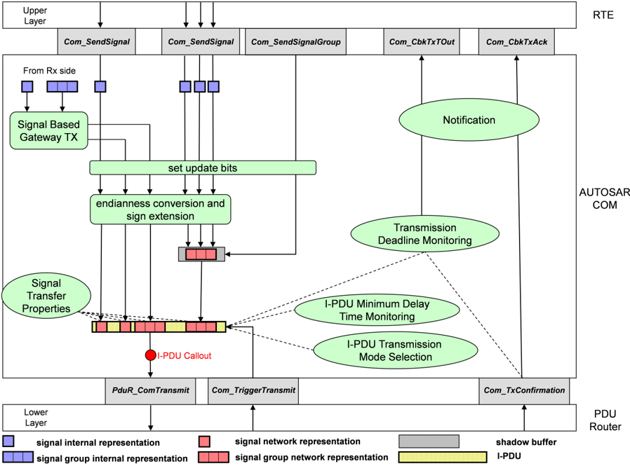

图7.3：AUTOSAR COM模块的接收交互模型（**interaction model for reception**）

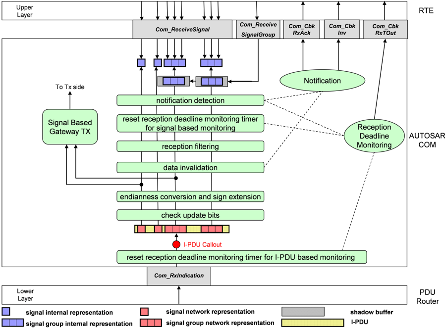

接收侧的字节序转换和符号扩展需要为TMS提供正确的数据格式。只有在Rx总线的字节序与CPU的字节序不同的情况下，才需要这种字节序转换。只有当Rx总线的字节序与Tx总线的字节序不同的情况下，才需要发送侧的字节序转换。

图7.4：集成信号网关的AUTOSAR COM模块交互模型（**interaction model for integrated Signal Gateway**）

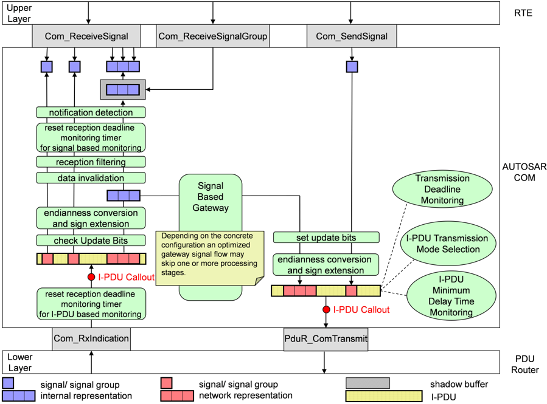

### 6.13. 多核分布

为了在不同分区（核）之间提供负载分布，Com-Stack的不同部分应被分配到不同的分区。由此应支持这种分区按网络类型进行，即Com-Stack的FlexRay、CAN和Ethernet部分可以定位到不同的不同分区（核）上。

为了在减少跨分区通信量（从而减少潜在的阻塞同步）的同时支持这种灵活分配，Com模块中的主执行线程（即相应的MainFunctions）可以被拆分为不同的MainFunctions（每个分区至少一个）。这样，接收/发送的流程保持在单个网络（从而单个分区）的范围内，因此不需要特殊的多分区通信和同步原语。Com模块中唯一的例外是信号网关，它需要特殊考虑。

为了管理不同的时序要求，每个MainFunction单独定义其时间基准。

**ComIPdus**应在经由**ComIPduMainFunctionRef**引用的MainFunction内处理。

如果配置了**ComPreparationNotification**，则相应的**Com_CbkTxPrep**应在I-PDU处理开始之前在**MainFunctionTx**内调用。

[**Com_MainFunctionRouteSignals**](#7353-com_mainfunctionroutesignals)应只处理经由**ComMainFunctionRouteSignalsRef**引用该[**Com_MainFunctionRouteSignals**](#7353-com_mainfunctionroutesignals)的ComIPdus及其网关信号路由。

### 6.14. 软件集群连接层（SwCluC）

**SwCluC**将AUTOSAR嵌入式软件分组为集群（**SWCL**）。它描述主机集群（**Host-Cluster**）和应用集群（**Application Cluster**）。每台机器有一个包含大部分甚至所有BSW模块的主机集群。应用软件集群主要包含应用SW-C。

在软件集群内部，不直接访问COM API。相反，访问通过代理模块（**Proxy module**，「Low Proxy」）完成。对于COM，这意味着它可以有多个上层用户：

- （主机软件集群的）**RTE**
- **SwCluC Low Proxy**
- 用户自定义

图7.5

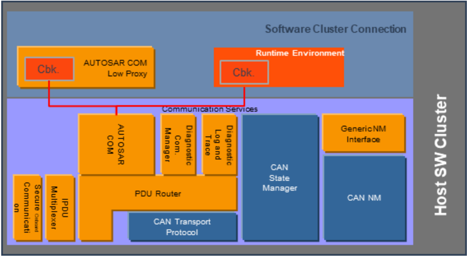

对于回调接口，COM可以服务任意数量的用户，每个用户定义其各自的一组回调函数。

在使用COM服务的应用软件组件所在的每个ECUC分区上都有一个Low Proxy。代理和COM只在同一分区范围内交互。信号或信号组的任何跨分区必须由SWC或Low Proxy内完成。

图7.6

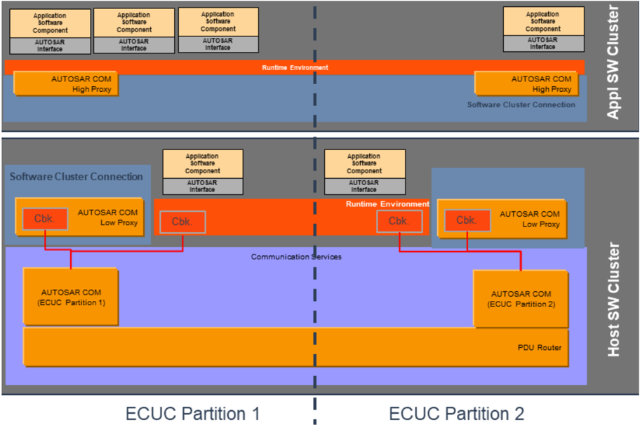

### 6.15. 安全事件

该模块不报告安全事件。

## 7. API规范

### 7.1. 导入的类型

在本章中，列出从以下文件中包含的所有类型：

| 模块 | 头文件 | 导入的类型 |
| --- | --- | --- |
| ComStack_Types | ComStack_Types.h | BufReq_ReturnType |
| ComStack_Types | ComStack_Types.h | CbkHandleIdType |
| ComStack_Types | ComStack_Types.h | PduIdType |
| ComStack_Types | ComStack_Types.h | PduInfoType |
| ComStack_Types | ComStack_Types.h | PduLengthType |
| ComStack_Types | ComStack_Types.h | RetryInfoType |
| ComStack_Types | ComStack_Types.h | TpDataStateType |
| Std | Std_Types.h | Std_ReturnType |
| Std | Std_Types.h | Std_VersionInfoType |

### 7.2. 类型定义

#### 7.2.1. Com_StatusType

| 名称 | Com_StatusType |
| --- | --- |
| 类型（Kind） | Enumeration（枚举） |
| 范围 | COM_INIT（-）：AUTOSAR COM模块已初始化且可用；COM_UNINIT（0x00）：AUTOSAR COM模块未初始化或不可用。这应是复位后的默认值。该状态的值应为0。 |
| 描述 | 这是API服务**[Com_GetStatus](#7327-com_getstatus)()**返回的状态值。 |
| 可通过 | Com.h |

#### 7.2.2. Com_SignalIdType

| 名称 | Com_SignalIdType |
| --- | --- |
| 类型（Kind） | Type |
| 派生自 | uint16 |
| 范围 | 0..&lt;SignalIdmax&gt;（-）：从零开始的整数 |
| 描述 | AUTOSAR COM模块的信号对象标识符。 |
| 可通过 | Com.h |

#### 7.2.3. Com_SignalGroupIdType

| 名称 | Com_SignalGroupIdType |
| --- | --- |
| 类型（Kind） | Type |
| 派生自 | uint16 |
| 范围 | 0..&lt;SignalGroupIdmax&gt;（-）：从零开始的整数 |
| 描述 | AUTOSAR COM模块的信号组对象标识符。 |
| 可通过 | Com.h |

#### 7.2.4. Com_IpduGroupIdType

| 名称 | Com_IpduGroupIdType |
| --- | --- |
| 类型（Kind） | Type |
| 派生自 | uint16 |
| 范围 | 0..&lt;IpduGroupIdmax&gt;（-）：从零开始的整数；其中IpduGroupId-max &lt; ComSupportedIPduGroups |
| 描述 | AUTOSAR COM I-PDU模块的组对象标识符。 |
| 可通过 | Com.h |

#### 7.2.5. Com_ConfigType

| 名称 | Com_ConfigType |
| --- | --- |
| 类型（Kind） | Structure（结构体） |
| 元素 | 实现特定 |
| | 类型：- |
| | 注释：初始化数据结构的内容是实现特定的。 |
| 描述 | 这是包含COM初始化数据的数据结构的类型。 |
| 可通过 | Com.h |

### 7.3. 函数定义

不可重入函数不必检查它们是否被重入调用。

大多数COM函数对于具体对象是不可重入的。例如[**Com_SendSignal**](#7331-com_sendsignal)对同一信号不可重入，但对不同信号可重入。因此，如果存在多个AUTOSAR COM模块的调用者，则需要在系统级上对它们进行同步，例如通过使用不相交的信号和I-PDU组集合。

#### 7.3.1. 返回码

AUTOSAR COM模块不定义特殊的COM返回类型。API服务要么使用[15]中定义的**Std_ReturnType**返回错误，要么通过按照表8.1映射的uint8值返回错误。

AUTOSAR COM模块的返回码定义在表8.1中。

表8.1：AUTOSAR COM模块返回码的映射（**Mapping of AUTOSAR COM module's return codes**）

| 名称 | 描述 | 类型 | 值 | 定义于 |
| --- | --- | --- | --- | --- |
| E_OK | 服务已被接受 | #define | 0x00 | StandardTypes.h |
| E_NOT_OK | 服务调用失败 | #define | 0x01 | StandardTypes.h |
| COM_SERVICE_NOT_AVAILABLE | 服务当前不可用，例如相应的I-PDU组已停止 | #define | 0x80 | Com.h |
| COM_BUSY | 该函数的成功执行目前不可能，因为资源正在使用中。例如大I-PDU的缓冲区被锁定。每当访问大I-PDU的信号时，COM_BUSY可能（但不是必须）被返回。 | #define | 0x81 | Com.h |

#### 7.3.2. 启动和控制服务

##### 7.3.2.1. Com_Init

**说明**:

```C
void Com_Init ( const Com_ConfigType* config )
```

| 服务名 | Com_Init |
| --- | --- |
| 服务ID[hex] | 0x01 |
| 同步/异步 | 同步 |
| 可重入 | 不可重入 |
| 参数（in） | config |
| | 指向AUTOSAR COM模块配置数据的指针。 |
| 参数（inout） | 无 |
| 参数（out） | 无 |
| 返回值 | 无 |
| 说明 | 该服务初始化AUTOSAR COM模块层的内部和外部接口与变量以进行进一步处理。调用该函数之后，ECU间通信仍然被禁用。在Com被分配到多个分区的配置中（即Com_MainFunction被映射到多个分区），Com可以为每个分区提供一个初始化函数。 |
| 可通过 | Com.h |

在正确调用**Com_Init**之前，AUTOSAR COM模块的行为是未指定的。

**Com_Init**的注意事项：不预期**Com_Init**抢占任何其他AUTOSAR COM模块的函数。AUTOSAR COM模块可以依赖系统的其余部分，即不会以这种方式调用**Com_Init**。

##### 7.3.2.2. Com_DeInit

**说明**:

```C
void Com_DeInit ( void )
```

| 服务名 | Com_DeInit |
| --- | --- |
| 服务ID[hex] | 0x02 |
| 同步/异步 | 同步 |
| 可重入 | 不可重入 |
| 参数（in） | 无 |
| 参数（inout） | 无 |
| 参数（out） | 无 |
| 返回值 | 无 |
| 说明 | 该服务停止ECU间通信。所有已启动的I-PDU组被停止，如果需要，在调用[Com_Init](#7321-com_init)之后必须重新启动。通过调用Com_DeInit，AUTOSAR COM模块被置为未初始化状态。 |
| 可通过 | Com.h |

AUTOSAR COM模块的函数**Com_DeInit**应停止所有已启动的I-PDU组。

**Com_DeInit**的注意事项：不预期**Com_DeInit**抢占任何AUTOSAR COM模块的函数。AUTOSAR COM模块可以依赖系统的其余部分，即不会以这种方式调用**Com_DeInit**。

##### 7.3.2.3. Com_IpduGroupStart

**说明**:

```C
void Com_IpduGroupStart ( Com_IpduGroupIdType IpduGroupId, boolean initialize )
```

| 服务名 | Com_IpduGroupStart |
| --- | --- |
| 服务ID[hex] | 0x03 |
| 同步/异步 | 同步 |
| 可重入 | 不同的I-PDU组可重入；相同的I-PDU组不可重入 |
| 参数（in） | IpduGroupId |
| | 要启动的I-PDU组的ID。 |
| | initialize |
| | 请求初始化该I-PDU组中I-PDU数据的标志。 |
| 参数（inout） | 无 |
| 参数（out） | 无 |
| 返回值 | 无 |
| 说明 | 启动一个预配置的I-PDU组。例如，在调用Com_IpduGroupStart()之后，周期性I-PDU将被周期性地发送。如果Initialize为true，则该I-PDU组的所有I-PDU应在I-PDU组启动之前被（重新）初始化。即它们的行为应像COM启动之后那样，例如过滤对象的old_value和信号组的影子缓冲区必须被（重新）初始化。 |
| 可通过 | Com.h |

##### 7.3.2.4. Com_IpduGroupStop

**说明**:

```C
void Com_IpduGroupStop ( Com_IpduGroupIdType IpduGroupId )
```

| 服务名 | Com_IpduGroupStop |
| --- | --- |
| 服务ID[hex] | 0x04 |
| 同步/异步 | 同步 |
| 可重入 | 不同的I-PDU组可重入；相同的I-PDU组不可重入 |
| 参数（in） | IpduGroupId |
| | 要停止的I-PDU组的ID。 |
| 参数（inout） | 无 |
| 参数（out） | 无 |
| 返回值 | 无 |
| 说明 | 停止一个预配置的I-PDU组。例如，在调用Com_IpduGroupStop()之后，周期性I-PDU将被停止。 |
| 可通过 | Com.h |

##### 7.3.2.5. Com_EnableReceptionDM

**说明**:

```C
void Com_EnableReceptionDM ( Com_IpduGroupIdType IpduGroupId )
```

| 服务名 | Com_EnableReceptionDM |
| --- | --- |
| 服务ID[hex] | 0x06 |
| 同步/异步 | 同步 |
| 可重入 | 不同的I-PDU组可重入；相同的I-PDU组不可重入 |
| 参数（in） | IpduGroupId |
| | 应启用接收DM的I-PDU组的ID。 |
| 参数（inout） | 无 |
| 参数（out） | 无 |
| 返回值 | 无 |
| 说明 | 为给定I-PDU组内的I-PDU启用接收截止期监控。 |
| 可通过 | Com.h |

##### 7.3.2.6. Com_DisableReceptionDM

**说明**:

```C
void Com_DisableReceptionDM ( Com_IpduGroupIdType IpduGroupId )
```

| 服务名 | Com_DisableReceptionDM |
| --- | --- |
| 服务ID[hex] | 0x05 |
| 同步/异步 | 同步 |
| 可重入 | 不同的I-PDU组可重入；相同的I-PDU组不可重入 |
| 参数（in） | IpduGroupId |
| | 应禁用接收DM的I-PDU组的ID。 |
| 参数（inout） | 无 |
| 参数（out） | 无 |
| 返回值 | 无 |
| 说明 | 为给定I-PDU组内的I-PDU禁用接收截止期监控。 |
| 可通过 | Com.h |

##### 7.3.2.7. Com_GetStatus

**说明**:

```C
Com_StatusType Com_GetStatus ( void )
```

| 服务名 | Com_GetStatus |
| --- | --- |
| 服务ID[hex] | 0x07 |
| 同步/异步 | 同步 |
| 可重入 | 可重入 |
| 参数（in） | 无 |
| 参数（inout） | 无 |
| 参数（out） | 无 |
| 返回值 | [Com_StatusType](#721-com_statustype) |
| | COM_UNINIT：AUTOSAR COM模块未初始化且不可用；COM_INIT：AUTOSAR COM模块已初始化且可用。 |
| 说明 | 返回AUTOSAR COM模块的状态。 |
| 可通过 | Com.h |

##### 7.3.2.8. Com_GetVersionInfo

**说明**:

```C
void Com_GetVersionInfo ( Std_VersionInfoType* versioninfo )
```

| 服务名 | Com_GetVersionInfo |
| --- | --- |
| 服务ID[hex] | 0x09 |
| 同步/异步 | 同步 |
| 可重入 | 可重入 |
| 参数（in） | 无 |
| 参数（inout） | 无 |
| 参数（out） | versioninfo |
| | 指向存储该模块版本信息位置的指针。 |
| 返回值 | 无 |
| 说明 | 返回该模块的版本信息。 |
| 可通过 | Com.h |

**Com_GetVersionInfo**的配置见**ComVersionInfoApi**。

#### 7.3.3. 通信服务

##### 7.3.3.1. Com_SendSignal

**说明**:

```C
uint8 Com_SendSignal ( Com_SignalIdType SignalId, const void* SignalDataPtr )
```

| 服务名 | Com_SendSignal |
| --- | --- |
| 服务ID[hex] | 0x0a |
| 同步/异步 | 异步 |
| 可重入 | 可重入 |
| 参数（in） | SignalId |
| | 要发送的信号的ID。 |
| | SignalDataPtr |
| | 对要传输的信号数据的引用。 |
| 参数（inout） | 无 |
| 参数（out） | 无 |
| 返回值 | uint8 |
| | E_OK：服务已被接受；COM_SERVICE_NOT_AVAILABLE：相应的I-PDU组已停止；COM_BUSY：在TP缓冲区因大数据类型处理而被锁定的情况下。 |
| 说明 | 服务Com_SendSignal用SignalDataPtr参数引用的信号更新由SignalId标识的信号对象。 |
| 可通过 | Com.h |

服务**Com_SendSignal**应用SignalDataPtr参数引用的信号更新由SignalId标识的信号对象。

如果更新的信号具有**ComTransferProperty** TRIGGERED，且它被分配给**ComTxModeMode**为DIRECT或MIXED的I-PDU，则**Com_SendSignal**应立即（最迟在下一个主函数中）执行该I-PDU的传输，除非发送被其他COM机制延迟或阻止。

相关机制例如是最小延迟定时器（**ComMinimumDelayTime**）。

##### 7.3.3.2. Com_SendDynSignal

**说明**:

```C
uint8 Com_SendDynSignal ( Com_SignalIdType SignalId, const void* SignalDataPtr, uint16 Length )
```

| 服务名 | Com_SendDynSignal |
| --- | --- |
| 服务ID[hex] | 0x21 |
| 同步/异步 | 异步 |
| 可重入 | 可重入 |
| 参数（in） | SignalId |
| | 要发送的信号的ID。 |
| | SignalDataPtr |
| | 对要传输的信号数据的引用。 |
| | Length |
| | 动态长度信号的长度。 |
| 参数（inout） | 无 |
| 参数（out） | 无 |
| 返回值 | uint8 |
| | E_OK：服务已被接受；E_NOT_OK：在Length大于该所发送信号已配置的ComSignalLength的情况下；COM_SERVICE_NOT_AVAILABLE：相应的I-PDU组已停止；COM_BUSY：在TP缓冲区被锁定的情况下。 |
| 说明 | 服务Com_SendDynSignal用SignalDataPtr参数引用的信号更新由SignalId标识的信号对象。 |
| 可通过 | Com.h |

服务**Com_SendDynSignal**应用SignalDataPtr参数引用的信号更新由SignalId标识的信号对象。

如果更新的信号（见SWS_Com_00628）具有**ComTransferProperty** TRIGGERED，则函数**Com_SendDynSignal**应立即（最迟在下一个主函数中）执行与该信号关联的I-PDU的传输，除非该信号被 packed 到PERIODIC传输模式的I-PDU中。

如果更新的信号（见SWS_Com_00628）具有**ComTransferProperty** PENDING，则函数**Com_SendDynSignal**不应执行与该信号关联的I-PDU的传输。

对动态长度信号的最小长度没有限制。因此，允许动态长度信号的长度为零。

##### 7.3.3.3. Com_ReceiveSignal

**说明**:

```C
uint8 Com_ReceiveSignal ( Com_SignalIdType SignalId, void* SignalDataPtr )
```

| 服务名 | Com_ReceiveSignal |
| --- | --- |
| 服务ID[hex] | 0x0b |
| 同步/异步 | 同步 |
| 可重入 | 可重入 |
| 参数（in） | SignalId |
| | 要接收的信号的ID。 |
| 参数（inout） | 无 |
| 参数（out） | SignalDataPtr |
| | 对应存储所接收信号数据位置的引用。 |
| 返回值 | uint8 |
| | E_OK：服务已被接受；COM_SERVICE_NOT_AVAILABLE：相应的I-PDU组已停止；COM_BUSY：在TP缓冲区因大数据类型处理而被锁定的情况下。 |
| 说明 | Com_ReceiveSignal将由SignalId标识的信号的数据复制到SignalDataPtr指定的位置。 |
| 可通过 | Com.h |

服务**Com_ReceiveSignal**应将由SignalId标识的信号对象的数据复制到SignalDataPtr引用的位置。

**Com_ReceiveSignal**的注意事项：AUTOSAR COM模块依赖于SignalDataPtr相对于具有给定SignalId的信号的数据类型正确对齐。**Com_ReceiveSignal**的调用者必须确保这一点。

##### 7.3.3.4. Com_ReceiveDynSignal

**说明**:

```C
uint8 Com_ReceiveDynSignal ( Com_SignalIdType SignalId, void* SignalDataPtr, uint16* Length )
```

| 服务名 | Com_ReceiveDynSignal |
| --- | --- |
| 服务ID[hex] | 0x22 |
| 同步/异步 | 同步 |
| 可重入 | 可重入 |
| 参数（in） | SignalId |
| | 要接收的信号的ID。 |
| 参数（inout） | Length |
| | in：可以接收的最大长度；out：动态长度信号的长度。 |
| 参数（out） | SignalDataPtr |
| | 对应存储所接收信号数据位置的引用。 |
| 返回值 | uint8 |
| | E_OK：服务已被接受；E_NOT_OK：在Length（作为in参数）小于所接收动态长度信号长度的情况下；COM_SERVICE_NOT_AVAILABLE：相应的I-PDU组已停止；COM_BUSY：在TP缓冲区被锁定的情况下。 |
| 说明 | Com_ReceiveDynSignal将由SignalId标识的信号的数据复制到SignalDataPtr指定的位置，并将动态长度信号的长度存储在Length参数给定的位置。 |
| 可通过 | Com.h |

服务**Com_ReceiveDynSignal**应由SignalId标识的信号对象的数据复制到SignalDataPtr引用的位置。

服务**Com_ReceiveDynSignal**应在参数Length中返回由SignalId标识的动态长度信号的已计算长度（见SWS_Com_00758）。

在Length（作为in参数）小于所接收动态长度信号的长度的情况下，**Com_ReceiveDynSignal**不应将任何数据复制到SignalDataPtr引用的位置。

##### 7.3.3.5. Com_SendSignalGroup

**说明**:

```C
uint8 Com_SendSignalGroup ( Com_SignalGroupIdType SignalGroupId )
```

| 服务名 | Com_SendSignalGroup |
| --- | --- |
| 服务ID[hex] | 0x0d |
| 同步/异步 | 异步 |
| 可重入 | 可重入 |
| 参数（in） | SignalGroupId |
| | 要发送的信号组的ID。 |
| 参数（inout） | 无 |
| 参数（out） | 无 |
| 返回值 | uint8 |
| | E_OK：服务已被接受；COM_SERVICE_NOT_AVAILABLE：相应的I-PDU组已停止；COM_BUSY：在TP缓冲区因大数据类型处理而被锁定的情况下。 |
| 说明 | 服务Com_SendSignalGroup将关联影子缓冲区的内容复制到关联的I-PDU。 |
| 可通过 | Com.h |

服务**Com_SendSignalGroup**应将参数SignalGroupId引用的影子缓冲区的内容复制到关联的I-PDU。

**Com_SendSignalGroup**的配置：必须在调用之前配置信号组。细节见[**ComSignalGroup**](#9214-comsignalgroup)。

##### 7.3.3.6. Com_ReceiveSignalGroup

**说明**:

```C
uint8 Com_ReceiveSignalGroup ( Com_SignalGroupIdType SignalGroupId )
```

| 服务名 | Com_ReceiveSignalGroup |
| --- | --- |
| 服务ID[hex] | 0x0e |
| 同步/异步 | 同步 |
| 可重入 | 可重入 |
| 参数（in） | SignalGroupId |
| | 要接收的信号组的ID。 |
| 参数（inout） | 无 |
| 参数（out） | 无 |
| 返回值 | uint8 |
| | E_OK：服务已被接受；COM_SERVICE_NOT_AVAILABLE：相应的I-PDU组已停止；COM_BUSY：在TP缓冲区因大数据类型处理而被锁定的情况下。 |
| 说明 | 服务Com_ReceiveSignalGroup将接收到的信号组从I-PDU复制到影子缓冲区。 |
| 可通过 | Com.h |

服务**Com_ReceiveSignalGroup**应将接收到的信号组从I-PDU复制到影子缓冲区。

在此调用之后，可以通过调用[**Com_ReceiveSignal**](#7333-com_receivesignal)将组信号从影子缓冲区复制给用户（如**RTE**、**SwCluC**）。

**Com_ReceiveSignalGroup**的配置：必须在调用之前配置信号组。细节见[**ComSignalGroup**](#9214-comsignalgroup)。

AUTOSAR COM模块应始终通过调用**Com_ReceiveSignalGroup**将I-PDU的最后已知数据（或尚未写入时的**ComSignalInitValue**）复制到影子缓冲区，即使I-PDU已停止且返回**COM_SERVICE_NOT_AVAILABLE**。

##### 7.3.3.7. Com_SendSignalGroupArray

**说明**:

```C
uint8 Com_SendSignalGroupArray ( Com_SignalGroupIdType SignalGroupId, const uint8* SignalGroupArrayPtr )
```

| 服务名 | Com_SendSignalGroupArray |
| --- | --- |
| 服务ID[hex] | 0x23 |
| 同步/异步 | 异步 |
| 可重入 | 可重入 |
| 参数（in） | SignalGroupId |
| | 要发送的信号组的ID。 |
| | SignalGroupArrayPtr |
| | 对信号组数组的引用。 |
| 参数（inout） | 无 |
| 参数（out） | 无 |
| 返回值 | uint8 |
| | E_OK：服务已被接受；COM_SERVICE_NOT_AVAILABLE：相应的I-PDU组已停止；COM_BUSY：在TP缓冲区因大数据类型处理而被锁定的情况下。 |
| 说明 | 服务Com_SendSignalGroupArray将提供的SignalGroupArrayPtr的内容复制到关联的I-PDU。提供的数据应对应于信号组的数组表示。 |
| 可通过 | Com.h |

服务**Com_SendSignalGroupArray**应将SignalGroupArrayPtr指定的内容复制到关联的I-PDU。

只有在配置开关**ComEnableSignalGroupArrayApi**启用时，**Com_SendSignalGroupArray** API才应可用。

##### 7.3.3.8. Com_ReceiveSignalGroupArray

**说明**:

```C
uint8 Com_ReceiveSignalGroupArray ( Com_SignalGroupIdType SignalGroupId, uint8* SignalGroupArrayPtr )
```

| 服务名 | Com_ReceiveSignalGroupArray |
| --- | --- |
| 服务ID[hex] | 0x24 |
| 同步/异步 | 同步 |
| 可重入 | 可重入 |
| 参数（in） | SignalGroupId |
| | 要接收的信号组的ID。 |
| 参数（inout） | 无 |
| 参数（out） | SignalGroupArrayPtr |
| | 对应存储所接收信号组数组位置的引用。 |
| 返回值 | uint8 |
| | E_OK：服务已被接受；COM_SERVICE_NOT_AVAILABLE：相应的I-PDU组已停止；COM_BUSY：在TP缓冲区因大数据类型处理而被锁定的情况下。 |
| 说明 | 服务Com_ReceiveSignalGroupArray将接收到的信号组数组表示从PDU复制到SignalGroupArrayPtr指定的位置。 |
| 可通过 | Com.h |

服务**Com_ReceiveSignalGroupArray**应将接收到的信号组的数组表示从I-PDU复制到SignalGroupArrayPtr指定的位置。

只有在配置开关**ComEnableSignalGroupArrayApi**启用时，**Com_ReceiveSignalGroupArray** API才应可用。

AUTOSAR COM模块应始终通过调用**Com_ReceiveSignalGroupArray**将I-PDU的最后已知数据（或尚未写入时的**ComSignalInitValue**）复制到SignalGroupArrayPtr，即使I-PDU已停止且返回**COM_SERVICE_NOT_AVAILABLE**。

##### 7.3.3.9. Com_ReceiveSignalWithMetaData

**说明**:

```C
uint8 Com_ReceiveSignalWithMetaData ( Com_SignalIdType SignalId, void* SignalDataPtr, uint8* MetaDataPtr )
```

| 服务名 | Com_ReceiveSignalWithMetaData |
| --- | --- |
| 服务ID[hex] | 0x49 |
| 同步/异步 | 同步 |
| 可重入 | 可重入 |
| 参数（in） | SignalId |
| | 要接收的信号的ID。 |
| 参数（inout） | 无 |
| 参数（out） | SignalDataPtr |
| | 对应存储所接收信号数据位置的引用。 |
| | MetaDataPtr |
| | 指向该信号元数据的指针。 |
| 返回值 | uint8 |
| | - |
| 说明 | Com_ReceiveSignalWithMetaData将由SignalId标识的信号的数据复制到SignalDataPtr指定的位置。接收到的元数据存储在MetaDataPtr参数给定的位置。 |
| 可通过 | Com.h |

##### 7.3.3.10. Com_ReceiveDynSignalWithMetaData

**说明**:

```C
uint8 Com_ReceiveDynSignalWithMetaData ( Com_SignalIdType SignalId, void* SignalDataPtr, uint16* Length, uint8* MetaDataPtr )
```

| 服务名 | Com_ReceiveDynSignalWithMetaData |
| --- | --- |
| 服务ID[hex] | 0x4a |
| 同步/异步 | 同步 |
| 可重入 | 可重入 |
| 参数（in） | SignalId |
| | 要接收的信号的ID。 |
| 参数（inout） | 无 |
| 参数（out） | SignalDataPtr |
| | 对应存储所接收信号数据位置的引用。 |
| | Length |
| | - |
| | MetaDataPtr |
| | 指向该信号元数据的指针。 |
| 返回值 | uint8 |
| | E_OK：服务已被接受；E_NOT_OK：在Length（作为in参数）小于所接收动态长度信号长度的情况下；COM_SERVICE_NOT_AVAILABLE：相应的I-PDU组已停止；COM_BUSY：在TP缓冲区被锁定的情况下。 |
| 说明 | Com_ReceiveDynSignalWithMetaData将由SignalId标识的信号的数据复制到SignalDataPtr指定的位置，并将动态长度信号的长度存储在Length参数给定的位置。接收到的元数据存储在MetaDataPtr参数给定的位置。 |
| 可通过 | Com.h |

##### 7.3.3.11. Com_ReceiveSignalGroupWithMetaData

**说明**:

```C
uint8 Com_ReceiveSignalGroupWithMetaData ( Com_SignalGroupIdType SignalGroupId, uint8* MetaDataPtr )
```

| 服务名 | Com_ReceiveSignalGroupWithMetaData |
| --- | --- |
| 服务ID[hex] | 0x4b |
| 同步/异步 | 同步 |
| 可重入 | 可重入 |
| 参数（in） | SignalGroupId |
| | 要接收的信号组的ID。 |
| 参数（inout） | 无 |
| 参数（out） | MetaDataPtr |
| | 指向该信号组元数据的指针。 |
| 返回值 | uint8 |
| | E_OK：服务已被接受；COM_SERVICE_NOT_AVAILABLE：相应的I-PDU组已停止；COM_BUSY：在TP缓冲区因大数据类型处理而被锁定的情况下。 |
| 说明 | 服务Com_ReceiveSignalGroupWithMetaData将接收到的信号组从I-PDU复制到影子缓冲区。接收到的元数据存储在MetaDataPtr参数给定的位置。 |
| 可通过 | Com.h |

##### 7.3.3.12. Com_ReceiveSignalGroupArrayWithMetaData

**说明**:

```C
void Com_ReceiveSignalGroupArrayWithMetaData ( Com_SignalGroupIdType SignalGroupId, uint8* SignalGroupArrayPtr, uint8* MetaDataPtr )
```

| 服务名 | Com_ReceiveSignalGroupArrayWithMetaData |
| --- | --- |
| 服务ID[hex] | 0x4c |
| 同步/异步 | 同步 |
| 可重入 | 可重入 |
| 参数（in） | SignalGroupId |
| | 要接收的信号组的ID。 |
| 参数（inout） | 无 |
| 参数（out） | SignalGroupArrayPtr |
| | 对应存储所接收信号组数组位置的引用。 |
| | MetaDataPtr |
| | 指向该信号组元数据的指针。 |
| 返回值 | 无 |
| 说明 | 服务Com_ReceiveSignalGroupArrayWithMetaData将接收到的信号组数组表示从PDU复制到SignalGroupArrayPtr指定的位置。接收到的元数据存储在MetaDataPtr参数给定的位置。 |
| 可通过 | Com.h |

##### 7.3.3.13. Com_SendSignalWithMetaData

**说明**:

```C
uint8 Com_SendSignalWithMetaData ( Com_SignalIdType SignalId, const void* SignalDataPtr, const uint8* MetaDataPtr )
```

| 服务名 | Com_SendSignalWithMetaData |
| --- | --- |
| 服务ID[hex] | 0x4d |
| 同步/异步 | 异步 |
| 可重入 | 可重入 |
| 参数（in） | SignalId |
| | 要发送的信号的ID。 |
| | SignalDataPtr |
| | 对要传输的信号数据的引用。 |
| | MetaDataPtr |
| | 指向该信号元数据的指针。 |
| 参数（inout） | 无 |
| 参数（out） | 无 |
| 返回值 | uint8 |
| | E_OK：服务已被接受；COM_SERVICE_NOT_AVAILABLE：相应的I-PDU组已停止；COM_BUSY：在TP缓冲区因大数据类型处理而被锁定的情况下。 |
| 说明 | 服务Com_SendSignalWithMetaData用SignalDataPtr参数引用的信号更新由SignalId标识的信号对象。元数据经由MetaDataPtr参数提供。 |
| 可通过 | Com.h |

##### 7.3.3.14. Com_SendDynSignalWithMetaData

**说明**:

```C
uint8 Com_SendDynSignalWithMetaData ( Com_SignalIdType SignalId, const void* SignalDataPtr, uint16 Length, const uint8* MetaDataPtr )
```

| 服务名 | Com_SendDynSignalWithMetaData |
| --- | --- |
| 服务ID[hex] | 0x4e |
| 同步/异步 | 异步 |
| 可重入 | 可重入 |
| 参数（in） | SignalId |
| | 要发送的信号的ID。 |
| | SignalDataPtr |
| | 对要传输的信号数据的引用。 |
| | Length |
| | 动态长度信号的长度。 |
| | MetaDataPtr |
| | 指向该信号元数据的指针。 |
| 参数（inout） | 无 |
| 参数（out） | 无 |
| 返回值 | uint8 |
| | E_OK：服务已被接受；E_NOT_OK：在Length大于该所发送信号已配置的ComSignalLength的情况下；COM_SERVICE_NOT_AVAILABLE：相应的I-PDU组已停止；COM_BUSY：在TP缓冲区被锁定的情况下。 |
| 说明 | 服务Com_SendDynSignalWithMetaData用SignalDataPtr参数引用的信号更新由SignalId标识的信号对象。元数据经由MetaDataPtr参数提供。 |
| 可通过 | Com.h |

##### 7.3.3.15. Com_SendSignalGroupWithMetaData

**说明**:

```C
uint8 Com_SendSignalGroupWithMetaData ( Com_SignalGroupIdType SignalGroupId, const uint8* MetaDataPtr )
```

| 服务名 | Com_SendSignalGroupWithMetaData |
| --- | --- |
| 服务ID[hex] | 0x4f |
| 同步/异步 | 异步 |
| 可重入 | 可重入 |
| 参数（in） | SignalGroupId |
| | 要发送的信号组的ID。 |
| | MetaDataPtr |
| | 指向该信号组元数据的指针。 |
| 参数（inout） | 无 |
| 参数（out） | 无 |
| 返回值 | uint8 |
| | E_OK：服务已被接受；COM_SERVICE_NOT_AVAILABLE：相应的I-PDU组已停止；COM_BUSY：在TP缓冲区因大数据类型处理而被锁定的情况下。 |
| 说明 | 服务Com_SendSignalGroupWithMetaData将关联影子缓冲区的内容复制到关联的I-PDU。元数据经由MetaDataPtr参数提供。 |
| 可通过 | Com.h |

##### 7.3.3.16. Com_SendSignalGroupArrayWithMetaData

**说明**:

```C
uint8 Com_SendSignalGroupArrayWithMetaData ( Com_SignalGroupIdType SignalGroupId, const uint8* SignalGroupArrayPtr, const uint8* MetaDataPtr )
```

| 服务名 | Com_SendSignalGroupArrayWithMetaData |
| --- | --- |
| 服务ID[hex] | 0x50 |
| 同步/异步 | 异步 |
| 可重入 | 可重入 |
| 参数（in） | SignalGroupId |
| | 要发送的信号组的ID。 |
| | SignalGroupArrayPtr |
| | 对信号组数组的引用。 |
| | MetaDataPtr |
| | 指向该信号组元数据的指针。 |
| 参数（inout） | 无 |
| 参数（out） | 无 |
| 返回值 | uint8 |
| | E_OK：服务已被接受；COM_SERVICE_NOT_AVAILABLE：相应的I-PDU组已停止；COM_BUSY：在TP缓冲区因大数据类型处理而被锁定的情况下。 |
| 说明 | 服务Com_SendSignalGroupArrayWithMetaData将提供的SignalGroupArrayPtr的内容复制到关联的I-PDU。提供的数据应对应于信号组的数组表示。 |
| 可通过 | Com.h |

##### 7.3.3.17. Com_InvalidateSignal

**说明**:

```C
uint8 Com_InvalidateSignal ( Com_SignalIdType SignalId )
```

| 服务名 | Com_InvalidateSignal |
| --- | --- |
| 服务ID[hex] | 0x10 |
| 同步/异步 | 异步 |
| 可重入 | 可重入 |
| 参数（in） | SignalId |
| | 要失效的信号的ID。 |
| 参数（inout） | 无 |
| 参数（out） | 无 |
| 返回值 | uint8 |
| | E_OK：服务已被接受；COM_SERVICE_NOT_AVAILABLE：相应的I-PDU组已停止，或给定的signalId没有配置ComSignalDataInvalidValue；COM_BUSY：在TP缓冲区被锁定的情况下。 |
| 说明 | 服务Com_InvalidateSignal通过将给定SignalId的信号的值设置为其已配置的ComSignalDataInvalidValue来使该信号失效。 |
| 可通过 | Com.h |

关于信号失效机制的更多信息，见第[6.3.4](#634-信号失效)节。

在使信号数据失效之后，函数**Com_InvalidateSignal**应在内部执行一次[**Com_SendSignal**](#7331-com_sendsignal)调用，详情见SWS_Com_00099。

在给定的SignalId的信号没有配置**ComSignalDataInvalidValue**的情况下，**Com_InvalidateSignal**应返回**COM_SERVICE_NOT_AVAILABLE**。

##### 7.3.3.18. Com_InvalidateSignalGroup

**说明**:

```C
uint8 Com_InvalidateSignalGroup ( Com_SignalGroupIdType SignalGroupId )
```

| 服务名 | Com_InvalidateSignalGroup |
| --- | --- |
| 服务ID[hex] | 0x1b |
| 同步/异步 | 异步 |
| 可重入 | 可重入 |
| 参数（in） | SignalGroupId |
| | 要失效的信号组的ID。 |
| 参数（inout） | 无 |
| 参数（out） | 无 |
| 返回值 | uint8 |
| | E_OK：服务已被接受；COM_SERVICE_NOT_AVAILABLE：相应的I-PDU组已停止，或任何组信号都没有配置ComSignalDataInvalidValue；COM_BUSY：在TP缓冲区被锁定的情况下。 |
| 说明 | 服务Com_InvalidateSignalGroup通过将给定SignalGroupId的信号组的所有组信号的值设置为其已配置的ComSignalDataInvalidValue来使所有组信号失效。 |
| 可通过 | Com.h |

关于信号失效机制的更多信息，见第[6.3.4](#634-信号失效)节。

在使信号组数据失效之后，函数**Com_InvalidateSignalGroup**应在内部执行一次[**Com_SendSignalGroup**](#7335-com_sendsignalgroup)调用。

##### 7.3.3.19. Com_TriggerIPDUSend

**说明**:

```C
Std_ReturnType Com_TriggerIPDUSend ( PduIdType PduId )
```

| 服务名 | Com_TriggerIPDUSend |
| --- | --- |
| 服务ID[hex] | 0x17 |
| 同步/异步 | 同步 |
| 可重入 | 不可重入 |
| 参数（in） | PduId |
| | 应被触发发送的I-PDU的I-PDU-ID。 |
| 参数（inout） | 无 |
| 参数（out） | 无 |
| 返回值 | Std_ReturnType |
| | E_OK：I-PDU已被触发传输；E_NOT_OK：I-PDU已停止，无法触发传输。 |
| 说明 | 通过调用Com_TriggerIPDUSend，具有给定ID的I-PDU被触发传输。 |
| 可通过 | Com.h |

通过调用**Com_TriggerIPDUSend**，AUTOSAR COM应仅在I-PDU已启动时触发具有给定ID的I-PDU的传输。

在已停止的I-PDU被触发传输的情况下，只返回**E_NOT_OK**。对于已停止的I-PDU，不会为潜在（重新）启动之后执行而存储触发。

当某个I-PDU因为函数**Com_TriggerIPDUSend**或[**Com_TriggerIPDUSendWithMetaData**](#73320-com_triggeripdusendwithmetadata)而被传输时，AUTOSAR COM模块应只考虑最小延迟时间。也就是说，AUTOSAR COM模块应在必要时推迟传输，并在传输时重置最小延迟定时器。AUTOSAR COM模块不应考虑所有其他与传输模式相关的参数，如**ComTxModeNumberOfRepetitions**。

如果由**Com_TriggerIPDUSend**或[**Com_TriggerIPDUSendWithMetaData**](#73320-com_triggeripdusendwithmetadata)触发的I-PDU配置了**ComIPduCallout**，则函数**Com_TriggerIPDUSend**或[**Com_TriggerIPDUSendWithMetaData**](#73320-com_triggeripdusendwithmetadata)也应调用该I-PDU-Callout。

如果在**Com_TriggerIPDUSend**函数内调用了另一次**Com_TriggerIPDUSend**调用，应用程序员必须注意不要创建无限递归。直接递归（用相同的ComPduId再次调用**Com_TriggerIPDUSend**）和具有更长递归路径的间接递归在理论上都是可能的。

前一段同样适用于[**Com_TriggerIPDUSendWithMetaData**](#73320-com_triggeripdusendwithmetadata)以及这两个I-PDU触发函数的组合。

在某个大I-PDU由**Com_TriggerIPDUSend**触发传输且该大I-PDU的缓冲区当前被锁定的情况下，AUTOSAR COM应存储该发送请求，并在缓冲区再次可用时传输该I-PDU。

##### 7.3.3.20. Com_TriggerIPDUSendWithMetaData

**说明**:

```C
Std_ReturnType Com_TriggerIPDUSendWithMetaData ( PduIdType PduId, const uint8* MetaData )
```

| 服务名 | Com_TriggerIPDUSendWithMetaData |
| --- | --- |
| 服务ID[hex] | 0x28 |
| 同步/异步 | 同步 |
| 可重入 | 不可重入 |
| 参数（in） | PduId |
| | 应被触发发送的I-PDU的I-PDU-ID。 |
| | MetaData |
| | 指向该信号元数据的指针。 |
| 参数（inout） | 无 |
| 参数（out） | 无 |
| 返回值 | Std_ReturnType |
| | E_OK：I-PDU已被触发传输；E_NOT_OK：I-PDU已停止，无法触发传输。 |
| 说明 | 通过调用Com_TriggerIPDUSendWithMetaData，AUTOSAR COM模块通过从给定位置复制元数据并考虑该I-PDU全局配置的MetaDataT的长度，更新具有给定ID的I-PDU的内部元数据。然后触发该I-PDU的传输。 |
| 可通过 | Com.h |

通过调用**Com_TriggerIPDUSendWithMetaData**，AUTOSAR COM应仅在I-PDU已启动时触发具有给定ID的I-PDU的传输。

在已停止的I-PDU被触发传输的情况下，只返回**E_NOT_OK**。COM中没有机制来存储触发并在I-PDU潜在（重新）启动之后执行它。

在某个大I-PDU由**Com_TriggerIPDUSendWithMetaData**触发传输且该大I-PDU的缓冲区当前被锁定的情况下，AUTOSAR COM应使用给定的元数据存储该发送请求，并在缓冲区再次可用时传输该I-PDU。

##### 7.3.3.21. Com_SwitchIpduTxMode

**说明**:

```C
void Com_SwitchIpduTxMode ( PduIdType PduId, boolean Mode )
```

| 服务名 | Com_SwitchIpduTxMode |
| --- | --- |
| 服务ID[hex] | 0x27 |
| 同步/异步 | 同步 |
| 可重入 | 不同的PduId可重入；相同的PduId不可重入 |
| 参数（in） | PduId |
| | 应更改其传输模式的I-PDU的ID。 |
| | Mode |
| | 应设置的传输模式。 |
| 参数（inout） | 无 |
| 参数（out） | 无 |
| 返回值 | 无 |
| 说明 | 服务Com_SwitchIpduTxMode将由PduId引用的I-PDU的传输模式设置为Mode。在传输模式发生变化的情况下，新模式应立即生效（见SWS_Com_00239）。如果所请求的传输模式对该I-PDU已经处于活动状态，则该调用没有效果。 |
| 可通过 | Com.h |

当某个I-PDU的传输模式由**Com_SwitchIpduTxMode**显式设置时，AUTOSAR COM应将该I-PDU的周期性传输推迟**ComTxModeTimeOffset**。

通过为同一个I-PDU混合基于信号的TMS和**Com_SwitchIpduTxMode**的显式TMS，必须注意，基于信号的TMS可能在对该I-PDU调用[**Com_SendSignal**](#7331-com_sendsignal)或[**Com_SendSignalGroup**](#7335-com_sendsignalgroup)期间切换回手动设置的模式。因此，如果使用的话，为一个I-PDU混合显式和手动TMS必须经过仔细设计。

新的传输模式立即生效（最迟在下一个主函数中），但是，正在进行的TP传输将被完成。在这种情况下，如果新的传输模式需要新的传输，则将报告[**COM_E_SKIPPED_TRANSMISSION**](#6112-运行时错误)运行时错误（见SWS_Com_00863）。

#### 7.3.4. 回调函数和通知

##### 7.3.4.1. Com_TriggerTransmit

**说明**:

```C
Std_ReturnType Com_TriggerTransmit ( PduIdType TxPduId, PduInfoType* PduInfoPtr )
```

| 服务名 | Com_TriggerTransmit |
| --- | --- |
| 服务ID[hex] | 0x41 |
| 同步/异步 | 同步 |
| 可重入 | 不同的PduId可重入；相同的PduId不可重入 |
| 参数（in） | TxPduId |
| | 请求发送的SDU的ID。 |
| 参数（inout） | PduInfoPtr |
| | 包含指向缓冲区的指针（SduDataPtr，SDU数据应复制到该缓冲区）以及SduLength中的可用缓冲区大小。返回时，服务将在SduLength中指示已复制的SDU数据的长度。 |
| 参数（out） | 无 |
| 返回值 | Std_ReturnType |
| | E_OK：SDU已复制，SduLength指示已复制的字节数；E_NOT_OK：没有SDU数据被复制。不得使用PduInfoPtr，因为它可能包含NULL指针或指向无效数据。 |
| 说明 | 在此API内，上层模块（被调用模块）应检查可用数据是否适合PduInfoPtr->SduLength报告的缓冲区大小。如果适合，它应将其数据复制到PduInfoPtr->SduDataPtr提供的缓冲区中，并在PduInfoPtr->SduLength中更新实际复制数据的长度。如果不适合，它返回E_NOT_OK且不更改PduInfoPtr。 |
| 可通过 | Com.h |

在函数**Com_TriggerTransmit**内，AUTOSAR COM模块应将其I-PDU发送缓冲区的内容复制到PduInfoPtr->SduDataPtr给出的L-PDU缓冲区，并相应地用已复制数据的长度更新PduInfoPtr->SduLength。

在给定的PduInfoPtr->SduLength小于实际PDU长度的情况下，**Com_TriggerTransmit**不应复制任何数据并返回**E_NOT_OK**。

如果I-PDU已停止，**Com_TriggerTransmit**不应复制任何数据并返回**E_NOT_OK**。

**Com_TriggerTransmit**不受I-PDU最小延迟时间的干扰，并且不应重置最小延迟定时器，见**ComMinimumDelayTime**。

函数**Com_TriggerTransmit**的行为独立于已配置的传输模式。

用例：例如LIN主机使用该函数发送LIN帧。在这种情况下，触发传输可以由主调度表自身或接收到的LIN报头发起。FlexRay接口请求在静态部分发送PDU（与FlexRay全局时间同步）也使用该函数。

一旦PDU路由器成功发送了I-PDU，PDU路由器将调用[**Com_TxConfirmation**](#7344-com_txconfirmation)。

**Com_TriggerTransmit**的注意事项：该函数可能在中断上下文中被调用。

##### 7.3.4.2. Com_RxIndication

**说明**:

```C
void Com_RxIndication ( PduIdType RxPduId, const PduInfoType* PduInfoPtr )
```

| 服务名 | Com_RxIndication |
| --- | --- |
| 服务ID[hex] | 0x42 |
| 同步/异步 | 同步 |
| 可重入 | 不同的PduId可重入；相同的PduId不可重入 |
| 参数（in） | RxPduId |
| | 所接收PDU的ID。 |
| | PduInfoPtr |
| | 包含所接收PDU的长度（SduLength）、指向包含该PDU的缓冲区的指针（SduDataPtr），以及与该PDU相关的MetaData。 |
| 参数（inout） | 无 |
| 参数（out） | 无 |
| 返回值 | 无 |
| 说明 | 来自下层通信接口模块的所接收PDU的指示。 |
| 可通过 | Com.h |

**Com_RxIndication**的注意事项：该函数可能在中断上下文中被调用。

##### 7.3.4.3. Com_TpRxIndication

**说明**:

```C
void Com_TpRxIndication ( PduIdType id, Std_ReturnType result )
```

| 服务名 | Com_TpRxIndication |
| --- | --- |
| 服务ID[hex] | 0x45 |
| 同步/异步 | 同步 |
| 可重入 | 可重入 |
| 参数（in） | id |
| | 所接收I-PDU的标识。 |
| | result |
| | E_OK：PDU已被接收；E_NOT_OK：PDU接收失败。 |
| 参数（inout） | 无 |
| 参数（out） | 无 |
| 返回值 | 无 |
| 说明 | 在I-PDU经由TP API被接收之后调用，result指示传输是否成功。 |
| 可通过 | Com.h |

**Com_TpRxIndication**的注意事项：该函数可能在中断上下文中被调用。

##### 7.3.4.4. Com_TxConfirmation

**说明**:

```C
void Com_TxConfirmation ( PduIdType TxPduId, Std_ReturnType result )
```

| 服务名 | Com_TxConfirmation |
| --- | --- |
| 服务ID[hex] | 0x40 |
| 同步/异步 | 同步 |
| 可重入 | 不同的PduId可重入；相同的PduId不可重入 |
| 参数（in） | TxPduId |
| | 已发送的PDU的ID。 |
| | result |
| | E_OK：PDU已发送；E_NOT_OK：PDU发送失败。 |
| 参数（inout） | 无 |
| 参数（out） | 无 |
| 返回值 | 无 |
| 说明 | 下层通信接口模块确认PDU的发送，或PDU发送失败。 |
| 可通过 | Com.h |

**Com_TxConfirmation**的注意事项：该函数可能在中断上下文中被调用，例如从发送中断。

##### 7.3.4.5. Com_TpTxConfirmation

**说明**:

```C
void Com_TpTxConfirmation ( PduIdType id, Std_ReturnType result )
```

| 服务名 | Com_TpTxConfirmation |
| --- | --- |
| 服务ID[hex] | 0x48 |
| 同步/异步 | 同步 |
| 可重入 | 可重入 |
| 参数（in） | id |
| | 已发送I-PDU的标识。 |
| | result |
| | E_OK：PDU已发送；E_NOT_OK：PDU发送失败。 |
| 参数（inout） | 无 |
| 参数（out） | 无 |
| 返回值 | 无 |
| 说明 | 该函数在I-PDU已在其网络上发送之后调用，result指示传输是否成功。 |
| 可通过 | Com.h |

##### 7.3.4.6. Com_StartOfReception

**说明**:

```C
BufReq_ReturnType Com_StartOfReception ( PduIdType id, const PduInfoType* info, PduLengthType TpSduLength, PduLengthType* bufferSizePtr )
```

| 服务名 | Com_StartOfReception |
| --- | --- |
| 服务ID[hex] | 0x46 |
| 同步/异步 | 同步 |
| 可重入 | 可重入 |
| 参数（in） | id |
| | I-PDU的标识。 |
| | info |
| | 指向PduInfoType结构的指针，该结构包含传输协议I-PDU接收的第一个帧或单帧的有效载荷数据（不含协议信息）和有效载荷长度，以及与该PDU相关的MetaData。如果既没有首帧/单帧数据也没有MetaData可用，则该参数设置为NULL_PTR。 |
| | TpSduLength |
| | 要接收的N-SDU的总长度。 |
| 参数（inout） | 无 |
| 参数（out） | bufferSizePtr |
| | 接收模块中的可用接收缓冲区。该参数将用于在传输协议模块中计算块大小（**BS**）。 |
| 返回值 | BufReq_ReturnType |
| | BUFREQ_OK：连接已被接受。bufferSizePtr指示可用的接收缓冲区；接收继续。如果没有所请求大小的缓冲区可用，则bufferSizePtr应指示接收缓冲区大小为0。BUFREQ_E_NOT_OK：连接已被拒绝；接收中止。bufferSizePtr保持不变。BUFREQ_E_OVFL：无法提供所需长度的缓冲区；接收中止。bufferSizePtr保持不变。 |
| 说明 | 该函数在开始接收N-SDU时调用。N-SDU可能被分段为多个N-PDU（FF及随后一个或多个CF），或者可能由单个N-PDU（SF）组成。当以TpSduLength调用时，该服务应提供当前可用的最大缓冲区大小。 |
| 可通过 | Com.h |

如果id对应于某个大I-PDU且TpSduLength大于该I-PDU已配置的长度，则函数**Com_StartOfReception**应返回**BUFREQ_E_OVFL**。

如果id对应于某个动态长度I-PDU且TpSduLength大于该I-PDU已配置的最大长度，则函数**Com_StartOfReception**应返回**BUFREQ_E_OVFL**。

如果AUTOSAR COM模块的内部缓冲区当前未被锁定且参数TpSduLength不超过（最大）预期长度，则函数**Com_StartOfReception**应将句柄id的I-PDU的AUTOSAR COM模块内部I-PDU缓冲区的完整大小写入bufferSizePtr给定的位置。

在id指向已停止I-PDU的情况下，**Com_StartOfReception**应返回**BUFREQ_E_NOT_OK**。

在**Com_StartOfReception**返回**BUFREQ_E_NOT_OK**或**BUFREQ_E_OVFL**的情况下，AUTOSAR COM模块不应预期对[**Com_TpRxIndication**](#7343-com_tprxindication)的调用，因此不应锁定其内部缓冲区。

在以等于0的TpSduLength调用**Com_StartOfReception**的情况下，AUTOSAR COM模块应经由bufferSizePtr返回该I-PDU的已配置（最大）长度。

等于0的TpSduLength表示未知的消息长度。

##### 7.3.4.7. Com_CopyRxData

**说明**:

```C
BufReq_ReturnType Com_CopyRxData ( PduIdType id, const PduInfoType* info, PduLengthType* bufferSizePtr )
```

| 服务名 | Com_CopyRxData |
| --- | --- |
| 服务ID[hex] | 0x44 |
| 同步/异步 | 同步 |
| 可重入 | 可重入 |
| 参数（in） | id |
| | 所接收I-PDU的标识。 |
| | info |
| | 提供源缓冲区（SduDataPtr）和要复制的字节数（SduLength）。SduLength为0可用于查询上层模块中当前可用的缓冲区数量。在这种情况下，SduDataPtr可以是NULL_PTR。 |
| 参数（inout） | 无 |
| 参数（out） | bufferSizePtr |
| | 数据复制后的可用接收缓冲区。 |
| 返回值 | BufReq_ReturnType |
| | BUFREQ_OK：数据已成功复制；BUFREQ_E_NOT_OK：由于发生错误，数据未被复制。 |
| 说明 | 调用该函数以向上层提供I-PDU段（N-PDU）的接收数据。每次调用该函数提供I-PDU数据的下一部分。剩余缓冲区的大小被写入bufferSizePtr指示的位置。 |
| 可通过 | Com.h |

**Com_CopyRxData**的注意事项：该函数可能在中断上下文中被调用。因此，必须确保数据一致性。

在给定的id指向已停止I-PDU的情况下，**Com_CopyRxData**不应复制任何数据并返回**BUFREQ_E_NOT_OK**。

##### 7.3.4.8. Com_CopyTxData

**说明**:

```C
BufReq_ReturnType Com_CopyTxData ( PduIdType id, const PduInfoType* info, const RetryInfoType* retry, PduLengthType* availableDataPtr )
```

| 服务名 | Com_CopyTxData |
| --- | --- |
| 服务ID[hex] | 0x43 |
| 同步/异步 | 同步 |
| 可重入 | 可重入 |
| 参数（in） | id |
| | 已发送I-PDU的标识。 |
| | retry |
| | DataPtr可以是NULL_PTR。该参数用于确认已传输的数据或在传输问题之后重传数据。如果retry参数为NULL_PTR，则表示传输数据在复制之后可以立即从缓冲区中移除。否则，retry参数必须指向有效的RetryInfoType元素。如果TpDataState指示TP_CONFPENDING，则先前复制的数据必须保留在TP缓冲区中以备错误恢复使用。TP_DATACONF表示在此调用之前复制的所有数据已被确认，可以从TP缓冲区中移除。由该API调用复制的数据被排除在外，将在以后确认。TP_DATARETRY表示该API调用应复制先前复制的数据以便从错误中恢复。在这种情况下，TxTpDataCnt规定从当前数据复制位置开始的字节偏移。 |
| 参数（inout） | 无 |
| 参数（out） | availableDataPtr |
| | 指示上层模块Tx缓冲区中剩余的可用字节数。availableDataPtr可由支持动态有效载荷长度（如FrIsoTp）的TP模块用于确定后续CF的大小。 |
| 返回值 | BufReq_ReturnType |
| | BUFREQ_OK：数据已按要求完整复制到发送缓冲区；BUFREQ_E_BUSY：无法满足请求，因为所需的Tx数据量不可用。下层模块可以稍后重试该调用。没有数据被复制。BUFREQ_E_NOT_OK：数据未被复制。请求失败。 |
| 说明 | 调用该函数以获取I-PDU段（N-PDU）的发送数据。除非retry->TpDataState为TP_DATARETRY，每次调用该函数提供I-PDU数据的下一部分。在这种情况下，该函数从retry->TxTpDataCnt指示的距当前位置的偏移处开始重新复制数据。剩余数据的大小被写入availableDataPtr。 |
| 可通过 | Com.h |

**Com_CopyTxData**的注意事项：该函数可能在中断上下文中被调用。

在给定的id指向已停止I-PDU的情况下，**Com_CopyTxData**不应复制任何数据并返回**BUFREQ_E_NOT_OK**。

#### 7.3.5. 调度函数

##### 7.3.5.1. Com_MainFunctionRx

**说明**:

```C
void Com_MainFunctionRx ( void )
```

| 服务名 | Com_MainFunctionRx |
| --- | --- |
| 服务ID[hex] | 0x18 |
| 同步/异步 | 同步 |
| 可重入 | 不同的实例可重入；相同的实例不可重入 |
| 参数（in） | 无 |
| 参数（inout） | 无 |
| 参数（out） | 无 |
| 返回值 | 无 |
| 说明 | 该函数执行AUTOSAR COM模块中不由PDU-R调用的COM函数（例如[Com_RxIndication](#7342-com_rxindication)）直接处理的接收处理。对于每个已配置的[ComMainFunctionRx](#925-commainfunctionrx)实例，应实现一个Com_MainFunctionRx_&lt;shortName&gt;。其中&lt;shortName&gt;是ECU配置中[ComMainFunctionRx](#925-commainfunctionrx)配置容器的短名称。 |
| 可通过 | SchM_Com.h |

对**Com_MainFunctionRx**的调用在AUTOSAR COM模块之前未以[**Com_Init**](#7321-com_init)调用初始化的情况下应直接返回。

**Com_MainFunctionRx**的配置：见[**ComMainFunctionRx**](#925-commainfunctionrx)。

##### 7.3.5.2. Com_MainFunctionTx

**说明**:

```C
void Com_MainFunctionTx ( void )
```

| 服务名 | Com_MainFunctionTx |
| --- | --- |
| 服务ID[hex] | 0x19 |
| 同步/异步 | 同步 |
| 可重入 | 不同的实例可重入；相同的实例不可重入 |
| 参数（in） | 无 |
| 参数（inout） | 无 |
| 参数（out） | 无 |
| 返回值 | 无 |
| 说明 | 该函数执行AUTOSAR COM模块中不由用户（如RTE、SwCluC）调用的COM函数（例如[Com_SendSignal](#7331-com_sendsignal)）直接处理的传输活动。对于每个已配置的[ComMainFunctionTx](#926-commainfunctiontx)实例，应实现一个Com_MainFunctionTx_&lt;shortName&gt;。其中&lt;shortName&gt;是ECU配置中[ComMainFunctionTx](#926-commainfunctiontx)配置容器的短名称。 |
| 可通过 | SchM_Com.h |

对**Com_MainFunctionTx**的调用在AUTOSAR COM模块之前未以[**Com_Init**](#7321-com_init)调用初始化的情况下应直接返回。

**Com_MainFunctionTx**的配置：见[**ComMainFunctionTx**](#926-commainfunctiontx)。

##### 7.3.5.3. Com_MainFunctionRouteSignals

**说明**:

```C
void Com_MainFunctionRouteSignals ( void )
```

| 服务名 | Com_MainFunctionRouteSignals |
| --- | --- |
| 服务ID[hex] | 0x1a |
| 同步/异步 | 同步 |
| 可重入 | 不同的实例可重入；相同的实例不可重入 |
| 参数（in） | 无 |
| 参数（inout） | 无 |
| 参数（out） | 无 |
| 返回值 | 无 |
| 说明 | 调用AUTOSAR COM模块的信号网关部分以转发接收到的、要路由的信号。对于每个已配置的[ComMainFunctionRouteSignals](#927-commainfunctionroutesignals)实例，应实现一个Com_MainFunctionRouteSignals_&lt;shortName&gt;。其中&lt;shortName&gt;是ECU配置中[ComMainFunctionRouteSignals](#927-commainfunctionroutesignals)配置容器的短名称。 |
| 可通过 | SchM_Com.h |

对**Com_MainFunctionRouteSignals**的调用在AUTOSAR COM模块之前未以[**Com_Init**](#7321-com_init)调用初始化的情况下应直接返回。

**Com_MainFunctionRouteSignals**的注意事项：

- 两次连续调用之间的时间（可能是相关任务/线程周期）直接影响信号网关的时延。
- 插入该调用对于解耦接收中断和信号网关任务是必要的。
- 通常配置一个周期性任务/线程来调用该函数。该任务/线程的周期直接影响信号网关的时延。

#### 7.3.6. 期望接口

在本章中，列出了从其他模块需要的所有接口。

##### 7.3.6.1. 必需接口（Mandatory interfaces）

本章定义了实现模块核心功能所需的全部接口。

| API函数 | 头文件 | 描述 |
| --- | --- | --- |
| PduR_ComTransmit | PduR_Com.h | 请求传输一个PDU。 |

##### 7.3.6.2. 可选接口（Optional interfaces）

本章定义了实现模块可选功能所需的全部接口。

| API函数 | 头文件 | 描述 |
| --- | --- | --- |
| Det_ReportError | Det.h | 报告开发错误的服务。 |
| Det_ReportRuntimeError | Det.h | 报告运行时错误的服务。如果配置了callout，则应调用该callout。 |
| PduR_ComCancelTransmit | PduR_Com.h | 请求取消下层通信模块中某个PDU正在进行的传输。 |

API函数**Det_ReportError**的关联配置参数是**ComConfigurationUseDet**。

检测到开发错误时，应以以下参数调用默认错误跟踪器（**Default Error Tracer**）的函数**Det_ReportError**：

- 50作为AUTOSAR COM的ModuleId
- 0作为InstanceId
- 检测到错误的AUTOSAR COM模块API的服务ID作为ApiId
- 错误ID

错误ID另见第[6.11.1](#6111-开发错误)节。

如果至少有一个I-PDU将**ComIPduCancellationSupport**配置为true，则必须包含API函数**PduR_ComCancelTransmit**。

##### 7.3.6.3. 可配置接口（Configurable interfaces）

###### 7.3.6.3.1. 回调/通知函数

可配置接口的注意事项：回调例程要么在中断级运行，要么在任务级运行。因此，适用于中断服务例程以及任务的系统函数使用的OS限制同样适用。

回调按Com用户配置。可能一个Com用户具有某种特定类型的回调，而另一个Com用户没有它。Com用户的示例是**RTE**和**SwCluC** Com Proxy。

**&lt;ComUser_CbkTxAck&gt;**：

```C
void <ComUser_CbkTxAck> ( CbkHandleIdType ComUserCbkHandleId )
```

| 服务名 | &lt;ComUser_CbkTxAck&gt; |
| --- | --- |
| 同步/异步 | 同步 |
| 可重入 | 无关紧要（**don't care**） |
| 参数（in） | ComUserCbkHandleId |
| | 其发送被确认的信号/信号组的Com用户回调句柄Id。 |
| 参数（inout） | 无 |
| 参数（out） | 无 |
| 返回值 | 无 |
| 说明 | 该回调表示[17]的通知类别2。在包含该消息的I-PDU成功发送之后立即调用。 |
| 可通过 | 配置参数ComUserHeaderInclude |

&lt;ComUser_CbkTxAck&gt;只在发送侧被调用。它可以为信号和信号组配置。该回调函数对应于**Rte_COMCbkTAck**或**SwCluC_ComProxy_COMCbkTAck**。

回调函数类型（COM_TX_ACK）和名称必须在[**ComUserCallback**](#9230-comusercallback)中配置。

**&lt;ComUser_CbkTxErr&gt;**：

```C
void <ComUser_CbkTxErr> ( CbkHandleIdType ComUserCbkHandleId )
```

| 服务名 | &lt;ComUser_CbkTxErr&gt; |
| --- | --- |
| 同步/异步 | 同步 |
| 可重入 | 无关紧要 |
| 参数（in） | ComUserCbkHandleId |
| | 无法传输的信号/信号组的Com用户回调句柄Id。 |
| 参数（inout） | 无 |
| 参数（out） | 无 |
| 返回值 | 无 |
| 说明 | 该回调对应于[17]的通知类别4。在由于相应的I-PDU组已停止而无法传输的情况下调用。 |
| 可通过 | 配置参数ComUserHeaderInclude |

&lt;ComUser_CbkTxErr&gt;只在发送侧被调用。该回调函数对应于**Rte_COMCbkTErr**或**SwCluC_ComProxy_COMCbkTErr**。

回调函数类型（COM_TX_ERR）和名称必须在[**ComUserCallback**](#9230-comusercallback)中配置。

**&lt;ComUser_CbkTxTOut&gt;**：

```C
void <ComUser_CbkTxTOut> ( CbkHandleIdType ComUserCbkHandleId )
```

| 服务名 | &lt;ComUser_CbkTxTOut&gt; |
| --- | --- |
| 同步/异步 | 同步 |
| 可重入 | 无关紧要 |
| 参数（in） | ComUserCbkHandleId |
| | 发生了发送截止期违规的信号/信号组的Com用户回调句柄Id。 |
| 参数（inout） | 无 |
| 参数（out） | 无 |
| 返回值 | 无 |
| 说明 | 该回调对应于[17]的通知类别4。在截止期监控机制检测到消息发送错误之后立即调用。 |
| 可通过 | 配置参数ComUserHeaderInclude |

&lt;ComUser_CbkTxTOut&gt;只在发送侧被调用。它可以为信号和信号组配置。该回调函数对应于**Rte_COMCbkTxTOut**或**SwCluC_ComProxy_COMCbkTxTOut**。

回调函数类型（COM_TX_TOUT）和名称必须在[**ComUserCallback**](#9230-comusercallback)中配置。

**&lt;ComUser_CbkRxAck&gt;**：

```C
void <ComUser_CbkRxAck> ( CbkHandleIdType ComUserCbkHandleId )
```

| 服务名 | &lt;ComUser_CbkRxAck&gt; |
| --- | --- |
| 同步/异步 | 同步 |
| 可重入 | 无关紧要 |
| 参数（in） | ComUserCbkHandleId |
| | 已被接收的信号/信号组的Com用户回调句柄Id。 |
| 参数（inout） | 无 |
| 参数（out） | 无 |
| 返回值 | 无 |
| 说明 | 该回调表示[17]的通知类别1。在消息被存储到接收消息对象之后立即调用。 |
| 可通过 | 配置参数ComUserHeaderInclude |

&lt;ComUser_CbkRxAck&gt;只在接收侧被调用。它可以为信号和信号组配置。该回调函数对应于**Rte_COMCbk**或**SwCluC_ComProxy_COMCbk**。

回调函数类型（COM_RX_ACK）和名称必须在[**ComUserCallback**](#9230-comusercallback)中配置。

**&lt;ComUser_CbkRxTOut&gt;**：

```C
void <ComUser_CbkRxTOut> ( CbkHandleIdType ComUserCbkHandleId )
```

| 服务名 | &lt;ComUser_CbkRxTOut&gt; |
| --- | --- |
| 同步/异步 | 同步 |
| 可重入 | 无关紧要 |
| 参数（in） | ComUserCbkHandleId |
| | 发生了接收截止期违规的信号/信号组的Com用户回调句柄Id。 |
| 参数（inout） | 无 |
| 参数（out） | 无 |
| 返回值 | 无 |
| 说明 | 该回调对应于[17]的通知类别3。在截止期监控机制检测到消息接收错误之后立即调用。 |
| 可通过 | 配置参数ComUserHeaderInclude |

&lt;ComUser_CbkRxTOut&gt;只在接收侧被调用。它可以为信号和信号组配置。该回调函数对应于**Rte_COMCbkRxTOut**或**SwCluC_ComProxy_COMCbkRxTOut**。

回调函数名称和类型（COM_RX_TOUT）必须在[**ComUserCallback**](#9230-comusercallback)中配置。

**&lt;ComUser_CbkInv&gt;**：

```C
void <ComUser_CbkInv> ( CbkHandleIdType ComUserCbkHandleId )
```

| 服务名 | &lt;ComUser_CbkInv&gt; |
| --- | --- |
| 同步/异步 | 同步 |
| 可重入 | 无关紧要 |
| 参数（in） | ComUserCbkHandleId |
| | 无效信号/信号组的Com用户回调句柄Id。 |
| 参数（inout） | 无 |
| 参数（out） | 无 |
| 返回值 | 无 |
| 说明 | 该回调函数对应于SWS_Com_00680。在接收到无效信号或信号组之后调用。 |
| 可通过 | 配置参数ComUserHeaderInclude |

&lt;ComUser_CbkInv&gt;只在接收侧被调用。它可以为信号和信号组配置。该回调函数对应于**Rte_COMCbkInv**或**SwCluC_ComProxy_COMCbkInv**。

回调函数类型（COM_RX_INV）名称必须在[**ComUserCallback**](#9230-comusercallback)中配置。

**Com_CbkTxPrep**：

```C
void Com_CbkTxPrep ( void )
```

| 服务名 | Com_CbkTxPrep |
| --- | --- |
| 同步/异步 | 同步 |
| 可重入 | 不可重入 |
| 参数（in） | 无 |
| 参数（inout） | 无 |
| 参数（out） | 无 |
| 返回值 | 无 |
| 说明 | 该回调函数指示专用的[Com_MainFunctionTx](#7352-com_mainfunctiontx)实例要发送的信号/信号组现在将被准备发送。 |
| 可通过 | 配置参数ComUserHeaderInclude |

**Com_CbkTxPrep**只在发送侧被调用。它可以按[**Com_MainFunctionTx**](#7352-com_mainfunctiontx)实例配置。该回调函数对应于**Rte_COMCbkTAck_&lt;mn&gt;**。

###### 7.3.6.3.2. I-PDU Callout函数

如[SWS_Com_00013]所述，AUTOSAR COM模块不支持网络序消息callout和CPU序消息callout。因此，AUTOSAR COM模块支持的唯一callout方法是I-PDU callout。AUTOSAR COM模块在发送侧和接收侧都支持I-PDU callout。

如[3]所规定，如果I-PDU callout返回false，则该I-PDU将不再被进一步处理。

**Com_RxIpduCallout**：

```C
boolean Com_RxIpduCallout ( PduIdType PduId, const PduInfoType* PduInfoPtr )
```

| 服务名 | Com_RxIpduCallout |
| --- | --- |
| 服务ID[hex] | 0x2A |
| 同步/异步 | 同步 |
| 可重入 | 无关紧要 |
| 参数（in） | PduId |
| | 所接收I-PDU的ID。 |
| | PduInfoPtr |
| | 包含所接收I-PDU的长度（SduLength）和指向I-PDU数据的指针（SduDataPtr）。 |
| 参数（inout） | 无 |
| 参数（out） | 无 |
| 返回值 | boolean |
| | true：I-PDU将被正常处理；false：I-PDU将不再被进一步处理。 |
| 说明 | 接收侧的I-PDU callout可以配置为实现用户定义的接收过滤机制。 |
| 可通过 | 配置参数ComUserCbkHeaderFile |

callout函数名称必须由**ComIPduCallout**配置。

AUTOSAR COM模块应在**Com_RxIpduCallout**中转发所接收I-PDU的所有数据（即PduR提供的完整I-PDU）。

**Com_TxIpduCallout**：

```C
boolean Com_TxIpduCallout ( PduIdType PduId, PduInfoType* PduInfoPtr )
```

| 服务名 | Com_TxIpduCallout |
| --- | --- |
| 服务ID[hex] | 0x29 |
| 同步/异步 | 同步 |
| 可重入 | 无关紧要 |
| 参数（in） | PduId |
| | 已发送I-PDU的ID。 |
| 参数（inout） | PduInfoPtr |
| | 包含已发送I-PDU的长度（SduLength）和指向I-PDU数据的指针（SduDataPtr）。 |
| 参数（out） | 无 |
| 返回值 | boolean |
| | true：I-PDU将被正常处理；false：I-PDU将不再被进一步处理。 |
| 说明 | 发送侧的I-PDU callout可以配置为实现例如用户定义的发送过滤或传出I-PDU的用户定义的发送前处理。 |
| 可通过 | 配置参数ComUserCbkHeaderFile |

callout函数名称必须由**ComIPduCallout**或**ComIPduTriggerTransmitCallout**配置。

AUTOSAR COM模块没有实现任何手段来检测或阻止当I-PDU由I-PDU callout内的动作触发时可能发生的递归。避免不需要的或无休止的I-PDU callout链，完全是I-PDU callout的实现者和系统集成者的责任。

AUTOSAR COM模块不应支持从I-PDU callout中调用除[**Com_TriggerIPDUSend**](#73319-com_triggeripdusend)、[**Com_TriggerIPDUSendWithMetaData**](#73320-com_triggeripdusendwithmetadata)、[**Com_SendSignal**](#7331-com_sendsignal)和[**Com_SendSignalGroup**](#7335-com_sendsignalgroup)之外的其他AUTOSAR COM模块API。

在为某个I-PDU配置了**ComIPduTriggerTransmitCallout**且该I-PDU已启动的情况下，AUTOSAR COM模块应在[**Com_TriggerTransmit**](#7341-com_triggertransmit)对该I-PDU的每次执行内调用该I-PDU callout。

当调用[**Com_TriggerTransmit**](#7341-com_triggertransmit)时，AUTOSAR COM模块应忽略**ComIPduTriggerTransmitCallout**的返回值。

在为**ComIPduDirection**配置为SEND的I-PDU配置了**ComIPduCallout**的情况下，AUTOSAR COM模块应在该I-PDU经由**PduR_ComTransmit**发送之前直接调用该I-PDU callout。

对于TP I-PDU，I-PDU callout函数的处理类似于普通I-PDU的I-PDU callout函数，并且在发送侧和接收侧都受支持。请注意，例如需求[SWS_Com_00719]不考虑已配置的**ComIPduType**。

当经由TP接口成功接收到某个大I-PDU时，I-PDU callout应在[**Com_TpRxIndication**](#7343-com_tprxindication)的调用内进行。

在[**Com_TpRxIndication**](#7343-com_tprxindication)上下文中的I-PDU callout返回false的情况下，该I-PDU应被视为未正确接收，因此所有包含的信号应完全像失效信号一样对待。也就是说，AUTOSAR COM模块应为所有包含的信号和信号组执行所有已配置的**ComDataInvalidAction**。

## 8. 时序图

底层通信堆栈的时序图见[3]。

### 8.1. AUTOSAR COM模块与PDU路由器之间的接口

下图显示了AUTOSAR COM模块与PDU路由器之间的通信。

图9.1：AUTOSAR COM模块与PDU路由器之间的交互（**Interactions between the AUTOSAR COM module and the PDU Router**）

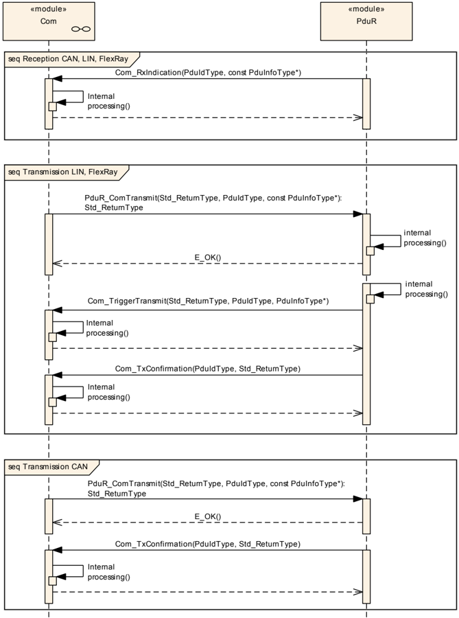

### 8.2. PDU路由器、AUTOSAR COM模块和RTE之间的确认处理

下图显示了关于两种不同IPDU处理模式的确认处理。（另见第[6.3.5.4](#6354-信号指示i-pdu的解包)节。）

图9.2：PDU路由器、AUTOSAR COM模块和RTE之间的确认处理（**Confirmation handling**）

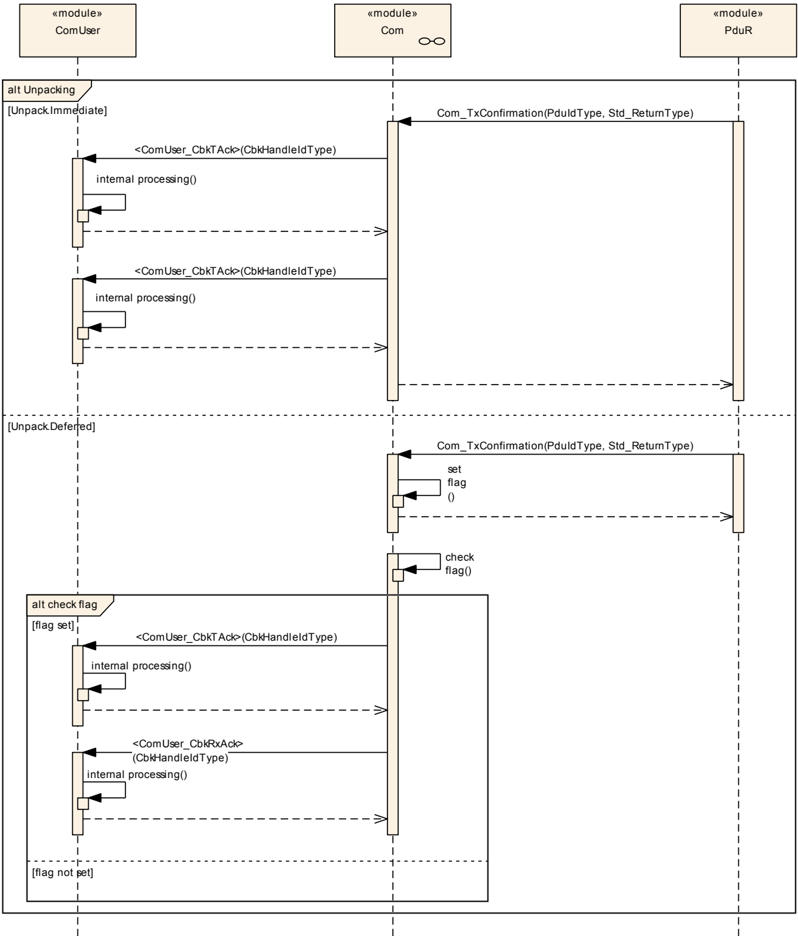

### 8.3. PDU路由器、AUTOSAR COM模块和RTE之间的指示处理

下图显示了关于两种不同解包模式的指示处理。（另见第[6.3.5.4](#6354-信号指示i-pdu的解包)节。）

图9.3：PDU路由器、AUTOSAR COM模块和RTE之间的指示处理（**Indication handling**）

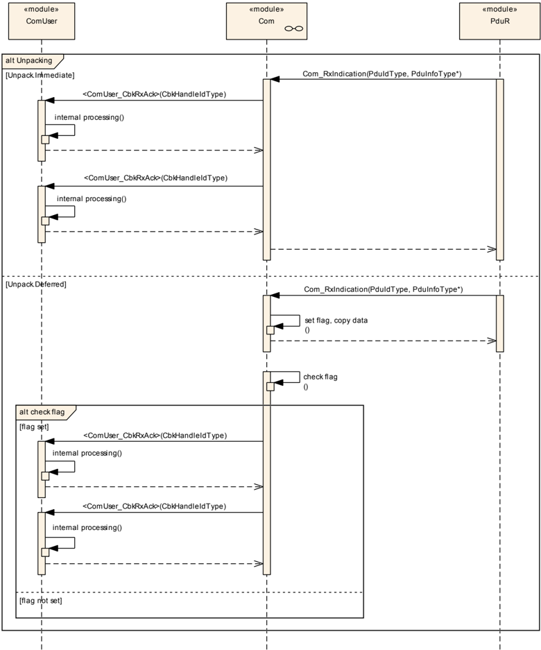
## 9. 配置规范

第9.2节规定模块**COM**的结构（容器）和参数。

第9.2节规定模块**COM**的配置规则。

### 9.1. 容器与配置参数

以下各章汇总了所有配置参数。参数的详细含义在第6章和第7章中描述。

以太网交换机驱动程序模块应拒绝实现不支持的、带有分区映射的配置。

#### 9.2.1. Configuration of the AUTOSAR COM Module

| SWS 条目 | [] |
| --- | --- |
| 容器名称 | Configuration of the AUTOSAR COM Module |
| 配置参数 | 见下方参数表 |

无包含的容器。

#### 9.2.2. Com

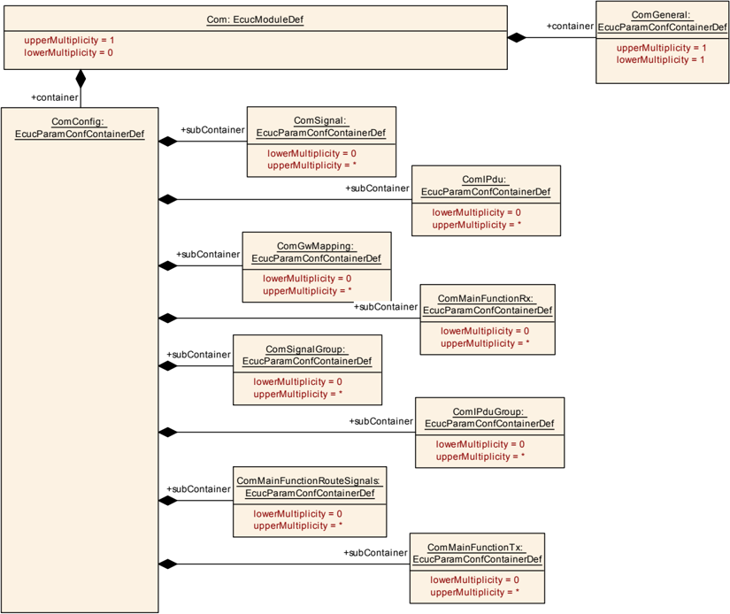


| SWS 条目 | [] |
| --- | --- |
| 容器名称 | Com |
| 配置参数 | 见下方参数表 |

| 包含的容器 | 容器名称 | 多重性 | 作用域/依赖 |
| --- | --- | --- | --- |
| 包含的容器 | ComConfig | 1 | 该容器包含AUTOSAR COM模块的配置参数和子容器。 |
| 包含的容器 | ComGeneral | 1 | Contains the general configuration parameters of the AUTOSAR COM module. |

#### 9.2.3. ComGeneral

| SWS 条目 | [] |
| --- | --- |
| 容器名称 | ComGeneral |
| 配置参数 | 见下方参数表 |

无包含的容器。

| SWS 条目 | [ECUC_Com_10000] |
| --- | --- |
| 参数名称 | ComCancellationSupport |
| 描述 | 该参数启用/禁用取消特性（true：启用；false：禁用）。 |
| 多重性 | 0..1 |
| 类型 | EcucBooleanParamDef |
| 默认值 | true |
| Post-Build 变体值 | false |
| 值配置类 | Pre-compile：time X All Variants |

#### 9.2.4. ComConfig

| SWS 条目 | [] |
| --- | --- |
| 容器名称 | ComConfig |
| 配置参数 | 见下方参数表 |

| 包含的容器 | 容器名称 | 多重性 | 作用域/依赖 |
| --- | --- | --- | --- |
| 包含的容器 | ComGwMapping | 0..* | 该容器的每个实例定义集成信号网关（**Signal Gateway**）的一个映射。 |
| 包含的容器 | ComIPdu | 0..* | See ECUC_Com_00340, if there is no ComIpdu container included no IPDUs are defined. In this case no communication via the AUTOSAR COM module is possible. |
| 包含的容器 | ComIPduGroup | 0..* | See ECUC_Com_00341, if there is no ComIPduGroup container included then no IPDU group is defined. In this case no communication via the AUTOSAR COM module is possible. |
| 包含的容器 | ComMainFunctionRouteSignals | 0..* | Each element of this container defines one instance of Com_ MainFunctionRouteSignals. |
| 包含的容器 | ComMainFunctionRx | 0..* | Each element of this container defines one instance of Com_ MainFunctionRx. |
| 包含的容器 | ComMainFunctionTx | 0..* | Each element of this container defines one instance of Com_ MainFunctionTx. |
| 包含的容器 | ComSignal | 0..* | See ECUC_Com_00344, if there is no ComSignal container included no single signals are defined. |
| 包含的容器 | ComSignalGroup | 0..* | See ECUC_Com_00345, if there is no ComSignalGroup container included no signal groups are defined. |
| 包含的容器 | ComUserModule | 0..* | 包含**Com**用户模块的配置参数。 |

| SWS 条目 | [ECUC_Com_00782] |
| --- | --- |
| 参数名称 | ComDataMemSize |
| 描述 | 以字节为单位的内部**Com**数据大小（静态内存分配）——Post-Build配置所需的内存必须小于该常量。仅在使用静态内存分配的Post-Build可加载实现的情况下才需要该参数。 |
| 多重性 | 0..1 |
| 类型 | EcucIntegerParamDef |
| 范围 | 0 .. 18446744073709551615 |
| 默认值 | - |
| Post-Build 变体值 | false |
| 值配置类 | Pre-compile：time X VARIANT-PRE-COMPILE；Link：time X VARIANT-LINK-TIME, VARIANT-POST-BUILD；Post-build：time -；Pre-compile：time X VARIANT-PRE-COMPILE；Link：time X VARIANT-LINK-TIME, VARIANT-POST-BUILD；Post-build：time - |
| 作用域/依赖 | scope: local |

| SWS 条目 | [ECUC_Com_00782] |
| --- | --- |
| 参数名称 | ComMaxIPduCnt |
| 描述 | I-PDU的最大数量。仅在使用静态内存分配的Post-Build可加载实现的情况下才需要该参数。 |
| 多重性 | 0..1 |
| 类型 | EcucIntegerParamDef |

#### 9.2.5. ComMainFunctionRx

| SWS 条目 | [] |
| --- | --- |
| 容器名称 | ComMainFunctionRx |
| 配置参数 | 见下方参数表 |

无包含的容器。

#### 9.2.6. ComMainFunctionTx

| SWS 条目 | [] |
| --- | --- |
| 容器名称 | ComMainFunctionTx |
| 配置参数 | 见下方参数表 |

无包含的容器。

#### 9.2.7. ComMainFunctionRouteSignals

| SWS 条目 | [] |
| --- | --- |
| 容器名称 | ComMainFunctionRouteSignals |
| 配置参数 | 见下方参数表 |

| 包含的容器 | 容器名称 | 多重性 | 作用域/依赖 |
| --- | --- | --- | --- |
| 包含的容器 |  | ]0 .. INF[ | Range |

| SWS 条目 | [ECUC_Com_10016] |
| --- | --- |
| 参数名称 | ComMainRouteSignalsTimeBase |
| 描述 | 对**Com_MainFunctionRouteSignals**相应实例的相继调用之间的周期（秒）。COM生成器可使用该参数将COM模块接收相关时序配置参数的值转换为内部实现特定的计数器或tick值。COM模块的内部时序处理是实现特定的。COM模块（生成器）可以依赖于**Com_MainFunctionRouteSignals**按照此处配置的值进行调度这一事实。 |
| 多重性 | 1 |
| 类型 | EcucFloatParamDef |
| 默认值 | - |

#### 9.2.8. ComFilter

| SWS 条目 | [] |
| --- | --- |
| 容器名称 | ComFilter |
| 配置参数 | 见下方参数表 |

| 包含的容器 | 容器名称 | 多重性 | 作用域/依赖 |
| --- | --- | --- | --- |
| 包含的容器 |  | -2147483648 .. 4294967295 | Range |

| SWS 条目 | [ECUC_Com_00146] |
| --- | --- |
| 参数名称 | ComFilterAlgorithm |
| 描述 | 值的范围在[17]规范第2.2.2章「接收过滤」中规定。 |

#### 9.2.9. ComIPdu

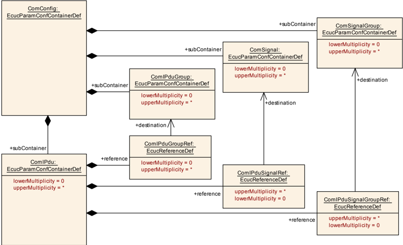


| SWS 条目 | [] |
| --- | --- |
| 容器名称 | ComIPdu |
| 配置参数 | 见下方参数表 |

| 包含的容器 | 容器名称 | 多重性 | 作用域/依赖 |
| --- | --- | --- | --- |
| 包含的容器 | ComTxIPdu | 0..1 | This container must be included if COM_IPDU_DIRECTION is configured to SEND. |

| SWS 条目 | [ECUC_Com_00387] |
| --- | --- |
| 参数名称 | ComIPduCallout |
| 描述 | 该参数定义相应I-PDU的callout函数的存在性和名称。如果省略该参数，则相应I-PDU不进行I-PDU callout。 |
| 多重性 | 0..1 |
| 类型 | EcucFunctionNameDef |
| 默认值 | - |
| Post-Build 变体值 | false |
| 值配置类 | Pre-compile：time X All Variants |

#### 9.2.10. ComTxIPdu

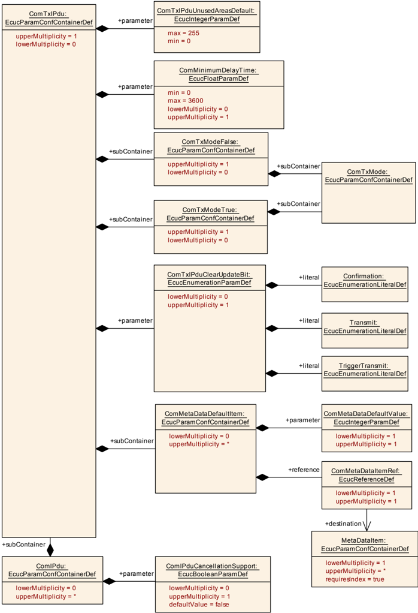


| SWS 条目 | [] |
| --- | --- |
| 容器名称 | ComTxIPdu |
| 配置参数 | 见下方参数表 |

| 包含的容器 | 容器名称 | 多重性 | 作用域/依赖 |
| --- | --- | --- | --- |
| 包含的容器 | ComMetaDataDefaultItem | 0..* | Defines a default value for a meta data item. Used for sending an I-PDU with meta data when it is triggered spontaneously (and not by Com_TriggerIPDUSendWithMetaData), and no meta data has been provided by the RTE. It represents a MetaDataItem of the referenced global PDU. |
| 包含的容器 | ComTxModeFalse | 0..1 | The referenced transmission mode object that is used when the filtering state for this I-PDU evaluates to false. The default is transmission mode None. |
| 包含的容器 | ComTxModeTrue | 0..1 | The referenced transmission mode object that is used when the filtering state for this I-PDU evaluates to true. |

| SWS 条目 | [ECUC_Com_00576] |
| --- | --- |
| 参数名称 | ComMinimumDelayTime |
| 描述 | 以秒为单位定义该I-PDU相继传输之间的最小延迟时间（**MDT**）。MDT与可能的不同传输模式无关。一个I-PDU只有一个最小延迟时间参数。更改传输模式不会重置最小延迟定时器。因此，不允许通过更改传输模式来违反最小延迟时间。对于使用**Com_TriggerTransmit** API请求的I-PDU，无法监控最小延迟时间。 |
| 多重性 | 0..1 |
| 类型 | EcucFloatParamDef |
| 范围 | [0 .. 3600] |
| 默认值 | - |
| Post-Build 变体值 | true |
| 值配置类 | Pre-compile：time X VARIANT-PRE-COMPILE；Link：time X VARIANT-LINK-TIME；Post-build：time X VARIANT-POST-BUILD；Pre-compile：time X VARIANT-PRE-COMPILE；Link：time X VARIANT-LINK-TIME；Post-build：time X VARIANT-POST-BUILD |
| 作用域/依赖 | scope: local |

| SWS 条目 | [ECUC_Com_00576] |
| --- | --- |
| 参数名称 | ComTxIPduClearUpdateBit |
| 描述 | 定义该I-PDU中包含的信号或信号组的更新位（**update-bits**）何时被清除。 |
| 多重性 | 0..1 |
| 类型 | EcucEnumerationParamDef |
| 范围 | Confirmation ;; Transmit ;; TriggerTransmit |
| Post-Build 变体值 | true |
| 值配置类 | Pre-compile：time X VARIANT-PRE-COMPILE |

#### 9.2.11. ComMetaDataDefaultItem

| SWS 条目 | [] |
| --- | --- |
| 容器名称 | ComMetaDataDefaultItem |
| 配置参数 | 见下方参数表 |

无包含的容器。

#### 9.2.12. ComIPduGroup

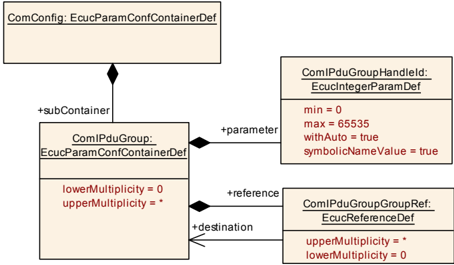


| SWS 条目 | [] |
| --- | --- |
| 容器名称 | ComIPduGroup |
| 配置参数 | 见下方参数表 |

无包含的容器。

| SWS 条目 | [ECUC_Com_00185] |
| --- | --- |
| 参数名称 | ComIPduGroupHandleId |
| 描述 | 用作该I-PDU组的ID的数值。启动和停止I-PDU组的API调用需要**ComIPduGroupHandleId**。范围：0 .. (ComSupportedIPduGroups-1)。 |
| 多重性 | 1 |
| 类型 | EcucIntegerParamDef (Symbolic Name generated for this parameter) |
| 范围 | 0 .. 65535 |
| 默认值 | - |
| Post-Build 变体值 | false |
| 值配置类 | Pre-compile：time X All Variants；Link：time -；Post-build：time - |
| 作用域/依赖 | scope: ECU |

| SWS 条目 | [ECUC_Com_00185] |
| --- | --- |
| 参数名称 | ComIPduGroupGroupRef |
| 描述 | 对包含该I-PDU组的所有I-PDU组的引用。如果省略该引用，则该I-PDU组不属于另一个I-PDU组。 |
| 多重性 | 0..* |
| 类型 | Reference to ComIPduGroup |
| Post-Build 变体值 | true |
| 值配置类 | Pre-compile：time X VARIANT-PRE-COMPILE；Link：time X VARIANT-LINK-TIME；Post-build：time X VARIANT-POST-BUILD；Pre-compile：time X VARIANT-PRE-COMPILE；Link：time X VARIANT-LINK-TIME；Post-build：time X VARIANT-POST-BUILD |
| 作用域/依赖 | scope: local |

#### 9.2.13. ComSignal

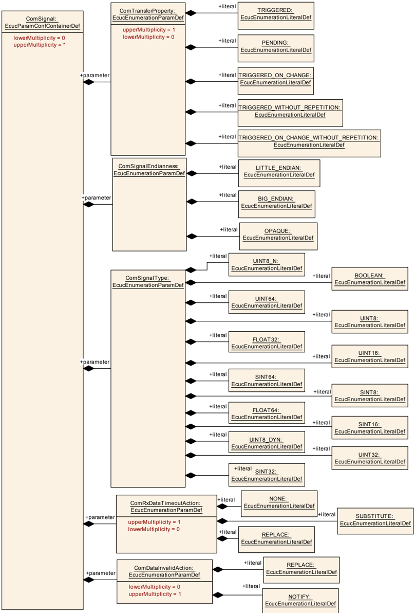


| SWS 条目 | [] |
| --- | --- |
| 容器名称 | ComSignal |
| 配置参数 | 见下方参数表 |

| 包含的容器 | 容器名称 | 多重性 | 作用域/依赖 |
| --- | --- | --- | --- |
| 包含的容器 |  | 0 .. 4294967295 | Range |
| 包含的容器 | ComFilter | 0..1 | 该容器包含AUTOSAR COM模块过滤器（**Filters**）的配置参数。注意：在发送侧，该容器用于规定传输模式条件。 |

| SWS 条目 | [ECUC_Com_00158] |
| --- | --- |
| 参数名称 | ComBitPosition |
| 描述 | I-PDU内的起始位置。该参数指I-PDU中的位置而非影子缓冲区中的位置。如果字节序转换配置为Opaque，参数**ComBitPosition**应像小端字节序那样定义第一个字节的位0。 |
| 多重性 | 1 |
| 类型 | EcucIntegerParamDef |
| 范围 | 0 .. 4294967295 |
| 默认值 | - |
| Post-Build 变体值 | true |
| 值配置类 | Pre-compile：time X VARIANT-PRE-COMPILE；Link：time X VARIANT-LINK-TIME；Post-build：time X VARIANT-POST-BUILD |
| 作用域/依赖 | scope: local |

| SWS 条目 | [ECUC_Com_00314] |
| --- | --- |
| 参数名称 | ComBitSize |
| 描述 | 整数信号类型的大小（位）。对于**ComSignalType** UINT8_N和UINT8_DYN，大小应通过**ComSignalLength**配置。对于**ComSignalTypes** FLOAT32和FLOAT64，大小已由信号类型定义，因此可以省略。 |
| 多重性 | 0..1 |
| 类型 | EcucIntegerParamDef |
| 范围 | 0 .. 64 |
| 默认值 | - |
| Post-Build 变体值 | true |
| 值配置类 | Pre-compile：time X VARIANT-PRE-COMPILE；Link：time X VARIANT-LINK-TIME；Post-build：time X VARIANT-POST-BUILD；Pre-compile：time X VARIANT-PRE-COMPILE；Link：time X VARIANT-LINK-TIME；Post-build：time X VARIANT-POST-BUILD |
| 作用域/依赖 | scope: local |

| SWS 条目 | [ECUC_Com_00183] |
| --- | --- |
| 参数名称 | ComDataInvalidAction |
| 描述 | 该参数定义收到无效信号时执行的动作。对于信号组，指其中一个所包含信号为无效信号时的情况。如果使用Replace，将使用**ComSignalInitValue**进行替换。 |
| 多重性 | 0..1 |
| 类型 | EcucEnumerationParamDef |
| 范围 | NOTIFY ;; REPLACE |
| Post-Build 变体值 | false |
| 值配置类 | Pre-compile：time X VARIANT-PRE-COMPILE；Link：time X VARIANT-LINK-TIME, VARIANT-POST-BUILD；Post-build：time -；Pre-compile：time X VARIANT-PRE-COMPILE；Link：time X VARIANT-LINK-TIME, VARIANT-POST-BUILD；Post-build：time - |
| 作用域/依赖 | scope: local |

| SWS 条目 | [ECUC_Com_00165] |
| --- | --- |
| 参数名称 | ComFirstTimeout |
| 描述 | 以秒为单位定义第一个截止期监控超时周期的长度。该超时在截止期监控服务启动（或重启）之后立即使用。后续周期的超时周期由ECUC_Com_00263配置。 |
| 多重性 | 0..1 |
| 类型 | EcucFloatParamDef |
| 范围 | [0 .. 3600] |
| 默认值 | - |
| Post-Build 变体值 | true |
| 值配置类 | Pre-compile：time X VARIANT-PRE-COMPILE；Link：time X VARIANT-LINK-TIME；Post-build：time X VARIANT-POST-BUILD；Pre-compile：time X VARIANT-PRE-COMPILE；Link：time X VARIANT-LINK-TIME；Post-build：time X VARIANT-POST-BUILD |
| 作用域/依赖 | scope: local |

| SWS 条目 | [ECUC_Com_00165] |
| --- | --- |
| 参数名称 | ComHandleId |
| 描述 | 用作ID的数值。该ID在COM API中分别使用**Com_SignalIdType**或**Com_SignalGroupIdType**参数标识信号和信号组。 |
| 多重性 | 0..1 |

#### 9.2.14. ComSignalGroup

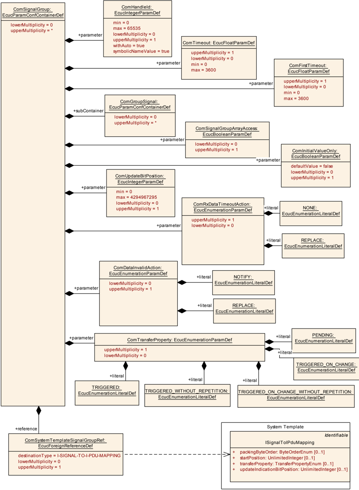


| SWS 条目 | [] |
| --- | --- |
| 容器名称 | ComSignalGroup |
| 配置参数 | 见下方参数表 |

| 包含的容器 | 容器名称 | 多重性 | 作用域/依赖 |
| --- | --- | --- | --- |
| 包含的容器 | ComGroupSignal | 0..* | 该容器包含组信号的配置参数，即包含在信号组内的信号。 |

| SWS 条目 | [ECUC_Com_00183] |
| --- | --- |
| 参数名称 | ComDataInvalidAction |
| 描述 | 该参数定义收到无效信号时执行的动作。对于信号组，指其中一个所包含信号为无效信号时的情况。如果使用Replace，将使用**ComSignalInitValue**进行替换。 |
| 多重性 | 0..1 |
| 类型 | EcucEnumerationParamDef |
| 范围 | NOTIFY ;; REPLACE |
| Post-Build 变体值 | false |
| 值配置类 | Pre-compile：time X VARIANT-PRE-COMPILE；Link：time X VARIANT-LINK-TIME, VARIANT-POST-BUILD；Post-build：time -；Pre-compile：time X VARIANT-PRE-COMPILE；Link：time X VARIANT-LINK-TIME, VARIANT-POST-BUILD；Post-build：time - |
| 作用域/依赖 | scope: local |

| SWS 条目 | [ECUC_Com_00183] |
| --- | --- |
| 参数名称 | ComFirstTimeout |
| 描述 | 以秒为单位定义第一个截止期监控超时周期的长度。该超时在截止期监控服务启动（或重启）之后立即使用。后续周期的超时周期由ECUC_Com_00263配置。 |
| 多重性 | 0..1 |
| 类型 | EcucFloatParamDef |
| 范围 | [0 .. 3600] |
| 默认值 | - |
| Post-Build 变体值 | true |
| 值配置类 | Pre-compile：time X VARIANT-PRE-COMPILE；Link：time X VARIANT-LINK-TIME；Post-build：time X VARIANT-POST-BUILD |

#### 9.2.15. ComGroupSignal

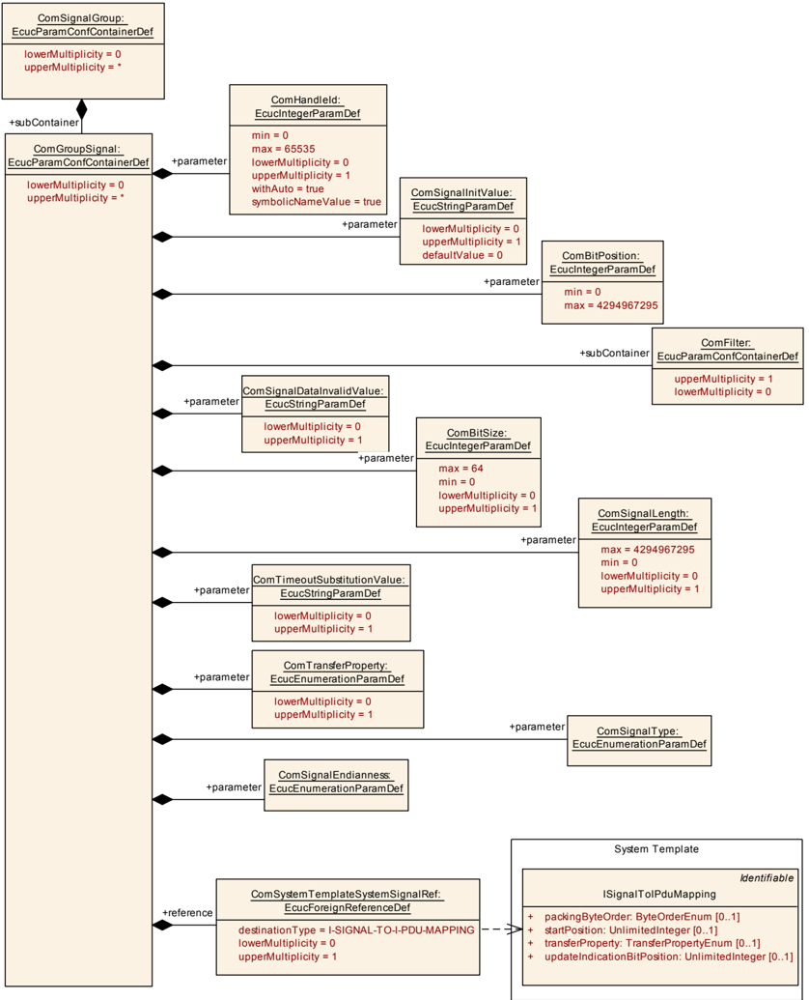


| SWS 条目 | [] |
| --- | --- |
| 容器名称 | ComGroupSignal |
| 配置参数 | 见下方参数表 |

| 包含的容器 | 容器名称 | 多重性 | 作用域/依赖 |
| --- | --- | --- | --- |
| 包含的容器 | ComFilter | 0..1 | This container contains the configuration parameters of the AUTOSAR COM module's filters. Note: On sender side the container is used to specify the transmission mode conditions. |

| SWS 条目 | [ECUC_Com_00158] |
| --- | --- |
| 参数名称 | ComBitPosition |
| 描述 | I-PDU内的起始位置。该参数指I-PDU中的位置而非影子缓冲区中的位置。如果字节序转换配置为Opaque，参数**ComBitPosition**应像小端字节序那样定义第一个字节的位0。 |
| 多重性 | 1 |
| 类型 | EcucIntegerParamDef |
| 范围 | 0 .. 4294967295 |
| 默认值 | - |
| Post-Build 变体值 | true |
| 值配置类 | Pre-compile：time X VARIANT-PRE-COMPILE；Link：time X VARIANT-LINK-TIME；Post-build：time X VARIANT-POST-BUILD |
| 作用域/依赖 | scope: local |

| SWS 条目 | [ECUC_Com_00165] |
| --- | --- |
| 参数名称 | ComBitSize |
| 描述 | 整数信号类型的大小（位）。对于**ComSignalType** UINT8_N和UINT8_DYN，大小应通过**ComSignalLength**配置。对于**ComSignalTypes** FLOAT32和FLOAT64，大小已由信号类型定义，因此可以省略。 |
| 多重性 | 0..1 |
| 类型 | EcucIntegerParamDef |
| 范围 | 0 .. 64 |
| 默认值 | - |
| Post-Build 变体值 | true |
| 值配置类 | Pre-compile：time X VARIANT-PRE-COMPILE；Link：time X VARIANT-LINK-TIME；Post-build：time X VARIANT-POST-BUILD；Pre-compile：time X VARIANT-PRE-COMPILE；Link：time X VARIANT-LINK-TIME；Post-build：time X VARIANT-POST-BUILD |
| 作用域/依赖 | scope: local |

| SWS 条目 | [ECUC_Com_00391] |
| --- | --- |
| 参数名称 | ComHandleId |
| 描述 | 用作ID的数值。该ID在COM API中分别使用**Com_SignalIdType**或**Com_SignalGroupIdType**参数标识信号和信号组。 |
| 多重性 | 0..1 |
| 类型 | EcucIntegerParamDef (Symbolic Name generated for this parameter) |
| 范围 | 0 .. 65535 |
| 默认值 | - |
| Post-Build 变体值 | false |
| 值配置类 | Pre-compile：time All Variants；Link：time -；Post-build：time -；Pre-compile：time All Variants；Link：time -；Post-build：time - |
| 作用域/依赖 | scope: ECU |

| SWS 条目 | [ECUC_Com_00391] |
| --- | --- |
| 参数名称 | ComSignalDataInvalidValue |
| 描述 | 定义该信号的数据无效值。如果**ComSignalType**为UINT8、UINT16、UINT32、UINT64、SINT8、SINT16、SINT32、SINT64，则该字符串应按AUTOSAR EcuC规范「Integer Type」章中的定义解释。如果**ComSignalType**为FLOAT32、FLOAT64，则该字符串应按AUTOSAR EcuC规范「Float Type」章中的定义解释。如果**ComSignalType**为BOOLEAN，则该字符串应按AUTOSAR EcuC规范「Boolean Type」章中的定义解释。如果**ComSignal**为UINT8_N、UINT8_DYN，则该字符串应被解释为以空格分隔的字符的十进制表示，例如「97 98 100」表示字符串「abd」，其中字符「a」位于字节0（最低地址），「b」位于字节1，「d」位于字节2（最高地址）。对于**ComSignalType** UINT8_DYN，动态长度应设置为已配置字符的数量。空字符串「」应被解释为0大小的动态信号。 |
| 多重性 | 0..1 |
| 类型 | EcucStringParamDef |
| 默认值 | - |
| Post-Build 变体值 | false |
| 值配置类 | Pre-compile：time X VARIANT-PRE-COMPILE；Link：time X VARIANT-LINK-TIME, VARIANT-POST-BUILD；Post-build：time -；Pre-compile：time X VARIANT-PRE-COMPILE；Link：time X VARIANT-LINK-TIME, VARIANT-POST-BUILD；Post-build：time - |

#### 9.2.16. ComTxMode

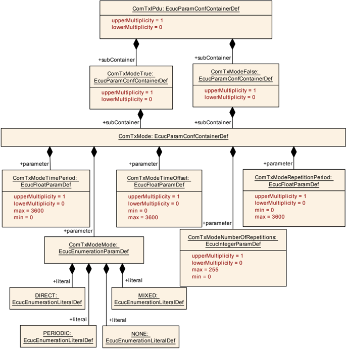


| SWS 条目 | [] |
| --- | --- |
| 容器名称 | ComTxMode |
| 配置参数 | 见下方参数表 |

无包含的容器。

| SWS 条目 | [ECUC_Com_00137] |
| --- | --- |
| 参数名称 | ComTxModeMode |
| 描述 | [18]中描述的可用传输模式应通过附加模式**None**进行扩展。传输模式**None**在**ComTxMode**对象中不得有任何进一步的子属性。 |
| 多重性 | 1 |
| 类型 | EcucEnumerationParamDef |

#### 9.2.17. ComTxModeTrue

| SWS 条目 | [] |
| --- | --- |
| 容器名称 | ComTxModeTrue |
| 配置参数 | 见下方参数表 |

| 包含的容器 | 容器名称 | 多重性 | 作用域/依赖 |
| --- | --- | --- | --- |
| 包含的容器 | ComTxMode | 1 | 该容器包含AUTOSAR COM模块传输模式的配置参数。 |

#### 9.2.18. ComTxModeFalse

| SWS 条目 | [] |
| --- | --- |
| 容器名称 | ComTxModeFalse |
| 配置参数 | 见下方参数表 |

| 包含的容器 | 容器名称 | 多重性 | 作用域/依赖 |
| --- | --- | --- | --- |
| 包含的容器 | ComTxMode | 1 | 该容器包含AUTOSAR COM模块传输模式的配置参数。 |

#### 9.2.19. ComGwMapping

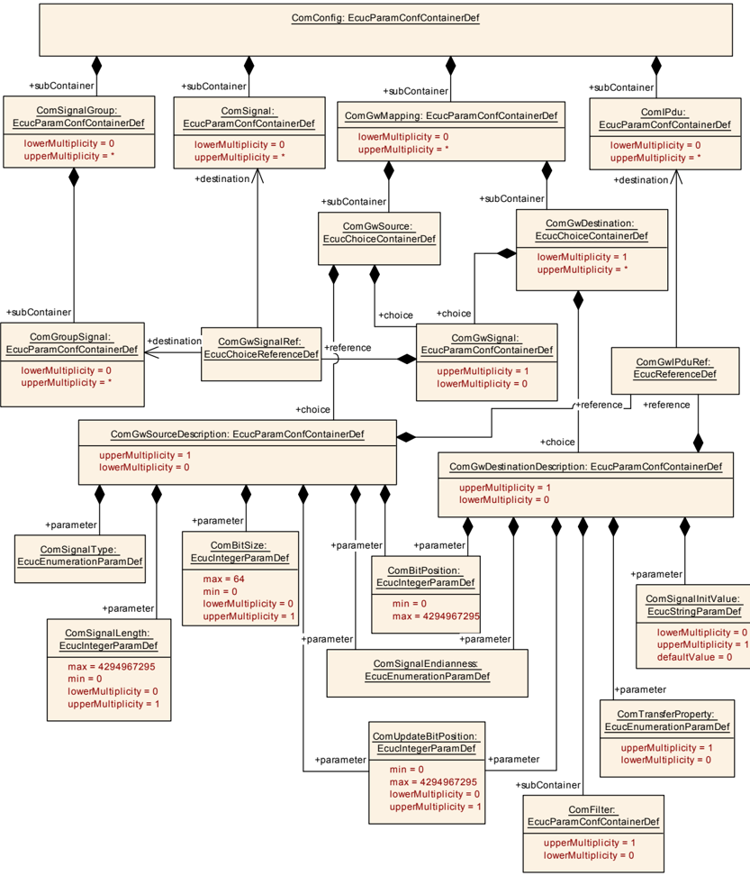


| SWS 条目 | [] |
| --- | --- |
| 容器名称 | ComGwMapping |
| 配置参数 | 见下方参数表 |

| 包含的容器 | 容器名称 | 多重性 | 作用域/依赖 |
| --- | --- | --- | --- |
| 包含的容器 | ComGwDestination | 1..* | 该选择容器的每个实例允许通过引用已配置的COM信号/组信号或通过目的描述容器来定义一个路由目的地。 |
| 包含的容器 | ComGwSource | 1 | 该选择容器允许通过引用已配置的COM信号/组信号或通过源描述容器来定义网关源信号。 |

#### 9.2.20. ComGwSource

| SWS 条目 | [] |
| --- | --- |
| 容器名称 | ComGwSource |
| 配置参数 | 见下方参数表 |

| 包含的容器 | 容器名称 | 多重性 | 作用域/依赖 |
| --- | --- | --- | --- |
| 包含的容器 | ComGwSignal | 0..1 | This container allows specifying a gateway source or destination respectively with a reference to a ComSignal or a ComGroup Signal. |
| 包含的容器 | ComGwSourceDescription | 0..1 | 网关源的描述。该容器允许在不配置完整COM信号的情况下定义网关源。这允许在Post-Build阶段添加/更改网关关系，而无需配置新信号。 |

#### 9.2.21. ComGwSourceDescription

| SWS 条目 | [] |
| --- | --- |
| 容器名称 | ComGwSourceDescription |
| 配置参数 | 见下方参数表 |

无包含的容器。

| SWS 条目 | [ECUC_Com_00158] |
| --- | --- |
| 参数名称 | ComBitPosition |
| 描述 | I-PDU内的起始位置。该参数指I-PDU中的位置而非影子缓冲区中的位置。如果字节序转换配置为Opaque，参数**ComBitPosition**应像小端字节序那样定义第一个字节的位0。 |
| 多重性 | 1 |
| 类型 | EcucIntegerParamDef |
| 范围 | 0 .. 4294967295 |
| 默认值 | - |
| Post-Build 变体值 | true |
| 值配置类 | Pre-compile：time X VARIANT-PRE-COMPILE；Link：time X VARIANT-LINK-TIME；Post-build：time X VARIANT-POST-BUILD |
| 作用域/依赖 | scope: local |

| SWS 条目 | [ECUC_Com_00157] |
| --- | --- |
| 参数名称 | ComBitSize |
| 描述 | 整数信号类型的大小（位）。对于**ComSignalType** UINT8_N和UINT8_DYN，大小应通过**ComSignalLength**配置。对于**ComSignalTypes** FLOAT32和FLOAT64，大小已由信号类型定义，因此可以省略。 |
| 多重性 | 0..1 |
| 类型 | EcucIntegerParamDef |
| 范围 | 0 .. 64 |
| 默认值 | - |
| Post-Build 变体值 | true |
| 值配置类 | Pre-compile：time X VARIANT-PRE-COMPILE；Link：time X VARIANT-LINK-TIME；Post-build：time X VARIANT-POST-BUILD；Pre-compile：time X VARIANT-PRE-COMPILE；Link：time X VARIANT-LINK-TIME；Post-build：time X VARIANT-POST-BUILD |
| 作用域/依赖 | scope: local |

| SWS 条目 | [ECUC_Com_00157] |
| --- | --- |
| 参数名称 | ComSignalEndianness |
| 描述 | 定义信号网络表示的字节序（**endianness**）。 |
| 多重性 | 1 |
| 类型 | EcucEnumerationParamDef |
| 范围 | BIG_ENDIAN ;; LITTLE_ENDIAN ;; OPAQUE |
| Post-Build 变体值 | true |
| 值配置类 | Pre-compile：time X VARIANT-PRE-COMPILE |

#### 9.2.22. ComGwDestination

| SWS 条目 | [] |
| --- | --- |
| 容器名称 | ComGwDestination |
| 配置参数 | 见下方参数表 |

| 包含的容器 | 容器名称 | 多重性 | 作用域/依赖 |
| --- | --- | --- | --- |
| 包含的容器 | ComGwDestinationDescription | 0..1 | 网关目的地的描述。该容器允许在不配置完整COM信号的情况下定义网关目的地。这允许在Post-Build阶段添加/更改网关关系，而无需配置新信号。 |
| 包含的容器 | ComGwSignal | 0..1 | This container allows specifying a gateway source or destination respectively with a reference to a ComSignal or a ComGroup Signal. |

#### 9.2.23. ComGwDestinationDescription

| SWS 条目 | [] |
| --- | --- |
| 容器名称 | ComGwDestinationDescription |
| 配置参数 | 见下方参数表 |

| 包含的容器 | 容器名称 | 多重性 | 作用域/依赖 |
| --- | --- | --- | --- |
| 包含的容器 | ComFilter | 0..1 | 该容器包含AUTOSAR COM模块过滤器（**Filters**）的配置参数。注意：在发送侧，该容器用于规定传输模式条件。 |

| SWS 条目 | [ECUC_Com_00259] |
| --- | --- |
| 参数名称 | ComBitPosition |
| 描述 | I-PDU内的起始位置。该参数指I-PDU中的位置而非影子缓冲区中的位置。如果字节序转换配置为Opaque，参数**ComBitPosition**应像小端字节序那样定义第一个字节的位0。 |
| 多重性 | 1 |
| 类型 | EcucIntegerParamDef |
| 范围 | 0 .. 4294967295 |
| 默认值 | - |
| Post-Build 变体值 | true |
| 值配置类 | Pre-compile：time X VARIANT-PRE-COMPILE；Link：time X VARIANT-LINK-TIME；Post-build：time X VARIANT-POST-BUILD |

#### 9.2.24. ComGwSignal

| SWS 条目 | [] |
| --- | --- |
| 容器名称 | ComGwSignal |
| 配置参数 | 见下方参数表 |

无包含的容器。

| SWS 条目 | [ECUC_Com_00547] |
| --- | --- |
| 参数名称 | ComGwSignalRef |
| 描述 | 对网关关系对象的引用。要么是**ComSignal**，要么是**ComGroupSignal**。 |
| 多重性 | 1 |
| 类型 | Choice reference to [ ComGroupSignal, ComSignal ] |
| Post-Build 变体值 | true |
| 值配置类 | Pre-compile：time X VARIANT-PRE-COMPILE；Link：time X VARIANT-LINK-TIME |

#### 9.2.25. ComUserModule

| SWS 条目 | [] |
| --- | --- |
| 容器名称 | ComUserModule |
| 配置参数 | 见下方参数表 |

无包含的容器。

| SWS 条目 | [ECUC_Com_10029] |
| --- | --- |
| 参数名称 | ComUserModuleCnfRef |
| 描述 | 对**Com**用户模块配置的引用。 |
| 多重性 | 1 |
| 类型 | Reference to destinationUri ComUserUriDefSet/ComUser |
| Post-Build 变体值 | false |
| 值配置类 | Pre-compile：time X All Variants；Link：time -；Post-build：time - |
| 作用域/依赖 | scope: ECU |

#### 9.2.26. ComUserUriDefSet

| SWS 条目 | [] |
| --- | --- |
| 容器名称 | ComUserUriDefSet |
| 配置参数 | 见下方参数表 |

| 包含的容器 | 容器名称 | 多重性 | 作用域/依赖 |
| --- | --- | --- | --- |
| 包含的容器 | ComUserModuleCnf | 0..1 | 包含**Com**用户模块的配置参数。 |

#### 9.2.27. ComUserModuleCnf

| SWS 条目 | [] |
| --- | --- |
| 容器名称 | ComUserModuleCnf |
| 配置参数 | 见下方参数表 |

| 包含的容器 | 容器名称 | 多重性 | 作用域/依赖 |
| --- | --- | --- | --- |
| 包含的容器 | ComUserCallback | 0..* | 该容器为信号和信号组定义一个**Com**回调函数。 |
| 包含的容器 | ComUserSignal | 0..* | Contains the configuration parameters of a signal inside a Com user module. Please note that it is valid to define ComUser Signal without any callback function. |
| 包含的容器 | ComUserSignalGroup | 0..* | Contains the configuration parameters of a signal group inside a Com user module. Please note that it is valid to define ComUser SignalGroup without any callback function. |

| SWS 条目 | [ECUC_Com_10032] |
| --- | --- |
| 参数名称 | ComUserHeaderInclude |
| 描述 | 定义**Com**用户为其已配置回调提供函数声明的头文件。 |
| 多重性 | 0..1 |
| 类型 | EcucStringParamDef |
| 默认值 | - |
| Post-Build 变体值 | false |
| 值配置类 | Pre-compile：time X All Variants；Link：time -；Post-build：time - |
| 作用域/依赖 | scope: local |

#### 9.2.28. ComUserSignal

| SWS 条目 | [] |
| --- | --- |
| 容器名称 | ComUserSignal |
| 配置参数 | 见下方参数表 |

无包含的容器。

| SWS 条目 | [ECUC_Com_10035] |
| --- | --- |
| 参数名称 | ComUserCbkHandleId |
| 描述 | 用作**Com**用户回调句柄Id的数值。该ID在COM回调中分别使用**ComUserCbkHandleId**参数标识信号和信号组。 |
| 多重性 | 0..1 |
| 类型 | EcucIntegerParamDef (Symbolic Name generated for this parameter) |
| 范围 | 0 .. 65535 |
| 默认值 | - |
| Post-Build 变体值 | false |
| 值配置类 | Pre-compile：time X All Variants；Link：time -；Post-build：time -；Pre-compile：time X All Variants；Link：time -；Post-build：time - |
| 作用域/依赖 | scope: ECU |

| SWS 条目 | [ECUC_Com_10025] |
| --- | --- |
| 参数名称 | ComUserCallbackRef |
| 描述 | 对该信号或信号组的所有回调的引用。 |
| 多重性 | 0..* |
| 类型 | Reference to ComUserCallback |
| Post-Build 变体值 | true |
| 值配置类 | Pre-compile：time X VARIANT-PRE-COMPILE；Link：time -；Post-build：time X VARIANT-POST-BUILD；Pre-compile：time X VARIANT-PRE-COMPILE；Link：time X VARIANT-POST-BUILD；Post-build：time - |
| 作用域/依赖 | scope: ECU |

| SWS 条目 | [ECUC_Com_10025] |
| --- | --- |
| 参数名称 | ComUserSystemTemplateSystemSignalRef |
| 描述 | 对**ISignalToIPduMapping**的引用，该映射包含此**ComUserSignal**（或**ComUserGroupSignal**）所表示的ISignal（系统模板）的引用。 |
| 多重性 | 0..1 |
| 类型 | Foreign reference to I-SIGNAL-TO-I-PDU-MAPPING |
| Post-Build 变体值 | true |
| 值配置类 | Pre-compile：time X VARIANT-PRE-COMPILE；Link：time -；Post-build：time X VARIANT-POST-BUILD；Pre-compile：time X VARIANT-PRE-COMPILE；Link：time -；Post-build：time X VARIANT-POST-BUILD |
| 作用域/依赖 | scope: ECU |

#### 9.2.29. ComUserSignalGroup

| SWS 条目 | [] |
| --- | --- |
| 容器名称 | ComUserSignalGroup |
| 配置参数 | 见下方参数表 |

无包含的容器。

| SWS 条目 | [ECUC_Com_10035] |
| --- | --- |
| 参数名称 | ComUserCbkHandleId |
| 描述 | 用作**Com**用户回调句柄Id的数值。该ID在COM回调中分别使用**ComUserCbkHandleId**参数标识信号和信号组。 |
| 多重性 | 0..1 |
| 类型 | EcucIntegerParamDef (Symbolic Name generated for this parameter) |
| 范围 | 0 .. 65535 |
| 默认值 | - |
| Post-Build 变体值 | false |
| 值配置类 | Pre-compile：time X All Variants；Link：time -；Post-build：time -；Pre-compile：time X All Variants；Link：time -；Post-build：time - |
| 作用域/依赖 | scope: ECU |

| SWS 条目 | [ECUC_Com_10026] |
| --- | --- |
| 参数名称 | ComUserCallbackRef |
| 描述 | 对该信号或信号组的所有回调的引用。 |
| 多重性 | 0..* |
| 类型 | Reference to ComUserCallback |
| Post-Build 变体值 | true |
| 值配置类 | Pre-compile：time X VARIANT-PRE-COMPILE；Link：time -；Post-build：time X VARIANT-POST-BUILD；Pre-compile：time X VARIANT-PRE-COMPILE；Link：time X VARIANT-POST-BUILD；Post-build：time - |
| 作用域/依赖 | scope: ECU |

| SWS 条目 | [ECUC_Com_10026] |
| --- | --- |
| 参数名称 | ComUserSystemTemplateSignalGroupRef |
| 描述 | 对**ISignalToIPduMapping**的引用，该映射包含此**ComUserSignalGroup**所表示的ISignalGroup（系统模板）的引用。 |
| 多重性 | 0..1 |
| 类型 | Foreign reference to I-SIGNAL-TO-I-PDU-MAPPING |
| Post-Build 变体值 | true |
| 值配置类 | Pre-compile：time X VARIANT-PRE-COMPILE；Link：time - |

#### 9.2.30. ComUserCallback

| SWS 条目 | [] |
| --- | --- |
| 容器名称 | ComUserCallback |
| 配置参数 | 见下方参数表 |

无包含的容器。

| SWS 条目 | [ECUC_Com_10034] |
| --- | --- |
| 参数名称 | ComUserCallbackName |
| 描述 | 要调用的回调函数的名称。 |
| 多重性 | 1 |
| 类型 | EcucFunctionNameDef |
| 默认值 | - |
| Post-Build 变体值 | false |
| 值配置类 | Pre-compile：time X VARIANT-PRE-COMPILE；Link：time X VARIANT-POST-BUILD；Post-build：time -；Pre-compile：time X VARIANT-PRE-COMPILE；Link：time X VARIANT-POST-BUILD；Post-build：time - |
| 作用域/依赖 | scope: ECU |

| SWS 条目 | [ECUC_Com_10034] |
| --- | --- |
| 参数名称 | ComUserCallbackType |
| 描述 | **Com**回调的类型。 |
| 多重性 | 1 |
| 类型 | EcucEnumerationParamDef |

### 9.2. 配置规则

（配置规则章节的内容为各配置容器的约束性规则，随容器参数呈现。）

### 9.3. 配置规则

#### 9.3.1. 通用规则

以下任何两个参数具有相同的值都是非法的：

- **ComSignal**的shortName
- **ComSignalGroup**的shortName
- **ComGroupSignal**的shortName
- **ComIPdu**的shortName
- **ComIPduGroup**的shortName

所有**ComUserCallback**容器中的任何**ComUserCallbackName**参数与以下五个参数中的任何一个具有相同的值都是非法的：

- Com\_&lt;ComSignal的shortName&gt;
- Com\_&lt;ComSignalGroup的shortName&gt;
- Com\_&lt;ComGroupSignal的shortName&gt;
- Com\_&lt;ComIPdu的shortName&gt;
- Com\_&lt;ComIPduGroup的shortName&gt;

以下任何参数不按照C标识符规则表述都是非法的：

- **ComSignal**的shortName
- **ComSignalGroup**的shortName
- **ComGroupSignal**的shortName
- **ComIPdu**的shortName
- **ComIPduGroup**的shortName
- **ComUserCallbackName**

#### 9.3.2. 信号配置

只要满足以下打包规则，就可以将多个信号打包进一个I-PDU：

**ComSignal** / **ComGroupSignal**不允许相互重叠。

明确允许**ComSignal** / **ComGroupSignal**的大小为0，见**ComBitSize**。

大小为0的信号从不与其他信号重叠。因此，它可以被配置到I-PDU内的任意位置。零大小信号的位置只在部分接收I-PDU的情况下才相关。

**ComSignalType**为UINT8_N和UINT8_DYN的**ComSignal** / **ComGroupSignal**应按字节对齐（**ComBitPosition**是8的倍数）。

uint8[n]类型的**ComSignal** / **ComGroupSignal**应始终映射到n字节大小的**ComSignal** / **ComGroupSignal**。

uint8[n]类型的**ComSignal** / **ComGroupSignal**应配置为具有OPAQUE字节序。

动态长度I-PDU应包含至多一个动态长度信号。

动态长度信号应放置在动态长度I-PDU的最后。

**ComSignalLength**参数应配置为动态长度信号的最大大小/长度。

对于传输模式为DIRECT或MIXED且**ComTxModeNumberOfRepetitions**大于等于1的I-PDU，不应配置更新位（**ComUpdateBitPosition**）。

（组）信号的**ComBitSize**不应超出其已配置**ComSignalType**的大小。

例如，**ComSignalType**为UINT8的信号的**ComBitSize**不应超过8位。

**ComSignalInitValue** / **ComSignalDataInvalidValue**的已配置字符串对于布尔和所有数值类型应按照[17]的定义解释。

在为包含在**ComIPduDirection**为RECEIVE的**ComIPdu**中的**ComSignal**配置了**ComSignalDataInvalidValue**的情况下，还应为该**ComSignal**配置**ComDataInvalidAction**。

#### 9.3.3. 信号组配置

不允许为具有接收信号组与发送信号组之间数据类型差异的路由配置信号组。应支持信号组的子集化（如[SWS_Com_00735]中定义）。

信号组的信号在I-PDU内的放置方式不受限制。允许定义交错的信号组，或将其他信号放置在信号组的间隙中。

在为包含在**ComIPduDirection**为RECEIVE的**ComIPdu**中的**ComSignalGroup**的至少一个**ComGroupSignal**配置了**ComSignalDataInvalidValue**的情况下，还应为该**ComSignalGroup**配置**ComDataInvalidAction**。

#### 9.3.4. 传输模式配置

作为已配置/计算的TMS的潜在结果的每个**ComTxModeTrue**或**ComTxModeFalse**都必须配置。在**ComTxIPdu**内，至少必须包含**ComTxModeTrue**或**ComTxModeFalse**容器之一。

#### 9.3.5. 信号网关配置

要路由的所接收**ComSignal**的**ComBitSize**不得不同。

**ComIPduType**配置为TP的I-PDU中包含的信号或信号组不得配置为**ComGwMapping**配置容器内的源或目的地。

除了**ComSignal**的接收截止期监控之外，对于将由信号网关路由的发送信号，还可以通过**ComUpdateBitPosition**配置更新位。在这种情况下，接收节点可以检测发送者是真正更新了该信号，还是它只是由信号网关重复发送的。这是否必要取决于用例。

#### 9.3.6. 过滤器配置

对于**ComFilterAlgorithm** ONE_EVERY_N，**ComFilterOffset**应配置为小于**ComFilterPeriod**的值。

#### 9.3.7. Post-Build配置

Post-Build期配置部分（post-compile和postlink time）只能在其未被使用时更新。

#### 9.3.8. 动态长度I-PDU配置

由于FlexRay接口只支持I-PDU长度的偶数值，不建议配置经由FrIf发送的动态长度I-PDU。相反，应使用FlexRay TP模块经由FlexRay传输动态长度I-PDU。

#### 9.3.9. 元数据配置

**ComTxIPdu**的**ComMetaDataDefaultItem**容器的数量应与该I-PDU全局配置的**MetaDataItems**数量匹配。

#### 9.3.10. I-PDU组配置

包含在一个I-PDU组内的所有I-PDU应具有相同的**ComIPduDirection**。

由于I-PDU组的嵌套只是概念上的（见第6.3.5.1节），上述需求同样限制所有嵌套的I-PDU组必须具有相同的**ComIPduDirection**。

#### 9.3.11. Com用户的配置

为了支持Com最主要的用户（**RTE**和**SwCluC** Com Proxy）以及尚未知晓的其他用户，Com使用Uri引用（见[18]，Uri Reference节）在模型中通用地将Com链接到其用户。

为确保Com用户的配置与Com相互兼容，所需的参数和容器由**ComUserUriDefSet**定义。

对于Com用户，这意味着它必须拥有一个**ComUserModuleCnf**容器（包括其子容器）作为其配置的一部分。

每个Com用户通过作为Com模块配置值一部分的**ComUserModuleCnfRef**引用注册一次。

**ComUserModuleCnf**容器保存该Com用户生产-和消费的信号和信号组的配置，以及它提供的信号和信号组回调（对照第7.3.4节）。

这些信号和信号组回调对每个Com用户是通用的，通知所适用的信号/信号组通过参数**ComUserCbkHandleId**定义的Com用户回调句柄Id值来区分。

通过这种方式，每个用户可以在一组信号和信号组上以用户特定的句柄id值得到通知。当通知发生时，这些句柄id值可以直接用于在其实现中索引Com用户特定的数据结构。

请注意，对于RX情况，Com模块可以为同一信号或信号组通知多个Com用户。

**ComUserSignal** / **ComUserSignalGroup**容器与相关**ComSignal** / **ComSignalGroup**容器之间的匹配是通过以下匹配对间接完成的：

ComUserSystemTemplateSystemSignalRef &lt;-&gt; ComSystemTemplateSystemSignalRef

ComUserSystemTemplateSignalGroupRef &lt;-&gt; ComSystemTemplateSignalGroupRef

它们指向相同的**ISignalToIPduMapping**。

这种配置方式避免了Com配置与Com用户配置之间的循环依赖。双方可以经由上游模板信息独立地导出它们的配置。

请注意，RTE已经使用基于**ComSystemTemplateSystemSignalRef** / **ComSystemTemplateSignalGroupRef**的类似方法，为实现ECU间通信的dataElements标识相应的**ComSignal** / **ComSignalGroup**容器。

Com用户可以跨越一个或多个ECUC分区。Com用户如何实现这一点是实现特定的。Com用户可以实现两种不同的架构模式。哪一种更适合Com用户的需求取决于Com用户自身。

即使Com用户的概念为支持多个用户的访问（包括其通知）提供了很大的灵活性，也需要考虑一些限制。

一般而言，如果多个写者不相互协调，可能引起竞态条件。此外，（组信号的）**Com_SendSignal**和**Com_SendSignalGroup**调用所需的顺序在多个写者抢占的情况下存在数据不一致的风险。

由于这种协调在不同的软件集群中很难实现，适用以下限制：

已发送的信号或信号组应只由单个软件集群拥有，因此要么由RTE的Com用户、SwCluC，要么由一个CDD拥有。

尽管如此，同一或不同软件集群中的多个Com用户读取一个信号或信号组是可能的。

图10.13：分区特定的Com用户及其与分区特定Com实例的交互（**Partition specific Com users**）

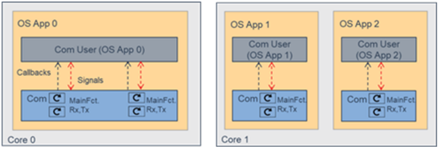

在这种架构模式中，Com用户模块为每个配置了Com API或回调调用的分区提供专用实例。作为前提条件，Com必须提供绑定到相关分区的多个主函数。Com用户的回调只在单个分区的上下文中被调用。因此，当前分区上下文的标识可以通过简单的「回调函数 -> 分区」查找表完成。

图10.14：分区无关的Com用户及其与分区特定Com实例的交互（**partition unspecific Com user**）

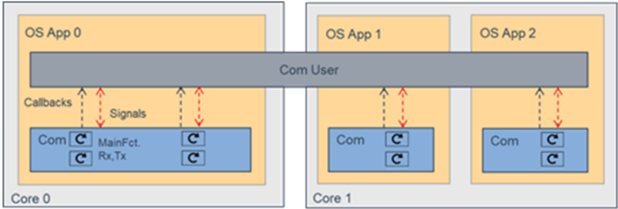

在这种架构模式中，com用户是分区无关的，需要为其回调提供可重入的实现，以用于不同ECUC分区上的不同信号和信号组。Com用户需要提供一组公共回调，它们在多个分区的上下文中被调用。

##### 9.3.11.1. ECUC分区特定的Com用户

分区特定的Com用户的架构模式行为已在上文图10.13的说明中描述。

##### 9.3.11.2. ECUC分区无关的Com用户

分区无关的Com用户的架构模式行为已在上文图10.14的说明中描述。

##### 9.3.11.3. 与SwCluC Com Proxy的关系

一个Com用户拥有一个或多个**SwCluCComBaseSockets** [8]。在该Com用户需要访问Com API以进行**ComSignal** / **ComSignalGroup**发送/接收，或提供信号和信号组回调的每个分区上，都需要一个Base Socket。

Base Socket将主机软件集群中Com的Com回调和一组Com信号/Com信号组绑定到一个**EcucPartition**。这意味着主机软件集群中的Com在该EcucPartition的上下文中调用回调，并且只在该EcucPartition中提供Com信号/Com信号组。

这需要满足以下前提条件：

- 包含某个Base Socket的Com信号/Com信号组的Com IPdus应被分配给与该Base Socket所配置的相同的EcucPartition上的Com主函数。Com中EcucPartition映射的细节在**ComIPduMainFunctionRef**、第6.13节中描述。
- 系统应在应用软件集群和主机软件集群中提供所需的ECUC分区。这是系统设计期间必须考虑的需求。
- Com用户应为以下变体之一：
- -Com用户是分区无关的，提供一个公共实例，其API可以在多个分区上调用。
- -Com用户是分区特定的，为已配置的EcuCPartitions提供专用实例。

### 9.4. 发布信息

详情请参阅[5, SWS BSW General]第10.3章「发布信息」（**Published Information**）。

## 10. 附录

本附录包含具有不同传输模式的用例及其所需的配置。表B.1以及图B.1、B.2、B.3展示了用例图的表示法。

表B.1：用例图的图例（**Legend for use case diagrams**）

| 表示法 | 描述 |
| --- | --- |
| t c, t c1, t c2 | 循环时间 |
| t d | N次发送信号的循环时间 |
| t r | 由于内部主循环时间，COM层的最小SW反应时间 |
| V | 值：x表示任意值/值范围，a...w表示由用户定义的特定值/值范围，其中a <> b，范围a与范围b不相交。 |
| dt | 最小延迟时间：向PDU路由器的两个请求之间的最小距离 |
| without TMS switch | TMS（见第6.3.3.2节）不发生从true到false或反过来的切换 |
| with TMS switch | TMS（见第6.3.3.2节）发生从true到false或反过来的切换（从TM 1到TM 2）；描述中一个TM在「+」之前命名，一个在其之后命名 |


图B.1：从RTE到COM层的请求（**Request from RTE to the COM-Layer**）

图B.2：从COM层到PDU路由器的请求（**Request from COM-Layer to PDU Router**）


图B.3：COM层到PDU路由器的潜在的但被跳过的请求（例如由于RTE的新发送请求或因最小延迟时间而被延迟）


### 10.1. 用例 1

用例1显示了一个以循环时间tc周期性发送的I-PDU。该I-PDU由所有具有**ComTransferProperty** PENDING的信号组成。它被配置为在TMS评估为true时进行传输。

图B.4：用例1，TM periodic（无TMS切换）（**Use case 1, TM periodic**）

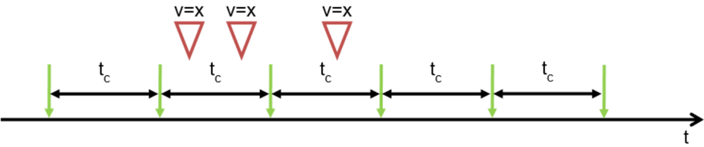

表B.2：用例1的相关I-PDU传输配置（**Relevant I-PDU transmission configuration for use case 1**）

| 参数 | 值 |
| --- | --- |
| ComTransferProperty | PENDING或TRIGGERED（TRIGGERED无影响） |
| ComFilterAlgorithm | ALWAYS |
| ComIPduDirection | SEND |
| ComTxModeTrue / ComTxModeMode | PERIODIC |
| ComTxModeTrue / ComTxModeTimePeriod | t c |
| ComMinimumDelayTime | 0或省略 |

由于**ComFilter**的参数**ComFilterAlgorithm** ALWAYS的配置，在TMS评估为false的情况下无需配置传输模式。

**ComFilter**的**ComFilterAlgorithm**参数是为I-PDU内的所有信号设置为ALWAYS，还是不定义**ComFilter**（不参与TMS的评估），在行为上没有任何区别。

### 10.2. 用例 2

用例2显示了一个I-PDU，每当上层给出一个值（**Com_SendSignal**或**Com_SendSignalGroup**）时，它被发送三次。两次传输之间的时间为td。该I-PDU由所有具有相应**ComTransferProperty**的信号组成。它被配置为在TMS评估为true时进行传输。

图B.5：用例2，TM DIRECT（N次），此处n = 2（无TMS切换）（**Use case 2, TM DIRECT**）

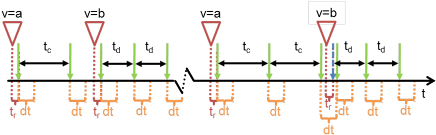

表B.3：用例2的相关I-PDU传输配置（**Relevant I-PDU transmission configuration for use case 2**）

| 参数 | 值 |
| --- | --- |
| ComEnableMDTForCyclicTransmission | true |
| ComTransferProperty | TRIGGERED |
| ComFilterAlgorithm | ALWAYS |
| ComIPduDirection | SEND |
| ComTxModeTrue / ComTxModeMode | DIRECT |
| ComTxModeTrue / ComTxModeNumberOfRepetitions | 2 |
| ComTxModeTrue / ComTxModeRepetitionPeriod | t d |
| ComMinimumDelayTime | dt |

如果RTE在进行中的重复周期完成之前发出新的发送请求，则启动新的重复周期，上一个周期的剩余部分被丢弃。

### 10.3. 用例 3

用例3显示了一个I-PDU，如果值v = a（TMS评估为true），它以循环时间tc1周期性发送；如果值v = b（TMS评估为false），它以循环时间tc2周期性发送。该I-PDU由所有具有**ComTransferProperty** PENDING的信号组成。

图B.6：用例3，TM periodic + periodic（带TMS切换）（**Use case 3, TM periodic + periodic**）

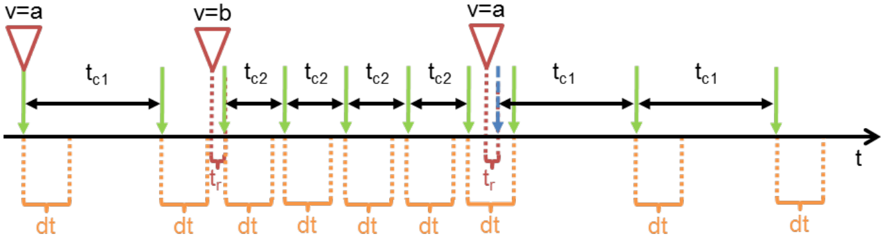

表B.4：用例3的相关I-PDU传输配置（**Relevant I-PDU transmission configuration for use case 3**）

| 参数 | 值 |
| --- | --- |
| ComEnableMDTForCyclicTransmission | true |
| ComTransferProperty | PENDING或TRIGGERED（TRIGGERED无影响） |
| ComFilterAlgorithm | 将值a映射为true、值b映射为false的任何过滤器 |
| ComIPduDirection | SEND |
| ComTxModeTrue / ComTxModeMode | PERIODIC |
| ComTxModeTrue / ComTxModeTimePeriod | t c1 |
| ComTxModeFalse / ComTxModeMode | PERIODIC |
| ComTxModeFalse / ComTxModeTimePeriod | t c2 |
| ComMinimumDelayTime | dt |

由新值v = b引起的TMS切换在下一个主函数内启动一个新周期，并发送新值。不过，由于**ComEnableMDTForCyclicTransmission**设置为true，必须考虑最小延迟时间dt。

对于参数**ComFilterAlgorithm**，[3]中定义的以下过滤器可用于该用例：

- MASKED_NEW_EQUALS_X
- MASKED_NEW_DIFFERS_X
- MASKED_NEW_DIFFERS_MASKED_OLD
- NEW_IS_WITHIN
- NEW_IS_OUTSIDE

### 10.4. 用例 4

用例4显示了一个I-PDU，如果值v = a（TMS评估为true），它以循环时间tc周期性发送；如果值v = b（TMS评估为false），每当RTE给出该值时它被发送三次。两次传输之间的时间为td。该I-PDU由所有具有**ComTransferProperty** TRIGGERED的信号组成。

图B.7：用例4场景a，TM periodic + DIRECT/N次，此处n = 2（带TMS切换）（**Use case 4 scenario a**）

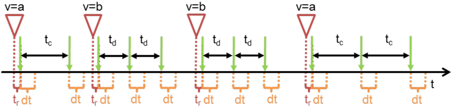

图B.8：用例4场景b，TM periodic + DIRECT/N次，此处n = 2（带TMS切换）（**Use case 4 scenario b**）

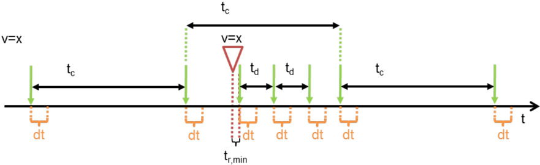

表B.5：用例4的相关I-PDU传输配置（**Relevant I-PDU transmission configuration for use case 4**）

| 参数 | 值 |
| --- | --- |
| ComEnableMDTForCyclicTransmission | true |
| ComTransferProperty | TRIGGERED |
| ComFilterAlgorithm | 将值a映射为true、值b映射为false的任何过滤器 |
| ComIPduDirection | SEND |
| ComTxModeTrue / ComTxModeMode | PERIODIC |
| ComTxModeTrue / ComTxModeTimePeriod | t c |
| ComTxModeFalse / ComTxModeMode | DIRECT |
| ComTxModeFalse / ComTxModeNumberOfRepetitions | 2 |
| ComTxModeFalse / ComTxModeTimePeriod | t d |
| ComMinimumDelayTime | dt |

在从**ComTxModeMode** DIRECT切换到PERIODIC之后，周期在下一个主函数内启动，并且考虑到**ComMinimumDelayTime** dt发送新值a。

### 10.5. 用例 5

用例5显示了一个I-PDU，它以循环时间tc周期性发送，并且如果RTE给出该值（相同或新值），它还被直接发送三次。这三次传输之间的时间始终为td。该I-PDU由所有具有**ComTransferProperty** TRIGGERED的信号组成。

图B.9：用例5场景a，TM MIXED，此处n = 2（无TMS切换）（**Use case 5 scenario a**）


图B.10：用例5场景b，TM MIXED，此处n = 2（无TMS切换）（**Use case 5 scenario b**）

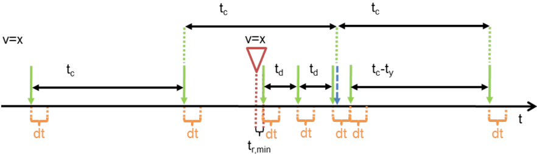

表B.6：用例5的相关I-PDU传输配置（**Relevant I-PDU transmission configuration for use case 5**）

| 参数 | 值 |
| --- | --- |
| ComEnableMDTForCyclicTransmission | true |
| ComTransferProperty | TRIGGERED |
| ComFilterAlgorithm | ALWAYS |
| ComIPduDirection | SEND |
| ComTxModeTrue / ComTxModeMode | MIXED |
| ComTxModeTrue / ComTxModeTimePeriod | t c |
| ComTxModeTrue / ComTxModeNumberOfRepetitions | 2 |
| ComTxModeTrue / ComTxModeRepetitionPeriod | t d |
| ComMinimumDelayTime | dt |

如果**ComTxModeMode** MIXED的周期部分引起的下一次传输应在DIRECT（N次）部分的传输之后、超时dt（**ComMinimumDelayTime**）内进行，则该发送被延迟，直到最小延迟时间到期。然而，在此之后，周期部分的下一个周期被缩短，因此周期部分只有一个中间相移，而不是连续的相移。

### 10.6. 用例 6

用例6显示了一个I-PDU，如果值v = b（TMS评估为false），它以循环时间tc2周期性发送。如果值v = a（TMS评估为true），它以循环时间tc1周期性发送，并且每当RTE给出值v = a时，它还被直接发送三次。这三次传输之间的时间始终为td。该I-PDU由所有具有**ComTransferProperty** TRIGGERED的信号组成。

图B.11：用例6，TM MIXED，此处n = 2 + periodic（带TMS切换）（**Use Case 6, TM MIXED**）

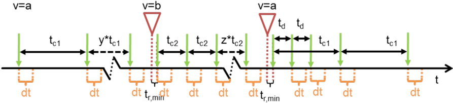

表B.7：用例6的相关I-PDU传输配置（**Relevant I-PDU transmission configuration for use case 6**）

| 参数 | 值 |
| --- | --- |
| ComEnableMDTForCyclicTransmission | true |
| ComTransferProperty | TRIGGERED |
| ComFilterAlgorithm | 将值a映射为true、值b映射为false的任何过滤器 |
| ComIPduDirection | SEND |
| ComTxModeTrue / ComTxModeMode | MIXED |
| ComTxModeTrue / ComTxModeTimePeriod | t c1 |
| ComTxModeTrue / ComTxModeNumberOfRepetitions | 2 |
| ComTxModeTrue / ComTxModeRepetitionPeriod | t d |
| ComTxModeFalse / ComTxModeMode | PERIODIC |
| ComTxModeTrue / ComTxModeTimePeriod | t c2 |
| ComMinimumDelayTime | dt |

这在实践中的用途例如是控制车窗升降电机的按钮的信号。如果按钮未被按下，则该信息以长循环时间tc1存在。如果按钮被按下，则该信息以短循环时间tc2分发。如果按钮再次被释放，则从下一个主函数开始，该信息以td分发三次，之后再次使用长循环时间。

### 10.7. 用例 7

用例7与用例5类似，但**ComEnableMDTForCyclicTransmission**被禁用且**ComTxModeNumberOfRepetitions**设置为1。

图B.12：用例7场景a，TM MIXED，此处n = 1（无TMS切换）（**Use case 7 scenario a**）

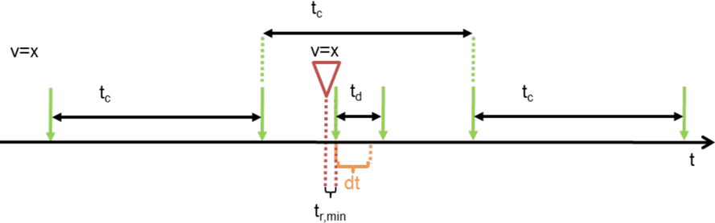

图B.13：用例7场景b，TM MIXED，此处n = 1（无TMS切换）（**Use case 7 scenario b**）

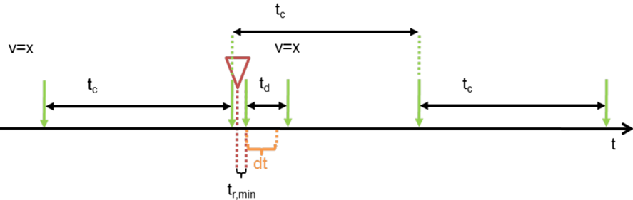

图B.14：用例7场景c，TM MIXED，此处n = 1（无TMS切换）（**Use case 7 scenario c**）

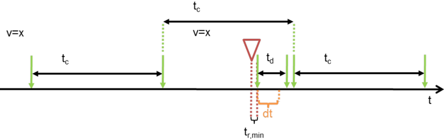

表B.8：用例7的相关I-PDU传输配置（**Relevant I-PDU transmission configuration for use case 7**）

| 参数 | 值 |
| --- | --- |
| ComEnableMDTForCyclicTransmission | false |
| ComTransferProperty | TRIGGERED |
| ComFilterAlgorithm | ALWAYS |
| ComIPduDirection | SEND |
| ComTxModeTrue / ComTxModeMode | MIXED |
| ComTxModeTrue / ComTxModeTimePeriod | t c |
| ComTxModeTrue / ComTxModeNumberOfRepetitions | 1 |
| ComTxModeTrue / ComTxModeRepetitionPeriod | t d |
| ComMinimumDelayTime | dt |

与用例5相反，这里最小延迟定时器既不为MIXED模式周期部分的周期性传输启动，也不为其DIRECT部分的重复传输启动。这可能像场景b和c中所示的那样，导致在时间跨度dt内发生两次连续传输。
