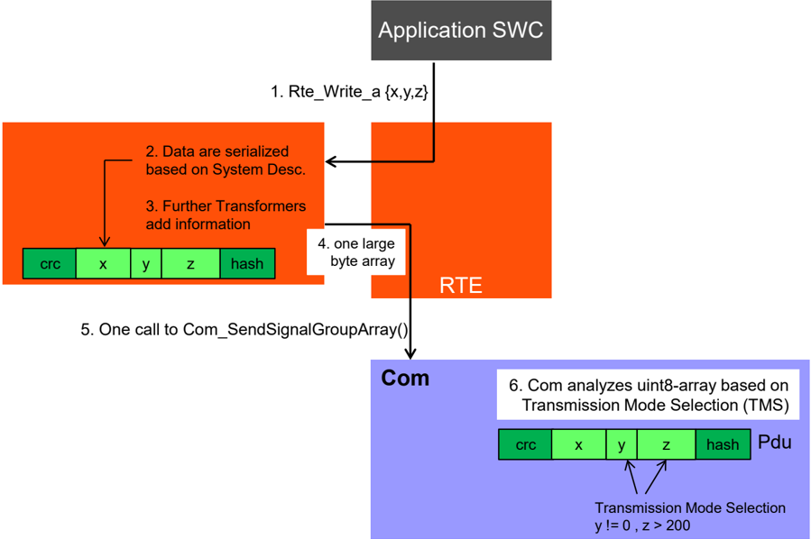
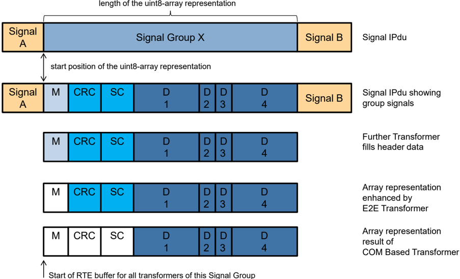
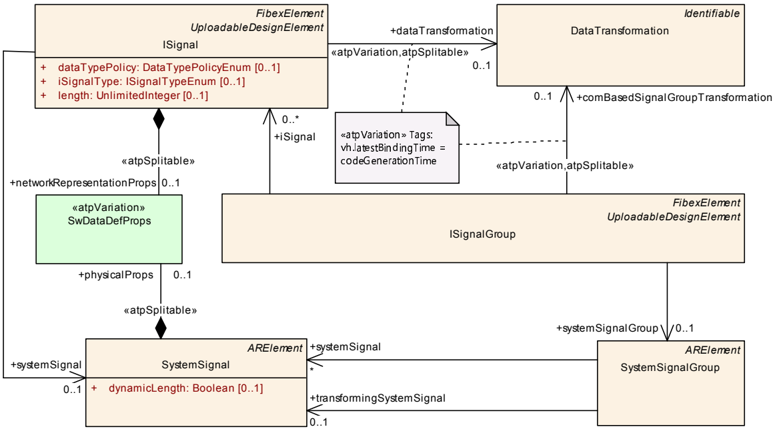
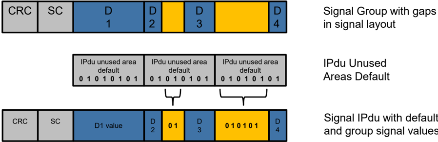
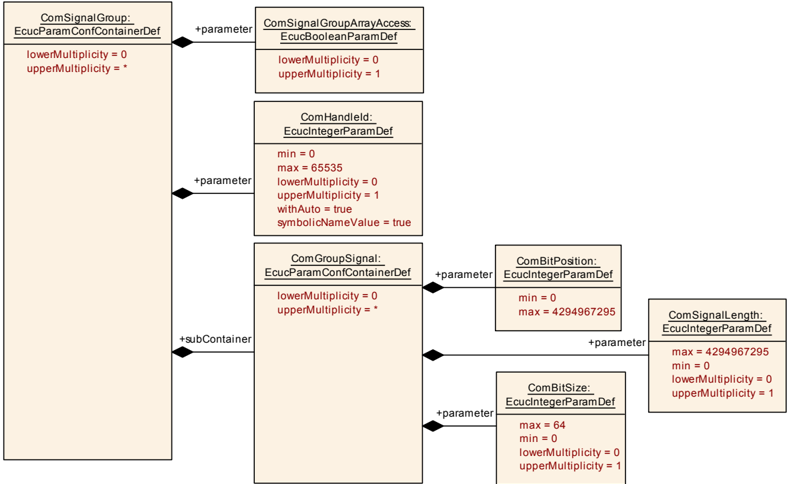

## 1. 简介和功能概述

当在RTE中发送和接收数据时，转换器的特性提供了链接任意转换器的功能。当目标总线系统使用带有打包数据表示（**packed data representations**）的固定通信矩阵时，基于COM的转换器（**Transformer**）提供了这种功能。

## 2. 缩略语

除了 [\[1\]](#ref-1) 中已定义的术语之外，本规范未引入其他特定术语。

## 3. 相关文档

### 3.1. 输入文件

<a id="ref-1"></a>[1] Glossary
> AUTOSAR_FO_TR_Glossary

<a id="ref-2"></a>[2] General Specification of Transformers
> AUTOSAR_CP_ASWS_TransformerGeneral

<a id="ref-3"></a>[3] Specification of RTE Software
> AUTOSAR_CP_SWS_RTE

<a id="ref-4"></a>[4] Specification of Communication
> AUTOSAR_CP_SWS_COM

<a id="ref-5"></a>[5] General Requirements on Basic Software Modules
> AUTOSAR_CP_SRS_BSWGeneral

<a id="ref-6"></a>[6] Requirements on Transformer
> AUTOSAR_CP_SRS_Transformer

<a id="ref-7"></a>[7] System Template
> AUTOSAR_CP_TPS_SystemTemplate

<a id="ref-8"></a>[8] General Specification of Basic Software Modules
> AUTOSAR_CP_SWS_BSWGeneral

### 3.2. 相关标准和规范

不适用。

### 3.3. 相关规范

**AUTOSAR** 提供了转换器通用规范 [\[2\]](#ref-2)，该规范同样适用于基于 COM 的转换器。

因此，规范 **ASWS Transformer General** 应被视为基于 COM 的转换器的附加和必需规范。

## 4. 约束和假设

### 4.1. 限制

对于基于COM的转换器，所有通用转换器的限制（参见[\[2\]](#ref-2)）都适用。此外，以下限制也同样适用于基于COM的转换器。

1. 基于COM的转换器不支持客户端-服务器通信。
2. 基于COM的转换器不支持外部触发通信。
3. 基于COM的转换器只支持复合数据类型（即：来自COM的**Signal Group**）。
4. 基于COM的转换器只支持固定大小的数据类型。
5. 基于COM的转换器只支持字节对齐的信号组（**Signal Group**）。
6. 基于COM的转换器应支持所有组信号依次映射到**IPdu**的信号组（可能有间隙，在信号组布局中的位置没有定义相应的信号）。

如果约束3.出现了单一的原始数据元素必须使用基于COM的转换器处理的用例时（如：在序列化之后执行E2E的保护），那么可以把数据元素放在一个结构中。然后该结构将只包含这一个条目。

### 4.2. 汽车域的适用性

当使用固定的通信矩阵时，基于 COM 的转换器可用于所有域应用。

## 5. 对其他模块的依赖

必须存在 **AUTOSAR RTE** [\[3\]](#ref-3) 才能执行基于 COM 的转换器。

必须存在由基于 COM 的转换器所处理数据的 **AUTOSAR COM** 配置 [\[4\]](#ref-4)，才能允许配置基于 COM 的转换器。

### 5.1. 文件结构

#### 5.1.1. 代码文件结构

源代码文件结构定义在 [\[2\]](#ref-2) 中。

## 6. 功能规格

### 6.1. 功能概述

当SWC发起一个被配置为转换（**transformed**）的ECU之间的通信时，SWC将数据移交给RTE。RTE执行已配置的转换器链。其中可以包含基于COM的转换器。



基于COM转换器的发送端会首先序列化（**serializes**）SW-C的数据，并将数据按照通信矩阵描述的定义，转换成uint8的数组（**uint8-array**）来表示。再将数据转发到COM模块，并放置在各自的**IPdu**中。COM模块会分析提供的uint8-array数据并触发相应的传输模式（传输模式选择取决于TMS的配置）。**IPdu**通过总线上的通信栈发送给接收者。

接收端RTE以相反的顺序执行转换器链。接收机的基于COM的转换器将线性数据反序列化为原始数据结构。这些再移交给接收的SW-C。

从SWC的角度来看，无论数据是否被转换，它都是完全透明的。

COM的IPdu缓冲区和转换器缓冲区内的数据处理，如下图[\[2\]](#ref-2)所示：


**ISignalIPdu**由COM模块作为**ComIPdu**处理，可以包含多个部分（包括：信号和信号组）。COM中的信号组（**signal group**）由**ComSignalGroup**容器表示。

在System Template[\[7\]](#ref-7)中，可以定义需要基于COM的转换器处理信号组。对于一个特定的转换器链，基于COM的转换器的使用是由引用**comBasedSignalGroupTransformation**从**ISignalGroup**到**DataTransformation**定义的。可参见图[\[3\]](#ref-3)。



在COM模块的Ecu配置中，这样的**ComSignalGroups**定义了一个**ComSignalGroupArrayAccess=true**参数。

如果**ComSignalGroupArrayAccess=true**，那么它隐式定义了信号组的长度和信号组在**ComIPdu**中开始的位置。因此，也就是说在一个**ISignalIPdu**中可以定义多个信号（**signal**）和信号组（**signal groups**）。例如：“信号A”和“信号B”是**IPdu**的一部分，但不被基于COM的转换器的“信号组X”考虑。

在**Com**模块API中，**Com_SendSignalGroupArray**和**Com_ReceiveSignalGroupArray**根据在**ComIPdu**中定义的信号组的长度和起始位置将信号组用数组表示（**array representation**）。该数组表示包含属于该信号组的所有信号，无论应用软件是否定义了数据映射（**data mapping**）。

如下图所示，信号组X（**Signal Group X**）由信号（**M、CRC、SC、D1、D2、D3、D4**）组成。因此，RTE将基于该信号组的整个数组的表示和该信号组的长度与**COM**模块进行交互。


当RTE与基于COM的转换器进行交互时，也需要考虑所有其他潜在的转换器。以便于确定实际向每个转换器提供信号组的阵列表示的哪一部分，因为每个转换器都可能在发送过程中添加数据或在接收过程中删除数据。

例如，数组表示中包含**CRC**和**SC**信号的部分由E2E转换器（**E2E transformer**）处理，所以不会被基于COM的转换器（**COM Based Transformer**）考虑。信号**M**既不会被E2E转换器处理，也不会被基于COM的转换器处理。对于信号**M**，有另一个进一步的转换器负责。

RTE将为该信号组开始位置的所有转换器提供数据缓冲器，以用于基于COM的转换器、E2E转换器和任何一个进一步定义的转换器。

### 6.2. 基于COM的转换器的规范

序列化描述了在网络上传输的协议数据单元（PDU）中表示数据的方式。对于基于COM的转换器，序列化是由使用系统模板[\[7\]](#ref-7)的通信矩阵定义的。通信矩阵信息会接管**COM**模块的**Ecu**配置。

序列化是基于COM模块的Ecu配置和：
* 软件组件（**Software Component**）的**PortPrototype**；
* 每个**SenderReceiverInterface**定义的**dataElement**列表；
* **SenderReceiverToSignalGroupMapping**；
* **SystemSignalGroup**的**ISignalToIPduMapping**。

基于COM的转换器只能作为转换器链中最上层（第一层）的转换器使用。基于COM的转换器将结构化数据序列化为线性形式。因此，它只能作为发送端第一个转换器和接收端最后一个转换器使用。

如果以下条件满足，基于COM的转换器将被定义为一个转换器使用：
* **TransformationTechnology**的**protocol**属性设置为**COMBased**；
* **TransformationTechnology**的**version**属性被设置为**1.0.0**
* **TransformationTechnology**的**transformerClass**属性被设置为**serializer**

基于COM的转换器应支持COM模块支持的所有基本数据类型，除了**UINT8_DYN**。

基于COM的转换器应该单独处理**SenderReceiverInterface**的每个**dataElement**。

正如COM模块[\[4\]](#ref-4)定义的那样，当COM模块Com_SendSignal、Com_ReceiveSignal被调用处理阴影信号（**shadow signal**）时，基于COM的转换器需要处理**SenderReceiverInterface**的每个**dataElement**。这定义了基于COM的转换器对COM模块同等地执行所有操作。包括字节顺序转换（**Endianess Conversion**）和符号扩展（**Sign Extension**）。

**COM**模块的配置隐式地定义了信号组的长度和信号组在**ComIPdu**中开始的起始位置。

如果信号组数组表示的信号布局包含间隙（**Gap**），则在传输过程中，这些间隙应设置为该信号组映射到的相应**ComTxIPdu**的**ComTxIPduUnusedAreasDefault**定义的值。

信号组数组表示可能会出现空白，因为布局没有完全打包，而且有些位（甚至字节）没有为其定义信号。如下图所示：



基于COM的转换器应考虑在**ISignalGroup**中定义的**ISignal**的头或尾，这些信号由进一步的转换器处理。

基于COM的转换器应该根据COM中的**ISignalGroup**的配置将序列化的数据元素放入数据缓冲区的指定位的位置（**bit position**）。为了允许迁移，反序列化应该能够接受更大的数组表示，并忽略附加在先前已知参数列表末尾的dataElements。这意味着:在序列化数据的末尾用于生成或参数化反序列化代码的接口规范中没有定义的数据元素将被反序列化忽略。

## 7. API规范

### 7.1. 导入的类型

除 [\[2\]](#ref-2) 中规定的类型之外，没有从其他模块导入的类型。

在由基于 COM 的转换器导入的模块互接头文件（**Module Interlink Headers**）中，包含了 RTE 已知的所有 **ImplementationDataType**。通过这种机制，基于 COM 的转换器知晓所有需转换数据的数据类型。

### 7.2. 类型定义

#### 7.2.1. ComXf_ConfigType

结构类型（**Structure**），元素为实现特定（**implementation specific**），类型为 -。这是包含转换器初始化数据的数据结构的类型。可通过**ComXf.h**获得。

### 7.3. 函数定义

基于 COM 的转换器提供了 [\[2\]](#ref-2) 一般要求的特定接口。

基于 COM 的转换器应仅为这样的转换器提供函数：其 **TransformationTechnology** 被引用为来自 **DataTransformation** 的有序引用列表 **transformerChain** 中的第一个引用。

这意味着，只有转换器链中的第一个转换器可以是基于 COM 的转换器，因为序列化转换器（**serializer transformer**）通常只允许作为转换器链中的第一个转换器。

#### 7.3.1. ComXf_&lt;transformerId&gt;

**说明**: 此函数使用基于 COM 的转换器的序列化来转换发送者/接收者通信。它以数据元素作为输入，并输出一个包含序列化数据的 **uint8** 数组。本服务为同步调用，可重入。参数 dataElement（in）：需转换的数据元素。参数 buffer（out）：由 **RTE** 分配的缓冲区。参数 bufferLength（out）：缓冲区的已用长度。返回值 **uint8**：**0x00**（**E_OK**）：序列化成功；**0x81**（**E_SER_GENERIC_ERROR**）：发生一般错误。可通过**ComXf.h**获得。

```C
uint8 ComXf_<transformerId> ( uint8* buffer, uint32* bufferLength, <paramtype> dataElement )
```

其中：

* **type** 是在 **RTE** 的所有数据转换活动之后数据元素的数据类型
* **paramtype** 根据 **SRS BSW General** [\[5\]](#ref-5)（参见相关需求）和 **SWS BSW General** [\[8\]](#ref-8)（参见相关需求）定义的参数传递规则从 **type** 派生
* **transformerId** 是由转换器通用规范 [\[2\]](#ref-2) 规定的转换器的名称模式

上述函数存在于每个使用基于 COM 的转换器的、被转换的发送者/接收者通信中。

如果 **DataTransformation** 被一个 **ISignalGroup** 以 **comBasedSignalGroupTransformation** 角色引用、且该 **ISignalGroup** 引用一个 **SystemSignalGroup**、而该 **SystemSignalGroup** 又被 **SenderReceiverToSignalGroupMapping** 引用，则上述函数应存在于来自 **DataTransformation** 到 **TransformationTechnology** 的有序引用列表 **transformerChain** 中的第一个引用处。

上述函数应使用基于 COM 的转换，将发送者/接收者通信的复杂数据元素序列化为线性字节数组表示。

#### 7.3.2. ComXf_Inv_&lt;transformerId&gt;

**说明**: 此函数使用基于 COM 的转换器的反序列化来反序列化发送者/接收者通信。它以包含序列化数据的 **uint8** 数组作为输入，并输出将传递给 **Rte** 的原始数据元素。本服务为同步调用，可重入。参数 buffer（in）：由 **RTE** 分配的缓冲区，**Rte** 在其中存储仍是序列化状态的数据。参数 bufferLength（in）：缓冲区的已用长度。参数 dataElement（out）：作为转换结果并包含反序列化数据元素的数据元素。返回值 **uint8**：**0x00**（**E_OK**）：序列化成功；**0x81**（**E_SER_GENERIC_ERROR**）：发生一般错误。可通过**ComXf.h**获得。

```C
uint8 ComXf_Inv_<transformerId> ( const uint8* buffer, uint32 bufferLength, <type>* dataElement )
```

其中：

* **type** 是在 **RTE** 的所有数据转换活动之前数据元素的数据类型
* **transformerId** 是在转换器通用规范 [\[2\]](#ref-2) 中规定的转换器的名称模式

上述函数存在于每个使用基于 COM 的转换的、被转换的发送者/接收者通信中。

如果 **DataTransformation** 被一个 **ISignalGroup** 以 **comBasedSignalGroupTransformation** 角色引用、且该 **ISignalGroup** 引用一个 **SystemSignalGroup**、而该 **SystemSignalGroup** 又被 **SenderReceiverToSignalGroupMapping** 引用，则上述函数应存在于来自 **DataTransformation** 到 **TransformationTechnology** 的有序引用列表 **transformerChain** 中的第一个引用处。

如果调用上述函数时 **buffer** 等于 **NULL_PTR** 且 **bufferLength** 等于 0，则输出缓冲区 **buffer** 不应被更改，且该函数应以 **E_NO_DATA** 返回。

上述函数应使用基于 COM 的转换，将线性字节数组反序列化为发送者/接收者通信的原始或复杂数据元素。

#### 7.3.3. ComXf_Init

**说明**: 此服务初始化转换器以进行后续处理。本服务为同步调用，可重入。参数 config（in）：指向转换器配置数据的指针。该服务无返回值。可通过**ComXf.h**获得。

```C
void ComXf_Init ( const ComXf_ConfigType* config )
```

#### 7.3.4. ComXf_DeInit

**说明**: 此服务反初始化转换器。本服务为同步调用，可重入。该服务无参数。该服务无返回值。可通过**ComXf.h**获得。

```C
void ComXf_DeInit ( void )
```

#### 7.3.5. ComXf_GetVersionInfo

**说明**: 此服务返回被调用的转换器模块的版本信息。本服务为同步调用，可重入。参数 VersionInfo（out）：指向存储本模块版本信息的位置的指针。该服务无返回值。可通过**ComXf.h**获得。

```C
void ComXf_GetVersionInfo ( Std_VersionInfoType* VersionInfo )
```

### 7.4. 回调通知

基于 COM 的转换器没有回调通知。

### 7.5. 调度函数

基于 COM 的转换器没有调度函数。

### 7.6. 期望接口

基于 COM 的转换器没有期望接口。

## 8. 时序图

没有适用于基于 COM 的转换器的时序图。

## 9. 配置规范

基于 COM 的转换器基于 **COM** 模块配置 [\[4\]](#ref-4) 进行配置。

尽管如此，仍需要一个 **EcuC** 来映射转换器的实现。应使用 [\[2\]](#ref-2) 中定义的 **EcuC**。

基于 **Xfrm** 配置 [\[2\]](#ref-2) 的基于 COM 的转换器的供应商特定模块定义，可以由供应商扩展以支持与 **Com** 模块 [\[4\]](#ref-4) 的紧密交互。

当相应 **ComSignalGroup** 的 **Com** 模块 [\[4\]](#ref-4) 的配置为 **postBuild** 时，基于 COM 的转换器应被配置为 **postBuild**。

基于 COM 的转换器的 **EcuC** 的 **apiServicePrefix** 应设置为 **ComXf**。

## A. 引用的元类

为了完整性起见，本章包含一组类表，表示在本文档上下文中提及但未直接包含在本规范描述范围内的元类（**meta-class**）。

### A.1. DataTransformation

| 类 | DataTransformation |
| --- | --- |
| 包 | M2::AUTOSARTemplates::SystemTemplate::Transformer |
| 注意 | **DataTransformation** 表示一个转换器链。它是一个有序的转换器列表。 |
| 基类 | ARObject、Identifiable、MultilanguageReferrable、Referrable |
| 被聚合于 | DataTransformationSet.dataTransformation |

| 属性 | 类型 | 多重性 | 类别 | 注意 |
| --- | --- | --- | --- | --- |
| dataTransformationKind | DataTransformationKindEnum | 0..1 | attr | 此属性控制要应用的数据转换的类型。 |
| executeDespiteDataUnavailability | Boolean | 0..1 | attr | 指定即使没有输入数据可用，是否仍执行转换器链。 |
| transformerChain（有序） | TransformationTechnology | * | ref | 此属性表示转换器链的定义，这些转换器应按照从 **DataTransformation** 引用的顺序执行。 |

### A.2. EcucModuleDef

| 类 | EcucModuleDef |
| --- | --- |
| 包 | M2::AUTOSARTemplates::ECUCParameterDefTemplate |
| 注意 | 用作软件模块（包括 **BSW** 和 **RTE** 以及 **ECU** 基础设施）配置定义的顶层元素。 |
| 基类 | ARElement、ARObject、AtpBlueprint、AtpBlueprintable、AtpDefinition、CollectableElement、EcucDefinitionElement、Identifiable、MultilanguageReferrable、PackageableElement、Referrable |
| 被聚合于 | ARPackage.element |

| 属性 | 类型 | 多重性 | 类别 | 注意 |
| --- | --- | --- | --- | --- |
| apiServicePrefix | CIdentifier | 0..1 | attr | 对于可以定义 **VSMD** 的多个实例的模块，**apiServicePrefix** 定义派生实例的 **API** 命名空间，例如 Cdd、Xfrm（ComXf、SomeIpXf、E2EXf）。 |
| container | EcucContainerDef | * | aggr | 聚合此特定模块定义的顶层容器定义。 |
| postBuildVariantSupport | Boolean | 0..1 | attr | 指示模块是否支持不同的构建后变体（以前称为构建后可选择配置集）。**TRUE** 表示是，**FALSE** 表示否。 |
| refinedModuleDef | EcucModuleDef | 0..1 | ref | 从供应商特定模块定义到其细化的标准化模块定义的可选引用。如果此 **EcucModuleDef** 的类别为 **STANDARDIZED_MODULE_DEFINITION**，则不应提供此引用。如果此 **EcucModuleDef** 的类别为 **VENDOR_SPECIFIC_MODULE_DEFINITION**，则此引用是必需的。 |
| supportedConfigVariant | EcucConfigurationVariantEnum | * | attr | 指定此软件模块支持哪些配置变体。如果 **EcucModuleDef** 的类别为 **STANDARDIZED_MODULE_DEFINITION**，则此属性是可选的。如果 **EcucModuleDef** 的 **category** 属性设置为 **VENDOR_SPECIFIC_MODULE_DEFINITION**，则此属性是必需的。 |

### A.3. ISignal

| 类 | ISignal |
| --- | --- |
| 包 | M2::AUTOSARTemplates::SystemTemplate::Fibex::FibexCore::CoreCommunication |
| 注意 | 交互层（**Interaction Layer**）的信号。**RTE** 支持「信号扇出（**signal fan-out**）」，其中相同的系统信号通过不同的 **SignalIPdu** 发送给多个接收者。为了支持 **RTE** 的「信号扇出」，每个 **SignalIPdu** 都包含 **ISignal**。如果同一个系统信号要映射到多个 **SignalIPdu**，则每个 **ISignalToIPduMapping** 需要一个 **ISignal**。**ISignal** 描述预编译配置的 **RTE** 与可能构建后配置的 **Com** 栈之间的接口（参见 **ECUC** 参数映射）。对于 **SystemSignalGroup**，应为 **SystemSignalGroup** 中包含的每个 **SystemSignal** 创建一个 **ISignal**。 |
| 基类 | ARElement、ARObject、CollectableElement、FibexElement、Identifiable、MultilanguageReferrable、PackageableElement、Referrable、UploadableDesignElement、UploadablePackageElement |
| 被聚合于 | ARPackage.element |

| 属性 | 类型 | 多重性 | 类别 | 注意 |
| --- | --- | --- | --- | --- |
| dataTransformation | DataTransformation | 0..1 | ref | 对 **DataTransformation** 的可选引用，该 **DataTransformation** 表示用于转换将放置在此 **ISignal** 内的数据的转换器链。 |
| dataTypePolicy | DataTypePolicyEnum | 0..1 | attr | 通过 **SwDataDefProps** 的聚合，**ISignal** 指定它在网络上的表示方式。此表示遵循特定的策略。请注意，这会导致一些有意为之的冗余，可用于支持灵活的开发方法以及后续的完整性检查。如果选择策略「**networkRepresentationFromComSpec**」，则应使用由 **PortPrototype** 聚合的 **ComSpec** 中的网络表示。如果选择「**override**」策略，则 **PortInterface** 和 **ComSpec** 中规定的要求不由 **networkRepresentationProps** 满足…（源文档此处截断）。 |
| initValue | ValueSpecification | 0..1 | aggr | 在系统描述不使用完整的软件组件描述（**VFB** 视图）的情况下，**ISignal** 的 **initValue** 的可选定义。这支持包含遗留系统信号。此值可用于配置信号的「初始值」。如果 **SystemSignal** 存在完整的 **DataMapping**，则此信息可能从已配置的 **SenderComSpec** 和 **ReceiverComSpec** 获得。在这种情况下，**SenderComSpec** 和/或 **ReceiverComSpec** 中的初始值覆盖此可选的值规范。**RTE** 规范还适用进一步的限制。 |
| iSignalProps | ISignalProps | 0..1 | aggr | 可以存储在不同文件中的其他可选 **ISignal** 属性。 |
| iSignalType | ISignalTypeEnum | 0..1 | attr | 此属性定义此 **iSignal** 是在 **COM** 配置中产生 **UINT8_N** / **UINT8_DYN** **ComSignalType** 的数组，还是原始类型。 |
| length | UnlimitedInteger | 0..1 | attr | 以位为单位的信号大小。该大小需要根据 **RTE** 中使用的从原始数据类型到 **BaseType** 的映射，从映射的 **VariableDataPrototype** 派生。对于动态长度信号，指示最大大小。允许 **ISignal** 长度为零位。 |
| networkRepresentationProps | SwDataDefProps | 0..1 | aggr | 实际网络表示的规范。为此目的使用 **SwDataDefProps** 仅限于属性 **compuMethod** 和 **baseType**。不应使用可选的 **baseType** 属性「**memAllignment**」和「**byteOrder**」。**SystemTemplate** 元素中的属性「**dataTypePolicy**」定义是否应忽略此网络表示，并从 **ComSpec** 的网络表示中获取信息。如果系统集成者选择「**override**」，则网络表示可能违反 **PortInterface** 和 **Co…**（源文档此处截断）中定义的要求。 |
| systemSignal | SystemSignal | 0..1 | ref | 对应在 **ISignal** 中发送的系统信号的引用。 |
| timeoutSubstitutionValue | ValueSpecification | 0..1 | aggr | 定义并启用此 **ISignal** 的 **ComTimeoutSubstituition**。 |
| transformationISignalProps | TransformationISignalProps | * | aggr | 转换器链由转换器的有序列表组成。每个转换器的 **ISignal** 特定配置属性在 **TransformationISignalProps** 类中定义。对所有 **ISignal** 通用的转换器配置属性在 **TransformationTechnology** 类中描述。 |

### A.4. ISignalGroup

| 类 | ISignalGroup |
| --- | --- |
| 包 | M2::AUTOSARTemplates::SystemTemplate::Fibex::FibexCore::CoreCommunication |
| 注意 | 交互层的信号组。**RTE** 支持「信号扇出」，其中相同的系统信号组通过不同的 **SignalIPdu** 发送给多个接收者。**ISignalGroup** 引用一组应始终保存在一起的 **ISignal**。**ISignalGroup** 表示一个 **COM** 信号组。因此，建议将 **ISignalGroup** 放在与 **ISignal** 相同的包中（参见 **atp.recommendedPackage**）。 |
| 基类 | ARElement、ARObject、CollectableElement、FibexElement、Identifiable、MultilanguageReferrable、PackageableElement、Referrable、UploadableDesignElement、UploadablePackageElement |
| 被聚合于 | ARPackage.element |

| 属性 | 类型 | 多重性 | 类别 | 注意 |
| --- | --- | --- | --- | --- |
| comBasedSignalGroupTransformation | DataTransformation | 0..1 | ref | 对 **DataTransformation** 的可选引用，该 **DataTransformation** 表示用于基于基于 COM 转换器的方法转换将放置在此 **ISignalGroup** 内的数据的转换器链。 |
| iSignal | ISignal | * | ref | 对一组应始终保存在一起的 **ISignal** 的引用。 |
| systemSignalGroup | SystemSignalGroup | 0..1 | ref | 对在 **VFB** 层定义、且应在 **ISignalGroup** 中发送的 **SystemSignalGroup** 的引用。 |
| transformationISignalProps | TransformationISignalProps | * | aggr | 转换器链由转换器的有序列表组成。每个转换器的 **ISignalGroup** 特定配置属性在 **TransformationISignalProps** 类中定义。对所有 **ISignalGroup** 通用的转换器配置属性在 **TransformationTechnology** 类中描述。 |

### A.5. ISignalIPdu

| 类 | ISignalIPdu |
| --- | --- |
| 包 | M2::AUTOSARTemplates::SystemTemplate::Fibex::FibexCore::CoreCommunication |
| 注意 | 表示由 **Com** 处理的 **IPdu**。在 **AUTOSAR COM** 中组装和拆装的 **ISignalIPdu** 由一个或多个信号组成。在不执行多路复用的情况下，此 **IPdu** 被路由到接口层/从接口层路由而来。每个 **IPdu** 最多允许一个动态长度信号。 |
| 基类 | ARElement、ARObject、CollectableElement、FibexElement、IPdu、Identifiable、MultilanguageReferrable、PackageableElement、Pdu、Referrable、UploadableDesignElement、UploadablePackageElement |
| 被聚合于 | ARPackage.element |

| 属性 | 类型 | 多重性 | 类别 | 注意 |
| --- | --- | --- | --- | --- |
| iPduTimingSpecification | IPduTiming | 0..1 | aggr | **Com IPdu**（传输模式）的时序规范。对于系统提取中的发送者，此信息是必需的。在系统提取中的接收者上可以省略此信息。**atpVariation**：**PDU** 的时序可以变化。 |
| iSignalToPduMapping | ISignalToIPduMapping | * | aggr | 信号 **IPdu** 中包含的 **SignalToIPduMapping** 的定义。**atpVariation**：**PDU** 的内容可以是可变的。 |
| unusedBitPattern | Integer | 0..1 | attr | **AUTOSAR COM** 和 **AUTOSAR IPDUM** 使用此位模式填充 **IPDU** 中未使用的区域。此属性是必需的，以避免未定义的行为。此字节模式将在整个 **IPdu** 中重复。 |

### A.6. ISignalToIPduMapping

| 类 | ISignalToIPduMapping |
| --- | --- |
| 包 | M2::AUTOSARTemplates::SystemTemplate::Fibex::FibexCore::CoreCommunication |
| 注意 | **ISignalToIPduMapping** 描述 **ISignal** 到 **ISignalIPdu** 的映射，并定义 **ISignal** 在 **ISignalIPdu** 中的位置。 |
| 基类 | ARObject、Identifiable、MultilanguageReferrable、Referrable |
| 被聚合于 | ISignalIPdu.iSignalToPduMapping、NmPdu.iSignalToIPduMapping |

| 属性 | 类型 | 多重性 | 类别 | 注意 |
| --- | --- | --- | --- | --- |
| iSignal | ISignal | 0..1 | ref | 对映射到 **ISignalIPdu** 的 **ISignal** 的引用。**ISignalGroup** 中包含的每个 **ISignal** 都应通过自己的 **ISignalToIPduMapping** 映射到一个 **IPdu**。**ISignalToIPduMapping** 中对 **ISignal** 的引用和对 **ISignalGroup** 的引用是互斥的。 |
| iSignalGroup | ISignalGroup | 0..1 | ref | 对映射到 **SignalIPdu** 的 **ISignalGroup** 的引用。如果为某个 **ISignalGroup** 定义了 **ISignalToIPduMapping**，则只有 **UpdateIndicationBitPosition** 和 **transferProperty** 是相关的。**startPosition** 和 **packingByteOrder** 应被忽略。**ISignalGroup** 中包含的每个 **ISignal** 都应通过自己的 **ISignalToIPduMapping** 映射到一个 **IPdu**。**ISignalToIPduMapping** 中对 **ISignal** 的引用和对 **ISignalGroup** 的引用是互斥的。 |
| packingByteOrder | ByteOrderEnum | 0..1 | attr | 此参数定义信号字节的顺序及其到 **SignalIPdu** 的打包。可以选择字节顺序「小端（**Little Endian**）」（**MostSignificantByteLast**）、「大端（**Big Endian**）」（**MostSignificantByteFirst**）和「**Opaque**」。对于不透明数据，字节序转换应配置为 **Opaque**。此属性的值会影响信号在 **SignalIPdu** 中的绝对位置（参见 **startPosition** 属性描述）。对于 **ISignalGroup**，**packingByteOrder** 是无关的，应被忽略。 |
| startPosition | UnlimitedInteger | 0..1 | attr | 需要此参数来描述信号在 **SignalIPdu** 内的位位置。对于「小端」打包的信号，它表示最低有效位；对于「大端」打包的信号，它表示最高有效位（参见 **packingByteOrder** 属性的描述）。在 **AUTOSAR** 中，位计数始终设置为「锯齿（**sawtooth**）」，位顺序设置为「递减（**Decreasing**）」。字节 0 中的位计数从位 0（最低有效位）开始。字节 0 中的最高有效位是位 7。请注意，字节在总线上的实际发送方式不影响此表示：软件始终将它们视为字…（源文档此处截断）。 |
| transferProperty | TransferPropertyEnum | 0..1 | attr | 定义被引用的 **ISignal** 如何促成 **ISignalIPdu** 的发送触发。 |
| updateIndicationBitPosition | UnlimitedInteger | 0..1 | attr | 更新指示位（**UpdateIndicationBit**）向接收者指示信号（或信号组）已被发送者更新。长度始终为一位。**UpdateIndicationBitPosition** 属性描述更新位在 **SignalIPdu** 中的位置。对于 **ISignalGroup** 的信号，此属性无关且应被忽略。注意，**updateIndicationBitPosition** 的确切位位置与属性 **packingByteOrder** 的值相关联，因为对于 **mostSignificantByteFirst** 和 **mostSignificantByteLast** 值，查找位位置的方法不同。这意味着如果 **packingByteOr…**（源文档此处截断）。 |

### A.7. ImplementationDataType

| 类 | ImplementationDataType |
| --- | --- |
| 包 | M2::AUTOSARTemplates::CommonStructure::ImplementationDataTypes |
| 注意 | 描述实现层面上的可重用数据类型。这通常对应于 **C** 代码中的 **typedef**。 |
| 基类 | ARElement、ARObject、AbstractImplementationDataType、AtpBlueprint、AtpBlueprintable、AtpClassifier、AtpType、AutosarDataType、CollectableElement、Identifiable、MultilanguageReferrable、PackageableElement、Referrable |
| 被聚合于 | ARPackage.element |

| 属性 | 类型 | 多重性 | 类别 | 注意 |
| --- | --- | --- | --- | --- |
| dynamicArraySizeProfile | String | 0..1 | attr | 指定此数据类型为可变大小数组时数组将遵循的配置（**profile**）。 |
| isStructWithOptionalElement | Boolean | 0..1 | attr | 仅当属性 **category** 设置为 **STRUCTURE** 时，此属性才有效。如果设置为 **true**，则此属性指示创建 **ImplementationDataType** 的意图是将结构的至少一个元素定义为可选。 |
| subElement（有序） | ImplementationDataTypeElement | * | aggr | 指定数组、结构或联合数据类型的元素。**ImplementionDataTypeElement** 的聚合受可变性支配，目的是支持表示结构的 **ImplementationDataType** 内元素的条件存在。 |
| symbolProps | SymbolProps | 0..1 | aggr | 这表示 **ImplementationDataType** 的 **SymbolProps**。 |
| typeEmitter | NameToken | 0..1 | attr | 此属性用于控制 **AUTOSAR** 工具链的哪一部分应触发数据类型定义。 |

### A.8. PortPrototype

| 类 | PortPrototype（抽象） |
| --- | --- |
| 包 | M2::AUTOSARTemplates::SWComponentTemplate::Components |
| 注意 | **AUTOSAR** 软件组件端口的基类。**PortPrototype** 的聚合受可变性支配，目的是支持端口的条件存在。 |
| 基类 | ARObject、AtpBlueprintable、AtpFeature、AtpPrototype、Identifiable、MultilanguageReferrable、Referrable |
| 子类 | AbstractProvidedPortPrototype、AbstractRequiredPortPrototype |
| 被聚合于 | AtpClassifier.atpFeature、SwComponentType.port |

| 属性 | 类型 | 多重性 | 类别 | 注意 |
| --- | --- | --- | --- | --- |
| clientServerAnnotation | ClientServerAnnotation | * | aggr | 此 **PortPrototype** 关于客户端/服务器通信的注解。 |
| delegatedPortAnnotation | DelegatedPortAnnotation | 0..1 | aggr | 此委托端口上的注解。 |
| ioHwAbstractionServerAnnotation | IoHwAbstractionServerAnnotation | * | aggr | 此 **IO** 硬件抽象端口上的注解。 |
| modePortAnnotation | ModePortAnnotation | * | aggr | 此模式端口上的注解。 |
| nvDataPortAnnotation | NvDataPortAnnotation | * | aggr | 此非易失性数据端口上的注解。 |
| parameterPortAnnotation | ParameterPortAnnotation | * | aggr | 此参数端口上的注解。 |
| senderReceiverAnnotation | SenderReceiverAnnotation | * | aggr | 此端口的发送者/接收者通信的注解集合。 |
| triggerPortAnnotation | TriggerPortAnnotation | * | aggr | 此触发端口上的注解。 |

### A.9. SenderReceiverInterface

| 类 | SenderReceiverInterface |
| --- | --- |
| 包 | M2::AUTOSARTemplates::SWComponentTemplate::PortInterface |
| 注意 | 发送者/接收者接口声明了要发送和接收的若干数据元素。 |
| 基类 | ARElement、ARObject、AtpBlueprint、AtpBlueprintable、AtpClassifier、AtpType、CollectableElement、DataInterface、Identifiable、MultilanguageReferrable、PackageableElement、PortInterface、Referrable |
| 被聚合于 | ARPackage.element |

| 属性 | 类型 | 多重性 | 类别 | 注意 |
| --- | --- | --- | --- | --- |
| dataElement | VariableDataPrototype | * | aggr | 此 **SenderReceiverInterface** 的数据元素。 |
| invalidationPolicy | InvalidationPolicy | * | aggr | 特定 **dataElement** 的 **InvalidationPolicy**。 |
| metaDataItemSet | MetaDataItemSet | * | aggr | 此聚合定义与外层 **SenderReceiverInterface** 的 **dataElement** 关联的固定元数据项集合。 |

### A.10. SenderReceiverToSignalGroupMapping

| 类 | SenderReceiverToSignalGroupMapping |
| --- | --- |
| 包 | M2::AUTOSARTemplates::SystemTemplate::DataMapping |
| 注意 | 将具有复合数据类型的发送者/接收者通信数据元素映射到信号组。 |
| 基类 | ARObject、DataMapping |
| 被聚合于 | SystemMapping.dataMapping |

| 属性 | 类型 | 多重性 | 类别 | 注意 |
| --- | --- | --- | --- | --- |
| dataElement | VariableDataPrototype | 0..1 | iref | 对映射到信号组的具有复合数据类型的数据元素的引用。**InstanceRef** 由 **VariableDataPrototypeInSystemInstanceRef** 实现。 |
| signalGroup | SystemSignalGroup | 0..1 | ref | 对信号组的引用，该信号组包含复合类型的所有原始数据类型。 |
| typeMapping | SenderRecCompositeTypeMapping | 0..1 | aggr | **CompositeTypeMapping** 将 **ApplicationArrayElement** 和 **ApplicationRecordElement** 映射到信号组的信号。 |

### A.11. SystemSignalGroup

| 类 | SystemSignalGroup |
| --- | --- |
| 包 | M2::AUTOSARTemplates::SystemTemplate::Fibex::FibexCore::CoreCommunication |
| 注意 | 信号组引用一组应始终保存在一起的信号。信号组用于保证 **AUTOSAR** 复合数据类型的原子传输。**SystemSignalGroup** 在 **VFB** 层定义信号分组。在集群层，信号分组由 **ISignalGroup** 元素描述。 |
| 基类 | ARElement、ARObject、CollectableElement、Identifiable、MultilanguageReferrable、PackageableElement、Referrable |
| 被聚合于 | ARPackage.element |

| 属性 | 类型 | 多重性 | 类别 | 注意 |
| --- | --- | --- | --- | --- |
| systemSignal | SystemSignal | * | ref | 对一组应始终保存在一起的 **SystemSignal** 的引用。 |
| transformingSystemSignal | SystemSignal | 0..1 | ref | 对应包含转换后（线性）数据的 **SystemSignal** 的可选引用。 |

## B. 使用的 ECU 配置

为便于阅读，此处复制了 **Com** 模块配置 [\[4\]](#ref-4) 的相关部分（仅供参考）。



### B.1. ComSignalGroup

| SWS 条目 | [ECUC_Com_00345] |
| --- | --- |
| 容器名称 | ComSignalGroup |
| 父容器 | ComConfig |
| 描述 | 包含 **AUTOSAR COM** 模块信号组的配置参数。 |
| 构建后变体多重性 | true |
| 多重性配置类 | Pre-compile time：X；Link time：X；Post-build time：X |

| SWS 条目 | [ECUC_Com_00314] |
| --- | --- |
| 参数名称 | ComDataInvalidAction |
| 父容器 | ComSignalGroup |
| 描述 | 此参数定义接收到无效信号时执行的操作。对于信号组，如果所包含的信号之一是无效信号，则适用该操作。如果使用 **REPLACE**，则将使用 **ComSignalInitValue** 进行替换。 |
| 多重性 | 0..1 |
| 类型 | EcucEnumerationParamDef |
| 取值范围 | **NOTIFY**；**REPLACE** |
| 构建后变体多重性 | false |
| 构建后变体值 | false |
| 多重性配置类 | Pre-compile time：X（VARIANT-PRE-COMPILE）；Link time：X（VARIANT-LINK-TIME、VARIANT-POST-BUILD）；Post-build time：- |
| 值配置类 | Pre-compile time：X（VARIANT-PRE-COMPILE）；Link time：X（VARIANT-LINK-TIME、VARIANT-POST-BUILD）；Post-build time：- |
| 作用域/依赖 | scope: local |

| SWS 条目 | [ECUC_Com_00183] |
| --- | --- |
| 参数名称 | ComFirstTimeout |
| 父容器 | ComSignalGroup |
| 描述 | 定义第一个截止时间监控超时周期的长度（秒）。此超时在截止时间监控启动（或重启）后立即使用。 |
| 多重性 | 0..1 |
| 类型 | EcucFloatParamDef |
| 取值范围 | [0 .. 3600] |
| 默认值 | - |
| 构建后变体多重性 | false |
| 构建后变体值 | false |
| 多重性配置类 | Pre-compile time：X；Link time：-；Post-build time：- |
| 值配置类 | Pre-compile time：X；Link time：-；Post-build time：- |
| 作用域/依赖 | scope: local |

| SWS 条目 | [ECUC_Com_00260] |
| --- | --- |
| 参数名称 | ComHandleId |
| 父容器 | ComSignalGroup |
| 描述 | 用作 **ID** 的数值。此 **ID** 通过分别使用 **Com_SignalIdType** 或 **Com_SignalGroupIdType** 参数的 **COM API** 标识信号和信号组。 |
| 多重性 | 1 |
| 类型 | EcucIntegerParamDef（为此参数生成符号名称） |
| 取值范围 | 0 .. 65535 |
| 默认值 | - |
| 构建后变体值 | false |
| 值配置类 | Pre-compile time：X；Link time：-；Post-build time：- |
| 作用域/依赖 | scope: local withAuto = true |

| SWS 条目 | [ECUC_Com_00279] |
| --- | --- |
| 参数名称 | ComInitialValueOnly |
| 父容器 | ComSignalGroup |
| 描述 | 此参数定义将相应信号的初始值放入相应的 **PDU**，但用户（例如 **RTE**、**SwCluC**）不会对值进行任何更新。因此 **Com** 实现不需要预期对此信号（组）的任何 **API** 调用。 |
| 多重性 | 0..1 |
| 类型 | EcucBooleanParamDef |
| 默认值 | false |
| 构建后变体多重性 | false |
| 构建后变体值 | false |
| 多重性配置类 | Pre-compile time：X；Link time：-；Post-build time：- |
| 值配置类 | Pre-compile time：X；Link time：-；Post-build time：- |
| 作用域/依赖 | scope: local |

| SWS 条目 | [ECUC_Com_00273] |
| --- | --- |
| 参数名称 | ComRxDataTimeoutAction |
| 父容器 | ComSignalGroup |
| 描述 | 此参数定义接收截止时间监控定时器到期时执行的操作。 |
| 多重性 | 0..1 |
| 类型 | EcucEnumerationParamDef |
| 取值范围 | **NONE**；**REPLACE**；**SUBSTITUTE** |
| 多重性配置类 | Pre-compile time：X；Link time：-；Post-build time：- |
| 值配置类 | Pre-compile time：X；Link time：-；Post-build time：- |
| 作用域/依赖 | scope: local |

| SWS 条目 | [ECUC_Com_00346] |
| --- | --- |
| 参数名称 | ComSignalGroupArrayAccess |
| 父容器 | ComSignalGroup |
| 描述 | 定义此 **ComSignalGroup** 是否应使用基于 **uint8** 数组的访问。 |
| 多重性 | 0..1 |
| 类型 | EcucBooleanParamDef |
| 默认值 | - |
| 多重性配置类 | Pre-compile time：X；Link time：-；Post-build time：- |
| 值配置类 | Pre-compile time：X；Link time：-；Post-build time：- |
| 作用域/依赖 | scope: local |

| SWS 条目 | [ECUC_Com_00262] |
| --- | --- |
| 参数名称 | ComTimeout |
| 父容器 | ComSignalGroup |
| 描述 | 定义截止时间监控超时周期的长度（秒）。第一个超时周期的周期可通过 **ECUC_Com_00183** 单独配置。 |
| 多重性 | 0..1 |
| 类型 | EcucFloatParamDef |
| 取值范围 | [0 .. 3600] |
| 默认值 | - |
| 多重性配置类 | Pre-compile time：X；Link time：-；Post-build time：- |
| 值配置类 | Pre-compile time：X；Link time：-；Post-build time：- |
| 作用域/依赖 | scope: local |

| SWS 条目 | [ECUC_Com_00261] |
| --- | --- |
| 参数名称 | ComTransferProperty |
| 父容器 | ComSignalGroup |
| 描述 | 定义对此信号的写访问是否可以触发相应 **I-PDU** 的发送。**I-PDU** 是否被触发，还取决于相应 **I-PDU** 的传输模式。 |
| 多重性 | 0..1 |
| 类型 | EcucEnumerationParamDef |
| 取值范围 | **PENDING** |
| 多重性配置类 | Pre-compile time：X；Link time：-；Post-build time：- |
| 值配置类 | Pre-compile time：X；Link time：-；Post-build time：- |
| 作用域/依赖 | scope: local |

| SWS 条目 | [ECUC_Com_00289] |
| --- | --- |
| 参数名称 | ComUpdateBitPosition |
| 父容器 | ComSignalGroup |
| 描述 | **I-PDU** 内更新位的位位置。如果省略此属性，则没有更新位。此设置在发送方和接收方必须一致。范围：**CAN** 和 **LIN** 为 0..63，**CAN FD** 为 0..511，**FlexRay** 为 0..2031，**TP** 为 0..4294967295。 |
| 多重性 | 0..1 |
| 类型 | EcucIntegerParamDef |
| 取值范围 | 0 .. 4294967295 |
| 默认值 | - |
| 多重性配置类 | Pre-compile time：X；Link time：-；Post-build time：- |
| 值配置类 | Pre-compile time：X；Link time：-；Post-build time：- |
| 作用域/依赖 | scope: local |

| SWS 条目 | [ECUC_Com_00347] |
| --- | --- |
| 参数名称 | ComSystemTemplateSignalGroupRef |
| 父容器 | ComSignalGroup |
| 描述 | 对 **ISignalToIPduMapping** 的引用，该映射包含对此 **ComSignalGroup** 所表示的 **ISignalGroup**（系统模板）的引用。 |
| 多重性 | 0..1 |
| 类型 | 对 I-SIGNAL-TO-I-PDU-MAPPING 的外部引用 |
| 多重性配置类 | Pre-compile time：X；Link time：-；Post-build time：- |
| 值配置类 | Pre-compile time：X；Link time：-；Post-build time：- |
| 作用域/依赖 | scope: local |

### B.2. ComGroupSignal

| SWS 条目 | [ECUC_Com_00305] |
| --- | --- |
| 容器名称 | ComGroupSignal |
| 描述 | 此容器包含组信号的配置参数，即包含在信号组内的信号。 |
| 多重性配置类 | Pre-compile time：X；Link time：-；Post-build time：- |

| SWS 条目 | [ECUC_Com_00296] |
| --- | --- |
| 参数名称 | ComBitPosition |
| 父容器 | ComGroupSignal |
| 描述 | **I-PDU** 内的起始位置。此参数指 **I-PDU** 中的位置，而不是影子缓冲区（**shadow buffer**）中的位置。如果字节序转换配置为 **Opaque**，则参数 **ComBitPosition** 应像小端字节序那样定义第一个字节的位 0。 |
| 多重性 | 1 |
| 类型 | EcucIntegerParamDef |
| 取值范围 | 0 .. 4294967295 |
| 默认值 | - |
| 值配置类 | Pre-compile time：X；Link time：-；Post-build time：- |
| 作用域/依赖 | scope: local |

| SWS 条目 | [ECUC_Com_00295] |
| --- | --- |
| 参数名称 | ComBitSize |
| 父容器 | ComGroupSignal |
| 描述 | 整数信号类型的大小（位）。对于 **ComSignalType** **UINT8_N** 和 **UINT8_DYN**，大小应通过 **ComSignalLength** 配置。对于 **ComSignalType** **FLOAT32** 和 **FLOAT64**，大小已由信号类型定义，因此可以省略。 |
| 多重性 | 0..1 |
| 类型 | EcucIntegerParamDef |
| 取值范围 | 0 .. 64 |
| 默认值 | - |
| 多重性配置类 | Pre-compile time：X；Link time：-；Post-build time：- |
| 值配置类 | Pre-compile time：X；Link time：-；Post-build time：- |
| 作用域/依赖 | scope: local |

| SWS 条目 | [ECUC_Com_00267] |
| --- | --- |
| 参数名称 | ComHandleId |
| 父容器 | ComGroupSignal |
| 描述 | 用作 **ID** 的数值。 |
| 多重性 | 1 |
| 类型 | EcucIntegerParamDef（为此参数生成符号名称） |
| 取值范围 | 0 .. 65535 |
| 默认值 | - |
| 构建后变体值 | false |
| 值配置类 | Pre-compile time：X；Link time：-；Post-build time：- |
| 作用域/依赖 | scope: local withAuto = true |

| SWS 条目 | [ECUC_Com_00292] |
| --- | --- |
| 参数名称 | ComSignalDataInvalidValue |
| 父容器 | ComGroupSignal |
| 描述 | 定义信号数据无效时使用的替换值。 |
| 多重性 | 0..1 |
| 类型 | EcucStringParamDef |
| 默认值 | - |
| 多重性配置类 | Pre-compile time：X；Link time：-；Post-build time：- |
| 值配置类 | Pre-compile time：X；Link time：-；Post-build time：- |
| 作用域/依赖 | scope: local |

| SWS 条目 | [ECUC_Com_00304] |
| --- | --- |
| 参数名称 | ComSignalEndianness |
| 父容器 | ComGroupSignal |
| 描述 | 定义信号的 endianess（字节序）转换的设置。 |
| 多重性 | 1 |
| 类型 | EcucEnumerationParamDef |
| 取值范围 | **BIG_ENDIAN**；**LITTLE_ENDIAN**；**OPAQUE** |
| 构建后变体值 | false |
| 值配置类 | Pre-compile time：X；Link time：-；Post-build time：- |
| 作用域/依赖 | scope: local |

| SWS 条目 | [ECUC_Com_00265] |
| --- | --- |
| 参数名称 | ComSignalInitValue |
| 父容器 | ComGroupSignal |
| 描述 | 此参数用于初始化 **I-PDU** 中该信号的值。此参数仅对从未初始化的 **RAM** 单元读取的信号有意义。对于发送或接收信号组，相应的组信号的初始值用于初始化 **I-PDU**/影子缓冲区中相应区域。此参数仅对那些从发送或接收路径中排除的组信号有意义。 |
| 多重性 | 0..1 |
| 类型 | EcucStringParamDef |
| 默认值 | - |
| 多重性配置类 | Pre-compile time：X；Link time：-；Post-build time：- |
| 值配置类 | Pre-compile time：X；Link time：-；Post-build time：- |
| 作用域/依赖 | scope: local |

| SWS 条目 | [ECUC_Com_00301] |
| --- | --- |
| 参数名称 | ComSignalLength |
| 父容器 | ComGroupSignal |
| 描述 | 以字节为单位的大小，用于 **ComSignalType** 为 **UINT8_N** 或 **UINT8_DYN** 的信号。 |
| 多重性 | 0..1 |
| 类型 | EcucIntegerParamDef |
| 取值范围 | 0 .. 4294967295 |
| 默认值 | - |
| 多重性配置类 | Pre-compile time：X；Link time：-；Post-build time：- |
| 值配置类 | Pre-compile time：X；Link time：-；Post-build time：- |
| 作用域/依赖 | scope: local |

| SWS 条目 | [ECUC_Com_00294] |
| --- | --- |
| 参数名称 | ComSignalType |
| 父容器 | ComGroupSignal |
| 描述 | 定义信号组内信号的 **ComSignalType**。 |
| 多重性 | 1 |
| 类型 | EcucEnumerationParamDef |
| 取值范围 | **BOOLEAN**；**FLOAT32**；**FLOAT64**；**SINT10**；**SINT12**；**SINT16**；**SINT32**；**SINT8**；**UINT10**；**UINT12**；**UINT16**；**UINT32**；**UINT64**；**UINT8**；**UINT8_DYN**；**UINT8_N** |
| 构建后变体值 | false |
| 值配置类 | Pre-compile time：X；Link time：-；Post-build time：- |
| 作用域/依赖 | scope: local |

| SWS 条目 | [ECUC_Com_00293] |
| --- | --- |
| 参数名称 | ComTimeoutSubstitutionValue |
| 父容器 | ComGroupSignal |
| 描述 | 在超时且 **ComRxDataTimeoutAction** 设置为 **SUBSTITUTE** 的情况下，将使用信号替换值。对于 **UINT8_N**，默认值是长度为 **ComSignalLength**、所有字节设置为 0x00 的字符串。对于 **UINT8_DYN**，初始大小应为 0。如果 **ComSignalType** 为 **UINT8**、**UINT16**、**UINT32**、**UINT64**、**SINT…**（源文档此处截断）。 |
| 多重性 | 0..1 |
| 类型 | EcucStringParamDef |
| 默认值 | - |
| 多重性配置类 | Pre-compile time：X；Link time：-；Post-build time：- |
| 值配置类 | Pre-compile time：X；Link time：-；Post-build time：- |
| 作用域/依赖 | scope: local |

| SWS 条目 | [ECUC_Com_00322] |
| --- | --- |
| 参数名称 | ComTransferProperty |
| 父容器 | ComGroupSignal |
| 描述 | 可选地定义此组信号是否应对信号组的 **TRIGGERED_ON_CHANGE** 传输属性有贡献。如果信号组的至少一个组信号配置了「**ComTransferProperty**」，则该信号组的所有其他组信号也应配置该属性。 |
| 多重性 | 0..1 |
| 类型 | EcucEnumerationParamDef |
| 取值范围 | **PENDING**；**TRIGGERED_ON_CHANGE** |
| 多重性配置类 | Pre-compile time：X；Link time：-；Post-build time：- |
| 值配置类 | Pre-compile time：X；Link time：-；Post-build time：- |
| 作用域/依赖 | scope: local |

| SWS 条目 | [ECUC_Com_00312] |
| --- | --- |
| 参数名称 | ComSystemTemplateSystemSignalRef |
| 父容器 | ComGroupSignal |
| 描述 | 对 **ISignalToIPduMapping** 的引用，该映射包含对此 **ComSignal**（或 **ComGroupSignal**）所表示的 **ISignal**（系统模板）的引用。 |
| 多重性 | 0..1 |
| 类型 | 对 I-SIGNAL-TO-I-PDU-MAPPING 的外部引用 |
| 多重性配置类 | Pre-compile time：X；Link time：-；Post-build time：- |
| 值配置类 | Pre-compile time：X；Link time：-；Post-build time：- |
| 作用域/依赖 | scope: ECU |

### B.3. ComIPdu

| SWS 条目 | [ECUC_Com_00230] |
| --- | --- |
| 容器名称 | ComIPdu |
| 描述 | 包含 **AUTOSAR COM** 模块 **I-PDU** 的配置参数。 |
| 多重性配置类 | Pre-compile time：X；Link time：-；Post-build time：- |

| SWS 条目 | [ECUC_Com_00231] |
| --- | --- |
| 参数名称 | ComIPduCallout |
| 父容器 | ComIPdu |
| 描述 | 此参数定义相应 **I-PDU** 的回调函数（**callout**）的存在和名称。如果省略此参数，则不应对相应的 **I-PDU** 进行任何 **I-PDU** 回调。 |
| 多重性 | 0..1 |
| 类型 | EcucFunctionNameDef |
| 默认值 | - |
| 多重性配置类 | Pre-compile time：X；Link time：-；Post-build time：- |
| 值配置类 | Pre-compile time：X；Link time：-；Post-build time：- |
| 作用域/依赖 | scope: local |

| SWS 条目 | [ECUC_Com_00350] |
| --- | --- |
| 参数名称 | ComIPduCancellationSupport |
| 父容器 | ComIPdu |
| 描述 | 对于 **ComIPduType** 为 **NORMAL** 的 **I-PDU**：定义底层 **IF** 模块是否支持取消发送请求。对于 **ComIPduType** 为 **TP** 的 **I-PDU**：定义底层 **TP** 模块是否支持对进行中的请求的 **RX** 和 **TX** 取消。 |
| 多重性 | 0..1 |
| 类型 | EcucBooleanParamDef |
| 默认值 | false |
| 多重性配置类 | Pre-compile time：X；Link time：-；Post-build time：- |
| 值配置类 | Pre-compile time：X；Link time：-；Post-build time：- |
| 作用域/依赖 | scope: ECU |

| SWS 条目 | [ECUC_Com_00241] |
| --- | --- |
| 参数名称 | ComIPduDirection |
| 父容器 | ComIPdu |
| 描述 | 方向定义此 **I-PDU**（因此也包括 contributing 的信号和信号组）应被发送还是接收。 |
| 多重性 | 1 |
| 类型 | EcucEnumerationParamDef |
| 取值范围 | **RECEIVE**；**SEND** |
| 值配置类 | Pre-compile time：X；Link time：-；Post-build time：- |
| 作用域/依赖 | scope: local 依赖：如果配置为发送（**Send**），则还应包含一个 **ComTxIpdu** 容器（参见 **ECUC_Com_00496**）。 |

| SWS 条目 | [ECUC_Com_00232] |
| --- | --- |
| 参数名称 | ComIPduHandleId |
| 父容器 | ComIPdu |
| 描述 | 用作此 **I-PDU** 的 **ID** 的数值。**API** 调用 **Com_RxIndication**、**Com_TpRxIndication**、**Com_StartOfReception** 和 **Com_CopyRxData** 需要 **ComIPduHandleId** 从 **PduR** 接收 **I-PDU**（**ComIPduDirection**：**RECEIVE**），以及传递给 **Rx-I-PDU** 回调的 **PduId**。对于 **Tx-I-PDU**（**ComIPduDirection**：…（源文档此处截断））。 |
| 多重性 | 0..1 |
| 类型 | EcucIntegerParamDef（为此参数生成符号名称） |
| 取值范围 | 0 .. 65535 |
| 默认值 | - |
| 多重性配置类 | Pre-compile time：X；Link time：-；Post-build time：- |
| 值配置类 | Pre-compile time：X；Link time：-；Post-build time：- |
| 作用域/依赖 | scope: ECU withAuto = true |

| SWS 条目 | [ECUC_Com_00246] |
| --- | --- |
| 参数名称 | ComIPduSignalProcessing |
| 父容器 | ComIPdu |
| 描述 | 用于定义两种模式：立即（**Immediate**）和延迟（**Deferred**）。 |
| 多重性 | 1 |
| 类型 | EcucEnumerationParamDef |
| 取值范围 | **DEFERRED**；**IMMEDIATE** |
| 值配置类 | Pre-compile time：X；Link time：-；Post-build time：- |
| 作用域/依赖 | scope: local |

| SWS 条目 | [ECUC_Com_00330] |
| --- | --- |
| 参数名称 | ComIPduTriggerTransmitCallout |
| 父容器 | ComIPdu |
| 描述 | 如果为此 **I-PDU** 定义了触发发送回调（**trigger transmit callout**），则此参数包含该回调函数的名称。 |
| 多重性 | 0..1 |
| 类型 | EcucFunctionNameDef |
| 默认值 | - |
| 多重性配置类 | Pre-compile time：X；Link time：-；Post-build time：- |
| 值配置类 | Pre-compile time：X；Link time：-；Post-build time：- |
| 作用域/依赖 | scope: local |

| SWS 条目 | [ECUC_Com_00234] |
| --- | --- |
| 参数名称 | ComIPduType |
| 父容器 | ComIPdu |
| 描述 | 定义此 **I-PDU** 是可以不分片发送的普通 **I-PDU**，还是应通过底层总线的传输协议发送的大 **I-PDU**。 |
| 多重性 | 1 |
| 类型 | EcucEnumerationParamDef |
| 取值范围 | **NORMAL**；**TP** |
| 值配置类 | Pre-compile time：X；Link time：-；Post-build time：- |
| 作用域/依赖 | scope: local |

| SWS 条目 | [ECUC_Com_00251] |
| --- | --- |
| 参数名称 | ComIPduGroupRef |
| 父容器 | ComIPdu |
| 描述 | 对此 **I-PDU** 所属的 **I-PDU** 组的引用。 |
| 多重性 | 0..* |
| 类型 | 对 ComIPduGroup 的引用 |
| 多重性配置类 | Pre-compile time：X；Link time：-；Post-build time：- |
| 值配置类 | Pre-compile time：X；Link time：-；Post-build time：- |
| 作用域/依赖 | scope: ECU |

| SWS 条目 | [ECUC_Com_00242] |
| --- | --- |
| 参数名称 | ComIPduMainFunctionRef |
| 父容器 | ComIPdu |
| 描述 | 对此 **I-PDU** 所属的 **Com_MainFunctionRx**/**Com_MainFunctionTx** 的引用。如果定义了相关类型的多个主函数，则为必需。 |
| 多重性 | 0..1 |
| 类型 | 对 [ ComMainFunctionRx, ComMainFunctionTx ] 的选择引用 |
| 多重性配置类 | Pre-compile time：X；Link time：-；Post-build time：- |
| 值配置类 | Pre-compile time：X；Link time：-；Post-build time：- |
| 作用域/依赖 | scope: ECU |

| SWS 条目 | [ECUC_Com_00300] |
| --- | --- |
| 参数名称 | ComIPduSignalGroupRef |
| 父容器 | ComIPdu |
| 描述 | 对此 **I-Pdu** 中包含的所有信号组的引用。 |
| 多重性 | 0..* |
| 类型 | 对 ComSignalGroup 的引用 |
| 多重性配置类 | Pre-compile time：X；Link time：-；Post-build time：- |
| 值配置类 | Pre-compile time：X；Link time：-；Post-build time：- |
| 作用域/依赖 | scope: local |

| SWS 条目 | [ECUC_Com_00299] |
| --- | --- |
| 参数名称 | ComIPduSignalRef |
| 父容器 | ComIPdu |
| 描述 | 对此 **I-PDU** 中包含的所有信号的引用。 |
| 多重性 | 0..* |
| 类型 | 对 ComSignal 的引用 |
| 多重性配置类 | Pre-compile time：X；Link time：-；Post-build time：- |
| 值配置类 | Pre-compile time：X；Link time：-；Post-build time：- |
| 作用域/依赖 | scope: local |

| SWS 条目 | [ECUC_Com_00252] |
| --- | --- |
| 参数名称 | ComMainFunctionRouteSignalsRef |
| 父容器 | ComIPdu |
| 描述 | 对执行信号网关相关活动的 **ComMainFunctionRouteSignals** 的引用。 |
| 多重性 | 0..1 |
| 类型 | 对 ComMainFunctionRouteSignals 的引用 |
| 多重性配置类 | Pre-compile time：X；Link time：-；Post-build time：- |
| 值配置类 | Pre-compile time：X；Link time：-；Post-build time：- |
| 作用域/依赖 | scope: local |

| SWS 条目 | [ECUC_Com_00249] |
| --- | --- |
| 参数名称 | ComPduIdRef |
| 父容器 | ComIPdu |
| 描述 | 对「全局」**PDU** 结构的引用，以允许 **COM** 栈中句柄 **ID** 的协调一致。 |
| 多重性 | 1 |
| 类型 | 对 Pdu 的引用 |
| 值配置类 | Pre-compile time：X；Link time：-；Post-build time：- |
| 作用域/依赖 | scope: ECU |

### B.4. ComTxIPdu

| SWS 条目 | [ECUC_Com_00496] |
| --- | --- |
| 容器名称 | ComTxIPdu |
| 描述 | 此容器包含 **AUTOSAR COM** 模块 **I-PDU** 的其他与发送相关的配置参数。 |

| SWS 条目 | [ECUC_Com_00259] |
| --- | --- |
| 参数名称 | ComMinimumDelayTime |
| 父容器 | ComTxIPdu |
| 描述 | 定义此 **I-PDU** 连续两次发送之间的最小延迟时间（**MDT**）（秒）。**MDT** 与可能的不同传输模式无关。一个 **I-PDU** 只有一个最小延迟时间参数。最小延迟定时器不会因传输模式的更改而重置。因此，不允许…（源文档此处截断）。 |
| 多重性 | 0..1 |
| 类型 | EcucFloatParamDef |
| 取值范围 | [0 .. 3600] |
| 默认值 | - |
| 多重性配置类 | Pre-compile time：X；Link time：-；Post-build time：- |
| 值配置类 | Pre-compile time：X；Link time：-；Post-build time：- |
| 作用域/依赖 | scope: local |

| SWS 条目 | [ECUC_Com_00258] |
| --- | --- |
| 参数名称 | ComTxIPduClearUpdateBit |
| 父容器 | ComTxIPdu |
| 描述 | 定义包含在此 **I-PDU** 中的信号或信号组的更新位何时被清除。 |
| 多重性 | 0..1 |
| 类型 | EcucEnumerationParamDef |
| 取值范围 | **Confirmation**；**Transmit**；**TriggerTransmit** |
| 多重性配置类 | Pre-compile time：X；Link time：-；Post-build time：- |
| 值配置类 | Pre-compile time：X；Link time：-；Post-build time：- |
| 作用域/依赖 | scope: local |

| SWS 条目 | [ECUC_Com_00250] |
| --- | --- |
| 参数名称 | ComTxIPduUnusedAreasDefault |
| 父容器 | ComTxIPdu |
| 描述 | **AUTOSAR COM** 模块使用此字节填充 **I-PDU** 的未使用区域。此属性是必需的，以避免未定义的行为。在任何初始值或更新位被…（源文档此处截断）之前，此字节模式将在整个 **I-PDU** 中重复。 |
| 多重性 | 1 |
| 类型 | EcucIntegerParamDef |
| 默认值 | - |
| 多重性配置类 | Pre-compile time：X；Link time：-；Post-build time：- |
| 值配置类 | Pre-compile time：X；Link time：-；Post-build time：- |
| 作用域/依赖 | scope: local |

## C. 约束和规格项的历史

### C.1. 本文档按 AUTOSAR R4.2.1 的约束历史

初始文档发布。

### C.2. 本文档按 AUTOSAR R4.2.2 的约束历史

#### C.2.1. R4.2.2 中新增的规格项

```
SWS_ComXf_00032
```

#### C.2.2. R4.2.2 中变更的规格项

```
SWS_ComXf_00028
```

#### C.2.3. R4.2.2 中删除的规格项

无。

### C.3. 本文档按 AUTOSAR R4.3.0 的约束历史

#### C.3.1. R4.3.0 中新增的规格项

```
SWS_ComXf_00033 SWS_ComXf_00034 SWS_ComXf_00035
```

#### C.3.2. R4.3.0 中变更的规格项

```
SWS_ComXf_00001 SWS_ComXf_00004 SWS_ComXf_00006 SWS_ComXf_00007 SWS_ComXf_00008
SWS_ComXf_00010 SWS_ComXf_00011
```

#### C.3.3. R4.3.0 中删除的规格项

无。

### C.4. 本文档按 AUTOSAR R4.3.1 的约束历史

#### C.4.1. R4.3.1 中新增的规格项

```
SWS_ComXf_00036
```

#### C.4.2. R4.3.1 中变更的规格项

```
SWS_ComXf_00007 SWS_ComXf_00023
```

#### C.4.3. R4.3.1 中删除的规格项

无。

### C.5. 本文档按 AUTOSAR R4.4.0 的约束历史

#### C.5.1. R4.4.0 中新增的规格项

无。

#### C.5.2. R4.4.0 中变更的规格项

```
SWS_ComXf_00007 SWS_ComXf_00020
```

#### C.5.3. R4.4.0 中删除的规格项

```
SWS_ComXf_00001 SWS_ComXf_00014
```

### C.6. 本文档按 AUTOSAR R19-11 的约束历史

#### C.6.1. R19-11 中新增的规格项

无。

#### C.6.2. R19-11 中变更的规格项

无。

#### C.6.3. R19-11 中删除的规格项

无。

### C.7. 本文档按 AUTOSAR R20-11 的约束历史

#### C.7.1. R20-11 中新增的规格项

无。

#### C.7.2. R20-11 中变更的规格项

无。

#### C.7.3. R20-11 中删除的规格项

无。

### C.8. 本文档按 AUTOSAR R21-11 的约束历史

#### C.8.1. R21-11 中新增的规格项

```
SWS_ComXf_00037
```

#### C.8.2. R21-11 中变更的规格项

无。

#### C.8.3. R21-11 中删除的规格项

无。

### C.9. 本文档按 AUTOSAR R22-11 的约束历史

#### C.9.1. R22-11 中新增的规格项

无。

#### C.9.2. R22-11 中变更的规格项

无。

#### C.9.3. R22-11 中删除的规格项

无。

### C.10. 本文档按 AUTOSAR R23-11 的约束历史

#### C.10.1. R23-11 中新增的规格项

无。

#### C.10.2. R23-11 中变更的规格项

无。

#### C.10.3. R23-11 中删除的规格项

无。
