## 已知限制

无。


## 1. 简介和功能概述

本规范规定了数据分发服务 **AUTOSAR** 基础软件模块 **DDS BSW** 的功能、**API** 和配置。

### 1.1. DDS协议概述

数据分发服务DDS（**Data Distribution Service**）是由对象管理组织（**OMG**）定义的中间件协议和**API**标准。

**DDS**的初步概述可以参见 **AUTOSAR_RS_DDS** 中的第[4](#4-约束和假设)章，或者直接参考**OMG**的标准 [\[1\]](#ref-1)。

## 2. 缩略语

### 2.1. 缩略语

有关首字母缩写词和缩写词，请参见 [2，AUTOSAR 术语表]。

### 2.2. 缩写

无。

### 2.3. 术语表

- **DDS PDU** / **非 DDS PDU**：包含/不包含 **DDS** 数据的 **PDU**（例如：列出或未列在 [**DdsAppDataTxPduCollection**](#92311-ddsappdatatxpducollection)、[**DdsAppDataRxPduCollection**](#92312-ddsappdatarxpducollection)、[**DdsDomainParticipantUnicastRtpsPduCollection**](#923311-ddsdomainparticipantunicastrtpspducollection) 或 [**DdsDomainParticipantMulticastRtpsPduCollection**](#923312-ddsdomainparticipantmulticastrtpspducollection) 容器中的 **PDU**）。

## 3. 相关文档

### 3.1. 输入文件和相关标准与规范

<a id="ref-1"></a>[1] Data Distribution Service (DDS), Version 1.4
> https://www.omg.org/spec/DDS/1.4

<a id="ref-2"></a>[2] Glossary
> AUTOSAR_FO_TR_Glossary

<a id="ref-3"></a>[3] General Specification of Basic Software Modules
> AUTOSAR_CP_SWS_BSWGeneral

<a id="ref-4"></a>[4] Specification of RTE Software
> AUTOSAR_CP_SWS_RTE

<a id="ref-5"></a>[5] Specification of PDU Router
> AUTOSAR_CP_SWS_PDURouter

<a id="ref-6"></a>[6] DDS Interoperability Wire Protocol, Version 2.2
> https://www.omg.org/spec/DDSI-RTPS/2.2

<a id="ref-7"></a>[7] Specification of Default Error Tracer
> AUTOSAR_CP_SWS_DefaultErrorTracer

<a id="ref-8"></a>[8] Specification of Crypto Service Manager
> AUTOSAR_CP_SWS_CryptoServiceManager

<a id="ref-9"></a>[9] Specification of CRC Routines
> AUTOSAR_CP_SWS_CRCLibrary

<a id="ref-10"></a>[10] Requirements on Data Distribution Service
> AUTOSAR_FO_RS_DataDistributionService

<a id="ref-11"></a>[11] DDS Security, Version 1.1
> https://www.omg.org/spec/DDS-SECURITY/1.1

<a id="ref-12"></a>[12] ISO 26262:2018 (all parts) – Road vehicles – Functional Safety
> https://www.iso.org

<a id="ref-13"></a>[13] Extensible and Dynamic Topic Types for DDS, Version 1.2
> https://www.omg.org/spec/DDS-XTypes/1.2

<a id="ref-14"></a>[14] Specification of Platform Types for Classic Platform
> AUTOSAR_CP_SWS_PlatformTypes

### 3.2. 相关规范

**AUTOSAR** 提供了关于基础软件模块的通用规范 [\[3\]](#ref-3)，该规范同样适用于 **Dds BSW**。

因此，规范 **SWS BSW General** 应被视为 **Dds** 的附加且必需的规范。

## 4. 约束和假设

### 4.1. 约束和假设

#### 4.1.1. 假设

* **DDS PDU** / **非 DDS PDU** 的串联。通过 **IpduM** 将 **DDS PDU** 与 **非 DDS PDU** 串联，不在本概念的范围之内。

#### 4.1.2. 限制

以下列出的功能在 CP **AUTOSAR** R23-11 中不受支持：

* **DDS** 动态发现（**DDS Dynamic Discovery**）[\[1\]](#ref-1)：不支持。
* 通过 **RPC** 通信实现 **AP/CP** 互操作（**AP/CP Interoperability by means of RPC communication**）：不支持。
* **DDS/CAN** 数据网关：不支持。
* 共享内存通信（**Shared-memory communication**）：不支持。
* 立即发送（**Immediate transmission**）：不支持。
* 立即接收（**Immediate reception**）：不支持。
* **PDU** 元数据（**PDU Metadata**）：当前未使用。
* [**Dds_Transmit**](#733-dds_transmit) 与 [**Dds_TriggerTransmit**](#743-dds_triggertransmit)：两个 **API** 始终可用，但只能使用其中之一（例如：[**Dds_TriggerTransmit**](#743-dds_triggertransmit) 仅在由下层调用时替代 [**Dds_Transmit**](#733-dds_transmit) 使用）。
* 软件集群连接层 **SwCluC**（**Software Cluster Connection Layer**）：不支持。
* 多核分布：假定 **Dds** 模块位于并运行于单个分区中（每个分区没有多组 Tx/Rx 主函数）。
* 通信用例：下表汇总了受支持的通信路径。

表 4.1：**DDS** 支持的通信路径

| 短名 | 支持 |
| --- | --- |
| 基于信号，Sender/Receiver 接口 | 是 |
| 基于信号，Client/Server 接口 | 否 |
| 面向服务 | 是 |
| 诊断 | 否 |
| DLT | 否 |
| XCP | 否 |
| Mirror | 否 |

#### 4.1.3. 约束

* **DDS** 相关的转换：由于 **Dds** 需要直接访问数据和数据类型，因此在 **RTE** 级别不执行任何转换（参见 [4.1.3](#413-约束) 节中的约束）。同时也不存在用于 **DDS** 通信栈转换的 **BSW** 模块 "DDS Transformer"。
* **DDS** 与 **SOME/IP** 的网络交互：**Dds** 与 **SOME/IP** 共享相同的总线类型，因此需要提供某种机制以确保二者互不干扰。该机制主要通过 **UDP** 端口选择实现：**SOME/IP** 与 **DDS** 永远不得共享接收端口号。
* **DDS** 与 **SOME/IP** 的 **SoAd** 资源共享：不得在同一套接字连接上混合 **DDS** 与 **SOME/IP**（或任何其他潜在协议）的通信。套接字（或一组套接字）应仅保留给 **DDS**。
* **DDS PDU** / **非 DDS PDU** 的串联：**DDS** 与 **SOME/IP** 不得共享同一套接字连接。套接字（或一组套接字）应仅保留给 **DDS**。
* **UDP** 用法：根据 **OMG** 规范 [\[1\]](#ref-1)，ECU 间（**inter-ecu**）通信应使用 **UDP/IP PSM**。

### 4.2. 汽车域的适用性

本模块适用于需要使用和/或受益于 **DDS** 通信的所有领域。

## 5. 对其他模块的依赖

本节描述与 **AUTOSAR** 基本软件架构中其他模块和文件的关系。它包含 **Dds** 模块从其他模块需要的配置信息和服务的简要描述。

### 5.1. RTE (BSW Scheduler)

RTE BSW Scheduler（参考文献[\[4\]](#ref-4)）调用 **Dds BSW** 的主函数，这些函数对于 **Dds** 的周期处理函数是必需的。

### 5.2. PDU路由器

DDS模块使用PDU路由器（参考文献[\[5\]](#ref-5)）作为中间层模块。

### 5.3. StbM

**OMG** 标准规定，原始发送的每个 **RTPS消息** 都可以包含时间戳。（参考文献[\[6\]](#ref-6)8.3.2.2）。接收应用程序可以使用它来估计发送方和接收方的时钟之间的时间偏移（例如：在 **DESTINATION_ORDER QoS** 策略中处理）。 **StbM_GetCurrentTime API** 可用于保证所需的时间精度（参考文献[\[6\]](#ref-6)- 8.3.5.8、9.4.2.9）。

### 5.4. 默认错误跟踪器

为了能够报告开发或运行时错误，**Dds** 模块必须能够访问默认错误跟踪器（参考文献[\[7\]](#ref-7)）的错误挂钩。

### 5.5. 加密服务管理器

为了支持安全功能（例如：密钥管理、消息认证代码生成和验证），**Dds** 需使用加密服务模块 API（参考文献[\[8\]](#ref-8)）：

**Dds** 需要：
- MAC 生成接口 (Csm_MacGenerate)，用于生成要添加到要发送的消息中的 **MAC**。
- MAC 验证接口 (Csm_MacVerify)，用于检查接收到的消息中的 **MAC**。

### 5.6. 循环冗余校验

为了支持安全功能，**Dds** 需使用 **CRC库**（参考文献[\[9\]](#ref-9)）。**Dds** 需要 **Crc_CalculateCRC32** 或 **Crc_CalculateCRC64** API 来计算要添加到要发送的消息或检查接收的消息的 **CRC**。

## 6. 功能规格

### 6.1. 概述

**DDS模块** 实现了 **DDS** 通信的所有接口逻辑（实体管理、QoS等）和 **DDSI-RTPS** 标准层（参考文献[\[6\]](#ref-6)）。它是一个成熟的中间件，由以下的功能组成：

* 序列化（**Serialization**）
* 反序列化（**Deserialization**）
* 数据过滤（**Data filtering**）
* 数据重新排序（**Data reordering**）
* 数据持久化（**Data persistency**）
* 数据重传（**Data re-transmission**）
* 安全（**Security**）
* 端到端保护（**E2E protection**）

从传输路径的角度来看，**DDS模块** 和 **PduR模块** 进行交互，为传入（例如：上层 PDU）和传出（例如：下层 PDU）的 **PDU** 提供基于 **PDU** 的接口。

基本上，在发送方，**DDS** 数据在应用层创建并直接传递到 **RTE**（作为非序列化数据），然后转发到 **LdCom** 和 **PduR**，然后 **Dds** 作为 **PDU** 进行转发，无需任何修改或转换。接收方也反之亦然。**RTE**、**LdCom** 和 **PduR**（作为上层）仅充当直通模块。序列化在 **Dds BSW** 内部执行，对 **AUTOSAR** 堆栈完全不透明。**Dds BSW** 需知道复制数据的确切数据类型。

**注意：**

即使对于复合数据类型，在 **RTE** 也不会执行任何转换或序列化：数据将被复制到在 **LdCom** 缓冲区中 **ISignal**，**PduR** 将信息从此处复制到 **DDS模块** ，数据到达时完全未做任何修改。

**DDS 模块** 能够通过映射到 **PDU** 的类型来处理数据（参见 [9.2](#92-容器和配置参数) 节）。下层 **PDU** 包含准备传送到传输层的 **DDSI-RTPS** 协议数据包。

传输层提供一组适合实现 **DDS** 通信的连接。例如：让我们考虑一个简单的发布的 **SW-C**，在某些 **DomainParticipants** 下使用一些发布者（**Publisher**）或者数据写入器（**DataWriter**）。如果本地 **DomainParticipant** 不支持动态发现，则必须为每个数据写入器（**DataWriter**）静态配置正确的远程数据读取器（**RemoteDataReader**）可访问性信息。类似的事情也会发生在接收端：本地数据读取器（**DataReader**）应该知道相关数据写入器（**Data Writer**）的可达性信息。该信息应用于正确配置底层传输协议。有关远程配置的详细信息，请参阅 [**DdsRemoteDomainParticipant**](#92331101-ddsremotedomainparticipant)。

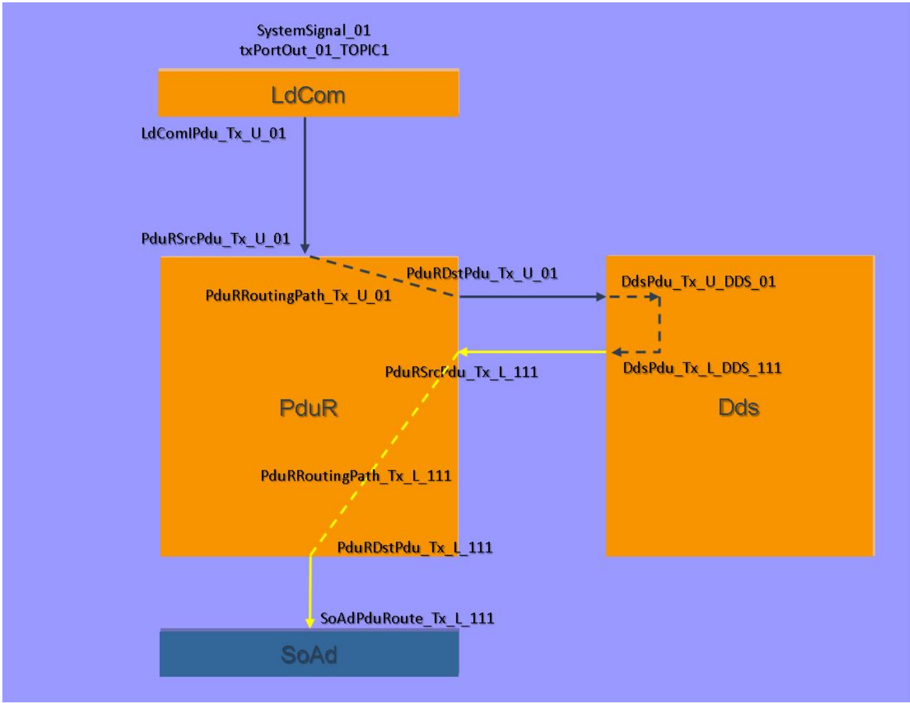

#### 6.1.1. QoS管理

**DDS BSW** 可以支持 **QoS** 策略的子集（甚至是空的）。没有强制实施的 QoS。实际支持哪种 **QoS** 策略是特定于供应商的。

每个实体都可以通过静态配置来定义自己的一组支持的 **QoS** 策略。

##### 6.1.1.1. TRANSPORT_PRIORITY QoS 映射

**DDS标准** 定义了特定数据写入器（**DataWriter**）的 **TRANSPORT_PRIORITY QoS**。其目的是允许应用程序利用能够发送具有不同优先级的消息的传输（可以选择 32 位有符号整数范围内的任何值；较高的值表示较高的优先级）。在 **AUTOSAR CP** 中，最接近传输优先级概念的信息是 SoAd 模块的 SoAdSocketConnectionGroup 父对象中定义的 SoAdSocketFramePriority 的值。这指定了为相关 SoAdConnectionGroup 拥有的所有 SoAdSocketConnection 处理的以太网帧的优先级。

不幸的是，**DDS模块** 的应用层（例如，上层 PDU 和 [DdsDataWriter](#9233171-ddsdatawriter)）与其传输层（例如，下层 PDU）之间没有直接链接。

换句话说：Dds 模块在运行时根据相应 [DdsDataWriter](#9233171-ddsdatawriter) 的配置选择下层 PDU。 如果有的话，Dds 模块应选择属于配置了所需 SoAdSocketFramePriority 的 SoAdSocketConnectionGroup 的 [DdsRtpsDataTxPdu](#9233112-ddsrtpsdatatxpdu)。

注意：TRANSPORT_PRIORITY QoS 被认为只是底层传输协议的提示。 该策略取决于底层传输为其发送的消息设置优先级的能力。

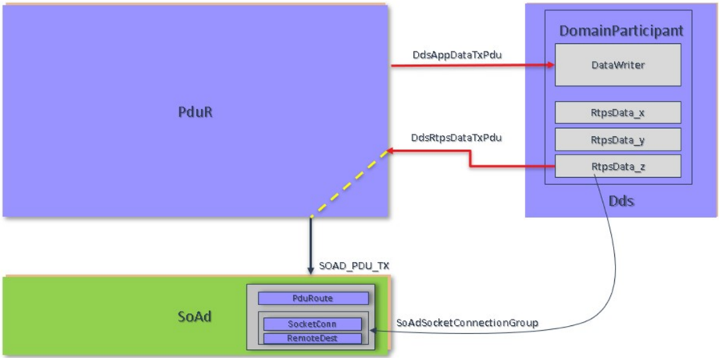

#### 6.1.2. 信息安全机制

在 **AP** 与 **CP** 之间、甚至在 **CP** 与非 **AUTOSAR** 平台之间打开通信路径可能带来安全风险，因此可能需要使用一些安全机制。

**Dds BSW** 模块通过使用 **DDS** 安全规范 [\[11\]](#ref-11) 来保证某些安全机制。使用该规范对于保证与其他 **DDS** 系统的互操作性（既包括 **AP**（其中已在使用 **DDS** 安全），也包括非 **AUTOSAR** 系统）是必要的。然而，实现该规范可能非常消耗资源。特别是在较慢的微控制器上使用时，这些功能需要硬件加速。为克服该问题，选择了一个可保证最低安全级别的 **DDS** 安全功能子集。

在此阶段，实现 **DDS** 安全的目标是保证消息认证、数据完整性和组认证。安全机制可以在配置时启用或禁用。若启用，则所有安全参数必须在预编译时静态配置。关于安全参数配置的详细信息，请参见 [9.2.3.3.1.4](#923314-ddsdomainparticipantcryptoinfo) 节。

若已配置，则会为整个 **RTPS** 消息添加消息认证码（**MAC**）。**AUTOSAR CSM** 用于密钥管理和 **MAC** 计算。使用哪种算法是可配置的（从受支持的算法中选择）。

用于散列算法的密钥是与某个 **DomainParticipant** 关联的实体之间共享的对称密钥，因此认证是在 **DomainParticipant** 级别完成的（而不是针对单个 **Publisher**/**Subscriber**，也不是针对单个 **DataWriter**/**DataReader**）。特定 **DomainParticipant** 所使用的对称密钥应直接由 **CSM** 管理，**CSM** 应向 **DDS** 提供用于使用其服务的句柄。

为上述目的，使用 **DDS** 加密插件（**DDS Cryptographic Plugin**），它提供保护整个 **RTPS** 消息的接口。应用安全之后得到的 **RTPS** 消息如下图所示。

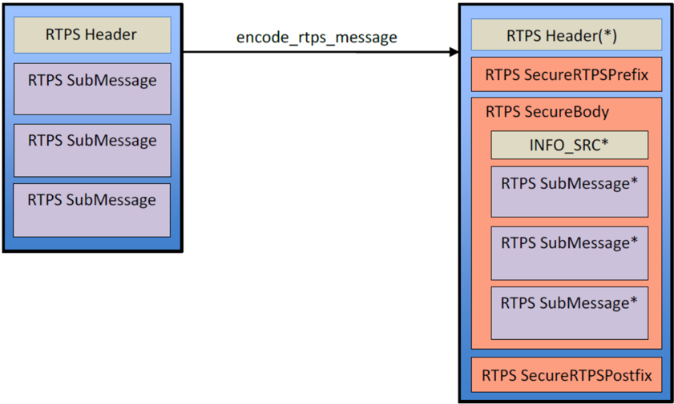

#### 6.1.3. 功能安全机制

根据 **ISO 26262**，在不同软件分区或不同 ECU 中执行的发送方与接收方之间的通信链路上，存在一组可被考虑的故障。

端到端保护的概念假定，与安全相关的数据交换应在运行时受到保护，以抵御通信链路内部故障的影响。**DDS** 规范具有内在的安全机制（计数器、**CRC**、**QoS** 策略），可用于支持功能安全论证。

以下是 [\[12\]](#ref-12) 中定义的、在追求功能安全过程中需要应对的可能故障列表，以及 **DDS** 为支持这些故障所提供的机制：

* **信息重复、丢失、插入、顺序错误、信息仅被部分接收方收到、以及阻塞对通信信道的访问**：子消息 64 位序列号（见 [\[6\]](#ref-6) 第 8.3.5.4 节 "SequenceNumber"），以及第 8.3.7 节 "RTPS Submessages" 中附加的 **SequenceNumber** 类型字段。这些机制仅能在接收方检测丢失；若还需在发送方检测，则应同时使用 **RELIABILITY** **DDS QoS**（定义于 [\[1\]](#ref-1) 第 2.2.3.14 节 "RELIABILITY"）。
* **信息延迟以及阻塞对通信信道的访问**：**LATENCY_BUDGET**、**DEADLINE** 和 **LIFESPAN** 服务质量策略，分别定义于 [\[1\]](#ref-1) 第 2.2.3.8 节 "LATENCY_BUDGET"、2.2.3.7 节 "DEADLINE" 和 2.2.3.16 节 "LIFESPAN"。
* **伪装或信息寻址错误**：**DDS** 安全认证插件（定义于 [\[11\]](#ref-11) 第 8.3 节 "Authentication Plugin"）。在该概念中，只能实现 **DomainParticipant** 级别的认证，因为属于同一 **DomainParticipant** 的所有实体共享相同的对称密钥。这可防止 **DomainParticipant** 之外的实体访问该 **DomainParticipant** 的通信，但无法区分在该 **DomainParticipant** 内部获准通信的两个不同实体。
* **信息损坏、发送方到多个接收方的非对称信息（仅对导致 **CRC** 无效的情况有效）**：**HeaderExtension** 子消息下的 **rtpsMessageChecksum**（[RTPS 2.5 或更高版本]）。若不具备该功能，[\[11\]](#ref-11) 还在其消息认证协议中内置了消息完整性验证。**CRC** 计算使用 **AUTOSAR CRC** 库。
* **这些故障条件的错误通知**：在任何通信错误或故障（甚至超时错误）的情况下，**Dds BSW** 都应通知 **Det** 模块。与安全相关的特定错误码详见 [6.2.3](#623-功能安全需求) 节。

### 6.2. 通用需求

根据 [\[1\]](#ref-1)，在同一个 **DDS Domain Participant** 内，主题（**Topic**）名称应是唯一的。

主题名称唯一性：在配置校验期间，如果属于同一个 [**DdsDomainParticipant**](#92331-ddsdomainparticipant) 的不同 [**DdsTopic**](#923319-ddstopic) 共享相同的名称，则应抛出校验错误。

#### 6.2.1. 通信需求

##### 6.2.1.1. 序列化需求

发送时，**Dds BSW** 模块以 [**DdsAppDataTxPdu**](#923111-ddsappdatatxpdu) 的形式接收上层模块产生的数据。上层模块将原始数据（例如字节流）转发给 **Dds BSW** 模块，也就是说，在调用 **Dds BSW** 模块之前不执行任何数据序列化或数据转换。**Dds BSW** 通过 **ImplementationDataType** 得知所接收数据的确切数据类型，并执行从原始数据到 **ImplementationDataType** 的类型转换，从而获得结构化数据。利用该结构化数据，**DDS** 执行自身的处理，将结果数据序列化为 **RTPS** 报文，然后将最终的 **RTPS** 报文保存到下层 **PDU** 中，以便转发给 **PduR**。

**Dds** 配置的校验应考虑其他转换器（**Transformer**）的配置。任何同时被映射到 [**DdsTopic**](#923319-ddstopic) 和转换器的 **ISignal** 都应被拒绝并视为无效。

**Dds BSW** 模块将给定的 [**DdsAppDataTxPdu**](#923111-ddsappdatatxpdu) 序列化为 **DDS** 线上互操作协议消息（[\[6\]](#ref-6)）。序列化后的 [**DdsAppDataTxPdu**](#923111-ddsappdatatxpdu) 被放入 [**DdsRtpsDataTxPdu**](#9233112-ddsrtpsdatatxpdu) 或 [**DdsRtpsMulticastDataTxPdu**](#9233121-ddsrtpsmulticastdatatxpdu)。此时由 **DDS** 中间件的内部策略决定使用哪个目标 **PDU**。

**Dds BSW** 应执行将 [**DdsAppDataTxPdu**](#923111-ddsappdatatxpdu) 序列化为 [**DdsRtpsDataTxPdu**](#9233112-ddsrtpsdatatxpdu) 或 [**DdsRtpsMulticastDataTxPdu**](#9233121-ddsrtpsmulticastdatatxpdu)。[**DdsDataWriter**](#9233171-ddsdatawriter) 所使用的 **PDU**（[**DdsRtpsDataTxPdu**](#9233112-ddsrtpsdatatxpdu) 或 [**DdsRtpsMulticastDataTxPdu**](#9233121-ddsrtpsmulticastdatatxpdu)）应在运行时根据 **DDS** 中间件的内部策略进行选择。

放入 [**DdsRtpsDataTxPdu**](#9233112-ddsrtpsdatatxpdu) 或 [**DdsRtpsMulticastDataTxPdu**](#9233121-ddsrtpsmulticastdatatxpdu) 的数据应符合 [\[6\]](#ref-6) 中定义的 **DDS** 线上互操作协议（**RTPS**）。为保证这种符合性，**Dds BSW** 模块应按上述文档 [\[13\]](#ref-13) 第 7.4.3.5 节定义的 **DDS** 标准序列化规则对负载进行序列化。

**Dds BSW** 模块应按 [\[13\]](#ref-13) 第 7.2.2.2 节中为等效 **DDS PRIMITIVE_TYPE** 定义的标准序列化规则，对 **AUTOSAR** 原始数据类型进行序列化。

表 7.1 给出了 **AUTOSAR CP** 平台原始数据类型所等效的 **DDS PRIMITIVE_TYPE**。关于 **AUTOSAR CP** 平台数据类型，请参见 [\[14\]](#ref-14) 第 8.2 章。

表 7.1：**AUTOSAR CP** 平台原始数据类型的序列化

| 类型 | DDS 类型 | 备注 |
| --- | --- | --- |
| boolean | Boolean | |
| uint8 | Byte | |
| uint16 | UInt16 | |
| uint32 | UInt32 | |
| uint64 | UInt64 | |
| sint8 | Byte | |
| sint16 | Int16 | |
| sint32 | Int32 | |
| sint64 | Int64 | |
| uint8_least | Byte | |
| uint16_least | UInt16 | |
| uint32_least | UInt32 | |
| sint8_least | Byte | |
| sint16_least | Int16 | |
| sint32_least | Int32 | |
| float32 | Float32 | |
| float64 | Float64 | |

**Dds BSW** 模块应按 [\[13\]](#ref-13) 第 7.2.2.4.1.1 节中为 **DDS ENUM_TYPE** 定义的标准序列化规则，对类别为 **ENUMERATION** 的 **ImplementationDataType**（参见 [\[4\]](#ref-4) 第 5.5.4 章）进行序列化。

**Dds BSW** 模块应按 [\[13\]](#ref-13) 第 7.2.2.4.3 节中为 **DDS ARRAY_TYPE** 定义的标准序列化规则，对类别为 **ARRAY** 的 **ImplementationDataType**（参见 [\[4\]](#ref-4) 第 5.3.4.4 章）进行序列化。

**Dds BSW** 模块应按 [\[13\]](#ref-13) 第 7.4.3.5 节中为 **DDS STRUCT_TYPE** 定义的标准序列化规则，对类别为 **STRUCTURE** 的 **ImplementationDataType**（参见 [\[4\]](#ref-4) 第 7.2.2.4.4.1 章）进行序列化。**Dds BSW** 模块应将结构的所有可选成员标记为可选（参见 [\[13\]](#ref-13) 第 7.2.2.4.4.5 节）。

类别为 **UNION** 的 **ImplementationDataType**（参见 [\[4\]](#ref-4) 第 7.2.2.4.4.2 章）不由 **Dds BSW** 管理。

如果某个 [**DdsTopic**](#923319-ddstopic) 链接的 **ImplementationDataType** 包含联合体（**union**），则 **Dds BSW** 配置校验应失败。

类别为 **POINTER** 的 **ImplementationDataType**（参见 [\[4\]](#ref-4) 第 7.2.2.4.6 章）不由 **Dds BSW** 管理。

如果某个 [**DdsTopic**](#923319-ddstopic) 链接的 **ImplementationDataType** 包含指针，则 **Dds BSW** 配置校验应失败。

**Dds BSW** 模块应按 [\[13\]](#ref-13) 第 7.4.1.1.2 节对字符串进行编码。

##### 6.2.1.2. 反序列化需求

在接收侧，下层模块将以 **RTPS** 报文形式序列化的 **DDS** 数据转发给 **Dds BSW** 模块。**Dds BSW** 模块以 [**DdsRtpsDataRxPdu**](#9233111-ddsrtpsdatarxpdu) 或 [**DdsRtpsMulticastDataRxPdu**](#9233122-ddsrtpsmulticastdatarxpdu) 的形式从下层模块接收 **DDS** 序列化数据。**Dds BSW** 模块借助所配置的 **ImplementationDataType** 构造结构化数据，执行自身的处理，然后将原始数据保存到上层 **PDU** 中，以便发送给上层模块。

在接收侧，**Dds BSW** 模块应按 **DDS** 线上互操作协议（[\[6\]](#ref-6)）将给定的 [**DdsRtpsDataRxPdu**](#9233111-ddsrtpsdatarxpdu) 反序列化为符合 **AUTOSAR** 的 **PDU**。反序列化后的 [**DdsRtpsDataRxPdu**](#9233111-ddsrtpsdatarxpdu) 或 [**DdsRtpsMulticastDataRxPdu**](#9233122-ddsrtpsmulticastdatarxpdu) 随后作为 [**DdsAppDataRxPdu**](#923121-ddsappdatarxpdu) 提供给上层。

##### 6.2.1.3. 发送队列管理

**Dds** 模块应提供 [**Dds_Transmit**](#733-dds_transmit) 函数，使 **PDU** 路由器能够发起上层 [**DdsAppDataTxPdu**](#923111-ddsappdatatxpdu) 的发送。调用时，[**Dds_Transmit**](#733-dds_transmit) 函数将收到的 **PDU** 保存到队列中，然后返回。

关于 [**Dds_Transmit**](#733-dds_transmit) **API** 的特定需求，请参见 [7.3.3](#733-dds_transmit) 节。

**Dds** 模块应管理一组内部队列，用于存储到达的发送方向的上层 **PDU**。

注意：队列的属性可通过 **DdsTxQueueSize** 和 **DdsTxQueueUnicastPduRef**/**DdsTxQueueMulticastPduRef** 进行配置。

发送函数（例如 **[Dds_MainFunction_Tx](#752-dds_mainfunction_tx)()**）应根据队列各自的周期确定发送队列的处理顺序。如果某些队列具有相同的周期值，则它们之间的相互顺序未定义。

对于每个队列，发送函数应根据所配置的处理算法对所接收数据执行全部 **DDS** 中间件处理（**QoS** 管理、功能安全与信息安全任务、序列化）。

发送队列应具有自己的处理周期。队列的特定周期应是 **DdsTxMainFunctionPeriod** 的整数倍。

队列处理的顺序应取决于所配置的 **DdsQueueAlgorithm**：

* **FIFO**：应先处理队列中最早接收到的发送方向的上层 **PDU**
* **LIFO**：应先处理队列中最晚接收到的发送方向的上层 **PDU**
* **VENDOR_SPECIFIC**：处理顺序未做规定

##### 6.2.1.4. 发送需求

**Dds** 模块应提供 **[Dds_MainFunction_Tx](#752-dds_mainfunction_tx)()** 函数，用于执行实际的 **DDS** 中间件处理（以及随后的 **PDU** 发送）。关于 **[Dds_MainFunction_Tx](#752-dds_mainfunction_tx)()** 的特定需求，请参见 [7.5.2](#752-dds_mainfunction_tx) 节。

**DDSI-RTPS** [\[6\]](#ref-6) 在发送 **RTPS** 消息时同时支持 **UDP** 单播和 **UDP** 多播。二者并不互斥：根据系统的通信设计约束（网络架构、性能、功能安全、信息安全等），在同一个域中可以只使用其中之一，也可以同时使用二者。为支持单播和多播地址，应正确配置 **SoAd**。

在配置校验期间，如果某个 [**DdsRtpsDataTxPdu**](#9233112-ddsrtpsdatatxpdu) 属于配置了多播 **SoAdSocketRemoteIpAddress** 的 **SoAdSocketConnection**，则应抛出校验错误。

在配置校验期间，如果某个 [**DdsRtpsMulticastDataTxPdu**](#9233121-ddsrtpsmulticastdatatxpdu) 属于配置了单播 **SoAdSocketRemoteIpAddress** 的 **SoAdSocketConnection**，则应抛出校验错误。

##### 6.2.1.5. 接收队列管理

**Dds** 模块应管理一组内部队列，用于存储到达的接收方向的下层 **PDU**。

注意：队列的属性可通过 **DdsRxQueueSize** 和 **DdsRxQueueUnicastPduRef**/**DdsRxQueueMulticastPduRef** 进行配置。

接收函数（例如 [**Dds_MainFunction_Rx**](#751-dds_mainfunction_rx)）应根据队列周期确定接收队列的处理顺序。如果某些队列具有相同的 **DdsRxQueuePeriod** 值，则它们之间的相互顺序未定义。

对于每个队列，接收函数应根据所配置的处理算法对所接收数据执行全部 **DDS** 中间件操作（**QoS** 管理、功能安全与信息安全任务、反序列化）。

接收队列应具有自己的处理周期。队列的特定周期应是 **DdsRxMainFunctionPeriod** 的整数倍。

队列处理的顺序应取决于所配置的算法：

* **FIFO**：应先处理队列中最早接收到的接收方向的下层 **PDU**
* **LIFO**：应先处理队列中最晚接收到的接收方向的下层 **PDU**
* **VENDOR_SPECIFIC**：处理顺序未做规定

##### 6.2.1.6. 接收需求

由以太网接口接收到的每个接收方向的下层 **PDU**，都通过 **SoAd** 交给 **PDU** 路由器。**PDU** 路由器通过调用 [**Dds_RxIndication**](#741-dds_rxindication) 回调将这些 **PDU** 路由到 **Dds** 接收接口。

关于 [**Dds_RxIndication**](#741-dds_rxindication) **API** 的特定需求，请参见 [7.4.1](#741-dds_rxindication) 节。

与发送类似，**DDSI-RTPS** [\[6\]](#ref-6) 在接收 **RTPS** 消息时也同时支持 **UDP** 单播和 **UDP** 多播。二者同样并不互斥：根据系统的通信设计约束（网络架构、性能、功能安全、信息安全等），在同一个域中可以只使用其中之一，也可以同时使用二者。

为支持单播和多播地址，应正确配置 **SoAd**。

在配置校验期间，如果某个 [**DdsRtpsDataRxPdu**](#9233111-ddsrtpsdatarxpdu) 属于配置了多播 **SoAdSocketLocalAddressRef** 的 **SoAdSocketConnectionGroup**，则应抛出校验错误。

在配置校验期间，如果某个 [**DdsRtpsMulticastDataRxPdu**](#9233122-ddsrtpsmulticastdatarxpdu) 属于配置了单播 **SoAdSocketLocalAddressRef** 的 **SoAdSocketConnectionGroup**，则应抛出校验错误。

##### 6.2.1.7. 时序需求

如有需要，**DDS** 中间件应通过调用 **StbM_GetCurrentTime()** **API** 来获取时间戳。

**RTPS** 报文所需的时间戳应由 **StbM_GetCurrentTime()** 这一 **StbM** **API** 提供。

注意：**AUTOSAR Dds** 模块不负责为接收或发送的 **PDU** 打时间戳，该职责属于 **DDS** 中间件。

#### 6.2.2. 信息安全需求

为与其他 **DDS** 系统兼容并互通，**Dds BSW** 模块应通过使用 **DDS** 安全规范 [\[11\]](#ref-11) 来实现安全机制。

**Dds BSW** 模块应通过在待发送消息中添加消息认证码（**MAC**），保证 **DomainParticipant** 级别的数据完整性和消息认证；该 **MAC** 使用对称密钥算法计算。所得消息仍应符合 **DDSI-RTPS**。

**Dds BSW** 应为每个 **DomainParticipant** 配置对所需每个 **CSM** 作业的引用：一个用于计算 **MAC** 的作业（**DdsDomainParticipantCsmAuthenticateJob**），以及一个用于校验所接收消息 **MAC** 的作业（**DdsDomainParticipantCsmVerifyJob**）。关于配置细节，请参见 [**DdsDomainParticipantCryptoInfo**](#923314-ddsdomainparticipantcryptoinfo)。在发送侧，**Dds BSW** 应将 **DdsDomainParticipantCsmAuthenticateJob** 计算所得的 **MAC** 添加到该 **DomainParticipant** 的每条消息中。在接收侧，**Dds BSW** 应校验 **DdsDomainParticipantCsmVerifyJob** 的结果。

**CSM** 作业 **DdsDomainParticipantCsmAuthenticateJob** 应配置为调用 **Csm_MacGenerate**，而 **DdsDomainParticipantCsmVerifyJob** 应配置为调用 **Csm_MacVerify**。

如果同一个 [**DdsDomainParticipant**](#92331-ddsdomainparticipant) 相关的 **DdsDomainParticipantCsmAuthenticateJob**/**DdsDomainParticipantCsmVerifyJob** 链接的 **CSM** 作业未分别配置 **Csm_MacGenerate** 和 **Csm_MacVerify**，则 **Dds BSW** 配置校验应失败。

关于配置细节，请参见 [**DdsDomainParticipantCryptoInfo**](#923314-ddsdomainparticipantcryptoinfo)。

与单个 **DomainParticipant** 相关的每一对 **CSM** 认证/校验作业，都应使用相同的密钥（仅支持对称密钥算法）。对于每个 **DomainParticipant**，所使用的 **CSM** 作业应配置相同的密钥。

如果同一个 [**DdsDomainParticipant**](#92331-ddsdomainparticipant) 相关的 **DdsDomainParticipantCsmAuthenticateJob**/**DdsDomainParticipantCsmVerifyJob** 链接的 **CSM** 作业未配置相同的密钥，则 **Dds BSW** 配置校验应失败。

关于配置细节，请参见 [**DdsDomainParticipantCryptoInfo**](#923314-ddsdomainparticipantcryptoinfo)。

如果 **MAC** 计算失败（例如 **Csm_MacGenerate()** 或 **Csm_MacVerify()** 返回任何错误），则 **Dds BSW** 模块应使用运行时错误码 [**DDS_E_CSM_LIBRARY_ERROR**](#632-运行时错误) 调用 **Det_ReportRuntimeError()** **API**，并丢弃待发送的消息。

在这种情况下，发送期间 **Dds BSW** 应以 result = **E_NOT_OK** 调用 **PduR_DdsTxConfirmation** 函数。

在接收侧，如果 **MAC** 校验失败，则 **Dds BSW** 模块应使用运行时错误码 [**DDS_E_CSM_CHECK_FAILED**](#632-运行时错误) 调用 **Det_ReportRuntimeError()** **API**，并丢弃该消息。

#### 6.2.3. 功能安全需求

**Dds BSW** 模块应使用带计数器的子消息（例如 **AckNack**、**Data**、**DataFrag** 等），以保证针对信息重复或插入故障的安全机制。在接收侧，如果收到计数器重复的消息，**Dds BSW** 模块应丢弃该消息，并使用运行时错误码 [**DDS_E_SAMPLE_REJECTED**](#632-运行时错误) 调用 **Det_ReportRuntimeError()** **API**。

**Dds BSW** 模块应使用带计数器的子消息（例如 **AckNack**、**Data**、**DataFrag** 等），以保证针对信息丢失或顺序错误故障的安全机制。在接收侧，如果收到计数器不连续的消息，**Dds BSW** 模块应丢弃该消息，并使用运行时错误码 [**DDS_E_SAMPLE_LOST**](#632-运行时错误) 调用 **Det_ReportRuntimeError()** **API**。

**Dds BSW** 模块应使用能够监控超时的 **QoS**（例如 **DEADLINE**、**LATENCY_BUDGET**、**LIFESPAN** 和 **TIME_BASED_FILTER**，分别参见 [**DdsDeadline**](#92347-ddsdeadline)、[**DdsLatencyBudget**](#92348-ddslatencybudget)、[**DdsLifespan**](#923416-ddslifespan) 和 [**DdsTimeBasedFilter**](#923412-ddstimebasedfilter)），以保证针对信息延迟故障的安全机制（关于这些 **QoS** 策略的详细信息请参见 [\[1\]](#ref-1)）。

在发送侧，如果某项时序约束未被满足，则 **Dds BSW** 模块应丢弃该消息，并使用运行时错误码 [**DDS_E_SENDER_TIMING_MISSED**](#632-运行时错误) 调用 **Det_ReportRuntimeError()** **API**。

在接收侧，如果某项时序约束未被满足，则 **Dds BSW** 模块应丢弃该消息，并使用运行时错误码 [**DDS_E_RECEIVER_TIMING_MISSED**](#632-运行时错误) 调用 **Det_ReportRuntimeError()** **API**。

**Dds BSW** 模块应使用 **CRC** 校验来保证针对信息损坏故障的安全机制。

在接收侧，如果 **CRC** 校验失败，则 **Dds BSW** 模块应使用运行时错误码 [**DDS_E_CRC_CHECK_FAILED**](#632-运行时错误) 调用 **Det_ReportRuntimeError()** **API**，并丢弃该消息。

### 6.3. 错误分类

文档 "基础软件模块通用规范" [\[3\]](#ref-3) 第 7.2 章 "错误处理" 详细描述了基础软件的错误处理。首先，它构成了一个由 **BSW** 模块中可能出现的五种错误类型组成的分类方案。

在此基础上，以下各小节按各自的错误类型规定了具体的错误。

#### 6.3.1. 开发错误

| 错误类型 | 相关错误码 | 错误值 |
| --- | --- | --- |
| 模块未初始化 | DDS_E_UNINIT | 0x00 |
| 作为参数传入了空指针 | DDS_E_PARAM_POINTER | 0x02 |
| 无效的上层 **PduId** | DDS_E_U_PDUID_INVALID | 0x03 |
| 无效的下层 **PduId** | DDS_E_L_PDUID_INVALID | 0x04 |

#### 6.3.2. 运行时错误

| 错误类型 | 相关错误码 | 错误值 |
| --- | --- | --- |
| 上层模块请求被拒绝 | DDS_E_U_PDUID_REJECTED | 0x10 |
| 下层模块通知被忽略 | DDS_E_L_PDUID_IGNORED | 0x11 |
| **CSM** 库错误 | DDS_E_CSM_LIBRARY_ERROR | 0x30 |
| **CSM** 校验错误 | DDS_E_CSM_CHECK_FAILED | 0x40 |
| **CRC** 校验失败 | DDS_E_CRC_CHECK_FAILED | 0x41 |
| 样本被拒绝 | DDS_E_SAMPLE_REJECTED | 0x42 |
| 样本丢失 | DDS_E_SAMPLE_LOST | 0x43 |
| 接收侧未满足时序约束 | DDS_E_RECEIVER_TIMING_MISSED | 0x44 |
| 发送侧未满足时序约束 | DDS_E_SENDER_TIMING_MISSED | 0x45 |
| 内部错误 | DDS_INTERNAL_ERROR | 0x46 |

#### 6.3.3. 生产错误

无生产错误。

#### 6.3.4. 扩展生产错误

无扩展生产错误。

## 7. API规范

### 7.1. 导入的类型

本章列出从以下文件中包含的全部类型。

| 模块 | 头文件 | 导入的类型 |
| --- | --- | --- |
| ComStack_Types | ComStack_Types.h | PduIdType |
| ComStack_Types | ComStack_Types.h | PduInfoType |
| ComStack_Types | ComStack_Types.h | PduLengthType |
| Csm | Rte_Csm_Type.h | Crypto_OperationModeType |
| Csm | Rte_Csm_Type.h | Crypto_VerifyResultType |
| StbM | Rte_StbM_Type.h | StbM_SynchronizedTimeBaseType |
| StbM | Rte_StbM_Type.h | StbM_TimeBaseStatusType |
| StbM | Rte_StbM_Type.h | StbM_TimeStampType |
| StbM | Rte_StbM_Type.h | StbM_TimeTupleType |
| StbM | Rte_StbM_Type.h | StbM_UserDataType |
| StbM | StbM.h | StbM_VirtualLocalTimeType |
| Std | Std_Types.h | Std_ReturnType |
| Std | Std_Types.h | Std_VersionInfoType |

### 7.2. 类型定义

#### 7.2.1. Dds_ConfigType

**说明**: 包含 **Dds** 初始化数据的数据结构。种类为结构体，元素为实现特定。该数据结构的内容是实现特定的。可通过**Dds.h**获得。

### 7.3. 函数定义

以下为提供给上层模块的函数列表。

#### 7.3.1. Dds_Init

**说明**: 初始化 **AUTOSAR Dds** 层的接口和变量。本服务为同步调用，不可重入。参数 Dds_ConfigPtr（in）：指向所选配置结构的指针。该服务无返回值。可通过**Dds.h**获得。

```C
void Dds_Init ( const Dds_ConfigType* Dds_ConfigPtr )
```

函数 **Dds_Init** 应根据配置初始化所有模块相关的变量和常量。

函数 **Dds_Init** 应将所有实体初始化为 "**enabled**" 状态。

函数 **Dds_Init** 应清空所有内部队列。

#### 7.3.2. Dds_GetVersionInfo

**说明**: 返回本模块的版本信息。本服务为同步调用，可重入。参数 versioninfo（out）：指向用于存放本模块版本信息的位置的指针。该服务无返回值。可通过**Dds.h**获得。

```C
void Dds_GetVersionInfo ( Std_VersionInfoType* versioninfo )
```

如果 **Dds** 模块的开发错误检测已启用，则函数 **Dds_GetVersionInfo** 应检查参数 **versioninfo** 是否为 **NULL_PTR**。如果 **versioninfo** 为空指针，则函数 **Dds_GetVersionInfo** 应报告开发错误 [**DDS_E_PARAM_POINTER**](#631-开发错误)。

#### 7.3.3. Dds_Transmit

**说明**: 请求发送一条消息。本服务为同步调用，对于不同的 **PduId** 可重入，对于同一 **PduId** 不可重入。参数 TxPduId（in）：待发送 **PDU** 的标识。参数 PduInfoPtr（in）：**PDU** 数据的长度与指针，以及元数据的指针。返回值 [Std_ReturnType](#71-导入的类型)：**E_OK** 表示发送请求已被接受；**E_NOT_OK** 表示发送请求未被接受。可通过**Dds.h**获得。

```C
Std_ReturnType Dds_Transmit ( PduIdType TxPduId, const PduInfoType* PduInfoPtr )
```

如果开发错误检测已启用，且函数调用因以下原因失败，则函数 **Dds_Transmit** 应调用 **Det_ReportError**：

- **Dds** 模块未初始化（[**DDS_E_UNINIT**](#631-开发错误)）
- PduInfoPtr 等于 **NULL_PTR**（[**DDS_E_PARAM_POINTER**](#631-开发错误)）
- 上层 **TxPduId** 无效（[**DDS_E_U_PDUID_INVALID**](#631-开发错误)）

如果上层模块的发送请求无法被接受，或相应的发送队列已满，则 **Dds_Transmit** 应使用运行时错误码 [**DDS_E_U_PDUID_REJECTED**](#632-运行时错误) 调用 **Det_ReportRuntimeError**，然后返回 **E_NOT_OK**。

如果上层模块的发送请求可以被接受，则 **Dds_Transmit** 应将待发送的上层 **PDU** 存入相应的发送队列，更新指示新 **PDU** 存放位置的队列偏移量，并返回 **E_OK**。

### 7.4. 回调通知

以下为提供给其他模块的函数列表。

#### 7.4.1. Dds_RxIndication

**说明**: 指示从 **PDU** 路由器接口模块接收到一个 **PDU**。本服务为同步调用，对于不同的 **PduId** 可重入，对于同一 **PduId** 不可重入。参数 RxPduId（in）：所接收 **PDU** 的 ID。参数 PduInfoPtr（in）：包含所接收 **PDU** 的长度（**SduLength**）、指向包含该 **PDU** 的缓冲区指针（**SduDataPtr**），以及与该 **PDU** 相关的元数据。该服务无返回值。可通过**Dds.h**获得。

```C
void Dds_RxIndication ( PduIdType RxPduId, const PduInfoType* PduInfoPtr )
```

如果开发错误检测已启用，且函数调用因以下原因失败，则函数 **Dds_RxIndication** 应调用 **Det_ReportError**：

- **Dds** 模块未初始化（[**DDS_E_UNINIT**](#631-开发错误)）
- PduInfoPtr 等于 **NULL_PTR**（[**DDS_E_PARAM_POINTER**](#631-开发错误)）
- 下层 **RxPduId** 无效（[**DDS_E_L_PDUID_INVALID**](#631-开发错误)）

如果接收方向的下层 **PDU** 无法被接受，或相应的内部队列已满，则 **Dds_RxIndication** 应使用运行时错误码 [**DDS_E_L_PDUID_IGNORED**](#632-运行时错误) 调用 **Det_ReportRuntimeError**，然后返回。

如果接收方向的下层 **PDU** 可以被接受，则 **Dds_RxIndication** 应将此 **PDU** 存入相应的内部队列，然后返回。

#### 7.4.2. Dds_TxConfirmation

**说明**: **PDU** 路由器接口模块确认一个 **PDU** 的发送，或发送失败。本服务为同步调用，对于不同的 **PduId** 可重入，对于同一 **PduId** 不可重入。参数 TxPduId（in）：已发送 **PDU** 的 ID。参数 result（in）：**E_OK** 表示该 **PDU** 已发送；**E_NOT_OK** 表示该 **PDU** 发送失败。该服务无返回值。可通过**Dds.h**获得。

```C
void Dds_TxConfirmation ( PduIdType TxPduId, Std_ReturnType result )
```

如果开发错误检测已启用，且函数调用因以下原因失败，则函数 **Dds_TxConfirmation** 应调用 **Det_ReportError**：

- **Dds** 模块未初始化（[**DDS_E_UNINIT**](#631-开发错误)）
- 下层 **TxPduId** 无效（[**DDS_E_L_PDUID_INVALID**](#631-开发错误)）

**Dds_TxConfirmation** 应使用相同的输入参数调用 **PduR_DdsTxConfirmation**，然后返回。

#### 7.4.3. Dds_TriggerTransmit

**说明**: 在该 **API** 中，上层模块（被调用模块）应检查可用数据是否适合 **PduInfoPtr->SduLength** 所报告的缓冲区大小。如果适合，则应将其数据复制到 **PduInfoPtr->SduDataPtr** 提供的缓冲区中，并更新 **PduInfoPtr->SduLength** 中实际复制的数据长度。如果不适合，则应在不修改 **PduInfoPtr** 的情况下返回 **E_NOT_OK**。本服务为同步调用，对于不同的 **PduId** 可重入，对于同一 **PduId** 不可重入。参数 TxPduId（in）：请求发送的 **SDU** 的 ID。参数 PduInfoPtr（inout）：包含指向应复制 **SDU** 数据的缓冲区指针（**SduDataPtr**），以及以 **SduLength** 表示的可用缓冲区大小；返回时，服务将在 **SduLength** 中指示所复制 **SDU** 数据的长度。返回值 [Std_ReturnType](#71-导入的类型)：**E_OK** 表示 **SDU** 已复制，**SduLength** 指示所复制的字节数；**E_NOT_OK** 表示未复制任何 **SDU** 数据，此时不得使用 **PduInfoPtr**，因为它可能包含空指针或指向无效数据。可通过**Dds.h**获得。

```C
Std_ReturnType Dds_TriggerTransmit ( PduIdType TxPduId, PduInfoType* PduInfoPtr )
```

如果开发错误检测已启用，且函数调用因以下原因失败，则函数 **Dds_TriggerTransmit** 应调用 **Det_ReportError**：

- **Dds** 模块未初始化（[**DDS_E_UNINIT**](#631-开发错误)）
- PduInfoPtr 等于 **NULL_PTR**（[**DDS_E_PARAM_POINTER**](#631-开发错误)）
- 下层 **TxPduId** 无效（[**DDS_E_L_PDUID_INVALID**](#631-开发错误)）

在函数 **Dds_TriggerTransmit** 中，**Dds BSW** 应将其 **PDU** 发送缓冲区的内容复制到 **PduInfoPtr->SduDataPtr** 给定的 **PDU** 缓冲区，并相应地用所复制数据的长度更新 **PduInfoPtr->SduLength**。

如果针对同一 **PduId** 的另一个 **Dds_TriggerTransmit** 请求尚未完成，则函数 **Dds_TriggerTransmit** 应使用错误码 [**DDS_E_L_PDUID_IGNORED**](#632-运行时错误) 调用 **Det_ReportRuntimeError**。

**Dds** 配置的校验应考虑 **LdCom** 的配置。如果属于 **Dds BSW** 的任何 **PDU** 具有非 **NULL** 的 **LdComTxTriggerTransmit** 值，则该配置应被拒绝并视为无效。

理由：**Dds_TriggerTransmit** 函数只能由下层模块调用。

### 7.5. 调度函数

以下函数由基础软件调度器直接调用。它们没有返回值，也没有参数。所有函数都应不可重入。

#### 7.5.1. Dds_MainFunction_Rx

**说明**: **Dds** 模块用于接收的调度函数。本服务由基础软件调度器直接调用，无参数、无返回值。可通过**SchM_Dds.h**获得。

```C
void Dds_MainFunction_Rx ( void )
```

如果在 **Dds_MainFunction_Rx** 的处理过程中发生任何错误或违例，则 **Dds_MainFunction_Rx** 应使用 **DDS_INTERNAL_ERROR** 错误码调用 **Det_ReportRuntimeError**，丢弃所接收数据并返回。

如果在 **Dds_MainFunction_Rx** 的处理过程中一切正常，则 **Dds_MainFunction_Rx** 应找到用于管理数据接收的相应读取器，并以得到的上层 **PDU** 作为输入参数调用 **PduR_DdsRxIndication**。

#### 7.5.2. Dds_MainFunction_Tx

在 **Dds_MainFunction_Tx** 函数中，应执行用于发送的全部 **DDS** 中间件处理。**DDS** 的内部处理不属于本规范的范畴：它是供应商特定的（只要实现符合 **DDS OMG** 规范 [\[1\]](#ref-1)）。以下小节给出用于规定 **AUTOSAR API** 的所需需求。

**说明**: **Dds** 模块用于发送的调度函数。本服务由基础软件调度器直接调用，无参数、无返回值。可通过**SchM_Dds.h**获得。

```C
void Dds_MainFunction_Tx ( void )
```

如果在 **Dds_MainFunction_Tx** 的处理过程中发生任何错误或违例，则 **Dds_MainFunction_Tx** 应使用 **DDS_INTERNAL_ERROR** 错误码调用 **Det_ReportRuntimeError**，应以 result = **E_NOT_OK** 调用 **PduR_DdsTxConfirmation**，丢弃所接收数据并返回。

如果在 **Dds_MainFunction_Tx** 的处理过程中一切正常，则 **Dds_MainFunction_Tx** 应找到用于管理数据发送的相应写入器，并以得到的下层 **PDU** 作为输入参数调用 **PduR_DdsTransmit**。

### 7.6. 期望接口

本章列出从其他模块所需的全部接口。

#### 7.6.1. 必需接口

| API 函数 | 头文件 | 描述 |
| --- | --- | --- |
| Det_ReportError | Det.h | 用于报告开发错误的服务。 |
| Det_ReportRuntimeError | Det.h | 用于报告运行时错误的服务。如果已配置回调（**callout**），则应调用该回调。 |
| PduR_DdsRxIndication | PduR_Dds.h | 指示从下层通信接口模块接收到一个 **PDU**。 |
| PduR_DdsTransmit | PduR_Dds.h | 请求发送一个 **PDU**。 |
| PduR_DdsTxConfirmation | PduR_Dds.h | 下层通信接口模块确认一个 **PDU** 的发送，或发送失败。 |

#### 7.6.2. 可选接口

| API 函数 | 头文件 | 描述 |
| --- | --- | --- |
| Crc_CalculateCRC32 | Crc.h | 该服务对长度为 **Crc_Length** 的数据字节计算 **CRC32**。 |
| Crc_CalculateCRC64 | Crc.h | 该服务对长度为 **Crc_Length** 的数据字节计算 **CRC64**，使用多项式 0x42F0E1EBA9EA3693。该 **CRC** 例程由 **E2E** 配置文件 7 使用。 |
| Csm_MacGenerate | Csm.h | 使用给定数据执行 **MAC** 生成，并将 **MAC** 存储到 **MAC** 指针所指向的内存位置。 |
| Csm_MacVerify | Csm.h | 通过比较以给定数据生成的 **MAC** 来校验给定的 **MAC**。 |
| StbM_GetCurrentTime | StbM.h | 返回时间元组（本地时间、全局时间和时基状态）以及用户数据详情。注意：该 **API** 应在锁定中断/在独占区内调用，以避免中断（即避免函数返回时时间戳已过期的风险）。 |

#### 7.6.3. 可配置接口

无。

## 8. 时序图

### 8.1. 发送

#### 8.1.1. Dds 消息发送

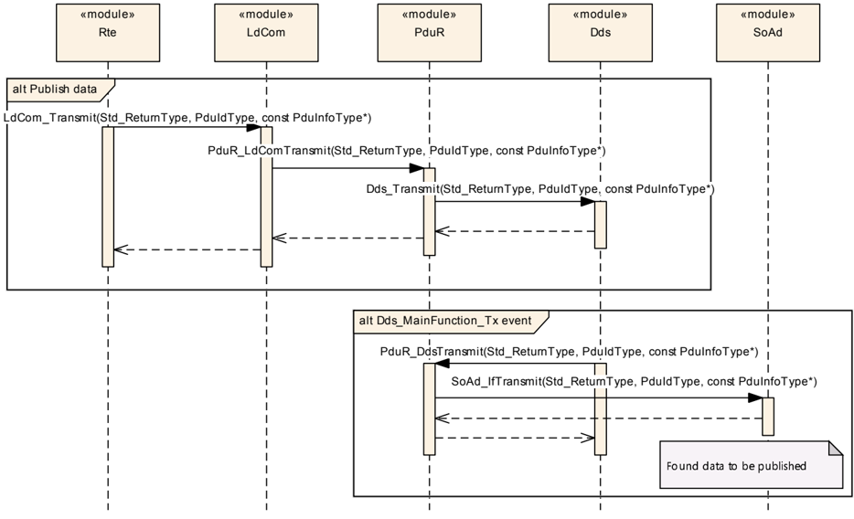

#### 8.1.2. Dds 消息发送确认

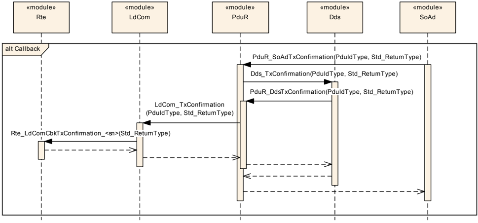

### 8.2. 接收

#### 8.2.1. Dds 接收指示事件

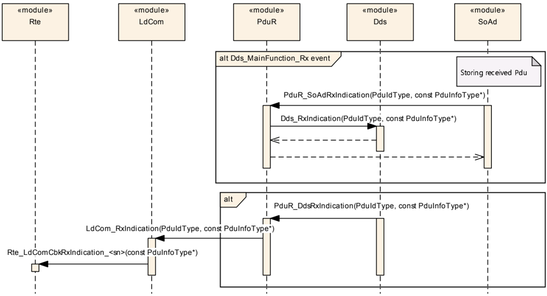

## 9. 配置规范

本章总体上规定了配置参数及其向容器的聚簇方式。为便于理解，9.1 节描述了基础知识，并规定了参数规范所使用的模板（表格）。将其保留在规范中有助于保证可理解性。

9.2 节规定了 **Dds** 模块的结构（容器）及其参数。

9.3 节规定了 **Dds** 模块的发布信息。

配置规范的阅读方式、参数表的各列含义（**SWS** 条目、参数名称、父容器、描述、多重性、类型、取值范围、默认值、Post-Build 变体值、值配置类、作用域/依赖）以及 **ECUC** 参数的通用约定，请参见 [3, SWS BSW General] 第 10.1 章 "配置规范简介"。

### 9.1. 如何阅读本章

有关详细信息，请参见 [3, SWS BSW General] 第 10.1 章 "配置规范简介"。

### 9.2. 容器和配置参数

以下各小节汇总了全部配置参数。

#### 9.2.1. Dds

| SWS 条目 | [ECUC_Dds_00001] |
| --- | --- |
| 模块名称 | Dds |
| 描述 | **Dds** 模块的配置。 |
| Post-Build 变体支持 | true |
| 支持的配置变体 | VARIANT-POST-BUILD, VARIANT-PRE-COMPILE |

**包含的容器**

| 容器名称 | 多重性 | 作用域/依赖 |
| --- | --- | --- |
| DdsConfig | 1 | 该容器包含 **AUTOSAR Dds** 模块的配置参数和子容器。 |
| DdsGeneral | 1 | 该容器列出 **Dds** 模块的通用配置参数。 |

下图给出 **Dds BSW** 的 **UML** 图：

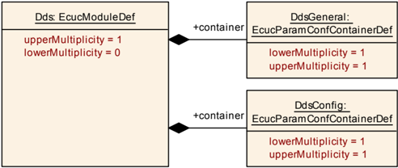

#### 9.2.2. DdsGeneral

| SWS 条目 | [ECUC_Dds_00002] |
| --- | --- |
| 容器名称 | DdsGeneral |
| 父容器 | Dds |
| 描述 | 该容器列出 **Dds** 模块的通用配置参数。 |

| SWS 条目 | [ECUC_Dds_00003] |
| --- | --- |
| 参数名称 | DdsDevErrorDetect |
| 父容器 | DdsGeneral |
| 描述 | 打开或关闭开发错误检测与通知。true：启用检测与通知；false：禁用检测与通知。 |
| 多重性 | 1 |
| 类型 | EcucBooleanParamDef |
| 取值范围 | - |
| 默认值 | false |
| Post-Build 变体值 | false |
| 值配置类 | Pre-compile time：X（All Variants）；Link time：-；Post-build time：- |
| 作用域/依赖 | scope: local |

| SWS 条目 | [ECUC_Dds_00004] |
| --- | --- |
| 参数名称 | DdsMainRxFunctionPeriod |
| 父容器 | DdsGeneral |
| 描述 | 该参数定义 **Dds_MainFunction_Rx** 周期性调用的周期时间，单位为秒。 |
| 多重性 | 1 |
| 类型 | EcucFloatParamDef |
| 取值范围 | ]0 .. INF[ |
| 默认值 | - |
| Post-Build 变体值 | false |
| 值配置类 | Pre-compile time：X（All Variants）；Link time：-；Post-build time：- |
| 作用域/依赖 | scope: local |

| SWS 条目 | [ECUC_Dds_00127] |
| --- | --- |
| 参数名称 | DdsMainTxFunctionPeriod |
| 父容器 | DdsGeneral |
| 描述 | 该参数定义 **Dds_MainFunction_Tx** 周期性调用的周期时间，单位为秒。 |
| 多重性 | 1 |
| 类型 | EcucFloatParamDef |
| 取值范围 | ]0 .. INF[ |
| 默认值 | - |
| Post-Build 变体值 | false |
| 值配置类 | Pre-compile time：X（All Variants）；Link time：-；Post-build time：- |
| 作用域/依赖 | scope: local |

| SWS 条目 | [ECUC_Dds_00128] |
| --- | --- |
| 参数名称 | DdsSynchronizedTimeBaseRef |
| 父容器 | DdsGeneral |
| 描述 | 对 **StbM** 同步时基的引用。 |
| 多重性 | 0..1 |
| 类型 | 对 StbMSynchronizedTimeBase 的符号名引用 |
| 取值范围 | - |
| 默认值 | - |
| Post-Build 变体值 | false |
| 值配置类 | Pre-compile time：X（All Variants）；Link time：-；Post-build time：- |
| 作用域/依赖 | scope: ECU |

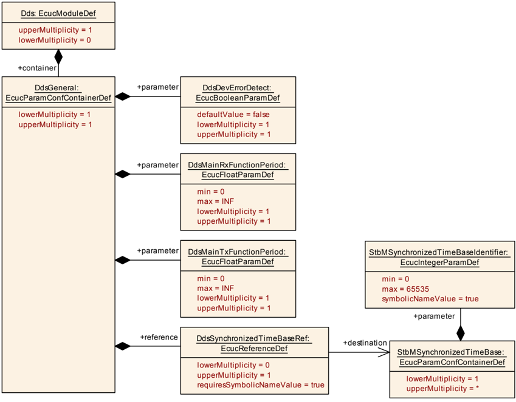

#### 9.2.3. DdsConfig

| SWS 条目 | [ECUC_Dds_00005] |
| --- | --- |
| 容器名称 | DdsConfig |
| 父容器 | Dds |
| 描述 | 该容器包含 **AUTOSAR Dds** 模块的配置参数和子容器。 |

**包含的容器**

| 容器名称 | 多重性 | 作用域/依赖 |
| --- | --- | --- |
| DdsAppDataTxPduCollection | 0..1 | 面向应用层的上层 Tx **PDU** 集合。 |
| DdsAppDataRxPduCollection | 0..1 | 面向应用层的上层 Rx **PDU** 集合。 |
| DdsRxQueueCollection | 0..1 | Rx 队列的集合。 |
| DdsTxQueueCollection | 0..1 | Tx 队列的集合。 |
| DdsDomainParticipantCollection | 0..1 | **DDS Domain Participant** 的集合。 |
| DdsQoSPolicies | 0..1 | 该容器包含 **Dds** 模块所支持的 **QoS** 策略的配置。 |

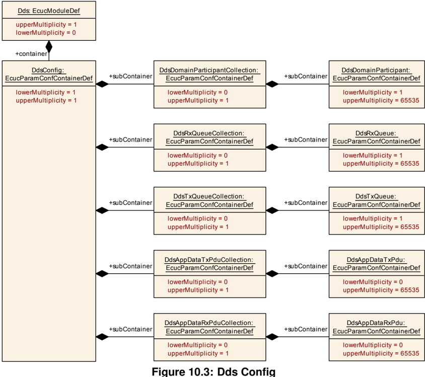

##### 9.2.3.1. DdsAppDataPduCollection

**DdsAppDataTxPduCollection** 和 **DdsAppDataRxPduCollection** 容器对应用层与 **Dds** 模块之间交互所使用的全部上层 **PDU**（分别为 Tx 和 Rx）池进行建模。它们只是一个唯一的定义点，用于集中定义全部上层 **PDU**（它们只是容器的容器）。

下图给出 **DdsAppDataTxPduCollection** 和 **DdsAppDataRxPduCollection** 的 **UML** 图：

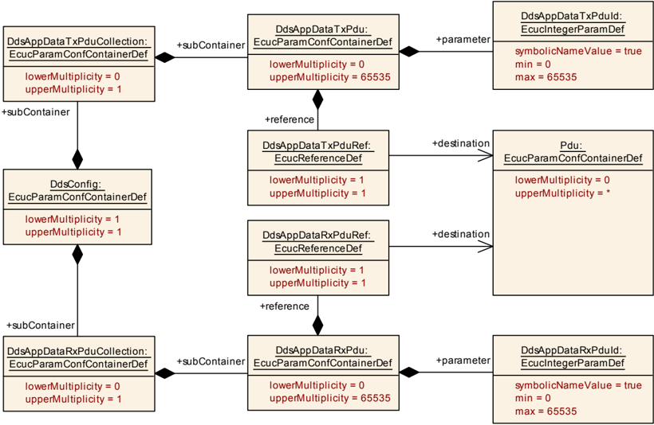

###### 9.2.3.1.1. DdsAppDataTxPduCollection

| SWS 条目 | [ECUC_Dds_00131] |
| --- | --- |
| 容器名称 | DdsAppDataTxPduCollection |
| 父容器 | DdsConfig |
| 描述 | 面向应用层的上层 Tx **PDU** 集合。 |

**包含的容器**

| 容器名称 | 多重性 | 作用域/依赖 |
| --- | --- | --- |
| DdsAppDataTxPdu | 0..* | 用于将数据从应用发送到 **DDS** 本身的上层 **PDU**。 |

###### 9.2.3.1.1.1. DdsAppDataTxPdu

| SWS 条目 | [ECUC_Dds_00132] |
| --- | --- |
| 容器名称 | DdsAppDataTxPdu |
| 父容器 | DdsAppDataTxPduCollection |
| 描述 | 用于将数据从应用发送到 **DDS** 本身的上层 **PDU**。 |

| SWS 条目 | [ECUC_Dds_00133] |
| --- | --- |
| 参数名称 | DdsAppDataTxPduId |
| 父容器 | DdsAppDataTxPdu |
| 描述 | 当前 **PDU** 的本地 ID。 |
| 多重性 | 1 |
| 类型 | EcucIntegerParamDef（为该参数生成的符号名） |
| 取值范围 | 0 .. 65535 |
| 默认值 | - |
| Post-Build 变体值 | false |
| 值配置类 | Pre-compile time：X（All Variants）；Link time：-；Post-build time：- |
| 作用域/依赖 | scope: ECU |

| SWS 条目 | [ECUC_Dds_00134] |
| --- | --- |
| 参数名称 | DdsAppDataTxPduRef |
| 父容器 | DdsAppDataTxPdu |
| 描述 | 对 **AUTOSAR ECU** 配置规范所描述的全局 **PDU** 结构中某个 **PDU** 的引用。**Dds** 模块使用该引用推导 **PDU** ID。 |
| 多重性 | 1 |
| 类型 | 对 Pdu 的引用 |
| 取值范围 | - |
| 默认值 | - |
| Post-Build 变体值 | false |
| 值配置类 | Pre-compile time：X（All Variants）；Link time：-；Post-build time：- |
| 作用域/依赖 | scope: ECU |

###### 9.2.3.1.2. DdsAppDataRxPduCollection

| SWS 条目 | [ECUC_Dds_00178] |
| --- | --- |
| 容器名称 | DdsAppDataRxPduCollection |
| 父容器 | DdsConfig |
| 描述 | 面向应用层的上层 Rx **PDU** 集合。 |

**包含的容器**

| 容器名称 | 多重性 | 作用域/依赖 |
| --- | --- | --- |
| DdsAppDataRxPdu | 0..* | 用于将所接收数据从 **DDS** 发送到应用的上层 **PDU**。 |

###### 9.2.3.1.2.1. DdsAppDataRxPdu

| SWS 条目 | [ECUC_Dds_00135] |
| --- | --- |
| 容器名称 | DdsAppDataRxPdu |
| 父容器 | DdsAppDataRxPduCollection |
| 描述 | 用于将所接收数据从 **DDS** 发送到应用的上层 **PDU**。 |

| SWS 条目 | [ECUC_Dds_00136] |
| --- | --- |
| 参数名称 | DdsAppDataRxPduId |
| 父容器 | DdsAppDataRxPdu |
| 描述 | 当前 **PDU** 的本地 ID。 |
| 多重性 | 1 |
| 类型 | EcucIntegerParamDef（为该参数生成的符号名） |
| 取值范围 | 0 .. 65535 |
| 默认值 | - |
| Post-Build 变体值 | false |
| 值配置类 | Pre-compile time：X（All Variants）；Link time：-；Post-build time：- |
| 作用域/依赖 | scope: local |

| SWS 条目 | [ECUC_Dds_00137] |
| --- | --- |
| 参数名称 | DdsAppDataRxPduRef |
| 父容器 | DdsAppDataRxPdu |
| 描述 | 对 **AUTOSAR ECU** 配置规范所描述的全局 **PDU** 结构中某个 **PDU** 的引用。**Dds** 模块使用该引用推导 **PDU** ID。 |
| 多重性 | 1 |
| 类型 | 对 Pdu 的引用 |
| 取值范围 | - |
| 默认值 | - |
| Post-Build 变体值 | false |
| 值配置类 | Pre-compile time：X（All Variants）；Link time：-；Post-build time：- |
| 作用域/依赖 | scope: ECU |

##### 9.2.3.2. DdsQueueCollection

**DdsTxQueueCollection** 和 **DdsRxQueueCollection** 容器对分别用于保存以下内容的全部队列池进行建模：

* 从 **PduR**（作为上层）到 **DDS** 的 **DdsAppDataTxPdu**；
* 从 **PduR**（作为下层）到 **DDS** 的 **DdsRtpsDataRxPdu** 或 **DdsRtpsMulticastDataRxPdu**。

它们只是一个唯一的定义点，用于集中定义全部队列（它们只是容器的容器）。

###### 9.2.3.2.1. DdsRxQueueCollection

| SWS 条目 | [ECUC_Dds_00180] |
| --- | --- |
| 容器名称 | DdsRxQueueCollection |
| 父容器 | DdsConfig |
| 描述 | Rx 队列的集合。 |

**包含的容器**

| 容器名称 | 多重性 | 作用域/依赖 |
| --- | --- | --- |
| DdsRxQueue | 0..* | 用于保存从 **PduR**（作为下层）到 **DDS** 的 **DdsRtpsDataRxPdu** 的队列。单个队列可用于保存一个或多个 **DdsRtpsDataRxPdu**。 |

###### 9.2.3.2.1.1. DdsRxQueue

| SWS 条目 | [ECUC_Dds_00167] |
| --- | --- |
| 容器名称 | DdsRxQueue |
| 父容器 | DdsRxQueueCollection |
| 描述 | 用于保存从 **PduR**（作为下层）到 **DDS** 的 **DdsRtpsDataRxPdu** 的队列。单个队列可用于保存一个或多个 **DdsRtpsDataRxPdu**。 |

注意：单个队列可用于保存一个或多个 **DdsRtpsDataRxPdu** 或 **DdsRtpsMulticastDataRxPdu**。

这些队列的处理由 **DDS** 中间件依据其自身的内部策略（**QoS** 策略、已订阅的 **DdsDataReader** 等）负责。

下图给出 **DdsRxQueue** 模板的 **UML** 图：

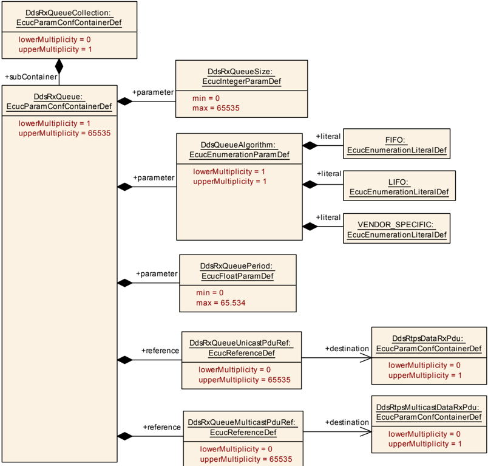

| SWS 条目 | [ECUC_Dds_00170] |
| --- | --- |
| 参数名称 | DdsQueueAlgorithm |
| 父容器 | DdsRxQueue |
| 描述 | 单个队列的调度算法。 |
| 多重性 | 1 |
| 类型 | EcucEnumerationParamDef |
| 取值范围 | FIFO：先进先出；LIFO：后进先出；VENDOR_SPECIFIC：供应商特定的顺序 |
| 默认值 | - |
| Post-Build 变体值 | false |
| 值配置类 | Pre-compile time：X（All Variants）；Link time：-；Post-build time：- |
| 作用域/依赖 | scope: local |

| SWS 条目 | [ECUC_Dds_00169] |
| --- | --- |
| 参数名称 | DdsRxQueuePeriod |
| 父容器 | DdsRxQueue |
| 描述 | 单个队列的调度周期，时间单位为秒。 |
| 多重性 | 1 |
| 类型 | EcucFloatParamDef |
| 取值范围 | [0 .. 65.534] |
| 默认值 | - |
| Post-Build 变体值 | false |
| 值配置类 | Pre-compile time：X（All Variants）；Link time：-；Post-build time：- |
| 作用域/依赖 | scope: ECU |

| SWS 条目 | [ECUC_Dds_00168] |
| --- | --- |
| 参数名称 | DdsRxQueueSize |
| 父容器 | DdsRxQueue |
| 描述 | 队列大小，单位为字节。 |
| 多重性 | 1 |
| 类型 | EcucIntegerParamDef |
| 取值范围 | 0 .. 65535 |
| 默认值 | - |
| Post-Build 变体值 | false |
| 值配置类 | Pre-compile time：X（All Variants）；Link time：-；Post-build time：- |
| 作用域/依赖 | scope: ECU |

| SWS 条目 | [ECUC_Dds_00172] |
| --- | --- |
| 参数名称 | DdsRxQueueMulticastPduRef |
| 父容器 | DdsRxQueue |
| 描述 | 对要存入该队列的接收方向多播下层 **PDU** 的引用。 |
| 多重性 | 0..65535 |
| 类型 | 对 DdsRtpsMulticastDataRxPdu 的引用 |
| 取值范围 | - |
| 默认值 | - |
| Post-Build 变体值 | false |
| 值配置类 | Pre-compile time：X（All Variants）；Link time：-；Post-build time：- |
| 作用域/依赖 | scope: ECU |

| SWS 条目 | [ECUC_Dds_00171] |
| --- | --- |
| 参数名称 | DdsRxQueueUnicastPduRef |
| 父容器 | DdsRxQueue |
| 描述 | 对要存入该队列的接收方向单播下层 **PDU** 的引用。 |
| 多重性 | 0..65535 |
| 类型 | 对 DdsRtpsDataRxPdu 的引用 |
| 取值范围 | - |
| 默认值 | - |
| Post-Build 变体值 | false |
| 值配置类 | Pre-compile time：X（All Variants）；Link time：-；Post-build time：- |
| 作用域/依赖 | scope: ECU |

##### 9.2.3.2.2. DdsTxQueueCollection

| SWS 条目 | [ECUC_Dds_00181] |
| --- | --- |
| 容器名称 | DdsTxQueueCollection |
| 父容器 | DdsConfig |
| 描述 | Tx 队列的集合。 |

**包含的容器**

| 容器名称 | 多重性 | 作用域/依赖 |
| --- | --- | --- |
| DdsTxQueue | 0..* | 用于保存从 **PduR**（作为上层）到 **DDS** 的 **DdsAppDataTxPdu** 的队列。单个队列可用于保存一个或多个 **DdsAppDataTxPdu**。 |

###### 9.2.3.2.2.1. DdsTxQueue

| SWS 条目 | [ECUC_Dds_00173] |
| --- | --- |
| 容器名称 | DdsTxQueue |
| 父容器 | DdsTxQueueCollection |
| 描述 | 用于保存从 **PduR**（作为上层）到 **DDS** 的 **DdsAppDataTxPdu** 的队列。单个队列可用于保存一个或多个 **DdsAppDataTxPdu**。 |

注意：单个 **DdsTxQueue** 可用于保存一个或多个 **DdsAppDataTxPdu**。

这些队列的处理由 **DDS** 中间件依据其自身的内部策略（**QoS** 策略、待发布的 **DdsDataWriter** 等）负责。

下图给出 **DdsTxQueue** 模板的 **UML** 图：

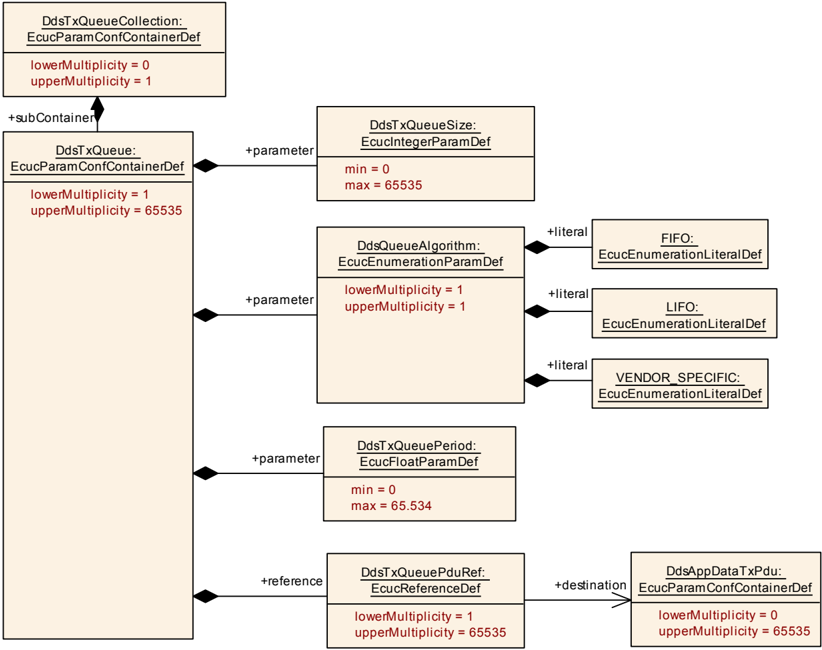

| SWS 条目 | [ECUC_Dds_00170] |
| --- | --- |
| 参数名称 | DdsQueueAlgorithm |
| 父容器 | DdsTxQueue |
| 描述 | 单个队列的调度算法。 |
| 多重性 | 1 |
| 类型 | EcucEnumerationParamDef |
| 取值范围 | FIFO：先进先出；LIFO：后进先出；VENDOR_SPECIFIC：供应商特定的顺序 |
| 默认值 | - |
| Post-Build 变体值 | false |
| 值配置类 | Pre-compile time：X（All Variants）；Link time：-；Post-build time：- |
| 作用域/依赖 | scope: local |

| SWS 条目 | [ECUC_Dds_00175] |
| --- | --- |
| 参数名称 | DdsTxQueuePeriod |
| 父容器 | DdsTxQueue |
| 描述 | 单个队列的调度周期，时间单位为秒。 |
| 多重性 | 1 |
| 类型 | EcucFloatParamDef |
| 取值范围 | [0 .. 65.534] |
| 默认值 | - |
| Post-Build 变体值 | false |
| 值配置类 | Pre-compile time：X（All Variants）；Link time：-；Post-build time：- |
| 作用域/依赖 | scope: ECU |

| SWS 条目 | [ECUC_Dds_00174] |
| --- | --- |
| 参数名称 | DdsTxQueueSize |
| 父容器 | DdsTxQueue |
| 描述 | 队列大小，单位为字节。 |
| 多重性 | 1 |
| 类型 | EcucIntegerParamDef |
| 取值范围 | 0 .. 65535 |
| 默认值 | - |
| Post-Build 变体值 | false |
| 值配置类 | Pre-compile time：X（All Variants）；Link time：-；Post-build time：- |
| 作用域/依赖 | scope: ECU |

| SWS 条目 | [ECUC_Dds_00176] |
| --- | --- |
| 参数名称 | DdsTxQueuePduRef |
| 父容器 | DdsTxQueue |
| 描述 | 对要存入该队列的发送方向上层 **PDU** 的引用。 |
| 多重性 | 0..65535 |
| 类型 | 对 DdsAppDataTxPdu 的引用 |
| 取值范围 | - |
| 默认值 | - |
| Post-Build 变体值 | false |
| 值配置类 | Pre-compile time：X（All Variants）；Link time：-；Post-build time：- |
| 作用域/依赖 | scope: ECU |

##### 9.2.3.3. DdsDomainParticipantCollection

| SWS 条目 | [ECUC_Dds_00179] |
| --- | --- |
| 容器名称 | DdsDomainParticipantCollection |
| 父容器 | DdsConfig |
| 描述 | **DDS Domain Participant** 的集合。 |

**包含的容器**

| 容器名称 | 多重性 | 作用域/依赖 |
| --- | --- | --- |
| DdsDomainParticipant | 1..65535 | 该容器表示当前节点所属的单个 "**Domain Participant**" 的配置。一个节点可以属于多个 **Domain Participant**，并且只能与属于同一 **Domain Participant** 的其他节点通信。 |

###### 9.2.3.3.1. DdsDomainParticipant

下图给出 **DdsDomainParticipant** 容器的 **UML** 图：

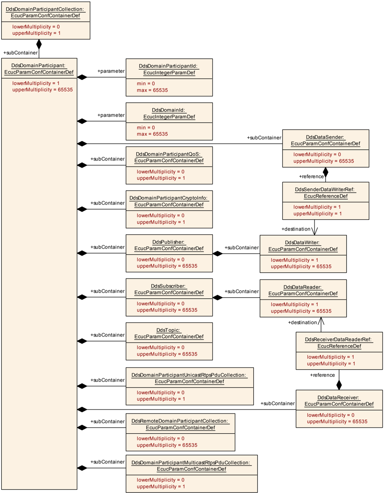

| SWS 条目 | [ECUC_Dds_00012] |
| --- | --- |
| 容器名称 | DdsDomainParticipant |
| 父容器 | DdsDomainParticipantCollection |
| 描述 | 该容器表示当前节点所属的单个 "**Domain Participant**" 的配置。一个节点可以属于多个 **Domain Participant**，并且只能与属于同一 **Domain Participant** 的其他节点通信。 |

| SWS 条目 | [ECUC_Dds_00138] |
| --- | --- |
| 参数名称 | DdsDomainId |
| 父容器 | DdsDomainParticipant |
| 描述 | 该 **DDS** 节点所属域的 ID。 |
| 多重性 | 1 |
| 类型 | EcucIntegerParamDef |
| 取值范围 | 0 .. 65535 |
| 默认值 | - |
| Post-Build 变体值 | false |
| 值配置类 | Pre-compile time：X（All Variants）；Link time：-；Post-build time：- |
| 作用域/依赖 | scope: ECU |

| SWS 条目 | [ECUC_Dds_00014] |
| --- | --- |
| 参数名称 | DdsDomainParticipantId |
| 父容器 | DdsDomainParticipant |
| 描述 | **Dds Domain Participant** 的标识。只有属于同一 **Domain Participant** 的实体之间才能相互通信。 |
| 多重性 | 1 |
| 类型 | EcucIntegerParamDef |
| 取值范围 | 0 .. 65535 |
| 默认值 | - |
| Post-Build 变体值 | false |
| 值配置类 | Pre-compile time：X（All Variants）；Link time：-；Post-build time：- |
| 作用域/依赖 | scope: ECU |

**包含的容器**

| 容器名称 | 多重性 | 作用域/依赖 |
| --- | --- | --- |
| DdsDomainParticipantUnicastRtpsPduCollection | 0..1 | 指向下层网络层的单播下层 **PDU** 集合。 |
| DdsDomainParticipantMulticastRtpsPduCollection | 0..1 | 指向下层网络层的多播下层 **PDU** 池。 |
| DdsDomainParticipantQoS | 0..1 | 该容器表示 **Dds Domain Participant** 所支持的 **QoS** 配置。 |
| DdsDomainParticipantCryptoInfo | 0..1 | 该容器包含属于该 **DomainParticipant** 的实体所使用的 **加密服务** 配置。若该容器不存在，则表示不支持任何安全机制。 |
| DdsDataSender | 0..65535 | 便于易用性：定义与 **Sender/Receiver** 接口关联的 **DDS DataWriter**。 |
| DdsDataReceiver | 0..65535 | 便于易用性：定义与 **Sender/Receiver** 接口关联的 **DDS DataReader**。 |
| DdsPublisher | 0..65535 | 该容器表示一个 **Publisher** 的配置。 |
| DdsSubscriber | 0..65535 | 该容器表示一个 **Subscriber** 的配置。 |
| DdsTopic | 0..65535 | 该容器表示一个 **Topic** 的配置。 |
| DdsRemoteDomainParticipantCollection | 0..1 | 远程 **Domain Participant** 的集合。 |

###### 9.2.3.3.1.1. DdsDomainParticipantUnicastRtpsPduCollection

| SWS 条目 | [ECUC_Dds_00143] |
| --- | --- |
| 容器名称 | DdsDomainParticipantUnicastRtpsPduCollection |
| 父容器 | DdsDomainParticipant |
| 描述 | 指向下层网络层的单播下层 **PDU** 集合。 |

**包含的容器**

| 容器名称 | 多重性 | 作用域/依赖 |
| --- | --- | --- |
| DdsRtpsDataRxPdu | 0..1 | 用于将数据从下层网络层发送到 **DDS** 本身的单播接收下层 **PDU**。 |
| DdsRtpsDataTxPdu | 0..65535 | 用于将数据从 **DDS** 发送到下层网络层的单播发送下层 **PDU**。 |

下图给出单播 **RTPS PDU** 集合：

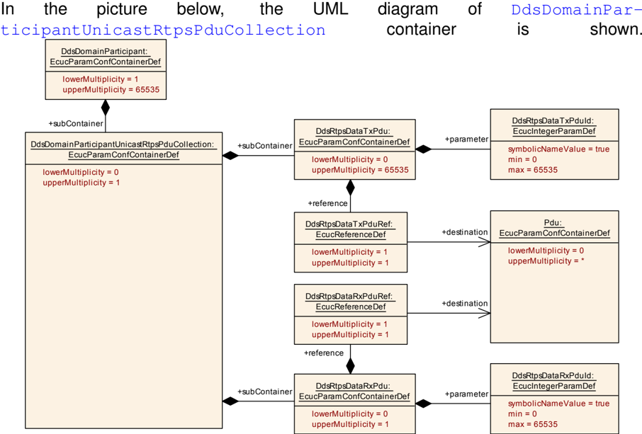

###### 9.2.3.3.1.1.1. DdsRtpsDataRxPdu

| SWS 条目 | [ECUC_Dds_00148] |
| --- | --- |
| 容器名称 | DdsRtpsDataRxPdu |
| 父容器 | DdsDomainParticipantUnicastRtpsPduCollection |
| 描述 | 用于将数据从下层网络层发送到 **DDS** 本身的单播接收下层 **PDU**。 |

| SWS 条目 | [ECUC_Dds_00149] |
| --- | --- |
| 参数名称 | DdsRtpsDataRxPduId |
| 父容器 | DdsRtpsDataRxPdu |
| 描述 | 当前 **PDU** 的本地 ID。 |
| 多重性 | 1 |
| 类型 | EcucIntegerParamDef（为该参数生成的符号名） |
| 取值范围 | 0 .. 65535 |
| 默认值 | - |
| Post-Build 变体值 | false |
| 值配置类 | Pre-compile time：X（All Variants）；Link time：-；Post-build time：- |
| 作用域/依赖 | scope: ECU |

| SWS 条目 | [ECUC_Dds_00150] |
| --- | --- |
| 参数名称 | DdsRtpsDataRxPduRef |
| 父容器 | DdsRtpsDataRxPdu |
| 描述 | 对 **AUTOSAR ECU** 配置规范所描述的全局 **PDU** 结构中某个 **PDU** 的引用。**Dds** 模块使用该引用推导 **PDU** ID。 |
| 多重性 | 1 |
| 类型 | 对 Pdu 的引用 |
| 取值范围 | - |
| 默认值 | - |
| Post-Build 变体值 | false |
| 值配置类 | Pre-compile time：X（All Variants）；Link time：-；Post-build time：- |
| 作用域/依赖 | scope: ECU |

###### 9.2.3.3.1.1.2. DdsRtpsDataTxPdu

| SWS 条目 | [ECUC_Dds_00145] |
| --- | --- |
| 容器名称 | DdsRtpsDataTxPdu |
| 父容器 | DdsDomainParticipantUnicastRtpsPduCollection |
| 描述 | 用于将数据从 **DDS** 发送到下层网络层的单播发送下层 **PDU**。 |

| SWS 条目 | [ECUC_Dds_00146] |
| --- | --- |
| 参数名称 | DdsRtpsDataTxPduId |
| 父容器 | DdsRtpsDataTxPdu |
| 描述 | 当前 **PDU** 的本地 ID。 |
| 多重性 | 1 |
| 类型 | EcucIntegerParamDef（为该参数生成的符号名） |
| 取值范围 | 0 .. 65535 |
| 默认值 | - |
| Post-Build 变体值 | false |
| 值配置类 | Pre-compile time：X（All Variants）；Link time：-；Post-build time：- |
| 作用域/依赖 | scope: ECU |

| SWS 条目 | [ECUC_Dds_00147] |
| --- | --- |
| 参数名称 | DdsRtpsDataTxPduRef |
| 父容器 | DdsRtpsDataTxPdu |
| 描述 | 对 **AUTOSAR ECU** 配置规范所描述的全局 **PDU** 结构中某个 **PDU** 的引用。**Dds** 模块使用该引用推导 **PDU** ID。 |
| 多重性 | 1 |
| 类型 | 对 Pdu 的引用 |
| 取值范围 | - |
| 默认值 | - |
| Post-Build 变体值 | false |
| 值配置类 | Pre-compile time：X（All Variants）；Link time：-；Post-build time：- |
| 作用域/依赖 | scope: ECU |

###### 9.2.3.3.1.2. DdsDomainParticipantMulticastRtpsPduCollection

| SWS 条目 | [ECUC_Dds_00144] |
| --- | --- |
| 容器名称 | DdsDomainParticipantMulticastRtpsPduCollection |
| 父容器 | DdsDomainParticipant |
| 描述 | 指向下层网络层的多播下层 **PDU** 池。 |

**包含的容器**

| 容器名称 | 多重性 | 作用域/依赖 |
| --- | --- | --- |
| DdsRtpsMulticastDataTxPdu | 0..1 | 用于将数据从 **DDS** 发送到下层网络层的多播下层发送 **PDU**。 |
| DdsRtpsMulticastDataRxPdu | 0..1 | 用于将数据从下层网络层发送到 **DDS** 本身的多播接收下层 **PDU**。 |

下图给出多播 **RTPS PDU** 集合：

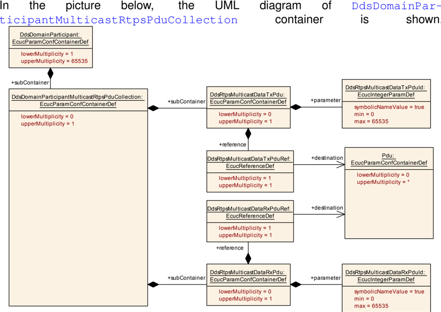

###### 9.2.3.3.1.2.1. DdsRtpsMulticastDataTxPdu

| SWS 条目 | [ECUC_Dds_00151] |
| --- | --- |
| 容器名称 | DdsRtpsMulticastDataTxPdu |
| 父容器 | DdsDomainParticipantMulticastRtpsPduCollection |
| 描述 | 用于将数据从 **DDS** 发送到下层网络层的多播下层发送 **PDU**。 |

| SWS 条目 | [ECUC_Dds_00152] |
| --- | --- |
| 参数名称 | DdsRtpsMulticastDataTxPduId |
| 父容器 | DdsRtpsMulticastDataTxPdu |
| 描述 | 当前 **PDU** 的本地 ID。 |
| 多重性 | 1 |
| 类型 | EcucIntegerParamDef（为该参数生成的符号名） |
| 取值范围 | 0 .. 65535 |
| 默认值 | - |
| Post-Build 变体值 | false |
| 值配置类 | Pre-compile time：X（All Variants）；Link time：-；Post-build time：- |
| 作用域/依赖 | scope: ECU |

| SWS 条目 | [ECUC_Dds_00153] |
| --- | --- |
| 参数名称 | DdsRtpsMulticastDataTxPduRef |
| 父容器 | DdsRtpsMulticastDataTxPdu |
| 描述 | 对 **AUTOSAR ECU** 配置规范所描述的全局 **PDU** 结构中某个 **PDU** 的引用。**Dds** 模块使用该引用推导 **PDU** ID。 |
| 多重性 | 1 |
| 类型 | 对 Pdu 的引用 |
| 取值范围 | - |
| 默认值 | - |
| Post-Build 变体值 | false |
| 值配置类 | Pre-compile time：X（All Variants）；Link time：-；Post-build time：- |
| 作用域/依赖 | scope: ECU |

###### 9.2.3.3.1.2.2. DdsRtpsMulticastDataRxPdu

| SWS 条目 | [ECUC_Dds_00154] |
| --- | --- |
| 容器名称 | DdsRtpsMulticastDataRxPdu |
| 父容器 | DdsDomainParticipantMulticastRtpsPduCollection |
| 描述 | 用于将数据从下层网络层发送到 **DDS** 本身的多播接收下层 **PDU**。 |

| SWS 条目 | [ECUC_Dds_00155] |
| --- | --- |
| 参数名称 | DdsRtpsMulticastDataRxPduId |
| 父容器 | DdsRtpsMulticastDataRxPdu |
| 描述 | 当前 **PDU** 的本地 ID。 |
| 多重性 | 1 |
| 类型 | EcucIntegerParamDef（为该参数生成的符号名） |
| 取值范围 | 0 .. 65535 |
| 默认值 | - |
| Post-Build 变体值 | false |
| 值配置类 | Pre-compile time：X（All Variants）；Link time：-；Post-build time：- |
| 作用域/依赖 | scope: ECU |

| SWS 条目 | [ECUC_Dds_00156] |
| --- | --- |
| 参数名称 | DdsRtpsMulticastDataRxPduRef |
| 父容器 | DdsRtpsMulticastDataRxPdu |
| 描述 | 对 **AUTOSAR ECU** 配置规范所描述的全局 **PDU** 结构中某个 **PDU** 的引用。**Dds** 模块使用该引用推导 **PDU** ID。 |
| 多重性 | 1 |
| 类型 | 对 Pdu 的引用 |
| 取值范围 | - |
| 默认值 | - |
| Post-Build 变体值 | false |
| 值配置类 | Pre-compile time：X（All Variants）；Link time：-；Post-build time：- |
| 作用域/依赖 | scope: ECU |

###### 9.2.3.3.1.3. DdsDomainParticipantQoS

| SWS 条目 | [ECUC_Dds_00013] |
| --- | --- |
| 容器名称 | DdsDomainParticipantQoS |
| 父容器 | DdsDomainParticipant |
| 描述 | 该容器表示 **Dds Domain Participant** 所支持的 **QoS** 配置。 |

**包含的容器**

| 容器名称 | 多重性 | 作用域/依赖 |
| --- | --- | --- |
| DdsUserData | 0..1 | 描述 **DDS** 的 **USER_DATA** **QoS** 策略。 |
| DdsEntityFactory | 0..1 | 描述 **DDS** 的 **ENTITY_FACTORY** **QoS** 策略。 |

###### 9.2.3.3.1.4. DdsDomainParticipantCryptoInfo

| SWS 条目 | [ECUC_Dds_00015] |
| --- | --- |
| 容器名称 | DdsDomainParticipantCryptoInfo |
| 父容器 | DdsDomainParticipant |
| 描述 | 该容器包含属于该 **DomainParticipant** 的实体所使用的加密服务配置。若该容器不存在，则表示不支持任何安全机制。 |

| SWS 条目 | [ECUC_Dds_00020] |
| --- | --- |
| 参数名称 | DdsDomainParticipantCsmAuthenticateJob |
| 父容器 | DdsDomainParticipantCryptoInfo |
| 描述 | 对用于认证数据的 **CSM** 作业的引用。 |
| 多重性 | 1 |
| 类型 | 对 CsmJob 的引用 |
| 取值范围 | - |
| 默认值 | - |
| Post-Build 变体值 | false |
| 值配置类 | Pre-compile time：X（All Variants）；Link time：-；Post-build time：- |
| 作用域/依赖 | scope: ECU |

| SWS 条目 | [ECUC_Dds_00021] |
| --- | --- |
| 参数名称 | DdsDomainParticipantCsmVerifyJob |
| 父容器 | DdsDomainParticipantCryptoInfo |
| 描述 | 对用于校验数据的 **CSM** 作业的引用。 |
| 多重性 | 1 |
| 类型 | 对 CsmJob 的引用 |
| 取值范围 | - |
| 默认值 | - |
| Post-Build 变体值 | false |
| 值配置类 | Pre-compile time：X（All Variants）；Link time：-；Post-build time：- |
| 作用域/依赖 | scope: ECU |

下图给出 **CryptoInfo** 容器：

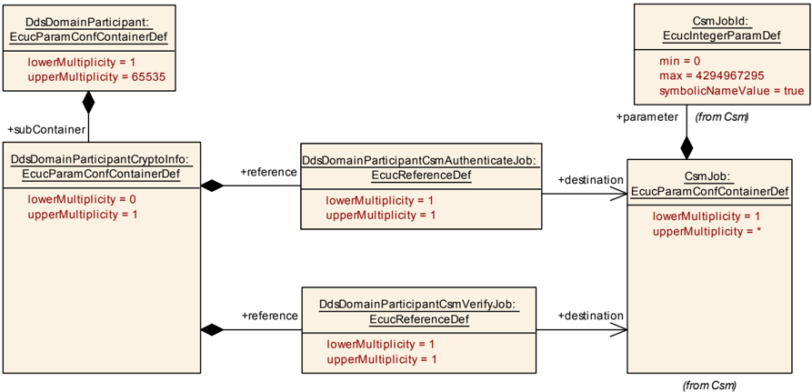

###### 9.2.3.3.1.5. DdsDataSender

| SWS 条目 | [ECUC_Dds_00157] |
| --- | --- |
| 容器名称 | DdsDataSender |
| 父容器 | DdsDomainParticipant |
| 描述 | 便于易用性：定义与 **Sender/Receiver** 接口关联的 **DDS DataWriter**。 |

| SWS 条目 | [ECUC_Dds_00158] |
| --- | --- |
| 参数名称 | DdsSenderDataWriterRef |
| 父容器 | DdsDataSender |
| 描述 | 对 **sender** 所使用的 **DataWriter** 的引用。 |
| 多重性 | 1 |
| 类型 | 对 DdsDataWriter 的引用 |
| 取值范围 | - |
| 默认值 | - |
| Post-Build 变体值 | false |
| 值配置类 | Pre-compile time：X（All Variants）；Link time：-；Post-build time：- |
| 作用域/依赖 | scope: ECU |

###### 9.2.3.3.1.6. DdsDataReceiver

| SWS 条目 | [ECUC_Dds_00159] |
| --- | --- |
| 容器名称 | DdsDataReceiver |
| 父容器 | DdsDomainParticipant |
| 描述 | 便于易用性：定义与 **Sender/Receiver** 接口关联的 **DDS DataReader**。 |

| SWS 条目 | [ECUC_Dds_00160] |
| --- | --- |
| 参数名称 | DdsReceiverDataReaderRef |
| 父容器 | DdsDataReceiver |
| 描述 | 对 **receiver** 所使用的 **DataReader** 的引用。 |
| 多重性 | 1 |
| 类型 | 对 DdsDataReader 的引用 |
| 取值范围 | - |
| 默认值 | - |
| Post-Build 变体值 | false |
| 值配置类 | Pre-compile time：X（All Variants）；Link time：-；Post-build time：- |
| 作用域/依赖 | scope: ECU |

###### 9.2.3.3.1.7. DdsPublisher

| SWS 条目 | [ECUC_Dds_00016] |
| --- | --- |
| 容器名称 | DdsPublisher |
| 父容器 | DdsDomainParticipant |
| 描述 | 该容器表示一个 **Publisher** 的配置。 |

**包含的容器**

| 容器名称 | 多重性 | 作用域/依赖 |
| --- | --- | --- |
| DdsPublisherQoS | 0..1 | 该容器表示与当前 **Dds Publisher** 相关的 **QoS** 配置。 |
| DdsDataWriter | 1..65535 | 该容器表示一个 **data writer** 的配置。一个 **publisher** 可以引用一个或多个 **writer**，但一个 **writer** 只能属于单个 **publisher**。 |

下图给出 **Publisher** 结构：

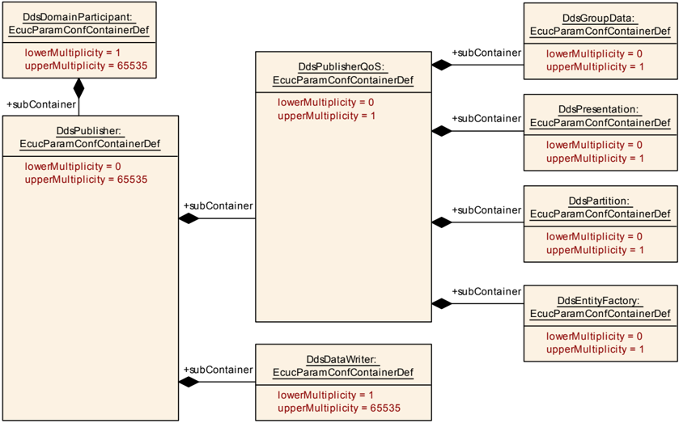

###### 9.2.3.3.1.7.1. DdsDataWriter

| SWS 条目 | [ECUC_Dds_00023] |
| --- | --- |
| 容器名称 | DdsDataWriter |
| 父容器 | DdsPublisher |
| 描述 | 该容器表示一个 **data writer** 的配置。一个 **publisher** 可以引用一个或多个 **writer**，但一个 **writer** 只能属于单个 **publisher**。 |

下图给出 **DataWriter** 结构：

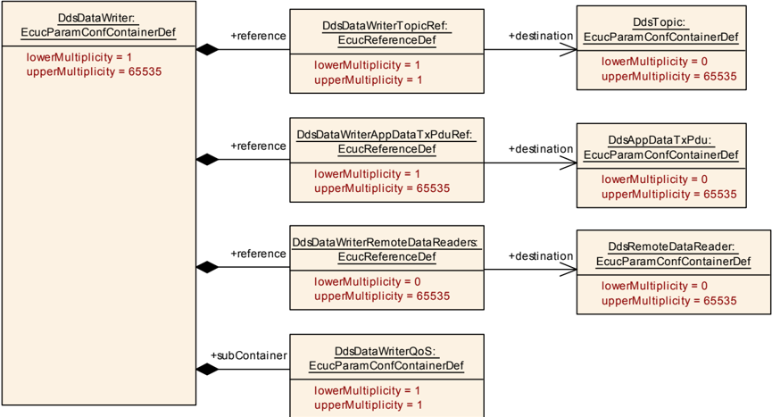

| SWS 条目 | [ECUC_Dds_00139] |
| --- | --- |
| 参数名称 | DdsDataWriterAppDataTxPduRef |
| 父容器 | DdsDataWriter |
| 描述 | 该引用指向 **Dds** 模块上层用于传递待以 **DDS** 序列化数据在网络上发送的数据的 **DdsAppDataTxPdu**。 |
| 多重性 | 1..65535 |
| 类型 | 对 DdsAppDataTxPdu 的引用 |
| 取值范围 | - |
| 默认值 | - |
| Post-Build 变体值 | false |
| 值配置类 | Pre-compile time：X（All Variants）；Link time：-；Post-build time：- |
| 作用域/依赖 | scope: ECU |

| SWS 条目 | [ECUC_Dds_00140] |
| --- | --- |
| 参数名称 | DdsDataWriterRemoteDataReaders |
| 父容器 | DdsDataWriter |
| 描述 | 对当前 **DdsDataWriter** 必须向其发送数据的远程 **DdsDataReader** 的引用。对于每个已配置的远程 **DdsDataReader**，本地 **DdsDataWriter** 应使用为该远程 **DataReader** 配置的 **DdsDataReaderRemotePdu** 发送数据。 |
| 多重性 | 0..65535 |
| 类型 | 对 DdsRemoteDataReader 的引用 |
| 取值范围 | - |
| 默认值 | - |
| Post-Build 变体值 | false |
| 值配置类 | Pre-compile time：X（All Variants）；Link time：-；Post-build time：- |
| 作用域/依赖 | scope: ECU |

| SWS 条目 | [ECUC_Dds_00029] |
| --- | --- |
| 参数名称 | DdsDataWriterTopicRef |
| 父容器 | DdsDataWriter |
| 描述 | 该引用选择当前 **Dds Writer** 希望发布到的 **Topic**。 |
| 多重性 | 1 |
| 类型 | 对 DdsTopic 的引用 |
| 取值范围 | - |
| 默认值 | - |
| Post-Build 变体值 | false |
| 值配置类 | Pre-compile time：X（All Variants）；Link time：-；Post-build time：- |
| 作用域/依赖 | scope: ECU |

**包含的容器**

| 容器名称 | 多重性 | 作用域/依赖 |
| --- | --- | --- |
| DdsDataWriterQoS | 1 | 该容器表示当前 **Dds DataWriter** 所支持的 **QoS** 配置。 |

###### 9.2.3.3.1.7.2. DdsDataWriterQoS

| SWS 条目 | [ECUC_Dds_00028] |
| --- | --- |
| 容器名称 | DdsDataWriterQoS |
| 父容器 | DdsDataWriter、DdsRemoteDataWriter |
| 描述 | 该容器表示当前 **Dds DataWriter** 所支持的 **QoS** 配置。 |

**包含的容器**

| 容器名称 | 多重性 | 作用域/依赖 |
| --- | --- | --- |
| DdsDeadline | 0..1 | 若存在，则该容器表示 **DEADLINE** **QoS** 策略。 |
| DdsDestinationOrder | 0..1 | 若存在，则该容器表示 **DESTINATION_ORDER** **QoS** 策略。 |
| DdsDurability | 0..1 | 若存在，则该容器表示 **DURABILITY** **QoS** 策略。 |
| DdsDurabilityService | 0..1 | 若存在，则该容器表示 **DURABILITY_SERVICE** **QoS** 策略。 |
| DdsHistory | 0..1 | 若存在，则该容器表示 **HISTORY** **QoS** 策略。 |
| DdsLatencyBudget | 0..1 | 若存在，则该容器表示 **LATENCY_BUDGET** **QoS** 策略。 |
| DdsLifespan | 0..1 | 若存在，则该容器表示 **LIFESPAN** **QoS** 策略。 |
| DdsLiveliness | 0..1 | 若存在，则该容器表示 **LIVELINESS** **QoS** 策略。 |
| DdsOwnership | 0..1 | 若存在，则该容器表示 **OWNERSHIP** **QoS** 策略。 |
| DdsOwnershipStrength | 0..1 | 描述 **DDS** 的 **OWNERSHIP_STRENGTH** **QoS** 策略。 |
| DdsReliability | 0..1 | 若存在，则该容器表示 **RELIABILITY** **QoS** 策略。 |
| DdsResourceLimits | 0..1 | 若存在，则该容器表示 **RESOURCE_LIMITS** **QoS** 策略。 |
| DdsTransportPriority | 0..1 | 若存在，则该容器表示 **TRANSPORT_PRIORITY** **QoS** 策略。 |
| DdsUserData | 0..1 | 若存在，则该容器表示 **USER_DATA** **QoS** 策略。 |
| DdsWriterDataLifecycle | 0..1 | 描述 **DDS** 的 **WRITER_DATA_LIFECYCLE** **QoS** 策略。 |

###### 9.2.3.3.1.8. DdsSubscriber

| SWS 条目 | [ECUC_Dds_00017] |
| --- | --- |
| 容器名称 | DdsSubscriber |
| 父容器 | DdsDomainParticipant |
| 描述 | 该容器表示一个 **Subscriber** 的配置。 |

**包含的容器**

| 容器名称 | 多重性 | 作用域/依赖 |
| --- | --- | --- |
| DdsSubscriberQoS | 0..1 | 该容器表示与当前 **Dds Subscriber** 相关的 **QoS** 配置。 |
| DdsDataReader | 1..65535 | 该容器表示一个 **data reader** 的配置。一个 **subscriber** 可以引用一个或多个 **reader**，但一个 **reader** 只能属于单个 **subscriber**。 |

下图给出 **Subscriber** 结构：

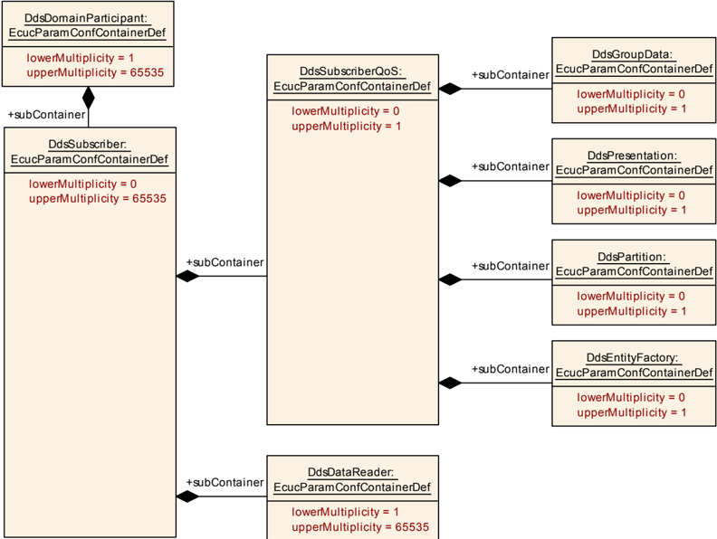

###### 9.2.3.3.1.8.1. DdsDataReader

| SWS 条目 | [ECUC_Dds_00075] |
| --- | --- |
| 容器名称 | DdsDataReader |
| 父容器 | DdsSubscriber |
| 描述 | 该容器表示一个 **data reader** 的配置。一个 **subscriber** 可以引用一个或多个 **reader**，但一个 **reader** 只能属于单个 **subscriber**。 |

| SWS 条目 | [ECUC_Dds_00141] |
| --- | --- |
| 参数名称 | DdsDataReaderAppDataRxPduRef |
| 父容器 | DdsDataReader |
| 描述 | 该引用指向 **Dds** 模块用于将反序列化后的 **DDS** 数据转发给 **DDS** 模块上层时所使用的 **DdsAppDataRxPdu**。 |
| 多重性 | 1..65535 |
| 类型 | 对 DdsAppDataRxPdu 的引用 |
| 取值范围 | - |
| 默认值 | - |
| Post-Build 变体值 | false |
| 值配置类 | Pre-compile time：X（All Variants）；Link time：-；Post-build time：- |
| 作用域/依赖 | scope: ECU |

| SWS 条目 | [ECUC_Dds_00142] |
| --- | --- |
| 参数名称 | DdsDataReaderRemoteDataWriters |
| 父容器 | DdsDataReader |
| 描述 | 对当前 **DdsDataReader** 希望从其接收数据的远程 **DdsDataWriter** 的引用。来自某个远程 **writer** 的数据通过该 **DdsRemoteDataWriter** 所引用的 **DdsRemoteDataWriterPdu** 接收。 |
| 多重性 | 0..65535 |
| 类型 | 对 DdsRemoteDataWriter 的引用 |
| 取值范围 | - |
| 默认值 | - |
| Post-Build 变体值 | false |
| 值配置类 | Pre-compile time：X（All Variants）；Link time：-；Post-build time：- |
| 作用域/依赖 | scope: ECU |

| SWS 条目 | [ECUC_Dds_00076] |
| --- | --- |
| 参数名称 | DdsDataReaderTopicRef |
| 父容器 | DdsDataReader |
| 描述 | 该引用选择当前 **Dds Reader** 希望发布到的 **Topic**。 |
| 多重性 | 1 |
| 类型 | 对 DdsTopic 的引用 |
| 取值范围 | - |
| 默认值 | - |
| Post-Build 变体值 | false |
| 值配置类 | Pre-compile time：X（All Variants）；Link time：-；Post-build time：- |
| 作用域/依赖 | scope: ECU |

下图给出 **DataReader** 结构：

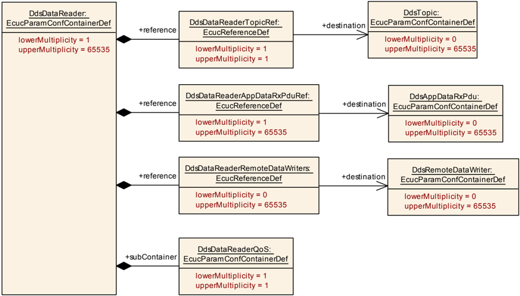

**包含的容器**

| 容器名称 | 多重性 | 作用域/依赖 |
| --- | --- | --- |
| DdsDataReaderQoS | 1 | 该容器表示当前 **Dds DataReader** 所支持的 **QoS** 配置。 |

###### 9.2.3.3.1.8.2. DdsDataReaderQoS

| SWS 条目 | [ECUC_Dds_00079] |
| --- | --- |
| 容器名称 | DdsDataReaderQoS |
| 父容器 | DdsDataReader、DdsRemoteDataReader |
| 描述 | 该容器表示当前 **Dds DataReader** 所支持的 **QoS** 配置。 |

**包含的容器**

| 容器名称 | 多重性 | 作用域/依赖 |
| --- | --- | --- |
| DdsDeadline | 0..1 | 若存在，则该容器表示 **DEADLINE** **QoS** 策略。 |
| DdsDestinationOrder | 0..1 | 若存在，则该容器表示 **DESTINATION_ORDER** **QoS** 策略。 |
| DdsHistory | 0..1 | 若存在，则该容器表示 **HISTORY** **QoS** 策略。 |
| DdsLatencyBudget | 0..1 | 若存在，则该容器表示 **LATENCY_BUDGET** **QoS** 策略。 |
| DdsLiveliness | 0..1 | 若存在，则该容器表示 **LIVELINESS** **QoS** 策略。 |
| DdsOwnership | 0..1 | 若存在，则该容器表示 **OWNERSHIP** **QoS** 策略。 |
| DdsReaderDataLifecycle | 0..1 | 描述 **DDS** 的 **READER_DATA_LIFECYCLE** **QoS** 策略。 |
| DdsReliability | 0..1 | 若存在，则该容器表示 **RELIABILITY** **QoS** 策略。 |
| DdsResourceLimits | 0..1 | 若存在，则该容器表示 **RESOURCE_LIMITS** **QoS** 策略。 |
| DdsTimeBasedFilter | 0..1 | 描述 **DDS** 的 **TIME_BASED_FILTER** **QoS** 策略。 |
| DdsUserData | 0..1 | 若存在，则该容器表示 **USER_DATA** **QoS** 策略。 |

###### 9.2.3.3.1.9. DdsTopic

| SWS 条目 | [ECUC_Dds_00018] |
| --- | --- |
| 容器名称 | DdsTopic |
| 父容器 | DdsDomainParticipant |
| 描述 | 该容器表示一个 **Topic** 的配置。 |

| SWS 条目 | [ECUC_Dds_00103] |
| --- | --- |
| 参数名称 | DdsTopicName |
| 父容器 | DdsTopic |
| 描述 | 标识 **Topic** 的名称。**Publisher** 与 **Subscriber** 的互信通信基于 **Topic** 名称：只有共享同一 **Topic** 的实体之间才能相互通信。 |
| 多重性 | 1 |
| 类型 | EcucStringParamDef |
| 取值范围 | - |
| 默认值 | - |
| Post-Build 变体值 | false |
| 值配置类 | Pre-compile time：X（All Variants）；Link time：-；Post-build time：- |
| 作用域/依赖 | scope: ECU dependency: inter-ECU - 该值应在各配置之间共享。 |

| SWS 条目 | [ECUC_Dds_00104] |
| --- | --- |
| 参数名称 | DdsTopicImplementationType |
| 父容器 | DdsTopic |
| 描述 | 该引用选择该 **Topic** 所关联的 **ImplementationDataType**。**Topic** 用于发布定义良好的数据类型，该类型由所引用的 **ImplementationDataType** 描述。 |
| 多重性 | 0..1 |
| 类型 | 对 IMPLEMENTATION-DATA-TYPE 的外部引用 |
| 取值范围 | - |
| 默认值 | - |
| Post-Build 变体值 | false |
| 值配置类 | Pre-compile time：X（All Variants）；Link time：-；Post-build time：- |
| 作用域/依赖 | scope: ECU |

**包含的容器**

| 容器名称 | 多重性 | 作用域/依赖 |
| --- | --- | --- |
| DdsTopicQoS | 1 | 该容器包含 **DdsTopic** 所支持的 **QoS** 配置。 |

###### 9.2.3.3.1.9.1. DdsTopicQoS

| SWS 条目 | [ECUC_Dds_00102] |
| --- | --- |
| 容器名称 | DdsTopicQoS |
| 父容器 | DdsTopic |
| 描述 | 该容器包含 **DdsTopic** 所支持的 **QoS** 配置。 |

**包含的容器**

| 容器名称 | 多重性 | 作用域/依赖 |
| --- | --- | --- |
| DdsDeadline | 0..1 | 若存在，则该容器表示 **DEADLINE** **QoS** 策略。 |
| DdsDestinationOrder | 0..1 | 若存在，则该容器表示 **DESTINATION_ORDER** **QoS** 策略。 |
| DdsDurability | 0..1 | 若存在，则该容器表示 **DURABILITY** **QoS** 策略。 |
| DdsDurabilityService | 0..1 | 若存在，则该容器表示 **DURABILITY_SERVICE** **QoS** 策略。 |
| DdsHistory | 0..1 | 若存在，则该容器表示 **HISTORY** **QoS** 策略。 |
| DdsLatencyBudget | 0..1 | 若存在，则该容器表示 **LATENCY_BUDGET** **QoS** 策略。 |
| DdsLifespan | 0..1 | 若存在，则该容器表示 **LIFESPAN** **QoS** 策略。 |
| DdsLiveliness | 0..1 | 若存在，则该容器表示 **LIVELINESS** **QoS** 策略。 |
| DdsOwnership | 0..1 | 若存在，则该容器表示 **OWNERSHIP** **QoS** 策略。 |
| DdsReliability | 0..1 | 若存在，则该容器表示 **RELIABILITY** **QoS** 策略。 |
| DdsResourceLimits | 0..1 | 若存在，则该容器表示 **RESOURCE_LIMITS** **QoS** 策略。 |
| DdsTopicData | 0..1 | 描述 **DDS** 的 **TOPIC_DATA** **QoS** 策略。 |
| DdsTransportPriority | 0..1 | 若存在，则该容器表示 **TRANSPORT_PRIORITY** **QoS** 策略。 |

下图给出 **Topic** 结构：

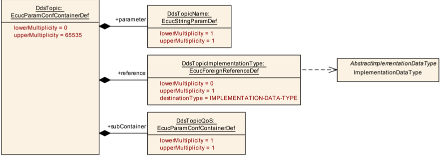

###### 9.2.3.3.1.10. DdsRemoteDomainParticipantCollection

| SWS 条目 | [ECUC_Dds_00182] |
| --- | --- |
| 容器名称 | DdsRemoteDomainParticipantCollection |
| 父容器 | DdsDomainParticipant |
| 描述 | 远程 **Domain Participant** 的集合。 |

**包含的容器**

| 容器名称 | 多重性 | 作用域/依赖 |
| --- | --- | --- |
| DdsRemoteDomainParticipant | 0..65535 | 远程端点的静态配置。该容器包含关于远程端点的可达性和 **QoS** 参数的信息。 |

###### 9.2.3.3.1.10.1. DdsRemoteDomainParticipant

| SWS 条目 | [ECUC_Dds_00161] |
| --- | --- |
| 容器名称 | DdsRemoteDomainParticipant |
| 父容器 | DdsRemoteDomainParticipantCollection |
| 描述 | 远程端点的静态配置。该容器包含关于远程端点的可达性和 **QoS** 参数的信息。 |

| SWS 条目 | [ECUC_Dds_00162] |
| --- | --- |
| 参数名称 | DdsRtpsRemoteDomainParticipantId |
| 父容器 | DdsRemoteDomainParticipant |
| 描述 | 远程 **DDS** 节点的 **DomainParticipant** ID。 |
| 多重性 | 1 |
| 类型 | EcucIntegerParamDef |
| 取值范围 | 0 .. 65535 |
| 默认值 | - |
| Post-Build 变体值 | false |
| 值配置类 | Pre-compile time：X（All Variants）；Link time：-；Post-build time：- |
| 作用域/依赖 | scope: ECU |

**包含的容器**

| 容器名称 | 多重性 | 作用域/依赖 |
| --- | --- | --- |
| DdsRemoteDataReader | 0..65535 | 特定远程 **DataReader** 的配置。 |
| DdsRemoteDataWriter | 0..65535 | 特定远程 **DataWriter** 的配置。 |

下图给出 **Remote Domain Participant** 结构：

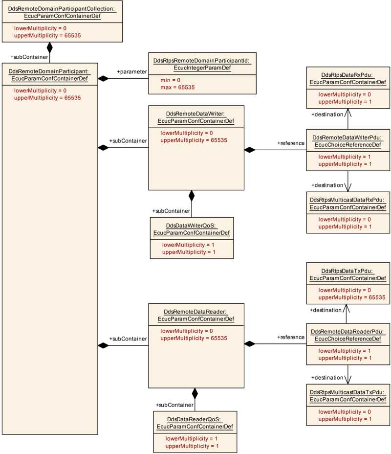

###### 9.2.3.3.1.10.1.1. DdsRemoteDataWriter

| SWS 条目 | [ECUC_Dds_00163] |
| --- | --- |
| 容器名称 | DdsRemoteDataWriter |
| 父容器 | DdsRemoteDomainParticipant |
| 描述 | 特定远程 **DataWriter** 的配置。 |

| SWS 条目 | [ECUC_Dds_00164] |
| --- | --- |
| 参数名称 | DdsRemoteDataWriterPdu |
| 父容器 | DdsRemoteDataWriter |
| 描述 | 用于从给定远程 **DataWriter** 接收数据的 **PDU**。它既可能引用单播 **PDU**，也可能引用多播 **PDU**（选择引用 **DdsRtpsDataRxPdu** 或 **DdsRtpsMulticastDataRxPdu**）。 |
| 多重性 | 1 |
| 类型 | 对 [DdsRtpsDataRxPdu, DdsRtpsMulticastDataRxPdu] 的选择引用 |
| 取值范围 | - |
| 默认值 | - |
| Post-Build 变体值 | false |
| 值配置类 | Pre-compile time：X（All Variants）；Link time：-；Post-build time：- |
| 作用域/依赖 | scope: ECU |

###### 9.2.3.3.1.10.1.2. DdsRemoteDataReader

| SWS 条目 | [ECUC_Dds_00165] |
| --- | --- |
| 容器名称 | DdsRemoteDataReader |
| 父容器 | DdsRemoteDomainParticipant |
| 描述 | 特定远程 **DataReader** 的配置。 |

| SWS 条目 | [ECUC_Dds_00166] |
| --- | --- |
| 参数名称 | DdsRemoteDataReaderPdu |
| 父容器 | DdsRemoteDataReader |
| 描述 | 用于向给定远程 **DataReader** 发送数据的 **PDU**。它既可能引用单播 **PDU**，也可能引用多播 **PDU**（选择引用 **DdsRtpsDataTxPdu** 或 **DdsRtpsMulticastDataTxPdu**）。 |
| 多重性 | 1 |
| 类型 | 对 [DdsRtpsDataTxPdu, DdsRtpsMulticastDataTxPdu] 的选择引用 |
| 取值范围 | - |
| 默认值 | - |
| Post-Build 变体值 | false |
| 值配置类 | Pre-compile time：X（All Variants）；Link time：-；Post-build time：- |
| 作用域/依赖 | scope: ECU |

##### 9.2.3.4. DdsQoSPolicies

该容器包含 **Dds** 模块所支持的 **QoS** 策略的配置。各 **QoS** 策略的具体语义以 [\[1\]](#ref-1) 中对应章节的定义为准。

###### 9.2.3.4.1. DdsUserData

| SWS 条目 | [ECUC_Dds_00019] |
| --- | --- |
| 容器名称 | DdsUserData |
| 父容器 | DdsDataReaderQoS、DdsDataWriterQoS、DdsDomainParticipantQoS |
| 描述 | 描述 **DDS** 的 **USER_DATA** **QoS** 策略。 |

| SWS 条目 | [ECUC_Dds_00124] |
| --- | --- |
| 参数名称 | DdsUserDataValue |
| 父容器 | DdsUserData |
| 描述 | 参见 **DDS** [\[1\]](#ref-1) 的 "**USER_DATA**" 章。 |
| 多重性 | 1 |
| 类型 | EcucStringParamDef |
| 取值范围 | - |
| 默认值 | - |
| Post-Build 变体值 | false |
| 值配置类 | Pre-compile time：X（All Variants）；Link time：-；Post-build time：- |
| 作用域/依赖 | scope: ECU |

###### 9.2.3.4.2. DdsTopicData

| SWS 条目 | [ECUC_Dds_00106] |
| --- | --- |
| 容器名称 | DdsTopicData |
| 父容器 | DdsTopicQoS |
| 描述 | 描述 **DDS** 的 **TOPIC_DATA** **QoS** 策略。 |

| SWS 条目 | [ECUC_Dds_00126] |
| --- | --- |
| 参数名称 | DdsTopicDataValue |
| 父容器 | DdsTopicData |
| 描述 | 参见 **DDS** [\[1\]](#ref-1) 的 "**TOPIC_DATA**" 章。 |
| 多重性 | 1 |
| 类型 | EcucStringParamDef |
| 取值范围 | - |
| 默认值 | - |
| Post-Build 变体值 | false |
| 值配置类 | Pre-compile time：X（All Variants）；Link time：-；Post-build time：- |
| 作用域/依赖 | scope: ECU |

###### 9.2.3.4.3. DdsGroupData

| SWS 条目 | [ECUC_Dds_00024] |
| --- | --- |
| 容器名称 | DdsGroupData |
| 父容器 | DdsPublisherQoS、DdsSubscriberQoS |
| 描述 | 描述 **DDS** 的 **GROUP_DATA** **QoS** 策略。 |

| SWS 条目 | [ECUC_Dds_00125] |
| --- | --- |
| 参数名称 | DdsGroupDataValue |
| 父容器 | DdsGroupData |
| 描述 | 参见 **DDS** [\[1\]](#ref-1) 的 "**GROUP_DATA**" 章。 |
| 多重性 | 1 |
| 类型 | EcucStringParamDef |
| 取值范围 | - |
| 默认值 | - |
| Post-Build 变体值 | false |
| 值配置类 | Pre-compile time：X（All Variants）；Link time：-；Post-build time：- |
| 作用域/依赖 | scope: ECU |

###### 9.2.3.4.4. DdsDurability

| SWS 条目 | [ECUC_Dds_00034] |
| --- | --- |
| 容器名称 | DdsDurability |
| 父容器 | DdsDataWriterQoS、DdsTopicQoS |
| 描述 | 描述 **DDS** 的 **DURABILITY** **QoS** 策略。 |

| SWS 条目 | [ECUC_Dds_00035] |
| --- | --- |
| 参数名称 | DdsDurabilityKind |
| 父容器 | DdsDurability |
| 描述 | 参见 **DDS** [\[1\]](#ref-1) 的 "**DURABILITY**" 章。 |
| 多重性 | 1 |
| 类型 | EcucEnumerationParamDef |
| 取值范围 | PERSISTENT（其余取值见 [\[1\]](#ref-1) "DURABILITY" 章） |
| 默认值 | VOLATILE |
| Post-Build 变体值 | false |
| 值配置类 | Pre-compile time：X（All Variants）；Link time：-；Post-build time：- |
| 作用域/依赖 | scope: ECU |

###### 9.2.3.4.5. DdsDurabilityService

| SWS 条目 | [ECUC_Dds_00036] |
| --- | --- |
| 容器名称 | DdsDurabilityService |
| 父容器 | DdsDataWriterQoS、DdsTopicQoS |
| 描述 | 描述 **DDS** 的 **DURABILITY_SERVICE** **QoS** 策略。 |

| SWS 条目 | [ECUC_Dds_00037] |
| --- | --- |
| 参数名称 | DdsDurabilityServiceCleanupDelay |
| 父容器 | DdsDurabilityService |
| 描述 | 参见 **DDS** [\[1\]](#ref-1) 的 "**DURABILITY_SERVICE**" 章。时间单位为秒。 |
| 多重性 | 1 |
| 类型 | EcucFloatParamDef |
| 取值范围 | [0 .. 65.534] |
| 默认值 | - |
| Post-Build 变体值 | false |
| 值配置类 | Pre-compile time：X（All Variants）；Link time：-；Post-build time：- |
| 作用域/依赖 | scope: ECU |

| SWS 条目 | [ECUC_Dds_00119] |
| --- | --- |
| 参数名称 | DdsDurabilityServiceHistoryDepth |
| 父容器 | DdsDurabilityService |
| 描述 | 参见 **DDS** [\[1\]](#ref-1) 的 "**DURABILITY_SERVICE**" 章。 |
| 多重性 | 1 |
| 类型 | EcucIntegerParamDef |
| 取值范围 | 0 .. 65534 |
| 默认值 | - |
| Post-Build 变体值 | false |
| 值配置类 | Pre-compile time：X（All Variants）；Link time：-；Post-build time：- |
| 作用域/依赖 | scope: ECU |

| SWS 条目 | [ECUC_Dds_00038] |
| --- | --- |
| 参数名称 | DdsDurabilityServiceHistoryKind |
| 父容器 | DdsDurabilityService |
| 描述 | 参见 **DDS** [\[1\]](#ref-1) 的 "**DURABILITY_SERVICE**" 章。 |
| 多重性 | 1 |
| 类型 | EcucEnumerationParamDef |
| 取值范围 | KEEP_ALL、KEEP_LAST |
| 默认值 | KEEP_LAST |
| Post-Build 变体值 | false |
| 值配置类 | Pre-compile time：X（All Variants）；Link time：-；Post-build time：- |
| 作用域/依赖 | scope: ECU |

| SWS 条目 | [ECUC_Dds_00121] |
| --- | --- |
| 参数名称 | DdsDurabilityServiceMaxInstances |
| 父容器 | DdsDurabilityService |
| 描述 | 参见 **DDS** [\[1\]](#ref-1) 的 "**DURABILITY_SERVICE**" 章。 |
| 多重性 | 1 |
| 类型 | EcucIntegerParamDef |
| 取值范围 | 0 .. 65534 |
| 默认值 | - |
| Post-Build 变体值 | false |
| 值配置类 | Pre-compile time：X（All Variants）；Link time：-；Post-build time：- |
| 作用域/依赖 | scope: ECU |

| SWS 条目 | [ECUC_Dds_00120] |
| --- | --- |
| 参数名称 | DdsDurabilityServiceMaxSamples |
| 父容器 | DdsDurabilityService |
| 描述 | 参见 **DDS** [\[1\]](#ref-1) 的 "**DURABILITY_SERVICE**" 章。 |
| 多重性 | 1 |
| 类型 | EcucIntegerParamDef |
| 取值范围 | 0 .. 65534 |
| 默认值 | - |
| Post-Build 变体值 | false |
| 值配置类 | Pre-compile time：X（All Variants）；Link time：-；Post-build time：- |
| 作用域/依赖 | scope: ECU |

| SWS 条目 | [ECUC_Dds_00122] |
| --- | --- |
| 参数名称 | DdsDurabilityServiceMaxSamplesPerInstance |
| 父容器 | DdsDurabilityService |
| 描述 | 参见 **DDS** [\[1\]](#ref-1) 的 "**DURABILITY_SERVICE**" 章。 |
| 多重性 | 1 |
| 类型 | EcucIntegerParamDef |
| 取值范围 | 0 .. 65534 |
| 默认值 | - |
| Post-Build 变体值 | false |
| 值配置类 | Pre-compile time：X（All Variants）；Link time：-；Post-build time：- |
| 作用域/依赖 | scope: ECU |

###### 9.2.3.4.6. DdsPresentation

| SWS 条目 | [ECUC_Dds_00025] |
| --- | --- |
| 容器名称 | DdsPresentation |
| 父容器 | DdsPublisherQoS、DdsSubscriberQoS |
| 描述 | 描述 **DDS** 的 **PRESENTATION** **QoS** 策略。 |

| SWS 条目 | [ECUC_Dds_00069] |
| --- | --- |
| 参数名称 | DdsPresentationAccessScope |
| 父容器 | DdsPresentation |
| 描述 | 参见 **DDS** [\[1\]](#ref-1) 的 "**PRESENTATION**" 章。 |
| 多重性 | 1 |
| 类型 | EcucEnumerationParamDef |
| 取值范围 | GROUP、INSTANCE、TOPIC |
| 默认值 | - |
| Post-Build 变体值 | false |
| 值配置类 | Pre-compile time：X（All Variants）；Link time：-；Post-build time：- |
| 作用域/依赖 | scope: ECU |

| SWS 条目 | [ECUC_Dds_00070] |
| --- | --- |
| 参数名称 | DdsPresentationCoherentAccess |
| 父容器 | DdsPresentation |
| 描述 | 参见 **DDS** [\[1\]](#ref-1) 的 "**PRESENTATION**" 章。 |
| 多重性 | 1 |
| 类型 | EcucBooleanParamDef |
| 取值范围 | - |
| 默认值 | - |
| Post-Build 变体值 | false |
| 值配置类 | Pre-compile time：X（All Variants）；Link time：-；Post-build time：- |
| 作用域/依赖 | scope: local |

| SWS 条目 | [ECUC_Dds_00071] |
| --- | --- |
| 参数名称 | DdsPresentationOrderedAccess |
| 父容器 | DdsPresentation |
| 描述 | 参见 **DDS** [\[1\]](#ref-1) 的 "**PRESENTATION**" 章。 |
| 多重性 | 1 |
| 类型 | EcucBooleanParamDef |
| 取值范围 | - |
| 默认值 | - |
| Post-Build 变体值 | false |
| 值配置类 | Pre-compile time：X（All Variants）；Link time：-；Post-build time：- |
| 作用域/依赖 | scope: local |

###### 9.2.3.4.7. DdsDeadline

| SWS 条目 | [ECUC_Dds_00039] |
| --- | --- |
| 容器名称 | DdsDeadline |
| 父容器 | DdsDataReaderQoS、DdsDataWriterQoS、DdsTopicQoS |
| 描述 | 描述 **DDS** 的 **DEADLINE** **QoS** 策略。 |

| SWS 条目 | [ECUC_Dds_00040] |
| --- | --- |
| 参数名称 | DdsDeadlinePeriod |
| 父容器 | DdsDeadline |
| 描述 | 参见 **DDS** [\[1\]](#ref-1) 的 "**DEADLINE**" 章。时间单位为秒。 |
| 多重性 | 1 |
| 类型 | EcucFloatParamDef |
| 取值范围 | [0 .. 65.534] |
| 默认值 | - |
| Post-Build 变体值 | false |
| 值配置类 | Pre-compile time：X（All Variants）；Link time：-；Post-build time：- |
| 作用域/依赖 | scope: ECU |

###### 9.2.3.4.8. DdsLatencyBudget

| SWS 条目 | [ECUC_Dds_00041] |
| --- | --- |
| 容器名称 | DdsLatencyBudget |
| 父容器 | DdsDataReaderQoS、DdsDataWriterQoS、DdsTopicQoS |
| 描述 | 描述 **DDS** 的 **LATENCY_BUDGET** **QoS** 策略。 |

| SWS 条目 | [ECUC_Dds_00042] |
| --- | --- |
| 参数名称 | DdsLatencyBudgetDuration |
| 父容器 | DdsLatencyBudget |
| 描述 | 参见 **DDS** [\[1\]](#ref-1) 的 "**LATENCY_BUDGET**" 章。时间单位为秒。 |
| 多重性 | 1 |
| 类型 | EcucFloatParamDef |
| 取值范围 | [0 .. 65.534] |
| 默认值 | - |
| Post-Build 变体值 | false |
| 值配置类 | Pre-compile time：X（All Variants）；Link time：-；Post-build time：- |
| 作用域/依赖 | scope: ECU |

###### 9.2.3.4.9. DdsOwnership

| SWS 条目 | [ECUC_Dds_00043] |
| --- | --- |
| 容器名称 | DdsOwnership |
| 父容器 | DdsDataReaderQoS、DdsDataWriterQoS、DdsTopicQoS |
| 描述 | 描述 **DDS** 的 **OWNERSHIP** **QoS** 策略。 |

| SWS 条目 | [ECUC_Dds_00044] |
| --- | --- |
| 参数名称 | DdsOwnershipKind |
| 父容器 | DdsOwnership |
| 描述 | 参见 **DDS** [\[1\]](#ref-1) 的 "**OWNERSHIP**" 章。 |
| 多重性 | 1 |
| 类型 | EcucEnumerationParamDef |
| 取值范围 | EXCLUSIVE、SHARED |
| 默认值 | SHARED |
| Post-Build 变体值 | false |
| 值配置类 | Pre-compile time：X（All Variants）；Link time：-；Post-build time：- |
| 作用域/依赖 | scope: ECU |

###### 9.2.3.4.10. DdsOwnershipStrength

| SWS 条目 | [ECUC_Dds_00045] |
| --- | --- |
| 容器名称 | DdsOwnershipStrength |
| 父容器 | DdsDataWriterQoS |
| 描述 | 描述 **DDS** 的 **OWNERSHIP_STRENGTH** **QoS** 策略。 |

| SWS 条目 | [ECUC_Dds_00046] |
| --- | --- |
| 参数名称 | DdsOwnershipStrengthValue |
| 父容器 | DdsOwnershipStrength |
| 描述 | 参见 **DDS** [\[1\]](#ref-1) 的 "**OWNERSHIP_STRENGTH**" 章。 |
| 多重性 | 1 |
| 类型 | EcucIntegerParamDef |
| 取值范围 | 0 .. 65534 |
| 默认值 | 0 |
| Post-Build 变体值 | false |
| 值配置类 | Pre-compile time：X（All Variants）；Link time：-；Post-build time：- |
| 作用域/依赖 | scope: ECU |

###### 9.2.3.4.11. DdsLiveliness

| SWS 条目 | [ECUC_Dds_00047] |
| --- | --- |
| 容器名称 | DdsLiveliness |
| 父容器 | DdsDataReaderQoS、DdsDataWriterQoS、DdsTopicQoS |
| 描述 | 描述 **DDS** 的 **LIVELINESS** **QoS** 策略。 |

| SWS 条目 | [ECUC_Dds_00049] |
| --- | --- |
| 参数名称 | DdsLivelinessLeaseDuration |
| 父容器 | DdsLiveliness |
| 描述 | 参见 **DDS** [\[1\]](#ref-1) 的 "**LIVELINESS**" 章。时间单位为秒。 |
| 多重性 | 1 |
| 类型 | EcucFloatParamDef |
| 取值范围 | [0 .. 65.534] |
| 默认值 | - |
| Post-Build 变体值 | false |
| 值配置类 | Pre-compile time：X（All Variants）；Link time：-；Post-build time：- |
| 作用域/依赖 | scope: ECU |

| SWS 条目 | [ECUC_Dds_00048] |
| --- | --- |
| 参数名称 | DdsLivenessKind |
| 父容器 | DdsLiveliness |
| 描述 | 参见 **DDS** [\[1\]](#ref-1) 的 "**LIVELINESS**" 章。 |
| 多重性 | 1 |
| 类型 | EcucEnumerationParamDef |
| 取值范围 | AUTOMATIC、MANUAL_BY_PARTICIPANT、MANUAL_BY_TOPIC |
| 默认值 | AUTOMATIC |
| Post-Build 变体值 | false |
| 值配置类 | Pre-compile time：X（All Variants）；Link time：-；Post-build time：- |
| 作用域/依赖 | scope: ECU |

###### 9.2.3.4.12. DdsTimeBasedFilter

| SWS 条目 | [ECUC_Dds_00087] |
| --- | --- |
| 容器名称 | DdsTimeBasedFilter |
| 父容器 | DdsDataReaderQoS |
| 描述 | 描述 **DDS** 的 **TIME_BASED_FILTER** **QoS** 策略。 |

| SWS 条目 | [ECUC_Dds_00088] |
| --- | --- |
| 参数名称 | DdsTimeBasedFilterMinimumSeparation |
| 父容器 | DdsTimeBasedFilter |
| 描述 | 参见 **DDS** [\[1\]](#ref-1) 的 "**TIME_BASED_FILTER**" 章。时间单位为秒。 |
| 多重性 | 1 |
| 类型 | EcucFloatParamDef |
| 取值范围 | [0 .. 65.534] |
| 默认值 | - |
| Post-Build 变体值 | false |
| 值配置类 | Pre-compile time：X（All Variants）；Link time：-；Post-build time：- |
| 作用域/依赖 | scope: ECU |

###### 9.2.3.4.13. DdsPartition

| SWS 条目 | [ECUC_Dds_00026] |
| --- | --- |
| 容器名称 | DdsPartition |
| 父容器 | DdsPublisherQoS、DdsSubscriberQoS |
| 描述 | 描述 **DDS** 的 **PARTITION** **QoS** 策略。 |

| SWS 条目 | [ECUC_Dds_00072] |
| --- | --- |
| 参数名称 | DdsPartitionName |
| 父容器 | DdsPartition |
| 描述 | 参见 **DDS** [\[1\]](#ref-1) 的 "**PARTITION**" 章。 |
| 多重性 | 1..65534 |
| 类型 | EcucStringParamDef |
| 取值范围 | - |
| 默认值 | - |
| Post-Build 变体值 | false |
| 值配置类 | Pre-compile time：X（All Variants）；Link time：-；Post-build time：- |
| 作用域/依赖 | scope: ECU |

###### 9.2.3.4.14. DdsReliability

| SWS 条目 | [ECUC_Dds_00050] |
| --- | --- |
| 容器名称 | DdsReliability |
| 父容器 | DdsDataReaderQoS、DdsDataWriterQoS、DdsTopicQoS |
| 描述 | 描述 **DDS** 的 **RELIABILITY** **QoS** 策略。 |

| SWS 条目 | [ECUC_Dds_00051] |
| --- | --- |
| 参数名称 | DdsReliabilityKind |
| 父容器 | DdsReliability |
| 描述 | 参见 **DDS** [\[1\]](#ref-1) 的 "**RELIABILITY**" 章。 |
| 多重性 | 1 |
| 类型 | EcucEnumerationParamDef |
| 取值范围 | BEST_EFFORT、RELIABLE |
| 默认值 | - |
| Post-Build 变体值 | false |
| 值配置类 | Pre-compile time：X（All Variants）；Link time：-；Post-build time：- |
| 作用域/依赖 | scope: ECU |

| SWS 条目 | [ECUC_Dds_00052] |
| --- | --- |
| 参数名称 | DdsReliabilityMaxBlockingTime |
| 父容器 | DdsReliability |
| 描述 | 参见 **DDS** [\[1\]](#ref-1) 的 "**RELIABILITY**" 章。时间单位为秒。 |
| 多重性 | 1 |
| 类型 | EcucFloatParamDef |
| 取值范围 | [0 .. 65.534] |
| 默认值 | 0.1 |
| Post-Build 变体值 | false |
| 值配置类 | Pre-compile time：X（All Variants）；Link time：-；Post-build time：- |
| 作用域/依赖 | scope: ECU |

###### 9.2.3.4.15. DdsTransportPriority

| SWS 条目 | [ECUC_Dds_00053] |
| --- | --- |
| 容器名称 | DdsTransportPriority |
| 父容器 | DdsDataWriterQoS、DdsTopicQoS |
| 描述 | 描述 **DDS** 的 **TRANSPORT_PRIORITY** **QoS** 策略。 |

| SWS 条目 | [ECUC_Dds_00054] |
| --- | --- |
| 参数名称 | DdsTransportPriorityValue |
| 父容器 | DdsTransportPriority |
| 描述 | 参见 **DDS** [\[1\]](#ref-1) 的 "**TRANSPORT_PRIORITY**" 章。 |
| 多重性 | 1 |
| 类型 | EcucIntegerParamDef |
| 取值范围 | 0 .. 65534 |
| 默认值 | 0 |
| Post-Build 变体值 | false |
| 值配置类 | Pre-compile time：X（All Variants）；Link time：-；Post-build time：- |
| 作用域/依赖 | scope: ECU |

###### 9.2.3.4.16. DdsLifespan

| SWS 条目 | [ECUC_Dds_00055] |
| --- | --- |
| 容器名称 | DdsLifespan |
| 父容器 | DdsDataWriterQoS、DdsTopicQoS |
| 描述 | 描述 **DDS** 的 **LIFESPAN** **QoS** 策略。 |

| SWS 条目 | [ECUC_Dds_00056] |
| --- | --- |
| 参数名称 | DdsLifespanDuration |
| 父容器 | DdsLifespan |
| 描述 | 参见 **DDS** [\[1\]](#ref-1) 的 "**LIFESPAN**" 章。时间单位为秒。 |
| 多重性 | 1 |
| 类型 | EcucFloatParamDef |
| 取值范围 | [0 .. 65.534] |
| 默认值 | - |
| Post-Build 变体值 | false |
| 值配置类 | Pre-compile time：X（All Variants）；Link time：-；Post-build time：- |
| 作用域/依赖 | scope: ECU |

###### 9.2.3.4.17. DdsDestinationOrder

| SWS 条目 | [ECUC_Dds_00057] |
| --- | --- |
| 容器名称 | DdsDestinationOrder |
| 父容器 | DdsDataReaderQoS、DdsDataWriterQoS、DdsTopicQoS |
| 描述 | 描述 **DDS** 的 **DESTINATION_ORDER** **QoS** 策略。 |

| SWS 条目 | [ECUC_Dds_00058] |
| --- | --- |
| 参数名称 | DdsDestinationOrderKind |
| 父容器 | DdsDestinationOrder |
| 描述 | 参见 **DDS** [\[1\]](#ref-1) 的 "**DESTINATION_ORDER**" 章。 |
| 多重性 | 1 |
| 类型 | EcucEnumerationParamDef |
| 取值范围 | BY_RECEPTION_TIMESTAMP、BY_SOURCE_TIMESTAMP |
| 默认值 | BY_RECEPTION_TIMESTAMP |
| Post-Build 变体值 | false |
| 值配置类 | Pre-compile time：X（All Variants）；Link time：-；Post-build time：- |
| 作用域/依赖 | scope: ECU |

###### 9.2.3.4.18. DdsHistory

| SWS 条目 | [ECUC_Dds_00059] |
| --- | --- |
| 容器名称 | DdsHistory |
| 父容器 | DdsDataReaderQoS、DdsDataWriterQoS、DdsTopicQoS |
| 描述 | 描述 **DDS** 的 **HISTORY** **QoS** 策略。 |

| SWS 条目 | [ECUC_Dds_00060] |
| --- | --- |
| 参数名称 | DdsHistoryKind |
| 父容器 | DdsHistory |
| 描述 | 参见 **DDS** [\[1\]](#ref-1) 的 "**HISTORY**" 章。 |
| 多重性 | 1 |
| 类型 | EcucEnumerationParamDef |
| 取值范围 | KEEP_ALL、KEEP_LAST |
| 默认值 | KEEP_LAST |
| Post-Build 变体值 | false |
| 值配置类 | Pre-compile time：X（All Variants）；Link time：-；Post-build time：- |
| 作用域/依赖 | scope: ECU |

| SWS 条目 | [ECUC_Dds_00063] |
| --- | --- |
| 参数名称 | DdsHistoryOrderDepth |
| 父容器 | DdsHistory |
| 描述 | 参见 **DDS** [\[1\]](#ref-1) 的 "**HISTORY**" 章。 |
| 多重性 | 1 |
| 类型 | EcucIntegerParamDef |
| 取值范围 | 0 .. 65534 |
| 默认值 | 1 |
| Post-Build 变体值 | false |
| 值配置类 | Pre-compile time：X（All Variants）；Link time：-；Post-build time：- |
| 作用域/依赖 | scope: ECU |

###### 9.2.3.4.19. DdsResourceLimits

| SWS 条目 | [ECUC_Dds_00061] |
| --- | --- |
| 容器名称 | DdsResourceLimits |
| 父容器 | DdsDataReaderQoS、DdsDataWriterQoS、DdsTopicQoS |
| 描述 | 描述 **DDS** 的 **RESOURCE_LIMITS** **QoS** 策略。 |

| SWS 条目 | [ECUC_Dds_00064] |
| --- | --- |
| 参数名称 | DdsResouceLimitsMaxInstances |
| 父容器 | DdsResourceLimits |
| 描述 | 参见 **DDS** [\[1\]](#ref-1) 的 "**RESOURCE_LIMITS**" 章。 |
| 多重性 | 1 |
| 类型 | EcucIntegerParamDef |
| 取值范围 | 0 .. 65534 |
| 默认值 | 65534 |
| Post-Build 变体值 | false |
| 值配置类 | Pre-compile time：X（All Variants）；Link time：-；Post-build time：- |
| 作用域/依赖 | scope: ECU |

| SWS 条目 | [ECUC_Dds_00062] |
| --- | --- |
| 参数名称 | DdsResouceLimitsMaxSamples |
| 父容器 | DdsResourceLimits |
| 描述 | 参见 **DDS** [\[1\]](#ref-1) 的 "**RESOURCE_LIMITS**" 章。 |
| 多重性 | 1 |
| 类型 | EcucIntegerParamDef |
| 取值范围 | 0 .. 65534 |
| 默认值 | 65534 |
| Post-Build 变体值 | false |
| 值配置类 | Pre-compile time：X（All Variants）；Link time：-；Post-build time：- |
| 作用域/依赖 | scope: ECU |

| SWS 条目 | [ECUC_Dds_00065] |
| --- | --- |
| 参数名称 | DdsResouceLimitsMaxSamplesPerInstance |
| 父容器 | DdsResourceLimits |
| 描述 | 参见 **DDS** [\[1\]](#ref-1) 的 "**RESOURCE_LIMITS**" 章。 |
| 多重性 | 1 |
| 类型 | EcucIntegerParamDef |
| 取值范围 | 0 .. 65534 |
| 默认值 | 65534 |
| Post-Build 变体值 | false |
| 值配置类 | Pre-compile time：X（All Variants）；Link time：-；Post-build time：- |
| 作用域/依赖 | scope: ECU |

###### 9.2.3.4.20. DdsEntityFactory

| SWS 条目 | [ECUC_Dds_00027] |
| --- | --- |
| 容器名称 | DdsEntityFactory |
| 父容器 | DdsDomainParticipantQoS、DdsPublisherQoS、DdsSubscriberQoS |
| 描述 | 描述 **DDS** 的 **ENTITY_FACTORY** **QoS** 策略。 |

| SWS 条目 | [ECUC_Dds_00073] |
| --- | --- |
| 参数名称 | DdsEntityFactoryAutoenableCreatedEntities |
| 父容器 | DdsEntityFactory |
| 描述 | 参见 **DDS** [\[1\]](#ref-1) 的 "**ENTITY_FACTORY**" 章。 |
| 多重性 | 1 |
| 类型 | EcucBooleanParamDef |
| 取值范围 | - |
| 默认值 | true |
| Post-Build 变体值 | false |
| 值配置类 | Pre-compile time：X（All Variants）；Link time：-；Post-build time：- |
| 作用域/依赖 | scope: local |

###### 9.2.3.4.21. DdsWriterDataLifecycle

| SWS 条目 | [ECUC_Dds_00066] |
| --- | --- |
| 容器名称 | DdsWriterDataLifecycle |
| 父容器 | DdsDataWriterQoS |
| 描述 | 描述 **DDS** 的 **WRITER_DATA_LIFECYCLE** **QoS** 策略。 |

| SWS 条目 | [ECUC_Dds_00067] |
| --- | --- |
| 参数名称 | DdsAutodisposeUnregisteredInstances |
| 父容器 | DdsWriterDataLifecycle |
| 描述 | 参见 **DDS** [\[1\]](#ref-1) 的 "**WRITER_DATA_LIFECYCLE**" 章。 |
| 多重性 | 1 |
| 类型 | EcucBooleanParamDef |
| 取值范围 | - |
| 默认值 | true |
| Post-Build 变体值 | false |
| 值配置类 | Pre-compile time：X（All Variants）；Link time：-；Post-build time：- |
| 作用域/依赖 | scope: local |

###### 9.2.3.4.22. DdsReaderDataLifecycle

| SWS 条目 | [ECUC_Dds_00095] |
| --- | --- |
| 容器名称 | DdsReaderDataLifecycle |
| 父容器 | DdsDataReaderQoS |
| 描述 | 描述 **DDS** 的 **READER_DATA_LIFECYCLE** **QoS** 策略。 |

| SWS 条目 | [ECUC_Dds_00097] |
| --- | --- |
| 参数名称 | DdsAutopurgeDisposedSamplesDelay |
| 父容器 | DdsReaderDataLifecycle |
| 描述 | 参见 **DDS** [\[1\]](#ref-1) 的 "**READER_DATA_LIFECYCLE**" 章。 |
| 多重性 | 1 |
| 类型 | EcucIntegerParamDef |
| 取值范围 | 0 .. 65534 |
| 默认值 | 65534 |
| Post-Build 变体值 | false |
| 值配置类 | Pre-compile time：X（All Variants）；Link time：-；Post-build time：- |
| 作用域/依赖 | scope: ECU |

| SWS 条目 | [ECUC_Dds_00096] |
| --- | --- |
| 参数名称 | DdsAutopurgeNowriterSamplesDelay |
| 父容器 | DdsReaderDataLifecycle |
| 描述 | 参见 **DDS** [\[1\]](#ref-1) 的 "**READER_DATA_LIFECYCLE**" 章。 |
| 多重性 | 1 |
| 类型 | EcucIntegerParamDef |
| 取值范围 | 0 .. 65534 |
| 默认值 | 65534 |
| Post-Build 变体值 | false |
| 值配置类 | Pre-compile time：X（All Variants）；Link time：-；Post-build time：- |
| 作用域/依赖 | scope: ECU |

### 9.3. 发布信息

详细信息请参见 [3, SWS BSW General] 的第 10.3 章 "发布信息（**Published Information**）"。

## B. AUTOSAR 可追溯项变更历史

请注意，本章中的列表还包含在后续版本中已从规范中移除的可追溯项。这些条目不会在文档中显示为超链接。

### B.1. 根据 AUTOSAR R22-11 的本文档可追溯项历史

#### B.1.1. R22-11 中新增的规范条目

表 B.1：R22-11 中新增的规范条目

```text
SWS_Dds_00726
SWS_Dds_00727
SWS_Dds_00728
SWS_Dds_00729
SWS_Dds_00730
SWS_Dds_00731
SWS_Dds_00734
SWS_Dds_00735
SWS_Dds_00750
SWS_Dds_00752
SWS_Dds_00753
SWS_Dds_00756
SWS_Dds_00758
SWS_Dds_00761
SWS_Dds_00762
SWS_Dds_00763
SWS_Dds_00766
SWS_Dds_00769
SWS_Dds_00772
SWS_Dds_00773
SWS_Dds_00801
SWS_Dds_00802
SWS_Dds_00810
SWS_Dds_00811
SWS_Dds_00812
SWS_Dds_00813
SWS_Dds_00820
SWS_Dds_00821
SWS_Dds_00823
SWS_Dds_00824
SWS_Dds_00825
SWS_Dds_00826
SWS_Dds_00827
SWS_Dds_00828
SWS_Dds_00829
SWS_Dds_00830
SWS_Dds_00831
SWS_Dds_00832
SWS_Dds_00833
SWS_Dds_00835
SWS_Dds_00841
SWS_Dds_00843
SWS_Dds_00851
SWS_Dds_00852
SWS_Dds_00854
SWS_Dds_00855
SWS_Dds_00861
SWS_Dds_00862
SWS_Dds_00863
SWS_Dds_00864
SWS_Dds_00871
SWS_Dds_00872
SWS_Dds_00881
SWS_Dds_00882
SWS_Dds_00883
SWS_Dds_00884
SWS_Dds_01001
SWS_Dds_CONSTR_00712
SWS_Dds_CONSTR_00725
SWS_Dds_CONSTR_00732
SWS_Dds_CONSTR_00733
SWS_Dds_CONSTR_00743
SWS_Dds_CONSTR_00754
```

#### B.1.2. R22-11 中变更的规范条目

无。

#### B.1.3. R22-11 中删除的规范条目

无。

### B.2. 根据 AUTOSAR 发布版本 R23-11 的本文档可追溯项历史

#### B.2.1. R23-11 中新增的规范条目

表 B.2：R23-11 中新增的规范条目

```text
SWS_Dds_00736
SWS_Dds_00764
SWS_Dds_00834
SWS_Dds_00836
SWS_Dds_00837
SWS_Dds_00838
SWS_Dds_00859
SWS_Dds_00873
```

#### B.2.2. R23-11 中变更的规范条目

表 B.3：R23-11 中变更的规范条目

```text
SWS_Dds_00726
SWS_Dds_00734
SWS_Dds_00735
SWS_Dds_00753
SWS_Dds_00756
SWS_Dds_00761
SWS_Dds_00762
SWS_Dds_00763
SWS_Dds_00766
SWS_Dds_00772
SWS_Dds_00773
SWS_Dds_00801
SWS_Dds_00802
SWS_Dds_00811
SWS_Dds_00813
SWS_Dds_00823
SWS_Dds_00824
SWS_Dds_00825
SWS_Dds_00826
SWS_Dds_00827
SWS_Dds_00828
SWS_Dds_00829
SWS_Dds_00830
SWS_Dds_00831
SWS_Dds_00832
SWS_Dds_00833
SWS_Dds_00835
SWS_Dds_00841
SWS_Dds_00843
SWS_Dds_00851
SWS_Dds_00852
SWS_Dds_00854
SWS_Dds_00855
SWS_Dds_00862
SWS_Dds_00863
SWS_Dds_00864
SWS_Dds_00882
SWS_Dds_01001
```

#### B.2.3. R23-11 中删除的规范条目

表 B.4：R23-11 中删除的规范条目

```text
SWS_Dds_00727
SWS_Dds_00884
```

#### B.2.4. R23-11 中新增的约束

表 B.5：R23-11 中新增的约束

```text
SWS_Dds_CONSTR_00865
SWS_Dds_CONSTR_00866
SWS_Dds_CONSTR_00867
SWS_Dds_CONSTR_00868
SWS_Dds_CONSTR_00884
```

#### B.2.5. R23-11 中变更的约束

表 B.6：R23-11 中变更的约束

```text
SWS_Dds_CONSTR_00712
SWS_Dds_CONSTR_00725
SWS_Dds_CONSTR_00732
SWS_Dds_CONSTR_00743
SWS_Dds_CONSTR_00754
```

#### B.2.6. R23-11 中删除的约束

无。

