## 1. 简介和功能概述

本规范描述 AUTOSAR 基础软件模块 **Dlt** 的功能和配置。

它接收来自 **DET**、**DEM**、**SW-C** 的日志信息，或 **RTE** 的跟踪信息。**Dlt** 模块通过通信总线发送这些数据，使这些信息在 ECU 之外可见。

为此，**Dlt** 模块定义了用于在总线上发送和接收专用日志/跟踪信息的 **API**。

此外，可以选择使用 **NvM** 模块将 **Dlt** 模块更新后的过滤设置持久存储。这使得 ECU 无需在每次 ECU 启动时都通过通信总线（通过日志工具）发出显式的设置请求，就能以期望的级别发送日志/跟踪信息。

**Dlt** 模块位于 **PduR** 之上、RTE 之下，如图 1.1 所示。

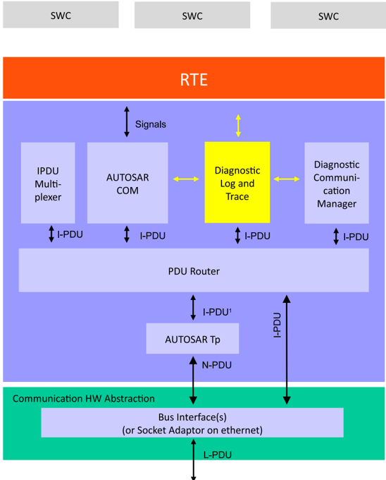

请注意：**Dlt** 消息格式、可用的命令以及（用于与外部日志和跟踪工具通信的）协议在 [\[1\]](#ref-1) 中定义。

## 2. 缩略语

下表列出了与诊断日志和跟踪（**Diagnostic Log and Trace**）模块相关、但未包含在 [\[2\]](#ref-2) 或 [\[3\]](#ref-3) 中的首字母缩略词、缩略语和定义。

**APID**
> Application ID —— 应用 ID。

**CTID**
> Context ID —— 上下文 ID。

**Dlt**
> Diagnostic Log and Trace —— 诊断日志与跟踪。

**MCNT**
> Message Counter —— 消息计数器。

**MSBF**
> Most Significant Byte First —— 最高有效字节在前。

**MSBI**
> Message Bus Info —— 消息总线信息。

**MSCI**
> Message Control Info —— 消息控制信息。

**MSLI**
> Message Log Info —— 消息日志信息。

**MSTP**
> Message Type —— 消息类型。

**MSTI**
> Message Trace Info —— 消息跟踪信息。

**NOAR**
> Number of Arguments —— 参数数量。

**STMS**
> Timestamp —— 时间戳。

**UEH**
> Use Extended Header —— 使用扩展头。

**VERB**
> Verbose —— 详细模式。

**VERS**
> Version Number —— 版本号。

**WEID**
> With ECU ID —— 带 ECU ID。

**WSID**
> With Session ID —— 带会话 ID。

**WTMS**
> With Timestamp —— 带时间戳。

### 2.1. 术语和定义

**Log and trace message**
> 日志和跟踪消息包含描述软件中一个日志和跟踪事件的所有数据和选项。日志和跟踪消息由头部和载荷组成。

**Dlt User**
> 一个 **Dlt** 用户代表一个生成的 **Dlt** 消息的来源。可能的用户是 **SW-C**、RTE（用于 **VFB** 跟踪）、**DEM** 或 **DET**。

**Log Message**
> 日志消息包含诸如状态变化或值变化之类的调试信息。

**Trace Message**
> 跟踪消息包含已经过 **VFB** 的信息。

**ECU ID**
> ECU ID 是一个 ECU 的名称，由四个 8 位 ASCII 字符组成（例如 ABS0 或 COMB）。

**Session**
> 会话（session）是日志或跟踪消息来源的一个逻辑实体。如果一个应用/**SW-C** 被实例化多次，则每个实例都会获得一个相对于该应用/上下文 ID 全局唯一的会话 ID。如果一个应用/**SWC** 打开了多个到 **Dlt** 的端口，则它可以拥有多个并发的日志或跟踪会话。由于 AUTOSAR 未为 **SW-C** 规定 Session ID，因此应将端口定义的参数值用作该编号。

**Session ID**
> Session ID 是一个日志或跟踪会话的标识编号。

**Application ID**
> Application ID 是一个应用/**SW-C** 的缩写。它标识一条日志和跟踪消息所来自的应用/**SW-C**。Application ID 由四个 8 位 ASCII 字符组成。

**Context ID**
> Context ID 是一个用户定义的标识符，用于对一个应用/**SW-C** 生成的日志和跟踪消息进行分组。适用以下规则：• 每个 ApplicationID 可以拥有多个 Context ID。• Context ID 按 Application ID 分组。• Context ID 在一个 Application ID 内应唯一。• 日志和跟踪消息的来源使用「ApplicationID」和「ContextId」组成的元组标识。四个 8 位 ASCII 字符组成 ContextId。

**Message ID**
> Message ID 是用于表征消息自身所传输信息的 ID。一个 Message ID 唯一地标识一种日志或跟踪消息。它可用于标识（源代码中的）消息来源，也可用于表征消息的载荷。Message ID 在开发或配置时静态固定。

**Log and trace level**
> 日志级别为日志消息的严重程度定义了一种分类。

**Trace status**
> 跟踪状态提供是否应发送跟踪消息的信息。

**Log Channel**
> 用于传输 **Dlt** 消息的物理通信总线。

**External client**
> 外部客户端是一种控制、监视和存储使用 **Dlt** 模块的 ECU 所提供的日志/跟踪消息的工具。

## 3. 相关文档

### 3.1. 输入文件和相关标准与规范

<a id="ref-1"></a>[1] Log and Trace Protocol Specification
> AUTOSAR_FO_PRS_LogAndTraceProtocol

<a id="ref-2"></a>[2] Glossary
> AUTOSAR_FO_TR_Glossary

<a id="ref-3"></a>[3] Requirements on Log and Trace
> AUTOSAR_FO_RS_LogAndTrace

<a id="ref-4"></a>[4] Information processing systems - Open Systems Interconnection - Basic Reference Model
> https://www.iso.org ISO/IEC 7498-1:1994

<a id="ref-5"></a>[5] General Specification of Basic Software Modules
> AUTOSAR_CP_SWS_BSWGeneral

<a id="ref-6"></a>[6] Specification of RTE Software
> AUTOSAR_CP_SWS_RTE

<a id="ref-7"></a>[7] Specification of PDU Router
> AUTOSAR_CP_SWS_PDURouter

<a id="ref-8"></a>[8] Specification of NVRAM Manager
> AUTOSAR_CP_SWS_NVRAMManager

<a id="ref-9"></a>[9] Specification of GPT Driver
> AUTOSAR_CP_SWS_GPTDriver

<a id="ref-10"></a>[10] Specification of Synchronized Time-Base Manager
> AUTOSAR_CP_SWS_SynchronizedTimeBaseManager

<a id="ref-11"></a>[11] Specification of Default Error Tracer
> AUTOSAR_CP_SWS_DefaultErrorTracer

<a id="ref-12"></a>[12] Specification of Diagnostic Event Manager
> AUTOSAR_CP_SWS_DiagnosticEventManager

### 3.2. 相关标准与规范

[4, ISO-7498-1]

### 3.3. 相关规范

AUTOSAR 提供了一份基础软件通用规范 [\[5\]](#ref-5)，它同样适用于 **Dlt**。

## 4. 约束和假设

### 4.1. 限制

**VFB** 跟踪仅支持非详细模式（non-verbose mode）。也就是说，**Dlt** 模块将以原始格式发送参数，只是简单地将参数内存复制到跟踪消息中。

**Dlt** 数据类型模型不支持任意嵌套的复杂数据类型，而 AUTOSAR 支持。因此，不存在将提供给 **VFB** 跟踪钩子函数的参数转换为详细模式所需的 **Dlt** 数据类型的通用方法。

**Dlt** 模块无法生成 ASAM Fibex 描述，因为内存中的表示可能与参数的 SWCD 数据类型描述不兼容。

### 4.2. 汽车域的适用性

本基础软件模块可用于所有汽车域。

## 5. 对其他模块的依赖

### 5.1. RTE

RTE [\[6\]](#ref-6)（包括 **VFB** 和 **BSW** 调度器）用于与 **SW-C** 交互以生成日志和跟踪消息，并周期性地调用 **Dlt** 模块的 Tx 函数。

### 5.2. PDU 路由器

为了在通信总线上传输 **Dlt** 消息，**Dlt** 模块与 **PDU** 路由器 [\[7\]](#ref-7) 交互。

### 5.3. NvM

为了加载和存储更改后的配置（如过滤设置和/或日志通道分配），可以选择使用 **NvM** 模块 [\[8\]](#ref-8)。

### 5.4. GPT

为了推导时间戳，可以使用 **GPT** 模块 [\[9\]](#ref-9)。

### 5.5. StbM

为了获取标准/扩展格式的同步时间值（由全局时基推导的本地时基），可以使用 **StbM** 模块 [\[10\]](#ref-10)。

### 5.6. DET

为了能够报告默认错误并将 DET 错误转发到通信总线，**Dlt** 模块必须与 **DET** 模块 [\[11\]](#ref-11) 交互。然而，与 **DET** 的交互是可选的。

### 5.7. DEM

为了能够报告开发错误并在通信总线上传输 **DEM** 事件，**Dlt** 模块必须通过一个 **CDD** 和/或一个 **SW-C** 与 **DEM** 模块 [\[12\]](#ref-12) 交互。**DEM** 与 **DLT** 之间没有可用的标准化交互。

## 6. 功能规格

### 6.1. Dlt 规格

以下各章描述 **Dlt** 模块与 **SW-C**、**PduR** 以及外部客户端（日志工具）交互所需的 AUTOSAR 特定数据和控制路径。

#### 6.1.1. Dlt 命令

**Dlt** 协议规定了所有类型的 **Dlt** 命令，它们由唯一的 Service ID 标识。**Dlt** 命令用于在运行时修改 **Dlt** 模块的行为，例如获取当前 **Dlt** 配置的信息或更改过滤设置。

**Dlt**支持的 Service ID 到 Dlt 命令名称的映射

| Service ID | Dlt 命令名称 | 描述 |
|---|---|---|
| 0x01 | SetLogLevel | 设置日志级别 |
| 0x02 | SetTraceStatus | 启用/禁用跟踪消息 |
| 0x03 | GetLogInfo | 返回已注册 SW-C 的 LogLevel |
| 0x04 | GetDefaultLogLevel | 返回通配符的日志级别 |
| 0x05 | StoreConfiguration | 将当前配置非易失地存储 |
| 0x06 | ResetToFactoryDefault | 将配置恢复为默认值 |
| 0x0A | SetMessageFiltering | 启用/禁用 **Dlt** 过滤器 |
| 0x11 | SetDefaultLogLevel | 设置通配符的 LogLevel |
| 0x12 | SetDefaultTraceStatus | 为通配符启用/禁用跟踪消息 |
| 0x15 | GetDefaultTraceStatus | 获取通配符当前的 TraceLevel |
| 0x17 | GetLogChannelNames | 返回日志通道的名称 |
| 0x1F | GetTraceStatus | 获取当前的跟踪状态（开/关） |
| 0x20 | SetLogChannelAssignment | 将给定的日志通道添加/移除为输出路径 |
| 0x21 | SetLogChannelThreshold | 为给定的日志通道设置过滤阈值 |
| 0x22 | GetLogChannelThreshold | 获取给定日志通道的过滤阈值 |
| 0x23 | BufferOverflowNotification | 指示 **DLT** 模块内发生缓冲区溢出 |
| 0x24 | SyncTimeStamp | 报告同步的绝对时间 |
| 0x13 | GetSoftwareVersion | 获取 ECU 软件版本 |

**注意：**可通过 Dlt Control 消息接收的、已定义的 **Dlt** 命令的报文格式在 [\[1\]](#ref-1) 中定义。

#### 6.1.2. Dlt 与软件组件的交互

**Dlt** 模块提供 **SW-C** 可用于发送日志和跟踪消息的接口，如图 7.1 所示。

可选地，**SW-C** 可以提供一个端口，用于接收日志级别阈值和跟踪状态变化的通知，**Dlt** 模块为每个 DltSwcApplicationId/DltSwcContextId 元组分别提供这些通知。这些通知可用于避免 **SW-C** 生成日志和跟踪消息，而不是让它们稍后被 **Dlt** 模块过滤掉。

由于 **Dlt** 模块支持使用相同 DltSwcApplicationId/DltSwcContextId 元组的多个 **SW-C** 实例，一个额外的 DltSwcSessionId 参数允许区分同一个 **SW-C** 不同实例的日志/跟踪消息。

为了在技术上分离这些 **SW-C**，并避免 **SW-C** 在调用 SendLogMessage/SendTraceMessage 时必须使用唯一的 DltSwcSessionId（细节见后续章节），**Dlt** 模块为每个已配置的 **SW-C** 提供一个专用的 PPortPrototype（见配置参数 DltSwcSessionId），其中 SessionId 作为端口定义参数（port-defined-argument）管理。

如果一个已配置的 **SW-C** 被标记为对日志级别和跟踪状态变化的通知感兴趣，则 **Dlt** 模块还提供一个相应的 RPortPrototype 来通知相应的 **SW-C**。

哪个 **SW-C** 负责哪些 DltSwcApplicationId/DltSwcContextId 元组的信息，是为该 **SW-C** 配置的，和/或由该 **SW-C** 在运行时通过调用 [Dlt_RegisterContext](#735-dlt_registercontext) 和 [Dlt_UnregisterContext](#736-dlt_unregistercontext) 来更新。

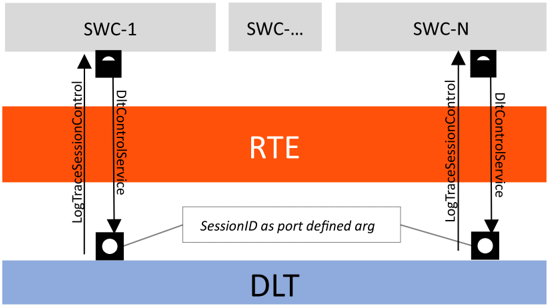

**Dlt** 模块应为每个已配置的 **SW-C**（见 [DltSwc](#913-dltswc)）提供一个由接口 [DltSwcMessageService](#7714-dltswcmessageservice) 定义的 PPortPrototype SwcMessageService。

由接口 [DltSwcMessageService](#7714-dltswcmessageservice) 定义的 PPortPrototype SwcMessageService 将 [Dlt_SessionIDType](#7723-dlt_sessionidtype) 作为端口定义参数。

对于每个已配置的 **SW-C**（见配置容器 [DltSwc](#913-dltswc)），其中配置参数 DltSwcSupportLogLevelAndTraceStatusChangeNotification 设置为 TRUE，**Dlt** 模块应提供一个由接口 [LogTraceSessionControl](#7713-logtracesessioncontrol) 定义的 RPortPrototype SessionControlCallback。

**SW-C** 负责并因此在日志级别或跟踪状态变化时需要被通知的 DltSwcApplicationId/DltSwcContextId 元组，应从配置参数 [DltSwcContext](#914-dltswccontext) 推导得出。

##### 6.1.2.1. 向 Dlt 注册 ApplicationID 和 ContextID

**Dlt** 模块能够将日志级别变化告知 **SW-C**。为此，它们必须在运行时使用 DltSwcApplicationId/DltSwcContextId 元组在 **Dlt** 模块处注册。

**注意：**因为 **SWC** 的开发属于本规范的一部分，**Dlt** 模块必须在运行时收集此信息。

**Dlt** 模块应记住向 **Dlt** 模块注册的 **SW-C** 的所有 DltSwcApplicationId 和 DltSwcContextId 元组。

**Dlt** 模块应为每个 DltSwcApplicationId 和 DltSwcContextId 元组管理一个日志级别和一个跟踪状态。

**注意：**此外，动态注册使 **Dlt** 模块能够看到哪个 **SW-C**/runnable 处于活动状态、哪个不是。这对于在日志级别或跟踪状态变化时知道应通知哪个 **SW-C** 至关重要。

当 **SW-C** 调用 [DltSwcMessageService](#7714-dltswcmessageservice) 接口的 [Dlt_RegisterContext](#735-dlt_registercontext) 方法时，会向 **Dlt** 模块提供一个端口定义的参数值 sessionId。

该端口定义参数的值对应于 **SW-C**/runnable 的 [LogTraceSessionControl](#7713-logtracesessioncontrol) 接口，用于向 **SW-C**/runnable 提供日志级别变化的信息。

**Dlt** 模块应记住已注册的 DltSwcApplicationId/DltSwcContextId 元组与注册该元组的端口接口之间的关系。

如果参数 DltGeneralRegisterContextNotification 设置为 TRUE，则每次调用 [Dlt_RegisterContext](#735-dlt_registercontext) 时，**Dlt** 模块应发送包含所提供的 DltSwcApplicationId/DltSwcContextId 的 Dlt Control 消息 [Dlt_GetLogInfo](#7310-dlt_getloginfo)。

##### 6.1.2.2. 向 Dlt 注销 ApplicationID 和 ContextID

如果一个 **SW-C** 即将停止，它应当注销自身。该信息可用于将当前 **SW-C** 状态告知外部客户端（例如日志设备）。

**Dlt** 模块应从已注册应用列表中删除向 **Dlt** 模块注销的 **SW-C** 的所有 DltSwcApplicationId 和 DltSwcContextId 元组。

**注意：**对于这些元组，**Dlt** 模块将不再尝试就 LogLevel 变化通知相应的 **SWC**。

如果参数 DltGeneralRegisterContextNotification 设置为 TRUE，则每次调用 [Dlt_UnregisterContext](#736-dlt_unregistercontext) 时，**Dlt** 模块应发送包含所提供的 DltSwcApplicationId/DltSwcContextId 且参数 status 设置为 5 的 Dlt Control 消息 [Dlt_GetLogInfo](#7310-dlt_getloginfo)。

##### 6.1.2.3. 使用端口定义的参数值定义 SessionId

对于 [Dlt_SendLogMessage](#734-dlt_sendlogmessage)、[Dlt_SendTraceMessage](#733-dlt_sendtracemessage)、[Dlt_RegisterContext](#735-dlt_registercontext) 和 [Dlt_UnregisterContext](#736-dlt_unregistercontext) 的每一次函数调用，都需要提供一个端口定义的参数值。

端口定义的参数值应由 **Dlt** 模块用作 SessionId。

**注意：**会话是一个 **SW-C** 中由一个日志级别监控器负责的部分。对于每个日志级别监控器，应使用相同的 SessionId（端口定义参数值）。

该端口定义参数值对应于定义的 SessionID。该值应从 0x1000 开始（对于 **BSW** 模块，取其模块 ID）。

连接到 **Dlt** 模块的 **SW-C** 的每个端口都应具有一个唯一的 SessionId 作为端口定义参数。SessionId 的范围应是连续的。

#### 6.1.3. VFB 跟踪

**VFB** 跟踪在 RTE 中规定。**VFB** 跟踪的含义是将流经 RTE 的 **SW-C** 通信数据隐式地（系统固有地）转发给 **Dlt** 模块。这里的跟踪（trace）是指 **SW-C** 不进行显式调用将该数据转发给 **Dlt**。本节描述 RTE 与 **Dlt** 模块为记录 **VFB** 跟踪而进行的交互，以及跟踪数据的内部控制。

##### 6.1.3.1. Dlt 为 VFB 跟踪提供的接口

如果 **Dlt** 模块被用作 **VFB** 跟踪客户端，则必须相应地配置 RTE。这意味着 RTE 配置参数 RteVfbTraceClientPrefix 必须配置为值「Dlt」。

是否启用 **VFB** 跟踪以及支持/激活哪些可跟踪事件，完全在 RTE 模块中配置。

然后，RTE 生成器在其配置中于生成阶段（Generation Phase）为每个已配置的 **VFB** 跟踪钩子函数更新 RTE 的基础软件模块描述（Basic Software Module Description），加入相应的 BswModuleEntry。这些 BswModuleEntry 准确地描述了已配置的跟踪客户端必须提供的预期函数原型：

* 预期的函数名由 shortName 定义。
* 预期签名的其余部分由所包含的参数定义。

**Dlt** 模块必须为 RTE 的 BswModuleDescription 中由属性 outgoingCallback 引用、且其 shortName 以「Rte_Dlt」开头的所有 BswModuleEntry 提供实现。

**Dlt** 模块应符合 AUTOSAR_RTE_SWS 中描述的 **VFB** 跟踪。

**Dlt** 模块应提供跟踪 SWS RTE 中描述的所有类型跟踪事件的可能性。

**Dlt** 模块应为每个已配置的事件提供钩子函数的实现，该事件由一个 BswModuleEntry 给出，该 BswModuleEntry 拥有一个由 RTE 的 BswModuleDefinition 提供的、以「Rte_Dlt」开头的 shortName。

该钩子函数的原型应取自 RTE 的 BSWModuleDescription 的 BswModuleEntry。

##### 6.1.3.2. 生成钩子函数

由于接口 [Dlt_SendTraceMessage](#733-dlt_sendtracemessage) 是一个 **SW-C** 接口，应实现一个与 [Dlt_SendTraceMessage](#733-dlt_sendtracemessage) 等价的内部函数，供生成的钩子函数调用。

在钩子函数中应调用 [Dlt_SendTraceMessage](#733-dlt_sendtracemessage) 的内部表示。该调用应以非详细模式进行。

该钩子函数调用的载荷应使用钩子函数提供的参数填充。随参数传输的所有数据都应提供。

参数数据应以原始格式写入载荷。

每个钩子函数应获得自己的 DltSwcContextId。

在某些情况下，某些事件可以捆绑到同一个 ContextId。这主要应在跟踪大量信号时进行。

ApplicationID 应为「VFBT」。

生成的跟踪消息中的消息类型（**MSTP**）条目应设置为 DLT_TYPE_APP_TRACE，此情况下的消息跟踪信息（**MSTI**）条目应设置为 DLT_TRACE_VFB。

由于使用非详细模式，每次调用 [Dlt_SendTraceMessage](#733-dlt_sendtracemessage) 时都应使用一个唯一的 Message ID（如下定义）。

**注意：**应为 Message ID 载荷生成并提供描述。该描述可以从描述该接口的 **SW-C** 描述文件生成。

在每个钩子函数中应检查 ContextId 的跟踪状态，使得：

```C
/* Check the trace status of the ContextId before calling Dlt_SendTraceMessage
"vfb_actual_trace_status_contextXY" holds the trace status for a specific
ContextId */
if (vfb_actual_trace_status_contextXY) {
  <internal_Dlt_SendTraceMessage>(...);
```

**Dlt** 应为每个 **VFB** 跟踪钩子函数使用自己的 DltSwcContextId，从而为每个 **VFB** 跟踪 DltSwcContextId 处理一个单独的跟踪状态。这可以通过一个单独的变量来完成。

应实现一个单独的函数来修改 **VFB** 跟踪钩子函数的跟踪状态。该函数应与 **SW-C** 的 [LogTraceSessionControl](#7713-logtracesessioncontrol) 接口协调一致。

#### 6.1.4. 来自 DEM 的日志消息

为 **DEM** 事件发送的日志消息的 ApplicationID、ContextId 和 Message ID 应具有以下值：

```C
ApplicationID = "DEM"
ContextId = "STD0"
MessageID = 0x00000001
```

#### 6.1.5. 来自 DET 的日志消息

**SW-C** 和 **BSW** 模块可以向 **DET** 模块报告错误。此类错误可以使用 [Dlt_DetForwardErrorTrace](#737-dlt_detforwarderrortrace) 作为具有适当内容的消息转发给 **Dlt** 模块。

**注意：**DET 函数 Det_ReportError 的所有参数通过 DET 扇出（fan-out）能力转发给 **Dlt** 函数 [Dlt_DetForwardErrorTrace](#737-dlt_detforwarderrortrace)。

**Dlt** 模块应为 **DET** 的扇出能力提供 [Dlt_DetForwardErrorTrace](#737-dlt_detforwarderrortrace) 函数。

由 **DET** 发送的日志消息的 ApplicationID、ContextId 和 MessageID 应具有以下值：

```C
ApplicationID = "DET"
ContextId = "STD"
MessageID = 0x00000002
LogLevel = "Error"
```

#### 6.1.6. Message ID 生成建议

非详细消息的载荷包含 Message ID。Message ID 对于一个 ECU 应是唯一的。问题在于 Message ID 由 **SW-C**（**Dlt** 的使用者）提供，而在编写日志和跟踪消息调用的代码时，没有任何实例能够保证所使用的 Message ID 的唯一性。

一种可行的解决方案是将所有日志消息映射到一个虚拟内存段，然后使用内存地址作为 Message ID。另一种解决方案是使用一个负责 Message ID 唯一性的创作工具。

此外，也可以在 post-build 过程中固定 Message ID 值，从而保证 ECU 内的唯一性。

为每个 Message ID 提供相关联消息的描述非常重要。

用于 **DEM**（0x00000001）和 **DET**（0x00000002）以及跟踪消息（0x00000003）的 MessageId 是保留的，因此 **SW-C** 不可使用。

#### 6.1.7. 启动行为

**Dlt** 模块规定了若干配置参数，它们可以在运行时通过 API 调用或通过 **Dlt** 控制消息重新配置。

这意味着这些配置参数以及基于它们的数据结构必须在 **Dlt** 模块启动期间加载到运行时变量中。

此外，即使 **Dlt** 模块本身尚未初始化，**SW-C** 和/或 **BSW** 模块也可能已经在生成日志和跟踪数据。对于这种场景，**Dlt** 模块提供了缓冲这些数据的能力，直到 **Dlt** 模块初始化完成。

所描述的功能产生了以下需求：

**Dlt** 模块应能够缓冲来自 [Dlt_SendLogMessage](#734-dlt_sendlogmessage) 和/或 [Dlt_SendTraceMessage](#733-dlt_sendtracemessage) 调用的数据，即使 **Dlt** 模块尚未初始化。

当 [Dlt_Init](#731-dlt_init) 被调用时，如果已配置，则应启动可选的定时器 DltGeneralStartUpDelayTimer。

如果参数 DltGeneralNvRAMSupport 被禁用，则应使用静态 **Dlt** 模块配置进行初始化。

一旦 **Dlt** 模块已由 [Dlt_Init](#731-dlt_init) 初始化且可选的定时器 DltGeneralStartUpDelayTimer 已超时，期间缓冲的所有日志和跟踪数据都应使用已配置的过滤设置进行处理（见下文的处理顺序规定）。

#### 6.1.8. 配置的持久存储

**Dlt** 模块提供了将配置数据存储到 NVRamManager 模块的可能性。因此，建议仅在 NVRamManager 模块初始化之后再调用 [Dlt_Init](#731-dlt_init) 函数。

**Dlt** 模块的持久化功能支持对运行期间可修改的配置值进行非易失性保存。

其理念是允许在运行期间自定义日志配置，并确保在 ECU 复位或重启后恢复该配置。

如果参数 DltGeneralNvRAMSupport 设置为 TRUE，则 **Dlt** 模块应使用非易失性存储块来持久存储当前 **Dlt** 配置。

如果参数 DltGeneralNvRAMSupport 设置为 TRUE，则 **Dlt** 模块必须验证所使用的非易失性块的有效性。

如果参数 DltGeneralNvRAMSupport 设置为 TRUE，则存储的 **Dlt** 配置应用作初始值。

**注意：**此处的初始值是指 ECU 首次启动时持久存储值的初始值。

只有当参数 DltGeneralNvRAMSupport 已启用且存储已被 Dlt 命令 [Dlt_StoreConfiguration](#7312-dlt_storeconfiguration) 显式请求时，才应将当前配置存储到 NvRAM。

**注意：**要将当前配置存储到 NvRAM，使用 API NvM_WriteBlock。

#### 6.1.9. 日志和跟踪消息的发送

**Dlt** 数据路径描述了一条 **Dlt** 日志和跟踪消息从源到汇所经过的流程。源可以是 **SW-C** 或 **BSW** 模块，而 **PDU** 路由器代表汇。

图 7.2 概述了在通信总线上发送一条 **Dlt** 消息的各个单独步骤：

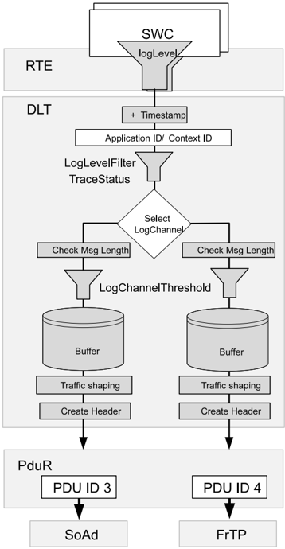

日志和跟踪消息的发送通过专用函数 [Dlt_SendLogMessage](#734-dlt_sendlogmessage) 和 [Dlt_SendTraceMessage](#733-dlt_sendtracemessage) 完成。

还存在两个附加函数，允许为日志和跟踪消息提供附加属性。这两个函数分别名为 [Dlt_SendLogMessageWithAttributes](#7323-dlt_sendlogmessagewithattributes) 和 [Dlt_SendTraceMessageWithAttributes](#7324-dlt_sendtracemessagewithattributes)。它们是前述函数的纯超集；前述函数为不需要附加属性的常见情况保留在标准中，以实现向后兼容和便利。

请注意，在本文档中，只要提到函数 [Dlt_SendLogMessage](#734-dlt_sendlogmessage) 或 [Dlt_SendTraceMessage](#733-dlt_sendtracemessage)，除非另有说明，都应将其理解为 [Dlt_SendLogMessage](#734-dlt_sendlogmessage) 或 [Dlt_SendLogMessageWithAttributes](#7323-dlt_sendlogmessagewithattributes) 以及 [Dlt_SendTraceMessage](#733-dlt_sendtracemessage) 或 [Dlt_SendTraceMessageWithAttributes](#7324-dlt_sendtracemessagewithattributes) 的简写。

调用参数 attributes 设置为 NULL 的函数 [Dlt_SendLogMessageWithAttributes](#7323-dlt_sendlogmessagewithattributes)，应等价于使用其余参数调用函数 [Dlt_SendLogMessage](#734-dlt_sendlogmessage)。

调用参数 attributes 设置为 NULL 的函数 [Dlt_SendTraceMessageWithAttributes](#7324-dlt_sendtracemessagewithattributes)，应等价于使用其余参数调用函数 [Dlt_SendTraceMessage](#733-dlt_sendtracemessage)。

如果配置参数 DltProtocolVersion 设置为 1，则对 [Dlt_SendLogMessageWithAttributes](#7323-dlt_sendlogmessagewithattributes) 或 [Dlt_SendTraceMessageWithAttributes](#7324-dlt_sendtracemessagewithattributes) 的调用中 attributes 参数非 NULL 时，应以 DLT_E_NOT_SUPPORTED 返回。

以下步骤描述了对 [Dlt_SendLogMessage](#734-dlt_sendlogmessage) 或 [Dlt_SendTraceMessage](#733-dlt_sendtracemessage) 调用上下文中的逻辑顺序：

* 生成时间戳（见「生成时间戳」章）
* 过滤消息（见「消息过滤」章）
* 选择目标日志通道（见「选择目标日志通道」章）
* 检查消息长度（见「检查消息长度」章）
* 应用当前的日志通道阈值（见「应用日志通道 LogLevelThreshold」章）
* 将 Dlt 消息复制到日志通道特定的缓冲区（见「将 Dlt 消息复制到日志通道缓冲区」章）
* 应用消息属性（如果存在且受支持）（见「应用消息属性（如果存在且受支持）」章）

**注意：**由于实现中的优化，顺序可能会改变。例如，一种典型的优化是：**Dlt** 模块为每条 **Dlt** 消息创建的 **Dlt** 头不按每条 **Dlt** 消息保存到日志通道特定的缓冲区中，而是在将消息发送给 **PduR** 之前即时创建。

以下步骤必须与 [Dlt_SendLogMessage](#734-dlt_sendlogmessage) 或 [Dlt_SendTraceMessage](#733-dlt_sendtracemessage) 调用的上下文解耦/延迟执行：

* 根据 TrafficShaping 设置将 **Dlt** 消息发送给 **PduR**（见「从日志通道缓冲区发送消息」章）
* 根据头部设置创建 Dlt 头（见「创建 Dlt 消息头」章）
* 从日志通道特定的缓冲区中移除该 **Dlt** 消息（见「从日志通道缓冲区移除消息」章）

##### 6.1.9.1. 生成时间戳

根据当前配置，可能会向 **Dlt** 消息添加时间戳。

只有当参数 DltHeaderUseTimestamp 设置为 TRUE 时，**Dlt** 模块才应获取时间戳。

如果参数 DltHeaderUseTimestamp 设置为 TRUE，但 **Dlt** 模块由于任何原因无法获取时间戳，则时间戳应设置为 0x00000000。

如果参数 DltHeaderUseTimestamp 设置为 TRUE 且 DltGeneralGptChannelRef 已配置，则 **Dlt** 模块应使用已配置的通道引用（见 DltGeneralGptChannelRef）调用 API Gpt_GetTimeElapsed 以获取经过的时间。

如果参数 DltHeaderUseTimestamp 设置为 TRUE 且 DltGeneralStbMTimeBaseRef 已配置，则 **Dlt** 模块应使用已配置的时基引用（见 DltGeneralStbMTimeBaseRef）调用 API StbM_GetCurrentTime 以获取当前同步时间并计算经过的时间。

##### 6.1.9.2. 消息过滤

消息过滤是指根据分配给该消息的 DltSwcApplicationId/DltSwcContextId 元组接受或丢弃一条输入的日志或跟踪消息。

日志消息（[Dlt_SendLogMessage](#734-dlt_sendlogmessage)）与跟踪消息（[Dlt_SendTraceMessage](#733-dlt_sendtracemessage)）的过滤略有不同。

对于 **Dlt** 日志消息，最高的 LogLevel 阈值应定义为 DLT_LOG_VERBOSE。

对于 **Dlt** 日志消息，最低的 LogLevel 阈值应定义为 DLT_LOG_OFF。

**注意：**[Dlt_MessageLogLevelType](#7729-dlt_messagelogleveltype) 定义了所有可能的日志消息过滤级别。

对于日志消息过滤，**Dlt** 在内部管理 LogLevel 阈值到 DltSwcApplicationId/DltSwcContextId 元组的映射（见配置参数 [DltLogLevelThreshold](#9111-dltloglevelthreshold)）。

对于跟踪消息过滤，**Dlt** 在内部管理跟踪激活状态到 DltSwcApplicationId/DltSwcContextId 元组的映射（见配置参数 [DltTraceStatusAssignment](#9114-dlttracestatusassignment)）。

**注意：**用于查找正确映射元素的匹配算法（在日志消息的情况下包含阈值日志级别值，在跟踪消息的情况下包含跟踪激活状态）对日志消息和跟踪消息是相同的。

**Dlt** 模块应为包含在 [Dlt_SendLogMessage](#734-dlt_sendlogmessage) 或 [Dlt_SendTraceMessage](#733-dlt_sendtracemessage) 调用中的 DltSwcApplicationId/DltSwcContextId 元组找到一个匹配的映射元素（日志级别阈值或跟踪激活状态）。为此，应执行以下步骤：

* 检查是否存在一个映射元素，其 DltSwcApplicationId/DltSwcContextId 元组等于该日志/跟踪消息的 DltSwcApplicationId/DltSwcContextId 元组。如果存在这样的映射元素，则找到了匹配的映射元素。
* 如果在步骤 1 中未找到匹配项，则检查是否存在一个映射元素，其 DltSwcApplicationId 等于该日志/跟踪消息的 ApplicationID 且其 DltSwcContextId 等于通配符（值 0x00000000）。如果存在这样的映射元素，则找到了匹配的映射元素。
* 如果在步骤 1 和 2 中均未找到匹配项，则匹配的映射元素是当前的 DefaultLogLevelThreshold 或当前的 DefaultTraceStatus。

在 [Dlt_SendLogMessage](#734-dlt_sendlogmessage) 的情况下，找到的映射元素是一个日志级别阈值。如果日志消息的日志级别数值高于该日志级别阈值，则该日志消息不再被进一步处理并返回 E_OK。

在 [Dlt_SendTraceMessage](#733-dlt_sendtracemessage) 的情况下，找到的映射元素是一个跟踪激活状态。如果跟踪激活状态的值为 FALSE，则该消息不再被进一步处理并返回 E_OK。

##### 6.1.9.3. 选择目标日志通道

在此步骤中，**Dlt** 模块确定将在哪些日志通道上传输该日志或跟踪消息。

对于日志通道选择，**Dlt** 模块管理日志通道到 DltSwcApplicationId/DltSwcContextId 元组的映射（见配置参数 DltLogChannelAssignmentSwcContextRef）。

**注意：**对于包含在 [Dlt_SendLogMessage](#734-dlt_sendlogmessage) 或 [Dlt_SendTraceMessage](#733-dlt_sendtracemessage) 调用中的一个给定 DltSwcApplicationId/DltSwcContextId 元组，可以配置多个日志通道。

为了找到与包含在 [Dlt_SendLogMessage](#734-dlt_sendlogmessage) 或 [Dlt_SendTraceMessage](#733-dlt_sendtracemessage) 调用中的 DltSwcApplicationId/DltSwcContextId 元组匹配的日志通道，**Dlt** 模块应执行以下步骤：

* 从所有映射元素中，凡是其 DltSwcApplicationId/DltSwcContextId 元组等于该日志/跟踪消息的 DltSwcApplicationId/DltSwcContextId 元组的，其日志通道都应被添加到输出日志通道列表中。
* 从所有映射元素中，凡是其 ApplicationID 等于该日志/跟踪消息的 ApplicationID 且其 ContextId 等于通配符（值 0x00000000）的，其日志通道都应被添加到输出日志通道列表中。
* 如果在步骤 1 和 2 之后输出日志通道列表仍为空，则应将默认日志通道（见配置参数 DltDefaultLogChannelRef）添加到输出日志通道列表中。

##### 6.1.9.4. 检查消息长度

如果 **Dlt** 消息的长度（包括所需的 **Dlt** 头）超过所有已分配日志通道的 DltLogChannelMaxMessageLength 配置值，则丢弃该 **Dlt** 消息并返回 DLT_E_MSG_TOO_LARGE。

**注意：**如果该消息对于至少一个已分配的日志通道而言足够短，则对该消息继续处理所有消息长度足够的日志通道。

##### 6.1.9.5. 应用日志通道 LogLevelThreshold

在此步骤中，**Dlt** 模块针对每个已识别的日志和跟踪通道单独决定当前的日志或跟踪消息是否可以通过。

日志级别数值高于已识别日志通道的日志通道阈值配置值的日志消息应被丢弃并返回 E_OK。对于日志消息的输出日志通道列表中的每个日志通道，都应执行此操作，并考虑前述的日志通道查找规定。

当已识别日志通道的配置参数 DltTraceStatus 为 FALSE 时，跟踪消息应被过滤掉。也就是说，它们不会进入下一个处理步骤并返回 E_OK。

##### 6.1.9.6. 将 Dlt 消息复制到日志通道缓冲区

在此步骤中，**Dlt** 模块将该 **Dlt** 消息复制到该消息被分配到的所有日志通道的缓冲区中。

**Dlt** 模块应将通过消息过滤器的日志/跟踪消息复制到所有已分配的目标日志通道缓冲区中，前提是该 **Dlt** 消息的长度不大于相应日志通道的 DltLogChannelMaxMessageLength。

如果没有足够的空间将完整消息复制到任何已分配日志通道的缓冲区，则应返回 DLT_E_NO_BUFFER，并且该 **Dlt** 日志和跟踪消息应被丢弃。

此外，检查每个已分配的缓冲区之前是否已满，即检查 **Dlt** 内部用于存储缓冲区溢出事件的标志：

* 如果该缓冲区的缓冲区溢出标志当前未设置：
  * 设置缓冲区溢出标志以指示缓冲区溢出的发生
  * 该 **Dlt** 日志和跟踪消息应被丢弃
* 如果该缓冲区的缓冲区溢出标志已经设置：
  * 该 **Dlt** 日志和跟踪消息应被丢弃
* 根据配置发送 Dlt Control 消息「BufferOverflowNotification」。请参阅「BufferOverflowNotification」章。

**注意：**周期性调用的 [Dlt_TxFunction](#751-dlt_txfunction) 检查缓冲区溢出标志的状态以及发送缓冲区溢出通知的去抖动时间。该函数还根据缓冲区溢出通知周期性地将该标志复位。

如果一条新消息已成功复制到已分配日志通道的缓冲区，则消息计数器应加 1。该消息计数器值应针对该 **Dlt** 消息存储。

**注意：**当该 **Dlt** 消息将要被发送时，此消息计数器值将被写入消息计数字段（**MCNT**）。

如果一条新消息已成功复制到至少一个日志通道缓冲区，则应返回 DLT_OK。

##### 6.1.9.7. 应用消息属性（如果存在且受支持）

当使用 API [Dlt_SendLogMessageWithAttributes](#7323-dlt_sendlogmessagewithattributes) 或 [Dlt_SendTraceMessageWithAttributes](#7324-dlt_sendtracemessagewithattributes)，且配置参数 DltProtocolVersion 设置为 2 或更高时，可以向消息添加可选属性。

这些属性作为类型为指向 [Dlt_MessageAttributesType](#77215-dlt_messageattributestype) 的指针的附加函数参数提供。

[Dlt_MessageAttributesType](#77215-dlt_messageattributestype) 结构被设计为可扩展的；该结构的任何未来扩展都将作为新字段提供，或者带有带内「无效」状态（例如空指针），或者带有一个单独的 bool 标志，用于表示后续字段是否存在有意义的值。

因此，在调用本标准中定义的、从 [Dlt_MessageAttributesType](#77215-dlt_messageattributestype) 结构读取值的函数（例如 [Dlt_SendLogMessageWithAttributes](#7323-dlt_sendlogmessagewithattributes)）之前，应用应确保该结构的所有成员（包括任何额外的非标准化成员）都已使用默认初始化进行初始化。

例如，可以这样完成：

```C
Dlt_MessageAttributesType attributes = { 0 };
```

[Dlt_MessageAttributesType](#77215-dlt_messageattributestype) 类型的 messageTags 字段构成一个指向字符串数组的指针。该数组必须以空指针「终止」。

一个实现通常会用如下代码读取该字段：

```C
const char** tags = attributes->messageTags;
int i;
for (i = 0; tags && (tags[i] != NULL); ++i) {
  const char* t = tags[i];
  ....
}
```

##### 6.1.9.8. 从日志通道缓冲区发送消息

通过 **PduR** API 发送 **Dlt** 消息应与 [Dlt_SendLogMessage](#734-dlt_sendlogmessage) 和 [Dlt_SendTraceMessage](#733-dlt_sendtracemessage) API 调用解耦。

**注意：**进行解耦的原因如下：

* 缩短触发日志/跟踪消息的 **SW-C**/**BSW** 调用的运行时间，以减少阻塞时间。
* 如果启用了流量整形（traffic shaping）功能，传输无论如何都必须由一个异步周期性的 **BSW** 实体处理。
* 如果启用了重试功能，无论如何都需要一个负责重试的解耦 **BSW** 实体。

**Dlt** 模块应在 [Dlt_TxFunction](#751-dlt_txfunction) 函数的上下文中传输收集在日志通道特定缓冲区中的 **Dlt** 消息。

**Dlt** 消息头应在调用 PduR_DltTransmit 之前组装。

**注意：**有关 **Dlt** 消息头组装的详细信息，请参阅下一节。

**Dlt** 模块应使用 PduR_DltTransmit 函数以已配置的 DltTxPduId 发送 **Dlt** 消息。

**Dlt** 模块应为日志通道特定缓冲区中的每条 **Dlt** 消息监控一个发送计数器。每次它为缓冲区中的一条 **Dlt** 消息调用 PduR_DltTransmit 时，它应将该发送计数器加 1。

##### 6.1.9.9. 创建 Dlt 消息头

如果参数 DltProtocolVersion 设置为 2 或更高，则当传递给 API [Dlt_SendLogMessageWithAttributes](#7323-dlt_sendlogmessagewithattributes) 或 [Dlt_SendTraceMessageWithAttributes](#7324-dlt_sendtracemessagewithattributes) 的 [Dlt_MessageAttributesType](#77215-dlt_messageattributestype) 值的 messageTags 字段的值是非 NULL 指针时，WTGS 位应设置为 true；否则 WTGS 位应设置为 false。

如果参数 DltProtocolVersion 设置为 2 或更高，且 WTGS 位已设置为 true，则 TAGS 字段应按如下方式写入：

1. NOTG 字段应设置为传递给 API [Dlt_SendLogMessageWithAttributes](#7323-dlt_sendlogmessagewithattributes) 或 [Dlt_SendTraceMessageWithAttributes](#7324-dlt_sendtracemessagewithattributes) 的 [Dlt_MessageAttributesType](#77215-dlt_messageattributestype) 值的 messageTags 字段所指向数组中包含的非 NULL 指针的数量。
2. messageTags 数组条目所指向的字符串应按照 PRS_Dlt_01031 定义的规则写入。

否则，应省略 TAGS 字段。

###### 6.1.9.9.1. 组装 Dlt 头

如果参数 DltUseVerboseMode 或 DltUseExtHeaderInNonVerbMode 中至少一个设置为 TRUE，则 UEH 位应设置为 1。否则，UEH 位应设置为 0。

如果当前平台为 BIGENDIAN，则 MSBF 位应设置为 1。

如果当前平台为 LITTLEENDIAN，则 MSBF 位应设置为 0。

如果参数 DltHeaderUseEcuId 设置为 TRUE，则 WEID 位应设置为 1。否则，WEID 位应设置为 0。

如果参数 DltHeaderUseSessionID 设置为 TRUE，则 WSID 位应设置为 1。否则，WSID 位应设置为 0。

如果参数 DltHeaderUseTimestamp 设置为 TRUE，则 WTMS 位应设置为 1。否则，WSID 位应设置为 0。

VERS 位应始终设置为 001。

MCNT 字段应设置为该 **Dlt** 消息被复制到日志通道缓冲区时存储的值。

可选的 ECU 字段仅应在 DltHeaderUseEcuId 设置为 TRUE 时存在。

可选的 ECU 字段应设置为 DltEcuIdValue 中配置的值。如果配置的 ECU ID 短于 4 字节，则剩余字节应设置为 0x00。

可选的 SEID 字段应设置为通过 DltSwcSessionId 配置的值，且仅应在 DltHeaderUseSessionID 设置为 TRUE 时存在。

可选的 TMSP 字段应包含推导出的时间戳（如果 DltHeaderUseTimestamp 设置为 TRUE）。

LEN 字段应设置为最终组装的 **Dlt** Data Message 的总长度，即头的长度、可选扩展头的长度和载荷的长度之和。

如果参数 DltProtocolVersion 设置为 2 或更高，则 WPVL 位应设置为传递给 API [Dlt_SendLogMessageWithAttributes](#7323-dlt_sendlogmessagewithattributes) 或 [Dlt_SendTraceMessageWithAttributes](#7324-dlt_sendtracemessagewithattributes) 的 [Dlt_MessageAttributesType](#77215-dlt_messageattributestype) 值的 withPrivacyLevel 字段的值。否则，WPVL 位应设置为 FALSE。

如果参数 DltProtocolVersion 设置为 2 或更高，且 WPVL 位已设置为 TRUE，则 PRLV 字段应设置为传递给 API [Dlt_SendLogMessageWithAttributes](#7323-dlt_sendlogmessagewithattributes) 或 [Dlt_SendTraceMessageWithAttributes](#7324-dlt_sendtracemessagewithattributes) 的 [Dlt_MessageAttributesType](#77215-dlt_messageattributestype) 值的 privacyLevel 字段的值。否则，应省略 PRLV 字段。

###### 6.1.9.9.2. 组装 Dlt 扩展头

如果参数 DltUseExtHeaderInNonVerbMode 设置为 TRUE，则必须为 **Dlt** Data Messages 生成 **Dlt** 扩展头：

如果参数 DltUseVerboseMode 设置为 TRUE，则 VERB 位应设置为「1」。否则，VERB 位应设置为 0。

如果必须由于 API 调用 [Dlt_SendLogMessage](#734-dlt_sendlogmessage) 而组装 **Dlt** 消息，则 MSTP 字段应设置为 0x0。

如果必须由于 API 调用 [Dlt_SendTraceMessage](#733-dlt_sendtracemessage) 而组装 **Dlt** 消息，则 MSTP 字段应设置为 0x1。

MTIN 字段应根据由 API [Dlt_SendLogMessage](#734-dlt_sendlogmessage) 传递的 [Dlt_MessageLogInfoType](#7728-dlt_messageloginfotype) 值进行相应设置。

MTIN 字段应根据由 API [Dlt_SendTraceMessage](#733-dlt_sendtracemessage) 传递的 [Dlt_MessageTraceInfoType](#77212-dlt_messagetraceinfotype) 值进行相应设置。

##### 6.1.9.10. 从日志通道缓冲区移除消息

对于已调用 PduR_DltTransmit 的 **Dlt** 消息，应在以下情况下将其从日志通道特定的缓冲区中移除：

* PduR_DltTransmit 以 E_NOT_OK 返回，
* 收到该 TxPduId 的肯定 TX 确认，或
* 收到该 DltTxPduId 的否定 TX 确认，且该 **Dlt** 消息的发送计数器大于配置的 DltLogChannelMaxNumOfRetries。

#### 6.1.10. Dlt 命令的接收

**Dlt** 模块可以通过 Rx 数据路径和/或通过专用 API 调用（见本文第 [7](#7-api规范) 章）接收 **Dlt** 命令。这些 **Dlt** 命令可用于控制 **Dlt** 模块。

在参数 DltGeneralRxDataPathSupport 设置为 FALSE 的情况下，**Dlt** 模块应忽略通过 Rx 数据路径接收到的所有 **Dlt** 控制消息。

**注意：**在 Rx 数据路径被禁用的情况下，可以通过本文第 [7](#7-api规范) 章定义的可选控制 API 控制 **Dlt** 客户端。

如果 DltGeneralRxDataPathSupport 设置为 TRUE，则 **Dlt** 模块应处理接收到的 **Dlt** 控制消息。

如果一个接收到的 **Dlt** 命令已被成功执行，则应返回 OK。

##### 6.1.10.1. SetLogLevel

如果请求了 **Dlt** 命令 [Dlt_SetLogLevel](#738-dlt_setloglevel)，则应将新的日志级别存储给接收到的 DltSwcApplicationId/DltSwcContextId 元组。

如果请求了 **Dlt** 命令 [Dlt_SetLogLevel](#738-dlt_setloglevel)，但接收到的 DltSwcApplicationId/DltSwcContextId 元组未知，则该 **Dlt** 命令应以 DLT_E_ERROR 应答。

##### 6.1.10.2. SetTraceStatus

如果请求了 **Dlt** 命令 [Dlt_SetTraceStatus](#739-dlt_settracestatus)，则应将新的跟踪状态存储给接收到的 DltSwcApplicationId/DltSwcContextId 元组。

如果请求了 **Dlt** 命令 [Dlt_SetTraceStatus](#739-dlt_settracestatus)，但所寻址的 DltSwcApplicationId/DltSwcContextId 元组未知，则该 **Dlt** 命令应以 DLT_E_ERROR 应答。

##### 6.1.10.3. GetLogInfo

如果请求了 **Dlt** 命令 [Dlt_GetLogInfo](#7310-dlt_getloginfo)，则应返回所请求的 logInfo。

如果请求了 **Dlt** 命令 [Dlt_GetLogInfo](#7310-dlt_getloginfo)，但所寻址的 DltSwcApplicationId/DltSwcContextId 元组未知，则该 **Dlt** 命令应以 DLT_E_ERROR 应答。

##### 6.1.10.4. GetDefaultLogLevel

如果请求了 **Dlt** 命令 [Dlt_GetDefaultLogLevel](#7311-dlt_getdefaultloglevel)，则应返回参数 DltDefaultLogLevel 的当前值。

##### 6.1.10.5. StoreConfiguration

如果请求了 **Dlt** 命令 [Dlt_StoreConfiguration](#7312-dlt_storeconfiguration) 且配置参数 DltGeneralNvRAMSupport 设置为 TRUE，则应执行以下步骤：

* 调用 NvM_WriteBlock 以存储 LogChannelAssignment、LogChannelThreshold 和 LogLevelFilter 的当前配置。
  * 如果 NvM_WriteBlock 以 E_OK 返回，则 **Dlt** 命令 [Dlt_StoreConfiguration](#7312-dlt_storeconfiguration) 应以 E_OK 返回。
  * 如果 NvM_WriteBlock 以 E_OK 以外的值返回，则 **Dlt** 命令 [Dlt_StoreConfiguration](#7312-dlt_storeconfiguration) 应以 DLT_E_ERROR 返回。

如果请求了 **Dlt** 命令 [Dlt_StoreConfiguration](#7312-dlt_storeconfiguration) 且配置参数 DltGeneralNvRAMSupport 设置为 FALSE，则 **Dlt** 命令 [Dlt_StoreConfiguration](#7312-dlt_storeconfiguration) 应返回 DLT_E_NOT_SUPPORTED。

##### 6.1.10.6. ResetToFactoryDefault

如果请求了 **Dlt** 命令 [Dlt_ResetToFactoryDefault](#7313-dlt_resettofactorydefault) 且参数 DltGeneralNvRAMSupport 设置为 FALSE，则将以下运行时参数复位为 **Dlt** 模块静态配置中存储的值：

* DltDefaultLogLevel
* DltThreshold
* DltDefaultTraceStatus
* DltLogChannelThreshold
* DltDefaultLogChannelRef

如果请求了 **Dlt** 命令 [Dlt_ResetToFactoryDefault](#7313-dlt_resettofactorydefault) 且参数 DltGeneralNvRAMSupport 设置为 TRUE，则通过调用 NvM_EraseNvBlock 删除 NvM 中存储的配置，并将以下运行时参数复位为 **Dlt** 模块静态配置中存储的值：

* DltDefaultLogLevel
* DltThreshold
* DltDefaultTraceStatus
* DltLogChannelThreshold
* DltDefaultLogChannelRef

如果请求了 **Dlt** 命令 [Dlt_ResetToFactoryDefault](#7313-dlt_resettofactorydefault) 且参数 DltGeneralNvRAMSupport 设置为 FALSE，则如果 **Dlt** 模块成功将当前配置值复位为默认配置，应返回 E_OK。

如果请求了 **Dlt** 命令 [Dlt_ResetToFactoryDefault](#7313-dlt_resettofactorydefault) 且参数 DltGeneralNvRAMSupport 设置为 TRUE，则在以下情况下以「ERROR」应答：

* **Dlt** 模块无法将当前配置复位为静态默认配置，或
* NvM 中存储的配置无法被删除。

##### 6.1.10.7. SetMessageFiltering

如果请求了 **Dlt** 命令 [Dlt_SetMessageFiltering](#7314-dlt_setmessagefiltering)，则应按请求启用/禁用所有 **Dlt** 过滤器，且该 **Dlt** 命令应以 E_OK 应答。被禁用的过滤器将允许所有消息通过。

##### 6.1.10.8. SetDefaultLogLevel

如果请求了 **Dlt** 命令 [Dlt_SetDefaultLogLevel](#7315-dlt_setdefaultloglevel)，则参数 DltDefaultLogLevel 应更新为接收到的 newLogLevel。

##### 6.1.10.9. SetDefaultTraceStatus

如果请求了 **Dlt** 命令 [Dlt_SetDefaultTraceStatus](#7316-dlt_setdefaulttracestatus)，则参数 DltDefaultTraceStatus 应更新为接收到的新的 TraceStatus。

##### 6.1.10.10. GetDefaultTraceStatus

如果请求了 **Dlt** 命令 [Dlt_GetDefaultTraceStatus](#7317-dlt_getdefaulttracestatus)，则应返回参数 DltDefaultTraceStatus 的当前值。

##### 6.1.10.11. GetLogChannelNames

如果请求了 **Dlt** 命令 [Dlt_GetLogChannelNames](#7318-dlt_getlogchannelnames)，则应返回已配置日志通道的数量以及由参数 DltLogChannelName 给定的所请求数量的日志通道名称。

##### 6.1.10.12. GetTraceStatus

如果请求了 **Dlt** 命令 [Dlt_GetTraceStatus](#7319-dlt_gettracestatus)，则应为接收到的 DltSwcApplicationId/DltSwcContextId 元组返回 TraceStatus。

##### 6.1.10.13. SetLogChannelAssignment

如果请求 **Dlt** 命令 [Dlt_SetLogChannelAssignment](#7320-dlt_setlogchannelassignment) 时参数 addRemoveOp 设置为 DLT_ASSIGN_ADD，则将该 DltSwcApplicationId/DltSwcContextId 元组添加到由参数 logChannelName 提供的名称所对应的日志通道。即使该元组之前已经分配给所请求的日志通道，该 **Dlt** 命令也应返回 E_OK。

如果请求 **Dlt** 命令 [Dlt_SetLogChannelAssignment](#7320-dlt_setlogchannelassignment) 时参数 addRemoveOp 设置为 DLT_ASSIGN_REMOVE，则将该 DltSwcApplicationId/DltSwcContextId 元组从由参数 logChannelName 提供的名称所对应的日志通道中移除。即使该元组之前未分配给所请求的日志通道，该 **Dlt** 命令也应返回 E_OK。

**注意：**如果一个 DltSwcApplicationId/DltSwcContextId 元组（不再）被显式分配给任何特定的日志通道，则强制的默认日志通道（见 DltDefaultLogChannelRef）将用于传输。

如果请求 **Dlt** 命令 [Dlt_SetLogChannelAssignment](#7320-dlt_setlogchannelassignment) 时使用未知的 DltSwcApplicationId/DltSwcContextId 元组或未知的日志通道名称，则该 **Dlt** 命令应返回 DLT_E_ERROR。

##### 6.1.10.14. SetLogChannelThreshold

如果请求了 **Dlt** 命令 [Dlt_SetLogChannelThreshold](#7321-dlt_setlogchannelthreshold)，则所寻址日志通道的 LogChannelThreshold 应设置为参数 newThreshold 接收到的值。

如果请求了 **Dlt** 命令 [Dlt_SetLogChannelThreshold](#7321-dlt_setlogchannelthreshold) 且 logChannelName 和/或 newThreshold 未知，则该 **Dlt** 命令应返回 DLT_E_ERROR。

##### 6.1.10.15. GetLogChannelThreshold

如果请求了 **Dlt** 命令 [Dlt_GetLogChannelThreshold](#7322-dlt_getlogchannelthreshold)，则应返回所寻址日志通道的 LogChannelThreshold。

如果请求了 **Dlt** 命令 [Dlt_GetLogChannelThreshold](#7322-dlt_getlogchannelthreshold) 且 logChannelName 或 newThreshold 未知，则该 **Dlt** 命令应返回 DLT_E_ERROR。

#### 6.1.11. Dlt 命令的发送

通常，**Dlt** 模块接收由 **Dlt** 日志工具生成的 **Dlt** 命令，并由 **Dlt** 模块应答。只有两个 **Dlt** 命令是由 **Dlt** 模块自身触发发送的：

* [Dlt_GetLogInfo](#7310-dlt_getloginfo)（仅在一个或多个 **SW-C** 注册/注销自身的情况下）
* BufferOverflowNotification（在发生缓冲区溢出的情况下）

##### 6.1.11.1. BufferOverflowNotification

缓冲区溢出通知用于将 **Dlt** 消息的丢失告知 **Dlt** 日志工具。总线上 BufferOverflowNotification 的数量可以通过配置进行限制/去抖动。该通知包含一个计数器，指示自上一次 BufferOverflowNotification 以来丢失的 **Dlt** 消息数量。

如果 **Dlt** 模块检测到缓冲区溢出，则只要缓冲区仍然满，它就应周期性地发送 **Dlt** 命令 BufferOverflowNotification（见 DltLogChannelBufferOverflowTimer）。

Dlt 控制消息「BufferOverflowNotification」的参数 overflowCounter 应设置为自上一次发送「BufferOverflowNotification」以来丢失的 **Dlt** 消息数量。

### 6.2. 错误分类

文档 [\[5\]](#ref-5)「基础软件模块通用规范」中的「错误处理」一章详细描述了基础软件的错误处理。其中首先给出了一个由五种错误类型组成的分类方案，这些错误可能发生在 **BSW** 模块中。

基于这一基础，下文按相应的子节规定了具体的错误。

#### 6.2.1. 开发错误

| 错误类型 | 相关错误代码 | 错误值 |
|---|---|---|
| 使用错误的参数调用 API 服务 | DLT_E_PARAM | 0x01 |
| 传递了 NULL 指针作为参数 | DLT_E_PARAM_POINTER | 0x02 |
| 初始化失败 | DLT_E_INIT_FAILED | 0x03 |
| 注册失败 | DLT_E_REGISTRATION | 0x04 |

#### 6.2.2. 运行时错误

| 错误类型 | 相关错误代码 | 错误值 |
|---|---|---|
| 消息无法被发送 | DLT_E_SKIPPED_TRANSMISSION | 0x05 |
| 收到 **Dlt** 命令的一个值不为 0 的已废弃（deprecated）参数 | DLT_E_DEPRECATED_PARAMETER | 0x06 |
| 同时发生多个控制请求 | DLT_E_MULTIPLE_REQUESTS | 0x07 |

#### 6.2.3. 瞬态故障

没有瞬态故障。

#### 6.2.4. 生产错误

没有生产错误。

#### 6.2.5. 扩展生产错误

没有扩展生产错误。

## 7. API规范

### 7.1. 导入的类型

本节列出从下列模块导入的所有类型。

**Dlt**模块的导入数据类型定义

| 模块 | 头文件 | 导入的类型 |
|---|---|---|
| ComStack_Types | ComStack_Types.h | BufReq_ReturnType |
| ComStack_Types | ComStack_Types.h | PduIdType |
| ComStack_Types | ComStack_Types.h | PduInfoType |
| ComStack_Types | ComStack_Types.h | PduLengthType |
| ComStack_Types | ComStack_Types.h | RetryInfoType |
| ComStack_Types | ComStack_Types.h | TpDataStateType |
| Gpt | Gpt.h | Gpt_ChannelType |
| Gpt | Gpt.h | Gpt_ValueType |
| NvM | Rte_NvM_Type.h | NvM_BlockIdType |
| StbM | Rte_StbM_Type.h | StbM_SynchronizedTimeBaseType |
|  | Rte_StbM_Type.h | StbM_TimeBaseStatusType |
|  | Rte_StbM_Type.h | StbM_TimeStampExtendedType（obsolete） |
|  | Rte_StbM_Type.h | StbM_TimeStampType |
|  | Rte_StbM_Type.h | StbM_TimeTupleType |
|  | Rte_StbM_Type.h | StbM_UserDataType |
|  | StbM.h | StbM_VirtualLocalTimeType |
| Std | Std_Types.h | Std_ReturnType |
| Std | Std_Types.h | Std_VersionInfoType |

### 7.2. 类型定义

#### 7.2.1. Dlt_ConfigType

结构类型。元素为实现特定（implementation specific）：初始化数据结构的内容是实现特定的。这是包含 **Dlt** 初始化数据的数据结构的类型。可通过**Dlt.h**获得。

#### 7.2.2. Dlt_MessageType

枚举类型。该类型描述消息的类型。可通过**Dlt.h**获得。

* **DLT_TYPE_LOG**（0x00）：一条日志消息。
* **DLT_TYPE_APP_TRACE**（0x01）：一条跟踪消息。
* **DLT_TYPE_NW_TRACE**（0x02）：从通信总线（如 **CAN**、**FlexRay**）转发来的消息。
* **DLT_TYPE_CONTROL**（0x03）：在 **Dlt** 模块与外部客户端之间发送的、供内部使用/控制的消息。

#### 7.2.3. Dlt_MessageIDType

数组类型。元素类型 uint8，4 个元素。包含一条消息的唯一 MessageId。这仅在非详细模式下相关。可通过**Dlt.h**获得。

#### 7.2.4. Dlt_MessageNetworkTraceInfoType

枚举类型。该类型描述 **Dlt** BUSMESSAGE 所传输的类型。可通过**Dlt.h**获得。

* **DLT_NW_TRACE_IPC**（0x01）：进程间通信。
* **DLT_NW_TRACE_CAN**（0x02）：**CAN** 通信。
* **DLT_NW_TRACE_FLEXRAY**（0x03）：**FlexRay** 通信。
* **DLT_NW_TRACE_MOST**（0x04）：**MOST** 通信。
* **DLT_NW_TRACE_ETHERNET**（0x05）：以太网通信。
* **DLT_NW_TRACE_SOMEIP**（0x06）：**SOME/IP** 通信。

### 7.3. 函数定义

这是提供给上层模块的函数列表。

#### 7.3.1. Dlt_Init

**说明**: **Dlt** 使用 NVRamManager，应在 ECU 启动阶段的很晚的时候初始化。Dlt_Init() 函数应在 NVRamManager 初始化之后调用。可通过**Dlt.h**获得。本服务为同步调用，不可重入。参数 config（in）：指向 **DLT** 配置结构的指针。返回值：无。

```C
void Dlt_Init ( const Dlt_ConfigType* config )
```

如果参数 DltGeneralNvRAMSupport 设置为 TRUE，则 **Dlt** 模块应在 Dlt_Init 函数中使用 NVRAM 模块的 API NvM_ReadBlock，从持久存储中恢复上述初始化所需变量的值。

#### 7.3.2. Dlt_GetVersionInfo

**说明**: 返回本模块的版本信息。可通过**Dlt.h**获得。本服务为同步调用，可重入。参数 versioninfo（out）：指向存储本模块版本信息的位置的指针。返回值：无。

```C
void Dlt_GetVersionInfo ( Std_VersionInfoType* versioninfo )
```

#### 7.3.3. Dlt_SendTraceMessage

**说明**: 本服务表示基础软件模块或软件组件用于跟踪参数的接口。可通过**Dlt.h**获得。本服务为同步调用，可重入。参数 sessionId（in）：模块编号（**BSW** 内为模块 ID，**SW-C** 内为端口定义参数值）。参数 traceInfo（in）：包含用于过滤消息的相关信息的结构。参数 traceData（in）：包含待跟踪参数的缓冲区。该指针的内容表示要发送的跟踪消息的载荷。参数 traceDataLength（in）：数据缓冲区 traceData 的长度。返回值：Std_ReturnType，E_OK：所需操作成功；DLT_E_MSG_TOO_LARGE：消息对于所有已分配的日志通道都太大；DLT_E_NO_BUFFER：可用缓冲区不足，**Dlt** 消息无法为至少一个日志通道缓冲；DLT_E_UNKNOWN_SESSION_ID：提供的会话 ID 未知。

```C
Std_ReturnType Dlt_SendTraceMessage ( Dlt_SessionIDType sessionId, const Dlt_MessageTraceInfoType* traceInfo, const uint8* traceData, uint16 traceDataLength )
```

#### 7.3.4. Dlt_SendLogMessage

**说明**: 本服务表示基础软件模块或软件组件用于发送日志消息的接口。可通过**Dlt.h**获得。本服务为同步调用，可重入。参数 sessionId（in）：对 **SW-C** 不可见（端口定义参数值），对 **BSW** 模块为模块编号。参数 logInfo（in）：包含用于过滤消息的相关信息的结构。参数 logData（in）：包含待记录参数的缓冲区。该指针的内容表示要发送的日志消息的载荷。参数 logDataLength（in）：数据缓冲区 logData 的长度。返回值：Std_ReturnType，DLT_OK：所需操作成功；DLT_E_MSG_TOO_LARGE：消息对于所有已分配的日志通道都太大；DLT_E_NO_BUFFER：日志消息无法在任何已分配的日志通道缓冲；DLT_E_UNKNOWN_SESSION_ID：提供的会话 ID 未知。

```C
Std_ReturnType Dlt_SendLogMessage ( Dlt_SessionIDType sessionId, const Dlt_MessageLogInfoType* logInfo, const uint8* logData, uint16 logDataLength )
```

#### 7.3.5. Dlt_RegisterContext

**说明**: 当一个软件模块希望针对特定上下文使用 **DLT** 软件组件提供的服务时，必须调用本服务。如果一个 ContextId 正在为一个已经注册的（应用，上下文）元组进行注册……可通过**Dlt.h**获得。本服务为同步调用，可重入。参数 sessionId（in）：模块编号（**BSW** 内为模块 ID，**SW-C** 内为端口定义参数值）。参数 appId（in）：ApplicationId。参数 contextId（in）：ContextId。参数 appDescription（in）：指向为所提供的 ApplicationId 提供的描述字符串。最多解释 255 个字符。参数 appDescLen（in）：ApplicationId 描述字符串的长度（描述字符串的字符数）。参数 contextDescription（in）：指向为所提供的上下文提供的描述字符串。最多解释 255 个字符。参数 contextDescLen（in）：描述字符串的长度（描述字符串的字符数）。返回值：Std_ReturnType，E_OK：所需操作成功；DLT_E_CONTEXT_ALREADY_REG：软件模块上下文已注册；DLT_E_UNKNOWN_SESSION_ID：提供的会话 ID 未知。

```C
Std_ReturnType Dlt_RegisterContext ( Dlt_SessionIDType sessionId, Dlt_ApplicationIDType appId, Dlt_ContextIDType contextId, const uint8* appDescription, uint8 appDescLen, const uint8* contextDescription, uint8 contextDescLen )
```

#### 7.3.6. Dlt_UnregisterContext

**说明**: 当一个软件模块即将停止时必须调用本服务。可通过**Dlt.h**获得。本服务为同步调用，可重入。参数 sessionId（in）：模块编号（**BSW** 内为模块 ID，**SW-C** 内为端口定义参数值）。参数 appId（in）：ApplicationId。参数 contextId（in）：ContextId。返回值：Std_ReturnType，E_OK：所需操作成功；DLT_E_CONTEXT_NOT_YET_REG：软件模块上下文之前未注册；DLT_E_UNKNOWN_SESSION_ID：提供的会话 ID 未知。

```C
Std_ReturnType Dlt_UnregisterContext ( Dlt_SessionIDType sessionId, Dlt_ApplicationIDType appId, Dlt_ContextIDType contextId )
```

#### 7.3.7. Dlt_DetForwardErrorTrace

**说明**: 用于将错误报告从 Det 转发到 Dlt 的服务。可通过**Dlt_Det.h**获得。本服务为同步调用，不可重入。参数 moduleId（in）：调用模块的模块 ID。参数 instanceId（in）：基于索引的模块实例的标识符，从 0 开始。如果模块是单实例模块，则应传递 0 作为 instanceId。参数 apiId（in）：检测到错误的 API 服务的 ID（在调用模块的 SWS 中定义）。参数 errorId（in）：检测到的开发错误的 ID（在调用模块的 SWS 中定义）。返回值：无。

```C
void Dlt_DetForwardErrorTrace ( uint16 moduleId, uint8 instanceId, uint8 apiId, uint8 errorId )
```

#### 7.3.8. Dlt_SetLogLevel

**说明**: 本服务用于更改给定 ApplicationID/ContextID 元组的 LogLevel。可通过**Dlt.h**获得。本服务为同步调用，可重入。参数 appId（in）：**SW-C** 的 ID。参数 contextId（in）：上下文的 ID。参数 newLogLevel（in）：要设置的新日志级别。返回值：Std_ReturnType，E_OK：没有错误发生；E_NOT_OK：无法更改 LogLevel。

```C
Std_ReturnType Dlt_SetLogLevel ( Dlt_ApplicationIDType appId, Dlt_ContextIDType contextId, Dlt_MessageLogLevelType newLogLevel )
```

#### 7.3.9. Dlt_SetTraceStatus

**说明**: 服务 Dlt_SetTraceStatus 为特定的 ApplicationID 和 ContextID 元组设置跟踪状态。可通过**Dlt.h**获得。本服务为同步调用，不可重入。参数 appId（in）：**SW-C** 的 ID。参数 contextId（in）：上下文的 ID。参数 newTraceStatus（in）：新的跟踪状态。返回值：Std_ReturnType，E_OK：没有错误发生；E_NOT_OK：无法更改跟踪状态。

```C
Std_ReturnType Dlt_SetTraceStatus ( Dlt_ApplicationIDType appId, Dlt_ContextIDType contextId, boolean newTraceStatus )
```

#### 7.3.10. Dlt_GetLogInfo

**说明**: 调用此函数以请求关于已注册 ApplicationId、其 ContextId 以及相应日志级别的信息。可通过**Dlt.h**获得。本服务为同步调用，不可重入。参数 options（in）：用于针对 ApplicationId、ContextId 和跟踪状态信息过滤响应。参数 appId（in）：ApplicationId 的表示。参数 contextId（in）：ContextId 的表示。参数 status（out）：-。参数 logInfo（out）：关于返回的 Application ID 的详细信息。返回值：Std_ReturnType，E_OK：没有错误发生；E_NOT_OK：无法返回 LogInfo。

```C
Std_ReturnType Dlt_GetLogInfo ( uint8 options, Dlt_ApplicationIDType appId, Dlt_ContextIDType contextId, uint8* status, Dlt_LogInfoType* logInfo )
```

#### 7.3.11. Dlt_GetDefaultLogLevel

**说明**: 返回 **Dlt** 模块当前使用的默认日志级别。返回的日志级别可能与非易失性存储中存储的级别不同。可通过**Dlt.h**获得。本服务为同步调用，不可重入。参数 defaultLogLevel（out）：返回存储的 LogLevel 设置。返回值：Std_ReturnType，E_OK：没有错误发生；E_NOT_OK：无法返回默认 LogLevel。

```C
Std_ReturnType Dlt_GetDefaultLogLevel ( Dlt_MessageLogLevelType* defaultLogLevel )
```

对 Dlt_GetDefaultLogLevel 的调用，如果 **Dlt** 模块提供了参数 DltDefaultLogLevel 的当前值，则应以 E_OK 返回。

对 Dlt_GetDefaultLogLevel 的调用，如果 **Dlt** 模块无法提供参数 DltDefaultLogLevel 的当前值，则应以 E_NOT_OK 返回。

#### 7.3.12. Dlt_StoreConfiguration

**说明**: 通过调用 NvM_WriteBlock() 将当前 **Dlt** 配置复制到 NvRAM。不期望 NvM_WriteBlock() 的返回值。可通过**Dlt.h**获得。本服务为同步调用，不可重入。参数：无。返回值：Std_ReturnType，E_OK：没有错误发生；E_NOT_OK：无法存储配置；DLT_E_NOT_SUPPORTED：不支持本服务。

```C
Std_ReturnType Dlt_StoreConfiguration ( void )
```

如果参数 DltGeneralNvRAMSupport 设置为 FALSE，则对 Dlt_StoreConfiguration 的调用应以 DLT_NOT_SUPPORTED 返回。

如果参数 DltGeneralNvRAMSupport 设置为 TRUE，则对 Dlt_StoreConfiguration 的调用在 NvM_WriteBlock 调用以 E_NOT_OK 返回的情况下应以 DLT_E_ERROR 返回。

如果参数 DltGeneralNvRAMSupport 设置为 TRUE，则对 Dlt_StoreConfiguration 的调用在 NvM_WriteBlock 调用以 E_OK 返回的情况下应以 DLT_OK 返回。

#### 7.3.13. Dlt_ResetToFactoryDefault

**说明**: 服务 Dlt_ResetToFactoryDefault 将 LogLevel 和 TraceStatus 复位为持久存储的默认值。如果 NvMRAM 支持特性已启用，则 NvM 中所有存储的 **Dlt** 值都会被删除。不期望 NvM 的返回值。可通过**Dlt.h**获得。本服务为同步调用，不可重入。参数：无。返回值：Std_ReturnType，E_OK：配置已成功复位；E_NOT_OK：配置未被复位。

```C
Std_ReturnType Dlt_ResetToFactoryDefault ( void )
```

#### 7.3.14. Dlt_SetMessageFiltering

**说明**: 开启/关闭 **Dlt** 模块的消息过滤功能。如果禁用，所有消息都将通过过滤器。可通过**Dlt.h**获得。本服务为同步调用，不可重入。参数 status（in）：TRUE：启用消息过滤；FALSE：禁用消息过滤。返回值：Std_ReturnType，E_OK：没有错误发生；E_NOT_OK：消息过滤设置失败。

```C
Std_ReturnType Dlt_SetMessageFiltering ( boolean status )
```

#### 7.3.15. Dlt_SetDefaultLogLevel

**说明**: 调用此函数以修改所有未显式设置 ContextId 的日志消息的通过范围。可通过**Dlt.h**获得。本服务为同步调用，可重入。参数 newLogLevel（in）：设置新的过滤值。返回值：Std_ReturnType，E_OK：没有错误发生；E_NOT_OK：无法设置默认 LogLevel。

```C
Std_ReturnType Dlt_SetDefaultLogLevel ( Dlt_MessageLogLevelType newLogLevel )
```

如果对 Dlt_SetDefaultLogLevel 的调用成功设置了所请求的 DefaultLogLevel，它应以 E_OK 返回。

如果对 Dlt_SetDefaultLogLevel 的调用未能设置所请求的 DefaultLogLevel，它应以 E_NOT_OK 返回。

#### 7.3.16. Dlt_SetDefaultTraceStatus

**说明**: 调用此函数以为所有未显式设置的 ContextId 启用或禁用跟踪消息。可通过**Dlt.h**获得。本服务为同步调用，可重入。参数 newTraceStatus（in）：启用/禁用跟踪消息。返回值：Std_ReturnType，E_OK：没有错误发生；E_NOT_OK：无法设置默认跟踪状态。

```C
Std_ReturnType Dlt_SetDefaultTraceStatus ( boolean newTraceStatus )
```

如果对 Dlt_SetDefaultTraceStatus 的调用成功设置了所请求的新 DefaultTraceStatus，它应以 E_OK 返回。

如果对 Dlt_SetDefaultTraceStatus 的调用未能设置所请求的 DefaultTraceStatus，它应以 E_NOT_OK 返回。

#### 7.3.17. Dlt_GetDefaultTraceStatus

**说明**: 返回所寻址日志通道当前的跟踪状态。可通过**Dlt.h**获得。本服务为同步调用，可重入。参数 traceStatus（out）：当前跟踪状态（启用/禁用）。返回值：Std_ReturnType，E_OK：没有错误发生；E_NOT_OK：无法返回默认跟踪状态。

```C
Std_ReturnType Dlt_GetDefaultTraceStatus ( boolean* traceStatus )
```

如果对 Dlt_GetDefaultTraceStatus 的调用提供了当前的默认跟踪状态，它应以 E_OK 返回。

如果对 Dlt_GetDefaultTraceStatus 的调用无法提供默认跟踪状态，它应以 E_NOT_OK 返回。

#### 7.3.18. Dlt_GetLogChannelNames

**说明**: 调用者提供要返回的 logChannelNames 的数量。该函数返回所请求数量的 LogChannelNames，并更新 numberOfLogChannels，作为实际配置了多少个日志通道的输出信息。可通过**Dlt.h**获得。本服务为同步调用，不可重入。参数 numberOfLogChannels（inout）：包含所请求日志通道名称的数量。返回时保存已配置日志通道的数量。参数 logChannelNames（out）：返回已配置日志通道名称的列表。列表的大小受 MaxNumberOfChannels 限制。返回值：Std_ReturnType，E_OK：没有错误发生；E_NOT_OK：无法返回 LogChannelNames。

```C
Std_ReturnType Dlt_GetLogChannelNames ( uint8* numberOfLogChannels, Dlt_LogChannelNameInfoType logChannelNames )
```

#### 7.3.19. Dlt_GetTraceStatus

**说明**: 返回给定 ApplicationId/ContextId 元组当前的跟踪状态。可通过**Dlt.h**获得。本服务为同步调用，不可重入。参数 appId（in）：ApplicationId。参数 contextId（in）：ContextId。参数 traceStatus（out）：ApplicationId/ContextId 元组当前的跟踪状态。返回值：Std_ReturnType，E_OK：没有错误发生；E_NOT_OK：无法返回 TraceStatus。

```C
Std_ReturnType Dlt_GetTraceStatus ( Dlt_ApplicationIDType appId, Dlt_ContextIDType contextId, boolean* traceStatus )
```

#### 7.3.20. Dlt_SetLogChannelAssignment

**说明**: 将所寻址的 ApplicationId/ContextId 元组添加到所寻址的日志通道，或从中移除。可通过**Dlt.h**获得。本服务为同步调用，不可重入。参数 appId（in）：所寻址应用/**SW-C** 的 ID。参数 contextId（in）：所寻址上下文的 ID。参数 logChannelName（in）：所寻址日志通道的名称。参数 addRemoveOp（in）：将所寻址元组 ApplicationId/ContextId 添加到所寻址日志通道或从中移除的操作。返回值：Std_ReturnType，E_OK：没有错误发生；E_NOT_OK：日志通道分配失败。

```C
Std_ReturnType Dlt_SetLogChannelAssignment ( Dlt_ApplicationIDType appId, Dlt_ContextIDType contextId, Dlt_LogChannelNameType logChannelName, Dlt_AssignmentOperation addRemoveOp )
```

#### 7.3.21. Dlt_SetLogChannelThreshold

**说明**: 为给定的日志通道设置过滤阈值。可通过**Dlt.h**获得。本服务为同步调用，对不同的 LogChannelNames 可重入。参数 logChannelName（in）：所寻址日志通道的名称。参数 newThreshold（in）：日志消息的阈值。参数 newTraceStatus（in）：TRUE：启用跟踪消息；FALSE：禁用跟踪消息。返回值：Std_ReturnType，E_OK：没有错误发生；E_NOT_OK：LogChannelThreshold 设置失败。

```C
Std_ReturnType Dlt_SetLogChannelThreshold ( Dlt_LogChannelNameType logChannelName, Dlt_MessageLogLevelType newThreshold, boolean newTraceStatus )
```

#### 7.3.22. Dlt_GetLogChannelThreshold

**说明**: 返回给定日志通道的过滤阈值。可通过**Dlt.h**获得。本服务为同步调用，对不同的 LogChannelNames 可重入。参数 logChannelName（in）：所寻址日志通道名称。参数 logChannelThreshold（out）：当前的 LogChannelThreshold。参数 traceStatus（out）：当前的 TraceStatus。TRUE：跟踪消息已启用；FALSE：跟踪消息已禁用。返回值：Std_ReturnType，E_OK：没有错误发生；E_NOT_OK：无法返回 LogChannelThreshold。

```C
Std_ReturnType Dlt_GetLogChannelThreshold ( Dlt_LogChannelNameType logChannelName, Dlt_MessageLogLevelType* logChannelThreshold, boolean* traceStatus )
```

#### 7.3.23. Dlt_SendLogMessageWithAttributes

**说明**: 本服务表示基础软件模块或软件组件用于发送带属性的日志消息的接口。可通过**Dlt.h**获得。本服务为同步调用，可重入。参数 sessionId（in）：对 **SW-C** 不可见（端口定义参数值），对 **BSW** 模块为模块编号。参数 logInfo（in）：包含用于过滤消息的相关信息的结构。参数 logData（in）：包含待记录参数的缓冲区。该指针的内容表示要发送的日志消息的载荷。参数 logDataLength（in）：数据缓冲区 logData 的长度。参数 attributes（in）：包含可选消息属性的结构。返回值：Std_ReturnType，DLT_OK：所需操作成功；DLT_E_MSG_TOO_LARGE：消息对于所有已分配的日志通道都太大；DLT_E_NO_BUFFER：日志消息无法在任何已分配的日志通道缓冲；DLT_E_UNKNOWN_SESSION_ID：提供的会话 ID 未知。

```C
Std_ReturnType Dlt_SendLogMessageWithAttributes ( Dlt_SessionIDType sessionId, const Dlt_MessageLogInfoType* logInfo, const uint8* logData, uint16 logDataLength, const Dlt_MessageAttributesType* attributes )
```

#### 7.3.24. Dlt_SendTraceMessageWithAttributes

**说明**: 本服务表示基础软件模块或软件组件用于带属性跟踪参数的接口。可通过**Dlt.h**获得。本服务为同步调用，可重入。参数 sessionId（in）：对 **SW-C** 不可见（端口定义参数值），对 **BSW** 模块为模块编号。参数 traceInfo（in）：包含用于过滤消息的相关信息的结构。参数 traceData（in）：包含待跟踪参数的缓冲区。该指针的内容表示要发送的跟踪消息的载荷。参数 traceDataLength（in）：数据缓冲区 traceData 的长度。参数 attributes（in）：包含可选消息属性的结构。返回值：Std_ReturnType，DLT_OK：所需操作成功；DLT_E_MSG_TOO_LARGE：消息对于所有已分配的日志通道都太大；DLT_E_NO_BUFFER：日志消息无法在任何已分配的日志通道缓冲；DLT_E_UNKNOWN_SESSION_ID：提供的会话 ID 未知。

```C
Std_ReturnType Dlt_SendTraceMessageWithAttributes ( Dlt_SessionIDType sessionId, const Dlt_MessageTraceInfoType* traceInfo, const uint8* traceData, uint16 traceDataLength, const Dlt_MessageAttributesType* attributes )
```

### 7.4. 回调通知

这是提供给其他模块的函数列表。回调函数的函数原型应在文件 Dlt_Cbk.h 中提供。

#### 7.4.1. Dlt_RxIndication

**说明**: 来自下层通信接口模块的已接收 PDU 的指示。可通过**Dlt.h**获得。本服务为同步调用，对不同的 PduId 可重入，对相同的 PduId 不可重入。参数 RxPduId（in）：所接收 PDU 的 ID。参数 PduInfoPtr（in）：包含所接收 PDU 的长度（SduLength）、指向包含该 PDU 的缓冲区（SduDataPtr）的指针，以及与该 PDU 相关的 MetaData。返回值：无。

```C
void Dlt_RxIndication ( PduIdType RxPduId, const PduInfoType* PduInfoPtr )
```

#### 7.4.2. Dlt_TriggerTransmit

**说明**: 在此 API 内，上层模块（被调用模块）应检查可用数据是否适合 PduInfoPtr->SduLength 报告的缓冲区大小。如果适合，则应将其数据复制到 PduInfoPtr->SduDataPtr 提供的缓冲区中，并更新 PduInfoPtr->SduLength 中实际复制数据的长度。如果不适合，则返回 E_NOT_OK 且不更改 PduInfoPtr。可通过**Dlt.h**获得。本服务为同步调用，对不同的 PduId 可重入，对相同的 PduId 不可重入。参数 TxPduId（in）：请求传输的 SDU 的 ID。参数 PduInfoPtr（inout）：包含指向缓冲区的指针（SduDataPtr，SDU 数据应复制到该缓冲区）以及 SduLength 中的可用缓冲区大小。返回时，本服务将在 SduLength 中指示已复制的 SDU 数据的长度。返回值：Std_ReturnType，E_OK：SDU 已被复制，SduLength 指示已复制的字节数；E_NOT_OK：没有复制任何 SDU 数据，不得使用 PduInfoPtr，因为它可能包含 NULL 指针或指向无效数据。

```C
Std_ReturnType Dlt_TriggerTransmit ( PduIdType TxPduId, PduInfoType* PduInfoPtr )
```

如果为此模块启用了开发错误检测，则模块应检查所有参数是否有效。如果检查失败，该函数应报告一个开发错误并返回。

#### 7.4.3. Dlt_TxConfirmation

**说明**: 下层通信接口模块确认一个 PDU 的传输，或传输失败。可通过**Dlt.h**获得。本服务为同步调用，对不同的 PduId 可重入，对相同的 PduId 不可重入。参数 TxPduId（in）：已传输 PDU 的 ID。参数 result（in）：E_OK：PDU 已发送；E_NOT_OK：PDU 发送失败。返回值：无。

```C
void Dlt_TxConfirmation ( PduIdType TxPduId, Std_ReturnType result )
```

#### 7.4.4. Dlt_TpTxConfirmation

**说明**: 在 I-PDU 已于其网络上发送之后调用此函数，result 指示传输是否成功。可通过**Dlt.h**获得。本服务为同步调用，可重入。参数 id（in）：所传输 I-PDU 的标识。参数 result（in）：E_OK：PDU 已发送；E_NOT_OK：PDU 发送失败。返回值：无。

```C
void Dlt_TpTxConfirmation ( PduIdType id, Std_ReturnType result )
```

#### 7.4.5. Dlt_CopyTxData

**说明**: 调用此函数以获取 I-PDU 段（N-PDU）的发送数据。除非 retry->TpDataState 为 TP_DATARETRY，否则每次调用此函数都会提供 I-PDU 数据的下一部分；在这种情况下，该函数会从 retry->TxTpDataCnt 指示的、相对当前复制位置的偏移量处开始重新复制数据。剩余数据的大小被写入 availableDataPtr 所指示的位置。可通过**Dlt.h**获得。本服务为同步调用，可重入。参数 id（in）：所传输 I-PDU 的标识。参数 info（in）：提供目标缓冲区（SduDataPtr）和待复制的字节数（SduLength）。如果没有足够的发送数据，上层模块不复制任何数据并返回 BUFREQ_E_BUSY。下层模块可以重试该调用。SduLength 为 0 可用于指示 retry 参数中的状态变化，或查询上层模块中当前可用的数据量；此时 SduDataPtr 可以为 NULL_PTR。参数 retry（in）：该参数用于确认已发送的数据，或在发生传输问题后重新发送数据。如果 retry 参数为 NULL_PTR，表示发送数据在复制后可以立即从缓冲区中移除。否则，retry 参数必须指向一个有效的 RetryInfoType 元素。如果 TpDataState 指示 TP_CONFPENDING，则先前复制的数据必须保留在 TP 缓冲区中，以便用于错误恢复。TP_DATACONF 表示在此调用之前复制的所有数据均已确认，可以从 TP 缓冲区中移除；本次 API 调用复制的数据除外，它们将在稍后被确认。TP_DATARETRY 表示本次 API 调用应复制先前已复制的数据，以便从错误中恢复；此时 TxTpDataCnt 指定相对当前数据复制位置的偏移量（字节）。参数 availableDataPtr（out）：指示上层模块 Tx 缓冲区中剩余的可用字节数。availableDataPtr 可被支持动态载荷长度的 TP 模块（例如 FrIsoTp）用于确定后续 CF 的大小。返回值：BufReq_ReturnType，BUFREQ_OK：数据已按要求完整复制到发送缓冲区；BUFREQ_E_BUSY：由于所需数量的 Tx 数据不可用，请求无法被满足，未复制任何数据，下层模块可以稍后重试该调用；BUFREQ_E_NOT_OK：数据未被复制，请求失败。

```C
BufReq_ReturnType Dlt_CopyTxData ( PduIdType id, const PduInfoType* info, const RetryInfoType* retry, PduLengthType* availableDataPtr )
```

#### 7.4.6. Dlt_StartOfReception

**说明**: 在开始接收一个 N-SDU 时调用此函数。N-SDU 可能被分段为多个 N-PDU（FF 及其后的一个或多个 CF），也可能由单个 N-PDU 组成（SF）。当以 TpSduLength 等于 0 调用时，本服务应提供当前可用的最大缓冲区大小。可通过**Dlt.h**获得。本服务为同步调用，可重入。参数 id（in）：I-PDU 的标识。参数 info（in）：指向 PduInfoType 结构的指针，该结构包含传输协议 I-PDU 接收的第一个帧或单帧的载荷数据（不含协议信息）及其载荷长度，以及与该 PDU 相关的 MetaData。如果第一个帧/单帧数据和 MetaData 均不可用，则此参数设置为 NULL_PTR。参数 TpSduLength（in）：待接收 N-SDU 的总长度。参数 bufferSizePtr（out）：接收模块中可用的接收缓冲区。该参数将被传输协议模块用于计算块大小（BS）。返回值：BufReq_ReturnType，BUFREQ_OK：连接已被接受，bufferSizePtr 指示可用的接收缓冲区，接收继续进行；如果没有所请求大小的缓冲区可用，则 bufferSizePtr 应指示接收缓冲区大小为 0；BUFREQ_E_NOT_OK：连接被拒绝，接收中止，bufferSizePtr 保持不变；BUFREQ_E_OVFL：无法提供所需长度的缓冲区，接收中止，bufferSizePtr 保持不变。

```C
BufReq_ReturnType Dlt_StartOfReception ( PduIdType id, const PduInfoType* info, PduLengthType TpSduLength, PduLengthType* bufferSizePtr )
```

#### 7.4.7. Dlt_TpRxIndication

**说明**: 在通过 TP API 接收到一个 I-PDU 之后调用此函数，result 指示接收是否成功。可通过**Dlt.h**获得。本服务为同步调用，可重入。参数 id（in）：所接收 I-PDU 的标识。参数 result（in）：E_OK：PDU 已接收；E_NOT_OK：PDU 接收失败。返回值：无。

```C
void Dlt_TpRxIndication ( PduIdType id, Std_ReturnType result )
```

#### 7.4.8. Dlt_CopyRxData

**说明**: 调用此函数以将 I-PDU 段（N-PDU）的接收数据提供给上层。每次调用此函数都会提供 I-PDU 数据的下一部分。剩余缓冲区的大小被写入 bufferSizePtr 所指示的位置。可通过**Dlt.h**获得。本服务为同步调用，可重入。参数 id（in）：所接收 I-PDU 的标识。参数 info（in）：提供源缓冲区（SduDataPtr）和待复制的字节数（SduLength）。SduLength 为 0 可用于查询上层模块中当前可用的缓冲区量；此时 SduDataPtr 可以为 NULL_PTR。参数 bufferSizePtr（out）：数据复制后剩余的可用接收缓冲区。返回值：BufReq_ReturnType，BUFREQ_OK：数据复制成功；BUFREQ_E_NOT_OK：由于发生错误，数据未被复制。

```C
BufReq_ReturnType Dlt_CopyRxData ( PduIdType id, const PduInfoType* info, PduLengthType* bufferSizePtr )
```

### 7.5. 调度函数

#### 7.5.1. Dlt_TxFunction

**说明**: -。可通过**SchM_Dlt.h**获得。服务 ID 0x80。

```C
void Dlt_TxFunction ( void )
```

如果配置参数 DltGeneralTrafficShapingSupport 设置为 TRUE，则 **Dlt** 消息的发送应使用每个日志通道使用参数 DltLogChannelTrafficShapingBandwidth 配置的最大带宽。

如果配置参数 DltGeneralTrafficShapingSupport 设置为 FALSE，则所有缓冲的 **Dlt** 消息应一次性发送。

Dlt_TxFunction 应检查指示发生了缓冲区溢出的标志的状态：

* 如果发生了缓冲区溢出，则在溢出标志再次被清除之前，**Dlt** 命令「BufferOverflowNotification」应只发送一次。
* 在由参数 DltLogChannelBufferOverflowTimer 给定的时间间隔之后，缓冲区溢出标志应被清除。

这应为每个已配置的日志通道分别完成。

如果一条 **Dlt** 消息无法被发送，则每次调用 Dlt_TxFunction 时都应重试发送该消息一次。这应为每条消息分别完成，并注意不超过 DltLogChannelMaxNumOfRetries 给定的重试次数。

### 7.6. 期望接口

本节列出 **Dlt** 需要从其他模块获得的所有外部接口。

#### 7.6.1. 强制接口

本节定义实现模块核心功能所需的所有外部接口。

本模块依赖以下接口：

**Dlt**模块中的强制接口定义

| API 函数 | 头文件 | 描述 |
|---|---|---|
| PduR_DltTransmit | PduR_Dlt.h | 请求传输一个 PDU。 |

#### 7.6.2. 可选接口

本节定义实现模块可选功能所需的所有外部接口。

本模块依赖以下可选接口：

**Dlt**模块中的可选接口定义

| API 函数 | 头文件 | 描述 |
|---|---|---|
| Det_ReportError | Det.h | 报告开发错误的服务。 |
| Gpt_EnableNotification | Gpt.h | 为一个通道启用中断通知（在普通模式下相关）。 |
| Gpt_StartTimer | Gpt.h | 启动一个定时器通道。 |
| NvM_EraseNvBlock | NvM.h | 擦除一个 NV 块的服务。 |
| NvM_ReadBlock | NvM.h | 将 NV 块的数据复制到其对应 RAM 块的服务。 |
| NvM_WriteBlock | NvM.h | 将 RAM 块的数据复制到其对应 NV 块的服务。 |
| StbM_GetCurrentTime | StbM.h | 返回一个时间元组（本地时间、全局时间和时基状态）以及用户数据细节。注意：本 API 应在锁定中断的情况下/在独占区内调用，以防止中断（即时间戳在函数调用返回时已过期的风险）。 |
| StbM_GetCurrentTimeExtended（obsolete） | StbM.h | 以扩展格式返回一个时间值（由全局时基推导的本地时基）。注意：本 API 应在锁定中断的情况下/在独占区内调用，以防止中断（即时间戳在函数调用返回时已过期的风险）。 |

#### 7.6.3. 可配置接口

本节定义所有可配置的外部接口。

可配置接口 Dlt_InjectCall_&lt;SESSION&gt; 的定义

| 服务名称 | Dlt_InjectCall_&lt;SESSION&gt; |
|---|---|
| 语法 | void Dlt_InjectCall_&lt;SESSION&gt; ( [Dlt_ApplicationIDType](#7721-dlt_applicationidtype) appId, [Dlt_ContextIDType](#7722-dlt_contextidtype) contextId, uint32 serviceId, uint32 dataLength, const uint8* data ) |
| 同步/异步 | 异步 |
| 可重入性 | 不可重入 |
| 参数 appId（in） | Application ID |
| 参数 contextId（in） | Context ID |
| 参数 serviceId（in） | 注入的服务 ID（用户定义） |
| 参数 dataLength（in） | 提供的数据缓冲区的长度 |
| 参数 data（in） | 指向属于该注入（服务 ID）的数据缓冲区的指针。数据的内容由用户定义 |
| 参数（inout） | 无 |
| 参数（out） | 无 |
| 返回值 | 无 |
| 描述 | **Dlt** 调用此回调以在 **SW-C** 中注入一个函数调用。由该函数触发的行为应取决于 service_id 以及用户数据的解释。两者都是应用特定的。 |
| 可通过 | Dlt.h |

### 7.7. 服务接口

#### 7.7.1. 客户端-服务器接口

##### 7.7.1.1. DltControlService

ClientServerInterface DltControlService 的定义

| SWS 条目 | [SWS_Dlt_00772] 所定义的接口 |
|---|---|
| 名称 | DltControlService |
| 注释 | - |
| IsService | true |
| 变体（Variation） | - |
| 可能的错误 | 0：E_OK——操作成功 |
| 可能的错误 | 7：DLT_E_NOT_SUPPORTED——不支持本服务 |
| 可能的错误 | 9：DLT_E_ERROR——- |

以下各表定义 DltControlService 接口的各个操作。

| 操作 | GetDefaultLogLevel |
|---|---|
| 注释 | - |
| 映射到的 API | [Dlt_GetDefaultLogLevel](#7311-dlt_getdefaultloglevel) |
| 变体 | - |
| 参数 defaultLoglevel | 类型：[Dlt_MessageLogLevelType](#7729-dlt_messagelogleveltype)；方向：OUT；注释：返回存储的 LogLevel 设置；变体：- |
| 可能的错误 | E_OK DLT_E_ERROR |

| 操作 | GetDefaultTraceStatus |
|---|---|
| 注释 | - |
| 映射到的 API | [Dlt_GetDefaultTraceStatus](#7317-dlt_getdefaulttracestatus) |
| 变体 | - |
| 参数 traceStatus | 类型：boolean；方向：OUT；注释：当前跟踪状态（启用/禁用）；变体：- |
| 可能的错误 | E_OK DLT_E_ERROR |

| 操作 | GetLogChannelNames |
|---|---|
| 注释 | - |
| 映射到的 API | [Dlt_GetLogChannelNames](#7318-dlt_getlogchannelnames) |
| 变体 | - |
| 参数 numberOfLogChannels | 类型：uint8；方向：INOUT；注释：包含所请求日志通道名称的数量。返回时保存已配置日志通道的数量；变体：- |
| 参数 logChannelNames | 类型：[Dlt_LogChannelNameInfoType](#77213-dlt_logchannelnameinfotype)；方向：OUT；注释：返回已配置日志通道名称的列表。列表的大小受 MaxNumberOfChannels 限制；变体：- |
| 可能的错误 | E_OK DLT_E_ERROR |

| 操作 | GetLogChannelThreshold |
|---|---|
| 注释 | - |
| 映射到的 API | [Dlt_GetLogChannelThreshold](#7322-dlt_getlogchannelthreshold) |
| 变体 | - |
| 参数 logChannelName | 类型：Dlt_LogChannelNameType；方向：IN；注释：所寻址日志通道名称；变体：- |
| 参数 logChannelThreshold | 类型：[Dlt_MessageLogLevelType](#7729-dlt_messagelogleveltype)；方向：OUT；注释：当前的 LogChannelThreshold；变体：- |
| 参数 traceStatusPtr | 类型：boolean；方向：OUT；注释：当前的 TraceStatus。TRUE：跟踪消息已启用；FALSE：跟踪消息已禁用；变体：- |
| 可能的错误 | E_OK DLT_E_ERROR |

| 操作 | GetLogInfo |
|---|---|
| 注释 | - |
| 映射到的 API | [Dlt_GetLogInfo](#7310-dlt_getloginfo) |
| 变体 | - |
| 参数 options | 类型：uint8；方向：IN；注释：用于针对 ApplicationId、ContextId 和跟踪状态信息过滤响应；变体：- |
| 参数 appId | 类型：[Dlt_ApplicationIDType](#7721-dlt_applicationidtype)；方向：IN；注释：ApplicationId 的表示；变体：- |
| 参数 contextId | 类型：[Dlt_ContextIDType](#7722-dlt_contextidtype)；方向：IN；注释：ContextId 的表示；变体：- |
| 参数 status | 类型：uint8；方向：OUT；注释：-；变体：- |
| 参数 logInfo | 类型：[Dlt_LogInfoType](#7724-dlt_loginfotype)；方向：OUT；注释：关于返回的 Application ID 的详细信息；变体：- |
| 可能的错误 | E_OK DLT_E_ERROR |

| 操作 | GetTraceStatus |
|---|---|
| 注释 | - |
| 映射到的 API | [Dlt_GetTraceStatus](#7319-dlt_gettracestatus) |
| 变体 | - |
| 参数 appId | 类型：[Dlt_ApplicationIDType](#7721-dlt_applicationidtype)；方向：IN；注释：ApplicationId；变体：- |
| 参数 contextId | 类型：[Dlt_ContextIDType](#7722-dlt_contextidtype)；方向：IN；注释：ContextId；变体：- |
| 参数 traceStatus | 类型：boolean；方向：OUT；注释：ApplicationId/ContextId 元组当前的跟踪状态；变体：- |
| 可能的错误 | E_OK DLT_E_ERROR |

| 操作 | ResetToFactoryDefault |
|---|---|
| 注释 | - |
| 映射到的 API | [Dlt_ResetToFactoryDefault](#7313-dlt_resettofactorydefault) |
| 变体 | - |
| 可能的错误 | E_OK DLT_E_ERROR |

| 操作 | SetDefaultLogLevel |
|---|---|
| 注释 | - |
| 映射到的 API | [Dlt_SetDefaultLogLevel](#7315-dlt_setdefaultloglevel) |
| 变体 | - |
| 参数 newDefaultLogLevel | 类型：[Dlt_MessageLogLevelType](#7729-dlt_messagelogleveltype)；方向：IN；注释：设置新的过滤值；变体：- |
| 可能的错误 | E_OK DLT_E_ERROR |

| 操作 | SetDefaultTraceStatus |
|---|---|
| 注释 | - |
| 映射到的 API | [Dlt_SetDefaultTraceStatus](#7316-dlt_setdefaulttracestatus) |
| 变体 | - |
| 参数 newTraceStatus | 类型：boolean；方向：IN；注释：启用/禁用跟踪消息；变体：- |
| 可能的错误 | E_OK DLT_E_ERROR |

| 操作 | SetLogChannelAssignment |
|---|---|
| 注释 | - |
| 映射到的 API | [Dlt_SetLogChannelAssignment](#7320-dlt_setlogchannelassignment) |
| 变体 | - |
| 参数 appId | 类型：[Dlt_ApplicationIDType](#7721-dlt_applicationidtype)；方向：IN；注释：所寻址应用/**SW-C** 的 ID；变体：- |
| 参数 contextId | 类型：[Dlt_ContextIDType](#7722-dlt_contextidtype)；方向：IN；注释：所寻址上下文的 ID；变体：- |
| 参数 logChannelName | 类型：Dlt_LogChannelNameType；方向：IN；注释：所寻址日志通道的名称；变体：- |
| 参数 addRemoveOp | 类型：[Dlt_AssignmentOperation](#77214-dlt_assignmentoperation)；方向：IN；注释：将所寻址元组 ApplicationId/ContextId 添加到所寻址日志通道或从中移除的操作；变体：- |
| 可能的错误 | E_OK DLT_E_ERROR |

| 操作 | SetLogChannelThreshold |
|---|---|
| 注释 | - |
| 映射到的 API | [Dlt_SetLogChannelThreshold](#7321-dlt_setlogchannelthreshold) |
| 变体 | - |
| 参数 logChannelName | 类型：Dlt_LogChannelNameType；方向：IN；注释：所寻址日志通道的名称；变体：- |
| 参数 newLogLevelThreshold | 类型：[Dlt_MessageLogLevelType](#7729-dlt_messagelogleveltype)；方向：IN；注释：日志消息的阈值；变体：- |
| 参数 newTraceStatus | 类型：boolean；方向：IN；注释：TRUE：启用跟踪消息；FALSE：禁用跟踪消息；变体：- |
| 可能的错误 | E_OK DLT_E_ERROR |

| 操作 | SetLogLevel |
|---|---|
| 注释 | - |
| 映射到的 API | [Dlt_SetLogLevel](#738-dlt_setloglevel) |
| 变体 | - |
| 参数 appId | 类型：[Dlt_ApplicationIDType](#7721-dlt_applicationidtype)；方向：IN；注释：**SW-C** 的 ID；变体：- |
| 参数 contextId | 类型：[Dlt_ContextIDType](#7722-dlt_contextidtype)；方向：IN；注释：上下文的 ID；变体：- |
| 参数 newLogLevel | 类型：[Dlt_MessageLogLevelType](#7729-dlt_messagelogleveltype)；方向：IN；注释：要设置的新日志级别；变体：- |
| 可能的错误 | E_OK DLT_E_ERROR |

| 操作 | SetMessageFiltering |
|---|---|
| 注释 | - |
| 映射到的 API | [Dlt_SetMessageFiltering](#7314-dlt_setmessagefiltering) |
| 变体 | - |
| 参数 status | 类型：boolean；方向：IN；注释：TRUE：启用消息过滤；FALSE：禁用消息过滤；变体：- |
| 可能的错误 | E_OK DLT_E_ERROR |

| 操作 | SetTraceStatus |
|---|---|
| 注释 | - |
| 映射到的 API | [Dlt_SetTraceStatus](#739-dlt_settracestatus) |
| 变体 | - |
| 参数 appId | 类型：[Dlt_ApplicationIDType](#7721-dlt_applicationidtype)；方向：IN；注释：**SW-C** 的 ID；变体：- |
| 参数 contextId | 类型：[Dlt_ContextIDType](#7722-dlt_contextidtype)；方向：IN；注释：上下文的 ID；变体：- |
| 参数 newTraceStatus | 类型：boolean；方向：IN；注释：新的跟踪状态；变体：- |
| 可能的错误 | E_OK DLT_E_ERROR |

| 操作 | StoreConfiguration |
|---|---|
| 注释 | - |
| 映射到的 API | [Dlt_StoreConfiguration](#7312-dlt_storeconfiguration) |
| 变体 | - |
| 可能的错误 | E_OK DLT_E_NOT_SUPPORTED DLT_E_ERROR |

##### 7.7.1.2. InjectionCallback

ClientServerInterface InjectionCallback 的定义

| SWS 条目 | [SWS_Dlt_00498] 所定义的接口 |
|---|---|
| 名称 | InjectionCallback |
| 注释 | - |
| IsService | true |
| 变体（Variation） | - |
| 可能的错误 | 0：操作成功 |
| 可能的错误 | 1：操作失败 |

| 操作 | InjectCall |
|---|---|
| 注释 | - |
| 映射到的 API | Dlt_InjectCall_&lt;SESSION&gt; |
| 变体 | - |
| 参数 appId | 类型：[Dlt_ApplicationIDType](#7721-dlt_applicationidtype)；方向：IN；注释：-；变体：- |
| 参数 contextId | 类型：[Dlt_ContextIDType](#7722-dlt_contextidtype)；方向：IN；注释：-；变体：- |
| 参数 serviceId | 类型：uint32；方向：IN；注释：-；变体：- |
| 参数 dataLength | 类型：uint32；方向：IN；注释：-；变体：- |
| 参数 data | 类型：uint8*；方向：IN；注释：-；变体：- |
| 可能的错误 | E_OK E_NOT_OK |

##### 7.7.1.3. LogTraceSessionControl

ClientServerInterface LogTraceSessionControl 的定义

| SWS 条目 | [SWS_Dlt_00496] 所定义的接口 |
|---|---|
| 名称 | LogTraceSessionControl |
| 注释 | - |
| IsService | true |
| 变体（Variation） | - |
| 可能的错误 | 0：操作成功 |
| 可能的错误 | 1：操作失败 |

| 操作 | LogLevelChangedNotification |
|---|---|
| 注释 | - |
| 映射到的 API | - |
| 变体 | - |
| 参数 appId | 类型：[Dlt_ApplicationIDType](#7721-dlt_applicationidtype)；方向：IN；注释：-；变体：- |
| 参数 contextId | 类型：[Dlt_ContextIDType](#7722-dlt_contextidtype)；方向：IN；注释：-；变体：- |
| 参数 logLevel | 类型：[Dlt_MessageLogLevelType](#7729-dlt_messagelogleveltype)；方向：IN；注释：-；变体：- |
| 可能的错误 | E_OK |

| 操作 | TraceStatusChangedNotification |
|---|---|
| 注释 | - |
| 映射到的 API | - |
| 变体 | - |
| 参数 appId | 类型：[Dlt_ApplicationIDType](#7721-dlt_applicationidtype)；方向：IN；注释：-；变体：- |
| 参数 contextId | 类型：[Dlt_ContextIDType](#7722-dlt_contextidtype)；方向：IN；注释：-；变体：- |
| 参数 newTraceStatus | 类型：boolean；方向：IN；注释：-；变体：- |
| 可能的错误 | E_OK |

##### 7.7.1.4. DltSwcMessageService

ClientServerInterface DltSwcMessageService 的定义

| SWS 条目 | [SWS_Dlt_00495] 所定义的接口 |
|---|---|
| 名称 | DltSwcMessageService |
| 注释 | - |
| IsService | true |
| 变体（Variation） | - |
| 可能的错误 | 0：E_OK——操作成功 |
| 可能的错误 | 2：DLT_E_MSG_TOO_LARGE——消息对于内部 **Dlt** 缓冲区太大。 |
| 可能的错误 | 3：DLT_E_CONTEXT_ALREADY_REG——软件模块上下文已注册。 |
| 可能的错误 | 4：DLT_E_UNKNOWN_SESSION_ID——提供的会话 ID 未知。 |
| 可能的错误 | 5：DLT_E_NO_BUFFER——缓冲区溢出。 |
| 可能的错误 | 6：DLT_E_CONTEXT_NOT_YET_REG——软件模块上下文之前未注册。 |
| 可能的错误 | 9：DLT_E_ERROR——- |

| 操作 | RegisterContext |
|---|---|
| 注释 | - |
| 映射到的 API | [Dlt_RegisterContext](#735-dlt_registercontext) |
| 变体 | - |
| 参数 appId | 类型：[Dlt_ApplicationIDType](#7721-dlt_applicationidtype)；方向：IN；注释：-；变体：- |
| 参数 contextId | 类型：[Dlt_ContextIDType](#7722-dlt_contextidtype)；方向：IN；注释：-；变体：- |
| 参数 appDescription | 类型：uint8[]；方向：IN；注释：-；变体：- |
| 参数 appDescLen | 类型：uint8；方向：IN；注释：-；变体：- |
| 参数 contextDescription | 类型：uint8[]；方向：IN；注释：-；变体：- |
| 参数 contextDescLen | 类型：uint8；方向：IN；注释：-；变体：- |
| 可能的错误 | E_OK DLT_E_CONTEXT_ALREADY_REG |

| 操作 | SendLogMessage |
|---|---|
| 注释 | - |
| 映射到的 API | [Dlt_SendLogMessage](#734-dlt_sendlogmessage) |
| 变体 | - |
| 参数 logInfo | 类型：[Dlt_MessageLogInfoType](#7728-dlt_messageloginfotype)；方向：IN；注释：-；变体：- |
| 参数 logData | 类型：uint8[]；方向：IN；注释：-；变体：- |
| 参数 logDataLength | 类型：uint16；方向：IN；注释：-；变体：- |
| 可能的错误 | E_OK DLT_E_MSG_TOO_LARGE DLT_E_UNKNOWN_SESSION_ID DLT_E_NO_BUFFER |

| 操作 | SendLogMessageWithAttributes |
|---|---|
| 注释 | - |
| 映射到的 API | [Dlt_SendLogMessageWithAttributes](#7323-dlt_sendlogmessagewithattributes) |
| 变体 | - |
| 参数 logInfo | 类型：[Dlt_MessageLogInfoType](#7728-dlt_messageloginfotype)；方向：IN；注释：-；变体：- |
| 参数 logData | 类型：uint8[]；方向：IN；注释：-；变体：- |
| 参数 logDataLength | 类型：uint16；方向：IN；注释：-；变体：- |
| 参数 attributes | 类型：[Dlt_MessageAttributesType](#77215-dlt_messageattributestype)；方向：IN；注释：-；变体：- |
| 可能的错误 | E_OK DLT_E_MSG_TOO_LARGE DLT_E_UNKNOWN_SESSION_ID |

| 操作 | SendTraceMessage |
|---|---|
| 注释 | - |
| 映射到的 API | [Dlt_SendTraceMessage](#733-dlt_sendtracemessage) |
| 变体 | - |
| 参数 traceInfo | 类型：[Dlt_MessageTraceInfoType](#77212-dlt_messagetraceinfotype)；方向：IN；注释：-；变体：- |
| 参数 traceData | 类型：uint8[]；方向：IN；注释：-；变体：- |
| 参数 traceDataLength | 类型：uint16；方向：IN；注释：-；变体：- |
| 可能的错误 | E_OK DLT_E_MSG_TOO_LARGE DLT_E_UNKNOWN_SESSION_ID DLT_E_NO_BUFFER |

| 操作 | SendTraceMessageWithAttributes |
|---|---|
| 注释 | - |
| 映射到的 API | [Dlt_SendTraceMessageWithAttributes](#7324-dlt_sendtracemessagewithattributes) |
| 变体 | - |
| 参数 traceInfo | 类型：[Dlt_MessageTraceInfoType](#77212-dlt_messagetraceinfotype)；方向：IN；注释：-；变体：- |
| 参数 traceData | 类型：uint8[]；方向：IN；注释：-；变体：- |
| 参数 traceDataLength | 类型：uint16；方向：IN；注释：-；变体：- |
| 参数 attributes | 类型：[Dlt_MessageAttributesType](#77215-dlt_messageattributestype)；方向：IN；注释：-；变体：- |
| 可能的错误 | E_OK DLT_E_MSG_TOO_LARGE DLT_E_UNKNOWN_SESSION_ID |

| 操作 | UnregisterContext |
|---|---|
| 注释 | - |
| 映射到的 API | [Dlt_UnregisterContext](#736-dlt_unregistercontext) |
| 变体 | - |
| 参数 appId | 类型：[Dlt_ApplicationIDType](#7721-dlt_applicationidtype)；方向：IN；注释：-；变体：- |
| 参数 contextId | 类型：[Dlt_ContextIDType](#7722-dlt_contextidtype)；方向：IN；注释：-；变体：- |
| 可能的错误 | E_OK DLT_E_UNKNOWN_SESSION_ID DLT_E_CONTEXT_NOT_YET_REG |

#### 7.7.2. 实现数据类型

##### 7.7.2.1. Dlt_ApplicationIDType

类型，派生自 uint32。范围为 0x00000000-0xFFFFFFFF。该类型描述 ApplicationId。0x00000000 表示所谓的通配符。变体：-。可通过**Rte_Dlt_Type.h**获得。

##### 7.7.2.2. Dlt_ContextIDType

类型，派生自 uint32。范围为 0x00000000-0xFFFFFFFF。该类型描述 ContextId。0x00000000 表示所谓的通配符。变体：-。可通过**Rte_Dlt_Type.h**获得。

##### 7.7.2.3. Dlt_SessionIDType

类型，派生自 uint32。该类型标识会话。变体：-。可通过**Rte_Dlt_Type.h**获得。

##### 7.7.2.4. Dlt_LogInfoType

结构类型。元素 appIdCount：类型 uint16——AppId 的数量。元素 appIdInfo：类型 Array of [Dlt_ApplicationIdInfoType](#7726-dlt_applicationidinfotype)，大小 -——应用的详细信息。描述：-。变体：-。可通过**Rte_Dlt_Type.h**获得。

##### 7.7.2.5. Dlt_ContextIdInfoType

结构类型。元素 contextId：类型 [Dlt_ContextIDType](#7722-dlt_contextidtype)——ContextId。元素 logLevel：类型 [Dlt_MessageLogLevelType](#7729-dlt_messagelogleveltype)——日志消息过滤级别。元素 traceStatus：类型 uint8——0：关，1：开。元素 contextDescLen：类型 uint8——上下文描述的长度。元素 contextDesc：类型 Array of uint8，大小 -——上下文描述。描述：上下文信息。变体：-。可通过**Rte_Dlt_Type.h**获得。

##### 7.7.2.6. Dlt_ApplicationIdInfoType

结构类型。元素 appId：类型 [Dlt_ApplicationIDType](#7721-dlt_applicationidtype)——Application ID。元素 contextIdCount：类型 uint16——contextInfoList 的长度。元素 contextInfoList：类型 Array of [Dlt_ContextIdInfoType](#7725-dlt_contextidinfotype)，大小 -——上下文信息列表。元素 appDescLen：类型 uint8——应用描述的长度。元素 appDesc：类型 Array of uint8，大小 -——应用描述。描述：关于应用的信息。变体：-。可通过**Rte_Dlt_Type.h**获得。

##### 7.7.2.7. Dlt_MessageOptionsType

类型，派生自 uint8。位域。范围 verbose_mode：-——位 0：如果设置，则使用详细模式（尚不相关）。范围 message_type：-——位 1-3 Dlt_MessageTypeType：确定消息的类型（log、trace、…）。变体：-。可通过**Rte_Dlt_Type.h**获得。

##### 7.7.2.8. Dlt_MessageLogInfoType

结构类型。元素 argCount：类型 [Dlt_MessageArgumentCount](#77211-dlt_messageargumentcount)——-。元素 logLevel：类型 [Dlt_MessageLogLevelType](#7729-dlt_messagelogleveltype)——-。元素 options：类型 [Dlt_MessageOptionsType](#7727-dlt_messageoptionstype)——-。元素 contextId：类型 [Dlt_ContextIDType](#7722-dlt_contextidtype)——-。元素 appId：类型 [Dlt_ApplicationIDType](#7721-dlt_applicationidtype)——-。描述：-。变体：-。可通过**Rte_Dlt_Type.h**获得。

##### 7.7.2.9. Dlt_MessageLogLevelType

类型，派生自 uint8。该类型描述每条日志消息的日志级别。变体：-。可通过**Rte_Dlt_Type.h**获得。

* **DLT_LOG_OFF**（0x00）：关闭日志记录。
* **DLT_LOG_FATAL**（0x01）：致命的系统错误。
* **DLT_LOG_ERROR**（0x02）：**SW-C** 中发生的、影响功能正确性的错误。
* **DLT_LOG_WARN**（0x03）：无法确保正确行为的日志消息。
* **DLT_LOG_INFO**（0x04）：为更好地理解软件内部行为而提供信息的日志消息。
* **DLT_LOG_DEBUG**（0x05）：仅可用于软件调试的日志消息。
* **DLT_LOG_VERBOSE**（0x06）：具有最高传达级别的日志消息，这里可以记录所有可能的状态、信息和其他一切内容。

##### 7.7.2.10. Dlt_MessageTraceType

类型，派生自 uint8。该类型描述跟踪消息的标签。变体：-。可通过**Rte_Dlt_Type.h**获得。

* **DLT_TRACE_VARIABLE**（0x01）：用于跟踪变量的值。
* **DLT_TRACE_FUNCTION_IN**（0x02）：用于跟踪函数的调用。
* **DLT_TRACE_FUNCTION_OUT**（0x03）：用于跟踪函数的返回。
* **DLT_TRACE_STATE**（0x04）：用于跟踪状态机的状态。
* **DLT_TRACE_VFB**（0x05）：用于跟踪 RTE 事件。

##### 7.7.2.11. Dlt_MessageArgumentCount

类型，派生自 uint16。实现应屏蔽该值的高 8 位，只使用低 8 位。变体：-。可通过**Rte_Dlt_Type.h**获得。

##### 7.7.2.12. Dlt_MessageTraceInfoType

结构类型。元素 traceInfo：类型 [Dlt_MessageTraceType](#77210-dlt_messagetracetype)——-。元素 options：类型 [Dlt_MessageOptionsType](#7727-dlt_messageoptionstype)——-。元素 contextId：类型 [Dlt_ContextIDType](#7722-dlt_contextidtype)——-。元素 appId：类型 [Dlt_ApplicationIDType](#7721-dlt_applicationidtype)——-。描述：-。变体：-。可通过**Rte_Dlt_Type.h**获得。

##### 7.7.2.13. Dlt_LogChannelNameInfoType

数组类型。元素类型 Dlt_LogChannelNameType，大小为 MaxNumberOfChannels 个元素。该类型描述日志通道名称的列表。变体：-。可通过**Rte_Dlt_Type.h**获得。

数组类型。元素类型 uint8，4 个元素。该类型描述日志通道名称。变体：-。可通过**Rte_Dlt_Type.h**获得。

##### 7.7.2.14. Dlt_AssignmentOperation

类型，派生自 uint8。为给定的 ApplicationId/ContextId 元组添加或移除一个日志通道分配。变体：-。可通过**Rte_Dlt_Type.h**获得。

* **DLT_ASSIGN_REMOVE**（0x00）：移除一个日志通道分配。
* **DLT_ASSIGN_ADD**（0x01）：添加一个日志通道分配。

##### 7.7.2.15. Dlt_MessageAttributesType

结构类型。元素 withPrivacyLevel：类型 boolean——-。元素 privacyLevel：类型 uint8——-。元素 messageTags：类型 const char*——-。描述：-。变体：-。可通过**Rte_Dlt_Type.h**获得。

#### 7.7.3. 端口

##### 7.7.3.1. Dlt_ControlService

模块 **Dlt** 提供的端口 ControlService 的定义

| 名称 | ControlService |
|---|---|
| 类型（Kind） | ProvidedPort，接口 [DltControlService](#7711-dltcontrolservice) |
| 描述 | 通过此端口，**SW-C** 可以控制 **DLT** 的日志设置和其他配置项。 |
| 变体（Variation） | - |

##### 7.7.3.2. Dlt_InjectCallback_{SW-C}

模块 **Dlt** 需要的端口 InjectCallback_{SW-C} 的定义

| 名称 | InjectCallback_{SW-C} |
|---|---|
| 类型（Kind） | RequiredPort，接口 [InjectionCallback](#7712-injectioncallback) |
| 描述 | 到已注册应用的回调端口，该应用处理注入（Injection）。 |
| 变体（Variation） | SW-C = {ecuc(Dlt/[DltSwc](#913-dltswc).SHORT-NAME)} |

##### 7.7.3.3. Dlt_SessionControlCallback_{SW-C}

模块 **Dlt** 需要的端口 SessionControlCallback_{SW-C} 的定义

| 名称 | SessionControlCallback_{SW-C} |
|---|---|
| 类型（Kind） | RequiredPort，接口 [LogTraceSessionControl](#7713-logtracesessioncontrol) |
| 描述 | **Dlt** 用于向已注册 **SW-C** 通知 LogLevel/TraceLevel 变化的端口。 |
| 变体（Variation） | SW-C = {ecuc(Dlt/[DltSwc](#913-dltswc).SHORT-NAME)} |

##### 7.7.3.4. Dlt_SwcMessageService_{SW-C}

模块 **Dlt** 提供的端口 SwcMessageService_{SW-C} 的定义

| 名称 | SwcMessageService_{SW-C} |
|---|---|
| 类型（Kind） | ProvidedPort，接口 [DltSwcMessageService](#7714-dltswcmessageservice) |
| 描述 | 通过此端口，**SW-C** 可以注册/注销其上下文并发送日志和跟踪消息。 |
| 端口定义参数值 | 类型：[Dlt_SessionIDType](#7723-dlt_sessionidtype)；值：{ecuc(Dlt/[DltSwc](#913-dltswc)/DltSwcSessionId.value)} |
| 变体（Variation） | SW-C = {ecuc(Dlt/[DltSwc](#913-dltswc).SHORT-NAME)} |

## 8. 时序图

### 8.1. Dlt 初始化

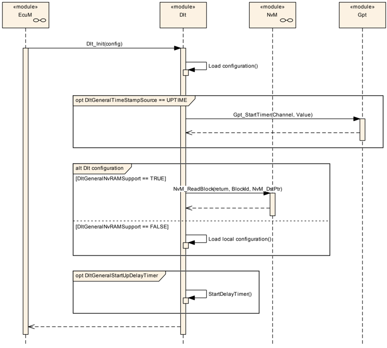

### 8.2. 一个日志通道上 Dlt 消息传输的概览

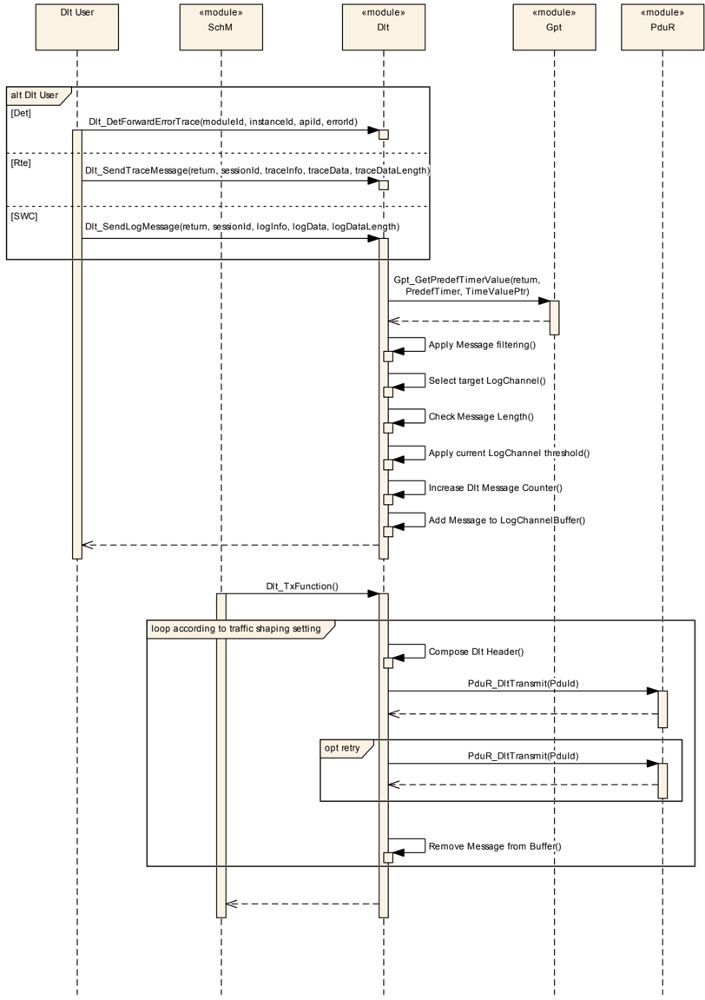

### 8.3. SetLogLevelFilter

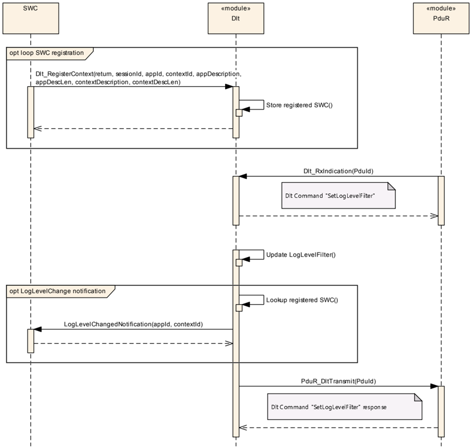

### 8.4. 缓冲区溢出指示

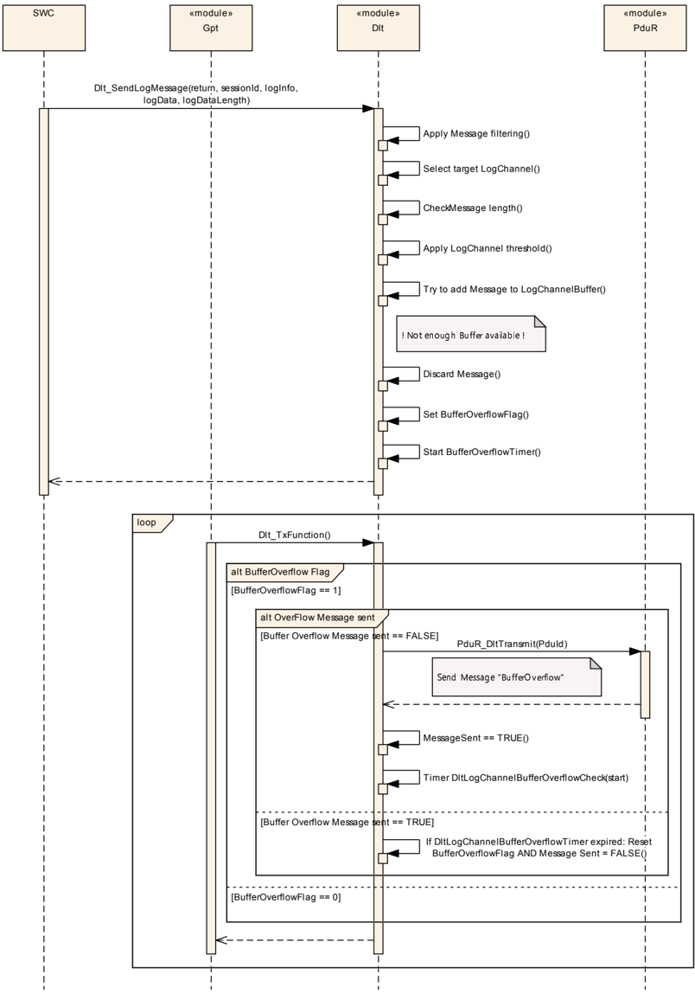

## 9. 配置规范

第 9.1 章规定模块 **Dlt** 的结构（容器）和参数。

第 9.2 章规定模块 **Dlt** 的发布信息。

### 9.1. 容器与配置参数

以下各节汇总所有配置参数。各参数的详细含义见第 6 章和第 7 章。

#### 9.1.1. Dlt

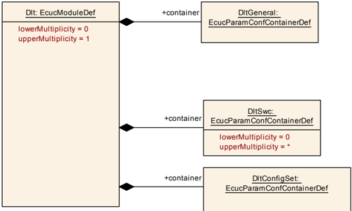

| SWS 条目 | [ECUC_Dlt_00800] |
|---|---|
| 模块名称 | Dlt |
| 描述 | **Dlt**（Log&Trace）模块的配置。 |
| Post-Build 变体支持 | true |
| 支持的配置变体 | VARIANT-LINK-TIME, VARIANT-POST-BUILD, VARIANT-PRE-COMPILE |

| 容器名称 | 多重性 | 作用域/依赖 |
|---|---|---|
| DltConfigSet | 1 | 该容器列出了所有可以在预编译时启用或禁用以优化资源消耗的全局 **Dlt** 功能。 |
| DltGeneral | 1 | 该容器列出了所有可以在预编译时启用或禁用以优化资源消耗的全局 **Dlt** 功能。 |
| DltSwc | 0..* | 包含 AUTOSAR **Dlt** 模块与 **SWC** 交互所需的配置参数。 |

#### 9.1.2. DltGeneral

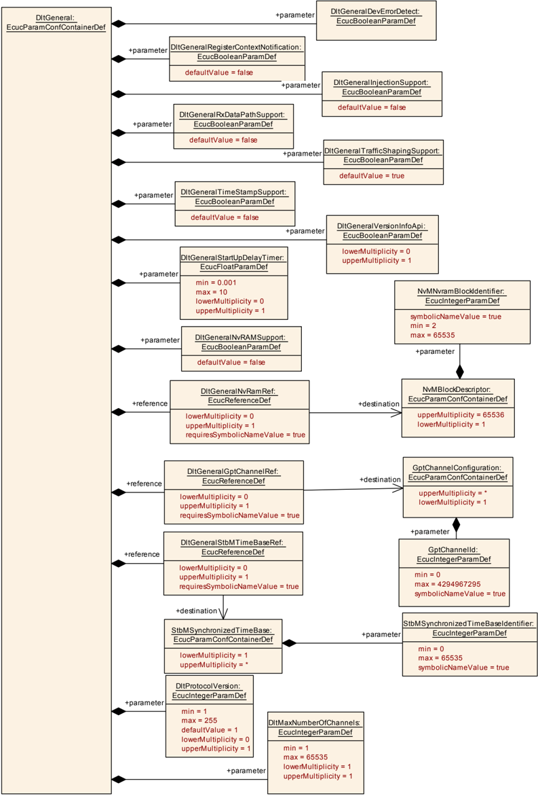

| SWS 条目 | [ECUC_Dlt_00809] |
|---|---|
| 容器名称 | DltGeneral |
| 父容器 | Dlt |
| 描述 | 该容器列出了所有可以在预编译时启用或禁用以优化资源消耗的全局 **Dlt** 功能。 |
| 配置参数 | 见下方参数表 |

| SWS 条目 | [ECUC_Dlt_00840] |
|---|---|
| 参数名称 | DltGeneralDevErrorDetect |
| 父容器 | DltGeneral |
| 描述 | 如果应使用默认错误跟踪器（**Det**），则此参数应设置为 TRUE。否则应设置为 FALSE。 |
| 多重性 | 1 |
| 类型 | EcucBooleanParamDef |
| 默认值 | - |
| Post-Build 变体值 | false |
| 值配置类 | Pre-compile time：x（All Variants）；Link time：-；Post-build time：- |
| 作用域/依赖 | scope: local |

| SWS 条目 | [ECUC_Dlt_00847] |
|---|---|
| 参数名称 | DltGeneralInjectionSupport |
| 父容器 | DltGeneral |
| 描述 | 启用或禁用 **Dlt** 注入（Injection）特性。 |
| 多重性 | 1 |
| 类型 | EcucBooleanParamDef |
| 默认值 | false |
| Post-Build 变体值 | false |
| 值配置类 | Pre-compile time：x（All Variants）；Link time：-；Post-build time：- |
| 作用域/依赖 | scope: local |

| SWS 条目 | [ECUC_Dlt_00915] |
|---|---|
| 参数名称 | DltGeneralNvRAMSupport |
| 父容器 | DltGeneral |
| 描述 | 启用或禁用 **Dlt** NvRAM 支持特性。 |
| 多重性 | 1 |
| 类型 | EcucBooleanParamDef |
| 默认值 | false |
| Post-Build 变体值 | false |
| 值配置类 | Pre-compile time：x（All Variants）；Link time：-；Post-build time：- |
| 作用域/依赖 | scope: local |

| SWS 条目 | [ECUC_Dlt_00846] |
|---|---|
| 参数名称 | DltGeneralRegisterContextNotification |
| 父容器 | DltGeneral |
| 描述 | 如果此参数设置为 TRUE，则每次 **SWC** 在 **Dlt** 模块处注册和/或注销时，都会发送一条 Dlt Control 消息。否则，不发送该通知。 |
| 多重性 | 1 |
| 类型 | EcucBooleanParamDef |
| 默认值 | false |
| Post-Build 变体值 | false |
| 值配置类 | Pre-compile time：x（All Variants）；Link time：-；Post-build time：- |
| 作用域/依赖 | scope: local |

| SWS 条目 | [ECUC_Dlt_00848] |
|---|---|
| 参数名称 | DltGeneralRxDataPathSupport |
| 父容器 | DltGeneral |
| 描述 | 启用或禁用用于控制 **Dlt** 模块的 Rx 数据路径。 |
| 多重性 | 1 |
| 类型 | EcucBooleanParamDef |
| 默认值 | false |
| Post-Build 变体值 | false |
| 值配置类 | Pre-compile time：x（All Variants）；Link time：-；Post-build time：- |
| 作用域/依赖 | scope: local；依赖：如果 DltGeneralRxDataPathSupport = TRUE，则至少需要配置一个 RxPdu |

| SWS 条目 | [ECUC_Dlt_00897] |
|---|---|
| 参数名称 | DltGeneralStartUpDelayTimer |
| 父容器 | DltGeneral |
| 描述 | **Dlt** 模块初始化后开始发送日志和跟踪消息的可配置延迟（单位：秒）。 |
| 多重性 | 0..1 |
| 类型 | EcucFloatParamDef |
| 范围 | [0.001 .. 10] |
| 默认值 | - |
| Post-Build 变体多重性 | false |
| Post-Build 变体值 | false |
| 多重性配置类 | Pre-compile time：x（All Variants）；Link time：-；Post-build time：- |
| 值配置类 | Pre-compile time：x（All Variants）；Link time：-；Post-build time：- |
| 作用域/依赖 | scope: local |

| SWS 条目 | [ECUC_Dlt_00850] |
|---|---|
| 参数名称 | DltGeneralTimeStampSupport |
| 父容器 | DltGeneral |
| 描述 | 如果应向 **Dlt** 消息添加时间戳，则此配置参数应设置为 TRUE。否则应设置为 FALSE。 |
| 多重性 | 1 |
| 类型 | EcucBooleanParamDef |
| 默认值 | false |
| Post-Build 变体值 | false |
| 值配置类 | Pre-compile time：x（All Variants）；Link time：-；Post-build time：- |
| 作用域/依赖 | scope: local |

| SWS 条目 | [ECUC_Dlt_00849] |
|---|---|
| 参数名称 | DltGeneralTrafficShapingSupport |
| 父容器 | DltGeneral |
| 描述 | 启用或禁用用于限制 **Dlt** 消息最大带宽的流量整形（TrafficShaping）特性。如果启用，则可以为每个日志通道配置最大带宽。 |
| 多重性 | 1 |
| 类型 | EcucBooleanParamDef |
| 默认值 | true |
| Post-Build 变体值 | false |
| 值配置类 | Pre-compile time：x（All Variants）；Link time：-；Post-build time：- |
| 作用域/依赖 | scope: local |

| SWS 条目 | [ECUC_Dlt_00844] |
|---|---|
| 参数名称 | DltGeneralVersionInfoApi |
| 父容器 | DltGeneral |
| 描述 | 用于启用版本信息 API 支持的预处理器开关（true：激活版本信息 API；false：停用版本信息 API）。 |
| 多重性 | 0..1 |
| 类型 | EcucBooleanParamDef |
| 默认值 | - |
| Post-Build 变体多重性 | false |
| Post-Build 变体值 | false |
| 多重性配置类 | Pre-compile time：x（All Variants）；Link time：-；Post-build time：- |
| 值配置类 | Pre-compile time：x（All Variants）；Link time：-；Post-build time：- |
| 作用域/依赖 | scope: local |

| SWS 条目 | [ECUC_Dlt_00918] |
|---|---|
| 参数名称 | DltMaxNumberOfChannels |
| 父容器 | DltGeneral |
| 描述 | 日志通道的最大数量。该值用于确定 **DLT** API 中日志通道名称数组的大小。 |
| 多重性 | 1 |
| 类型 | EcucIntegerParamDef |
| 范围 | 1 .. 65535 |
| 默认值 | - |
| Post-Build 变体值 | false |
| 值配置类 | Pre-compile time：x（All Variants）；Link time：-；Post-build time：- |
| 作用域/依赖 | scope: local |

| SWS 条目 | [ECUC_Dlt_00917] |
|---|---|
| 参数名称 | DltProtocolVersion |
| 父容器 | DltGeneral |
| 描述 | 选择 **Dlt** 模块使用的 **DLT** 协议版本。当前支持版本 1 和 2。 |
| 多重性 | 0..1 |
| 类型 | EcucIntegerParamDef |
| 范围 | 1 .. 255 |
| 默认值 | 1 |
| Post-Build 变体多重性 | false |
| Post-Build 变体值 | false |
| 多重性配置类 | Pre-compile time：x（All Variants）；Link time：-；Post-build time：- |
| 值配置类 | Pre-compile time：x（All Variants）；Link time：-；Post-build time：- |
| 作用域/依赖 | scope: local |

| SWS 条目 | [ECUC_Dlt_00905] |
|---|---|
| 参数名称 | DltGeneralGptChannelRef |
| 父容器 | DltGeneral |
| 描述 | 如果使用 TimeStampSupport，则 **Dlt** 模块应通过使用此处引用的 GptChannel 调用 Gpt_GetTimeElapsed，从 **Gpt** 模块获取时间。tick 持续时间可以从 Gpt ChannelConfiguration 容器的 GptChannelTickFrequency 参数推导得出。这对于计算 **Dlt** 消息中输出的微秒分辨率时间戳是必需的。应使用一个自由运行的 **GPT** 定时器。 |
| 多重性 | 0..1 |
| 类型 | 对 GptChannelConfiguration 的符号名引用 |
| Post-Build 变体多重性 | false |
| Post-Build 变体值 | false |
| 多重性配置类 | Pre-compile time：x（All Variants）；Link time：-；Post-build time：- |
| 作用域/依赖 | scope: local |

| SWS 条目 | [ECUC_Dlt_00845] |
|---|---|
| 参数名称 | DltGeneralNvRamRef |
| 父容器 | DltGeneral |
| 描述 | 如果 **Dlt** 模块应能够在运行期间持久存储修改后的参数，则应设置此引用，并使其指向该 NvmBlock。 |
| 多重性 | 0..1 |
| 类型 | 对 NvMBlockDescriptor 的符号名引用 |
| Post-Build 变体多重性 | false |
| Post-Build 变体值 | false |
| 多重性配置类 | Pre-compile time：x（All Variants）；Link time：-；Post-build time：- |
| 值配置类 | Pre-compile time：x（All Variants）；Link time：-；Post-build time：- |
| 作用域/依赖 | scope: local |

| SWS 条目 | [ECUC_Dlt_00914] |
|---|---|
| 参数名称 | DltGeneralStbMTimeBaseRef |
| 父容器 | DltGeneral |
| 描述 | 如果使用 TimeStampSupport，则 **Dlt** 模块应通过使用此处引用的 StbMSynchronizedTimeBase 调用 StbM_GetCurrentTime，从 **StbM** 模块获取时间。 |
| 多重性 | 0..1 |
| 类型 | 对 StbMSynchronizedTimeBase 的符号名引用 |
| Post-Build 变体多重性 | false |
| Post-Build 变体值 | false |
| 多重性配置类 | Pre-compile time：x（All Variants）；Link time：-；Post-build time：- |
| 值配置类 | Pre-compile time：x（All Variants）；Link time：-；Post-build time：- |
| 作用域/依赖 | scope: local；依赖：DltGeneralTimeStampSupport 设置为 TRUE 且未配置 DltGeneralGptChannelRef |

#### 9.1.3. DltSwc

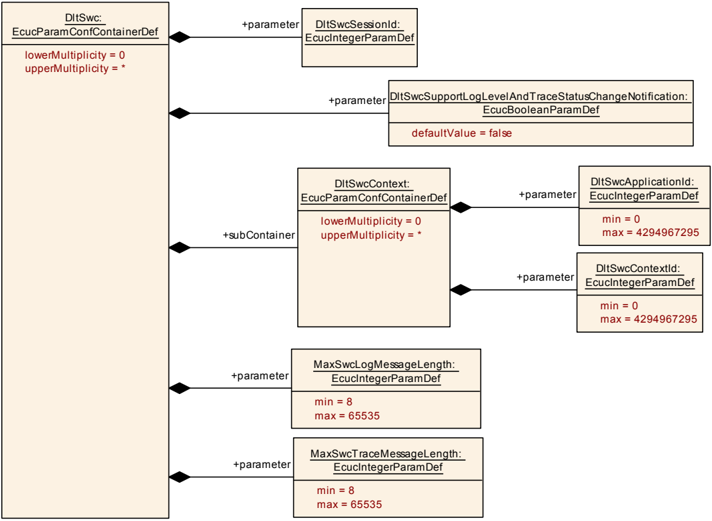

| SWS 条目 | [ECUC_Dlt_00856] |
|---|---|
| 容器名称 | DltSwc |
| 父容器 | Dlt |
| 描述 | 包含 AUTOSAR **Dlt** 模块与 **SWC** 交互所需的配置参数。 |
| Post-Build 变体多重性 | true |
| 多重性配置类 | Pre-compile time：x（VARIANT-PRE-COMPILE）；Link time：x（VARIANT-LINK-TIME）；Post-build time：x（VARIANT-POST-BUILD） |
| 配置参数 | 见下方参数表 |

| SWS 条目 | [ECUC_Dlt_00852] |
|---|---|
| 参数名称 | DltSwcSessionId |
| 父容器 | DltSwc |
| 描述 | ECU 范围内唯一的 ID，用于标识一个 **SWC**（实例）使用的端口。 |
| 多重性 | 1 |
| 类型 | EcucIntegerParamDef |
| 范围 | 0 .. 18446744073709551615 |
| 默认值 | - |
| Post-Build 变体值 | false |
| 值配置类 | Pre-compile time：x（All Variants）；Link time：-；Post-build time：- |
| 作用域/依赖 | scope: local |

| SWS 条目 | [ECUC_Dlt_00853] |
|---|---|
| 参数名称 | DltSwcSupportLogLevelAndTraceStatusChangeNotification |
| 父容器 | DltSwc |
| 描述 | 该标志指示 **Dlt** 是否必须提供一个 R-Port，用于就 LogLevel 或 TraceStatus 变化通知该 **SWC**。 |
| 多重性 | 1 |
| 类型 | EcucBooleanParamDef |
| 默认值 | false |
| Post-Build 变体值 | false |
| 值配置类 | Pre-compile time：x（All Variants）；Link time：-；Post-build time：- |
| 作用域/依赖 | scope: local |

| SWS 条目 | [ECUC_Dlt_00909] |
|---|---|
| 参数名称 | MaxSwcLogMessageLength |
| 父容器 | DltSwc |
| 描述 | 定义日志消息（LogMessage）允许的最大长度（uint16）。该参数范围的上限当前由数据类型的范围定义。该参数范围的实际上限与所有已配置 **Dlt** 日志或跟踪消息的最大长度相同，后者在所有日志或跟踪消息配置完成后才知道。 |
| 多重性 | 1 |
| 类型 | EcucIntegerParamDef |
| 范围 | 8 .. 65535 |
| 默认值 | - |
| Post-Build 变体值 | false |
| 值配置类 | Pre-compile time：x（All Variants）；Link time：-；Post-build time：- |
| 作用域/依赖 | scope: local |

| SWS 条目 | [ECUC_Dlt_00910] |
|---|---|
| 参数名称 | MaxSwcTraceMessageLength |
| 父容器 | DltSwc |
| 描述 | 定义跟踪消息（TraceMessage）允许的最大长度（uint16）。该参数范围的上限当前由数据类型的范围定义。该参数范围的实际上限与所有已配置 **Dlt** 日志或跟踪消息的最大长度相同，后者在所有日志或跟踪消息配置完成后才知道。 |
| 多重性 | 1 |
| 类型 | EcucIntegerParamDef |
| 范围 | 8 .. 65535 |
| 默认值 | - |
| Post-Build 变体值 | false |
| 值配置类 | Pre-compile time：x（All Variants）；Link time：-；Post-build time：- |
| 作用域/依赖 | scope: local |

| 容器名称 | 多重性 | 作用域/依赖 |
|---|---|---|
| DltSwcContext | 0..* | 该容器包含此 **SWC** 支持的 ApplicationId/ContextId 对的配置。 |

#### 9.1.4. DltSwcContext

| SWS 条目 | [ECUC_Dlt_00854] |
|---|---|
| 容器名称 | DltSwcContext |
| 父容器 | DltSwc |
| 描述 | 该容器包含此 **SWC** 支持的 ApplicationId/ContextId 对的配置。 |
| Post-Build 变体多重性 | true |
| 多重性配置类 | Pre-compile time：x（VARIANT-PRE-COMPILE）；Link time：x（VARIANT-LINK-TIME）；Post-build time：x（VARIANT-POST-BUILD） |
| 配置参数 | 见下方参数表 |

| SWS 条目 | [ECUC_Dlt_00858] |
|---|---|
| 参数名称 | DltSwcApplicationId |
| 父容器 | DltSwcContext |
| 描述 | **SWC** 的缩写（4 个字符）。 |
| 多重性 | 1 |
| 类型 | EcucIntegerParamDef |
| 范围 | 0 .. |
| 默认值 | - |
| Post-Build 变体值 | true |
| 值配置类 | Pre-compile time：x（VARIANT-PRE-COMPILE）；Link time：x（VARIANT-LINK-TIME）；Post-build time：x（VARIANT-POST-BUILD） |
| 作用域/依赖 | scope: local |

| SWS 条目 | [ECUC_Dlt_00859] |
|---|---|
| 参数名称 | DltSwcContextId |
| 父容器 | DltSwcContext |
| 描述 | ContextId 的缩写（4 个字符）。 |
| 多重性 | 1 |
| 类型 | EcucIntegerParamDef |
| 范围 | 0 .. 4294967295 |
| 默认值 | - |
| Post-Build 变体值 | true |
| 值配置类 | Pre-compile time：x（VARIANT-PRE-COMPILE）；Link time：x（VARIANT-LINK-TIME）；Post-build time：x（VARIANT-POST-BUILD） |
| 作用域/依赖 | scope: local |

无包含的容器。

#### 9.1.5. DltConfigSet

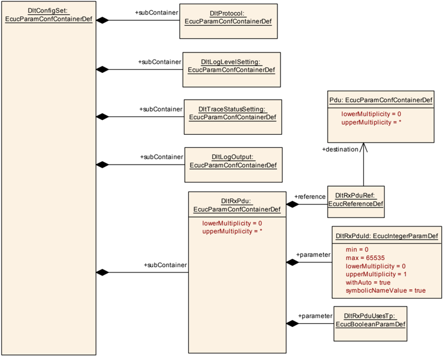

| SWS 条目 | [ECUC_Dlt_00842] |
|---|---|
| 容器名称 | DltConfigSet |
| 父容器 | Dlt |
| 描述 | 该容器列出了所有可以在预编译时启用或禁用以优化资源消耗的全局 **Dlt** 功能。 |
| 配置参数 | 见下方参数表 |

| 容器名称 | 多重性 | 作用域/依赖 |
|---|---|---|
| DltLogLevelSetting | 1 | 包含阈值的设置。 |
| DltLogOutput | 1 | 包含日志/跟踪消息输出的设置。 |
| DltProtocol | 1 | 用于处理特定协议变体的配置参数。 |
| DltRxPdu | 0..* | 包含用于 **Dlt** 控制消息接收的 Pdu ID。 |
| DltTraceStatusSetting | 1 | 包含跟踪状态的设置。 |

#### 9.1.6. DltProtocol

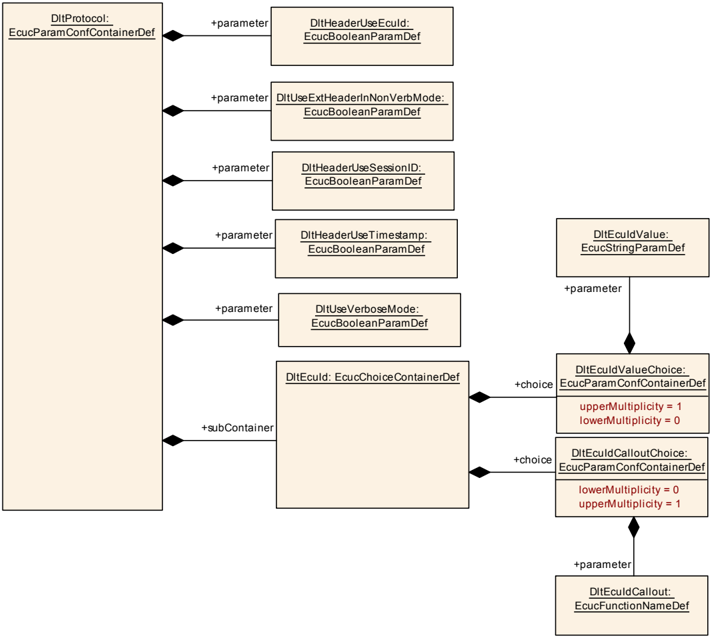

| SWS 条目 | [ECUC_Dlt_00832] |
|---|---|
| 容器名称 | DltProtocol |
| 父容器 | DltConfigSet |
| 描述 | 用于处理特定协议变体的配置参数。 |
| 配置参数 | 见下方参数表 |

| SWS 条目 | [ECUC_Dlt_00811] |
|---|---|
| 参数名称 | DltHeaderUseEcuId |
| 父容器 | DltProtocol |
| 描述 | 对应字段 WEID（With ECU ID）。如果设置，则 ECU ID 应放置在头中，否则不放置。如果 DltGeneralNvRAMSupport 已启用，则此处定义的参数值也是相应 NvRam 条目的初始值。如果未设置 DltGeneralNvRAMSupport，则应使用 Link-Time 或 Post-Build 配置。 |
| 多重性 | 1 |
| 类型 | EcucBooleanParamDef |
| 默认值 | - |
| Post-Build 变体值 | true |
| 值配置类 | Pre-compile time：x（VARIANT-PRE-COMPILE）；Link time：x（VARIANT-LINK-TIME）；Post-build time：x（VARIANT-POST-BUILD） |
| 作用域/依赖 | scope: ECU |

| SWS 条目 | [ECUC_Dlt_00813] |
|---|---|
| 参数名称 | DltHeaderUseSessionID |
| 父容器 | DltProtocol |
| 描述 | 对应字段 WSID（with Session ID）。如果设置，则 Session ID 应放置在头中，否则不放置。如果 DltGeneralNvRAMSupport 已启用，则此处定义的参数值也是相应 NvRam 条目的初始值。如果未设置 DltGeneralNvRAMSupport，则应使用 Link-Time 或 Post-Build 配置。 |
| 多重性 | 1 |
| 类型 | EcucBooleanParamDef |
| 默认值 | - |
| Post-Build 变体值 | true |
| 值配置类 | Pre-compile time：x（VARIANT-PRE-COMPILE）；Link time：x（VARIANT-LINK-TIME）；Post-build time：x（VARIANT-POST-BUILD） |
| 作用域/依赖 | scope: ECU |

| SWS 条目 | [ECUC_Dlt_00814] |
|---|---|
| 参数名称 | DltHeaderUseTimestamp |
| 父容器 | DltProtocol |
| 描述 | 对应字段 WTMS（With Timestamp）。如果设置，则时间戳应放置在头中，否则不放置。如果 DltGeneralNvRAMSupport 已启用，则此处定义的参数值也是相应 NvRam 条目的初始值。如果未设置 DltGeneralNvRAMSupport，则应使用 Link-Time 或 Post-Build 配置。 |
| 多重性 | 1 |
| 类型 | EcucBooleanParamDef |
| 默认值 | - |
| Post-Build 变体值 | true |
| 值配置类 | Pre-compile time：x（VARIANT-PRE-COMPILE）；Link time：x（VARIANT-LINK-TIME）；Post-build time：x（VARIANT-POST-BUILD） |
| 作用域/依赖 | scope: ECU；依赖：仅当 DltGeneralTimeStampSupport 为 true 时才可以为 true。 |

| SWS 条目 | [ECUC_Dlt_00812] |
|---|---|
| 参数名称 | DltUseExtHeaderInNonVerbMode |
| 父容器 | DltProtocol |
| 描述 | 非详细消息（与详细消息相对）不需要扩展头。如果此标志设置为 true，则扩展头也应用于非详细消息。如果 DltGeneralNvRAMSupport 已启用，则此处定义的参数值也是相应 NvRam 条目的初始值。如果未设置 DltGeneralNvRAMSupport，则应使用 Link-Time 或 Post-Build 配置。 |
| 多重性 | 1 |
| 类型 | EcucBooleanParamDef |
| 默认值 | - |
| Post-Build 变体值 | true |
| 值配置类 | Pre-compile time：x（VARIANT-PRE-COMPILE）；Link time：x（VARIANT-LINK-TIME）；Post-build time：x（VARIANT-POST-BUILD） |
| 作用域/依赖 | scope: ECU |

| SWS 条目 | [ECUC_Dlt_00911] |
|---|---|
| 参数名称 | DltUseVerboseMode |
| 父容器 | DltProtocol |
| 描述 | 如果此标志设置为 TRUE，则载荷应以详细模式传输；否则，载荷应以非详细模式传输。 |
| 多重性 | 1 |
| 类型 | EcucBooleanParamDef |
| 默认值 | - |
| Post-Build 变体值 | true |
| 值配置类 | Pre-compile time：x（VARIANT-PRE-COMPILE）；Link time：x（VARIANT-LINK-TIME）；Post-build time：x（VARIANT-POST-BUILD） |
| 作用域/依赖 | scope: ECU |

| 容器名称 | 多重性 | 作用域/依赖 |
|---|---|---|
| DltEcuId | 1 | 这是一个选择容器，用于在 EcuId 值和获取 EcuId 的调出（callout）之间进行选择。 |

#### 9.1.7. DltEcuId

| SWS 条目 | [ECUC_Dlt_00860] |
|---|---|
| 选择容器名称 | DltEcuId |
| 父容器 | DltProtocol |
| 描述 | 这是一个选择容器，用于在 EcuId 值和获取 EcuId 的调出（callout）之间进行选择。 |

| 容器选择 |  |  |
|---|---|---|
| DltEcuIdCalloutChoice | 0..1 | 通过用户定义的调出（callout）获取 EcuId。 |
| DltEcuIdValueChoice | 0..1 | EcuId 值配置。 |

#### 9.1.8. DltEcuIdCalloutChoice

| SWS 条目 | [ECUC_Dlt_00902] |
|---|---|
| 容器名称 | DltEcuIdCalloutChoice |
| 父容器 | DltEcuId |
| 描述 | 通过用户定义的调出（callout）获取 EcuId。 |
| Post-Build 变体多重性 | false |
| 配置参数 | 见下方参数表 |

| SWS 条目 | [ECUC_Dlt_00862] |
|---|---|
| 参数名称 | DltEcuIdCallout |
| 父容器 | DltEcuIdCalloutChoice |
| 描述 | 如果使用此选择，则应通过调用此处配置的调出函数来获取 EcuId。 |
| 多重性 | 1 |
| 类型 | EcucFunctionNameDef |
| 默认值 | - |
| 正则表达式 | - |
| Post-Build 变体值 | false |
| 值配置类 | Pre-compile time：x（All Variants）；Link time：-；Post-build time：- |
| 作用域/依赖 | scope: ECU |

无包含的容器。

#### 9.1.9. DltEcuIdValueChoice

| SWS 条目 | [ECUC_Dlt_00901] |
|---|---|
| 容器名称 | DltEcuIdValueChoice |
| 父容器 | DltEcuId |
| 描述 | EcuId 值配置。 |
| Post-Build 变体多重性 | false |
| 配置参数 | 见下方参数表 |

| SWS 条目 | [ECUC_Dlt_00861] |
|---|---|
| 参数名称 | DltEcuIdValue |
| 父容器 | DltEcuIdValueChoice |
| 描述 | 如果使用此选择，则 EcuId 应取自配置的字符串。这是在 **Dlt** 协议中使用的 ECU 名称。如果要使用数字表示形式，请将其作为字符输入。 |
| 多重性 | 1 |
| 类型 | EcucStringParamDef |
| 默认值 | - |
| 正则表达式 | - |
| Post-Build 变体值 | false |
| 值配置类 | Pre-compile time：x（All Variants）；Link time：-；Post-build time：- |
| 作用域/依赖 | scope: ECU |

无包含的容器。

#### 9.1.10. DltLogLevelSetting

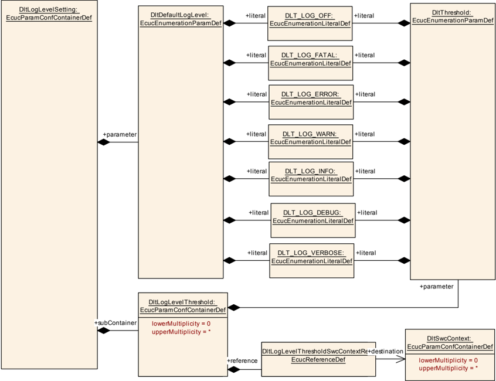

| SWS 条目 | [ECUC_Dlt_00863] |
|---|---|
| 容器名称 | DltLogLevelSetting |
| 父容器 | DltConfigSet |
| 描述 | 包含阈值的设置。 |
| 配置参数 | 见下方参数表 |

| SWS 条目 | [ECUC_Dlt_00864] |
|---|---|
| 参数名称 | DltDefaultLogLevel |
| 父容器 | DltLogLevelSetting |
| 描述 | 这是在没有过滤器匹配给定 ApplicationId 和 ContextId 时使用的有效日志级别。这可以视为一个针对 ApplicationId 和 ContextId 带通配符的兜底（fall-through）过滤定义，在没有其他过滤器匹配时使用。 |
| 多重性 | 1 |
| 类型 | EcucEnumerationParamDef |
| 范围 | DLT_LOG_DEBUG：-。DLT_LOG_ERROR：-。DLT_LOG_FATAL：-。DLT_LOG_INFO：-。DLT_LOG_OFF：-。DLT_LOG_VERBOSE：-。DLT_LOG_WARN：-。 |
| Post-Build 变体值 | true |
| 值配置类 | Pre-compile time：x（VARIANT-PRE-COMPILE）；Link time：-；Post-build time：- |
| 作用域/依赖 | scope: ECU |

| 容器名称 | 多重性 | 作用域/依赖 |
|---|---|---|
| DltLogLevelThreshold | 0..* | 该容器包含 ApplicationId/ContextId 对及其分配的 LogLevel 阈值的预配置。 |

#### 9.1.11. DltLogLevelThreshold

| SWS 条目 | [ECUC_Dlt_00865] |
|---|---|
| 容器名称 | DltLogLevelThreshold |
| 父容器 | DltLogLevelSetting |
| 描述 | 该容器包含 ApplicationId/ContextId 对及其分配的 LogLevel 阈值的预配置。 |
| Post-Build 变体多重性 | true |
| 多重性配置类 | Pre-compile time：x（VARIANT-PRE-COMPILE）；Link time：-；Post-build time：- |
| 配置参数 | 见下方参数表 |

| SWS 条目 | [ECUC_Dlt_00866] |
|---|---|
| 参数名称 | DltThreshold |
| 父容器 | DltLogLevelThreshold |
| 描述 | LogLevel 阈值。 |
| 多重性 | 1 |
| 类型 | EcucEnumerationParamDef |
| 范围 | DLT_LOG_DEBUG：-。DLT_LOG_ERROR：-。DLT_LOG_FATAL：-。DLT_LOG_INFO：-。DLT_LOG_OFF：-。DLT_LOG_VERBOSE：-。DLT_LOG_WARN：-。 |
| Post-Build 变体值 | true |
| 值配置类 | Pre-compile time：x（VARIANT-PRE-COMPILE）；Link time：-；Post-build time：- |
| 作用域/依赖 | scope: ECU |

| SWS 条目 | [ECUC_Dlt_00894] |
|---|---|
| 参数名称 | DltLogLevelThresholdSwcContextRef |
| 父容器 | DltLogLevelThreshold |
| 描述 | 对分配了 LogLevel 阈值的 ApplicationId/ContextId 对的引用。 |
| 多重性 | 1 |
| 类型 | 对 DltSwcContext 的引用 |
| Post-Build 变体值 | true |
| 值配置类 | Pre-compile time：x（VARIANT-PRE-COMPILE）；Link time：-；Post-build time：- |
| 作用域/依赖 | scope: ECU |

无包含的容器。

#### 9.1.12. DltLogChannelAssignment

| SWS 条目 | [ECUC_Dlt_00887] |
|---|---|
| 容器名称 | DltLogChannelAssignment |
| 父容器 | DltLogOutput |
| 描述 | 该容器包含 ApplicationId/ContextId 对及其分配的日志通道的预配置。 |
| Post-Build 变体多重性 | true |
| 多重性配置类 | Pre-compile time：x（VARIANT-PRE-COMPILE）；Link time：-；Post-build time：- |
| 配置参数 | 见下方参数表 |

| SWS 条目 | [ECUC_Dlt_00896] |
|---|---|
| 参数名称 | DltLogChannelAssignmentSwcContextRef |
| 父容器 | DltLogChannelAssignment |
| 描述 | 对分配给一个 DltLogChannel 的 ApplicationId/ContextId 对的引用。 |
| 多重性 | 1 |
| 类型 | 对 DltSwcContext 的引用 |
| Post-Build 变体值 | true |
| 值配置类 | Pre-compile time：x（VARIANT-PRE-COMPILE）；Link time：-；Post-build time：- |
| 作用域/依赖 | scope: ECU |

| SWS 条目 | [ECUC_Dlt_00888] |
|---|---|
| 参数名称 | DltLogChannelRef |
| 父容器 | DltLogChannelAssignment |
| 描述 | 对分配给一个 ApplicationId/ContextId 对的 DltLogChannel 的引用。 |
| 多重性 | 1 |
| 类型 | 对 DltLogChannel 的引用 |
| Post-Build 变体值 | true |
| 值配置类 | Pre-compile time：x（VARIANT-PRE-COMPILE）；Link time：-；Post-build time：- |
| 作用域/依赖 | scope: ECU |

无包含的容器。

#### 9.1.13. DltTraceStatusSetting

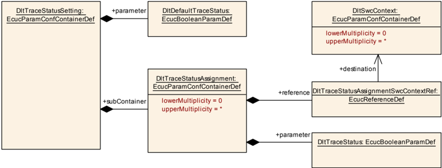

| SWS 条目 | [ECUC_Dlt_00869] |
|---|---|
| 容器名称 | DltTraceStatusSetting |
| 父容器 | DltConfigSet |
| 描述 | 包含跟踪状态的设置。 |
| 配置参数 | 见下方参数表 |

| SWS 条目 | [ECUC_Dlt_00870] |
|---|---|
| 参数名称 | DltDefaultTraceStatus |
| 父容器 | DltTraceStatusSetting |
| 描述 | 这是在没有过滤器匹配给定 ApplicationId 和 ContextId 时使用的有效跟踪状态。这可以视为一个针对 ApplicationId 和 ContextId 带通配符的兜底（fall-through）过滤定义，在没有其他过滤器匹配时使用。 |
| 多重性 | 1 |
| 类型 | EcucBooleanParamDef |
| 默认值 | - |
| Post-Build 变体值 | true |
| 值配置类 | Pre-compile time：x（VARIANT-PRE-COMPILE）；Link time：-；Post-build time：- |
| 作用域/依赖 | scope: ECU |

| 容器名称 | 多重性 | 作用域/依赖 |
|---|---|---|
| DltTraceStatusAssignment | 0..* | 该容器包含 ApplicationId/ContextId 对及其分配的跟踪状态的预配置。 |

#### 9.1.14. DltTraceStatusAssignment

| SWS 条目 | [ECUC_Dlt_00871] |
|---|---|
| 容器名称 | DltTraceStatusAssignment |
| 父容器 | DltTraceStatusSetting |
| 描述 | 该容器包含 ApplicationId/ContextId 对及其分配的跟踪状态的预配置。 |
| Post-Build 变体多重性 | true |
| 多重性配置类 | Pre-compile time：x（VARIANT-PRE-COMPILE）；Link time：-；Post-build time：- |
| 配置参数 | 见下方参数表 |

| SWS 条目 | [ECUC_Dlt_00874] |
|---|---|
| 参数名称 | DltTraceStatus |
| 父容器 | DltTraceStatusAssignment |
| 描述 | 给定 ApplicationId/ContextId 元组的跟踪状态。 |
| 多重性 | 1 |
| 类型 | EcucBooleanParamDef |
| 默认值 | - |
| Post-Build 变体值 | true |
| 值配置类 | Pre-compile time：x（VARIANT-PRE-COMPILE）；Link time：-；Post-build time：- |
| 作用域/依赖 | scope: ECU |

| SWS 条目 | [ECUC_Dlt_00895] |
|---|---|
| 参数名称 | DltTraceStatusAssignmentSwcContextRef |
| 父容器 | DltTraceStatusAssignment |
| 描述 | 对分配了 DltTraceStatus 的 ApplicationId/ContextId 对的引用。 |
| 多重性 | 1 |
| 类型 | 对 DltSwcContext 的引用 |
| Post-Build 变体值 | true |
| 值配置类 | Pre-compile time：x（VARIANT-PRE-COMPILE）；Link time：-；Post-build time：- |
| 作用域/依赖 | scope: ECU |

无包含的容器。

#### 9.1.15. DltLogOutput

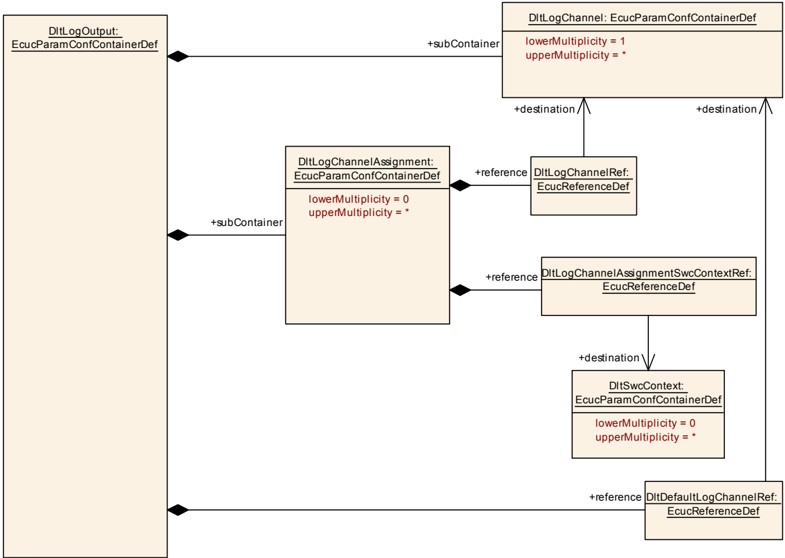

| SWS 条目 | [ECUC_Dlt_00875] |
|---|---|
| 容器名称 | DltLogOutput |
| 父容器 | DltConfigSet |
| 描述 | 包含日志/跟踪消息输出的设置。 |
| 配置参数 | 见下方参数表 |

| SWS 条目 | [ECUC_Dlt_00889] |
|---|---|
| 参数名称 | DltDefaultLogChannelRef |
| 父容器 | DltLogOutput |
| 描述 | 对默认日志通道的引用，在没有找到其他匹配时，日志/跟踪输出必须使用该日志通道。 |
| 多重性 | 1 |
| 类型 | 对 DltLogChannel 的引用 |
| Post-Build 变体值 | true |
| 值配置类 | Pre-compile time：x（VARIANT-PRE-COMPILE）；Link time：-；Post-build time：- |
| 作用域/依赖 | scope: ECU |

| 容器名称 | 多重性 | 作用域/依赖 |
|---|---|---|
| DltLogChannel | 1..* | 包含日志/跟踪消息输出的设置。 |
| DltLogChannelAssignment | 0..* | 该容器包含 ApplicationId/ContextId 对及其分配的日志通道的预配置。 |

#### 9.1.16. DltLogChannel

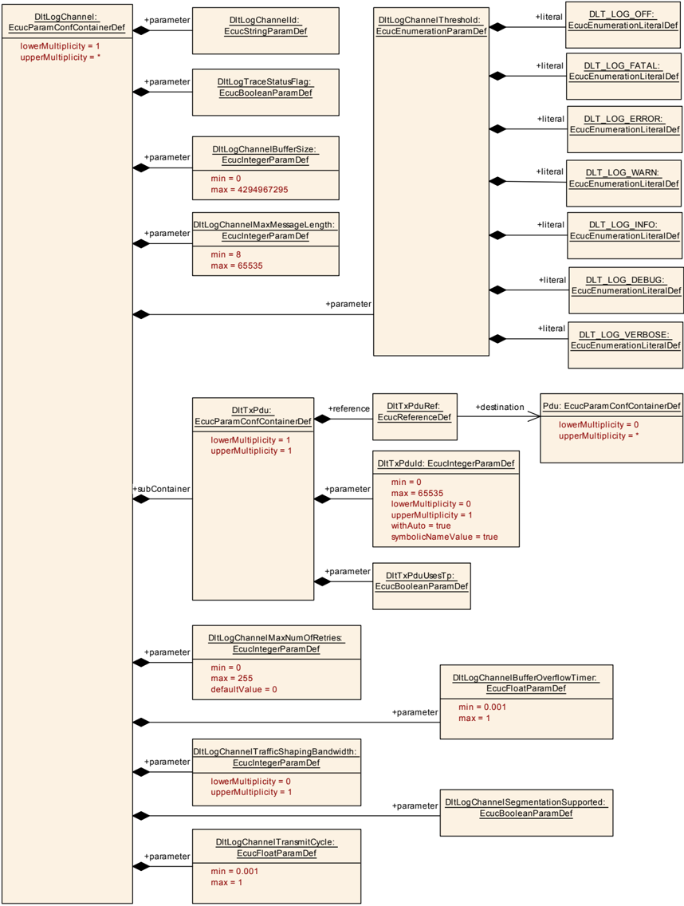

| SWS 条目 | [ECUC_Dlt_00876] |
|---|---|
| 容器名称 | DltLogChannel |
| 父容器 | DltLogOutput |
| 描述 | 包含日志/跟踪消息输出的设置。 |
| 配置参数 | 见下方参数表 |

| SWS 条目 | [ECUC_Dlt_00886] |
|---|---|
| 参数名称 | DltLogChannelBufferOverflowTimer |
| 父容器 | DltLogChannel |
| 描述 | 指定发生缓冲区溢出时用于复位缓冲区溢出标志的周期时间（单位：秒）。 |
| 多重性 | 1 |
| 类型 | EcucFloatParamDef |
| 范围 | [0.001 .. 1] |
| 默认值 | - |
| Post-Build 变体值 | true |
| 值配置类 | Pre-compile time：x（VARIANT-PRE-COMPILE）；Link time：-；Post-build time：- |
| 作用域/依赖 | scope: ECU |

| SWS 条目 | [ECUC_Dlt_00881] |
|---|---|
| 参数名称 | DltLogChannelBufferSize |
| 父容器 | DltLogChannel |
| 描述 | 日志通道特定消息缓冲区的缓冲区大小（字节）。 |
| 多重性 | 1 |
| 类型 | EcucIntegerParamDef |
| 范围 | 0 .. 4294967295 |
| 默认值 | - |
| Post-Build 变体值 | false |
| 值配置类 | Pre-compile time：x（VARIANT-PRE-COMPILE）；Link time：-；Post-build time：- |
| 作用域/依赖 | scope: ECU |

| SWS 条目 | [ECUC_Dlt_00877] |
|---|---|
| 参数名称 | DltLogChannelId |
| 父容器 | DltLogChannel |
| 描述 | 这是日志通道的 4 个 ASCII 字符长名称，在 **Dlt** 控制消息中用作参数名 Dlt_interface。 |
| 多重性 | 1 |
| 类型 | EcucStringParamDef |
| 默认值 | - |
| 正则表达式 | - |
| Post-Build 变体值 | true |
| 值配置类 | Pre-compile time：x（VARIANT-PRE-COMPILE）；Link time：x（VARIANT-LINK-TIME）；Post-build time：x（VARIANT-POST-BUILD） |
| 作用域/依赖 | scope: ECU |

| SWS 条目 | [ECUC_Dlt_00882] |
|---|---|
| 参数名称 | DltLogChannelMaxMessageLength |
| 父容器 | DltLogChannel |
| 描述 | 一条 **Dlt** 日志或跟踪消息的最大长度。 |
| 多重性 | 1 |
| 类型 | EcucIntegerParamDef |
| 范围 | 8 .. 65535 |
| 默认值 | - |
| Post-Build 变体值 | true |
| 值配置类 | Pre-compile time：x（VARIANT-PRE-COMPILE）；Link time：-；Post-build time：- |
| 作用域/依赖 | scope: ECU |

| SWS 条目 | [ECUC_Dlt_00884] |
|---|---|
| 参数名称 | DltLogChannelMaxNumOfRetries |
| 父容器 | DltLogChannel |
| 描述 | 发送一条 **Dlt** 日志或跟踪消息的最大重试次数。 |
| 多重性 | 1 |
| 类型 | EcucIntegerParamDef |
| 范围 | 0 .. 255 |
| 默认值 | 0 |
| Post-Build 变体值 | true |
| 值配置类 | Pre-compile time：x（VARIANT-PRE-COMPILE）；Link time：-；Post-build time：- |
| 作用域/依赖 | scope: ECU |

| SWS 条目 | [ECUC_Dlt_00916] |
|---|---|
| 参数名称 | DltLogChannelSegmentationSupported |
| 父容器 | DltLogChannel |
| 描述 | 如果一条 **DLT** 消息大于 Pdu 长度，则将使用分段（segmentation）。 |
| 多重性 | 1 |
| 类型 | EcucBooleanParamDef |
| 默认值 | - |
| Post-Build 变体值 | true |
| 值配置类 | Pre-compile time：x（VARIANT-PRE-COMPILE）；Link time：-；Post-build time：- |
| 作用域/依赖 | scope: local |

| SWS 条目 | [ECUC_Dlt_00878] |
|---|---|
| 参数名称 | DltLogChannelThreshold |
| 父容器 | DltLogChannel |
| 描述 | LogLevel 阈值。 |
| 多重性 | 1 |
| 类型 | EcucEnumerationParamDef |
| 范围 | DLT_LOG_DEBUG：-。DLT_LOG_ERROR：-。DLT_LOG_FATAL：-。DLT_LOG_INFO：-。DLT_LOG_OFF：-。DLT_LOG_VERBOSE：-。DLT_LOG_WARN：-。 |
| Post-Build 变体值 | true |
| 值配置类 | Pre-compile time：x（VARIANT-PRE-COMPILE）；Link time：-；Post-build time：- |
| 作用域/依赖 | scope: ECU |

| SWS 条目 | [ECUC_Dlt_00883] |
|---|---|
| 参数名称 | DltLogChannelTrafficShapingBandwidth |
| 父容器 | DltLogChannel |
| 描述 | 设置最大可能的带宽（bit/s）。 |
| 多重性 | 0..1 |
| 类型 | EcucIntegerParamDef |
| 范围 | 0 .. 18446744073709551615 |
| 默认值 | - |
| Post-Build 变体多重性 | true |
| Post-Build 变体值 | true |
| 多重性配置类 | Pre-compile time：x（VARIANT-PRE-COMPILE）；Link time：x（VARIANT-LINK-TIME）；Post-build time：x（VARIANT-POST-BUILD） |
| 值配置类 | Pre-compile time：x（VARIANT-PRE-COMPILE）；Link time：x（VARIANT-LINK-TIME）；Post-build time：x（VARIANT-POST-BUILD） |
| 作用域/依赖 | scope: local；依赖：DltGeneralTrafficShapingSupport 已启用 |

| SWS 条目 | [ECUC_Dlt_00885] |
|---|---|
| 参数名称 | DltLogChannelTransmitCycle |
| 父容器 | DltLogChannel |
| 描述 | 指定此日志通道发送功能的周期时间（单位：秒）。 |
| 多重性 | 1 |
| 类型 | EcucFloatParamDef |
| 范围 | [0.001 .. 1] |
| 默认值 | - |
| Post-Build 变体值 | true |
| 值配置类 | Pre-compile time：x（VARIANT-PRE-COMPILE）；Link time：-；Post-build time：- |
| 作用域/依赖 | scope: ECU |

| SWS 条目 | [ECUC_Dlt_00879] |
|---|---|
| 参数名称 | DltLogTraceStatusFlag |
| 父容器 | DltLogChannel |
| 描述 | 用于完全开启/关闭此日志通道上跟踪的参数。 |
| 多重性 | 1 |
| 类型 | EcucBooleanParamDef |
| 默认值 | - |
| Post-Build 变体值 | true |
| 值配置类 | Pre-compile time：x（VARIANT-PRE-COMPILE）；Link time：-；Post-build time：- |
| 作用域/依赖 | scope: ECU |

| 容器名称 | 多重性 | 作用域/依赖 |
|---|---|---|
| DltTxPdu | 1 | 包含 AUTOSAR **Dlt** 模块的 Tx Pdu 的配置参数。 |

#### 9.1.17. DltTxPdu

| SWS 条目 | [ECUC_Dlt_00907] |
|---|---|
| 容器名称 | DltTxPdu |
| 父容器 | DltLogChannel |
| 描述 | 包含 AUTOSAR **Dlt** 模块的 Tx Pdu 的配置参数。 |
| 配置参数 | 见下方参数表 |

| SWS 条目 | [ECUC_Dlt_00893] |
|---|---|
| 参数名称 | DltTxPduId |
| 父容器 | DltTxPdu |
| 描述 | 用作此 I-PDU 的 ID 的数值。该句柄 Id 由 API 调用 Dlt_TxConfirmation、Dlt_TriggerTransmit、Dlt_TriggerIPDUSend 或 Dlt_TriggerIPDUSendWithMetaData、Dlt_CopyTxData 以及 Dlt_TpTxConfirmation 用于发送或确认 I-PDU 的传输。 |
| 多重性 | 0..1 |
| 类型 | EcucIntegerParamDef（为此参数生成符号名） |
| 范围 | 0 .. 65535 |
| 默认值 | - |
| Post-Build 变体多重性 | true |
| Post-Build 变体值 | true |
| 多重性配置类 | Pre-compile time：x（VARIANT-PRE-COMPILE）；Link time：x（VARIANT-LINK-TIME）；Post-build time：x（VARIANT-POST-BUILD） |
| 值配置类 | Pre-compile time：x（VARIANT-PRE-COMPILE）；Link time：x（VARIANT-LINK-TIME）；Post-build time：x（VARIANT-POST-BUILD） |
| 作用域/依赖 | scope: ECU |

| SWS 条目 | [ECUC_Dlt_00913] |
|---|---|
| 参数名称 | DltTxPduUsesTp |
| 父容器 | DltTxPdu |
| 描述 | 如果设置为 TRUE，则该 PDU 使用 TP API 发送。如果为 FALSE，则使用 IF API。 |
| 多重性 | 1 |
| 类型 | EcucBooleanParamDef |
| 默认值 | - |
| Post-Build 变体值 | true |
| 值配置类 | Pre-compile time：x（VARIANT-PRE-COMPILE）；Link time：x（VARIANT-LINK-TIME）；Post-build time：x（VARIANT-POST-BUILD） |
| 作用域/依赖 | scope: local |

| SWS 条目 | [ECUC_Dlt_00892] |
|---|---|
| 参数名称 | DltTxPduRef |
| 父容器 | DltTxPdu |
| 描述 | 对「全局」Pdu 结构的引用，以允许在 COM-Stack 中统一句柄 ID。 |
| 多重性 | 1 |
| 类型 | 对 Pdu 的引用 |
| Post-Build 变体值 | true |
| 值配置类 | Pre-compile time：x（VARIANT-PRE-COMPILE）；Link time：x（VARIANT-LINK-TIME）；Post-build time：x（VARIANT-POST-BUILD） |
| 作用域/依赖 | scope: local |

无包含的容器。

#### 9.1.18. DltRxPdu

| SWS 条目 | [ECUC_Dlt_00900] |
|---|---|
| 容器名称 | DltRxPdu |
| 父容器 | DltConfigSet |
| 描述 | 包含用于 **Dlt** 控制消息接收的 Pdu ID。 |
| Post-Build 变体多重性 | true |
| 多重性配置类 | Pre-compile time：x（VARIANT-PRE-COMPILE）；Link time：x（VARIANT-LINK-TIME）；Post-build time：x（VARIANT-POST-BUILD） |
| 配置参数 | 见下方参数表 |

| SWS 条目 | [ECUC_Dlt_00899] |
|---|---|
| 参数名称 | DltRxPduId |
| 父容器 | DltRxPdu |
| 描述 | 用作此 I-PDU 的 ID 的数值。API 调用 Dlt_RxIndication、Dlt_TpRxIndication、Dlt_StartOfReception 和 Dlt_CopyRxData 需要 DltRxPduId 以从 **PduR** 接收 I-PDU。 |
| 多重性 | 0..1 |
| 类型 | EcucIntegerParamDef（为此参数生成符号名） |
| 范围 | 0 .. 65535 |
| 默认值 | - |
| Post-Build 变体多重性 | true |
| Post-Build 变体值 | true |
| 多重性配置类 | Pre-compile time：x（VARIANT-PRE-COMPILE）；Link time：x（VARIANT-LINK-TIME）；Post-build time：x（VARIANT-POST-BUILD） |
| 值配置类 | Pre-compile time：x（VARIANT-PRE-COMPILE）；Link time：x（VARIANT-LINK-TIME）；Post-build time：x（VARIANT-POST-BUILD） |
| 作用域/依赖 | scope: ECU（withAuto = true） |

| SWS 条目 | [ECUC_Dlt_00912] |
|---|---|
| 参数名称 | DltRxPduUsesTp |
| 父容器 | DltRxPdu |
| 描述 | 如果设置为 TRUE，则该 PDU 使用 TP API 接收。如果为 FALSE，则使用 IF API。 |
| 多重性 | 1 |
| 类型 | EcucBooleanParamDef |
| 默认值 | - |
| Post-Build 变体值 | true |
| 值配置类 | Pre-compile time：x（VARIANT-PRE-COMPILE）；Link time：x（VARIANT-LINK-TIME）；Post-build time：x（VARIANT-POST-BUILD） |
| 作用域/依赖 | scope: local |

| SWS 条目 | [ECUC_Dlt_00898] |
|---|---|
| 参数名称 | DltRxPduRef |
| 父容器 | DltRxPdu |
| 描述 | 对「全局」Pdu 结构的引用，以允许在 COM-Stack 中统一句柄 ID。 |
| 多重性 | 1 |
| 类型 | 对 Pdu 的引用 |
| Post-Build 变体值 | true |
| 值配置类 | Pre-compile time：x（VARIANT-PRE-COMPILE）；Link time：x（VARIANT-LINK-TIME）；Post-build time：x（VARIANT-POST-BUILD） |
| 作用域/依赖 | scope: local |

无包含的容器。

### 9.2. 发布信息

发布信息包含由 SW 模块实现者定义的数据，这些数据在模块适配（即配置）到实际 HW/SW 环境时不会改变。因此它包含版本和制造商信息。

如适用，其他模块特定的发布参数将在下方列出。

## A. 提及的类表

为完整起见，本章包含一组类表，它们表示在本文上下文中提及、但不在描述特定元模型语义的范围内的元类。

表A.1：PPortPrototype

| 类 | PPortPrototype |
|---|---|
| 包 | M2::AUTOSARTemplates::SWComponentTemplate::Components |
| 注释 | 提供某个端口接口的组件端口。 |
| 基类 | ARObject, AbstractProvidedPortPrototype, AtpBlueprintable, AtpFeature, AtpPrototype, Identifiable, MultilanguageReferrable, PortPrototype, Referrable |
| 聚合于 | AtpClassifier.atpFeature, SwComponentType.port |

| 属性 | 类型 | 多重性 | 种类 | 注释 |
|---|---|---|---|---|
| providedInterface | PortInterface | 0..1 | tref | 该端口提供的接口。构造型（Stereotypes）：isOfType |

表A.2：RPortPrototype

| 类 | RPortPrototype |
|---|---|
| 包 | M2::AUTOSARTemplates::SWComponentTemplate::Components |
| 注释 | 需要某个端口接口的组件端口。 |
| 基类 | ARObject, AbstractRequiredPortPrototype, AtpBlueprintable, AtpFeature, AtpPrototype, Identifiable, MultilanguageReferrable, PortPrototype, Referrable |
| 聚合于 | AtpClassifier.atpFeature, SwComponentType.port |

| 属性 | 类型 | 多重性 | 种类 | 注释 |
|---|---|---|---|---|
| mayBeUnconnected | Boolean | 0..1 | attr | 如果设置为 true，此属性指示所包围的 RPortPrototype 可以保持未连接，并且该方面已在软件组件的设计中被显式考虑。 |
| requiredInterface | PortInterface | 0..1 | tref | 该端口需要的接口。构造型（Stereotypes）：isOfType |

表A.3：Referrable（抽象）

| 类 | Referrable（抽象） |
|---|---|
| 包 | M2::AUTOSARTemplates::GenericStructure::GeneralTemplateClasses::Identifiable |
| 注释 | 此类的实例可以通过其标识符引用（同时遵守命名空间边界）。 |
| 基类 | ARObject |
| 子类 | AtpDefinition, BswDistinguishedPartition, BswModuleCallPoint, BswModuleClientServerEntry, BswVariableAccess, CouplingPortTrafficClassAssignment, DiagnosticEnvModeElement, EthernetPriorityRegeneration, ExclusiveAreaNestingOrder, HwDescriptionEntity, ImplementationProps, LinSlaveConfigIdent, ModeTransition, MultilanguageReferrable, PncMappingIdent, SingleLanguageReferrable, SoConIPduIdentifier, SocketConnectionBundle, TimeSyncServerConfiguration, TpConnectionIdent |

| 属性 | 类型 | 多重性 | 种类 | 注释 |
|---|---|---|---|---|
| shortName | Identifier | 1 | attr | 这为对象指定一个用于标识的 shortName。它在其上下文中需要唯一，并且面向人类，但更多用于技术引用。构造型（Stereotypes）：atpIdentityContributor。标签（Tags）：xml.enforceMinMultiplicity=true, xml.sequenceOffset=-100 |
| shortNameFragment | ShortNameFragment | * | aggr | 这指定 Referrable.shortName 如何由多个 shortNameFragment 组成。标签（Tags）：xml.sequenceOffset=-90 |

## B. AUTOSAR 可追溯项变更历史

请注意，本章中的列表还包括已在后续版本中从规范中移除的约束和规范项。这些规范项不会在文档中显示为超链接。

### B.1. 本文档的变更历史（按AUTOSAR R23-11版本）

#### B.1.1. R23-11中新增的规范项

```
[SWS_Dlt_00003] [SWS_Dlt_00005] [SWS_Dlt_00021] [SWS_Dlt_00022] [SWS_Dlt_00023] [SWS_Dlt_00027] [SWS_Dlt_00031] [SWS_Dlt_00078] [SWS_Dlt_00224] [SWS_Dlt_00225] [SWS_Dlt_00226] [SWS_Dlt_00227] [SWS_Dlt_00228] [SWS_Dlt_00229] [SWS_Dlt_00230] [SWS_Dlt_00231] [SWS_Dlt_00232] [SWS_Dlt_00233] [SWS_Dlt_00235] [SWS_Dlt_00236] [SWS_Dlt_00237] [SWS_Dlt_00239] [SWS_Dlt_00241] [SWS_Dlt_00243] [SWS_Dlt_00245] [SWS_Dlt_00252] [SWS_Dlt_00254] [SWS_Dlt_00259] [SWS_Dlt_00271] [SWS_Dlt_00272] [SWS_Dlt_00273] [SWS_Dlt_00276] [SWS_Dlt_00277] [SWS_Dlt_00278] [SWS_Dlt_00279] [SWS_Dlt_00280] [SWS_Dlt_00281] [SWS_Dlt_00282] [SWS_Dlt_00283] [SWS_Dlt_00284] [SWS_Dlt_00285] [SWS_Dlt_00332] [SWS_Dlt_00335] [SWS_Dlt_00337] [SWS_Dlt_00350] [SWS_Dlt_00376] [SWS_Dlt_00377] [SWS_Dlt_00430] [SWS_Dlt_00432] [SWS_Dlt_00437] [SWS_Dlt_00449] [SWS_Dlt_00451] [SWS_Dlt_00453] [SWS_Dlt_00484] [SWS_Dlt_00495] [SWS_Dlt_00496] [SWS_Dlt_00498] [SWS_Dlt_00499] [SWS_Dlt_00516] [SWS_Dlt_00632] [SWS_Dlt_00643] [SWS_Dlt_00644] [SWS_Dlt_00645] [SWS_Dlt_00646] [SWS_Dlt_00647] [SWS_Dlt_00648] [SWS_Dlt_00649] [SWS_Dlt_00650] [SWS_Dlt_00651] [SWS_Dlt_00652] [SWS_Dlt_00653] [SWS_Dlt_00654] [SWS_Dlt_00655] [SWS_Dlt_00656] [SWS_Dlt_00657] [SWS_Dlt_00658] [SWS_Dlt_00659] [SWS_Dlt_00660] [SWS_Dlt_00661] [SWS_Dlt_00662] [SWS_Dlt_00663] [SWS_Dlt_00664] [SWS_Dlt_00665] [SWS_Dlt_00666] [SWS_Dlt_00667] [SWS_Dlt_00668] [SWS_Dlt_00669] [SWS_Dlt_00670] [SWS_Dlt_00671] [SWS_Dlt_00672] [SWS_Dlt_00673] [SWS_Dlt_00674] [SWS_Dlt_00675] [SWS_Dlt_00676] [SWS_Dlt_00677] [SWS_Dlt_00678] [SWS_Dlt_00679] [SWS_Dlt_00680] [SWS_Dlt_00681] [SWS_Dlt_00682] [SWS_Dlt_00683] [SWS_Dlt_00684] [SWS_Dlt_00685] [SWS_Dlt_00686] [SWS_Dlt_00687] [SWS_Dlt_00688] [SWS_Dlt_00689] [SWS_Dlt_00690] [SWS_Dlt_00691] [SWS_Dlt_00692] [SWS_Dlt_00693] [SWS_Dlt_00694] [SWS_Dlt_00695] [SWS_Dlt_00696] [SWS_Dlt_00697] [SWS_Dlt_00698] [SWS_Dlt_00699] [SWS_Dlt_00700] [SWS_Dlt_00701] [SWS_Dlt_00702] [SWS_Dlt_00703] [SWS_Dlt_00704] [SWS_Dlt_00705] [SWS_Dlt_00706] [SWS_Dlt_00708] [SWS_Dlt_00709] [SWS_Dlt_00710] [SWS_Dlt_00711] [SWS_Dlt_00712] [SWS_Dlt_00713] [SWS_Dlt_00714] [SWS_Dlt_00715] [SWS_Dlt_00716] [SWS_Dlt_00717] [SWS_Dlt_00718] [SWS_Dlt_00719] [SWS_Dlt_00720] [SWS_Dlt_00721] [SWS_Dlt_00722] [SWS_Dlt_00723] [SWS_Dlt_00724] [SWS_Dlt_00725] [SWS_Dlt_00726] [SWS_Dlt_00727] [SWS_Dlt_00728] [SWS_Dlt_00729] [SWS_Dlt_00730] [SWS_Dlt_00732] [SWS_Dlt_00733] [SWS_Dlt_00734] [SWS_Dlt_00735] [SWS_Dlt_00736] [SWS_Dlt_00737] [SWS_Dlt_00738] [SWS_Dlt_00739] [SWS_Dlt_00740] [SWS_Dlt_00741] [SWS_Dlt_00742] [SWS_Dlt_00743] [SWS_Dlt_00744] [SWS_Dlt_00745] [SWS_Dlt_00746] [SWS_Dlt_00747] [SWS_Dlt_00748] [SWS_Dlt_00749] [SWS_Dlt_00750] [SWS_Dlt_00751] [SWS_Dlt_00752] [SWS_Dlt_00753] [SWS_Dlt_00754] [SWS_Dlt_00755] [SWS_Dlt_00756] [SWS_Dlt_00758] [SWS_Dlt_00759] [SWS_Dlt_00760] [SWS_Dlt_00761] [SWS_Dlt_00762] [SWS_Dlt_00763] [SWS_Dlt_00765] [SWS_Dlt_00766] [SWS_Dlt_00768] [SWS_Dlt_00769] [SWS_Dlt_00770] [SWS_Dlt_00772] [SWS_Dlt_00773] [SWS_Dlt_00774] [SWS_Dlt_00775] [SWS_Dlt_00776] [SWS_Dlt_00777] [SWS_Dlt_00778] [SWS_Dlt_00779] [SWS_Dlt_00780] [SWS_Dlt_00782] [SWS_Dlt_00783] [SWS_Dlt_00784] [SWS_Dlt_00785] [SWS_Dlt_00787] [SWS_Dlt_91001] [SWS_Dlt_91002] [SWS_Dlt_91003] [SWS_Dlt_91004] [SWS_Dlt_91005] [SWS_Dlt_91006] [SWS_Dlt_91007] [SWS_Dlt_91008] [SWS_Dlt_91009] [SWS_Dlt_91010] [SWS_Dlt_91011] [SWS_Dlt_91012] [SWS_Dlt_91013]
```

#### B.1.2. R23-11中变更的规范项

无

#### B.1.3. R23-11中删除的规范项

无

