## 1. 简介和功能概述

本文档旨在规定 AUTOSAR 基础软件模块基于 IP 的诊断（**Diagnostic over IP**，**DoIP**）的功能、**API** 和配置。

有关 **DoIP** 的详细介绍和信息，请参阅 **ISO 13400** 文档集。

作为软件标准的 AUTOSAR 可以在现有的以太网架构中提供 **ISO DoIP** 规范的标准化解决方案，如图 1.1 所示。

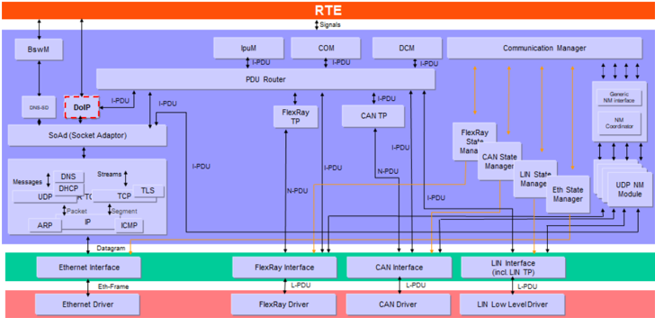

## 2. 缩略语

**ARP**
> Address Resolution Protocol —— 地址解析协议。

**DHCP**
> Diagnostic Host Configuration Protocol —— 诊断主机配置协议。

**EID**
> Entity identifier —— 实体标识符。

**GID**
> Group identifier —— 组标识符。

**ICMP**
> Internet Control Message Protocol —— 互联网控制消息协议。

**IP**
> Internet Protocol —— 互联网协议。

**IPv4**
> Internet Protocol version 4 —— 互联网协议第 4 版。

**IPv6**
> Internet Protocol version 6 —— 互联网协议第 6 版。

**TCP**
> Transmission Control Protocol —— 传输控制协议。

**TCP/IP**
> 计算机网络中使用的一族通信协议。

**VIN**
> Vehicle Identification Number —— 车辆识别码。

**UDP**
> User Datagram Protocol —— 用户数据报协议。

## 3. 相关文档

### 3.1. 输入文件和相关标准与规范

<a id="ref-1"></a>[1] General Specification of Basic Software Modules
> AUTOSAR_CP_SWS_BSWGeneral

<a id="ref-2"></a>[2] Specification of Socket Adaptor
> AUTOSAR_CP_SWS_SocketAdaptor

<a id="ref-3"></a>[3] Specification of TCP/IP Stack
> AUTOSAR_CP_SWS_TcpIp

<a id="ref-4"></a>[4] Specification of PDU Router
> AUTOSAR_CP_SWS_PDURouter

<a id="ref-5"></a>[5] Specification of Diagnostic Communication Manager
> AUTOSAR_CP_SWS_DiagnosticCommunicationManager

<a id="ref-6"></a>[6] Specification of Default Error Tracer
> AUTOSAR_CP_SWS_DefaultErrorTracer

<a id="ref-7"></a>[7] Road vehicles - Diagnostic communication over Internet Protocol (DoIP)
> https://www.iso.org

<a id="ref-8"></a>[8] Specification of RTE Software
> AUTOSAR_CP_SWS_RTE

### 3.2. 相关标准与规范

1. **ISO 13400-2**，Road vehicles - Diagnostic communication over Internet Protocol (DoIP) - Part 2: Transport protocol and network layer services（道路车辆——基于互联网协议的诊断通信（DoIP）——第 2 部分：传输协议和网络层服务）

### 3.3. 相关规范

AUTOSAR 提供了一份关于基础软件模块的通用规范 [\[1\]](#ref-1)（SWS BSW General），它同样适用于 **DoIP** 模块。

因此，SWS BSW General 规范 [\[1\]](#ref-1) 应被视为 **DoIP** 模块的附加且必需的规范。

## 4. 约束和假设

### 4.1. 汽车域的适用性

**DoIP** 基础软件模块可用于所有汽车域。

## 5. 对其他模块的依赖

本节描述 **DoIP** 模块与其他 AUTOSAR 基础软件模块之间的关系和依赖。它简要描述从其他模块所需的服务和接口，以及它们如何调用 **DoIP** 模块以及如何被 **DoIP** 模块调用。

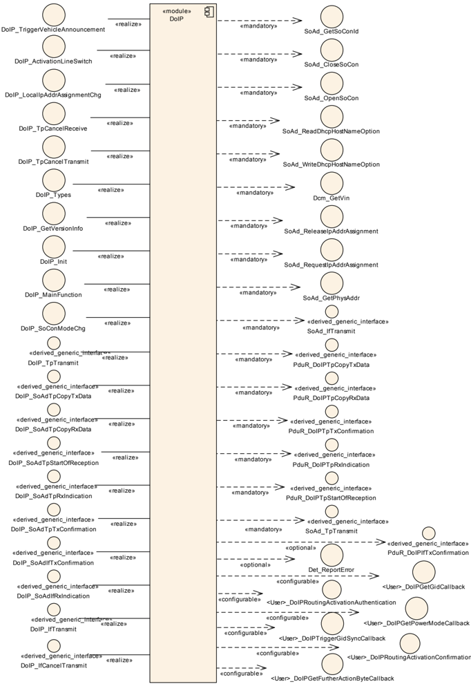

### 5.1. Socket Adaptor（SoAd）

Socket Adaptor [\[2\]](#ref-2) 是 **DoIP** 模块的下层模块。它提供：

* 用于套接字连接建立和通知的接口与回调
* 通过多个套接字连接的数据传输
* 通过多个套接字连接的数据接收
* 套接字状态变化的通知
* IP 地址状态变化的通知

Socket Adaptor 是 **TCP/IP** 协议栈 [\[3\]](#ref-3) 的接口模块，后者支持 **IP**、**TCP**、**UDP**、IPv4、IPv6 以及 AutoIP 和 **DHCP** 等地址分配机制。

### 5.2. Pdu Router（PduR）

**PDU** 路由器 [\[4\]](#ref-4) 是 **DoIP** 模块用于连接通信栈其余部分的模块。它提供：

* 将诊断消息从 **DoIP** 模块转发给其他模块（即内部 **Dcm** 或其他 **TP** 模块）
* 将诊断消息从 **Dcm** 或其他 **TP** 模块转发给 **DoIP** 模块。

**PduR** 是将诊断消息从 **DoIP** 模块路由到其相应目标并返回的模块。

### 5.3. Diagnostic Communication Manager（Dcm）

诊断通信管理器 [\[5\]](#ref-5) 是为 **DoIP** 模块提供 **VIN** 的模块。此外，**Dcm** 将执行经由 **PduR** 路由的 ECU 本地诊断。

### 5.4. Default Error Tracer（Det）

如果配置参数 DoIPDevelopmentErrorDetect 设置为 true 且 **DoIP** API 以不正确的参数被调用，则默认错误跟踪器 [\[6\]](#ref-6) 会带有一个错误 ID 被调用。

### 5.5. 文件结构

#### 5.5.1. 代码文件结构

有关详细信息，可参见 SWS_BSWGeneral [\[1\]](#ref-1) 中的第 5.1.6 章「Code file structure」（代码文件结构）。

## 6. 功能规格

本规范以下列各章提供 **ISO 13400-2** 的 AUTOSAR 表示。

### 6.1. DoIP 使用场景

本章仅简要概述部分用例。有关 **DoIP** 使用场景的详细信息，请参阅 **ISO 13400-1**。

**DoIP** 的使用用例从外部测试设备（test equipment）的单一连接（见图 7.1）到车辆或单个 ECU 与环境的广泛互联（见图 7.2）各不相同。

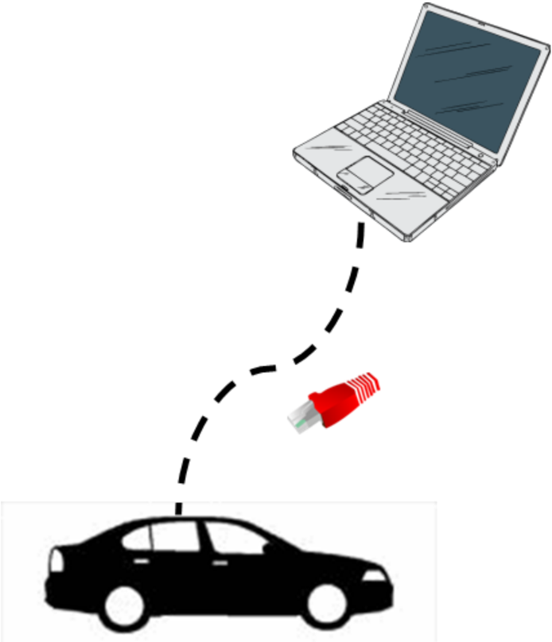

**DoIP** 为这种交互使用一种在单个 **DoIP** 实体内执行多个服务的协议，以满足 **DoIP ISO 13400** [\[7\]](#ref-7) 的服务相关需求：

部分 **DoIP** 服务例如有：

* 车辆识别与通告（Vehicle identification and announcement）：检测谁参与了 **DoIP** 通信所必需。
* 路由激活（Routing Activation）：允许激活或不激活单个诊断消息路径，以区别对待不同协议（如 **UDS** 和 **OBD**），并区别对待单个测试仪。
* 节点信息（Node information）：提供单个 **DoIP** 实体的一般信息。通常由测试仪用于从单个 **DoIP** 实体获取当前与 **DoIP** 协议相关的信息。
* 存活机制（Alive mechanism）：用于维护不同的测试仪连接。

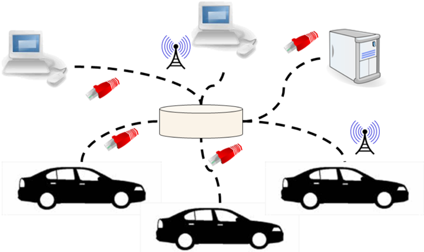

#### 6.1.1. DoIP 内部测试仪功能扩展（DRAFT）

**注意：**与 CONC_649 DoIP Extension 相关。本节中实现的所有内容都处于 DRAFT 状态。

该用例涵盖了车内 **DoIP** 通信的可能性。测试仪也可以位于车辆网络内部。

能够通过 **DoIP** 与外部和内部测试设备通信的这一需求可以概括为：

一个 ECU/**DoIP** 节点可能是「多宿主的」（multi-homed）。也就是说，它可以拥有多个逻辑 IP 接口（可能共享同一个物理以太网接口/MAC 地址）。

在这种情况下，ECU 应能够通过 **DoIP** 在其每个 IP 接口上独立地「通信」。也就是说，每个 IP 接口上的 **DoIP** 功能必须彼此隔离。例如，这意味着：

* 「Activation-Line-Low」触发是限定于某个特定 IP 接口的。因此，此时并非关闭所有接口上的所有 **DoIP** 连接，而只是关闭聚合到发生「Activation-Line-Low」的 IP 接口的那一个连接。（即每个接口都有自己的逻辑激活线（activation line））
* 在路由激活期间，对已注册/激活的 SA 的检查也应限定于该接口！因此，SA 为 X 的测试仪有可能在两个不同的接口上拥有有效的路由激活（但不能在同一个接口的两个不同连接上）。

车辆内部 IP 接口上的 **DoIP** 通信通常与外部接口上的通信不同：

* 内部 IP 接口通常在 ECU 的整个生命周期内始终处于活动/启用状态
* 内部 IP 接口通常分配有静态 IP 地址。
* 因此，内部 IP 接口通常没有分配「激活线」语义。也就是说，在抽象层面上，对于内部 IP 接口，「激活线」始终为「高」。

为了将其分解为更一般的「多宿主」ECU/**DoIP** 节点概念，这意味着：

**DoIP** 模块（CP 或 AP）应具有以下可能性：

* 配置它应在哪些接口上「工作」
* 每个接口配置
  * 激活线（Activation Line）功能是否起作用/是否需要
  * 是否应进行动态 IP 分配
  * 是否应进行车辆通告（以及何时进行）

### 6.2. 连接建立

本章描述 **DoIP** 模块套接字连接的维护。

**DoIP** 模块应通过调用 [DoIP_ActivationLineSwitch](#738-doip_activationlineswitch) (uint8 InterfaceId, boolean *Active)，基于每个具有给定 InterfaceId 的 [DoIPInterface](#927-doipinterface) 的布尔参数 Active 的值来确定 DoIP 激活线状态。如果调用中的布尔值设置为 TRUE，则激活线状态被视为「活动（active）」。如果调用中的布尔值设置为 FALSE，则激活线状态被视为「非活动（inactive）」。

如果从 SoAd 或 **PduR** 接收数据（即通信相关接口被调用）时使用的 PduId 与某个配置了 DoIPInterfaceActLineCtrl = TRUE 的 [DoIPInterface](#927-doipinterface) 相关，而该 [DoIPInterface](#927-doipinterface) 的激活线状态当前为非活动，则 **DoIP** 模块应忽略所有这些请求并返回一个负的返回值。

**注意：**返回值取决于被调用的 API。如果它是 Std_ReturnType，则应返回 E_NOT_OK；如果它是 BufReq_ReturnType，则应返回 BUFREQ_NOT_OK。

对于激活线受控的 DoIP 接口（DoIPInterfaceActLineCtrl = TRUE），当相应的激活线状态切换为「活动」时，**DoIP** 应按照连接建立流程为这些接口建立相应的连接。

对于非激活线受控的 DoIP 接口（DoIPInterfaceActLineCtrl = FALSE），**DoIP** 应在首次调用 [DoIP_MainFunction](#751-doip_mainfunction)() 的上下文中按照连接建立流程为这些接口建立相应的连接。

如果 [DoIPInterface](#927-doipinterface) 的激活线状态切换为「非活动」，则 **DoIP** 模块应遍历所有 [DoIPTcpConnection](#9213-doiptcpconnection)、[DoIPUdpConnection](#9216-doipudpconnection) 和 [DoIPUdpVehicleAnnouncementConnection](#9219-doipudpvehicleannouncementconnection)。对于这些 DoIP 连接中的每一个，**DoIP** 模块应通过调用 SoAd_GetSoConId 检索相应的 SoConId，并通过使用检索到的 SoConId 调用 SoAd_CloseSoCon 关闭所有连接。

除了上述关闭之外，对于属于激活线状态已切换为「非活动」的 [DoIPInterface](#927-doipinterface)、且 DoIPRequestAddressAssignment 设置为 true 的那些连接，**DoIP** 模块还应通过调用 SoAd_ReleaseIpAddrAssignment 释放相应的 IP 地址分配。

为了打开一个 DoIP 接口的套接字连接（由上述激活线触发流程触发），**DoIP** 模块应遍历其所有关联的 [DoIPTcpConnection](#9213-doiptcpconnection)、[DoIPUdpConnection](#9216-doipudpconnection) 和 [DoIPUdpVehicleAnnouncementConnection](#9219-doipudpvehicleannouncementconnection)。对于属于相应 DoIP 接口且 DoIPRequestAddressAssignment 设置为 true 的每个 DoIP 连接，**DoIP** 模块应通过调用 SoAd_GetSoConId() 检索相应的 SoConId，并通过对检索到的 SoConId、LocalIpAddrPtr 和 DefaultRouterPtr 设置为 NULL_PTR、Netmask 设置为 0、Type 设置为 TCPIP_IPADDR_ASSIGNMENT_ALL 的后续 SoAd_RequestIpAddrAssignment() 调用触发 IP 地址分配。对于这些 DoIP 连接中的每一个（无论 DoIPRequestAddressAssignment 的值如何），**DoIP** 模块都应通过相应的 SoAd_OpenSoCon() 调用打开相应的连接。

**DoIP** 模块应维护已配置 [DoIPUdpConnection](#9216-doipudpconnection)（用于 UDP 通信）的以下信息：

* 套接字连接（SocketConnection）的状态

**DoIP** 模块应能够使用以下信息维护 DoIPMaxTesterConnections 个连接：

* DoIPSoAdTcpRxPduId，描述与套接字连接（SocketConnection）的连接
* 源地址（SA），一旦该信息对 **DoIP** 模块可用
* 该套接字连接的所有路由激活状态
* 套接字连接（SocketConnection）的状态
* 自上次 TCP 通信（Rx 或 Tx）以来的时间
* 该连接是否活动的信息

如果使用 Mode 设置为 SOAD_SOCON_ONLINE 调用 [DoIP_SoConModeChg](#748-doip_soconmodechg)，则套接字连接的状态应被视为在线，并且 **DoIP** 模块应按 inactive-time 相关规定表现。

如果使用 Mode 设置为 SOAD_SOCON_ONLINE 以外的值调用 [DoIP_SoConModeChg](#748-doip_soconmodechg)，则套接字连接的状态应被视为离线，并且 **DoIP** 模块应按 TCP 套接字关闭处理规定表现。

如果对一个 UDP 车辆通告连接以 Mode 设置为 SOAD_SOCON_ONLINE 调用函数 [DoIP_SoConModeChg](#748-doip_soconmodechg)，则 **DoIP** 模块应通过在 [DoIPUdpVehicleAnnouncementConnection](#9219-doipudpvehicleannouncementconnection) 中配置的、属于所报告套接字连接的相应 Tx PDU 发送车辆通告消息。

如果一个连接需要基于 **DoIP** 特定行为被关闭，则 **DoIP** 模块应以参数 abort 设置为 FALSE、以及通过对相应 [DoIPSoAdTcpTxPdu](#9215-doipsoadtcptxpdu) 调用函数 SoAd_GetSoConId 确定的 SoConId 来调用函数 SoAd_CloseSoCon。此外，应停止不活动定时器。

如果一个连接需要基于 **DoIP** 特定行为被复位，则 **DoIP** 模块应以参数 abort 设置为 TRUE、以及通过对相应 [DoIPSoAdTcpTxPdu](#9215-doipsoadtcptxpdu) 调用函数 SoAd_GetSoConId 确定的 SoConId 来调用函数 SoAd_CloseSoCon。此外，应停止不活动定时器。

如果参数 DoIPVinGidMaster 设置为 true 且容器 DoIPTriggerGIDSynchronization 已配置，则 **DoIP** 模块应调用 &lt;User&gt;_DoIPTriggerGIDSynchronization 函数（在成功的 IP 地址分配之后，见连接建立流程），并在 [DoIP_MainFunction](#751-doip_mainfunction) 内重复此调用，直到其返回值等于 E_OK 或直到整个连接因任何其他原因被关闭。

如果 [DoIP_LocalIpAddrAssignmentChg](#749-doip_localipaddrassignmentchg) 指示的 IP 地址分配变化为 TCPIP_IpAddrStateType 中 TCPIP_IPADDR_STATE_ASSIGNED 以外的其他值，则不再调用如 GID 同步触发所述的用于启动 GID 同步的函数，无论之前的返回值如何。

如果一个 TCP 套接字连接被关闭（在以与 SOAD_SOCON_ONLINE 不同的模式值调用 [DoIP_SoConModeChg](#748-doip_soconmodechg) 之后，或由于连接关闭/复位规定所述的任何其他原因），则 **DoIP** 模块应：

* 注销并释放与相关测试仪的套接字连接，
* 放弃正在进行的诊断消息处理，以及
* 复位给定套接字连接的不活动定时器。

**注意：**这包括清理所有缓冲区/内部变量以及已调度的异步或挂起的函数调用，并将已连接测试仪的数量减 1。

**DoIP** 模块应为每个已注册的 TCP 连接维护一个不活动定时器。

在成功的 TCP 套接字连接（即 [DoIP_SoConModeChg](#748-doip_soconmodechg)）之后，**DoIP** 模块应启动不活动定时器。

如果在新打开的套接字上在配置的 DoIPInitialInactivityTime 内未收到路由激活请求，则 **DoIP** 模块应按连接复位规定复位该套接字连接。

如果在新打开的套接字上在不活动定时器超时之前（即配置的 DoIPInitialInactivityTime 尚未过去）收到了路由激活请求，则 **DoIP** 模块应将不活动定时器复位为 0。

在路由激活已执行之后（见不活动定时器复位规定），每当在该套接字上进行数据通信（发送或接收）时，**DoIP** 模块都应将不活动定时器复位为 0。

如果不活动定时器达到 DoIPGeneralInactivityTime 中配置的时间，则应按连接复位规定复位相应的套接字连接。

如果以 State 设置为 TCPIP_IPADDR_STATE_ASSIGNED 调用 API [DoIP_LocalIpAddrAssignmentChg](#749-doip_localipaddrassignmentchg)，则 **DoIP** 模块应使用接收到的 SoConId 调用函数 SoAd_ReadDhcpHostNameOption 以获取当前设置的主机名选项。返回的字节缓冲区应被视为 ASCII 缓冲区，并且应以「DoIP-」开头。

如果上述读取返回的 ASCII 缓冲区不以「DoIP-」开头，且配置参数 DoIPDhcpOptionVinUse 设置为 FALSE，则 **DoIP** 模块应以指向字符串「DoIP-」的指针调用 SoAd_WriteDhcpHostNameOption 以设置主机名。

如果上述读取返回的 ASCII 缓冲区不以「DoIP-」开头，且配置参数 DoIPDhcpOptionVinUse 设置为 TRUE，则 **DoIP** 模块应以指向 ASCII 缓冲区「DoIP-VIN&lt;vinnumberinascii&gt;」的指针调用 SoAd_WriteDhcpHostNameOption，其中 &lt;vinnumberinascii&gt; 表示通过 Dcm_GetVin 检索到的 VIN 的 ASCII 表示。如果无法检索到有效的 VIN，则 **DoIP** 应使用 ASCII 表示形式的已配置 DoIPVinInvalidityPattern。

当在没有设置或设置为 FALSE 的 [DoIPTcpConnection](#9213-doiptcpconnection)/DoIPTcpConnectionSecurityRequired 的 TCP 连接上收到路由激活请求时，**DoIP** 模块应搜索其分配的容器与 DoIPTesterSA 匹配的 [DoIPTester](#9226-doiptester)。如果找到了这样的 [DoIPTester](#9226-doiptester) 容器，且匹配的 [DoIPRoutingActivation](#9223-doiproutingactivation) 容器（参见路由激活类型检查规定）的属性 DoIPRoutingActivationSecurityRequired 未设置或设置为 FALSE，则将建立该连接。

如果找到了这样的 [DoIPTester](#9226-doiptester) 容器，且匹配的 [DoIPRoutingActivation](#9223-doiproutingactivation) 容器（参见路由激活类型检查规定）的属性 DoIPRoutingActivationSecurityRequired 设置为 TRUE，则应以响应码「0x07」拒绝该连接。

当在 [DoIPTcpConnection](#9213-doiptcpconnection)/DoIPTcpConnectionSecurityRequired 设置为 TRUE 的 TCP 连接上收到路由激活请求时，**DoIP** 模块应搜索其分配的容器与 DoIPTesterSA 匹配的 [DoIPTester](#9226-doiptester)。

如果找到了这样的 [DoIPTester](#9226-doiptester) 容器，则将建立该连接。

依据（Rationale）：安全的 TCP 连接可以与请求安全或非安全连接的 [DoIPTester](#9226-doiptester) 建立。

### 6.3. 根据 ISO 13400-2 的 DoIP 消息布局

一条 **DoIP** 消息可以通过其通用的 DoIP 头结构来标识，该结构在下一节中描述。

#### 6.3.1. 通用 DoIP 头

所有经由 SoAd 接收或发送的 Pdu 都应支持 **ISO 13400-2** [\[7\]](#ref-7) 表 11 中定义的 DoIP 头结构。本章描述该 DoIP 头。

**DoIP** 消息的前 8 个字节应包含 DoIP 头，其后是实际的载荷数据。

表7.1：DoIP 消息通用头布局（**DoIP message Generic header Layout**）

| 条目 | 位置（字节） | 长度（字节） |
|---|---|---|
| 通用 DoIP 头同步模式（Generic DoIP header synchronization pattern） | | |
| 协议版本（Protocol version） | 0 | 1 |
| 反向协议版本（Inverse protocol version） | 1 | 1 |
| 通用 DoIP 载荷类型和载荷长度（Generic DoIP payload type and payload length） | | |
| 载荷类型（Payload type） | 2 | 2 |
| 载荷长度（Payload length） | 4 | 4 |
| 载荷类型特定的消息内容（Payload type specific message content） | 8 | ... |

**DoIP** 头的字节 0 必须包含协议版本，例如 0x02。

**DoIP** 头的字节 1 应包含反向协议版本，例如，如果协议版本为 0x02，则应加入 0xFD 值。

如果配置参数 DoIP_ISO13400_2_2012 已启用，则 **DoIP** 实体应接受协议版本为 0x02 的接收帧。

如果配置参数 DoIP_ISO13400_2_2019 已启用，则 **DoIP** 实体应接受协议版本为 0x03 的接收帧。

如果在非安全连接上收到了协议版本为 0x02 的路由激活请求以激活安全路由，则 **DoIP** 实体应回送路由激活响应 0x06，并按连接关闭规定关闭此套接字连接。

**DoIP** 实体应使用在 DoIPAnnouncedProtocolVersion 中配置的协议版本作为车辆通告中的通告协议版本。

如果收到协议版本为 0xFF 的车辆识别请求，则 **DoIP** 实体应使用在 DoIPAnnouncedProtocolVersion 中配置的协议版本作为车辆识别响应中的协议版本。

对于通过 TCP 传输 **DoIP** 响应，**DoIP** 实体应使用与从该测试仪的第一个请求中接收并提取的协议版本相同的协议版本。

对于通过 UDP 传输 **DoIP** 响应，**DoIP** 实体应使用与从请求中接收并提取的协议版本相同的协议版本。

字节 2 和字节 3 应包含 PayloadType。

接收 **DoIP** 消息时应支持以下 PayloadType：

表7.2：DoIP 实体接收的 DoIP 载荷类型、章节引用及其接收所在的连接类型（**DoIP payload types received by a DoIP entity, chapter reference and the connection type they are received on**）

| 载荷类型值 | 载荷类型名称 | DoIP SWS 章节 | 连接类型 |
|---|---|---|---|
| 0x0000 | 通用 DoIP 头否定确认 | 6.3.2.1 | UDP/TCP |
| 0x0001 | 车辆识别请求消息 | 6.3.2.2.1 | UDP |
| 0x0002 | 带 EID 的车辆识别请求消息 | 6.3.2.2.2 | UDP |
| 0x0003 | 带 VIN 的车辆识别请求消息 | 6.3.2.2.3 | UDP |
| 0x0004 | 车辆通告消息/车辆识别响应消息 | 6.3.2.2.1 | UDP |
| 0x0005 | 路由激活请求 | 6.3.2.3.1 | TCP |
| 0x0008 | 存活检查响应 | 6.3.2.4.2 | TCP |
| 0x4001 | DoIP 实体状态请求 | 6.3.2.5.3 | UDP |
| 0x4003 | 诊断电源模式信息请求 | 6.3.2.5.1 | UDP |
| 0x8001 | 诊断消息 | 6.3.2.6.1 | TCP |

发送 **DoIP** 消息时应支持以下 PayloadType：

表7.3：DoIP 实体发送的 DoIP 载荷类型、章节引用及其发送所在的连接类型（**DoIP payload types transmitted by a DoIP entity, chapter reference and the connection type they are transmitted on**）

| 载荷类型值 | 载荷类型名称 | DoIP SWS 章节 | 连接类型 |
|---|---|---|---|
| 0x0000 | 通用 DoIP 头否定确认 | 6.3.2.1 | UDP/TCP |
| 0x0004 | 车辆通告消息/车辆识别响应 | 6.3.2.2.4 | UDP |
| 0x0006 | 路由激活响应 | 6.3.2.3.2 | TCP |
| 0x0007 | 存活检查请求 | 6.3.2.4.1 | TCP |
| 0x4002 | DoIP 实体状态响应 | 6.3.2.5.4 | UDP |
| 0x4004 | 诊断电源模式信息响应 | 6.3.2.5.2 | UDP |
| 0x8002 | 诊断消息肯定确认 | 6.3.2.6.2 | TCP |
| 0x8003 | 诊断消息否定确认 | 6.3.2.6.3 | TCP |

字节 4 到 7 应包含以字节为单位的载荷长度，不包括 DoIP 头信息的长度（即，如果接收到的 **DoIP** 消息的 Payload length 设置为 2，则意味着总共接收了 10 个字节）。

#### 6.3.2. 载荷类型

本章详细描述不同的载荷类型。

##### 6.3.2.1. 通用确认

本章包含对 DoIP 头的检查以及针对无效 DoIP 头的、载荷类型为 0x0000 的相应否定确认消息。

如果收到了无效的 DoIP 头，则在与接收该消息的 RxPdu 相关的 TxPdu 上发送一条载荷类型为 0x0000 的 **DoIP** 消息，其载荷按规定描述——前提是相应的套接字连接（SocketConnection）状态自接收该 **DoIP** 消息以来没有改变。

通用 DoIP 头的载荷应包含相应的 NACK 代码（1 字节），如下述规定所指定。

如果协议信息不正确（有效信息见协议版本规定），则应发送 NACK 代码 0x00 并关闭相应的套接字（见连接关闭规定）。

如果不支持某个载荷类型（有效载荷类型见接收载荷类型表），则 **DoIP** 模块应发送 NACK 代码 0x01，以指示请求了未知的载荷类型。该消息应被丢弃，不再进一步处理。对于 TCP_DATA 套接字连接，此 NACK 应仅作为 ISO 13400 连接状态「Registered [Routing Active]」中的响应发送。

如果载荷长度超过 DoIPMaxRequestBytes 配置的值，则 **DoIP** 模块应发送 NACK 代码 0x02，以指示消息过大。该消息应被丢弃，不再进一步处理。对于 TCP_DATA 套接字连接，此 NACK 应仅作为 ISO 13400 连接状态「Registered [Routing Active]」中的响应发送。

如果以 [DoIP_SoAdTpStartOfReception](#744-doip_soadtpstartofreception)() 调用 **DoIP** 模块，且指示的载荷长度超过当前可用的缓冲区大小，则该函数必须以 BUFREQ_E_OVFL 值返回（无法提供所需长度的缓冲区），并触发值为 0x03 的否定响应（NACK）。

当前可用缓冲区大小的计算应基于载荷类型。如果该 **DoIP** 消息在内部处理（见接收载荷类型表），则以本地可用缓冲区为基础；否则以上层（PduR_DoIPTpStartOfReception）提供的缓冲区大小作为响应的基础。对于 TCP_DATA 套接字连接，此 NACK 应仅作为 ISO 13400 连接状态「Registered [Routing Active]」中的响应发送。

如果以对该特定载荷类型无效的载荷长度调用 **DoIP** 模块，则应发送 NACK 代码 0x04 并关闭相应的连接（见连接关闭规定）。对于 TCP_DATA 套接字连接，此 NACK 应在任何 ISO 13400 连接状态下作为载荷类型「Routing Activation Request」的响应发送，并在任何 ISO 13400 连接状态「Registered」下作为载荷类型「Alive Check Response」的响应发送。

在 TCP_DATA 套接字连接上接收到的所有其他 **DoIP** 消息应仅在 ISO 13400 连接状态「Registered [Routing Active]」中被应答。

**注意：**单个载荷类型的单个有效载荷长度范围在载荷的各个子节中描述（所有接收载荷类型及其相应章节引用的列表见接收载荷类型表）。

如果在已配置的 [DoIPUdpConnection](#9216-doipudpconnection) 或 [DoIPTcpConnection](#9213-doiptcpconnection) 上收到了载荷类型为 0x0000 的 **DoIP** 消息，则该消息应被丢弃。

##### 6.3.2.2. 车辆识别

在车辆识别请求上，除协议版本规定和反向协议版本规定中描述的 ProtocolType 之外，还应支持 Protocol Type 0xFF 和反向 Protocol Type 0x00 作为默认值。

###### 6.3.2.2.1. 车辆识别请求（载荷类型 0x0001）

当模块在与已配置 [DoIPUdpConnection](#9216-doipudpconnection) 不同的连接上收到载荷类型为 0x0001 的 **DoIP** 消息时，模块应丢弃该 **DoIP** 消息。

**注意：**这也意味着不允许在 TCP 连接上接收该载荷类型。

载荷类型为 0x0001 的车辆识别请求消息的预期载荷长度（见载荷长度 NACK 规定）应恰好为 0。

如果在已配置的 [DoIPUdpConnection](#9216-doipudpconnection) 上收到载荷类型为 0x0001 的 **DoIP** 消息，则 **DoIP** 模块应在配置的 DoIPInitialVehicleAnnouncementTime 之后，以载荷类型 0x0004 响应一条车辆识别响应/车辆通告消息。

###### 6.3.2.2.2. 带 EID 的车辆识别请求（载荷类型 0x0002）

带 EID 的车辆识别请求消息的载荷数据结构应按表 7.4 所述支持：

表7.4：带 EID 的车辆识别请求载荷数据（**Vehicle identification request with EID payload data**）

| 条目 | 位置（字节） | 长度（字节） |
|---|---|---|
| 载荷类型：带 EID 的车辆识别请求消息 | | |
| EID | 0 | 6 |

当模块在与已配置 [DoIPUdpConnection](#9216-doipudpconnection) 不同的连接上收到载荷类型为 0x0002 的 **DoIP** 消息时，模块应丢弃该 **DoIP** 消息。

**注意：**这也意味着不允许在 TCP 连接上接收该载荷类型。

载荷类型为 0x0002 的车辆识别请求消息的预期载荷长度（见载荷长度 NACK 规定）应恰好为 6。

如果在已配置的 [DoIPUdpConnection](#9216-doipudpconnection) 上收到载荷类型为 0x0002 的 **DoIP** 消息，则 **DoIP** 模块应进一步处理该消息。

如果参数 DoIPUseMacAddressForIdentification 设置为 true，则接收到的「EID」6 个载荷数据字节应与通过 SoAd_GetPhysAddr 接收到的 MacAddress 进行比较。如果它们匹配，**DoIP** 模块应以载荷类型 0x0004 响应一条车辆识别响应/车辆通告消息。

如果参数 DoIPUseMacAddressForIdentification 设置为 false，则接收到的「EID」6 个载荷数据字节应与配置的 DoIPEid 进行比较。如果它们匹配，**DoIP** 模块应以载荷类型 0x0004 响应一条车辆识别响应/车辆通告消息。

###### 6.3.2.2.3. 带 VIN 的车辆识别请求（载荷类型 0x0003）

带 VIN 的车辆识别请求消息的载荷数据结构应按表 7.5 所述支持：

表7.5：带 VIN 的车辆识别请求载荷数据（**Vehicle identification request with VIN payload data**）

| 条目 | 位置（字节） | 长度（字节） |
|---|---|---|
| 载荷类型：带 VIN 的车辆识别请求消息 | | |
| VIN | 0 | 17 |

当模块在与已配置 [DoIPUdpConnection](#9216-doipudpconnection) 不同的连接上收到载荷类型为 0x0003 的 **DoIP** 消息时，模块应丢弃该 **DoIP** 消息。

**注意：**这也意味着不允许在 TCP 连接上接收该载荷类型。

载荷类型为 0x0003 的车辆识别请求消息的预期载荷长度（见载荷长度 NACK 规定）应恰好为 17。

如果在已配置的 [DoIPUdpConnection](#9216-doipudpconnection) 上收到载荷类型为 0x0003 的 **DoIP** 消息，则 **DoIP** 模块应进一步处理该消息。

**DoIP** 的 17 个载荷数据字节应与通过函数 Dcm_GetVin 检索到的数据进行比较。如果该函数返回 E_OK，则 VIN 指针被视为包含有效信息。如果该函数返回 E_NOT_OK 或返回的 VIN 与请求的 VIN 不匹配，则载荷类型为 0x0003 的 **DoIP** 消息应被忽略。如果请求的 VIN 与推导出的 VIN 匹配，则 **DoIP** 模块应以载荷类型 0x0004 响应一条车辆识别响应/车辆通告消息。

###### 6.3.2.2.4. 车辆识别响应/车辆通告（载荷类型 0x0004）

对于 DoIPInterfaceAnnouncementStart = DOIP_AUTOMATIC_ANNOUNCE 的 DoIP 接口，**DoIP** 模块应按 UDP 通告规定启动车辆通告。

对于 DoIPInterfaceAnnouncementStart = DOIP_ONTRIGGER_ANNOUNCE 的 DoIP 接口，只有当已为该接口调用了 [DoIP_TriggerVehicleAnnouncement](#739-doip_triggervehicleannouncement)() 时，车辆通告的发送才会开始。

如果调用了 [DoIP_TriggerVehicleAnnouncement](#739-doip_triggervehicleannouncement)()，但相应的套接字尚未 ONLINE，则应记住该请求，并且一旦套接字变为 ONLINE 就应发送车辆通告。

如果 **DoIP** 模块需要发送车辆通告消息（见 UDP 通告规定和触发通告规定），它应在 DoIPInitialVehicleAnnouncementTime 之后通过已配置的 [DoIPUdpVehicleAnnouncementConnection](#9219-doipudpvehicleannouncementconnection) 发送该车辆通告消息。此消息应发送 DoIPVehicleAnnouncementCount 次，每条消息之间的延迟为 DoIPVehicleAnnouncementInterval。车辆识别响应消息的最后一个「VIN/GID Status」字节是可选的，如 **ISO 13400-2** 标准所定义。仅当「DoIPUseVehicleIdentificationSyncStatus」配置参数设置为 True 时它才存在（见 VIN/GID 状态字节规定）。

车辆识别响应/车辆通告消息的载荷数据结构应按表 7.6 所述支持。

表7.6：车辆识别响应/车辆通告消息载荷数据（**Vehicle identification response/vehicle announcement message payload data**）

| 条目 | 位置（字节） | 长度（字节） |
|---|---|---|
| 车辆识别码（Vehicle identification number） | | |
| VIN | 0 | 17 |
| DoIP 实体逻辑地址信息（DoIP entity logical address information） | | |
| Logical Address | 17 | 2 |
| 实体标识（Entity identification） | | |
| EID | 19 | 6 |
| 组标识（Group identification） | | |
| GID | 25 | 6 |
| 进一步动作字节（Further action byte） | 31 | 1 |
| VIN/GID Status | 32 | 1 |

车辆识别响应/车辆通告消息的「VIN」应通过调用 Dcm_GetVin 推导。如果 Dcm_GetVin 返回 E_OK，则应使用指针中的 17 个字节；如果回调返回 E_NOT_OK，则这 17 个字节应使用配置的 DoIPVinInvalidityPattern 填充，且「Further Action Required」字段设置为 0x00，并且如果 DoIPUseVehicleIdentificationSyncStatus 设置为 true，则 VIN/GID sync. Status 字段设置为 0x10。

车辆识别响应/车辆通告消息的「LA」应包含配置的 DoIPLogicalAddress。

[DoIPInterface](#927-doipinterface) 的车辆识别响应/车辆通告消息的「EID」应包含由 SoAd_GetPhysAddr() 推导的 MAC 地址——如果相应的配置参数 DoIPUseMacAddressForIdentification 设置为 true。

[DoIPInterface](#927-doipinterface) 的车辆识别响应/车辆通告消息的「EID」应包含配置的 DoIPEid——如果相应的配置参数 DoIPUseMacAddressForIdentification 设置为 false。

车辆识别响应/车辆通告消息的「GID」应包含与 DoIPUseEidAsGidRef 引用的接口中所用 EID 相同的值。

车辆识别响应/车辆通告消息的「GID」应包含配置的 DoIPGID 值——如果配置参数 DoIPVinGidMaster 设置为 true 且配置引用 DoIPUseEidAsGidRef 被禁用。

车辆识别响应/车辆通告消息的「GID」应包含由配置的 [DoIPGetGidCallback](#923-doipgetgidcallback) 函数检索的值（签名见 &lt;User&gt;_DoIPGetGidCallback）——如果配置参数 DoIPVinGidMaster 设置为 true、配置参数 DoIPUseEIDasGID 设置为 false 且参数 DoIPGID 未配置。如果该函数未返回 E_OK，则 GID 应由按照配置的 DoIPGIDInvalidityPattern 的 6 个字节组成。

车辆识别响应/车辆通告消息的「GID」应包含配置的 DoIPGID 值——如果配置参数 DoIPVinGidMaster 设置为 false 且参数 DoIPGID 已配置。

车辆识别响应/车辆通告消息的「GID」应包含由配置的 DoIPGetGID 函数检索的值——如果配置参数 DoIPVinGidMaster 设置为 false 且参数 DoIPGID 未配置。如果该函数未返回 E_OK，则 GID 应由按照配置的 DoIPGIDInvalidityPattern 的 6 个字节组成。

如果配置了任何 DoIPRoutingActivationNumber 等于 0xE0 的 [DoIPRoutingActivation](#9223-doiproutingactivation) 且相应的 RoutingActivation 尚未成功执行，则车辆识别响应/车辆通告消息的「Further action」字节应包含值 0x10。

如果没有配置任何 DoIPRoutingActivationNumber 等于 0xE0 的 [DoIPRoutingActivation](#9223-doiproutingactivation)，则车辆识别响应/车辆通告消息的「Further action」字节应包含值 0x00。

如果配置了任何 DoIPRoutingActivationNumber 等于 0xE0 的 [DoIPRoutingActivation](#9223-doiproutingactivation) 且相应的 RoutingActivation 已成功执行，则车辆识别响应/车辆通告消息的「Further action」字节应包含值 0x00。

如果配置参数 DoIPUseVehicleIdentificationSyncStatus 设置为 true，则「VIN/GID status」字节应额外添加到车辆识别响应/车辆通告消息中。

如果在前述 VIN 推导中可以请求到有效的 VIN，则「VIN/GID status」字节的值应为 0x00。

如果在前述 VIN 推导中无法请求到有效的 VIN，且车辆 GID 同步尚未按 GID 同步触发规定成功完成，则「VIN/GID status」字节的值应为 0x10。

如果在前述 VIN 推导中无法请求到有效的 VIN，且车辆 GID 同步已经按 GID 同步触发规定成功完成，则「VIN/GID status」字节的值应为 0x00。

车辆识别响应/车辆通告消息的「Further action」字节应包含通过调用配置的 [DoIPFurtherActionByteCallback](#9221-doipfurtheractionbytecallback) 检索到的 1 字节值（如果已配置，签名见 &lt;User&gt;_DoIPGetFurtherActionByteCallback）。如果该函数返回 E_OK，则「Further action」字节应设置为检索到的 FurtherActionByte 值。如果该函数返回 E_NOT_OK，则「Further action」字节应按进一步动作字节相关规定设置。

如果在已配置的 [DoIPUdpConnection](#9216-doipudpconnection) 上收到载荷类型为 0x0004 的 **DoIP** 消息，则该消息应被丢弃。

##### 6.3.2.3. 路由激活

###### 6.3.2.3.1. 路由激活请求（载荷类型 0x0005）

路由激活请求消息的载荷数据结构应按表 7.7 所述支持：

表7.7：路由激活请求消息载荷数据（**Routing activation request message payload data**）

| 条目 | 位置（字节） | 长度（字节） |
|---|---|---|
| 外部测试设备地址信息（External test equipment address information） | | |
| Source address | 0 | 2 |
| Activation Type | 2 | 1 |
| 保留和 OEM 特定数据（Reserved and OEM specific data） | | |
| ISO 保留（0x00000000） | 3 | 4 |
| OEM specific | 7 | 4 |

当模块在与已配置 [DoIPTcpConnection](#9213-doiptcpconnection) 不同的连接上收到载荷类型为 0x0005 的 **DoIP** 消息时，模块应丢弃该 **DoIP** 消息。

**注意：**这也意味着不允许在 UDP 连接上接收该载荷类型。

载荷类型为 0x0005 的路由激活请求消息的预期载荷长度（见载荷长度 NACK 规定）应恰好为 7 或 11。

如果收到的路由激活请求消息带有有效的 DoIP 头，且「Source address」字段与某个已配置的 DoIPTesterSA 匹配，则 **DoIP** 模块应继续进一步处理到 SA 注册检查。

如果收到带有有效「Source address」的路由激活请求消息，但收到该路由激活的连接已经注册 [Routing Active] 到另一个源地址，则 **DoIP** 模块应在收到该请求的同一连接上发送路由激活响应消息，路由激活响应码设置为 0x02。此外，应按连接关闭规定关闭该套接字连接。

如果收到带有与已配置 DoIPTesterSA 不匹配的「Source address」的路由激活请求消息，则应在与收到请求相同的连接上发送路由激活响应码为 0x00 的路由激活响应消息。此外，应按连接关闭规定关闭该套接字连接。

**DoIP** 模块应始终按已注册 SA 检查继续处理——无论是接收到的「Source Address」已按连接信息注册到一个连接且就是收到该路由激活请求的同一套接字连接，还是接收到的「Source Address」尚未注册到连接。

如果接收到的「Source Address」已经注册到属于同一 [DoIPInterface](#927-doipinterface) 的另一个连接，则应按存活检查触发规定向该连接触发存活检查请求，并等待存活检查响应消息或直到参数 DoIPAliveCheckResponseTimeout 中配置的时间超时。如果在配置的时间内收到了存活检查响应，则 **DoIP** 模块应发送激活响应码设置为 0x03 的路由激活响应消息。此外，应按连接关闭规定关闭该套接字连接。如果「Source Address」尚未注册，或 DoIPAliveCheckResponseTimeout 在未收到存活检查响应的情况下超时，则 **DoIP** 模块应继续进行并发连接数检查。

如果已注册连接的数量小于配置的 DoIPMaxTesterConnections，则 **DoIP** 模块应按路由激活类型检查处理该消息；否则应按存活检查触发规定向所有已注册连接发送存活检查请求。如果没有存活检查超时（即所有测试仪在配置的 DoIPAliveCheckResponseTimeout 内都以有效的存活检查响应做出回应），则 **DoIP** 模块应发送激活响应码设置为 0x01 的路由激活响应消息。此外，应按连接关闭规定关闭该套接字连接。如果其中至少一个超时，则 **DoIP** 模块应关闭该套接字连接，并按路由激活类型检查继续处理。

如果「Activation type」字节与「Source Address」的某个 DoIPRoutingActivationRef 的 DoIPRoutingActivationNumber 匹配（即 [DoIPTester](#9226-doiptester) 配置了一个 DoIPRoutingActivationRef，其 DoIPRoutingActivationNumber 等于「Activation type」），则 **DoIP** 模块应继续进行认证回调整理。

如果「Activation type」字节不满足路由激活类型检查规定，则 **DoIP** 模块应发送激活响应码设置为 0x06 的路由激活响应消息。在这种情况下，应按连接关闭规定关闭该套接字连接。

如果为引用的 [DoIPRoutingActivation](#9223-doiproutingactivation) 配置了 [DoIPRoutingActivationAuthenticationCallback](#9224-doiproutingactivationauthenticationcallback)，则 **DoIP** 模块应调用此回调（签名见 &lt;User&gt;_DoIPRoutingActivationAuthentication）。如果 DoIPRoutingActivationAuthenticationReqLength 未配置为 0，则 **DoIP** 模块还应处理可选字段「OEM specific」的前 DoIPRoutingActivationAuthenticationReqLength 个字节。

如果 [DoIPRoutingActivationAuthenticationCallback](#9224-doiproutingactivationauthenticationcallback) 以 E_OK 返回，则路由激活认证应被视为成功。如果 DoIPRoutingActivationAuthenticationResLength 未设置为 0，则应按 OEM 特定字段规定，将前 DoIPRoutingActivationAuthenticationResLength 个字节附加到路由激活响应消息的「OEM specific」字段中。

如果 [DoIPRoutingActivationAuthenticationCallback](#9224-doiproutingactivationauthenticationcallback) 返回 DOIP_E_PENDING，则 **DoIP** 模块应在下一次 [DoIP_MainFunction](#751-doip_mainfunction) 调用时再次触发该回调，直到返回 DOIP_E_PENDING 以外的值。此外，该套接字连接应被视为已注册到该 DoIPTesterSA 而不激活路由。在这种情况下，该连接处于 ISO 13400 连接状态「Registered[Pending for Authentication]」。

如果 [DoIPRoutingActivationAuthenticationCallback](#9224-doiproutingactivationauthenticationcallback) 返回其他值（例如 E_NOT_OK），则 **DoIP** 模块应发送激活响应码设置为 0x04 的路由激活响应消息，且该套接字连接应被视为已注册到该 DoIPTesterSA 而不激活路由。

如果为引用的 [DoIPRoutingActivation](#9223-doiproutingactivation) 配置了 [DoIPRoutingActivationConfirmationCallback](#9225-doiproutingactivationconfirmationcallback)，则 **DoIP** 模块应调用此回调（签名见 &lt;User&gt;_DoIPRoutingActivationConfirmation）。如果 DoIPRoutingActivationConfirmationReqLength 未配置为 0，则 **DoIP** 模块还应处理可选字段「OEM specific」的最后 DoIPRoutingActivationConfirmationReqLength 个字节。如果回调以 E_OK 返回，则路由激活确认应被视为成功；如果 DoIPRoutingActivationConfirmationResLength 未设置为 0，则应按 OEM 特定字段规定，将最后 DoIPRoutingActivationConfirmationResLength 个字节附加到路由激活响应消息的「OEM specific」字段中。

如果 [DoIPRoutingActivationConfirmationCallback](#9225-doiproutingactivationconfirmationcallback) 返回 DOIP_E_PENDING，则 **DoIP** 模块应发送一次路由激活响应码设置为 0x11 的路由激活响应消息。在这种情况下，该连接处于 ISO 13400 连接状态「Registered [Pending for Confirmation]」。

如果 [DoIPRoutingActivationConfirmationCallback](#9225-doiproutingactivationconfirmationcallback) 返回 E_NOT_OK，则 **DoIP** 模块应发送激活响应码设置为 0x05 的路由激活响应消息，并按连接关闭规定关闭该套接字连接。

如果由于上述检查未发送响应，则此 [DoIPRoutingActivation](#9223-doiproutingactivation) 被确认、授权且有效。应发送激活响应码设置为 0x10 的路由激活响应消息，该套接字连接应被视为已注册 [Routing Active] 到该 DoIPTesterSA，并为该路由激活启用路由。

**注意：**从现在起，到配置的 DoIPTargetAdressRef 的路由被激活且有效，因此通过此套接字连接接收的与指定 DoIPTargetAdress 相关的诊断请求消息将被路由到相应的目标地址。

**DoIP** 模块应静默丢弃在处于「Registered [Routing Active]」以外任何 ISO 13400 连接状态的套接字连接上收到的、除路由激活请求消息或认证或确认所需消息之外的任何消息。

例外情况有：

* 协议版本或反向协议版本检查。如果此检查失败，应始终按协议信息 NACK 规定应答和处理。
* 存活检查响应在任何 ISO 13400 连接状态「Registered」下都有效。针对此载荷类型的通用头检查应予应答。

###### 6.3.2.3.2. 路由激活响应（载荷类型 0x0006）

路由激活响应消息的载荷数据结构应按表 7.8 所述支持：

表7.8：路由激活响应消息载荷数据（**Routing activation response message payload data**）

| 条目 | 位置（字节） | 长度（字节） |
|---|---|---|
| 外部测试设备地址信息（External test equipment address information） | | |
| Logical Address Tester | 0 | 2 |
| 路由激活状态信息（Routing activation status information） | | |
| Logical address of DoIP entity | 2 | 2 |
| Routing activation response code | 4 | 1 |
| ISO 保留（0x00000000） | 5 | 4 |
| OEM specific | 9 | 4 |

「Logical Address Tester」字段应设置为收到相应路由激活请求消息的测试仪 SA。

「Logical Address DoIP entity」应设置为配置的参数 DoIPLogicalAddress。

「Routing activation response code」应按照连接已注册冲突、未知 SA、存活检查等待、并发连接数、路由激活类型、认证回调失败、确认回调挂起、确认回调失败和路由激活确认规定中指定的响应条件设置。

如果使用了 DoIPRoutingActivationAuthenticationResLength 和/或 DoIPRoutingActivationConfirmationResLength（不同于零），则「OEM specific」字段应以指定长度的数据填充。

**注意：**RoutingActivation 请求和响应结构的细节见前述路由激活章节。

##### 6.3.2.4. 存活检查

###### 6.3.2.4.1. 存活检查请求（载荷类型 0x0007）

如果 **DoIP** 模块需要发送存活检查请求，它应没有载荷数据，只有通用 DoIP 头且载荷类型设置为 0x0007。

发送存活检查请求后，**DoIP** 模块应等待配置的时间 DoIPAliveCheckResponseTimeout 以接收有效的存活检查响应。如果它未收到存活检查响应，则发送存活检查请求所在的套接字连接应按连接复位规定复位。

###### 6.3.2.4.2. 存活检查响应（载荷类型 0x0008）

存活检查响应消息的载荷数据结构应按表 7.9 所述支持：

表7.9：存活检查响应消息载荷数据（**Alive check response message payload data**）

| 条目 | 位置（字节） | 长度（字节） |
|---|---|---|
| 外部测试设备地址信息（External test equipment address information） | | |
| Source address | 0 | 2 |

如果在处于任何 ISO 13400 连接状态「Registered」的套接字连接上收到了存活检查响应，且「SourceAddress」字段与该套接字连接的已注册 Source Address 匹配，则 **DoIP** 模块应复位一般不活动定时器。

**注意：**存活检查响应总是可以发送的（不仅在相应请求之后）：用这种方法，测试设备可以复位不活动时间。

如果在处于任何 ISO 13400 连接状态「Registered」的套接字连接上收到了存活检查响应，且「SourceAddress」字段与该套接字连接的已注册 Source Address 不匹配，则应按连接关闭规定关闭该套接字连接。

##### 6.3.2.5. 节点信息

###### 6.3.2.5.1. 诊断电源模式信息请求（载荷类型 0x4003）

当模块在与已配置 [DoIPUdpConnection](#9216-doipudpconnection) 不同的连接上收到载荷类型为 0x4003 的 **DoIP** 消息时，模块应丢弃该 **DoIP** 消息。

**注意：**这也意味着不允许在 TCP 连接上接收该载荷类型。

载荷类型为 0x4003 的诊断电源模式信息请求消息的预期载荷长度（见载荷长度 NACK 规定）应恰好为 0。

在一条有效的诊断电源模式请求消息之后，**DoIP** 模块应在配置的 [DoIPUdpConnection](#9216-doipudpconnection) 上发送一条诊断电源模式信息响应消息（见电源模式响应载荷规定）。

###### 6.3.2.5.2. 诊断电源模式信息响应（载荷类型 0x4004）

诊断电源模式信息响应的载荷数据结构应按表 7.10 所述支持：

表7.10：诊断电源模式信息响应消息载荷数据（**Diagnostic power mode information response message payload data**）

| 条目 | 位置（字节） | 长度（字节） |
|---|---|---|
| 诊断电源模式（Diagnostic Power Mode） | | |
| Diagnostic power mode | 0 | 1 |

诊断电源模式信息响应消息的「Diagnostic Power Mode」字节包含通过调用配置的 [DoIPPowerModeCallback](#924-doippowermodecallback) 检索到的 1 字节值（签名见 &lt;User&gt;DoIPGetPowerModeStatus）。如果该函数返回 E_OK，则「Diagnostic Power Mode」应设置为检索到的 PowerStateReady 值；否则应设置为 0x00 以指示电源模式未就绪。

###### 6.3.2.5.3. 诊断实体状态请求（载荷类型 0x4001）

当模块在与已配置 [DoIPUdpConnection](#9216-doipudpconnection) 不同的连接上收到载荷类型为 0x4001 的 **DoIP** 消息时，模块应丢弃该 **DoIP** 消息。

**注意：**这也意味着不允许在 TCP 连接上接收该载荷类型。

载荷类型为 0x4001 的诊断实体状态请求消息的预期载荷长度（见载荷长度 NACK 规定）应恰好为 0。

在一条有效的诊断实体状态请求消息之后，**DoIP** 模块应在配置的 [DoIPUdpConnection](#9216-doipudpconnection) 上发送一条诊断实体状态响应消息。

###### 6.3.2.5.4. 诊断实体状态响应（载荷类型 0x4002）

诊断实体状态响应消息的载荷数据结构应按表 7.11 所述支持：

表7.11：诊断实体状态响应消息载荷数据（**Diagnostic entity status response message payload data**）

| 条目 | 位置（字节） | 长度（字节） |
|---|---|---|
| DoIP 实体状态响应（DoIP Entity Status Response） | | |
| Node Type | 0 | 1 |
| Max open sockets | 1 | 1 |
| Currently open socket | 2 | 1 |
| Max. data size | 3 | 4 |

诊断实体状态响应消息的「Node Type」字节应包含配置的 DoIPNodeType，其中 DOIP_GATEWAY 由 0x00 表示，DOIP_NODE 由 0x01 表示。

诊断实体状态响应消息的「Max open sockets」字节应包含配置的 DoIPMaxTesterConnections。此参数表示允许与此 **DoIP** 实体并发的 TCP_DATA 套接字的最大数量，不包括 **ISO 13400-2** 标准定义的用于套接字处理所需的保留套接字。

诊断实体状态响应消息的「Currently open sockets」字节应包含当前活动的连接数，基于连接信息规定中描述的信息。

只有在配置参数 DoIPEntityStatusMaxByteFieldUse 设置为 TRUE 时才支持「Max data size」字节。在这种情况下，诊断实体状态响应消息应在「Max data size」字段中包含配置的 DoIPMaxRequestBytes。

##### 6.3.2.6. 诊断消息

对于增强诊断以及与排放相关的诊断通信，**DoIP** 模块使用相同的诊断消息结构和载荷类型。此外，它提供了一种确认机制，向测试仪提供早期反馈：诊断消息是否已被接收，以及是否已为内部 ECU 成功接收或已发送到目标网络。

###### 6.3.2.6.1. 诊断消息（用于请求和响应）（载荷类型 0x8001）

诊断消息的载荷数据结构应按表 7.12 所述支持：

表7.12：诊断消息载荷数据（**Diagnostic message payload data**）

| 条目 | 位置（字节） | 长度（字节） |
|---|---|---|
| 逻辑地址信息（Logical address information） | | |
| Source address | 0 | 2 |
| Target address | 2 | 2 |
| 诊断消息数据（Diagnostic message data） | | |
| User data | 4 | ... |

当模块在与已配置 [DoIPTcpConnection](#9213-doiptcpconnection) 不同的连接上收到载荷类型为 0x8001 的 **DoIP** 消息时，模块应丢弃该 **DoIP** 消息。

**注意：**这也意味着不允许在 UDP 连接上接收该载荷类型。

载荷类型为 0x8001 的诊断消息的预期载荷长度（见载荷长度 NACK 规定）应至少为 5 字节。

如果诊断消息到达的套接字连接处于 Registered [Routing Active] 状态，且「Source Address」不匹配，则应发送设置为 0x02 的否定确认。此外，应按连接关闭规定关闭该套接字连接。

**注意：**否定确认消息的细节见诊断否定确认章节。

如果 **DoIP** 模块收到的诊断消息带有「Target Addess」（等于 DoIPTargetAddressValue），而该目标地址没有通过 DoIPRoutingActivationRef 和 DoIPTargetddressRef 连接到收到的有效 DoIPTesterSA，则 **DoIP** 模块应发送诊断消息否定确认码设置为 0x03 的诊断消息否定确认消息。此外，该消息应被丢弃。

如果 **DoIP** 模块收到的诊断消息在 DoIP 头中的载荷数据长度设置为大于 DoIPMaxRequestBytes-4 的值，则 **DoIP** 模块应发送诊断消息否定确认码设置为 0x04 的诊断消息否定确认消息。此外，该消息应被丢弃。

如果 **DoIP** 模块收到诊断消息且上述长度规定不适用，但当前缓冲区大小不足以接收该消息，则 **DoIP** 模块应发送诊断消息否定确认码设置为 0x05 的诊断消息否定确认消息。此外，该消息应被丢弃。

**注意：**这意味着 PduR_DoIPTpStartOfReception 不接受该缓冲区。

如果 **DoIP** 模块收到诊断消息，且相应的「TargetAddress」未按路由激活确认规定通过路由激活激活，则 **DoIP** 模块应发送诊断消息否定确认码设置为 0x06 的诊断消息否定确认消息。此外，该消息应被丢弃。

诊断消息应仅在 ISO 13400 连接状态「Registered [Routing Active]」中被评估。如果在不在 ISO 13400 连接状态「Registered [Routing Active]」中的 TCP_DATA 套接字连接上收到载荷类型为「Diagnostic Message」的 DoIP 消息，则一旦评估了载荷类型，该 DoIP 消息就应被静默丢弃。不得对后续消息字段执行进一步的检查。仅载荷长度应用于识别下一帧的开始。

如果没有发送否定确认，则 **DoIP** 模块应评估该消息，并将其内容（即所有 UDS 数据，不包括 TargetAddress 和 SourceAddress）转发给按 [DoIPChannel](#928-doipchannel) 配置的、连接到所接收 TargetAddress/SourceAddress 组合的 [DoIPPduRRxPdu](#929-doippdurrxpdu)。

**注意：**关于如何继续通信，请参阅 TCP 通信接收章节所述的 TCP 通信。

如果 **PduR** 接受了所有数据，则 **DoIP** 模块应发送一条诊断确认消息。

**DoIP** 模块将通过到 **PduR** 的上层连接收到一条诊断响应消息（即以与向 **PduR** 递交数据的 [DoIPPduRRxPdu](#929-doippdurrxpdu) 匹配的 [DoIPPduRTxPdu](#9210-doippdurtxpdu) 调用 [DoIP_TpTransmit](#731-doip_tptransmit) 或 [DoIP_IfTransmit](#734-doip_iftransmit)），因此它必须监控收到请求的套接字连接是否仍然建立。如果该套接字连接已被关闭，则响应应被丢弃，并且 **DoIP** 应在返回值中以 E_NOT_OK 返回。

如果以 [DoIPPduRTxPdu](#9210-doippdurtxpdu) 调用 [DoIP_TpTransmit](#731-doip_tptransmit) 或 [DoIP_IfTransmit](#734-doip_iftransmit)（如上所述），且相应套接字连接自收到相应诊断消息以来未被关闭，则 **DoIP** 模块应通过相应套接字连接准备一条诊断消息，其中「SourceAddress」设置为请求的 DoIPTargetAddressValue，「TargetAddress」设置为 DoIPTesterSA。

上述消息的「User data」字段包含实际的诊断载荷数据，**DoIP** 不得修改它。

**注意：**诊断载荷数据的接收和传输在本文第 [6.5](#65-tcp-通信) 章（本规范的诊断通信相关部分）中有更详细的描述。

**注意：**由于增强诊断和排放相关诊断通信的行为，在发送最终响应之前可能会向测试仪发出多个响应。**DoIP** 模块不评估响应或对目标地址的请求的内容或数量。它只是将诊断数据从 SoAd 路由到 **PduR** 并返回。

###### 6.3.2.6.2. 诊断确认消息（载荷类型 0x8002）

诊断确认消息的载荷数据结构应按表 7.13 所述支持：

表7.13：诊断确认消息载荷数据（**Diagnostic acknowledge message payload data**）

| 条目 | 位置（字节） | 长度（字节） |
|---|---|---|
| 逻辑地址信息（Logical address information） | | |
| Source address | 0 | 2 |
| Target address | 2 | 2 |
| 诊断消息确认信息（Diagnostic message acknowledge information） | | |
| ACK code (0x00) | 4 | 1 |
| Previous diagnostic message | 5 | ... |

如果 **DoIP** 模块需要发送诊断确认消息，则「Source Address」应设置为所收到消息的相应「TargetAddress」。

如果 **DoIP** 模块需要发送诊断确认消息，则「Target Address」应设置为所收到消息的相应「SourceAddress」。

如果 **DoIP** 模块需要发送诊断确认消息，则「previous diag message」字段应以原始请求消息的字节数填充，字节数按收到该请求的 [DoIPTester](#9226-doiptester) 的参数 DoIPNumByteDiagAckNack 配置。

###### 6.3.2.6.3. 诊断否定确认消息（载荷类型 0x8003）

诊断否定确认消息的载荷数据结构应按表 7.14 所述支持：

表7.14：诊断否定确认载荷数据（**Diagnostic negative acknowledge payload data**）

| 条目 | 位置（字节） | 长度（字节） |
|---|---|---|
| 逻辑地址信息（Logical address information） | | |
| Source address | 0 | 2 |
| Target address | 2 | 2 |
| 诊断消息确认信息（Diagnostic message acknowledge information） | | |
| Diagnostic message negative acknowledge code | 4 | 1 |
| Previous diagnostic message | 5 | ... |

如果 **DoIP** 模块需要发送诊断否定确认消息，则「Source Address」应设置为所收到消息的相应「TargetAddress」。

如果 **DoIP** 模块需要发送诊断否定确认消息，则「Target Address」应设置为所收到消息的相应「SourceAddress」。

如果 **DoIP** 模块需要发送诊断否定确认消息，则「Diagnostic message negative acknowledge code」应设置为触发该诊断否定确认消息的规范项所指定的值。

如果 **DoIP** 模块需要发送诊断否定确认消息，则「previous diag message」字段应以原始请求消息的配置数量填充，数量按收到该请求的 [DoIPTester](#9226-doiptester) 的参数 DoIPNumByteDiagAckNack 配置。

### 6.4. UDP 通信

通过 UDP 连接通信的 **DoIP** 消息在 SoAd 接口 API 上通信。因此，所有按规定通过 UDP 接收并按规定通过 UDP 发送的消息都应按本章所述处理。

如果 SoAd 通过接口 [DoIP_SoAdIfRxIndication](#746-doip_soadifrxindication) 调用 **DoIP** 模块，则 **DoIP** 模块应将该消息复制到内部 UDP 缓冲区以进行进一步处理。

**注意：**进一步处理取决于头信息和载荷类型。细节见前述载荷类型章节。预期在 UDP 连接上接收哪些消息在接收载荷类型表中描述。

如果 **DoIP** 模块应通过 UDP 发送一条 **DoIP** 消息，它应以 TxPduId 设置为通过相应配置的 DoIPSoAdUdpTxPduRef 检索到的 SoAd 内部 TxPduId 来调用 SoAd_IfTransmit，PduInfoPtr 应包含消息的长度和指向待发送消息缓冲区的指针，并且还应锁定该缓冲区。

**注意：**导致发送 UDP DoIP 消息的事件在本规范的其余部分中描述。哪条 DoIP 消息应使用 UDP 连接在发送载荷类型表中描述。

如果 SoAd 通过接口 [DoIP_SoAdIfTxConfirmation](#747-doip_soadiftxconfirmation) 调用 **DoIP** 模块，则 **DoIP** 模块应释放与接收到的 TxPduId 相关的缓冲区。

如果 SoAd 以通告相关 SoAd_IfTransmit() 调用、Result 设置为 E_OK 的方式通过接口 [DoIP_SoAdIfTxConfirmation](#747-doip_soadiftxconfirmation) 调用 **DoIP** 模块，则 **DoIP** 模块应认为通告成功并按 DoIPVehicleAnnouncementCount 处理；也就是说，如果最后一条通告消息返回 E_NOT_OK，则不计为一次通告。

如果 **DoIP** 在一个连接上收到的 UDP 请求多于配置的 DoIPMaxUDPRequestPerConnection 数量，则只处理和响应 DoIPMaxUDPRequestPerConnection 个请求（包括刚刚接受的请求）。**DoIP** 应静默丢弃无法处理的请求消息。

**注意：**测试仪将通过超时处理检测被丢弃的 UDP 请求。

如果一条 UDP 消息包含多于一个 **DoIP** 请求，**DoIP** 应处理并响应第一个 **DoIP** 请求，并丢弃其余请求。

**注意：**测试仪将通过超时处理检测被丢弃的 UDP 请求。

### 6.5. TCP 通信

通过 TCP 连接通信的 **DoIP** 消息在 SoAd Tp API 上通信。因此，所有按规定通过 TCP 接收并按规定通过 TCP 发送的消息都应按本章所述处理。

#### 6.5.1. TCP DoIP 消息的接收

如果以 TpSduLength 设置为 0 调用函数 [DoIP_SoAdTpStartOfReception](#744-doip_soadtpstartofreception)，则 **DoIP** 模块应向 bufferSizePtr 填入 **DoIP** 中可用于接收 TCP 消息的缓冲区大小，锁定相应缓冲区以防其他 TCP 连接使用，并返回 BUFREQ_OK。

**注意：**SoAd 每个 TCP 连接只调用一次该 API，就在套接字连接建立之后。所有数据将通过 API [DoIP_SoAdTpCopyRxData](#743-doip_soadtpcopyrxdata) 传输给 **DoIP**。

如果在一条新 **DoIP** 消息的开始处（例如紧接在 DoIPSoAdTpStartOfReception 成功之后或上一条 **DoIP** 消息被完全处理之后）以 info.SduLength 设置为 0 调用函数 [DoIP_SoAdTpCopyRxData](#743-doip_soadtpcopyrxdata)，则 **DoIP** 模块应在参数 bufferSizePtr 中返回评估诊断数据路由所需的 DoIP 相关数据的最大必要字节数。

**注意：****DoIP** 模块由于 DoIP 协议载荷长度信息（见通用 DoIP 头章节）而在内部知道一条新的 DoIP 消息何时开始。

如果在一条新 **DoIP** 消息的开始处以 info.SduLength 未设置为 0 调用函数 [DoIP_SoAdTpCopyRxData](#743-doip_soadtpcopyrxdata)，且 **DoIP** TCP 缓冲区足够大以复制所有数据，则 **DoIP** 模块应将接收到的数据复制到内部 TCP 缓冲区，返回参数 bufferSizePtr 设置为复制后的可用缓冲区，并返回 BUFREQ_OK。

如果在一条新 **DoIP** 消息的开始处以 info.SduLength 未设置为 0 调用函数 [DoIP_SoAdTpCopyRxData](#743-doip_soadtpcopyrxdata)，且 **DoIP** TCP 缓冲区不足以复制所有数据，则 **DoIP** 模块应返回 BUFREQ_E_NOT_OK。

如果 **DoIP** 模块已接收到足以评估 DoIP 头的数据且载荷类型不是诊断消息，则 **DoIP** 应将该 **DoIP** 消息的所有数据复制到内部 DoIP TCP 缓冲区，锁定相应缓冲区以防其他 TCP 连接使用，并按下述非诊断消息处理规定处理该 **DoIP** 消息。

**注意：**DoIP 消息的长度编码在 DoIP 头中。必须考虑到在第一条 DoIP 消息之后，同一个 TCP 流中可能还有更多消息。

如果 **DoIP** 模块已接收到足以评估 DoIP 头的数据、载荷类型是诊断消息，且已经为该 [DoIPInterface](#927-doipinterface) 上的 SourceAddress/TargetAddress 组合激活了路由，则 **DoIP** 模块应调用 PduR_DoIPTpStartOfReception，其中相应 id 设置为匹配该 [DoIPInterface](#927-doipinterface) 上该诊断消息的 SourceAddress/TargetAddress 组合的 DoIPPduRRxPduId，将 info.SduLength 设置为已经接收的诊断数据，将 info-&gt;SduDataPtr 设置为包含已接收诊断数据的缓冲区，并将 TpSduLength 设置为从 DoIP 头提取的诊断消息总大小。

**注意：**SourceAddress/TargetAddress 组合参见配置容器 [DoIPChannel](#928-doipchannel)。

如果 PduR_DoIPTpStartOfReception 返回 BUFREQ_OK，则接收被接受，**DoIP** 模块应通过对 PduR_DoIPTpCopyRxData 的后续调用将已经接收到的诊断消息数据转发给上层。

如果 PduR_DoIPTpStartOfReception 返回 BUFREQ_OK，则接收被接受，**DoIP** 应将对 [DoIP_SoAdTpCopyRxData](#743-doip_soadtpcopyrxdata) 的所有后续调用直接转发给 PduR_DoIPTpCopyRxData，直到所有诊断数据都递交给 **PduR**。

在通过 PduR_DoIPTpCopyRxData 到 **PduR** 的复制过程结束时，**DoIP** 模块必须修改返回给 SoAd 的可用缓冲区大小指针，使其在下一个 DoIP 头之前停止。

如果 PduR_DoIPTpStartOfReception 报告的缓冲区大小不足以容纳已接收的数据，**DoIP** 应中止接收并以 E_NOT_OK 调用 PduR_DoIPTpRxIndication。

如果 PduR_DoIPTpStartOfReception 返回 BUFREQ_E_NOT_OK，则 **DoIP** 模块应发送诊断消息否定确认码设置为 0x08 的诊断消息否定确认消息，并丢弃所有 TCP 数据直到下一条 **DoIP** 消息。

**注意：**当 PduR_DoIPStartOfReception() 未返回 BUFREQ_OK 时，不会调用 PduR_DoIPTpRxIndication()。

如果 PduR_DoIPTpStartOfReception 返回 BUFREQ_E_OVFL，则 **DoIP** 模块应发送诊断消息否定确认码设置为 0x05 的诊断消息否定确认消息，并丢弃所有 TCP 数据直到下一条 **DoIP** 消息。

如果 PduR_DoIPTpCopyRxData 返回 BUFREQ_E_NOT_OK，则 **DoIP** 模块应丢弃所有 TCP 数据直到下一条 **DoIP** 消息，并以相应 PduId 和结果设置为 E_NOT_OK 调用 PduR_DoIPTpRxIndication。

如果所有诊断数据都成功转发给了 **PduR**（见 PDU 缓冲区不足规定），则 **DoIP** 模块应以相应 PduId 和结果设置为 E_OK 调用 PduR_DoIPTpRxIndication。

如果 **DoIP** 模块已通过 [DoIP_SoAdTpCopyRxData](#743-doip_soadtpcopyrxdata) 操作接收到足以评估 DoIP 头的数据且载荷类型不是诊断消息（见非诊断消息处理规定），则 **DoIP** 模块应通过对 [DoIP_SoAdTpCopyRxData](#743-doip_soadtpcopyrxdata) 的后续调用接收该 **DoIP** 消息的所有数据并进行处理。

**注意：**TCP 上可能的 DoIP 消息在接收载荷类型表和本规范的相应章节中描述。

如果调用了函数 [DoIP_SoAdTpRxIndication](#745-doip_soadtprxindication)，则 **DoIP** 模块应释放与接收相关的所有数据，并且如果当前正在进行诊断消息的接收，则将结果转发给 PduR_DoIPTpRxIndication。

**注意：**函数 [DoIP_SoAdTpRxIndication](#745-doip_soadtprxindication) 仅在套接字关闭时调用一次。

如果以 [DoIP_TpCancelReceive](#733-doip_tpcancelreceive) 调用 **DoIP** 模块，则 **DoIP** 模块应以通过相应配置的 DoIPSoAdTcpRxPduRef 检索到的 RxPduId 调用 SoAd_TpCancelReceive 函数。

#### 6.5.2. TCP DoIP 消息的发送

如果 **DoIP** 模块需要在 TCP 连接上发送一条不是诊断消息的 **DoIP** 消息，**DoIP** 应调用 SoAd_TpTransmit，其中 TxPduId 包含相应套接字的 Id，PduInfoPtr.SduLength 设置为待发送数据的大小，并锁定要发送的缓冲区。

**注意：**如果对 SoAd_TpTransmit 的调用返回 E_OK，则 **DoIP** 模块应认为数据将通过后续对 [DoIP_SoAdTpCopyTxData](#741-doip_soadtpcopytxdata) 的调用发送。

如果对 SoAd_TpTransmit 的调用返回 E_NOT_OK，则 **DoIP** 模块应丢弃该 **DoIP** 消息。

如果在成功的 SoAd_TpTransmit 调用之后以有效的 id 调用函数 DoIP_SoAdCopyTxData 且 info.SduLength 设置为 0，则 **DoIP** 应返回 BUFREQ_OK，并将参数 availableDataPtr 设置为要发送的当前 **DoIP** 消息的总可用数据大小。

如果在成功的 SoAd_TpTransmit 调用之后以有效的 id 调用函数 DoIP_SoAdCopyTxData 且 info.SduLength 未设置为 0，则 **DoIP** 模块应将 info.SduLength 中指定的字节复制到 info&gt;SduDataPtr，返回 BUFREQ_OK，并将参数 availableDataPtr 设置为复制过程之后当前 **DoIP** 消息的总可用数据大小。

如果调用了函数 [DoIP_SoAdTpTxConfirmation](#742-doip_soadtptxconfirmation)，则 **DoIP** 模块应释放与该 id 相关的缓冲区。

如果调用了函数 [DoIP_TpTransmit](#731-doip_tptransmit) 或 [DoIP_IfTransmit](#734-doip_iftransmit)，且根据当前 **DoIP** 协议相关信息该数据包被允许发送，则 **DoIP** 模块应返回 E_OK。

1. 如果与 SoAd 的连接空闲，**DoIP** 应按下述 DoIP 头组装规定调用 SoAd_TpTransmit 函数。
2. 如果与 SoAd 的连接不空闲，**DoIP** 应存储该传输请求，并在连接再次空闲时尽快按 DoIP 头组装规定调用 SoAd_TpTransmit。

为了传输一条 **DoIP** 诊断消息，**DoIP** 应考虑所递交 PduInfoPtr.SduLength 的信息来组装 DoIP 头，并调用 SoAd_TpTransmit，其中 TxPduId 设置为该套接字连接的相应 PduId，PduInfoPtr.SduLength 设置为以下长度之和：DoIP 头（8 字节）、DoIP 诊断消息特定数据（4 字节）以及 [DoIP_TpTransmit](#731-doip_tptransmit) 或 [DoIP_IfTransmit](#734-doip_iftransmit) 调用接收到的长度（PduInfoPtr.SduLength）。

如果调用了函数 [DoIP_TpTransmit](#731-doip_tptransmit) 或 [DoIP_IfTransmit](#734-doip_iftransmit)，且根据当前 **DoIP** 协议相关信息该数据包不被允许，则 **DoIP** 模块应返回 E_NOT_OK。

如果 [DoIPPduRTxPdu](#9210-doippdurtxpdu) 的 DoIPPduType 为 DOIP_IFPDU，则 [DoIP_IfTransmit](#734-doip_iftransmit) 提供的 PDU 内容应完整存储在 **DoIP** 内部缓冲区中。如果缓冲区太小，应立即返回 E_NOT_OK。

**注意：**如果对于「诊断消息」用例 SoAd_TpTransmit 返回 E_OK，则 **DoIP** 模块应认为数据将通过后续对 [DoIP_SoAdTpCopyTxData](#741-doip_soadtpcopytxdata) 的调用发送。

如果对 SoAd_TpTransmit 的调用对于「诊断消息」用例返回 E_NOT_OK，则 **DoIP** 模块应丢弃该 **DoIP** 消息，并且在相应 [DoIPPduRTxPdu](#9210-doippdurtxpdu) 的 DoIPPduType 为 DOIP_TPPDU 的情况下，以结果设置为 E_NOT_OK 调用 PduR_DoIPTpTxConfirmation。

如果在成功的 SoAd_TpTransmit 调用之后为「诊断消息」用例以有效的 id 调用函数 DoIP_SoAdCopyTxData 且 info.SduLength 设置为 0，则 **DoIP** 应返回 BUFREQ_OK，并将参数 availableDataPtr 设置为要发送的当前缓冲的 **DoIP** 消息的总可用数据大小。

**注意：**这意味着只返回为已创建的 DoIP 头和诊断 SourceAddress/TargetAddress 的长度，而不是总数据长度。

如果在成功的 SoAd_TpTransmit 调用之后为「诊断消息」用例以有效的 id 调用函数 DoIP_SoAdCopyTxData 且 info.SduLength 未设置为 0，则 **DoIP** 模块应将 info.SduLength 中指定的字节复制到 info-&gt;SduDataPtr。如果请求的字节多于 **DoIP** 内部缓冲区中的字节，则 **DoIP** 应调用 PduR_DoIPTpCopyTxData，其中 info.SduLength 设置为剩余的请求数据字节数，info-&gt;SduDataPtr 设置为 **PduR** 应继续复制数据的位置。

如果对 PduR_DoIPTpCopyTxData 的调用返回 BUFREQ_OK，或者所有请求的数据都在 **DoIP** 内部缓冲区中，则 **DoIP** 模块应返回 BUFREQ_OK，并将参数 availableDataPtr 设置为 DoIP 头和诊断 SourceAddress/TargetAddress 的剩余数据大小（如果它们尚未被完整复制），或设置为从 PduR_DoIPTpCopyTxData 返回的剩余数据大小。

如果 **DoIP** 模块已通过对 [DoIP_SoAdTpCopyTxData](#741-doip_soadtpcopytxdata) 的后续调用为「诊断消息」用例复制了 **DoIP** 内部缓冲区中存储的所有信息，则 **DoIP** 模块应将该传输的所有后续 [DoIP_SoAdTpCopyTxData](#741-doip_soadtpcopytxdata)/[DoIP_SoAdTpTxConfirmation](#742-doip_soadtptxconfirmation) 调用在 [DoIPPduRTxPdu](#9210-doippdurtxpdu) 为 DOIP_TPPDU 的情况下直接转发给使用 PduR_DoIPTpCopyTxData/PduR_DoIPTpTxConfirmation 的 **PduR**，否则转发给 PduR_DoIPIfTxConfirmation，并释放此传输的内部缓冲区。

如果以 [DoIP_TpCancelTransmit](#732-doip_tpcanceltransmit) 或 [DoIP_IfCancelTransmit](#735-doip_ifcanceltransmit) 调用 **DoIP** 模块，则 **DoIP** 模块应调用相应 SoAdTxPduId 的 SoAd_TpCancelTransmit 函数。

### 6.6. 错误分类

#### 6.6.1. 开发错误

**DoIP**模块开发错误的定义

| 错误类型 | 相关错误代码 | 错误值 |
|---|---|---|
| 在未进行模块初始化的情况下调用 API 服务 | DOIP_E_UNINIT | 0x01 |
| 任何 API 调用中出现 NULL 指针 | DOIP_E_PARAM_POINTER | 0x02 |
| 接收到错误下层（SoAd）或上层（PDU 路由器）Id | DOIP_E_INVALID_PDU_SDU_ID | 0x03 |
| 使用无效参数调用 API | DOIP_E_INVALID_PARAMETER | 0x04 |
| DoIP Init 服务调用失败 | DOIP_E_INIT_FAILED | 0x05 |

#### 6.6.2. 运行时错误

没有运行时错误。

#### 6.6.3. 瞬态故障

没有瞬态故障。

#### 6.6.4. 生产错误

没有生产错误。

#### 6.6.5. 扩展生产错误

没有扩展生产错误。

## 7. API规范

### 7.1. 导入的类型

**DoIP** 模块应从给定模块导入以下类型。

**DoIP**模块的导入数据类型定义

| 模块 | 头文件 | 导入的类型 |
|---|---|---|
| ComStack_Types | ComStack_Types.h | BufReq_ReturnType |
| ComStack_Types | ComStack_Types.h | PduIdType |
| ComStack_Types | ComStack_Types.h | PduInfoType |
| ComStack_Types | ComStack_Types.h | PduLengthType |
| ComStack_Types | ComStack_Types.h | RetryInfoType |
| ComStack_Types | ComStack_Types.h | TpDataStateType |
| SoAd | SoAd.h | SoAd_SoConIdType |
| SoAd | SoAd.h | SoAd_SoConModeType |
| Std | Std_Types.h | Std_ReturnType |
| Std | Std_Types.h | Std_VersionInfoType |
| TcpIp | TcpIp.h | TcpIp_DomainType |
| TcpIp | TcpIp.h | TcpIp_IpAddrAssignmentType |
| TcpIp | TcpIp.h | TcpIp_IpAddrStateType |
| TcpIp | TcpIp.h | TcpIp_SockAddrType |

以下类型包含在由 RTE 生成器生成的 Rte_DoIP_Type.h 头文件中：

类型，派生自 uint8。用于处理 **DoIP** 实体状态请求中的 PowerMode。变体：-。可通过**Rte_DoIP_Type.h**获得。

* **DOIP_NOT_READY**（0x00）：DoIP 电源模式「未就绪」。
* **DOIP_READY**（0x01）：DoIP 电源模式「就绪」。
* **DOIP_NOT_SUPPORTED**（0x02）：DoIP 电源模式「不支持」。
* 0x03-0xFF：保留。

数组类型。元素类型 uint8，大小为 DoIPRoutingActivationAuthenticationReqLength 个元素。描述：-。变体：Name = [DoIPRoutingActivation](#9223-doiproutingactivation) 容器的 SHORT-NAME。可通过**Rte_DoIP_Type.h**获得。

数组类型。元素类型 uint8，大小为 DoIPRoutingActivationAuthenticationResLength 个元素。描述：-。变体：Name = [DoIPRoutingActivation](#9223-doiproutingactivation) 容器的 SHORT-NAME。可通过**Rte_DoIP_Type.h**获得。

数组类型。元素类型 uint8，大小为 DoIPRoutingActivationConfirmationReqLength 个元素。描述：-。变体：Name = [DoIPRoutingActivation](#9223-doiproutingactivation) 容器的 SHORT-NAME。可通过**Rte_DoIP_Type.h**获得。

数组类型。元素类型 uint8，大小为 DoIPRoutingActivationConfirmationResLength 个元素。描述：-。变体：Name = [DoIPRoutingActivation](#9223-doiproutingactivation) 容器的 SHORT-NAME。可通过**Rte_DoIP_Type.h**获得。

类型，派生自 uint8。范围 0x11..0xFF：-——可用于额外的 OEM 特定用途。用于获取 **DoIP** 车辆识别响应/车辆通告的 OEM 特定 Further Action Byte。变体：-。可通过**Rte_DoIP_Type.h**获得。

### 7.2. 类型定义

DOIP_E_PENDING 的值应为 0x10。

以下数据类型应用于本规范中定义的函数。

#### 7.2.1. DoIP_ConfigType

结构类型。元素为实现特定（Implementation specific）：配置数据结构的内容是实现特定的。**DoIP** 模块的配置数据结构。可通过**DoIP.h**获得。

### 7.3. 函数定义

本章包含提供给上层模块的函数列表。

#### 7.3.1. DoIP_TpTransmit

**说明**: 请求传输一个 PDU。可通过**DoIP.h**获得。本服务为同步调用，对不同的 PduId 可重入，对相同的 PduId 不可重入。参数 TxPduId（in）：待传输 PDU 的标识符。参数 PduInfoPtr（in）：PDU 数据的长度和指针，以及指向 MetaData 的指针。返回值：Std_ReturnType，E_OK：发送请求已被接受；E_NOT_OK：发送请求未被接受。

```C
Std_ReturnType DoIP_TpTransmit ( PduIdType TxPduId, const PduInfoType* PduInfoPtr )
```

如果启用了开发错误检测：该函数应检查服务 [DoIP_Init](#736-doip_init) 之前是否已被调用。如果检查失败，该函数应报告开发错误 [DOIP_E_UNINIT](#661-开发错误)。

如果启用了开发错误检测：该函数应检查 TxPduId 是否与已配置的 DoIPPduRTxPduId 匹配。如果检查失败，该函数应报告开发错误 [DOIP_E_INVALID_PDU_SDU_ID](#661-开发错误)。

如果启用了开发错误检测：该函数应检查 PduInfoPtr 是否不是 NULL_PTR。如果检查失败，该函数应报告开发错误 [DOIP_E_PARAM_POINTER](#661-开发错误)。

#### 7.3.2. DoIP_TpCancelTransmit

**说明**: 请求取消下层通信模块中一个正在进行的 PDU 传输。调用此 API 取消正在进行的传输将关闭所使用的 TCP 连接。可通过**DoIP.h**获得。本服务为同步调用，对不同的 PduId 可重入，对相同的 PduId 不可重入。参数 TxPduId（in）：-。返回值：Std_ReturnType，E_OK：取消已被目标模块成功执行；E_NOT_OK：取消被目标模块拒绝。

```C
Std_ReturnType DoIP_TpCancelTransmit ( PduIdType TxPduId )
```

如果启用了开发错误检测：该函数应检查服务 [DoIP_Init](#736-doip_init) 之前是否已被调用。如果检查失败，该函数应报告开发错误 [DOIP_E_UNINIT](#661-开发错误)。

如果启用了开发错误检测：该函数应检查 TxPduId 是否与已配置的 DoIPPduRTxPduId 匹配。如果检查失败，该函数应报告开发错误 [DOIP_E_INVALID_PDU_SDU_ID](#661-开发错误)。

#### 7.3.3. DoIP_TpCancelReceive

**说明**: 请求取消下层传输协议模块中一个正在进行的 PDU 接收。调用此 API 取消正在进行的接收将关闭所使用的 TCP 连接。可通过**DoIP.h**获得。本服务为同步调用，不可重入。参数 RxPduId（in）：待取消 PDU 的标识。返回值：Std_ReturnType，E_OK：取消已被目标模块成功执行；E_NOT_OK：取消被目标模块拒绝。

```C
Std_ReturnType DoIP_TpCancelReceive ( PduIdType RxPduId )
```

如果启用了开发错误检测：该函数应检查服务 [DoIP_Init](#736-doip_init) 之前是否已被调用。如果检查失败，该函数应报告开发错误 [DOIP_E_UNINIT](#661-开发错误)。

如果启用了开发错误检测：该函数应检查 RxPduId 是否与已配置的 DoIPPduRRxPduId 匹配。如果检查失败，该函数应报告开发错误 [DOIP_E_INVALID_PDU_SDU_ID](#661-开发错误)。

#### 7.3.4. DoIP_IfTransmit

**说明**: 请求传输一个 PDU。可通过**DoIP.h**获得。本服务为同步调用，对不同的 PduId 可重入，对相同的 PduId 不可重入。参数 TxPduId（in）：待传输 PDU 的标识符。参数 PduInfoPtr（in）：PDU 数据的长度和指针，以及指向 MetaData 的指针。返回值：Std_ReturnType，E_OK：发送请求已被接受；E_NOT_OK：发送请求未被接受。

```C
Std_ReturnType DoIP_IfTransmit ( PduIdType TxPduId, const PduInfoType* PduInfoPtr )
```

#### 7.3.5. DoIP_IfCancelTransmit

**说明**: 请求取消下层通信模块中一个正在进行的 PDU 传输。可通过**DoIP.h**获得。本服务为同步调用，对不同的 PduId 可重入，对相同的 PduId 不可重入。参数 TxPduId（in）：待取消 PDU 的标识。返回值：Std_ReturnType，E_OK：取消已被目标模块成功执行；E_NOT_OK：取消被目标模块拒绝。

```C
Std_ReturnType DoIP_IfCancelTransmit ( PduIdType TxPduId )
```

#### 7.3.6. DoIP_Init

**说明**: 此服务初始化 **DoIP** 模块的所有全局变量。此服务返回后，**DoIP** 模块即可运行。可通过**DoIP.h**获得。本服务为同步调用，不可重入。参数 DoIPConfigPtr（in）：指向 **DoIP** 模块配置数据的指针。返回值：无。

```C
void DoIP_Init ( const DoIP_ConfigType* DoIPConfigPtr )
```

#### 7.3.7. DoIP_GetVersionInfo

**说明**: 返回本模块的版本信息。可通过**DoIP.h**获得。本服务为同步调用，可重入。参数 versioninfo（out）：指向存储本模块版本信息的位置的指针。返回值：无。

```C
void DoIP_GetVersionInfo ( Std_VersionInfoType* versioninfo )
```

如果启用了开发错误检测：该函数应检查 versioninfo 是否不是 NULL_PTR。如果检查失败，该函数应报告开发错误 [DOIP_E_PARAM_POINTER](#661-开发错误)。

如果 DoIP_GetVersionInfo 的调用者和被调用者的源代码可用，则 **DoIP** 模块应将 DoIP_GetVersionInfo 实现为在模块头文件中定义的宏。

#### 7.3.8. DoIP_ActivationLineSwitch

**说明**: 此函数供集成者使用，将具有给定 InterfaceId 的 DoIP 接口的激活线状态告知 **DoIP** 实现。可通过**DoIP.h**获得。本服务为同步调用，不可重入。参数 InterfaceId（in）：为其调用 DoIP_ActivationLineSwitch 函数的 DoIP 接口的标识符。参数 Active（inout）：布尔值，作为请求给定 DoIP 接口活动/非活动状态的输入参数，并作为指示激活线状态的输出参数。返回值：无。

```C
void DoIP_ActivationLineSwitch ( uint8 InterfaceId , boolean* Active )
```

如果启用了开发错误检测，DoIP_ActivationLineSwitch (InterfaceId,*Active) 应检查由 InterfaceId 标识的接口是否确实存在，以及 DoIPInterfaceActLineCtrl 是否设置为 TRUE。如果检查失败，该函数应报告开发错误 [DOIP_E_INVALID_PARAMETER](#661-开发错误)。

如果启用了开发错误检测，对 DoIP_ActivationLineSwitch 的调用应检查由 InterfaceId 标识的接口是否确实存在。如果检查失败，该函数应报告开发错误 [DOIP_E_INVALID_PARAMETER](#661-开发错误)。

#### 7.3.9. DoIP_TriggerVehicleAnnouncement

**说明**: 此函数用于通知 **DoIP** 模块为具有给定 InterfaceId 的 DoIP 接口启动车辆通告。此函数只是启动 DoIPInitialVehicleAnnouncementTime 超时的一个触发。可通过**DoIP.h**获得。本服务为异步调用，不可重入。参数 InterfaceId（in）：为其调用 DoIP_TriggerVehicleAnnouncement 函数的 DoIP 接口的标识符。返回值：无。

```C
void DoIP_TriggerVehicleAnnouncement ( uint8 InterfaceId )
```

如果启用了开发错误检测，DoIP_TriggerVehicleAnnouncement 应检查由 InterfaceId 标识的接口是否配置为 DoIPInterfaceActLineCtrl 设置为 FALSE。如果检查失败，该函数应报告开发错误 [DOIP_E_INVALID_PARAMETER](#661-开发错误)。

如果启用了开发错误检测，对 DoIP_TriggerVehicleAnnouncement 的调用应检查由 InterfaceId 标识的接口是否确实存在。如果检查失败，该函数应报告开发错误 [DOIP_E_INVALID_PARAMETER](#661-开发错误)。

### 7.4. 回调通知

在 AUTOSAR 中，模块提供给在 AUTOSAR 软件层模型中位于该模块之下各层的函数被称为「回调函数」（call-back functions）。一般而言，软件实体 A（**DoIP**）为了被告知软件实体 B（SoAd）中的某个事件 C，会通过调用 B 提供的注册机制在 B 处注册为对事件 C 感兴趣，并在事件 C 发生时由 B 调用。

本章包含由下层 SoAd 模块调用的回调函数列表。

#### 7.4.1. DoIP_SoAdTpCopyTxData

**说明**: 调用此函数以获取 I-PDU 段（N-PDU）的发送数据。除非 retry->TpDataState 为 TP_DATARETRY，否则每次调用此函数都会提供 I-PDU 数据的下一部分；在这种情况下，该函数会从 retry->TxTpDataCnt 指示的、相对当前复制位置的偏移量处开始重新复制数据。剩余数据的大小被写入 availableDataPtr 所指示的位置。可通过**DoIP.h**获得。本服务为同步调用，可重入。参数 id（in）：所传输 I-PDU 的标识。参数 retry（in）：DataPtr 可以为 NULL_PTR。该参数用于确认已发送的数据，或在发生传输问题后重新发送数据。如果 retry 参数为 NULL_PTR，表示发送数据在复制后可以立即从缓冲区中移除。否则，retry 参数必须指向一个有效的 RetryInfoType 元素。如果 TpDataState 指示 TP_CONFPENDING，则先前复制的数据必须保留在 TP 缓冲区中，以便用于错误恢复。TP_DATACONF 表示在此调用之前复制的所有数据均已确认，可以从 TP 缓冲区中移除；本次 API 调用复制的数据除外，它们将在稍后被确认。TP_DATARETRY 表示本次 API 调用应复制先前已复制的数据，以便从错误中恢复；此时 TxTpDataCnt 指定相对当前数据复制位置的偏移量（字节）。参数 availableDataPtr（out）：指示上层模块 Tx 缓冲区中剩余的可用字节数。availableDataPtr 可被支持动态载荷长度的 TP 模块（例如 FrIsoTp）用于确定后续 CF 的大小。返回值：BufReq_ReturnType，BUFREQ_OK：数据已按要求完整复制到发送缓冲区；BUFREQ_E_BUSY：由于所需数量的 Tx 数据不可用，请求无法被满足，未复制任何数据，下层模块可以稍后重试该调用；BUFREQ_E_NOT_OK：数据未被复制，请求失败。

```C
BufReq_ReturnType DoIP_SoAdTpCopyTxData ( PduIdType id, const PduInfoType* info, const RetryInfoType* retry, PduLengthType* availableDataPtr )
```

如果启用了开发错误检测：该函数应检查服务 [DoIP_Init](#736-doip_init) 之前是否已被调用。如果检查失败，该函数应报告开发错误 [DOIP_E_UNINIT](#661-开发错误)。

如果启用了开发错误检测：该函数应检查 id 是否与已配置的 DoIPSoAdTcpTxPduId 匹配。如果检查失败，该函数应报告开发错误 [DOIP_E_INVALID_PDU_SDU_ID](#661-开发错误)。

如果启用了开发错误检测：该函数应检查 info 和 availableDataPtr 都不是 NULL_PTR。如果检查失败，该函数应报告开发错误 [DOIP_E_PARAM_POINTER](#661-开发错误)。

如果启用了开发错误检测：该函数应检查 retry 是否为 NULL_PTR。如果检查失败，该函数应报告开发错误 [DOIP_E_INVALID_PARAMETER](#661-开发错误)。

#### 7.4.2. DoIP_SoAdTpTxConfirmation

**说明**: 在 I-PDU 已于其网络上发送之后调用此函数，result 指示传输是否成功。可通过**DoIP.h**获得。本服务为同步调用，可重入。参数 id（in）：所传输 I-PDU 的标识。参数 result（in）：E_OK：PDU 已发送；E_NOT_OK：PDU 发送失败。返回值：无。

```C
void DoIP_SoAdTpTxConfirmation ( PduIdType id, Std_ReturnType result )
```

如果启用了开发错误检测：该函数应检查服务 [DoIP_Init](#736-doip_init) 之前是否已被调用。如果检查失败，该函数应报告开发错误 [DOIP_E_UNINIT](#661-开发错误)。

如果启用了开发错误检测：该函数应检查 id 是否与已配置的 DoIPSoAdTcpTxPduId 匹配。如果检查失败，该函数应报告开发错误 [DOIP_E_INVALID_PDU_SDU_ID](#661-开发错误)。

如果启用了开发错误检测：该函数应检查 result 是否有效。如果检查失败，该函数应报告开发错误 [DOIP_E_INVALID_PARAMETER](#661-开发错误)。

#### 7.4.3. DoIP_SoAdTpCopyRxData

**说明**: 调用此函数以将 I-PDU 段（N-PDU）的接收数据提供给上层。每次调用此函数都会提供 I-PDU 数据的下一部分。剩余缓冲区的大小被写入 bufferSizePtr 所指示的位置。可通过**DoIP.h**获得。本服务为同步调用，可重入。参数 id（in）：所接收 I-PDU 的标识。参数 info（in）：提供源缓冲区（SduDataPtr）和待复制的字节数（SduLength）。SduLength 为 0 可用于查询上层模块中当前可用的缓冲区量；此时 SduDataPtr 可以为 NULL_PTR。参数 bufferSizePtr（out）：数据复制后剩余的可用接收缓冲区。返回值：BufReq_ReturnType，BUFREQ_OK：数据复制成功；BUFREQ_E_NOT_OK：由于发生错误，数据未被复制。

```C
BufReq_ReturnType DoIP_SoAdTpCopyRxData ( PduIdType id, const PduInfoType* info, PduLengthType* bufferSizePtr )
```

如果启用了开发错误检测：该函数应检查服务 [DoIP_Init](#736-doip_init) 之前是否已被调用。如果检查失败，该函数应报告开发错误 [DOIP_E_UNINIT](#661-开发错误)。

如果启用了开发错误检测：该函数应检查 id 是否与已配置的 DoIPSoAdTcpRxPduId 匹配。如果检查失败，该函数应报告开发错误 [DOIP_E_INVALID_PDU_SDU_ID](#661-开发错误)。

如果启用了开发错误检测：该函数应检查 info 和 bufferSizePtr 都不是 NULL_PTR。如果检查失败，该函数应报告开发错误 [DOIP_E_PARAM_POINTER](#661-开发错误)。

#### 7.4.4. DoIP_SoAdTpStartOfReception

**说明**: 在开始接收一个 N-SDU 时调用此函数。N-SDU 可能被分段为多个 N-PDU（FF 及其后的一个或多个 CF），也可能由单个 N-PDU 组成（SF）。当以 TpSduLength 等于 0 调用时，本服务应提供当前可用的最大缓冲区大小。可通过**DoIP.h**获得。本服务为同步调用，可重入。参数 id（in）：I-PDU 的标识。参数 info（in）：指向 PduInfoType 结构的指针，该结构包含传输协议 I-PDU 接收的第一个帧或单帧的载荷数据（不含协议信息）及其载荷长度，以及与该 PDU 相关的 MetaData。如果第一个帧/单帧数据和 MetaData 均不可用，则此参数设置为 NULL_PTR。参数 TpSduLength（in）：待接收 N-SDU 的总长度。参数 bufferSizePtr（out）：接收模块中可用的接收缓冲区。该参数将被传输协议模块用于计算块大小（BS）。返回值：BufReq_ReturnType，BUFREQ_OK：连接已被接受，bufferSizePtr 指示可用的接收缓冲区，接收继续进行；如果没有所请求大小的缓冲区可用，则 bufferSizePtr 应指示接收缓冲区大小为 0；BUFREQ_E_NOT_OK：连接被拒绝，接收中止，bufferSizePtr 保持不变；BUFREQ_E_OVFL：无法提供所需长度的缓冲区，接收中止，bufferSizePtr 保持不变。

```C
BufReq_ReturnType DoIP_SoAdTpStartOfReception ( PduIdType id, const PduInfoType* info, PduLengthType TpSduLength, PduLengthType* bufferSizePtr )
```

如果启用了开发错误检测：该函数应检查服务 [DoIP_Init](#736-doip_init) 之前是否已被调用。如果检查失败，该函数应报告开发错误 [DOIP_E_UNINIT](#661-开发错误)。

如果启用了开发错误检测：该函数应检查 id 是否与已配置的 DoIPSoAdTcpRxPduId 匹配。如果检查失败，该函数应报告开发错误 [DOIP_E_INVALID_PDU_SDU_ID](#661-开发错误)。

如果启用了开发错误检测：该函数应检查 bufferSizePtr 是否不是 NULL_PTR。如果检查失败，该函数应报告开发错误 [DOIP_E_PARAM_POINTER](#661-开发错误)。

如果启用了开发错误检测：该函数应检查 TpSduLength 是否为 0。如果 TpSduLength 不为 0，该函数应报告开发错误 [DOIP_E_INVALID_PARAMETER](#661-开发错误)。

**注意：**这是因为 SoAd 只会在 TCP 连接建立后以 TpSduLength 设置为 0 调用一次 **DoIP** 模块。

#### 7.4.5. DoIP_SoAdTpRxIndication

**说明**: 在通过 TP API 接收到一个 I-PDU 之后调用此函数，result 指示接收是否成功。可通过**DoIP.h**获得。本服务为同步调用，可重入。参数 id（in）：所接收 I-PDU 的标识。参数 result（in）：E_OK：PDU 已接收；E_NOT_OK：PDU 接收失败。返回值：无。

```C
void DoIP_SoAdTpRxIndication ( PduIdType id, Std_ReturnType result )
```

如果启用了开发错误检测：该函数应检查服务 [DoIP_Init](#736-doip_init) 之前是否已被调用。如果检查失败，该函数应报告开发错误 [DOIP_E_UNINIT](#661-开发错误)。

如果启用了开发错误检测：该函数应检查 id 是否与已配置的 DoIPSoAdTcpRxPduId 匹配。如果检查失败，该函数应报告开发错误 [DOIP_E_INVALID_PDU_SDU_ID](#661-开发错误)。

如果启用了开发错误检测：该函数应检查 result 是否有效。如果检查失败，该函数应报告开发错误 [DOIP_E_INVALID_PARAMETER](#661-开发错误)。

#### 7.4.6. DoIP_SoAdIfRxIndication

**说明**: 来自下层通信接口模块的已接收 PDU 的指示。可通过**DoIP.h**获得。本服务为同步调用，对不同的 PduId 可重入，对相同的 PduId 不可重入。参数 RxPduId（in）：所接收 PDU 的 ID。参数 PduInfoPtr（in）：包含所接收 PDU 的长度（SduLength）、指向包含该 PDU 的缓冲区（SduDataPtr）的指针，以及与该 PDU 相关的 MetaData。返回值：无。

```C
void DoIP_SoAdIfRxIndication ( PduIdType RxPduId, const PduInfoType* PduInfoPtr )
```

如果启用了开发错误检测：该函数应检查服务 [DoIP_Init](#736-doip_init) 之前是否已被调用。如果检查失败，该函数应报告开发错误 [DOIP_E_UNINIT](#661-开发错误)。

如果启用了开发错误检测：该函数应检查 RxPduId 是否与已配置的 DoIPSoAdUdpRxPduId 匹配。如果检查失败，该函数应报告开发错误 [DOIP_E_INVALID_PDU_SDU_ID](#661-开发错误)。

如果启用了开发错误检测：该函数应检查 PduInfoPtr 的有效性，如果它是 NULL_PTR，则以错误 ID [DOIP_E_PARAM_POINTER](#661-开发错误) 调用 DET。

#### 7.4.7. DoIP_SoAdIfTxConfirmation

**说明**: 下层通信接口模块确认一个 PDU 的传输，或传输失败。可通过**DoIP.h**获得。本服务为同步调用，对不同的 PduId 可重入，对相同的 PduId 不可重入。参数 TxPduId（in）：已传输 PDU 的 ID。参数 result（in）：E_OK：PDU 已发送；E_NOT_OK：PDU 发送失败。返回值：无。

```C
void DoIP_SoAdIfTxConfirmation ( PduIdType TxPduId, Std_ReturnType result )
```

如果启用了开发错误检测：该函数应检查服务 [DoIP_Init](#736-doip_init) 之前是否已被调用。如果检查失败，该函数应报告开发错误 [DOIP_E_UNINIT](#661-开发错误)。

如果启用了开发错误检测：该函数应检查 TxPduId 是否与已配置的 DoIPSoAdUdpTxPduId 匹配。如果检查失败，该函数应报告开发错误 [DOIP_E_INVALID_PDU_SDU_ID](#661-开发错误)。

#### 7.4.8. DoIP_SoConModeChg

**说明**: 关于 SoAd 套接字连接状态变化的通知，例如套接字连接变为在线。可通过**DoIP.h**获得。本服务为同步调用，对不同的 SoConId 可重入，对相同的 SoConId 不可重入。参数 SoConId（in）：指定发生模式变化的套接字连接的套接字连接索引。参数 Mode（in）：新模式。返回值：无。

```C
void DoIP_SoConModeChg ( SoAd_SoConIdType SoConId, SoAd_SoConModeType Mode )
```

如果启用了开发错误检测：该函数应检查服务 [DoIP_Init](#736-doip_init) 之前是否已被调用。如果检查失败，该函数应报告开发错误 [DOIP_E_UNINIT](#661-开发错误)。

如果启用了开发错误检测：该函数应检查 SoConId 和 Mode 是否有效。如果检查失败，该函数应报告开发错误 [DOIP_E_INVALID_PARAMETER](#661-开发错误)。

#### 7.4.9. DoIP_LocalIpAddrAssignmentChg

**说明**: 如果与套接字连接相关的 IP 地址分配发生变化（即分配了新地址或已分配的地址变为无效），则 SoAd 调用此函数。可通过**DoIP.h**获得。本服务为同步调用，对不同的 SoConId 可重入，对相同的 SoConId 不可重入。参数 SoConId（in）：指定 IP 地址分配发生变化的套接字连接的套接字连接索引。参数 State（in）：IP 地址分配的状态。返回值：无。

```C
void DoIP_LocalIpAddrAssignmentChg ( SoAd_SoConIdType SoConId, TcpIp_IpAddrStateType State )
```

如果启用了开发错误检测：该函数应检查服务 [DoIP_Init](#736-doip_init) 之前是否已被调用。如果检查失败，该函数应报告开发错误 [DOIP_E_UNINIT](#661-开发错误)。

如果启用了开发错误检测：该函数应检查 SoConId 和 State 是否有效。如果检查失败，该函数应报告开发错误 [DOIP_E_INVALID_PARAMETER](#661-开发错误)。

### 7.5. 调度函数

RTE [\[8\]](#ref-8) 内的基础软件调度器直接调用这些函数。以下函数应没有返回值且没有参数。所有函数应不可重入。

#### 7.5.1. DoIP_MainFunction

**说明**: 调度基于 IP 的诊断模块。（调度的入口点）可通过**SchM_DoIP.h**获得。服务 ID 0x02。

```C
void DoIP_MainFunction ( void )
```

用于调度 **DoIP** 模块的主函数（调度的入口点）应由调度管理器（Schedule Manager）按照配置的调用周期调用。

DoIP_MainFunction() 的调用周期由配置参数 DoIPMainFunctionPeriod 确定。

### 7.6. 期望接口

本章列出 **DoIP** 需要从其他模块获得的所有接口。

#### 7.6.1. 强制接口

本章定义实现模块核心功能所需的所有接口。

**DoIP**模块中的强制接口定义

| API 函数 | 头文件 | 描述 |
|---|---|---|
| Dcm_GetVin | Dcm.h | 获取 VIN 的函数（如 SAE J1979-DA 中所定义） |
| PduR_DoIPTpCopyRxData | PduR_DoIPTp.h | 调用此函数以将 I-PDU 段（N-PDU）的接收数据提供给上层。每次调用此函数都会提供 I-PDU 数据的下一部分。剩余缓冲区的大小被写入 bufferSizePtr 所指示的位置。 |
| PduR_DoIPTpCopyTxData | PduR_DoIPTp.h | 调用此函数以获取 I-PDU 段（N-PDU）的发送数据。每次调用此函数都会提供 I-PDU 数据的下一部分。剩余数据的大小被写入 availableDataPtr 所指示的位置。 |
| PduR_DoIPTpRxIndication | PduR_DoIPTp.h | 在通过 TP API 接收到一个 I-PDU 之后调用此函数，result 指示接收是否成功。 |
| PduR_DoIPTpStartOfReception | PduR_DoIPTp.h | 在开始接收一个 N-SDU 时调用此函数。N-SDU 可能被分段为多个 N-PDU（FF 及其后的一个或多个 CF），也可能由单个 N-PDU 组成（SF）。当以 TpSduLength 等于 0 调用时，本服务应提供当前可用的最大缓冲区大小。 |
| PduR_DoIPTpTxConfirmation | PduR_DoIPTp.h | 在 I-PDU 已于其网络上发送之后调用此函数，result 指示传输是否成功。 |
| SoAd_CloseSoCon | SoAd.h | 此服务关闭由 SoConId 指定的套接字连接。 |
| SoAd_GetPhysAddr | SoAd.h | 检索由 SoConId 指定的 SoAd 套接字连接所使用的 EthIf 控制器的物理源地址。 |
| SoAd_GetSoConId | SoAd.h | 返回与指定 TxPduId 相关的套接字连接索引。 |
| SoAd_IfTransmit | SoAd.h | 请求传输一个 PDU。 |
| SoAd_OpenSoCon | SoAd.h | 此服务打开由 SoConId 指定的套接字连接。 |
| SoAd_ReadDhcpHostNameOption | SoAd.h | 通过此 API 服务，SoAd 的上层可以读取当前配置的主机名，即 **TCP/IP** 协议栈 DHCP 子模块中的 FQDN 选项。 |
| SoAd_ReleaseIpAddrAssignment | SoAd.h | 通过此 API 服务，释放由 SoConId 指定的套接字连接所使用的本地 IP 地址分配。 |
| SoAd_RequestIpAddrAssignment | SoAd.h | 通过此 API 服务，发起应由 SoConId 指定的套接字连接使用的本地 IP 地址分配。 |
| SoAd_TpTransmit | SoAd.h | 请求传输一个 PDU。 |
| SoAd_WriteDhcpHostNameOption | SoAd.h | 通过此 API 服务，SoAd 的上层可以设置主机名，即 **TCP/IP** 协议栈 DHCP 子模块中的 FQDN 选项。 |

#### 7.6.2. 可选接口

本章定义 **DoIP** 模块实现其可选功能所需的所有接口。

**DoIP**模块中的可选接口定义

| API 函数 | 头文件 | 描述 |
|---|---|---|
| Det_ReportError | Det.h | 报告开发错误的服务。 |
| PduR_DoIPIfTxConfirmation | PduR_DoIPIf.h | 下层通信接口模块确认一个 PDU 的传输，或传输失败。 |

**注意：**只有当至少一个 Tx PDU 的 DoIPPduType 设置为 DOIP_IFPDU 时（即通过以太网发送 UUDT 帧的情况），才需要可选接口 PduR_DoIPIfTxConfirmation。

#### 7.6.3. 可配置接口

在本章中，列出了目标函数可以被配置的所有接口。目标函数通常是回调函数。这类接口的名称不是固定的，因为它们是可配置的。

##### 7.6.3.1. &lt;User&gt;_DoIPGetPowerModeCallback

**说明**: 用于检查 **DoIP** 实体的电源模式是否就绪的回调函数。可通过**DoIP_Externals.h**获得。本服务为同步调用，可重入性无关紧要（Don't care）。参数 PowerStateReady（out）：包含 PowerModeStatus 信息的指针。仅在返回值等于 E_OK 时有效。返回值：Std_ReturnType，E_OK：PowerStateReady 包含有效信息；E_NOT_OK：PowerStateReady 不包含有效信息。

```C
Std_ReturnType <User>_DoIPGetPowerModeCallback ( DoIP_PowerStateType* PowerStateReady )
```

##### 7.6.3.2. &lt;User&gt;_DoIPRoutingActivationConfirmation

**说明**: 用于获取路由激活确认的回调函数。可通过**DoIP_Externals.h**获得。本服务为同步调用，可重入性无关紧要（Don't care）。参数 Confirmed（out）：包含确认是否成功（TRUE）或不成功（FALSE）信息的指针。仅在返回值等于 E_OK 时有效。参数 ConfirmationReqData（in）：指向路由激活请求的 OEM 特定字节的指针。仅在 DoIPRoutingActivationConfirmationReqLength 不为 0 时需要。参数 ConfirmationResData（out）：指向路由激活响应的 OEM 特定字节的指针。仅在 DoIPRoutingActivationConfirmationResLength 不为 0 时需要。如果函数以 E_OK 返回，则包含有效数据。返回值：Std_ReturnType，E_OK：Confirmed 和 ConfirmationResData 包含有效数据；DOIP_E_PENDING：确认仍在进行中。在下一个 [DoIP_MainFunction](#751-doip_mainfunction) 周期再次调用；E_NOT_OK：Confirmed 和/或 ConfirmationResData 不包含有效信息。

```C
Std_ReturnType <User>_DoIPRoutingActivationConfirmation ( boolean* Confirmed, const uint8* ConfirmationReqData, uint8* ConfirmationResData )
```

##### 7.6.3.3. &lt;User&gt;_DoIPRoutingActivationAuthentication

**说明**: 用于获取路由激活确认的回调函数。可通过**DoIP_Externals.h**获得。本服务为同步调用，可重入性无关紧要（Don't care）。参数 Authentified（out）：包含认证是否成功（TRUE）或不成功（FALSE）信息的指针。仅在返回值等于 E_OK 时有效。参数 AuthenticationReqData（in）：指向路由激活请求的 OEM 特定字节的指针。仅在 DoIPRoutingActivationAuthenticationReqLength 不为 0 时需要。参数 AuthenticationResData（out）：指向路由激活响应的 OEM 特定字节的指针。仅在 DoIPRoutingActivationAuthenticationResLength 不为 0 时需要。如果函数以 E_OK 返回，则包含有效数据。返回值：Std_ReturnType，E_OK：Authentified 和 AuthenticationResData 包含有效数据；DOIP_E_PENDING：认证仍在进行中。在下一个 [DoIP_MainFunction](#751-doip_mainfunction) 周期再次调用；E_NOT_OK：Authentified 和/或 AuthenticationResData 不包含有效信息。

```C
Std_ReturnType <User>_DoIPRoutingActivationAuthentication ( boolean* Authentified, const uint8* AuthenticationReqData, uint8* AuthenticationResData )
```

##### 7.6.3.4. &lt;User&gt;_DoIPTriggerGidSyncCallback

**说明**: 在 DoIPVinGIDMaster 设置为 true 且已配置容器 [DoIPTriggerGidSyncCallback](#925-doiptriggergidsynccallback) 的情况下，使用此函数触发 GroupIdentifier 的同步过程。可通过**DoIP_Externals.h**获得。本服务为同步调用，可重入性无关紧要（Don't care）。参数：无。返回值：Std_ReturnType，E_OK：GroupIdentifier 同步已触发；E_NOT_OK：无法触发 GroupIdentifier 同步，因此在下一个 MainFunction 中重试。

```C
Std_ReturnType <User>_DoIPTriggerGidSyncCallback ( void )
```

##### 7.6.3.5. &lt;User&gt;_DoIPGetGidCallback

**说明**: 在 DoIPVinGIDMaster 设置为 false 且配置了 [DoIPGetGidCallback](#923-doipgetgidcallback) 的情况下，在车辆识别时使用此函数获取 GID。如果返回值不是 E_OK，则 **DoIP** 应使用默认 GID。可通过**DoIP_Externals.h**获得。本服务为同步调用，可重入性无关紧要（Don't care）。参数 GroupId（out）：指向 GroupIdentifier 的指针。返回值：Std_ReturnType，E_OK：GroupId 包含有效值；E_NOT_OK：GroupId 不包含有效值。

```C
Std_ReturnType <User>_DoIPGetGidCallback ( uint8* GroupId )
```

##### 7.6.3.6. &lt;User&gt;_DoIPGetFurtherActionByteCallback

**说明**: 用于获取 **DoIP** 车辆识别响应/车辆通告的 OEM 特定 Further Action Byte 的回调函数。可通过**DoIP_Externals.h**获得。本服务为同步调用，可重入性无关紧要（Don't care）。参数 FurtherActionByte（out）：包含 FurtherActionByte 信息的指针。仅在返回值等于 E_OK 时有效。返回值：Std_ReturnType，E_OK：FurtherActionByte 包含有效信息；E_NOT_OK：FurtherActionByte 不包含有效信息。

```C
Std_ReturnType <User>_DoIPGetFurtherActionByteCallback ( DoIP_FurtherActionByteType* FurtherActionByte )
```

#### 7.6.4. DoIP 服务组件

以下小节描述 **DoIP** 服务表示，以及 **DoIP** 模块必须请求和提供哪些配置服务的条件。

应基于 **DoIP** 模块的配置提供一个 ShortName 为 DoIP 的 DoIP 服务组件（Service Component）。

ClientServerInterface CallbackGetPowerMode 的定义

| SWS 条目 | [SWS_DoIP_00054] 所定义的接口 |
|---|---|
| 名称 | CallbackGetPowerMode |
| 注释 | - |
| IsService | true |
| 变体（Variation） | {ecuc(DoIP/[DoIPGeneral](#922-doipgeneral)/[DoIPPowerModeCallback](#924-doippowermodecallback)/DoIPPowerModeDirect)} == NULL |
| 可能的错误 | 0：E_OK——操作成功 |
| 可能的错误 | 1：E_NOT_OK——操作失败 |

| 操作 | GetPowerMode |
|---|---|
| 注释 | - |
| 映射到的 API | &lt;User&gt;_DoIPGetPowerModeCallback |
| 变体 | - |
| 参数 PowerStateReady | 类型：DoIP_PowerStateType；方向：OUT；注释：-；变体：- |
| 可能的错误 | E_OK E_NOT_OK |

ClientServerInterface {Name}_RoutingActivation 的定义

| SWS 条目 | [SWS_DoIP_00055] 所定义的接口 |
|---|---|
| 名称 | {Name}_RoutingActivation（Name = [DoIPRoutingActivation](#9223-doiproutingactivation) 容器的 SHORT-NAME） |
| 注释 | - |
| IsService | true |
| 变体（Variation） | 配置了 [DoIPRoutingActivationAuthenticationCallback](#9224-doiproutingactivationauthenticationcallback) 或 [DoIPRoutingActivationConfirmationCallback](#9225-doiproutingactivationconfirmationcallback) 容器，且相应回调未配置直接的 C 回调函数（DoIPRoutingActivationAuthenticationFunc 或 DoIPRoutingActivationConfirmationFunc 为空） |
| 可能的错误 | 0：E_OK——操作成功 |
| 可能的错误 | 1：E_NOT_OK——操作失败 |
| 可能的错误 | 16：DOIP_E_PENDING——RoutingActivation 仍在进行中。 |

| 操作 | RoutingActivationAuthentication |
|---|---|
| 注释 | - |
| 映射到的 API | &lt;User&gt;_DoIPRoutingActivationAuthentication |
| 变体 | 配置了 [DoIPRoutingActivationAuthenticationCallback](#9224-doiproutingactivationauthenticationcallback) 容器，且 DoIPRoutingActivationAuthenticationFunc 为空 |
| 参数 Authentified | 类型：boolean；方向：OUT；注释：-；变体：- |
| 参数 AuthenticationReqData | 类型：AuthenticationReqDataType_{Name}；方向：IN；注释：-；变体：DoIPRoutingActivationAuthenticationReqLength > 0，Name = [DoIPRoutingActivation](#9223-doiproutingactivation) 容器的 SHORT-NAME |
| 参数 AuthenticationResData | 类型：AuthenticationResDataType_{Name}；方向：OUT；注释：-；变体：DoIPRoutingActivationAuthenticationResLength > 0，Name = [DoIPRoutingActivation](#9223-doiproutingactivation) 容器的 SHORT-NAME |
| 可能的错误 | E_OK E_NOT_OK |

| 操作 | RoutingActivationConfirmation |
|---|---|
| 注释 | - |
| 映射到的 API | &lt;User&gt;_DoIPRoutingActivationConfirmation |
| 变体 | 配置了 [DoIPRoutingActivationConfirmationCallback](#9225-doiproutingactivationconfirmationcallback) 容器，且 DoIPRoutingActivationConfirmationFunc 为空 |
| 参数 Confirmed | 类型：boolean；方向：OUT；注释：-；变体：- |
| 参数 ConfirmedReqData | 类型：ConfirmationReqDataType_{Name}；方向：IN；注释：-；变体：DoIPRoutingActivationConfirmationReqLength > 0，Name = [DoIPRoutingActivation](#9223-doiproutingactivation) 容器的 SHORT-NAME |
| 参数 ConfirmedResData | 类型：ConfirmationResDataType_{Name}；方向：OUT；注释：-；变体：DoIPRoutingActivationConfirmationResLength > 0，Name = [DoIPRoutingActivation](#9223-doiproutingactivation) 容器的 SHORT-NAME |
| 可能的错误 | E_OK E_NOT_OK |

ClientServerInterface CallbackTriggerGIDSynchronization 的定义

| SWS 条目 | [SWS_DoIP_00056] 所定义的接口 |
|---|---|
| 名称 | CallbackTriggerGIDSynchronization |
| 注释 | - |
| IsService | true |
| 变体（Variation） | 配置了 [DoIPTriggerGidSyncCallback](#925-doiptriggergidsynccallback) 容器、未配置直接的 C 回调函数（DoIPTriggerGidSyncDirect 为空）且 DoIPVinGidMaster == TRUE |
| 可能的错误 | 0：操作成功 |
| 可能的错误 | 1：操作失败 |

| 操作 | TriggerGIDSynchronization |
|---|---|
| 注释 | - |
| 映射到的 API | &lt;User&gt;_DoIPTriggerGidSyncCallback |
| 变体 | - |
| 可能的错误 | E_OK E_NOT_OK |

ClientServerInterface CallbackGetGID 的定义

| SWS 条目 | [SWS_DoIP_00057] 所定义的接口 |
|---|---|
| 名称 | CallbackGetGID |
| 注释 | - |
| IsService | true |
| 变体（Variation） | 配置了 [DoIPGetGidCallback](#923-doipgetgidcallback) 容器，且未配置直接的 C 回调函数（DoIPGetGidDirect 为空） |
| 可能的错误 | 0：E_OK——操作成功 |
| 可能的错误 | 1：E_NOT_OK——操作失败 |

| 操作 | GetGID |
|---|---|
| 注释 | - |
| 映射到的 API | &lt;User&gt;_DoIPGetGidCallback |
| 变体 | - |
| 参数 Data | 类型：uint8；方向：OUT；注释：-；变体：- |
| 可能的错误 | E_OK E_NOT_OK |

ClientServerInterface CallbackGetFurtherActionByte 的定义

| SWS 条目 | [SWS_DoIP_00290] 所定义的接口 |
|---|---|
| 名称 | CallbackGetFurtherActionByte |
| 注释 | - |
| IsService | true |
| 变体（Variation） | {ecuc(DoIP/[DoIPConfigSet](#926-doipconfigset)/[DoIPInterface](#927-doipinterface)/[DoIPFurtherActionByteCallback](#9221-doipfurtheractionbytecallback)/DoIPFurtherActionByteDirect)} == NULL |
| 可能的错误 | 0：E_OK——操作成功 |
| 可能的错误 | 1：E_NOT_OK——操作失败 |

| 操作 | GetFurtherActionByte |
|---|---|
| 注释 | - |
| 映射到的 API | &lt;User&gt;_DoIPGetFurtherActionByteCallback |
| 变体 | - |
| 参数 FurtherActionByte | 类型：DoIP_FurtherActionByteType；方向：OUT；注释：-；变体：- |
| 可能的错误 | E_OK E_NOT_OK |

模块 **DoIP** 需要的端口 CBGetPowerMode 的定义

| 名称 | CBGetPowerMode |
|---|---|
| 类型（Kind） | RequiredPort，接口 CallbackGetPowerMode |
| 描述 | - |
| 变体（Variation） | {ecuc(DoIP/[DoIPGeneral](#922-doipgeneral)/[DoIPPowerModeCallback](#924-doippowermodecallback)/DoIPPowerModeDirect)} == NULL |

模块 **DoIP** 需要的端口 CB{Name}RoutingActivation 的定义

| 名称 | CB{Name}RoutingActivation |
|---|---|
| 类型（Kind） | RequiredPort，接口 {Name}_RoutingActivation |
| 描述 | - |
| 变体（Variation） | Name = [DoIPRoutingActivation](#9223-doiproutingactivation) 容器的 SHORT-NAME |

模块 **DoIP** 需要的端口 CBTriggerGIDSynchronization 的定义

| 名称 | CBTriggerGIDSynchronization |
|---|---|
| 类型（Kind） | RequiredPort，接口 CallbackTriggerGIDSynchronization |
| 描述 | - |
| 变体（Variation） | 配置了 [DoIPTriggerGidSyncCallback](#925-doiptriggergidsynccallback) 容器、未配置直接的 C 回调函数（DoIPTriggerGidSyncDirect 为空）且 DoIPVinGidMaster == TRUE |

模块 **DoIP** 需要的端口 CBGetGID 的定义

| 名称 | CBGetGID |
|---|---|
| 类型（Kind） | RequiredPort，接口 CallbackGetGID |
| 描述 | - |
| 变体（Variation） | 配置了 [DoIPGetGidCallback](#923-doipgetgidcallback) 容器，且未配置直接的 C 回调函数（DoIPGetGidDirect 为空） |

模块 **DoIP** 需要的端口 CBGetfurtherActionByte_{DoIPInterface_short_name} 的定义

| 名称 | CBGetfurtherActionByte*_{DoIPInterface_short_name}* |
|---|---|
| 类型（Kind） | RequiredPort，接口 CallbackGetFurtherActionByte |
| 描述 | - |
| 变体（Variation） | {ecuc(DoIP/[DoIPConfigSet](#926-doipconfigset)/[DoIPInterface](#927-doipinterface)/[DoIPFurtherActionByteCallback](#9221-doipfurtheractionbytecallback)/DoIPFurtherActionByteDirect)} == NULL |

## 8. 时序图

### 8.1. UDP DoIP 通信

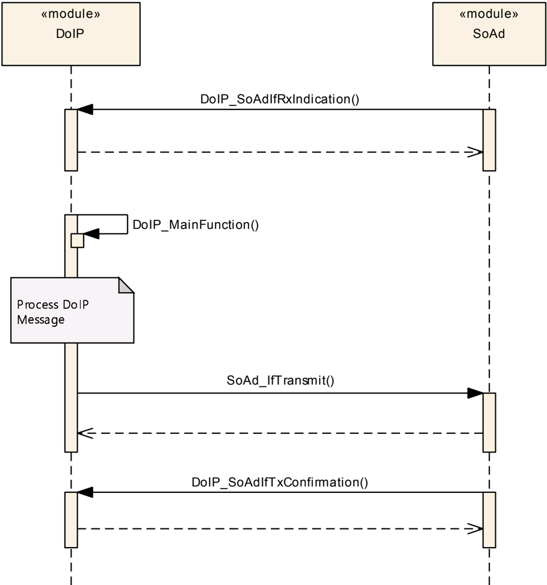

### 8.2. Rx TCP 消息

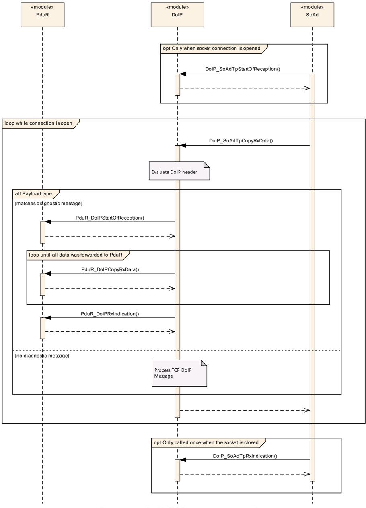

请注意，多个 CopyRxData 可以提供一条请求的数据，但为了降低复杂度，省略了这一细节。

### 8.3. Tx TCP 消息

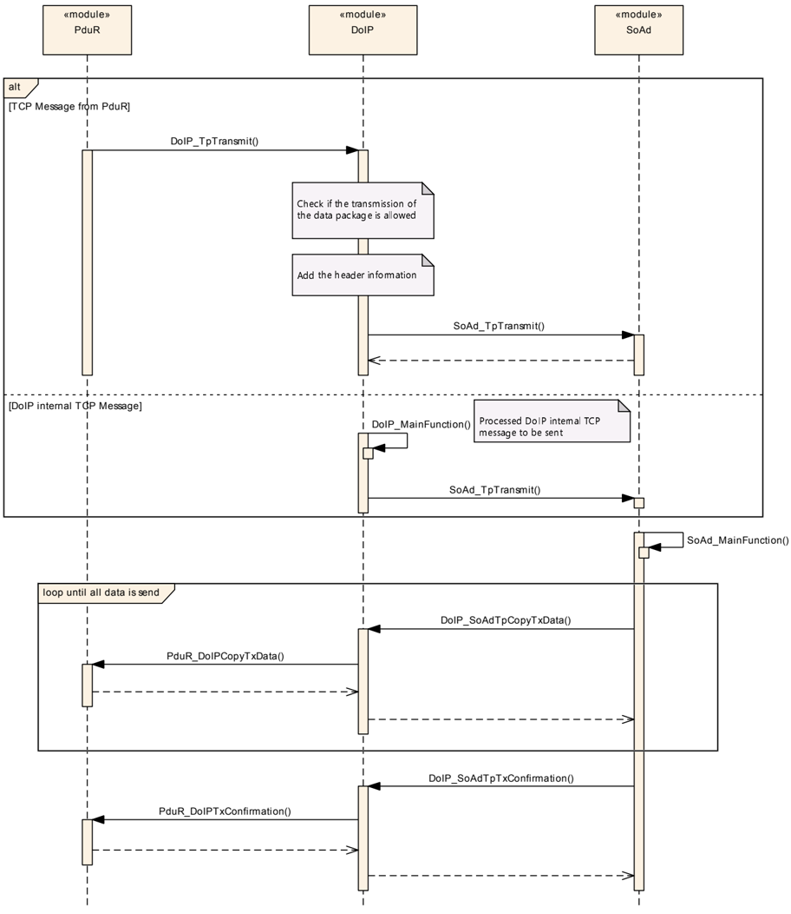

### 8.4. 激活线处理 - 活动

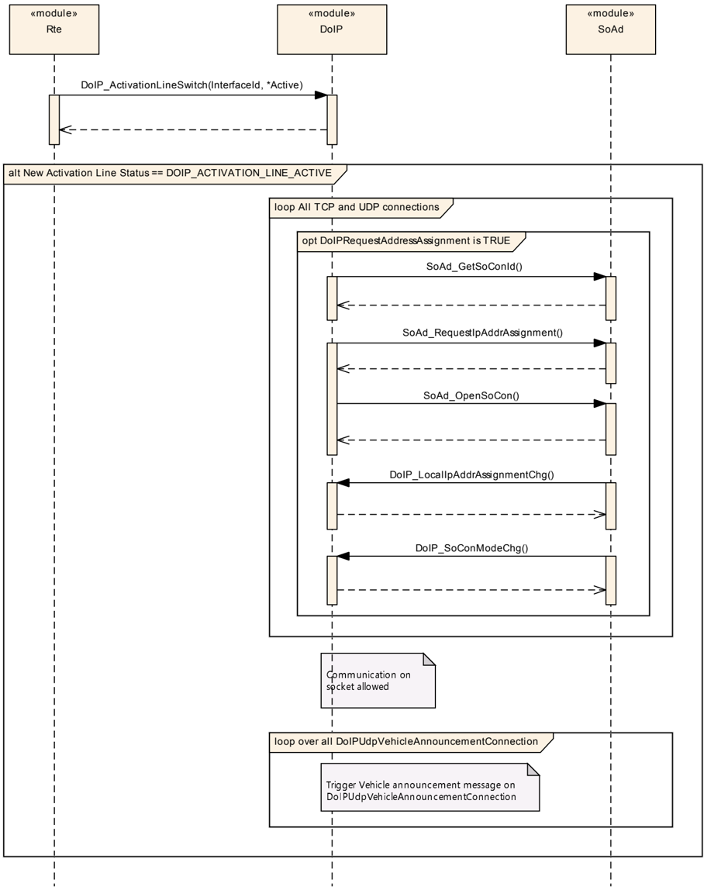

### 8.5. 激活线处理 - 非活动

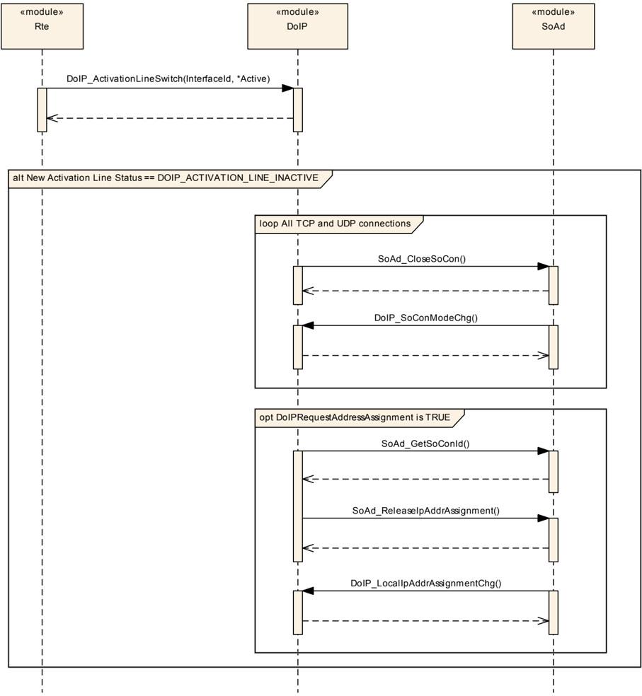

## 9. 配置规范

第 9.2 章规定模块 **DoIP** 的结构（容器）和参数。第 9.3 章规定模块 **DoIP** 的其他发布信息。

有关详细信息，可参见 SWS_BSWGeneral [\[1\]](#ref-1) 中的第 10.1 章「Introduction to configuration specification」（配置规范简介）。

### 9.1. 变体

有关详细信息，可参见 SWS_BSWGeneral [\[1\]](#ref-1) 中的第 10.1.2 章「Variants」（变体）。

### 9.2. 容器与配置参数

#### 9.2.1. DoIP

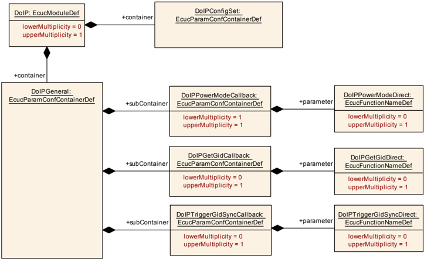

| SWS 条目 | [ECUC_DoIP_00001] |
|---|---|
| 模块名称 | DoIP |
| 描述 | **DoIP**（Diagnostic over IP）模块的配置。 |
| Post-Build 变体支持 | true |
| 支持的配置变体 | VARIANT-LINK-TIME, VARIANT-POST-BUILD, VARIANT-PRE-COMPILE |

| 容器名称 | 多重性 | 作用域/依赖 |
|---|---|---|
| DoIPConfigSet | 1 | 该容器包含 AUTOSAR **DoIP** 模块的配置参数和子容器。 |
| DoIPGeneral | 1 | 该容器规定 **DoIP** 模块的通用配置参数。 |

#### 9.2.2. DoIPGeneral

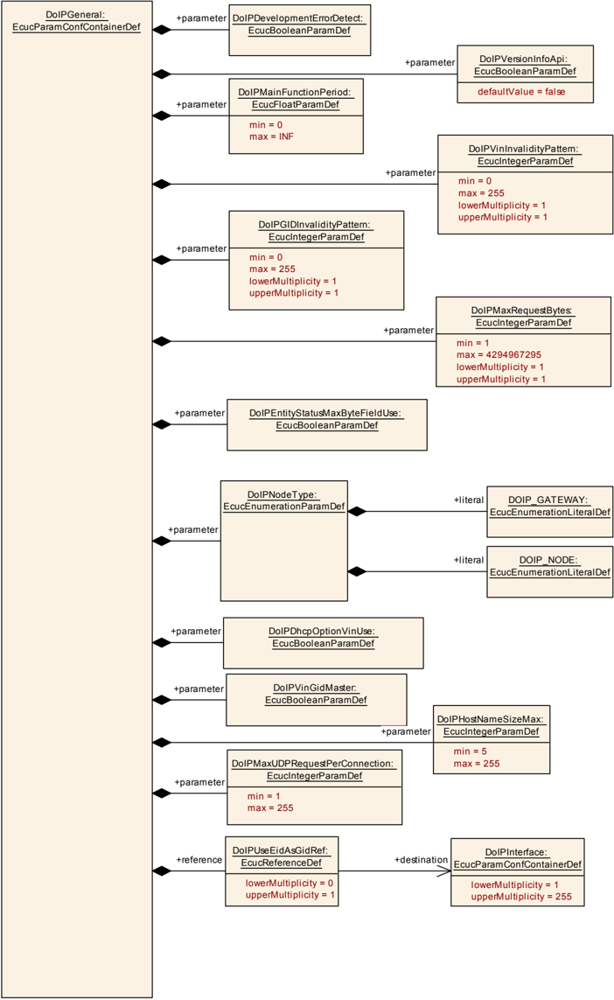

| SWS 条目 | [ECUC_DoIP_00002] |
|---|---|
| 容器名称 | DoIPGeneral |
| 父容器 | DoIP |
| 描述 | 该容器规定 **DoIP** 模块的通用配置参数。 |
| 配置参数 | 见下方参数表 |

| SWS 条目 | [ECUC_DoIP_00004] |
|---|---|
| 参数名称 | DoIPDevelopmentErrorDetect |
| 父容器 | DoIPGeneral |
| 描述 | 开启或关闭开发错误检测与通知（true：启用检测与通知；false：禁用检测与通知）。 |
| 多重性 | 1 |
| 类型 | EcucBooleanParamDef |
| 默认值 | - |
| Post-Build 变体值 | false |
| 值配置类 | Pre-compile time：x（All Variants）；Link time：-；Post-build time：- |
| 作用域/依赖 | scope: local |

| SWS 条目 | [ECUC_DoIP_00067] |
|---|---|
| 参数名称 | DoIPDhcpOptionVinUse |
| 父容器 | DoIPGeneral |
| 描述 | 如果 DoIPDhcpOptionVinUse 设置为 true，则在尚未设置有效 Dhcp 主机名的情况下，**DoIP** 模块会将 VIN 添加到 Dhcp 主机名中。 |
| 多重性 | 1 |
| 类型 | EcucBooleanParamDef |
| 默认值 | - |
| Post-Build 变体值 | false |
| 值配置类 | Pre-compile time：x（All Variants）；Link time：-；Post-build time：- |
| 作用域/依赖 | scope: local |

| SWS 条目 | [ECUC_DoIP_00064] |
|---|---|
| 参数名称 | DoIPEntityStatusMaxByteFieldUse |
| 父容器 | DoIPGeneral |
| 描述 | 此参数用于区分诊断实体状态响应的 Max data size 元素的可选支持。 |
| 多重性 | 1 |
| 类型 | EcucBooleanParamDef |
| 默认值 | - |
| Post-Build 变体值 | false |
| 值配置类 | Pre-compile time：x（All Variants）；Link time：-；Post-build time：- |
| 作用域/依赖 | scope: local |

| SWS 条目 | [ECUC_DoIP_00065] |
|---|---|
| 参数名称 | DoIPGIDInvalidityPattern |
| 父容器 | DoIPGeneral |
| 描述 | 指定在无法检索到有效 GID 时用于响应消息的字节模式。仅允许值「0」或「255」。 |
| 多重性 | 1 |
| 类型 | EcucIntegerParamDef |
| 范围 | 0 .. 255 |
| 默认值 | - |
| Post-Build 变体值 | false |
| 值配置类 | Pre-compile time：x（All Variants）；Link time：-；Post-build time：- |
| 作用域/依赖 | scope: local |

| SWS 条目 | [ECUC_DoIP_00073] |
|---|---|
| 参数名称 | DoIPHostNameSizeMax |
| 父容器 | DoIPGeneral |
| 描述 | DHCP HostName 的 ASCII 最大大小。需要此参数以保留使用 DHCP HostName 选项所需的正确字节数。最小范围为 5，因为 Dhcp Host Name 在任何配置下都应至少为「DoIP-」。 |
| 多重性 | 1 |
| 类型 | EcucIntegerParamDef |
| 范围 | 5 .. 255 |
| 默认值 | - |
| Post-Build 变体值 | false |
| 值配置类 | Pre-compile time：x（All Variants）；Link time：-；Post-build time：- |
| 作用域/依赖 | scope: local |

| SWS 条目 | [ECUC_DoIP_00006] |
|---|---|
| 参数名称 | DoIPMainFunctionPeriod |
| 父容器 | DoIPGeneral |
| 描述 | 确定以 [s] 为单位调用 DoIP_MainFunction() 的频率。 |
| 多重性 | 1 |
| 类型 | EcucFloatParamDef |
| 范围 | ]0 .. INF[ |
| 默认值 | - |
| Post-Build 变体值 | false |
| 值配置类 | Pre-compile time：x（All Variants）；Link time：-；Post-build time：- |
| 作用域/依赖 | scope: local |

| SWS 条目 | [ECUC_DoIP_00019] |
|---|---|
| 参数名称 | DoIPMaxRequestBytes |
| 父容器 | DoIPGeneral |
| 描述 | 指定不包括 DoIP 头的 **DoIP** 消息请求所允许的最大字节数。 |
| 多重性 | 1 |
| 类型 | EcucIntegerParamDef |
| 范围 | 1 .. 4294967295 |
| 默认值 | - |
| Post-Build 变体值 | false |
| 值配置类 | Pre-compile time：x（All Variants）；Link time：-；Post-build time：- |
| 作用域/依赖 | scope: local |

| SWS 条目 | [ECUC_DoIP_00074] |
|---|---|
| 参数名称 | DoIPMaxUDPRequestPerConnection |
| 父容器 | DoIPGeneral |
| 描述 | 此参数捕获在单个 UDP 连接内并行处理所必需的最大 UDP 请求数量。 |
| 多重性 | 1 |
| 类型 | EcucIntegerParamDef |
| 范围 | 1 .. 255 |
| 默认值 | - |
| Post-Build 变体值 | false |
| 值配置类 | Pre-compile time：x（All Variants）；Link time：-；Post-build time：- |
| 作用域/依赖 | scope: local |

| SWS 条目 | [ECUC_DoIP_00021] |
|---|---|
| 参数名称 | DoIPNodeType |
| 父容器 | DoIPGeneral |
| 描述 | 描述 **DoIP** 节点的类型。 |
| 多重性 | 1 |
| 类型 | EcucEnumerationParamDef |
| 范围 | DOIP_GATEWAY：DoIP 实体是一个 DoIP 网关。DOIP_NODE：DoIP 实体是一个 DoIP 节点。 |
| Post-Build 变体值 | false |
| 值配置类 | Pre-compile time：x（All Variants）；Link time：-；Post-build time：- |
| 作用域/依赖 | scope: local |

| SWS 条目 | [ECUC_DoIP_00005] |
|---|---|
| 参数名称 | DoIPVersionInfoApi |
| 父容器 | DoIPGeneral |
| 描述 | 激活 DoIP_GetVersionInfo() API。TRUE：启用 DoIP_GetVersionInfo() API。FALSE：不包含 DoIP_GetVersionInfo() API。 |
| 多重性 | 1 |
| 类型 | EcucBooleanParamDef |
| 默认值 | false |
| Post-Build 变体值 | false |
| 值配置类 | Pre-compile time：x（All Variants）；Link time：-；Post-build time：- |
| 作用域/依赖 | scope: local |

| SWS 条目 | [ECUC_DoIP_00017] |
|---|---|
| 参数名称 | DoIPVinGidMaster |
| 父容器 | DoIPGeneral |
| 描述 | 指定 **DoIP** 实体是否是 GID（Group ID）的车辆识别主节点（Master）。 |
| 多重性 | 1 |
| 类型 | EcucBooleanParamDef |
| 默认值 | - |
| Post-Build 变体值 | false |
| 值配置类 | Pre-compile time：x（All Variants）；Link time：-；Post-build time：- |
| 作用域/依赖 | scope: local；依赖：DoIPUseEIDasGID, DoIPTriggerGIDSynchronization |

| SWS 条目 | [ECUC_DoIP_00066] |
|---|---|
| 参数名称 | DoIPVinInvalidityPattern |
| 父容器 | DoIPGeneral |
| 描述 | 指定在无法检索到有效 VIN 时用于响应消息的字节模式。仅允许值「0」或「255」。 |
| 多重性 | 1 |
| 类型 | EcucIntegerParamDef |
| 范围 | 0 .. 255 |
| 默认值 | - |
| Post-Build 变体值 | false |
| 值配置类 | Pre-compile time：x（All Variants）；Link time：-；Post-build time：- |
| 作用域/依赖 | scope: local |

| SWS 条目 | [ECUC_DoIP_00106] |
|---|---|
| 参数名称 | DoIPUseEidAsGidRef |
| 父容器 | DoIPGeneral |
| 描述 | 对包含应用作 GID 的 EID 的接口的引用。根据配置，GID 从 DoIPEid 或从 DoIPUseMacAddressForIdentification 推导。 |
| 多重性 | 0..1 |
| 类型 | 对 DoIPInterface 的引用 |
| Post-Build 变体多重性 | false |
| Post-Build 变体值 | false |
| 多重性配置类 | Pre-compile time：x（All Variants）；Link time：-；Post-build time：- |
| 值配置类 | Pre-compile time：x（All Variants）；Link time：-；Post-build time：- |
| 作用域/依赖 | scope: local；依赖：仅当 DoIPVinGidMaster 为 true 时才应启用此参数。DoIPGid 或 DoIPUseEidAsGidRef 之中的一个 |

| 容器名称 | 多重性 | 作用域/依赖 |
|---|---|---|
| DoIPGetGidCallback | 0..1 | 该容器描述使用回调函数获取 GID 的用法。（如果该容器不存在，则 **DoIP** 模块不得使用回调函数来检索 GID。） |
| DoIPPowerModeCallback | 1 | 该容器描述使用回调函数检索当前电源模式的用法。此容器应始终存在。 |
| DoIPTriggerGidSyncCallback | 0..1 | 该容器描述使用回调函数触发 GID 同步的用法。（如果该容器不存在，则 **DoIP** 模块不得使用回调函数来触发 GID 同步。） |

#### 9.2.3. DoIPGetGidCallback

| SWS 条目 | [ECUC_DoIP_00024] |
|---|---|
| 容器名称 | DoIPGetGidCallback |
| 父容器 | DoIPGeneral |
| 描述 | 该容器描述使用回调函数获取 GID 的用法。（如果该容器不存在，则 **DoIP** 模块不得使用回调函数来检索 GID。） |
| 配置参数 | 见下方参数表 |

| SWS 条目 | [ECUC_DoIP_00028] |
|---|---|
| 参数名称 | DoIPGetGidDirect |
| 父容器 | DoIPGetGidCallback |
| 描述 | 如果存在 DoIPGetGidDirect 参数，则 **DoIP** 模块应直接调用配置的回调函数（&lt;User&gt;_DoIPGetGID）。（不需要为 DoIP 服务组件指定服务端口。）如果不存在 DoIPGetGidDirect 参数，则 **DoIP** 模块应使用带有 CallbackGetGID 类型客户端-服务器端口接口的 RPort。 |
| 多重性 | 0..1 |
| 类型 | EcucFunctionNameDef |
| 默认值 | - |
| 正则表达式 | - |
| Post-Build 变体多重性 | false |
| Post-Build 变体值 | false |
| 多重性配置类 | Pre-compile time：x（All Variants）；Link time：-；Post-build time：- |
| 值配置类 | Pre-compile time：x（All Variants）；Link time：-；Post-build time：- |
| 作用域/依赖 | scope: local |

#### 9.2.4. DoIPPowerModeCallback

| SWS 条目 | [ECUC_DoIP_00023] |
|---|---|
| 容器名称 | DoIPPowerModeCallback |
| 父容器 | DoIPGeneral |
| 描述 | 该容器描述使用回调函数检索当前电源模式的用法。此容器应始终存在。 |
| 配置参数 | 见下方参数表 |

| SWS 条目 | [ECUC_DoIP_00027] |
|---|---|
| 参数名称 | DoIPPowerModeDirect |
| 父容器 | DoIPPowerModeCallback |
| 描述 | 如果存在 DoIPPowerModeDirect 参数，则 **DoIP** 模块应直接调用配置的回调函数（&lt;User&gt;_DoIPGetPowerModeCallback）。（不需要为 DoIP 服务组件指定服务端口。）如果不存在 DoIPPowerModeDirect 参数，则 **DoIP** 模块应使用带有 CallbackGetPowerMode 类型客户端-服务器端口接口的 RPort。 |
| 多重性 | 0..1 |
| 类型 | EcucFunctionNameDef |
| 默认值 | - |
| 正则表达式 | - |
| Post-Build 变体多重性 | false |
| Post-Build 变体值 | false |
| 多重性配置类 | Pre-compile time：x（All Variants）；Link time：-；Post-build time：- |
| 值配置类 | Pre-compile time：x（All Variants）；Link time：-；Post-build time：- |
| 作用域/依赖 | scope: local |

#### 9.2.5. DoIPTriggerGidSyncCallback

| SWS 条目 | [ECUC_DoIP_00025] |
|---|---|
| 容器名称 | DoIPTriggerGidSyncCallback |
| 父容器 | DoIPGeneral |
| 描述 | 该容器描述使用回调函数触发 GID 同步的用法。（如果该容器不存在，则 **DoIP** 模块不得使用回调函数来触发 GID 同步。） |
| 配置参数 | 见下方参数表 |

| SWS 条目 | [ECUC_DoIP_00029] |
|---|---|
| 参数名称 | DoIPTriggerGidSyncDirect |
| 父容器 | DoIPTriggerGidSyncCallback |
| 描述 | 如果存在 DoIPTriggerGidSyncDirect 参数，则 **DoIP** 模块应直接调用配置的回调函数（&lt;User&gt;_DoIPTriggerGidSyncCallback）。（不需要为 DoIP 服务组件指定服务端口。）如果不存在 DoIPTriggerGidSyncDirect 参数，则 **DoIP** 模块应使用带有 CallbackTriggerGIDSynchronization 类型客户端-服务器端口接口的 RPort。 |
| 多重性 | 0..1 |
| 类型 | EcucFunctionNameDef |
| 默认值 | - |
| 正则表达式 | - |
| Post-Build 变体多重性 | false |
| Post-Build 变体值 | false |
| 多重性配置类 | Pre-compile time：x（All Variants）；Link time：-；Post-build time：- |
| 值配置类 | Pre-compile time：x（All Variants）；Link time：-；Post-build time：- |
| 作用域/依赖 | scope: local |

#### 9.2.6. DoIPConfigSet

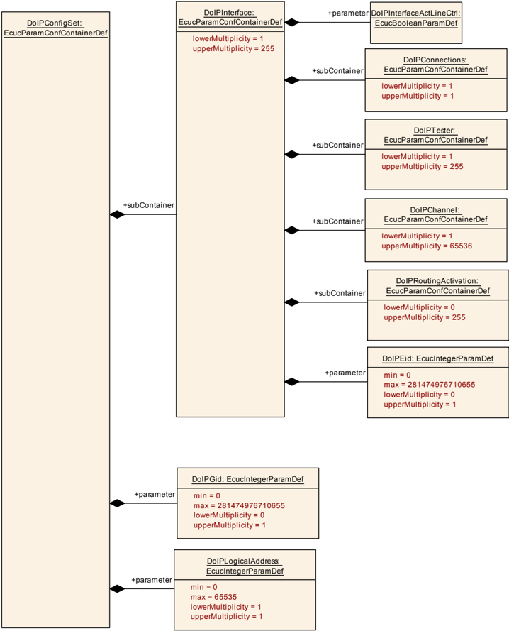

| SWS 条目 | [ECUC_DoIP_00003] |
|---|---|
| 容器名称 | DoIPConfigSet |
| 父容器 | DoIP |
| 描述 | 该容器包含 AUTOSAR **DoIP** 模块的配置参数和子容器。 |
| 配置参数 | 见下方参数表 |

| SWS 条目 | [ECUC_DoIP_00015] |
|---|---|
| 参数名称 | DoIPGid |
| 父容器 | DoIPConfigSet |
| 描述 | 为车辆识别/车辆通告配置的 GID（组 ID）。 |
| 多重性 | 0..1 |
| 类型 | EcucIntegerParamDef |
| 范围 | 0 .. 281474976710655 |
| 默认值 | - |
| Post-Build 变体多重性 | true |
| Post-Build 变体值 | true |
| 多重性配置类 | Pre-compile time：x（VARIANT-PRE-COMPILE）；Link time：x（VARIANT-LINK-TIME）；Post-build time：x（VARIANT-POST-BUILD） |
| 值配置类 | Pre-compile time：x（VARIANT-PRE-COMPILE）；Link time：x（VARIANT-LINK-TIME）；Post-build time：x（VARIANT-POST-BUILD） |
| 作用域/依赖 | scope: local；依赖：DoIPVinGIDMaster, DoIPGetGID——如果 DoIPVinGidMaster 为 true 且 DoIPUseEidAsGidRef 被禁用，则应使用 DoIPGid。 |

| SWS 条目 | [ECUC_DoIP_00020] |
|---|---|
| 参数名称 | DoIPLogicalAddress |
| 父容器 | DoIPConfigSet |
| 描述 | 描述 **DoIP** 实体的逻辑地址，即将诊断请求路由到 **DoIP** 实体的 **Dcm** 的 LA。 |
| 多重性 | 1 |
| 类型 | EcucIntegerParamDef |
| 范围 | 0 .. 65535 |
| 默认值 | - |
| Post-Build 变体值 | true |
| 值配置类 | Pre-compile time：x（VARIANT-PRE-COMPILE）；Link time：x（VARIANT-LINK-TIME）；Post-build time：x（VARIANT-POST-BUILD） |
| 作用域/依赖 | scope: local |

| 容器名称 | 多重性 | 作用域/依赖 |
|---|---|---|
| DoIPInterface | 1..255 | 该容器定义一个逻辑 IP 接口，并收集配置该接口的属性。 |

#### 9.2.7. DoIPInterface

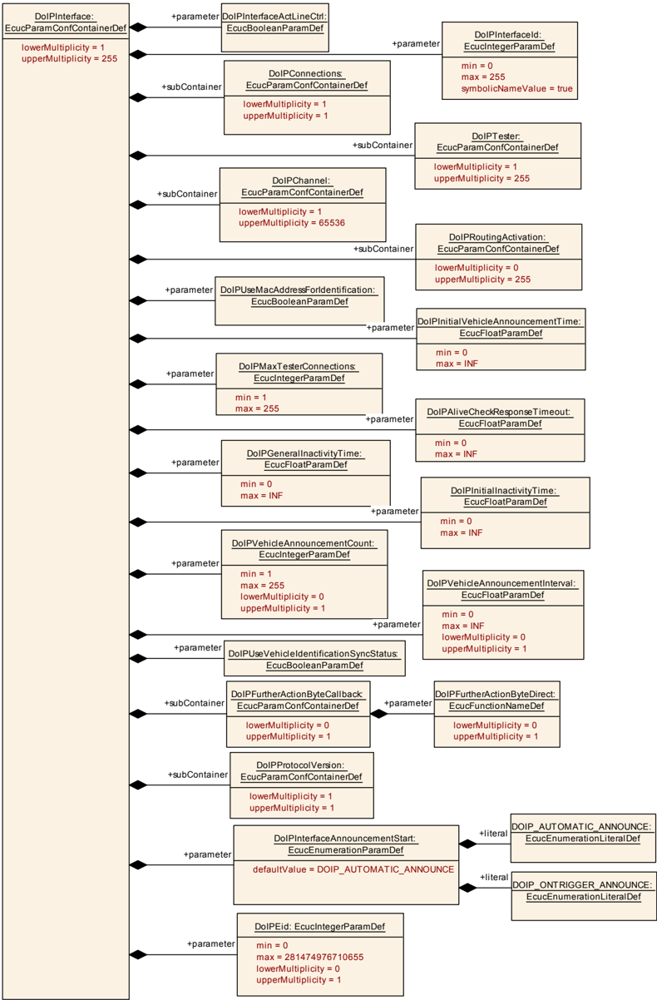

| SWS 条目 | [ECUC_DoIP_00100] |
|---|---|
| 容器名称 | DoIPInterface |
| 父容器 | DoIPConfigSet |
| 描述 | 该容器定义一个逻辑 IP 接口，并收集配置该接口的属性。 |
| Post-Build 变体多重性 | false |
| 配置参数 | 见下方参数表 |

| SWS 条目 | [ECUC_DoIP_00009] |
|---|---|
| 参数名称 | DoIPAliveCheckResponseTimeout |
| 父容器 | DoIPInterface |
| 描述 | 等待存活检查请求响应的超时时间 [s]，超过该时间后连接被视为断开。表示 **ISO 13400-2:2012** 的参数 T_TCP_Alive Check。 |
| 多重性 | 1 |
| 类型 | EcucFloatParamDef |
| 范围 | [0 .. INF] |
| 默认值 | - |
| Post-Build 变体值 | false |
| 值配置类 | Pre-compile time：x（All Variants）；Link time：-；Post-build time：- |
| 作用域/依赖 | scope: local |

| SWS 条目 | [ECUC_DoIP_00014] |
|---|---|
| 参数名称 | DoIPEid |
| 父容器 | DoIPInterface |
| 描述 | 为车辆识别/车辆通告配置的 EID（实体 ID）。仅在 DoIPUseMacAddressForIdentification 设置为 FALSE 时才需要。 |
| 多重性 | 0..1 |
| 类型 | EcucIntegerParamDef |
| 范围 | 0 .. 281474976710655 |
| 默认值 | - |
| Post-Build 变体多重性 | true |
| Post-Build 变体值 | true |
| 多重性配置类 | Pre-compile time：x（VARIANT-PRE-COMPILE）；Link time：x（VARIANT-LINK-TIME）；Post-build time：x（VARIANT-POST-BUILD） |
| 值配置类 | Pre-compile time：x（VARIANT-PRE-COMPILE）；Link time：x（VARIANT-LINK-TIME）；Post-build time：x（VARIANT-POST-BUILD） |
| 作用域/依赖 | scope: local；依赖：如果同一 DoIPInterface 的 DoIPUseMacAddressForIdentification 为 false，则应使用 DoIPEid。 |

| SWS 条目 | [ECUC_DoIP_00068] |
|---|---|
| 参数名称 | DoIPGeneralInactivityTime |
| 父容器 | DoIPInterface |
| 描述 | TCP 套接字连接最大不活动的超时时间 [s]，超过该时间后 **DoIP** 模块将关闭相应的套接字连接。表示 **ISO 13400-2:2012** 的参数 T_TCP_General_Inactivity。 |
| 多重性 | 1 |
| 类型 | EcucFloatParamDef |
| 范围 | ]0 .. INF[ |
| 默认值 | - |
| Post-Build 变体值 | false |
| 值配置类 | Pre-compile time：x（All Variants）；Link time：-；Post-build time：- |
| 作用域/依赖 | scope: local |

| SWS 条目 | [ECUC_DoIP_00010] |
|---|---|
| 参数名称 | DoIPInitialInactivityTime |
| 父容器 | DoIPInterface |
| 描述 | 在套接字连接之后立即用于已连接 TCP 套接字连接初始不活动的超时时间 [s]。表示 **ISO 13400-2:2012** 的参数 T_TCP_Initial_Inactivity。 |
| 多重性 | 1 |
| 类型 | EcucFloatParamDef |
| 范围 | ]0 .. INF[ |
| 默认值 | - |
| Post-Build 变体值 | false |
| 值配置类 | Pre-compile time：x（All Variants）；Link time：-；Post-build time：- |
| 作用域/依赖 | scope: local |

| SWS 条目 | [ECUC_DoIP_00008] |
|---|---|
| 参数名称 | DoIPInitialVehicleAnnouncementTime |
| 父容器 | DoIPInterface |
| 描述 | 在 IP 地址分配之后，等待发送第一条车辆通告消息的时间 [s]。表示 **ISO 13400-2:2012** 的参数 A_DoIP_Announce_Wait。 |
| 多重性 | 1 |
| 类型 | EcucFloatParamDef |
| 范围 | [0 .. INF] |
| 默认值 | - |
| Post-Build 变体值 | false |
| 值配置类 | Pre-compile time：x（All Variants）；Link time：-；Post-build time：- |
| 作用域/依赖 | scope: local |

| SWS 条目 | [ECUC_DoIP_00101] |
|---|---|
| 参数名称 | DoIPInterfaceActLineCtrl |
| 父容器 | DoIPInterface |
| 描述 | 此属性定义网络接口 • 是在感知到激活线时「按需」启动（TRUE），还是 • 始终可用（FALSE）。 |
| 多重性 | 1 |
| 类型 | EcucBooleanParamDef |
| 默认值 | - |
| Post-Build 变体多重性 | false |
| Post-Build 变体值 | false |
| 值配置类 | Pre-compile time：x（All Variants）；Link time：-；Post-build time：- |
| 作用域/依赖 | scope: local |

| SWS 条目 | [ECUC_DoIP_00099] |
|---|---|
| 参数名称 | DoIPInterfaceAnnouncementStart |
| 父容器 | DoIPInterface |
| 描述 | 此属性定义在 DoIPInterface 上何时启动车辆通告 • Automatic：一旦底层的 UDP 车辆通告连接切换到 SOAD_SOCON_ONLINE • OnTrigger：一旦为给定的 DoIPInterface 实例调用了 API DoIP_TriggerVehicleAnnouncement |
| 多重性 | 1 |
| 类型 | EcucEnumerationParamDef |
| 范围 | DOIP_AUTOMATIC_ANNOUNCE：-。DOIP_ONTRIGGER_ANNOUNCE：-。 |
| 默认值 | DOIP_AUTOMATIC_ANNOUNCE |
| Post-Build 变体值 | false |
| 值配置类 | Pre-compile time：x（All Variants）；Link time：-；Post-build time：- |
| 作用域/依赖 | scope: local |

| SWS 条目 | [ECUC_DoIP_00098] |
|---|---|
| 参数名称 | DoIPInterfaceId |
| 父容器 | DoIPInterface |
| 描述 | 此参数是 DoIPInterface 的标识符。此参数的值将被分配给从容器的 short name 推导出的符号名。 |
| 多重性 | 1 |
| 类型 | EcucIntegerParamDef（为此参数生成符号名） |
| 范围 | 0 .. 255 |
| 默认值 | - |
| Post-Build 变体多重性 | false |
| Post-Build 变体值 | false |
| 值配置类 | Pre-compile time：x（All Variants）；Link time：-；Post-build time：- |
| 作用域/依赖 | scope: local |

| SWS 条目 | [ECUC_DoIP_00012] |
|---|---|
| 参数名称 | DoIPMaxTesterConnections |
| 父容器 | DoIPInterface |
| 描述 | 在执行存活检查之前应同时维护的测试仪连接的最大数量。 |
| 多重性 | 1 |
| 类型 | EcucIntegerParamDef |
| 范围 | 1 .. 255 |
| 默认值 | - |
| Post-Build 变体值 | false |
| 值配置类 | Pre-compile time：x（All Variants）；Link time：-；Post-build time：- |
| 作用域/依赖 | scope: local |

| SWS 条目 | [ECUC_DoIP_00013] |
|---|---|
| 参数名称 | DoIPUseMacAddressForIdentification |
| 父容器 | DoIPInterface |
| 提供信息 | 在车辆识别响应/车辆通告中是使用配置的 EID 还是 MAC 地址。TRUE：在车辆识别/通告中使用 MAC 地址代替 EID。FALSE：在车辆识别/通告中使用配置的 EID。 |
| 多重性 | 1 |
| 类型 | EcucBooleanParamDef |
| 默认值 | - |
| Post-Build 变体值 | false |
| 值配置类 | Pre-compile time：x（All Variants）；Link time：-；Post-build time：- |
| 作用域/依赖 | scope: local |

| SWS 条目 | [ECUC_DoIP_00016] |
|---|---|
| 参数名称 | DoIPUseVehicleIdentificationSyncStatus |
| 父容器 | DoIPInterface |
| 描述 | 定义是否在车辆识别/通告中额外使用可选的 VIN/GID 同步状态。 |
| 多重性 | 1 |
| 类型 | EcucBooleanParamDef |
| 默认值 | - |
| Post-Build 变体值 | false |
| 值配置类 | Pre-compile time：x（All Variants）；Link time：-；Post-build time：- |
| 作用域/依赖 | scope: local |

| SWS 条目 | [ECUC_DoIP_00094] |
|---|---|
| 参数名称 | DoIPVehicleAnnouncementCount |
| 父容器 | DoIPInterface |
| 描述 | IP 地址分配时的车辆通告消息数量。表示 **ISO 13400-2:2012** 的参数 A_DoIP_Announce_Num。 |
| 多重性 | 0..1 |
| 类型 | EcucIntegerParamDef |
| 范围 | 1 .. 255 |
| 默认值 | - |
| Post-Build 变体值 | true |
| 值配置类 | Pre-compile time：x（VARIANT-PRE-COMPILE）；Link time：-；Post-build time：- |
| 作用域/依赖 | scope: local |

| SWS 条目 | [ECUC_DoIP_00007] |
|---|---|
| 参数名称 | DoIPVehicleAnnouncementInterval |
| 父容器 | DoIPInterface |
| 描述 | 等待发送后续车辆通告消息的时间 [s]。表示 **ISO 13400-2:2012** 的参数 A_DoIP_Announce_Interval。 |
| 多重性 | 0..1 |
| 类型 | EcucFloatParamDef |
| 范围 | [0 .. INF] |
| 默认值 | - |
| Post-Build 变体值 | true |
| 值配置类 | Pre-compile time：x（VARIANT-PRE-COMPILE）；Link time：-；Post-build time：- |
| 作用域/依赖 | scope: local |

| 容器名称 | 多重性 | 作用域/依赖 |
|---|---|---|
| DoIPChannel | 1..65536 | 一个 DoIPChannel 的配置。 |
| DoIPConnections | 1 | 该容器包含所有下层连接特定的信息，即指向 SoAd 的单个 Pdu 引用和句柄 ID。 |
| DoIPFurtherActionByteCallback | 0..1 | 该容器描述获取 Further Action 字节的回调函数。此容器应始终存在。如果 DoIPFurtherActionByteDirect 参数不存在，则使用 RPort。 |
| DoIPProtocolVersion | 1 | 该容器定义 **DoIP** 实体的协议版本。 |
| DoIPRoutingActivation | 0..255 | 该容器通过为每个容器表示一条可能的路由激活请求消息来描述路由激活的可能性。 |
| DoIPTester | 1..255 | 该容器描述 **DoIP** 实体可能连接的测试仪的属性。 |

#### 9.2.8. DoIPChannel

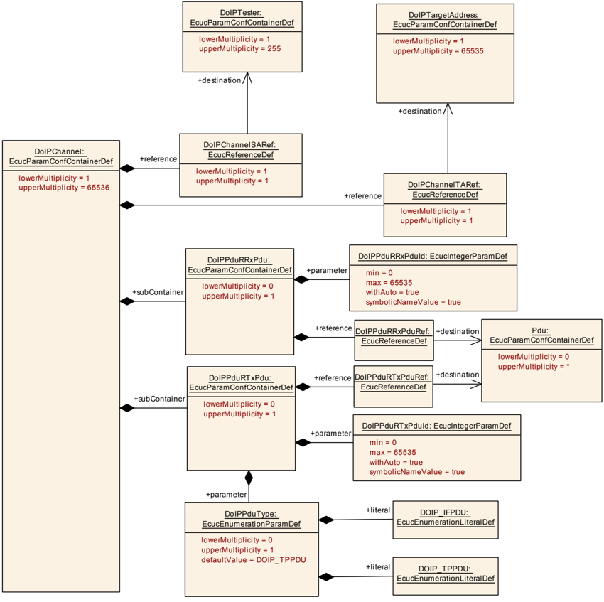

| SWS 条目 | [ECUC_DoIP_00069] |
|---|---|
| 容器名称 | DoIPChannel |
| 父容器 | DoIPInterface |
| 描述 | 一个 DoIPChannel 的配置。 |
| 配置参数 | 见下方参数表 |

| SWS 条目 | [ECUC_DoIP_00070] |
|---|---|
| 参数名称 | DoIPChannelSARef |
| 父容器 | DoIPChannel |
| 描述 | 对 DoIPTester 的引用。 |
| 多重性 | 1 |
| 类型 | 对 DoIPTester 的引用 |
| 作用域/依赖 | scope: local |

| SWS 条目 | [ECUC_DoIP_00071] |
|---|---|
| 参数名称 | DoIPChannelTARef |
| 父容器 | DoIPChannel |
| 描述 | 对目标地址的引用。 |
| 多重性 | 1 |
| 类型 | 对 DoIPTargetAddress 的引用 |
| 作用域/依赖 | scope: local |

| 容器名称 | 多重性 | 作用域/依赖 |
|---|---|---|
| DoIPPduRRxPdu | 0..1 | 该容器包含用于与 **PduR** 的 Rx Pdu 连接的 Rx Pdu。 |
| DoIPPduRTxPdu | 0..1 | 该容器包含用于与 **PduR** 的 Tx Pdu 连接的 Tx Pdu。如果未配置该参数，则该通道用于功能寻址（functional addressing）。 |

#### 9.2.9. DoIPPduRRxPdu

| SWS 条目 | [ECUC_DoIP_00055] |
|---|---|
| 容器名称 | DoIPPduRRxPdu |
| 父容器 | DoIPChannel |
| 描述 | 该容器包含用于与 **PduR** 的 Rx Pdu 连接的 Rx Pdu。 |
| 配置参数 | 见下方参数表 |

| SWS 条目 | [ECUC_DoIP_00057] |
|---|---|
| 参数名称 | DoIPPduRRxPduId |
| 父容器 | DoIPPduRRxPdu |
| 描述 | API 调用 DoIP_TpCancelReceive 需要 DoIPPduRRxPduId。 |
| 多重性 | 1 |
| 类型 | EcucIntegerParamDef（为此参数生成符号名） |
| 范围 | 0 .. 65535 |
| 默认值 | - |
| Post-Build 变体值 | true |
| 值配置类 | Pre-compile time：x（VARIANT-PRE-COMPILE）；Link time：-；Post-build time：- |
| 作用域/依赖 | scope: ECU |

| SWS 条目 | [ECUC_DoIP_00058] |
|---|---|
| 参数名称 | DoIPPduRRxPduRef |
| 父容器 | DoIPPduRRxPdu |
| 描述 | 对「全局」Pdu 结构的引用，以允许在 COM-Stack 中统一句柄 ID。 |
| 多重性 | 1 |
| 类型 | 对 Pdu 的引用 |
| Post-Build 变体值 | true |
| 值配置类 | Pre-compile time：x（VARIANT-PRE-COMPILE）；Link time：-；Post-build time：- |
| 作用域/依赖 | scope: local |

无包含的容器。

#### 9.2.10. DoIPPduRTxPdu

| SWS 条目 | [ECUC_DoIP_00056] |
|---|---|
| 容器名称 | DoIPPduRTxPdu |
| 父容器 | DoIPChannel |
| 描述 | 该容器包含用于与 **PduR** 的 Tx Pdu 连接的 Tx Pdu。如果未配置该参数，则该通道用于功能寻址（functional addressing）。 |
| 配置参数 | 见下方参数表 |

| SWS 条目 | [ECUC_DoIP_00060] |
|---|---|
| 参数名称 | DoIPPduRTxPduId |
| 父容器 | DoIPPduRTxPdu |
| 描述 | DoIP_TpTransmit 或 DoIP_IfTransmit 以及 DoIP_TpCancelTransmit 需要 DoIPPduRTxPduId。 |
| 多重性 | 1 |
| 类型 | EcucIntegerParamDef |
| 范围 | 0 .. 65535 |
| 默认值 | - |
| Post-Build 变体值 | true |
| 值配置类 | Pre-compile time：x（VARIANT-PRE-COMPILE）；Link time：-；Post-build time：- |
| 作用域/依赖 | scope: ECU |

| SWS 条目 | [ECUC_DoIP_00075] |
|---|---|
| 参数名称 | DoIPPduType |
| 父容器 | DoIPPduRTxPdu |
| 描述 | 用于与 **PduR** 通信的 API 类型。DOIP_IFPDU 用于 UUDT 消息，DOIP_TPPDU 用于所有其他诊断消息。 |
| 多重性 | 0..1 |
| 类型 | EcucEnumerationParamDef |
| 范围 | DOIP_IFPDU：-。DOIP_TPPDU：-。 |
| 默认值 | DOIP_TPPDU |
| Post-Build 变体值 | true |
| 值配置类 | Pre-compile time：x（VARIANT-PRE-COMPILE）；Link time：-；Post-build time：- |
| 作用域/依赖 | scope: local |

| SWS 条目 | [ECUC_DoIP_00059] |
|---|---|
| 参数名称 | DoIPPduRTxPduRef |
| 父容器 | DoIPPduRTxPdu |
| 描述 | 对「全局」Pdu 结构的引用，以允许在 COM-Stack 中统一句柄 ID。 |
| 多重性 | 1 |
| 类型 | 对 Pdu 的引用 |
| Post-Build 变体值 | true |
| 值配置类 | Pre-compile time：x（VARIANT-PRE-COMPILE）；Link time：-；Post-build time：- |
| 作用域/依赖 | scope: local |

无包含的容器。

#### 9.2.11. DoIPConnections

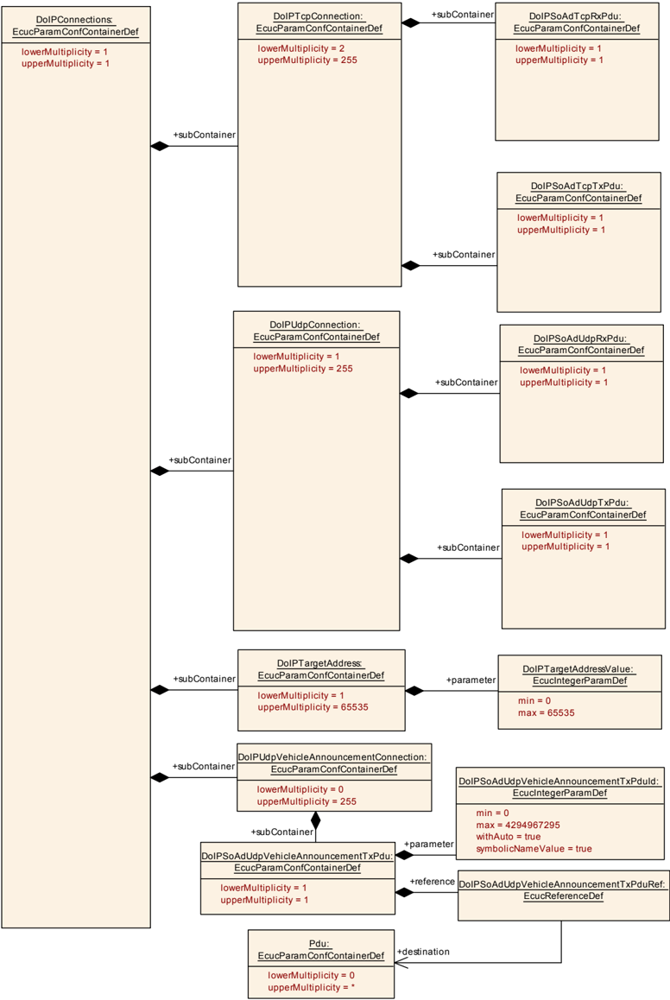

| SWS 条目 | [ECUC_DoIP_00032] |
|---|---|
| 容器名称 | DoIPConnections |
| 父容器 | DoIPInterface |
| 描述 | 该容器包含所有下层连接特定的信息，即指向 SoAd 的单个 Pdu 引用和句柄 ID。 |
| 配置参数 | 见下方参数表 |

| 容器名称 | 多重性 | 作用域/依赖 |
|---|---|---|
| DoIPTargetAddress | 1..65535 | 该容器描述 **DoIP** 支持的一个可能的目标地址（TargetAddress）。 |
| DoIPTcpConnection | 2..255 | 该容器描述到下层 SoAd 模块的一个 TCP 连接。 |
| DoIPUdpConnection | 1..255 | 该容器描述到下层 SoAd 模块的一个 UDP 连接。 |
| DoIPUdpVehicleAnnouncementConnection | 0..255 | 该容器描述到下层 SoAd 模块的 UDP 多播连接。 |

#### 9.2.12. DoIPTargetAddress

| SWS 条目 | [ECUC_DoIP_00053] |
|---|---|
| 容器名称 | DoIPTargetAddress |
| 父容器 | DoIPConnections |
| 描述 | 该容器描述 **DoIP** 支持的一个可能的目标地址（TargetAddress）。 |
| 配置参数 | 见下方参数表 |

| SWS 条目 | [ECUC_DoIP_00054] |
|---|---|
| 参数名称 | DoIPTargetAddressValue |
| 父容器 | DoIPTargetAddress |
| 描述 | **DoIP** 目标地址的有效目标地址（Target Address）。 |
| 多重性 | 1 |
| 类型 | EcucIntegerParamDef |
| 范围 | 0 .. 65535 |
| 默认值 | - |
| Post-Build 变体值 | true |
| 值配置类 | Pre-compile time：x（VARIANT-PRE-COMPILE）；Link time：-；Post-build time：- |
| 作用域/依赖 | scope: local |

无包含的容器。

#### 9.2.13. DoIPTcpConnection

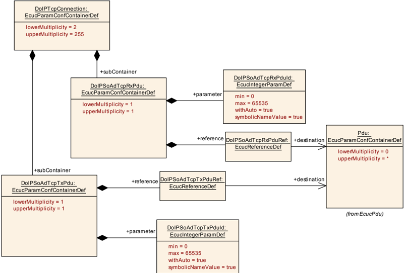

| SWS 条目 | [ECUC_DoIP_00045] |
|---|---|
| 容器名称 | DoIPTcpConnection |
| 父容器 | DoIPConnections |
| 描述 | 该容器描述到下层 SoAd 模块的一个 TCP 连接。 |
| 配置参数 | 见下方参数表 |

| SWS 条目 | [ECUC_DoIP_00095] |
|---|---|
| 参数名称 | DoIPRequestAddressAssignment |
| 父容器 | DoIPTcpConnection |
| 描述 | **DoIP** 模块应通过调用 SoAd_RequestIpAddrAssignment()，为此 DoIP 连接相关的 TcpIpLocalAddr 请求 IP 地址分配。 |
| 多重性 | 1 |
| 类型 | EcucBooleanParamDef |
| 默认值 | true |
| Post-Build 变体值 | true |
| 值配置类 | Pre-compile time：x（VARIANT-PRE-COMPILE）；Link time：-；Post-build time：- |
| 作用域/依赖 | scope: local |

| SWS 条目 | [ECUC_DoIP_00097] |
|---|---|
| 参数名称 | DoIPTcpConnectionSecurityRequired |
| 父容器 | DoIPTcpConnection |
| 描述 | 指示此 TCP 连接是否需要为安全（secure）TCP 连接。 |
| 多重性 | 0..1 |
| 类型 | EcucBooleanParamDef |
| 默认值 | false |
| Post-Build 变体值 | true |
| 值配置类 | Pre-compile time：x（VARIANT-PRE-COMPILE）；Link time：-；Post-build time：- |
| 作用域/依赖 | scope: local；依赖：仅当 DoIP_ISO13400_2_2019 已启用时才应启用 DoIPTcpConnectionSecurityRequired。 |

| 容器名称 | 多重性 | 作用域/依赖 |
|---|---|---|
| DoIPSoAdTcpRxPdu | 1 | 该容器描述通过 SoAd 经 TCP 接收的一个 Rx PDU。 |
| DoIPSoAdTcpTxPdu | 1 | 该容器描述通过 SoAd 经 TCP 发送的一个 Tx PDU。 |

#### 9.2.14. DoIPSoAdTcpRxPdu

| SWS 条目 | [ECUC_DoIP_00080] |
|---|---|
| 容器名称 | DoIPSoAdTcpRxPdu |
| 父容器 | DoIPTcpConnection |
| 描述 | 该容器描述通过 SoAd 经 TCP 接收的一个 Rx PDU。 |
| 配置参数 | 见下方参数表 |

| SWS 条目 | [ECUC_DoIP_00082] |
|---|---|
| 参数名称 | DoIPSoAdTcpRxPduId |
| 父容器 | DoIPSoAdTcpRxPdu |
| 描述 | API 调用 DoIP_SoAdTpRxIndication 需要 DoIPSoAdTcpRxPduId 以从 SoAd 接收 I-PDU。 |
| 多重性 | 1 |
| 类型 | EcucIntegerParamDef（为此参数生成符号名） |
| 范围 | 0 .. 65535 |
| 默认值 | - |
| Post-Build 变体值 | true |
| 值配置类 | Pre-compile time：x（VARIANT-PRE-COMPILE）；Link time：-；Post-build time：- |
| 作用域/依赖 | scope: ECU |

| SWS 条目 | [ECUC_DoIP_00083] |
|---|---|
| 参数名称 | DoIPSoAdTcpRxPduRef |
| 父容器 | DoIPSoAdTcpRxPdu |
| 描述 | 对「全局」Pdu 结构的引用，以允许在 COM-Stack 中统一句柄 ID。 |
| 多重性 | 1 |
| 类型 | 对 Pdu 的引用 |
| Post-Build 变体值 | true |
| 值配置类 | Pre-compile time：x（VARIANT-PRE-COMPILE）；Link time：-；Post-build time：- |
| 作用域/依赖 | scope: local |

无包含的容器。

#### 9.2.15. DoIPSoAdTcpTxPdu

| SWS 条目 | [ECUC_DoIP_00081] |
|---|---|
| 容器名称 | DoIPSoAdTcpTxPdu |
| 父容器 | DoIPTcpConnection |
| 描述 | 该容器描述通过 SoAd 经 TCP 发送的一个 Tx PDU。 |
| 配置参数 | 见下方参数表 |

| SWS 条目 | [ECUC_DoIP_00085] |
|---|---|
| 参数名称 | DoIPSoAdTcpTxPduId |
| 父容器 | DoIPSoAdTcpTxPdu |
| 描述 | API 调用 DoIP_SoAdTpTxConfirmation 需要 DoIPSoAdTcpTxPduId，SoAd 调用它以确认 IPdu 已成功发送。 |
| 多重性 | 1 |
| 类型 | EcucIntegerParamDef（为此参数生成符号名） |
| 范围 | 0 .. 65535 |
| 默认值 | - |
| Post-Build 变体值 | true |
| 值配置类 | Pre-compile time：x（VARIANT-PRE-COMPILE）；Link time：-；Post-build time：- |
| 作用域/依赖 | scope: ECU |

| SWS 条目 | [ECUC_DoIP_00084] |
|---|---|
| 参数名称 | DoIPSoAdTcpTxPduRef |
| 父容器 | DoIPSoAdTcpTxPdu |
| 描述 | 对「全局」Pdu 结构的引用，以允许在 COM-Stack 中统一句柄 ID。 |
| 多重性 | 1 |
| 类型 | 对 Pdu 的引用 |
| Post-Build 变体值 | true |
| 值配置类 | Pre-compile time：x（VARIANT-PRE-COMPILE）；Link time：-；Post-build time：- |
| 作用域/依赖 | scope: local |

无包含的容器。

#### 9.2.16. DoIPUdpConnection

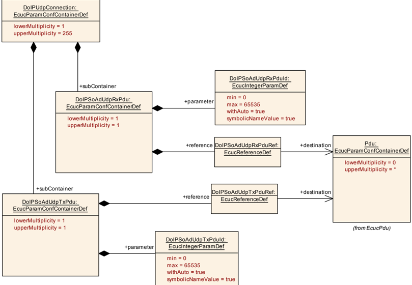

| SWS 条目 | [ECUC_DoIP_00052] |
|---|---|
| 容器名称 | DoIPUdpConnection |
| 父容器 | DoIPConnections |
| 描述 | 该容器描述到下层 SoAd 模块的一个 UDP 连接。 |
| 配置参数 | 见下方参数表 |

| SWS 条目 | [ECUC_DoIP_00095] |
|---|---|
| 参数名称 | DoIPRequestAddressAssignment |
| 父容器 | DoIPUdpConnection |
| 描述 | **DoIP** 模块应通过调用 SoAd_RequestIpAddrAssignment()，为此 DoIP 连接相关的 TcpIpLocalAddr 请求 IP 地址分配。 |
| 多重性 | 1 |
| 类型 | EcucBooleanParamDef |
| 默认值 | true |
| Post-Build 变体值 | true |
| 值配置类 | Pre-compile time：x（VARIANT-PRE-COMPILE）；Link time：-；Post-build time：- |
| 作用域/依赖 | scope: local |

| 容器名称 | 多重性 | 作用域/依赖 |
|---|---|---|
| DoIPSoAdUdpRxPdu | 1 | 该容器描述通过 SoAd 经 UDP 接收的一个 Rx PDU。 |
| DoIPSoAdUdpTxPdu | 1 | 该容器描述通过 SoAd 经 UDP 发送的一个 Tx PDU。 |

#### 9.2.17. DoIPSoAdUdpRxPdu

| SWS 条目 | [ECUC_DoIP_00046] |
|---|---|
| 容器名称 | DoIPSoAdUdpRxPdu |
| 父容器 | DoIPUdpConnection |
| 描述 | 该容器描述通过 SoAd 经 UDP 接收的一个 Rx PDU。 |
| 配置参数 | 见下方参数表 |

| SWS 条目 | [ECUC_DoIP_00048] |
|---|---|
| 参数名称 | DoIPSoAdUdpRxPduId |
| 父容器 | DoIPSoAdUdpRxPdu |
| 描述 | API 调用 DoIP_SoAdIfRxIndication 需要 DoIPSoAdUdpRxPduId 以从 SoAd 接收 I-PDU。 |
| 多重性 | 1 |
| 类型 | EcucIntegerParamDef（为此参数生成符号名） |
| 范围 | 0 .. 65535 |
| 默认值 | - |
| Post-Build 变体值 | true |
| 值配置类 | Pre-compile time：x（VARIANT-PRE-COMPILE）；Link time：-；Post-build time：- |
| 作用域/依赖 | scope: ECU |

| SWS 条目 | [ECUC_DoIP_00049] |
|---|---|
| 参数名称 | DoIPSoAdUdpRxPduRef |
| 父容器 | DoIPSoAdUdpRxPdu |
| 描述 | 对「全局」Pdu 结构的引用，以允许在 COM-Stack 中统一句柄 ID。 |
| 多重性 | 1 |
| 类型 | 对 Pdu 的引用 |
| Post-Build 变体值 | true |
| 值配置类 | Pre-compile time：x（VARIANT-PRE-COMPILE）；Link time：-；Post-build time：- |
| 作用域/依赖 | scope: local |

无包含的容器。

#### 9.2.18. DoIPSoAdUdpTxPdu

| SWS 条目 | [ECUC_DoIP_00047] |
|---|---|
| 容器名称 | DoIPSoAdUdpTxPdu |
| 父容器 | DoIPUdpConnection |
| 描述 | 该容器描述通过 SoAd 经 UDP 发送的一个 Tx PDU。 |
| 配置参数 | 见下方参数表 |

| SWS 条目 | [ECUC_DoIP_00051] |
|---|---|
| 参数名称 | DoIPSoAdUdpTxPduId |
| 父容器 | DoIPSoAdUdpTxPdu |
| 描述 | API 调用 DoIP_SoAdIfTxConfirmation 需要 DoIPSoAdUdpTxPduId，SoAd 调用它以确认 IPdu 已成功发送。 |
| 多重性 | 1 |
| 类型 | EcucIntegerParamDef（为此参数生成符号名） |
| 范围 | 0 .. 65535 |
| 默认值 | - |
| Post-Build 变体值 | true |
| 值配置类 | Pre-compile time：x（VARIANT-PRE-COMPILE）；Link time：-；Post-build time：- |
| 作用域/依赖 | scope: ECU（withAuto = true） |

| SWS 条目 | [ECUC_DoIP_00050] |
|---|---|
| 参数名称 | DoIPSoAdUdpTxPduRef |
| 父容器 | DoIPSoAdUdpTxPdu |
| 描述 | 对「全局」Pdu 结构的引用，以允许在 COM-Stack 中统一句柄 ID。 |
| 多重性 | 1 |
| 类型 | 对 Pdu 的引用 |
| Post-Build 变体值 | true |
| 值配置类 | Pre-compile time：x（VARIANT-PRE-COMPILE）；Link time：-；Post-build time：- |
| 作用域/依赖 | scope: local |

无包含的容器。

#### 9.2.19. DoIPUdpVehicleAnnouncementConnection

| SWS 条目 | [ECUC_DoIP_00076] |
|---|---|
| 容器名称 | DoIPUdpVehicleAnnouncementConnection |
| 父容器 | DoIPConnections |
| 描述 | 该容器描述到下层 SoAd 模块的 UDP 多播连接。 |
| 配置参数 | 见下方参数表 |

| SWS 条目 | [ECUC_DoIP_00095] |
|---|---|
| 参数名称 | DoIPRequestAddressAssignment |
| 父容器 | DoIPUdpVehicleAnnouncementConnection |
| 描述 | **DoIP** 模块应通过调用 SoAd_RequestIpAddrAssignment()，为此 DoIP 连接相关的 TcpIpLocalAddr 请求 IP 地址分配。 |
| 多重性 | 1 |
| 类型 | EcucBooleanParamDef |
| 默认值 | true |
| Post-Build 变体值 | true |
| 值配置类 | Pre-compile time：x（VARIANT-PRE-COMPILE）；Link time：-；Post-build time：- |
| 作用域/依赖 | scope: local |

| 容器名称 | 多重性 | 作用域/依赖 |
|---|---|---|
| DoIPSoAdUdpVehicleAnnouncementTxPdu | 1 | 该容器描述通过 SoAd 发送的车辆通告 TxPdu。 |

#### 9.2.20. DoIPSoAdUdpVehicleAnnouncementTxPdu

| SWS 条目 | [ECUC_DoIP_00077] |
|---|---|
| 容器名称 | DoIPSoAdUdpVehicleAnnouncementTxPdu |
| 父容器 | DoIPUdpVehicleAnnouncementConnection |
| 描述 | 该容器描述通过 SoAd 发送的车辆通告 TxPdu。 |
| 配置参数 | 见下方参数表 |

| SWS 条目 | [ECUC_DoIP_00078] |
|---|---|
| 参数名称 | DoIPSoAdUdpVehicleAnnouncementTxPduId |
| 父容器 | DoIPSoAdUdpVehicleAnnouncementTxPdu |
| 描述 | API 调用 DoIP_SoAdIfTxConfirmation() 需要 DoIPSoAdUdpVehicleAnnouncementTxPduId，SoAd 调用它以确认 IPdu 已成功发送。 |
| 多重性 | 1 |
| 类型 | EcucIntegerParamDef（为此参数生成符号名） |
| 范围 | 0 .. 4294967295 |
| 默认值 | - |
| Post-Build 变体值 | true |
| 值配置类 | Pre-compile time：x（VARIANT-PRE-COMPILE）；Link time：-；Post-build time：- |
| 作用域/依赖 | scope: ECU |

| SWS 条目 | [ECUC_DoIP_00079] |
|---|---|
| 参数名称 | DoIPSoAdUdpVehicleAnnouncementTxPduRef |
| 父容器 | DoIPSoAdUdpVehicleAnnouncementTxPdu |
| 描述 | 对「全局」PDU 结构的引用，以允许在 COM-Stack 中统一句柄 ID。 |
| 多重性 | 1 |
| 类型 | 对 Pdu 的引用 |
| Post-Build 变体值 | true |
| 值配置类 | Pre-compile time：x（VARIANT-PRE-COMPILE）；Link time：-；Post-build time：- |
| 作用域/依赖 | scope: local |

无包含的容器。

#### 9.2.21. DoIPFurtherActionByteCallback

| SWS 条目 | [ECUC_DoIP_00092] |
|---|---|
| 容器名称 | DoIPFurtherActionByteCallback |
| 父容器 | DoIPInterface |
| 描述 | 该容器描述获取 Further Action 字节的回调函数。此容器应始终存在。如果 DoIPFurtherActionByteDirect 参数不存在，则使用 RPort。 |
| 配置参数 | 见下方参数表 |

| SWS 条目 | [ECUC_DoIP_00093] |
|---|---|
| 参数名称 | DoIPFurtherActionByteDirect |
| 父容器 | DoIPFurtherActionByteCallback |
| 描述 | 如果存在 DoIPFurtherActionByteDirect 参数，则 **DoIP** 模块应直接调用配置的回调函数（&lt;User&gt;_DoIPGetFurtherActionByteCallback）。（不需要为 DoIP 服务组件指定服务端口。）如果不存在 DoIPFurtherActionByteDirect 参数，则 **DoIP** 模块应使用带有 CallbackGetFurtherActionByte 类型客户端-服务器端口接口的 RPort。 |
| 多重性 | 0..1 |
| 类型 | EcucFunctionNameDef |
| 默认值 | - |
| 正则表达式 | - |
| Post-Build 变体值 | false |
| 值配置类 | Pre-compile time：x（All Variants）；Link time：-；Post-build time：- |
| 作用域/依赖 | scope: local |

无包含的容器。

#### 9.2.22. DoIPProtocolVersion

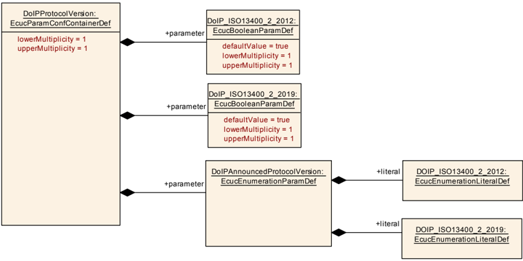

| SWS 条目 | [ECUC_DoIP_00102] |
|---|---|
| 容器名称 | DoIPProtocolVersion |
| 父容器 | DoIPInterface |
| 描述 | 该容器定义 **DoIP** 实体的协议版本。 |
| 配置参数 | 见下方参数表 |

| SWS 条目 | [ECUC_DoIP_00103] |
|---|---|
| 参数名称 | DoIP_ISO13400_2_2012 |
| 父容器 | DoIPProtocolVersion |
| 描述 | 如果启用此参数，则 **DoIP** 实体支持使用协议版本 0x02 与符合 ISO13400-2:2012 的测试仪进行通信。 |
| 多重性 | 1 |
| 类型 | EcucBooleanParamDef |
| 默认值 | true |
| Post-Build 变体值 | false |
| 值配置类 | Pre-compile time：x（All Variants）；Link time：-；Post-build time：- |
| 作用域/依赖 | scope: local |

| SWS 条目 | [ECUC_DoIP_00105] |
|---|---|
| 参数名称 | DoIP_ISO13400_2_2019 |
| 父容器 | DoIPProtocolVersion |
| 描述 | 如果启用此参数，则 **DoIP** 实体支持使用协议版本 0x03 与符合 ISO13400-2:2019 的测试仪进行通信。 |
| 多重性 | 1 |
| 类型 | EcucBooleanParamDef |
| 默认值 | true |
| Post-Build 变体值 | false |
| 值配置类 | Pre-compile time：x（All Variants）；Link time：-；Post-build time：- |
| 作用域/依赖 | scope: local |

| SWS 条目 | [ECUC_DoIP_00104] |
|---|---|
| 参数名称 | DoIPAnnouncedProtocolVersion |
| 父容器 | DoIPProtocolVersion |
| 描述 | 如果车辆识别请求包含协议版本 0xFF，则此参数定义用于车辆通告和车辆识别响应的协议版本。 |
| 多重性 | 1 |
| 类型 | EcucEnumerationParamDef |
| 范围 | DOIP_ISO13400_2_2012：-。DOIP_ISO13400_2_2019：-。 |
| 默认值 | - |
| Post-Build 变体值 | false |
| 值配置类 | Pre-compile time：x（All Variants）；Link time：-；Post-build time：- |
| 作用域/依赖 | scope: local |

无包含的容器。

#### 9.2.23. DoIPRoutingActivation

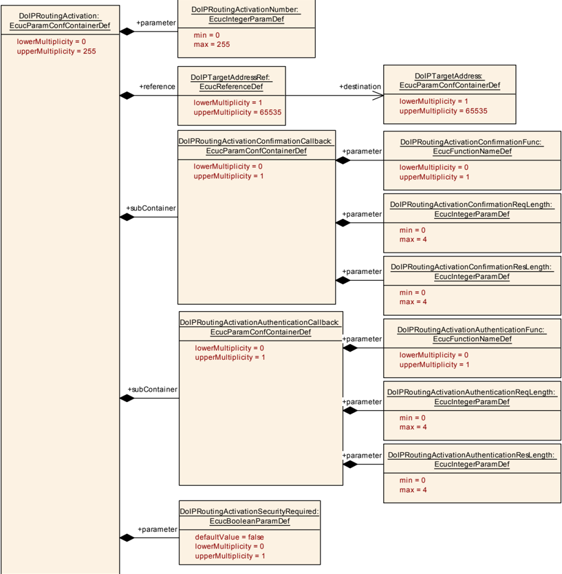

| SWS 条目 | [ECUC_DoIP_00030] |
|---|---|
| 容器名称 | DoIPRoutingActivation |
| 父容器 | DoIPInterface |
| 描述 | 该容器通过为每个容器表示一条可能的路由激活请求消息来描述路由激活的可能性。 |
| 配置参数 | 见下方参数表 |

| SWS 条目 | [ECUC_DoIP_00033] |
|---|---|
| 参数名称 | DoIPRoutingActivationNumber |
| 父容器 | DoIPRoutingActivation |
| 描述 | 标识为一条 **DoIP** 路由激活请求消息收到的路由激活编号（Routing activation Number）。 |
| 多重性 | 1 |
| 类型 | EcucIntegerParamDef |
| 范围 | 0 .. 255 |
| 默认值 | - |
| Post-Build 变体值 | true |
| 值配置类 | Pre-compile time：x（VARIANT-PRE-COMPILE）；Link time：-；Post-build time：- |
| 作用域/依赖 | scope: local |

| SWS 条目 | [ECUC_DoIP_00096] |
|---|---|
| 参数名称 | DoIPRoutingActivationSecurityRequired |
| 父容器 | DoIPRoutingActivation |
| 描述 | 指示路由激活是否需要安全的（secure）TCP 连接。 |
| 多重性 | 0..1 |
| 类型 | EcucBooleanParamDef |
| 默认值 | false |
| Post-Build 变体值 | true |
| 值配置类 | Pre-compile time：x（VARIANT-PRE-COMPILE）；Link time：-；Post-build time：- |
| 作用域/依赖 | scope: local |

| SWS 条目 | [ECUC_DoIP_00034] |
|---|---|
| 参数名称 | DoIPTargetAddressRef |
| 父容器 | DoIPRoutingActivation |
| 描述 | 对在此路由激活上激活的所有 DoIPTargetAddress 的引用。 |
| 多重性 | 1..65535 |
| 类型 | 对 DoIPTargetAddress 的引用 |
| Post-Build 变体值 | true |
| 值配置类 | Pre-compile time：x（VARIANT-PRE-COMPILE）；Link time：-；Post-build time：- |
| 作用域/依赖 | scope: local |

| 容器名称 | 多重性 | 作用域/依赖 |
|---|---|---|
| DoIPRoutingActivationAuthenticationCallback | 0..1 | 该容器描述在路由激活请求时为认证而调用的回调函数。如果该容器不存在，则不执行认证。 |
| DoIPRoutingActivationConfirmationCallback | 0..1 | 该容器描述在路由激活请求时为确认而调用的回调函数。如果该容器不存在，则不执行确认。 |

#### 9.2.24. DoIPRoutingActivationAuthenticationCallback

| SWS 条目 | [ECUC_DoIP_00035] |
|---|---|
| 容器名称 | DoIPRoutingActivationAuthenticationCallback |
| 父容器 | DoIPRoutingActivation |
| 描述 | 该容器描述在路由激活请求时为认证而调用的回调函数。如果该容器不存在，则不执行认证。 |
| 配置参数 | 见下方参数表 |

| SWS 条目 | [ECUC_DoIP_00039] |
|---|---|
| 参数名称 | DoIPRoutingActivationAuthenticationFunc |
| 父容器 | DoIPRoutingActivationAuthenticationCallback |
| 描述 | 用于触发路由激活认证函数的直接 C 回调函数。如果存在 DoIPRoutingActivationAuthenticationFunc 参数，则 **DoIP** 模块将不使用 ServiceInterface &lt;RoutingActivation&gt;_RoutingActivation 的 RPort，而是调用配置的函数。 |
| 多重性 | 0..1 |
| 类型 | EcucFunctionNameDef |
| 默认值 | - |
| 正则表达式 | - |
| Post-Build 变体值 | false |
| 值配置类 | Pre-compile time：x（All Variants）；Link time：-；Post-build time：- |
| 作用域/依赖 | scope: local |

| SWS 条目 | [ECUC_DoIP_00040] |
|---|---|
| 参数名称 | DoIPRoutingActivationAuthenticationReqLength |
| 父容器 | DoIPRoutingActivationAuthenticationCallback |
| 描述 | 描述在路由激活时传递给认证函数所使用的字节数。如果长度配置为 0，则参数 AuthenticationReqData 将不会被传递给 API。 |
| 多重性 | 1 |
| 类型 | EcucIntegerParamDef |
| 范围 | 0 .. 4 |
| 默认值 | - |
| Post-Build 变体值 | true |
| 值配置类 | Pre-compile time：x（VARIANT-PRE-COMPILE）；Link time：-；Post-build time：- |
| 作用域/依赖 | scope: local |

| SWS 条目 | [ECUC_DoIP_00041] |
|---|---|
| 参数名称 | DoIPRoutingActivationAuthenticationResLength |
| 父容器 | DoIPRoutingActivationAuthenticationCallback |
| 描述 | 描述在路由激活时由认证函数读取所使用的字节数。如果长度配置为 0，则参数 AuthenticationResData 将不会通过 API 获取。 |
| 多重性 | 1 |
| 类型 | EcucIntegerParamDef |
| 范围 | 0 .. 4 |
| 默认值 | - |
| Post-Build 变体值 | true |
| 值配置类 | Pre-compile time：x（VARIANT-PRE-COMPILE）；Link time：-；Post-build time：- |
| 作用域/依赖 | scope: local |

无包含的容器。

#### 9.2.25. DoIPRoutingActivationConfirmationCallback

| SWS 条目 | [ECUC_DoIP_00061] |
|---|---|
| 容器名称 | DoIPRoutingActivationConfirmationCallback |
| 父容器 | DoIPRoutingActivation |
| 描述 | 该容器描述在路由激活请求时为确认而调用的回调函数。如果该容器不存在，则不执行确认。 |
| 配置参数 | 见下方参数表 |

| SWS 条目 | [ECUC_DoIP_00036] |
|---|---|
| 参数名称 | DoIPRoutingActivationConfirmationFunc |
| 父容器 | DoIPRoutingActivationConfirmationCallback |
| 描述 | 用于触发路由激活确认函数的直接 C 回调函数。如果存在 DoIPRoutingActivationConfirmationFunc 参数，则 **DoIP** 模块将不使用 ServiceInterface &lt;RoutingActivation&gt;_RoutingActivation 的 RPort，而是调用配置的函数。 |
| 多重性 | 0..1 |
| 类型 | EcucFunctionNameDef |
| 默认值 | - |
| 正则表达式 | - |
| Post-Build 变体值 | false |
| 值配置类 | Pre-compile time：x（All Variants）；Link time：-；Post-build time：- |
| 作用域/依赖 | scope: local |

| SWS 条目 | [ECUC_DoIP_00037] |
|---|---|
| 参数名称 | DoIPRoutingActivationConfirmationReqLength |
| 父容器 | DoIPRoutingActivationConfirmationCallback |
| 描述 | 描述在路由激活时传递给确认函数所使用的字节数。如果长度配置为 0，则参数 ConfirmedReqData 将不会被传递给 API。 |
| 多重性 | 1 |
| 类型 | EcucIntegerParamDef |
| 范围 | 0 .. 4 |
| 默认值 | - |
| Post-Build 变体值 | true |
| 值配置类 | Pre-compile time：x（VARIANT-PRE-COMPILE）；Link time：-；Post-build time：- |
| 作用域/依赖 | scope: local |

| SWS 条目 | [ECUC_DoIP_00038] |
|---|---|
| 参数名称 | DoIPRoutingActivationConfirmationResLength |
| 父容器 | DoIPRoutingActivationConfirmationCallback |
| 描述 | 描述在路由激活时由确认函数读取所使用的字节数。如果长度配置为 0，则参数 ConfirmedResData 将不会通过 API 获取。 |
| 多重性 | 1 |
| 类型 | EcucIntegerParamDef |
| 范围 | 0 .. 4 |
| 默认值 | - |
| Post-Build 变体值 | true |
| 值配置类 | Pre-compile time：x（VARIANT-PRE-COMPILE）；Link time：-；Post-build time：- |
| 作用域/依赖 | scope: local |

无包含的容器。

#### 9.2.26. DoIPTester

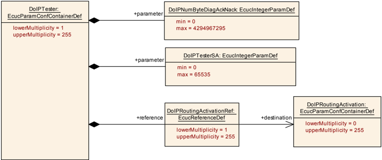

| SWS 条目 | [ECUC_DoIP_00031] |
|---|---|
| 容器名称 | DoIPTester |
| 父容器 | DoIPInterface |
| 描述 | 该容器描述 **DoIP** 实体可能连接的测试仪的属性。 |
| 配置参数 | 见下方参数表 |

| SWS 条目 | [ECUC_DoIP_00042] |
|---|---|
| 参数名称 | DoIPNumByteDiagAckNack |
| 父容器 | DoIPTester |
| 描述 | 指定 **DoIP** 实体在对诊断响应消息的 NACK 中向测试仪响应的原始诊断请求字节数。 |
| 多重性 | 1 |
| 类型 | EcucIntegerParamDef |
| 范围 | 0 .. 4294967295 |
| 默认值 | - |
| Post-Build 变体值 | true |
| 值配置类 | Pre-compile time：x（VARIANT-PRE-COMPILE）；Link time：-；Post-build time：- |
| 作用域/依赖 | scope: local |

| SWS 条目 | [ECUC_DoIP_00043] |
|---|---|
| 参数名称 | DoIPTesterSA |
| 父容器 | DoIPTester |
| 描述 | 通过路由激活或诊断消息发送的测试仪源地址（Source Address）。 |
| 多重性 | 1 |
| 类型 | EcucIntegerParamDef |
| 范围 | 0 .. 65535 |
| 默认值 | - |
| Post-Build 变体值 | true |
| 值配置类 | Pre-compile time：x（VARIANT-PRE-COMPILE）；Link time：-；Post-build time：- |
| 作用域/依赖 | scope: local |

| SWS 条目 | [ECUC_DoIP_00062] |
|---|---|
| 参数名称 | DoIPRoutingActivationRef |
| 父容器 | DoIPTester |
| 描述 | 对描述该 DoIPTester 的可能路由激活的 DoIPRoutingActivation 的引用。 |
| 多重性 | 1..255 |
| 类型 | 对 DoIPRoutingActivation 的引用 |
| Post-Build 变体值 | true |
| 值配置类 | Pre-compile time：x（VARIANT-PRE-COMPILE）；Link time：-；Post-build time：- |
| 作用域/依赖 | scope: local |

无包含的容器。

### 9.3. 发布信息

有关详细信息，可参见 SWS_BSWGeneral [\[1\]](#ref-1) 中的第 10.3 章「Published Information」（发布信息）。

## B. AUTOSAR 可追溯项变更历史

请注意，本章中的列表还包括已在后续版本中从规范中移除的约束和规范项。这些约束和规范项不会在文档中显示为超链接。

### B.1. 本文档的可追溯项历史（按AUTOSAR R22-11版本）

#### B.1.1. R22-11中新增的规范项

无

#### B.1.2. R22-11中变更的规范项

```
[SWS_DoIP_00020] [SWS_DoIP_00022] [SWS_DoIP_00023] [SWS_DoIP_00024] [SWS_DoIP_00025] [SWS_DoIP_00026] [SWS_DoIP_00027] [SWS_DoIP_00031] [SWS_DoIP_00032] [SWS_DoIP_00033] [SWS_DoIP_00037] [SWS_DoIP_00038] [SWS_DoIP_00039] [SWS_DoIP_00040] [SWS_DoIP_00041] [SWS_DoIP_00044] [SWS_DoIP_00045] [SWS_DoIP_00047] [SWS_DoIP_00048] [SWS_DoIP_00049] [SWS_DoIP_00050] [SWS_DoIP_00051] [SWS_DoIP_00054] [SWS_DoIP_00055] [SWS_DoIP_00056] [SWS_DoIP_00057] [SWS_DoIP_00148] [SWS_DoIP_00244] [SWS_DoIP_00245] [SWS_DoIP_00261] [SWS_DoIP_00262] [SWS_DoIP_00263] [SWS_DoIP_00264] [SWS_DoIP_00266] [SWS_DoIP_00267] [SWS_DoIP_00268] [SWS_DoIP_00269] [SWS_DoIP_00270] [SWS_DoIP_00277] [SWS_DoIP_00278] [SWS_DoIP_00287] [SWS_DoIP_00288] [SWS_DoIP_00289] [SWS_DoIP_00290] [SWS_DoIP_91000] [SWS_DoIP_91002]
```

#### B.1.3. R22-11中删除的规范项

无

#### B.1.4. R22-11中新增的约束

无

#### B.1.5. R22-11中变更的约束

无

#### B.1.6. R22-11中删除的约束

无

### B.2. 本文档的可追溯项历史（按AUTOSAR R23-11版本）

#### B.2.1. R23-11中新增的规范项

```
[SWS_DoIP_00321] [SWS_DoIP_00322] [SWS_DoIP_00323] [SWS_DoIP_00324] [SWS_DoIP_00325] [SWS_DoIP_00326] [SWS_DoIP_00327] [SWS_DoIP_00330] [SWS_DoIP_00331] [SWS_DoIP_00332]
```

#### B.2.2. R23-11中变更的规范项

```
[SWS_DoIP_00016] [SWS_DoIP_00017] [SWS_DoIP_00019] [SWS_DoIP_00077] [SWS_DoIP_00078] [SWS_DoIP_00110] [SWS_DoIP_00113] [SWS_DoIP_00114] [SWS_DoIP_00141]
```

#### B.2.3. R23-11中删除的规范项

无

