## 1. 简介和功能概述

本文介绍了AUTOSAR基本软件模块E2E Transformer的功能、API和配置。

根据SRS转换器通用标准，端到端（**E2E**）转换器属于“功能安全”（**Safety**）范畴。

E2E转换器保证通过QM通信栈I-signal也能正确的通信。通信堆栈被认为是“**black channel**”通信。

### 1.1. 一对一

数据元素（**data element**）和**I-signal**之间是一对一的关系，也就是说没有数据拆分/合并，即一个I-signal不会由多个数据元素组成的，一个数据元素也不会由多个I-signal组成的。

#### 1.1.1. 发送端

一个数据元素（**data element**）精确地对应一个**I-signal**。

#### 1.1.2. 接收端

一个或多个数据元素（**data element**）代表了整个接收到的**I-signal**（即接收端fan-out的场景）


### 1.2. 一对多

在接收端有一个扇出（**fan-out**）的**I-signal**到一个或多个数据元素。

#### 1.2.1. 发送端

1. 一个数据元素（**data element**）序列化为一个**I-signal**，并使用一个端到端保护（**E2E protection**）进行保护。
2. 一个或多个**I-signal**放置在一个**I-PDU**中，每个**I-signal**有不同的端到端保护（**E2E protection**）。一些**I-signal**可能根本没有端到端保护。

#### 1.2.2. 接收端

在接收端，一个**I-signal**可能:
1. 被检查一次，结果只有一个数据元素（即：没有扇出）
2. 被检查多次，具有相同的设置，但通过独立的函数（例如：通过与ASIL等级无关的SW-C接收器）。
3. 被检查多次，部分具有不同的设置（比如：相同的数据ID，但不同的计数器容错性）和不同的函数，最终导致每一个分开的数据元素可能有不同的E2E-check结果.
4. 被检查几次，启用或不启用端到端检查。（例如：如果一个接收端是功能安全相关的；另一个接收端是QM，所以并不需要端到端检查的结果）

E2E转换器负责根据特定数据元素（如：I-signal）的配置调用E2E库。

E2E转换器根据其配置，实例化端到端配置和端到端状态数据结构。所有的端到端配置文件都可以用来保护数据。

E2E转换器封装了端到端配置和处理的复杂性，并提供了标准的转换器接口。正因为这个原因，E2E转换器的调用方，不需要知道E2E内部结构。

E2E转换器被RTE调用，并且RTE调用是通过由软件组件调用RTE标志API（读、写、发送、接收）的结果。

## 2. 缩略语

以下词汇表包含与通信管理相关、但未包含在 [3, AUTOSAR 术语表] 中的缩略语和缩写。

**I-Signal**
> 待序列化为字节数组以进行 **E2E** 保护的条目。为了进行 **E2E** 保护，**I-Signal** 必须分配给一个 **I-Signal 组**。

**I-Signal group**
> 要进行 **E2E** 保护的一组 **I-Signal**。**E2E** 保护在 **I-Signal** 组这一层级上定义。

**Data element**
> 发送者和接收者之间交换的数据。**E2E** 转换器将数据元素一对一地映射到 **I-signal** 或 **I-signal** 组。

**Variant**
> 由 **TransformationTechnology** 和 **EndToEndTransformationDescription** 的配置定义的转换器变体。基于同一变体的 **E2E** 转换器使用相同的 **E2E** 配置文件（profile）（参见 [\[4\]](#ref-4) 中的 **constr_03313**）。

**TransformationTechnology**
> **TransformationTechnology** 是 [\[4\]](#ref-4) 中定义的一个特定类。该类保存转换器（不仅是 **E2E** 转换器）的通用配置参数。

**EndToEndTransformationDescription**
> 所定义的特定类，包含约 30 个用于 **E2E** 配置的参数（参见 [\[4\]](#ref-4)）。它被 **TransformationTechnology** 引用。

**Inverse transformer**
> 接收端的转换器，它反转在发送端应用的转换步骤。

**DEM**
> 诊断事件管理器（**Diagnostic Event Manager**）。

**E2E**
> 端到端保护（**End-To-End Protection**）。

## 3. 相关文档

### 3.1. 输入文件和相关标准与规范

<a id="ref-1"></a>[1] Requirements on Transformer
> AUTOSAR_CP_SRS_Transformer

<a id="ref-2"></a>[2] General Specification of Transformers
> AUTOSAR_CP_ASWS_TransformerGeneral

<a id="ref-3"></a>[3] Glossary
> AUTOSAR_FO_TR_Glossary

<a id="ref-4"></a>[4] System Template
> AUTOSAR_CP_TPS_SystemTemplate

<a id="ref-5"></a>[5] E2E Protocol Specification
> AUTOSAR_FO_PRS_E2EProtocol

<a id="ref-6"></a>[6] Specification of SW-C End-to-End Communication Protection Library
> AUTOSAR_CP_SWS_E2ELibrary

<a id="ref-7"></a>[7] General Specification of Basic Software Modules
> AUTOSAR_CP_SWS_BSWGeneral

<a id="ref-8"></a>[8] Software Component Template
> AUTOSAR_CP_TPS_SoftwareComponentTemplate

<a id="ref-9"></a>[9] SOME/IP Protocol Specification
> AUTOSAR_FO_PRS_SOMEIPProtocol

<a id="ref-10"></a>[10] Specification of RTE Software
> AUTOSAR_CP_SWS_RTE

### 3.2. 相关规范

**AUTOSAR** 提供了转换器通用规范 [2, **ASWS Transformer General**]，该规范同样适用于 **E2E** 转换器。

因此，规范 [2, **ASWS Transformer General**] 应被视为 **E2E** 转换器的附加和必需规范。

## 4. 约束和假设

### 4.1. 限制

关于 **E2E** 保护和可检测故障模式的一般限制在 [5, **PRS E2EProtocol**] 中描述。

此外，还已知以下限制：

1. 尚未规定向 **DEM** 的错误报告。

### 4.2. 汽车域的适用性

**E2E** 转换器适用于与功能安全相关的通信。

## 5. 对其他模块的依赖

**E2E** 转换器依赖于 [6, **SWS E2ELibrary**]。**E2E** 库提供数据类型和无状态函数。**E2E** 转换器将配置和状态作为函数参数传递来执行 **E2E** 库例程。

### 5.1. 支持的配置变体

除了 [7, **SWS BSW General**] 和 [2, **ASWS Transformer General**] 中规定的设置之外，目前没有其他显式的编译前（**Pre-compile time**）配置设置。

## 6. 功能规格

E2E转换器负责保护与功能安全相关的数据元素。它由RTE调用。在发送端，E2E转换器通过E2E保护数据。在接收端，E2E转换器通过E2E检查数据，并通过RTE向SW-C提供E2E的检查结果。

如果接收端的SW-C不读取转换器的返回值，这对通信的SW-C来说都是完全透明的，无需关心数据在总线上是否受到E2E的保护。

所有算法都由E2E库提供，包括：保护（**protect**）、检查（**check**）、转发（**forward**）、状态机（**state machine**）。E2E转换器调用E2E库，提供配置和状态。

E2E转换器没有特定的ECU配置，因为它的整个配置是基于**E2ETransformationDescription**、**E2ETransformationISignalProps**和**E2ETransformationComSpecProps**的。因此参照AUTOSAR_ASWS_TransformerGeneral.pdf[\[10\]](#ref-10)文档的通用ECU配置就足够了。

具体的配置输入可在AUTOSAR_TPS_SystemTemplate.pdf[\[8\]](#ref-8)和AUTOSAR_TPS SoftwareComponentTemplate.pdf[12]中可以找到。

### 6.1. 支持的RTE函数

目前支持以下ECU间通信功能:
1. Rte_Write / Rte_Read
2. Rte_IWrite / Rte_IRead
3. Rte_Send / Rte_Receive
4. Rte_Call / Rte_Result

### 6.2. E2E保护的函数和数据的命名

E2E转换器函数和结构添加后缀<**transformerId**>。（<**transformerId**>为每个转换器函数定义一个唯一的ID）。

这个配置构建了转换器配置的三个阶段:
1. **EndToEndTransformationDescription**定义了E2E配置的Profile信息，对数个ISignal都有效。
2. **EndToEndTransformationISignalProps**定义了对特定引用的ISignal有效的配置选项。
3. **EndToEndTransformationComSpecProps**定义了属于ReceiverComSpec端口的覆盖配置选项。

软件组件（**SW-C**）可能有独立数接收从同一个**I-PDU**创建的数据元素的场景。如：
1. 一些软件组件有调整/特殊的配置值，与E2E状态机的容错性相关。例如：更大的容错性。为此，**EndToEndTransformationComSpecProps**的属性会被使用。
2. 一些QM软件组件可能不需要对数据进行E2E的检查，所以可以E2E的检查。为此,**EndToEndTransformationComSpecProps.disableEndToEndCheck**使用。

### 6.3. E2E保护

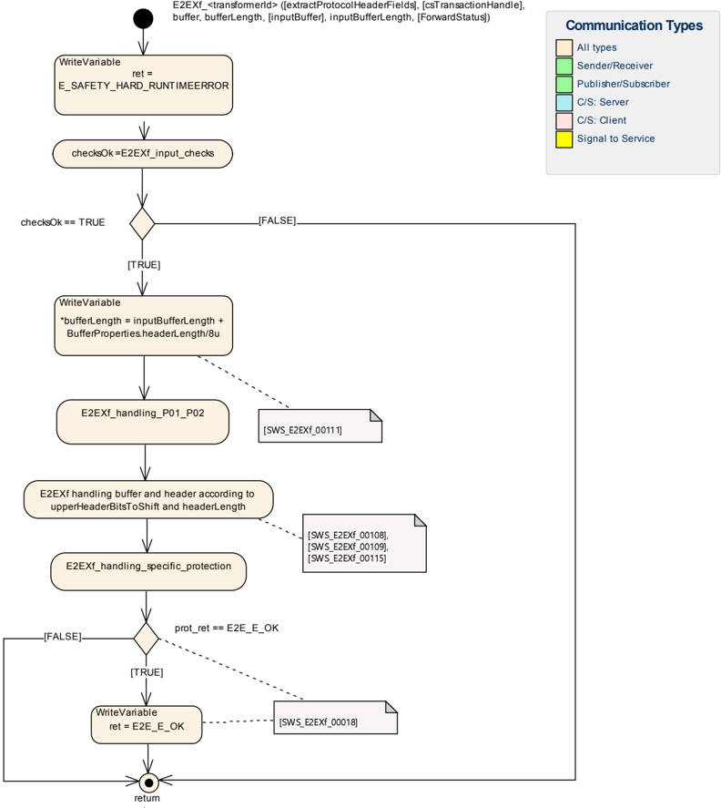

### 6.4. E2E检查

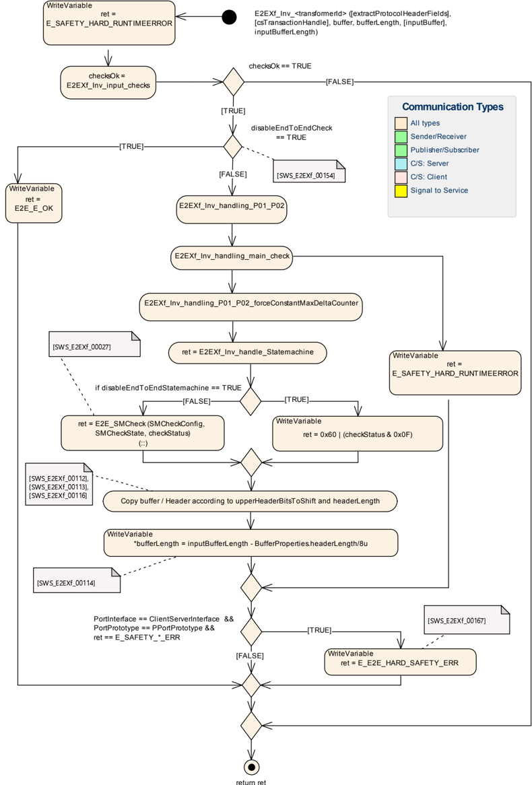


本规范规定了 **AUTOSAR** 基本软件模块 **E2E** 转换器的功能、API 和配置。

**E2E** 转换器封装了配置和处理 **E2E** 保护的复杂性，并提供标准的转换器接口。因此，**E2E** 转换器的调用者不需要了解 **E2E** 的内部结构。

根据 [1, SRS Transformer General]，**E2E** 转换器属于「安全（**Safety**）」类，并基于 [2, **ASWS Transformer General**] 中的规范。

**E2E** 转换器确保 **I-signal** 通过 **QM** 通信栈的正确通信。通信栈被视为「**black channel**」通信。如果接收 **SW-C** 不评估 **E2E** 转换器的返回码，则…（源文档此处截断）。

**E2E** 转换器基于其配置实例化 **E2E** 配置和 **E2E** 状态数据结构。**E2E** 转换器负责根据特定数据元素（**I-signal**）的配置调用 **E2E** 库。

没有数据拆分/合并，即一个 **I-signal** 不会由多个数据元素组成，一个数据元素也不会由多个 **I-signal** 组成。在发送端，一个数据元素与一个 **I-signal** 精确地一对一映射。在接收端，…（源文档此处截断）。

支持以下场景：

1. 在发送端，一个数据元素被序列化为：
   - (a) 一个 **I-signal** 并用一个 **E2E** 保护进行保护
   - (b) 放置在一个 **I-PDU** 中的一个或多个 **I-signal**，其中每个 **I-signal** 有不同的 **E2E** 保护。一些 **I-signal** 可能根本没有 **E2E** 保护。
2. 在接收端，一个 **I-signal** 被检查：
   - (a) 一次：产生一个数据元素（即没有扇出）
   - (b) 多次：使用相同的设置，但由独立的函数进行（例如由与 **ASIL** 无关的接收者 **SW-C**），
   - (c) 多次：使用部分不同的设置（例如相同的 **DataID**，但不同的计数器容差），由不同的函数进行，产生各自可能具有不同 **E2E** 检查结果的独立数据元素，
   - (d) 多次：启用或不启用 **E2E** 检查（例如如果一个接收者与功能安全相关，而另一个是 **QM** 且不需要 **E2E** 检查的结果）。

**E2E** 转换器由 **SW-C** 通过 **RTE API**（读、写、发送、接收）调用。

### 6.1. 支持的RTE函数

目前支持以下 **ECU** 间通信函数：

1. Rte_Write/Rte_Read
2. Rte_IWrite/Rte_IRead
3. Rte_Send/Rte_Receive
4. Rte_Call/Rte_Result

### 6.2. E2E保护的函数和数据的命名

**E2E** 转换器函数和结构使用后缀 &lt;transformerId&gt;。

模式 &lt;transformerId&gt; 在 [2, **ASWS Transformer**] 的相关需求中定义，并为每个转换器函数定义一个唯一的 **ID**。

此名称模式也用于 **E2E** 转换器的 **C-API** 名称中，因此也用于表示 **C-API** 的 **BswModuleEntry** 中。

### 6.3. 配置

转换器配置包含 **E2E** 转换器函数使用的所有参数的设置，例如配置文件（**profile**）名称、**E2E** 检查的容差值或 **dataID** 模式。详细信息参见 [4, **System Template**]。

以下部分构成转换器配置的三个阶段：

* **EndToEndTransformationDescription**：定义 **E2E** 配置的 profile 信息，对多个 **ISignal** 有效（参见 [4, **System Template**] 中的 **TPS_SYST_02275**）
* **EndToEndTransformationISignalProps**：定义对特定被引用 **ISignal** 有效的配置选项（参见 [4, **System Template**] 中的 **TPS_SYST_02275**）
* **EndToEndTransformationComSpecProps**：定义对 **Receiver ComSpec** 所属端口有效的覆盖配置选项（参见 [4, **System Template**] 中的 **TPS_SYST_01599**）。

#### 6.3.1. 配置属性的优先级

可能有多个软件组件独立地接收从同一个 **I-PDU** 创建（反序列化）的数据元素。如果一些软件组件具有与 **E2E** 状态机容差相关的调整/特殊配置值，例如更…（源文档此处截断）。

**EndToEndTransformationComSpecProps** 中的配置选项应优先于 **EndToEndTransformationDescription** 和 **EndToEndTransformationISignalProps** 中的选项。

这意味着：**EndToEndTransformationComSpecProps** 中的配置选项覆盖 **EndToEndTransformationDescription** 和 **EndToEndTransformationISignalProps** 中的配置选项。但是，**EndToEndTransformationDescription** 的属性并未涵盖 **EndToEndTransfor…**（源文档此处截断）的所有属性。

#### 6.3.2. 禁用E2E检查

如果软件组件不需要评估 **E2E** 保护（例如对于 **QM** 软件组件），则可以通过 **EndToEndTransformationComSpecProps.disableEndToEndCheck** 禁用 **E2E** 检查。

如果为给定的 &lt;transformerId&gt; 设置了配置选项 **EndToEndTransformationComSpecProps.disableEndToEndCheck**，则 **E2E** 转换器应跳过对 **E2E** 库的调用——它只应执行缓冲区处理（例如复制…（源文档此处截断））。

#### 6.3.3. 配置变体

为了支持多个构建后可选择（**post-build-selectable**）变体，每个配置都有一个变体标识符。

在构建后可选择配置的情况下，变体应按照配置属性 **PredefinedVariant.shortName** 命名。这意味着：&lt;v&gt; = **PredefinedVariant.shortName**。

在链接时（**link-time**）配置的情况下，只有一个变体，这意味着：&lt;v&gt; = 空（**NULL** 字符串）。

注意，基于同一 **TransformationTechnology** 的所有变体使用相同的 **E2E** profile（例如 **P04**）。

这也意味着所有具有相同 &lt;transformerId&gt; 的转换器使用相同的 **E2E** profile。

所有变体都具有相同的 **E2E** 保护数据元素。

函数和状态结构与变体 &lt;v&gt; 无关——它们仅取决于 **E2E** 转换器的特定实例，因此取决于 &lt;transformerId&gt;，而配置结构则取决于实例（&lt;transformerId&gt;）和配置变体（&lt;…（源文档此处截断））。

### 6.4. 生成的结构类型

基于 **E2E** 转换器配置（在 [4, **System Template**]、[8, **Software Component Template**] 中描述）和生成的 **ECU** 配置（在 [2, **General Specification of Transformers**] 中描述），按如下所述生成相应的 **C** 结构。

#### 6.4.1. E2E转换器的整体配置和状态

**E2E** 转换器应生成以下数据结构，用于存储 **E2E** 转换器模块的配置：**E2EXf_ConfigStruct_&lt;v&gt;**（类型为 [**E2EXf_ConfigType**](#721-e2exf_configtype)）。

**E2E** 转换器应从以下各项派生所需的、类型为 **E2E_PXXProtectStateType**、**E2E_PXXCheckStateType** 和 **E2E_SMCheckStateType** 的独立状态数据资源的数量，以在 **E2E** 转换器模块内执行 **E2E** 保护…（源文档此处截断）。

#### 6.4.2. 每个E2E保护数据的配置和状态

**E2E** 转换器应从以下各项派生所需的、类型为 **E2E_PXXConfigType**、**E2E_SMConfigType** 和（如果需要）附加信息（例如客户端侧用于…（源文档此处截断）的 **Source ID**）的、静态初始化的独立配置对象的数量：

1. 由 &lt;transformerId&gt; 唯一标识的、由 profile **PXX** 保护的 **E2E** 保护数据的数量，以及
2. 配置变体的数量（仅限构建后可选择）。

### 6.5. 静态初始化

#### 6.5.1. 配置的静态初始化

配置基于以下元模型类进行静态初始化：

1. **EndToEndTransformationDescription**：**E2E** 变体的定义
2. **EndToEndTransformationISignalProps**：给定 **ISignal** 的特定保护的定义（例如长度、**DataID**）
3. **EndToEndTransformationComSpecProps**：关于 **E2E** 变体的检查容差的某些设置的覆盖。

生成的 **E2E_P01ConfigType** 类型的配置对象应按照以下方式初始化：

* **DataID** = **EndToEndTransformationISignalProps.dataID**
* **DataLength** = **EndToEndTransformationISignalProps.dataLength**
* **CounterOffset** = **EndToEndTransformationDescription.counterOffset**
* **CRCOffset** = **EndToEndTransformationDescription.crcOffset**
* **DataIDNibbleOffset** = **EndToEndTransformationDescription.dataIdNibbleOffset**
* **DataIDMode** 应设置为：如果 **EndToEndTransformationDescription.dataIDMode == all16Bit**，则为 **E2E_P01_DATAID_BOTH**；如果为 **alternating8Bit**，则为 **E2E_P01_DATAID_ALT**；如果为 **lower8Bit**，则为 **E2E_P01_DATAID_LOW**；如果为 **nibble**，则为 **E2E_P01_DATAID_NIBBLE**
* **MaxDeltaCounterInit** = **EndToEndTransformationComSpecProps.maxDeltaCounter**-1 或 **EndToEndTransformationDescription.maxDeltaCounter**-1
* **MaxNoNewOrRepeatedData** = **EndToEndTransformationComSpecProps.maxNoNewOrRepeatedData** 或 **EndToEndTransformationDescription.maxNoNewOrRepeatedData**
* **SyncCounterInit** = **EndToEndTransformationComSpecProps.syncCounterInit** 或 **EndToEndTransformationDescription.syncCounterInit**

生成的 **E2E_P02ConfigType** 类型的配置对象应按照以下方式初始化：

* **DataIDList** = **EndToEndTransformationISignalProps.dataID**（数组）
* **DataLength** = **EndToEndTransformationISignalProps.dataLength**
* **Offset** = **EndToEndTransformationDescription.offset**
* **MaxDeltaCounterInit** = **EndToEndTransformationComSpecProps.maxDeltaCounter**-1 或 **EndToEndTransformationDescription.maxDeltaCounter**-1
* **MaxNoNewOrRepeatedData** = **EndToEndTransformationComSpecProps.maxNoNewOrRepeatedData** 或 **EndToEndTransformationDescription.maxNoNewOrRepeatedData**
* **SyncCounterInit** = **EndToEndTransformationComSpecProps.syncCounterInit** 或 **EndToEndTransformationDescription.syncCounterInit**

生成的 **E2E_P04ConfigType**、**E2E_P06ConfigType**、**E2E_P07ConfigType**、**E2E_P08ConfigType**、**E2E_P44ConfigType**、**E2E_P04mConfigType**、**E2E_P07mConfigType**、**E2E_P08mConfigType**、**E2E_P44mConfigType** 类型的配置对象应按照以下方式初始化：

* **DataID** = **EndToEndTransformationISignalProps.dataID**
* **MinDataLength** = **EndToEndTransformationISignalProps.minDataLength**
* **MaxDataLength** = **EndToEndTransformationISignalProps.maxDataLength**
* **Offset** = **EndToEndTransformationDescription.offset**
* **MaxDeltaCounter** = **EndToEndTransformationComSpecProps.maxDeltaCounter** 或 **EndToEndTransformationDescription.maxDeltaCounter**

生成的 **E2E_P05ConfigType** 类型的配置对象应按照以下方式初始化（一对一映射）：

* **DataID** = **EndToEndTransformationISignalProps.dataID**
* **DataLength** = **EndToEndTransformationISignalProps.dataLength**
* **Offset** = **EndToEndTransformationDescription.offset**
* **MaxDeltaCounter** = **EndToEndTransformationComSpecProps.maxDeltaCounter** 或 **EndToEndTransformationDescription.maxDeltaCounter**

生成的 **E2E_P11ConfigType** 类型的配置对象应按照以下方式初始化（一对一映射）：

* **DataID** = **EndToEndTransformationISignalProps.dataID**
* **DataLength** = **EndToEndTransformationISignalProps.dataLength**
* **CounterOffset** = **EndToEndTransformationDescription.counterOffset**
* **CRCOffset** = **EndToEndTransformationDescription.crcOffset**
* **DataIDNibbleOffset** = **EndToEndTransformationDescription.dataIdNibbleOffset**
* **DataIDMode** 应设置为：如果 **EndToEndTransformationDescription.dataIDMode == all16Bit**，则为 **E2E_P11_DATAID_BOTH**；如果为 **nibble**，则为 **E2E_P11_DATAID_NIBBLE**
* **MaxDeltaCounter** = **EndToEndTransformationComSpecProps.maxDeltaCounter** 或 **EndToEndTransformationDescription.maxDeltaCounter**

生成的 **E2E_P22ConfigType** 类型的配置对象应按照以下方式初始化：

* **DataIDList** = **EndToEndTransformationISignalProps.dataID**（数组）
* **DataLength** = **EndToEndTransformationISignalProps.dataLength**
* **Offset** = **EndToEndTransformationDescription.offset**
* **MaxDeltaCounter** = **EndToEndTransformationComSpecProps.maxDeltaCounter** 或 **EndToEndTransformationDescription.maxDeltaCounter**

生成的 **E2E_SMConfigType** 类型的配置结构应按照以下方式初始化（一对一映射）：

* **WindowSize** = **EndToEndTransformationComSpecProps.windowSize** 或 **EndToEndTransformationDescription.windowSize**
* **MinOkStateInit** = **EndToEndTransformationComSpecProps.minOkStateInit** 或 **EndToEndTransformationDescription.minOkStateInit**
* **MaxErrorStateInit** = **EndToEndTransformationComSpecProps.maxErrorStateInit** 或 **EndToEndTransformationDescription.maxErrorStateInit**
* **MinOkStateValid** = **EndToEndTransformationComSpecProps.minOkStateValid** 或 **EndToEndTransformationDescription.minOkStateValid**
* **MaxErrorStateValid** = **EndToEndTransformationComSpecProps.maxErrorStateValid** 或 **EndToEndTransformationDescription.maxErrorStateValid**
* **MinOkStateInvalid** = **EndToEndTransformationComSpecProps.minOkStateInvalid** 或 **EndToEndTransformationDescription.minOkStateInvalid**
* **MaxErrorStateInvalid** = **EndToEndTransformationComSpecProps.maxErrorStateInvalid** 或 **EndToEndTransformationDescription.maxErrorStateInvalid**

配置对象 **E2EXf_ConfigStruct_&lt;v&gt;**（参见 [6.4.1](#641-e2e转换器的整体配置和状态) 小节的相关需求）应初始化为包含或引用本节上述需求中实例化的配置结构。

#### 6.5.2. 状态的静态初始化

与配置结构相反，状态结构不依赖于变体（&lt;v&gt;）。

在所有 **E2E** 转换器变体中，生成的状态对象可以保持未初始化（即不提供显式的初始化值）。

### 6.6. 通过 E2EXf_Init() 函数的运行时初始化

#### 6.6.1. 配置的运行时选择（仅限构建后变体）

在构建后可选择变体中，**[E2EXf_Init](#733-e2exf_init)()** 应检查 **Config** 指针（作为函数参数接收）是否指向配置变体 **E2EXf_ConfigStruct_&lt;v&gt;** 之一。如果是这种情况，则 **[E2EXf_Init](#733-e2exf_init)()** 应选择…（源文档此处截断）。

#### 6.6.2. 状态的运行时初始化

**[E2EXf_Init](#733-e2exf_init)()** 函数应按如下方式初始化由 **E2E** 转换器管理的以下外部状态数据资源（参见 [6.4.1](#641-e2e转换器的整体配置和状态) 小节的相关需求）：

* 通过调用相应的 **E2E_PXXProtectInit()** 方法初始化 **E2E_PXXProtectStateType** 类型的状态数据资源
* 通过调用相应的 **E2E_PXXCheckInit()** 方法初始化 **E2E_PXXCheckStateType** 类型的状态数据资源
* 通过调用相应的 **E2E_SMCheckInit()** 方法初始化 **E2E_SMCheckStateType** 类型的状态数据资源。

### 6.7. 正常运行

如果 **E2E** 转换器尚未正确初始化（这意味着之前未成功调用 **[E2EXf_Init](#733-e2exf_init)()**），则所有生成的 **E2E** 转换器 **API** 都应返回 **E_SAFETY_HARD_RUNTIMEERROR**。

#### 6.7.1. 原地处理和异地处理

**E2E** 转换器函数使用原地（**in-place**）处理或异地（**out-of-place**）处理工作。这由二元设置 **BufferProperties.inPlace** 配置。

原地处理意味着转换器使用一个缓冲区同时作为输入和输出。原地处理具有性能优势（更少的复制，更少的缓冲区）。

异地处理意味着使用单独的缓冲区，一个输入缓冲区和一个单独的输出缓冲区。

#### 6.7.2. 转换器和E2E保护

图7.1为颜色方案的图例，用于突出不同通信类型的特定内容。


**E2E** 转换器通过 **API** **E2EXf_&lt;transformerId&gt;**（保护函数）调用 **E2E** 库的 **protect()** 函数。通过这种方式，配置数据和要 **E2E** 保护的数据被提供给 **E2E** 库函数。

根据通信类型，**E2EXf_&lt;transformerId&gt;()** 的流程有所不同。

该函数的一般概述在 [6.7.2.1](#6721-e2exf_lttransformeridgt保护函数) 小节中提供。特定部分的详细信息在 [6.7.2.2](#6722-e2exf_input_checks) 至 [6.7.2.11](#67211-e2exf_mapcodetostatus) 小节中提供。通信类型特定的部分按表7.1所述着色。

##### 6.7.2.1. E2EXf_&lt;transformerId&gt;（保护函数）

应为每个发送的 **E2E** 保护数据元素和每个受保护的 **C/S** 操作（&lt;transformerId&gt;）生成函数 **E2EXf_&lt;transformerId&gt;**。

下图提供了 **API** 函数 **E2EXf_&lt;transformerId&gt;** 所提供的功能的活动图。

以下小节提供了以下部分的详细信息：

* **E2EXf_input_checks**
* **E2EXf_handling_P01_P02**
* **E2EXf 处理缓冲区和报头**
* **E2EXf 处理通信类型**
* **E2EXf_store_request_counter**
* **E2EXf_handling_PXXm_client**
* **E2EXf_handling_PXXm_server**
* **E2EXf_set_response_counter**
* **E2EXf 数据转换**


##### 6.7.2.2. E2EXf_input_checks

**E2EXf_input_checks** 对输入变量（例如缓冲区大小、指针）执行一些检查，并返回如下图所示的结果。

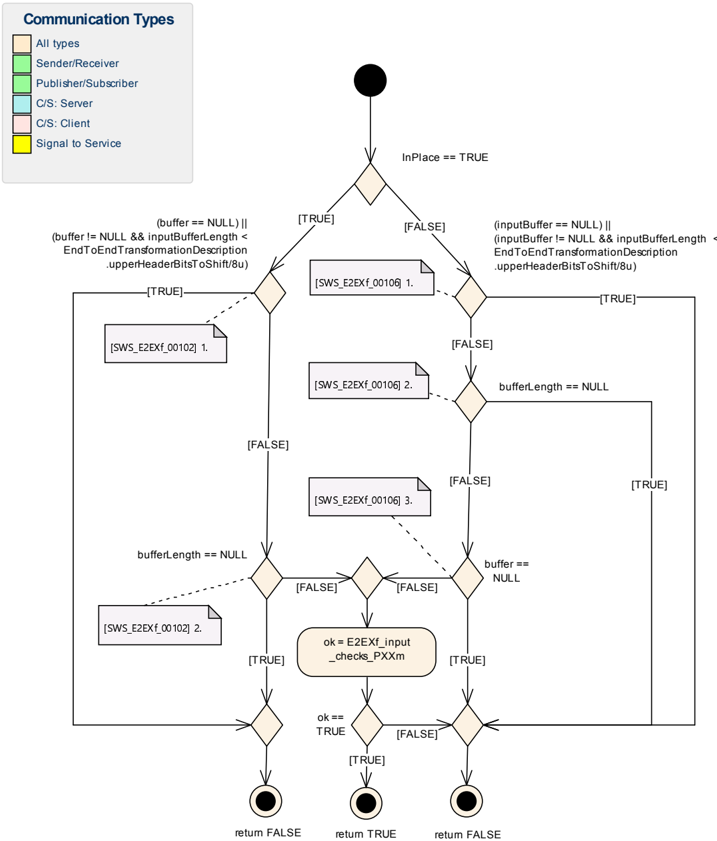

原地 **E2EXf_&lt;transformerId&gt;** 应执行以下两个前提条件检查，而不继续进一步处理：

1. (buffer == NULL) || (buffer != NULL && inputBufferLength &lt; EndToEndTransformationDescription.upperHeaderBitsToShift/8u)
2. bufferLength == NULL

如果上述任一条件为 **TRUE**，则该函数应返回 **E_SAFETY_HARD_RUNTIMEERROR**。

异地 **E2EXf_&lt;transformerId&gt;** 应执行以下三个前提条件检查，而不继续进一步处理：

1. (inputBuffer == NULL) || (inputBuffer != NULL && inputBufferLength &lt; EndToEndTransformationDescription.upperHeaderBitsToShift/8u)
2. bufferLength == NULL
3. buffer == NULL

如果上述任一条件为 **TRUE**，则该函数应返回 **E_SAFETY_HARD_RUNTIMEERROR**。

对于方法特定的 **E2E** profile，应应用如下图所示的附加检查。

对于 profile **P04m**、**P07m**、**P08m** 和 **P44m**，原地和异地 **E2EXf_&lt;transformerId&gt;** 都应执行以下附加前提条件检查，而不继续进一步处理：

1. extractProtocolHeaderFields == NULL
2. csTransactionHandle == NULL

如果上述任一条件为 **TRUE**，则该函数应返回 **E_SAFETY_HARD_RUNTIMEERROR**。

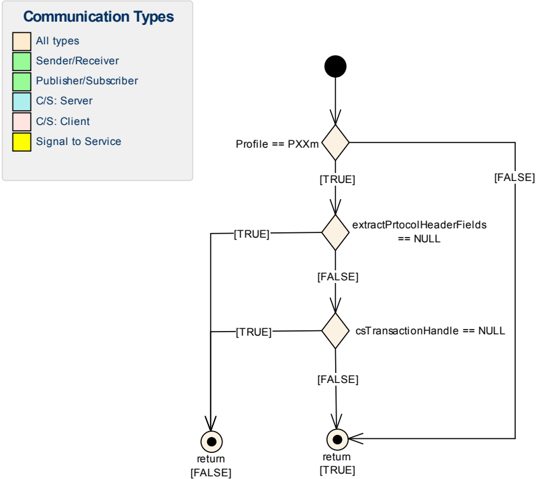

注意，函数 **E2EXf_&lt;transformerId&gt;** 可以由普通函数或宏实现（取决于实现）。函数 **E2EXf_&lt;transformerId&gt;** 可以调用一些内部公共函数。

##### 6.7.2.3. E2EXf_handling_P01_P02

**E2E** 转换器实现了对遗留 profile **P01** 和 **P02** 的特定处理，因为这些 profile 的库函数是在转换器方法引入 **AUTOSAR** 之前开发的，因此提供了不同的 **API**。**P01** 和 **P02** 的处理如下图所示。

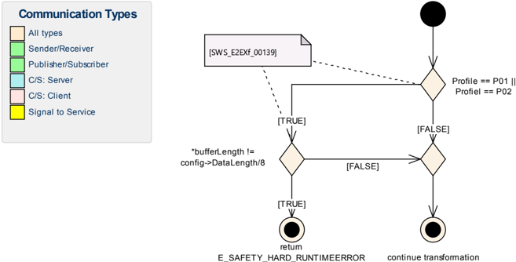

对于 **PXX = 01 或 02**，函数 **E2EXf_&lt;transformerId&gt;()** 应在计算 *bufferLength 之后对 *bufferLength 执行检查：如果 (*bufferLength != config-&gt;DataLength/8)，则该函数应返回 **E_SAFETY_HARD_RUNTIMEERROR**，即不调用 **E2E** 库函数。

如果 (((**PXX** = 01 && **dataIDMode** != **nibble**) || (**PXX** == 02) || (**PXX** = 11 && **dataIDMode** != **nibble**) || (**PXX** == 22)) && **BufferProperties.headerLength** == 16 [位])，则函数 **E2EXf_&lt;transformerId&gt;()** 应…（源文档此处截断）。

##### 6.7.2.4. E2EXf 处理缓冲区和报头

**E2E** 转换器可以配置为使用原地或异地缓冲区。下文描述了两种缓冲区处理方式及其对报头处理的影响。

如果 (**EndToEndTransformationDescription.upperHeaderBitsToShift** &gt; 0)，原地 **E2EXf_&lt;transformerId&gt;** 应在参数 **buffer** 中、以 **BufferProperties.headerLength** 为起始偏移，复制 **upperHeaderBitsToShift** 位…（源文档此处截断）。

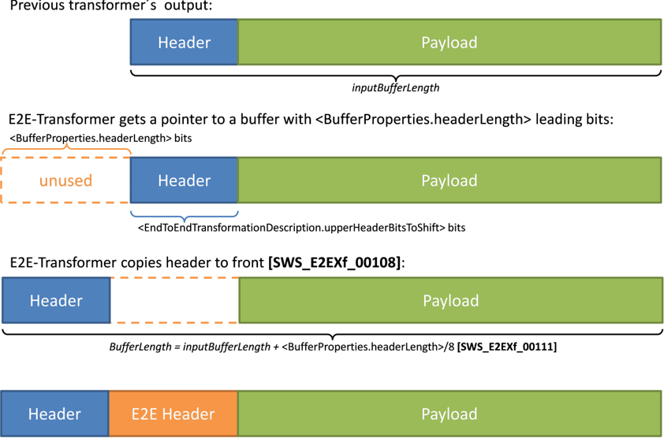

图7.6说明了 **API** 函数 **E2EXf_&lt;transformerId&gt;** 在原地（**In-Place**）情况下所做的缓冲区处理。

如果 (**EndToEndTransformationDescription.upperHeaderBitsToShift** &gt; 0)，异地 **E2EXf_&lt;transformerId&gt;** 应将 **inputBuffer** 的前 **upperHeaderBitsToShift** 位复制到 **buffer**，然后将 **inputBuffer** 的其余部分复制…（源文档此处截断）。

如果 (**EndToEndTransformationDescription.upperHeaderBitsToShift** == 0)，异地 **E2EXf_&lt;transformerId&gt;** 应从目的偏移量 **BufferProperties.headerLength** 开始将 **inputBuffer** 复制到 **buffer**。

##### 6.7.2.5. E2EXf_handling_specific_protection

特定保护根据不同的通信类型描述不同的活动（参见第[6](#6-功能规格)章的介绍）。

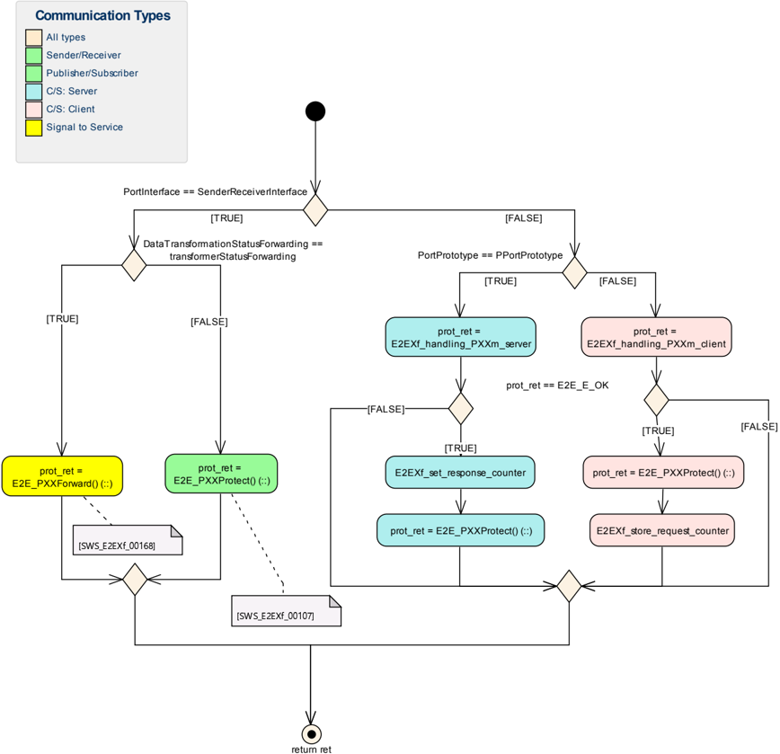

##### 6.7.2.6. E2EXf_store_request_counter

响应报文的报文计数器应与相应请求报文的计数器相同。因此，存储 **requestCounter** 并将其用作检查函数的输入。请求计数器按 profile 依赖的方式存储，如下图所示。

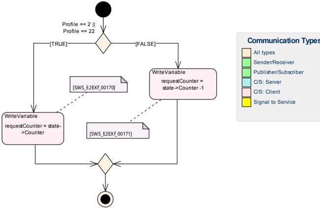

如果 **E2EXf_&lt;transformerId&gt;** 用于客户端侧的客户端-服务器通信且 Profile 为 **P02** 或 **P22**，则应将 **state-&gt;Counter** 存储为 **requestCounter**，以供 **E2EXf_Inv_&lt;transformerId&gt;** 在检查…（源文档此处截断）时访问。

如果 **E2EXf_&lt;transformerId&gt;** 用于客户端侧的客户端-服务器通信且 Profile 为 **P01**、**P04**、**P05**、**P06**、**P07**、**P08**、**P11**、**P44**、**P04m**、**P07m**、**P08m**、**P44m**，则应将 **state-&gt;Counter** -1 存储为 **requestCounter**，以供…（源文档此处截断）访问。

检查函数需要访问请求的计数值，以便将其与服务器的响应计数值进行比较。如果计数器不匹配，则服务器发生了错误。

##### 6.7.2.7. E2EXf_handling_PXXm（客户端）

**E2E** 转换器实现了对方法 profile **PXXm** 的特定处理，因为库函数需要附加的参数，因此提供了不同的 **API**。客户端侧 **PXXm** profile 的保护如下图所示。

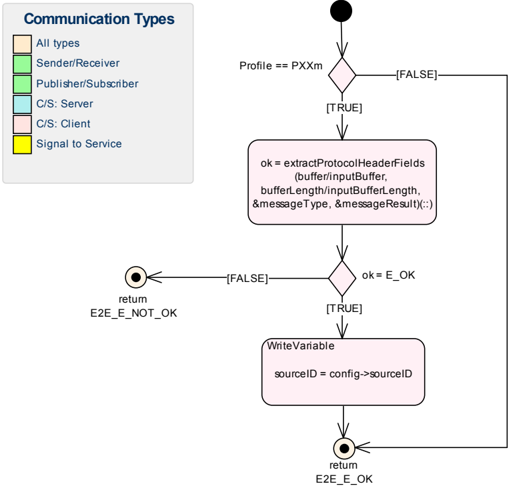

对于 profile **P04m**、**P07m**、**P08m** 和 **P44m**，客户端侧的原地 **E2EXf_&lt;transformerId&gt;** 应调用 **extractProtocolHeaderFields()** 函数，传递 **buffer**、**bufferLength**、本地 **messageType** 变量的地址以及…（源文档此处截断）。

对于 profile **P04m**、**P07m**、**P08m** 和 **P44m**，客户端侧的异地 **E2EXf_&lt;transformerId&gt;** 应调用 **extractProtocolHeaderFields()** 函数，传递 **inputBuffer**、**inputBufferLength**、名为…（源文档此处截断）的本地变量的地址。

如果 **extractProtocolHeaderFields()** 返回 **E_OK** 以外的值，**E2EXf_&lt;transformerId&gt;** 应返回 **E_SAFETY_HARD_RUNTIMEERROR**。

对于 profile **P04m**、**P07m**、**P08m** 和 **P44m**，客户端侧的原地和异地 **E2EXf_&lt;transformerId&gt;** 都应将本地变量 **sourceID** 设置为配置中存储的 **sourceID**（参见 [6.4.2](#642-每个e2e保护数据的配置和状态) 小节的相关需求）。

##### 6.7.2.8. E2EXf_handling_PXXm（服务器）

**E2E** 转换器实现了对方法 profile **PXXm** 的特定处理，因为库函数需要附加的参数，因此提供了不同的 **API**。服务器侧 **PXXm** profile 的保护如下图所示。

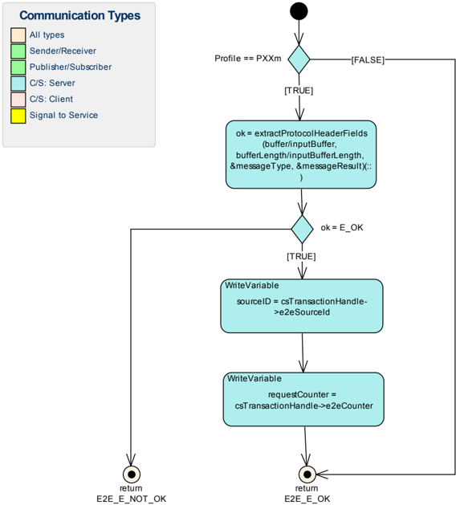

对于 profile **P04m**、**P07m**、**P08m** 和 **P44m**，服务器侧的原地 **E2EXf_&lt;transformerId&gt;** 应调用 **extractProtocolHeaderFields()** 函数，传递 **buffer**、**bufferLength**、本地 **messageType** 变量的地址以及…（源文档此处截断）。

对于 profile **P04m**、**P07m**、**P08m** 和 **P44m**，服务器侧的异地 **E2EXf_&lt;transformerId&gt;** 应调用 **extractProtocolHeaderFields()** 函数，传递 **inputBuffer**、**inputBufferLength**、本地 **messageType** 变…（源文档此处截断）的地址。

如果 **extractProtocolHeaderFields()** 返回 **E_OK** 以外的值，**E2EXf_&lt;transformerId&gt;** 应返回 **E_SAFETY_HARD_RUNTIMEERROR**。

对于 profile **P04m**、**P07m**、**P08m** 和 **P44m**，服务器侧的原地和异地 **E2EXf_&lt;transformerId&gt;** 都应将本地变量 **sourceID** 设置为 **csTransactionHandle** 的 **e2eSourceId** 元素的值。

对于 profile **P04m**、**P07m**、**P08m** 和 **P44m**，服务器侧的原地和异地 **E2EXf_&lt;transformerId&gt;** 都应将名为 **requestCounter** 的本地变量设置为 **csTransactionHandle** 的 **e2eCounter** 元素…（源文档此处截断）的值。

##### 6.7.2.9. E2EXf_set_response_counter

响应报文的报文计数器应与相应请求报文的计数器相同。因此，已存储的 **receivedRequestCounter** 被用作保护函数的输入。响应计数器按 profile 依赖的方式设置，如下图所示。

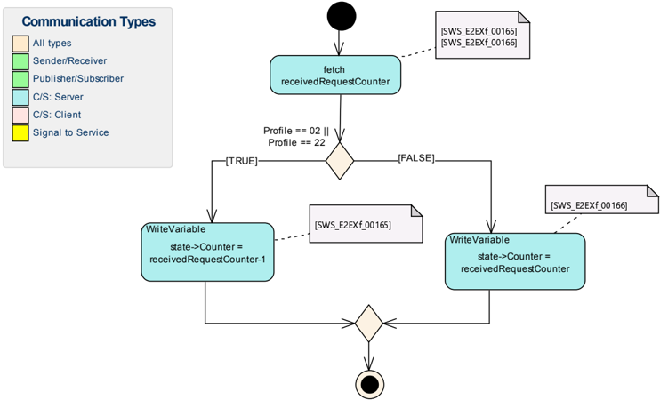

如果 **E2E** 转换器用于客户端-服务器通信中的响应且 Profile 为 **P02** 或 **P22**，则用于保护响应的序列计数器应设置为 **requestCounter** -1。

注意：对于 profile **P02** 和 **P22** 使用 **receivedRequestCounter**-1 的动机是，该 profile 的 **Protect()** 和 **Forward()** 函数在将计数器添加到报文/将其包含在 **CRC** 计算中之前会递增计数器。

如果 **E2E** 转换器用于客户端-服务器通信且 Profile 为 **P01**、**P04**、**P04m**、**P05**、**P06**、**P07**、**P07m**、**P08**、**P08m**、**P11**、**P44** 或 **P44m**，则用于保护响应的序列计数器应设置为 **requestCounter**。

对于不同于 **P04m**、**P07m**、**P08m** 和 **P44m** 的 profile，服务器侧的实现提示：在 **E2EXf** 调用内部访问相应 **E2EXf_Inv** 的 **E2E_PXXCheckStateType\* State**，以获取此客户端-服务器通信的最后一个 **requestCounter**；这仅在假设…（源文档此处截断）的条件下有效。

客户端侧的实现提示：**E2EXf_Inv** 可以通过访问 **E2EXf** 的 **E2E_PXXProtectStateType\* State** 读取保护函数的计数器。这仅在客户端发送客户端/服务器请求并等待服务器响应的情况下有效。如果不是，某些计数…（源文档此处截断）。

##### 6.7.2.10. E2EXf 数据转换

**E2E** 转换器实现了信号到服务翻译（或反之）的特定处理。**forwarding()** 函数替代 **protect()** 函数，在新的 **E2E** 保护报文中转发 **E2E** 检查的结果。

如果 **DataTransformationStatusForwarding** 设置为 **noTransformerStatusForwarding** 且 **PXX** 为 **P01**、**P02**、**P04**、**P05**、**P06**、**P07**、**P08**、**P11**、**P22** 或 **P44**，则函数 **E2EXf_&lt;transformerId&gt;()** 应调用 **E2E_PXXProtect()**，向其传递…（源文档此处截断）。

如果 **DataTransformationStatusForwarding** 设置为 **noTransformerStatusForwarding** 且 **PXX = P04m**、**P07m**、**P08m** 或 **P44m**，则函数 **E2EXf_&lt;transformerId&gt;()** 应调用 **E2E_PXXProtect()**，向该函数传递：

* 相应的 **Config** 结构（参见 [6.4.1](#641-e2e转换器的整体配置和状态) 小节的相关需求），
* 相应的 **State** 结构（参见 [6.4.2](#642-每个e2e保护数据的配置和状态) 小节的相关需求），
* 本地变量 **sourceID**、**messageType** 和 **messageResult**
* **buffer** + **EndToEndTransformationDescription.upperHeaderBitsToShift**
* **bufferLength** - **EndToEndTransformationDescription.upperHeaderBitsToShift**

其中 **buffer** 和 **bufferLength** 已按上述需求（参见 [6.7.2.4](#6724-e2exf-处理缓冲区和报头) 小节）更新。

注意：在这里修改缓冲区的开始和长度会使上层报头（例如由 **SOME/IP** 转换器添加的报头）从 **E2E_PXXProtect()** 中省略。

如果 **DataTransformationStatusForwarding** 设置为 **transformerStatusForwarding** 且 **PXX** 为 **P01**、**P02**、**P04**、**P05**、**P06**、**P07**、**P08**、**P11**、**P22** 或 **P44**，则函数 **E2EXf_&lt;transformerId&gt;()** 应调用 **E2E_PXXForward()**，向该函数传递…（源文档此处截断）。

此外，**E2E** 状态应基于 **RTE** 提供的参数 **forwardedCode** 传递给 **E2E_PXXForward()** 函数。此参数与来自 **Rte_Write**、**Rte_Send**、**Rte_…**（源文档此处截断）的可选 **IN** 参数 **forwardedCode** 相关联。

参数 **DataTransformationStatusForwarding** 按软件组件模板 [\[8\]](#ref-8) 中的定义设置。

如果 **DataTransformationStatusForwarding** 设置为 **transformerStatusForwarding** 且 **PXX = P04m**、**P07m**、**P08m** 或 **P44m**：函数 **E2EXf_&lt;transformerId&gt;()** 应调用 **E2E_PXXForward()**，向该函数传递：

* 相应的 **Config** 结构（参见 [6.4.1](#641-e2e转换器的整体配置和状态) 小节的相关需求），
* 相应的 **State** 结构（参见 [6.4.2](#642-每个e2e保护数据的配置和状态) 小节的相关需求），
* 本地变量 **sourceID**、**messageType** 和 **messageResult**
* **buffer** + **EndToEndTransformationDescription.upperHeaderBitsToShift**
* **bufferLength** - **EndToEndTransformationDescription.upperHeaderBitsToShift**

其中 **buffer** 和 **bufferLength** 已按上述需求（参见 [6.7.2.4](#6724-e2exf-处理缓冲区和报头) 小节）更新。

注意：在这里修改缓冲区的开始和长度会使上层报头（例如由 **SOME/IP** 转换器添加的报头）从 **E2E_PXXForward()** 中省略。

##### 6.7.2.11. E2EXf_MapCodeToStatus

函数 **E2EXf_MapCodeToStatus()** 将来自 **Rte_Write**、**Rte_Send**、**Rte_IWrite** 和 **Rte_IWriteRef** 的 **Std_TransformerForwardCode** 类型的 **forwardedCode** 映射到 **E2E_PCheckStatusType** 类型的通用检查状态。

| forwardedCode | CheckStatus |
| --- | --- |
| E_OK | E2E_P_OK |
| E_SAFETY_INVALID_REP | E2E_P_REPEATED |
| E_SAFETY_INVALID_SEQ | E2E_P_WRONGSEQUENCE |
| E_SAFETY_INVALID_CRC | E2E_P_ERROR |

#### 6.7.3. 转换器和E2E检查

**E2E** 转换器通过 **API** **E2EXf_&lt;transformerId&gt;**（检查函数）调用 **E2E** 库的 **check()** 函数。通过这种方式，配置数据和要 **E2E** 保护的数据被提供给 **E2E** 库函数。根据存在的通信类型，**E2EXf_Inv…**（源文档此处截断）的流程有所不同。

##### 6.7.3.1. E2EXf_Inv_&lt;transformerId&gt;（检查函数）

应为每个接收的 **E2E** 保护数据元素和每个受保护的 **C/S** 操作（&lt;transformerId&gt;）生成函数 **E2EXf_Inv_&lt;transformerId&gt;**。下图提供了 **E2EXf_Inv_&lt;transformerId&gt;** 所提供的功能的活动图。

以下小节提供了以下部分的详细信息：

* **E2EXf_Inv_input_checks**
* **E2EXf_Inv_handling_P01_P02**
* **E2EXf_Inv_handling_P01_P02_forceConstantMaxDeltaCounter**
* **E2EXf_Inv 处理通信类型**
* **E2EXf_Inv_handling_PXXm（客户端）**
* **E2EXf_Inv_handling_PXXm（服务器）**
* **E2EXf_Inv_set_check_counter**
* **E2EXf_Inv_store_request_counter**
* **E2EXf_Inv_handle_Statemachine**


##### 6.7.3.2. E2EXf_Inv_input_checks

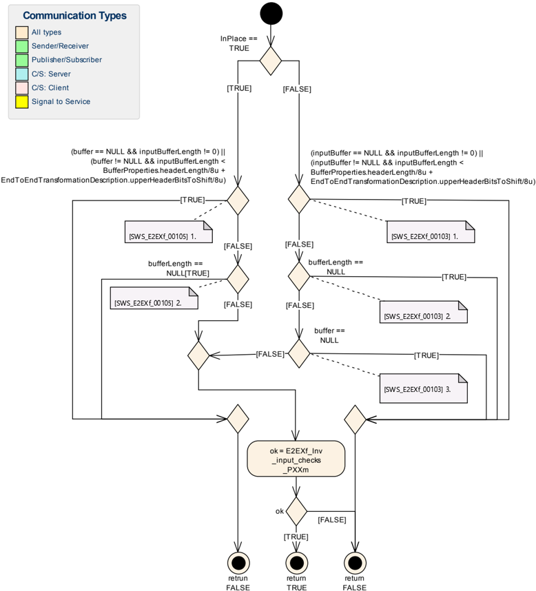

原地 **E2EXf_Inv_&lt;transformerId&gt;** 应执行以下两个前提条件检查，而不继续进一步处理：

1. (buffer == NULL && inputBufferLength != 0) || (buffer != NULL && inputBufferLength &lt; BufferProperties.headerLength/8u + EndToEndTransformationDescription.upperHeaderBitsToShift/8u)
2. bufferLength == NULL

如果上述任一条件为 **TRUE**，则该函数应返回 **E_SAFETY_HARD_RUNTIMEERROR**。

异地 **E2EXf_Inv_&lt;transformerId&gt;** 应执行以下三个前提条件检查，而不继续进一步处理：

1. (inputBuffer == NULL && inputBufferLength != 0) || (inputBuffer != NULL && inputBufferLength &lt; BufferProperties.headerLength/8u + EndToEndTransformationDescription.upperHeaderBitsToShift/8u)
2. 如果 (bufferLength == NULL)
3. 如果 (buffer == NULL)

如果上述任一条件为 **TRUE**，则该函数应返回 **E_SAFETY_HARD_RUNTIMEERROR**。

对于 profile **P04m**、**P07m**、**P08m** 和 **P44m**，原地和异地 **E2EXf_Inv_&lt;transformerId&gt;** 都应执行以下附加前提条件检查，而不继续进一步处理：

1. extractProtocolHeaderFields == NULL
2. csTransactionHandle == NULL

如果上述任一条件为 **TRUE**，则该函数应返回 **E_SAFETY_HARD_RUNTIMEERROR**。

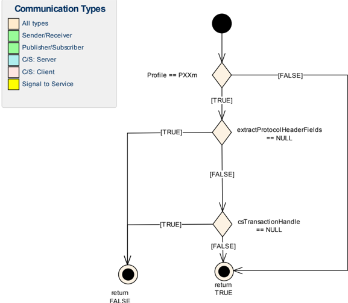

根据 **E2EXf** 关于缓冲区操作的配置（原地和异地），指向输出缓冲区的有效指针但长度参数过小，可能导致软错误或硬错误，具体取决于 **E2EXf** 配置和实际给定的长度。在这种情况下…（源文档此处截断）。

| 条件 | 返回值 | 描述 |
| --- | --- | --- |
| 指向输出缓冲区的有效指针，但缓冲区的长度太小而无法执行缓冲区操作。 | E_SAFETY_HARD_RUNTIMEERROR | 无法执行报头…（源文档此处截断） |
| **E2E** profile 1 或 2：指向输出缓冲区的有效指针且长度足以执行缓冲区操作，但缓冲区的大小与配置的数据长度不匹配。 | E_SAFETY_HARD_RUNTIMEERROR | **E2E** profile 1 和 2 是…（源文档此处截断） |
| 除 1 或 2 之外的所有 **E2E** profile：指向输出缓冲区的有效指针且大小足以执行缓冲区操作，但长度小于 **E2E** profile 配置。 | E_SAFETY_VALID_ERR、E_SAFETY_NODATA_ERR、E_SAFETY_INIT_ERR、E_SAFETY_INVALID_ERR | 取决于内部…（源文档此处截断） |

注意，函数 **E2EXf_Inv_&lt;transformerId&gt;** 可以由普通函数、内联函数或宏实现（取决于实现）。

对于 **PXX = 01 或 02**（即 profile 1 和 2），异地函数 **E2EXf_Inv_&lt;transformerId&gt;** 应：

1. 如果 (inputBuffer == NULL 且 inputBufferLength == 0)，则与 &lt;transformerId&gt; 关联的 **E2E_PXXCheckStateType** 类型状态对象（参见 [6.4.1](#641-e2e转换器的整体配置和状态) 小节的相关需求）的变量 **NewDataAvailable** 应设置为 **FALSE**。
2. 否则如果 (inputBufferLength == config-&gt;DataLength/8)，则与 &lt;transformerId&gt; 关联的 **E2E_PXXCheckStateType** 类型状态对象的变量 **NewDataAvailable** 应设置为 **TRUE**。
3. 否则返回 **E_SAFETY_HARD_RUNTIMEERROR**。

对于 **PXX = 01 或 02**（即 profile 1 和 2），异地函数 **E2EXf_Inv_&lt;transformerId&gt;** 应调用 **E2E_PXXCheck()**，向其传递：**Config**、**State**、**Data**。关于指向 **Data** 的指针：如果 (inputBuffer == NULL 且 inputBufferLength == 0)，则应传递指向 **E2E** 转换器的 1 字节变量的指针，否则应传递 **inputBuffer**。

对于 **PXX = 01 或 02**（即 profile 1 和 2），原地函数 **E2EXf_Inv_&lt;transformerId&gt;** 应：

1. 如果 (buffer == NULL 且 inputBufferLength == 0)，则与 &lt;transformerId&gt; 关联的 **E2E_PXXCheckStateType** 类型状态对象（参见 [6.4.1](#641-e2e转换器的整体配置和状态) 小节的相关需求）的变量 **NewDataAvailable** 应设置为 **FALSE**。
2. 否则如果 (inputBufferLength == config-&gt;DataLength/8)，则与 &lt;transformerId&gt; 关联的 **E2E_PXXCheckStateType** 类型状态对象的变量 **NewDataAvailable** 应设置为 **TRUE**。
3. 否则返回 **E_SAFETY_HARD_RUNTIMEERROR**。

##### 6.7.3.3. E2EXf_Inv_handling_P01_P02

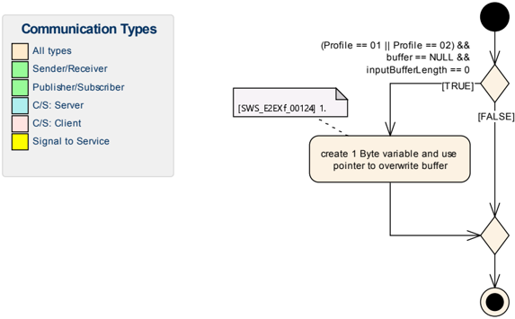

对于 **PXX = 01 或 02**（即 profile 1 和 2），原地函数 **E2EXf_Inv_&lt;transformerId&gt;** 应调用 **E2E_PXXCheck()**，向其传递：**Config**、**State**、**Data**。关于指向 **Data** 的指针：如果 (buffer == NULL 且 inputBufferLength == 0)，则应传递指向 **E2E** 转换器的 1 字节变量的指针，否则应传递 **buffer**。

##### 6.7.3.4. E2EXf_Inv_handling_P01_P02_forceConstantMaxDeltaCounter

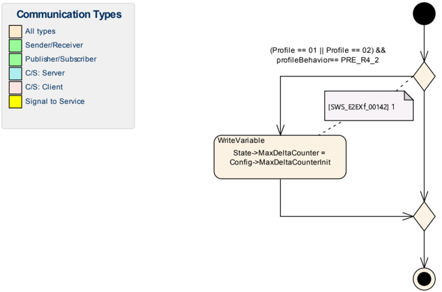

##### 6.7.3.5. E2EXf_Inv_handling_main_check

特定检查根据不同的通信类型描述不同的活动（参见第[6](#6-功能规格)章的介绍）。

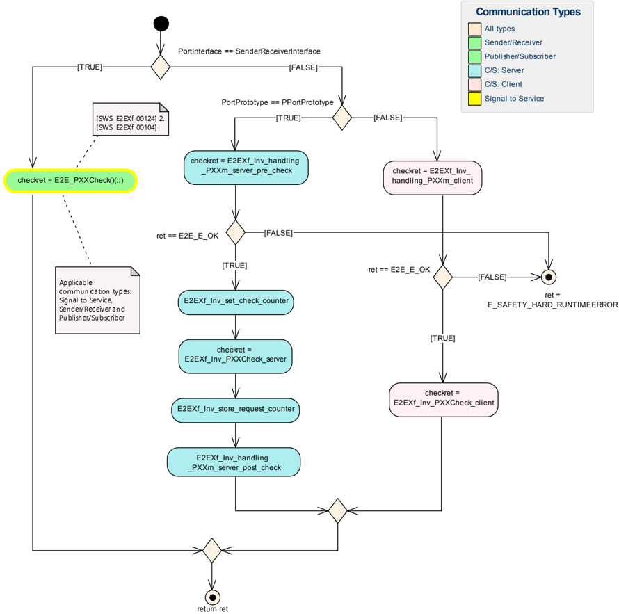

##### 6.7.3.6. E2EXf_Inv_handling_PXXm

对于 profile **P04m**、**P07m**、**P08m** 和 **P44m**，客户端侧的原地 **E2EXf_Inv_&lt;transformerId&gt;** 应调用 **extractProtocolHeaderFields()** 函数，传递 **buffer**、**bufferLength**、本地 **messageType** 变量的地址…（源文档此处截断）。

对于 profile **P04m**、**P07m**、**P08m** 和 **P44m**，客户端侧的异地 **E2EXf_Inv_&lt;transformerId&gt;** 应调用 **extractProtocolHeaderFields()** 函数，传递 **inputBuffer**、**inputBufferLength**、本地变量…（源文档此处截断）的地址。

对于 profile **P04m**、**P07m**、**P08m** 和 **P44m**，客户端侧的原地和异地 **E2EXf_Inv_&lt;transformerId&gt;** 都应将本地变量 **sourceID** 设置为配置中存储的 **sourceID**（参见 [6.4.2](#642-每个e2e保护数据的配置和状态) 小节的相关需求）。

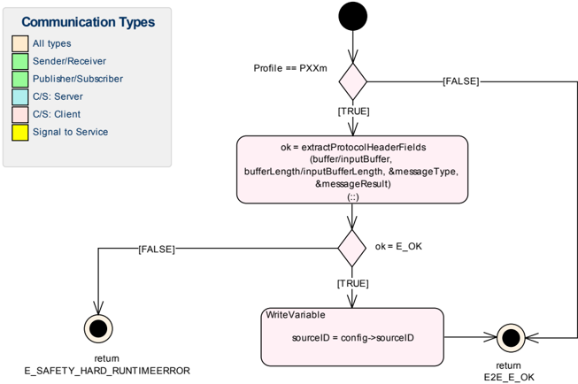

对于 profile **P04m**、**P07m**、**P08m** 和 **P44m**，服务器侧的原地 **E2EXf_Inv_&lt;transformerId&gt;** 应调用 **extractProtocolHeaderFields()** 函数，传递 **buffer**、**bufferLength**、本地 **messageType** 变量的地址…（源文档此处截断）。

对于 profile **P04m**、**P07m**、**P08m** 和 **P44m**，服务器侧的异地 **E2EXf_Inv_&lt;transformerId&gt;** 应调用 **extractProtocolHeaderFields()** 函数，传递 **inputBuffer**、**inputBufferLength**、本地 **messageT…**（源文档此处截断）变量的地址。

如果 **extractProtocolHeaderFields()** 返回 **E_OK** 以外的值，**E2EXf_Inv_&lt;transformerId&gt;** 应返回 **E_SAFETY_HARD_RUNTIMEERROR**。

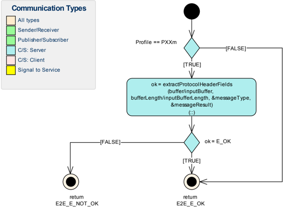

对于 **PXX = P04m**、**P07m**、**P08m** 和 **P44m**：客户端侧的函数 **E2EXf_Inv_&lt;transformerId&gt;** 应调用 **E2E_PXXSourceCheck()**，向该函数传递：

* **config**、**state**
* 本地变量 **messageType**、**messageResult** 以及本地变量 **sourceID**
* 数据长度：**inputBufferLength** - **EndToEndTransformationDescription.upperHeaderBitsToShift**
* 指向数据的指针：**inputBuffer** + **EndToEndTransformationDescription.upperHeaderBitsToShift**（异地版本）或 **buffer** + **EndToEndTransformationDescription.upperHeaderBitsToShift**（原地版本）。

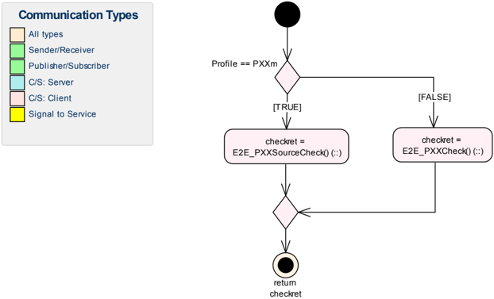

对于 **PXX = P04m**、**P07m**、**P08m** 和 **P44m**：服务器侧的函数 **E2EXf_Inv_&lt;transformerId&gt;** 应调用 **E2E_PXXSinkCheck()**，向该函数传递：

* **config**、**state**
* 本地变量 **messageType**、**messageResult** 以及本地变量 **sourceID** 的地址
* 数据长度：**inputBufferLength** - **EndToEndTransformationDescription.upperHeaderBitsToShift**
* 指向数据的指针：**inputBuffer** + **EndToEndTransformationDescription.upperHeaderBitsToShift**（异地版本）或 **buffer** + **EndToEndTransformationDescription.upperHeaderBitsToShift**（原地版本）。

注意：在这里修改 **inputBuffer**/**buffer** 的开始和长度会使上层报头（例如由 **SOME/IP** 转换器添加的报头）从 **E2E_PXXSource**/**SinkCheck()** 中省略。

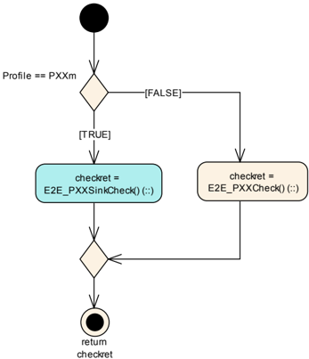

对于 profile **P04m**、**P07m**、**P08m** 和 **P44m**，服务器侧的原地和异地 **E2EXf_Inv_&lt;transformerId&gt;** 都应将 **csTransactionHandle** 的 **e2eSourceId** 元素设置为本地变量 **sourceID** 的值。

对于 profile **P04m**、**P07m**、**P08m** 和 **P44m**，服务器侧的原地和异地 **E2EXf_Inv_&lt;transformerId&gt;** 都应将 **csTransactionHandle** 的 **e2eCounter** 元素设置为本地变量 **receivedReque…**（源文档此处截断）的值。

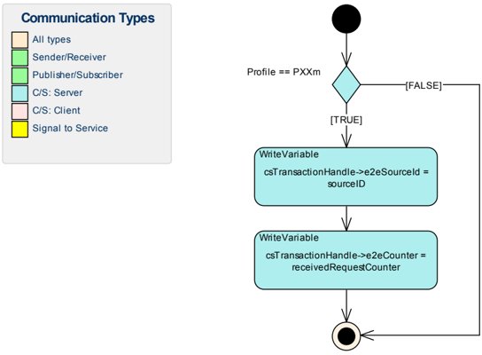

##### 6.7.3.7. E2EXf_Inv_set_check_counter

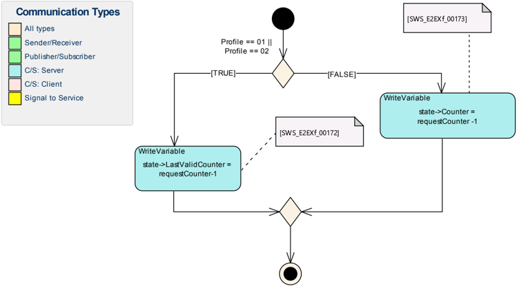

在客户端侧的客户端/服务器通信情况下，如果 Profile 为 **P01** 或 **P02**，**E2EXf_Inv_&lt;transformerId&gt;** 的 **state-&gt;LastValidCounter** 应设置为 **requestCounter**-1。

在客户端侧的客户端/服务器通信情况下，如果 Profile 为 **P04**、**P05**、**P06**、**P07**、**P08**、**P11**、**P22** 或 **P44**、**P04m**、**P07m**、**P08m**、**P44m**，**E2EXf_Inv_&lt;transformerId&gt;** 的 **state-&gt;Counter** 应设置为 **requestCounter**-1。

##### 6.7.3.8. E2EXf_Inv_store_request_counter

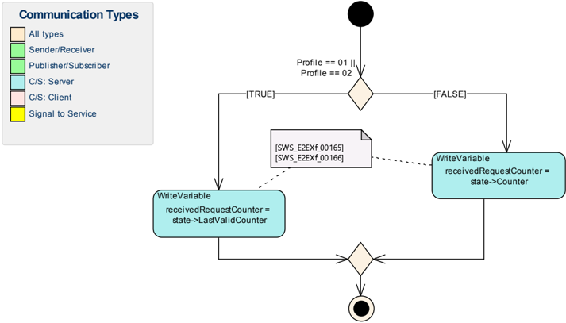

在客户端侧的客户端/服务器通信情况下，如果 Profile 为 **P01** 或 **P02**，**receivedRequestCounter** 应设置为 **E2EXf_Inv_&lt;transformerId&gt;** 的 **state&gt;LastValidCounter**。

在客户端侧的客户端/服务器通信情况下，如果 Profile 为 **P04**、**P05**、**P06**、**P07**、**P08**、**P11**、**P22**、**P44**、**P04m**、**P07m**、**P08m** 或 **P44m**，**receivedRequestCounter** 应设置为 **E2EXf_Inv_&lt;transformerId&gt;** 的 **state-&gt;Counter**。

这是需求（参见 [6.7.2.9](#6729-e2exf_set_response_counter) 小节）的对应部分。

##### 6.7.3.9. E2EXf_Inv_handle_Statemachine

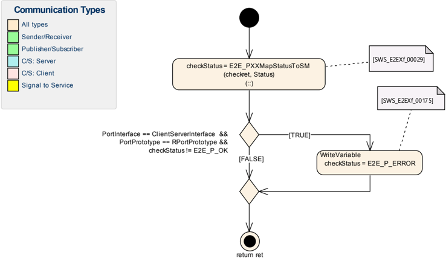

函数 **E2EXf_Inv_&lt;transformerId&gt;** 应调用 **E2E_PXXMapStatusToSM()**，向其传递 **E2E_PXXCheck** 的返回值和该 profile 的检查状态（**E2E_PXXCheckStateType** 类型状态对象的变量 **Status**…（源文档此处截断））：

* 如果配置参数 **profileBehavior** 为 **R4_2**，则应以调用参数 **profileBehavior** = 1 调用 **E2E_PXXMapStatusToSM()**
* 如果配置参数 **profileBehavior** 为 **PRE_R4_2**，则应以调用参数 **profileBehavior** = 0 调用 **E2E_PXXMapStatusToSM()**

如果 **disableEndToEndStateMachine** 等于 **FALSE**，函数 **E2EXf_Inv_&lt;transformerId&gt;** 应调用 **E2E_SMCheck()** 函数。它应向 **E2E_SMCheck()** 传递 **E2E_SMConfigType** 类型的配置对象（参见 [6.4.2](#642-每个e2e保护数据的配置和状态) 小节的相关需求…（源文档此处截断））。

如果 **disableEndToEndStateMachine** 为 **TRUE**：

* 函数 **E2EXf_Inv_&lt;transformerId&gt;** 返回值的高半字节应设置为 0x6。
* 函数 **E2EXf_Inv_&lt;transformerId&gt;** 返回值的低半字节应设置为 **E2E_PCheckStatusType** 类型的 profile 无关检查状态的高半字节…（源文档此处截断）。

如果 **E2E_SMCheck()** 返回 **E2E_E_OK** 且 **disableEndToEndStateMachine** 为 **FALSE**，则：

* 函数 **E2EXf_Inv_&lt;transformerId&gt;** 返回值的高半字节应设置为状态机状态的高半字节（与 &lt;transformerId&gt; 关联的 **E2E_SMStateType** 类型对象的成员 **SMState**，参见 [6.4.1](#641-e2e转换器的整体配置和状态) 小节的相关需求）。
* 函数 **E2EXf_Inv_&lt;transformerId&gt;** 返回值的低半字节应设置为 **E2E_PCheckStatusType** 类型的 profile 无关检查状态的低半字节。

如果 **E2E_SMCheck()** 未返回 **E2E_E_OK**，则返回值应为 **E_SAFETY_SOFT_RUNTIMEERROR**。

如果 (buffer != NULL && **EndToEndTransformationDescription.upperHeaderBitsToShift** &gt; 0)，原地 **E2EXf_Inv_&lt;transformerId&gt;** 应将参数 **buffer** 中的前 **upperHeaderBitsToShift** 位按「距离」…（源文档此处截断）向右复制。

如果 (inputBuffer != NULL && **EndToEndTransformationDescription.upperHeaderBitsToShift** &gt; 0)，异地 **E2EXf_Inv_&lt;transformerId&gt;** 应将 **inputBuffer** 的前 **upperHeaderBitsToShift** 位复制到 **buffer**，然后复制…（源文档此处截断）。

如果 (inputBuffer != NULL && **EndToEndTransformationDescription.upperHeaderBitsToShift** == 0)，异地 **E2EXf_Inv_&lt;transformerId&gt;** 应将从 **BufferProperties.headerLength** 偏移开始的 **inputBuffer** 复制到 **buffer**。

如果 **inputBufferLength** == 0，则 **E2EXf_Inv_&lt;transformerId&gt;** 应设置 *bufferLength = 0，否则应设置 *bufferLength = **inputBufferLength** - **BufferProperties.headerLength**/8。

**inputBufferLength** &gt; 0 但短于报头的情况由 [6.7.3.2](#6732-e2exf_inv_input_checks) 小节的相关需求涵盖。

在服务器侧的客户端/服务器通信情况下，如果返回值 **ret** 等于 **E_SAFETY_\*_ERR**，则该值应被覆盖为 **E_E2E_HARD_SAFETY_ERR**。

将 **E_SAFETY_\*_ERR** 错误处理为硬错误会产生一个 **TransformerHardErrorEvent**。此事件的预期用途是通知被调用的 **SWC**：服务器-客户端调用失败，可能需要执行一些错误处理。可以通过…（源文档此处截断）创建错误响应。

在客户端侧的客户端/服务器通信情况下，如果 **E2E_PXXCheck** 函数返回 **E2E_P_OK** 以外的值，则状态应设置为 **E2E_P_ERROR**。

#### 6.7.4. 反初始化

**[E2EXf_DeInit](#734-e2exf_deinit)()** 应将模块初始化状态设置为 **FALSE**。

### 6.8. 错误分类

#### 6.8.1. 开发错误

**E2E** 转换器应能够检测以下开发错误：

| 错误类型 | 相关错误码 | 错误值 |
| --- | --- | --- |
| 在转换器模块用 **Init** 初始化之前或在调用 **DeInit** 之后调用除 **GetVersionInfo** 之外的任何其他 **API** 服务的错误码 | E2EXF_E_UNINIT | 0x01 |
| 选择了无效配置集的错误码 | E2EXF_E_INIT_FAILED | 0x02 |
| 使用错误的参数调用API服务 | E2EXF_E_PARAM | 0x03 |
| 使用无效的指针调用API服务 | E2EXF_E_PARAM_POINTER | 0x04 |

如果 **XfrmDevErrorDetect** 开关已启用且配置变体为 **VARIANT-POST-BUILD**，函数 [**E2EXf_Init**](#733-e2exf_init) 应检查是否为 **ConfigPtr** 参数传递了 **NULL** 指针。在这种情况下，函数的其余部分不应被…（源文档此处截断）。

如果 **XfrmDevErrorDetect** 开关已启用且配置变体为 **VARIANT-POST-BUILD**，函数 [**E2EXf_Init**](#733-e2exf_init) 应检查给定配置集的内容是否在允许的边界内。如果函数 **E2EXf…**（源文档此处截断）。

如果配置参数 **XfrmDevErrorDetect** 已启用，函数 [**E2EXf_DeInit**](#734-e2exf_deinit) 应检查 **E2E** 转换器是否已初始化。如果未初始化，函数 [**E2EXf_DeInit**](#734-e2exf_deinit) 应无任何效果地返回，并应报告…（源文档此处截断）错误。

如果 **XfrmDevErrorDetect** 开关已启用，函数 [**E2EXf_GetVersionInfo**](#735-e2exf_getversioninfo) 应检查是否为 **VersionInfo** 参数传递了 **NULL** 指针。在发生错误的情况下，函数 [**E2EXf_GetVersionInfo**](#735-e2exf_getversioninfo) 的其余部分不应被执行…（源文档此处截断）。

如果配置参数 **XfrmDevErrorDetect** 已启用，**API** **E2EXf_&lt;transformerId&gt;**（参见 [7.3.1](#731-e2exf_lttransformeridgt) 小节）的所有参数都应检查是否在允许的范围内。发生错误时，模式开关不应被…（源文档此处截断）。

如果配置参数 **XfrmDevErrorDetect** 已启用，**API** **E2EXf_&lt;transformerId&gt;**（参见 [7.3.1](#731-e2exf_lttransformeridgt) 小节）应检查 **E2E** 转换器是否已初始化。发生错误时，应报告错误码 **E2EXF_E_UNINIT**…（源文档此处截断）。

如果配置参数 **XfrmDevErrorDetect** 已启用，**API** **E2EXf_Inv_&lt;transformerId&gt;**（参见 [7.3.2](#732-e2exf_inv_lttransformeridgt) 小节）的所有参数都应检查是否在允许的范围内。发生错误时，模式开关不应被…（源文档此处截断）。

如果配置参数 **XfrmDevErrorDetect** 已启用，**API** **E2EXf_Inv_&lt;transformerId&gt;**（参见 [7.3.2](#732-e2exf_inv_lttransformeridgt) 小节）应检查 **E2E** 转换器是否已初始化。发生错误时，不应执行该例程，错误…（源文档此处截断）。

#### 6.8.2. 运行时错误

**E2EXf_&lt;transformerId&gt;** 函数检测到的运行时错误应作为返回值报告给调用者（即 **RTE**）。

**E2EXf_Inv_&lt;transformerId&gt;** 函数检测到的运行时错误以及受保护的 **E2E** 通信中的错误应作为返回值报告给调用者（即 **RTE**）。

注意：如果其中一个转换器中存在硬错误，则应中止转换器链。第一个硬错误应传递给服务器应用程序。如果至少存在一个软错误，则第一个软错误应传递给应用程序。

#### 6.8.3. 瞬态故障

**E2E** 转换器不报告瞬态故障。

#### 6.8.4. 生产错误

**E2E** 转换器不向 **DEM** 报告生产错误，因为错误信息被同步返回给调用者（**RTE**），然后转发给调用的软件组件。

#### 6.8.5. 扩展生产错误

**E2E** 转换器有效的所有扩展生产错误都在 [2, **General Specification of Transformers**] 中规定。

对于 **E2E** 转换器，需求（**XFRM_E_MALFORMED_MESSAGE**）不适用。

## 7. API规范

### 7.1. 导入的类型

在本章中，列出了从以下模块包含的所有类型：

| 模块 | 头文件 | 导入的类型 |
| --- | --- | --- |
| E2E | E2E.h | E2E_P01CheckStateType |
| E2E | E2E.h | E2E_P01CheckStatusType |
| E2E | E2E.h | E2E_P01ConfigType |
| E2E | E2E.h | E2E_P01DataIDMode |
| E2E | E2E.h | E2E_P01ProtectStateType |
| E2E | E2E.h | E2E_P02CheckStateType |
| E2E | E2E.h | E2E_P02CheckStatusType |
| E2E | E2E.h | E2E_P02ConfigType |
| E2E | E2E.h | E2E_P02ProtectStateType |
| E2E | E2E.h | E2E_P04CheckStateType |
| E2E | E2E.h | E2E_P04CheckStatusType |
| E2E | E2E.h | E2E_P04ConfigType |
| E2E | E2E.h | E2E_P04ProtectStateType |
| E2E | E2E.h | E2E_P04mCheckStateType |
| E2E | E2E.h | E2E_P04mCheckStatusType |
| E2E | E2E.h | E2E_P04mConfigType |
| E2E | E2E.h | E2E_P04mProtectStateType |
| E2E | E2E.h | E2E_P05CheckStateType |
| E2E | E2E.h | E2E_P05CheckStatusType |
| E2E | E2E.h | E2E_P05ConfigType |
| E2E | E2E.h | E2E_P05ProtectStateType |
| E2E | E2E.h | E2E_P06CheckStateType |
| E2E | E2E.h | E2E_P06CheckStatusType |
| E2E | E2E.h | E2E_P06ConfigType |
| E2E | E2E.h | E2E_P06ProtectStateType |
| E2E | E2E.h | E2E_P07CheckStateType |
| E2E | E2E.h | E2E_P07CheckStatusType |
| E2E | E2E.h | E2E_P07ConfigType |
| E2E | E2E.h | E2E_P07ProtectStateType |
| E2E | E2E.h | E2E_P07mCheckStateType |
| E2E | E2E.h | E2E_P07mCheckStatusType |
| E2E | E2E.h | E2E_P07mConfigType |
| E2E | E2E.h | E2E_P07mProtectStateType |
| E2E | E2E.h | E2E_P08CheckStateType |
| E2E | E2E.h | E2E_P08CheckStatusType |
| E2E | E2E.h | E2E_P08ConfigType |
| E2E | E2E.h | E2E_P08ProtectStateType |
| E2E | E2E.h | E2E_P08mCheckStateType |
| E2E | E2E.h | E2E_P08mCheckStatusType |
| E2E | E2E.h | E2E_P08mConfigType |
| E2E | E2E.h | E2E_P08mProtectStateType |
| E2E | E2E.h | E2E_P11CheckStateType |
| E2E | E2E.h | E2E_P11CheckStatusType |
| E2E | E2E.h | E2E_P11ConfigType |
| E2E | E2E.h | E2E_P11DataIDMode |
| E2E | E2E.h | E2E_P11ProtectStateType |
| E2E | E2E.h | E2E_P22CheckStateType |
| E2E | E2E.h | E2E_P22CheckStatusType |
| E2E | E2E.h | E2E_P22ConfigType |
| E2E | E2E.h | E2E_P22ProtectStateType |
| E2E | E2E.h | E2E_P44CheckStateType |
| E2E | E2E.h | E2E_P44CheckStatusType |
| E2E | E2E.h | E2E_P44ConfigType |
| E2E | E2E.h | E2E_P44ProtectStateType |
| E2E | E2E.h | E2E_P44mCheckStateType |
| E2E | E2E.h | E2E_P44mCheckStatusType |
| E2E | E2E.h | E2E_P44mConfigType |
| E2E | E2E.h | E2E_P44mProtectStateType |
| E2E | E2E.h | E2E_PCheckStatusType |
| E2E | E2E.h | E2E_SMCheckStateType |
| E2E | E2E.h | E2E_SMConfigType |
| E2E | E2E.h | E2E_SMStateType |
| Std | Std_Types.h | Std_ExtractProtocolHeaderFieldsType |
| Std | Std_Types.h | Std_MessageResultType |
| Std | Std_Types.h | Std_MessageTypeType |
| Std | Std_Types.h | Std_ReturnType |
| Std | Std_Types.h | Std_TransformerForwardCode（draft） |
| Std | Std_Types.h | Std_VersionInfoType |

### 7.2. 类型定义

#### 7.2.1. E2EXf_ConfigType

结构类型（**Structure**），元素为实现特定（**implementation specific**），类型为 -。**E2E** 转换器配置的父容器。其内容是特定于实现的。可通过**E2EXf.h**获得。

#### 7.2.2. E2EXf_CSTransactionHandleType

结构类型（**Structure**），包含以下元素：**e2eCounter**（类型 **uint32**）：**E2E** 计数器；**e2eSourceId**（类型 **uint32**）：**E2E** 源 **ID**。**C/S** 方法调用的事务句柄。用于在服务器侧通过 **RTE** 将 **E2E** 源 **ID** 和 **E2E** 计数器从请求传递（**tunnel**）到响应。可通过**E2EXf.h**获得。

### 7.3. 函数定义

#### 7.3.1. E2EXf_&lt;transformerId&gt;

**说明**: 使用原地转换保护要发送的数组/缓冲区。本服务为同步调用，不可重入。参数 forwardedCode（in）：…（源文档此处截断）。参数 extractProtocolHeaderFields（in）：…（源文档此处截断）。参数 csTransactionHandle（in）：…（源文档此处截断）。参数 inputBuffer（in）：…（源文档此处截断）。参数 inputBufferLength（in）：…（源文档此处截断）。参数 buffer（inout）：…（源文档此处截断）。参数 bufferLength（out）：…（源文档此处截断）。返回值 **uint8**：**0x00**（**E_OK**）：函数执行成功；**0xFF**（**E_SAFETY_HARD_RUNTIMEERROR**）：发生运行时错误，无法检查安全属性且无法产生输出数据…（源文档此处截断）。可通过**E2EXf.h**获得。

```C
uint8 E2EXf_<transformerId> ( [Std_TransformerForwardCode forwardedCode], [Std_ExtractProtocolHeaderFieldsType extractProtocolHeaderFields], [const E2EXf_CSTransactionHandleType* csTransactionHandle], uint8* buffer, uint32* bufferLength, [const uint8* inputBuffer], uint32 inputBufferLength )
```

**E2EXf_&lt;transformerId&gt;** 的返回码在 **TransformerTypes** 中规定，参见 **ASWS Transformer General**。

#### 7.3.2. E2EXf_Inv_&lt;transformerId&gt;

**说明**: 检查接收到的数据。如果调用者可以使用该数据，则函数返回 **E_OK**。本服务为同步调用，不可重入。参数 extractProtocolHeaderFields（in）：可选参…（源文档此处截断）。参数 inputBuffer（in）：此参数…（源文档此处截断）。参数 inputBufferLength（in）：此参数…（源文档此处截断）。参数 buffer（inout）：此参数…（源文档此处截断）。参数 csTransactionHandle（out）：指向 **C/S** 方法调用的 **E2E** 事务句柄的可选指针。用于将相关信息（**E2E** 源 **ID** 和 **E2E** 计数器）从请求…（源文档此处截断）。参数 bufferLength（out）：输出缓冲区的已用长度。返回值 **uint8**：如果 **disableEndToEndStateMachine** 等于 **FALSE**，则高半字节表示 **E2E** 状态机的状态。如果 **E2E** 状…（源文档此处截断）。可通过**E2EXf.h**获得。

```C
uint8 E2EXf_Inv_<transformerId> ( [Std_ExtractProtocolHeaderFieldsType extractProtocolHeaderFields], [E2EXf_CSTransactionHandleType* csTransactionHandle], uint8* buffer, uint32* bufferLength, [const uint8* inputBuffer], uint32 inputBufferLength )
```

**E2EXf_Inv_&lt;transformerId&gt;** 的返回码在 **TransformerTypes** 中规定，参见 **ASWS Transformer General**。

在状态机被禁用的情况下：如果 **E2E_PXXMapStatusToSM**（在 **E2E_PXXCheck()** 调用之后）返回 **E2E_P_OK**，则函数返回 **E_SAFETY_NOSM_OK**。从技术上讲，**E_SAFETY_NOSM_OK** 被实现为一种特定的软错误（值介于 0x01 和 0x7F 之间）。应用程序应…（源文档此处截断）。

#### 7.3.3. E2EXf_Init

**说明**: 初始化 **E2E** 转换器的状态。其主要部分是 **E2E** 库状态结构的初始化，通过调用 **E2E** 库的所有初始化函数来完成。本服务为同步调用，可重入。参数 config（in）：指向所选配置结构的指针，在构建后选择…（源文档此处截断）。该服务无返回值。可通过**E2EXf.h**获得。

```C
void E2EXf_Init ( const E2EXf_ConfigType* config )
```

#### 7.3.4. E2EXf_DeInit

**说明**: 本服务为同步调用，可重入。该服务无参数。该服务无返回值。可通过**E2EXf.h**获得。

```C
void E2EXf_DeInit ( void )
```

#### 7.3.5. E2EXf_GetVersionInfo

**说明**: 此服务为同步调用，可重入。参数 VersionInfo（out）：指向存储本模块版本信息的位置的指针。该服务无返回值。可通过**E2EXf.h**获得。

```C
void E2EXf_GetVersionInfo ( Std_VersionInfoType* VersionInfo )
```

### 7.4. 回调通知

**E2E** 转换器没有回调通知。

### 7.5. 调度函数

**E2E** 转换器没有调度函数。

### 7.6. 期望接口

#### 7.6.1. 强制接口

本章定义了实现模块核心功能所要求的全部外部接口。

| API 函数 | 头文件 | 描述 |
| --- | --- | --- |
| E2E_P01Check | E2E.h | 使用 **E2E** profile 1 检查接收到的数据。这包括 **CRC** 计算、计数器和 **Data ID** 的处理。 |
| E2E_P01CheckInit | E2E.h | 初始化检查状态。 |
| E2E_P01Forward | E2E.h | 使用 **E2E** profile 01 保护被转发的数据。这包括校验和计算、计数器和 **Data ID** 的处理。接收到的报文的检测到的错误将在输出数据上重建。 |
| E2E_P01MapStatusToSM | E2E.h | 该函数将 profile 1 的检查状态映射到可被 **E2E** 状态机检查函数使用的通用检查状态。**E2E** profile 1 提供更细粒度的状态，但这与 **E2E** 状态机无关。 |
| E2E_P01Protect | E2E.h | 使用 **E2E** profile 1 保护要发送的数组/缓冲区。这包括校验和计算、计数器和 **Data ID** 的处理。 |
| E2E_P01ProtectInit | E2E.h | 初始化保护状态。 |
| E2E_P02Check | E2E.h | 使用 **E2E** profile 2 检查数组/缓冲区。这包括校验和计算、序列计数器和 **Data ID** 的处理。 |
| E2E_P02CheckInit | E2E.h | 初始化检查状态。 |
| E2E_P02Forward | E2E.h | 使用 **E2E** profile 02 保护被转发的数据。这包括校验和计算、计数器和 **Data ID** 的处理。接收到的报文的检测到的错误将在输出数据上重建。 |
| E2E_P02MapStatusToSM | E2E.h | 该函数将 profile 2 的检查状态映射到可被 **E2E** 状态机检查函数使用的通用检查状态。**E2E** profile 2 提供更细粒度的状态，但这与 **E2E** 状态机无关。 |
| E2E_P02Protect | E2E.h | 使用 **E2E** profile 2 保护要发送的数组/缓冲区。这包括校验和计算、序列计数器和 **Data ID** 的处理。 |
| E2E_P02ProtectInit | E2E.h | 初始化保护状态。 |
| E2E_P04Check | E2E.h | 使用 **E2E** profile 4 检查接收到的数据。这包括 **CRC** 计算、计数器和 **Data ID** 的处理。该函数在一个周期内只检查单个数据，不确定/计算通信链路的累积状态…（源文档此处截断）。 |
| E2E_P04CheckInit | E2E.h | 初始化检查状态。 |
| E2E_P04Forward | E2E.h | 使用 **E2E** profile 04 保护被转发的数据。这包括校验和计算、计数器和 **Data ID** 的处理。接收到的报文的检测到的错误将在输出数据上重建。 |
| E2E_P04MapStatusToSM | E2E.h | 该函数将 profile 4 的检查状态映射到可被 **E2E** 状态机检查函数使用的通用检查状态。**E2E** profile 4 提供更细粒度的状态，但这与 **E2E** 状态机无关。 |
| E2E_P04mCheckInit | E2E.h | 初始化检查状态。 |
| E2E_P04mForward | E2E.h | 使用 **E2E** profile 4m 保护被转发的数据。这包括 **CRC** 计算、计数器、**Data ID**、**Message Type**、**Message Result** 和 **Source ID** 的处理。接收到的报文的检测到的错误将在输出数据上重建。 |
| E2E_P04mMapStatusToSM | E2E.h | 该函数将 profile 4m 的检查状态映射到可被 **E2E** 状态机检查函数使用的通用检查状态。**E2E** profile 4m 提供更细粒度的状态，但这与 **E2E** 状态机无关。 |
| E2E_P04mProtect | E2E.h | 使用 **E2E** profile 4m 保护要发送的数组/缓冲区。这包括 **CRC** 计算、计数器、**Data ID**、**Message Type**、**Message Result** 和 **Source ID** 的处理。 |
| E2E_P04mProtectInit | E2E.h | 初始化保护状态。 |
| E2E_P04mSinkCheck | E2E.h | 使用 **E2E** profile 4m 检查接收到的数据。这包括 **CRC** 计算、计数器、**Data ID**、**Message Type**、**Message Result** 和 **Source ID** 的处理。该函数在一个周期内只检查单个数据，不确定/计算通信链路的累积状态…（源文档此处截断）。 |
| E2E_P04mSourceCheck | E2E.h | 使用 **E2E** profile 4m 检查接收到的数据。这包括 **CRC** 计算、计数器、**Data ID**、**Message Type**、**Message Result** 和 **Source ID** 的处理。该函数在一个周期内只检查单个数据，不确定/计算通信链路的累积状态…（源文档此处截断）。 |
| E2E_P04Protect | E2E.h | 使用 **E2E** profile 4 保护要发送的数组/缓冲区。这包括校验和计算、计数器和 **Data ID** 的处理。 |
| E2E_P04ProtectInit | E2E.h | 初始化保护状态。 |
| E2E_P05Check | E2E.h | 使用 **E2E** profile 5 检查接收到的数据。这包括 **CRC** 计算、计数器的处理。该函数在一个周期内只检查单个数据，不确定/计算通信链路的累积状态。 |
| E2E_P05CheckInit | E2E.h | 初始化检查状态。 |
| E2E_P05Forward | E2E.h | 使用 **E2E** profile 05 保护被转发的数据。这包括校验和计算、计数器和 **Data ID** 的处理。接收到的报文的检测到的错误将在输出数据上重建。 |
| E2E_P05MapStatusToSM | E2E.h | 该函数将 profile 5 的检查状态映射到可被 **E2E** 状态机检查函数使用的通用检查状态。**E2E** profile 5 提供更细粒度的状态，但这与 **E2E** 状态机无关。 |
| E2E_P05Protect | E2E.h | 使用 **E2E** profile 5 保护要发送的数组/缓冲区。这包括校验和计算、计数器的处理。 |
| E2E_P05ProtectInit | E2E.h | 初始化保护状态。 |
| E2E_P06Check | E2E.h | 使用 **E2E** profile 6 检查接收到的数据。这包括 **CRC** 计算、计数器的处理。该函数在一个周期内只检查单个数据，不确定/计算通信链路的累积状态。 |
| E2E_P06CheckInit | E2E.h | 初始化检查状态。 |
| E2E_P06Forward | E2E.h | 使用 **E2E** profile 06 保护被转发的数据。这包括校验和计算、计数器和 **Data ID** 的处理。接收到的报文的检测到的错误将在输出数据上重建。 |
| E2E_P06MapStatusToSM | E2E.h | 该函数将 profile 6 的检查状态映射到可被 **E2E** 状态机检查函数使用的通用检查状态。**E2E** profile 6 提供更细粒度的状态，但这与 **E2E** 状态机无关。 |
| E2E_P06Protect | E2E.h | 使用 **E2E** profile 6 保护要发送的数组/缓冲区。这包括校验和计算、计数器的处理。 |
| E2E_P06ProtectInit | E2E.h | 初始化保护状态。 |
| E2E_P07Check | E2E.h | 使用 **E2E** profile 7 检查接收到的数据。这包括 **CRC** 计算、计数器和 **Data ID** 的处理。该函数在一个周期内只检查单个数据，不确定/计算通信链路的累积状态…（源文档此处截断）。 |
| E2E_P07CheckInit | E2E.h | 初始化检查状态。 |
| E2E_P07Forward | E2E.h | 使用 **E2E** profile 07 保护被转发的数据。这包括校验和计算、计数器和 **Data ID** 的处理。接收到的报文的检测到的错误将在输出数据上重建。 |
| E2E_P07MapStatusToSM | E2E.h | 该函数将 profile 7 的检查状态映射到可被 **E2E** 状态机检查函数使用的通用检查状态。**E2E** profile 7 提供更细粒度的状态，但这与 **E2E** 状态机无关。 |
| E2E_P07mCheckInit | E2E.h | 初始化检查状态。 |
| E2E_P07mForward | E2E.h | 使用 **E2E** profile 7m 保护被转发的数据。这包括 **CRC** 计算、计数器、**Data ID**、**Message Type**、**Message Result** 和 **Source ID** 的处理。接收到的报文的检测到的错误将在输出数据上重建。 |
| E2E_P07mMapStatusToSM | E2E.h | 该函数将 profile 7m 的检查状态映射到可被 **E2E** 状态机检查函数使用的通用检查状态。**E2E** profile 7m 提供更细粒度的状态，但这与 **E2E** 状态机无关。 |
| E2E_P07mProtect | E2E.h | 使用 **E2E** profile 7m 保护要发送的数组/缓冲区。这包括 **CRC** 计算、计数器、**Data ID**、**Message Type**、**Message Result** 和 **Source ID** 的处理。 |
| E2E_P07mProtectInit | E2E.h | 初始化保护状态。 |
| E2E_P07mSinkCheck | E2E.h | 使用 **E2E** profile 7m 检查接收到的数据。这包括 **CRC** 计算、计数器、**Data ID**、**Message Type**、**Message Result** 和 **Source ID** 的处理。该函数在一个周期内只检查单个数据，不确定/计算通信链路的累积状态…（源文档此处截断）。 |
| E2E_P07mSourceCheck | E2E.h | 使用 **E2E** profile 7m 检查接收到的数据。这包括 **CRC** 计算、计数器、**Data ID**、**Message Type**、**Message Result** 和 **Source ID** 的处理。该函数在一个周期内只检查单个数据，不确定/计算通信链路的累积状态…（源文档此处截断）。 |
| E2E_P07Protect | E2E.h | 使用 **E2E** profile 7 保护要发送的数组/缓冲区。这包括校验和计算、计数器和 **Data ID** 的处理。 |
| E2E_P07ProtectInit | E2E.h | 初始化保护状态。 |
| E2E_P08Check | E2E.h | 使用 **E2E** profile 08 检查接收到的数据。这包括 **CRC** 计算、计数器和 **Data ID** 的处理。该函数在一个周期内只检查单个数据，不确定/计算通信链路的累积状态…（源文档此处截断）。 |
| E2E_P08CheckInit | E2E.h | 初始化检查状态。 |
| E2E_P08Forward | E2E.h | 使用 **E2E** profile 08 保护被转发的数据。这包括校验和计算、计数器和 **Data ID** 的处理。接收到的报文的检测到的错误将在输出数据上重建。 |
| E2E_P08MapStatusToSM | E2E.h | 该函数将 profile 08 的检查状态映射到可被 **E2E** 状态机检查函数使用的通用检查状态。**E2E** profile 08 提供更细粒度的状态，但这与 **E2E** 状态机无关。 |
| E2E_P08mCheckInit | E2E.h | 初始化检查状态。 |
| E2E_P08mForward | E2E.h | 使用 **E2E** profile 08m 保护被转发的数据。这包括校验和计算、计数器和 **Data ID** 的处理。接收到的报文的检测到的错误将在输出数据上重建。 |
| E2E_P08mMapStatusToSM | E2E.h | 该函数将 profile 08m 的检查状态映射到可被 **E2E** 状态机检查函数使用的通用检查状态。**E2E** profile 08m 提供更细粒度的状态，但这与 **E2E** 状态机无关。 |
| E2E_P08mProtect | E2E.h | 使用 **E2E** profile 08m 保护要发送的数组/缓冲区。这包括 **CRC** 计算、计数器、**Data ID**、**Message Type**、**Message Result** 和 **Source ID** 的处理。 |
| E2E_P08mProtectInit | E2E.h | 初始化保护状态。 |
| E2E_P08mSinkCheck | E2E.h | 使用 **E2E** profile 8m 检查接收到的数据。这包括 **CRC** 计算、计数器、**Data ID**、**Message Type**、**Message Result** 和 **Source ID** 的处理。该函数在一个周期内只检查单个数据，不确定/计算通信链路的累积状态…（源文档此处截断）。 |
| E2E_P08mSourceCheck | E2E.h | 使用 **E2E** profile 8m 检查接收到的数据。这包括 **CRC** 计算、计数器、**Data ID**、**Message Type**、**Message Result** 和 **Source ID** 的处理。该函数在一个周期内只检查单个数据，不确定/计算通信链路的累积状态…（源文档此处截断）。 |
| E2E_P08Protect | E2E.h | 使用 **E2E** profile 08 保护要发送的数组/缓冲区。这包括校验和计算、计数器和 **Data ID** 的处理。 |
| E2E_P08ProtectInit | E2E.h | 初始化保护状态。 |
| E2E_P11Check | E2E.h | 使用 **E2E** profile 11 检查接收到的数据。这包括 **CRC** 计算、计数器的处理。该函数在一个周期内只检查单个数据，不确定/计算通信链路的累积状态。 |
| E2E_P11CheckInit | E2E.h | 初始化检查状态。 |
| E2E_P11Forward | E2E.h | 使用 **E2E** profile 11 保护被转发的数据。这包括校验和计算、计数器和 **Data ID** 的处理。接收到的报文的检测到的错误将在输出数据上重建。 |
| E2E_P11MapStatusToSM | E2E.h | 该函数将 profile 11 的检查状态映射到可被 **E2E** 状态机检查函数使用的通用检查状态。**E2E** profile 11 提供更细粒度的状态，但这与 **E2E** 状态机无关。 |
| E2E_P11Protect | E2E.h | 使用 **E2E** profile 11 保护要发送的数组/缓冲区。这包括校验和计算、计数器的处理。 |
| E2E_P11ProtectInit | E2E.h | 初始化保护状态。 |
| E2E_P22Check | E2E.h | 使用 **E2E** profile 22 检查接收到的数据。这包括 **CRC** 计算、计数器的处理。该函数在一个周期内只检查单个数据，不确定/计算通信链路的累积状态。 |
| E2E_P22CheckInit | E2E.h | 初始化检查状态。 |
| E2E_P22Forward | E2E.h | 使用 **E2E** profile 22 保护被转发的数据。这包括校验和计算、计数器和 **Data ID** 的处理。接收到的报文的检测到的错误将在输出数据上重建。 |
| E2E_P22MapStatusToSM | E2E.h | 该函数将 profile 22 的检查状态映射到可被 **E2E** 状态机检查函数使用的通用检查状态。**E2E** profile 22 提供更细粒度的状态，但这与 **E2E** 状态机无关。 |
| E2E_P22Protect | E2E.h | 使用 **E2E** profile 22 保护要发送的数组/缓冲区。这包括校验和计算、计数器的处理。 |
| E2E_P22ProtectInit | E2E.h | 初始化保护状态。 |
| E2E_P44Check | E2E.h | 使用 **E2E** profile 44 检查接收到的数据。这包括 **CRC** 计算、计数器和 **Data ID** 的处理。该函数在一个周期内只检查单个数据，不确定/计算通信链路的累积状态…（源文档此处截断）。 |
| E2E_P44CheckInit | E2E.h | 初始化检查状态。 |
| E2E_P44Forward | E2E.h | 使用 **E2E** profile 44 保护被转发的数据。这包括校验和计算、计数器和 **Data ID** 的处理。接收到的报文的检测到的错误将在输出数据上重建。 |
| E2E_P44MapStatusToSM | E2E.h | 该函数将 profile 44 的检查状态映射到可被 **E2E** 状态机检查函数使用的通用检查状态。**E2E** profile 44 提供更细粒度的状态，但这与 **E2E** 状态机无关。 |
| E2E_P44mCheckInit | E2E.h | 初始化检查状态。 |
| E2E_P44mForward | E2E.h | 使用 **E2E** profile 44m 保护被转发的数据。这包括 **CRC** 计算、计数器、**Data ID**、**Message Type**、**Message Result** 和 **Source ID** 的处理。接收到的报文的检测到的错误将在输出数据上重建。 |
| E2E_P44mMapStatusToSM | E2E.h | 该函数将 profile 44m 的检查状态映射到可被 **E2E** 状态机检查函数使用的通用检查状态。**E2E** profile 44m 提供更细粒度的状态，但这与 **E2E** 状态机无关。 |
| E2E_P44mProtectInit | E2E.h | 初始化保护状态。 |
| E2E_P44mSinkCheck | E2E.h | 使用 **E2E** profile 44m 检查接收到的数据。这包括 **CRC** 计算、计数器、**Data ID**、**Message Type**、**Message Result** 和 **Source ID** 的处理。该函数在一个周期内只检查单个数据，不确定/计算通信链路的累积状态…（源文档此处截断）。 |
| E2E_P44mSourceCheck | E2E.h | 使用 **E2E** profile 44m 检查接收到的数据。这包括 **CRC** 计算、计数器、**Data ID**、**Message Type**、**Message Result** 和 **Source ID** 的处理。该函数在一个周期内只检查单个数据，不确定/计算通信链路的累积状态…（源文档此处截断）。 |
| E2E_P44Protect | E2E.h | 使用 **E2E** profile 44 保护要发送的数组/缓冲区。这包括校验和计算、计数器和 **Data ID** 的处理。 |
| E2E_P44ProtectInit | E2E.h | 初始化保护状态。 |
| E2E_SMCheck | E2E.h | 检查通信通道。它基于相应的 **E2E_P0XCheck()** 函数执行的检查历史，确定数据是否可用于与功能安全相关的应用程序。 |
| E2E_SMCheckInit | E2E.h | 初始化状态机。 |

#### 7.6.2. 可选接口

无。

#### 7.6.3. 可配置接口

无。

## 8. 时序图

以下章节包含时序图，展示了 **AUTOSAR** 模块在 **E2E** 保护通信中的交互以及每种通信类型的细节——基于信号的通信、面向服务的通信、信号到服务翻译（参见第[6](#6-功能规格)章）。

### 8.1. 发送者/接收者的E2E

#### 8.1.1. 发送E2E保护的信号

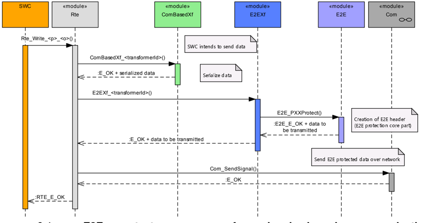

#### 8.1.2. 接收E2E保护的信号（激活模式）

以下时序图展示了发送者/接收者通信的数据传输以及接收侧可运行实体（**runnable entity**）的激活（激活模式）如何实现（参见 [10, **CP-SWS-RTE**] 中「具有事件语义和可运行实体激活的发送者接收者通信」图）。

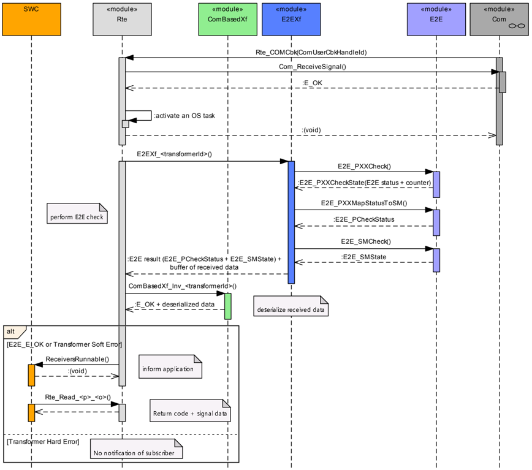

#### 8.1.3. 接收E2E保护的信号（轮询模式）

以下时序图展示了接收侧轮询模式下发送者/接收者通信的数据传输如何实现（参见 [10, **CP-SWS-RTE**] 中「具有数据语义和 **dataReceivePointByArgument** 作为接收机制的发送者接收者通信」图）。

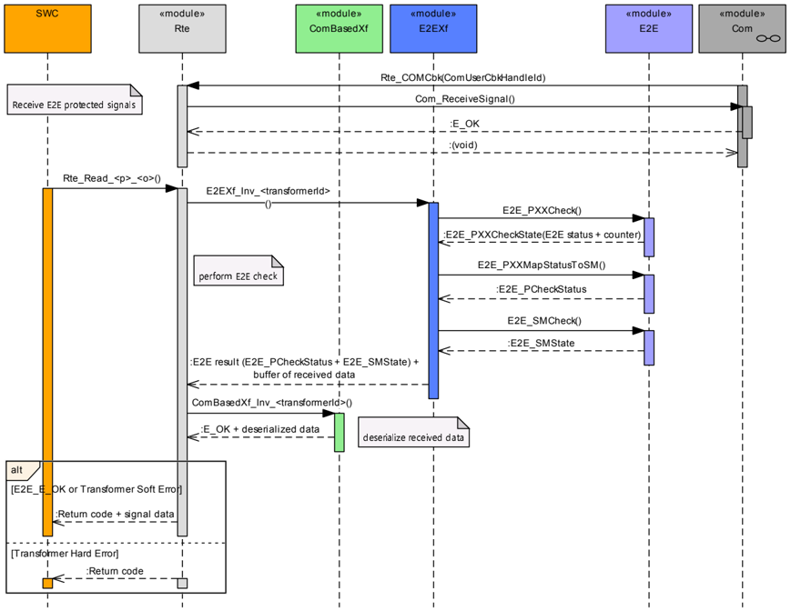

### 8.2. 事件的E2E

以下时序展示了发布者/订阅者（**publisher/subscriber**）模式。当事件更新时，所有订阅者都会收到一条更新报文。**RTE** 调用 **SomeIp** 转换器（序列化）和 **E2E** 转换器进行 **E2E** 保护。

#### 8.2.1. 发送E2E保护的事件

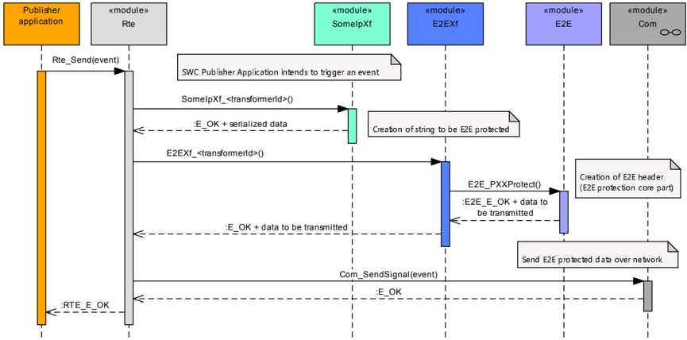

#### 8.2.2. 接收E2E保护的事件（激活模式）

以下时序图展示了发布者/订阅者通信的数据传输以及订阅者侧可运行实体的激活（激活模式）如何实现（参见「具有事件语义和可运行实体激活的发送者接收者通信…（源文档此处截断）」图）。

在此模式下，报文的接收触发 **RTE** 调用订阅者的应用程序。

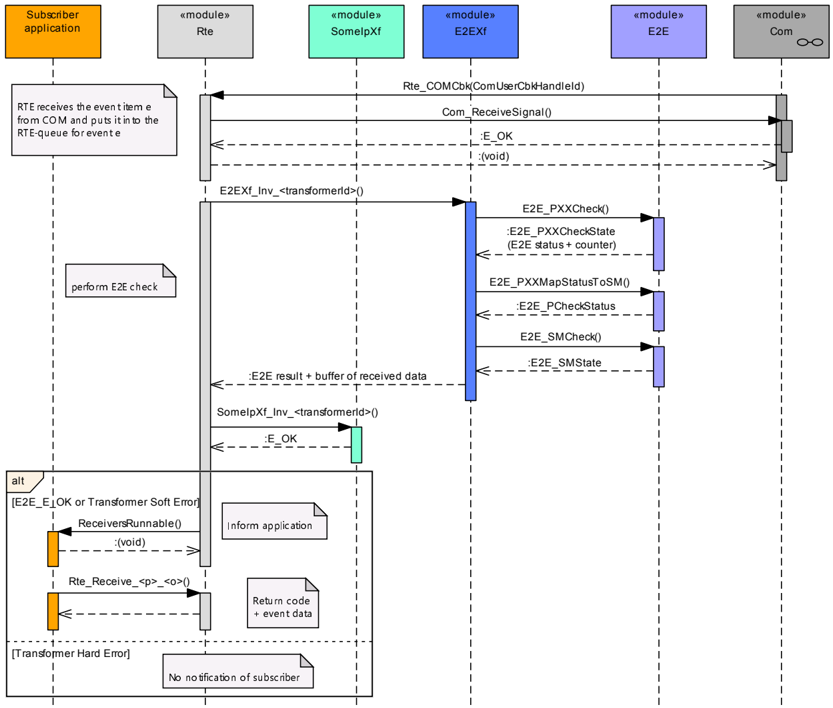

#### 8.2.3. 接收E2E保护的事件（轮询模式）

以下时序图展示了订阅者侧轮询模式下发布者/订阅者通信的数据传输如何实现（参见 [10, **CP-SWS-RTE**] 中「具有事件语义和 **dataReceivePointByArgument** 作为接收机制的发送者接收者通信…（源文档此处截断）」图）。

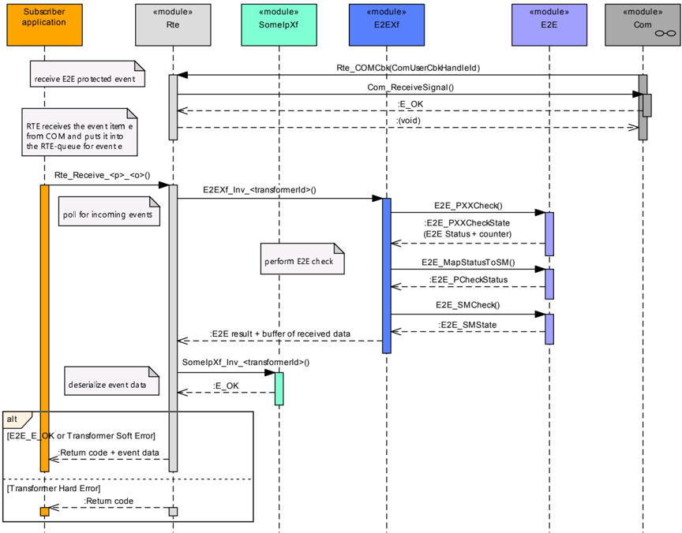

### 8.3. 方法调用/方法响应的E2E

以下时序展示了方法调用/方法响应模式。

#### 8.3.1. 调用E2E保护的方法

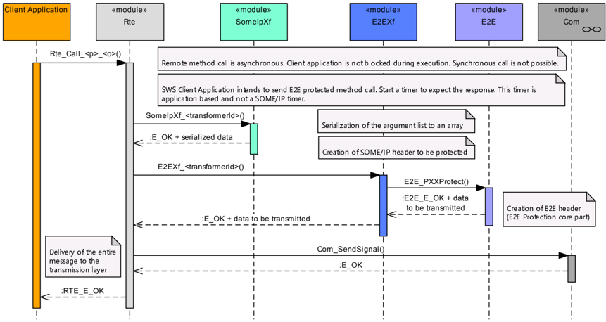

**SWC** 调用一个在别处执行的远程方法。这是一个异步调用。当远程方法在远端执行时，客户端应用程序不会被阻塞。客户端应用程序的调用首先由 **RTE** 处理。此调用在进行…（源文档此处截断）之前受到 **E2E** 保护。

#### 8.3.2. 接收并响应E2E保护的方法调用

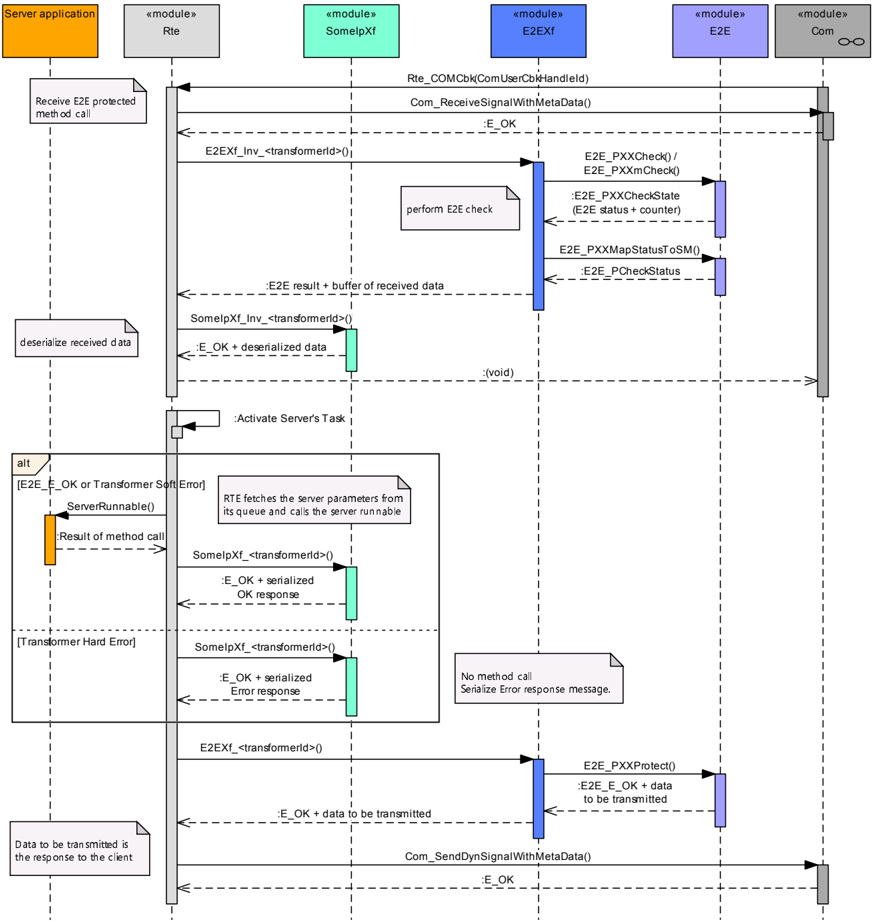

受 **E2E** 保护的报文到达 **COM** 并被转发给 **RTE**。**RTE** 调用 **E2E** 转换器检查 **E2E** 错误，然后——如果没有 **E2E** 错误——调用 **SomeIp** 转换器进行反序列化。**E2E** 检查的结果决定是否调用远程函数。如果发生…（源文档此处截断）。

#### 8.3.3. 接收方法调用的E2E保护响应

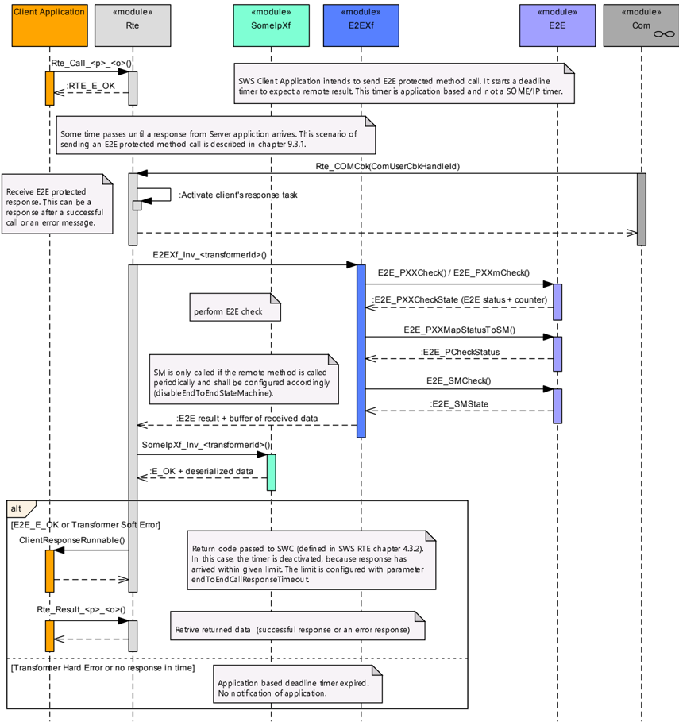

受 **E2E** 保护的响应报文到达 **COM** 并被转发给 **RTE**。**RTE** 调用 **E2E** 转换器，然后调用 **SomeIp** 转换器来检查 **E2E** 错误。如果发生 **E2E** 错误，则向客户端应用程序提供错误报文。因此，客户端应用程序被告知没有有效的…（源文档此处截断）。

### 8.4. 信号到服务翻译中的E2E

以下时序展示了带 **E2E** 保护的信号到服务翻译。

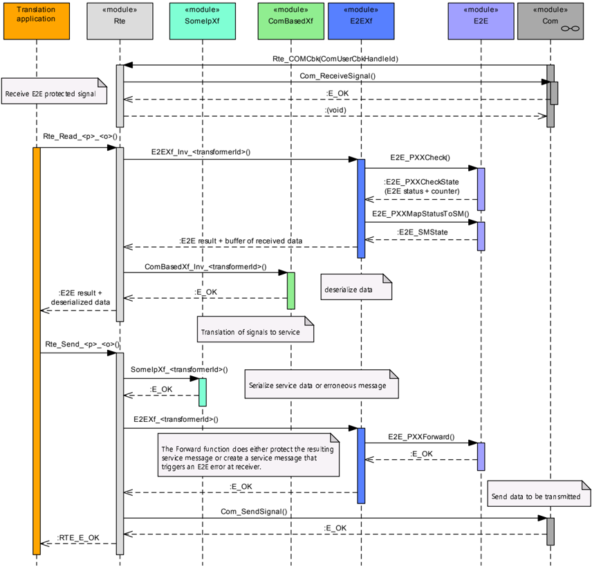

翻译应用程序（**Translation Application**）创建一个由反序列化数据和 **E2E** 结果构成的新报文。如果此 **E2E** 结果是错误，则新报文的构建方式使其也会在其接收者处引发一个 **E2E** 错误。

## 9. 配置规范

**E2E** 转换器没有模块特定的 **ECU** 配置。以下内容用于 **E2E** 转换器的生成：

1. **TPS System Template** 中定义的选项（定义与保护相关的功能选项，例如 **ID**、计数器）
2. **TPS Software Component Template** 中定义的选项（定义特定端口的选项，这些选项覆盖 **TPS System Template** 中定义的选项）
3. **ASWS Transformer General** 中定义的选项（**DataTransformation** 的 **TransformationTechnology** 实体到实现它的 **BswModuleEntry** 实体的映射）。

**E2E** 转换器的 **EcuC** 的 **apiServicePrefix** 应设置为 **E2EXf**。

## B. 变更历史

### B.1. R22-11 的变更历史

源文档此小节没有包含任何内容。

### B.2. R23-11 的变更历史

#### B.2.1. R23-11 中新增的规格项

无。

#### B.2.2. R23-11 中变更的规格项

```
SWS_E2EXf_00026 SWS_E2EXf_00028 SWS_E2EXf_00030 SWS_E2EXf_00032 SWS_E2EXf_00034
SWS_E2EXf_00037 SWS_E2EXf_00047 SWS_E2EXf_00087 SWS_E2EXf_00168 SWS_E2EXf_00175
SWS_E2EXf_00208 SWS_E2EXf_NA_00001
```

#### B.2.3. R23-11 中删除的规格项

```
SWS_E2EXf_00120 SWS_E2EXf_00163 SWS_E2EXf_00176 SWS_E2EXf_00177 SWS_E2EXf_00178
SWS_E2EXf_00179 SWS_E2EXf_00204 SWS_E2EXf_00205
```
