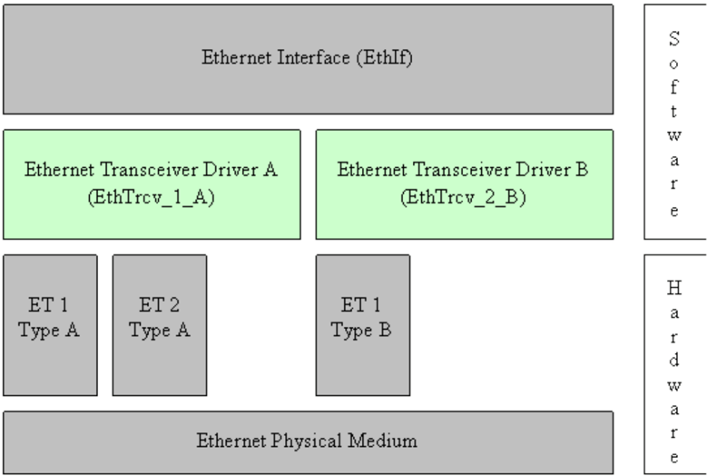
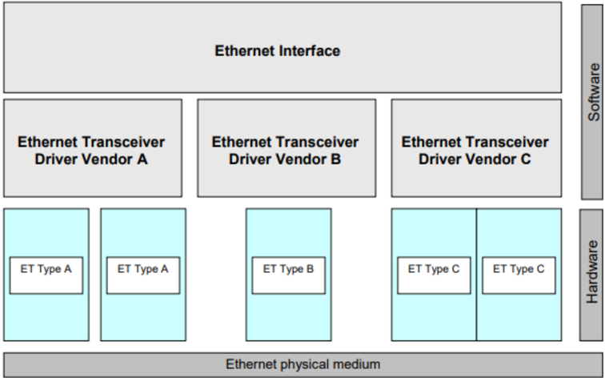
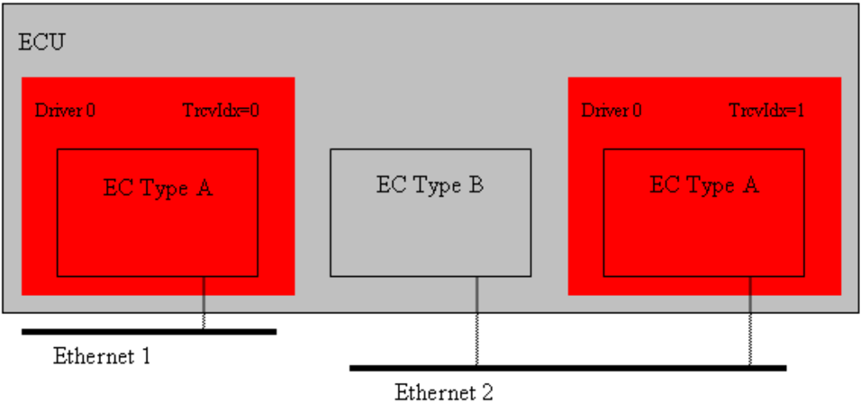
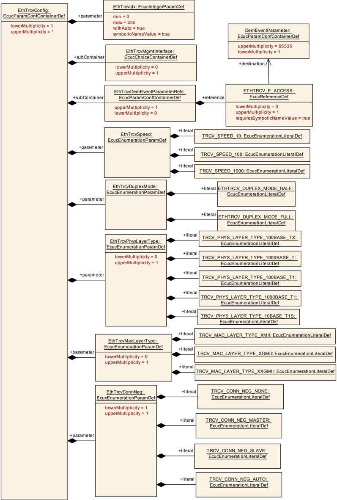
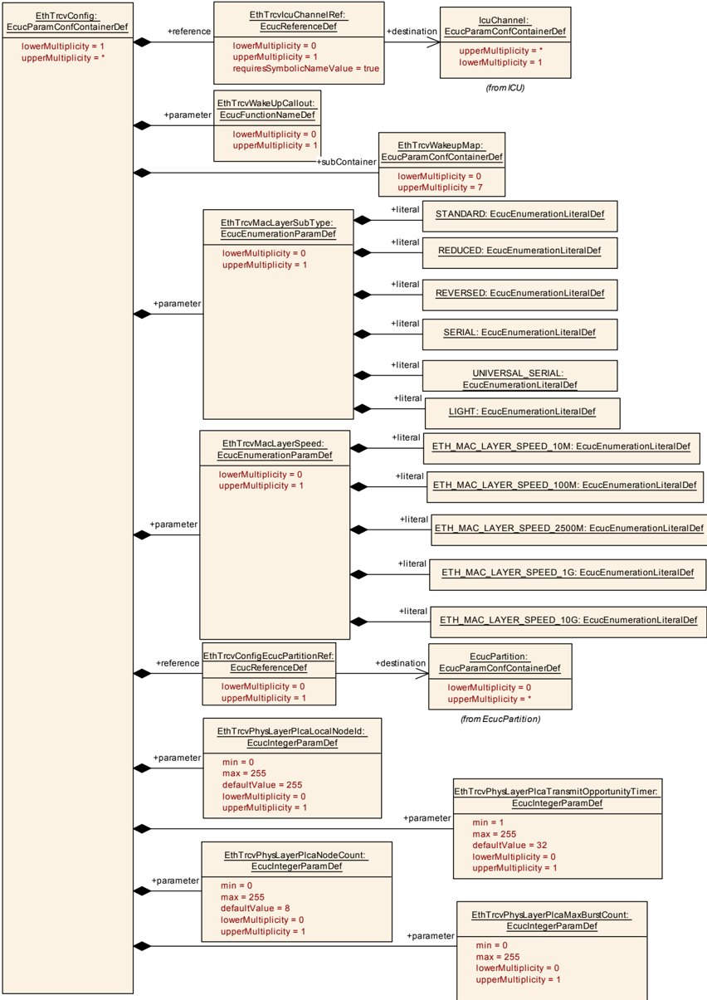
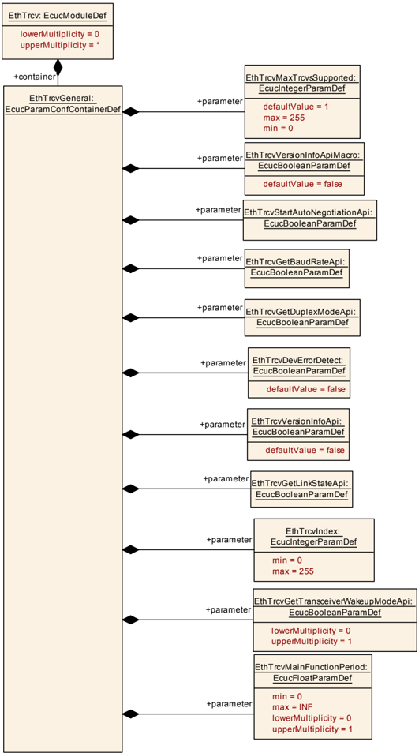
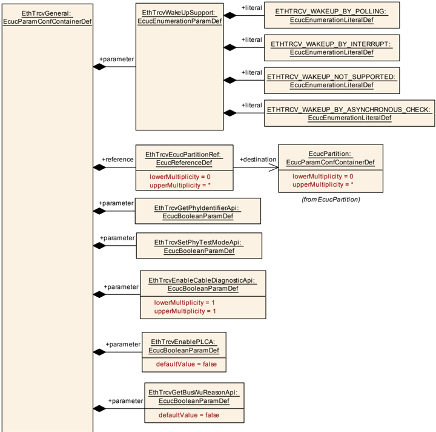

## 已知限制

目前，第 [5](#5-对其他模块的依赖) 章未描述依赖模块的版本。因此，版本检查将在后续版本中扩展该章。

## 1. 简介和功能概述

本规范规定 **AUTOSAR** 基础软件模块 **Ethernet Transceiver Driver**（以太网收发器驱动程序）的功能、**API** 和配置。

在 **AUTOSAR** 分层软件架构中，**Ethernet Transceiver Driver** 属于微控制器抽象层，更准确地说是属于通信驱动程序（Communication Drivers）。

这指出了 **Ethernet Transceiver Driver** 的主要任务：

为上层（**Ethernet Interface**，参见 [\[1\]](#ref-1)（SWS **Ethernet Interface**））提供一个由多个同类收发器组成的、与硬件无关的接口。该接口应对所有收发器保持一致。这样，上层（**Ethernet Interface**）便可以一致的方式访问底层总线系统。不过 **Ethernet Transceiver Driver** 的配置是总线特定的，因为它会考虑通信收发器的具体特性。

单个 **Ethernet Transceiver Driver** 模块只支持一种类型的收发器硬件，但可以支持多个同类型的收发器。**Ethernet Transceiver Driver** 的前缀需要一个唯一的命名空间。通过这个前缀，**Ethernet Interface** 可以使用不同的 **Ethernet Transceiver Driver** 来访问不同的以太网控制器类型。使用哪个驱动程序访问某个特定收发器的决策是 **Ethernet Interface** 的一个配置参数。

图 1.1 描绘了以太网协议栈的下半部分。一个以太网接口使用一个或多个 **Ethernet Transceiver Driver** 访问多个收发器。



**注意：** **Ethernet Transceiver Driver** 的规范方式允许以目标代码形式交付代码模块，遵循「one-fits-all（一套适用所有）」原则，即 **Ethernet Interface** 的整个配置可以在不修改任何源代码的情况下完成。因此，**Ethernet Transceiver Driver** 的配置在很大程度上可以在不需要详细了解 **Ethernet Transceiver Driver** 软件的情况下完成。

## 2. 缩略语

以下术语表列出了与 **Ethernet Transceiver Driver** 模块相关、但未包含在 **AUTOSAR** 术语表 [\[2\]](#ref-2) 中的首字母缩略词和缩略语。

**EC**
> 以太网控制器（**Ethernet controller**）。

**ET**
> 以太网收发器（**Ethernet transceiver**）。

**Eth**
> Ethernet Controller Driver（**AUTOSAR BSW** 模块）。

**EthIf**
> Ethernet Interface（**AUTOSAR BSW** 模块）。

**EthTrcv**
> Ethernet Transceiver Driver（**AUTOSAR BSW** 模块）。

**MCG**
> 模块配置生成器（**Module Configuration Generator**）。

**MII**
> 媒体独立接口（**Media Independent Interface**，由以太网控制器提供的用于访问以太网收发器的标准化接口，参见 IEEE 802.3-2006）。

**PLCA**
> 物理层冲突避免（**Physical Layer Collision Avoidance**）。

**P2P**
> 点对点（**Point-to-Point**）。

**TO**
> 发送机会（**Transmit Opportunity**）。

**OA TC10**
> Open Alliance TC10（参见 [\[3\]](#ref-3)）。

## 3. 相关文档

### 3.1. 输入文件

<a id="ref-1"></a>[1] Specification of Ethernet Interface
> AUTOSAR_CP_SWS_EthernetInterface

<a id="ref-2"></a>[2] Glossary
> AUTOSAR_FO_TR_Glossary

<a id="ref-3"></a>[3] OPEN Sleep/Wake-up Specification for Automotive Ethernet
> http://www.opensig.org/Automotive-Ethernet-Specifications/

<a id="ref-4"></a>[4] General Specification of Basic Software Modules
> AUTOSAR_CP_SWS_BSWGeneral

<a id="ref-5"></a>[5] Requirements on Ethernet Support in AUTOSAR
> AUTOSAR_CP_SRS_Ethernet

<a id="ref-6"></a>[6] Specification of Default Error Tracer
> AUTOSAR_CP_SWS_DefaultErrorTracer

<a id="ref-7"></a>[7] IEEE 802.3cg-2019
> https://www.ieee802.org/3/

### 3.2. 相关标准与规范

* [\[7\]](#ref-7) IEC 7498-1 The Basic Model, IEC Norm, 1994
* [8] IEEE 802.3-2006

### 3.3. 相关规范

**AUTOSAR** 提供了一份基础软件模块通用规范 [\[4\]](#ref-4)，它对 **Ethernet Transceiver Driver** 同样有效。

因此，规范 **SWS BSW General** 应被视为 **Ethernet Transceiver Driver** 的附加且必需的规范。

## 4. 约束和假设

### 4.1. 限制

**Ethernet Transceiver Driver** 模块只能处理单一线程的执行。执行不得被其自身抢占。

### 4.2. 汽车域的适用性

以太网 **BSW** 协议栈适用于需要高数据速率但不需要硬实时的场合。当然，它也可以用于要求较低的用例，即低数据速率的场合。

## 5. 对其他模块的依赖

本章列出与 **Ethernet Transceiver Driver** 模块交互的模块。

使用 **Ethernet Transceiver Driver** 模块的模块：

* **Ethernet Interface**（**EthIf**）
* **Ethernet Switch Driver**（**EthSwt**），用于配置与端口相关的 **PHY** 并访问 **PHY** 寄存器。

**Ethernet Transceiver Driver** 模块使用的模块：

* **Ethernet Controller Driver**（**Eth**），用于经由媒体独立接口（**MII**）访问收发器。

**对其他模块的依赖：**

* 在某些系统上，收发器可能与其他组件（例如 **MCU**、**Port**）共享资源，并可能依赖它们的配置。如果这些资源在其他模块的作用范围内（例如 **PLL** 配置、内存映射等），**Ethernet Transceiver Driver** 模块不负责配置这些组件，而是要求它们先行初始化。

## 6. 功能规格

### 6.1. Ethernet BSW 栈

作为图 7.1 所示 **AUTOSAR** 分层软件架构的一部分，以太网 **BSW** 模块也构成一个分层的软件栈。图 7.1 描绘了该以太网 **BSW** 栈的基本结构。**EthIf** 模块使用 **Ethernet Transceiver Driver** 层访问多个收发器，该层可以由多个 **Ethernet Transceiver Driver** 模块组成。



#### 6.1.1. 索引方案

**Ethernet Transceiver Driver** 的使用者使用如图 7.2 所描绘的索引方案来标识收发器资源。



**Ethernet Transceiver Driver** 使用从零开始的索引来抽象上层软件层的访问。配置中的参数 **EthTrcvCtrlIdx** 对应于 **API** 中使用的参数 **TrcvIdx**。

#### 6.1.2. 需求

本章列出 **Ethernet Transceiver Driver** 模块实现应满足的需求。

**Ethernet Interface** 模块环境包含所有调用 **Ethernet Interface** 模块接口的模块。

**Ethernet Transceiver Driver** 模块应支持预编译期、链接期和 Post-build 期配置。

头文件 **EthTrcv.h** 应包含软件版本号和规范版本号。

**Ethernet Transceiver Driver** 模块应基于对相关代码文件和头文件版本号的预处理检查，执行代码文件与头文件之间的一致性检查。

如果为 **Ethernet Transceiver Driver** 模块启用了开发错误检测：**Ethernet Transceiver Driver** 模块应检查 **API** 参数的有效性，并将检测到的错误报告给 **DET**。

**DET API** 函数在 [\[6\]](#ref-6)（SWS Default Error Tracer）中规定。

**Ethernet Transceiver Driver** 模块应将 **Ethernet Transceiver Driver** SWS 规定的 **API** 函数实现为真实的 **C** 代码函数，并且在目标代码交付时不得将 **API** 实现为宏。

**Ethernet Transceiver Driver** 模块的任何头文件都不得定义全局变量。

#### 6.1.3. 配置描述

**Ethernet Transceiver Driver** 模块应提供一个 **XML** 文件，其中包含软件标识（应包含供应商标识、模块 **ID** 和软件版本信息）、配置和集成过程所需的数据。该文件应描述供应商特定的配置参数，并应包含推荐的配置参数取值。

**MCG** 应读取 **Ethernet Driver** 模块的 **ECU** 配置描述。**Ethernet Driver** 相关的配置数据包含在 **Ethernet Driver** 模块配置描述中。

**MCG** 应确保生成的配置数据的一致性。

**Ethernet Transceiver Driver** 模块的配置应在 **ECU** 配置时计算。任何通信参数都不得在运行时计算。

Post-build 期配置数据的起始地址应在模块初始化期间传递。

**注意：** 关于初始化的更多细节，请参阅第 [7.3.1](#731-ethtrcv_init) 章。

这些配置类到配置参数的分配见第 [9](#9-配置规范) 章。

所有 **Ethernet Transceiver Driver** 相关配置参数的详细描述见本文档的第 [9](#9-配置规范) 章。

#### 6.1.4. 唤醒支持

**Ethernet Transceiver** 驱动程序应根据配置参数 **EthTrcvWakeUpSupport** 支持唤醒检测：完全不支持（**ETHTRCV_WAKEUP_NOT_SUPPORTED**）、通过中断（**ETHTRCV_WAKEUP_BY_INTERRUPT**）、通过异步检查（**ETHTRCV_WAKEUP_BY_ASYNCHRONOUS_CHECK**）或通过轮询（**ETHTRCV_WAKEUP_BY_POLLING**）。

**注意：** 如果 **Ethernet Transceiver** 驱动程序检测到唤醒，它将把以太网硬件（**PHY**）提供的唤醒原因映射到 **EcuM** 定义的唤醒事件。**Ethernet Transceiver** 驱动程序将支持以下场景：

* 睡眠中的 **ECU** 和睡眠中的网络 -&gt; 通过 [**EthTrcv_Init**](#731-ethtrcv_init) 进行唤醒检测（在上电期间调用）
* 苏醒的 **ECU** 和睡眠中的网络 -&gt; 通过 [**EthTrcv_MainFunction**](#751-ethtrcv_mainfunction) 或唤醒中断处理程序进行唤醒检测（由 **EcuM** 在 **CheckWakeup** 中检查）

如果以 **ETH_MODE_DOWN**（例如低功耗模式）请求 **EthTrcv**，则 **Ethernet Transceiver** 驱动程序应通过调用 **Icu_EnableNotification** 启用相应的 **ICU** 通道（参见 **EthTrcvIcuChannelRef**）（如果已配置）。

如果以 **ETH_MODE_ACTIVE**（例如正常模式）请求 **EthTrcv**，则 **Ethernet Transceiver** 驱动程序应通过调用 **Icu_DisableNotification** 禁用相应的 **ICU** 通道（参见 **EthTrcvIcuChannelRef**）（如果已配置）。

唤醒中断处理程序（如果存在）应清除中断、识别唤醒原因并将其存储。

##### 6.1.4.1. 数据线路上的唤醒和睡眠

**AUTOSAR** 支持符合 **OA TC10** 的以太网硬件（**PHY**）（参见 [\[3\]](#ref-3)）。此类 **PHY** 具备在数据线路上发送唤醒和睡眠信号的能力。数据线路上的唤醒会将已连接的通信伙伴从低功耗睡眠模式带入正常模式。数据线路上的睡眠会将已连接的通信伙伴以同步的方式从正常模式带入低功耗模式。

如果上层请求 **ETH_MODE_ACTIVE_WITH_WAKEUP_REQUEST**，则请求 **Ethernet Transceiver** 驱动程序在网络上触发唤醒。

如果上层请求 **ETH_MODE_DOWN**，则请求以太网收发器驱动程序在网络上触发睡眠。

根据配置，网络上的唤醒可以传播到相邻的 **PHY**。

因此，配置中包含用于配置有关转发所接收唤醒的行为的特定参数：

* 将本地从相邻 **PHY** 接收到的唤醒转发到网络（**EthTrcvWakeupForwardLocalEnabled**）；
* 将从网络接收到的唤醒转发到相邻 **PHY**（**EthTrcvWakeupForwardRemoteEnabled**）。

此外，还提供了时序参数来定义所用以太网硬件（**PHY**）的时序行为：

* 定义对本地唤醒检测连接（例如 **I/O** 引脚）上的本地唤醒进行评估并检测为有效的时间（**EthTrcvWakeupLocalDetectionTime**）。请注意，本地唤醒由已连接的相邻 **PHY** 触发；
* 定义唤醒在所用唤醒检测连接（例如 **I/O** 引脚）上持续存在的时长，以便已连接的相邻 **PHY** 感知到唤醒（**EthTrcvWakeupLocalDurationTime**）。

**注意：** 如果使用符合 **OA TC10** 的 **PHY**，则 **ECU** 需要自己对电源供应进行控制，而不应依赖 **PHY**，因为按照规范 **INH** 会被关断（参见 [\[3\]](#ref-3)，Figure 1: PHY power mode sequence）。

#### 6.1.5. PLCA 支持

**IEEE** 规定的物理层冲突避免（**PLCA**）介质访问控制（IEEE 802.3cg-2019 [\[7\]](#ref-7)）允许多个节点共享同一介质。

这种介质访问控制模式用于半双工，并需要硬件支持。特定硬件（即 10BASE-T1S）支持的该特性可以被停用，在这种情况下，多分支拓扑使用 **CSMA/CD**。此时，自动协商的配置方式与其他以太网 **PHY** 类型相同。

#### 6.1.6. 电缆诊断的处理

电缆诊断测量通过调用 [**EthTrcv_RunCableDiagnostic**](#7315-ethtrcv_runcablediagnostic) 触发。电缆诊断测量的当前状态通过调用 [**EthTrcv_GetCableDiagnosticsResult**](#7316-ethtrcv_getcablediagnosticsresult) 轮询。如果 [**EthTrcv_GetCableDiagnosticsResult**](#7316-ethtrcv_getcablediagnosticsresult) 返回的值不是 **ETHTRCV_CABLEDIAG_PENDING**，则电缆诊断已完成。

如果测量失败并返回 **ETHTRCV_CABLEDIAG_ERROR**，则由调用方决定是否再次触发电缆诊断。

如果调用了 **EthTrcv_RunPortCableDiagnostic**，**EthTrcv** 必须通过至少考虑以下几点来确保以太网硬件（**PHY**）处于可以运行电缆诊断的状态：

* 相应的以太网收发器处于 **ETH_MODE_ACTIVE** 状态
* 相应的以太网收发器处于 **ETHTRCV_LINK_STATE_DOWN** 状态

如果运行电缆诊断测量的所有前提条件都得到满足，**EthTrcv** 应触发电缆诊断测量，并将受影响以太网收发器的内部状态设置为 **ETHTRCV_CABLEDIAG_PENDING**。

如果调用了 [**EthTrcv_GetCableDiagnosticsResult**](#7316-ethtrcv_getcablediagnosticsresult)，则应返回受影响以太网收发器的电缆诊断测量的当前状态，并将每个以太网收发器的状态存储为内部电缆诊断状态。

只要电缆诊断测量正在运行（内部电缆诊断状态为 **ETHTRCV_CABLEDIAG_PENDING**），模式请求（由 [**EthTrcv_SetTransceiverMode**](#732-ethtrcv_settransceivermode) 指示）和链路请求（由 [**EthTrcv_TransceiverLinkStateRequest**](#737-ethtrcv_transceiverlinkstaterequest) 指示）应被存储而不执行。

一旦电缆诊断测量完成（内部电缆诊断状态不同于 **ETHTRCV_CABLEDIAG_PENDING**），**EthTrcv** 应执行受影响以太网收发器的最后一个模式请求和链路请求。

**注意：** 电缆诊断测量由维护电缆诊断结果的 **CDD** 触发。**CDD** 应使用 **EthIf** 的专用 **API** 来执行电缆诊断测量：

* **EthIf_RunCableDiagnostic**：用于未被以太网交换机端口引用的单个以太网收发器；
* **EthIf_RunPortCableDiagnostic**：用于被以太网交换机端口引用的以太网收发器。

因此，**EthTrcv** 的上层要么是 **EthIf**，要么是以太网交换机。

### 6.2. 错误分类

《基础软件模块通用规范》（**General Specification of Basic Software Modules**）[\[4\]](#ref-4) 的第 7.2 章「错误处理」详细描述了基础软件的错误处理。最重要的是，它构成了一个由可能发生在 **BSW** 模块中的五种错误类型组成的分类方案。

在此基础上，以下各节规定了安排在相应小节中的特定错误。

#### 6.2.1. 开发错误

| 错误类型 | 相关错误代码 | 错误值 |
|---|---|---|
| 无效的收发器索引 | ETHTRCV_E_INV_TRCV_IDX | 0x01 |
| EthTrcv 模块未初始化 | ETHTRCV_E_UNINIT | 0x02 |
| 参数列表中出现无效指针 | ETHTRCV_E_PARAM_POINTER | 0x03 |

#### 6.2.2. 运行时错误

| 错误类型 | 相关错误代码 | 错误值 |
|---|---|---|
| 通信模式失败或不正确 | ETHTRCV_E_MDI_COMMUNICATION | 0x04 |

#### 6.2.3. 瞬态故障

没有瞬态故障。

#### 6.2.4. 生产错误

没有生产错误。

#### 6.2.5. 扩展生产错误

扩展生产错误作为 **Diagnostic Event Manager** 的事件处理。事件 **ID** 在下面的表中定义，而实际取值由 **Diagnostic Event Manager** 的配置在外部分配，并通过 **Dem.h** 包含到模块中。

| 错误名称 | ETHTRCV_E_ACCESS |
|---|---|
| 简短描述 | 以太网收发器访问失败（**Ethernet Transceiver Access Failure**）。 |
| 详细描述 | 监控对以太网收发器的访问。 |
| 检测标准 | **Fail**：当对以太网收发器的访问失败时，模块应以事件状态 DEM_EVENT_STATUS_PREFAILED 向 **DEM** 报告该扩展生产错误。**Pass**：当对以太网收发器的访问成功时，模块应以事件状态 DEM_EVENT_STATUS_PREPASSED 向 **DEM** 报告该扩展生产错误。 |
| 次要参数 | 无。 |
| 所需时间 | 无。 |
| 监控频率 | 无。 |

## 7. API规范

### 7.1. 导入的类型

本章列出从以下模块包含的所有类型。

**EthTrcv** 模块的导入数据类型定义

| 模块 | 头文件 | 导入的类型 |
|---|---|---|
| Dem | Rte_Dem_Type.h | Dem_EventIdType |
| Dem | Rte_Dem_Type.h | Dem_EventStatusType |
| EcuM | EcuM.h | EcuM_WakeupSourceType |
| Eth | Eth_GeneralTypes.h | Eth_ModeType |
| Icu | Icu.h | Icu_ChannelType |
| Mka | Mka.h | Mka_ConfidentialityOffsetType |
| Mka | Mka.h | Mka_MacSecConfigType |
| Mka | Mka.h | Mka_SakKeyPtrType |
| Mka | Mka.h | Mka_Stats_Rx_ScType |
| Mka | Mka.h | Mka_Stats_Rx_SecYType |
| Mka | Mka.h | Mka_Stats_SecYType |
| Mka | Mka.h | Mka_Stats_Tx_ScType |
| Mka | Mka.h | Mka_Stats_Tx_SecYType |
| Mka | Mka.h | Mka_ValidateFramesType |
| Std | Std_Types.h | Std_ReturnType |
| Std | Std_Types.h | Std_VersionInfoType |

### 7.2. 类型定义

#### 7.2.1. EthTrcv_ConfigType

结构类型（**Structure**）。Post-build 配置的实现特定结构。可通过**EthTrcv.h**获得。

#### 7.2.2. EthTrcv_LinkStateType

枚举类型（**Enumeration**）。该类型定义以太网链路状态。链路状态在以太网电缆插入且两端的收发器协商好传输参数（即波特率和双工模式）后发生变化。可通过**Eth_GeneralTypes.h**获得。

* **ETHTRCV_LINK_STATE_DOWN**（0x00）：未建立物理以太网连接。
* **ETHTRCV_LINK_STATE_ACTIVE**（0x01）：已建立物理以太网连接。

#### 7.2.3. EthTrcv_StateType

枚举类型（**Enumeration**）。用于开发错误检测的状态监控。该状态应用于指示驱动程序是否已初始化。可通过**Eth_GeneralTypes.h**获得。

* **ETHTRCV_STATE_UNINIT**（0x00）：驱动程序尚未配置。
* **ETHTRCV_STATE_INIT**（0x01）：驱动程序已配置。

#### 7.2.4. EthTrcv_BaudRateType

枚举类型（**Enumeration**）。该类型定义以太网波特率。波特率或在已连接的收发器之间协商，或必须进行配置。可通过**Eth_GeneralTypes.h**获得。

* **ETHTRCV_BAUD_RATE_10MBIT**（0x00）：10MBIT 以太网连接。
* **ETHTRCV_BAUD_RATE_100MBIT**（0x01）：100MBIT 以太网连接。
* **ETHTRCV_BAUD_RATE_1000MBIT**（0x02）：1000MBIT 以太网连接。
* **ETHTRCV_BAUD_RATE_2500MBIT**（0x03）：2500MBIT 以太网连接。

#### 7.2.5. EthTrcv_DuplexModeType

枚举类型（**Enumeration**）。该类型定义以太网双工模式。双工模式或在已连接的收发器之间协商，或必须进行配置。可通过**Eth_GeneralTypes.h**获得。

* **ETHTRCV_DUPLEX_MODE_HALF**（0x00）：半双工以太网连接。
* **ETHTRCV_DUPLEX_MODE_FULL**（0x01）：全双工以太网连接。

#### 7.2.6. EthTrcv_WakeupReasonType

枚举类型（**Enumeration**）。该类型定义收发器的唤醒原因。可通过**Eth_GeneralTypes.h**获得。

* **ETHTRCV_WUR_NONE**（0x00）：未检测到唤醒原因。
* **ETHTRCV_WUR_GENERAL**（0x01）：检测到一般唤醒，硬件不支持区分具体原因。
* **ETHTRCV_WUR_INTERNAL**（0x03）：检测到内部唤醒。如果硬件支持则可用。
* **ETHTRCV_WUR_RESET**（0x04）：检测到复位唤醒。如果硬件支持则可用。
* **ETHTRCV_WUR_POWER_ON**（0x05）：检测到上电唤醒。如果硬件支持则可用。
* **ETHTRCV_WUR_PIN**（0x06）：检测到引脚唤醒。如果硬件支持则可用。
* **ETHTRCV_WUR_SYSERR**（0x07）：检测到系统错误唤醒。如果硬件支持则可用。
* **ETHTRCV_WUR_WODL_WUP**（0x08）：在相应以太网硬件（例如 **PHY**）链路断开期间检测到数据线路上的唤醒（WUP = 唤醒脉冲）。仅在 **EthTrcvWakeupSleepOnDatalineEnabled** 设置为 **TRUE** 时可用。
* **ETHTRCV_WUR_WODL_WUR**（0x09）：在所用以太网硬件（例如 **PHY**）链路活动期间检测到数据线路上的唤醒（WUR = 唤醒请求）。仅在 **EthTrcvWakeupSleepOnDatalineEnabled** 设置为 **TRUE** 时可用。
* **ETHTRCV_WUR_TRANSFER**（0xA）：来自相邻 **PHY** 的数据线路唤醒的设备内部传输。仅当以太网硬件符合 **OA TC10** 时才可能。仅在 **EthTrcvWakeupSleepOnDatalineEnabled** 设置为 **TRUE** 时可用。

#### 7.2.7. EthTrcv_PhyTestModeType

枚举类型（**Enumeration**）。描述可能的 **PHY** 测试模式。可通过**Eth_GeneralTypes.h**获得。

* **ETHTRCV_PHYTESTMODE_NONE**（0x00）：正常运行。
* **ETHTRCV_PHYTESTMODE_1**（0x01）：测试发送器下垂（droop）。
* **ETHTRCV_PHYTESTMODE_2**（0x02）：测试主设备时序抖动。
* **ETHTRCV_PHYTESTMODE_3**（0x03）：测试从设备时序抖动。
* **ETHTRCV_PHYTESTMODE_4**（0x04）：测试发送器失真。
* **ETHTRCV_PHYTESTMODE_5**（0x05）：测试功率谱密度（**PSD**）掩模。

#### 7.2.8. EthTrcv_PhyLoopbackModeType

枚举类型（**Enumeration**）。描述可能的 **PHY** 回环模式。可通过**Eth_GeneralTypes.h**获得。

* **ETHTRCV_PHYLOOPBACK_NONE**（0x00）：正常运行。
* **ETHTRCV_PHYLOOPBACK_INTERNAL**（0x01）：内部回环。
* **ETHTRCV_PHYLOOPBACK_EXTERNAL**（0x02）：外部回环。
* **ETHTRCV_PHYLOOPBACK_REMOTE**（0x03）：远端回环。

#### 7.2.9. EthTrcv_PhyTxModeType

枚举类型（**Enumeration**）。描述可能的 **PHY** 发送模式。可通过**Eth_GeneralTypes.h**获得。

* **ETHTRCV_PHYTXMODE_NORMAL**（0x00）：正常运行。
* **ETHTRCV_PHYTXMODE_TX_OFF**（0x01）：发送器禁用。
* **ETHTRCV_PHYTXMODE_SCRAMBLER_OFF**（0x02）：扰码器禁用。

#### 7.2.10. EthTrcv_CableDiagResultType

枚举类型（**Enumeration**）。描述电缆诊断的结果。可通过**Eth_GeneralTypes.h**获得。

* **ETHTRCV_CABLEDIAG_OK**（0x00）：电缆诊断正常。
* **ETHTRCV_CABLEDIAG_ERROR**（0x01）：电缆诊断失败。
* **ETHTRCV_CABLEDIAG_SHORT**（0x02）：检测到短路。
* **ETHTRCV_CABLEDIAG_OPEN**（0x03）：检测到断路。
* **ETHTRCV_CABLEDIAG_PENDING**（0x04）：电缆诊断仍在运行。
* **ETHTRCV_CABLEDIAG_WRONG_POLARITY**（0x05）：电缆诊断检测到「Ethernet physical+」或「Ethernet physical-」线路的极性错误。

#### 7.2.11. EthTrcv_MacMethodType

枚举类型（**Enumeration**）。该类型定义半双工下的介质访问控制类型。如果配置了 **ETHTRCV_MAC_TYPE_PLCA**，则支持 **PLCA**，并且必须配置列出的相关参数。可通过**Eth_GeneralTypes.h**获得。

* **ETHTRCV_MAC_TYPE_CSMA_CD**（0x00）：带冲突检测的载波侦听多路访问（Carrier sense multiple access with collision detection）。
* **ETHTRCV_MAC_TYPE_PLCA**（0x01）：物理层冲突避免（Physical layer collision avoidance）。

### 7.3. 函数定义

这是提供给上层模块的函数列表。

#### 7.3.1. EthTrcv_Init

**说明**: 初始化 **Ethernet Transceiver Driver**。可通过**EthTrcv.h**获得。本服务为同步调用，不可重入。参数 CfgPtr（in）：指向实现特定结构的指针。返回值：无。

```C
void EthTrcv_Init ( const EthTrcv_ConfigType* CfgPtr )
```

该函数应存储对配置结构的访问，以供后续 **API** 调用使用。

该函数应至少考虑以下针对以太网硬件（**PHY**）的初始化序列：

* 按照「检查唤醒原因」的规定检查唤醒原因
* 按照「初始化 **PHY**」的规定初始化 **PHY**
* 确保按照「将 **PHY** 置于确定状态」和「睡眠模式（**OA TC10**）」的规定，**PHY** 处于确定的硬件状态。

该函数应检查唤醒原因，并通过调用 **EcuM_SetWakeupEvent** 将相应的唤醒源（参见 [**EthTrcvWakeupMap**](#916-ethtrcvwakeupmap) 配置）传播给 **EcuM**。

如果未配置 **EthTrcvWakeupSleepOnDatalineEnabled**，则 **Ethernet Transceiver** 驱动程序应在 **EthTrcv_Init** 函数调用内确保以太网硬件（**PHY**）处于睡眠模式。

该函数应用所有可用的配置参数初始化以太网硬件（**PHY**）：

* **EthTrcvConnNeg**
* **EthTrcvDuplexMode**
* **EthTrcvMacLayerSpeed**
* **EthTrcvMacLayerSubType**
* **EthTrcvMacLayerType**
* **EthTrcvPhysLayerType**
* **EthTrcvSpeed**。

**注意：** **Ethernet Transceiver** 驱动程序的初始化仅考虑以太网硬件（**PHY**）可用的配置参数。其余配置参数可以通过硬件方式配置（例如引脚绑带/pin strapping）。

该函数应将组件的状态从 **ETHTRCV_STATE_UNINIT** 改变为 **ETHTRCV_STATE_INIT**。

该函数应检查对以太网收发器的访问。如果检查失败，该函数应引发生产错误 [**ETHTRCV_E_ACCESS**](#625-扩展生产错误)，否则通过该生产错误 [**ETHTRCV_E_ACCESS**](#625-扩展生产错误)。

应在初始化期间调用 **EthTrcv_Init()**。

##### 7.3.1.1. OA TC10 PHY 的初始化

如果配置了 **EthTrcvWakeupSleepOnDatalineEnabled** 且未检测到唤醒原因，则 **Ethernet Transceiver** 驱动程序应在 [**EthTrcv_Init**](#731-ethtrcv_init) 的调用内确保以太网硬件（**PHY**）处于 **OA TC10** [\[3\]](#ref-3) 规定的睡眠模式。

如果 **EthTrcvWakeupSleepOnDatalineEnabled** 设置为 **TRUE**，且检测到了与符合 **OA TC10** [\[3\]](#ref-3) 的以太网硬件（**PHY**）相关的唤醒原因，则应保持以太网硬件状态（例如正常模式），因为唤醒已经到达，并且应启动带有 **EthTrcvSleepModeExecutionDelay** 的相应延迟定时器。

**注意：**

* 与 **OA TC10** 相关的唤醒原因是 **ETHTRCV_WUR_WODL_WUP**、**ETHTRCV_WUR_WODL_WUR** 和 **ETHTRCV_WUR_TRANSFER**。
* 如果检测到唤醒，将唤醒传播到上层可能需要一些处理时间。使用一个延迟睡眠执行的定时器，以防止以太网硬件（**PHY**）在向所有受影响上层（**EcuM**、**EthSM**、**EthIf**）的唤醒转发尚未完成时立即执行睡眠请求。

#### 7.3.2. EthTrcv_SetTransceiverMode

**说明**: 启用/禁用被索引的收发器。可通过**EthTrcv.h**获得。本服务为异步调用，不可重入。参数 TrcvIdx（in）：收发器驱动程序上下文中收发器的索引。参数 TrcvMode（in）：**ETH_MODE_DOWN**：禁用收发器；**ETH_MODE_ACTIVE**：启用收发器；**ETH_MODE_ACTIVE_WITH_WAKEUP_REQUEST**：启用收发器，并且——如果所使用的 **PHY** 支持此类特性——请求在网络上触发一次唤醒。例如用于符合 **OA TC10** 的 **PHY**。返回值：Std_ReturnType，E_OK：服务被接受；E_NOT_OK：服务被拒绝。

```C
Std_ReturnType EthTrcv_SetTransceiverMode ( uint8 TrcvIdx, Eth_ModeType TrcvMode )
```

如果调用 **EthTrcv_SetTransceiverMode()** 时内部电缆诊断状态等于 **ETHTRCV_CABLEDIAG_PENDING**，则 **Ethernet Transceiver** 驱动程序应按 **EthTrcv**（**TrcvIdx**）存储该模式请求。

**注意：** 模式的进一步处理将在电缆诊断完成后进行，参见第 [7.3.2.2](#7322-eth_mode_active_with_wakeup_request-或-eth_mode_active-请求) 章的规定。

该函数应按照以下规定的要求将被索引的收发器置于指定的模式。每当进入一个先前由 **EthTrcv_SetTransceiverMode** 请求的新模式时，**EthTrcv** 应最迟在下一次 [**EthTrcv_MainFunction**](#751-ethtrcv_mainfunction) 期间调用 **EthIf_TrcvModeIndication**。

新请求的 **EthTrcv** 模式应覆盖上一次请求的 **EthTrcv** 模式，除非上一次模式为 **ETH_MODE_ACTIVE_WITH_WAKEUP_REQUEST** 而新模式为 **ETH_MODE_ACTIVE**。

**注意：** **Ethernet Transceiver** 驱动程序按 **EthTrcv** 存储所请求的模式。所存储的模式用于在主函数的上下文中重新触发所请求的模式：

* 根据可用配置，重复已存储的唤醒（参见 **EthTrcvWakeupRequestNumberOfRepetitions** 和 **EthTrcvWakeUpRequestRepetitionPeriod**）。
* 根据可用配置，重复已存储的睡眠请求（**EthTrcvSleepRequestNumberOfRepetitions** 和 **EthTrcvSleepRequestRepetitionPeriod**）。

##### 7.3.2.1. ETH_MODE_DOWN 请求

如果以 **ETH_MODE_DOWN** 调用该函数且未配置 **EthTrcvWakeupSleepOnDatalineEnabled**，则它应将相应的以太网硬件（**PHY**）置于可检测唤醒的模式（例如睡眠模式）。

如果以 **ETH_MODE_DOWN** 调用该函数且 **EthTrcvWakeupSleepOnDatalineEnabled** 设置为 **FALSE**，则以太网收发器应将相应的以太网硬件（**PHY**）置于睡眠模式，而不执行 **OA TC10** [\[3\]](#ref-3) 规定的睡眠过程。

如果以 **ETH_MODE_DOWN** 调用该函数、**EthTrcvWakeupSleepOnDatalineEnabled** 设置为 **TRUE**、**Ethernet Transceiver** 驱动程序已检测到一个挂起的唤醒，且带有 **EthTrcvSleepModeExecutionDelay** 的相应延迟定时器未在运行，则 **Ethernet Transceiver** 驱动程序应启动带有 **EthTrcvSleepModeExecutionDelay** 的延迟定时器并以 **E_OK** 返回。

**注意：** **ETH_MODE_DOWN** 的进一步处理在主函数中完成，参见第 [7.5.1](#751-ethtrcv_mainfunction) 章的规定。

**[ETHTRCV_E_ACCESS](#625-扩展生产错误) 的理由说明：** 延迟睡眠（**ETH_MODE_DOWN**）的执行应避免竞态条件，即在通过本地唤醒连接（例如 **I/O** 引脚）接收到相邻 **PHY** 的唤醒时请求了 **ETH_MODE_DOWN**。**EthSM** 应能够完成关机过程（从 **ETHSM_STATE_WAIT_OFFLINE** 到 **ETHSM_STATE_OFFLINE** 的转换），但 **EthTrcv** 应延迟睡眠处理，因为由于通过本地唤醒连接接收到的挂起唤醒，**EthSM** 可能会再次以 **COMM_FULL_COMMUNICATION** 请求网络。立即执行睡眠可能使以太网硬件（**PHY**）进入睡眠，而本地唤醒请求需要以太网硬件（**PHY**）处于正常状态。本地接收到的唤醒被视为被动通信请求，不会使以太网硬件回到正常模式。

如果以 **ETH_MODE_DOWN** 调用该函数、**EthTrcvWakeupSleepOnDatalineEnabled** 设置为 **TRUE** 且带有 **EthTrcvSleepModeExecutionDelay** 的相应延迟定时器正在运行，则 **Ethernet Transceiver** 驱动程序应以 **E_OK** 返回。

**注意：** 带有 **EthTrcvSleepModeExecutionDelay** 的延迟定时器正在运行表明已请求过睡眠（**ETH_MODE_DOWN**）。因此不需要对睡眠请求进行进一步处理。

如果以 **ETH_MODE_DOWN** 调用该函数、**EthTrcvWakeupSleepOnDatalineEnabled** 设置为 **TRUE** 且 **EthTrcv** 尚未检测到挂起的唤醒（参见第 [7.3.2.1](#7321-eth_mode_down-请求) 章）、以太网硬件（**PHY**）处于睡眠模式以外的其他模式且尚未触发过睡眠请求，则 **Ethernet Transceiver** 驱动程序应按照 **OA TC10** 的规范（参见 [\[3\]](#ref-3)）触发一个睡眠请求。

**注意：** **Ethernet Transceiver** 驱动程序检查以太网硬件（**PHY**）是否已经进入睡眠模式，以避免再次向受影响的以太网硬件（**PHY**）触发睡眠请求。这是必要的，因为已连接的以太网 **ECU** 触发睡眠请求的时间点可能不同（例如，如果使用以太网交换机端口，睡眠请求的执行会被 **EthIfSwitchOffPortTimeDelay** 延迟）。较早关机的以太网 **ECU** 触发睡眠请求并使其自身的以太网硬件（**PHY**）以及已连接以太网 **ECU** 的以太网硬件进入睡眠模式。较晚关机的 **ECU** 的 **Ethernet Transceiver** 驱动程序会检测到受影响的以太网硬件（**PHY**）已经达到睡眠模式。在这种情况下，以太网硬件（**PHY**）应保持原样并从函数调用返回。

##### 7.3.2.2. ETH_MODE_ACTIVE_WITH_WAKEUP_REQUEST 或 ETH_MODE_ACTIVE 请求

如果以参数 **ETH_MODE_ACTIVE** 或 **ETH_MODE_ACTIVE_WITH_WAKEUP_REQUEST** 调用 **[EthTrcv_SetTransceiverMode](#732-ethtrcv_settransceivermode)()**、未配置 **EthTrcvWakeupSleepOnDatalineEnabled** 且内部电缆诊断状态不同于 **ETHTRCV_CABLEDIAG_PENDING**，则 **Ethernet Transceiver** 驱动程序应：

* 在进入收发器的活动模式时检查唤醒原因；
* 如果未检测到唤醒原因，已配置时以太网收发器应在总线上发送一个唤醒符号；
* 如果已配置，调用 call-out &lt;EthTrcvWakeUpCallout&gt; 函数。

如果以参数 **ETH_MODE_ACTIVE** 或 **ETH_MODE_ACTIVE_WITH_WAKEUP_REQUEST** 调用 **[EthTrcv_SetTransceiverMode](#732-ethtrcv_settransceivermode)()**、**EthTrcvWakeupSleepOnDatalineEnabled** 设置为 **FALSE** 且内部电缆诊断状态不同于 **ETHTRCV_CABLEDIAG_PENDING**，则 **Ethernet Transceiver** 驱动程序应：

* 将以太网硬件（**PHY**）置于正常模式，
* 如果已配置，调用 call-out &lt;EthTrcvWakeUpCallout&gt; 函数。

如果以 **ETH_MODE_ACTIVE** 调用该函数、**EthTrcvWakeupSleepOnDatalineEnabled** 为 **TRUE** 且内部电缆诊断状态不同于 **ETHTRCV_CABLEDIAG_PENDING**，则 **Ethernet Transceiver** 驱动程序应：

* 将以太网硬件（**PHY**）置于正常模式（如果尚未由以太网硬件（**PHY**）的状态机自动切换），
* 如果已配置，调用 call-out &lt;EthTrcvWakeUpCallout&gt; 函数。

**注意：** 以 **ETH_MODE_ACTIVE** 请求的模式指示一个被动唤醒。因此，以太网硬件是由已连接的通信伙伴远程唤醒的。在这种情况下，不应在网络上发送唤醒。根据接收到的唤醒，以太网硬件（**PHY**）应按照 **OA TC10**（参见 [\[3\]](#ref-3)）置于正常模式。但为了提高通信的稳健性，**Ethernet Transceiver Driver** 应检查当前模式，并在以太网硬件（**PHY**）的状态机未完成时将以太网硬件（**PHY**）置于正常模式。

如果以 **ETH_MODE_ACTIVE_WITH_WAKEUP_REQUEST** 调用该函数、**EthTrcvWakeupSleepOnDatalineEnabled** 为 **TRUE**、内部电缆诊断状态不同于 **ETHTRCV_CABLEDIAG_PENDING** 且 **EthTrcv** 当前未执行唤醒重复算法（参见第 [7.5.1](#751-ethtrcv_mainfunction) 章），则 **Ethernet Transceiver** 驱动程序应：

* 触发以太网硬件（**PHY**）按照 **OA TC10** 的规范（参见 [\[3\]](#ref-3)）在网络上发送唤醒，
* 如果已配置，调用 call-out &lt;EthTrcvWakeUpCallout&gt; 函数。

**注意：** 以 **ETH_MODE_ACTIVE_WITH_WAKEUP_REQUEST** 请求的模式指示一个主动唤醒。这将导致在网络上触发一次唤醒，并将以太网硬件（**PHY**）隐式置于正常模式。

关于第 [7.3.2.2](#7322-eth_mode_active_with_wakeup_request-或-eth_mode_active-请求) 章中两条要求的说明：如果先前请求的模式为 **ETH_MODE_DOWN** 而新模式为 **ETH_MODE_ACTIVE** 或 **ETH_MODE_ACTIVE_WITH_WAKEUP_REQUEST**，则所有与睡眠处理相关的操作都不再处理（参见第 [7.5.1](#751-ethtrcv_mainfunction) 章）。

当请求 **ETH_MODE_ACTIVE_WITH_WAKEUP_REQUEST** 时，无论先前的模式如何，唤醒重复的次数都将从头开始（参见第 [7.5.1](#751-ethtrcv_mainfunction) 章）。

##### 7.3.2.3. 错误处理

如果启用了开发错误检测：该函数应检查先前是否已调用过服务 [**EthTrcv_Init**](#731-ethtrcv_init)。如果检查失败，该函数应引发开发错误 [**ETHTRCV_E_UNINIT**](#621-开发错误)。

如果启用了开发错误检测：该函数应检查参数 **TrcvIdx** 是否有效。如果检查失败，该函数应引发开发错误 [**ETHTRCV_E_INV_TRCV_IDX**](#621-开发错误)。

如果收发器已经处于所请求的模式，应返回 **E_OK** 且不引发开发错误。

**[EthTrcv_SetTransceiverMode](#732-ethtrcv_settransceivermode)()** 应检查对以太网收发器的访问。如果检查失败，该函数应引发生产错误 [**ETHTRCV_E_ACCESS**](#625-扩展生产错误) 并返回 **E_NOT_OK**，否则通过该生产错误 [**ETHTRCV_E_ACCESS**](#625-扩展生产错误) 并返回 **E_OK**。

应在 **[EthTrcv_SetTransceiverMode](#732-ethtrcv_settransceivermode)()** 之前调用 **[EthTrcv_Init](#731-ethtrcv_init)()**。

#### 7.3.3. EthTrcv_GetTransceiverMode

**说明**: 获取被索引收发器的状态。可通过**EthTrcv.h**获得。本服务为同步调用，不可重入。参数 TrcvIdx（in）：收发器驱动程序上下文中收发器的索引。参数 TrcvModePtr（out）：**ETH_MODE_DOWN**：收发器被禁用；**ETH_MODE_ACTIVE**：收发器被启用。返回值：Std_ReturnType，E_OK：成功；E_NOT_OK：无法初始化收发器。

```C
Std_ReturnType EthTrcv_GetTransceiverMode ( uint8 TrcvIdx, Eth_ModeType* TrcvModePtr )
```

该函数应读取以太网硬件（**PHY**）的当前收发器模式，其中 **ETH_MODE_ACTIVE_WITH_WAKEUP_REQUEST** 应始终作为 **ETH_MODE_ACTIVE** 返回。

如果启用了开发错误检测：该函数应检查先前是否已调用过服务 [**EthTrcv_Init**](#731-ethtrcv_init)。如果检查失败，该函数应引发开发错误 [**ETHTRCV_E_UNINIT**](#621-开发错误)。

如果启用了开发错误检测：该函数应检查参数 **TrcvIdx** 是否有效。如果检查失败，该函数应引发开发错误 [**ETHTRCV_E_INV_TRCV_IDX**](#621-开发错误)。

如果启用了开发错误检测：该函数应检查参数 **TrcvModePtr** 是否有效。如果检查失败，该函数应引发开发错误 [**ETHTRCV_E_PARAM_POINTER**](#621-开发错误)。

应在 **EthTrcv_GetTransceiverMode()** 之前调用 **[EthTrcv_Init](#731-ethtrcv_init)()**。

#### 7.3.4. EthTrcv_GetBusWuReason

**说明**: 该函数返回最近一次的唤醒原因。可通过**EthTrcv.h**获得。本服务为同步调用，可重入。参数 TrcvIdx（in）：以太网收发器驱动程序上下文中收发器的索引。参数 WakeupReasonPtr（out）：指向由以太网 **PHY** 检测到的最近一次唤醒事件结构的指针。返回值：Std_ReturnType，E_OK：**PHY** 唤醒原因请求已被接受；E_NOT_OK：**PHY** 唤醒原因请求未被接受。

```C
Std_ReturnType EthTrcv_GetBusWuReason ( uint8 TrcvIdx, EthTrcv_WakeupReasonType* WakeupReasonPtr )
```

函数 **EthTrcv_GetBusWuReason** 应读取所存储的唤醒原因并在 **WakeupReasonPtr** 中提供该信息。

如果启用了开发错误检测：该函数应检查先前是否已调用过服务 [**EthTrcv_Init**](#731-ethtrcv_init)。如果检查失败，该函数应引发开发错误 [**ETHTRCV_E_UNINIT**](#621-开发错误)。

如果启用了开发错误检测：该函数应检查参数 **TrcvIdx** 是否有效。如果检查失败，该函数应引发开发错误 [**ETHTRCV_E_INV_TRCV_IDX**](#621-开发错误)。

如果启用了开发错误检测：该函数应检查参数 **TrcvModePtr** 是否有效。如果检查失败，该函数应引发开发错误 [**ETHTRCV_E_PARAM_POINTER**](#621-开发错误)。

该函数应可通过配置参数 **EthTrcvGetBusWuReasonApi** 进行预编译期配置（开/关）。

#### 7.3.5. EthTrcv_CheckWakeup

**说明**: 在检测到唤醒中断时由 **EthIf** 调用的服务。可通过**EthTrcv.h**获得。本服务为同步调用，可重入。参数 TrcvIdx（in）：收发器驱动程序上下文中收发器的索引。返回值：Std_ReturnType，E_OK：函数已成功执行；E_NOT_OK：函数无法成功执行。

```C
Std_ReturnType EthTrcv_CheckWakeup ( uint8 TrcvIdx )
```

如果 **EthTrcvWakeUpSupport** 设置为 **ETHTRCV_WAKEUP_BY_INTERRUPT** 或 **ETHTRCV_WAKEUP_BY_POLLING**，函数 **EthTrcv_CheckWakeup()** 应检查是否检测到了唤醒；如果是，则通过调用 **EcuM_SetWakeupEvent** 将相应的唤醒源（参见 [**EthTrcvWakeupMap**](#916-ethtrcvwakeupmap) 配置）传播给 **EcuM**。

如果调用了函数 **EthTrcv_CheckWakeup()**、**EthTrcvWakeupSleepOnDatalineEnabled** 设置为 **TRUE**、检测到了与符合 **OA TC10** [\[3\]](#ref-3) 的以太网硬件（**PHY**）相关的唤醒原因（**ETHTRCV_WUR_WODL_WUP**、**ETHTRCV_WUR_WODL_WUR** 或 **ETHTRCV_WUR_TRANSFER**）且 **EthTrcvWakeUpSupport** 为 **ETHTRCV_WAKEUP_BY_ASYNCHRONOUS_CHECK**、**ETHTRCV_WAKEUP_BY_INTERRUPT** 或 **ETHTRCV_WAKEUP_BY_POLLING**，则 **Ethernet Transceiver** 驱动程序应启动带有 **EthTrcvSleepModeExecutionDelay** 的延迟定时器。

**注意：**

* 唤醒必须传播到受影响的上层（**EcuM**、**EthSM**、**EthIf**）。只要 **EthIf** 尚未感知到检测到的唤醒，**EthIf** 就会尝试确保所请求的通信模式与当前以太网硬件（**PHY**、以太网端口）状态匹配。当符合 **OA TC10** 的以太网硬件（**PHY**）的唤醒到达时，**PHY** 会转换到正常模式（**ETH_MODE_ACTIVE**）。因此，**EthIf** 可能会检测到当前请求的模式（**ETH_MODE_DOWN**）与当前 **PHY** 状态（**ETH_MODE_ACTIVE**）之间的不匹配，并重新触发 **PHY** 转回睡眠模式。为避免这种情况，会启动一个延迟睡眠模式执行的定时器。只要该定时器在运行，以太网收发器驱动程序就不会执行所请求的睡眠模式。
* 如果配置了 **ETHTRCV_WAKEUP_BY_ASYNCHRONOUS_CHECK**，则延迟睡眠执行的定时器可能被启动两次：第一次在本函数的上下文中，第二次在执行唤醒原因检查的 [**EthTrcv_MainFunction**](#751-ethtrcv_mainfunction) 的上下文中。

如果调用了函数 **EthTrcv_CheckWakeup()** 且 **EthTrcvWakeUpSupport** 设置为 **ETHTRCV_WAKEUP_BY_ASYNCHRONOUS_CHECK**，则 **Ethernet Transceiver Driver** 应在 [**EthTrcv_MainFunction**](#751-ethtrcv_mainfunction) 的上下文中存储对所用以太网硬件（例如符合 **OA TC10** 的 **PHY**）进行异步唤醒检查的请求。

**注意：** 异步唤醒检查可用于以太网交换机，因为读取以太网交换机的所有以太网交换机端口非常耗时。例如，以太网交换机被告知其一个或多个以太网交换机端口发生了中断。相应的主机 **ECU**（维护以太网交换机的 **ECU**）必须读出相应 **PHY** 的所有寄存器，以检查哪些 **PHY** 发出了中断以及中断的原因。这可以在 **[EthTrcv_MainFunction](#751-ethtrcv_mainfunction)()** 的上下文中异步完成（而不是在 **EthTrcv_CheckWakeup()** 的上下文中同步完成），以满足主机 **ECU** 运行时间方面的时序约束。

如果启用了开发错误检测：函数 **EthTrcv_CheckWakeup()** 应检查先前是否已调用过服务 [**EthTrcv_Init**](#731-ethtrcv_init)。如果检查失败，该函数应引发开发错误 [**ETHTRCV_E_UNINIT**](#621-开发错误)。

如果启用了开发错误检测：函数 **EthTrcv_CheckWakeup()** 应检查参数 **TrcvIdx** 是否有效。如果检查失败，该函数应引发开发错误 [**ETHTRCV_E_INV_TRCV_IDX**](#621-开发错误)。

应在 **EthTrcv_CheckWakeup()** 之前调用 **[EthTrcv_Init](#731-ethtrcv_init)()**。

#### 7.3.6. EthTrcv_StartAutoNegotiation

**说明**: 重新启动被索引收发器所使用的传输参数的协商。可通过**EthTrcv.h**获得。本服务为同步调用，不可重入。参数 TrcvIdx（in）：以太网收发器驱动程序上下文中收发器的索引。返回值：Std_ReturnType，E_OK：成功；E_NOT_OK：无法初始化收发器。

```C
Std_ReturnType EthTrcv_StartAutoNegotiation ( uint8 TrcvIdx )
```

如果内部电缆诊断状态不同于 **ETHTRCV_CABLEDIAG_PENDING**，该函数应重新启动被索引收发器所使用的传输参数的自动协商。否则，该 **API** 应以 **E_NOT_OK** 返回。

如果启用了开发错误检测：该函数应检查先前是否已调用过服务 [**EthTrcv_Init**](#731-ethtrcv_init)。如果检查失败，该函数应引发开发错误 [**ETHTRCV_E_UNINIT**](#621-开发错误)。

如果启用了开发错误检测：该函数应检查参数 **TrcvIdx** 是否有效。如果检查失败，该函数应引发开发错误 [**ETHTRCV_E_INV_TRCV_IDX**](#621-开发错误)。

该函数应可通过配置参数 **EthTrcvStartAutoNegotiationApi** 和 **EthTrcvEnablePLCA** 进行预编译期配置（开/关）。

应在 **EthTrcv_StartAutoNegotiation()** 之前调用 **[EthTrcv_Init](#731-ethtrcv_init)()**。

上层 **BSW** 软件组件不得调用或要求 **EthTrcv_StartAutoNegotiation()**。

#### 7.3.7. EthTrcv_TransceiverLinkStateRequest

**说明**: 为给定的收发器请求给定的链路状态。可通过**EthTrcv.h**获得。本服务为异步调用；对不同 **TrcvIdx** 可重入，对同一 **TrcvIdx** 不可重入。参数 TrcvIdx（in）：收发器驱动程序上下文中收发器的索引。参数 LinkState（in）：物理连接的链路状态。返回值：Std_ReturnType，E_OK：请求已被接受；E_NOT_OK：请求未被接受。

```C
Std_ReturnType EthTrcv_TransceiverLinkStateRequest ( uint8 TrcvIdx, EthTrcv_LinkStateType LinkState )
```

##### 7.3.7.1. 点对点网络拓扑

如果 **EthTrcvPhysLayerType** 未设置为 **TRCV_PHYS_LAYER_TYPE_10BASE_T1S**，则应应用本小节的以下要求：

如果满足以下条件，该函数应启动被索引收发器的链路训练：

* 所请求的链路状态为 **ETHTRCV_LINK_STATE_ACTIVE** 且
* 内部电缆诊断状态不同于 **ETHTRCV_CABLEDIAG_PENDING** 且
* **EthTrcvConnNeg** 设置为 **TRCV_CONN_NEG_MASTER** 或 **TRCV_CONN_NEG_AUTO**。

如果 **EthTrcvConnNeg** 设置为 **TRCV_CONN_NEG_SLAVE**，则被索引的收发器应被置于等待链路伙伴链路训练的状态。

如果调用 **[EthTrcv_TransceiverLinkStateRequest](#737-ethtrcv_transceiverlinkstaterequest)()** 时内部电缆诊断状态为 **ETHTRCV_CABLEDIAG_PENDING**，则 **Ethernet Transceiver** 驱动程序应按以太网收发器存储链路状态请求，并按第 [7.3.2.2](#7322-eth_mode_active_with_wakeup_request-或-eth_mode_active-请求) 章的规定继续处理。

如果所请求的链路状态为 **ETHTRCV_LINK_STATE_DOWN** 且 **EthTrcvConnNeg** 设置为 **TRCV_CONN_NEG_MASTER** 或 **TRCV_CONN_NEG_AUTO**，该函数应停止被索引收发器的链路训练。

如果所请求的链路状态为 **ETHTRCV_LINK_STATE_DOWN**，该函数应将被索引收发器的链路置为断开。

如果以太网收发器已经处于所请求的链路状态，应返回 **E_OK** 且不引发开发错误。

##### 7.3.7.2. 总线拓扑

如果 **EthTrcvPhysLayerType** 设置为 **TRCV_PHYS_LAYER_TYPE_10BASE_T1S**，则应应用本小节的以下要求：

如果 **EthTrcvPhysLayerType** 设置为 **TRCV_PHYS_LAYER_TYPE_10BASE_T1S**，该函数应在内部存储所请求的链路状态并返回 **E_OK**。

**注意：** 需要该状态是为了配合 **[EthTrcv_GetLinkState](#738-ethtrcv_getlinkstate)()** 的上下文。

#### 7.3.8. EthTrcv_GetLinkState

**说明**: 获取被索引收发器的链路状态。可通过**EthTrcv.h**获得。本服务为同步调用，不可重入。参数 TrcvIdx（in）：收发器驱动程序上下文中收发器的索引。参数 LinkStatePtr（out）：**ETHTRCV_LINK_STATE_DOWN**：收发器已断开；**ETHTRCV_LINK_STATE_ACTIVE**：收发器已连接。返回值：Std_ReturnType，E_OK：成功；E_NOT_OK：无法初始化收发器。

```C
Std_ReturnType EthTrcv_GetLinkState ( uint8 TrcvIdx, EthTrcv_LinkStateType* LinkStatePtr )
```

如果启用了开发错误检测：该函数应检查先前是否已调用过服务 **[EthTrcv_Init](#731-ethtrcv_init)()**。如果检查失败，该函数应引发开发错误 [**ETHTRCV_E_UNINIT**](#621-开发错误)。

如果启用了开发错误检测：该函数应检查参数 **TrcvIdx** 是否有效。如果检查失败，该函数应引发开发错误 [**ETHTRCV_E_INV_TRCV_IDX**](#621-开发错误)。

如果启用了开发错误检测：该函数应检查参数 **LinkStatePtr** 是否有效。如果检查失败，该函数应引发开发错误 [**ETHTRCV_E_PARAM_POINTER**](#621-开发错误)。

该函数应可通过配置参数 **EthTrcvGetLinkStateApi** 进行预编译期配置（开/关）。

应在 **EthTrcv_GetLinkState()** 之前调用 **[EthTrcv_Init](#731-ethtrcv_init)()**。

##### 7.3.8.1. 点对点网络拓扑

如果 **EthTrcvPhysLayerType** 未设置为 **TRCV_PHYS_LAYER_TYPE_10BASE_T1S**，则应应用本小节的以下要求：

该函数应读取当前收发器链路状态，但以下条件除外：

如果 **EthTrcvWakeupSleepOnDatalineEnabled** 设置为 **TRUE** 且 **Ethernet Transceiver Driver** 检测到给定 **TrcvIdx** 正在执行睡眠过程，则应返回 **ETHTRCV_LINK_STATE_DOWN**。

**注意：** 符合 **OA TC10** 的以太网硬件在执行睡眠过程时无法在数据线路上传输数据。在这种情况下，应向上层报告链路断开，以表明数据线路上无法通信。

##### 7.3.8.2. 总线拓扑

如果 **EthTrcvPhysLayerType** 设置为 **TRCV_PHYS_LAYER_TYPE_10BASE_T1S**，则应应用本小节的以下要求：

该函数应检查对以太网 **PHY** 的访问以读取链路寄存器。如果检查失败，该函数应引发生产错误 [**ETHTRCV_E_ACCESS**](#625-扩展生产错误)，返回 **E_NOT_OK** 以及状态 **ETHTRCV_LINK_STATE_DOWN**。

该函数应返回由先前调用 **[EthTrcv_TransceiverLinkStateRequest](#737-ethtrcv_transceiverlinkstaterequest)()**（参见第 [7.3.7.2](#7372-总线拓扑) 章）所存储的请求状态，并返回 **E_OK**。如果之前未调用过 **[EthTrcv_TransceiverLinkStateRequest](#737-ethtrcv_transceiverlinkstaterequest)()**，则应以 **E_OK** 返回 **ETHTRCV_LINK_STATE_DOWN**。

如果 **PHY** 寄存器指示链路接通，该函数还应读取 **PHY** 的 **PLCA** 状态寄存器。如果 **PLCA** 模式未激活，以太网收发器驱动程序应报告运行时错误 [**ETHTRCV_E_MDI_COMMUNICATION**](#622-运行时错误) 并返回 **E_NOT_OK**。

**注意：** 在头节点失效的情况下，客户端节点会将介质访问模式从 **PLCA** 切换到 **CSMA/CD**。因此，客户端节点仍然能够通信。

#### 7.3.9. EthTrcv_GetBaudRate

**说明**: 获取被索引收发器的波特率。可通过**EthTrcv.h**获得。本服务为同步调用，不可重入。参数 TrcvIdx（in）：以太网收发器驱动程序上下文中收发器的索引。参数 BaudRatePtr（out）：**ETHTRCV_BAUD_RATE_10MBIT**：10MBit 连接；**ETHTRCV_BAUD_RATE_100MBIT**：100MBit 连接；**ETHTRCV_BAUD_RATE_1000MBIT**：1000MBit 连接；**ETHTRCV_BAUD_RATE_2500MBIT**：2500MBit 连接。返回值：Std_ReturnType，E_OK：成功；E_NOT_OK：无法初始化收发器。

```C
Std_ReturnType EthTrcv_GetBaudRate ( uint8 TrcvIdx, EthTrcv_BaudRateType* BaudRatePtr )
```

该函数应读取当前收发器波特率。

如果启用了开发错误检测：该函数应检查先前是否已调用过服务 [**EthTrcv_Init**](#731-ethtrcv_init)。如果检查失败，该函数应引发开发错误 [**ETHTRCV_E_UNINIT**](#621-开发错误)。

如果启用了开发错误检测：该函数应检查参数 **TrcvIdx** 是否有效。如果检查失败，该函数应引发开发错误 [**ETHTRCV_E_INV_TRCV_IDX**](#621-开发错误)。

如果启用了开发错误检测：该函数应检查参数 **BaudRatePtr** 是否有效。如果检查失败，该函数应引发开发错误 [**ETHTRCV_E_PARAM_POINTER**](#621-开发错误)。

该函数应可通过配置参数 **EthTrcvGetBaudRateApi** 进行预编译期配置（开/关）。

应在 **EthTrcv_GetBaudRate()** 之前调用 **[EthTrcv_Init](#731-ethtrcv_init)()**。

上层 **BSW** 软件组件不得调用或要求 **EthTrcv_GetBaudRate()**。

#### 7.3.10. EthTrcv_GetDuplexMode

**说明**: 获取被索引收发器的双工模式。可通过**EthTrcv.h**获得。本服务为同步调用，不可重入。参数 TrcvIdx（in）：以太网收发器驱动程序上下文中收发器的索引。参数 DuplexModePtr（out）：**ETHTRCV_DUPLEX_MODE_HALF**：半双工连接；**ETHTRCV_DUPLEX_MODE_FULL**：全双工连接。返回值：Std_ReturnType，E_OK：成功；E_NOT_OK：无法初始化收发器。

```C
Std_ReturnType EthTrcv_GetDuplexMode ( uint8 TrcvIdx, EthTrcv_DuplexModeType* DuplexModePtr )
```

该函数应读取当前收发器双工模式。

如果启用了开发错误检测：该函数应检查先前是否已调用过服务 [**EthTrcv_Init**](#731-ethtrcv_init)。如果检查失败，该函数应引发开发错误 [**ETHTRCV_E_UNINIT**](#621-开发错误)。

如果启用了开发错误检测：该函数应检查参数 **TrcvIdx** 是否有效。如果检查失败，该函数应引发开发错误 [**ETHTRCV_E_INV_TRCV_IDX**](#621-开发错误)。

如果启用了开发错误检测：该函数应检查参数 **DuplexModePtr** 是否有效。如果检查失败，该函数应引发开发错误 [**ETHTRCV_E_PARAM_POINTER**](#621-开发错误)。

该函数应可通过配置参数 **EthTrcvGetDuplexModeApi** 进行预编译期配置（开/关）。

应在 **EthTrcv_GetDuplexMode()** 之前调用 **[EthTrcv_Init](#731-ethtrcv_init)()**。

上层 **BSW** 软件组件不得调用或要求 **EthTrcv_GetDuplexMode()**。

#### 7.3.11. EthTrcv_SetPhyTestMode

**说明**: 激活给定的测试模式。可通过**EthTrcv.h**获得。本服务为同步调用；对不同 **TrcvIdx** 可重入，对同一 **TrcvIdx** 不可重入。参数 TrcvIdx（in）：以太网收发器驱动程序上下文中收发器的索引。参数 Mode（in）：要激活的测试模式。返回值：Std_ReturnType，E_OK：请求已被接受；E_NOT_OK：请求未被接受。

```C
Std_ReturnType EthTrcv_SetPhyTestMode ( uint8 TrcvIdx, EthTrcv_PhyTestModeType Mode )
```

如果内部电缆诊断状态为 **ETHTRCV_CABLEDIAG_PENDING**，**EthTrcv_SetPhyTestMode()** 应返回 **E_NOT_OK**。

如果启用了开发错误检测：函数 **EthTrcv_SetPhyTestMode()** 应检查参数 **Mode** 是否为硬件所支持。如果检查失败，该函数应引发开发错误 **ETHTRCV_E_NOT_SUPPORTED**。

该函数应可通过配置参数 **EthTrcvSetPhyTestModeApi** 进行预编译期配置（开/关）。

#### 7.3.12. EthTrcv_SetPhyLoopbackMode

**说明**: 激活给定的回环模式。可通过**EthTrcv.h**获得。本服务为同步调用；对不同 **TrcvIdx** 可重入，对同一 **TrcvIdx** 不可重入。参数 TrcvIdx（in）：以太网收发器驱动程序上下文中收发器的索引。参数 Mode（in）：要激活的回环模式。返回值：Std_ReturnType，E_OK：请求已被接受；E_NOT_OK：请求未被接受。

```C
Std_ReturnType EthTrcv_SetPhyLoopbackMode ( uint8 TrcvIdx, EthTrcv_PhyLoopbackModeType Mode )
```

如果内部电缆诊断状态为 **ETHTRCV_CABLEDIAG_PENDING**，**EthTrcv_SetPhyLoopbackMode()** 应返回 **E_NOT_OK**。

如果启用了开发错误检测：函数 **EthTrcv_SetPhyLoopbackMode** 应检查参数 **Mode** 是否为硬件所支持。如果检查失败，该函数应引发开发错误 **ETHTRCV_E_NOT_SUPPORTED**。

#### 7.3.13. EthTrcv_GetPhySignalQuality

**说明**: 获取被索引收发器链路的当前信号质量。可通过**EthTrcv.h**获得。本服务为同步调用；对不同 **TrcvIdx** 可重入，对同一 **TrcvIdx** 不可重入。参数 TrcvIdx（in）：以太网收发器驱动程序上下文中收发器的索引。参数 SignalQualityPtr（out）：指向应存储信号质量的内存的指针。返回值：Std_ReturnType，E_OK：请求已被接受；E_NOT_OK：请求未被接受。

```C
Std_ReturnType EthTrcv_GetPhySignalQuality ( uint8 TrcvIdx, uint32* SignalQualityPtr )
```

#### 7.3.14. EthTrcv_SetPhyTxMode

**说明**: 激活给定的发送模式。可通过**EthTrcv.h**获得。本服务为同步调用；对不同 **TrcvIdx** 可重入，对同一 **TrcvIdx** 不可重入。参数 TrcvIdx（in）：以太网收发器驱动程序上下文中收发器的索引。参数 Mode（in）：要激活的发送模式。返回值：Std_ReturnType，E_OK：请求已被接受；E_NOT_OK：请求未被接受。

```C
Std_ReturnType EthTrcv_SetPhyTxMode ( uint8 TrcvIdx, EthTrcv_PhyTxModeType Mode )
```

如果内部电缆诊断状态为 **ETHTRCV_CABLEDIAG_PENDING**，**EthTrcv_SetPhyTxMode** 应返回 **E_NOT_OK**。

如果启用了开发错误检测：函数 **EthTrcv_SetPhyTxMode** 应检查参数 **Mode** 是否为硬件所支持。如果检查失败，该函数应引发开发错误 **ETHTRCV_E_NOT_SUPPORTED**。

#### 7.3.15. EthTrcv_RunCableDiagnostic

**说明**: 为给定的以太网收发器触发电缆诊断。可通过**EthTrcv.h**获得。本服务为异步调用；对不同 **TrcvIdx** 可重入，对同一 **TrcvIdx** 不可重入。参数 TrcvIdx（in）：以太网收发器驱动程序上下文中以太网收发器的索引。返回值：Std_ReturnType，E_OK：触发已被接受；E_NOT_OK：触发未被接受。

```C
Std_ReturnType EthTrcv_RunCableDiagnostic ( uint8 TrcvIdx )
```

该函数应可通过配置参数 **EthTrcvEnableCableDiagnosticApi** 进行预编译期配置（开/关）。

#### 7.3.16. EthTrcv_GetCableDiagnosticsResult

**说明**: 获取给定收发器的电缆诊断结果。可通过**EthTrcv.h**获得。本服务为同步调用；对不同 **TrcvIdx** 可重入，对同一 **TrcvIdx** 不可重入。参数 TrcvIdx（in）：以太网收发器驱动程序上下文中收发器的索引。参数 ResultPtr（out）：指向应存储电缆诊断结果的位置的指针。返回值：Std_ReturnType，E_OK：请求已被接受；E_NOT_OK：请求未被接受。

```C
Std_ReturnType EthTrcv_GetCableDiagnosticsResult ( uint8 TrcvIdx, EthTrcv_CableDiagResultType* ResultPtr )
```

该函数应可通过配置参数 **EthTrcvEnableCableDiagnosticApi** 进行预编译期配置（开/关）。

#### 7.3.17. EthTrcv_GetPhyIdentifier

**说明**: 按照 IEEE 802.3-2015 第 22.2.4.3.1 章「PHY Identifier」获取以太网收发器的 **PHY** 标识。可通过**EthTrcv.h**获得。本服务为同步调用；对不同 **TrcvIdx** 可重入，对同一 **TrcvIdx** 不可重入。参数 TrcvIdx（in）：以太网收发器驱动程序上下文中收发器的索引。参数 OrgUniqueIdPtr（out）：指向应存储组织唯一标识符（Organizationally Unique Identifier）的内存的指针。参数 ModelNrPtr（out）：指向应存储制造商型号编号（Manufacturer's Model Number）的内存的指针。参数 RevisionNrPtr（out）：指向应存储版本编号（Revision Number）的内存的指针。返回值：Std_ReturnType，E_OK：请求已被接受；E_NOT_OK：请求未被接受。

```C
Std_ReturnType EthTrcv_GetPhyIdentifier ( uint8 TrcvIdx, uint32* OrgUniqueIdPtr, uint8* ModelNrPtr, uint8* RevisionNrPtr )
```

该函数应可通过配置参数 **EthTrcvGetPhyIdentifierApi** 进行预编译期配置（开/关）。

#### 7.3.18. EthTrcv_GetMacMethod

**说明**: 获取被索引收发器的介质访问控制方法。可通过**EthTrcv.h**获得。本服务为同步调用，不可重入。参数 TrcvIdx（in）：以太网收发器驱动程序上下文中收发器的索引。参数 MacModePtr（out）：指向应存储介质访问控制方法的内存的指针。返回值：Std_ReturnType，E_OK：请求已被接受；E_NOT_OK：请求未被接受。

```C
Std_ReturnType EthTrcv_GetMacMethod ( uint8* TrcvIdx, EthTrcv_MacMethodType* MacModePtr )
```

如果启用了开发错误检测：该函数应检查先前是否已调用过服务 [**EthTrcv_Init**](#731-ethtrcv_init)。如果检查失败，该函数应引发开发错误 [**ETHTRCV_E_UNINIT**](#621-开发错误)。

如果启用了开发错误检测：该函数应检查参数 **TrcvIdx** 是否有效。如果检查失败，该函数应引发开发错误 [**ETHTRCV_E_INV_TRCV_IDX**](#621-开发错误)。

如果启用了开发错误检测：该函数应检查参数 **MacModePtr** 是否有效。如果检查失败，该函数应引发开发错误 [**ETHTRCV_E_PARAM_POINTER**](#621-开发错误)。

应在 **EthTrcv_GetMacMethod()** 之前调用 **[EthTrcv_Init](#731-ethtrcv_init)()**。

#### 7.3.19. EthTrcv_GetVersionInfo

**说明**: 返回本模块的版本信息。可通过**EthTrcv.h**获得。本服务为同步调用，可重入。参数 VersionInfoPtr（out）：本模块的版本信息。返回值：无。

```C
void EthTrcv_GetVersionInfo ( Std_VersionInfoType* VersionInfoPtr )
```

如果启用了开发错误检测：该函数应检查参数 **VersionInfoPtr** 是否有效。如果检查失败，该函数应引发开发错误 [**ETHTRCV_E_PARAM_POINTER**](#621-开发错误)。

该函数应可通过配置参数 **EthTrcvVersionInfoApi** 进行预编译期配置（开/关）。

#### 7.3.20. EthTrcv_MacSecUpdateSecY

**说明**: 请求以太网收发器用所提供的参数更新 **PHY** 的 SecY/PAC。在首次调用时应配置一个带有所提供 **SCI** 的发送安全通道（Transmission Secure Channel）。应提供指向 **MACsec** 基本参数配置文件（MACsec Basic Parameters Configuration file）的指针以创建该安全通道。可通过**EthTrcv.h**获得。本服务为异步调用；对不同 **TrcvIdx** 可重入，对同一 **TrcvIdx** 不可重入。参数 TrcvIdx（in）：以太网收发器驱动程序上下文中以太网收发器的索引。参数 MACsecCfgPtr（in）：指向用于配置 **MACsec** 实体（SecY）的结构的指针。参数 TxSci（in）：**MACsec** 发送安全通道的安全通道标识符（Secure Channel Identifier）。返回值：Std_ReturnType，E_OK：请求已被接受；E_NOT_OK：请求未被接受。

```C
Std_ReturnType EthTrcv_MacSecUpdateSecY ( uint8 TrcvIdx, const Mka_MacSecConfigType* MACsecCfgPtr, uint64 TxSci )
```

#### 7.3.21. EthTrcv_MacSecInitRxSc

**说明**: 请求 **Ethernet Transceiver Driver** 为给定的安全通道标识符配置一个接收安全通道（Reception Secure Channel）。可通过**EthTrcv.h**获得。本服务为同步调用；对不同 **TrcvIdx** 可重入，对同一 **TrcvIdx** 不可重入。参数 TrcvIdx（in）：以太网收发器驱动程序上下文中以太网收发器的索引。参数 Sci（in）：**MACsec** 接收安全通道的安全通道标识符。返回值：Std_ReturnType，E_OK：请求已被接受；E_NOT_OK：请求未被接受。

```C
Std_ReturnType EthTrcv_MacSecInitRxSc ( uint8 TrcvIdx, uint64 Sci )
```

#### 7.3.22. EthTrcv_MacSecResetRxSc

**说明**: 请求 **Ethernet Transceiver Driver** 将给定安全通道标识符的接收安全通道的 **MACsec** 取值重置为默认值。可通过**EthTrcv.h**获得。本服务为同步调用；对不同 **TrcvIdx** 可重入，对同一 **TrcvIdx** 不可重入。参数 TrcvIdx（in）：以太网收发器驱动程序上下文中以太网收发器的索引。参数 Sci（in）：**MACsec** 接收安全通道的安全通道标识符。返回值：Std_ReturnType，E_OK：请求已被接受；E_NOT_OK：请求未被接受。

```C
Std_ReturnType EthTrcv_MacSecResetRxSc ( uint8 TrcvIdx, uint64 Sci )
```

#### 7.3.23. EthTrcv_MacSecAddTxSa

**说明**: 请求 **Ethernet Transceiver Driver** 在收发器中创建一个发送安全关联（Transmission Secure Association）。包含短安全通道标识符（Short Secure Channel Identifier）以支持 **XPN** 配置。可通过**EthTrcv.h**获得。本服务为异步调用；对不同 **TrcvIdx** 可重入，对同一 **TrcvIdx** 不可重入。参数 TrcvIdx（in）：以太网收发器驱动程序上下文中以太网收发器的索引。参数 An（in）：在 **MACsec** 发送安全关联中使用的关联编号（Association Number）。参数 NextPn（in）：**MACsec** 发送安全关联中下一个被接受的包编号（Packet Number）。参数 Ssci（in）：在 **MACsec** 发送安全关联中使用的短安全通道标识符。参数 KeysPtr（in）：指向在 **MACsec** 发送安全关联中使用的 **SAK** 密钥（及所需密钥信息）的指针。参数 Active（in）：用于启用/禁用 **MACsec** 发送安全关联的布尔值。返回值：Std_ReturnType，E_OK：请求已被接受；E_NOT_OK：请求未被接受。

```C
Std_ReturnType EthTrcv_MacSecAddTxSa ( uint8 TrcvIdx, uint8 An, uint64 NextPn, uint32 Ssci, const Mka_SakKeyPtrType* KeysPtr, boolean Active )
```

#### 7.3.24. EthTrcv_MacSecUpdateTxSa

**说明**: 请求 **Ethernet Transceiver Driver** 用给定的包编号更新发送安全关联。包含 **Active** 参数以更改指定 **AN** 的状态。可通过**EthTrcv.h**获得。本服务为同步调用；对不同 **TrcvIdx** 可重入，对同一 **TrcvIdx** 不可重入。参数 TrcvIdx（in）：以太网收发器驱动程序上下文中以太网收发器的索引。参数 An（in）：在 **MACsec** 发送安全关联中使用的关联编号。参数 NextPn（in）：**MACsec** 发送安全关联中下一个被接受的包编号。参数 Active（in）：用于启用/禁用 **MACsec** 发送安全关联的布尔值。返回值：Std_ReturnType，E_OK：请求已被接受；E_NOT_OK：请求未被接受。

```C
Std_ReturnType EthTrcv_MacSecUpdateTxSa ( uint8 TrcvIdx, uint8 An, uint64 NextPn, boolean Active )
```

#### 7.3.25. EthTrcv_MacSecDeleteTxSa

**说明**: 请求 **Ethernet Transceiver Driver** 移除由所提供关联编号标识的发送安全关联。可通过**EthTrcv.h**获得。本服务为同步调用；对不同 **TrcvIdx** 可重入，对同一 **TrcvIdx** 不可重入。参数 TrcvIdx（in）：以太网收发器驱动程序上下文中以太网收发器的索引。参数 An（in）：在 **MACsec** 发送安全关联中使用的关联编号。返回值：Std_ReturnType，E_OK：请求已被接受；E_NOT_OK：请求未被接受。

```C
Std_ReturnType EthTrcv_MacSecDeleteTxSa ( uint8 TrcvIdx, uint8 An )
```

#### 7.3.26. EthTrcv_MacSecAddRxSa

**说明**: 请求 **Ethernet Transceiver Driver** 在收发器中创建一个接收安全关联（Reception Secure Association）。包含短安全通道标识符以支持 **XPN** 配置。可通过**EthTrcv.h**获得。本服务为异步调用；对不同 **TrcvIdx** 可重入，对同一 **TrcvIdx** 不可重入。参数 TrcvIdx（in）：以太网收发器驱动程序上下文中以太网收发器的索引。参数 An（in）：在 **MACsec** 接收安全关联中使用的关联编号。参数 LowestPn（in）：**MACsec** 接收安全关联中被接受的最低包编号。参数 Ssci（in）：在 **MACsec** 接收安全关联中使用的短安全通道标识符。参数 KeysPtr（in）：指向在 **MACsec** 接收安全关联中使用的 **SAK** 密钥（及所需密钥信息）的指针。参数 Active（in）：用于启用/禁用 **MACsec** 接收安全关联的布尔值。返回值：Std_ReturnType，E_OK：请求已被接受；E_NOT_OK：请求未被接受。

```C
Std_ReturnType EthTrcv_MacSecAddRxSa ( uint8 TrcvIdx, uint8 An, uint64 LowestPn, uint32 Ssci, const Mka_SakKeyPtrType* KeysPtr, boolean Active )
```

#### 7.3.27. EthTrcv_MacSecUpdateRxSa

**说明**: 请求 **Ethernet Transceiver Driver** 用给定的包编号更新接收安全关联。包含 **Active** 参数以更改指定 **AN** 的状态。可通过**EthTrcv.h**获得。本服务为同步调用；对不同 **TrcvIdx** 可重入，对同一 **TrcvIdx** 不可重入。参数 TrcvIdx（in）：以太网收发器驱动程序上下文中以太网收发器的索引。参数 An（in）：在 **MACsec** 接收安全关联中使用的关联编号。参数 LowestPn（in）：**MACsec** 接收安全关联中被接受的最低包编号。参数 Active（in）：用于启用/禁用 **MACsec** 接收安全关联的布尔值。返回值：Std_ReturnType，E_OK：请求已被接受；E_NOT_OK：请求未被接受。

```C
Std_ReturnType EthTrcv_MacSecUpdateRxSa ( uint8 TrcvIdx, uint8 An, uint64 LowestPn, boolean Active )
```

#### 7.3.28. EthTrcv_MacSecDeleteRxSa

**说明**: 请求 **Ethernet Transceiver Driver** 移除由所提供关联编号标识的接收安全关联。可通过**EthTrcv.h**获得。本服务为同步调用；对不同 **TrcvIdx** 可重入，对同一 **TrcvIdx** 不可重入。参数 TrcvIdx（in）：以太网收发器驱动程序上下文中以太网收发器的索引。参数 An（in）：在 **MACsec** 接收安全关联中使用的关联编号。返回值：Std_ReturnType，E_OK：请求已被接受；E_NOT_OK：请求未被接受。

```C
Std_ReturnType EthTrcv_MacSecDeleteRxSa ( uint8 TrcvIdx, uint8 An )
```

#### 7.3.29. EthTrcv_MacSecGetTxSaNextPn

**说明**: 请求 **Ethernet Transceiver Driver** 返回在给定发送安全关联中用于下一个包的包编号。可通过**EthTrcv.h**获得。本服务为同步调用；对不同 **TrcvIdx** 可重入，对同一 **TrcvIdx** 不可重入。参数 TrcvIdx（in）：以太网收发器驱动程序上下文中以太网收发器的索引。参数 An（in）：在 **MACsec** 接收安全关联中使用的关联编号。参数 NextPnPtr（out）：指向从 **MACsec** 实体（SecY）读出的下一个包编号的指针。返回值：Std_ReturnType，E_OK：请求已被接受；E_NOT_OK：请求未被接受。

```C
Std_ReturnType EthTrcv_MacSecGetTxSaNextPn ( uint8 TrcvIdx, uint8 An, uint64* NextPnPtr )
```

#### 7.3.30. EthTrcv_MacSecGetMacSecStats

**说明**: 请求 **Ethernet Transceiver Driver** 提供 **MACsec** 统计信息。可通过**EthTrcv.h**获得。本服务为异步调用；对不同 **TrcvIdx** 可重入，对同一 **TrcvIdx** 不可重入。参数 TrcvIdx（in）：以太网收发器驱动程序上下文中以太网收发器的索引。返回值：Std_ReturnType，E_OK：请求已被接受；E_NOT_OK：请求未被接受。

```C
Std_ReturnType EthTrcv_MacSecGetMacSecStats ( uint8 TrcvIdx )
```

#### 7.3.31. EthTrcv_MacSecSetControlledPortEnabled

**说明**: 请求设置 **PAE** 的受控端口（Controlled Port）启用参数。可通过**EthTrcv.h**获得。本服务为同步调用；对不同 **TrcvIdx** 可重入，对同一 **TrcvIdx** 不可重入。参数 TrcvIdx（in）：以太网收发器驱动程序上下文中以太网收发器的索引。参数 ControlledPortEnabled（in）：用于激活 **PAE** 受控端口的布尔值。返回值：Std_ReturnType，E_OK：请求已被接受；E_NOT_OK：请求未被接受。

```C
Std_ReturnType EthTrcv_MacSecSetControlledPortEnabled ( uint8 TrcvIdx, boolean ControlledPortEnabled )
```

#### 7.3.32. EthTrcv_EthSwitchMacSecUpdateSecY

**说明**: 请求 **Ethernet Transceiver Driver** 用所提供的参数更新交换机端口 **PHY** 的 SecY/PAC。在首次调用时应配置一个带有所提供 **SCI** 的发送安全通道。应提供指向 **MACsec** 基本参数配置文件的指针以创建该安全通道。可通过**EthTrcv.h**获得。本服务为异步调用；对不同 **TrcvIdx** 可重入，对同一 **TrcvIdx** 不可重入。参数 TrcvIdx（in）：以太网收发器驱动程序上下文中以太网收发器的索引。参数 MACsecCfgPtr（in）：指向用于配置 **MACsec** 实体（SecY）的结构的指针。参数 TxSci（in）：**MACsec** 发送安全通道的安全通道标识符。返回值：Std_ReturnType，E_OK：请求已被接受；E_NOT_OK：请求未被接受。

```C
Std_ReturnType EthTrcv_EthSwitchMacSecUpdateSecY ( uint8 TrcvIdx, const Mka_MacSecConfigType* MACsecCfgPtr, uint64 TxSci )
```

#### 7.3.33. EthTrcv_EthSwitchMacSecAddTxSa

**说明**: 请求 **Ethernet Transceiver Driver** 在收发器中创建一个发送安全关联。包含短安全通道标识符以支持 **XPN** 配置。可通过**EthTrcv.h**获得。本服务为异步调用；对不同 **TrcvIdx** 可重入，对同一 **TrcvIdx** 不可重入。参数 TrcvIdx（in）：以太网收发器驱动程序上下文中以太网收发器的索引。参数 An（in）：在 **MACsec** 发送安全关联中使用的关联编号。参数 NextPn（in）：**MACsec** 发送安全关联中下一个被接受的包编号。参数 Ssci（in）：在 **MACsec** 发送安全关联中使用的短安全通道标识符。参数 KeysPtr（in）：指向在 **MACsec** 发送安全关联中使用的 **SAK** 密钥（及所需密钥信息）的指针。参数 Active（in）：用于启用/禁用 **MACsec** 发送安全关联的布尔值。返回值：Std_ReturnType，E_OK：请求已被接受；E_NOT_OK：请求未被接受。

```C
Std_ReturnType EthTrcv_EthSwitchMacSecAddTxSa ( uint8 TrcvIdx, uint8 An, uint64 NextPn, uint32 Ssci, const Mka_SakKeyPtrType* KeysPtr, boolean Active )
```

#### 7.3.34. EthTrcv_SwitchMacSecAddRxSa

**说明**: 请求 **Ethernet Transceiver Driver** 在收发器中创建一个接收安全关联。包含短安全通道标识符以支持 **XPN** 配置。可通过**EthTrcv.h**获得。本服务为异步调用；对不同 **TrcvIdx** 可重入，对同一 **TrcvIdx** 不可重入。参数 TrcvIdx（in）：以太网收发器驱动程序上下文中以太网收发器的索引。参数 An（in）：在 **MACsec** 接收安全关联中使用的关联编号。参数 LowestPn（in）：**MACsec** 接收安全关联中被接受的最低包编号。参数 Ssci（in）：在 **MACsec** 接收安全关联中使用的短安全通道标识符。参数 KeysPtr（in）：指向在 **MACsec** 接收安全关联中使用的 **SAK** 密钥（及所需密钥信息）的指针。参数 Active（in）：用于启用/禁用 **MACsec** 接收安全关联的布尔值。返回值：Std_ReturnType，E_OK：请求已被接受；E_NOT_OK：请求未被接受。

```C
Std_ReturnType EthTrcv_SwitchMacSecAddRxSa ( uint8 TrcvIdx, uint8 An, uint64 LowestPn, uint32 Ssci, const Mka_SakKeyPtrType* KeysPtr, boolean Active )
```

#### 7.3.35. EthTrcv_SwitchMacSecGetMacSecStats

**说明**: 请求 **Ethernet Transceiver Driver** 提供 **MACsec** 统计信息。可通过**EthTrcv.h**获得。本服务为异步调用；对不同 **TrcvIdx** 可重入，对同一 **TrcvIdx** 不可重入。参数 TrcvIdx（in）：以太网收发器驱动程序上下文中以太网收发器的索引。参数 MacSecStats（in）：指向包含一个 **MKA** 参与者的 **MACsec** 统计信息的结构的指针。返回值：Std_ReturnType，E_OK：请求已被接受；E_NOT_OK：请求未被接受。

```C
Std_ReturnType EthTrcv_SwitchMacSecGetMacSecStats ( uint8 TrcvIdx, const Mka_Stats_SecYType* MacSecStats )
```

### 7.4. 回调通知

#### 7.4.1. EthTrcv_ReadMiiIndication

**说明**: 当经由 **MII** 接口读出信息时被调用。由先前的 **Eth_ReadMii** 调用触发。可以直接在 **Eth_ReadMii** 内调用。可通过**EthTrcv.h**获得。本服务为同步调用；对同一 **CtrlIdx** 不可重入，对不同控制器可重入。参数 CtrlIdx（in）：**Ethernet Driver** 上下文中控制器的索引。参数 TrcvIdx（in）：**MII** 上收发器的索引。参数 RegIdx（in）：**MII** 上收发器寄存器的索引。参数 RegVal（in）：被索引寄存器中包含的值。返回值：无。

```C
void EthTrcv_ReadMiiIndication ( uint8 CtrlIdx, uint8 TrcvIdx, uint8 RegIdx, uint8 RegVal )
```

#### 7.4.2. EthTrcv_WriteMiiIndication

**说明**: 当经由 **MII** 接口写入信息时被调用。由先前的 **Eth_WriteMii** 调用触发。可以直接在 **Eth_WriteMii** 内调用。可通过**EthTrcv.h**获得。本服务为同步调用；对同一 **CtrlIdx** 不可重入，对不同控制器可重入。参数 CtrlIdx（in）：**Ethernet Driver** 上下文中控制器的索引。参数 TrcvIdx（in）：**MII** 上收发器的索引。参数 RegIdx（in）：**MII** 上收发器寄存器的索引。返回值：无。

```C
void EthTrcv_WriteMiiIndication ( uint8 CtrlIdx, uint8 TrcvIdx, uint8 RegIdx )
```

### 7.5. 调度函数

#### 7.5.1. EthTrcv_MainFunction

**说明**: 用于轮询状态变化和唤醒原因。当收发器模式发生变化时调用 **EthIf_TrcvModeIndication**。如果 **EthTrcvWakeUpSupport** 设置为 **ETHTRCV_WAKEUP_BY_POLLING**，则存储唤醒事件。可通过**SchM_EthTrcv.h**获得。本服务无返回值和参数。

```C
void EthTrcv_MainFunction ( void )
```

用于轮询状态变化。当收发器模式发生变化时调用 **EthIf_TrcvModeIndication**。

如果 **EthTrcvWakeUpSupport** 设置为 **ETHTRCV_WAKEUP_POLLING**，函数 **EthTrcv_MainFunction()** 应检查唤醒原因。如果检测到唤醒原因，则应存储唤醒事件，并以相应的唤醒源调用 **EcuM_CheckWakeup**（参见 [**EthTrcvWakeupMap**](#916-ethtrcvwakeupmap) 配置）。

如果 **EthTrcvWakeUpSupport** 设置为 **ETHTRCV_WAKEUP_BY_ASYNCHRONOUS_CHECK**，**EthTrcv_MainFunction** 应对那些由 [**EthTrcv_CheckWakeup**](#735-ethtrcv_checkwakeup) 请求了唤醒检查的 **EthTrcv**，检查其维护的以太网硬件（**PHY**）是否有被通知的唤醒（例如使用符合 **OA TC10** [\[3\]](#ref-3) 的 **PHY** 时的 Wakeup.Indication）。如果检测到唤醒，**Ethernet Transceiver Driver** 应通过以相应的唤醒源调用 **EcuM_SetWakeupEvent** 来告知 **EcuM**。

如果 **EthTrcvWakeupSleepOnDatalineEnabled** 设置为 **TRUE** 且 **EthTrcvActAsSlavePassiveEnabled** 设置为 **TRUE**，**EthTrcv_MainFunction** 应评估其维护的以太网硬件（**PHY**）是否有被通知的 Sleep.Indication（参见 [\[3\]](#ref-3)）。如果检测到 Sleep.Indication，**Ethernet Transceiver Driver** 应通过调用 **EthIf_SleepIndication** 告知 **EthIf**。

如果 **EthTrcvWakeupSleepOnDatalineEnabled** 设置为 **TRUE**，**EthTrcv_MainFunction** 应处理正在运行的延迟定时器。如果睡眠延迟定时器超时且所请求的收发器模式仍为 **ETH_MODE_DOWN**，则以太网收发器驱动程序应按照 **OA TC10** 的规范（参见 [\[3\]](#ref-3)）触发一个睡眠请求。

**EthTrcv_MainFunction** 检查所有 **EthTrcvWakeupSleepOnDatalineEnabled** 设置为 **TRUE** 且已触发睡眠请求（所请求模式为 **ETH_MODE_DOWN**）的 **EthTrcv**：如果在 **EthTrcvSleepRequestRepetitionPeriod** 规定的配置时间段内未发出 SleepFail.Indication 信号，则睡眠请求已被已连接的以太网硬件（**PHY**）确认。因此，以太网硬件转换到睡眠状态。

以下各条规定了在睡眠请求被以太网连接的对端拒绝时的处理流程。

如果 **EthTrcvWakeupSleepOnDatalineEnabled** 设置为 **TRUE**、所请求的收发器模式仍为 **ETH_MODE_DOWN** 且 SleepFail.Indication 的报告次数少于 **EthTrcvSleepRequestNumberOfRepetitions**，则 **Ethernet Transceiver** 驱动程序应在 **EthTrcvSleepRequestRepetitionPeriod** 经过之后，按照 **OA TC10** 的规范（参见 [\[3\]](#ref-3)）触发一个睡眠请求。

如果 **EthTrcvWakeupSleepOnDatalineEnabled** 设置为 **TRUE**、所请求的收发器模式仍为 **ETH_MODE_DOWN** 且 SleepFail.Indication 已被报告 **EthTrcvSleepRequestNumberOfRepetitions** 次，则 **Ethernet Transceiver** 驱动程序应调用 **EthIf_TrcvModeIndication(ETH_MODE_DOWN)**。如果 **EthTrcvForceSleepEnabled** 设置为 true，**Ethernet Transceiver** 驱动程序还应强制以太网硬件（**PHY**）进入睡眠。

在针对特定 **EthTrcv** 每次以 **ETH_MODE_ACTIVE_WITH_WAKEUP_REQUEST** 调用 [**EthTrcv_SetTransceiverMode**](#732-ethtrcv_settransceivermode) 之后，**EthTrcv_MainFunction** 应以 **EthTrcvWakeUpRequestRepetitionPeriod** 为间隔将唤醒请求重复 **EthTrcvWakeupRequestNumberOfRepetitions** 次，只要针对同一 **EthTrcv** 未发生带 **ETH_MODE_DOWN** 的 [**EthTrcv_SetTransceiverMode**](#732-ethtrcv_settransceivermode) 调用。

### 7.6. 期望接口

本章列出从其他模块需要的所有接口。

#### 7.6.1. 强制接口

本章定义实现模块核心功能所需的全部接口。

| API 函数 | 头文件 | 描述 |
|---|---|---|
| Dem_SetEventStatus | Dem.h | 由 **SW-C** 或 **BSW** 模块调用，向 **Dem** 报告监控状态信息。调用 Dem_SetEventStatus 的 **BSW** 模块可以安全地忽略返回值。仅在 ({Dem/DemConfigSet/DemEventParameter/DemEventReportingType} == STANDARD_REPORTING) 时此 **API** 才可用。 |
| EthIf_TrcvModeIndication | EthIf.h | 在读出模式变化后异步调用。如果该函数由先前的 [**EthTrcv_SetTransceiverMode**](#732-ethtrcv_settransceivermode) 调用触发，则可以直接在触发函数内调用。 |
| SchM_Enter_EthTrcv | SchM_&lt;Mip&gt;.h | 调用 SchM_Enter 函数以进入模块局部独占区。 |
| SchM_Exit_EthTrcv | SchM_&lt;Mip&gt;.h | 调用 SchM_Exit 函数以退出独占区。 |

#### 7.6.2. 可选接口

本章定义实现模块可选功能所需的全部接口。

| API 函数 | 头文件 | 描述 |
|---|---|---|
| Det_ReportError | Det.h | 报告开发错误的服务。 |
| EcuM_SetWakeupEvent | EcuM.h | 设置唤醒事件。 |
| Eth_ReadMii | Eth.h | 读取收发器寄存器 |
| Eth_WriteMii | Eth.h | 配置收发器寄存器或触发收发器提供的功能 |
| EthIf_SleepIndication | EthIf.h | 当在网络上检测到睡眠指示时由相应的 **EthTrcv** 调用。例如可用于符合 **OA TC10** 的以太网硬件。在这种情况下，以太网硬件（**PHY**）检测到由已连接链路伙伴的 Sleep.Request 触发的 Sleep.Indication。 |
| EthSwt_ReadTrcvRegister | EthSwt.h | 用于读取收发器寄存器内容的通用 **API** |
| EthSwt_WriteTrcvRegister | EthSwt.h | 用于写入收发器寄存器内容的通用 **API** |
| Icu_DisableNotification | Icu.h | 该函数禁用一个通道的通知。 |
| Icu_EnableNotification | Icu.h | 该函数在给定通道上启用通知。 |

#### 7.6.3. 可配置接口

本章列出所有带可配置目标函数的接口。目标函数通常是一个回调函数。函数名是可配置的。

##### 7.6.3.1. &lt;EthTrcvWakeUpCallout&gt;

**说明**: 为指定的以太网收发器指示一个唤醒请求。给定的 **TrcvMode** 指示该请求是基于来自网络的远程请求（**ETH_MODE_ACTIVE**）还是基于用户的主动请求（**ETH_MODE_ACTIVE_WITH_WAKEUP_REQUEST**）。回调函数可用于触发集成方代码以发起远程唤醒（例如为主动用户请求触发一条唤醒线路）。可通过**EthTrcv_Externals.h**获得。本服务为异步调用，不可重入（无关/ Dont care）。参数 TrcvIdx（in）：以太网收发器的索引。参数 TrcvMode（in）：**ETH_MODE_ACTIVE**：启用收发器；**ETH_MODE_ACTIVE_WITH_WAKEUP_REQUEST**：启用收发器，并且——如果所使用的以太网 **PHY** 支持此类特性——请求在网络上触发一次唤醒。例如用于符合 **OA TC10** 的 **PHY**。返回值：无。

```C
void <EthTrcvWakeUpCallout> ( uint8 TrcvIdx, Eth_ModeType TrcvMode )
```

回调函数应可通过配置参数 **EthTrcvWakeUpCallout** 进行配置。

### 7.7. 中断服务程序

**Ethernet Transceiver Driver** 不提供任何中断服务程序。

## 8. 时序图

**Ethernet Transceiver Driver** 的使用方式描绘在 **Ethernet Interface** 的时序图中。

## 9. 配置规范

总体而言，本章定义配置参数及其到**容器**（container）的聚类组织。为支持本规范，第 9.1 章描述基础知识，并规定了应用于参数规范的模板（表）。我们有意将这些内容保留在规范中以保证可理解性。

第 9.1 章规定模块 **EthTrcv** 的结构（容器）和参数。

第 9.2 章规定模块 **EthTrcv** 的发布信息。

### 9.1. 容器与配置参数

以下各章汇总所有配置参数。各参数的详细含义见第 1 章和第 6 章。

**Ethernet Transceiver Driver** 模块应拒绝其实现所不支持的、带有分区映射的配置。

#### 9.1.1. EthTrcv

| SWS 条目 | [ECUC_EthTrcv_00034] |
|---|---|
| 模块名称 | EthTrcv |
| 描述 | Ethernet Transceiver Driver 模块的配置。 |
| Post-Build 变体支持 | true |
| 支持的配置变体 | VARIANT-LINK-TIME, VARIANT-POST-BUILD, VARIANT-PRE-COMPILE |

| 容器名称 | 多重性 | 作用域/依赖 |
|---|---|---|
| EthTrcvConfigSet | 1 | 该容器包含 **AUTOSAR** EthTrcv 模块的配置参数和子容器。 |
| EthTrcvGeneral | 1 | Ethernet Transceiver Driver 模块的通用配置。 |

#### 9.1.2. EthTrcvConfigSet

| SWS 条目 | [ECUC_EthTrcv_00016] |
|---|---|
| 容器名称 | EthTrcvConfigSet |
| 父容器 | EthTrcv |
| 描述 | 该容器包含 **AUTOSAR** EthTrcv 模块的配置参数和子容器。 |
| 配置参数 | 见下方参数表 |

| 容器名称 | 多重性 | 作用域/依赖 |
|---|---|---|
| EthTrcvConfig | 1..* | 单个收发器的配置 |

#### 9.1.3. EthTrcvConfig

| SWS 条目 | [ECUC_EthTrcv_00012] |
|---|---|
| 容器名称 | EthTrcvConfig |
| 父容器 | EthTrcvConfigSet |
| 描述 | 单个收发器的配置。 |
| 配置参数 | 见下方参数表 |

| SWS 条目 | [ECUC_EthTrcv_00071] |
|---|---|
| 参数名称 | EthTrcvActAsSlavePassiveEnabled |
| 父容器 | EthTrcvConfig |
| 描述 | 指定 **ECU** 是否在相应 **ComM** 通道上作为被动通信从机（相应 **ComM** 通道的 ComMNMVariant 设置为 SLAVE_PASSIVE）。如果该参数设置为 **TRUE**，以太网收发器驱动程序应在 **EthTrcv_MainFunction** 的上下文中轮询其维护的以太网硬件是否有被通知的 Sleep.Indication（按照 **OA TC10**）。 |
| 多重性 | 0..1 |
| 类型 | EcucBooleanParamDef |
| 默认值 | - |
| Post-Build 变体多重性 | false |
| Post-Build 变体值 | false |
| 多重性配置类 | Pre-compile time：x（All Variants）；Link time：-；Post-build time：- |
| 值配置类 | Pre-compile time：x（All Variants）；Link time：-；Post-build time：- |
| 作用域/依赖 | scope: local dependency: 仅当 **EthTrcvWakeupSleepOnDatalineEnabled** 设置为 **TRUE** 且相应 **ComM** 通道的 ComMNMVariant 设置为 SLAVE_PASSIVE 时，该参数才有效。 |

| SWS 条目 | [ECUC_EthTrcv_00025] |
|---|---|
| 参数名称 | EthTrcvConnNeg |
| 父容器 | EthTrcvConfig |
| 描述 | 指定以太网收发器链路的连接协商。 |
| 多重性 | 1 |
| 类型 | EcucEnumerationParamDef |
| 范围 | **TRCV_CONN_NEG_AUTO**：自动协商（Automatic Negotiation）；**TRCV_CONN_NEG_MASTER**：主设备（Master）；**TRCV_CONN_NEG_NONE**：PLCA；**TRCV_CONN_NEG_SLAVE**：从设备（Slave） |
| Post-Build 变体值 | true |
| 值配置类 | Pre-compile time：x（VARIANT-PRE-COMPILE）；Link time：x（VARIANT-LINK-TIME）；Post-build time：x（VARIANT-POST-BUILD） |
| 作用域/依赖 | scope: local dependency: 如果 **EthTrcvEnablePLCA** 为 **TRUE**，该参数应设置为 **TRCV_CONN_NEG_NONE**。如果 **EthTrcvEnablePLCA** 为 **FALSE** 且 **EthTrcvPhysLayerType** 设置为 **TRCV_PHYS_LAYER_TYPE_10BASE_T1S**，则应配置该参数（主设备或从设备）。注意：10BASE-T1S 可以配合 **PLCA** 或 **CSMA/CD** 介质使用。 |

| SWS 条目 | [ECUC_EthTrcv_00023] |
|---|---|
| 参数名称 | EthTrcvDuplexMode |
| 父容器 | EthTrcvConfig |
| 描述 | 在自动协商被禁用时指定以太网收发器链路的双工模式。如果启用了自动协商（EthTrcvConnNeg=TRCV_CONN_NEG_AUTO），该参数被忽略。 |
| 多重性 | 1 |
| 类型 | EcucEnumerationParamDef |
| 范围 | **ETHTRCV_DUPLEX_MODE_FULL**：全双工；**ETHTRCV_DUPLEX_MODE_HALF**：半双工。 |
| Post-Build 变体值 | true |
| 值配置类 | Pre-compile time：x（VARIANT-PRE-COMPILE）；Link time：x（VARIANT-LINK-TIME）；Post-build time：x（VARIANT-POST-BUILD） |
| 作用域/依赖 | scope: local dependency: EthTrcvConnNeg=TRCV_CONN_NEG_AUTO |

| SWS 条目 | [ECUC_EthTrcv_00074] |
|---|---|
| 参数名称 | EthTrcvForceSleepEnabled |
| 父容器 | EthTrcvConfig |
| 描述 | 指定以太网硬件（**PHY**）是否支持按照 **OA TC10** 在不等待已连接以太网通信伙伴的 **PHY** 确认的情况下进入睡眠。如果该参数设置为 **TRUE**，以太网硬件（**PHY**）支持将其硬件状态强制为睡眠状态。这用于当以太网通信伙伴在规定的 Sleep.Request 重复次数（参见 **EthTrcvSleepRequestNumberOfRepetitions**）之后不接受 Sleep.Request 的情况。如果 **EthTrcvSleepRequestNumberOfRepetitions** 不可用，则以太网收发器驱动程序应在第一次不成功的 Sleep.Request 之后强制以太网硬件（**PHY**）进入睡眠状态。 |
| 多重性 | 1 |
| 类型 | EcucBooleanParamDef |
| 默认值 | - |
| Post-Build 变体多重性 | false |
| Post-Build 变体值 | false |
| 值配置类 | Pre-compile time：x（All Variants）；Link time：-；Post-build time：- |
| 作用域/依赖 | scope: local dependency: 仅当 **EthTrcvWakeupSleepOnDatalineEnabled** 设置为 **TRUE** 时，该参数才有效。 |

| SWS 条目 | [ECUC_EthTrcv_00013] |
|---|---|
| 参数名称 | EthTrcvIdx |
| 父容器 | EthTrcvConfig |
| 描述 | 指定所配置收发器的实例 **ID**。 |
| 多重性 | 1 |
| 类型 | EcucIntegerParamDef（为该参数生成符号名） |
| 范围 | 0 .. 255 |
| 默认值 | - |
| Post-Build 变体值 | false |
| 值配置类 | Pre-compile time：x（All Variants）；Link time：-；Post-build time：- |
| 作用域/依赖 | scope: ECU |

| SWS 条目 | [ECUC_EthTrcv_00044] |
|---|---|
| 参数名称 | EthTrcvMacLayerSpeed |
| 父容器 | EthTrcvConfig |
| 描述 | 定义 **MAC** 层的波特率。 |
| 多重性 | 0..1 |
| 类型 | EcucEnumerationParamDef |
| 范围 | **ETH_MAC_LAYER_SPEED_100M**：-；**ETH_MAC_LAYER_SPEED_10G**：-；**ETH_MAC_LAYER_SPEED_10M**：-；**ETH_MAC_LAYER_SPEED_1G**：-；**ETH_MAC_LAYER_SPEED_2500M**：- |
| Post-Build 变体多重性 | true |
| Post-Build 变体值 | true |
| 多重性配置类 | Pre-compile time：x（VARIANT-PRE-COMPILE）；Link time：x（VARIANT-LINK-TIME, VARIANT-POST-BUILD）；Post-build time：- |
| 值配置类 | Pre-compile time：x（VARIANT-PRE-COMPILE）；Link time：x（VARIANT-LINK-TIME, VARIANT-POST-BUILD）；Post-build time：- |
| 作用域/依赖 | scope: ECU |

| SWS 条目 | [ECUC_EthTrcv_00043] |
|---|---|
| 参数名称 | EthTrcvMacLayerSubType |
| 父容器 | EthTrcvConfig |
| 描述 | 定义交换机端口的 **MAC** 层子类型。 |
| 多重性 | 0..1 |
| 类型 | EcucEnumerationParamDef |
| 范围 | **LIGHT**：-；**REDUCED**：-；**REVERSED**：-；**SERIAL**：-；**STANDARD**：-；**UNIVERSAL_SERIAL**：- |
| Post-Build 变体多重性 | true |
| Post-Build 变体值 | true |
| 多重性配置类 | Pre-compile time：x（VARIANT-PRE-COMPILE）；Link time：x（VARIANT-LINK-TIME, VARIANT-POST-BUILD）；Post-build time：- |
| 值配置类 | Pre-compile time：x（VARIANT-PRE-COMPILE）；Link time：x（VARIANT-LINK-TIME, VARIANT-POST-BUILD）；Post-build time：- |
| 作用域/依赖 | scope: ECU |

| SWS 条目 | [ECUC_EthTrcv_00035] |
|---|---|
| 参数名称 | EthTrcvMacLayerType |
| 父容器 | EthTrcvConfig |
| 描述 | 定义以太网收发器的 **MAC** 层类型。 |
| 多重性 | 0..1 |
| 类型 | EcucEnumerationParamDef |
| 范围 | **TRCV_MAC_LAYER_TYPE_XGMII**：**MAC** 层接口（数据）带宽等级 1Gbit/s（例如 GMII、RGMII、SGMII、RvGMII、USGMII）；**TRCV_MAC_LAYER_TYPE_XMII**：**MAC** 层接口（数据）带宽等级 10-100Mbit/s（例如 RMII、RvMII、SMII、MII）；**TRCV_MAC_LAYER_TYPE_XXGMII**：**MAC** 层接口（数据）带宽等级 10Gbit/s |
| Post-Build 变体多重性 | true |
| Post-Build 变体值 | true |
| 多重性配置类 | Pre-compile time：x（VARIANT-PRE-COMPILE）；Link time：x（VARIANT-LINK-TIME）；Post-build time：x（VARIANT-POST-BUILD） |
| 值配置类 | Pre-compile time：x（VARIANT-PRE-COMPILE）；Link time：x（VARIANT-LINK-TIME）；Post-build time：x（VARIANT-POST-BUILD） |
| 作用域/依赖 | scope: ECU |

| SWS 条目 | [ECUC_EthTrcv_00056] |
|---|---|
| 参数名称 | EthTrcvPhysLayerPlcaLocalNodeId |
| 父容器 | EthTrcvConfig |
| 描述 | 当 10BASE-T1S 使用 **PLCA** 模式时收发器节点 **ID** 的配置参数。 |
| 多重性 | 0..1 |
| 类型 | EcucIntegerParamDef |
| 范围 | 0 .. 255 |
| 默认值 | 255 |
| Post-Build 变体值 | false |
| 多重性配置类 | Pre-compile time：x（All Variants）；Link time：-；Post-build time：- |
| 值配置类 | Pre-compile time：x（All Variants）；Link time：-；Post-build time：- |
| 作用域/依赖 | scope: local dependency: 仅在 **EthTrcvEnablePLCA** 设置为 true 的情况下该参数才相关。如果取值设置为 0，则收发器被配置为头节点（head-node）。注意：在一个 **PLCA** 集群内，头节点 **ID** 应唯一。头节点调度发送循环，客户端层的节点 **ID** 定义发送顺序。 |

| SWS 条目 | [ECUC_EthTrcv_00059] |
|---|---|
| 参数名称 | EthTrcvPhysLayerPlcaMaxBurstCount |
| 父容器 | EthTrcvConfig |
| 描述 | 定义在一个 **TO** 内允许发送的最大包数。在一个 **PLCA** 混合网段内，最大突发计数（burst count）可能因 **ECU** 而异。 |
| 多重性 | 0..1 |
| 类型 | EcucIntegerParamDef |
| 范围 | 0 .. 255 |
| 默认值 | - |
| Post-Build 变体值 | false |
| 值配置类 | Pre-compile time：x（All Variants）；Link time：-；Post-build time：- |
| 作用域/依赖 | scope: local dependency: 仅在 **EthTrcvEnablePLCA** 设置为 true 的情况下该参数才相关。如果 **EthTrcvPhysLayerPlcaMaxBurstCount** 设置为 0（默认值），则每个 **TO** 只应发送一个以太网帧。 |

| SWS 条目 | [ECUC_EthTrcv_00060] |
|---|---|
| 参数名称 | EthTrcvPhysLayerPlcaMaxBurstTimer |
| 父容器 | EthTrcvConfig |
| 描述 | 以位时间（bit time）为单位限制突发帧。在一个 **PLCA** 混合网段内，最大突发时间可能因 **ECU** 而异。 |
| 多重性 | 0..1 |
| 类型 | EcucIntegerParamDef |
| 范围 | 0 .. 255 |
| 默认值 | 128 |
| Post-Build 变体值 | false |
| 值配置类 | Pre-compile time：x（All Variants）；Link time：-；Post-build time：- |
| 作用域/依赖 | scope: local dependency: 仅在 **EthTrcvEnablePLCA** 设置为 true 的情况下该参数才相关。注意：为了使 **PLCA** 突发模式正常工作，该时间应设置为大于一个 **PLCA** 突发的时长。 |

| SWS 条目 | [ECUC_EthTrcv_00058] |
|---|---|
| 参数名称 | EthTrcvPhysLayerPlcaNodeCount |
| 父容器 | EthTrcvConfig |
| 描述 | 定义混合网段上通信参与者的数量。该值对头节点收发器（EthTrcvPhysLayerNodeID = 0）相关，以便知道何时必须发送 **BEACON**。 |
| 多重性 | 0..1 |
| 类型 | EcucIntegerParamDef |
| 范围 | 0 .. 255 |
| 默认值 | 8 |
| Post-Build 变体值 | false |
| 多重性配置类 | Pre-compile time：x（All Variants）；Link time：-；Post-build time：- |
| 值配置类 | Pre-compile time：x（All Variants）；Link time：-；Post-build time：- |
| 作用域/依赖 | scope: local dependency: 仅在 **EthTrcvEnablePLCA** 设置为 true 的情况下该参数才相关。 |

| SWS 条目 | [ECUC_EthTrcv_00057] |
|---|---|
| 参数名称 | EthTrcvPhysLayerPlcaTransmitOpportunityTimer |
| 父容器 | EthTrcvConfig |
| 描述 | 以位时间为单位的发送定时器，用于评估是否产生了一个发送机会（Transmission Opportunity）。 |
| 多重性 | 0..1 |
| 类型 | EcucIntegerParamDef |
| 范围 | 1 .. 255 |
| 默认值 | 32 |
| Post-Build 变体值 | false |
| 多重性配置类 | Pre-compile time：x（All Variants）；Link time：-；Post-build time：- |
| 值配置类 | Pre-compile time：x（All Variants）；Link time：-；Post-build time：- |
| 作用域/依赖 | scope: local dependency: 仅在 **EthTrcvEnablePLCA** 设置为 true 的情况下该参数才相关。该参数在一个 **PLCA** 集群内应设置为相同的取值。 |

| SWS 条目 | [ECUC_EthTrcv_00024] |
|---|---|
| 参数名称 | EthTrcvPhysLayerType |
| 父容器 | EthTrcvConfig |
| 描述 | 指定以太网收发器链路的物理层类型。 |
| 多重性 | 0..1 |
| 类型 | EcucEnumerationParamDef |
| 范围 | **TRCV_PHYS_LAYER_TYPE_1000BASE_T**：物理层接口 1000BASE-T（1Gbit/s，4 对线）。用于消费电子；**TRCV_PHYS_LAYER_TYPE_1000BASE_T1**：物理层接口 1000BASE-T1（1Gbit/s，1 对线）。用于汽车；**TRCV_PHYS_LAYER_TYPE_100BASE_T1**：物理层接口 100BASE-T1（100Mbit/s，1 对线）。用于汽车；**TRCV_PHYS_LAYER_TYPE_100BASE_TX**：物理层接口 100BASE-TX（100Mbit/s，2 对线）。用于消费电子；**TRCV_PHYS_LAYER_TYPE_10BASE_T1S**：物理层接口 10BASE-T1S（10Mbit/s，1 对线）。用于汽车 |
| Post-Build 变体多重性 | true |
| Post-Build 变体值 | true |
| 多重性配置类 | Pre-compile time：x（VARIANT-PRE-COMPILE）；Link time：x（VARIANT-LINK-TIME）；Post-build time：x（VARIANT-POST-BUILD） |
| 值配置类 | Pre-compile time：x（VARIANT-PRE-COMPILE）；Link time：x（VARIANT-LINK-TIME）；Post-build time：x（VARIANT-POST-BUILD） |
| 作用域/依赖 | scope: local |

| SWS 条目 | [ECUC_EthTrcv_00063] |
|---|---|
| 参数名称 | EthTrcvSleepModeExecutionDelay |
| 父容器 | EthTrcvConfig |
| 描述 | 当请求 **ETH_MODE_DOWN** 时检测到挂起的唤醒的情况下，指定以太网硬件（**PHY**）执行睡眠（参见 **OA TC10**）的时间延迟（以秒为单位）。该取值应为 **EthTrcvMainFunctionPeriod** 的整数倍。 |
| 多重性 | 0..1 |
| 类型 | EcucFloatParamDef |
| 范围 | ]0 .. INF[ |
| 默认值 | - |
| Post-Build 变体多重性 | false |
| Post-Build 变体值 | false |
| 多重性配置类 | Pre-compile time：x（All Variants）；Link time：-；Post-build time：- |
| 值配置类 | Pre-compile time：x（All Variants）；Link time：-；Post-build time：- |
| 作用域/依赖 | scope: local dependency: 仅当 **EthTrcvWakeupSleepOnDatalineEnabled** 设置为 **TRUE** 时，该参数才有效且为必需。 |

| SWS 条目 | [ECUC_EthTrcv_00072] |
|---|---|
| 参数名称 | EthTrcvSleepRequestNumberOfRepetitions |
| 父容器 | EthTrcvConfig |
| 描述 | 指定当上层（**ETH_MODE_DOWN**）触发了通信通道的释放且发出了 SleepFail.Indication 信号（即已连接通信伙伴的以太网硬件（**PHY**）没有接受 Sleep.Request）时，触发 Sleep.Request（按照 **OA TC10**）的重复次数。 |
| 多重性 | 1 |
| 类型 | EcucIntegerParamDef |
| 范围 | 0 .. 255 |
| 默认值 | 0 |
| Post-Build 变体值 | false |
| 值配置类 | Pre-compile time：x（All Variants）；Link time：-；Post-build time：- |
| 作用域/依赖 | scope: local dependency: 仅当 **EthTrcvWakeupSleepOnDatalineEnabled** 设置为 **TRUE** 时，该参数才有效。 |

| SWS 条目 | [ECUC_EthTrcv_00073] |
|---|---|
| 参数名称 | EthTrcvSleepRequestRepetitionPeriod |
| 父容器 | EthTrcvConfig |
| 描述 | 指定睡眠请求（按照 **OA TC10**）重复的重复周期（以秒为单位）。该取值应为 **EthTrcvMainFunctionPeriod** 的整数倍。 |
| 多重性 | 1 |
| 类型 | EcucFloatParamDef |
| 范围 | ]0 .. INF[ |
| 默认值 | - |
| Post-Build 变体值 | false |
| 值配置类 | Pre-compile time：x（All Variants）；Link time：-；Post-build time：- |
| 作用域/依赖 | scope: local dependency: 仅当 **EthTrcvWakeupSleepOnDatalineEnabled** 设置为 **TRUE** 且 **EthTrcvSleepRequestNumberOfRepetitions** 设置为大于 0 时，该参数才有效。 |

| SWS 条目 | [ECUC_EthTrcv_00022] |
|---|---|
| 参数名称 | EthTrcvSpeed |
| 父容器 | EthTrcvConfig |
| 描述 | 以 [MBit/s] 为单位指定以太网收发器链路的速度。如果启用了自动协商（EthTrcvConnNeg=TRCV_CONN_NEG_AUTO），该速度是为自动协商所公告的最大速度。 |
| 多重性 | 1 |
| 类型 | EcucEnumerationParamDef |
| 范围 | **TRCV_SPEED_10**：10 MBit/s；**TRCV_SPEED_100**：100 MBit/s；**TRCV_SPEED_1000**：1000 MBit/s |
| Post-Build 变体值 | true |
| 值配置类 | Pre-compile time：x（VARIANT-PRE-COMPILE）；Link time：x（VARIANT-LINK-TIME）；Post-build time：x（VARIANT-POST-BUILD） |
| 作用域/依赖 | scope: local dependency: EthTrcvConnNeg=TRCV_CONN_NEG_AUTO |

| SWS 条目 | [ECUC_EthTrcv_00028] |
|---|---|
| 参数名称 | EthTrcvWakeUpCallout |
| 父容器 | EthTrcvConfig |
| 描述 | Call-out 名称的配置。 |
| 多重性 | 0..1 |
| 类型 | EcucFunctionNameDef |
| 默认值 | - |
| Post-Build 变体多重性 | false |
| Post-Build 变体值 | false |
| 多重性配置类 | Pre-compile time：x（All Variants）；Link time：-；Post-build time：- |
| 值配置类 | Pre-compile time：x（All Variants）；Link time：-；Post-build time：- |
| 作用域/依赖 | scope: local |

| SWS 条目 | [ECUC_EthTrcv_00067] |
|---|---|
| 参数名称 | EthTrcvWakeupForwardLocalEnabled |
| 父容器 | EthTrcvConfig |
| 描述 | 指定对于符合 **OA TC10** 的以太网收发器，本地唤醒转发是启用（**TRUE**）还是禁用（**FALSE**）。如果该参数设置为 **TRUE**，当发生了由相邻以太网硬件（**PHY**）触发的本地唤醒（例如经由 **I/O** 引脚）时，以太网硬件（**PHY**）将在数据线路上（例如 100Base-T1）发送一个唤醒（WUP 或 WUR）。 |
| 多重性 | 1 |
| 类型 | EcucBooleanParamDef |
| 默认值 | - |
| Post-Build 变体值 | false |
| 值配置类 | Pre-compile time：x（All Variants）；Link time：-；Post-build time：- |
| 作用域/依赖 | scope: local dependency: 仅当 **EthTrcvWakeupSleepOnDatalineEnabled** 设置为 **TRUE** 且 **EthTrcvWakeupLocalEnabled** 设置为 **TRUE** 时，该参数才有效。 |

| SWS 条目 | [ECUC_EthTrcv_00068] |
|---|---|
| 参数名称 | EthTrcvWakeupForwardRemoteEnabled |
| 父容器 | EthTrcvConfig |
| 描述 | 指定对于符合 **OA TC10** 的以太网收发器，远程唤醒转发是启用（**TRUE**）还是禁用（**FALSE**）。如果该参数设置为 **TRUE**，当在数据线路上（例如 100Base-T1）接收到了由已连接通信伙伴触发的远程唤醒时，以太网硬件（**PHY**）将向相邻的以太网硬件（**PHY**）转发该唤醒（例如经由 **I/O** 引脚）。 |
| 多重性 | 1 |
| 类型 | EcucBooleanParamDef |
| 默认值 | - |
| Post-Build 变体值 | false |
| 值配置类 | Pre-compile time：x（All Variants）；Link time：-；Post-build time：- |
| 作用域/依赖 | scope: local dependency: 仅当 **EthTrcvWakeupSleepOnDatalineEnabled** 设置为 **TRUE** 且 **EthTrcvWakeupRemoteEnabled** 设置为 **TRUE** 时，该参数才有效。 |

| SWS 条目 | [ECUC_EthTrcv_00069] |
|---|---|
| 参数名称 | EthTrcvWakeupLocalDetectionTime |
| 父容器 | EthTrcvConfig |
| 描述 | 定义由相邻 **PHY** 触发的本地唤醒（例如经由 **I/O** 引脚）被评估为有效唤醒的时间（以秒为单位）。 |
| 多重性 | 0..1 |
| 类型 | EcucFloatParamDef |
| 范围 | [1E-5 .. 0.1] |
| 默认值 | - |
| Post-Build 变体多重性 | false |
| Post-Build 变体值 | false |
| 多重性配置类 | Pre-compile time：x（All Variants）；Link time：-；Post-build time：- |
| 值配置类 | Pre-compile time：x（VARIANT-PRE-COMPILE）；Link time：x（VARIANT-LINK-TIME）；Post-build time：- |
| 作用域/依赖 | scope: local |

| SWS 条目 | [ECUC_EthTrcv_00070] |
|---|---|
| 参数名称 | EthTrcvWakeupLocalDurationTime |
| 父容器 | EthTrcvConfig |
| 描述 | 定义本地唤醒应在本地唤醒连接（例如经由 **I/O** 引脚）上持续存在的时长（以秒为单位），以便向相邻 **PHY** 指示一次唤醒。 |
| 多重性 | 0..1 |
| 类型 | EcucFloatParamDef |
| 范围 | [4E-5 .. 0.1] |
| 默认值 | - |
| Post-Build 变体多重性 | false |
| Post-Build 变体值 | false |
| 多重性配置类 | Pre-compile time：x（All Variants）；Link time：-；Post-build time：- |
| 值配置类 | Pre-compile time：x（VARIANT-PRE-COMPILE）；Link time：x（VARIANT-LINK-TIME）；Post-build time：- |
| 作用域/依赖 | scope: local |

| SWS 条目 | [ECUC_EthTrcv_00065] |
|---|---|
| 参数名称 | EthTrcvWakeupLocalEnabled |
| 父容器 | EthTrcvConfig |
| 描述 | 指定对于符合 **OA TC10** 的以太网硬件（**PHY**），本地唤醒是启用（**TRUE**）还是禁用（**FALSE**）。如果该参数设置为 **TRUE**，以太网硬件（**PHY**）能够检测到相邻 **PHY**（例如经由 **I/O** 引脚）发出的唤醒并对其作出反应。 |
| 多重性 | 1 |
| 类型 | EcucBooleanParamDef |
| 默认值 | - |
| Post-Build 变体值 | false |
| 值配置类 | Pre-compile time：x（All Variants）；Link time：-；Post-build time：- |
| 作用域/依赖 | scope: local dependency: 仅当 **EthTrcvWakeupSleepOnDatalineEnabled** 设置为 **TRUE** 时，该参数才有效。 |

| SWS 条目 | [ECUC_EthTrcv_00066] |
|---|---|
| 参数名称 | EthTrcvWakeupRemoteEnabled |
| 父容器 | EthTrcvConfig |
| 描述 | 指定对于符合 **OA TC10** 的以太网硬件（**PHY**），远程唤醒是启用（**TRUE**）还是禁用（**FALSE**）。如果该参数设置为 **TRUE**，当接收到由已连接通信伙伴触发的远程唤醒（例如经由 100Base-T1 数据线路）时，以太网硬件（**PHY**）会唤醒。 |
| 多重性 | 1 |
| 类型 | EcucBooleanParamDef |
| 默认值 | - |
| Post-Build 变体值 | false |
| 值配置类 | Pre-compile time：x（All Variants）；Link time：-；Post-build time：- |
| 作用域/依赖 | scope: local dependency: 仅当 **EthTrcvWakeupSleepOnDatalineEnabled** 设置为 **TRUE** 时，该参数才有效。 |

| SWS 条目 | [ECUC_EthTrcv_00075] |
|---|---|
| 参数名称 | EthTrcvWakeupRequestNumberOfRepetitions |
| 父容器 | EthTrcvConfig |
| 描述 | 指定当上层触发了主动通信请求（**ETH_MODE_ACTIVE_WITH_WAKEUP_REQUEST**）时，触发唤醒请求（按照 **OA TC10**）的重复次数。 |
| 多重性 | 1 |
| 类型 | EcucIntegerParamDef |
| 范围 | 0 .. 255 |
| 默认值 | 0 |
| Post-Build 变体值 | false |
| 值配置类 | Pre-compile time：x（All Variants）；Link time：-；Post-build time：- |
| 作用域/依赖 | scope: local dependency: 仅当 **EthTrcvWakeupSleepOnDatalineEnabled** 设置为 **TRUE** 时，该参数才有效。 |

| SWS 条目 | [ECUC_EthTrcv_00062] |
|---|---|
| 参数名称 | EthTrcvWakeUpRequestRepetitionPeriod |
| 父容器 | EthTrcvConfig |
| 描述 | 指定当上层触发了主动通信请求（**ETH_MODE_ACTIVE_WITH_WAKEUP_REQUEST**）时唤醒请求的重复周期（以秒为单位）。该取值应为 **EthTrcvMainFunctionPeriod** 的整数倍。 |
| 多重性 | 0..1 |
| 类型 | EcucFloatParamDef |
| 范围 | ]0 .. INF[ |
| 默认值 | - |
| Post-Build 变体多重性 | false |
| Post-Build 变体值 | false |
| 多重性配置类 | Pre-compile time：x（All Variants）；Link time：-；Post-build time：- |
| 值配置类 | Pre-compile time：x（All Variants）；Link time：-；Post-build time：- |
| 作用域/依赖 | scope: local dependency: 仅当 **EthTrcvWakeupSleepOnDatalineEnabled** 设置为 **TRUE** 且 **EthTrcvSleepRequestNumberOfRepetitions** 设置为大于 0 时，该参数才有效。 |

| SWS 条目 | [ECUC_EthTrcv_00064] |
|---|---|
| 参数名称 | EthTrcvWakeupSleepOnDatalineEnabled |
| 父容器 | EthTrcvConfig |
| 描述 | 指定所使用的以太网硬件（**PHY**）是否支持按照 **OA TC10** 的数据线路唤醒，以及相关功能（数据线路上的唤醒和睡眠）是否启用。如果配置了该参数，则所使用的以太网硬件（**PHY**）按照 **OA TC10** 支持数据线路上的唤醒和睡眠。如果该参数设置为 **TRUE**，则按照 **OA TC10** 的数据线路唤醒和睡眠功能被启用。如果该参数设置为 **FALSE**，则按照 **OA TC10** 的数据线路唤醒和睡眠功能被禁用。注意：当所连接的以太网硬件（**PHY**）部件中有一个不支持 **OA TC10** 的数据线路唤醒和睡眠功能时，使用该禁用选项。这在旧车型沿用 **ECU** 且没有 **OA TC10** 以太网硬件（**PHY**）的传统场景中可能是必需的。 |
| 多重性 | 0..1 |
| 类型 | EcucBooleanParamDef |
| 默认值 | - |
| Post-Build 变体多重性 | false |
| Post-Build 变体值 | false |
| 多重性配置类 | Pre-compile time：x（All Variants）；Link time：-；Post-build time：- |
| 值配置类 | Pre-compile time：x（All Variants）；Link time：-；Post-build time：- |
| 作用域/依赖 | scope: local |

| SWS 条目 | [ECUC_EthTrcv_00051] |
|---|---|
| 参数名称 | EthTrcvConfigEcucPartitionRef |
| 父容器 | EthTrcvConfig |
| 描述 | 将以太网收发器配置映射到零个或一个 **ECUC** 分区。被引用的 **ECUC** 分区是以太网收发器驱动程序所映射到的 **ECUC** 分区的一个子集。 |
| 多重性 | 0..1 |
| 类型 | Reference to EcucPartition |
| Post-Build 变体多重性 | true |
| Post-Build 变体值 | true |
| 多重性配置类 | Pre-compile time：x（All Variants）；Link time：-；Post-build time：- |
| 值配置类 | Pre-compile time：x（All Variants）；Link time：-；Post-build time：- |
| 作用域/依赖 | scope: ECU |

| SWS 条目 | [ECUC_EthTrcv_00026] |
|---|---|
| 参数名称 | EthTrcvIcuChannelRef |
| 父容器 | EthTrcvConfig |
| 描述 | 对 **IcuChannel** 的引用，用于启用/禁用唤醒中断。 |
| 多重性 | 0..1 |
| 类型 | Symbolic name reference to IcuChannel |
| Post-Build 变体多重性 | false |
| Post-Build 变体值 | false |
| 多重性配置类 | Pre-compile time：x（All Variants）；Link time：-；Post-build time：- |
| 值配置类 | Pre-compile time：x（All Variants）；Link time：-；Post-build time：- |
| 作用域/依赖 | scope: local |

| 容器名称 | 多重性 | 作用域/依赖 |
|---|---|---|
| EthTrcvDemEventParameterRefs | 0..1 | 对 DemEventParameter 元素的引用的容器，当相应错误发生时应使用 API Dem_SetEventStatus 调用这些元素。EventId 取自所引用的 DemEventParameter 的 DemEventId 符号值。标准化错误在该容器中提供，并可通过供应商特定的错误引用进行扩展。 |
| EthTrcvMgmtInterface | 0..1 | 该选择容器允许配置 **EthTrcv** 是通过 **MII** 接口还是交换机接口访问。 |
| EthTrcvWakeupMap | 0..7 | 唤醒原因到唤醒源的映射容器。如果 **EthTrcvWakeUpSupport** 不是 **ETHTRCV_WAKEUP_NOT_SUPPORTED**，则至少需要一个该容器。 |





由 **EthTrcvConfigEcucPartitionRef** 引用的 **ECUC** 分区应是 **EthTrcvEcucPartitionRef** 所引用的 **ECUC** 分区的子集。

一个通信通道的 **EthTrcvConfig**、**EthCtrlConfig** 和 **EthSwtConfig**（如果在配置中存在）应全部引用相同的 **ECUC** 分区。

如果 **EthTrcvEcucPartitionRef** 引用一个或多个 **ECUC** 分区，则 **EthTrcvConfigEcucPartitionRef** 的多重性必须为 1，并且也要引用这些 **ECUC** 分区之一。

#### 9.1.4. EthTrcvDemEventParameterRefs

| SWS 条目 | [ECUC_EthTrcv_00017] |
|---|---|
| 容器名称 | EthTrcvDemEventParameterRefs |
| 父容器 | EthTrcvConfig |
| 描述 | 对 DemEventParameter 元素的引用的容器，当相应错误发生时应使用 API Dem_SetEventStatus 调用这些元素。EventId 取自所引用的 DemEventParameter 的 DemEventId 符号值。标准化错误在该容器中提供，并可通过供应商特定的错误引用进行扩展。 |
| 配置参数 | 见下方参数表 |

| SWS 条目 | [ECUC_EthTrcv_00018] |
|---|---|
| 参数名称 | ETHTRCV_E_ACCESS |
| 父容器 | EthTrcvDemEventParameterRefs |
| 描述 | 对 DemEventParameter 的引用，当发生错误「收发器访问失败（Transceiver access failed）」时应发出该事件。 |
| 多重性 | 0..1 |
| 类型 | Symbolic name reference to DemEventParameter |
| Post-Build 变体多重性 | true |
| Post-Build 变体值 | true |
| 多重性配置类 | Pre-compile time：x（VARIANT-PRE-COMPILE）；Link time：x（VARIANT-LINK-TIME）；Post-build time：x（VARIANT-POST-BUILD） |
| 值配置类 | Pre-compile time：x（VARIANT-PRE-COMPILE）；Link time：x（VARIANT-LINK-TIME）；Post-build time：x（VARIANT-POST-BUILD） |
| 作用域/依赖 | scope: local |

无包含的容器。

#### 9.1.5. EthTrcvMgmtInterface

| SWS 条目 | [ECUC_EthTrcv_00036] |
|---|---|
| 选择容器名称 | EthTrcvMgmtInterface |
| 父容器 | EthTrcvConfig |
| 描述 | 该选择容器允许配置 **EthTrcv** 是通过 **MII** 接口还是交换机接口访问。 |
| Post-Build 变体多重性 | false |
| 多重性配置类 | Pre-compile time：x（All Variants）；Link time：-；Post-build time：- |

| 容器名称 | 多重性 | 作用域/依赖 |
|---|---|---|
| EthTrcvMiiInterface | 0..1 | 该容器包含以太网控制器与以太网收发器之间的 **MII** 接口配置。如果配置了该容器，**EthTrcv** 应调用 Eth_WriteMii / Eth_ReadMii **API** 来访问硬件以太网收发器。注意：在使用外部 MACPHY 的情况下该参数可能被启用。 |
| EthTrcvSwitchInterface | 0..1 | 该容器包含以太网交换机与以太网收发器之间的交换机接口配置。如果配置了该容器，**EthTrcv** 应调用 EthSwt_WriteTrcvRegister / EthSwt_ReadTrcvRegister **API** 来访问硬件以太网收发器。 |

##### 9.1.5.1. EthTrcvMiiInterface

| SWS 条目 | [ECUC_EthTrcv_00037] |
|---|---|
| 容器名称 | EthTrcvMiiInterface |
| 父容器 | EthTrcvMgmtInterface |
| 描述 | 该容器包含以太网控制器与以太网收发器之间的 **MII** 接口配置。如果配置了该容器，**EthTrcv** 应调用 Eth_WriteMii / Eth_ReadMii **API** 来访问硬件以太网收发器。注意：在使用外部 MACPHY 的情况下该参数可能被启用。 |
| Post-Build 变体多重性 | false |
| 多重性配置类 | Pre-compile time：x（All Variants）；Link time：-；Post-build time：- |
| 配置参数 | 见下方参数表 |

| SWS 条目 | [ECUC_EthTrcv_00014] |
|---|---|
| 参数名称 | EthTrcvCtrlIdx |
| 父容器 | EthTrcvMiiInterface |
| 描述 | 指定用于 **MII** 访问收发器的控制器。 |
| 多重性 | 1 |
| 类型 | EcucIntegerParamDef |
| 范围 | 0 .. 255 |
| 默认值 | - |
| Post-Build 变体值 | true |
| 值配置类 | Pre-compile time：x（VARIANT-PRE-COMPILE）；Link time：x（VARIANT-LINK-TIME）；Post-build time：x（VARIANT-POST-BUILD） |
| 作用域/依赖 | scope: local |

| SWS 条目 | [ECUC_EthTrcv_00038] |
|---|---|
| 参数名称 | EthTrcvMiiIdx |
| 父容器 | EthTrcvMiiInterface |
| 描述 | 指定用于 **MII** 访问收发器的收发器索引。 |
| 多重性 | 1 |
| 类型 | EcucIntegerParamDef |
| 范围 | 0 .. 255 |
| 默认值 | - |
| Post-Build 变体值 | false |
| 值配置类 | Pre-compile time：x（All Variants）；Link time：-；Post-build time：- |
| 作用域/依赖 | scope: local |

无包含的容器。

##### 9.1.5.2. EthTrcvSwitchInterface

| SWS 条目 | [ECUC_EthTrcv_00040] |
|---|---|
| 容器名称 | EthTrcvSwitchInterface |
| 父容器 | EthTrcvMgmtInterface |
| 描述 | 该容器包含以太网交换机与以太网收发器之间的交换机接口配置。如果配置了该容器，**EthTrcv** 应调用 EthSwt_WriteTrcvRegister / EthSwt_ReadTrcvRegister **API** 来访问硬件以太网收发器。 |
| Post-Build 变体多重性 | false |
| 多重性配置类 | Pre-compile time：x（All Variants）；Link time：-；Post-build time：- |
| 配置参数 | 见下方参数表 |

| SWS 条目 | [ECUC_EthTrcv_00042] |
|---|---|
| 参数名称 | EthTrcvSwitchPortRef |
| 父容器 | EthTrcvSwitchInterface |
| 描述 | 对一个交换机端口的引用。 |
| 多重性 | 1 |
| 类型 | Symbolic name reference to EthSwtPort |
| Post-Build 变体值 | false |
| 值配置类 | Pre-compile time：x（All Variants）；Link time：-；Post-build time：- |
| 作用域/依赖 | scope: local |

| SWS 条目 | [ECUC_EthTrcv_00041] |
|---|---|
| 参数名称 | EthTrcvSwitchRef |
| 父容器 | EthTrcvSwitchInterface |
| 描述 | 对一个交换机配置容器的引用。 |
| 多重性 | 1 |
| 类型 | Symbolic name reference to EthSwtConfig |
| Post-Build 变体值 | false |
| 值配置类 | Pre-compile time：x（All Variants）；Link time：-；Post-build time：- |
| 作用域/依赖 | scope: local |

无包含的容器。

**EthTrcv** 应在配置期间收集引用每个 **EthTrcv** 实例（例如 TrcvIdx）的 **EthSwt** 端口的信息，以便调用 **MKA** 的 **EthSwt** 回调（例如 EthSwt_MacSecUpdateSecYIndication、EthSwt_MacSecAddTxSaNotification、EthSwt_MacSecAddRxSaNotification 和 EthSwt_MacSecGetMacSecStatsNotification）。**EthSwtPort.EthSwtPortTrcvRef** 将 **EthSwt** 配置中的一个 **EthSwtPort** 链接到一个 **EthTrcvIdx**。

#### 9.1.6. EthTrcvWakeupMap

| SWS 条目 | [ECUC_EthTrcv_00027] |
|---|---|
| 容器名称 | EthTrcvWakeupMap |
| 父容器 | EthTrcvConfig |
| 描述 | 唤醒原因到唤醒源的映射容器。如果 **EthTrcvWakeUpSupport** 不是 **ETHTRCV_WAKEUP_NOT_SUPPORTED**，则至少需要一个该容器。 |
| 配置参数 | 见下方参数表 |

| SWS 条目 | [ECUC_EthTrcv_00033] |
|---|---|
| 参数名称 | EthTrcvWakeupReason |
| 父容器 | EthTrcvWakeupMap |
| 描述 | 该参数定义收发器的唤醒原因。 |
| 多重性 | 1 |
| 类型 | EcucEnumerationParamDef |
| 范围 | **ETHTRCV_WUR_BUS**：0x02：检测到总线唤醒。如果硬件支持则可用；**ETHTRCV_WUR_GENERAL**：0x01：检测到一般唤醒，硬件不支持区分具体原因；**ETHTRCV_WUR_INTERNAL**：0x03：检测到内部唤醒。如果硬件支持则可用；**ETHTRCV_WUR_PIN**：0x06：检测到引脚唤醒。如果硬件支持则可用；**ETHTRCV_WUR_POWER_ON**：0x05：检测到上电唤醒。如果硬件支持则可用；**ETHTRCV_WUR_RESET**：0x04：检测到复位唤醒。如果硬件支持则可用；**ETHTRCV_WUR_SYSERR**：0x07：检测到系统错误唤醒。如果硬件支持则可用 |
| Post-Build 变体值 | true |
| 值配置类 | Pre-compile time：x（VARIANT-PRE-COMPILE）；Link time：x（VARIANT-LINK-TIME）；Post-build time：x（VARIANT-POST-BUILD） |
| 作用域/依赖 | scope: local |

| SWS 条目 | [ECUC_EthTrcv_00029] |
|---|---|
| 参数名称 | EthTrcvWakeupSourceRef |
| 父容器 | EthTrcvWakeupMap |
| 描述 | 配置 **EcuM** 中定义的唤醒源。 |
| 多重性 | 1 |
| 类型 | Symbolic name reference to EcuMWakeupSource |
| Post-Build 变体值 | false |
| 值配置类 | Pre-compile time：x（All Variants）；Link time：-；Post-build time：- |
| 作用域/依赖 | scope: local |

无包含的容器。

#### 9.1.7. EthTrcvGeneral

| SWS 条目 | [ECUC_EthTrcv_00001] |
|---|---|
| 容器名称 | EthTrcvGeneral |
| 父容器 | EthTrcv |
| 描述 | Ethernet Transceiver Driver 模块的通用配置。 |
| 配置参数 | 见下方参数表 |

| SWS 条目 | [ECUC_EthTrcv_00003] |
|---|---|
| 参数名称 | EthTrcvDevErrorDetect |
| 父容器 | EthTrcvGeneral |
| 描述 | 开启或关闭开发错误检测与通知。* **true**：启用检测和通知。* **false**：禁用检测和通知。 |
| 多重性 | 1 |
| 类型 | EcucBooleanParamDef |
| 默认值 | false |
| Post-Build 变体值 | false |
| 值配置类 | Pre-compile time：x（All Variants）；Link time：-；Post-build time：- |
| 作用域/依赖 | scope: local |

| SWS 条目 | [ECUC_EthTrcv_00054] |
|---|---|
| 参数名称 | EthTrcvEnableCableDiagnosticApi |
| 父容器 | EthTrcvGeneral |
| 描述 | 启用/禁用电缆诊断 **API**：EthTrcv_RunCableDiagnostic、EthTrcv_GetCableDiagnosticsResult。 |
| 多重性 | 1 |
| 类型 | EcucBooleanParamDef |
| 默认值 | - |
| Post-Build 变体值 | false |
| 值配置类 | Pre-compile time：x（All Variants）；Link time：-；Post-build time：- |
| 作用域/依赖 | scope: local dependency: 如果 **EthTrcvPhysLayerType** 设置为 **TRCV_PHYS_LAYER_TYPE_10BASE_T1S**，该参数应设置为 **FALSE**。 |

| SWS 条目 | [ECUC_EthTrcv_00055] |
|---|---|
| 参数名称 | EthTrcvEnablePLCA |
| 父容器 | EthTrcvGeneral |
| 描述 | 启用 **PLCA**（物理层冲突避免）发送。TRUE：PLCA 启用；FALSE：PLCA 禁用。 |
| 多重性 | 1 |
| 类型 | EcucBooleanParamDef |
| 默认值 | false |
| Post-Build 变体值 | false |
| 值配置类 | Pre-compile time：x（All Variants）；Link time：-；Post-build time：- |
| 作用域/依赖 | scope: local dependency: 该参数在 **EthTrcvPhysLayerType** = **TRCV_PHYS_LAYER_TYPE_10BASE_T1S** 的情况下相关。如果通过参数 **EthTrcvEnablePLCA** 启用了 **PLCA** 模式，则必须配置以下参数：* EthTrcvPhysLayerPlcaLocalNodeID、* EthTrcvPhysLayerPlcaTransmitOpportunityTime、* EthTrcvPhysLayerPlcaNodeCount、* EthTrcvPhysLayerPlcaMaxBurstCount、* EthTrcvPhysLayerPlcaMaxBurstTimer。 |

| SWS 条目 | [ECUC_EthTrcv_00010] |
|---|---|
| 参数名称 | EthTrcvGetBaudRateApi |
| 父容器 | EthTrcvGeneral |
| 描述 | 启用/禁用 EthTrcv_GetBaudRate **API**。 |
| 多重性 | 1 |
| 类型 | EcucBooleanParamDef |
| Post-Build 变体值 | false |
| 值配置类 | Pre-compile time：x（All Variants）；Link time：-；Post-build time：- |
| 作用域/依赖 | scope: local |

| SWS 条目 | [ECUC_EthTrcv_00061] |
|---|---|
| 参数名称 | EthTrcvGetBusWuReasonApi |
| 父容器 | EthTrcvGeneral |
| 描述 | 启用/禁用获取所用以太网硬件（例如 **PHY**）检测到的最近唤醒原因的 **API**。 |
| 多重性 | 1 |
| 类型 | EcucBooleanParamDef |
| Post-Build 变体值 | false |
| 值配置类 | Pre-compile time：x（All Variants）；Link time：-；Post-build time：- |
| 作用域/依赖 | scope: local |

| SWS 条目 | [ECUC_EthTrcv_00011] |
|---|---|
| 参数名称 | EthTrcvGetDuplexModeApi |
| 父容器 | EthTrcvGeneral |
| 描述 | 启用/禁用 EthTrcv_GetDuplexMode **API**。 |
| 多重性 | 1 |
| 类型 | EcucBooleanParamDef |
| Post-Build 变体值 | false |
| 值配置类 | Pre-compile time：x（All Variants）；Link time：-；Post-build time：- |
| 作用域/依赖 | scope: local |

| SWS 条目 | [ECUC_EthTrcv_00009] |
|---|---|
| 参数名称 | EthTrcvGetLinkStateApi |
| 父容器 | EthTrcvGeneral |
| 描述 | 启用/禁用 EthTrcv_GetLinkState **API**。 |
| 多重性 | 1 |
| 类型 | EcucBooleanParamDef |
| Post-Build 变体值 | false |
| 值配置类 | Pre-compile time：x（All Variants）；Link time：-；Post-build time：- |
| 作用域/依赖 | scope: local |

| SWS 条目 | [ECUC_EthTrcv_00046] |
|---|---|
| 参数名称 | EthTrcvGetPhyIdentifierApi |
| 父容器 | EthTrcvGeneral |
| 描述 | 启用/禁用 EthTrcv_GetPhyIdentifier **API**。 |
| 多重性 | 1 |
| 类型 | EcucBooleanParamDef |
| Post-Build 变体值 | false |
| 值配置类 | Pre-compile time：x（All Variants）；Link time：-；Post-build time：- |
| 作用域/依赖 | scope: local |

| SWS 条目 | [ECUC_EthTrcv_00031] |
|---|---|
| 参数名称 | EthTrcvGetTransceiverWakeupModeApi |
| 父容器 | EthTrcvGeneral |
| 描述 | 启用/禁用 EthTrcv_GetTransceiverWakeupMode **API**。 |
| 多重性 | 0..1 |
| 类型 | EcucBooleanParamDef |
| 默认值 | - |
| Post-Build 变体多重性 | false |
| Post-Build 变体值 | false |
| 多重性配置类 | Pre-compile time：x（All Variants）；Link time：-；Post-build time：- |
| 值配置类 | Pre-compile time：x（All Variants）；Link time：-；Post-build time：- |
| 作用域/依赖 | scope: local |

| SWS 条目 | [ECUC_EthTrcv_00020] |
|---|---|
| 参数名称 | EthTrcvIndex |
| 父容器 | EthTrcvGeneral |
| 描述 | 指定本模块实例的 InstanceId。如果只存在一个实例，其 Id 应为 0。 |
| 多重性 | 1 |
| 类型 | EcucIntegerParamDef |
| 范围 | 0 .. 255 |
| 默认值 | - |
| Post-Build 变体值 | false |
| 值配置类 | Pre-compile time：x（All Variants）；Link time：-；Post-build time：- |
| 作用域/依赖 | scope: local |

| SWS 条目 | [ECUC_EthTrcv_00032] |
|---|---|
| 参数名称 | EthTrcvMainFunctionPeriod |
| 父容器 | EthTrcvGeneral |
| 描述 | 以秒为单位指定主函数 EthTrcv_MainFunction 的周期。 |
| 多重性 | 0..1 |
| 类型 | EcucFloatParamDef |
| 范围 | ]0 .. INF[ |
| 默认值 | - |
| Post-Build 变体多重性 | false |
| Post-Build 变体值 | false |
| 多重性配置类 | Pre-compile time：x（All Variants）；Link time：-；Post-build time：- |
| 值配置类 | Pre-compile time：x（All Variants）；Link time：-；Post-build time：- |
| 作用域/依赖 | scope: local |

| SWS 条目 | [ECUC_EthTrcv_00002] |
|---|---|
| 参数名称 | EthTrcvMaxTrcvsSupported |
| 父容器 | EthTrcvGeneral |
| 描述 | 允许配置的最大收发器数量。 |
| 多重性 | 1 |
| 类型 | EcucIntegerParamDef |
| 范围 | 0 .. 255 |
| 默认值 | 1 |
| Post-Build 变体值 | false |
| 值配置类 | Pre-compile time：x（All Variants）；Link time：-；Post-build time：- |
| 作用域/依赖 | scope: local |

| SWS 条目 | [ECUC_EthTrcv_00047] |
|---|---|
| 参数名称 | EthTrcvSetPhyTestModeApi |
| 父容器 | EthTrcvGeneral |
| 描述 | 启用/禁用 EthTrcv_SetPhyTestMode **API**。 |
| 多重性 | 1 |
| 类型 | EcucBooleanParamDef |
| Post-Build 变体多重性 | false |
| Post-Build 变体值 | false |
| 多重性配置类 | Pre-compile time：x（All Variants）；Link time：-；Post-build time：- |
| 值配置类 | Pre-compile time：x（All Variants）；Link time：-；Post-build time：- |
| 作用域/依赖 | scope: local |

| SWS 条目 | [ECUC_EthTrcv_00008] |
|---|---|
| 参数名称 | EthTrcvStartAutoNegotiationApi |
| 父容器 | EthTrcvGeneral |
| 描述 | 启用/禁用 EthTrcv_StartAutoNegotiation **API**。 |
| 多重性 | 1 |
| 类型 | EcucBooleanParamDef |
| 默认值 | - |
| Post-Build 变体值 | false |
| 值配置类 | Pre-compile time：x（All Variants）；Link time：-；Post-build time：- |
| 作用域/依赖 | scope: local |

| SWS 条目 | [ECUC_EthTrcv_00004] |
|---|---|
| 参数名称 | EthTrcvVersionInfoApi |
| 父容器 | EthTrcvGeneral |
| 描述 | 启用/禁用版本信息 **API**。 |
| 多重性 | 1 |
| 类型 | EcucBooleanParamDef |
| Post-Build 变体值 | false |
| 值配置类 | Pre-compile time：x（All Variants）；Link time：-；Post-build time：- |
| 作用域/依赖 | scope: local |

| SWS 条目 | [ECUC_EthTrcv_00005] |
|---|---|
| 参数名称 | EthTrcvVersionInfoApiMacro |
| 父容器 | EthTrcvGeneral |
| 描述 | 启用/禁用版本信息 **API** 的宏实现。 |
| 多重性 | 1 |
| 类型 | EcucBooleanParamDef |
| 默认值 | false |
| Post-Build 变体值 | false |
| 值配置类 | Pre-compile time：x（All Variants）；Link time：-；Post-build time：- |
| 作用域/依赖 | scope: local |

| SWS 条目 | [ECUC_EthTrcv_00030] |
|---|---|
| 参数名称 | EthTrcvWakeUpSupport |
| 父容器 | EthTrcvGeneral |
| 描述 | 配置如何通过硬件检测被通知的唤醒：轮询、经由信号的异步检查、中断，或不使用/不支持。在不支持唤醒检测的情况下（例如不需要唤醒检测或以太网硬件不支持唤醒检测），BSWMD 预配置应设置为 **ETHTRCV_WAKEUP_NOT_SUPPORTED**。 |
| 多重性 | 1 |
| 类型 | EcucEnumerationParamDef |
| 范围 | **ETHTRCV_WAKEUP_BY_ASYNCHRONOUS_CHECK**：-；**ETHTRCV_WAKEUP_BY_INTERRUPT**：-；**ETHTRCV_WAKEUP_BY_POLLING**：-；**ETHTRCV_WAKEUP_NOT_SUPPORTED**：- |
| Post-Build 变体值 | false |
| 值配置类 | Pre-compile time：x（All Variants）；Link time：-；Post-build time：- |
| 作用域/依赖 | scope: local |

| SWS 条目 | [ECUC_EthTrcv_00050] |
|---|---|
| 参数名称 | EthTrcvEcucPartitionRef |
| 父容器 | EthTrcvGeneral |
| 描述 | 将以太网收发器驱动程序映射到零个或多个 **ECUC** 分区，以使模块的 **API** 在这些分区中可用。以太网收发器驱动程序将在每个分区中作为一个独立的实例运行。 |
| 多重性 | 0..* |
| 类型 | Reference to EcucPartition |
| Post-Build 变体多重性 | true |
| Post-Build 变体值 | true |
| 多重性配置类 | Pre-compile time：x（All Variants）；Link time：-；Post-build time：- |
| 值配置类 | Pre-compile time：x（All Variants）；Link time：-；Post-build time：- |
| 作用域/依赖 | scope: ECU |

无包含的容器。





该模块将在每个分区中作为一个独立的实例运行，这意味着所调用的 **API** 将仅作用于其被调用所在的分区。

### 9.2. 发布信息

详情请参阅 [\[4\]](#ref-4) 第 10.3 章「发布信息」。

## B. AUTOSAR 可追溯项变更历史

### B.1. 本文档的可追溯项历史（按AUTOSAR R23-11版本）

#### B.1.1. R23-11中新增的规范项

```
[SWS_EthTrcv_91015]
```

#### B.1.2. R23-11中变更的规范项

无

#### B.1.3. R23-11中删除的规范项

无

#### B.1.4. R23-11中新增的约束

无

#### B.1.5. R23-11中变更的约束

无

#### B.1.6. R23-11中删除的约束

无

### B.2. 本文档的可追溯项历史（按AUTOSAR R22-11版本）

#### B.2.1. R22-11中新增的规范项

```
[SWS_EthTrcv_00208] [SWS_EthTrcv_91026] [SWS_EthTrcv_91027] [SWS_EthTrcv_91028] [SWS_EthTrcv_91029] [SWS_EthTrcv_91030] [SWS_EthTrcv_91031] [SWS_EthTrcv_91032] [SWS_EthTrcv_91033] [SWS_EthTrcv_91034] [SWS_EthTrcv_91035] [SWS_EthTrcv_91036] [SWS_EthTrcv_91037] [SWS_EthTrcv_91038] [SWS_EthTrcv_91039] [SWS_EthTrcv_91040] [SWS_EthTrcv_91041]
```

#### B.2.2. R22-11中变更的规范项

```
[SWS_EthTrcv_00017] [SWS_EthTrcv_00027] [SWS_EthTrcv_00028] [SWS_EthTrcv_00042] [SWS_EthTrcv_00048] [SWS_EthTrcv_00055] [SWS_EthTrcv_00061] [SWS_EthTrcv_00068] [SWS_EthTrcv_00075] [SWS_EthTrcv_00082] [SWS_EthTrcv_00085] [SWS_EthTrcv_00086] [SWS_EthTrcv_00098] [SWS_EthTrcv_00100] [SWS_EthTrcv_00101] [SWS_EthTrcv_00102] [SWS_EthTrcv_00103] [SWS_EthTrcv_00106] [SWS_EthTrcv_00108] [SWS_EthTrcv_00109] [SWS_EthTrcv_00114] [SWS_EthTrcv_00134] [SWS_EthTrcv_00144] [SWS_EthTrcv_00201] [SWS_EthTrcv_00203] [SWS_EthTrcv_00204] [SWS_EthTrcv_00205] [SWS_EthTrcv_00206] [SWS_EthTrcv_91001] [SWS_EthTrcv_91002] [SWS_EthTrcv_91003] [SWS_EthTrcv_91004] [SWS_EthTrcv_91005] [SWS_EthTrcv_91006] [SWS_EthTrcv_91007] [SWS_EthTrcv_91008] [SWS_EthTrcv_91009] [SWS_EthTrcv_91010] [SWS_EthTrcv_91011] [SWS_EthTrcv_91012] [SWS_EthTrcv_91013] [SWS_EthTrcv_91014] [SWS_EthTrcv_91025]
```

#### B.2.3. R22-11中删除的规范项

```
[SWS_EthTrcv_00139]
```

#### B.2.4. R22-11中新增的约束

无

#### B.2.5. R22-11中变更的约束

无

#### B.2.6. R22-11中删除的约束

无

### B.3. 本文档的可追溯项历史（按AUTOSAR R21-11版本）

#### B.3.1. R21-11中新增的规范项

```
[SWS_EthTrcv_00003] [SWS_EthTrcv_00004] [SWS_EthTrcv_00005] [SWS_EthTrcv_00006] [SWS_EthTrcv_00007] [SWS_EthTrcv_00009] [SWS_EthTrcv_00010] [SWS_EthTrcv_00011] [SWS_EthTrcv_00012] [SWS_EthTrcv_00013] [SWS_EthTrcv_00014] [SWS_EthTrcv_00015] [SWS_EthTrcv_00017] [SWS_EthTrcv_00027] [SWS_EthTrcv_00028] [SWS_EthTrcv_00029] [SWS_EthTrcv_00030] [SWS_EthTrcv_00032] [SWS_EthTrcv_00035] [SWS_EthTrcv_00040] [SWS_EthTrcv_00042] [SWS_EthTrcv_00043] [SWS_EthTrcv_00044] [SWS_EthTrcv_00045] [SWS_EthTrcv_00047] [SWS_EthTrcv_00048] [SWS_EthTrcv_00049] [SWS_EthTrcv_00050] [SWS_EthTrcv_00051] [SWS_EthTrcv_00052] [SWS_EthTrcv_00054] [SWS_EthTrcv_00055] [SWS_EthTrcv_00056] [SWS_EthTrcv_00057] [SWS_EthTrcv_00058] [SWS_EthTrcv_00059] [SWS_EthTrcv_00060] [SWS_EthTrcv_00061] [SWS_EthTrcv_00062] [SWS_EthTrcv_00063] [SWS_EthTrcv_00064] [SWS_EthTrcv_00065] [SWS_EthTrcv_00066] [SWS_EthTrcv_00067] [SWS_EthTrcv_00068] [SWS_EthTrcv_00069] [SWS_EthTrcv_00070] [SWS_EthTrcv_00071] [SWS_EthTrcv_00072] [SWS_EthTrcv_00073] [SWS_EthTrcv_00074] [SWS_EthTrcv_00075] [SWS_EthTrcv_00076] [SWS_EthTrcv_00077] [SWS_EthTrcv_00078] [SWS_EthTrcv_00079] [SWS_EthTrcv_00080] [SWS_EthTrcv_00081] [SWS_EthTrcv_00082] [SWS_EthTrcv_00085] [SWS_EthTrcv_00086] [SWS_EthTrcv_00088] [SWS_EthTrcv_00089] [SWS_EthTrcv_00090] [SWS_EthTrcv_00093] [SWS_EthTrcv_00094] [SWS_EthTrcv_00098] [SWS_EthTrcv_00100] [SWS_EthTrcv_00101] [SWS_EthTrcv_00102] [SWS_EthTrcv_00103] [SWS_EthTrcv_00104] [SWS_EthTrcv_00105] [SWS_EthTrcv_00106] [SWS_EthTrcv_00107] [SWS_EthTrcv_00108] [SWS_EthTrcv_00109] [SWS_EthTrcv_00110] [SWS_EthTrcv_00111] [SWS_EthTrcv_00112] [SWS_EthTrcv_00114] [SWS_EthTrcv_00115] [SWS_EthTrcv_00117] [SWS_EthTrcv_00118] [SWS_EthTrcv_00134] [SWS_EthTrcv_00135] [SWS_EthTrcv_00137] [SWS_EthTrcv_00138] [SWS_EthTrcv_00139] [SWS_EthTrcv_00140] [SWS_EthTrcv_00141] [SWS_EthTrcv_00144] [SWS_EthTrcv_00145] [SWS_EthTrcv_00146] [SWS_EthTrcv_00147] [SWS_EthTrcv_00148] [SWS_EthTrcv_00149] [SWS_EthTrcv_00151] [SWS_EthTrcv_00152] [SWS_EthTrcv_00153] [SWS_EthTrcv_00154] [SWS_EthTrcv_00155] [SWS_EthTrcv_00156] [SWS_EthTrcv_00157] [SWS_EthTrcv_00158] [SWS_EthTrcv_00159] [SWS_EthTrcv_00160] [SWS_EthTrcv_00161] [SWS_EthTrcv_00162] [SWS_EthTrcv_00163] [SWS_EthTrcv_00165] [SWS_EthTrcv_00166] [SWS_EthTrcv_00167] [SWS_EthTrcv_00168] [SWS_EthTrcv_00169] [SWS_EthTrcv_00170] [SWS_EthTrcv_00171] [SWS_EthTrcv_00172] [SWS_EthTrcv_00173] [SWS_EthTrcv_00174] [SWS_EthTrcv_00175] [SWS_EthTrcv_00176] [SWS_EthTrcv_00177] [SWS_EthTrcv_00178] [SWS_EthTrcv_00179] [SWS_EthTrcv_00180] [SWS_EthTrcv_00181] [SWS_EthTrcv_00182] [SWS_EthTrcv_00183] [SWS_EthTrcv_00184] [SWS_EthTrcv_00185] [SWS_EthTrcv_00186] [SWS_EthTrcv_00187] [SWS_EthTrcv_00188] [SWS_EthTrcv_00189] [SWS_EthTrcv_00190] [SWS_EthTrcv_00191] [SWS_EthTrcv_00192] [SWS_EthTrcv_00193] [SWS_EthTrcv_00194] [SWS_EthTrcv_00195] [SWS_EthTrcv_00196] [SWS_EthTrcv_00197] [SWS_EthTrcv_00198] [SWS_EthTrcv_00199] [SWS_EthTrcv_00200] [SWS_EthTrcv_00201] [SWS_EthTrcv_00202] [SWS_EthTrcv_00203] [SWS_EthTrcv_00204] [SWS_EthTrcv_00205] [SWS_EthTrcv_00206] [SWS_EthTrcv_00207] [SWS_EthTrcv_91001] [SWS_EthTrcv_91002] [SWS_EthTrcv_91003] [SWS_EthTrcv_91004] [SWS_EthTrcv_91005] [SWS_EthTrcv_91006] [SWS_EthTrcv_91007] [SWS_EthTrcv_91008] [SWS_EthTrcv_91009] [SWS_EthTrcv_91010] [SWS_EthTrcv_91011] [SWS_EthTrcv_91012] [SWS_EthTrcv_91013] [SWS_EthTrcv_91014] [SWS_EthTrcv_91025] [SWS_EthTrcv_CONSTR_00001]
```

#### B.3.2. R21-11中变更的规范项

无

#### B.3.3. R21-11中删除的规范项

无

#### B.3.4. R21-11中新增的约束

无

#### B.3.5. R21-11中变更的约束

无

#### B.3.6. R21-11中删除的约束

无
