## 1. 简介和功能概述

在AUTOSAR分层软件架构（**AUTOSAR Layered Software Architecture**）[1]中，以太网交换机驱动程序（**Ethernet Switch Driver**）属于通信硬件抽象。

这表明以太网交换机驱动程序的主要任务：

为上层模块（如以太网接口（**Ethernet Interface**）[2]）提供一个硬件独立的接口，该接口包含一个带有多个端口的交换机。此接口对所有以太网交换机都应当是统一的。这样，上层模块就能以统一的方式访问底层通信技术。

单个以太网交换机驱动程序模块仅支持一种类型的交换机硬件。以太网物理层端口由以太网收发器驱动程序（**Ethernet Transceiver Driver**）[3]配置。以太网交换机驱动程序的前缀生成一个唯一的命名空间。以太网接口可以通过该前缀使用不同的以太网交换机驱动程序来访问不同类型的以太网控制器。使用哪个驱动程序来访问特定收发器是通过以太网接口的配置参数决定的。

图1.1描绘了以太网堆栈的底层。经由**SPI**和**MII/MDIO**硬件接口访问交换机特定的配置或功能时，是直接通过以太网驱动程序（**Ethernet Driver**）[4]或SPI驱动程序（**SPI driver**）[5]完成的。

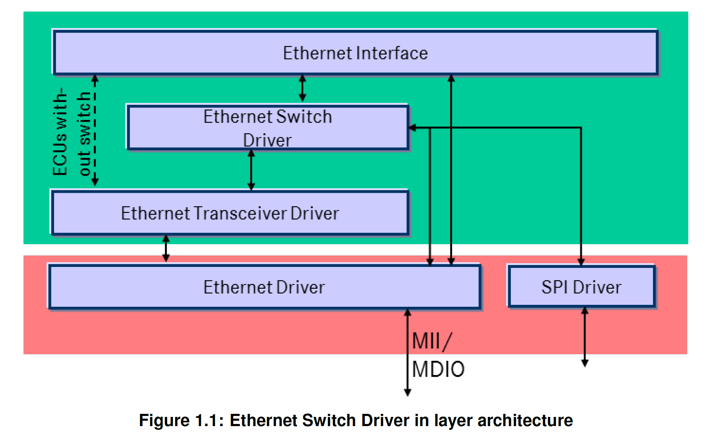

## 2. 缩略语、缩写和定义

下面的词汇表包含与以太网交换机驱动程序模块相关、但未包含在[6, AUTOSAR 术语表]中的缩略语、缩写和定义。

### 2.1. 缩略语和缩写

**DEM**

> 诊断事件管理器模块（**Diagnostic Event Manager module**）。

**EcuM**

> ECU状态管理器模块（**ECU State Manager module**）。

**Eth**

> 以太网控制器驱动程序（**Ethernet Controller Driver**，AUTOSAR BSW模块）。

**EthIf**

> 以太网接口（**Ethernet Interface**，AUTOSAR BSW模块）。

**EthTrcv**

> 以太网收发器驱动程序（**Ethernet Transceiver Driver**，AUTOSAR BSW模块）。

**MII**

> 媒体独立接口（**Media Independent Interface**，以太网控制器提供的用于访问以太网收发器的标准化接口）。

**MDIO**

> 管理数据输入/输出（**Management Data Input/Output**）。

**OA TC10**

> Open Alliance TC10规范（见[7]）。

### 2.2. 定义

#### 2.2.1. Ethernet packet

定义：「以太网分组」（**Ethernet packet**）是由[8, IEEE Std 802.3-2022]定义的线上格式，它包括以下部分：前导码（**Preamble**，7字节）、SFD（帧起始定界符，1字节）、以太网帧（最多2000字节）。

#### 2.2.2. Ethernet frame

定义：「以太网帧」（**Ethernet frame**）是由[8, IEEE Std 802.3-2022]定义的线上格式，它包括以下部分：MAC目的地址字段（6字节）、MAC源地址字段（6字节）、类型字段（2字节）、MAC客户数据字段（包含可选的Q-Tag（4字节））（最多1982字节）、可选的PAD（填充字节）、FCS（帧校验序列，4字节）。

#### 2.2.3. Stream

定义：「流」（**stream**）表示多个按照相似帧属性（如MAC源地址）分组的以太网帧。

#### 2.2.4. Stream identification

定义：「流识别」（**Stream identification**）一词源自[9, IEEE Std 802.1Q-2022]，表示基于一组特定的帧属性来标识所接收以太网帧的功能。携带不同帧属性集合的帧只能被识别为单个流。

## 3. 相关文档

### 3.1. 输入文件和相关标准与规范

- [1] 分层软件架构 AUTOSAR_CP_EXP_LayeredSoftwareArchitecture
- [2] 以太网接口规范 AUTOSAR_CP_SWS_EthernetInterface
- [3] 以太网收发器驱动程序规范 AUTOSAR_CP_SWS_EthernetTransceiverDriver
- [4] 以太网驱动程序规范 AUTOSAR_CP_SWS_EthernetDriver
- [5] SPI处理器/驱动程序规范 AUTOSAR_CP_SWS_SPIHandlerDriver
- [6] AUTOSAR 术语表 AUTOSAR_FO_TR_Glossary
- [7] OPEN Sleep/Wake-up Specification for Automotive Ethernet http://www.opensig.org/Automotive-Ethernet-Specifications/
- [8] IEEE 802.3-2022 https://www.ieee802.org/3/
- [9] IEEE 802.1Q-2022 - IEEE Standard for Local and Metropolitan Area Network Bridges and Bridged Networks https://ieeexplore.ieee.org/
- [10] 基本软件模块通用规范 AUTOSAR_CP_SWS_BSWGeneral
- [11] AUTOSAR中对以太网支持的需求 AUTOSAR_CP_SRS_Ethernet
- [12] 基本软件模块的通用需求 AUTOSAR_CP_SRS_BSWGeneral
- [13] IEEE 802.1Q-2018 - IEEE Standard for Local and Metropolitan Area Network Bridges and Bridged Networks https://ieeexplore.ieee.org/
- [14] IEEE 802.1CB-2017 - IEEE Standard for Local and Metropolitan Area Network Frame Replication and Elimination for Reliability https://ieeexplore.ieee.org/
- [15] 基于以太网的时间同步规范 AUTOSAR_CP_SWS_TimeSyncOverEthernet
- [16] NV RAM管理器规范 AUTOSAR_CP_SWS_NVRAMManager

### 3.2. 相关规范

AUTOSAR提供了基本软件的通用规范[10, SWS_BSWGeneral]，它对以太网交换机驱动程序同样有效。

因此，规范SWS_BSWGeneral [10]、SRS_Ethernet [11]应被视为以太网交换机驱动程序的附加且必需的规范。

## 4. 约束和假设

### 4.1. 约束

必须考虑以下约束：

- 以太网交换机驱动程序模块只能处理单一线程的执行。执行不得被其自身抢占。
- 实现限于10 Mbit/s、100 Mbit/s和1000 Mbit/s的以太网带宽，以及经由（千兆）媒体独立接口（**xMII**）连接的PHY。
- 不支持经由SPI与以太网交换机连接的外部MACPHY。
- 以太网交换机驱动程序只支持具备VLAN感知能力（**VLAN-aware**）的以太网交换机。
- 以太网交换机驱动程序只支持被动流识别（**passive stream identification**）。不支持主动流识别，因此不支持诸如帧复制（**frame replication**）之类的特性。
- 流识别在对外方向上加以考虑。因此，流识别仅应用于入口侧。
- 以太网交换机驱动程序只支持IEEE规定的以太网交换机转发过程的一个子集。表4.1概述了IEEE规定的哪些转发处理步骤被AUTOSAR覆盖：

表4.1：AUTOSAR对IEEE规定的网桥执行顺序的覆盖（**AUTOSAR coverage of IEEE specified bridge execution order**）

| IEEE规定的网桥执行顺序 | AUTOSAR的覆盖 |
| --- | --- |
| 默认优先级分配（[AC]:13.1） | n/a |
| 占位符MacSEC（包含相应的过滤机制） | n/a |
| EISS的支持（[Q]:6.9.1） | n/a |
| 帧类型接受过滤器（[Q]:6.9 f)） | 覆盖（见第[6.5.2.1](#6521-确保vlan-id和优先级的可用性)节） |
| 入口VID转换（[Q]:6.9 f)） | n/a |
| 基于端口的VLAN分类（[Q]:6.9 d)）异或 基于端口和协议的VLAN分类（[Q]:6.12） | 覆盖「基于端口的VLAN分类」（见第[6.5.2.1](#6521-确保vlan-id和优先级的可用性)节） |
| 优先级代码点解码（[Q]:6.9.3） | 覆盖「优先级的推导」（见第[6.5.2.1](#6521-确保vlan-id和优先级的可用性)节） |
| 优先级再生（[Q]:6.9.4） | 覆盖（见第[6.5.2.2](#6522-优先级代码点再生)节） |
| 对外输入流识别功能（[CB]:9.1.1.5） | 覆盖（见第[6.5.2.1](#6521-确保vlan-id和优先级的可用性)节） |
| 占位符FRER功能 | n/a |
| 对内输出流识别功能（[CB]:9.1.1.2） | n/a |
| 主动拓扑强制（[Q]:8.6.1） | n/a |
| 入口过滤（[Q]:8.6.2） | 覆盖（见第[6.5.2.4](#6524-入口过滤)节） |
| 帧过滤（[Q]:8.6.3） | 覆盖（见第[6.5.2.5](#6525-帧过滤)节） |
| 出口过滤（[Q]:8.6.4） | 覆盖（见第[6.5.2.6](#6526-出口过滤)节） |
| 流过滤（[Q]:8.6.5.3）（选择过程） | 覆盖（见第[6.5.2.7](#6527-每流过滤和监管)节） |
| 最大SDU大小过滤（[Q]:8.6.5.3.1） | 覆盖（见第[6.5.2.7](#6527-每流过滤和监管)节） |
| 流门控（[Q]:8.6.5.4） | 覆盖（见第[6.5.2.7](#6527-每流过滤和监管)节） |
| 流量计量（[Q]:8.6.5.5） | 覆盖（见第[6.5.2.7](#6527-每流过滤和监管)节） |
| ATS资格时间分配（[Q]:8.6.5.6） | 覆盖（见第[6.5.2.7](#6527-每流过滤和监管)节） |
| 对内输入流识别功能（[CB]:9.1.1.4） | n/a |
| 占位符FRER功能 | n/a |
| 对外输出流识别功能（[CB]:9.1.1.3） | n/a（注意：只支持被动流识别） |
| 帧排队（[Q]:8.6.6） | 覆盖（见第[6.5.2.9](#6529-传输选择算法)节） |
| 整形器以及传输选择和排队管理 | 覆盖（见第[6.5.2.9](#6529-传输选择算法)节） |
| 优先级代码点编码（[Q]:6.9.3） | 覆盖（见第[6.5.2.10](#65210-网络上的传输)节） |
| 出口VID转换（[Q]:6.9 g)） | n/a |
| EISS的支持（[Q]:6.9.2） | 覆盖「VLAN转发带标记或不带标记」（见第[6.5.2.10](#65210-网络上的传输)节） |
| 占位符MacSEC（包含相应的分类机制） | n/a |

### 4.2. 假设

必须考虑以下假设：

- 根据以太网硬件的不同，实现可能有必要在异步/同步行为方面偏离API规范。

### 4.3. 汽车域的适用性

以太网BSW堆栈适用于需要高数据速率但不要求硬实时的场合。当然，它也可以用于要求较低的用例，即低数据速率的场合。

## 5. 对其他模块的依赖

本章列出与以太网交换机驱动程序模块交互的模块。

使用以太网交换机驱动程序模块的模块：

- 以太网接口（**EthIf**）调用以太网交换机驱动程序来初始化和访问交换机设备。

以太网交换机驱动程序模块使用的模块：

- 以太网控制器驱动程序（**Eth**），用于经由媒体独立接口（**MII**）访问收发器。
- 以太网收发器驱动程序（**EthTrcv**），用于配置PHY端口以及控制/检查端口。
- 以太网交换机设备的配置既可以通过MDIO也可以通过SPI进行。在SPI接口的情况下，需要访问SPI模块。

对其他模块的依赖：

- 在某些系统上，以太网交换机可能与其他组件共享资源，并且可能依赖于它们的配置。如果这些资源位于其他模块的范围内（如PLL配置、内存映射等），以太网交换机驱动程序模块不负责配置这些组件，而是要求它们先完成初始化。

## 6. 功能规格

### 6.1. 以太网BSW堆栈

作为图7.1所示的AUTOSAR分层软件架构的一部分，以太网BSW模块也构成一个分层的软件堆栈。

图7.1描绘了基本的以太网BSW堆栈。**EthIf**模块使用一个或多个以太网交换机驱动程序模块来访问多个交换机。以太网收发器驱动程序的角色是配置和控制集成在交换机中或连接到交换机的物理层端口（**PHY**）。而以太网交换机驱动程序的角色是配置和控制交换机。如果以太网接口想要访问一个PHY，它必须使用交换机驱动程序的API，后者将API调用转发给所寻址的收发器驱动程序。

通过将收发器驱动程序与交换机驱动程序分离，可以支持不同的硬件架构。在硬件变体1中，PHY是来自不同厂商的独立设备。它们经由MII和MDIO连接到集成在微控制器中的交换机。在硬件变体2中，交换机集成了PHY。在硬件变体3中，微控制器可以通过MDIO或SPI控制交换机，并且交换机有三个外部PHY，它们可以通过MDIO控制。在这种情况下，可能出现不同的以太网收发器驱动程序。

请注意，交换机的入口端口和出口端口的功能行为是在交换机设备的硬件中实现的（见[13]）。因此，第10章的配置在某些部分必须写入交换机设备。

图7.1：以太网BSW堆栈的基本结构。（注意：不同的硬件变体是可选的设置）

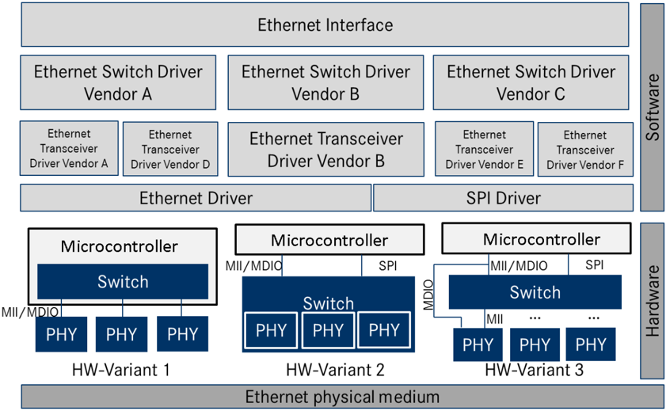

以太网交换机驱动程序的使用者使用如图7.2所示的索引方案来标识交换机资源。

图7.2：以太网交换机驱动程序的索引方案（**Ethernet Switch Driver indexing scheme**）

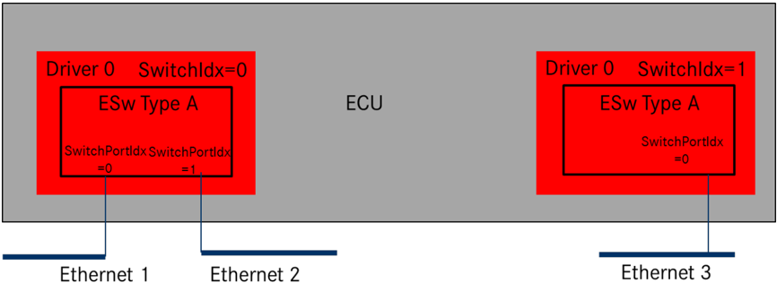

以太网交换机驱动程序应使用从零开始的索引来为上层软件抽象访问。

SwitchPortIdx是交换机上一个端口的索引。

配置中的参数EthSwtIdx应与API中使用的参数相对应。

参数EthSwtIndex应用于区分交换机驱动程序模块的不同实例，以防在调用API **Det_ReportError** (uint16 ModuleId, uint8 InstanceId, uint8 ApiId, uint8 ErrorId)时使用。

如果在一个ECU中使用不同的交换机设备，则必须修改不同以太网交换机驱动程序的函数名，使得不会生成两个同名函数。用户有责任确保不会配置两个同名函数。这些名称可以用厂商ID或类型ID扩展。

### 6.2. 以太网交换机端口镜像

以太网交换机端口镜像利用以太网交换机硬件的通用既有功能，将一个或多个以太网交换机端口（被镜像端口）的流量镜像到另一个以太网交换机端口（采集端口）。镜像配置由端口镜像配置给出（见第7.2.5节）。端口镜像配置按以太网交换机设置。该配置由以太网交换机驱动程序持久化存储。因此，使用一个影子缓冲区（**shadow buffer**）在运行期间存储端口镜像配置，并按照NvM存储策略持久化存储（如在ECU关机时持久化存储影子缓冲区）。端口镜像配置可以通过专用的API显式地激活和停用。端口镜像由一个专用的诊断CDD控制，该CDD接收诊断请求并将其转发给以太网交换机驱动程序。

应通过调用[**EthSwt_WritePortMirrorConfiguration**](#7340-ethswt_writeportmirrorconfiguration)将端口镜像配置（见第7.2.5节）写入以太网交换机驱动程序中每个以太网交换机的影子缓冲区。

注意：每个以太网交换机维护一个端口镜像配置。

应通过调用[**EthSwt_SetPortMirrorState**](#7344-ethswt_setportmirrorstate)按以太网交换机启用和停用端口镜像配置。所存储的端口镜像配置的当前状态应被持久化存储，以在ECU复位后仍保持有效，并在ECU复位之后恢复端口镜像活动。

应通过调用[**EthSwt_DeletePortMirrorConfiguration**](#7342-ethswt_deleteportmirrorconfiguration)将所存储的端口镜像配置标记为「待删除」，前提是给定以太网交换机索引的端口镜像已被禁用（见第7.3.44节）。否则，删除端口镜像配置的请求应被拒绝。

注意：影子缓冲区按照NvM存储策略持久化存储，例如在ECU关机时持久化存储影子缓冲区。

当前的端口镜像状态应通过调用[**EthSwt_GetPortMirrorState**](#7343-ethswt_getportmirrorstate)返回。

每个以太网交换机的端口镜像配置应通过调用[**EthSwt_ReadPortMirrorConfiguration**](#7341-ethswt_readportmirrorconfiguration)返回。

### 6.3. 状态处理

除了[**EthSwt_SetSwitchPortMode**](#732-ethswt_setswitchportmode)、[**EthSwt_GetSwitchPortMode**](#733-ethswt_getswitchportmode)、[**EthSwt_StartSwitchPortAutoNegotiation**](#734-ethswt_startswitchportautonegotiation)、[**EthSwt_GetLinkState**](#737-ethswt_getlinkstate)、[**EthSwt_GetBaudRate**](#738-ethswt_getbaudrate)、[**EthSwt_GetDuplexMode**](#739-ethswt_getduplexmode)、[**EthSwt_ReadTrcvRegister**](#7318-ethswt_readtrcvregister)、[**EthSwt_WriteTrcvRegister**](#7319-ethswt_writetrcvregister)、[**EthSwt_Init**](#731-ethswt_init)、[**EthSwt_MainFunction**](#751-ethswt_mainfunction)和[**EthSwt_BackgroundTask**](#752-ethswt_backgroundtask)之外的所有函数只能在状态**ETHSWT_STATE_ACTIVE**下调用。

如果只能在状态**ETHSWT_STATE_PORTINIT_COMPLETED**和**ETHSWT_STATE_ACTIVE**下运行（以E_OK成功）的函数在达到状态**ETHSWT_STATE_PORTINIT_COMPLETED**之前被调用，以太网交换机驱动程序应引发运行时错误**ETHSWT_INIT_NOT_COMPLETED**。

应在端口初始化完成后立即达到**ETHSWT_STATE_PORTINIT_COMPLETED**。

注意：**ETHSWT_STATE_PORTINIT_COMPLETED**既可以通过函数[**EthSwt_Init**](#731-ethswt_init)达到，也可以通过后台任务达到（见第7.5.2节）。

当以太网交换机初始化完成时应达到**ETHSWT_STATE_ACTIVE**。

注意：以太网交换机的初始化比以太网交换机端口的初始化耗时更长。

### 6.4. 线缆诊断的处理

线缆诊断测量通过调用[**EthSwt_RunPortCableDiagnostic**](#7348-ethswt_runportcablediagnostic)触发。线缆诊断测量的当前状态通过调用[**EthSwt_GetPortCableDiagnosticsResult**](#7349-ethswt_getportcablediagnosticsresult)轮询。如果[**EthSwt_GetPortCableDiagnosticsResult**](#7349-ethswt_getportcablediagnosticsresult)返回ETHTRCV_CABLEDIAG_PENDING以外的值，则线缆诊断已结束。

如果测量通过返回ETHTRCV_CABLEDIAG_ERROR而失败，由调用者决定是否再次触发线缆诊断。

线缆诊断API（[**EthSwt_RunPortCableDiagnostic**](#7348-ethswt_runportcablediagnostic)、[**EthSwt_GetPortCableDiagnosticsResult**](#7349-ethswt_getportcablediagnosticsresult)）只应对其端口引用了以太网收发器的以太网交换机的以太网交换机端口调用。

注意：上层是触发线缆诊断测量并维护线缆诊断结果的CDD。**EthSwt**将API调用转发给**EthTrcv**（见第7.3.48节和第7.3.49节）。

### 6.5. 功能描述

#### 6.5.1. 启动时的学习阶段

交换机驱动程序应支持一个可以分为若干个顺序步骤的学习阶段。

注意：在网络组装并首次上电之后，依次进行三个学习阶段，其中包括MAC学习和IP地址分配。随后，将学习到的参数存储到一个或多个非易失性存储器中，以便在后续启动时可用。图7.3展示该过程。作为触发该过程的示例，**DCM**通过总线系统或以太网网络中的广播消息接收到诊断请求。该诊断请求可以转发给一个SWC，由其触发自动配置过程。不过，该触发器不属于本规范的一部分。

图7.3：学习过程（**Learning Process**）

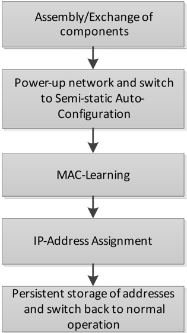

MAC学习（可选步骤）：在这个阶段，消息需要通过网络发送，交换机将学习新的MAC地址（参见图7.4）。除了预定义的地址（如在车辆网络设计期间配置的组播MAC地址）之外，这些MAC地址也将被存储。如果执行静态学习，即MAC地址将被持久化存储，那么就有可能向表中添加动态学习的条目。

如果交换机硬件支持软件MAC学习，并且交换机硬件期望一个外部微控制器（见图7.1中的变体2和3），则携带未知MAC源地址的分组将被路由到该微控制器。MAC学习由集成代码完成。本规范有意不定义该算法位于AUTOSAR堆栈中的哪个位置，因为这可能需要一个高度时间优化的解决方案。

图7.4：交换机内的MAC学习（**MAC-learning within the switch**）

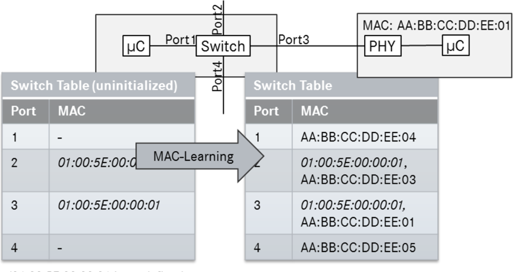

IP地址分配：在这个阶段，没有预定义IP地址的ECU将开始通过DHCP获取IP地址（参见图7.5）。因此，这些ECU将运行DHCP客户端，而带有交换机的ECU将运行DHCP服务器。为了能够始终将相同的IP地址分配给某个节点，DHCP服务器需要知道MAC地址是在哪个端口接收到的信息。此端口信息可以解释为互联网中的「域名」，它使用域名服务器（**DNS**）解析为一个IP地址。DHCP服务器利用该端口信息，按照IP分配表将IP地址分配给该节点。如上所述，这使得Tier 1能够分配MAC地址，而OEM能够分配IP地址。通过这种机制，还可以在同一端口上为多个VLAN分配不同的IP地址。为此，IP分配表需要扩展一个VLAN列。请注意，MAC学习阶段可以与该阶段合并。

图7.5：经由DHCP的IP地址分配（**IP-address assignment via DHCP**）

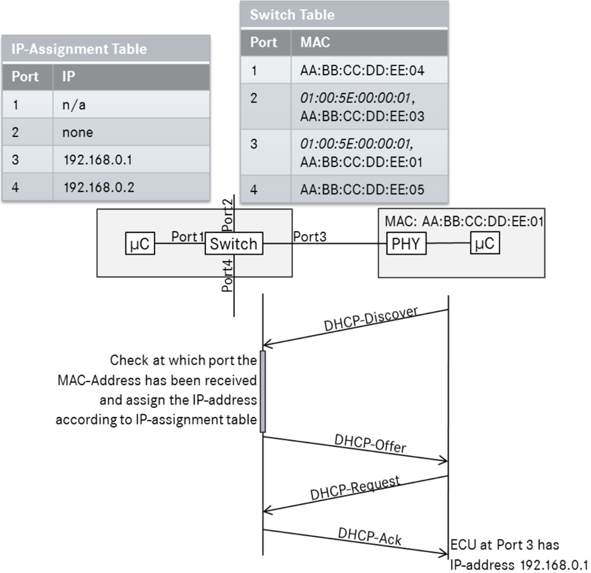

函数[**EthSwt_StoreConfiguration**](#7321-ethswt_storeconfiguration)应请求以持久化的方式存储交换机已学习的MAC/端口表的配置。这可以通过两种方式完成：1.）读出这些参数，并使用NV RAM管理器将它们存储在主机CPU的NV RAM中；2.）指示交换机将配置数据存储在其本地NV RAM中。

在这两种方式中，如果配置了**EthSwtPersistentConfigurationResultCallback**，则应调用&lt;EthSwtPersistentConfigurationResultCallback&gt;。在存储到交换机本地NV RAM的情况下，JobResult应设置为**NVM_REQ_OK**以指示成功，或设置为**NVM_REQ_NOT_OK**以指示失败。

函数[**EthSwt_ResetConfiguration**](#7322-ethswt_resetconfiguration)应请求以持久化的方式重置交换机已学习的MAC/端口表的配置。这可以通过两种方式完成：1.）用预配置的默认值覆盖主机CPU NV RAM中已学习的参数；2.）指示交换机重置其本地NV RAM中已学习的配置数据。

在这两种方式中，如果配置了**EthSwtPersistentConfigurationResultCallback**，则应调用&lt;EthSwtPersistentConfigurationResultCallback&gt;。在存储到交换机本地NV RAM的情况下，JobResult应设置为**NVM_REQ_OK**以指示成功，或设置为**NVM_REQ_NOT_OK**以指示失败。

函数[**EthSwt_GetPortMacAddr**](#7310-ethswt_getportmacaddr)应返回在已索引的交换机内可以通过哪个端口索引访问给定的MAC地址。如果为PortIdxPtr返回了最大可能值（255），则给定的MAC地址无法通过该交换机的任何端口访问。如果找到了多个端口，API返回**E_NOT_OK**。

以太网交换机驱动程序应支持一个API，允许使用API [**EthSwt_ResetConfiguration**](#7322-ethswt_resetconfiguration)重置已学习的参数（如地址解析表）。

如果配置中存在参数**EthSwtArlTableEntryTimeout**，则未使用的ARL表条目应在该参数配置的超时之后从ARL表中移除。

#### 6.5.2. 帧转发过程

如图7.6所示，以太网交换机由一定数量的以太网交换机端口组成。一个物理以太网端口在逻辑上被划分为入口端口和出口端口。帧由以太网交换机端口以入口端口的角色接收。该帧在以太网交换机内被处理，并很可能被转发到一个或多个以出口端口角色工作的以太网交换机端口。这个过程称为「帧转发过程」（**frame forwarding process**）。帧转发过程尤其考虑以下几点：

- 以太网帧通常不会被转发到接收它的那个以太网交换机端口。
- 单播以太网帧可以被恰好转发到一个出口端口。（请注意，由于某些原因（如镜像或未知单播以太网帧），单播以太网帧也可能被转发到多个出口端口。）
- 组播以太网帧（如SOME/IP-SD offer帧）可以被转发到一个或多个出口端口。
- 广播以太网帧（如ARP帧）被转发到除接收该帧的以太网交换机端口之外的所有出口端口。

请注意：帧在以太网交换机内从入口端口到一个或多个出口端口的路径称为「内部帧路径」（**internal frame route**）。

图7.6：以太网交换机内简化的帧转发过程（**Simplified frame forwarding process within an Ethernet switch**）

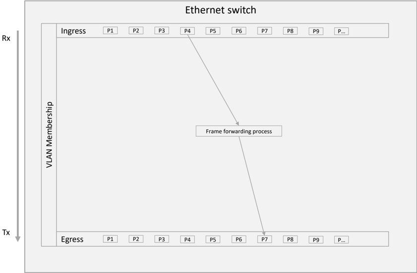

转发过程由多个帧处理阶段组成。某些帧处理阶段总是执行（如VLAN成员关系检查），而某些帧处理阶段在配置后才执行（如流量计量）。帧处理阶段可以将接收到的帧判定为无效。这样的帧会被丢弃，因此不会转发给后续的帧处理阶段。[9, IEEE Std 802.1Q]规定了帧转发过程和特定的帧处理阶段。图7.7展示了AUTOSAR支持的处理阶段概览（请参阅第[4.1](#41-约束)节）。

图7.7：AUTOSAR支持的以太网交换机内帧处理阶段概览（**Overview of frame processing stages within an Ethernet switch supported by AUTOSAR**）

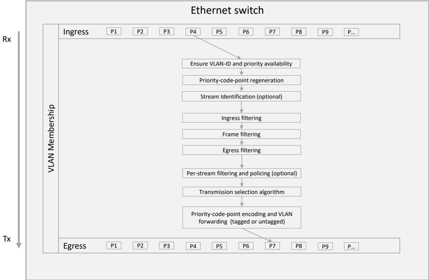

最常见的情况是，以太网帧在以太网交换机中不被修改。影响以太网帧属性（如VLAN-ID、优先级）的重要信息在穿过各个处理阶段时被保存在每个以太网帧的一个单独的内存区域中。在本规范中，这样的区域称为「以太网帧元信息」（**Ethernet frame meta information**）。当一个以太网帧到达入口端口时，会为该以太网帧分配一个以太网帧元信息。以太网帧元信息包含重要的状态值（如流句柄ID（**stream handle id**）、出站优先级值）。以太网帧元信息中的可用条目可以被更新（如目的端口向量、优先级）。以太网帧元信息在内部帧路径上始终可用。在最后一个处理阶段，所有影响以太网帧属性的以太网帧元信息的相关条目都被写入以太网帧。

以下各章描述所支持的处理阶段的行为。

##### 6.5.2.1. 确保VLAN-ID和优先级的可用性

AUTOSAR以太网交换机专门支持VLAN感知（参阅第[4.1](#41-约束)节）。如果接收到一个以太网帧，AUTOSAR以太网交换机会在转发到下一个处理阶段之前确保该以太网帧具有VLAN-ID和优先级。为此，以太网交换机执行所谓的「帧类型接受过滤器」（**frame type acceptance filter**）、「基于端口的VLAN分类」（**port-based VLAN classification**）和「优先级代码点解码」（**priority-code-point decoding**）。以下各章描述如何确保VLAN-ID和优先级的可用性。

###### 6.5.2.1.1. 无标记以太网帧的处理

携带设置为0x8100的TPID的以太网帧被视为带标记（**tagged**）的以太网帧，即它们携带一个VLAN标记。对于未携带VLAN标记接收到的以太网帧，可以通过AUTOSAR以太网交换机驱动程序配置特定的以太网交换机处理方式。

在入口侧处理无标记以太网帧有两种方式：

- 在接收到该以太网帧的以太网端口的入口侧丢弃所有无标记以太网帧。
- 在入口侧为所有无标记以太网帧打上一个默认VLAN和默认VLAN优先级的标记。

注意：以太网交换机对无标记以太网帧的处理预期在VLAN的所有其他修改（如VLAN修改）之前执行。这也适用于VLAN优先级处理，其预期在执行流量类别分配（见后续章节）之前完成。

基本上，以太网交换机会在内部为其内部处理用硬件特定的默认VLAN标记值为所有以太网帧打标记。该硬件特定的默认值可以通过**EthSwtPortIngressDefaultVlan**和**EthSwtPortIngressDefaultPriority**按以太网交换机端口覆盖。

如果某个特定以太网端口的**EthSwtPortIngressDefaultVlan**和**EthSwtPortIngressDefaultPriority**可用，则该硬件以太网交换机端口的默认VLAN和默认优先级应配置为可用值。

实现提示：VLAN标记由VLAN-ID和VLAN优先级组成。

如果某个特定入口端口的**EthSwtPortIngressDropUntagged**设置为TRUE，而参数**EthSwtPortIngressDefaultVlan**和**EthSwtPortIngressDefaultPriority**已配置（两个参数的多重性均为0），则该入口端口的配置应被视为无效而拒绝。

如果某个特定入口端口的参数**EthSwtPortIngressDropUntagged**设置为TRUE，并且在该特定入口端口接收到一个不带VLAN标记的以太网帧（无标记以太网帧），则应丢弃该以太网帧。

某个特定入口端口的配置应当要么同时配置参数**EthSwtPortIngressDefaultVlan**和**EthSwtPortIngressDefaultPriority**，要么两者都不配置。

如果某个特定入口端口的参数**EthSwtPortIngressDropUntagged**设置为FALSE，参数**EthSwtPortIngressDefaultVlan**和**EthSwtPortIngressDefaultPriority**已配置，并且在该特定入口端口接收到一个不带VLAN标记的以太网帧（无标记以太网帧），则应为该以太网帧分配默认VLAN和默认优先级，并由以太网交换机对其进行进一步处理。

注意：如果一个以太网帧要在特定出口端口上以特定VLAN-ID不带VLAN标记（无标记以太网帧）发送，则需要将该VLAN-ID在此以太网端口上的**EthSwtVlanForwardingType**设置为**ETHSWT_SENT_UNTAGGED**（见第[6.5.2.4.1](#65241-vlan成员关系)节）。

###### 6.5.2.1.2. 双标记以太网帧的处理

AUTOSAR支持按以太网交换机配置对所谓「双标记」（**double tagged**）以太网帧的处理。双标记以太网帧包含两个VLAN标记。第一个标记称为「S-TAG」（服务提供商标记），第二个标记称为「C-TAG」（客户标记）。默认情况下，支持双标记帧的转发。在转发过程中考虑S-TAG。对于某些用例，有必要避免处理此类以太网帧。因此提供了一个布尔参数**EthSwtDropDoubleTagged**。如果以太网交换机硬件支持丢弃双标记以太网帧，则以太网交换机驱动程序支持通过配置参数**EthSwtDropDoubleTagged**配置丢弃双标记帧。

如果参数**EthSwtDropDoubleTagged**设置为TRUE，则应丢弃双标记以太网帧，而不管该以太网帧是在哪个以太网交换机端口上接收的。

注意：双标记以太网帧的丢弃取决于外部VLAN标记的TPID配置。

##### 6.5.2.2. 优先级代码点再生

如果一个以太网帧通过了确保VLAN-ID和优先级可用性的处理阶段，则执行所谓的「优先级再生」（**priority regeneration**）。该处理步骤是强制性的，并且始终执行。接收到的以太网帧的VLAN标记内的PCP字段（优先级代码点）可以在以太网交换机的入口端口处被修改。为此，必须定义一个所谓的优先级再生表：

表7.1：在该表中，「Ingress PCP」被映射到「Regenerated PCP」。（**Priority Regeneration Table**）

| Priority Regeneration Table | 0 | 1 | 2 | 3 | 4 | 5 | 6 | 7 |
| --- | --- | --- | --- | --- | --- | --- | --- | --- |
| Ingress PCP | 0 | 1 | 2 | 3 | 4 | 5 | 6 | 7 |
| Regenerated PCP | 0 | 1 | 2 | 3 | 4 | 5 | 6 | 7 |

交换机配置应支持配置如何修改传入以太网帧的PCP字段之后再将其转发到出口端口，即可以配置一个优先级再生表（请参阅[**EthSwtPortPriorityRegeneration**](#9135-ethswtportpriorityregeneration)、**EthSwtPortPriorityRegenerationIngressPCP**和**EthSwtPortPriorityRegenerationRegeneratedPriority**）。

如果以太网帧在以太网交换机内被转发，则以太网交换机应对该以太网帧的PCP执行PCP再生，考虑该以太网帧被接收所在的[**EthSwtPortIngress**](#9131-ethswtportingress)处可用的已配置优先级再生表（见[**EthSwtPortPriorityRegeneration**](#9135-ethswtportpriorityregeneration)、**EthSwtPortPriorityRegenerationIngressPCP**和**EthSwtPortPriorityRegenerationRegeneratedPriority**）。

请注意：如果不需要修改，则PCP ingress和PCP regenerated应具有相同的值。

##### 6.5.2.3. 流识别

如果一个以太网帧通过了「优先级代码点再生」，那么如果配置了该处理阶段，以太网交换机就可以执行所谓的「流识别」（**stream identification**）。否则，以太网交换机将以太网帧转发到下一个处理阶段「入口过滤」。

[14, IEEE Std 802.1CB]定义了流识别。流识别是在后续处理阶段执行「每流过滤和监管」（**per-stream filtering and policing**）的强制前提条件。流识别功能用于根据特定的以太网帧属性标识以太网帧。如果该以太网帧匹配，则为其分配一个所谓的「流句柄ID」（**stream handle id**）。因此，该流句柄ID被添加到以太网帧元信息中。当该以太网帧到达「每流过滤和监管」处理阶段时，该流句柄ID用于查找相应的[**EthSwtStreamFilterEntry**](#9118-ethswtstreamfilterentry)以执行如流量计量等操作。

如果以太网交换机硬件支持该特性，则可以通过子容器[**EthSwtStreamIdentificationTable**](#9139-ethswtstreamidentificationtable)进行配置。[**EthSwtStreamIdentificationTable**](#9139-ethswtstreamidentificationtable)表示一个表，其中多个[**EthSwtStreamIdentificationEntry**](#9140-ethswtstreamidentificationentry)构成一个有序列表。每个条目表示一个流识别定义。流识别定义适用于以太网交换机内的流。以太网帧（即流）由入口端口接收。流识别的定义可以依赖于入口端口，也可以独立于入口端口。因此，一个流识别可以引用0...n个入口端口（[**EthSwtPortIngress**](#9131-ethswtportingress)）。

如果配置了一个[**EthSwtStreamIdentificationEntry**](#9140-ethswtstreamidentificationentry)，则该[**EthSwtStreamIdentificationEntry**](#9140-ethswtstreamidentificationentry)应当可以通过**EthSwtStreamIdentificationIngressPortRef**引用 none、一个或多个入口端口。

如果[**EthSwtStreamIdentificationEntry**](#9140-ethswtstreamidentificationentry)引用了一个或多个入口端口，则应对经由任何被引用入口端口接收的流进行流识别处理。

如果[**EthSwtStreamIdentificationEntry**](#9140-ethswtstreamidentificationentry)没有引用任何入口端口，则应对经由任何入口端口接收的所有流进行流识别处理。

如果已配置的[**EthSwtStreamIdentificationEntry**](#9140-ethswtstreamidentificationentry)引用了一个[**EthSwtPortIngress**](#9131-ethswtportingress)，则该流识别定义应当只引用该[**EthSwtPortIngress**](#9131-ethswtportingress)一次。

引用入口端口的[**EthSwtStreamIdentificationEntry**](#9140-ethswtstreamidentificationentry)的配置定义了[**EthSwtStreamIdentificationEntry**](#9140-ethswtstreamidentificationentry)与接收到的以太网帧（即流）在以太网交换机内的流路径之间的依赖关系。因此，该流路径称为「内部流路径」（**internal stream route**）。

如果接收到一个以太网帧（即流），则应由内部流路径与之匹配的已配置[**EthSwtStreamIdentificationEntry**](#9140-ethswtstreamidentificationentry)进行流识别处理。

多个[**EthSwtStreamIdentificationEntry**](#9140-ethswtstreamidentificationentry)被配置为[**EthSwtStreamIdentificationTable**](#9139-ethswtstreamidentificationtable)的有序列表。列表中的位置由**EthSwtStreamIdentificationPosition**的配置值定义。以太网交换机按升序处理该列表。一旦第一个[**EthSwtStreamIdentificationEntry**](#9140-ethswtstreamidentificationentry)匹配，以太网交换机将按照与该[**EthSwtStreamIdentificationEntry**](#9140-ethswtstreamidentificationentry)关联的配置来处理该以太网帧。后续的[**EthSwtStreamIdentificationEntry**](#9140-ethswtstreamidentificationentry)将不再被应用。如果接收到的以太网帧不匹配任何[**EthSwtStreamIdentificationEntry**](#9140-ethswtstreamidentificationentry)，则该以太网帧将被转发到下一个帧处理阶段。

每个[**EthSwtStreamIdentificationEntry**](#9140-ethswtstreamidentificationentry)都应具有通过**EthSwtStreamIdentificationPosition**配置的唯一位置值。该值应从0开始，并按升序连续排列，后续的[**EthSwtStreamIdentificationEntry**](#9140-ethswtstreamidentificationentry)之间没有间隔。

注意：位置值构成[**EthSwtStreamIdentificationEntry**](#9140-ethswtstreamidentificationentry)的有序列表。

如果接收到一个以太网帧（即流），则以太网交换机应按**EthSwtStreamIdentificationPosition**升序检查匹配的[**EthSwtStreamIdentificationEntry**](#9140-ethswtstreamidentificationentry)，从配置值为0的**EthSwtStreamIdentificationPosition**开始。

如果接收到的以太网帧（即流）不匹配任何[**EthSwtStreamIdentificationEntry**](#9140-ethswtstreamidentificationentry)，则该以太网帧应被转发到下一个帧处理阶段，而不应用任何进一步的流识别处理。

一个[**EthSwtStreamIdentificationEntry**](#9140-ethswtstreamidentificationentry)由[**EthSwtStreamFilterRule**](#9144-ethswtstreamfilterrule)（多重性1）、一个**EthSwtStreamHandleAssignment**（多重性1）以及可选元素[**EthSwtStreamFilterAction**](#9141-ethswtstreamfilteraction)组成。

[**EthSwtStreamIdentificationEntry**](#9140-ethswtstreamidentificationentry)的元素定义了过滤规则和过滤动作。执行流识别的顺序（应用过滤规则、执行过滤动作和进一步的流处理）是静态定义的。

如果接收到一个以太网帧（即流）且其内部流路径与已配置的[**EthSwtStreamIdentificationEntry**](#9140-ethswtstreamidentificationentry)匹配，则应按以下顺序进行流识别处理：

1. 应用[**EthSwtStreamFilterRule**](#9144-ethswtstreamfilterrule)。
2. 如果[**EthSwtStreamFilterRule**](#9144-ethswtstreamfilterrule)识别出匹配，则应将已配置的流句柄ID（见**EthSwtStreamHandleAssignment**）添加到以太网帧元信息中，并且如果配置了[**EthSwtStreamFilterAction**](#9141-ethswtstreamfilteraction)，则考虑要执行的过滤动作。

注意：

- 在哪个处理阶段执行已配置的[**EthSwtStreamFilterAction**](#9141-ethswtstreamfilteraction)是实现相关的。例如，如果过滤动作**EthSwtStreamFilterActionDropFrame**设置为TRUE并且识别出一个流，那么立即丢弃该以太网帧并中止转发过程是合理的。但如果过滤动作配置为[**EthSwtStreamFilterActionDestinationPortModification**](#9142-ethswtstreamfilteractiondestinationportmodification)，则该动作应在出口过滤完成后考虑。
- 如果过滤规则为空（未配置过滤规则原语（见第[6.5.2.3.1](#65231-流识别和过滤规则)节）），则以太网帧（即流）默认通过该过滤器。因此，已配置的流句柄ID（见**EthSwtStreamHandleAssignment**）被添加到以太网帧元信息中。流处理继续进行「入口过滤」。

如果一个[**EthSwtStreamIdentificationEntry**](#9140-ethswtstreamidentificationentry)没有定义任何可选元素，则它被视为一个空的流识别定义。因此，与空流识别定义的内部流路径匹配的传入以太网帧，默认总是被识别为该[**EthSwtStreamIdentificationEntry**](#9140-ethswtstreamidentificationentry)的匹配。

没有配置任何可选元素的已配置[**EthSwtStreamIdentificationEntry**](#9140-ethswtstreamidentificationentry)应被视为空流识别，传入的以太网帧总是通过。

###### 6.5.2.3.1. 流识别和过滤规则

一个[**EthSwtStreamIdentificationEntry**](#9140-ethswtstreamidentificationentry)总是配置有一个过滤规则（[**EthSwtStreamFilterRule**](#9144-ethswtstreamfilterrule)）。[**EthSwtStreamFilterRule**](#9144-ethswtstreamfilterrule)定义接收到的以太网帧的哪些部分被纳入过滤（如MAC源地址、IP目的地址等）。[**EthSwtStreamFilterRule**](#9144-ethswtstreamfilterrule)可以包含多个过滤规则。一个特定的过滤规则（如[**EthSwtStreamFilterMACDestAddress**](#9147-ethswtstreamfiltermacdestaddress)）称为「过滤规则原语」（**filter rule primitive**）。

如果一个[**EthSwtStreamFilterRule**](#9144-ethswtstreamfilterrule)配置了多个过滤规则原语（如[**EthSwtStreamFilterMACSrcAddress**](#9148-ethswtstreamfiltermacsrcaddress)和**EthSwtStreamFilterVlanId**），则这些过滤规则原语应被视为以AND方式连接的过滤规则。

注意：如果所有已配置的过滤规则原语都匹配，则接收到的以太网帧（即流）匹配该过滤器。例如，如果配置了[**EthSwtStreamFilterMACSrcAddress**](#9148-ethswtstreamfiltermacsrcaddress)和**EthSwtStreamFilterVlanId**，则只有当源MAC地址**AND** VLAN-ID都与定义的值匹配时，流才匹配。例如，仅[**EthSwtStreamFilterMACSrcAddress**](#9148-ethswtstreamfiltermacsrcaddress)匹配的流被视为不匹配的以太网帧。

如果接收到一个以太网帧（即流），该以太网帧的内部流路径与已配置的[**EthSwtStreamIdentificationEntry**](#9140-ethswtstreamidentificationentry)匹配，该[**EthSwtStreamIdentificationEntry**](#9140-ethswtstreamidentificationentry)的[**EthSwtStreamFilterRule**](#9144-ethswtstreamfilterrule)配置了过滤规则原语（如[**EthSwtStreamFilterMACSrcAddress**](#9148-ethswtstreamfiltermacsrcaddress)和**EthSwtStreamFilterVlanId**），并且该以太网帧匹配所有已配置的过滤规则原语，则该以太网帧应被判定为匹配的流。

如果接收到一个以太网帧（即流），该以太网帧的内部流路径与已配置的[**EthSwtStreamIdentificationEntry**](#9140-ethswtstreamidentificationentry)匹配，而该条目的[**EthSwtStreamFilterRule**](#9144-ethswtstreamfilterrule)中某个特定的过滤规则原语未配置，则该过滤规则原语应被视为匹配的过滤规则原语。

注意：现有[**EthSwtStreamFilterRule**](#9144-ethswtstreamfilterrule)中未配置的过滤规则原语称为「通配符过滤规则原语」（**wildcard filter rule primitive**）。为了将以太网帧（即流）判定为匹配的流，以太网帧必须匹配所有过滤规则原语，因为所有过滤规则原语都是以AND方式连接的。因此，一个空的[**EthSwtStreamFilterRule**](#9144-ethswtstreamfilterrule)（即未配置任何过滤规则原语）将匹配其内部帧路径与相应[**EthSwtStreamIdentificationEntry**](#9140-ethswtstreamidentificationentry)配置匹配的每一个接收到的以太网帧。

###### 6.5.2.3.2. 流识别和过滤动作

一个[**EthSwtStreamIdentificationEntry**](#9140-ethswtstreamidentificationentry)可以定义一个过滤动作（[**EthSwtStreamFilterAction**](#9141-ethswtstreamfilteraction)）。过滤动作描述了检测到匹配流时的预期行为。过滤动作始终引用同一个[**EthSwtStreamIdentificationEntry**](#9140-ethswtstreamidentificationentry)的过滤规则。

如果一个以太网帧（即流）被判定为匹配的流，并且配置了[**EthSwtStreamFilterAction**](#9141-ethswtstreamfilteraction)，则该过滤动作应应用于该以太网帧。

如果过滤动作应用于一个以太网帧（即流），并且相应的[**EthSwtStreamFilterAction**](#9141-ethswtstreamfilteraction)将**EthSwtStreamFilterActionDropFrame**设置为TRUE，则应丢弃该以太网帧。

如果过滤动作应用于一个以太网帧（即流），并且相应的[**EthSwtStreamFilterAction**](#9141-ethswtstreamfilteraction)将**EthSwtStreamFilterActionBlockSource**设置为TRUE，则应阻断该以太网帧以及随后所有携带相同源MAC地址的以太网帧的接收。

如果过滤动作应用于一个以太网帧（即流），并且相应的[**EthSwtStreamFilterAction**](#9141-ethswtstreamfilteraction)配置了[**EthSwtStreamFilterActionVlanModification**](#9143-ethswtstreamfilteractionvlanmodification)，则应使用由**EthSwtStreamFilterActionVlanModificationVlanId**给出的已配置VLAN-ID修改该以太网帧的VLAN-ID。

以太网交换机在转发过程中确定以太网帧的出口目的地。以太网帧的出口目的地可以包括一个或多个目的端口（出口端口）。如果配置了[**EthSwtStreamFilterActionDestinationPortModification**](#9142-ethswtstreamfilteractiondestinationportmodification)，则可以修改该出口目的地。用于修改的出口目的地被配置为对相应出口端口的引用。

如果配置了过滤动作[**EthSwtStreamFilterActionDestinationPortModification**](#9142-ethswtstreamfilteractiondestinationportmodification)，则用于修改的出口目的地应根据经由**EthSwtStreamFilterActionDestinationPortModificationEgressPortRef**配置的出口端口引用来确定。

如果配置了过滤动作[**EthSwtStreamFilterActionDestinationPortModification**](#9142-ethswtstreamfilteractiondestinationportmodification)，则该[**EthSwtStreamFilterActionDestinationPortModification**](#9142-ethswtstreamfilteractiondestinationportmodification)应当通过**EthSwtStreamFilterActionDestinationPortModificationEgressPortRef**只引用同一个[**EthSwtPortEgress**](#9123-ethswtportegress)一次。

如果过滤动作应用于一个以太网帧（即流），相应的[**EthSwtStreamFilterAction**](#9141-ethswtstreamfilteraction)配置了[**EthSwtStreamFilterActionDestinationPortModification**](#9142-ethswtstreamfilteractiondestinationportmodification)，并且**EthSwtStreamFilterActionDestinationPortModificationType**设置为**ETHSWT_STREAM_EGRESS_DESTINATION_OVERWRITE**，则该以太网帧的出口目的地应被已配置的出口目的地覆盖（见**EthSwtStreamFilterActionDestinationPortModificationEgressPortRef**）。

如果过滤动作应用于一个以太网帧（即流），相应的[**EthSwtStreamFilterAction**](#9141-ethswtstreamfilteraction)配置了[**EthSwtStreamFilterActionDestinationPortModification**](#9142-ethswtstreamfilteractiondestinationportmodification)，并且**EthSwtStreamFilterActionDestinationPortModificationType**设置为**ETHSWT_STREAM_EGRESS_DESTINATION_EXTEND**，则该以太网帧的出口目的地应扩展以包含已配置的出口目的地（见**EthSwtStreamFilterActionDestinationPortModificationEgressPortRef**）。

如果过滤动作应用于一个以太网帧（即流），相应的[**EthSwtStreamFilterAction**](#9141-ethswtstreamfilteraction)配置了[**EthSwtStreamFilterActionDestinationPortModification**](#9142-ethswtstreamfilteractiondestinationportmodification)，并且**EthSwtStreamFilterActionDestinationPortModificationType**设置为**ETHSWT_STREAM_EGRESS_DESTINATION_LIMIT**，则该以太网帧的出口目的地应扩展以包含已配置的出口目的地（见**EthSwtStreamFilterActionDestinationPortModificationEgressPortRef**），但仅限于根据出口端口状态（如VLAN成员关系、分配的MAC地址）允许发送该以太网帧的那些被引用出口端口。

注意：该需求的用例是限制/约束允许分组从以太网交换机发出的出口端口。

##### 6.5.2.4. 入口过滤

如果一个以太网帧通过了「优先级代码点再生」和可选的「流识别」帧处理阶段，则以太网交换机执行所谓的入口过滤（**ingress filtering**）。以下各小节描述该处理的细节。

###### 6.5.2.4.1. VLAN成员关系

可以为每个以太网交换机端口定义一个VLAN成员关系。一个以太网交换机端口可以是0..*个VLAN的成员。VLAN成员关系在过滤、打标记或不打标记方面影响帧处理。

**VLAN成员关系——入口侧的影响**：如果接收到一个以太网帧，则以太网交换机检查该帧是否带有VLAN标记。如果接收到的以太网帧中存在VLAN标记，以太网交换机会评估接收到的VLAN标识符（VLAN-ID）。如果接收该以太网帧的以太网交换机端口是与接收到的VLAN-ID关联的VLAN的成员，则帧处理继续，否则该帧被丢弃，不再执行进一步的帧处理。因此，所有支持的VLAN-ID都在[**EthSwtVlanMembership**](#9153-ethswtvlanmembership)中配置。

如果接收以太网帧的以太网交换机端口按照[**EthSwtVlanMembership**](#9153-ethswtvlanmembership)的配置是该VLAN的成员，并且接收到的以太网帧的VLAN-ID与该以太网交换机端口已配置的VLAN成员关系匹配，则帧处理应继续；否则应丢弃该以太网帧并中止帧处理。

**VLAN成员关系——出口侧的影响**：请注意：VLAN成员关系的出口处理在「出口过滤」处理阶段执行，但在此处描述，因为这可以给出VLAN成员关系处理的概览。

如果一个具有特定VLAN-ID的接收以太网帧通过了所有处理阶段，以太网交换机必须根据内部帧路径将该帧添加到出口队列。由此，VLAN成员关系通过**EthSwtVlanForwardingType**定义：具有特定VLAN-ID的以太网帧是在受影响端口上携带VLAN标记发送（**ETHSWT_SENT_TAGGED**），还是在不携带该VLAN标记的情况下发送（**ETHSWT_SENT_UNTAGGED**），还是不在受影响端口上发送（**ETHSWT_NOT_SENT**）。

对于每个VLAN-ID，需要一个表来存储具有相应VLAN-ID的以太网帧在哪个出口端口上带标记发送、不带标记发送或不发送。对于一个8端口交换机，该表可能如下例所示，其中T表示打标记，U表示不打标记，N表示不发送，「-」表示不是该VLAN的成员：

| VLAN Forwarding Table | VLAN-ID | 1 | 2 | 3 | 4 | 5 | 6 | 7 | 8 |
| --- | --- | --- | --- | --- | --- | --- | --- | --- | --- |
| VLAN Forwarding Table | 1 | T | T | - | U | - | - | - | T |
| VLAN Forwarding Table | 2 | T | U | - | T | - | - | - | N |
| VLAN Forwarding Table | . . . |  |  |  |  |  |  |  |  |
| VLAN Forwarding Table | 4094 |  |  |  |  |  |  |  |  |

通信场景示例：

- 包含例如VLAN-ID 1的传入以太网帧可以转发到端口1、2、4和8。在端口1、2和8上，这些以太网帧将携带VLAN标记发送；在端口4上，VLAN标记将被移除。在端口3、5、6和7上接收到的包含例如VLAN-ID 1的以太网帧将被丢弃。
- 如果在端口2接收到例如VLAN-ID 2的广播消息，它将被转发到端口1、4和8。在端口1和4上，这些以太网帧将携带VLAN标记发送；在端口8上它不会被发送，因为转发类型配置为N（**ETHSWT_NOT_SENT**）。其他端口3、5、6、7不在同一个VLAN中。因此，以太网帧不会被转发到这些出口端口。
- 如果在端口8接收到例如VLAN-ID 2的广播消息，它将被转发到端口1、2和4。在端口1和4上，这些以太网帧将携带VLAN标记发送；在端口2上，VLAN标记将被移除。其他端口3、5、6、7不在同一个VLAN中。因此，以太网帧不会被转发到这些出口端口。

该表只考虑在以太网交换机内携带VLAN-ID的消息。

交换机配置应通过子容器[**EthSwtVlanMembership**](#9153-ethswtvlanmembership)的配置参数支持如何相对于已配置VLAN转发分组的配置。

如果一个以太网帧已被接收并通过出口过滤，则应根据**EthSwtVlanForwardingType**配置将该以太网帧转发到出口端口：

- 如果出口端口配置为**ETHSWT_SENT_TAGGED**，则该以太网帧应携带VLAN标记发送。
- 否则，如果出口端口配置为**ETHSWT_SENT_UNTAGGED**，则该以太网帧应不携带VLAN标记发送。
- 否则，如果出口端口配置为**ETHSWT_NOT_SENT**，则该以太网帧应被丢弃。

注意：端口的VLAN成员关系用容器[**EthSwtVlanMembership**](#9153-ethswtvlanmembership)建模，其中关联的端口经由**EthSwtVlanMembershipPortRef**引用，并配置相应的**EthSwtVlanForwardingType**。

###### 6.5.2.4.2. 入口侧的VLAN修改

可以定义基于端口的VLAN-ID修改，或向接收到的以太网帧中插入一个VLAN-ID。（请注意，如第[6.5.2](#652-帧转发过程)节所述，以太网帧本身不会被修改，而是将更改存储在以太网帧元信息中，以便在后续转发过程中考虑。）这用另一个表来规定，例如：

| Ingress VLAN Modification/Insertion Table | Port Number | 1 | 2 | 3 | 4 | 5 | 6 | 7 | 8 |
| --- | --- | --- | --- | --- | --- | --- | --- | --- | --- |
| Ingress VLAN Modification/Insertion Table | VLAN-ID | 2 | - | - | 6 | - | - | - | - |

在这个例子中，端口1上所有传入的以太网帧都将获得VLAN-ID 2，无论它们之前是否已经拥有一个。在端口4上，所有传入的以太网帧将获得6作为它们的VLAN-ID。在其余端口上，不插入VLAN-ID，以太网帧中已有的VLAN-ID保持不变。

交换机配置应通过配置**EthSwtPortIngressVlanModification**支持如何在以太网帧中插入VLAN或修改现有VLAN。

如果接收到一个以太网帧，配置了**EthSwtPortIngressVlanModification**，并且接收到的以太网帧的VLAN-ID与**EthSwtPortIngressVlanModification**已配置的VLAN-ID匹配，则以太网交换机应考虑该以太网帧已配置的VLAN-ID。

###### 6.5.2.4.3. 优先级处理

以太网帧的VLAN标记由VLAN-ID和VLAN优先级组成。VLAN标记内的VLAN优先级称为PCP字段（优先级代码点）。PCP定义了该以太网帧在以太网网络中应被处理的优先级。PCP是一个3位值，0定义最低优先级，7定义最高优先级。以太网流量的优先级划分在交换式以太网网络上支持服务质量（**QoS**）技术。从以太网交换机的角度来看，随以太网帧接收到的优先级可以为内部帧处理重新定义。AUTOSAR支持以下方法为内部帧处理重新定义接收以太网帧的内部优先级：

- 基于入口PCP的优先级再生（再生优先级）
- 内部优先级值（**IPV**）的定义，可以在使用流过滤时配置（见第[6.5.2.7](#6527-每流过滤和监管)节）

**内部优先级值**：内部优先级值可以通过配置一个[**EthSwtPSFP**](#9112-ethswtpsfp)（每流过滤和监管）并结合一个[**EthSwtStreamFilterTable**](#9117-ethswtstreamfiltertable)来定义，其中[**EthSwtStreamFilterEntry**](#9118-ethswtstreamfilterentry)引用一个具有**EthSwtStreamGateIPV**的[**EthSwtStreamGateEntry**](#9121-ethswtstreamgateentry)。如前所述，内部优先级值用于为以太网帧分配流量类别。有关配置的进一步描述，请参阅第[6.5.2.7](#6527-每流过滤和监管)节。

###### 6.5.2.4.4. 优先级到流量类别的分配

以太网交换机对到达入口过滤处理阶段的每个接收以太网帧执行所谓的「优先级到流量类别的分配」（**priority to traffic class assignment**）。所选的优先级用于将特定以太网帧分配给专用的流量类别（请注意：流量类别的使用在第[6.5.2.9](#6529-传输选择算法)节中描述）。图7.8描绘了为内部以太网帧处理选择特定以太网帧优先级的过程。

图7.8：为内部以太网帧处理选择优先级的选择过程（**Priority Selection process**）

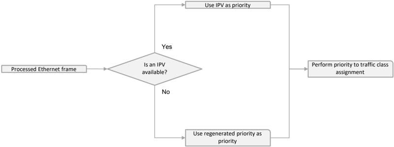

以太网交换机必须检查接收以太网帧的内部帧路径是否由每流过滤处理，以确定流门（**stream gate**）和相应「内部优先级值」（**IPV**，见**EthSwtStreamGateIPV**）的可用性。如果IPV可用，则以太网交换机选择IPV作为流量类别分配的优先级，否则使用再生优先级值（见[**EthSwtPortPriorityRegeneration**](#9135-ethswtportpriorityregeneration)）。

如果以太网交换机必须为接收到的以太网帧选择一个优先级值，以太网交换机检测到该接收以太网帧由一个[**EthSwtStreamFilterEntry**](#9118-ethswtstreamfilterentry)处理，并且该[**EthSwtStreamFilterEntry**](#9118-ethswtstreamfilterentry)引用了一个流门（见[**EthSwtStreamGateEntry**](#9121-ethswtstreamgateentry)），则应使用已配置的IPV（**EthSwtStreamGateIPV**）作为优先级将该以太网帧映射到一个流量类别。否则，以太网交换机应使用再生优先级值（见[**EthSwtPortPriorityRegeneration**](#9135-ethswtportpriorityregeneration)）。

注意：关于每流过滤和监管的更多细节，见第[6.5.2.7](#6527-每流过滤和监管)节。

为了将以太网帧映射到某个流量类别，需要一个将优先级映射到流量类别的表。与八个规定的VLAN优先级类似，规定了八个流量类别。最常见的是将八个优先级映射到八个流量类别。也支持将多个优先级映射到一个流量类别。基于优先级的映射表可以在入口端口定义。表7.2展示了优先级到流量类别映射的示例。

表7.2：在该表中，「Priorities」被映射到特定的「Traffic class」。（**Priority to traffic class**）

| Priority | Traffic Class |
| --- | --- |
| Prio 0 | 7 |
| Prio 1 | 6 |
| Prio 2-7 | 5 |
| - | 4 |
| - | 3 |
| - | 2 |
| - | 1 |
| - | 0 |

如果配置了**EthSwtPortTrafficClassAssignment**并且在某个入口端口接收到一个以太网帧，则该以太网帧应被分配给与**EthSwtPriorityTrafficClassAssignment**处配置的优先级对应的流量类别。

作为配置优先级到流量类别分配表的替代方案，可以将入口端口配置为流量类别的分配。这用于简化配置。此配置同样会产生一个优先级到流量类别的分配表。相应入口端口的所有传入流量都被映射到相应的流量类别。表7.3展示了入口端口到流量类别映射的示例。

表7.3：在该表中，「Ingress ports」被映射到特定的「Traffic Class」。（**Ingress port to traffic class**）

| Ingress port | Traffic Class |
| --- | --- |
| 例如Port2、Port3、Port4 | 7 |
| 例如Port1 | 6 |
| - | 5 |
| - | 4 |
| - | 3 |
| - | 2 |
| - | 1 |
| - | 0 |

如果接收到一个无标记以太网帧，并且某个入口端口的**EthSwtPortIngressDropUntagged**设置为False，则**EthSwtPriorityTrafficClassAssignment**容器应用于为在**EthSwtPortIngressDefaultVlan**配置的默认VLAN设置默认流量类别。

如果同一个[**EthSwtPortIngress**](#9131-ethswtportingress)需要配置优先级到流量类别的分配，则应当只配置**EthSwtPortTrafficClassAssignment**或[**EthSwtPortPriorityTrafficClassAssignment**](#9136-ethswtportprioritytrafficclassassignment)之一。

###### 6.5.2.4.5. 出站优先级分配

可以在入口端口为传出的以太网帧定义一个特定的VLAN优先级。该VLAN优先级称为出站VLAN优先级（**outbound VLAN priority**）。出站VLAN优先级可以分配给一个再生优先级。因此，可以配置从再生优先级（见**EthSwtPortOutboundVlanPriorityAssignmentRegeneratedPriority**）到出站VLAN优先级（见**EthSwtPortOutboundVlanPriorityAssignmentOutboundVlanPriority**）的映射。出站优先级在入口端口配置。

如果在某个入口端口配置了[**EthSwtPortOutboundVlanPriorityAssignment**](#9133-ethswtportoutboundvlanpriorityassignment)并且以太网帧到达该入口端口，则应根据[**EthSwtPortOutboundVlanPriorityAssignment**](#9133-ethswtportoutboundvlanpriorityassignment)、**EthSwtPriorityRegeneratedIngressVlanPriority**和**EthSwtPriorityOutboundVlanPriority**配置，按照再生的VLAN优先级分配一个出站VLAN优先级。

出站VLAN优先级在网络上发送的以太网帧的VLAN标记内用作VLAN优先级。出站VLAN优先级被添加到以太网帧元信息中。因此，出站VLAN优先级不影响特定以太网帧内部使用的优先级，反之亦然。一旦以太网帧携带VLAN标记发送，并且该以太网帧已被分配了出站VLAN优先级，则该出站VLAN优先级将用作VLAN标记中的VLAN优先级。

如果一个以太网帧必须在特定出口端口上发送，该以太网帧携带VLAN标记发送，并且已为该以太网帧分配了一个出站VLAN优先级，则该以太网帧应以所分配的出站VLAN优先级作为VLAN优先级发送。

##### 6.5.2.5. 帧过滤

如果一个以太网帧通过了「入口过滤」，则以太网交换机执行所谓的「帧过滤」（**frame filtering**）。该处理阶段关注接收到的以太网帧的目的MAC地址。以太网交换机检查该目的MAC地址是否存在于内部地址解析表（**ARL**）中。有关设置ARL表过程的更多信息，请参阅第[6.5.1](#651-启动时的学习阶段)节。

如果接收到的以太网帧的目的MAC地址被判定为MAC单播/组播地址，并且该MAC地址存在于ARL表中，则该以太网帧应被转发以进行进一步处理。否则应丢弃该以太网帧并中止转发过程。

注意：如果接收到的以太网帧的目的MAC地址被判定为MAC广播地址，则该以太网帧被转发以进行进一步处理。不执行ARL表检查。

如果该以太网帧被转发，则根据ARL表条目将该以太网帧分配给相应的出口端口。如果该帧被转发且启用了MAC地址学习，则源MAC地址被添加到ARL表中。

##### 6.5.2.6. 出口过滤

如果一个以太网帧通过了「帧过滤」，则以太网交换机执行所谓的「出口过滤」（**egress filtering**）。该处理阶段关注VLAN成员关系。前一个处理阶段「帧过滤」已将该以太网帧分配给一个或多个出口端口。出口过滤检查接收以太网帧已被分配到的出口端口的VLAN成员关系以及接收以太网帧的VLAN-ID。出口过滤过程保留该以太网帧到那些其VLAN-ID与出口端口VLAN成员关系匹配的出口端口的分配。否则，移除该以太网帧到出口端口的分配。

如果某个出口端口的VLAN成员关系与接收以太网帧的VLAN-ID匹配，并且该以太网帧已被分配给该出口端口，则应保留该以太网帧到该出口端口的分配。否则应移除该以太网帧到受影响出口端口的分配。

在对接收到的以太网帧完成出口过滤之后，如果该以太网帧仍被分配给至少一个出口端口，则该以太网帧应被转发以进行进一步处理。否则应丢弃该以太网帧并中止转发过程。

##### 6.5.2.7. 每流过滤和监管

如果一个以太网帧通过了「出口过滤」，那么如果配置了该处理阶段，以太网交换机就可以执行所谓的「每流过滤和监管」。否则，以太网交换机将以太网帧转发到下一个处理阶段「传输选择算法」。

[9, IEEE Std 802.1Q]定义了每流过滤和监管。每流过滤和监管可以通过[**EthSwtPSFP**](#9112-ethswtpsfp)配置。相邻的配置容器[**EthSwtAtsInstanceTable**](#9110-ethswtatsinstancetable)表示所谓的「异步流量整形器」（**asynchronous traffic shapers**）的表，可供[**EthSwtPSFP**](#9112-ethswtpsfp)使用。[**EthSwtPSFP**](#9112-ethswtpsfp)和[**EthSwtAtsInstanceTable**](#9110-ethswtatsinstancetable)都位于上级[**EthSwtPSCM**](#919-ethswtpscm)（每流分类和计量）之下。

[**EthSwtPSFP**](#9112-ethswtpsfp)容器包含以下表：

- [**EthSwtFilterMaxSduSizeTable**](#9113-ethswtfiltermaxsdusizetable)，如果已配置，则至少存在一个[**EthSwtFilterMaxSduSizeEntry**](#9114-ethswtfiltermaxsdusizeentry)
- [**EthSwtFlowMeteringTable**](#9115-ethswtflowmeteringtable)，如果已配置，则至少存在一个[**EthSwtFlowMeteringEntry**](#9116-ethswtflowmeteringentry)
- [**EthSwtStreamFilterTable**](#9117-ethswtstreamfiltertable)，如果已配置，则至少存在一个[**EthSwtStreamFilterEntry**](#9118-ethswtstreamfilterentry)
- [**EthSwtStreamGateTable**](#9120-ethswtstreamgatetable)，如果已配置，则至少存在一个[**EthSwtStreamGateEntry**](#9121-ethswtstreamgateentry)

如果以太网交换机硬件支持该特性，则可以通过[**EthSwtPSFP**](#9112-ethswtpsfp)和[**EthSwtAtsInstanceTable**](#9110-ethswtatsinstancetable)的表进行配置。

[**EthSwtStreamFilterTable**](#9117-ethswtstreamfiltertable)表示核心表，因为[**EthSwtStreamFilterTable**](#9117-ethswtstreamfiltertable)的一个条目可以引用[**EthSwtFilterMaxSduSizeTable**](#9113-ethswtfiltermaxsdusizetable)、[**EthSwtFlowMeteringTable**](#9115-ethswtflowmeteringtable)和[**EthSwtStreamGateTable**](#9120-ethswtstreamgatetable)中的一个条目。

[**EthSwtStreamFilterTable**](#9117-ethswtstreamfiltertable)可以有多个[**EthSwtStreamFilterEntry**](#9118-ethswtstreamfilterentry)，其中每个条目表示一个流过滤器。[**EthSwtStreamFilterEntry**](#9118-ethswtstreamfilterentry)被配置为有序列表。列表中的位置由**EthSwtStreamFilterEntryPosition**的配置值定义。以太网交换机按升序处理该列表。一旦第一个[**EthSwtStreamFilterEntry**](#9118-ethswtstreamfilterentry)匹配，以太网交换机将按照与该[**EthSwtStreamFilterEntry**](#9118-ethswtstreamfilterentry)关联的配置来处理该以太网帧。后续的[**EthSwtStreamFilterEntry**](#9118-ethswtstreamfilterentry)将不再被应用。如果接收到的以太网帧不匹配任何[**EthSwtStreamFilterEntry**](#9118-ethswtstreamfilterentry)，则该以太网帧将被转发到下一个帧处理阶段。

每个[**EthSwtStreamFilterEntry**](#9118-ethswtstreamfilterentry)都应具有通过**EthSwtStreamFilterEntryPosition**配置的唯一位置值。该值应从0开始，并按升序连续排列，后续的[**EthSwtStreamFilterEntry**](#9118-ethswtstreamfilterentry)之间没有间隔。

注意：位置值构成[**EthSwtStreamFilterEntry**](#9118-ethswtstreamfilterentry)的有序列表。

如果一个以太网帧（即流）到达「每流过滤和监管」处理阶段，则以太网交换机应按**EthSwtStreamFilterEntryPosition**升序检查匹配的[**EthSwtStreamFilterEntry**](#9118-ethswtstreamfilterentry)，从配置值为0的**EthSwtStreamFilterEntryPosition**开始。

如果到达的以太网帧（即流）不匹配任何[**EthSwtStreamFilterEntry**](#9118-ethswtstreamfilterentry)，则该以太网帧应被转发到下一个帧处理阶段，而不应用任何进一步的流过滤器处理。

一个[**EthSwtStreamFilterEntry**](#9118-ethswtstreamfilterentry)由[**EthSwtAssignedStreamHandle**](#9119-ethswtassignedstreamhandle)、**EthSwtStreamFilterPriority**、**EthSwtFilterMaxSduSizeRef**以及附加的到相邻表的可选引用组成：[**EthSwtAssignedStreamHandle**](#9119-ethswtassignedstreamhandle)、**EthSwtFlowMeteringEntryRef**和**EthSwtStreamGateEntryRef**。

以太网帧与流过滤器的匹配通过考虑[**EthSwtAssignedStreamHandle**](#9119-ethswtassignedstreamhandle)和**EthSwtStreamFilterPriority**来识别。

如果一个以太网帧（即流）到达「每流过滤和监管」处理阶段，并且该以太网帧携带的以太网帧元信息包含由流识别处理阶段分配的流句柄ID（见**EthSwtStreamHandleAssignment**），则以太网交换机应扫描[**EthSwtStreamFilterTable**](#9117-ethswtstreamfiltertable)（见上文），寻找其[**EthSwtAssignedStreamHandle**](#9119-ethswtassignedstreamhandle)和**EthSwtStreamFilterPriority**与到达以太网帧的流句柄ID和优先级匹配的[**EthSwtStreamFilterEntry**](#9118-ethswtstreamfilterentry)（见**EthSwtStreamHandleAssignment**和**EthSwtPortPriorityRegenerationRegeneratedPriority**）。否则，应针对该以太网帧中止「每流过滤和监管」过程，并将该以太网帧转发到下一个处理阶段。

如果以太网交换机检测到与某个[**EthSwtStreamFilterEntry**](#9118-ethswtstreamfilterentry)匹配的以太网帧，则将通过考虑[**EthSwtStreamFilterEntry**](#9118-ethswtstreamfilterentry)经由**EthSwtFilterMaxSduSizeRef**引用的最大可接受以太网帧大小来评估该以太网帧的大小。

所有[**EthSwtStreamFilterEntry**](#9118-ethswtstreamfilterentry)都应具有通过**EthSwtFilterMaxSduSizeRef**配置的对max-sdu-size值的引用。

注意：[**EthSwtFilterMaxSduSizeEntry**](#9114-ethswtfiltermaxsdusizeentry)的定义包括前导码（**Preamble**）、SFD和最小IPG的大小（见第8.1.13节）。

实现提示：以太网交换机硬件在其原生过滤机制中不需要（很可能也不）考虑前导码、SFD和最小IPG的长度。一般而言，在经过设计的以太网网络中，这三个元素可以被以太网交换机引擎视为已知常量，这样就可以很容易地配置以太网交换机，使其按照[**EthSwtFilterMaxSduSizeEntry**](#9114-ethswtfiltermaxsdusizeentry)的定义行事。

如果以太网交换机如上文所述检测到以太网帧与某个[**EthSwtStreamFilterEntry**](#9118-ethswtstreamfilterentry)匹配，则以太网交换机应评估该以太网帧（即流）的帧大小是否超过[**EthSwtStreamFilterEntry**](#9118-ethswtstreamfilterentry)经由**EthSwtFilterMaxSduSizeRef**引用的[**EthSwtFilterMaxSduSizeEntry**](#9114-ethswtfiltermaxsdusizeentry)的值：

- 如果以太网帧的帧大小超过所引用的max-sdu-size，则应针对该以太网帧中止「每流过滤和监管」过程，并应丢弃该以太网帧。
- 如果以太网帧的帧大小等于或小于所引用的max-sdu-size，则「每流过滤和监管」处理应继续。

如果根据上文对以太网帧大小的评估结果为继续「每流过滤和监管」处理，并且[**EthSwtStreamFilterEntry**](#9118-ethswtstreamfilterentry)引用了一个[**EthSwtStreamGateEntry**](#9121-ethswtstreamgateentry)，则以太网交换机应通过更新该以太网帧的以太网帧元信息来分配已配置的内部优先级值（见**EthSwtStreamGateIPV**）。

注意：内部优先级值用于流量类别的分配（见第[6.5.2.4.4](#65244-优先级到流量类别的分配)节）。内部优先级值被建模为32位值，但只考虑最低的3个有效位。因此，内部优先级值直接对应于接收以太网帧的VLAN优先级和一个流量类别。

门的状态可以是打开或关闭。如果门是打开的，以太网帧可以通过以进行进一步处理。否则门是关闭的，不允许以太网帧通过。请注意，AUTOSAR只支持打开的门。

如果配置了[**EthSwtPSFP**](#9112-ethswtpsfp)，则相应的以太网交换机硬件应配置为以太网帧（即流）始终可以通过（打开的门）。

如果根据上文对以太网帧大小的评估结果为继续「每流过滤和监管」处理，则以太网交换机应按以下顺序根据受影响[**EthSwtStreamFilterEntry**](#9118-ethswtstreamfilterentry)的配置执行动作：

1. 如果[**EthSwtStreamFilterEntry**](#9118-ethswtstreamfilterentry)引用了一个[**EthSwtStreamGateEntry**](#9121-ethswtstreamgateentry)，则以太网交换机应通过更新其以太网帧元信息，将已配置的内部优先级值（见**EthSwtStreamGateIPV**）分配给该以太网帧。
2. 如果[**EthSwtStreamFilterEntry**](#9118-ethswtstreamfilterentry)引用了一个[**EthSwtFlowMeteringEntry**](#9116-ethswtflowmeteringentry)，则以太网交换机应将该流量计量配置应用于该以太网帧。
3. 如果[**EthSwtStreamFilterEntry**](#9118-ethswtstreamfilterentry)引用了一个[**EthSwtAtsInstanceEntry**](#9111-ethswtatsinstanceentry)，则以太网交换机应将该异步流量整形器配置应用于该以太网帧。

[**EthSwtPSFP**](#9112-ethswtpsfp)可以通过配置一个[**EthSwtFlowMeteringTable**](#9115-ethswtflowmeteringtable)来定义流量计量。该表包含一个或多个[**EthSwtFlowMeteringEntry**](#9116-ethswtflowmeteringentry)。每个[**EthSwtFlowMeteringEntry**](#9116-ethswtflowmeteringentry)表示一个流量计量的配置。一个[**EthSwtStreamFilterEntry**](#9118-ethswtstreamfilterentry)可以恰好引用一个[**EthSwtFlowMeteringEntry**](#9116-ethswtflowmeteringentry)。流量计量的配置支持限制以太网帧（即流）的速率。

如果一个以太网帧与某个[**EthSwtStreamIdentificationEntry**](#9140-ethswtstreamidentificationentry)匹配，该以太网帧通过了过滤，并且存在一个[**EthSwtFlowMeteringEntry**](#9116-ethswtflowmeteringentry)，则该以太网帧应由该[**EthSwtFlowMeteringEntry**](#9116-ethswtflowmeteringentry)处理。

已配置的[**EthSwtFlowMeteringEntry**](#9116-ethswtflowmeteringentry)应根据以下配置执行计量：**EthSwtFlowMeteringColorMode**、**EthSwtFlowMeteringCIR**、**EthSwtFlowMeteringCBS**、**EthSwtFlowMeteringEIR**、**EthSwtFlowMeteringEBS**和**EthSwtFlowMeterCF**。

[**EthSwtPSCM**](#919-ethswtpscm)可以通过配置一个[**EthSwtAtsInstanceTable**](#9110-ethswtatsinstancetable)来定义异步流量整形。该表包含一个或多个[**EthSwtAtsInstanceEntry**](#9111-ethswtatsinstanceentry)。每个[**EthSwtAtsInstanceEntry**](#9111-ethswtatsinstanceentry)表示一个异步流量整形器的配置。一个[**EthSwtStreamFilterEntry**](#9118-ethswtstreamfilterentry)可以恰好引用一个[**EthSwtAtsInstanceEntry**](#9111-ethswtatsinstanceentry)。异步流量整形的配置支持根据所谓的「资格时间」（**eligibility time**）对以太网流量进行整形。

如果配置了异步流量整形[**EthSwtAtsInstanceEntry**](#9111-ethswtatsinstanceentry)并将其应用于某个以太网帧，则应通过更新该以太网帧的以太网帧元信息为该以太网帧分配一个资格时间。

已配置的[**EthSwtAtsInstanceEntry**](#9111-ethswtatsinstanceentry)应根据以下配置执行调度：**EthSwtPortATSCommitedBurstSize**、**EthSwtPortATSCommitedInformationRate**和**EthSwtAtsGroupMaximumResidenceTime**。

注意：**EthSwtAtsGroupMaximumResidenceTime**由被引用的[**EthSwtAtsGroupInstanceEntry**](#915-ethswtatsgroupinstanceentry)（经由**EthSwtPortATSSchedulerGroupRef**引用）提供，后者是[**EthSwtAtsGroupInstanceTable**](#914-ethswtatsgroupinstancetable)的一部分。

一个[**EthSwtAtsGroupInstanceEntry**](#915-ethswtatsgroupinstanceentry)表示一个所谓的「ATS调度器组」（**ATS Scheduler Group**）。属于同一ATS调度器组（引用同一个[**EthSwtAtsGroupInstanceEntry**](#915-ethswtatsgroupinstanceentry)）的所有ATS实例（[**EthSwtAtsInstanceEntry**](#9111-ethswtatsinstanceentry)）使用相同的**EthSwtAtsGroupMaximumResidenceTime**。对于ATS调度器组，资格分配算法确保以特定顺序接收的以太网帧，如果由属于该ATS调度器组的任何ATS实例处理，也将按相同的顺序发送。

如果多个[**EthSwtAtsInstanceEntry**](#9111-ethswtatsinstanceentry)引用同一个[**EthSwtAtsGroupInstanceEntry**](#915-ethswtatsgroupinstanceentry)，并且以太网帧由这些[**EthSwtAtsInstanceEntry**](#9111-ethswtatsinstanceentry)处理，则以太网交换机的资格分配算法应确保被处理的以太网帧按照它们到达以太网交换机的相同顺序发送。

##### 6.5.2.8. 与防火墙模块的交互

可以通过AUTOSAR防火墙模块支持基于每流过滤的网络分组检查，以执行更高级的检查技术，如状态分组检查（**stateful packet inspection**）和深度分组检查（**deep packet inspection**）。本章描述防火墙模块在EthSwtDrv中所需的、用于执行基于每流过滤的高效网络分组检查和过滤的功能。关于防火墙模块与每流过滤之间交互的更多细节，请参见CP_SWS_Firewall。

**从网络分组中提取StreamHandleIdentifier**：当一个网络分组被传递给防火墙进行检查时，它已经通过了每流过滤的检查。防火墙需要知道允许该网络分组通过的每流过滤过滤规则。该过滤规则在EthSwtDrv中由**StreamHandleIdentifier**建模。**StreamHandleIdentifier**的值可以由交换机核心添加到网络分组中，方式是修改网络分组报头并向网络分组添加元数据。然而，该元数据不是标准化的，并且取决于交换机厂商。

当[**EthSwt_ExtractStreamHandleIdx**](#7372-ethswt_extractstreamhandleidx)被调用时，EthSwtDrv应从传入的网络分组中提取**StreamHandleIdentifier**，将该值写入StreamHandleIdxPtr并返回**E_OK**。

**读出StreamHandleIdentifier的计数统计**：许多交换机支持每流过滤过滤规则的计数统计，即统计所提供的过滤规则与网络分组匹配的频率。防火墙模块需要该统计信息以向**IdsM**引发安全事件（**SEv**）。计数统计通常以桶（**bucket**）的形式实现，其中一个桶统计多个过滤规则的匹配次数（见图7.9）。

图7.9：统计每流过滤过滤规则匹配次数的桶配置示例（**Example configuration of buckets**）

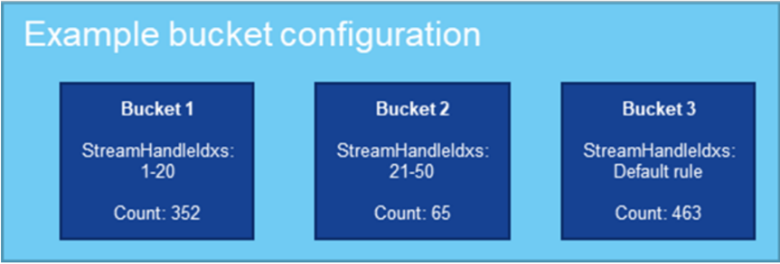

当[**EthSwt_GetStreamHandleIdxStatistics**](#7373-ethswt_getstreamhandleidxstatistics)被调用时，EthSwtDrv应从交换机读取各桶的计数值，并通过调用**EthIf_StreamHandleIdxStatistics**将它们返回给EthIf，其中NumberOfBuckets设置为交换机中配置的桶数，StreamHandleIdxStatisticsPtr指向每个桶的计数值的串联。每个计数值的长度为4字节。

根据交换机类型的不同，桶值或者在读出时被重置，或者保持其计数值。EthSwtDrv应提供与交换机类型无关的计数值的统一处理，以确保防火墙模块中对计数值的正确处理。

EthSwtDrv应通过**EthIf_StreamHandleIdxStatistics**提供单调递增的计数值，从上电启动时的0开始。如果计数值被交换机重置，则EthSwtDrv应缓冲上次读出的计数值，并将其累加到从交换机获取的计数值上。

**每流过滤过滤规则的运行时管理**：防火墙模块可以被BswM切换到不同的状态，即可以切换为启用不同的防火墙规则集。该用例同样扩展到每流过滤过滤规则，它们应跟随防火墙模块的状态，以确保一致的分组过滤。

当[**EthSwt_SetStreamHandleIdxConfiguration**](#7374-ethswt_setstreamhandleidxconfiguration)被调用时，EthSwtDrv应将由StreamHandleIdx标识的**StreamHandleIdentifier**的过滤规则设置为：

- Active，如果StreamHandleIdxActivityStatus设置为TRUE
- Passive，如果StreamHandleIdxActivityStatus设置为FALSE

在成功地将过滤规则设置为active/passive之后，EthSwtDrv应为该StreamHandleIdx调用**EthIf_StreamHandleIdxConfiguration**，其中StreamHandleIdxActivityStatus设置为该过滤规则的当前活动状态。

##### 6.5.2.9. 传输选择算法

如果一个以太网帧通过了转发过程的所有前置处理阶段，那么该以太网帧已在入口侧由「入口过滤」处理阶段分配给了一个流量类别。此外，该以太网帧也通过「帧过滤」和「出口过滤」处理阶段被分配给了一个或多个出口端口。因此，转发过程将该以太网帧按照其被分配到的每个出口端口的流量类别分配，添加到队列中。图7.10展示了接收以太网帧的优先级与相应出口队列之间经由流量类别分配的关联。

图7.10：流量类别分配，作为入口侧优先级与出口侧队列之间的关联（**Traffic class assignment**）

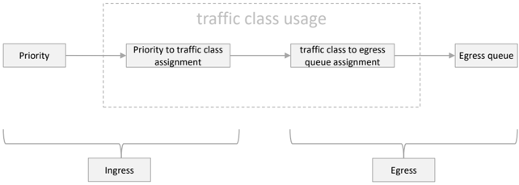

每个出口端口支持最多8个队列。每个流量类别恰好映射到一个队列。图7.11展示了接收以太网帧的优先级与相应出口队列之间经由流量类别分配的关联。

图7.11：接收以太网帧的优先级与出口端口队列之间的映射（**Mapping between the priority**）

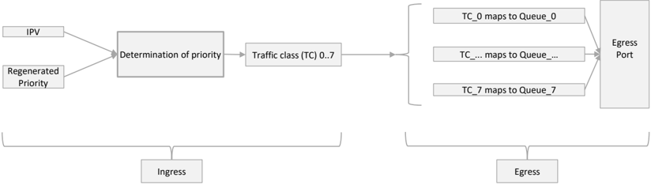

可能某个以太网交换机硬件无法提供每个出口端口8个队列。在这种情况下，只应使用流量类别的一个子集。从流量类别0开始连续且按升序排列。表7.4展示了当以太网交换机硬件只提供4个队列时流量类别到出口端口队列映射的示例。

表7.4：在该表中，描绘了出口端口处「Queue」到「Traffic class」的映射。（**Queue to Traffic class**）

| Traffic Class | Queue (if 4 Queues available) |
| --- | --- |
| 0 | 0 |
| 1 | 1 |
| 2 | 2 |
| 3 | 3 |

以太网交换机配置应支持经由流量类别分配来配置接收以太网帧的优先级与出口端口相应队列之间的关联。为此，应配置入口端口处的优先级到流量类别分配（只通过**EthSwtPortTrafficClassAssignment**或[**EthSwtPortPriorityTrafficClassAssignment**](#9136-ethswtportprioritytrafficclassassignment)之一）以及出口端口处的流量类别到队列的分配（通过**EthSwtPortQueueTrafficClassAssignment**）。

参数**EthSwtPortQueueMinimumLength**应定义专用出口端口的一个队列的最小长度。

注意：实际的队列长度可以更长。队列长度的决定很可能由以太网交换机硬件做出或由以太网交换机设计固定。在配置中定义最小队列长度是为了保证某些优先级有足够的出口缓冲区。

每个出口队列（见[**EthSwtPortQueue**](#9127-ethswtportqueue)）必须配置用于选择要发送的以太网帧的算法。因此，每个出口队列有一个必需的子容器[**EthSwtPortEgressQueueTransmissionSelection**](#9128-ethswtportegressqueuetransmissionselection)。[**EthSwtPortEgressQueueTransmissionSelection**](#9128-ethswtportegressqueuetransmissionselection)通过**EthSwtPortEgressQueueTransmissionSelectionAlgorithm**定义选择算法（如基于信用的整形器、异步流量整形器等）。每个[**EthSwtPortQueue**](#9127-ethswtportqueue)连接到一个端口调度器。端口调度器必须调度所有已连接的出口队列。每个端口调度器有一个必需的子容器[**EthSwtPortEgressScheduler**](#9124-ethswtportegressscheduler)，它通过**EthSwtPortSchedulerAlgorithm**定义调度器算法（如严格优先级、加权轮询等）。可以在同一出口端口配置多个出口调度器，并以级联方式连接。因此，一个出口调度器的输出被用作后续出口端口调度器的输入。图7.12展示了出口端口结构的示例。

图7.12：出口端口结构的示例（**Examples for an egress port structure**）

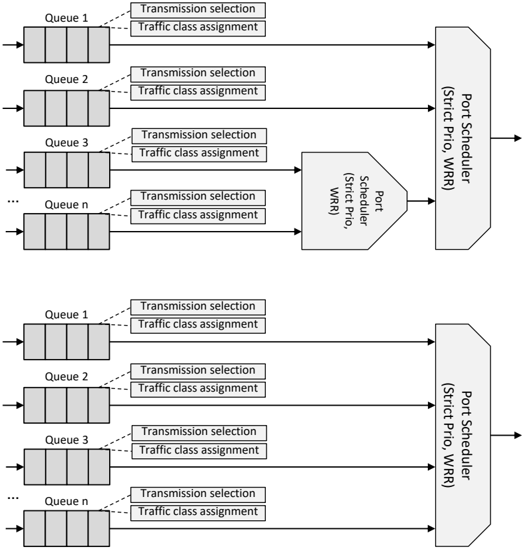

端口调度器算法通过考虑相应属性（如流量类别分配）来调度其输入（出口队列或出口端口调度器）。一旦端口调度器算法决定了应处理其哪个输入，端口调度器就根据已配置的传输选择算法从相应出口队列中选择一个以太网帧：

- 如果传输选择算法配置为基于信用的整形器（**credit based shaper**），则相应的出口队列按FIFO处理。该出口队列有一个信用预算，在空闲阶段增加，并每从该出口队列发送一个以太网帧而减少。
- 如果传输选择算法配置为异步流量整形器（**asynchronous traffic shaper**），则相应的出口队列按队列处理。该队列中的每个以太网帧都有一个已分配的资格时间。根据资格时间从该出口队列中选择一个以太网帧。以太网帧不按照其在该出口队列中的到达顺序处理，而是按照在入口侧添加的已分配资格时间处理。
- 如果传输选择算法配置为无整形（**unshaped**），则相应的出口队列按FIFO处理。
- 如果传输选择算法配置为增强型流量整形（**enhanced traffic shaping**），则相应的出口队列按队列处理。

注意：出口端口的参数化会影响以太网帧在网络内的时延。

出口端口调度器的配置通过容器[**EthSwtPortEgressScheduler**](#9124-ethswtportegressscheduler)及其多重性为1到*的子容器[**EthSwtPortEgressSchedulerPredecessor**](#9125-ethswtportegressschedulerpredecessor)完成。出口端口调度器通过前驱引用**EthSwtPortEgressPredecessorRef**连接其前驱。一个出口端口调度器的前驱要么是另一个出口端口调度器，要么是一个出口端口队列。

以太网交换机驱动程序的配置应通过配置[**EthSwtPortEgressScheduler**](#9124-ethswtportegressscheduler)支持不同的出口端口结构。

如果一个以太网帧被添加到某个[**EthSwtPortQueue**](#9127-ethswtportqueue)，则以太网交换机应根据该[**EthSwtPortQueue**](#9127-ethswtportqueue)已配置的传输选择算法（[**EthSwtPortEgressQueueTransmissionSelection**](#9128-ethswtportegressqueuetransmissionselection)），并考虑相应出口端口（[**EthSwtPortEgress**](#9123-ethswtportegress)）已配置的出口端口结构（[**EthSwtPortEgressScheduler**](#9124-ethswtportegressscheduler)、[**EthSwtPortEgressSchedulerPredecessor**](#9125-ethswtportegressschedulerpredecessor)），来处理该以太网帧。

##### 6.5.2.10. 网络上的传输

由最后一个[**EthSwtPortEgressScheduler**](#9124-ethswtportegressscheduler)选出的以太网帧，将从出口队列传输到以太网网络。作为发送的准备，执行所谓的「优先级代码点编码」（**Priority Code Point Encoding**）和「VLAN转发」（**VLAN forwarding**）。这是帧转发过程中的最后一个处理阶段。该处理阶段确保在帧被转发给PHY之前，以太网帧元信息的所有信息都被写入以太网帧。以太网帧元信息包含该以太网帧穿过以太网交换机的路径上的最新状态。以太网帧元信息内容的示例：

- **EthSwtPortOutboundVlanPriorityAssignmentOutboundVlanPriority**：以太网帧将在VLAN标记中以该优先级发送。
- **EthSwtVlanForwardingType**设置为**ETHSWT_SENT_TAGGED**：以太网帧将携带VLAN标记发送。

#### 6.5.3. 交换机管理支持

交换机管理（**Switch Management**）使得可以控制一个以太网帧的交换机端口特定的入口和出口处理，以及提供交换机端口特定的时间戳。该功能对其他BSW模块至关重要，特别是**EthTSyn**，它需要与时间同步或路径延迟测量帧相关联的端口特定信息。

关于基本硬件架构和交互的介绍，请参阅[4, SWS_EthernetDriver]。

如果**EthSwtManagementSupportApi**设置为TRUE，交换机驱动程序应提供交换机管理API：

- [**EthSwt_EthRxProcessFrame**](#7327-ethswt_ethrxprocessframe)
- [**EthSwt_EthRxFinishedIndication**](#7328-ethswt_ethrxfinishedindication)
- [**EthSwt_EthTxAdaptBufferLength**](#7330-ethswt_ethtxadaptbufferlength)
- [**EthSwt_EthTxPrepareFrame**](#7329-ethswt_ethtxprepareframe)
- [**EthSwt_SetMgmtInfo**](#7331-ethswt_setmgmtinfo)
- [**EthSwt_EthTxProcessFrame**](#7332-ethswt_ethtxprocessframe)，以及
- [**EthSwt_EthTxFinishedIndication**](#7333-ethswt_ethtxfinishedindication)

注意：交换机管理API支持EthIf收集/修改交换机端口特定的通信属性。

交换机驱动程序管理API：

- [**EthSwt_EthRxProcessFrame**](#7327-ethswt_ethrxprocessframe)
- [**EthSwt_EthRxFinishedIndication**](#7328-ethswt_ethrxfinishedindication)
- [**EthSwt_EthTxAdaptBufferLength**](#7330-ethswt_ethtxadaptbufferlength)
- [**EthSwt_EthTxPrepareFrame**](#7329-ethswt_ethtxprepareframe)
- [**EthSwt_SetMgmtInfo**](#7331-ethswt_setmgmtinfo)
- [**EthSwt_EthTxProcessFrame**](#7332-ethswt_ethtxprocessframe)，以及
- [**EthSwt_EthTxFinishedIndication**](#7333-ethswt_ethtxfinishedindication)

应支持以太网驱动程序在接收时从以太网帧中收集交换机特定的管理信息，或者准备一个以太网帧以进行符合管理模式（**management mode**）的帧发送，例如帧的出口路径。

交换机驱动程序管理API [**EthSwt_EthTxProcessFrame**](#7332-ethswt_ethtxprocessframe)和[**EthSwt_EthTxFinishedIndication**](#7333-ethswt_ethtxfinishedindication)应立即返回，如果在调用[**EthSwt_EthTxProcessFrame**](#7332-ethswt_ethtxprocessframe)之前没有调用过[**EthSwt_SetMgmtInfo**](#7331-ethswt_setmgmtinfo)。

#### 6.5.4. 全局时间支持

关于使用交换机进行时间测量的更多细节，请参阅[15, SWS_TimeSyncOverEthernet]。

如果端口的**EthSwtPortTimeStampSupport**设置为TRUE，交换机驱动程序应访问端口特定的硬件时间戳。

如果针对某个PortIdx调用了[**EthSwt_PortEnableTimeStamp**](#7334-ethswt_portenabletimestamp)，则在该端口的**EthSwtPortTimeStampSupport**设置为TRUE时，交换机驱动程序应为该端口启用时间戳功能。

如果**EthSwtGlobalTimeSupportApi**设置为TRUE，交换机驱动程序应使用API **EthIf_SwitchIngressTimeStampIndication**和**EthIf_SwitchEgressTimeStampIndication**向EthIf通报端口特定的入口和出口时间戳的可用性。

注意：全局时间支持通常需要在交换机设备内激活交换机管理支持功能。

#### 6.5.5. 通过上行端口连接的以太网交换机的计数器同步

一些以太网交换机提供同步其内部时钟的可能性。对于通过上行端口连接的以太网交换机，如果时钟同步时钟已激活（**EthSwtClockSynchronizationSupport**设置为TRUE），则不需要测量所连接上行端口之间的延迟。

如果**EthSwtClockSynchronizationSupport**设置为TRUE，交换机驱动程序应启用与其通过上行端口连接的另一个以太网交换机的时钟同步。

如果所连接以太网交换机的时钟同步已停用（**EthSwtClockSynchronizationSupport**设置为FALSE），端口特定的时间戳功能（**EthSwtPortTimeStampSupport**）可以设置为TRUE。

如果**EthSwtClockSynchronizationSupport**已激活且**EthSwtPortRole**不是**ETHSWT_UP_LINK_PORT**，端口特定的时间戳功能（**EthSwtPortTimeStampSupport**）可以设置为TRUE。当**EthSwtClockSynchronizationSupport**激活时，**EthSwtPortRole**为**ETHSWT_UP_LINK_PORT**的**EthSwtPorts**连接到另一个以太网交换机，不被纳入时间延迟补偿的考虑。

#### 6.5.6. 配置的验证

在某些情况下，主机控制器需要验证交换机配置。

如果参数**EthSwtVerifyConfigApi**设置为TRUE，则应使用函数[**EthSwt_VerifyConfig**](#7335-ethswt_verifyconfig)来验证交换机配置。

实现提示：由于交换机配置高度依赖硬件架构，该函数内部的步骤是实现相关的。

在某些用例中，有必要在验证期间使用可选函数[**EthSwt_SetForwardingMode**](#7336-ethswt_setforwardingmode)停止帧转发。

函数[**EthSwt_VerifyConfig**](#7335-ethswt_verifyconfig)例如可以执行以下步骤：

- 通过调用[**EthSwt_SetForwardingMode**](#7336-ethswt_setforwardingmode)(FALSE)停止帧转发。
- 验证交换机配置。
- 如果交换机配置有效，则通过调用[**EthSwt_SetForwardingMode**](#7336-ethswt_setforwardingmode)(TRUE)启用帧转发（如果在第1步中禁用了）。
- 如果交换机配置无效，则应重置并重新配置交换机。

注意：请注意，主机控制器的复位不一定需要连接的交换机硬件的复位。这需要非常仔细地单独评估，因为复位会提高在主机控制器复位阶段通信失控的风险。

注意：如上所述的交换机配置验证只是如何以及何时可以执行该验证的一个示例。配置如何验证甚至如何能够验证，非常依赖于所使用的交换机硬件以及具体的硬件架构，甚至取决于ECU交换机的电源和复位策略。本模块唯一规定的是上层对交换机配置进行某些验证的接口。

#### 6.5.7. 交换机端口的测试和诊断

如果已配置，以太网交换机驱动程序提供以下接口来应用测试和诊断功能：

- [**EthSwt_GetPortSignalQuality**](#7337-ethswt_getportsignalquality)
- [**EthSwt_GetPortIdentifier**](#7338-ethswt_getportidentifier)
- [**EthSwt_GetSwitchIdentifier**](#7339-ethswt_getswitchidentifier)
- [**EthSwt_WritePortMirrorConfiguration**](#7340-ethswt_writeportmirrorconfiguration)
- [**EthSwt_ReadPortMirrorConfiguration**](#7341-ethswt_readportmirrorconfiguration)
- [**EthSwt_GetPortMirrorState**](#7343-ethswt_getportmirrorstate)
- [**EthSwt_SetPortMirrorState**](#7344-ethswt_setportmirrorstate)
- [**EthSwt_SetPortTestMode**](#7345-ethswt_setporttestmode)
- [**EthSwt_SetPortLoopbackMode**](#7346-ethswt_setportloopbackmode)
- [**EthSwt_SetPortTxMode**](#7347-ethswt_setporttxmode)
- [**EthSwt_GetPortCableDiagnosticsResult**](#7349-ethswt_getportcablediagnosticsresult)
- [**EthSwt_GetCfgDataRaw**](#7350-ethswt_getcfgdataraw)
- [**EthSwt_GetCfgDataInfo**](#7351-ethswt_getcfgdatainfo)

这些函数的可用性在很大程度上取决于所使用的收发器（PHY）硬件的可能性。

#### 6.5.8. 低功耗模式支持

如果**EthSwtLowPowerModeSupport**设置为TRUE，并且某个以太网交换机的至少一个[**EthSwtPort**](#9122-ethswtport)已启用，且相应的以太网交换机硬件处于非活动或低功耗模式，则应将相应的以太网交换机硬件设置为能够转发以太网帧的活动模式。

如果**EthSwtLowPowerModeSupport**设置为TRUE，并且某个以太网交换机没有启用任何[**EthSwtPort**](#9122-ethswtport)，则应将相应的以太网交换机硬件设置为非活动或低功耗模式。

### 6.6. 错误分类

文档[10, SWS_BSW General]的第7.2节「错误处理」详细描述了基本软件的错误处理。首先，它构成了一个由五种错误类型组成的分类方案，这些错误可能发生在BSW模块中。

在此基础上，以下各节在相应的小节中规定了具体的错误。

#### 6.6.1. 开发错误

**EthSwt**模块开发错误的定义：

| 错误类型 | 相关错误代码 | 错误值 |
| --- | --- | --- |
| 无效的交换机索引 | ETHSWT_E_INV_SWITCH_IDX | 0x01 |
| EthSwt模块未初始化 | ETHSWT_E_UNINIT | 0x02 |
| 参数列表中的无效指针 | ETHSWT_E_PARAM_POINTER | 0x03 |
| 其他模块不可用的无效API | ETHSWT_E_INV_API | 0x05 |
| 无效的交换机端口索引 | ETHSWT_E_INV_SWITCHPORT_IDX | 0x06 |
| 无效的控制器索引 | ETHSWT_E_INV_CTRL_IDX | 0x07 |
| 无效的输入参数 | ETHSWT_E_INV_PARAM | 0x08 |
| 无效的配置 | ETHSWT_E_INIT_FAILED | 0x09 |

如果启用了开发错误检测，函数[**EthSwt_Init**](#731-ethswt_init)应检查参数CfgPtr是否有效。如果检查失败，[**EthSwt_Init**](#731-ethswt_init)应引发开发错误**ETHSWT_E_INIT_FAILED**。

注意：请注意，在预编译变体的情况下允许NULL_PTR。

交换机驱动程序应检查下层驱动程序（即**EthTrcv**）是否提供了可由交换机驱动程序的上层模块（**EthIf**）调用并将被转发到下层的API。在下层模块中缺少API的情况下，如果下层模块中缺少API，交换机驱动程序应引发开发错误**ETHSWT_E_INV_API**。

注意：该检查将在调用某个API时执行。对于该检查，需要输入参数SwitchPortIdx和一个必须从连接到以太网交换机驱动程序的以太网收发器驱动程序的配置中导出的配置表。如果激活了开发错误跟踪，则该功能是必要的。该检查是必要的，因为上层模块可以带着参数SwitchPortIdx调用以太网交换机驱动程序的API。该SwitchPortIdx的值可以在有效范围内，但交换机驱动程序使用的某些以太网收发器驱动程序支持该API，而另一些不支持。为了解决这一冲突，实现了该检查。

函数[**EthSwt_SetSwitchPortMode**](#732-ethswt_setswitchportmode)应通过检查该SwitchPortIdx相应的EthTrcv API是否可用来验证已索引收发器驱动程序的**EthTrcv_SetTransceiverMode** API是否可用。如果不是这种情况，该函数应引发开发错误**ETHSWT_E_INV_API**。

函数[**EthSwt_GetSwitchPortMode**](#733-ethswt_getswitchportmode)应通过检查该SwitchPortIdx相应的EthTrcv API是否可用来验证已索引收发器驱动程序的**EthTrcv_GetTransceiverMode** API是否可用。如果不是这种情况，该函数应引发开发错误**ETHSWT_E_INV_API**。

如果通过**EthSwtDevErrorDetect**激活了开发错误检测，除[**EthSwt_Init**](#731-ethswt_init)之外的所有函数应检查之前是否已调用过服务[**EthSwt_Init**](#731-ethswt_init)。如果检查失败，该函数应引发开发错误**ETHSWT_E_UNINIT**。

如果通过**EthSwtDevErrorDetect**激活了开发错误检测，所有带输入参数SwitchIdx的函数应检查该参数是否有效。如果检查失败，这些函数应引发开发错误**ETHSWT_E_INV_SWITCH_IDX**。

如果启用了开发错误检测，所有带输入参数SwitchPortIdx或PortIdx的函数应检查该参数是否有效。如果检查失败，这些函数应引发开发错误**ETHSWT_E_INV_SWITCH_IDX**。

如果启用了开发错误检测，所有带输入参数CtrlIdx的函数应检查该参数是否有效。如果检查失败，这些函数应引发开发错误**ETHSWT_E_INV_CTRL_IDX**。

如果启用了开发错误检测，所有带输入参数BufIdx的函数应检查该参数是否有效。如果检查失败，这些函数应引发开发错误**ETHSWT_E_INV_PARAM**。

如果启用了开发错误检测，所有带inout或输出指针参数的函数应检查该参数是否有效。如果检查失败，这些函数应引发开发错误**ETHSWT_E_PARAM_POINTER**。

如果通过**EthSwtDevErrorDetect**激活了开发错误跟踪，那些调用以太网收发器API且并不直接从交换机端口接口获得功能的函数应检查已索引收发器驱动程序的API是否可用。如果不是这种情况，这些函数应引发开发错误**ETHSWT_E_INV_API**。

如果通过**EthSwtDevErrorDetect**激活了开发错误检测，函数[**EthSwt_GetLinkState**](#737-ethswt_getlinkstate)应通过检查该SwitchPortIdx相应的EthTrcv API是否可用来验证已索引收发器驱动程序的**EthTrcv_GetLinkState** API是否可用。如果不是这种情况，该函数应引发开发错误**ETHSWT_E_INV_API**。

#### 6.6.2. 运行时错误

**EthSwt**模块运行时错误的定义：

| 错误类型 | 相关错误代码 | 错误值 |
| --- | --- | --- |
| 端口初始化未完成 | ETHSWT_INIT_NOT_COMPLETED | 0x01 |

#### 6.6.3. 瞬态故障

没有瞬态故障。

#### 6.6.4. 生产错误

没有生产错误。

#### 6.6.5. 扩展生产错误

表7.5：ETHSWT_E_ACCESS（**ETHSWT_E_ACCESS**）

| 错误名称 | ETHSWT_E_ACCESS |
| --- | --- |
| 简要描述 | 以太网交换机访问失败（**Ethernet Switch Access Failure**）。 |
| 详细描述 | 当交换机不可访问时应引发该生产错误。 |
| 推荐DTC | N/A |
| 检测条件 | Fail：当对以太网交换机的访问失败时，模块应以事件状态**DEM_EVENT_STATUS_PREFAILED**向**DEM**报告该扩展生产错误。 |
| 检测条件 | Pass：当对以太网交换机的访问成功时，模块应以事件状态**DEM_EVENT_STATUS_PREPASSED**向**DEM**报告该扩展生产错误。 |
| 次要参数 | N/A |
| 所需时间 | N/A |
| 监控频率 | N/A |
| MIL点亮 | N/A |

表7.6：ETHSWT_E_SYNCPORT2PHY（**ETHSWT_E_SYNCPORT2PHY**）

| 错误名称 | ETHSWT_E_SYNCPORT2PHY |
| --- | --- |
| 简要描述 | 以太网交换机端口与所引用的以太网收发器处于相互矛盾的模式。 |
| 详细描述 | 在获取以太网交换机端口模式时，以太网交换机驱动程序检测到以太网交换机端口与所引用的以太网收发器模式之间的不一致状态。 |
| 推荐DTC | N/A |
| 检测条件 | Fail：当同时获取以太网交换机端口模式和以太网收发器模式，并且发现两个被引用模块的模式不一致时，模块应以事件状态**DEM_EVENT_STATUS_PREFAILED**向**DEM**报告该扩展生产错误。 |
| 检测条件 | Pass：当同时获取以太网交换机端口模式和以太网收发器模式，并且发现两个被引用模块的模式一致时，模块应以事件状态**DEM_EVENT_STATUS_PREPASSED**向**DEM**报告该扩展生产错误。 |
| 次要参数 | N/A |
| 所需时间 | N/A |
| 监控频率 | N/A |
| MIL点亮 | N/A |

## 7. API规范

### 7.1. 导入的类型

本章列出从以下文件中包含的所有类型：

| 模块 | 头文件 | 导入的类型 |
| --- | --- | --- |
| ComStack_Types | ComStackTypes.h | TimeStampType |
| Dem | Rte_Dem_Type.h | Dem_EventIdType |
| Dem | Rte_Dem_Type.h | Dem_EventStatusType |
| Eth | Eth_GeneralTypes.h | Eth_BufIdxType |
| Eth | Eth_GeneralTypes.h | Eth_CounterType |
| Eth | Eth_GeneralTypes.h | Eth_DataType |
| Eth | Eth_GeneralTypes.h | Eth_MacVlanType |
| Eth | Eth_GeneralTypes.h | Eth_ModeType |
| Eth | Eth_GeneralTypes.h | Eth_RxStatsType |
| Eth | Eth_GeneralTypes.h | Eth_TxErrorCounterValuesType |
| Eth | Eth_GeneralTypes.h | Eth_TxStatsType |
| EthTrcv | Eth_GeneralTypes.h | EthTrcv_BaudRateType |
| EthTrcv | Eth_GeneralTypes.h | EthTrcv_CableDiagResultType |
| EthTrcv | Eth_GeneralTypes.h | EthTrcv_DuplexModeType |
| EthTrcv | Eth_GeneralTypes.h | EthTrcv_LinkStateType |
| EthTrcv | Eth_GeneralTypes.h | EthTrcv_PhyLoopbackModeType |
| EthTrcv | Eth_GeneralTypes.h | EthTrcv_PhyTestModeType |
| EthTrcv | Eth_GeneralTypes.h | EthTrcv_PhyTxModeType |
| EthTrcv | Eth_GeneralTypes.h | EthTrcv_WakeupReasonType |
| Mka | Mka.h | Mka_ConfidentialityOffsetType |
| Mka | Mka.h | Mka_MacSecConfigType |
| Mka | Mka.h | Mka_SakKeyPtrType |
| Mka | Mka.h | Mka_Stats_Rx_ScType |
| Mka | Mka.h | Mka_Stats_Rx_SecYType |
| Mka | Mka.h | Mka_Stats_SecYType |
| Mka | Mka.h | Mka_Stats_Tx_ScType |
| Mka | Mka.h | Mka_Stats_Tx_SecYType |
| Mka | Mka.h | Mka_ValidateFramesType |
| NvM | Rte_NvM_Type.h | NvM_BlockIdType |
| NvM | Rte_NvM_Type.h | NvM_BlockRequestType |
| NvM | Rte_NvM_Type.h | NvM_RequestResultType |
| Spi | Spi.h | Spi_AsyncModeType |
| Spi | Spi.h | Spi_ChannelType |
| Spi | Spi.h | Spi_DataBufferType |
| Spi | Spi.h | Spi_NumberOfDataType |
| Spi | Spi.h | Spi_SequenceType |
| Std | Std_Types.h | Std_ReturnType |
| Std | Std_Types.h | Std_VersionInfoType |

### 7.2. 类型定义

#### 7.2.1. EthSwt_StateType

| 名称 | EthSwt_StateType |
| --- | --- |
| 类型（Kind） | Enumeration（枚举） |
| 范围 | ETHSWT_STATE_UNINIT（0x00）：交换机尚未配置；ETHSWT_STATE_INIT（0x01）：交换机驱动程序已初始化；ETHSWT_STATE_PORTINIT_COMPLETED（0x02）：端口初始化已完成；ETHSWT_STATE_ACTIVE（0x03）：交换机处于活动状态 |
| 描述 | 用于开发错误检测的状态监督。该状态应可用于调试。 |
| 可通过 | Eth_GeneralTypes.h |

#### 7.2.2. EthSwt_ConfigType

| 名称 | EthSwt_ConfigType |
| --- | --- |
| 类型（Kind） | Structure（结构体） |
| 元素 | 实现特定 |
| 元素 | 类型 - |
| 元素 | 注释 - |
| 描述 | Post-Build配置的实现特定结构。 |
| 可通过 | EthSwt.h |

#### 7.2.3. EthSwt_MacLearningType

| 名称 | EthSwt_MacLearningType |
| --- | --- |
| 类型（Kind） | Enumeration（枚举） |
| 范围 | ETHSWT_MACLEARNING_HWDISABLED（-）：如果禁用硬件学习，交换机不得学习新的MAC地址；ETHSWT_MACLEARNING_HWENABLED（-）：如果启用硬件学习，交换机学习新的MAC地址；ETHSWT_MACLEARNING_SWENABLED（-）：如果启用软件学习，则禁用硬件学习，交换机将携带未知源地址的分组转发给主机CPU |
| 描述 | 该值的解释。 |
| 可通过 | Eth_GeneralTypes.h |

#### 7.2.4. EthSwt_MgmtInfoType

| 名称 | EthSwt_MgmtInfoType |
| --- | --- |
| 类型（Kind） | Structure（结构体） |
| 元素 | SwitchIdx |
| 元素 | 类型：uint8 |
| 元素 | 注释：交换机索引 |
| 元素 | SwitchPortIdx |
| 元素 | 类型：uint8 |
| 元素 | 注释：交换机的端口索引 |
| 描述 | 用于保存在交换机（端口）上接收/发送的管理信息的类型。 |
| 可通过 | Eth_GeneralTypes.h |

#### 7.2.5. EthSwt_PortMirrorCfgType

| 名称 | EthSwt_PortMirrorCfgType |
| --- | --- |
| 类型（Kind） | Structure（结构体） |
| 元素 | srcMacAddrFilter |
| 元素 | 类型：Array of uint8；大小：6；注释：指定应被镜像的源MAC地址[0..255,0..255,0..255,0..255,0..255,0..255]。如果设置为0,0,0,0,0,0，则不进行源MAC地址过滤。 |
| 元素 | dstMacAddrFilter |
| 元素 | 类型：Array of uint8；大小：6；注释：指定应被镜像的目的MAC地址[0..255,0..255,0..255,0..255,0..255,0..255]。如果设置为0,0,0,0,0,0，则不进行目的MAC地址过滤。 |
| 元素 | VlanIdFilter |
| 元素 | 类型：uint16；注释：指定应被镜像的VLAN地址0..4094。如果设置为65535，则不进行VLAN过滤。 |
| 元素 | MirroringPacketDivider |
| 元素 | 类型：uint8；注释：仅应镜像所接收帧的一个子集时的除数。例如MirroringPacketDivider = 2表示每两帧镜像一帧。 |
| 元素 | MirroringMode |
| 元素 | 类型：uint8；注释：指定被镜像流量的打标记方式：0x00 == 不进行VLAN重新打标记；0x01 == VLAN重新打标记；0x02 == VLAN双重打标记。 |
| 元素 | TrafficDirectionIngressBitMask |
| 元素 | 类型：uint32；注释：指定要镜像的以太网交换机入口端口流量方向的位掩码。位掩码根据EthSwtPortIdx的值计算（例如设置EthSwtPortIdx == 2 => TrafficDirectionIngressBitMask = 0b0000 0000 0000 0000 0000 0000 0000 0100）。0b0 == 启用入口端口镜像；0b1 == 禁用入口端口镜像。示例：TrafficDirectionIngressBitMask = 0b0000 0000 0000 0000 0000 0000 0000 0100 => EthSwtPortIdx=2的以太网交换机端口的入口流量镜像被启用。 |
| 元素 | TrafficDirectionEgressBitMask |
| 元素 | 类型：uint32；注释：指定要镜像的以太网交换机出口端口流量方向的位掩码。位掩码根据EthSwtPortIdx的值计算（例如设置EthSwtPortIdx == 2 => TrafficDirectionEgressBitMask = 0b0000 0000 0000 0000 0000 0000 0000 0100）。0b0 == 启用出口端口镜像；0b1 == 禁用出口端口镜像。示例：TrafficDirectionEgressBitMask = 0b0000 0000 0000 0000 0000 0000 0000 0001 => EthSwtPortIdx=0的以太网交换机端口的出口流量镜像被启用。 |
| 元素 | CapturePortIdx |
| 元素 | 类型：uint8；注释：指定采集被镜像流量的以太网交换机端口。 |
| 元素 | ReTaggingVlanId |
| 元素 | 类型：uint16；注释：指定当MirroringMode设置为0x01（VLAN重新打标记）时应用于重新打标记的VLAN地址0..4094。如果该值设置为65535，则该值应被忽略，因为重新打标记的VLAN地址由以太网交换机配置提供。 |
| 元素 | DoubleTaggingVlanId |
| 元素 | 类型：uint16；注释：指定当MirroringMode设置为0x02（VLAN双重打标记）时应用于双重打标记的VLAN地址0..4094。如果该值设置为65535，则该值应被忽略，因为双重打标记的VLAN地址由以太网交换机配置提供。 |
| 描述 | EthSwt_PortMirrorCfgType规定按以太网交换机设置的端口镜像配置。该配置通过调用[EthSwt_WritePortMirrorConfiguration](#7340-ethswt_writeportmirrorconfiguration)写入以太网交换机驱动程序。 |
| 可通过 | Eth_GeneralTypes.h |

#### 7.2.6. EthSwt_PortMirrorStateType

| 名称 | EthSwt_PortMirrorStateType |
| --- | --- |
| 类型（Kind） | Enumeration（枚举） |
| 范围 | PORT_MIRRORING_DISABLED（0x00）：端口镜像已禁用；PORT_MIRRORING_ENABLED（0x01）：端口镜像已启用 |
| 描述 | 用于请求或获取按以太网交换机的特定端口镜像配置的端口镜像状态（启用/禁用）的类型。 |
| 可通过 | Eth_GeneralTypes.h |

#### 7.2.7. EthSwt_ReturnType

| 范围 | ETHSWT_PORT_MIRRORING_CONFIGURATION_NOT_SUPPORTED（0x02）：以太网交换机驱动程序或以太网交换机硬件不支持端口镜像配置 |
| --- | --- |
| 描述 | 当以太网交换机驱动程序或以太网交换机硬件不支持端口镜像配置时（例如不支持同一端口的入口和出口流量所配置的被镜像流量方向（见SWS_EthSwt_91017「TrafficDirectionIngressBitMask」和「TrafficDirectionEgressBitMask」），或端口镜像配置中被寻址的以太网交换机端口无法由以太网交换机驱动程序访问），以太网交换机驱动程序API [EthSwt_WritePortMirrorConfiguration](#7340-ethswt_writeportmirrorconfiguration)的Std_ReturnType覆盖返回值。 |
| 可通过 | Eth_GeneralTypes.h |

#### 7.2.8. EthSwt_MgmtOwner

| 名称 | EthSwt_MgmtOwner |
| --- | --- |
| 类型（Kind） | Enumeration（枚举） |
| 范围 | ETHSWT_MGMT_OBJ_UNUSED（0x00）：对象未使用；ETHSWT_MGMT_OBJ_OWNED_BY_ETHSWT（0x01）：对象已使用且EthSwt收集所需数据；ETHSWT_MGMT_OBJ_OWNED_BY_UPPER_LAYER（0x02）：对象已使用且上层进行计算 |
| 描述 | 保存mgmt_obj的所有者是上层还是EthSwt的信息。 |
| 可通过 | Eth_GeneralTypes.h |

#### 7.2.9. EthSwt_MgmtObjectType

| 名称 | EthSwt_MgmtObjectType |
| --- | --- |
| 类型（Kind） | Structure（结构体） |
| 元素 | Validation |
| 元素 | 类型：[EthSwt_MgmtObjectValidType](#7210-ethswt_mgmtobjectvalidtype)；注释：mgmt_obj的验证信息。 |
| 元素 | IngressTimestamp |
| 元素 | 类型：TimeStampType；注释：来自交换机的入口时间戳值。 |
| 元素 | EgressTimestamp |
| 元素 | 类型：TimeStampType；注释：来自交换机的出口时间戳值。 |
| 元素 | MgmtInfo |
| 元素 | 类型：[EthSwt_MgmtInfoType](#724-ethswt_mgmtinfotype)；注释：交换机接收/发送的管理信息。 |
| 元素 | Ownership |
| 元素 | 类型：[EthSwt_MgmtOwner](#728-ethswt_mgmtowner)；注释：MgmtObj的所有权。 |
| 描述 | 提供关于所有结构体成员元素的信息。所有权给出EthSwt是否已完成其提供所有结构体成员元素的活动。 |
| 可通过 | Eth_GeneralTypes.h |

MgmtObject只允许在EthSwt和唯一的&lt;UPPER_LAYER&gt;之间被拥有。可以使用Rx上下文中的DataPtr和Tx上下文中的BufIdx明确地标识该结构体元素，因为这两个元素在RxIndication()/TxConfirmation()上下文中是明确唯一的。

#### 7.2.10. EthSwt_MgmtObjectValidType

| 名称 | EthSwt_MgmtObjectValidType |
| --- | --- |
| 类型（Kind） | Structure（结构体） |
| 元素 | IngressTimestampValid |
| 元素 | 类型：Std_ReturnType；注释：如果入口时间戳不可用，IngressTimestampValid应设置为E_NOT_OK。 |
| 元素 | EgressTimestampValid |
| 元素 | 类型：Std_ReturnType；注释：如果入口时间戳不可用，EgressTimestampValid应设置为E_NOT_OK。 |
| 元素 | MgmtInfoValid |
| 元素 | 类型：Std_ReturnType；注释：如果入口时间戳不可用（如超时），MgmtInfoValid应设置为E_NOT_OK。 |
| 描述 | 由EthSwt设置，将EthSwt_MgmtObject标记为有效或无效。这样上层就能检测到不一致。 |
| 可通过 | Eth_GeneralTypes.h |

### 7.3. 函数定义

这是提供给上层模块的函数列表。

#### 7.3.1. EthSwt_Init

**说明**:

```C
void EthSwt_Init ( const EthSwt_ConfigType* CfgPtr )
```

| 服务名 | EthSwt_Init |
| --- | --- |
| 服务ID[hex] | 0x01 |
| 同步/异步 | 同步 |
| 可重入 | 不可重入 |
| 参数（in） | CfgPtr |
| | 指向实现特定结构的指针。 |
| 参数（inout） | 无 |
| 参数（out） | 无 |
| 返回值 | 无 |
| 说明 | 初始化以太网交换机驱动程序。 |
| 可通过 | EthSwt.h |

函数**EthSwt_Init**应存储对配置结构的访问，以供后续API调用使用。

函数**EthSwt_Init**应将此交换机驱动程序控制的所有交换机的状态从**ETHSWT_STATE_UNINIT**更改为**ETHSWT_STATE_INIT**。

**EthSwt**应检查已启用的端口镜像配置。在启用帧转发之前，应按照端口镜像配置重新配置以太网交换机硬件来激活已启用的端口镜像配置。

如果PortMirrorState设置为0x01（端口镜像已启用），则应将给定以太网交换机所存储的端口镜像配置写入给定以太网交换机的硬件寄存器，并启用端口镜像。

如果PortMirrorState设置为0x00（端口镜像已禁用），则应将给定以太网交换机的相应硬件寄存器重置（为硬件的默认值），并禁用端口镜像。

在[**EthSwt_BackgroundTask**](#752-ethswt_backgroundtask)内完成以太网交换机的初始化之后，如果**EthSwtLowPowerModeSupport**设置为TRUE，以太网交换机应进入非活动或低功耗模式。如果**EthSwtLowPowerModeSupport**未定义或设置为FALSE，以太网交换机应进入活动状态。

注意：该函数的执行可能耗时较长（如端口结构、VLAN配置、内部以太网交换机引擎等），因此不能由EcuM或BswM调用。相反，它应由后台任务等调用（见[**EthSwt_BackgroundTask**](#752-ethswt_backgroundtask)）。

所有未配置为[**EthSwtPort**](#9122-ethswtport)的以太网交换机硬件端口应在初始化期间被关闭。这些以太网交换机硬件端口在运行期间永远不应被打开。

所有**EthSwtPorts**应在初始化期间被设置为**ETH_MODE_DOWN**。

函数**EthSwt_Init**应检查对以太网交换机硬件的访问，即在交换机配置期间尝试读取或写入寄存器。如果对寄存器的访问失败，该函数应引发扩展生产错误[**ETHSWT_E_ACCESS**](#665-扩展生产错误)并返回**E_NOT_OK**。

注意：对以太网交换机硬件的访问与设备相关，例如通过以太网控制器MII访问、通过SPI访问等。

#### 7.3.2. EthSwt_SetSwitchPortMode

**说明**:

```C
Std_ReturnType EthSwt_SetSwitchPortMode ( uint8 SwitchIdx, uint8 SwitchPortIdx, Eth_ModeType PortMode )
```

| 服务名 | EthSwt_SetSwitchPortMode |
| --- | --- |
| 服务ID[hex] | 0x03 |
| 同步/异步 | 同步 |
| 可重入 | 不可重入 |
| 参数（in） | SwitchIdx |
| | 以太网交换机驱动程序上下文中交换机的索引。 |
| | SwitchPortIdx |
| | 所寻址交换机上端口的索引。 |
| | PortMode |
| | ETH_MODE_DOWN：禁用给定以太网交换机上被寻址的以太网交换机端口；ETH_MODE_ACTIVE：启用给定以太网交换机上被寻址的以太网交换机端口；ETH_MODE_ACTIVE_WITH_WAKEUP_REQUEST：启用给定以太网交换机上被寻址的以太网交换机端口，并请求在网络上触发唤醒（这可以用于例如与OA TC10兼容的以太网硬件）。 |
| 参数（inout） | 无 |
| 参数（out） | 无 |
| 返回值 | Std_ReturnType |
| | E_OK：成功；E_NOT_OK：无法将已索引的交换机端口设置为Port Mode，或在状态**ETHSWT_STATE_UNINIT**或**ETHSWT_STATE_INIT**下调用该函数。 |
| 说明 | 启用/禁用已索引的交换机端口。 |
| 可通过 | EthSwt.h |

函数**EthSwt_SetSwitchPortMode**应将交换机的已索引端口置为指定模式。如果[**EthSwtPort**](#9122-ethswtport)引用了一个EthTrcv，则还应使用相应的收发器模式调用以太网收发器驱动程序的函数**EthTrcv_SetTransceiverMode**。

当以**ETH_MODE_DOWN**模式调用函数**EthSwt_SetSwitchPortMode**时，如果可能，**EthSwt**应直接禁用以太网交换机端口以降低功耗。

当调用函数**EthSwt_SetSwitchPortMode**时，该函数应检查对以太网交换机驱动程序的访问。如果检查失败，该函数应引发扩展生产错误[**ETHSWT_E_ACCESS**](#665-扩展生产错误)并返回**E_NOT_OK**，否则通过扩展生产错误[**ETHSWT_E_ACCESS**](#665-扩展生产错误)并返回**E_OK**。

如果[**EthSwtPort**](#9122-ethswtport)没有引用EthTrcv，**EthSwt**应最迟在下一个[**EthSwt_MainFunction**](#751-ethswt_mainfunction)期间通过API **EthIf_SwitchPortModeIndication**指示端口的一种模式。

函数**EthSwt_SetSwitchPortMode**应通过配置参数**EthSwtSetSwitchPortModeApi**进行预编译期可配置的On/Off。

如果交换机已处于所请求的模式，应返回**E_OK**且不引发开发错误。

#### 7.3.3. EthSwt_GetSwitchPortMode

**说明**:

```C
Std_ReturnType EthSwt_GetSwitchPortMode ( uint8 SwitchIdx, uint8 SwitchPortIdx, Eth_ModeType* SwitchModePtr )
```

| 服务名 | EthSwt_GetSwitchPortMode |
| --- | --- |
| 服务ID[hex] | 0x04 |
| 同步/异步 | 同步 |
| 可重入 | 不可重入 |
| 参数（in） | SwitchIdx |
| | 以太网交换机驱动程序上下文中交换机的索引。 |
| | SwitchPortIdx |
| | 所寻址交换机上端口的索引。 |
| 参数（inout） | 无 |
| 参数（out） | SwitchModePtr |
| | ETH_MODE_DOWN：给定以太网交换机的以太网交换机端口已禁用；ETH_MODE_ACTIVE：给定以太网交换机的以太网交换机端口已启用。 |
| 返回值 | Std_ReturnType |
| | E_OK：成功；E_NOT_OK：无法获取已索引交换机端口的模式，或在状态**ETHSWT_STATE_UNINIT**或**ETHSWT_STATE_INIT**下调用该函数。 |
| 说明 | 获取已索引交换机端口的模式。 |
| 可通过 | EthSwt.h |

函数**EthSwt_GetSwitchPortMode**应读取交换机已索引端口的模式。如果[**EthSwtPort**](#9122-ethswtport)引用了一个EthTrcv，则该函数还应调用以太网收发器驱动程序的相应函数**EthTrcv_GetTransceiverMode**。

该函数应始终将活动模式报告为**ETH_MODE_ACTIVE**，即使之前（通过[**EthSwt_SetSwitchPortMode**](#732-ethswt_setswitchportmode)）请求的模式是**ETH_MODE_ACTIVE_WITH_WAKEUP_REQUEST**。

如果获得的[**EthSwtPort**](#9122-ethswtport)和EthTrcv的模式不一致，函数**EthSwt_GetSwitchPortMode**应引发扩展生产错误[**ETHSWT_E_SYNCPORT2PHY**](#665-扩展生产错误)并返回**E_NOT_OK**。

如果**EthTrcv_GetTransceiverMode**返回**E_NOT_OK**，**EthSwt_GetSwitchPortMode**也应返回**E_NOT_OK**而不引发错误。

如果调用函数**EthSwt_GetSwitchPortMode**，该函数应检查对以太网交换机驱动程序的访问。如果检查失败，该函数应引发扩展生产错误[**ETHSWT_E_ACCESS**](#665-扩展生产错误)并返回**E_NOT_OK**，否则通过生产错误[**ETHSWT_E_ACCESS**](#665-扩展生产错误)并返回**E_OK**。

函数**EthSwt_GetSwitchPortMode**应通过配置参数**EthSwtGetSwitchPortModeApi**进行预编译期可配置的On/Off。

#### 7.3.4. EthSwt_StartSwitchPortAutoNegotiation

**说明**:

```C
Std_ReturnType EthSwt_StartSwitchPortAutoNegotiation ( uint8 SwitchIdx, uint8 SwitchPortIdx )
```

| 服务名 | EthSwt_StartSwitchPortAutoNegotiation |
| --- | --- |
| 服务ID[hex] | 0x05 |
| 同步/异步 | 同步 |
| 可重入 | 不可重入 |
| 参数（in） | SwitchIdx |
| | 以太网交换机驱动程序上下文中交换机的索引。 |
| | SwitchPortIdx |
| | 所寻址交换机上端口的索引。 |
| 参数（inout） | 无 |
| 参数（out） | 无 |
| 返回值 | Std_ReturnType |
| | E_OK：成功；E_NOT_OK：无法为已索引的交换机端口启动自动协商，或在状态**ETHSWT_STATE_UNINIT**或**ETHSWT_STATE_INIT**下调用该函数。 |
| 说明 | 启动已索引交换机端口的自动协商。 |
| 可通过 | EthSwt.h |

函数**EthSwt_StartSwitchPortAutoNegotiation**应通过调用函数**EthTrcv_StartAutoNegotiation**重启所引用以太网收发器驱动程序所用发送参数的自动协商。

函数**EthSwt_StartSwitchPortAutoNegotiation**应通过配置参数**EthSwtStartSwitchPortAutoNegotiationApi**进行预编译期可配置的On/Off。

#### 7.3.5. EthSwt_CheckWakeup

**说明**:

```C
Std_ReturnType EthSwt_CheckWakeup ( uint8 SwitchIdx )
```

| 服务名 | EthSwt_CheckWakeup |
| --- | --- |
| 服务ID[hex] | 0x4c |
| 同步/异步 | 同步 |
| 可重入 | 可重入 |
| 参数（in） | SwitchIdx |
| | 以太网交换机驱动程序上下文中交换机的索引。 |
| 参数（inout） | 无 |
| 参数（out） | 无 |
| 返回值 | Std_ReturnType |
| | E_OK：检查唤醒的请求已被接受；E_NOT_OK：检查唤醒的请求未被接受。 |
| 说明 | API由EthIf调用。以太网交换机驱动程序请求在所有引用了EthTrcv的以太网交换机端口上检查唤醒。对于这些以太网交换机端口，调用被转发给所引用的EthTrcv。该函数可以在中断服务例程上下文中或在任务级调用。注意：必须考虑中断服务例程的耗时，因为必须检查所维护以太网交换机的所有EthSwtPorts。因此，调用被转发给所引用的EthTrcv，在其中存储检查唤醒的请求。以太网硬件的检查在**EthTrcv_MainFunction**的上下文中异步完成。 |
| 可通过 | EthSwt.h |

函数**EthSwt_CheckWakeup**应遍历已索引以太网交换机的以太网交换机端口，并将调用转发给**EthTrcv_CheckWakeup**，针对那些引用了EthTrcv的以太网交换机端口。

函数**EthSwt_CheckWakeup**应通过配置参数**EthSwtCheckWakeupApi**进行预编译期可配置的On/Off。

#### 7.3.6. EthSwt_GetSwitchPortWakeupReason

**说明**:

```C
Std_ReturnType EthSwt_GetSwitchPortWakeupReason ( uint8 SwitchIdx, uint8 SwitchPortIdx, EthTrcv_WakeupReasonType* Reason )
```

| 服务名 | EthSwt_GetSwitchPortWakeupReason |
| --- | --- |
| 服务ID[hex] | 0x4b |
| 同步/异步 | 同步 |
| 可重入 | 可重入 |
| 参数（in） | SwitchIdx |
| | 以太网交换机驱动程序上下文中以太网交换机的索引。 |
| | SwitchPortIdx |
| | 以太网交换机驱动程序上下文中以太网交换机端口的索引。 |
| 参数（inout） | 无 |
| 参数（out） | Reason |
| | 指向最近一次唤醒事件结构的指针，该事件由以太网交换机端口检测到。 |
| 返回值 | Std_ReturnType |
| | E_OK：以太网交换机端口唤醒原因请求已被接受；E_NOT_OK：以太网交换机端口唤醒原因请求未被接受。 |
| 说明 | 该函数通过调用所引用EthTrcv的Eth Trcv_GetBusWuReason(...)获取已索引以太网交换机端口的唤醒原因。 |
| 可通过 | EthSwt.h |

函数**EthSwt_GetSwitchPortWakeupReason**应通过将调用转发给所引用EthTrcv的**EthTrcv_GetBusWuReason**来读取已索引以太网交换机端口的当前唤醒原因。如果已索引的以太网交换机端口没有对EthTrcv的引用，该函数应返回**E_NOT_OK**。

函数**EthSwt_GetSwitchPortWakeupReason**应通过配置参数**EthSwtGetSwitchPortWakeupReasonApi**进行预编译期可配置的On/Off。

#### 7.3.7. EthSwt_GetLinkState

**说明**:

```C
Std_ReturnType EthSwt_GetLinkState ( uint8 SwitchIdx, uint8 SwitchPortIdx, EthTrcv_LinkStateType* LinkStatePtr )
```

| 服务名 | EthSwt_GetLinkState |
| --- | --- |
| 服务ID[hex] | 0x06 |
| 同步/异步 | 同步 |
| 可重入 | 不可重入 |
| 参数（in） | SwitchIdx |
| | 以太网交换机驱动程序上下文中交换机的索引。 |
| | SwitchPortIdx |
| | 所寻址交换机上端口的索引。 |
| 参数（inout） | 无 |
| 参数（out） | LinkStatePtr |
| | ETHTRCV_LINK_STATE_DOWN：交换机端口已断开；ETHTRCV_LINK_STATE_ACTIVE：交换机端口已连接。 |
| 返回值 | Std_ReturnType |
| | E_OK：成功；E_NOT_OK：无法获取已索引交换机端口的链路状态，或在状态**ETHSWT_STATE_UNINIT**或**ETHSWT_STATE_INIT**下调用该函数。 |
| 说明 | 获取已索引交换机端口的链路状态。 |
| 可通过 | EthSwt.h |

函数**EthSwt_GetLinkState**应读取已索引交换机端口的当前（链路）状态。如果已索引的以太网端口引用了一个以太网收发器，则应通过调用以太网收发器驱动程序的函数**EthTrcv_GetLinkState**获取链路状态。如果已索引的以太网交换机端口没有引用以太网收发器，则应从交换机端口的MAC接口获取状态。如果MAC接口无法提供链路状态（如以太网硬件不支持MAC接口的链路状态），API应返回从当前模式导出的以下状态：

- 如果已索引交换机端口的当前模式为**ETH_MODE_ACTIVE**，则应返回**ETHTRCV_LINK_STATE_ACTIVE**。
- 如果已索引交换机端口的当前模式为**ETH_MODE_DOWN**，则应返回**ETHTRCV_LINK_STATE_DOWN**。

函数**EthSwt_GetLinkState**应通过配置参数**EthSwtGetLinkStateApi**进行预编译期可配置的On/Off。

#### 7.3.8. EthSwt_GetBaudRate

**说明**:

```C
Std_ReturnType EthSwt_GetBaudRate ( uint8 SwitchIdx, uint8 SwitchPortIdx, EthTrcv_BaudRateType* BaudRatePtr )
```

| 服务名 | EthSwt_GetBaudRate |
| --- | --- |
| 服务ID[hex] | 0x07 |
| 同步/异步 | 同步 |
| 可重入 | 不可重入 |
| 参数（in） | SwitchIdx |
| | 以太网交换机驱动程序上下文中交换机的索引。 |
| | SwitchPortIdx |
| | 所寻址交换机上端口的索引。 |
| 参数（inout） | 无 |
| 参数（out） | BaudRatePtr |
| | ETHTRCV_BAUD_RATE_10MBIT：10 MBit连接；ETHTRCV_BAUD_RATE_100MBIT：100 MBit连接；ETHTRCV_BAUD_RATE_1000MBIT：1000 MBit连接；ETHTRCV_BAUD_RATE_2500MBIT：2500 MBit连接。 |
| 返回值 | Std_ReturnType |
| | E_OK：成功；E_NOT_OK：无法获取已索引交换机端口的波特率，或在状态**ETHSWT_STATE_UNINIT**或**ETHSWT_STATE_INIT**下调用该函数。 |
| 说明 | 获取已索引交换机端口的波特率。 |
| 可通过 | EthSwt.h |

函数**EthSwt_GetBaudRate**应读取已索引交换机端口的当前波特率。如果已索引的以太网端口引用了一个以太网收发器，则应通过以太网收发器驱动程序的函数**EthTrcv_GetBaudRate**获取波特率。如果已索引的以太网交换机端口没有引用以太网收发器，则应从交换机端口的MAC接口获取波特率。

函数**EthSwt_GetBaudRate**应通过配置参数**EthSwtGetBaudRateApi**进行预编译期可配置的On/Off。

#### 7.3.9. EthSwt_GetDuplexMode

**说明**:

```C
Std_ReturnType EthSwt_GetDuplexMode ( uint8 SwitchIdx, uint8 SwitchPortIdx, EthTrcv_DuplexModeType* DuplexModePtr )
```

| 服务名 | EthSwt_GetDuplexMode |
| --- | --- |
| 服务ID[hex] | 0x08 |
| 同步/异步 | 同步 |
| 可重入 | 不可重入 |
| 参数（in） | SwitchIdx |
| | 以太网交换机驱动程序上下文中交换机的索引。 |
| | SwitchPortIdx |
| | 所寻址交换机上端口的索引。 |
| 参数（inout） | 无 |
| 参数（out） | DuplexModePtr |
| | ETHTRCV_DUPLEX_MODE_HALF：半双工连接；ETHTRCV_DUPLEXMODE_FULL：全双工连接。 |
| 返回值 | Std_ReturnType |
| | E_OK：成功；E_NOT_OK：无法获取已索引交换机端口的双工模式，或在状态**ETHSWT_STATE_UNINIT**或**ETHSWT_STATE_INIT**下调用该函数。 |
| 说明 | 获取已索引交换机端口的双工模式。 |
| 可通过 | EthSwt.h |

函数**EthSwt_GetDuplexMode**应读取已索引交换机端口的当前双工模式。如果已索引的以太网端口引用了一个以太网收发器，则应通过调用以太网收发器驱动程序的函数**EthTrcv_GetDuplexMode**获取双工模式。如果已索引的以太网交换机端口没有引用以太网收发器，则应从交换机端口的MAC接口获取双工模式。

函数**EthSwt_GetDuplexMode**应通过配置参数**EthSwtGetDuplexModeApi**进行预编译期可配置的On/Off。

#### 7.3.10. EthSwt_GetPortMacAddr

**说明**:

```C
Std_ReturnType EthSwt_GetPortMacAddr ( uint8 SwitchIdx, const uint8* MacAddrPtr, uint8* PortIdxPtr )
```

| 服务名 | EthSwt_GetPortMacAddr |
| --- | --- |
| 服务ID[hex] | 0x09 |
| 同步/异步 | 同步 |
| 可重入 | 不可重入 |
| 参数（in） | SwitchIdx |
| | 以太网交换机驱动程序上下文中交换机的索引。 |
| | MacAddrPtr |
| | 为其搜索可以通过哪个交换机端口访问具有该MAC地址的节点的MAC地址。 |
| 参数（inout） | 无 |
| 参数（out） | PortIdxPtr |
| | 指向端口索引的指针。 |
| 返回值 | Std_ReturnType |
| | E_OK：成功；E_NOT_OK：找到了多个端口。 |
| 说明 | 获取在已索引交换机上可以通过哪个端口访问该MAC地址。结果可能用于需要端口/MAC解析的DHCP服务器。如果为PortIdxPtr返回了最大可能值（255），则给定的MAC地址无法通过该交换机的任何端口访问。如果找到了多个端口，API返回E_NOT_OK。 |
| 可通过 | EthSwt.h |

函数**EthSwt_GetPortMacAddr**应通过配置参数**EthSwtGetPortMacAddrApi**进行预编译期可配置的On/Off。

#### 7.3.11. EthSwt_GetArlTable

**说明**:

```C
Std_ReturnType EthSwt_GetArlTable ( uint8 switchIdx, uint16* numberOfElements, Eth_MacVlanType* arlTableListPointer )
```

| 服务名 | EthSwt_GetArlTable |
| --- | --- |
| 服务ID[hex] | 0x0a |
| 同步/异步 | 同步 |
| 可重入 | 不可重入 |
| 参数（in） | switchIdx |
| | 以太网交换机驱动程序上下文中交换机的索引。 |
| 参数（inout） | numberOfElements |
| | In：可以写入arlTable的最大元素数量；Out：当前在EthSwitch模块中可用的元素数量。 |
| 参数（out） | arlTableListPointer |
| | 返回一个指向内存的指针，交换机的ARL表（由MAC地址、VLAN-ID和端口组成的结构体列表）应存储在那里。 |
| 返回值 | Std_ReturnType |
| | E_OK：成功；E_NOT_OK：所请求的switchIdx无效或不活动。 |
| 说明 | 获取交换机的地址解析表并将列表复制到用户提供的缓冲区中。该函数将所有元素或numberOfElements复制到输出列表中。如果numberOfElements的输入值为0，该函数将不复制任何数据，而只返回缓存中有效条目的数量。在这种情况下arlTableListPointer可以为NULL_PTR。 |
| 可通过 | EthSwt.h |

函数**EthSwt_GetArlTable**应为已索引的交换机提供由MAC地址、VLAN-ID和端口组成的结构体列表。

如果numberOfElements大于0x00，则arlTableListPointer应填充至多numberOfElements个元素。numberOfElements应返回已复制元素的数量。

如果numberOfElements设置为0x00，EthSwt_GetArlTable API应只返回numberOfElements。在这种情况下不复制任何数据，并且arlTableListPointer可以使用NULLPTR。

函数**EthSwt_GetArlTable**应通过配置参数**EthSwtGetArlTableApi**进行预编译期可配置的On/Off。

#### 7.3.12. EthSwt_GetCounterValues

**说明**:

```C
Std_ReturnType EthSwt_GetCounterValues ( uint8 SwitchIdx, uint8 SwitchPortIdx, Eth_CounterType* CounterPtr )
```

| 服务名 | EthSwt_GetCounterValues |
| --- | --- |
| 服务ID[hex] | 0x0c |
| 同步/异步 | 同步 |
| 可重入 | 不可重入 |
| 参数（in） | SwitchIdx |
| | 以太网交换机驱动程序上下文中交换机的索引。 |
| | SwitchPortIdx |
| | 所寻址交换机上端口的索引。 |
| 参数（inout） | 无 |
| 参数（out） | CounterPtr |
| | 依照IETF RFC 1757、RFC 1643和RFC 2233的计数值。 |
| 返回值 | Std_ReturnType |
| | E_OK：成功；E_NOT_OK：读取计数值失败。 |
| 说明 | 读取交换机相应端口的丢弃计数值列表。这些值的含义在Eth_CounterType中描述。 |
| 可通过 | EthSwt.h |

**EthSwt_GetCounterValues**应读取交换机相应端口的丢弃计数值列表。这些值的含义在**Eth_CounterType**中描述。

#### 7.3.13. EthSwt_GetRxStats

**说明**:

```C
Std_ReturnType EthSwt_GetRxStats ( uint8 SwitchIdx, uint8 SwitchPortIdx, Eth_RxStatsType* RxStats )
```

| 服务名 | EthSwt_GetRxStats |
| --- | --- |
| 服务ID[hex] | 0x0d |
| 同步/异步 | 同步 |
| 可重入 | 不可重入 |
| 参数（in） | SwitchIdx |
| | 以太网交换机驱动程序上下文中交换机的索引。 |
| | SwitchPortIdx |
| | 所寻址交换机上端口的索引。 |
| 参数（inout） | 无 |
| 参数（out） | RxStats |
| | 依照IETF RFC 2819（远程网络监控管理信息库）的值列表。 |
| 返回值 | Std_ReturnType |
| | E_OK：成功；E_NOT_OK：无法获取丢弃计数器。 |
| 说明 | 返回以Eth_RxTatsType定义的统计计数器列表。这些计数器中的大多数源自IETF RFC2819。 |
| 可通过 | EthSwt.h |

**EthSwt_GetRxStats**应返回以**Eth_RxStatsType**定义的统计计数器列表。这些计数器中的大多数源自IETF RFC2819。

函数**EthSwt_GetRxStats**应通过配置参数**EthSwtGetRxStatsApi**进行预编译期可配置的On/Off。

#### 7.3.14. EthSwt_GetTxStats

**说明**:

```C
Std_ReturnType EthSwt_GetTxStats ( uint8 SwitchIdx, uint8 SwitchPortIdx, Eth_TxStatsType* TxStats )
```

| 服务名 | EthSwt_GetTxStats |
| --- | --- |
| 服务ID[hex] | 0x20 |
| 同步/异步 | 同步 |
| 可重入 | 不可重入 |
| 参数（in） | SwitchIdx |
| | 以太网交换机驱动程序上下文中交换机的索引。 |
| | SwitchPortIdx |
| | 所寻址交换机上端口的索引。 |
| 参数（inout） | 无 |
| 参数（out） | TxStats |
| | 用于读取发送统计值的值列表。 |
| 返回值 | Std_ReturnType |
| | E_OK：成功；E_NOT_OK：无法获取Tx统计数据。 |
| 说明 | 返回IETF RFC1213中以Eth_TxStatsType定义的发送统计列表，其中最大可能值应表示无效值，例如该计数器不可用。 |
| 可通过 | EthSwt.h |

**EthSwt_GetTxStats**应返回IETF RFC1213中以**Eth_TxStatsType**定义的发送统计列表，其中最大可能值应表示无效值，例如该计数器不可用。

函数**EthSwt_GetTxStats**应通过配置参数**EthSwtGetTxStatsApi**进行预编译期可配置的On/Off。

#### 7.3.15. EthSwt_GetTxErrorCounterValues

**说明**:

```C
Std_ReturnType EthSwt_GetTxErrorCounterValues ( uint8 SwitchIdx, uint8 SwitchPortIdx, Eth_TxErrorCounterValuesType* TxStats )
```

| 服务名 | EthSwt_GetTxErrorCounterValues |
| --- | --- |
| 服务ID[hex] | 0x21 |
| 同步/异步 | 同步 |
| 可重入 | 不可重入 |
| 参数（in） | SwitchIdx |
| | 以太网交换机驱动程序上下文中交换机的索引。 |
| | SwitchPortIdx |
| | 所寻址交换机上端口的索引。 |
| 参数（inout） | 无 |
| 参数（out） | TxStats |
| | 用于读取发送统计错误计数值的值列表。 |
| 返回值 | Std_ReturnType |
| | E_OK：成功；E_NOT_OK：无法获取Tx统计数据。 |
| 说明 | 返回IETF RFC1213和RFC1643中以Eth_TxErrorCounterValuesType定义的发送错误计数器列表，其中最大可能值应表示无效值，例如该计数器不可用。 |
| 可通过 | EthSwt.h |

**EthSwt_GetTxErrorCounterValues**返回IETF RFC1213和RFC1643中以**Eth_TxErrorCounterValuesType**定义的发送错误计数器列表，其中最大可能值应表示无效值，例如该计数器不可用。

函数**EthSwt_GetTxErrorCounterValues**应通过配置参数**EthSwtGetTxErrorCounterValuesApi**进行预编译期可配置的On/Off。

#### 7.3.16. EthSwt_GetSwitchReg

**说明**:

```C
Std_ReturnType EthSwt_GetSwitchReg ( uint8 SwitchIdx, uint32 page, uint32 register, uint32* registerContent )
```

| 服务名 | EthSwt_GetSwitchReg |
| --- | --- |
| 服务ID[hex] | 0x0e |
| 同步/异步 | 同步 |
| 可重入 | 不可重入 |
| 参数（in） | SwitchIdx |
| | 以太网交换机驱动程序上下文中交换机的索引。 |
| | page |
| | 寄存器页的地址。 |
| | register |
| | 寄存器的地址。 |
| 参数（inout） | 无 |
| 参数（out） | registerContent |
| | 所寻址寄存器的内容。 |
| 返回值 | Std_ReturnType |
| | E_OK：成功；E_NOT_OK：无法获取丢弃计数器。 |
| 说明 | 用于读取交换机寄存器内容的通用API。 |
| 可通过 | EthSwt.h |

函数**EthSwt_GetSwitchReg**应读取交换机寄存器的内容。

函数**EthSwt_GetSwitchReg**应通过配置参数**EthSwtGetSwitchRegApi**进行预编译期可配置的On/Off。

#### 7.3.17. EthSwt_SetSwitchReg

**说明**:

```C
Std_ReturnType EthSwt_SetSwitchReg ( uint8 SwitchIdx, uint32 page, uint32 register, uint32 registerContent )
```

| 服务名 | EthSwt_SetSwitchReg |
| --- | --- |
| 服务ID[hex] | 0x0f |
| 同步/异步 | 同步 |
| 可重入 | 不可重入 |
| 参数（in） | SwitchIdx |
| | 以太网交换机驱动程序上下文中交换机的索引。 |
| | page |
| | 寄存器页的地址。 |
| | register |
| | 寄存器的地址。 |
| | registerContent |
| | 所寻址寄存器的内容。 |
| 参数（inout） | 无 |
| 参数（out） | 无 |
| 返回值 | Std_ReturnType |
| | E_OK：成功；E_NOT_OK：无法获取丢弃计数器。 |
| 说明 | 用于写入交换机寄存器内容的通用API。 |
| 可通过 | EthSwt.h |

函数**EthSwt_SetSwitchReg**应将内容写入交换机寄存器。

函数**EthSwt_SetSwitchReg**应通过配置参数**EthSwtSetSwitchRegApi**进行预编译期可配置的On/Off。

#### 7.3.18. EthSwt_ReadTrcvRegister

**说明**:

```C
Std_ReturnType EthSwt_ReadTrcvRegister ( uint8 SwitchIdx, uint8 SwitchPortIdx, uint8 RegIdx, uint16* RegValPtr )
```

| 服务名 | EthSwt_ReadTrcvRegister |
| --- | --- |
| 服务ID[hex] | 0x10 |
| 同步/异步 | 同步 |
| 可重入 | 不可重入 |
| 参数（in） | SwitchIdx |
| | 以太网交换机驱动程序上下文中交换机的索引。 |
| | SwitchPortIdx |
| | 所寻址交换机上端口的索引。 |
| | RegIdx |
| | 寄存器的索引。 |
| 参数（inout） | 无 |
| 参数（out） | RegValPtr |
| | 指向寄存器内容的指针。 |
| 返回值 | Std_ReturnType |
| | E_OK：成功；E_NOT_OK：无法获取收发器的内容，或在状态**ETHSWT_STATE_UNINIT**或**ETHSWT_STATE_INIT**下调用该函数。 |
| 说明 | 用于读取收发器寄存器内容的通用API。 |
| 可通过 | EthSwt.h |

函数**EthSwt_ReadTrcvRegister**应通过已索引交换机端口的MII或SPI读取指定的收发器寄存器。

函数**EthSwt_ReadTrcvRegister**应通过配置参数**EthSwtReadTrcvRegisterApi**进行预编译期可配置的On/Off。

#### 7.3.19. EthSwt_WriteTrcvRegister

**说明**:

```C
Std_ReturnType EthSwt_WriteTrcvRegister ( uint8 SwitchIdx, uint8 SwitchPortIdx, uint8 RegIdx, uint16 RegVal )
```

| 服务名 | EthSwt_WriteTrcvRegister |
| --- | --- |
| 服务ID[hex] | 0x11 |
| 同步/异步 | 同步 |
| 可重入 | 不可重入 |
| 参数（in） | SwitchIdx |
| | 以太网交换机驱动程序上下文中交换机的索引。 |
| | SwitchPortIdx |
| | 所寻址交换机上端口的索引。 |
| | RegIdx |
| | 寄存器的索引。 |
| | RegVal |
| | 已索引寄存器的内容。 |
| 参数（inout） | 无 |
| 参数（out） | 无 |
| 返回值 | Std_ReturnType |
| | E_OK：成功；E_NOT_OK：RegVal给出的内容无法写入收发器的给定寄存器（RegIdx），或在状态**ETHSWT_STATE_UNINIT**或**ETHSWT_STATE_INIT**下调用该函数。 |
| 说明 | 用于写入收发器寄存器内容的通用API。 |
| 可通过 | EthSwt.h |

函数**EthSwt_WriteTrcvRegister**应通过已索引交换机端口的MII或SPI写入指定的收发器寄存器。

函数**EthSwt_WriteTrcvRegister**应通过配置参数**EthSwtWriteTrcvRegisterApi**进行预编译期可配置的On/Off。

#### 7.3.20. EthSwt_EnableVlan

**说明**:

```C
Std_ReturnType EthSwt_EnableVlan ( uint8 SwitchIdx, uint8 SwitchPortIdx, uint16 VlanId, boolean Enable )
```

| 服务名 | EthSwt_EnableVlan |
| --- | --- |
| 服务ID[hex] | 0x12 |
| 同步/异步 | 同步 |
| 可重入 | 不可重入 |
| 参数（in） | SwitchIdx |
| | 以太网交换机驱动程序上下文中交换机的索引。 |
| | SwitchPortIdx |
| | 所寻址交换机上端口的索引。 |
| | VlanId |
| | 给定入口端口上预配置配置的VLAN-ID。 |
| | Enable |
| | 1 = 启用VLAN配置；0 = 禁用VLAN配置（携带给定VLAN-ID的帧将被丢弃）。 |
| 参数（inout） | 无 |
| 参数（out） | 无 |
| 返回值 | Std_ReturnType |
| | E_OK：成功；E_NOT_OK：无法获取缓冲区水位。 |
| 说明 | 启用或禁用交换机某个端口上的预配置VLAN。 |
| 可通过 | EthSwt.h |

函数**EthSwt_EnableVlan**应启用或禁用交换机某个端口上的预配置VLAN。

函数**EthSwt_EnableVlan**应通过配置参数**EthSwtEnableVlanApi**进行预编译期可配置的On/Off。

#### 7.3.21. EthSwt_StoreConfiguration

**说明**:

```C
Std_ReturnType EthSwt_StoreConfiguration ( uint8 SwitchIdx )
```

| 服务名 | EthSwt_StoreConfiguration |
| --- | --- |
| 服务ID[hex] | 0x13 |
| 同步/异步 | 同步 |
| 可重入 | 不可重入 |
| 参数（in） | SwitchIdx |
| | 以太网交换机驱动程序上下文中交换机的索引。 |
| 参数（inout） | 无 |
| 参数（out） | 无 |
| 返回值 | Std_ReturnType |
| | E_OK：持久化存储MAC/端口表的请求已被接受；E_NOT_OK：持久化存储MAC/端口表的请求未被接受。 |
| 说明 | 触发以持久化的方式存储/重置交换机已学习的MAC/端口表的配置，并将被例如CDD使用。 |
| 可通过 | EthSwt.h |

函数**EthSwt_StoreConfiguration**应通过配置参数**EthSwtStoreConfigurationApi**进行预编译期可配置的On/Off。

#### 7.3.22. EthSwt_ResetConfiguration

**说明**:

```C
Std_ReturnType EthSwt_ResetConfiguration ( uint8 SwitchIdx )
```

| 服务名 | EthSwt_ResetConfiguration |
| --- | --- |
| 服务ID[hex] | 0x14 |
| 同步/异步 | 同步 |
| 可重入 | 不可重入 |
| 参数（in） | SwitchIdx |
| | 以太网交换机驱动程序上下文中交换机的索引。 |
| 参数（inout） | 无 |
| 参数（out） | 无 |
| 返回值 | Std_ReturnType |
| | E_OK：持久化重置MAC/端口表的请求已被接受；E_NOT_OK：持久化重置MAC/端口表的请求未被接受。 |
| 说明 | 该函数应请求以持久化的方式重置并存储以太网交换机已学习的MAC/端口表的配置。这可以由例如CDD使用。 |
| 可通过 | EthSwt.h |

函数**EthSwt_ResetConfiguration**应通过配置参数**EthSwtResetConfigurationApi**进行预编译期可配置的On/Off。

#### 7.3.23. EthSwt_SetMacLearningMode

**说明**:

```C
Std_ReturnType EthSwt_SetMacLearningMode ( uint8 SwitchIdx, uint8 SwitchPortIdx, EthSwt_MacLearningType MacLearningMode )
```

| 服务名 | EthSwt_SetMacLearningMode |
| --- | --- |
| 服务ID[hex] | 0x15 |
| 同步/异步 | 同步 |
| 可重入 | 不可重入 |
| 参数（in） | SwitchIdx |
| | 以太网交换机驱动程序上下文中交换机的索引。 |
| | SwitchPortIdx |
| | 所寻址交换机上端口的索引。 |
| | MacLearningMode |
| | 定义是否应学习MAC地址，以及应在软件还是硬件中学习。 |
| 参数（inout） | 无 |
| 参数（out） | 无 |
| 返回值 | Std_ReturnType |
| | E_OK：成功；E_NOT_OK：配置可以被持久化重置。 |
| 说明 | 以三种模式之一设置MAC学习模式：1.）启用硬件学习；2.）禁用硬件学习；3.）启用软件学习。注意：该特性依赖硬件，即交换机硬件需要支持不同的学习模式。 |
| 可通过 | EthSwt.h |

函数**EthSwt_SetMacLearningMode**应根据[**EthSwt_MacLearningType**](#723-ethswt_maclearningtype)设置MAC学习模式。

注意：该特性依赖硬件，即交换机硬件需要支持不同的模式。

函数**EthSwt_SetMacLearningMode**应通过配置参数**EthSwtSetMacLearningModeApi**进行预编译期可配置的On/Off。

#### 7.3.24. EthSwt_GetMacLearningMode

**说明**:

```C
Std_ReturnType EthSwt_GetMacLearningMode ( uint8 SwitchIdx, uint8 SwitchPortIdx, EthSwt_MacLearningType* MacLearningMode )
```

| 服务名 | EthSwt_GetMacLearningMode |
| --- | --- |
| 服务ID[hex] | 0x16 |
| 同步/异步 | 同步 |
| 可重入 | 不可重入 |
| 参数（in） | SwitchIdx |
| | 以太网交换机驱动程序上下文中交换机的索引。 |
| | SwitchPortIdx |
| | 所寻址交换机上端口的索引。 |
| 参数（inout） | 无 |
| 参数（out） | MacLearningMode |
| | 定义是否应学习MAC地址，以及应在软件还是硬件中学习。 |
| 返回值 | Std_ReturnType |
| | E_OK：成功；E_NOT_OK：配置可以被持久化重置。 |
| 说明 | 返回MAC学习模式，即1.）启用硬件学习；2.）禁用硬件学习；3.）启用软件学习。注意：该特性依赖硬件，即交换机硬件需要支持不同的学习模式。 |
| 可通过 | EthSwt.h |

函数**EthSwt_GetMacLearningMode**应根据[**EthSwt_MacLearningType**](#723-ethswt_maclearningtype)返回MAC学习模式。

注意：该特性依赖硬件，即交换机硬件需要支持不同的学习模式。

函数**EthSwt_GetMacLearningMode**应通过配置参数**EthSwtGetMacLearningModeApi**进行预编译期可配置的On/Off。

#### 7.3.25. EthSwt_NvmSingleBlockCallback

**说明**:

```C
Std_ReturnType EthSwt_NvmSingleBlockCallback ( NvM_BlockRequestType BlockRequest, NvM_RequestResultType JobResult )
```

| 服务名 | EthSwt_NvmSingleBlockCallback |
| --- | --- |
| 服务ID[hex] | 0x17 |
| 同步/异步 | 同步 |
| 可重入 | 不可重入 |
| 参数（in） | BlockRequest |
| | 之前处理的块作业的请求类型（读取、写入等）。 |
| | JobResult |
| | 包含之前处理的单块作业的作业结果。 |
| 参数（inout） | 无 |
| 参数（out） | 无 |
| 返回值 | Std_ReturnType |
| | E_OK：成功；E_NOT_OK：回调函数未被成功处理。 |
| 说明 | 在交换机配置被存储或重置之后，该函数将由NVRAMManager调用。 |
| 可通过 | EthSwt_NvM.h |

函数**EthSwt_NvmSingleBlockCallback**应由NVRAMManager [16]在交换机配置被存储或重置到NV RAM之后调用。

函数**EthSwt_NvmSingleBlockCallback**应调用函数&lt;user&gt;\_PersistentConfigurationResult，将JobResult提供给[**EthSwt_StoreConfiguration**](#7321-ethswt_storeconfiguration)或[**EthSwt_ResetConfiguration**](#7322-ethswt_resetconfiguration)的调用者。

函数**EthSwt_NvmSingleBlockCallback**应根据SWS_NvM_00368始终返回**E_OK**。

如果JobResult等于**NVM_REQ_NOT_OK**（即写请求未成功完成），函数**EthSwt_NvmSingleBlockCallback**应引发一个开发错误。

注意：请注意，此时不需要生产错误，因为如果对NV RAM的写入不成功，NvM也会引发生产错误。

函数**EthSwt_NvmSingleBlockCallback**应通过容器[**EthSwtNvm**](#918-ethswtnvm)的存在进行预编译期可配置的On/Off。

#### 7.3.26. EthSwt_GetVersionInfo

**说明**:

```C
void EthSwt_GetVersionInfo ( Std_VersionInfoType* VersionInfoPtr )
```

| 服务名 | EthSwt_GetVersionInfo |
| --- | --- |
| 服务ID[hex] | 0x18 |
| 同步/异步 | 同步 |
| 可重入 | 可重入 |
| 参数（in） | 无 |
| 参数（inout） | 无 |
| 参数（out） | VersionInfoPtr |
| | 指向存储该模块版本信息位置的指针。 |
| 返回值 | 无 |
| 说明 | 返回该模块的版本信息。 |
| 可通过 | EthSwt.h |

函数**EthSwt_GetVersionInfo**应通过配置参数**EthSwtVersionInfoApi**进行预编译期可配置的On/Off。

#### 7.3.27. EthSwt_EthRxProcessFrame

**说明**:

```C
Std_ReturnType EthSwt_EthRxProcessFrame ( uint8 CtrlIdx, Eth_BufIdxType BufIdx, uint8** DataPtr, uint16* LengthPtr, boolean* IsMgmtFrameOnlyPtr )
```

| 服务名 | EthSwt_EthRxProcessFrame |
| --- | --- |
| 服务ID[hex] | 0x23 |
| 同步/异步 | 同步 |
| 可重入 | 不可重入 |
| 参数（in） | CtrlIdx |
| | 以太网控制器索引。 |
| | BufIdx |
| | 以太网Rx缓冲区索引。 |
| 参数（inout） | DataPtr |
| | IN：指向普通以太网帧EtherType位置的指针；OUT：指向管理帧中EtherType位置的指针。 |
| | LengthPtr |
| | IN：指向所接收帧长度的指针；OUT：指向已减去管理信息长度的长度的指针。 |
| 参数（out） | IsMgmtFrameOnlyPtr |
| | 关于帧种类的信息。FALSE：帧不仅用于管理目的，还用于正常通信；TRUE：帧仅用于管理目的，不得在普通接收过程中处理。 |
| 返回值 | Std_ReturnType |
| | E_OK：帧处理成功；E_NOT_OK：帧处理失败。 |
| 说明 | 该函数检查由数据指针传递的以太网帧中的管理信息，并将其存储起来供稍后在[EthSwt_EthRxFinishedIndication](#7328-ethswt_ethrxfinishedindication)()中使用。 |
| 可通过 | EthSwt_Eth.h |

函数**EthSwt_EthRxProcessFrame**应通过配置参数**EthSwtManagementSupportApi**进行预编译期可配置的ON/OFF。

#### 7.3.28. EthSwt_EthRxFinishedIndication

**说明**:

```C
Std_ReturnType EthSwt_EthRxFinishedIndication ( uint8 CtrlIdx, Eth_BufIdxType BufIdx )
```

| 服务名 | EthSwt_EthRxFinishedIndication |
| --- | --- |
| 服务ID[hex] | 0x24 |
| 同步/异步 | 同步 |
| 可重入 | 不可重入 |
| 参数（in） | CtrlIdx |
| | 以太网控制器索引。 |
| | BufIdx |
| | 以太网Rx缓冲区索引。 |
| 参数（inout） | 无 |
| 参数（out） | 无 |
| 返回值 | Std_ReturnType |
| | E_OK：帧处理成功；E_NOT_OK：帧处理失败。 |
| 说明 | 指示特定以太网帧的接收过程已完成，其结果是提供在[EthSwt_EthRxProcessFrame](#7327-ethswt_ethrxprocessframe)()期间获取的管理信息。 |
| 可通过 | EthSwt_Eth.h |

函数**EthSwt_EthRxFinishedIndication**应通过配置参数**EthSwtManagementSupportApi**进行预编译期可配置的ON/OFF。

#### 7.3.29. EthSwt_EthTxPrepareFrame

**说明**:

```C
Std_ReturnType EthSwt_EthTxPrepareFrame ( uint8 CtrlIdx, Eth_BufIdxType BufIdx, uint8** DataPtr, uint16* LengthPtr )
```

| 服务名 | EthSwt_EthTxPrepareFrame |
| --- | --- |
| 服务ID[hex] | 0x25 |
| 同步/异步 | 同步 |
| 可重入 | 不可重入 |
| 参数（in） | CtrlIdx |
| | 以太网控制器索引。 |
| | BufIdx |
| | 以太网Rx缓冲区索引。 |
| 参数（inout） | DataPtr |
| | IN：指向普通以太网帧EtherType位置的指针；OUT：指向管理帧中EtherType位置的指针。 |
| | LengthPtr |
| | IN：指向不带管理信息的缓冲区长度的指针；OUT：指向缓冲区和管理信息所需的已修改长度的指针。 |
| 参数（out） | 无 |
| 返回值 | Std_ReturnType |
| | E_OK：帧准备成功；E_NOT_OK：帧准备失败。 |
| 说明 | 为普通以太网通信准备以太网帧（帧应由交换机按照普通地址解析行为处理），并存储信息以供[EthSwt_EthTxFinishedIndication](#7333-ethswt_ethtxfinishedindication)()的处理使用。 |
| 可通过 | EthSwt_Eth.h |

函数**EthSwt_EthTxPrepareFrame**应通过配置参数**EthSwtManagementSupportApi**进行预编译期可配置的ON/OFF。

#### 7.3.30. EthSwt_EthTxAdaptBufferLength

**说明**:

```C
void EthSwt_EthTxAdaptBufferLength ( uint16* LengthPtr )
```

| 服务名 | EthSwt_EthTxAdaptBufferLength |
| --- | --- |
| 服务ID[hex] | 0x26 |
| 同步/异步 | 同步 |
| 可重入 | 不可重入 |
| 参数（in） | 无 |
| 参数（inout） | LengthPtr |
| | IN：指向不带管理信息的缓冲区长度的指针；OUT：指向缓冲区和管理信息所需的已修改长度的指针。 |
| 参数（out） | 无 |
| 返回值 | 无 |
| 说明 | 修改缓冲区长度以便能够插入管理信息。 |
| 可通过 | EthSwt_Eth.h |

函数**EthSwt_EthTxAdaptBufferLength**应通过配置参数**EthSwtManagementSupportApi**进行预编译期可配置的ON/OFF。

#### 7.3.31. EthSwt_SetMgmtInfo

**说明**:

```C
Std_ReturnType EthSwt_SetMgmtInfo ( uint8 CtrlIdx, Eth_BufIdxType BufIdx, const EthSwt_MgmtInfoType* MgmtInfoPtr )
```

| 服务名 | EthSwt_SetMgmtInfo |
| --- | --- |
| 服务ID[hex] | 0x27 |
| 同步/异步 | 同步 |
| 可重入 | 不可重入 |
| 参数（in） | CtrlIdx |
| | 以太网控制器索引。 |
| | BufIdx |
| | 以太网Rx缓冲区索引。 |
| | MgmtInfoPtr |
| | 指向管理信息的指针。 |
| 参数（inout） | 无 |
| 参数（out） | 无 |
| 返回值 | Std_ReturnType |
| | E_OK：管理信息设置成功；E_NOT_OK：管理信息设置失败。 |
| 说明 | 用管理信息扩展之前由[EthSwt_EthTxPrepareFrame](#7329-ethswt_ethtxprepareframe)()准备的以太网帧，以实现仅在特定端口上的发送。 |
| 可通过 | EthSwt.h |

函数**EthSwt_SetMgmtInfo**应通过配置参数**EthSwtManagementSupportApi**进行预编译期可配置的ON/OFF。

#### 7.3.32. EthSwt_EthTxProcessFrame

**说明**:

```C
Std_ReturnType EthSwt_EthTxProcessFrame ( uint8 CtrlIdx, Eth_BufIdxType BufIdx, uint8** DataPtr, uint16* LengthPtr )
```

| 服务名 | EthSwt_EthTxProcessFrame |
| --- | --- |
| 服务ID[hex] | 0x28 |
| 同步/异步 | 同步 |
| 可重入 | 不可重入 |
| 参数（in） | CtrlIdx |
| | 以太网控制器索引。 |
| | BufIdx |
| | 以太网Rx缓冲区索引。 |
| 参数（inout） | DataPtr |
| | IN：指向普通以太网帧EtherType位置的指针；OUT：指向管理帧中EtherType位置的指针。 |
| | LengthPtr |
| | IN：指向所接收帧长度的指针；OUT：指向已减去管理信息长度的长度的指针。 |
| 参数（out） | 无 |
| 返回值 | Std_ReturnType |
| | E_OK：帧处理成功；E_NOT_OK：帧处理失败。 |
| 说明 | 该函数将管理信息插入以太网帧。 |
| 可通过 | EthSwt_Eth.h |

函数**EthSwt_EthTxProcessFrame**应通过配置参数**EthSwtManagementSupportApi**进行预编译期可配置的ON/OFF。

#### 7.3.33. EthSwt_EthTxFinishedIndication

**说明**:

```C
Std_ReturnType EthSwt_EthTxFinishedIndication ( uint8 CtrlIdx, Eth_BufIdxType BufIdx )
```

| 服务名 | EthSwt_EthTxFinishedIndication |
| --- | --- |
| 服务ID[hex] | 0x29 |
| 同步/异步 | 同步 |
| 可重入 | 不可重入 |
| 参数（in） | CtrlIdx |
| | 以太网控制器索引。 |
| | BufIdx |
| | 以太网Rx缓冲区索引。 |
| 参数（inout） | 无 |
| 参数（out） | 无 |
| 返回值 | Std_ReturnType |
| | E_OK：帧处理成功；E_NOT_OK：帧处理失败。 |
| 说明 | 指示特定以太网帧的发送过程已完成。 |
| 可通过 | EthSwt_Eth.h |

函数**EthSwt_EthTxFinishedIndication**应通过配置参数**EthSwtManagementSupportApi**进行预编译期可配置的ON/OFF。

#### 7.3.34. EthSwt_PortEnableTimeStamp

**说明**:

```C
Std_ReturnType EthSwt_PortEnableTimeStamp ( uint8 CtrlIdx, Eth_BufIdxType BufIdx, EthSwt_MgmtInfoType* MgmtInfoPtr )
```

| 服务名 | EthSwt_PortEnableTimeStamp |
| --- | --- |
| 服务ID[hex] | 0x40 |
| 同步/异步 | 同步 |
| 可重入 | 不可重入 |
| 参数（in） | CtrlIdx |
| | 以太网控制器索引。 |
| | BufIdx |
| | 以太网Rx缓冲区索引。 |
| | MgmtInfoPtr |
| | 包括SwitchIdx和SwitchPortIdx的管理信息。 |
| 参数（inout） | 无 |
| 参数（out） | 无 |
| 返回值 | Std_ReturnType |
| | E_OK：出口时间戳功能启用成功；E_NOT_OK：启用出口时间戳功能失败。 |
| 说明 | 如果该端口的EthSwtPortTimeStampSupport设置为TRUE，则在交换机的专用端口的专用消息对象上激活出口时间戳功能。有选择地激活专用消息对象进行时间戳功能，可将通知调用的数量减少到仅所需的调用。一些硬件会存储一次出口时间戳标记，而一些硬件在每次发送前都需要它。由于消息类型在网络设计中总是「带时间戳的」，因此不存在禁用功能。 |
| 可通过 | EthSwt.h |

函数**EthSwt_PortEnableTimeStamp**应通过配置参数**EthSwtGlobalTimeSupportApi**进行预编译期可配置的ON/OFF。

#### 7.3.35. EthSwt_VerifyConfig

**说明**:

```C
Std_ReturnType EthSwt_VerifyConfig ( uint8 SwitchIdx, boolean* Result )
```

| 服务名 | EthSwt_VerifyConfig |
| --- | --- |
| 服务ID[hex] | 0x31 |
| 同步/异步 | 同步 |
| 可重入 | 不可重入 |
| 参数（in） | SwitchIdx |
| | 以太网交换机驱动程序上下文中交换机的索引。 |
| 参数（inout） | 无 |
| 参数（out） | Result |
| | 验证结果。TRUE：配置验证成功；FALSE：发现配置值损坏。 |
| 返回值 | Std_ReturnType |
| | E_OK：配置验证成功；E_NOT_OK：配置验证未成功。 |
| 说明 | 根据硬件架构、硬件能力和该验证的预期精度验证交换机配置。 |
| 可通过 | EthSwt.h |

函数**EthSwt_VerifyConfig**应通过配置参数**EthSwtVerifyConfigApi**进行编译期可配置的On/Off。

#### 7.3.36. EthSwt_SetForwardingMode

**说明**:

```C
Std_ReturnType EthSwt_SetForwardingMode ( uint8 SwitchIdx, boolean mode )
```

| 服务名 | EthSwt_SetForwardingMode |
| --- | --- |
| 服务ID[hex] | 0x32 |
| 同步/异步 | 同步 |
| 可重入 | 不可重入 |
| 参数（in） | SwitchIdx |
| | 以太网交换机驱动程序上下文中交换机的索引。 |
| | mode |
| | True：启用转发；False：禁用转发。 |
| 参数（inout） | 无 |
| 参数（out） | 无 |
| 返回值 | Std_ReturnType |
| | E_OK：停止帧转发成功；E_NOT_OK：停止帧转发未成功。 |
| 说明 | 配置交换机开始或停止所有端口的转发。此API调用可以在交换机配置验证期间使用。 |
| 可通过 | EthSwt.h |

函数**EthSwt_SetForwardingMode**应通过配置参数**EthSwtSetForwardingModeApi**进行编译期可配置的On/Off。

#### 7.3.37. EthSwt_GetPortSignalQuality

**说明**:

```C
Std_ReturnType EthSwt_GetPortSignalQuality ( uint8 SwitchIdx, uint8 PortIdx, uint32* SignalQualityPtr )
```

| 服务名 | EthSwt_GetPortSignalQuality |
| --- | --- |
| 服务ID[hex] | 0x33 |
| 同步/异步 | 同步 |
| 可重入 | 不可重入 |
| 参数（in） | SwitchIdx |
| | 以太网交换机驱动程序上下文中交换机的索引。 |
| | PortIdx |
| | 所寻址交换机上端口的索引。 |
| 参数（inout） | 无 |
| 参数（out） | SignalQualityPtr |
| | 指向应存储信号质量的内存的指针。 |
| 返回值 | Std_ReturnType |
| | E_OK：可以读取信号质量；E_NOT_OK：无法读取信号质量（即该以太网交换机端口没有可用的以太网收发器）。 |
| 说明 | 该函数获取已索引以太网交换机端口链路的信号质量。如果没有引用收发器，信号质量应设置为0xFFFFFFFF。 |
| 可通过 | EthSwt.h |

函数**EthSwt_GetPortSignalQuality**应通过调用所引用以太网收发器驱动程序的函数**EthTrcv_GetPhySignalQuality**来获取信号质量。如果当前信号质量不可用，信号质量应设置为0xFFFFFFFF。

函数**EthSwt_GetPortSignalQuality**应通过配置参数**EthSwtGetPortSignalQualityApi**进行预编译期可配置的On/Off。

#### 7.3.38. EthSwt_GetPortIdentifier

**说明**:

```C
Std_ReturnType EthSwt_GetPortIdentifier ( uint8 SwitchIdx, uint8 PortIdx, uint32* OrgUniqueIdPtr, uint8* ModelNrPtr, uint8* RevisionNrPtr )
```

| 服务名 | EthSwt_GetPortIdentifier |
| --- | --- |
| 服务ID[hex] | 0x34 |
| 同步/异步 | 同步 |
| 可重入 | 不可重入 |
| 参数（in） | SwitchIdx |
| | 以太网交换机驱动程序上下文中交换机的索引。 |
| | PortIdx |
| | 所寻址交换机上端口的索引。 |
| 参数（inout） | 无 |
| 参数（out） | OrgUniqueIdPtr |
| | 指向应存储组织唯一标识符（**OUI**）的内存的指针。 |
| | ModelNrPtr |
| | 指向应存储制造商型号编号的内存的指针。 |
| | RevisionNrPtr |
| | 指向应存储版本编号的内存的指针。 |
| 返回值 | Std_ReturnType |
| | E_OK：可以读取以太网收发器的组织唯一标识符；E_NOT_OK：无法获取以太网收发器的组织唯一标识符（即OUI不可用）。 |
| 说明 | 该函数获取已索引以太网交换机端口的OUI（24位）。 |
| 可通过 | EthSwt.h |

函数**EthSwt_GetPortIdentifier**应返回已索引以太网交换机上已索引以太网交换机端口所连接的组织唯一标识符（OUI 24位）的值。它应将OUI的8个最高有效位设置为0xFFxxxxxx。如果以太网交换机端口引用了一个以太网收发器，该函数应通过调用函数**EthTrcv_GetPhyIdentifier**获取OUI，并将OUI的8个最高有效位设置为0x00xxxxxx。

如果以太网交换机端口和以太网收发器驱动程序都无法提供OUI，函数**EthSwt_GetPortIdentifier**应返回**E_NOT_OK**。

函数**EthSwt_GetPortIdentifier**应通过配置参数**EthSwtGetPortIdentifierApi**进行预编译期可配置的On/Off。

#### 7.3.39. EthSwt_GetSwitchIdentifier

**说明**:

```C
Std_ReturnType EthSwt_GetSwitchIdentifier ( uint8 SwitchIdx, uint32* OrgUniqueIdPtr )
```

| 服务名 | EthSwt_GetSwitchIdentifier |
| --- | --- |
| 服务ID[hex] | 0x35 |
| 同步/异步 | 同步 |
| 可重入 | 不可重入 |
| 参数（in） | SwitchIdx |
| | 以太网交换机驱动程序上下文中交换机的索引。 |
| 参数（inout） | 无 |
| 参数（out） | OrgUniqueIdPtr |
| | 指向应存储组织唯一标识符的内存的指针。 |
| 返回值 | Std_ReturnType |
| | E_OK：可以读取以太网交换机的组织唯一标识符；E_NOT_OK：无法读取以太网交换机的组织唯一标识符（即该以太网交换机没有可用的OUI）。 |
| 说明 | 获取由IEEE给出的已索引以太网交换机的组织唯一标识符。该函数应提供以太网交换机的OUI。OUI的大小为24位。如果以太网交换机可以提供OUI，则OUI的8个最高有效位应设置为0x00xxxxxx。如果以太网交换机不能提供OUI，则OUI的8个最高有效位应设置为0xFFxxxxxx。 |
| 可通过 | EthSwt.h |

函数**EthSwt_GetSwitchIdentifier**应返回已索引以太网交换机的组织唯一标识符的值。

函数**EthSwt_GetSwitchIdentifier**应通过配置参数**EthSwtGetSwitchIdentifierApi**进行预编译期可配置的On/Off。

#### 7.3.40. EthSwt_WritePortMirrorConfiguration

**说明**:

```C
Std_ReturnType EthSwt_WritePortMirrorConfiguration ( uint8 MirroredSwitchIdx, const EthSwt_PortMirrorCfgType* PortMirrorConfigurationPtr )
```

| 服务名 | EthSwt_WritePortMirrorConfiguration |
| --- | --- |
| 服务ID[hex] | 0x36 |
| 同步/异步 | 同步 |
| 可重入 | 不可重入 |
| 参数（in） | MirroredSwitchIdx |
| | 以太网交换机驱动程序上下文中、要被镜像的以太网交换机端口所在交换机的索引。 |
| | PortMirrorConfigurationPtr |
| | 应存储在以太网交换机驱动程序中影子缓冲区里的端口配置的指针。 |
| 参数（inout） | 无 |
| 参数（out） | 无 |
| 返回值 | Std_ReturnType |
| | E_OK：已索引以太网交换机端口的端口镜像配置已写入；E_NOT_OK：已索引以太网交换机端口的端口镜像配置未写入（即已索引的以太网交换机不可用）；ETHSWT_PORT_MIRRORING_CONFIGURATION_NOT_SUPPORTED：以太网交换机驱动程序或以太网交换机硬件不支持端口镜像配置。 |
| 说明 | 将给定的端口镜像配置存储在以太网交换机驱动程序中给定MirroredSwitchIdx的影子缓冲区中。 |
| 可通过 | EthSwt.h |

函数**EthSwt_WritePortMirrorConfiguration**应将给定MirroredSwitchIdx的端口镜像配置存储在影子缓冲区中。MirroredSwitchIdx应用于在以太网交换机驱动程序内标识端口镜像配置。

函数**EthSwt_WritePortMirrorConfiguration**应通过配置参数**EthSwtWritePortMirrorConfigurationApi**进行预编译期可配置的On/Off。

如果以太网交换机驱动程序或以太网交换机硬件不支持端口镜像配置，该函数应返回**ETHSWT_PORT_MIRRORING_CONFIGURATION_NOT_SUPPORTED**，例如：

- 不支持同一端口的入口和出口流量所配置的被镜像流量方向（见第7.2.5节「TrafficDirectionIngressBitMask」和「TrafficDirectionEgressBitMask」）。
- 被镜像端口和采集端口在以太网交换机驱动程序内不可用。

#### 7.3.41. EthSwt_ReadPortMirrorConfiguration

**说明**:

```C
Std_ReturnType EthSwt_ReadPortMirrorConfiguration ( uint8 MirroredSwitchIdx, EthSwt_PortMirrorCfgType* PortMirrorConfigurationPtr )
```

| 服务名 | EthSwt_ReadPortMirrorConfiguration |
| --- | --- |
| 服务ID[hex] | 0x37 |
| 同步/异步 | 异步 |
| 可重入 | 不可重入 |
| 参数（in） | MirroredSwitchIdx |
| | 以太网交换机驱动程序上下文中、要被镜像的以太网交换机端口所在以太网交换机的索引。 |
| 参数（inout） | 无 |
| 参数（out） | PortMirrorConfigurationPtr |
| | 指向应存储端口配置的内存的指针。 |
| 返回值 | Std_ReturnType |
| | E_OK：已索引以太网交换机端口的端口镜像配置读取成功；E_NOT_OK：已索引以太网交换机的端口镜像配置读取未成功（即已索引的以太网交换机不可用）。 |
| 说明 | 获取给定以太网交换机的端口镜像配置。 |
| 可通过 | EthSwt.h |

函数**EthSwt_ReadPortMirrorConfiguration**应返回由给定MirroredSwitchIdx标识的端口镜像配置。如果没有找到MirroredSwitchIdx的端口镜像配置，该函数应返回**E_NOT_OK**。

函数**EthSwt_ReadPortMirrorConfiguration**应通过配置参数**EthSwtReadPortMirrorConfigurationApi**进行预编译期可配置的On/Off。

#### 7.3.42. EthSwt_DeletePortMirrorConfiguration

**说明**:

```C
Std_ReturnType EthSwt_DeletePortMirrorConfiguration ( uint8 MirroredSwitchIdx )
```

| 服务名 | EthSwt_DeletePortMirrorConfiguration |
| --- | --- |
| 服务ID[hex] | 0x4a |
| 同步/异步 | 同步 |
| 可重入 | 不同的MirroredSwitchIdx可重入；相同的SwitchIdx不可重入 |
| 参数（in） | MirroredSwitchIdx |
| | 以太网交换机驱动程序上下文中交换机的索引。 |
| 参数（inout） | 无 |
| 参数（out） | 无 |
| 返回值 | Std_ReturnType |
| | E_OK：端口镜像配置删除成功；E_NOT_OK：端口镜像配置删除未成功（例如端口镜像已启用）。 |
| 说明 | 删除给定MirroredSwitchIdx所存储的端口镜像配置。如果没有找到给定MirroredSwitchIdx的端口镜像配置，返回值应为E_OK。 |
| 可通过 | EthSwt.h |

函数**EthSwt_DeletePortMirrorConfiguration**应将给定MirroredSwitchIdx的影子缓冲区中所存储的端口镜像配置标记为「待删除」。

如果给定MirroredSwitchIdx的端口镜像已启用，删除配置的请求应通过返回**E_NOT_OK**被拒绝。只有给定MirroredSwitchIdx的端口镜像已禁用的端口配置才允许被删除。

函数**EthSwt_DeletePortMirrorConfiguration**应通过配置参数**EthSwtDeletePortMirrorConfigurationApi**进行预编译期可配置的On/Off。

#### 7.3.43. EthSwt_GetPortMirrorState

**说明**:

```C
Std_ReturnType EthSwt_GetPortMirrorState ( uint8 SwitchIdx, uint8 PortIdx, EthSwt_PortMirrorStateType* PortMirrorStatePtr )
```

| 服务名 | EthSwt_GetPortMirrorState |
| --- | --- |
| 服务ID[hex] | 0x38 |
| 同步/异步 | 同步 |
| 可重入 | 不可重入 |
| 参数（in） | SwitchIdx |
| | 以太网交换机驱动程序上下文中交换机的索引。 |
| | PortIdx |
| | 所寻址交换机上端口的索引。 |
| 参数（inout） | 无 |
| 参数（out） | PortMirrorStatePtr |
| | 指向应存储给定以太网交换机端口的端口镜像状态（PORT_MIRRORING_ENABLED或PORT_MIRRORING_DISABLED）的内存的指针。 |
| 返回值 | Std_ReturnType |
| | E_OK：已索引以太网交换机端口的端口镜像状态返回成功；E_NOT_OK：已索引以太网交换机的端口镜像配置返回未成功（即已索引的以太网交换机端口不可用）。 |
| 说明 | 获取已索引以太网交换机端口的端口镜像的当前状态。 |
| 可通过 | EthSwt.h |

函数**EthSwt_GetPortMirrorState**应返回已索引以太网交换机端口的端口镜像状态。

函数**EthSwt_GetPortMirrorState**应通过配置参数**EthSwtGetPortMirrorStateApi**进行预编译期可配置的On/Off。

#### 7.3.44. EthSwt_SetPortMirrorState

**说明**:

```C
Std_ReturnType EthSwt_SetPortMirrorState ( uint8 MirroredSwitchIdx, EthSwt_PortMirrorStateType PortMirrorState )
```

| 服务名 | EthSwt_SetPortMirrorState |
| --- | --- |
| 服务ID[hex] | 0x39 |
| 同步/异步 | 同步 |
| 可重入 | 不可重入 |
| 参数（in） | MirroredSwitchIdx |
| | 以太网交换机驱动程序上下文中、要启用/停用的端口镜像配置所在以太网交换机的索引。 |
| | PortMirrorState |
| | 包含所请求的端口镜像状态，PORT_MIRRORING_ENABLED或PORT_MIRRORING_DISABLED。 |
| 参数（inout） | 无 |
| 参数（out） | 无 |
| 返回值 | Std_ReturnType |
| | E_OK：已索引以太网交换机端口所请求的端口镜像状态设置成功；E_NOT_OK：已索引以太网交换机所请求的端口镜像状态设置未成功（即已索引的以太网交换机不可用，或没有可用的端口镜像配置）。 |
| 说明 | 请求设置给定以太网交换机的端口镜像配置的给定端口镜像状态。 |
| 可通过 | EthSwt.h |

函数**EthSwt_SetPortMirrorState**应为已索引以太网交换机的端口镜像配置请求给定的端口镜像状态，并将所请求的端口镜像状态存储在影子缓冲区中。

函数**EthSwt_SetPortMirrorState**应通过配置参数**EthSwtSetPortMirrorStateApi**进行预编译期可配置的On/Off。

#### 7.3.45. EthSwt_SetPortTestMode

**说明**:

```C
Std_ReturnType EthSwt_SetPortTestMode ( uint8 SwitchIdx, uint8 PortIdx, EthTrcv_PhyTestModeType Mode )
```

| 服务名 | EthSwt_SetPortTestMode |
| --- | --- |
| 服务ID[hex] | 0x3a |
| 同步/异步 | 同步 |
| 可重入 | 不可重入 |
| 参数（in） | SwitchIdx |
| | 以太网交换机驱动程序上下文中交换机的索引。 |
| | PortIdx |
| | 所寻址交换机上端口的索引。 |
| | Mode |
| | 要激活的测试模式。 |
| 参数（inout） | 无 |
| 参数（out） | 无 |
| 返回值 | Std_ReturnType |
| | E_OK：已索引以太网交换机端口的端口测试模式设置成功；E_NOT_OK：已索引以太网交换机的端口测试模式设置未成功（即已索引的以太网交换机端口不可用）。 |
| 说明 | 激活已索引以太网交换机端口的给定测试模式。 |
| 可通过 | EthSwt.h |

函数**EthSwt_SetPortTestMode**应通过调用所引用以太网收发器驱动程序的函数**EthTrcv_SetPhyTestMode**转发携带给定测试模式的调用。

函数**EthSwt_SetPortTestMode**应通过配置参数**EthSwtSetPortTestModeApi**进行预编译期可配置的On/Off。

#### 7.3.46. EthSwt_SetPortLoopbackMode

**说明**:

```C
Std_ReturnType EthSwt_SetPortLoopbackMode ( uint8 SwitchIdx, uint8 PortIdx, EthTrcv_PhyLoopbackModeType Mode )
```

| 服务名 | EthSwt_SetPortLoopbackMode |
| --- | --- |
| 服务ID[hex] | 0x3b |
| 同步/异步 | 同步 |
| 可重入 | 不可重入 |
| 参数（in） | SwitchIdx |
| | 以太网交换机驱动程序上下文中交换机的索引。 |
| | PortIdx |
| | 所寻址交换机上端口的索引。 |
| | Mode |
| | 要激活的环回模式。 |
| 参数（inout） | 无 |
| 参数（out） | 无 |
| 返回值 | Std_ReturnType |
| | E_OK：已索引以太网交换机端口的环回模式激活成功；E_NOT_OK：已索引以太网交换机端口的环回模式激活未成功（即已索引的以太网交换机端口不可用）。 |
| 说明 | 激活已索引以太网交换机端口的给定测试环回模式。 |
| 可通过 | EthSwt.h |

函数**EthSwt_SetPortLoopbackMode**应通过调用所引用以太网收发器驱动程序的函数**EthTrcv_SetPhyLoopbackMode**转发携带给定环回模式的调用。

函数**EthSwt_SetPortLoopbackMode**应通过配置参数**EthSwtSetPortLoopbackModeApi**进行预编译期可配置的On/Off。

#### 7.3.47. EthSwt_SetPortTxMode

**说明**:

```C
Std_ReturnType EthSwt_SetPortTxMode ( uint8 SwitchIdx, uint8 PortIdx, EthTrcv_PhyTxModeType Mode )
```

| 服务名 | EthSwt_SetPortTxMode |
| --- | --- |
| 服务ID[hex] | 0x3c |
| 同步/异步 | 同步 |
| 可重入 | 不可重入 |
| 参数（in） | SwitchIdx |
| | 以太网交换机驱动程序上下文中交换机的索引。 |
| | PortIdx |
| | 所寻址交换机上端口的索引。 |
| | Mode |
| | 要激活的发送模式。 |
| 参数（inout） | 无 |
| 参数（out） | 无 |
| 返回值 | Std_ReturnType |
| | E_OK：已索引以太网交换机端口的端口Tx模式激活成功；E_NOT_OK：已索引以太网交换机端口的端口Tx模式激活未成功（即已索引的以太网交换机端口不可用）。 |
| 说明 | 激活已索引以太网交换机端口的给定发送模式。 |
| 可通过 | EthSwt.h |

函数**EthSwt_SetPortTxMode**应通过调用所引用以太网收发器驱动程序的函数**EthTrcv_SetPhyTxMode**转发携带给定发送模式的调用。

函数**EthSwt_SetPortTxMode**应通过配置参数**EthSwtSetPortTxModeApi**进行预编译期可配置的On/Off。

#### 7.3.48. EthSwt_RunPortCableDiagnostic

**说明**:

```C
Std_ReturnType EthSwt_RunPortCableDiagnostic ( uint8 SwitchIdxIdx, uint8 PortIdx )
```

| 服务名 | EthSwt_RunPortCableDiagnostic |
| --- | --- |
| 服务ID[hex] | 0x45 |
| 同步/异步 | 异步 |
| 可重入 | 不同的SwitchIdx和PortIdx可重入；相同的SwitchIdx和PortIdx不可重入 |
| 参数（in） | SwitchIdxIdx |
| | 以太网交换机驱动程序上下文中交换机的索引。 |
| | PortIdx |
| | 所寻址交换机上端口的索引。 |
| 参数（inout） | 无 |
| 参数（out） | 无 |
| 返回值 | Std_ReturnType |
| | E_OK：运行线缆诊断的触发已被接受；E_NOT_OK：运行线缆诊断的触发未被接受。 |
| 说明 | 通过调用所引用以太网收发器的EthTrcv_RunCableDiagnostic触发给定以太网交换机端口（PortIdx）的线缆诊断。 |
| 可通过 | EthSwt.h |

函数**EthSwt_RunPortCableDiagnostic**应通过调用所引用以太网收发器驱动程序的**EthTrcv_RunCableDiagnostic**转发该调用。

#### 7.3.49. EthSwt_GetPortCableDiagnosticsResult

**说明**:

```C
Std_ReturnType EthSwt_GetPortCableDiagnosticsResult ( uint8 SwitchIdx, uint8 PortIdx, EthTrcv_CableDiagResultType* ResultPtr )
```

| 服务名 | EthSwt_GetPortCableDiagnosticsResult |
| --- | --- |
| 服务ID[hex] | 0x3f |
| 同步/异步 | 同步 |
| 可重入 | 不可重入 |
| 参数（in） | SwitchIdx |
| | 以太网交换机驱动程序上下文中交换机的索引。 |
| | PortIdx |
| | 所寻址交换机上端口的索引。 |
| 参数（inout） | 无 |
| 参数（out） | ResultPtr |
| | 指向应存储线缆诊断结果位置的指针。 |
| 返回值 | Std_ReturnType |
| | E_OK：已索引以太网交换机端口的端口线缆诊断结果获取成功；E_NOT_OK：已索引以太网交换机端口的端口线缆诊断结果获取未成功（即已索引的以太网交换机端口不可用）。 |
| 说明 | 获取已索引以太网交换机端口（或所引用的以太网收发器驱动程序）的线缆诊断结果。 |
| 可通过 | EthSwt.h |

函数**EthSwt_GetPortCableDiagnosticsResult**应通过调用所引用以太网收发器驱动程序的函数**EthTrcv_GetCableDiagnosticsResult**来获取线缆诊断结果。

函数**EthSwt_GetPortCableDiagnosticsResult**应通过配置参数**EthSwtGetPortCableDiagnosticsResultApi**进行预编译期可配置的On/Off。

#### 7.3.50. EthSwt_GetCfgDataRaw

**说明**:

```C
Std_ReturnType EthSwt_GetCfgDataRaw ( uint8 SwitchIdx, uint32 Offset, uint16 Length, uint8* BufferPtr )
```

| 服务名 | EthSwt_GetCfgDataRaw |
| --- | --- |
| 服务ID[hex] | 0x41 |
| 同步/异步 | 异步 |
| 可重入 | 不可重入 |
| 参数（in） | SwitchIdx |
| | 以太网交换机驱动程序上下文中以太网交换机的索引。 |
| | Offset |
| | 以太网交换机内存中开始读取的偏移量。 |
| | Length |
| | 应复制的以字节为单位的数据长度。 |
| 参数（inout） | 无 |
| 参数（out） | BufferPtr |
| | 指向应复制数据位置的指针。 |
| 返回值 | Std_ReturnType |
| | E_OK：数据读取已成功触发；E_NOT_OK：数据读取未成功触发（即已索引的以太网交换机不可用）。 |
| 说明 | 以可变长度检索已索引以太网交换机内存中的数据。 |
| 可通过 | EthSwt.h |

只有当参数**EthSwtGetCfgRaw**设置为TRUE时，函数**EthSwt_GetCfgDataRaw**才应可用。

当调用函数**EthSwt_GetCfgDataRaw**时，该函数应检查对以太网交换机驱动程序的访问。如果检查失败，该函数应引发扩展生产错误[**ETHSWT_E_ACCESS**](#665-扩展生产错误)并返回**E_NOT_OK**，否则通过扩展生产错误[**ETHSWT_E_ACCESS**](#665-扩展生产错误)并返回**E_OK**。

#### 7.3.51. EthSwt_GetCfgDataInfo

**说明**:

```C
Std_ReturnType EthSwt_GetCfgDataInfo ( uint8 SwitchIdx, uint32* DataSizePtr, uint32* DataAdressPtr )
```

| 服务名 | EthSwt_GetCfgDataInfo |
| --- | --- |
| 服务ID[hex] | 0x42 |
| 同步/异步 | 同步 |
| 可重入 | 可重入 |
| 参数（in） | SwitchIdx |
| | 以太网交换机驱动程序上下文中以太网交换机的索引。 |
| 参数（inout） | 无 |
| 参数（out） | DataSizePtr |
| | 指向应复制配置数据总大小的位置的指针。 |
| | DataAdressPtr |
| | 指向应复制配置寄存器起始地址的位置的指针。 |
| 返回值 | Std_ReturnType |
| | E_OK：数据获取成功；E_NOT_OK：数据获取未成功（即已索引的以太网交换机不可用）。 |
| 说明 | 检索已索引以太网交换机的数据总大小和内存起始地址。 |
| 可通过 | EthSwt.h |

只有当参数**EthSwtGetCfgRaw**设置为TRUE时，函数**EthSwt_GetCfgDataInfo**才应可用。

当调用函数**EthSwt_GetCfgDataInfo**时，该函数应检查对以太网交换机驱动程序的访问。如果检查失败，该函数应引发扩展生产错误[**ETHSWT_E_ACCESS**](#665-扩展生产错误)并返回**E_NOT_OK**，否则通过扩展生产错误[**ETHSWT_E_ACCESS**](#665-扩展生产错误)并返回**E_OK**。

#### 7.3.52. EthSwt_PortLinkStateRequest

**说明**:

```C
Std_ReturnType EthSwt_PortLinkStateRequest ( uint8 SwitchIdx, uint8 PortIdx, EthTrcv_LinkStateType PortLinkState )
```

| 服务名 | EthSwt_PortLinkStateRequest |
| --- | --- |
| 服务ID[hex] | 0x49 |
| 同步/异步 | 异步 |
| 可重入 | 不同的SwitchIdx和PortIdx可重入；相同的SwitchIdx和PortIdx不可重入 |
| 参数（in） | SwitchIdx |
| | 以太网交换机驱动程序上下文中交换机的索引。 |
| | PortIdx |
| | 所寻址交换机上端口的索引。 |
| | PortLinkState |
| | 物理以太网连接的以太网链路状态。 |
| 参数（inout） | 无 |
| 参数（out） | 无 |
| 返回值 | Std_ReturnType |
| | E_OK：请求已被接受，并且函数调用处于状态ETHSWT_STATE_PORTINIT_COMPLETED或ETHSWT_STATE_ACTIVE；E_NOT_OK：请求未被接受（例如已索引的以太网交换机端口没有引用EthTrcv）。 |
| 说明 | 通过使用以太网交换机端口（PortIdx）所引用以太网收发器的TrcvIdx调用EthTrcv_TransceiverLinkStateRequest来请求一个链路状态。 |
| 可通过 | EthSwt.h |

函数**EthSwt_PortLinkStateRequest**应通过使用给定的EthTrcv_LinkStateType调用**EthTrcv_TransceiverLinkStateRequest**，为交换机的已索引以太网交换机端口请求给定的链路状态。如果[**EthSwtPort**](#9122-ethswtport)没有引用EthTrcv，则该函数应返回**E_NOT_OK**。

#### 7.3.53. EthSwt_GetMaxFIFOBufferFillLevel

**说明**:

```C
Std_ReturnType EthSwt_GetMaxFIFOBufferFillLevel ( uint8 SwitchIdx, uint8 SwitchPortIdx, uint8 SwitchPortEgressFifoIdx, uint32* SwitchPortEgressFifoBufferLevelPtr )
```

| 服务名 | EthSwt_GetMaxFIFOBufferFillLevel |
| --- | --- |
| 服务ID[hex] | 0x48 |
| 同步/异步 | 同步 |
| 可重入 | 不同的SwitchIdx和PortIdx可重入；相同的SwitchIdx和PortIdx不可重入 |
| 参数（in） | SwitchIdx |
| | 以太网交换机驱动程序上下文中以太网交换机的索引。 |
| | SwitchPortIdx |
| | 所寻址以太网交换机上以太网交换机出口端口的索引。 |
| | SwitchPortEgressFifoIdx |
| | 所寻址以太网交换机端口出口FIFO的索引。 |
| 参数（inout） | 无 |
| 参数（out） | SwitchPortEgressFifoBufferLevelPtr |
| | 指向一个内存位置的指针，自上次读出以来已分配FIFO缓冲区的最大数量（字节）应存储在那里。 |
| 返回值 | Std_ReturnType |
| | E_OK：FIFO缓冲区水位已写入SwitchPortEgressFifoBufferLevelPtr所指向的地址；E_NOT_OK：无法获取最大FIFO缓冲区水位。 |
| 说明 | 该函数获取已索引以太网交换机出口端口的已分配FIFO缓冲区的最大数量。如果以太网交换机硬件不支持基于以太网交换机端口的最大FIFO缓冲区水位，SwitchPortEgressFifoBufferLevelPtr的内容应设置为0xFFFFFFFF。该API可以由例如CDD调用。 |
| 可通过 | EthSwt.h |

函数**EthSwt_GetMaxFIFOBufferFillLevel**应读出自上次读出以来已分配FIFO缓冲区的最大数量。

当读出已分配FIFO缓冲区的最大数量时，如果硬件没有将其重置，则应将该值显式重置为0x00000000。

函数**EthSwt_GetMaxFIFOBufferFillLevel**应通过配置参数**EthSwtGetMaxFIFOBufferFillLevelApi**进行预编译期可配置的On/Off。

#### 7.3.54. EthSwt_GetRxMgmtObject

**说明**:

```C
Std_ReturnType EthSwt_GetRxMgmtObject ( uint8 CtrlIdx, Eth_DataType* DataPtr, EthSwt_MgmtObjectType** MgmtObjectPtr )
```

| 服务名 | EthSwt_GetRxMgmtObject |
| --- | --- |
| 服务ID[hex] | 0x47 |
| 同步/异步 | 同步 |
| 可重入 | 可重入 |
| 参数（in） | CtrlIdx |
| | 以太网接口控制器的索引。 |
| | DataPtr |
| | 以太网数据指针。 |
| 参数（inout） | 无 |
| 参数（out） | MgmtObjectPtr |
| | 指向管理对象的指针。 |
| 返回值 | Std_ReturnType |
| | E_OK：成功；E_NOT_OK：无法获取管理对象。 |
| 说明 | 获取（在此上下文中）唯一的DataPtr的MgmtObject。 |
| 可通过 | EthSwt.h |

#### 7.3.55. EthSwt_GetTxMgmtObject

**说明**:

```C
Std_ReturnType EthSwt_GetTxMgmtObject ( uint8 CtrlIdx, Eth_BufIdxType BufIdx, EthSwt_MgmtObjectType** MgmtObjectPtr )
```

| 服务名 | EthSwt_GetTxMgmtObject |
| --- | --- |
| 服务ID[hex] | 0x44 |
| 同步/异步 | 同步 |
| 可重入 | 可重入 |
| 参数（in） | CtrlIdx |
| | 以太网接口控制器的索引。 |
| | BufIdx |
| | 以太网Rx缓冲区索引。 |
| 参数（inout） | 无 |
| 参数（out） | MgmtObjectPtr |
| | 指向管理对象的指针。 |
| 返回值 | Std_ReturnType |
| | E_OK：成功；E_NOT_OK：无法获取管理对象。 |
| 说明 | 获取（在此上下文中）唯一的BufIdx的MgmtObject。 |
| 可通过 | EthSwt.h |

#### 7.3.56. EthSwt_MacSecUpdateSecY

**说明**:

```C
Std_ReturnType EthSwt_MacSecUpdateSecY ( const EthSwt_MgmtInfoType* MgmtInfoPtr, const Mka_MacSecConfigType* MACsecCfgPtr, uint64 TxSci )
```

| 服务名 | EthSwt_MacSecUpdateSecY |
| --- | --- |
| 服务ID[hex] | 0x4d |
| 同步/异步 | 异步 |
| 可重入 | 不同的MgmtInfoPtr可重入；相同的MgmtInfoPtr不可重入 |
| 参数（in） | MgmtInfoPtr |
| | 以太网交换机驱动程序上下文中管理信息的指针。SwitchIdx在EthIf上下文中，PortIdx在EthSwt上下文中。 |
| | MACsecCfgPtr |
| | 指向用于配置MACsec实体（SecY）的结构的指针。 |
| | TxSci |
| | MACsec发送安全通道的安全通道标识符（**Secure Channel Identifier**）。 |
| 参数（inout） | 无 |
| 参数（out） | 无 |
| 返回值 | Std_ReturnType |
| | E_OK：请求已被接受；E_NOT_OK：请求未被接受。 |
| 说明 | 请求以太网交换机使用提供的参数更新PHY的SecY/PAC。在第一次调用时应配置一个具有所提供SCI的发送安全通道。应提供指向MACsec基本参数配置文件的指针以创建安全通道。 |
| 可通过 | EthSwt.h |

#### 7.3.57. EthSwt_MacSecUpdateSecYNotification

**说明**:

```C
void EthSwt_MacSecUpdateSecYNotification ( const EthSwt_MgmtInfoType* MgmtInfoPtr )
```

| 服务名 | EthSwt_MacSecUpdateSecYNotification |
| --- | --- |
| 服务ID[hex] | 0x58 |
| 同步/异步 | 同步 |
| 可重入 | 不同的MgmtInfoPtr可重入；相同的MgmtInfoPtr不可重入 |
| 参数（in） | MgmtInfoPtr |
| | 以太网交换机驱动程序上下文中管理信息的指针。SwitchIdx在EthIf上下文中，PortIdx在EthSwt上下文中。 |
| 参数（inout） | 无 |
| 参数（out） | 无 |
| 返回值 | 无 |
| 说明 | 通知[EthSwt_MacSecUpdateSecY](#7356-ethswt_macsecupdatesecy)已完成的回调。 |
| 可通过 | EthSwt.h |

#### 7.3.58. EthSwt_MacSecInitRxSc

**说明**:

```C
Std_ReturnType EthSwt_MacSecInitRxSc ( const EthSwt_MgmtInfoType* MgmtInfoPtr, uint64 Sci )
```

| 服务名 | EthSwt_MacSecInitRxSc |
| --- | --- |
| 服务ID[hex] | 0x4e |
| 同步/异步 | 同步 |
| 可重入 | 不同的MgmtInfoPtr可重入；相同的MgmtInfoPtr不可重入 |
| 参数（in） | MgmtInfoPtr |
| | 以太网交换机驱动程序上下文中管理信息的指针。SwitchIdx在EthIf上下文中，PortIdx在EthSwt上下文中。 |
| | Sci |
| | MACsec接收安全通道的安全通道标识符。 |
| 参数（inout） | 无 |
| 参数（out） | 无 |
| 返回值 | Std_ReturnType |
| | E_OK：请求已被接受；E_NOT_OK：请求未被接受。 |
| 说明 | 请求以太网交换机驱动程序为给定的安全通道标识符配置一个接收安全通道。 |
| 可通过 | EthSwt.h |

#### 7.3.59. EthSwt_MacSecResetRxSc

**说明**:

```C
Std_ReturnType EthSwt_MacSecResetRxSc ( const EthSwt_MgmtInfoType* MgmtInfoPtr, uint64 Sci )
```

| 服务名 | EthSwt_MacSecResetRxSc |
| --- | --- |
| 服务ID[hex] | 0x4f |
| 同步/异步 | 同步 |
| 可重入 | 不同的MgmtInfoPtr可重入；相同的MgmtInfoPtr不可重入 |
| 参数（in） | MgmtInfoPtr |
| | 以太网交换机驱动程序上下文中管理信息的指针。SwitchIdx在EthIf上下文中，PortIdx在EthSwt上下文中。 |
| | Sci |
| | MACsec接收安全通道的安全通道标识符。 |
| 参数（inout） | 无 |
| 参数（out） | 无 |
| 返回值 | Std_ReturnType |
| | E_OK：请求已被接受；E_NOT_OK：请求未被接受。 |
| 说明 | 请求以太网交换机驱动程序将给定安全通道标识符的接收安全通道的MACsec值重置为默认值。 |
| 可通过 | EthSwt.h |

#### 7.3.60. EthSwt_MacSecAddTxSa

**说明**:

```C
Std_ReturnType EthSwt_MacSecAddTxSa ( EthSwt_MgmtInfoType* MgmtInfoPtr, uint8 An, uint64 NextPn, uint32 Ssci, const Mka_SakKeyPtrType* KeysPtr, boolean Active )
```

| 服务名 | EthSwt_MacSecAddTxSa |
| --- | --- |
| 服务ID[hex] | 0x50 |
| 同步/异步 | 异步 |
| 可重入 | 不同的MgmtInfoPtr可重入；相同的MgmtInfoPtr不可重入 |
| 参数（in） | MgmtInfoPtr |
| | 以太网交换机驱动程序上下文中管理信息的指针。SwitchIdx在EthIf上下文中，PortIdx在EthSwt上下文中。 |
| | An |
| | 在MACsec发送安全关联中使用的关联编号（**Association Number**）。 |
| | NextPn |
| | MACsec发送安全关联中下一个被接受的分组编号。 |
| | Ssci |
| | 在MACsec发送安全关联中使用的短安全通道标识符（**Short Secure Channel Identifier**）。 |
| | KeysPtr |
| | 指向在MACsec发送安全关联中使用的SAK密钥（及所需密钥信息）的指针。 |
| | Active |
| | 用于启用/禁用MACsec发送安全关联的布尔值。 |
| 参数（inout） | 无 |
| 参数（out） | 无 |
| 返回值 | Std_ReturnType |
| | E_OK：请求已被接受；E_NOT_OK：请求未被接受。 |
| 说明 | 请求以太网交换机驱动程序在收发器中创建一个发送安全关联。包含短安全通道标识符以支持XPN配置。 |
| 可通过 | EthSwt.h |

#### 7.3.61. EthSwt_MacSecAddTxSaNotification

**说明**:

```C
void EthSwt_MacSecAddTxSaNotification ( const EthSwt_MgmtInfoType* MgmtInfoPtr )
```

| 服务名 | EthSwt_MacSecAddTxSaNotification |
| --- | --- |
| 服务ID[hex] | 0x59 |
| 同步/异步 | 同步 |
| 可重入 | 不同的MgmtInfoPtr可重入；相同的MgmtInfoPtr不可重入 |
| 参数（in） | MgmtInfoPtr |
| | 以太网交换机驱动程序上下文中管理信息的指针。SwitchIdx在EthIf上下文中，PortIdx在EthSwt上下文中。 |
| 参数（inout） | 无 |
| 参数（out） | 无 |
| 返回值 | 无 |
| 说明 | 通知[EthSwt_MacSecAddTxSa](#7360-ethswt_macsecaddtxsa)已完成的回调。 |
| 可通过 | EthSwt.h |

#### 7.3.62. EthSwt_MacSecUpdateTxSa

**说明**:

```C
Std_ReturnType EthSwt_MacSecUpdateTxSa ( const EthSwt_MgmtInfoType* MgmtInfoPtr, uint8 An, uint64 NextPn, boolean Active )
```

| 服务名 | EthSwt_MacSecUpdateTxSa |
| --- | --- |
| 服务ID[hex] | 0x51 |
| 同步/异步 | 同步 |
| 可重入 | 不同的MgmtInfoPtr可重入；相同的MgmtInfoPtr不可重入 |
| 参数（in） | MgmtInfoPtr |
| | 以太网交换机驱动程序上下文中管理信息的指针。SwitchIdx在EthIf上下文中，PortIdx在EthSwt上下文中。 |
| | An |
| | 在MACsec发送安全关联中使用的关联编号。 |
| | NextPn |
| | MACsec发送安全关联中下一个被接受的分组编号。 |
| | Active |
| | 用于启用/禁用MACsec发送安全关联的布尔值。 |
| 参数（inout） | 无 |
| 参数（out） | 无 |
| 返回值 | Std_ReturnType |
| | E_OK：请求已被接受；E_NOT_OK：请求未被接受。 |
| 说明 | 请求以太网交换机驱动程序用给定的分组编号更新发送安全关联。包含Active参数以更改指定AN的状态。 |
| 可通过 | EthSwt.h |

#### 7.3.63. EthSwt_MacSecDeleteTxSa

**说明**:

```C
Std_ReturnType EthSwt_MacSecDeleteTxSa ( const EthSwt_MgmtInfoType* MgmtInfoPtr, uint8 An )
```

| 服务名 | EthSwt_MacSecDeleteTxSa |
| --- | --- |
| 服务ID[hex] | 0x52 |
| 同步/异步 | 同步 |
| 可重入 | 不同的MgmtInfoPtr可重入；相同的MgmtInfoPtr不可重入 |
| 参数（in） | MgmtInfoPtr |
| | 以太网交换机驱动程序上下文中管理信息的指针。SwitchIdx在EthIf上下文中，PortIdx在EthSwt上下文中。 |
| | An |
| | 在MACsec发送安全关联中使用的关联编号。 |
| 参数（inout） | 无 |
| 参数（out） | 无 |
| 返回值 | Std_ReturnType |
| | E_OK：请求已被接受；E_NOT_OK：请求未被接受。 |
| 说明 | 请求以太网交换机驱动程序移除由所提供关联编号标识的发送安全关联。 |
| 可通过 | EthSwt.h |

#### 7.3.64. EthSwt_MacSecAddRxSa

**说明**:

```C
Std_ReturnType EthSwt_MacSecAddRxSa ( const EthSwt_MgmtInfoType* MgmtInfoPtr, uint8 An, uint64 LowestPn, uint32 Ssci, const Mka_SakKeyPtrType* KeysPtr, boolean Active )
```

| 服务名 | EthSwt_MacSecAddRxSa |
| --- | --- |
| 服务ID[hex] | 0x53 |
| 同步/异步 | 异步 |
| 可重入 | 不同的MgmtInfoPtr可重入；相同的MgmtInfoPtr不可重入 |
| 参数（in） | MgmtInfoPtr |
| | 以太网交换机驱动程序上下文中管理信息的指针。SwitchIdx在EthIf上下文中，PortIdx在EthSwt上下文中。 |
| | An |
| | 在MACsec接收安全关联中使用的关联编号。 |
| | LowestPn |
| | MACsec接收安全关联中最低被接受的分组编号。 |
| | Ssci |
| | 在MACsec接收安全关联中使用的短安全通道标识符。 |
| | KeysPtr |
| | 指向在MACsec接收安全关联中使用的SAK密钥（及所需密钥信息）的指针。 |
| | Active |
| | 用于启用/禁用MACsec接收安全关联的布尔值。 |
| 参数（inout） | 无 |
| 参数（out） | 无 |
| 返回值 | Std_ReturnType |
| | E_OK：请求已被接受；E_NOT_OK：请求未被接受。 |
| 说明 | 请求以太网交换机驱动程序在收发器中创建一个接收安全关联。包含短安全通道标识符以支持XPN配置。 |
| 可通过 | EthSwt.h |

#### 7.3.65. EthSwt_MacSecAddRxSaNotification

**说明**:

```C
void EthSwt_MacSecAddRxSaNotification ( const EthSwt_MgmtInfoType* MgmtInfoPtr )
```

| 服务名 | EthSwt_MacSecAddRxSaNotification |
| --- | --- |
| 服务ID[hex] | 0x5a |
| 同步/异步 | 同步 |
| 可重入 | 不同的MgmtInfoPtr可重入；相同的MgmtInfoPtr不可重入 |
| 参数（in） | MgmtInfoPtr |
| | 以太网交换机驱动程序上下文中管理信息的指针。SwitchIdx在EthIf上下文中，PortIdx在EthSwt上下文中。 |
| 参数（inout） | 无 |
| 参数（out） | 无 |
| 返回值 | 无 |
| 说明 | 通知[EthSwt_MacSecAddRxSa](#7364-ethswt_macsecaddrxsa)已完成的回调。 |
| 可通过 | EthSwt.h |

#### 7.3.66. EthSwt_MacSecUpdateRxSa

**说明**:

```C
Std_ReturnType EthSwt_MacSecUpdateRxSa ( const EthSwt_MgmtInfoType* MgmtInfoPtr, uint8 An, uint64 LowestPn, boolean Active )
```

| 服务名 | EthSwt_MacSecUpdateRxSa |
| --- | --- |
| 服务ID[hex] | 0x54 |
| 同步/异步 | 同步 |
| 可重入 | 不同的MgmtInfoPtr可重入；相同的MgmtInfoPtr不可重入 |
| 参数（in） | MgmtInfoPtr |
| | 以太网交换机驱动程序上下文中管理信息的指针。SwitchIdx在EthIf上下文中，PortIdx在EthSwt上下文中。 |
| | An |
| | 在MACsec接收安全关联中使用的关联编号。 |
| | LowestPn |
| | MACsec接收安全关联中最低被接受的分组编号。 |
| | Active |
| | 用于启用/禁用MACsec接收安全关联的布尔值。 |
| 参数（inout） | 无 |
| 参数（out） | 无 |
| 返回值 | Std_ReturnType |
| | E_OK：请求已被接受；E_NOT_OK：请求未被接受。 |
| 说明 | 请求以太网交换机驱动程序用给定的分组编号更新接收安全关联。包含Active参数以更改指定AN的状态。 |
| 可通过 | EthSwt.h |

#### 7.3.67. EthSwt_MacSecDeleteRxSa

**说明**:

```C
Std_ReturnType EthSwt_MacSecDeleteRxSa ( const EthSwt_MgmtInfoType* MgmtInfoPtr, uint8 An )
```

| 服务名 | EthSwt_MacSecDeleteRxSa |
| --- | --- |
| 服务ID[hex] | 0x55 |
| 同步/异步 | 同步 |
| 可重入 | 不同的MgmtInfoPtr可重入；相同的MgmtInfoPtr不可重入 |
| 参数（in） | MgmtInfoPtr |
| | 以太网交换机驱动程序上下文中管理信息的指针。SwitchIdx在EthIf上下文中，PortIdx在EthSwt上下文中。 |
| | An |
| | 在MACsec接收安全关联中使用的关联编号。 |
| 参数（inout） | 无 |
| 参数（out） | 无 |
| 返回值 | Std_ReturnType |
| | E_OK：请求已被接受；E_NOT_OK：请求未被接受。 |
| 说明 | 请求以太网交换机驱动程序移除由所提供关联编号标识的接收安全关联。 |
| 可通过 | EthSwt.h |

#### 7.3.68. EthSwt_MacSecGetTxSaNextPn

**说明**:

```C
Std_ReturnType EthSwt_MacSecGetTxSaNextPn ( const EthSwt_MgmtInfoType* MgmtInfoPtr, uint8 An, uint64* NextPnPtr )
```

| 服务名 | EthSwt_MacSecGetTxSaNextPn |
| --- | --- |
| 服务ID[hex] | 0x56 |
| 同步/异步 | 同步 |
| 可重入 | 不同的MgmtInfoPtr可重入；相同的MgmtInfoPtr不可重入 |
| 参数（in） | MgmtInfoPtr |
| | 以太网交换机驱动程序上下文中管理信息的指针。SwitchIdx在EthIf上下文中，PortIdx在EthSwt上下文中。 |
| | An |
| | 在MACsec接收安全关联中使用的关联编号。 |
| 参数（inout） | 无 |
| 参数（out） | NextPnPtr |
| | 指向从MACsec实体（SecY）读出的下一个分组编号的指针。 |
| 返回值 | Std_ReturnType |
| | E_OK：请求已被接受；E_NOT_OK：请求未被接受。 |
| 说明 | 请求以太网交换机驱动程序返回在给定发送安全关联中用于下一个分组的分组编号。 |
| 可通过 | EthSwt.h |

#### 7.3.69. EthSwt_MacSecGetMacSecStats

**说明**:

```C
Std_ReturnType EthSwt_MacSecGetMacSecStats ( const EthSwt_MgmtInfoType* MgmtInfoPtr )
```

| 服务名 | EthSwt_MacSecGetMacSecStats |
| --- | --- |
| 服务ID[hex] | 0x57 |
| 同步/异步 | 异步 |
| 可重入 | 不同的MgmtInfoPtr可重入；相同的MgmtInfoPtr不可重入 |
| 参数（in） | MgmtInfoPtr |
| | 以太网交换机驱动程序上下文中管理信息的指针。SwitchIdx在EthIf上下文中，PortIdx在EthSwt上下文中。 |
| 参数（inout） | 无 |
| 参数（out） | 无 |
| 返回值 | Std_ReturnType |
| | E_OK：请求已被接受；E_NOT_OK：请求未被接受。 |
| 说明 | 请求以太网交换机驱动程序提供MACsec统计信息。 |
| 可通过 | EthSwt.h |

#### 7.3.70. EthSwt_MacSecGetMacSecStatsNotification

**说明**:

```C
void EthSwt_MacSecGetMacSecStatsNotification ( const EthSwt_MgmtInfoType* MgmtInfoPtr, const Mka_Stats_SecYType* MacSecStats )
```

| 服务名 | EthSwt_MacSecGetMacSecStatsNotification |
| --- | --- |
| 服务ID[hex] | 0x5b |
| 同步/异步 | 同步 |
| 可重入 | 不同的MgmtInfoPtr可重入；相同的MgmtInfoPtr不可重入 |
| 参数（in） | MgmtInfoPtr |
| | 以太网交换机驱动程序上下文中管理信息的指针。SwitchIdx在EthIf上下文中，PortIdx在EthSwt上下文中。 |
| | MacSecStats |
| | 指向一个结构的指针，该结构包含MKA参与者的MACsec统计信息。 |
| 参数（inout） | 无 |
| 参数（out） | 无 |
| 返回值 | 无 |
| 说明 | 通知[EthSwt_MacSecGetMacSecStats](#7369-ethswt_macsecgetmacsecstats)已完成并提供所请求统计信息的回调。 |
| 可通过 | EthSwt.h |

#### 7.3.71. EthSwt_MacSecSetControlledPortEnabled

**说明**:

```C
Std_ReturnType EthSwt_MacSecSetControlledPortEnabled ( const EthSwt_MgmtInfoType* MgmtInfoPtr, boolean ControlledPortEnabled )
```

| 服务名 | EthSwt_MacSecSetControlledPortEnabled |
| --- | --- |
| 服务ID[hex] | 0x5c |
| 同步/异步 | 同步 |
| 可重入 | 不同的MgmtInfoPtr可重入；相同的MgmtInfoPtr不可重入 |
| 参数（in） | MgmtInfoPtr |
| | 以太网交换机驱动程序上下文中管理信息的指针。SwitchIdx在EthIf上下文中，PortIdx在EthSwt上下文中。 |
| | ControlledPortEnabled |
| | 用于激活PAE受控端口（**Controlled Port**）的布尔值。 |
| 参数（inout） | 无 |
| 参数（out） | 无 |
| 返回值 | Std_ReturnType |
| | E_OK：请求已被接受；E_NOT_OK：请求未被接受。 |
| 说明 | 请求设置PAE的受控端口启用参数。 |
| 可通过 | EthSwt.h |

#### 7.3.72. EthSwt_ExtractStreamHandleIdx

**说明**:

```C
Std_ReturnType EthSwt_ExtractStreamHandleIdx ( const Eth_DataType* DataPtr, uint16 LenByte, uint8* StreamHandleIdxPtr )
```

| 服务名 | EthSwt_ExtractStreamHandleIdx |
| --- | --- |
| 服务ID[hex] | 0x5d |
| 同步/异步 | 同步 |
| 可重入 | 可重入 |
| 参数（in） | DataPtr |
| | 指向所接收以太网帧有效载荷的指针。 |
| | LenByte |
| | 所接收帧中有效载荷的长度（字节）。 |
| 参数（inout） | 无 |
| 参数（out） | StreamHandleIdxPtr |
| | 指向从网络分组中提取的StreamHandleIdx的指针。 |
| 返回值 | Std_ReturnType |
| | E_OK：操作成功执行；E_NOT_OK：操作执行失败。 |
| 说明 | 从网络分组报头的交换机厂商特定部分提取StreamHandleIdx。 |
| 可通过 | EthSwt.h |

#### 7.3.73. EthSwt_GetStreamHandleIdxStatistics

**说明**:

```C
void EthSwt_GetStreamHandleIdxStatistics ( uint8 SwitchIdx )
```

| 服务名 | EthSwt_GetStreamHandleIdxStatistics |
| --- | --- |
| 服务ID[hex] | 0x5e |
| 同步/异步 | 同步 |
| 可重入 | 可重入 |
| 参数（in） | SwitchIdx |
| | 以太网交换机驱动程序上下文中交换机的索引。 |
| 参数（inout） | 无 |
| 参数（out） | 无 |
| 返回值 | 无 |
| 说明 | 从交换机请求桶计数值。 |
| 可通过 | EthSwt.h |

#### 7.3.74. EthSwt_SetStreamHandleIdxConfiguration

**说明**:

```C
void EthSwt_SetStreamHandleIdxConfiguration ( uint8 SwitchIdx, uint8 StreamHandleIdx, boolean StreamHandleIdxActivityStatus )
```

| 服务名 | EthSwt_SetStreamHandleIdxConfiguration |
| --- | --- |
| 服务ID[hex] | 0x5f |
| 同步/异步 | 同步 |
| 可重入 | 不可重入 |
| 参数（in） | SwitchIdx |
| | 以太网交换机驱动程序上下文中交换机的索引。 |
| | StreamHandleIdx |
| | 应设置其状态的StreamHandleIdx的指针。 |
| | StreamHandleIdxActivityStatus |
| | 要设置的StreamHandleIdx的活动状态（True = 活动，False = 非活动）。 |
| 参数（inout） | 无 |
| 参数（out） | 无 |
| 返回值 | 无 |
| 说明 | 该函数由EthIf模块调用，用于控制交换机中StreamHandleIdx的活动状态。 |
| 可通过 | EthSwt.h |

### 7.4. 回调通知

#### 7.4.1. &lt;EthSwtPersistentConfigurationResultCallback&gt;

**说明**:

```C
void <EthSwtPersistentConfigurationResultCallback> ( NvM_RequestResultType JobResult )
```

| 服务名 | &lt;EthSwtPersistentConfigurationResultCallback&gt; |
| --- | --- |
| 服务ID[hex] | 0x1b |
| 同步/异步 | 同步 |
| 可重入 | 可重入 |
| 参数（in） | JobResult |
| | 包含之前处理的单块作业的作业结果。 |
| 参数（inout） | 无 |
| 参数（out） | 无 |
| 返回值 | 无 |
| 说明 | [EthSwt_StoreConfiguration](#7321-ethswt_storeconfiguration)或[EthSwt_ResetConfiguration](#7322-ethswt_resetconfiguration)的作业结束通知。 |
| 可通过 | EthSwtExternals.h |

回调函数&lt;EthSwtPersistentConfigurationResultCallback&gt;应由[**EthSwt_NvmSingleBlockCallback**](#7325-ethswt_nvmsingleblockcallback)调用，以向[**EthSwt_StoreConfiguration**](#7321-ethswt_storeconfiguration)或[**EthSwt_ResetConfiguration**](#7322-ethswt_resetconfiguration)的调用者通报之前调用的状态。

### 7.5. 调度函数

#### 7.5.1. EthSwt_MainFunction

**说明**:

```C
void EthSwt_MainFunction ( void )
```

| 服务名 | EthSwt_MainFunction |
| --- | --- |
| 服务ID[hex] | 0x1c |
| 说明 | 用于支持API调用异步行为的服务。 |
| 可通过 | EthSwt_SchM.h |

**EthSwt_MainFunction**支持API调用的异步行为。该函数由基本软件调度器（**Basic Software Scheduler**）直接调用。

#### 7.5.2. EthSwt_BackgroundTask

**说明**:

```C
void EthSwt_BackgroundTask ( void )
```

| 服务名 | EthSwt_BackgroundTask |
| --- | --- |
| 服务ID[hex] | 0x46 |
| 同步/异步 | 同步 |
| 可重入 | 不可重入 |
| 参数（in） | 无 |
| 参数（inout） | 无 |
| 参数（out） | 无 |
| 返回值 | 无 |
| 说明 | 在没有其他任务运行时应尽可能频繁地调度后台任务。在[EthSwt_Init](#731-ethswt_init)函数耗时过长的情况下，它可以用于交换机和端口的初始化。 |
| 可通过 | EthSwt.h |

### 7.6. 期望接口

在本章中，列出了从其他模块需要的所有外部接口。

#### 7.6.1. 必需接口（Mandatory Interfaces）

本章定义了实现模块核心功能所需的全部外部接口。

未定义必需接口。

#### 7.6.2. 可选接口（Optional Interfaces）

本章定义了实现模块可选功能所需的全部外部接口。

| API函数 | 头文件 | 描述 |
| --- | --- | --- |
| Dem_SetEventStatus | Dem.h | 由SWC或BSW模块调用，向**Dem**报告监控状态信息。调用Dem_SetEventStatus的BSW模块可以安全地忽略返回值。仅当{Dem/DemConfigSet/DemEventParameter/DemEventReportingType} == STANDARD_REPORTING时此API才可用。 |
| Det_ReportError | Det.h | 报告开发错误的服务。 |
| Eth_ReadMii | Eth.h | 读取一个收发器寄存器。 |
| Eth_WriteMii | Eth.h | 配置一个收发器寄存器或触发收发器提供的功能。 |
| EthIf_StreamHandleIdxConfiguration | EthIf_Cbk.h | 一旦EthSwtDrv成功设置了交换机中StreamHandleIdx的活动状态，就会调用该函数。 |
| EthIf_StreamHandleIdxStatistics | EthIf_Cbk.h | 一旦EthSwtDrv成功从交换机获取桶计数值，就会调用该函数。 |
| EthTrcv_GetBaudRate | EthTrcv.h | 获取已索引收发器的波特率。 |
| EthTrcv_GetDuplexMode | EthTrcv.h | 获取已索引收发器的双工模式。 |
| EthTrcv_GetLinkState | EthTrcv.h | 获取已索引收发器的链路状态。 |
| EthTrcv_GetTransceiverMode | EthTrcv.h | 获取已索引收发器的状态。 |
| EthTrcv_SetTransceiverMode | EthTrcv.h | 启用/禁用已索引的收发器。 |
| EthTrcv_StartAutoNegotiation | EthTrcv.h | 重启已索引收发器所用发送参数的协商。 |
| NvM_GetErrorStatus | NvM.h | 读取块相关的错误/状态信息的服务。 |
| NvM_ReadBlock | NvM.h | 将NV块的数据复制到其对应RAM块的服务。 |
| NvM_WriteBlock | NvM.h | 将RAM块的数据复制到其对应NV块的服务。 |
| Spi_AsyncTransmit | Spi.h | 在SPI总线上传输数据的服务。 |
| Spi_Cancel | Spi.h | 取消正在进行的指定序列传输的服务。 |
| Spi_ReadIB | Spi.h | 从参数指定的IB SPI处理器/驱动程序通道同步读取一个或多个数据的服务。 |
| Spi_SetAsyncMode | Spi.h | 为异步处理的SPI总线设置异步机制模式的服务。 |
| Spi_SetupEB | Spi.h | 为指定的EB SPI处理器/驱动程序通道设置缓冲区和数据长度的服务。 |
| Spi_SyncTransmit | Spi.h | 在SPI总线上传输数据的服务。 |
| Spi_WriteIB | Spi.h | 将一个或多个数据写入参数指定的IB SPI处理器/驱动程序通道的服务。 |

只有在相应的块未配置为NvM_ReadAll和NvM_WriteAll时，才会使用NvM API。

#### 7.6.3. 可配置接口（Configurable Interfaces）

在本章中，列出了目标函数可以配置的所有接口。这类接口的名称不是固定的，因为它们是可配置的。

##### 7.6.3.1. &lt;EthSwtLinkDownCallout&gt;

**说明**:

```C
void <EthSwtLinkDownCallout> ( uint8 SwitchIdx, uint8 PortIdx )
```

| 服务名 | &lt;EthSwtLinkDownCallout&gt; |
| --- | --- |
| 服务ID[hex] | 0x19 |
| 同步/异步 | 同步 |
| 可重入 | 不可重入 |
| 参数（in） | SwitchIdx |
| | 以太网交换机驱动程序上下文中交换机的索引。 |
| | PortIdx |
| | 所寻址交换机上端口的索引。 |
| 参数（inout） | 无 |
| 参数（out） | 无 |
| 返回值 | 无 |
| 说明 | 在已配置的链路断开时被调用。 |
| 可通过 | EthSwt_Externals.h |

如果已配置的链路断开（链路丢失），应调用函数&lt;EthSwtLinkDownCallout&gt;。该函数提供交换机索引和端口索引，以便能够识别断开的端口。

##### 7.6.3.2. &lt;EthSwtLinkUpCallout&gt;

**说明**:

```C
void <EthSwtLinkUpCallout> ( uint8 SwitchIdx, uint8 PortIdx )
```

| 服务名 | &lt;EthSwtLinkUpCallout&gt; |
| --- | --- |
| 服务ID[hex] | 0x1a |
| 同步/异步 | 同步 |
| 可重入 | 不可重入 |
| 参数（in） | SwitchIdx |
| | 以太网交换机驱动程序上下文中交换机的索引。 |
| | PortIdx |
| | 所寻址交换机上端口的索引。 |
| 参数（inout） | 无 |
| 参数（out） | 无 |
| 返回值 | 无 |
| 说明 | 在已配置的链路接通时被调用。 |
| 可通过 | EthSwt_Externals.h |

如果已配置的链路接通，应调用函数&lt;EthSwtLinkUpCallout&gt;。该函数提供交换机索引和端口索引，以便能够识别接通的端口。

注意：如果硬件无法通过中断指示链路接通，则必须通过检查链路状态以轮询模式确定链路的状态。

##### 7.6.3.3. &lt;GetCfgDataRawDone&gt;

**说明**:

```C
void <GetCfgDataRawDone> ( uint8 SwitchIdx )
```

| 服务名 | &lt;GetCfgDataRawDone&gt; |
| --- | --- |
| 服务ID[hex] | 0x43 |
| 同步/异步 | 同步 |
| 可重入 | 可重入 |
| 参数（in） | SwitchIdx |
| | 读取配置所在的以太网交换机的索引。 |
| 参数（inout） | 无 |
| 参数（out） | 无 |
| 返回值 | 无 |
| 说明 | 函数[EthSwt_GetCfgDataRaw](#7350-ethswt_getcfgdataraw)()的调用会触发对以太网交换机驱动程序某个内存段的异步读取。如果读取完成，应调用已配置的callout函数&lt;GetCfgDataRawDone&gt;。 |
| 可通过 | EthSwt_Externals.h |

### 7.7. 服务接口

应用层不需要直接访问。

## 8. 时序图

以下时序图展示了TCP/IP模块中的DHCP服务器与以太网交换机驱动程序之间的交互：

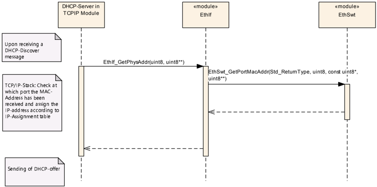

以下时序图展示了针对EthIf的API调用中EthIf、EthSwt和EthTrcv之间的交互：

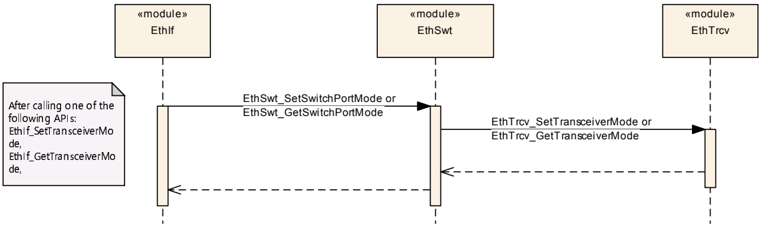

以下时序图展示了由EthIf发起的API调用中EthIf、EthSwt和EthTrcv之间的交互：

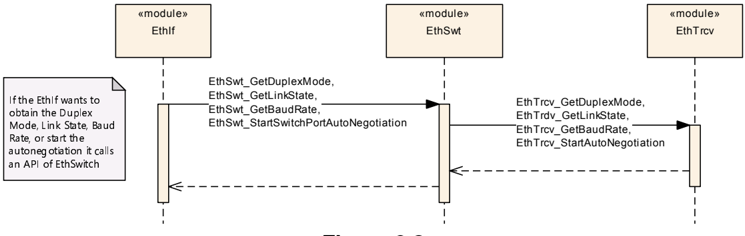

### 8.1. 交换机管理支持

图9.4：用于发送的交换机管理支持（**Switch Management support for transmission**）

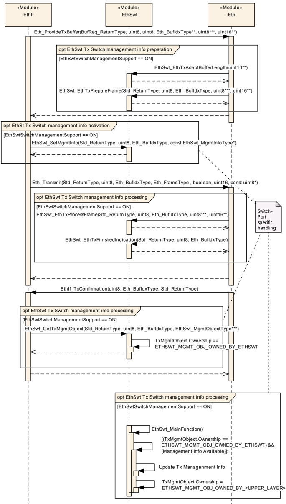

图9.5：用于接收的管理支持（**Management support for reception**）

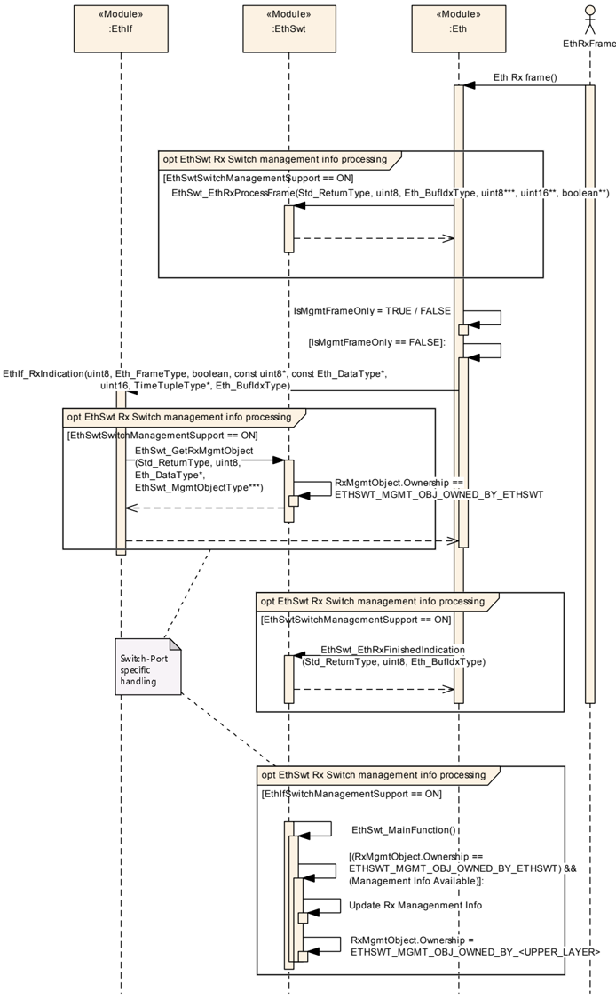
## 9. 配置规范

第9.1节规定模块**EthSwt**的结构（容器）和参数。

第9.2节列出**EthSwt**模块配置的约束。

### 9.1. 容器与配置参数

以下各章汇总了所有配置参数。参数的详细含义在第6章和第7章中描述。

以太网交换机驱动程序模块应拒绝实现不支持的、带有分区映射的配置。

#### 9.1.1. EthSwt

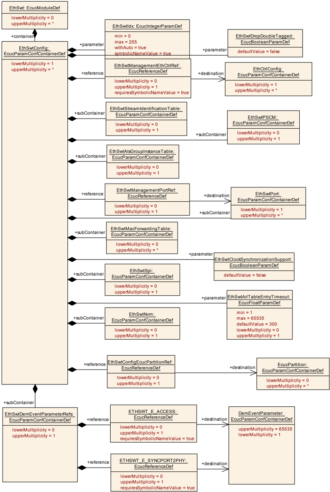


| SWS 条目 | [] |
| --- | --- |
| 容器名称 | EthSwt |
| 配置参数 | 见下方参数表 |

| 包含的容器 | 容器名称 | 多重性 | 作用域/依赖 |
| --- | --- | --- | --- |
| 包含的容器 | EthSwtConfig | 1..* | 一个以太网交换机的配置。 |
| 包含的容器 | EthSwtGeneral | 1 | 以太网交换机驱动程序模块的通用配置。 |

#### 9.1.2. EthSwtGeneral

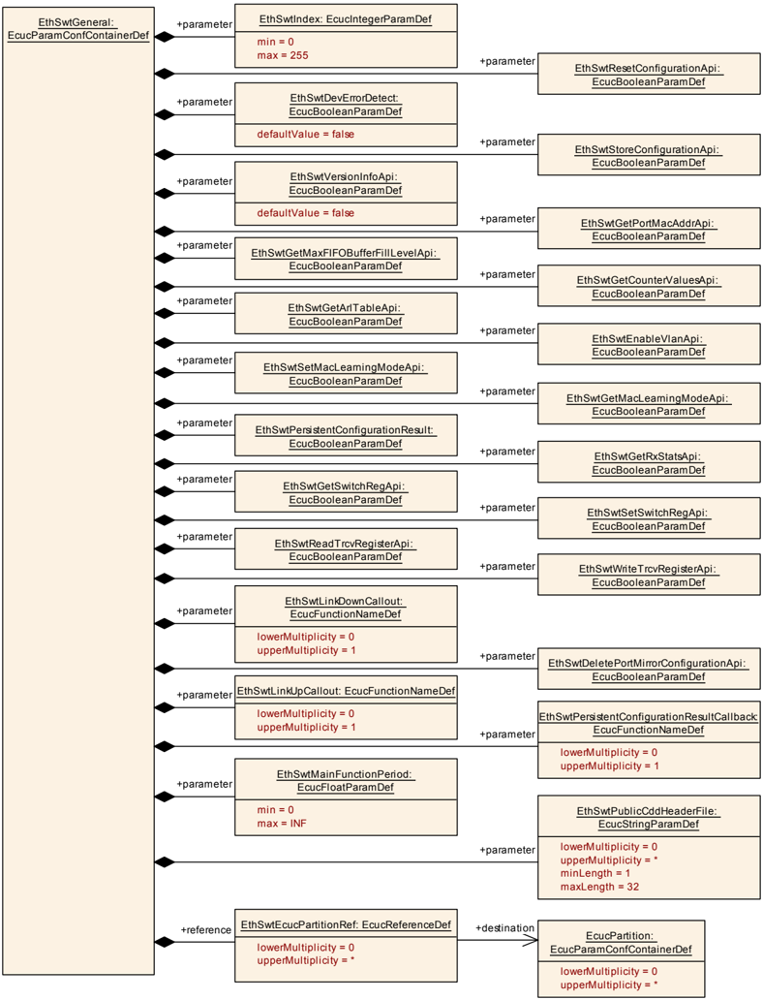
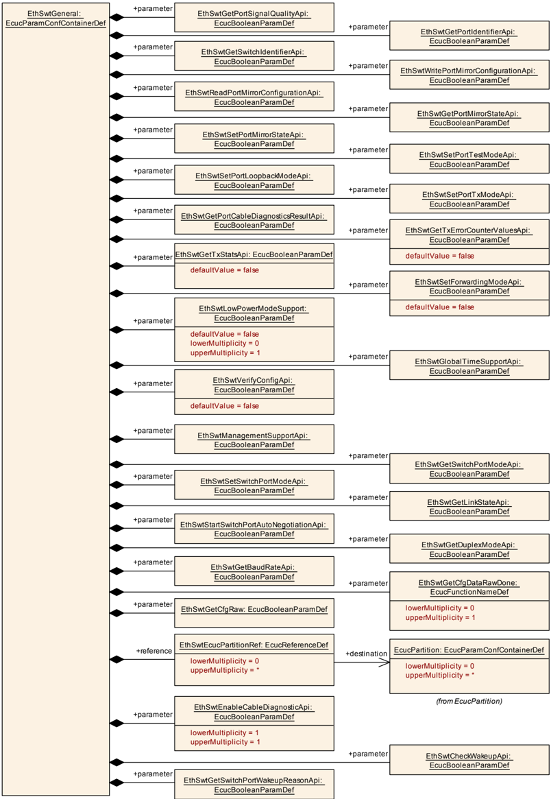


| SWS 条目 | [] |
| --- | --- |
| 容器名称 | EthSwtGeneral |
| 配置参数 | 见下方参数表 |

无包含的容器。

| SWS 条目 | [ECUC_EthSwt_00133] |
| --- | --- |
| 参数名称 | EthSwtCheckWakeupApi |
| 描述 | 启用/禁用EthSwt_CheckWakeup API。 |
| 多重性 | 1 |
| 类型 | EcucBooleanParamDef |
| 默认值 | - |
| Post-Build 变体值 | false |
| 值配置类 | Pre-compile：time X All Variants；Link：time -；Post-build：time - |
| 作用域/依赖 | scope: local |

| SWS 条目 | [ECUC_EthSwt_00002] |
| --- | --- |
| 参数名称 | EthSwtDeletePortMirrorConfigurationApi |
| 描述 | 启用/禁用EthSwt_DeletePortMirrorConfiguration API。 |
| 多重性 | 1 |
| 类型 | EcucBooleanParamDef |
| 默认值 | - |
| Post-Build 变体值 | false |
| 值配置类 | Pre-compile：time X All Variants；Link：time -；Post-build：time - |
| 作用域/依赖 | scope: local |

| SWS 条目 | [ECUC_EthSwt_00135] |
| --- | --- |
| 参数名称 | EthSwtDevErrorDetect |
| 描述 | 开启或关闭开发错误检测与通知（true：启用检测与通知；false：禁用检测与通知）。 |
| 多重性 | 1 |
| 类型 | EcucBooleanParamDef |
| 默认值 | false |
| Post-Build 变体值 | false |
| 值配置类 | Pre-compile：time X All Variants；Link：time -；Post-build：time - |
| 作用域/依赖 | scope: local |

| SWS 条目 | [ECUC_EthSwt_00055] |
| --- | --- |
| 参数名称 | EthSwtEnableCableDiagnosticApi |
| 描述 | 启用/禁用线缆诊断API：EthSwt_RunPortCableDiagnostic、EthSwt_GetPortCableDiagnosticsResult。 |
| 多重性 | 1 |
| 类型 | EcucBooleanParamDef |
| 默认值 | - |
| Post-Build 变体值 | false |
| 值配置类 | Pre-compile：time X All Variants；Link：time -；Post-build：time - |
| 作用域/依赖 | scope: local |

| SWS 条目 | [ECUC_EthSwt_00052] |
| --- | --- |
| 参数名称 | EthSwtEnableVlanApi |
| 描述 | 启用/禁用EthSwt_EnableVLAN API。 |
| 多重性 | 1 |
| 类型 | EcucBooleanParamDef |
| 默认值 | - |
| Post-Build 变体值 | false |
| 值配置类 | Pre-compile：time X All Variants；Link：time -；Post-build：time - |
| 作用域/依赖 | scope: local |

| SWS 条目 | [ECUC_EthSwt_00121] |
| --- | --- |
| 参数名称 | EthSwtGetArlTableApi |
| 描述 | 启用/禁用EthSwt_GetArlTable API。 |
| 多重性 | 1 |
| 类型 | EcucBooleanParamDef |
| 默认值 | - |
| Post-Build 变体值 | false |
| 值配置类 | Pre-compile：time X All Variants；Link：time -；Post-build：time - |
| 作用域/依赖 | scope: local |

| SWS 条目 | [ECUC_EthSwt_00121] |
| --- | --- |
| 参数名称 | EthSwtGetBaudRateApi |
| 描述 | 启用/禁用EthSwt_GetBaudRate API。 |
| 多重性 | 1 |
| 类型 | EcucBooleanParamDef |
| 默认值 | - |

#### 9.1.3. EthSwtConfig

| SWS 条目 | [] |
| --- | --- |
| 容器名称 | EthSwtConfig |
| 配置参数 | 见下方参数表 |

| 包含的容器 | 容器名称 | 多重性 | 作用域/依赖 |
| --- | --- | --- | --- |
| 包含的容器 | EthSwtAtsGroupInstanceTable | 0..1 | **EthSwtAtsGroupInstanceEntry**的集合。 |
| 包含的容器 | EthSwtDemEventParameterRefs | 0..1 | Container for the references to DemEventParameter elements which shall be invoked using the API Dem_SetEventStatus in case the corresponding error occurs. The EventId is taken from the referenced DemEventParameter's DemEventId symbolic value. The standardized errors are provided in this container and can be extended by vendor-specific error references. |
| 包含的容器 | EthSwtMacForwardingTable | 0..* | 表示一个MAC转发表。 |
| 包含的容器 | EthSwtNvm | 0..1 | 一个以太网交换机Nvm使用的配置，用于模块需要在ECU中使用非易失性存储器存储交换机配置的情况。 |
| 包含的容器 | EthSwtPSCM | 0..1 | Per stream classification and metering. |
| 包含的容器 | EthSwtPort | 1..* | 一个以太网交换机端口的配置。 |
| 包含的容器 | EthSwtSpi | 0..1 | 一个以太网交换机SPI访问的配置（如果使用SPI）。 |
| 包含的容器 | EthSwtStreamIdentificationTable | 0..1 | 一个流识别表的配置。 |
| 包含的容器 | EthSwtVlanMembership | 0..4095 | 确定该以太网交换机和被引用端口对虚拟网络的成员关系，即携带该VID的帧可以经由被引用的端口接收和发送。 |

| SWS 条目 | [ECUC_EthSwt_00128] |
| --- | --- |
| 参数名称 | EthSwtArlTableEntryTimeout |
| 描述 | 如果存在，该参数规定从以太网交换机ARL表中移除未使用条目的超时时间（秒）。如果未配置该参数，条目不会被自动移除。 |
| 多重性 | 0..1 |
| 类型 | EcucFloatParamDef |
| 范围 | [1 .. 65535] |
| 默认值 | 300 |
| Post-Build 变体值 | false |
| 值配置类 | Pre-compile：time X All Variants；Link：time -；Post-build：time -；Pre-compile：time X All Variants；Link：time -；Post-build：time - |
| 作用域/依赖 | scope: local |

| SWS 条目 | [ECUC_EthSwt_00128] |
| --- | --- |
| 参数名称 | EthSwtClockSynchronizationSupport |
| 描述 | 该参数定义以太网交换机是否应启用与其通过上行端口连接的另一个以太网交换机的时钟同步。如果该参数设置为TRUE，则激活所连接以太网交换机之间的时钟同步，并且以太网交换机的时钟被同步。如果该参数设置为FALSE，则停用所连接以太网交换机之间的时钟同步。只有在以太网交换机硬件支持时钟同步时，该参数才应设置为TRUE。 |
| 多重性 | 1 |
| 类型 | EcucBooleanParamDef |
| 默认值 | false |
| Post-Build 变体值 | true |
| 值配置类 | Pre-compile：time X VARIANT-PRE-COMPILE；Link：time X VARIANT-LINK-TIME |

#### 9.1.4. EthSwtAtsGroupInstanceTable

| SWS 条目 | [] |
| --- | --- |
| 容器名称 | EthSwtAtsGroupInstanceTable |
| 配置参数 | 见下方参数表 |

| 包含的容器 | 容器名称 | 多重性 | 作用域/依赖 |
| --- | --- | --- | --- |
| 包含的容器 | EthSwtAtsGroupInstanceEntry | 0..* | AtsGroupInstanceEntry。 |

#### 9.1.5. EthSwtAtsGroupInstanceEntry

| SWS 条目 | [] |
| --- | --- |
| 容器名称 | EthSwtAtsGroupInstanceEntry |
| 配置参数 | 见下方参数表 |

无包含的容器。

| SWS 条目 | [ECUC_EthSwt_00195] |
| --- | --- |
| 参数名称 | EthSwtAtsGroupMaximumResidenceTime |
| 描述 | 该参数定义帧可以在网桥中驻留的最大时长限制（秒）。 |
| 多重性 | 1 |
| 类型 | EcucFloatParamDef |
| 范围 | ]0 .. INF[ |
| 默认值 | - |
| Post-Build 变体值 | true |
| 值配置类 | Pre-compile：time X VARIANT-PRE-COMPILE；Link：time X VARIANT-LINK-TIME；Post-build：time X VARIANT-POST-BUILD |
| 作用域/依赖 | scope: local |

#### 9.1.6. EthSwtDemEventParameterRefs

| SWS 条目 | [] |
| --- | --- |
| 容器名称 | EthSwtDemEventParameterRefs |
| 配置参数 | 见下方参数表 |

无包含的容器。

| SWS 条目 | [ECUC_EthSwt_00125] |
| --- | --- |
| 参数名称 | ETHSWT_E_ACCESS |
| 描述 | 对当发生错误「以太网交换机访问失败」时应引发的DemEventParameter的引用。 |
| 多重性 | 0..1 |
| 类型 | Symbolic name reference to DemEventParameter |
| Post-Build 变体值 | true |
| 值配置类 | Pre-compile：time X VARIANT-PRE-COMPILE；Link：time X VARIANT-LINK-TIME；Post-build：time X VARIANT-POST-BUILD；Pre-compile：time X VARIANT-PRE-COMPILE；Link：time X VARIANT-LINK-TIME；Post-build：time X VARIANT-POST-BUILD |
| 作用域/依赖 | scope: local |

| SWS 条目 | [ECUC_EthSwt_00125] |
| --- | --- |
| 参数名称 | ETHSWT_E_SYNCPORT2PHY |
| 描述 | 对当发生错误「以太网交换机端口与所引用的以太网收发器处于相互矛盾的模式」时应引发的DemEventParameter的引用。 |
| 多重性 | 0..1 |
| 类型 | Symbolic name reference to DemEventParameter |
| Post-Build 变体值 | true |
| 值配置类 | Pre-compile：time X VARIANT-PRE-COMPILE；Link：time X VARIANT-LINK-TIME；Post-build：time X VARIANT-POST-BUILD；Pre-compile：time X VARIANT-PRE-COMPILE；Link：time X VARIANT-LINK-TIME；Post-build：time X VARIANT-POST-BUILD |
| 作用域/依赖 | scope: local |

#### 9.1.7. EthSwtMacForwardingTable

| SWS 条目 | [] |
| --- | --- |
| 容器名称 | EthSwtMacForwardingTable |
| 配置参数 | 见下方参数表 |

无包含的容器。

| SWS 条目 | [ECUC_EthSwt_00207] |
| --- | --- |
| 参数名称 | EthSwtPredefinedMacAddress |
| 描述 | 规定一个48位物理地址（MAC地址，网络字节序），它可以通过被引用的端口访问，如果可用，还可以通过被引用的VLAN访问。请注意，在运行期间可以学习到更多地址。 |
| 多重性 | 1 |
| 类型 | EcucStringParamDef |
| 默认值 | - |
| Post-Build 变体值 | true |
| 值配置类 | Pre-compile：time X VARIANT-PRE-COMPILE；Link：time X VARIANT-LINK-TIME；Post-build：time X VARIANT-POST-BUILD |
| 作用域/依赖 | scope: ECU |

| SWS 条目 | [ECUC_EthSwt_00207] |
| --- | --- |
| 参数名称 | EthSwtMacForwardingTablePortRef |
| 描述 | 引用该MAC应被分配到的端口。 |
| 多重性 | 0..255 |
| 类型 | Reference to EthSwtPort |
| Post-Build 变体值 | true |
| 值配置类 | Pre-compile：time X VARIANT-PRE-COMPILE；Link：time X VARIANT-LINK-TIME；Post-build：time X VARIANT-POST-BUILD；Pre-compile：time X VARIANT-PRE-COMPILE；Link：time X VARIANT-LINK-TIME；Post-build：time X VARIANT-POST-BUILD |
| 作用域/依赖 | scope: ECU |

#### 9.1.8. EthSwtNvm

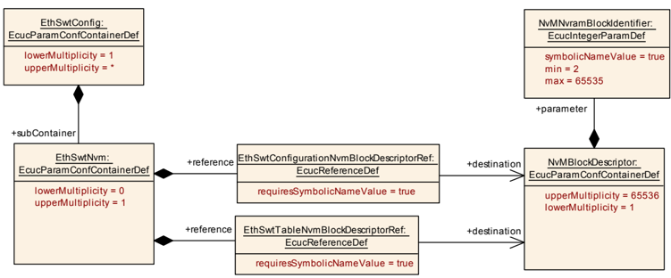


| SWS 条目 | [] |
| --- | --- |
| 容器名称 | EthSwtNvm |
| 配置参数 | 见下方参数表 |

无包含的容器。

#### 9.1.9. EthSwtPSCM

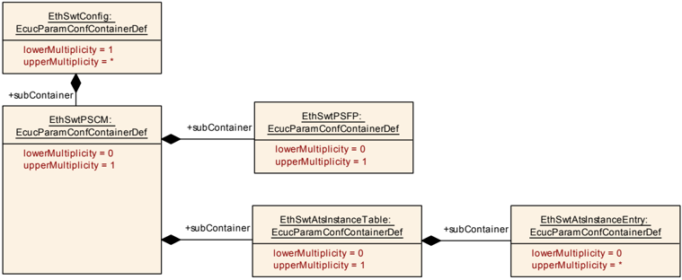


| SWS 条目 | [] |
| --- | --- |
| 容器名称 | EthSwtPSCM |
| 配置参数 | 见下方参数表 |

| 包含的容器 | 容器名称 | 多重性 | 作用域/依赖 |
| --- | --- | --- | --- |
| 包含的容器 | EthSwtAtsInstanceTable | 0..1 | **EthSwtAtsInstanceTable**。 |
| 包含的容器 | EthSwtPSFP | 0..1 | 每流过滤和监管（**PSFP**）的配置。 |

#### 9.1.10. EthSwtAtsInstanceTable

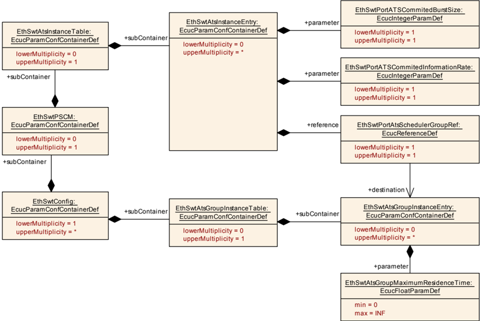


| SWS 条目 | [] |
| --- | --- |
| 容器名称 | EthSwtAtsInstanceTable |
| 配置参数 | 见下方参数表 |

| 包含的容器 | 容器名称 | 多重性 | 作用域/依赖 |
| --- | --- | --- | --- |
| 包含的容器 | EthSwtAtsInstanceEntry | 0..* | PSFP范围内异步流量调度器（**Asynchronous Traffic Scheduler**）的配置。 |

#### 9.1.11. EthSwtAtsInstanceEntry

| SWS 条目 | [] |
| --- | --- |
| 容器名称 | EthSwtAtsInstanceEntry |
| 配置参数 | 见下方参数表 |

无包含的容器。

| SWS 条目 | [ECUC_EthSwt_00198] |
| --- | --- |
| 参数名称 | EthSwtPortATSCommitedBurstSize |
| 描述 | 令牌桶的最大令牌容量。 |
| 多重性 | 1 |
| 类型 | EcucIntegerParamDef |
| 范围 | 0 .. 18446744073709551615 |
| 默认值 | - |
| Post-Build 变体值 | true |
| 值配置类 | Pre-compile：time X VARIANT-PRE-COMPILE；Link：time X VARIANT-LINK-TIME；Post-build：time X VARIANT-POST-BUILD |
| 作用域/依赖 | scope: local |

| SWS 条目 | [ECUC_EthSwt_00196] |
| --- | --- |
| 参数名称 | EthSwtPortATSCommitedInformationRate |
| 描述 | 定义令牌桶被重新填充令牌的速率。 |
| 多重性 | 1 |
| 类型 | EcucIntegerParamDef |
| 范围 | 0 .. 18446744073709551615 |
| 默认值 | - |
| Post-Build 变体值 | true |
| 值配置类 | Pre-compile：time X VARIANT-PRE-COMPILE；Link：time X VARIANT-LINK-TIME；Post-build：time X VARIANT-POST-BUILD |
| 作用域/依赖 | scope: local |

| SWS 条目 | [ECUC_EthSwt_00196] |
| --- | --- |
| 参数名称 | EthSwtPortAtsSchedulerGroupRef |
| 描述 | 定义该ATS调度器属于哪个ATS调度器组。 |
| 多重性 | 1 |
| 类型 | Reference to EthSwtAtsGroupInstanceEntry |
| Post-Build 变体值 | true |
| 值配置类 | Pre-compile：time X VARIANT-PRE-COMPILE；Link：time X VARIANT-LINK-TIME；Post-build：time X VARIANT-POST-BUILD |
| 作用域/依赖 | scope: local |

#### 9.1.12. EthSwtPSFP

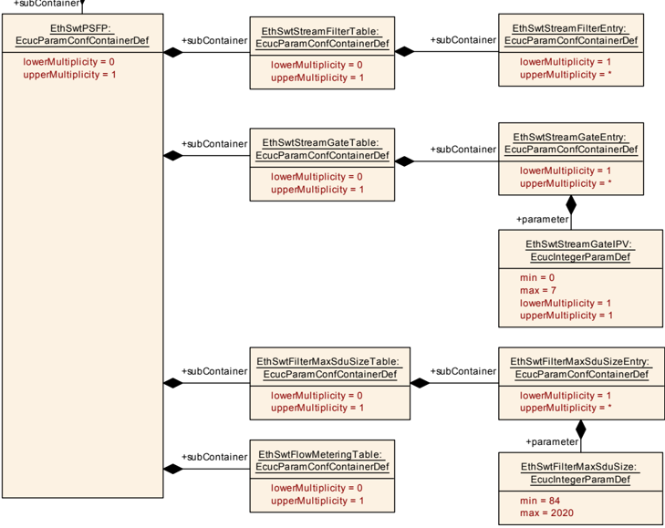


| SWS 条目 | [] |
| --- | --- |
| 容器名称 | EthSwtPSFP |
| 配置参数 | 见下方参数表 |

| 包含的容器 | 容器名称 | 多重性 | 作用域/依赖 |
| --- | --- | --- | --- |
| 包含的容器 | EthSwtFilterMaxSduSizeTable | 0..1 | **EthSwtFilterMaxSduSizeTable**表示一个SDU大小值的表，其中每个值（表条目）都可以被一个**EthSwtStreamFilterEntry**引用。 |
| 包含的容器 | EthSwtFlowMeteringTable | 0..1 | **EthSwtFlowMeteringTable**表示一个流量计量配置的表，其中每个流量计量配置（表条目）都可以被一个**EthSwtStreamFilterEntry**引用。 |
| 包含的容器 | EthSwtStreamFilterTable | 0..1 | EthSwtStreamFilterTable represents a table of stream filter configurations, where each stream filter configuration (table entry) could reference a EthSwtFilterMaxSduSizeEntry, EthSwt FlowMeteringEntry and EthSwtStreamGateEntry. |
| 包含的容器 | EthSwtStreamGateTable | 0..1 | EthSwtStreamGateTable represents a table of stream gate configurations, where each stream gate configuration (table entry) could be referenced by a EthSwtStreamFilterEntry. |

#### 9.1.13. EthSwtFilterMaxSduSizeTable

| SWS 条目 | [] |
| --- | --- |
| 容器名称 | EthSwtFilterMaxSduSizeTable |
| 配置参数 | 见下方参数表 |

| 包含的容器 | 容器名称 | 多重性 | 作用域/依赖 |
| --- | --- | --- | --- |
| 包含的容器 | EthSwtFilterMaxSduSizeEntry | 1..* | **EthSwtFilterMaxSduSizeEntry**定义以太网交换机可接受处理的最大SDU大小（以太网分组的大小）。**EthSwtFilterMaxSduSizeEntry**的值考虑以太网分组的以下部分的大小：• 前导码（**Preamble**）（7字节）• SFD（帧起始定界符）（1字节）• 以太网帧（目的MAC、源MAC、VLAN标记、类型字段、有效载荷、CRC校验和）• 最小IPG（包间隙）（12字节时间）。 |

#### 9.1.14. EthSwtFilterMaxSduSizeEntry

| SWS 条目 | [] |
| --- | --- |
| 容器名称 | EthSwtFilterMaxSduSizeEntry |
| 配置参数 | 见下方参数表 |

无包含的容器。

| SWS 条目 | [ECUC_EthSwt_00225] |
| --- | --- |
| 参数名称 | EthSwtFilterMaxSduSize |
| 描述 | 最大SDU大小。 |
| 多重性 | 1 |
| 类型 | EcucIntegerParamDef |
| 范围 | 84 .. 2020 |
| 默认值 | - |
| Post-Build 变体值 | true |
| 值配置类 | Pre-compile：time X VARIANT-PRE-COMPILE；Link：time X VARIANT-LINK-TIME |
| 作用域/依赖 | scope: local |

#### 9.1.15. EthSwtFlowMeteringTable

| SWS 条目 | [] |
| --- | --- |
| 容器名称 | EthSwtFlowMeteringTable |
| 配置参数 | 见下方参数表 |

| 包含的容器 | 容器名称 | 多重性 | 作用域/依赖 |
| --- | --- | --- | --- |
| 包含的容器 | EthSwtFlowMeteringEntry | 1..* | 一个流量计量的配置。 |

#### 9.1.16. EthSwtFlowMeteringEntry

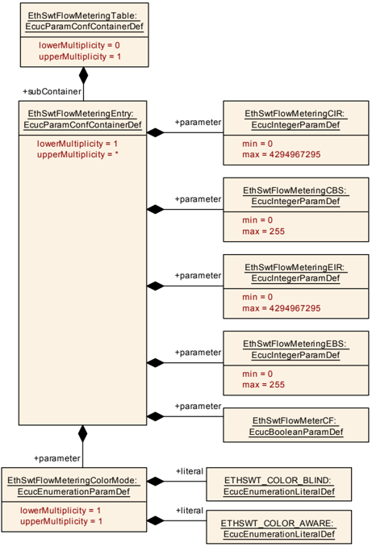


| SWS 条目 | [] |
| --- | --- |
| 容器名称 | EthSwtFlowMeteringEntry |
| 配置参数 | 见下方参数表 |

| 包含的容器 | 容器名称 | 多重性 | 作用域/依赖 |
| --- | --- | --- | --- |
| 包含的容器 |  | 0 .. 4294967295 | Range |

| SWS 条目 | [ECUC_EthSwt_00162] |
| --- | --- |
| 参数名称 | EthSwtFlowMeterCF |
| 描述 | 耦合标志（**Coupling Flag**），定义第一桶中未使用的「绿色」令牌是否作为「黄色」令牌转移到第二桶。注意：该参数映射到IEEE802.1Q参数「ieee8021PSFPFlowMeterCF」。 |

#### 9.1.17. EthSwtStreamFilterTable

| SWS 条目 | [] |
| --- | --- |
| 容器名称 | EthSwtStreamFilterTable |
| 配置参数 | 见下方参数表 |

| 包含的容器 | 容器名称 | 多重性 | 作用域/依赖 |
| --- | --- | --- | --- |
| 包含的容器 | EthSwtStreamFilterEntry | 1..* | This container represents a stream filter, where EthSwtStream FilterPriority and EthSwtAssignedStreamHandle are used to detect a matching Ethernet frame. |

#### 9.1.18. EthSwtStreamFilterEntry

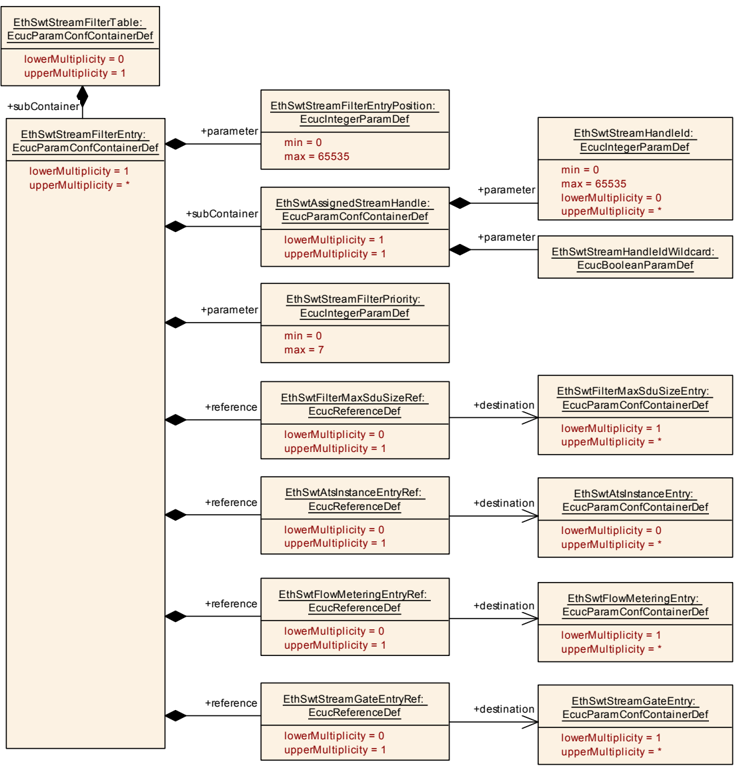


| SWS 条目 | [] |
| --- | --- |
| 容器名称 | EthSwtStreamFilterEntry |
| 配置参数 | 见下方参数表 |

| 包含的容器 | 容器名称 | 多重性 | 作用域/依赖 |
| --- | --- | --- | --- |
| 包含的容器 | EthSwtAssignedStreamHandle | 1 | This container represents an assigned stream handle id of this stream filter, which is used to detect a matching Ethernet frame. The EthSwtAssignedStreamHandle could represent a list of assigned stream handle ids. Additionally it could set a wildcard flag (EthSwtStreamHandleId Wildcard), where any assigned stream handle id carried by an Ethernet frame would match to this stream filter. |

| SWS 条目 | [ECUC_EthSwt_00216] |
| --- | --- |
| 参数名称 | EthSwtStreamFilterEntryPosition |
| 描述 | 规定该位置作为**EthSwtStreamFilterEntry**有序列表内的唯一ID。有序列表应从0开始，并作为没有间隔的线性列表连续排列。注意：该列表按升序处理。位置为0的**EthSwtStreamFilterEntry**实例最先被处理。 |
| 多重性 | 1 |
| 类型 | EcucIntegerParamDef |
| 范围 | 0 .. 65535 |
| 默认值 | - |
| Post-Build 变体值 | true |
| 值配置类 | Pre-compile：time X VARIANT-PRE-COMPILE；Link：time X VARIANT-LINK-TIME |

#### 9.1.19. EthSwtAssignedStreamHandle

| SWS 条目 | [] |
| --- | --- |
| 容器名称 | EthSwtAssignedStreamHandle |
| 配置参数 | 见下方参数表 |

无包含的容器。

| SWS 条目 | [ECUC_EthSwt_00209] |
| --- | --- |
| 参数名称 | EthSwtStreamHandleId |
| 描述 | 该流过滤器的已分配流句柄ID，用于评估匹配的以太网帧。 |
| 多重性 | 0..* |
| 类型 | EcucIntegerParamDef |
| 范围 | 0 .. 65535 |
| 默认值 | - |
| Post-Build 变体值 | true |
| 值配置类 | Pre-compile：time X VARIANT-PRE-COMPILE；Link：time X VARIANT-LINK-TIME；Post-build：time X VARIANT-POST-BUILD；Pre-compile：time X VARIANT-PRE-COMPILE；Link：time X VARIANT-LINK-TIME；Post-build：time X VARIANT-POST-BUILD |
| 作用域/依赖 | scope: local |

| SWS 条目 | [ECUC_EthSwt_00209] |
| --- | --- |
| 参数名称 | EthSwtStreamHandleIdWildcard |
| 描述 | 定义该**EthSwtAssignedStreamHandle**是否包含通配符。 |
| 多重性 | 1 |
| 类型 | EcucBooleanParamDef |
| 默认值 | - |
| Post-Build 变体值 | true |
| 值配置类 | Pre-compile：time X VARIANT-PRE-COMPILE；Link：time X VARIANT-LINK-TIME；Post-build：time X VARIANT-POST-BUILD |
| 作用域/依赖 | scope: local |

#### 9.1.20. EthSwtStreamGateTable

| SWS 条目 | [] |
| --- | --- |
| 容器名称 | EthSwtStreamGateTable |
| 配置参数 | 见下方参数表 |

| 包含的容器 | 容器名称 | 多重性 | 作用域/依赖 |
| --- | --- | --- | --- |
| 包含的容器 | EthSwtStreamGateEntry | 1..* | 一个流门的配置。 |

#### 9.1.21. EthSwtStreamGateEntry

| SWS 条目 | [] |
| --- | --- |
| 容器名称 | EthSwtStreamGateEntry |
| 配置参数 | 见下方参数表 |

无包含的容器。

| SWS 条目 | [ECUC_EthSwt_00156] |
| --- | --- |
| 参数名称 | EthSwtStreamGateIPV |
| 描述 | 内部优先级值（**IPV**），决定所分配流量类别的优先级值。注意：只应配置最低的3个有效位。其余位应被忽略。 |
| 多重性 | 1 |
| 类型 | EcucIntegerParamDef |
| 范围 | 0 .. 7 |
| 默认值 | - |
| Post-Build 变体值 | true |

#### 9.1.22. EthSwtPort

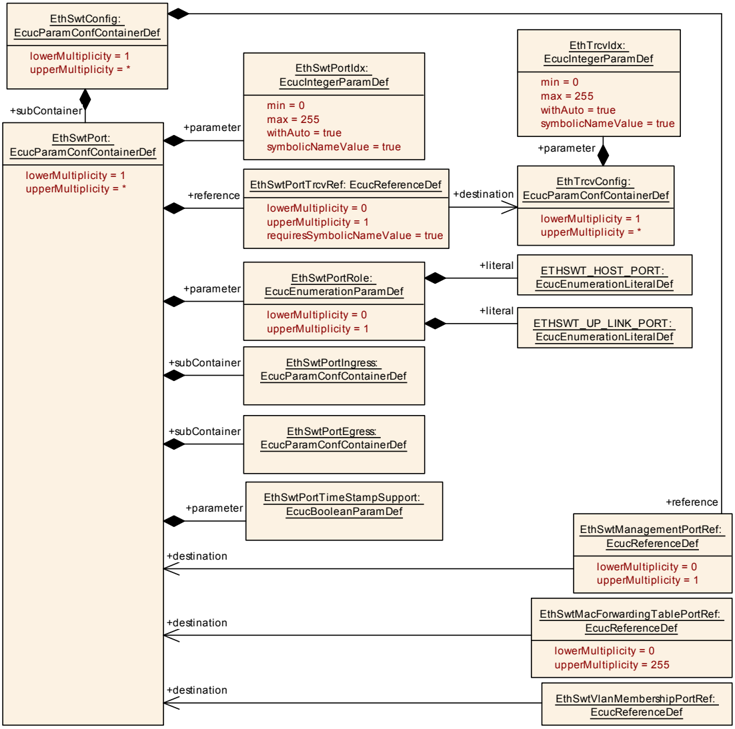
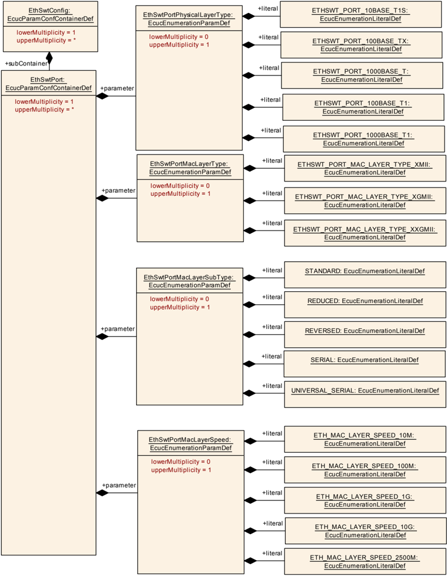


| SWS 条目 | [] |
| --- | --- |
| 容器名称 | EthSwtPort |
| 配置参数 | 见下方参数表 |

| 包含的容器 | 容器名称 | 多重性 | 作用域/依赖 |
| --- | --- | --- | --- |
| 包含的容器 | EthSwtPortEgress | 1 | 一个以太网交换机端口出口行为的配置。 |
| 包含的容器 | EthSwtPortIngress | 1 | 一个以太网交换机端口入口行为的配置。 |

| SWS 条目 | [ECUC_EthSwt_00114] |
| --- | --- |
| 参数名称 | EthSwtPortIdx |
| 描述 | 规定已配置以太网交换机端口的实例ID。 |
| 多重性 | 1 |
| 类型 | EcucIntegerParamDef (Symbolic Name generated for this parameter) |
| 范围 | 0 .. 255 |
| 默认值 | - |
| Post-Build 变体值 | false |
| 值配置类 | Pre-compile：time X All Variants；Link：time -；Post-build：time - |
| 作用域/依赖 | scope: ECU |

| SWS 条目 | [ECUC_EthSwt_00114] |
| --- | --- |
| 参数名称 | EthSwtPortMacLayerSpeed |
| 描述 | 定义MAC层的波特率。 |
| 多重性 | 0..1 |
| 类型 | EcucEnumerationParamDef |
| 范围 | ETH_MAC_LAYER_ SPEED_100M ;; ETH_MAC_LAYER_SPEED_10G ;; ETH_MAC_LAYER_SPEED_10M |

#### 9.1.23. EthSwtPortEgress

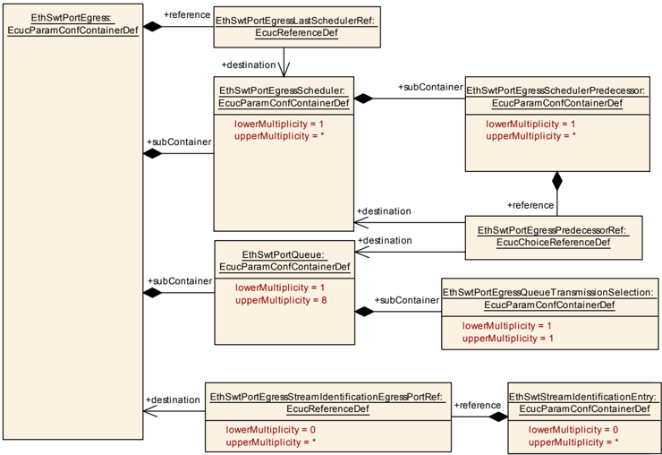
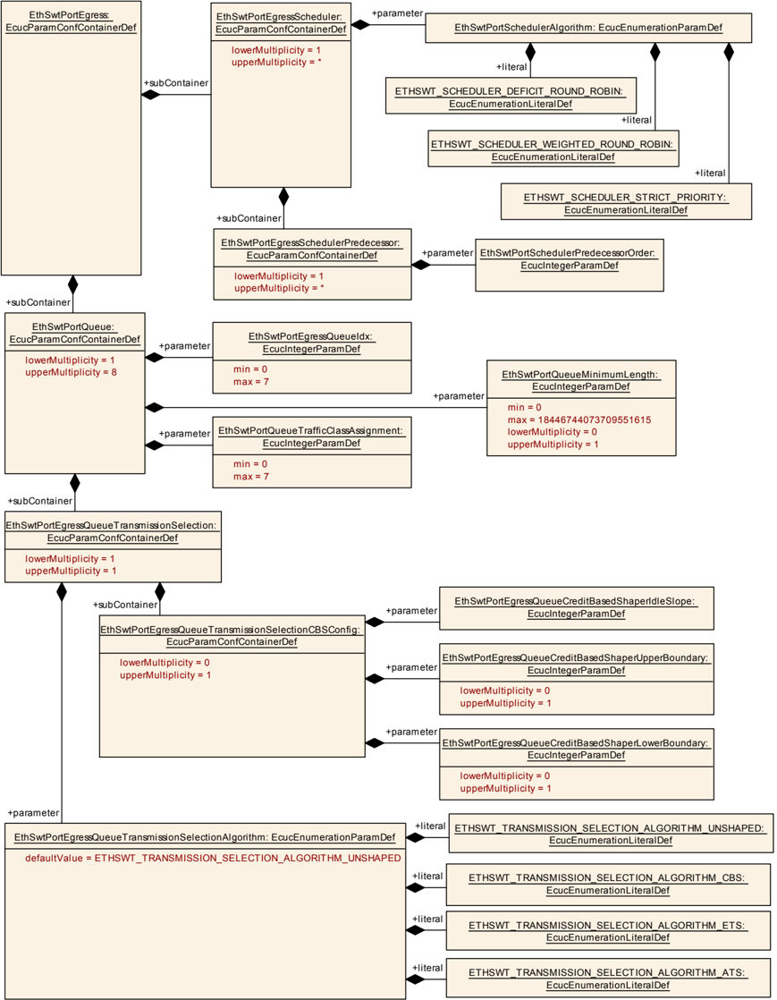
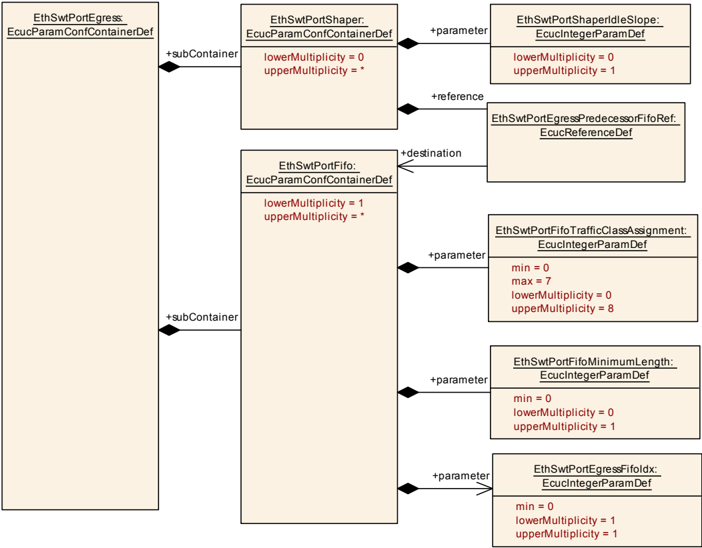


| SWS 条目 | [] |
| --- | --- |
| 容器名称 | EthSwtPortEgress |
| 配置参数 | 见下方参数表 |

| 包含的容器 | 容器名称 | 多重性 | 作用域/依赖 |
| --- | --- | --- | --- |
| 包含的容器 | EthSwtPortEgressScheduler | 1..* | 表示出口端口中的一个调度器。 |
| 包含的容器 | EthSwtPortFifo | 1..* | 表示出口端口中的一个FIFO。 |
| 包含的容器 | EthSwtPortQueue | 1..8 | 表示出口端口处的一个队列。 |
| 包含的容器 | EthSwtPortShaper | 0..* | 表示出口端口中的一个整形器。 |

| SWS 条目 | [ECUC_EthSwt_00008] |
| --- | --- |
| 参数名称 | EthSwtPortEgressLastSchedulerRef |
| 描述 | 对出口端口结构中最后一个端口调度器的引用。 |
| 多重性 | 1 |
| 类型 | Reference to EthSwtPortEgressScheduler |
| Post-Build 变体值 | true |
| 值配置类 | Pre-compile：time X VARIANT-PRE-COMPILE；Link：time X VARIANT-LINK-TIME；Post-build：time X VARIANT-POST-BUILD |
| 作用域/依赖 | scope: local |

#### 9.1.24. EthSwtPortEgressScheduler

| SWS 条目 | [] |
| --- | --- |
| 容器名称 | EthSwtPortEgressScheduler |
| 配置参数 | 见下方参数表 |

| 包含的容器 | 容器名称 | 多重性 | 作用域/依赖 |
| --- | --- | --- | --- |
| 包含的容器 | EthSwtPortEgressScheduler Predecessor | 1..* | 定义该调度器前驱的有序列表。 |

| SWS 条目 | [ECUC_EthSwt_00018] |
| --- | --- |
| 参数名称 | EthSwtPortSchedulerAlgorithm |
| 描述 | 定义调度器算法。 |
| 多重性 | 1 |
| 类型 | EcucEnumerationParamDef |
| 范围 | ETHSWT_SCHEDULER_ DEFICIT_ROUND_ROBIN ;; ETHSWT_SCHEDULER_ STRICT_PRIORITY |

#### 9.1.25. EthSwtPortEgressSchedulerPredecessor

| SWS 条目 | [] |
| --- | --- |
| 容器名称 | EthSwtPortEgressSchedulerPredecessor |
| 配置参数 | 见下方参数表 |

无包含的容器。

| SWS 条目 | [ECUC_EthSwt_00010] |
| --- | --- |
| 参数名称 | EthSwtPortSchedulerPredecessorOrder |
| 描述 | 定义调度器前驱的顺序。该值必须被理解为相对值，即该值只显示元素的相对排序。最高值具有最高优先级，允许有间隔（非密集）。这些值在一个**EthSwtPortScheduler**内必须是唯一的。 |
| 多重性 | 1 |
| 类型 | EcucIntegerParamDef |
| 范围 | 0 .. 18446744073709551615 |
| 默认值 | - |
| Post-Build 变体值 | true |
| 值配置类 | Pre-compile：time X VARIANT-PRE-COMPILE；Link：time X VARIANT-LINK-TIME；Post-build：time X VARIANT-POST-BUILD |
| 作用域/依赖 | scope: ECU |

| SWS 条目 | [ECUC_EthSwt_00010] |
| --- | --- |
| 参数名称 | EthSwtPortEgressPredecessorRef |
| 描述 | 对调度器前驱的选择引用。 |
| 多重性 | 1 |
| 类型 | Choice reference to [ EthSwtPortEgressScheduler, EthSwtPortFifo, EthSwtPortQueue, EthSwtPortShaper ] |
| Post-Build 变体值 | true |
| 值配置类 | Pre-compile：time X VARIANT-PRE-COMPILE；Link：time X VARIANT-LINK-TIME；Post-build：time X VARIANT-POST-BUILD |
| 作用域/依赖 | scope: local |

#### 9.1.26. EthSwtPortFifo

| SWS 条目 | [] |
| --- | --- |
| 容器名称 | EthSwtPortFifo |
| 配置参数 | 见下方参数表 |

无包含的容器。

| SWS 条目 | [ECUC_EthSwt_00098 (Obsolete)] |
| --- | --- |
| 参数名称 | EthSwtPortEgressFifoIdx |
| 描述 | 规定已配置以太网交换机出口端口的FIFO的实例ID。 |
| 多重性 | 1 |
| 类型 | EcucIntegerParamDef |
| 范围 | 0 .. 18446744073709551615 |
| 默认值 | - |
| Post-Build 变体值 | true |
| 值配置类 | Pre-compile：time X All Variants；Link：time -；Post-build：time - |
| 作用域/依赖 | scope: ECU |

| SWS 条目 | [ECUC_EthSwt_00012 (Obsolete)] |
| --- | --- |
| 参数名称 | EthSwtPortFifoMinimumLength |
| 描述 | 以字节为单位的FIFO最小长度。该赋值用于配置已配置FIFO的保证大小。 |
| 多重性 | 0..1 |
| 类型 | EcucIntegerParamDef |
| 范围 | 0 .. 18446744073709551615 |
| 默认值 | - |
| Post-Build 变体值 | true |
| 值配置类 | Pre-compile：time X VARIANT-PRE-COMPILE；Link：time X VARIANT-LINK-TIME；Post-build：time X VARIANT-POST-BUILD；Pre-compile：time X VARIANT-PRE-COMPILE；Link：time X VARIANT-LINK-TIME；Post-build：time X VARIANT-POST-BUILD |
| 作用域/依赖 | scope: ECU |

| SWS 条目 | [ECUC_EthSwt_00012 (Obsolete)] |
| --- | --- |
| 参数名称 | EthSwtPortFifoTrafficClassAssignment |
| 描述 | 定义哪些流量类别被分配给该FIFO。 |
| 多重性 | 0..8 |
| 类型 | EcucIntegerParamDef |
| 范围 | 0 .. 7 |
| 默认值 | - |
| Post-Build 变体值 | true |
| 值配置类 | Pre-compile：time X VARIANT-PRE-COMPILE；Link：time X VARIANT-LINK-TIME；Post-build：time X VARIANT-POST-BUILD |
| 作用域/依赖 | scope: ECU |

#### 9.1.27. EthSwtPortQueue

| SWS 条目 | [] |
| --- | --- |
| 容器名称 | EthSwtPortQueue |
| 配置参数 | 见下方参数表 |

| 包含的容器 | 容器名称 | 多重性 | 作用域/依赖 |
| --- | --- | --- | --- |
| 包含的容器 | EthSwtPortEgressQueue TransmissionSelection | 1 | 表示出口端口队列的传输选择。 |

#### 9.1.28. EthSwtPortEgressQueueTransmissionSelection

| SWS 条目 | [] |
| --- | --- |
| 容器名称 | EthSwtPortEgressQueueTransmissionSelection |
| 配置参数 | 见下方参数表 |

| 包含的容器 | 容器名称 | 多重性 | 作用域/依赖 |
| --- | --- | --- | --- |
| 包含的容器 | EthSwtPortEgressQueue TransmissionSelectionCBSConfig | 0..1 | Represents the configuration of a credit based shaper transmission selection algorithm of an egress port queue. This configuration is used if the EthSwtPortEgressQueue TransmissionSelectionAlgorithm is set to ETHSWT_ TRANSMISSION_SELECTION_ALGORITHM_CBS. |

| SWS 条目 | [ECUC_EthSwt_00191] |
| --- | --- |
| 参数名称 | EthSwtPortEgressQueueTransmissionSelectionAlgorithm |
| 描述 | 表示出口端口队列的传输选择算法。 |
| 多重性 | 1 |
| 类型 | EcucEnumerationParamDef |
| 范围 | ETHSWT_TRANSMISSION_ SELECTION_ALGORITHM_ATS ;; ETHSWT_TRANSMISSION_ SELECTION_ALGORITHM_CBS ;; ETHSWT_TRANSMISSION_ SELECTION_ALGORITHM_ETS |

#### 9.1.29. EthSwtPortEgressQueueTransmissionSelectionCBSConfig

| SWS 条目 | [] |
| --- | --- |
| 容器名称 | EthSwtPortEgressQueueTransmissionSelectionCBSConfig |
| 配置参数 | 见下方参数表 |

无包含的容器。

| SWS 条目 | [ECUC_EthSwt_00188] |
| --- | --- |
| 参数名称 | EthSwtPortEgressQueueCreditBasedShaperIdleSlope |
| 描述 | 定义AVB整形器的信用增加速率（比特/秒）。注意：该参数映射到IEEE802.1Q参数「ieee8021FqtssAdminIdleSlopeMs」和「ieee8021FqtssAdminIdleSlopeLs」。 |

#### 9.1.30. EthSwtPortShaper

| SWS 条目 | [] |
| --- | --- |
| 容器名称 | EthSwtPortShaper |
| 配置参数 | 见下方参数表 |

无包含的容器。

| SWS 条目 | [ECUC_EthSwt_00009 (Obsolete)] |
| --- | --- |
| 参数名称 | EthSwtPortShaperIdleSlope |
| 描述 | 定义AVB整形器的信用增加速率（比特/秒）。 |
| 多重性 | 0..1 |
| 类型 | EcucIntegerParamDef |
| 范围 | 0 .. 18446744073709551615 |
| 默认值 | - |
| Post-Build 变体值 | true |
| 值配置类 | Pre-compile：time X VARIANT-PRE-COMPILE；Link：time X VARIANT-LINK-TIME；Post-build：time X VARIANT-POST-BUILD |
| 作用域/依赖 | scope: local |

| SWS 条目 | [ECUC_EthSwt_00009 (Obsolete)] |
| --- | --- |
| 参数名称 | EthSwtPortEgressPredecessorFifoRef |
| 描述 | 对该整形器前驱FIFO的引用。 |
| 多重性 | 1 |
| 类型 | Reference to EthSwtPortFifo |

#### 9.1.31. EthSwtPortIngress

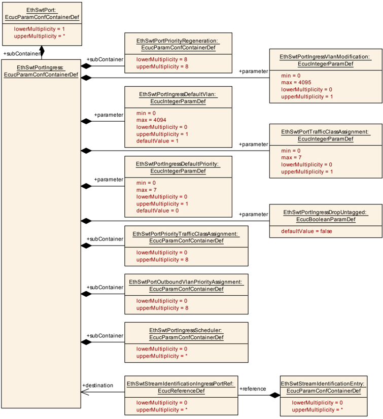
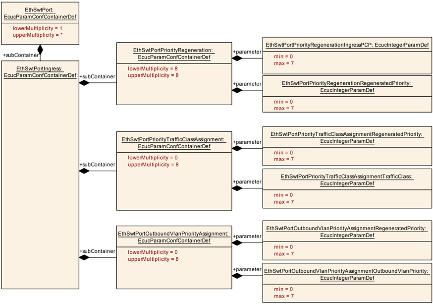


| SWS 条目 | [] |
| --- | --- |
| 容器名称 | EthSwtPortIngress |
| 配置参数 | 见下方参数表 |

| 包含的容器 | 容器名称 | 多重性 | 作用域/依赖 |
| --- | --- | --- | --- |
| 包含的容器 | EthSwtPortIngressScheduler | 0..* | 表示入口端口处的调度器配置。 |
| 包含的容器 | EthSwtPortOutboundVlanPriority Assignment | 0..8 | Defines a priority mapping from a regenerated VLAN priority (Eth SwtPortOutboundVlanPriorityAssignmentOutboundVlanPriority) to an outbound VLAN priority (EthSwtPortOutboundVlanPriority AssignmentRegeneratedPriority). The EthSwtPortOutboundVlanPriorityAssignment is optional. The outbound priority mapping shall only be performed if EthSwt PortOutboundVlanPriorityAssignment is configured. In case an EthSwtPortOutboundVlanPriorityAssignment is defined it shall have 8 mappings, one for each priority. |
| 包含的容器 | EthSwtPortPolicer | 0..32760 | 速率监管（**Rate Policing**）参数的定义。 |
| 包含的容器 | EthSwtPortPriorityRegeneration | 8 | Defines a priority regeneration where the EthSwtPortPriority RegenerationIngressPCP is replaced by EthSwtPortPriority RegenerationRegeneratedPriority. The EthSwtPortPriorityRegeneration is mandatory and shall always be available. An EthSwtPortPriorityRegeneration shall have 8 mappings, one for each priority. Rational: an Ethernet switch always performs a priority regeneration. |
| 包含的容器 | EthSwtPortPriorityTrafficClass Assignment | 0..8 | Defines a priority based traffic class assignment. All messages with a specific priority (EthSwtPortPriorityTrafficClassAssignment RegeneratedPriority) arriving at this ingress port or, if enabled regenerated priorities (EthSwtPortPriorityRegeneration), shall be assigned to a traffic class (EthSwtPortPriorityTrafficClass AssignmentTrafficClass). |

| SWS 条目 | [ECUC_EthSwt_00095] |
| --- | --- |
| 参数名称 | EthSwtPortIngressDefaultPriority |
| 描述 | 入口的默认优先级。 |
| 多重性 | 0..1 |
| 类型 | EcucIntegerParamDef |
| 范围 | 0 .. 7 |
| 默认值 | 0 |
| Post-Build 变体值 | true |
| 值配置类 | Pre-compile：time X VARIANT-PRE-COMPILE；Link：time X VARIANT-LINK-TIME；Post-build：time X VARIANT-POST-BUILD；Pre-compile：time X VARIANT-PRE-COMPILE；Link：time X VARIANT-LINK-TIME；Post-build：time X VARIANT-POST-BUILD |
| 作用域/依赖 | scope: local dependency: If EthSwtPortIngressDefaultPriority is configured (multiplicity set to 1) then EthSwtPortIngressDefaultVlan shall be configured. If EthSwtPortIngressDefault Vlan is configured EthSwtPortIngressDropUntagged shall be set to FALSE. scope: local dependency: If EthSwtPortIngressDefaultPriority is configured (multiplicity set to 1) then EthSwtPortIngressDefaultVlan shall be configured. If EthSwtPortIngressDefault Vlan is configured EthSwtPortIngressDropUntagged shall be set to FALSE. scope: local dependency: If EthSwtPortIngressDefaultPriority is configured (multiplicity set to 1) then EthSwtPortIngressDefaultVlan shall be configured. If EthSwtPortIngressDefault Vlan is configured EthSwtPortIngressDropUntagged shall be set to FALSE. |

| SWS 条目 | [ECUC_EthSwt_00095] |
| --- | --- |
| 参数名称 | EthSwtPortIngressDefaultVlan |
| 描述 | 入口的默认VLAN。 |
| 多重性 | 0..1 |
| 类型 | EcucIntegerParamDef |
| 范围 | 0 .. 4094 |

#### 9.1.32. EthSwtPortIngressScheduler

| SWS 条目 | [] |
| --- | --- |
| 容器名称 | EthSwtPortIngressScheduler |
| 配置参数 | 见下方参数表 |

无包含的容器。

#### 9.1.33. EthSwtPortOutboundVlanPriorityAssignment

| SWS 条目 | [] |
| --- | --- |
| 容器名称 | EthSwtPortOutboundVlanPriorityAssignment |
| 配置参数 | 见下方参数表 |

无包含的容器。

| SWS 条目 | [ECUC_EthSwt_00192] |
| --- | --- |
| 参数名称 | EthSwtPortOutboundVlanPriorityAssignmentOutboundVlanPriority |
| 描述 | 传出消息将被打上的消息优先级。注意：该参数映射到IEEE802.1Q参数「ieee8021BridgePortOutboundAccessPriority」。 |
| 多重性 | 1 |
| 类型 | EcucIntegerParamDef |
| 范围 | 0 .. 7 |
| 默认值 | - |
| Post-Build 变体值 | true |
| 值配置类 | Pre-compile：time X VARIANT-PRE-COMPILE；Link：time X VARIANT-LINK-TIME；Post-build：time X VARIANT-POST-BUILD |
| 作用域/依赖 | scope: local |

| SWS 条目 | [ECUC_EthSwt_00192] |
| --- | --- |
| 参数名称 | EthSwtPortOutboundVlanPriorityAssignmentRegeneratedPriority |
| 描述 | 消息的再生优先级。注意：该参数映射到IEEE802.1Q参数「ieee8021BridgeRegenUserPriority」。 |
| 多重性 | 1 |
| 类型 | EcucIntegerParamDef |
| 范围 | 0 .. 7 |
| 默认值 | - |

#### 9.1.34. EthSwtPortPolicer

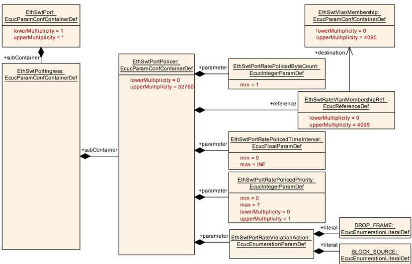


| SWS 条目 | [] |
| --- | --- |
| 容器名称 | EthSwtPortPolicer |
| 配置参数 | 见下方参数表 |

无包含的容器。

| SWS 条目 | [ECUC_EthSwt_00077 (Obsolete)] |
| --- | --- |
| 参数名称 | EthSwtPortRatePolicedByteCount |
| 描述 | 在已配置的**EthSwtPortRatePolicedTimeInterval**内可以接收的字节计数（不包括报头信息）。 |
| 多重性 | 1 |
| 类型 | EcucIntegerParamDef |
| 范围 | 1 .. 18446744073709551615 |
| 默认值 | - |
| Post-Build 变体值 | true |
| 值配置类 | Pre-compile：time X VARIANT-PRE-COMPILE；Link：time X VARIANT-LINK-TIME；Post-build：time X VARIANT-POST-BUILD |
| 作用域/依赖 | scope: local |

| SWS 条目 | [ECUC_EthSwt_00077 (Obsolete)] |
| --- | --- |
| 参数名称 | EthSwtPortRatePolicedPriority |
| 描述 | 定义该速率策略应限制的优先级。如果未给出优先级，该速率策略不考虑优先级。 |
| 多重性 | 0..1 |

#### 9.1.35. EthSwtPortPriorityRegeneration

| SWS 条目 | [] |
| --- | --- |
| 容器名称 | EthSwtPortPriorityRegeneration |
| 配置参数 | 见下方参数表 |

无包含的容器。

| SWS 条目 | [ECUC_EthSwt_00059] |
| --- | --- |
| 参数名称 | EthSwtPortPriorityRegenerationIngressPCP |
| 描述 | 传入消息中的PCP（VLAN优先级）。 |
| 多重性 | 1 |
| 类型 | EcucIntegerParamDef |
| 范围 | 0 .. 7 |
| 默认值 | - |
| Post-Build 变体值 | true |
| 值配置类 | Pre-compile：time X VARIANT-PRE-COMPILE；Link：time X VARIANT-LINK-TIME；Post-build：time X VARIANT-POST-BUILD |
| 作用域/依赖 | scope: ECU |

| SWS 条目 | [ECUC_EthSwt_00059] |
| --- | --- |
| 参数名称 | EthSwtPortPriorityRegenerationRegeneratedPriority |
| 描述 | 传入消息将被打上的消息优先级。 |
| 多重性 | 1 |
| 类型 | EcucIntegerParamDef |
| 范围 | 0 .. 7 |
| 默认值 | - |
| Post-Build 变体值 | true |
| 值配置类 | Pre-compile：time X VARIANT-PRE-COMPILE；Link：time X VARIANT-LINK-TIME；Post-build：time X VARIANT-POST-BUILD |
| 作用域/依赖 | scope: ECU |

#### 9.1.36. EthSwtPortPriorityTrafficClassAssignment

| SWS 条目 | [] |
| --- | --- |
| 容器名称 | EthSwtPortPriorityTrafficClassAssignment |
| 配置参数 | 见下方参数表 |

无包含的容器。

| SWS 条目 | [ECUC_EthSwt_00029] |
| --- | --- |
| 参数名称 | EthSwtPortPriorityTrafficClassAssignmentRegeneratedPriority |
| 描述 | 消息的再生优先级。 |
| 多重性 | 1 |
| 类型 | EcucIntegerParamDef |
| 范围 | 0 .. 7 |
| 默认值 | - |
| Post-Build 变体值 | true |
| 值配置类 | Pre-compile：time X VARIANT-PRE-COMPILE；Link：time X VARIANT-LINK-TIME；Post-build：time X VARIANT-POST-BUILD |
| 作用域/依赖 | scope: ECU |

| SWS 条目 | [ECUC_EthSwt_00029] |
| --- | --- |
| 参数名称 | EthSwtPortPriorityTrafficClassAssignmentTrafficClass |
| 描述 | 流量类别（**Traffic Class**）值。 |
| 多重性 | 1 |
| 类型 | EcucIntegerParamDef |
| 范围 | 0 .. 7 |
| 默认值 | - |
| Post-Build 变体值 | true |
| 值配置类 | Pre-compile：time X VARIANT-PRE-COMPILE；Link：time X VARIANT-LINK-TIME；Post-build：time X VARIANT-POST-BUILD |
| 作用域/依赖 | scope: ECU |

#### 9.1.37. EthSwtSpi

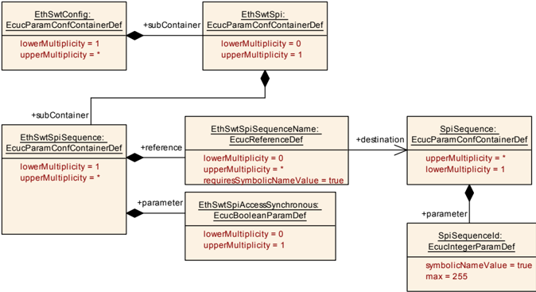


| SWS 条目 | [] |
| --- | --- |
| 容器名称 | EthSwtSpi |
| 配置参数 | 见下方参数表 |

| 包含的容器 | 容器名称 | 多重性 | 作用域/依赖 |
| --- | --- | --- | --- |
| 包含的容器 | EthSwtSpiSequence | 1..* | Container gives EthSwt driver information about one SPI sequence. One SPI sequence used by EthSwt driver is in exclusive use for it. No other driver is allowed to access this sequence. EthSwt driver may use one sequence to access n Eth Swt hardware chips of the same type or n sequences are used to access one single EthSwt hardware chip. If a EthSwt hardware has no SPI interface, there is no instance of this container. |

#### 9.1.38. EthSwtSpiSequence

| SWS 条目 | [] |
| --- | --- |
| 容器名称 | EthSwtSpiSequence |
| 配置参数 | 见下方参数表 |

无包含的容器。

| SWS 条目 | [ECUC_EthSwt_00035] |
| --- | --- |
| 参数名称 | EthSwtSpiAccessSynchronous |
| 描述 | 该参数用于定义对SPI序列的访问是同步的还是异步的。true：SPI访问是同步的；false：SPI访问是异步的。 |
| 多重性 | 0..1 |
| 类型 | EcucBooleanParamDef |
| 默认值 | - |
| Post-Build 变体值 | true |
| 值配置类 | Pre-compile：time X；Link：time -；Post-build：time -；Pre-compile：time X；Link：time -；Post-build：time - |
| 作用域/依赖 | scope: ECU |

| SWS 条目 | [ECUC_EthSwt_00035] |
| --- | --- |
| 参数名称 | EthSwtSpiSequenceName |
| 描述 | 对SPI序列配置容器的引用。 |
| 多重性 | 0..* |
| 类型 | Symbolic name reference to SpiSequence |
| Post-Build 变体值 | true |
| 值配置类 | Pre-compile：time All Variants；Link：time -；Post-build：time -；Pre-compile：time All Variants；Link：time -；Post-build：time - |
| 作用域/依赖 | scope: ECU |

#### 9.1.39. EthSwtStreamIdentificationTable

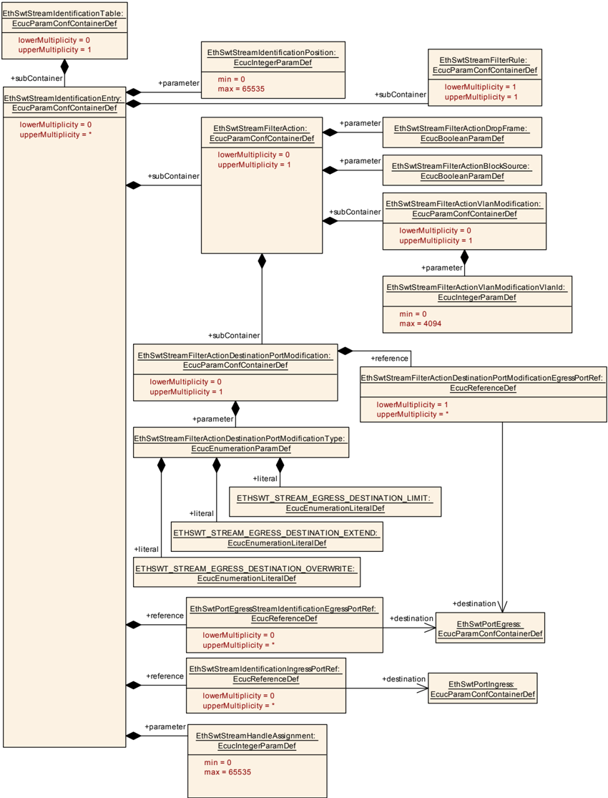


| SWS 条目 | [] |
| --- | --- |
| 容器名称 | EthSwtStreamIdentificationTable |
| 配置参数 | 见下方参数表 |

| 包含的容器 | 容器名称 | 多重性 | 作用域/依赖 |
| --- | --- | --- | --- |
| 包含的容器 | EthSwtStreamIdentificationEntry | 0..* | 一个流识别的配置。 |

#### 9.1.40. EthSwtStreamIdentificationEntry

| SWS 条目 | [] |
| --- | --- |
| 容器名称 | EthSwtStreamIdentificationEntry |
| 配置参数 | 见下方参数表 |

| 包含的容器 | 容器名称 | 多重性 | 作用域/依赖 |
| --- | --- | --- | --- |
| 包含的容器 | EthSwtStreamFilterAction | 0..1 | 一个流过滤动作的配置。 |
| 包含的容器 | EthSwtStreamFilterRule | 1 | 一个过滤规则的配置。 |

| SWS 条目 | [ECUC_EthSwt_00142] |
| --- | --- |
| 参数名称 | EthSwtStreamHandleAssignment |
| 描述 | 该流识别到流过滤器条目的分配。 |
| 多重性 | 1 |
| 类型 | EcucIntegerParamDef |
| 范围 | 0 .. 65535 |
| 默认值 | - |
| Post-Build 变体值 | true |
| 值配置类 | Pre-compile：time X VARIANT-PRE-COMPILE；Link：time X VARIANT-LINK-TIME；Post-build：time X VARIANT-POST-BUILD |
| 作用域/依赖 | scope: local |

| SWS 条目 | [ECUC_EthSwt_00153] |
| --- | --- |
| 参数名称 | EthSwtStreamIdentificationPosition |
| 描述 | 规定该位置作为**EthSwtStreamIdentificationEntry**有序列表内的唯一ID。有序列表应从0开始，并作为没有间隔的线性列表连续排列。注意：该列表按升序处理。位置为0的**EthSwtStreamIdentificationEntry**实例最先被处理。 |
| 多重性 | 1 |
| 类型 | EcucIntegerParamDef |
| 范围 | 0 .. 65535 |
| 默认值 | - |
| Post-Build 变体值 | true |
| 值配置类 | Pre-compile：time X VARIANT-PRE-COMPILE；Link：time X VARIANT-LINK-TIME；Post-build：time X VARIANT-POST-BUILD |
| 作用域/依赖 | scope: ECU |

| SWS 条目 | [ECUC_EthSwt_00152] |
| --- | --- |
| 参数名称 | EthSwtPortEgressStreamIdentificationEgressPortRef |
| 描述 | 对该流识别所应用的出口端口的引用。 |
| 多重性 | 0..* |
| 类型 | Reference to EthSwtPortEgress |
| Post-Build 变体值 | true |
| 值配置类 | Pre-compile：time X VARIANT-PRE-COMPILE；Link：time X VARIANT-LINK-TIME；Post-build：time X VARIANT-POST-BUILD；Pre-compile：time X VARIANT-PRE-COMPILE；Link：time X VARIANT-LINK-TIME；Post-build：time X VARIANT-POST-BUILD |
| 作用域/依赖 | scope: local |

| SWS 条目 | [ECUC_EthSwt_00152] |
| --- | --- |
| 参数名称 | EthSwtStreamIdentificationIngressPortRef |
| 描述 | 对该流识别所应用的入口端口的引用。 |
| 多重性 | 0..* |
| 类型 | Reference to EthSwtPortIngress |
| Post-Build 变体值 | true |
| 值配置类 | Pre-compile：time X VARIANT-PRE-COMPILE；Link：time X VARIANT-LINK-TIME；Post-build：time X VARIANT-POST-BUILD；Pre-compile：time X VARIANT-PRE-COMPILE；Link：time X VARIANT-LINK-TIME；Post-build：time X VARIANT-POST-BUILD |
| 作用域/依赖 | scope: local |

#### 9.1.41. EthSwtStreamFilterAction

| SWS 条目 | [] |
| --- | --- |
| 容器名称 | EthSwtStreamFilterAction |
| 配置参数 | 见下方参数表 |

| 包含的容器 | 容器名称 | 多重性 | 作用域/依赖 |
| --- | --- | --- | --- |
| 包含的容器 | EthSwtStreamFilterAction DestinationPortModification | 0..1 | 定义修改由帧转发过程为特定以太网帧确定的目的端口的动作。要么扩展，要么覆盖以太网帧的出口目的地。 |
| 包含的容器 | EthSwtStreamFilterActionVlan Modification | 0..1 | 定义修改以太网帧VLAN标记内VLAN-ID的动作。 |

| SWS 条目 | [ECUC_EthSwt_00144] |
| --- | --- |
| 参数名称 | EthSwtStreamFilterActionBlockSource |
| 描述 | 启用阻断来自该MAC地址的所有帧。 |
| 多重性 | 1 |
| 类型 | EcucBooleanParamDef |
| 默认值 | - |
| Post-Build 变体值 | true |
| 值配置类 | Pre-compile：time X VARIANT-PRE-COMPILE；Link：time X VARIANT-LINK-TIME；Post-build：time X VARIANT-POST-BUILD |
| 作用域/依赖 | scope: local |

| SWS 条目 | [ECUC_EthSwt_00144] |
| --- | --- |
| 参数名称 | EthSwtStreamFilterActionDropFrame |
| 描述 | 启用丢弃帧（**Drop Frame**）动作。 |
| 多重性 | 1 |
| 类型 | EcucBooleanParamDef |
| 默认值 | - |
| Post-Build 变体值 | true |
| 值配置类 | Pre-compile：time X VARIANT-PRE-COMPILE；Link：time X VARIANT-LINK-TIME；Post-build：time X VARIANT-POST-BUILD |
| 作用域/依赖 | scope: local |

#### 9.1.42. EthSwtStreamFilterActionDestinationPortModification

| SWS 条目 | [] |
| --- | --- |
| 容器名称 | EthSwtStreamFilterActionDestinationPortModification |
| 配置参数 | 见下方参数表 |

无包含的容器。

| SWS 条目 | [ECUC_EthSwt_00149] |
| --- | --- |
| 参数名称 | EthSwtStreamFilterActionDestinationPortModificationType |
| 描述 | 定义修改出口目的地的方法。要么覆盖，要么扩展出口目的地。 |
| 多重性 | 1 |
| 类型 | EcucEnumerationParamDef |
| 范围 | ETHSWT_STREAM_EGRESS_ DESTINATION_EXTEND ;; ETHSWT_STREAM_EGRESS_ DESTINATION_LIMIT ;; ETHSWT_STREAM_EGRESS_ DESTINATION_OVERWRITE |
| Post-Build 变体值 | true |
| 值配置类 | Pre-compile：time X VARIANT-PRE-COMPILE；Link：time X VARIANT-LINK-TIME；Post-build：time X VARIANT-POST-BUILD |
| 作用域/依赖 | scope: local |

| SWS 条目 | [ECUC_EthSwt_00149] |
| --- | --- |
| 参数名称 | EthSwtStreamFilterActionDestinationPortModificationEgressPortRef |
| 描述 | 定义用于修改以太网帧出口目的地的一组目的端口（出口端口）。 |
| 多重性 | 1..* |
| 类型 | Reference to EthSwtPortEgress |
| Post-Build 变体值 | true |
| 值配置类 | Pre-compile：time X VARIANT-PRE-COMPILE；Link：time X VARIANT-LINK-TIME；Post-build：time X VARIANT-POST-BUILD；Pre-compile：time X VARIANT-PRE-COMPILE；Link：time X VARIANT-LINK-TIME；Post-build：time X VARIANT-POST-BUILD |
| 作用域/依赖 | scope: local |

#### 9.1.43. EthSwtStreamFilterActionVlanModification

| SWS 条目 | [] |
| --- | --- |
| 容器名称 | EthSwtStreamFilterActionVlanModification |
| 配置参数 | 见下方参数表 |

无包含的容器。

| SWS 条目 | [ECUC_EthSwt_00147] |
| --- | --- |
| 参数名称 | EthSwtStreamFilterActionVlanModificationVlanId |
| 描述 | 定义用于修改以太网帧VLAN标记内现有VLAN-ID的VLAN-ID。 |
| 多重性 | 1 |
| 类型 | EcucIntegerParamDef |
| 范围 | 0 .. 4094 |
| 默认值 | - |
| Post-Build 变体值 | true |
| 值配置类 | Pre-compile：time X VARIANT-PRE-COMPILE |
| 作用域/依赖 | scope: local |

#### 9.1.44. EthSwtStreamFilterRule

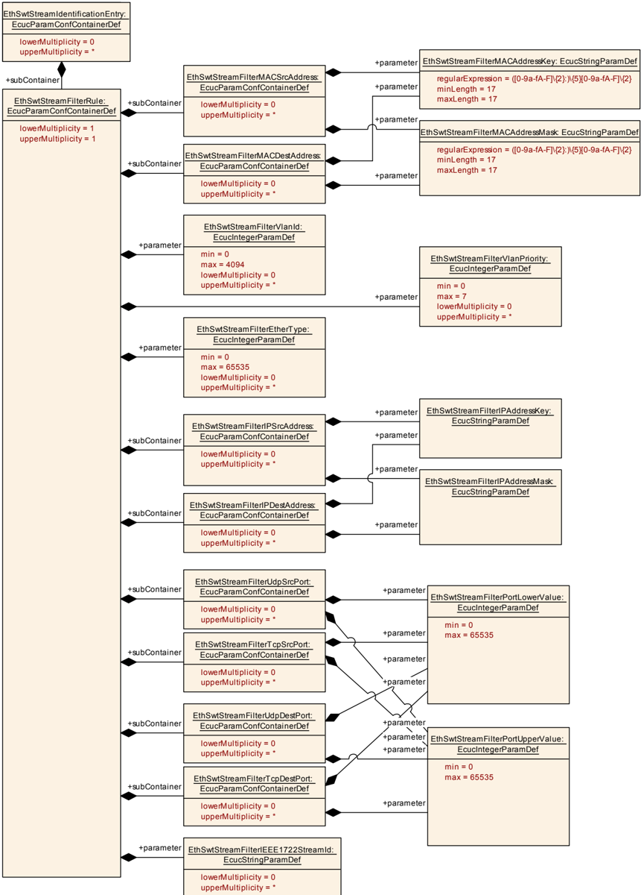


| SWS 条目 | [] |
| --- | --- |
| 容器名称 | EthSwtStreamFilterRule |
| 配置参数 | 见下方参数表 |

| 包含的容器 | 容器名称 | 多重性 | 作用域/依赖 |
| --- | --- | --- | --- |
| 包含的容器 | EthSwtStreamFilterIPDestAddress | 0..* | 一个IP目的过滤器（**filter**）的配置。 |
| 包含的容器 | EthSwtStreamFilterIPSrcAddress | 0..* | 一个IP源过滤器的配置。 |
| 包含的容器 | EthSwtStreamFilterMACDest Address | 0..* | 一个MAC目的过滤器的配置。 |
| 包含的容器 | EthSwtStreamFilterMACSrc Address | 0..* | 一个MAC源过滤器的配置。 |
| 包含的容器 | EthSwtStreamFilterTcpDestPort | 0..* | 一个TCP目的端口过滤器的配置。 |
| 包含的容器 | EthSwtStreamFilterTcpSrcPort | 0..* | 一个TCP源端口过滤器的配置。 |
| 包含的容器 | EthSwtStreamFilterUdpDestPort | 0..* | 一个UDP目的端口过滤器的配置。 |
| 包含的容器 | EthSwtStreamFilterUdpSrcPort | 0..* | 一个UDP源端口过滤器的配置。 |

| SWS 条目 | [ECUC_EthSwt_00181] |
| --- | --- |
| 参数名称 | EthSwtStreamFilterEtherType |
| 描述 | 过滤器的Ether Type定义。 |
| 多重性 | 0..* |
| 类型 | EcucIntegerParamDef |
| 范围 | 0 .. 65535 |
| 默认值 | - |
| Post-Build 变体值 | false |
| 值配置类 | Pre-compile：time X；Link：time -；Post-build：time -；Pre-compile：time X；Link：time -；Post-build：time - |
| 作用域/依赖 | scope: local |

| SWS 条目 | [ECUC_EthSwt_00181] |
| --- | --- |
| 参数名称 | EthSwtStreamFilterIEEE1722StreamId |
| 描述 | 过滤器的IEEE1722流ID定义。规定一个64位的流ID。 |
| 多重性 | 0..* |
| 类型 | EcucStringParamDef |
| 默认值 | - |

#### 9.1.45. EthSwtStreamFilterIPDestAddress

| SWS 条目 | [] |
| --- | --- |
| 容器名称 | EthSwtStreamFilterIPDestAddress |
| 配置参数 | 见下方参数表 |

无包含的容器。

| SWS 条目 | [ECUC_EthSwt_00174] |
| --- | --- |
| 参数名称 | EthSwtStreamFilterIPAddressKey |
| 描述 | IP地址键模式。 |
| 多重性 | 1 |
| 类型 | EcucStringParamDef |
| 默认值 | - |
| Post-Build 变体值 | true |
| 值配置类 | Pre-compile：time X VARIANT-PRE-COMPILE；Link：time X VARIANT-LINK-TIME；Post-build：time X VARIANT-POST-BUILD |
| 作用域/依赖 | scope: local |

| SWS 条目 | [ECUC_EthSwt_00174] |
| --- | --- |
| 参数名称 | EthSwtStreamFilterIPAddressMask |
| 描述 | IP地址掩码模式。 |
| 多重性 | 1 |
| 类型 | EcucStringParamDef |
| 默认值 | - |
| Post-Build 变体值 | true |
| 值配置类 | Pre-compile：time X VARIANT-PRE-COMPILE；Link：time X VARIANT-LINK-TIME；Post-build：time X VARIANT-POST-BUILD |
| 作用域/依赖 | scope: local |

#### 9.1.46. EthSwtStreamFilterIPSrcAddress

| SWS 条目 | [] |
| --- | --- |
| 容器名称 | EthSwtStreamFilterIPSrcAddress |
| 配置参数 | 见下方参数表 |

无包含的容器。

| SWS 条目 | [ECUC_EthSwt_00174] |
| --- | --- |
| 参数名称 | EthSwtStreamFilterIPAddressKey |
| 描述 | IP地址键模式。 |
| 多重性 | 1 |
| 类型 | EcucStringParamDef |
| 默认值 | - |
| Post-Build 变体值 | true |
| 值配置类 | Pre-compile：time X VARIANT-PRE-COMPILE；Link：time X VARIANT-LINK-TIME；Post-build：time X VARIANT-POST-BUILD |
| 作用域/依赖 | scope: local |

| SWS 条目 | [ECUC_EthSwt_00174] |
| --- | --- |
| 参数名称 | EthSwtStreamFilterIPAddressMask |
| 描述 | IP地址掩码模式。 |
| 多重性 | 1 |
| 类型 | EcucStringParamDef |
| 默认值 | - |
| Post-Build 变体值 | true |
| 值配置类 | Pre-compile：time X VARIANT-PRE-COMPILE；Link：time X VARIANT-LINK-TIME；Post-build：time X VARIANT-POST-BUILD |
| 作用域/依赖 | scope: local |

#### 9.1.47. EthSwtStreamFilterMACDestAddress

| SWS 条目 | [] |
| --- | --- |
| 容器名称 | EthSwtStreamFilterMACDestAddress |
| 配置参数 | 见下方参数表 |

无包含的容器。

| SWS 条目 | [ECUC_EthSwt_00167] |
| --- | --- |
| 参数名称 | EthSwtStreamFilterMACAddressKey |
| 描述 | 规定48位物理地址（MAC地址）键值。 |
| 多重性 | 1 |
| 类型 | EcucStringParamDef |
| 默认值 | - |
| Post-Build 变体值 | true |
| 值配置类 | Pre-compile：time X VARIANT-PRE-COMPILE；Link：time X VARIANT-LINK-TIME；Post-build：time X VARIANT-POST-BUILD |
| 作用域/依赖 | scope: local |

| SWS 条目 | [ECUC_EthSwt_00167] |
| --- | --- |
| 参数名称 | EthSwtStreamFilterMACAddressMask |
| 描述 | 规定48位物理地址（MAC地址）掩码值。 |
| 多重性 | 1 |
| 类型 | EcucStringParamDef |
| 默认值 | - |
| Post-Build 变体值 | true |
| 值配置类 | Pre-compile：time X VARIANT-PRE-COMPILE；Link：time X VARIANT-LINK-TIME；Post-build：time X VARIANT-POST-BUILD |
| 作用域/依赖 | scope: local |

#### 9.1.48. EthSwtStreamFilterMACSrcAddress

| SWS 条目 | [] |
| --- | --- |
| 容器名称 | EthSwtStreamFilterMACSrcAddress |
| 配置参数 | 见下方参数表 |

无包含的容器。

| SWS 条目 | [ECUC_EthSwt_00167] |
| --- | --- |
| 参数名称 | EthSwtStreamFilterMACAddressKey |
| 描述 | 规定48位物理地址（MAC地址）键值。 |
| 多重性 | 1 |
| 类型 | EcucStringParamDef |
| 默认值 | - |
| Post-Build 变体值 | true |
| 值配置类 | Pre-compile：time X VARIANT-PRE-COMPILE；Link：time X VARIANT-LINK-TIME；Post-build：time X VARIANT-POST-BUILD |
| 作用域/依赖 | scope: local |

| SWS 条目 | [ECUC_EthSwt_00167] |
| --- | --- |
| 参数名称 | EthSwtStreamFilterMACAddressMask |
| 描述 | 规定48位物理地址（MAC地址）掩码值。 |
| 多重性 | 1 |
| 类型 | EcucStringParamDef |
| 默认值 | - |
| Post-Build 变体值 | true |
| 值配置类 | Pre-compile：time X VARIANT-PRE-COMPILE；Link：time X VARIANT-LINK-TIME；Post-build：time X VARIANT-POST-BUILD |
| 作用域/依赖 | scope: local |

#### 9.1.49. EthSwtStreamFilterTcpDestPort

| SWS 条目 | [] |
| --- | --- |
| 容器名称 | EthSwtStreamFilterTcpDestPort |
| 配置参数 | 见下方参数表 |

无包含的容器。

| SWS 条目 | [ECUC_EthSwt_00180] |
| --- | --- |
| 参数名称 | EthSwtStreamFilterPortLowerValue |
| 描述 | 过滤器端口下限值定义。 |
| 多重性 | 1 |
| 类型 | EcucIntegerParamDef |
| 范围 | 0 .. 65535 |
| 默认值 | - |
| Post-Build 变体值 | false |
| 值配置类 | Pre-compile：time X All Variants；Link：time -；Post-build：time - |
| 作用域/依赖 | scope: local |

| SWS 条目 | [ECUC_EthSwt_00180] |
| --- | --- |
| 参数名称 | EthSwtStreamFilterPortUpperValue |
| 描述 | 过滤器端口上限值定义。 |
| 多重性 | 1 |
| 类型 | EcucIntegerParamDef |
| 范围 | 0 .. 65535 |
| 默认值 | - |
| Post-Build 变体值 | false |
| 值配置类 | Pre-compile：time X All Variants；Link：time -；Post-build：time - |
| 作用域/依赖 | scope: local |

#### 9.1.50. EthSwtStreamFilterTcpSrcPort

| SWS 条目 | [] |
| --- | --- |
| 容器名称 | EthSwtStreamFilterTcpSrcPort |
| 配置参数 | 见下方参数表 |

无包含的容器。

| SWS 条目 | [ECUC_EthSwt_00180] |
| --- | --- |
| 参数名称 | EthSwtStreamFilterPortLowerValue |
| 描述 | 过滤器端口下限值定义。 |
| 多重性 | 1 |
| 类型 | EcucIntegerParamDef |
| 范围 | 0 .. 65535 |
| 默认值 | - |
| Post-Build 变体值 | false |
| 值配置类 | Pre-compile：time X All Variants；Link：time -；Post-build：time - |
| 作用域/依赖 | scope: local |

| SWS 条目 | [ECUC_EthSwt_00180] |
| --- | --- |
| 参数名称 | EthSwtStreamFilterPortUpperValue |
| 描述 | 过滤器端口上限值定义。 |
| 多重性 | 1 |
| 类型 | EcucIntegerParamDef |
| 范围 | 0 .. 65535 |
| 默认值 | - |
| Post-Build 变体值 | false |
| 值配置类 | Pre-compile：time X All Variants；Link：time -；Post-build：time - |
| 作用域/依赖 | scope: local |

#### 9.1.51. EthSwtStreamFilterUdpDestPort

| SWS 条目 | [] |
| --- | --- |
| 容器名称 | EthSwtStreamFilterUdpDestPort |
| 配置参数 | 见下方参数表 |

无包含的容器。

| SWS 条目 | [ECUC_EthSwt_00180] |
| --- | --- |
| 参数名称 | EthSwtStreamFilterPortLowerValue |
| 描述 | 过滤器端口下限值定义。 |
| 多重性 | 1 |
| 类型 | EcucIntegerParamDef |
| 范围 | 0 .. 65535 |
| 默认值 | - |
| Post-Build 变体值 | false |
| 值配置类 | Pre-compile：time X All Variants；Link：time -；Post-build：time - |
| 作用域/依赖 | scope: local |

| SWS 条目 | [ECUC_EthSwt_00180] |
| --- | --- |
| 参数名称 | EthSwtStreamFilterPortUpperValue |
| 描述 | 过滤器端口上限值定义。 |
| 多重性 | 1 |
| 类型 | EcucIntegerParamDef |
| 范围 | 0 .. 65535 |
| 默认值 | - |
| Post-Build 变体值 | false |
| 值配置类 | Pre-compile：time X All Variants；Link：time -；Post-build：time - |
| 作用域/依赖 | scope: local |

#### 9.1.52. EthSwtStreamFilterUdpSrcPort

| SWS 条目 | [] |
| --- | --- |
| 容器名称 | EthSwtStreamFilterUdpSrcPort |
| 配置参数 | 见下方参数表 |

无包含的容器。

| SWS 条目 | [ECUC_EthSwt_00180] |
| --- | --- |
| 参数名称 | EthSwtStreamFilterPortLowerValue |
| 描述 | 过滤器端口下限值定义。 |
| 多重性 | 1 |
| 类型 | EcucIntegerParamDef |
| 范围 | 0 .. 65535 |
| 默认值 | - |
| Post-Build 变体值 | false |
| 值配置类 | Pre-compile：time X All Variants；Link：time -；Post-build：time - |
| 作用域/依赖 | scope: local |

| SWS 条目 | [ECUC_EthSwt_00180] |
| --- | --- |
| 参数名称 | EthSwtStreamFilterPortUpperValue |
| 描述 | 过滤器端口上限值定义。 |
| 多重性 | 1 |
| 类型 | EcucIntegerParamDef |
| 范围 | 0 .. 65535 |
| 默认值 | - |
| Post-Build 变体值 | false |
| 值配置类 | Pre-compile：time X All Variants；Link：time -；Post-build：time - |
| 作用域/依赖 | scope: local |

#### 9.1.53. EthSwtVlanMembership

| SWS 条目 | [] |
| --- | --- |
| 容器名称 | EthSwtVlanMembership |
| 配置参数 | 见下方参数表 |

| 包含的容器 | 容器名称 | 多重性 | 作用域/依赖 |
| --- | --- | --- | --- |
| 包含的容器 | EthSwtVlanMembershipPortRef Entry | 0..255 | Determines the VLAN membership of one referenced ports to the virtual network and the according forwarding type (NOT_ SENT, SENT_UNTAGGED, SENT_TAGGED). |

| SWS 条目 | [ECUC_EthSwt_00202] |
| --- | --- |
| 参数名称 | EthSwtVlanMembershipId |
| 描述 | 确定该端口所属虚拟网络的VID。 |
| 多重性 | 1 |
| 类型 | EcucIntegerParamDef |
| 范围 | 0 .. 4094 |
| 默认值 | - |
| Post-Build 变体值 | true |
| 值配置类 | Pre-compile：time X VARIANT-PRE-COMPILE；Link：time X VARIANT-LINK-TIME；Post-build：time X VARIANT-POST-BUILD |
| 作用域/依赖 | scope: ECU |

#### 9.1.54. EthSwtVlanMembershipPortRefEntry

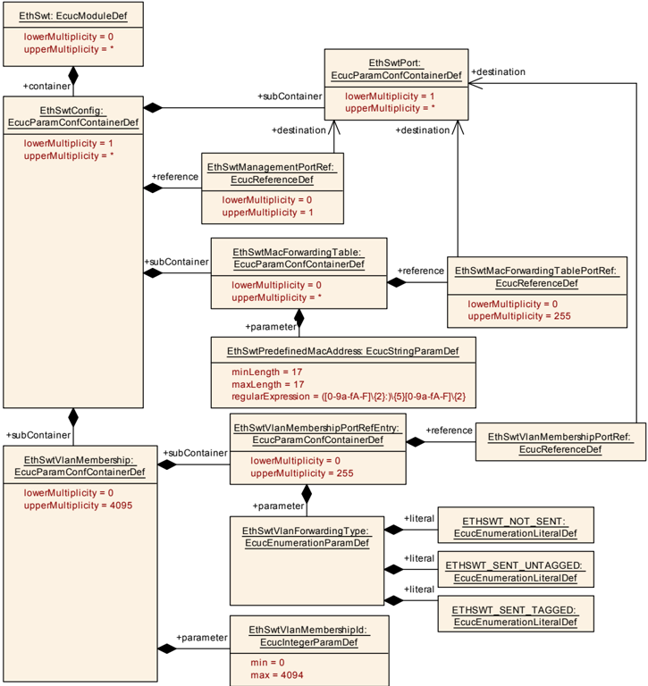


| SWS 条目 | [] |
| --- | --- |
| 容器名称 | EthSwtVlanMembershipPortRefEntry |
| 配置参数 | 见下方参数表 |

无包含的容器。

| SWS 条目 | [ECUC_EthSwt_00204] |
| --- | --- |
| 参数名称 | EthSwtVlanForwardingType |
| 描述 | 定义在所引用端口上如何处理具有特定VLAN-ID的消息。 |
| 多重性 | 1 |
| 类型 | EcucEnumerationParamDef |
| 范围 | ETHSWT_NOT_SENT ;; ETHSWT_SENT_TAGGED ;; ETHSWT_SENT_UNTAGGED |
| Post-Build 变体值 | true |
| 值配置类 | Pre-compile：time X VARIANT-PRE-COMPILE；Link：time X VARIANT-LINK-TIME；Post-build：time X VARIANT-POST-BUILD |
| 作用域/依赖 | scope: ECU |

| SWS 条目 | [ECUC_EthSwt_00204] |
| --- | --- |
| 参数名称 | EthSwtVlanMembershipPortRef |
| 描述 | 对该VLAN应被分配到的一个端口的引用。 |
| 多重性 | 1 |
| 类型 | Reference to EthSwtPort |
| Post-Build 变体值 | true |
| 值配置类 | Pre-compile：time X VARIANT-PRE-COMPILE；Link：time X VARIANT-LINK-TIME；Post-build：time X VARIANT-POST-BUILD |
| 作用域/依赖 | scope: ECU |

### 9.2. 约束

该模块将在每个分区中作为一个独立实例运行（见**EthSwtEcucPartitionRef**），即被调用的API只会作用于调用它所在的分区。

**EthSwtConfigEcucPartitionRef**所引用的ECUC分区应当是**EthSwtEcucPartitionRef**所引用的ECUC分区的子集。

一个通信通道的**EthSwtConfig**、**EthCtrlConfig**和**EthTrcvConfig**应全部引用同一个ECUC分区。

如果**EthSwtEcucPartitionRef**引用一个或多个ECUC分区，则**EthSwtConfigEcucPartitionRef**的多重性应为1，并且也引用这些ECUC分区之一。

## B. 可追溯项变更历史

请注意，本章中的列表还包括在后续版本中已从规范中移除的约束和规格项。这些约束和规格项不会作为超链接出现在文档中。

### B.1. 本文档根据AUTOSAR Release R22-11的可追溯项历史

#### B.1.1. R22-11中新增的规格项

```
[SWS_EthSwt_00455] [SWS_EthSwt_00460] [SWS_EthSwt_00461] [SWS_EthSwt_00462] [SWS_EthSwt_00463] [SWS_EthSwt_00465] [SWS_EthSwt_00466] [SWS_EthSwt_00467] [SWS_EthSwt_00469] [SWS_EthSwt_00471] [SWS_EthSwt_00472] [SWS_EthSwt_00475] [SWS_EthSwt_00476] [SWS_EthSwt_00477] [SWS_EthSwt_00478] [SWS_EthSwt_00479] [SWS_EthSwt_00480] [SWS_EthSwt_00481] [SWS_EthSwt_00482] [SWS_EthSwt_00483] [SWS_EthSwt_00484] [SWS_EthSwt_00486] [SWS_EthSwt_00487] [SWS_EthSwt_00490] [SWS_EthSwt_00491] [SWS_EthSwt_00492] [SWS_EthSwt_00493] [SWS_EthSwt_00494] [SWS_EthSwt_91124] [SWS_EthSwt_91125] [SWS_EthSwt_91126] [SWS_EthSwt_91127] [SWS_EthSwt_91128] [SWS_EthSwt_91129] [SWS_EthSwt_91130] [SWS_EthSwt_91131] [SWS_EthSwt_91132] [SWS_EthSwt_91133] [SWS_EthSwt_91134] [SWS_EthSwt_91135] [SWS_EthSwt_91136] [SWS_EthSwt_91137] [SWS_EthSwt_91138] [SWS_EthSwt_91139]
```

#### B.1.2. R22-11中变更的规格项

```
[SWS_EthSwt_00001] [SWS_EthSwt_00002] [SWS_EthSwt_00006] [SWS_EthSwt_00009] [SWS_EthSwt_00018] [SWS_EthSwt_00019] [SWS_EthSwt_00023] [SWS_EthSwt_00025] [SWS_EthSwt_00026] [SWS_EthSwt_00031] [SWS_EthSwt_00032] [SWS_EthSwt_00037] [SWS_EthSwt_00038] [SWS_EthSwt_00044] [SWS_EthSwt_00045] [SWS_EthSwt_00051] [SWS_EthSwt_00052] [SWS_EthSwt_00058] [SWS_EthSwt_00060] [SWS_EthSwt_00086] [SWS_EthSwt_00087] [SWS_EthSwt_00091] [SWS_EthSwt_00092] [SWS_EthSwt_00098] [SWS_EthSwt_00106] [SWS_EthSwt_00111] [SWS_EthSwt_00114] [SWS_EthSwt_00117] [SWS_EthSwt_00118] [SWS_EthSwt_00123] [SWS_EthSwt_00125] [SWS_EthSwt_00126] [SWS_EthSwt_00127] [SWS_EthSwt_00128] [SWS_EthSwt_00132] [SWS_EthSwt_00133] [SWS_EthSwt_00134] [SWS_EthSwt_00135] [SWS_EthSwt_00136] [SWS_EthSwt_00154] [SWS_EthSwt_00156] [SWS_EthSwt_00157] [SWS_EthSwt_00162] [SWS_EthSwt_00164] [SWS_EthSwt_00165] [SWS_EthSwt_00172] [SWS_EthSwt_00173] [SWS_EthSwt_00178] [SWS_EthSwt_00179] [SWS_EthSwt_00180] [SWS_EthSwt_00181] [SWS_EthSwt_00182] [SWS_EthSwt_00183] [SWS_EthSwt_00187] [SWS_EthSwt_00188] [SWS_EthSwt_00193] [SWS_EthSwt_00194] [SWS_EthSwt_00197] [SWS_EthSwt_00198] [SWS_EthSwt_00199] [SWS_EthSwt_00203] [SWS_EthSwt_00204] [SWS_EthSwt_00206] [SWS_EthSwt_00211] [SWS_EthSwt_00212] [SWS_EthSwt_00216] [SWS_EthSwt_00217] [SWS_EthSwt_00221] [SWS_EthSwt_00222] [SWS_EthSwt_00226] [SWS_EthSwt_00227] [SWS_EthSwt_00228] [SWS_EthSwt_00231] [SWS_EthSwt_00233] [SWS_EthSwt_00234] [SWS_EthSwt_00235] [SWS_EthSwt_00240] [SWS_EthSwt_00241] [SWS_EthSwt_00242] [SWS_EthSwt_00243] [SWS_EthSwt_00245] [SWS_EthSwt_00372] [SWS_EthSwt_00373] [SWS_EthSwt_00378] [SWS_EthSwt_00398] [SWS_EthSwt_00416] [SWS_EthSwt_00417] [SWS_EthSwt_00418] [SWS_EthSwt_00419] [SWS_EthSwt_00420] [SWS_EthSwt_00430] [SWS_EthSwt_00431] [SWS_EthSwt_00434] [SWS_EthSwt_00440] [SWS_EthSwt_91000] [SWS_EthSwt_91002] [SWS_EthSwt_91003] [SWS_EthSwt_91004] [SWS_EthSwt_91005] [SWS_EthSwt_91006] [SWS_EthSwt_91007] [SWS_EthSwt_91008] [SWS_EthSwt_91009] [SWS_EthSwt_91010] [SWS_EthSwt_91011] [SWS_EthSwt_91012] [SWS_EthSwt_91013] [SWS_EthSwt_91014] [SWS_EthSwt_91015] [SWS_EthSwt_91016] [SWS_EthSwt_91017] [SWS_EthSwt_91018] [SWS_EthSwt_91019] [SWS_EthSwt_91020] [SWS_EthSwt_91021] [SWS_EthSwt_91022] [SWS_EthSwt_91023] [SWS_EthSwt_91024] [SWS_EthSwt_91025] [SWS_EthSwt_91028] [SWS_EthSwt_91029] [SWS_EthSwt_91030] [SWS_EthSwt_91031] [SWS_EthSwt_91032] [SWS_EthSwt_91033] [SWS_EthSwt_91034] [SWS_EthSwt_91035] [SWS_EthSwt_91036] [SWS_EthSwt_91037] [SWS_EthSwt_91038] [SWS_EthSwt_91039] [SWS_EthSwt_91040] [SWS_EthSwt_91050] [SWS_EthSwt_91104] [SWS_EthSwt_91123]
```

#### B.1.3. R22-11中删除的规格项

无

### B.2. 本文档根据AUTOSAR Release R23-11的可追溯项历史

#### B.2.1. R23-11中新增的规格项

```
[SWS_EthSwt_00163] [SWS_EthSwt_00450] [SWS_EthSwt_00451] [SWS_EthSwt_00456] [SWS_EthSwt_00459] [SWS_EthSwt_00500] [SWS_EthSwt_00501] [SWS_EthSwt_00502] [SWS_EthSwt_00503] [SWS_EthSwt_00504] [SWS_EthSwt_00601] [SWS_EthSwt_00602] [SWS_EthSwt_00604] [SWS_EthSwt_00605] [SWS_EthSwt_00606] [SWS_EthSwt_00607] [SWS_EthSwt_00608] [SWS_EthSwt_00609] [SWS_EthSwt_00610] [SWS_EthSwt_00611] [SWS_EthSwt_00612] [SWS_EthSwt_00613] [SWS_EthSwt_00614] [SWS_EthSwt_91041] [SWS_EthSwt_91042] [SWS_EthSwt_91043]
```

#### B.2.2. R23-11中变更的规格项

```
[SWS_EthSwt_00002] [SWS_EthSwt_00016] [SWS_EthSwt_00133] [SWS_EthSwt_00179] [SWS_EthSwt_00455] [SWS_EthSwt_00465] [SWS_EthSwt_00467] [SWS_EthSwt_00469] [SWS_EthSwt_00471] [SWS_EthSwt_00472] [SWS_EthSwt_00475] [SWS_EthSwt_00476] [SWS_EthSwt_00478] [SWS_EthSwt_00493]
```

#### B.2.3. R23-11中删除的规格项

```
[SWS_EthSwt_00136] [SWS_EthSwt_00162] [SWS_EthSwt_00181] [SWS_EthSwt_00466] [SWS_EthSwt_00490]
```

#### B.2.4. R23-11中新增的约束

无

#### B.2.5. R23-11中变更的约束

无

#### B.2.6. R23-11中删除的约束

无

