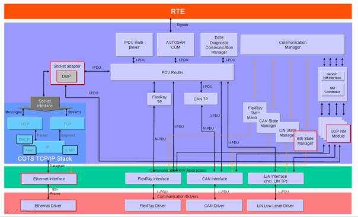
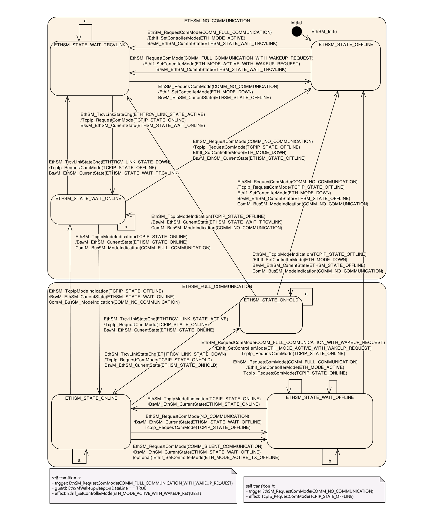
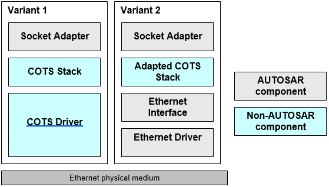
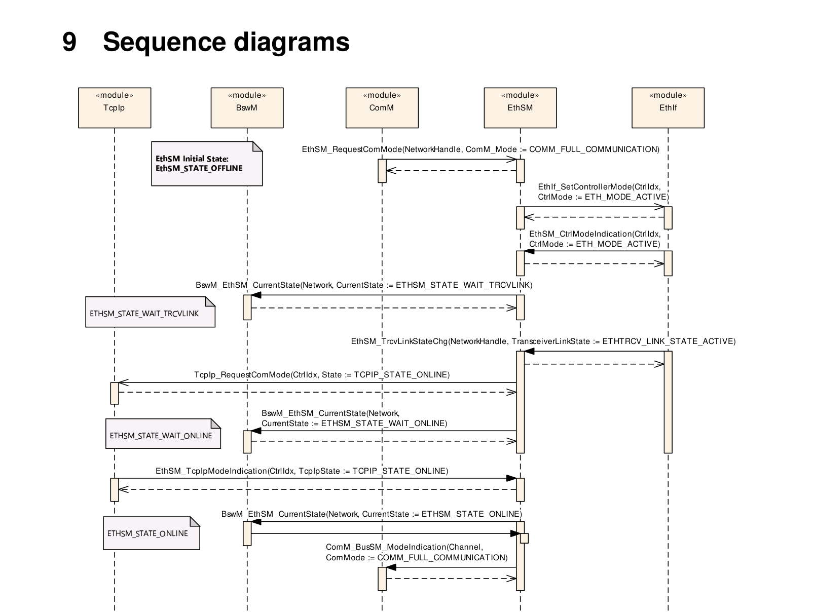
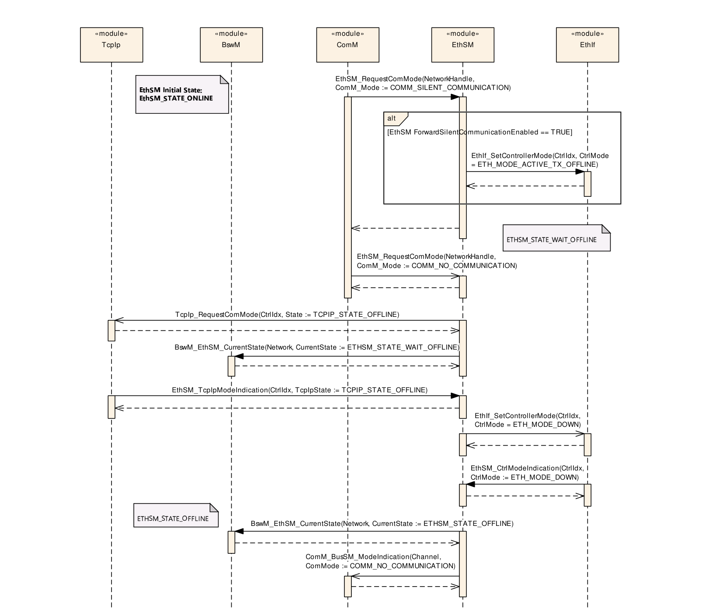
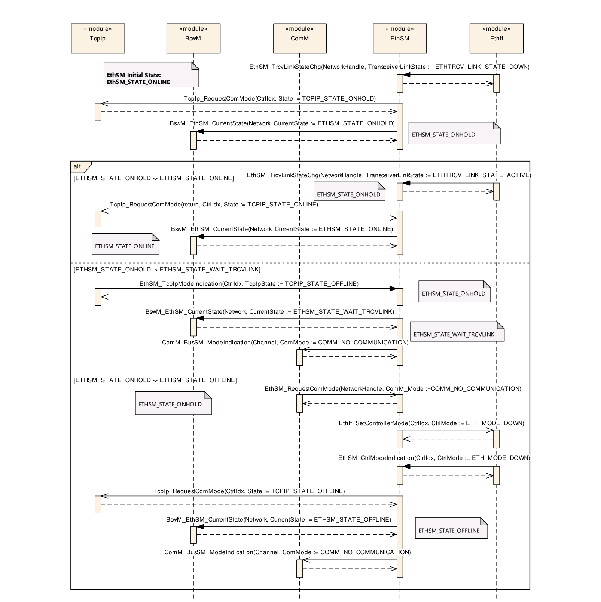

## 1. 简介和功能概述

本规范规定AUTOSAR基础软件模块以太网状态管理器（**Ethernet State Manager**）的功能、API和配置。

在AUTOSAR分层软件架构中，以太网状态管理器属于ECU抽象层（**ECU Abstraction Layer**），更准确地说是通信硬件抽象（**Communication Hardware Abstraction**）。

以太网状态管理器的主要任务可以概括如下：

以太网状态管理器应向AUTOSAR通信管理器提供一个抽象接口，用于启动或关闭以太网集群上的通信。

以太网状态管理器不直接访问以太网硬件（以太网通信控制器和以太网收发器），而是通过以太网接口访问。以太网接口将请求重定向到相应的驱动程序模块。

图1.1是包含以太网网络的AUTOSAR架构示例。



## 2. 缩略语

**API**

> 应用编程接口（**Application Program Interface**）。

**BSW**

> 基硖件（**Basic Software**）。

**BswM**

> 基硖模式管理器（**Basic Software Mode Manager**）。

**ComM**

> 通信管理器（**Communication Manager**）。

**DEM**

> 诊断事件管理器（**Diagnostic Event Manager**）。

**DET**

> 默认错误跟踪器（**Default Error Tracer**）。

**EcuM**

> ECU状态管理器（**ECU State Manager**）。

**Eth**

> 以太网控制器（**Ethernet Controller**）。

**EthTrcv**

> 以太网收发器（**Ethernet Transceiver**）。

**EthSM**

> 以太网状态管理器（**Ethernet State Manager**）。

**EthIf**

> 以太网接口（**Ethernet Interface**）。

**SchM**

> BSW调度器（**BSW Scheduler**）。

**SoAd**

> 套接字适配器（**Socket Adapter**）。

**OA TC10**

> Open Alliance TC10规范（见[\[1\]](#ref-1)）。

## 3. 相关文档

### 3.1. 输入文件

<a id="ref-1"></a>[1] OPEN Sleep/Wake-up Specification for Automotive Ethernet http://www.opensig.org/Automotive-Ethernet-Specifications/
<a id="ref-2"></a>[2] General Specification of Basic Software Modules AUTOSAR\_CP\_SWS\_BSWGeneral

### 3.2. 相关规范

AUTOSAR提供了基础软件模块的通用规范SWS BSW通用规范[\[2\]](#ref-2)，该规范同样对以太网状态管理器有效。

因此，SWS BSW通用规范应被视为以太网状态管理器的附加规范和必备规范。

## 4. 约束和假设

### 4.1. 限制

EthSM只能用于以太网通信。它的职责是与EthIf配合，控制一个或多个下层以太网控制器和以太网收发器驱动程序。不支持以太网以外的协议（即CAN、LIN或FlexRay）。

当前版本的规范不支持以下条目：

- 局域网唤醒（**Wake on LAN**）。（请注意，支持按照OA TC10规范（见[\[1\]](#ref-1)）在数据线上进行唤醒和睡眠。）

当前的EthSM需要基于IP的通信栈。要达到FULL\_COMMUNICATION，必须获得活动的IP通信。在后续规范中，将引入一种替代的「低层」状态机。该状态机只在驱动程序/收发器层级工作（不涉及IP通信）。这是实现其他通信协议（例如IEEE 1722）所必需的。

### 4.2. 汽车域的适用性

只要使用了以太网协议，以太网状态管理器就可以用于所有域的应用。凡是需要高数据速率的地方，都可以使用以太网BSW协议栈。

## 5. 对其他模块的依赖

- AUTOSAR BSW调度器：BSW调度器调用EthSM的主函数，这些主函数是EthSM周期性过程所必需的。
- AUTOSAR通信管理器：ComM请求网络通信模式，并在达到某种通信模式时收到EthSM的通知。
- AUTOSAR以太网接口：EthSM使用EthIf的API来初始化以太网通信硬件，并控制分配给以太网的以太网控制器和以太网收发器的运行模式。

  以太网接口使用EthSM的API来提供收发器链路状态。

- AUTOSAR默认错误跟踪器：为了能够报告开发错误，以太网状态管理器必须能够访问默认错误跟踪器的错误钩子。
- AUTOSAR诊断事件管理器：为了能够报告生产错误，以太网状态管理器必须能够访问诊断事件管理器。
- ECU状态管理器：EcuM初始化EthSM。
- AUTOSAR Bsw管理器：当达到某个内部状态时，EthSM会通知BswM。
- AUTOSAR TcpIp：调用TcpIp以请求TCPIP状态（例如在线、离线、保持等）。TcpIP使用EthSM的API来提供TCPIP状态。

### 5.1. 文件结构

#### 5.1.1. 代码文件结构

详情请参阅SWS\_BSWGeneral [\[2\]](#ref-2)的第5.1.6章「代码文件结构」。

备注：

实际上模块EthSM不提供链接时配置和Post-Build时配置。

#### 5.1.2. 版本检查

详情请参阅SWS\_BSWGeneral [\[2\]](#ref-2)的第5.1.8章「版本检查」。

## 6. 功能规格

一个ECU可以拥有不同的通信网络。每个网络都必须用一个唯一的网络句柄（**network handle**）来标识。ComM向各网络请求通信模式。它通过其配置知道哪个句柄分配给哪种类型的网络。对于以太网，它使用以太网状态管理器，后者负责以太网网络的控制流抽象。以下各节将对此进行详细描述。

### 6.1. 网络通信模式请求的转换

EthSM应向ComM提供一个API，ComM可以用它来请求以太网网络的通信模式。

根据该API传入的参数，EthSM应执行相关网络模式状态机的状态转换（见第[6.6](#66-网络模式状态机)节）。

该转换应将请求转换为相应的API调用，以控制所分配的以太网外设。

当调用EthSM\_TrcvLinkStateChg传递收发器链路状态且配置参数EthSMDataLinkInfoApi设置为TRUE时，EthSM应调用ChrgM\_DataLinkIndication。

### 6.2. 当前网络通信模式的输出

网络当前的通信模式可能与请求的模式不同。EthSM必须通过以下两类接口向ComM提供当前通信模式的信息：

EthSM应提供一个API，ComM可以轮询它来获取以太网网络当前的通信模式。

EthSM应使用ComM的回调通知，将通信模式的变化通知ComM。

### 6.3. 外设的控制

#### 6.3.1. 以太网接口控制器

一个以太网接口控制器和一个ComM通道属于某个特定的以太网网络（句柄）。

根据网络模式状态机，EthSM应控制每个以太网网络的以太网接口控制器模式。

EthSM应使用EthIf的API来控制所分配以太网接口控制器的运行模式。

### 6.4. 多网络

以太网状态管理器应能够处理相互分离的网络。这涉及相互分离的物理网络（另见第[6.3](#63-外设的控制)节），也涉及同一物理网络上相互分离的VLAN。

在这两种情况下，分离都是通过为每个物理或虚拟网络设置单独的句柄来完成的。VLAN在上层（ComM）表现为独立的网络。例如：如果有一个物理以太网接口控制器并为其分配了两个VLAN，则存在两个ComM通道。

### 6.5. 背景与原理

解释：

应用负责识别是否需要以太网网络。

一个可能的用例是在测试仪连接中使用以太网网络（见下文描述）。

用例：在测试仪连接中使用以太网

例如，检测可以通过ECU的一个单独硬件引脚进行。在这种情况下，硬件引脚的激活以及因此以太网网络的激活只能通过离线诊断测试仪实现。以太网网络停用的原因可能是：

- 测试仪通过单独的硬件引脚停用网络
- 应用停用网络
- 应用识别到超时
- 网络的链路状态失败

**注意：**

以太网网络由应用请求以唤醒或关闭。应用要么需要在以太网网络上通信，要么不需要通信。因此，EthSM状态机必须提供相应的主状态ETHSM\_FULL\_COMMUNICATION和ETHSM\_NO\_COMMUNICATION，而不提供其他状态，例如ETHSM\_SILENT\_COMMUNICATION。

### 6.6. 网络模式状态机

EthSM应为每个已配置的网络句柄实现一个网络模式状态机（EthSM状态机）。

EthSM状态机应由2个主状态组成：ETHSM\_FULL\_COMMUNICATION和ETHSM\_NO\_COMMUNICATION。

ETHSM\_FULL\_COMMUNICATION应有3个子状态：ETHSM\_STATE\_OFFLINE、ETHSM\_STATE\_WAIT\_TRCVLINK和ETHSM\_STATE\_WAIT\_ONLINE。

ETHSM\_NO\_COMMUNICATION应有3个子状态：ETHSM\_STATE\_ONLINE、ETHSM\_STATE\_ONHOLD和ETHSM\_STATE\_WAIT\_OFFLINE。

以下几点概述了EthSM状态机对所请求通信模式的一般反应方式：

1. 如果为某个以太网网络请求通信模式COMM\_FULL\_COMMUNICATION且相应的EthSM状态机处于ETHSM\_NO\_COMMUNICATION状态，则至少必须满足以下前提条件才能转换到ETHSM\_FULL\_COMMUNICATION：
   - 为相应的以太网接口控制器请求ETH\_MODE\_ACTIVE。
   - 相应的以太网硬件已通过EthSM\_TrcvLinkStateChg指示ETHTRCV\_LINK\_STATE\_ACTIVE（活动链路状态，即以太网电缆已连接）。
   - 相应的TcpIpCtrl已通过EthSM\_TcpIpModeIndication指示TCPIP\_STATE\_ONLINE（IP通信可用）。
2. 如果为某个以太网网络请求通信模式COMM\_FULL\_COMMUNICATION\_WITH\_WAKEUP\_REQUEST、EthSMWakeupSleepOnDatalineEnabled设置为TRUE且相应的EthSM状态机处于ETHSM\_NO\_COMMUNICATION状态，则至少必须满足以下前提条件才能转换到ETHSM\_FULL\_COMMUNICATION：
   - 为相应的以太网接口控制器请求ETH\_MODE\_ACTIVE\_WITH\_WAKEUP\_REQUEST。
   - 相应的以太网硬件已通过EthSM\_TrcvLinkStateChg指示ETHTRCV\_LINK\_STATE\_ACTIVE（活动链路状态，即以太网电缆已连接）。
   - 相应的TcpIpCtrl已通过EthSM\_TcpIpModeIndication指示TCPIP\_STATE\_ONLINE（IP通信可用）。
3. 如果ComM请求COMM\_SILENT\_COMMUNICATION且相应的EthSM状态机处于ETHSM\_FULL\_COMMUNICATION状态，则将执行以下操作：
   - 如果启用了静默通信的转发（见后文配置章节），EthSM为相应的以太网接口控制器请求ETH\_MODE\_ACTIVE\_TX\_OFFLINE。
   - EthSM状态机转换到ETHSM\_STATE\_WAIT\_OFFLINE。
4. 如果ComM请求COMM\_NO\_COMMUNICATION且相应的EthSM状态机处于ETHSM\_STATE\_WAIT\_OFFLINE状态，则必须满足以下前提条件才能转换到ETHSM\_NO\_COMMUNICATION：
   - EthSM为相应的以太网接口控制器请求ETH\_MODE\_DOWN。
   - 相应的TcpIpCtrl已指示TCPIP\_STATE\_OFFLINE。
5. 如果为某个以太网网络请求通信模式COMM\_FULL\_COMMUNICATION\_WITH\_WAKEUP\_REQUEST、EthSMWakeupSleepOnDatalineEnabled设置为TRUE且相应的EthSM状态机处于ETHSM\_FULL\_COMMUNICATION状态，则即使当前状态为ETHSM\_FULL\_COMMUNICATION，EthSM也应为相应的以太网接口控制器请求ETH\_MODE\_ACTIVE\_WITH\_WAKEUP\_REQUEST。

如果配置了请求的转发（见后文配置章节），上文第3点中静默通信的调用将禁用相应以太网接口控制器的发送路径。

上文第5点所述的以太网接口控制器重触发用于请求下层在网络上触发一次唤醒。这例如可用于符合OA TC10（[\[1\]](#ref-1)）的以太网硬件。

内部状态如图7.1所示。细节在以下各小节中描述。内部状态的总览在后文中规定。



表7.1展示了按照ComM请求的通信模式，EthSM子状态的预期状态、受影响以太网硬件的状态和IP分配。请注意，请求的模式（ACTIVE或ACTIVE\_TX\_OFFLINE）是可配置的（见后文配置章节）。

表7.1：EthSM子状态及相应以太网硬件和IP分配的预期状态（*）（**EthSM sub states and the excepted states of the according Ethernet hardware and the IP assignment**）

| 请求的ComM模式 | EthSM子状态 | 控制器状态 | 收发器状态 | 收发器链路状态 | TcpIpCtrl状态 |
| --- | --- | --- | --- | --- | --- |
| No Com | ETHSM_STATE_OFFLINE | DOWN | DOWN | DOWN | OFFLINE |
| No Com | ETHSM_STATE_WAIT_TRCVLINK | ACTIVE | ACTIVE | DOWN | OFFLINE |
| No Com | ETHSM_STATE_WAIT_ONLINE | ACTIVE | ACTIVE | ACTIVE | OFFLINE |
| Full Com | ETHSM_STATE_ONLINE | ACTIVE | ACTIVE | ACTIVE | ONLINE |
| Full Com | ETHSM_STATE_ONHOLD | ACTIVE | ACTIVE | DOWN | ONLINE |
| Silent Com | ETHSM_STATE_WAIT_OFFLINE | ACTIVE或ACTIVE_TX_OFFLINE *） | ACTIVE | ACTIVE | ONLINE |
| No Com | ETHSM_STATE_WAIT_OFFLINE | ACTIVE或ACTIVE_TX_OFFLINE *） | ACTIVE | ACTIVE | ONLINE |

转换到ETHSM\_FULL\_COMMUNICATION必须满足以下前提条件：

- 以太网接口控制器和收发器处于活动状态
- 收发器链路状态为活动
- 活动的IP通信可用

第一步是将以太网控制器设置为ETH\_MODE\_ACTIVE。完成之后，以太网状态管理器处于子状态ETHSM\_STATE\_WAIT\_TRCVLINK。在该子状态下，状态管理器必须等待以太网收发器的被监视链路状态信息。链路状态被设置为ETHTRCV\_MODE\_ACTIVE后，以太网状态管理器转换到子状态ETHSM\_STATE\_WAIT\_ONLINE。在该子状态下，以太网状态管理器必须等待TcpIp模块的被监视TcpIp状态信息。TcpIp模块指示TCPIP\_STATE\_ONLINE（即IP通信可用）后，以太网状态管理器转换到主状态ETHSM\_FULL\_COMMUNICATION和子状态ETHSM\_STATE\_ONLINE。

#### 6.6.1. 初始转换

EthSM初始化之后，状态机应转换到ETHSM\_STATE\_OFFLINE。

**注意：** EthSM的初始化不会在其他模块中引起进一步的事务。因此不需要单独的时序图。

#### 6.6.2. 子状态ETHSM\_STATE\_OFFLINE中的行为

##### 6.6.2.1. 从子状态OFFLINE到WAIT\_TRCVLINK的转换

在ETHSM\_STATE\_OFFLINE状态下，如果ComM为相应的网络句柄请求COMM\_FULL\_COMMUNICATION或COMM\_FULL\_COMMUNICATION\_WITH\_WAKEUP\_REQUEST，则状态机应转换到ETHSM\_STATE\_WAIT\_TRCVLINK。

**注意：** 该转换作为时序图显示在图9.2中。

从ETHSM\_STATE\_OFFLINE到ETHSM\_STATE\_WAIT\_TRCVLINK的转换应按照所请求的ComM通信模式设置控制器模式：

- 如果ComM请求了COMM\_FULL\_COMMUNICATION，则应以ETH\_MODE\_ACTIVE请求相应EthIfCtrl的控制器模式。
- 如果ComM请求了COMM\_FULL\_COMMUNICATION\_WITH\_WAKEUP\_REQUEST，则应以ETH\_MODE\_ACTIVE\_WITH\_WAKEUP\_REQUEST请求相应EthIfCtrl的控制器模式。

#### 6.6.3. 子状态ETHSM\_STATE\_WAIT\_TRCVLINK中的行为

如果EthSMWakeupSleepOnDatalineEnabled设置为TRUE、EthSM状态机处于ETHSM\_STATE\_WAIT\_TRCVLINK状态，且ComM现在请求COMM\_FULL\_COMMUNICATION\_WITH\_WAKEUP\_REQUEST，则EthSM应以ETH\_MODE\_ACTIVE\_WITH\_WAKEUP\_REQUEST请求相应的EthIfCtrl。

##### 6.6.3.1. 从子状态WAIT\_TRCVLINK到WAIT\_OFFLINE的转换

在ETHSM\_STATE\_WAIT\_TRCVLINK状态下，如果ComM为相应的网络句柄请求COMM\_NO\_COMMUNICATION，则状态机应转换到ETHSM\_STATE\_OFFLINE。

从ETHSM\_STATE\_WAIT\_TRCVLINK到ETHSM\_STATE\_OFFLINE的转换应将控制器模式设置为ETH\_MODE\_DOWN。

##### 6.6.3.2. 从子状态WAIT\_TRCVLINK到WAIT\_ONLINE的转换

在ETHSM\_STATE\_WAIT\_TRCVLINK状态下，如果以太网接口为相应的网络句柄报告ETHTRCV\_LINK\_STATE\_ACTIVE，则状态机应转换到ETHSM\_STATE\_WAIT\_ONLINE。

**注意：** 该转换作为时序图显示在图9.2中。

从ETHSM\_STATE\_WAIT\_TRCVLINK到ETHSM\_STATE\_WAIT\_ONLINE的转换应向TcpIp模块请求TcpIp状态TCPIP\_STATE\_ONLINE。

#### 6.6.4. 子状态ETHSM\_STATE\_WAIT\_ONLINE中的行为

如果EthSMWakeupSleepOnDatalineEnabled设置为TRUE、EthSM处于ETHSM\_STATE\_WAIT\_ONLINE状态且ComM现在请求COMM\_FULL\_COMMUNICATION\_WITH\_WAKEUP\_REQUEST，则EthSM应以ETH\_MODE\_ACTIVE\_WITH\_WAKEUP\_REQUEST请求相应的EthIfCtrl。

##### 6.6.4.1. 从子状态WAIT\_ONLINE到WAIT\_TRCVLINK的转换

在ETHSM\_STATE\_WAIT\_ONLINE状态下，如果以太网接口为相应的网络句柄报告ETHTRCV\_LINK\_STATE\_DOWN，则状态机应转换到ETHSM\_STATE\_WAIT\_TRCVLINK。

从ETHSM\_STATE\_WAIT\_ONLINE到ETHSM\_STATE\_WAIT\_TRCVLINK的转换应向TcpIp模块请求TcpIp状态TCPIP\_STATE\_OFFLINE。

##### 6.6.4.2. 从子状态WAIT\_ONLINE到OFFLINE的转换

在ETHSM\_STATE\_WAIT\_ONLINE状态下，如果ComM为相应的网络句柄请求COMM\_NO\_COMMUNICATION，则状态机应转换到ETHSM\_STATE\_OFFLINE。

从ETHSM\_STATE\_WAIT\_ONLINE到ETHSM\_STATE\_OFFLINE的转换将控制器模式设置为ETH\_MODE\_DOWN。

从ETHSM\_STATE\_WAIT\_ONLINE到ETHSM\_STATE\_OFFLINE的转换应向TcpIp模块请求TcpIp状态TCPIP\_STATE\_OFFLINE。

##### 6.6.4.3. 从子状态WAIT\_ONLINE到ONLINE的转换

如果EthSMTcpIpUsed为TRUE，则在ETHSM\_STATE\_WAIT\_ONLINE状态下，如果TcpIp模块为相应的网络句柄报告TCPIP\_STATE\_ONLINE，则状态机应转换到ETHSM\_STATE\_ONLINE。如果EthSMTcpIpUsed为FALSE，则在ETHSM\_STATE\_WAIT\_ONLINE状态下状态机应无条件转换到ETHSM\_STATE\_ONLINE。

**注意：** 该转换作为时序图显示在图9.2中。

从ETHSM\_STATE\_WAIT\_ONLINE成功转换到ETHSM\_STATE\_ONLINE之后，以太网状态管理器应将主状态设置为ETHSM\_FULL\_COMMUNICATION，并以通信模式COMM\_FULL\_COMMUNICATION调用ComM的回调函数ComM\_BusSM\_ModeIndication。

#### 6.6.5. 子状态ETHSM\_STATE\_ONLINE中的行为

如果EthSM状态机处于ETHSM\_STATE\_ONLINE状态、EthSMWakeupSleepOnDatalineEnabled设置为TRUE且ComM请求COMM\_FULL\_COMMUNICATION\_WITH\_WAKEUP\_REQUEST，则应以ETH\_MODE\_ACTIVE\_WITH\_WAKEUP\_REQUEST请求相应EthIfCtrl的控制器模式。

##### 6.6.5.1. 从子状态ONLINE到WAIT\_ONLINE的转换

如果EthSMTcpIpUsed为TRUE，则在ETHSM\_STATE\_ONLINE状态下，如果TcpIp模块为相应的网络句柄报告TCPIP\_STATE\_OFFLINE，则状态机应转换到ETHSM\_STATE\_WAIT\_ONLINE。

从ETHSM\_STATE\_ONLINE成功转换到ETHSM\_STATE\_WAIT\_ONLINE之后，以太网状态管理器应将主状态设置为ETHSM\_NO\_COMMUNICATION，并以通信模式COMM\_NO\_COMMUNICATION调用ComM的回调函数ComM\_BusSM\_ModeIndication。

##### 6.6.5.2. 从子状态ONLINE到WAIT\_OFFLINE的转换

在ETHSM\_STATE\_ONLINE状态下，如果ComM为相应的网络句柄请求COMM\_SILENT\_COMMUNICATION或COMM\_NO\_COMMUNICATION，则状态机应转换到ETHSM\_STATE\_WAIT\_OFFLINE。

**注意：** 该转换作为时序图显示在图9.2中。

在由以COMM\_SILENT\_COMMUNICATION调用EthSM\_RequestComMode触发的ETHSM\_STATE\_ONLINE与ETHSM\_STATE\_WAIT\_OFFLINE之间的转换期间，如果EthSMForwardSilentCommunicationEnabled设置为TRUE，则应以ETH\_MODE\_ACTIVE\_TX\_OFFLINE调用API EthIf\_SetControllerMode。

在由以COMM\_NO\_COMMUNICATION调用EthSM\_RequestComMode触发的ETHSM\_STATE\_ONLINE与ETHSM\_STATE\_WAIT\_OFFLINE之间的转换期间，应以TCPIP\_STATE\_OFFLINE调用API TcpIp\_RequestComMode。

##### 6.6.5.3. 从子状态ONLINE到ONHOLD的转换

在ETHSM\_STATE\_ONLINE状态下，如果以太网接口为相应的网络句柄报告ETHTRCV\_LINK\_STATE\_DOWN，则状态机应转换到ETHSM\_STATE\_ONHOLD。

**注意：** 该转换作为时序图显示在图9.3中。

从ETHSM\_STATE\_ONLINE到ETHSM\_STATE\_ONHOLD的转换应向TcpIp模块请求TcpIp状态TCPIP\_STATE\_ONHOLD。

如果存在可选配置参数ETHSM\_E\_LINK\_DOWN，则在从ETHSM\_STATE\_ONLINE切换到ETHSM\_STATE\_ONHOLD时，应以事件状态DEM\_EVENT\_STATUS\_FAILED向DEM模块报告ETHSM\_E\_LINK\_DOWN。

#### 6.6.6. 子状态ETHSM\_STATE\_WAIT\_OFFLINE中的行为

在ETHSM\_STATE\_WAIT\_OFFLINE状态下，如果ComM为相应的网络句柄请求COMM\_NO\_COMMUNICATION，EthSM应以TCPIP\_STATE\_OFFLINE调用API TcpIp\_RequestComMode。

在ETHSM\_STATE\_WAIT\_OFFLINE状态下，如果ComM为相应的网络句柄请求COMM\_NO\_COMMUNICATION，EthSM应将控制器模式设置为ETH\_MODE\_ACTIVE并以TCPIP\_STATE\_ONLINE调用API TcpIp\_RequestComMode。

在ETHSM\_STATE\_WAIT\_OFFLINE状态下，如果ComM为相应的网络句柄请求COMM\_FULL\_COMMUNICATION\_WITH\_WAKEUP\_REQUEST，EthSM应将控制器模式设置为ETH\_MODE\_ACTIVE\_WITH\_WAKEUP\_REQUEST并以TCPIP\_STATE\_ONLINE调用API TcpIp\_RequestComMode。

##### 6.6.6.1. 从子状态WAIT\_OFFLINE到OFFLINE的转换

如果EthSMTcpIpUsed为TRUE，则在ETHSM\_STATE\_WAIT\_OFFLINE状态下，如果TcpIp模块为相应的网络句柄报告TCPIP\_STATE\_OFFLINE，则状态机应转换到ETHSM\_STATE\_OFFLINE。如果EthSMTcpIpUsed为FALSE，则在ETHSM\_STATE\_WAIT\_OFFLINE状态下状态机应无条件转换到ETHSM\_STATE\_OFFLINE。

从ETHSM\_STATE\_WAIT\_OFFLINE到ETHSM\_STATE\_OFFLINE的转换应将控制器模式设置为ETH\_MODE\_DOWN。

从ETHSM\_STATE\_WAIT\_OFFLINE成功转换到ETHSM\_STATE\_OFFLINE之后，以太网状态管理器应将主状态设置为ETHSM\_NO\_COMMUNICATION，并以通信模式COMM\_NO\_COMMUNICATION调用ComM的回调函数ComM\_BusSM\_ModeIndication。

##### 6.6.6.2. 从子状态WAIT\_OFFLINE到ONLINE的转换

在ETHSM\_STATE\_WAIT\_OFFLINE状态下，如果TcpIp模块为相应的网络句柄报告TCPIP\_STATE\_ONLINE，则状态机应转换到ETHSM\_STATE\_ONLINE。

#### 6.6.7. 子状态ETHSM\_STATE\_ONHOLD中的行为

如果EthSM状态机处于ETHSM\_STATE\_ONHOLD状态、EthSMWakeupSleepOnDatalineEnabled设置为TRUE且ComM请求COMM\_FULL\_COMMUNICATION\_WITH\_WAKEUP\_REQUEST，则应以ETH\_MODE\_ACTIVE\_WITH\_WAKEUP\_REQUEST请求相应EthIfCtrl的控制器模式。

##### 6.6.7.1. 从子状态ONHOLD到ONLINE的转换

在ETHSM\_STATE\_ONHOLD状态下，如果以太网接口为相应的网络句柄报告ETHTRCV\_LINK\_STATE\_ACTIVE，则状态机应转换到ETHSM\_STATE\_ONLINE。

从ETHSM\_STATE\_ONHOLD到ETHSM\_STATE\_ONLINE的转换应向TcpIp模块请求TcpIp状态TCPIP\_STATE\_ONLINE。

如果存在可选配置参数ETHSM\_E\_LINK\_DOWN，则在从ETHSM\_STATE\_ONHOLD切换到ETHSM\_STATE\_ONLINE时，应以事件状态DEM\_EVENT\_STATUS\_PASSED向DEM模块报告ETHSM\_E\_LINK\_DOWN。

##### 6.6.7.2. 从子状态ONHOLD到WAIT\_TRCVLINK的转换

如果EthSMTcpIpUsed为TRUE，则在ETHSM\_STATE\_ONHOLD状态下，如果TcpIp模块为相应的网络句柄报告TCPIP\_STATE\_OFFLINE，则状态机应转换到ETHSM\_STATE\_WAIT\_TRCVLINK。如果EthSMTcpIpUsed为FALSE，则在ETHSM\_STATE\_ONHOLD状态下状态机应无条件转换到ETHSM\_STATE\_WAIT\_TRCVLINK。

**注意：** 该转换作为时序图显示在图9.3中。

从ETHSM\_STATE\_ONHOLD成功转换到ETHSM\_STATE\_WAIT\_TRCVLINK之后，以太网状态管理器应将主状态设置为ETHSM\_NO\_COMMUNICATION，并以通信模式COMM\_NO\_COMMUNICATION调用ComM的回调函数ComM\_BusSM\_ModeIndication。

##### 6.6.7.3. 从子状态ONHOLD到OFFLINE的转换

在ETHSM\_STATE\_ONHOLD状态下，如果ComM为相应的网络句柄请求COMM\_NO\_COMMUNICATION，则状态机应转换到ETHSM\_STATE\_OFFLINE。

从ETHSM\_STATE\_ONHOLD到ETHSM\_STATE\_OFFLINE的转换应将控制器模式设置为ETH\_MODE\_DOWN。

从ETHSM\_STATE\_ONHOLD到ETHSM\_STATE\_OFFLINE的转换应向TcpIp模块请求TcpIp状态TCPIP\_STATE\_OFFLINE。

从ETHSM\_STATE\_ONHOLD成功转换到ETHSM\_STATE\_OFFLINE之后，以太网状态管理器应将主状态设置为ETHSM\_NO\_COMMUNICATION，并以通信模式COMM\_NO\_COMMUNICATION调用ComM的回调函数ComM\_BusSM\_ModeIndication。

#### 6.6.8. 状态转换的信息上报

每次EthSM状态机进入一个子状态时，EthSM都应通过调用BswM\_EthSM\_CurrentState(&lt;进入的子状态&gt;)向BswM报告所进入的子状态（例如进入子状态ETHSM\_STATE\_ONLINE时，EthSM应调用BswM\_EthSM\_CurrentState(ETHSM\_STATE\_ONLINE)）。初始化之后到ETHSM\_STATE\_OFFLINE的转换（见前文初始转换的要求）不应向BswM报告。

**注意：** BswM需要关于EthSM内部状态的信息（见下文类型定义章节）。

**注意：** ComM需要关于通信状态（例如COMM\_FULL\_COMMUNICATION或COMM\_NO\_COMMUNICATION）的信息。对ComM的调用已在各子状态中显式规定。

### 6.7. 商用现货协议栈的使用

应可以使用商用现货协议栈（**COTS**）。商用协议栈无需适配即可使用（图7.2中的变体1）。但是在这种情况下，以太网状态管理器无法控制以太网接口控制器和以太网收发器。商用协议栈可以进行适配以与以太网接口配合使用。在这种情况下，以太网状态管理器能够同时控制以太网接口控制器和以太网收发器（图7.2中的变体2）。



可以将以太网状态管理器设置为哑模式（**dummy mode**）。在该模式下，以太网状态管理器不支持到以太网接口的API。到ComM的API可用，但功能已停用。来自ComM的函数调用将以返回值E\_OK应答。**注意：** 见第[9](#9-配置规范)章配置规范。

### 6.8. 错误分类

文档「基础软件模块通用规范」的「错误处理」一节详细描述了基础软件的错误处理。它首先构成了一个分类方案，包含BSW模块中可能出现的五种错误类型。

在此基础上，以下各小节规定了按相应小节排列的特定错误。

#### 6.8.1. 开发错误

| 错误类型 | 相关错误码 | 错误值 |
| --- | --- | --- |
| 请求了无效的通信模式 | ETHSM\_E\_INVALID\_NETWORK\_MODE | 0x01 |
| EthSM模块未初始化 | ETHSM\_E\_UNINIT | 0x02 |
| 参数列表中的指针无效 | ETHSM\_E\_PARAM\_POINTER | 0x03 |
| 参数列表中的参数无效 | ETHSM\_E\_INVALID\_NETWORK\_HANDLE | 0x04 |
| 无效的TcpIp状态 | ETHSM\_E\_INVALID\_TCP\_IP\_MODE | 0x05 |
| 参数列表中的参数无效 | ETHSM\_E\_PARAM\_CONTROLLER | 0x07 |

#### 6.8.2. 运行时错误

没有运行时错误。

#### 6.8.3. 瞬态故障

没有瞬态故障。

#### 6.8.4. 生产错误

| 项目 | 内容 |
| --- | --- |
| 错误名称 | ETHSM\_E\_LINK\_DOWN |
| 简短描述 | 链路断开检测 |
| 详细描述 | 当通信已经建立且因通信请求而仍被请求时，收发器切换为「down」，应报告该错误。 |
| 推荐DTC | 不适用 |
| 检测条件 | 失败（FAIL）：在由EthSM_TrcvLinkStateChg(ETHTRCV_LINK_STATE_DOWN)触发的、从ETHSM_STATE_ONLINE到ETHSM_STATE_ONHOLD的转换期间 |
| 检测条件 | 通过（PASS）：在由EthSM_TrcvLinkStateChg(ETHTRCV_LINK_STATE_ACTIVE)触发的、从ETHSM_STATE_ONHOLD到ETHSM_STATE_ONLINE的转换期间 |
| 次要参数 | 无 |
| 所需时间 | PRE_FAIL：立即；PASS：取决于配置 |
| 监视频率 | 连续 |
| MIL点亮 | 不适用 |

#### 6.8.5. 扩展生产错误

没有扩展生产错误。

## 7. API规范

### 7.1. 导入的类型

| 模块 | 头文件 | 导入的类型 |
| --- | --- | --- |
| ComM | Rte_ComM_Type.h | ComM_ModeType |
| ComStack_Types | ComStack_Types.h | NetworkHandleType |
| Dem | Rte_Dem_Type.h | Dem_EventIdType |
|  | Rte_Dem_Type.h | Dem_EventStatusType |
| Eth | Eth_GeneralTypes.h | Eth_ModeType |
| EthTrcv | Eth_GeneralTypes.h | EthTrcv_LinkStateType |
| Std | Std_Types.h | Std_ReturnType |
|  | Std_Types.h | Std_VersionInfoType |
| TcpIp | TcpIp.h | TcpIp_StateType |

### 7.2. 类型定义

#### 7.2.1. EthSM\_NetworkModeStateType

| 项目 | 内容 |
| --- | --- |
| 名称 | EthSM_NetworkModeStateType |
| 类别 | 枚举（Enumeration） |
| 范围 | ETHSM_STATE_OFFLINE：EthSM在该状态下初始化。（TcpIp状态为OFFLINE）；ETHSM_STATE_WAIT_TRCVLINK：ComM在该状态下请求COMM_FULL_COMMUNICATION。控制器将被设置为ACTIVE。EthSM等待收发器链路状态（ACTIVE）。；ETHSM_STATE_WAIT_ONLINE：收发器链路状态为ACTIVE，EthSM等待IP通信（TcpIP状态为ONLINE）；ETHSM_STATE_ONLINE：IP通信可用，达到ComM状态COMM_FULL_COMMUNICATION；ETHSM_STATE_ONHOLD：EthSM丢失了活动收发器链路状态（TcpIP状态仍为ONLINE）；ETHSM_STATE_WAIT_OFFLINE：ComM请求COMM_SILENT_COMMUNICATION（TcpIp状态仍为ONLINE），且如果已配置（见后文配置章节），禁用以太网帧的发送。之后ComM在该状态下请求COMM_NO_COMMUNICATION。（以OFFLINE请求TcpIp状态） |
| 描述 | 该类型应定义网络模式状态机的状态。 |
| 可用性 | EthSM.h |

### 7.3. 函数定义

这是提供给上层模块的函数列表。

**注意：**

取决于以太网硬件，实现可能有必要在异步/同步行为方面偏离API规范。

#### 7.3.1. EthSM\_Init

**说明**：该函数初始化EthSM。服务ID 0x07；同步；不可重入；无输入参数；无输入输出参数；无输出参数；无返回值；可通过EthSM.h使用。

```C
void EthSM_Init ( void )
```

#### 7.3.2. EthSM\_GetVersionInfo

**说明**：该服务输出本模块的版本信息。服务ID 0x02；同步；可重入；无输入参数；无输入输出参数；输出参数versioninfo为输出版本信息的位置的指针；无返回值；可通过EthSM.h使用。

```C
void EthSM_GetVersionInfo ( Std_VersionInfoType* versioninfo )
```

#### 7.3.3. EthSM\_RequestComMode

**说明**：处理通信模式，并将以太网网络置为活动或被动。服务ID 0x05；异步；不可重入；输入参数NetworkHandle为请求的目标通信网络的句柄；输入参数ComM_Mode为请求的通信模式；无输入输出参数；无输出参数；返回值Std_ReturnType（E_OK：服务被接受；E_NOT_OK：服务被拒绝）；可通过EthSM.h使用。

```C
Std_ReturnType EthSM_RequestComMode ( NetworkHandleType NetworkHandle, ComM_ModeType ComM_Mode )
```

备注：该函数的可重入性仅限于不同的网络句柄。同一网络的可重入性此处不予考虑。

函数EthSM\_RequestComMode检查请求的网络句柄。只有当请求的网络句柄是EthSM配置中包含的句柄（配置参数EthSMNetworkHandle）时，它才接受该请求。在这种情况下返回值被设置为E\_OK。

如果该句柄不包含在配置中，函数拒绝该请求。在这种情况下返回值被设置为E\_NOT_OK。

如果函数EthSM\_RequestComMode不接受请求的网络句柄，则应向DET报告ETHSM\_E\_INVALID\_NETWORK\_HANDLE。

如果函数EthSM\_RequestComMode不接受请求的ComM\_Mode，则应向DET报告ETHSM\_E\_INVALID\_NETWORK\_MODE。

如果函数EthSM\_RequestComMode接受该函数调用，它应存储该网络句柄的通信模式，且相应状态机的网络模式切换最迟应在下一个主函数周期内发起。

如果EthSM尚未初始化，函数EthSM\_RequestComMode应向DET报告ETHSM\_E\_UNINIT。

#### 7.3.4. EthSM\_GetCurrentComMode

**说明**：该服务应输出以太网网络当前的通信模式。服务ID 0x04；同步；不可重入；输入参数NetworkHandle为要输出其当前通信模式的网络句柄；无输入输出参数；输出参数ComM_ModePtr为输出当前通信模式的位置的指针；返回值Std_ReturnType（E_OK：服务被接受；E_NOT_OK：服务被拒绝）；可通过EthSM.h使用。

```C
Std_ReturnType EthSM_GetCurrentComMode ( NetworkHandleType NetworkHandle, ComM_ModeType* ComM_ModePtr )
```

函数EthSM\_GetCurrentComMode检查服务请求的网络句柄。只有当请求的网络句柄是EthSM配置中包含的句柄（配置参数EthSMNetworkHandle）时，它才接受该服务。在这种情况下返回值被设置为E\_OK。

如果该句柄不包含在配置中，函数拒绝该请求。在这种情况下返回值被设置为E\_NOT_OK。

如果函数EthSM\_GetCurrentComMode不接受请求的网络句柄，则应向DET报告ETHSM\_E\_INVALID\_NETWORK\_HANDLE。

如果函数EthSM\_GetCurrentComMode接受该请求，则将该网络句柄当前的通信模式输出到指定的ComM\_ModeType类型指针。

备注：由于以太网硬件需要一定的时间来处理请求，且目前没有规定任何通知机制，在硬件就绪之前，实际硬件模式与EthSM通知的模式可能不同。

如果EthSM尚未初始化，函数EthSM\_GetCurrentComMode应向DET报告ETHSM\_E\_UNINIT。

### 7.4. 回调通知

#### 7.4.1. EthSM\_CtrlModeIndication

**说明**：在模式被读取出时调用。由先前的EthIf_GetControllerMode或EthIf_SetControllerMode调用触发。可以在触发函数内直接调用。服务ID 0x09；同步；可重入（仅对不同的以太网控制器）；输入参数CtrlIdx为模式已变化的以太网接口控制器；输入参数CtrlMode为被通知的以太网接口控制器模式；无输入输出参数；无输出参数；无返回值；可通过EthSM.h使用。

```C
void EthSM_CtrlModeIndication ( uint8 CtrlIdx, Eth_ModeType CtrlMode )
```

如果函数EthSM\_CtrlModeIndication得到的CtrlIdx未在EthSM模块的配置中配置，则它应以ErrorId参数ETHSM\_E\_PARAM\_CONTROLLER调用函数Det\_ReportError。

如果在调用函数EthSM\_CtrlModeIndication时EthSM模块未初始化，则函数EthSM\_CtrlModeIndication应以ErrorId参数ETHSM\_E\_UNINIT调用函数Det\_ReportError。

#### 7.4.2. EthSM\_TrcvLinkStateChg

**说明**：该服务由以太网接口调用以报告收发器链路状态变化。服务ID 0x06；同步；不可重入；输入参数CtrlIdx为以太网接口上下文中以太网控制器的索引；输入参数TransceiverLinkState为特定网络句柄的实际收发器链路状态；无输入输出参数；无输出参数；无返回值；可通过EthSM.h使用。

```C
void EthSM_TrcvLinkStateChg ( uint8 CtrlIdx, EthTrcv_LinkStateType TransceiverLinkState )
```

如果函数EthSM\_TrcvLinkStateChg不接受函数调用的CtrlIdx，则应向DET报告ETHSM\_E\_PARAM\_CONTROLLER。

如果函数EthSM\_TrcvLinkStateChg未报告DET错误，它应存储受影响网络句柄的收发器链路状态，且相应状态机的网络模式切换最迟应在下一个主函数周期内发起。

如果EthSM尚未初始化，函数EthSM\_TrcvLinkStateChg应向DET报告ETHSM\_E\_UNINIT。

#### 7.4.3. EthSM\_TcpIpModeIndication

**说明**：该服务由TcpIp调用以报告实际的TcpIp状态（例如在线、离线）。服务ID 0x08；同步；不可重入；输入参数CtrlIdx为标识TcpIp状态发生变化的通信网络的EthIf控制器索引；输入参数TcpIpState为特定网络句柄的实际TcpIp状态；无输入输出参数；无输出参数；无返回值；可通过EthSM_TcpIp.h使用。

```C
void EthSM_TcpIpModeIndication ( uint8 CtrlIdx, TcpIp_StateType TcpIpState )
```

如果函数EthSM\_TcpIpModeIndication得到的CtrlIdx未在EthSM模块的配置中配置，则它应以ErrorId参数ETHSM\_E\_PARAM\_CONTROLLER调用函数Det\_ReportError。

如果启用了开发错误检测，则应检查参数TcpIpState是否处于允许的范围内。如果超出允许范围，函数EthSM\_TcpIpModeIndication应忽略该状态指示，并向DET报告开发错误ETHSM\_E\_INVALID\_TCP\_IP\_MODE。

如果函数EthSM\_TcpIpModeIndication接受该函数调用，它应存储受影响网络句柄的TcpIp状态，且相应状态机的网络模式切换最迟应在下一个主函数周期内发起。

如果EthSM尚未初始化，函数EthSM\_TcpIpModeIndication应向DET报告ETHSM\_E\_UNINIT。

#### 7.4.4. EthSM\_SleepIndication

**说明**：该API由EthIf调用，指示在网络上检测到一次睡眠指示。只有当ECU在相应通信通道上充当被动通信从节点时才会调用此API（受影响的EthIfTransceiver所引用的EthTrcv已将EthTrcvActAsSlavePassiveEnabled设置为TRUE）。这例如可用于符合OA TC10的以太网硬件。在这种情况下，以太网硬件检测到由所连接链路伙伴的Sleep.Request触发的Sleep.Indication。服务ID 0xa；异步；不可重入；输入参数Ctrl_Idx为相应EthTrcv在网络上检测到睡眠指示的以太网接口控制器；无输入输出参数；无输出参数；无返回值；可通过EthSM.h使用。

```C
void EthSM_SleepIndication ( uint8 Ctrl_Idx )
```

如果函数EthSM\_SleepIndication得到的CtrlIdx未在EthSM模块的配置中配置，则在启用了开发错误报告的情况下（见EthSMDevErrorDetect），它应以ErrorId参数ETHSM\_E\_PARAM\_CONTROLLER调用函数Det\_ReportError。

如果在调用函数EthSM\_SleepIndication时EthSM模块未初始化，则在启用了开发错误报告的情况下（见EthSMDevErrorDetect），函数EthSM\_SleepIndication应以ErrorId参数ETHSM\_E\_UNINIT调用函数Det\_ReportError。

如果调用了EthSM\_SleepIndication，EthSM应以相应的通信通道调用ComM\_BusSM\_BusSleepMode，将该调用转发给ComM。

### 7.5. 调度函数

这些函数由基础软件调度器直接调用。以下函数应没有返回值也没有参数。所有函数应为不可重入的。

#### 7.5.1. EthSM\_MainFunction

**说明**：由调度器调用的周期性主函数。服务ID 0x01；同步；不可重入；无输入参数；无输入输出参数；无输出参数；无返回值；可通过EthSM_SchM.h使用。

```C
void EthSM_MainFunction ( void )
```

函数EthSM\_MainFunction应以固定的周期时间被周期性调用。周期时间可通过配置参数ETHSM\_MAIN\_FUNCTION\_PERIOD定义。

EthSM模块的主函数应操作EthSM状态机的效果，EthSM模块应为每个已配置的网络实现该状态机。

EthSM应监视以太网接口控制器的请求状态和当前状态。如果EthSM检测到不匹配，它应将硬件带回相应的状态。（即FullCOM要求状态ETH\_MODE\_ACTIVE；NoCom要求ETH\_MODE\_DOWN。）

### 7.6. 期望接口

本章列出从其他模块所需的所有接口。

#### 7.6.1. 必需接口（Mandatory Interfaces）

本章定义为实现模块核心功能所需的所有接口。

| API函数 | 头文件 | 描述 |
| --- | --- | --- |
| BswM_EthSM_CurrentState | BswM_EthSM.h | 由EthSM调用以指示其当前状态的函数。 |
| ComM_BusSM_ModeIndication | ComM.h | 由相应的总线状态管理器指示实际总线模式。ComM应通过RTE和BswM将所指示的状态传播给用户。 |
| Dem_SetEventStatus | Dem.h | 由SW-C或BSW模块调用以向Dem报告监控状态信息。调用Dem_SetEventStatus的BSW模块可以安全地忽略返回值。仅当({Dem/DemConfigSet/DemEventParameter/DemEventReportingType} == STANDARD_REPORTING)时此API可用。 |
| EthIf_SetControllerMode | EthIf.h | 启用/禁用被索引的控制器 |
| TcpIp_RequestComMode | TcpIp.h | 通过该API服务请求TCP/IP协议栈更改由EthIf控制器索引所标识通信网络的TcpIp状态。 |

#### 7.6.2. 可选接口（Optional Interfaces）

本章定义为实现模块可选功能所需的所有接口。

| API函数 | 头文件 | 描述 |
| --- | --- | --- |
| ChrgM_DataLinkIndication (draft) | ChrgM.h | 该API由EthSM调用，将数据链路连接的状态告知ChrgM。 |
| ComM_BusSM_BusSleepMode | ComM.h | 相应总线状态管理器的通知：实际总线模式为总线睡眠。仅适用于ComMNmVariant设置为SLAVE_ACTIVE或SLAVE_PASSIVE的ComM通道。例如LIN从节点（ComMNMVariant = SLAVE_ACTIVE）或具有充当被动通信从节点的、符合OA TC10的以太网硬件的以太网通道（ComMNMVariant = SLAVE_PASSIVE且EthTrcvActAsSlavePassiveEnabled设置为TRUE）。 |
| Det_ReportError | Det.h | 报告开发错误的服务。 |
| EthIf_GetControllerMode | EthIf.h | 获取被索引控制器的状态 |

## 8. 时序图

图9.1：网络模式状态机——从无通信到全通信的转换



图9.2：网络模式状态机——从全通信到无通信的转换



图9.3：网络模式状态机——子状态ONHOLD



## 9. 配置规范

### 9.1. 如何阅读本章

详情请参阅SWS\_BSWGeneral的第10.1章「配置规范简介」。

### 9.2. 容器与配置参数

以下各章汇总了所有配置参数。参数的详细含义在第6章和第7章中描述。

#### 9.2.1. 配置工具（Configuration Tool）

**配置工具**说明：源文档在该小节仅包含配置工具的一般性说明（无配置参数），详见SWS\_BSWGeneral。

#### 9.2.2. EthSM

| 项目 | 内容 |
| --- | --- |
| SWS 条目 | [ECUC_EthSM_00108] |
| 模块名称 | EthSM |
| 描述 | 以太网状态管理器的配置。 |
| Post-Build 变体支持 | false |
| 支持的配置变体 | VARIANT-PRE-COMPILE |

| 包含的容器 | 容器名称 | 多重性 | 作用域/依赖 |
| --- | --- | --- | --- |
| 包含的容器 | EthSMGeneral | 1 | 该容器包含以太网状态管理器的全局参数。 |
| 包含的容器 | EthSMNetwork | 0..* | 见9.2.4节 |

#### 9.2.3. EthSMGeneral

| 项目 | 内容 |
| --- | --- |
| SWS 条目 | [ECUC_EthSM_00101] |
| 容器名称 | EthSMGeneral |
| 父容器 | EthSM |
| 描述 | 该容器包含以太网状态管理器的全局参数。 |
| 配置参数 | 见下方参数表 |

| 项目 | 内容 |
| --- | --- |
| SWS 条目 | [ECUC_EthSM_00109] |
| 参数名称 | EthSMDataLinkInfoApi |
| 父容器 | EthSMGeneral |
| 描述 | 启用和禁用API：ChrgM_DataLinkIndication()。 |
| 多重性 | 1 |
| 类型 | EcucBooleanParamDef |
| 默认值 | false |
| Post-Build 变体值 | false |
| 值配置类 | Pre-compile time：X（All Variants）；Link time：-；Post-build time：- |
| 作用域/依赖 | scope: local |

| 项目 | 内容 |
| --- | --- |
| SWS 条目 | [ECUC_EthSM_00116] |
| 参数名称 | EthSMDevErrorDetect |
| 父容器 | EthSMGeneral |
| 描述 | 开启或关闭开发错误检测与通知（**true**：启用检测与通知；**false**：禁用检测与通知）。 |
| 多重性 | 1 |
| 类型 | EcucBooleanParamDef |
| 默认值 | false |
| Post-Build 变体值 | false |
| 值配置类 | Pre-compile time：X（All Variants）；Link time：-；Post-build time：- |
| 作用域/依赖 | scope: local |

| 项目 | 内容 |
| --- | --- |
| SWS 条目 | [ECUC_EthSM_00113] |
| 参数名称 | EthSMDummyMode |
| 父容器 | EthSMGeneral |
| 描述 | 禁用到EthIf的API。到ComM的API可用，但功能已停用。来自ComM的函数调用将以返回值E_OK应答。 |
| 多重性 | 1 |
| 类型 | EcucBooleanParamDef |
| 默认值 | - |
| Post-Build 变体值 | false |
| 值配置类 | Pre-compile time：X（All Variants） |
| 作用域/依赖 | scope: local |

| 项目 | 内容 |
| --- | --- |
| SWS 条目 | [ECUC_EthSM_00102] |
| 参数名称 | EthSMMainFunctionPeriod |
| 父容器 | EthSMGeneral |
| 描述 | 规定MainFunction必须被触发的周期（秒）。 |
| 多重性 | 1 |
| 类型 | EcucFloatParamDef |
| 茖围 | ]0 .. INF[ |
| 默认值 | - |
| Post-Build 变体值 | false |
| 值配置类 | Pre-compile time：X（All Variants）；Link time：-；Post-build time：- |
| 作用域/依赖 | scope: local |

| 项目 | 内容 |
| --- | --- |
| SWS 条目 | [ECUC_EthSM_00100] |
| 参数名称 | EthSMVersionInfoApi |
| 父容器 | EthSMGeneral |
| 描述 | 启用和禁用版本信息API。 |
| 多重性 | 1 |
| 类型 | EcucBooleanParamDef |
| 默认值 | false |
| Post-Build 变体值 | false |
| 值配置类 | Pre-compile time：X（All Variants）；Link time：-；Post-build time：- |
| 作用域/依赖 | scope: local |

#### 9.2.4. EthSMNetwork

| 项目 | 内容 |
| --- | --- |
| SWS 条目 | [ECUC_EthSM_00107] |
| 容器名称 | EthSMNetwork |
| 父容器 | EthSM |
| 描述 | 该容器包含每个以太网网络的以太网网络特定参数。它还包含对分配给某个以太网网络的控制器与收发器组合的引用。 |
| 多重性 | 0..* |
| 配置参数 | 见下方参数表 |

| 项目 | 内容 |
| --- | --- |
| SWS 条目 | [ECUC_EthSM_00110] |
| 参数名称 | EthSMForwardSilentCommunicationEnabled |
| 父容器 | EthSMNetwork |
| 描述 | 规定请求COMM_SILENT_COMMUNICATION是否应转发给相应的EthIfController。如果该参数设置为TRUE且以COMM_SILENT_COMMUNICATION调用EthSM，则EthSM将以ETH_MODE_ACTIVE_TX_OFFLINE调用相应的EthIfController，以拒绝任何发送请求。因此只执行以太网帧的接收处理。如果该参数设置为FALSE且以COMM_SILENT_COMMUNICATION调用EthSM，则EthSM不会将该调用转发给EthIf。因此将执行以太网帧的发送和接收处理。 |
| 多重性 | 1 |
| 类型 | EcucBooleanParamDef |
| 默认值 | false |
| Post-Build 变体值 | false |
| 值配置类 | Pre-compile time：X（All Variants）；Link time：-；Post-build time：- |
| 作用域/依赖 | scope: local |

| 项目 | 内容 |
| --- | --- |
| SWS 条目 | [ECUC_EthSM_00115] |
| 参数名称 | EthSMTcpIpUsed |
| 父容器 | EthSMNetwork |
| 描述 | 规定EthSMNetwork是否启用与TcpIp模块的交互。 |
| 多重性 | 1 |
| 类型 | EcucBooleanParamDef |
| 默认值 | true |
| Post-Build 变体值 | false |
| 值配置类 | Pre-compile time：X（All Variants）；Link time：-；Post-build time：- |
| 作用域/依赖 | scope: local |

| 项目 | 内容 |
| --- | --- |
| SWS 条目 | [ECUC_EthSM_00112] |
| 参数名称 | EthSMWakeupSleepOnDatalineEnabled |
| 父容器 | EthSMNetwork |
| 描述 | 规定是否应将主动通信请求转发给下层以在以太网网络上触发唤醒，例如在使用符合OA TC10的以太网硬件时在数据线上触发唤醒。如果该参数设置为TRUE且以COMM_FULL_COMMUNICATION_WITH_WAKEUP_REQUEST调用EthSM，则EthSM每次都会以ETH_MODE_ACTIVE_WITH_WAKEUP_REQUEST调用相应的EthIfController，以在下层触发一次唤醒请求。 |
| 多重性 | 1 |
| 类型 | EcucBooleanParamDef |
| 默认值 | false |
| Post-Build 变体值 | false |
| 值配置类 | Pre-compile time：X（All Variants）；Link time：- |
| 作用域/依赖 | scope: local |

| 项目 | 内容 |
| --- | --- |
| SWS 条目 | [ECUC_EthSM_00111] |
| 参数名称 | EthSMComMNetworkHandleRef |
| 父容器 | EthSMNetwork |
| 描述 | 标识某个特定以太网的唯一句柄。对为ComM配置的网络句柄之一的引用。 |
| 多重性 | 1 |
| 类型 | 对ComMChannel的符号名称引用 |
| Post-Build 变体值 | false |
| 值配置类 | Pre-compile time：X（All Variants）；Link time：-；Post-build time：- |
| 作用域/依赖 | scope: local |

| 项目 | 内容 |
| --- | --- |
| SWS 条目 | [ECUC_EthSM_00104] |
| 参数名称 | EthSMEthIfControllerRef |
| 父容器 | EthSMNetwork |
| 描述 | 对EthIfCtrl容器的引用，其中配置了ETH控制器与收发器（可选）的组合。 |
| 多重性 | 1 |
| 类型 | 对EthIfController的符号名称引用 |
| Post-Build 变体值 | false |
| 值配置类 | Pre-compile time：X（All Variants）；Link time：-；Post-build time：- |
| 作用域/依赖 | scope: local |

#### 9.2.5. EthSMDemEventParameterRefs

| 项目 | 内容 |
| --- | --- |
| SWS 条目 | [ECUC_EthSM_00106] |
| 容器名称 | EthSMDemEventParameterRefs |
| 父容器 | EthSMNetwork |
| 描述 | 包含对DemEventParameter元素的引用的容器，当相应错误发生时，将使用API Dem_SetEventStatus调用这些元素。事件ID取自所引用DemEventParameter的DemEventId符号值。该容器提供标准化的错误，并可通过供应商特定的错误引用进行扩展。 |
| 多重性 | 0..1 |
| 配置参数 | 见下方参数表 |

| 项目 | 内容 |
| --- | --- |
| SWS 条目 | [ECUC_EthSM_00105] |
| 参数名称 | ETHSM_E_LINK_DOWN |
| 父容器 | EthSMDemEventParameterRefs |
| 描述 | 对已配置DEM事件的引用，用于报告该以太网网络的链路断开错误。 |
| 多重性 | 0..1 |
| 类型 | 对DemEventParameter的符号名称引用 |
| Post-Build 变体多重性 | false |
| Post-Build 变体值 | false |
| 多重性配置类 | Pre-compile time：X（All Variants）；Link time：-；Post-build time：- |
| 值配置类 | Pre-compile time：X（All Variants）；Link time：-；Post-build time：- |
| 作用域/依赖 | scope: local |

### 9.3. 发布信息

详情请参阅SWS\_BSWGeneral的第10.3章「发布信息」。
