## 1. 简介和功能概述

本规范描述 **AUTOSAR** 基础软件模块 FlexRay AUTOSAR 传输层（**FrArTp**）的功能、**API** 和配置。

FlexRay AUTOSAR 传输层模块位于 **PDU** 路由器 [\[6\]](#ref-6) 与 FlexRay 接口 [\[5\]](#ref-5) 之间（参见图1，依据 [\[2\]](#ref-2)）。FlexRay AUTOSAR 传输层模块的主要目的是对不适合单个 FlexRay L-SDU 的消息进行分段和重组。

**PDU** 路由器将 **AUTOSAR COM** 或 **DCM** 的 **I-PDU** 部署到不同的通信协议。经由某种网络系统类型（例如 **CAN**、**LIN** 和 FlexRay）的路由取决于 **I-PDU** 标识符。**PDU** 路由器还负责确定是否必须使用传输协议。

FlexRay 接口（FrIf）提供了访问 FlexRay 总线信道的机制，而与它的位置无关（微控制器内部/外部）。它从 FlexRay 控制器的位置（片上/板上）、**ECU** 硬件布局以及 FlexRay 驱动程序的数量中进行抽象。FrIf 负责将接收到的 **PDU** 路由到 FlexRay AUTOSAR 传输层模块、**PDU** 路由器、FlexRay NM 和 **XCP**。

除其他功能外，FlexRay AUTOSAR 传输层还包括以下特性：

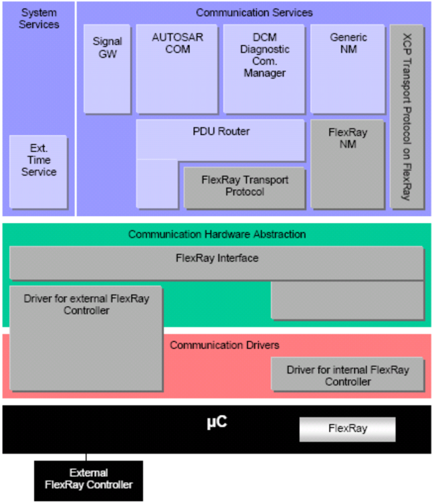

图1：AUTOSAR FlexRay 分层架构（**Figure 1: AUTOSAR FlexRay Layered Architecture**）

* 发送方向上的数据分段
* 接收方向上的数据收集
* 数据流控制
* 错误检测
* 确认（和重试）
* 1:1 和 1:n 连接
* 2 或 4 字节的地址信息
* 最多传输 2^32-1 字节的载荷
* 可配置为在帧布局和序列方面符合 ISO 15765-2

本规范只支持从 ISO 15765-2 派生的 AUTOSAR FlexRay 传输协议，该协议在 AUTOSAR 3.x 及更早版本中被用作标准。自 AUTOSAR 4.0 版起，标准 FlexRay 传输层 [\[11\]](#ref-11) 与 ISO 10681-2 兼容。对于 AUTOSAR 3.2 版，符合 ISO 10681-2 的 FlexRay 传输层已反向移植为一个名为 FlexRay ISO Transport Layer 的独立文档。因此，无论是在 AUTOSAR 3.2 还是 4.0 中，用户在选择将哪个规范用于 FlexRay 传输层时都必须谨慎。

将基础软件模块的规范建立在现有标准之上是 **AUTOSAR** 的一项决策。FlexRay AUTOSAR 传输层规范基于国际标准 ISO 15765-2（**CAN** 诊断），它是汽车领域最常用的标准。

基本思想是拥有一个符合 ISO 15765-2 的传输层，它允许通过静态配置为特定信道彼此独立地添加一个或多个可选特性（例如确认）。当然，添加这样的特性后，该特定信道对 ISO 15765-2 的符合性即告丧失。此外，这些特性可以在编译时被停用。即使它们被编译进代码，它们仍然可以通过静态配置被停用。

所提供的某些特性背后的基本原理是：该传输层不仅用于诊断目的，还用于 **ECU** 间通信。

由于 ISO 15765-2 内的寻址是 **CAN** 总线系统特有的（**CAN** 标识符），因此在 FlexRay AUTOSAR 传输层内显然要采取另一种方法。

尽管 FlexRay 传输协议最初是面向车辆诊断系统的，但它的开发也考虑了其他需要传输层协议的基于 FlexRay 的系统的需求。

## 2. 缩略语和缩写

以下缩略语和缩写仅具有本地作用域，因此不包含在 **AUTOSAR** 术语表中。

**Channel（信道）**
> 信道承载一组共享第 [9.2](#92-n-sdu-接收) 节中参数可配置特性的连接。

**Connection（连接）**
> 两个节点（1:1）之间或一个节点与网络（1:n）之间的通信路径，由第 [9.2](#92-n-sdu-接收) 节中的参数表征。

**Frame（帧）**
> N-PDU 或 L-SDU 的同义词。

**I-PDU**
> **AUTOSAR COM** 模块的 **PDU**；对应于 FlexRay 传输层的 N-SDU。

**L-SDU**
> 这是 FlexRay 接口的 **SDU**。它与 N-PDU 表示同一实体，只是从 FlexRay 接口的角度来看。

**L-SDU ID**
> L-SDU 的唯一标识符；由诸如 FlexRay AUTOSAR 传输层模块之类的上层用于与 FlexRay 接口交互。

**Message（消息）**
> N-SDU 或 I-PDU 的同义词。

**N-PDU**
> 这是 FlexRay AUTOSAR 传输层的一个 **PDU**，它被交给 FlexRay 接口进行发送。它由地址信息、协议控制信息和载荷（N-SDU）组成。

**N-SDU**
> 这是 FlexRay AUTOSAR 传输层的 **SDU**。在 **AUTOSAR** 架构中，它是与 **PDU** 路由器交换的一组数据。

**N-SDU ID**
> SDU 的唯一标识符；由诸如 **PDU** 路由器之类的上层用于与 FlexRay 传输层交互。

**PDU pool（PDU 池）**
> 共享相同大小和相同寻址类型的 FlexRay N-PDU 的集合。

**AF**
> 确认帧（**Acknowledgement Frame**）

**CF**
> 连续帧（**Consecutive Frame**）

**COM**
> **AUTOSAR COM** 模块

**FC**
> 流控制（**Flow Control**）

**FF**
> 首帧（**First Frame**）

**Fr**
> FlexRay

**PCI**
> 协议控制信息（**Protocol Control Information**）

**FrIf**
> FlexRay 接口（**FlexRay Interface**）

**FrArTp**
> FlexRay AUTOSAR 传输层（派生自 ISO 15765-2）

**FrIsoTp**
> FlexRay ISO 传输层（ISO 10681-2）

**FrTp**
> FlexRay 传输层（**FlexRay Transport Layer**）

**NM**
> 网络管理（**Network Management**）

**PDU**
> 协议数据单元（**Protocol Data Unit**）

**PduR**
> **PDU** 路由器（**PDU Router**）

**SDU**
> 服务数据单元（**Service Data Unit**）

**SF**
> 单帧（**Single Frame**）

**XCP**
> 通用校准协议（**Universal Calibration Protocol**）

## 3. 相关文档

### 3.1. 输入文件

<a id="ref-1"></a>[1] List of Basic Software Modules
> AUTOSAR_TR_BSWModuleList

<a id="ref-2"></a>[2] Layered Software Architecture
> AUTOSAR_EXP_LayeredSoftwareArchitecture

<a id="ref-3"></a>[3] General Requirements of Basic Software Modules
> AUTOSAR_SRS_BSWGeneral

<a id="ref-4"></a>[4] Requirements on FlexRay
> AUTOSAR_SRS_FlexRay

<a id="ref-5"></a>[5] Specification of FlexRay Interface
> AUTOSAR_SWS_FlexRayInterface

<a id="ref-6"></a>[6] Specification of PDU Router
> AUTOSAR_SWS_PDURouter

<a id="ref-7"></a>[7] Specification of Communication Stack Types
> AUTOSAR_SWS_CommunicationStackTypes

<a id="ref-8"></a>[8] Specification of Standard Types
> AUTOSAR_SWS_StandardTypes

<a id="ref-9"></a>[9] Specification of Platform Types
> AUTOSAR_SWS_PlatformTypes

<a id="ref-10"></a>[10] AUTOSAR Basic Software Module Description Template
> AUTOSAR_TPS_BSWModuleDescriptionTemplate

<a id="ref-11"></a>[11] Specification of FlexRay ISO Transport Layer
> AUTOSAR_SWS_FlexRayISOTransportLayer

<a id="ref-12"></a>[12] General Specification of Basic Software Modules
> AUTOSAR_SWS_BSWGeneral

### 3.2. 相关标准与规范

<a id="ref-13"></a>[13] ISO 15765-2(2003-11-11), Road vehicles - Diagnostics on Controller Area Networks (CAN) - Part2: Network layer services

<a id="ref-14"></a>[14] ISO 10681-2, Road vehicles - Communication on FlexRay - Part2: Communication Layer Services

<a id="ref-15"></a>[15] FlexRay Communications System Protocol Specification Version 2.1

### 3.3. 相关规范

**AUTOSAR** 提供了一份基础软件模块通用规范 [\[12\]](#ref-12)（**SWS BSW General**），该规范同样适用于 FlexRay AUTOSAR 传输层。

因此，规范 **SWS BSW General** 应被视为 FlexRay AUTOSAR 传输层的附加且必需的规范。

## 4. 约束和假设

### 4.1. 限制

**AUTOSAR** 架构定义了协议特定的传输层（CanTp、LinTp、Fr[Ar]Tp 等）。FlexRay AUTOSAR 传输层只涵盖 FlexRay 传输协议特有的内容。

FlexRay AUTOSAR 传输层具有到一个底层 FlexRay 接口层和一个上层 **PDU** 路由器的接口。

### 4.2. 汽车域的适用性

只要使用了 FlexRay 协议，就可以始终将 FlexRay AUTOSAR 传输层用于各种应用。

## 6. 对其他模块的依赖

本节阐述 FlexRay AUTOSAR 传输层模块（FrArTp）与其他 **AUTOSAR** 基础软件模块之间的关系。它包含对其他模块调用的 FrArTp 服务以及 FrArTp 调用的其他模块服务的简要描述。下图给出了这些交互的简要概览。

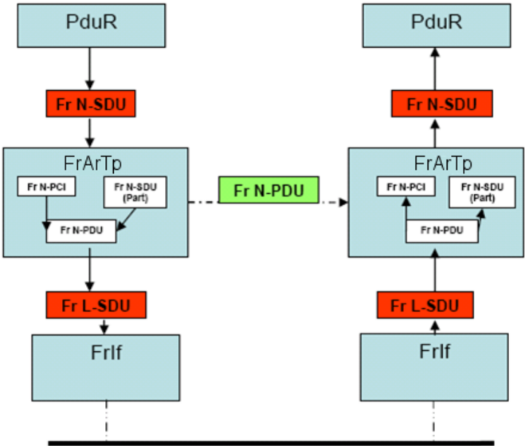

图2：FrArTp 交互（**Figure 2: FrArTp interactions**）

### 6.1. PDU 路由器

FlexRay AUTOSAR 传输层模块调用 **PDU** 路由器的以下服务：

* PduR\_FrArTpStartOfReception

通过该 **API** 服务，FlexRay AUTOSAR 传输层模块通知上层（例如经由 **PDU** 路由器的 **DCM**）正在接收一条新消息。

* PduR\_FrArTpCopyRxData

通过该 **API** 服务，FlexRay AUTOSAR 传输层模块向上层提供一条已接收分段消息的一个分段（N-PDU）的数据。

* PduR\_FrArTpRxIndication

通过该 **API** 服务，FlexRay AUTOSAR 传输层模块指示一条消息（N-SDU）已完成（不）成功接收。

* PduR\_FrArTpCopyTxData

通过该 **API** 服务，FlexRay AUTOSAR 传输层模块请求消息的上层（例如经由 **PDU** 路由器的 **DCM**）提供用于下一个分段消息部分（N-PDU）的数据。

* PduR\_FrArTpTxConfirmation

通过该 **API** 服务，FlexRay AUTOSAR 传输层模块向实际发送方（例如 **DCM**）确认完整消息（N-SDU）的（不）成功发送。

**PDU** 路由器调用 FlexRay AUTOSAR 传输层模块的以下服务：

* FrArTp\_Transmit

通过该 **API** 服务，触发一条消息（N-SDU）的发送。

* FrArTp\_CancelTransmit

通过该 **API** 服务，取消一条消息（N-SDU）的发送。该服务是可选的（按信道）。

* FrArTp\_CancelReceive

通过该 **API** 服务，取消一条消息（N-SDU）的接收。该服务是可选的（按信道）。

* FrArTp\_ChangeParameter

通过该 **API** 服务，可以更改一个连接的 STmin 和 BS 值。

### 6.2. FlexRay 接口

FlexRay AUTOSAR 传输层模块调用 FlexRay 接口的以下服务：

* FrIf\_Transmit

通过该 **API** 服务，触发一个帧（N-PDU）的发送。根据 FlexRay 接口上的配置，N-PDU 被立即发送，或在调用 FrArTp\_TriggerTransmit 之后发送。

FlexRay 接口调用 FlexRay AUTOSAR 传输层模块的以下服务：

* FrArTp\_RxIndication

通过该 **API** 服务，FlexRay 接口向 FrArTp 指示已接收到一个 FrArTp 帧（N-PDU，请不要与 FlexRay 帧混淆）。随后 FrArTp 处理该帧。

* FrArTp\_TxConfirmation

通过该 **API** 服务，FlexRay 接口确认包含 N-PDU 的帧在 FlexRay 网络上的（不）成功发送。

* FrArTp\_TriggerTransmit

通过该 **API** 服务，FlexRay 接口使 FrArTp 将 N-PDU 拷贝到 FlexRay 接口提供的缓冲区中。随后 FlexRay 接口可以开始发送包含 N-PDU 的 FlexRay 帧。

### 6.3. ECU 状态管理器

**ECU** 状态管理器调用 FrArTp 的以下服务：

* FrArTp\_Init

通过该 **API** 服务，所有挂起的传输连接被关闭，资源被释放，模块被置为空闲状态。

* FrArTp\_Shutdown

通过该 **API** 服务，所有全局变量被初始化，每个连接被置为空闲状态。

### 6.4. 文件结构

#### 6.4.1. 代码文件结构

详情请参阅 SWS\_BSWGeneral 中第 5.1.6 节「代码文件结构（Code file structure）」。

#### 6.4.2. 设计规则

FrArTp 的源代码不得依赖处理器和编译器。

## 7. 功能规格

FlexRay AUTOSAR 传输层模块（FrArTp）提供用于消息（N-SDU）的分段、带流控制的传输和重组的服务。它的主要用途是传输可能适合也可能不适合单个 FlexRay 帧的消息。

FlexRay AUTOSAR 传输层为 **PDU** 池和连接提供全双工能力。

FrArTp 应执行预处理器检查，确认其源文件和头文件属于同一版本。

### 7.1. 概述

#### 7.1.1. 对 ISO 15765-2 的扩展

除了符合 ISO 15765-2 的特性（每帧 7 字节数据、4 kByte 消息长度、无分段的 1:n 连接、并发的多个逻辑信道、流控制、服务请求确认）之外，它还允许在预编译时和后构建时彼此独立地为特定信道配置以下特性：

* 1:1 连接的确认（带或不带重试）
* 分段的 1:n 连接（不带流控制）
* 传输取消
* 最多 2^32-1 字节的消息长度

对于本文档的其余部分，不符合 ISO 15765-2 的小节或特性将被标记为「**不符合 ISO 15765-2**」。

#### 7.1.2. 连接

连接用于将数据从一个发送方传输到一个（1:1）或多个（1:n）接收方。具有一个发送方和一个接收方的连接是双向的；数据可以在两个方向上传输。为了传输可能大得多的消息的各个部分，连接使用被分组为 **PDU** 池的 FlexRay **PDU**。连接可以规定若干个 prioritized **PDU**，只要该连接处于活动状态，这些 **PDU** 就必须被保留供其独占使用。

#### 7.1.3. 信道

信道用于将若干具有类似特性的连接分组，并管理对传输 **PDU** 的访问。因此，信道自身承载所有相关特性，如寻址类型、时序和握手参数、确认和重试能力，以及至多一个已接收和已发送 **PDU** 池的传输 **PDU**。

#### 7.1.4. PDU 池

**PDU** 池是一个概念性元素，它将多个信道的传输 **PDU** 分组。**PDU** 池中的 **PDU** 必须具有相同的 **PDU** 大小和寻址类型。对于特定的 **ECU**，一个 **PDU** 池要么被接收，要么被发送。一个 **PDU** 池中的 **PDU** 可以被一个或多个信道使用。为了确保配置中的池语义，信道必须引用一个池的全部 **PDU**，或者一个也不引用。还必须确保分配给同一 **PDU** 池的任何两个连接都不具有相同的地址。一个 **PDU** 池的 **PDU** 在运行时被均匀地分配给所有打开的连接，但只在已分配完具有优先 **PDU** 的打开连接所需的全部 **PDU** 之后才进行分配。

#### 7.1.5. 活动连接

并发活动连接的最大数量可以通过 FrArTpConcurrentConnections 针对每个信道单独配置。该数量可以一次一个连接，到该信道的所有连接。由于连接可以是双向的，因此每个活动连接需要两个独立的状态机。这些状态机属于信道，因此与该信道使用的 **PDU** 池相关联。

当请求新的数据传输或接收到传入连接的帧时，状态机在运行时被分配给连接。当达到状态机的最大数量时，进一步的传输请求必须被拒绝，新的传入连接必须被忽略。

对于每个状态机，都需要一个 **RAM** 缓冲区，用于存储下一个待发送帧的内容，直到有足够的数据可用，并且该帧已经通过 FrArTp\_TriggerTransmit 传输给 FrIf。

### 7.2. 协议过程

正如后文将要展示的，存在不同类型的首帧和单帧，但在时序图中始终使用 FF 或 SF，而不考虑具体的子类型。

#### 7.2.1. 1:1 连接

这种类型的连接存在于两个节点之间，并且是双向的。在 FlexRay AUTOSAR 传输层内，可以有以下子类型。

##### 7.2.1.1. 无确认信道中的 1:1 连接

**无分段传输**

当消息不超过 SF 所能承载的载荷量（可以从 N-PDU 长度、FrArTpAdrType 和 FrArTpLm 推导）时，无需对该消息进行分段。

传输如图3所示进行：

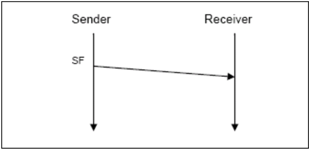

图3：无确认的无分段 1:1 传输（**Figure 3: Unsegmented 1:1 transfer without acknowledgement**）

发送方传输层将载荷（N-SDU）打包进一个 N-PDU 并发送给接收方传输层。这通过一个单帧（SF）完成。

**分段传输**

如果消息不适合放入一个 SF，则需要将其拆分为多个部分，并应用流控制来考虑接收方的需求以控制数据流。

在这种情况下，传输如图4所示进行：

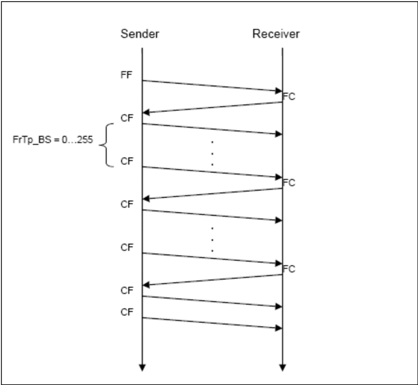

图4：无确认的分段 1:1 传输（**Figure 4: Segmented 1:1 transfer without acknowledgement**）

传输从发送方向接收方发送首帧（FF）开始。该帧包含整个消息的长度（例如 1000 字节），甚至包含首批数据字节。

接收方以向发送方回送一个流控制帧（FC）来响应 FF 的接收。该 FC 帧包含三个参数的值：FS、BS 和 STmin。

FS 表明流状态。可能的取值为：

* CTS：可以发送（Clear To Send）。发送方可以继续发送消息。
* WT：等待（Wait）。发送方应等待另一个 FC 帧。
* OVFLW：溢出（Overflow）。发送方应中止传输，因为接收方没有足够的缓冲区空间来容纳整个消息。

允许的 WT 次数应有一个静态定义的上限（FrArTpMaxWft）。如果已达到该数量，则应中止传输，并在 PduR\_FrArTpTxConfirmation 中返回结果 **E_NOT_OK**。

BS 规定块大小。这是发送方在两个 FC 帧之间允许发送的连续帧（CF）的数量。可能范围为 0x00 到 0xFF，其中 0x00 表示接收方将不再发送任何 FC 帧，即整个消息应在一个大块中发送。

STmin 定义两个 CF 之间的最小间隔，以毫秒或微秒为单位。有效值范围为 0x00 到 0x7F 以及 0xF1 到 0xF9。0x00 到 0x7F 的范围规定以毫秒为单位的最小间隔（0ms .. 127ms），0xF1 到 0xF9 的范围规定以微秒为单位的间隔（100 µs、200 µs、.. 900 µs）。STmin 的受支持值受 N-PDU 在 FlexRay 循环中位置的限制，并受 N-PDU 在循环时隙中的位置所造成的抖动影响。

CF 块与 FC 帧的交替发送持续进行，直到整个消息发送完毕。

STmin 参数可以在运行时通过相应的 **API** 调用进行更改。

##### 7.2.1.2. 带确认不带重试的信道中的 1:1 连接

本节**不符合 ISO 15765-2**，描述一个简单的确认机制是什么样子。

**无分段传输**

这与第 [7.2.1.1](#7211-无确认信道中的-11-连接) 节「无分段传输」中的做法大体相同，不同之处在于存在一个额外的确认帧（AF），它从接收方发送到发送方。如图5所示：

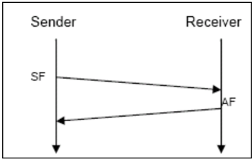

图5：带确认不带重试的无分段 1:1 传输（**Figure 5: Unsegmented 1:1 transfer with Acknowledgement without Retry**）

AF 除其他字段外还包含 ACK 字段，它有两个可能的取值：正向确认（POS\_ACK）或负向确认（NEG\_ACK）。这样，发送方被告知消息被接收方（未）成功接收。如果一个 AF 帧的 FS 字段（参见第 [7.3.6](#736-确认帧af) 节）包含值 WT，则将会有另一个 AF 到达，直至 FrArTpMaxRn 个。

**分段传输**

这与第 [7.2.1.1](#7211-无确认信道中的-11-连接) 节「分段传输」的做法非常相似。只有三处不同：

第一个区别是在最后一个块之后发送一个 AF，因为该块也必须被确认。该帧类似于普通的流控制帧，但额外包含 ACK 参数（用于正向或负向确认）以及所发送块的第一个故障帧的序列号。

第二个区别是在发生错误的块之后发送一个带负向确认的 AF。该 AF 同样包含第一个故障帧或缺失帧的序列号。

第三个区别是，块大小必须在 1 到 16 的范围内（由于 4 位序列号，参见第 [7.3.4](#734-连续帧) 节）。

该过程可参见图6：

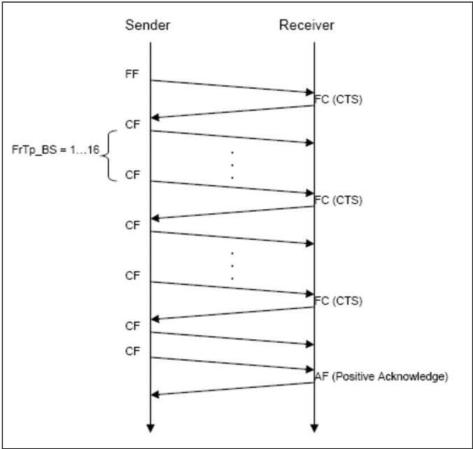

图6：带确认不带重试的分段 1:1 传输（**Figure 6: Segmented 1:1 transfer with Acknowledgement without Retry**）

显然，确认是「按块」进行的，取决于当前的块大小。

在块之后发生负向确认的情况下（在这种情况下，向发送方发送的不是一个 FC 帧，而是带负向确认的 AF，并且接收方中止接收并向其上层指示适当的结果（PduR\_FrArTpRxIndication）），发送方中止传输并通知其上层（PduR\_FrArTpTxConfirmation）。

##### 7.2.1.3. 带确认带重试的信道中的 1:1 连接

本节**不符合 ISO 15765-2**。

**无分段传输**

本节与第 [7.2.1.2](#7212-带确认不带重试的信道中的-11-连接) 节中对应的小节非常相似。唯一的区别是：在负向确认的情况下，帧将被重传。

该行为描绘在图7和图8中：

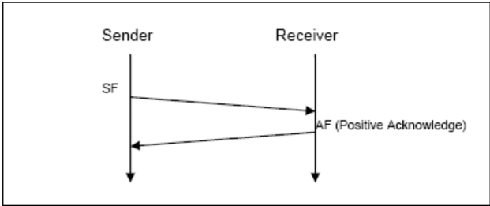

图7：配置了确认带重试的无分段 1:1 传输，正向确认（**Figure 7: Unsegmented 1:1 transfer, Acknowledgement with Retry configured, Positive Acknowledgement**）

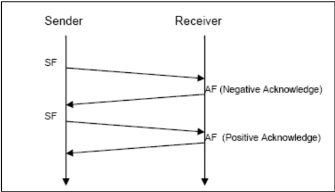

图8：配置了确认带重试的无分段 1:1 传输，负向确认（**Figure 8: Unsegmented 1:1 transfer, Acknowledgement with Retry configured, Negative Acknowledgement**）

如果在图8中第二次尝试发送消息也失败了，则还会有第三次尝试，依此类推。

为了防止在永久性故障的情况下出现无限重传，必须定义一个上限（FrArTpMaxRn）。如果重试次数已达到该值，则应停止相应消息的传输，并在 PduR\_FrArTpTxConfirmation 和 PduR\_FrArTpRxIndication 中返回适当的结果（参见第 [7.2](#72-协议过程) 节 API 类型定义的说明）。

**分段传输**

与第 [7.2.1.2](#7212-带确认不带重试的信道中的-11-连接) 节的分段传输相比，区别在于重试机制以及随之而来的交替块机制。

重试机制的工作方式如下：

在负向确认到达发送方的情况下，它还包含当前正发送的块中第一个故障帧的序列号。现在发送方从指定的序列号开始，重新发送刚发送的块的所有剩余帧。

为了防止在永久性故障的情况下出现无限重传，参数 FrArTpMaxRn 限制重试尝试的次数。

针对块大小为 4 的情况，重试机制如图9所示：

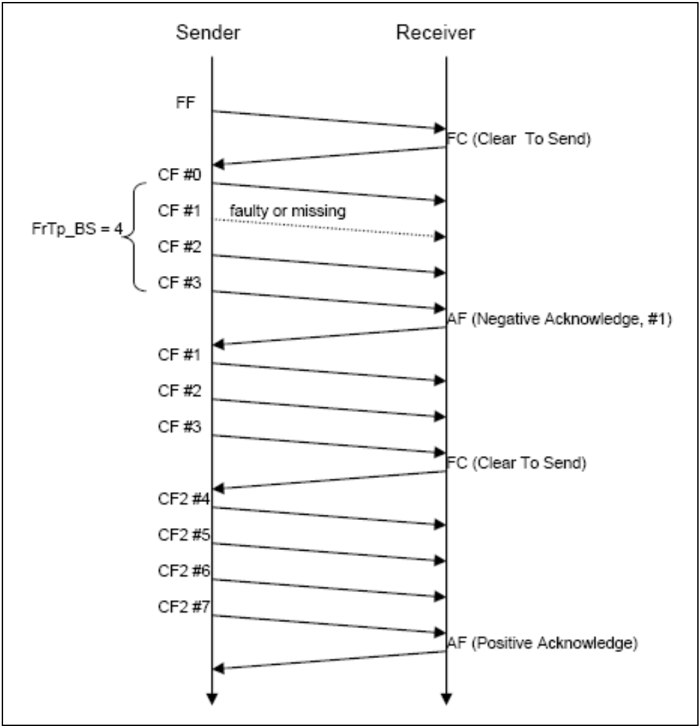

图9：带确认带重试的分段 1:1 传输（**Figure 9: Segmented 1:1 transfer with Acknowledgement with Retry**）

如果重试以比请求的更低的序列号开始，这应被容忍，即直到请求的序列号之前的所有帧都应被忽略，被忽略帧内的错误也应被忽略。如果它以比请求的更高的序号开始，这将导致在块结束之后再次发生负向确认。

**交替块机制**

当使用重试机制时，FlexRay AUTOSAR 传输层模块使用交替块机制传输块。它的工作方式如下：

第一个块使用普通 CF 帧传输。第二个块使用 CF2 帧传输，第三个块使用 CF 帧，依此类推。当发生重试时，CF 块再次使用 CF 帧重传，当然，CF2 块使用 CF2 帧重传。

该机制确保在块结束处丢失了一个 FC 帧时（特别是如果它是流状态为 CTS 的 FC）仍能正确工作，因为它允许检测到不必要的重试。

#### 7.2.2. 1:n 连接

在 1:n 连接（1 个发送方，多个接收方）的情况下，不再区分子类型（带或不带确认）。其原因在于接收组的规模通常无法事先知道，因此无法对 1:n 连接应用流控制或确认机制。

因此，唯一的区分是无分段传输和分段传输。

1:n 连接本质上是单向的。

**无分段传输**

这与第 [7.2.1.1](#7211-无确认信道中的-11-连接) 节「无分段传输」中的完全相同。唯一的区别是接收方是多个而不是一个。因此，过程如下所示：

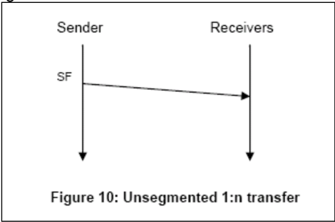

图10：无分段 1:n 传输（**Figure 10: Unsegmented 1:n transfer**）

一个发送方将其消息发送给一组接收方。

**分段传输（不符合 ISO 15765-2）**

由于在这种情况下不可能进行流控制或确认，分段的 1:n 传输只由一个 FF 和必要数量的 CF 组成。

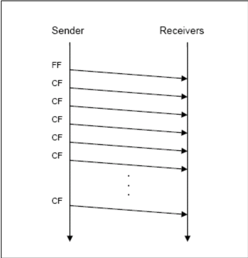

图11：分段 1:n 传输（**Figure 11: Segmented 1:n transfer**）

当发生错误时，接收将被终止，并在 PduR\_FrArTpRxIndication() 中给出适当的结果。

连续 CF 之间的间隔由配置参数 FrArTpStMinGrpSeg 定义，类似于分段 1:1 连接的 FrArTpStMin。

### 7.3. 帧布局

如第 [7.2](#72-协议过程) 节所示，存在不同类型的帧。下文对所有类型进行详细解释。

#### 7.3.1. 一般说明

帧的一般结构如图12所示：

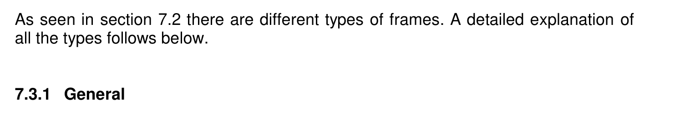

图12：FlexRay AUTOSAR 传输协议帧的结构（**Figure 12: Structure of a FlexRay AUTOSAR transport protocol frame**）

所有帧的共同点是它们以地址信息开头。根据静态配置（按信道），即使用 1 字节还是 2 字节寻址，该地址信息由 1 字节目标地址和 1 字节源地址、或 2 字节目标地址和 2 字节源地址组成。由于这取决于对地址信息的解释，因此没有进一步规定该地址信息是用于汽车领域所谓的「物理（Physical）」寻址还是「功能（Functional）」寻址。

当 FrArTp 帧不需要其 N-PDU 的整个长度时（在单帧、首帧或传输中的最后一个连续帧中），N-PDU 中的剩余空间（位）应置为 0。

**1 字节寻址（不符合 ISO 15765-2）**

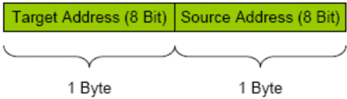

图13：1 字节寻址的地址头（**Figure 13: Address header for 1 Byte addressing**）

目标地址和源地址各占 1 字节，因此最多可以寻址 256 个接收方。

**2 字节寻址（不符合 ISO 15765-2）**

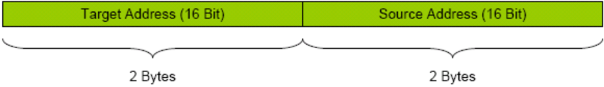

图14：2 字节寻址的地址头（**Figure 14: Address header for 2 Byte addressing**）

按照该方案，最多可以寻址 65536 个不同的接收方。

如图12所示，帧一般由地址信息、协议控制信息和数据组成。协议控制信息（PCI）的长度和内容随帧类型而变化。

在解释每种帧的细节之前，下表给出了一个简要的概览（所提到的字节和半字节均针对 PCI）：

表1：不同帧格式的概览（**Overview of the different frames format**）

| 帧类型 | FT | 字节 1 | 字节 2 | 字节 3 | 字节 4 |
| --- | --- | --- | --- | --- | --- |
| SF-I | 0x0 | DL（4 位） | 数据 1-7 字节 | | |
| SF-E | 0x4 | Res（4 位） | DL（8 位） | 数据 | |
| FF-I | 0x1 | DL（12 位） | 数据 | | |
| FF-E | 0x5 | Res（4 位） | DL（32 位） | 数据 | |
| CF | 0x2 | SN（4 位） | 数据 | | |
| CF2 | 0x6 | SN（4 位） | 数据 | | |
| FC | 0x3 | FS（4 位） | BS（8 位） | STmin（8 位） | |
| AF | 0x7 | FS（4 位） | BS（8 位） | STmin（8 位） | LACK（4 位）+ SN（4 位） |

注意：该表中未使用的字节应置为 0x00。

**字节序**

如果经由总线发送的协议值由多于 1 字节组成（例如使用 2 字节寻址时的源地址和目标地址），则字节序应为最高有效字节在前、最低有效字节在后。

#### 7.3.2. 单帧（SF-x）

当消息不超过该帧类型的可用载荷量时，或当要求符合 ISO 15765-2 时，发送 SF。一方面为了符合 ISO 15765-2，另一方面为了能够利用 FlexRay 的可能性，存在两种类型的单帧。在符合 ISO 15765-2 的信道中只允许 SF-I，在不符合 ISO 15765-2 的信道中（即 FrArTpLm = FRARTP\_L4G）只允许 SF-E。

##### 7.3.2.1. ISO 15765-2 单帧（SF-I）

SF-I 的形式如下（未描绘地址信息头）：

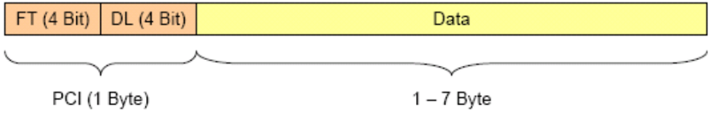

图15：ISO 15765-2 单帧（**Figure 15: Single Frame ISO 15765-2**）

在 SF-I 中，PCI 只由一个字节组成。该字节分为两部分，称为 FT（帧类型，Frame Type）和 DL（数据长度，Data Length）。两个部分都是 4 位长。

FT 字段为每种帧类型所共有，因为它标识相应的类型。

对于 ISO 15765-2 单帧，FT 字段应设置为 0x0。

DL 字段表明实际数据字节的数量。根据 ISO 15765-2，值 0x1 - 0x7（FRARTP\_ISO6 模式下为 0x6）是有效的，因此在符合 ISO 15765-2 的连接中，相关 N-PDU 的大小必须（取决于寻址模式）为 10（9）或 12（11）字节长，因为 SF 具有该长度。

包括地址信息在内，SF-I 的长度从 4 字节（1 字节载荷，1 字节寻址）到 12 字节不等。考虑到寻址模式并查看配置中相应 PduInfoType 结构体的长度说明，可以推导出实际的帧长度。

**错误处理**

DL 字段：传入的 DL 值为 0x0 或高于 0x7（FRARTP\_ISO6 模式下高于 0x6）的无效 SF-I 帧应被忽略。如果到达的值高于可以从配置中相应 PduInfoType 结构体的长度说明和寻址模式推导出的载荷量，也应这样做。

如果配置了确认，则在上述情况下还应向发送方回送一个带负向确认的 AF。

##### 7.3.2.2. 扩展单帧（SF-E）

本节**不符合 ISO 15765-2**。

SF-E 允许将 254 字节的整个可用 FlexRay 载荷用于无分段传输。其形式如图16所示：

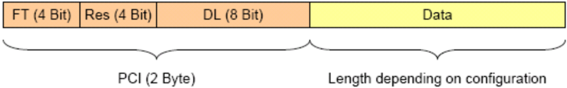

图16：扩展单帧（**Figure 16: Single Frame Extended**）

SF-E 的 PCI 由两个字节组成。FT 字段为 4 位长；对于 SF-E，它应设置为 0x4。随后的半字节为保留位；它应设置为 0x0。

下一个字节是 DL 字段，它表明 SF-E 中包含的载荷量。根据寻址模式（1 字节或 2 字节）的配置和相关 N-PDU 的长度，除 0x00 以及高于 0xFA（1 字节寻址）或高于 0xF8（2 字节寻址）之外的任何值在此都是有效的。

这种帧的最小长度为 5 字节（1 字节寻址，1 字节载荷），最大长度为 254 字节（FlexRay 限制，依据 [\[15\]](#ref-15)）。考虑到寻址模式并查看相应 PduInfoType 结构体中的长度说明，可以推导出实际的帧长度。

**错误处理**

DL 字段：如果该字段包含值 0x00，或根据寻址模式包含高于 0xFA 或高于 0xF8 的值，则该 SF-E 应被忽略。

如果配置了确认，则还应向发送方回送一个带负向确认的 AF。

一般说明：如果相应信道未配置允许超过 ISO 15765-2 所允许长度的消息（FrArTpLm），则该帧应被忽略。如果到达的值高于可以从相应 PduInfoType 结构体的长度说明和寻址模式推导出的载荷量，或保留半字节中的值不为 0x0，也应这样做。如果配置了确认，则在上述情况下还应向发送方回送一个带负向确认的 AF。

#### 7.3.3. 首帧（FF-x）

如果消息不适合放入一个 SF，则必须对它进行分段。

FrArTp 根据消息长度、（取决于按信道配置）使用 SF-E 帧的可能性以及所分配 N-PDU 的大小来决定是否必须对消息进行分段（另见第 [7.4.1](#741-分段的判定) 节）。因此，为了开始传输这样一条长消息，要使用一个首帧。

为了一方面实现与 ISO 15765-2 的符合性，另一方面允许长于 2^12-1 字节的消息，存在几种类型的首帧。

**不符合 ISO 15765-2**：可以按信道静态配置首帧是否也可以在 1:n 连接中启动一个分段消息。

##### 7.3.3.1. ISO 15765-2 首帧（FF-I）

下图展示了 FF-I 的布局：

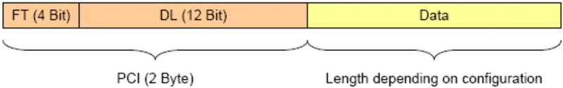

图17：ISO 15765-2 首帧（**Figure 17: First Frame ISO 15765-2**）

在 FF-I 中，PCI 由 2 字节组成。与 SF 中一样，FT 字段为 4 位长，DL 字段为 12 位。

对于 FF-I，FT 字段应设置为 0x1。

DL 字段包含整个消息的长度。由于该字段为 12 位长，可以传输最多 2^12-1 字节的消息。

包括地址信息在内的首帧总长度（取决于按信道的配置）从 4 字节到一个连接特定的最大值不等。该最大值又取决于用例（例如对于必须完全符合 ISO 15765-2 的与 **CAN** 的通信，它将是 10 或 12（FRARTP\_ISO6 模式下为 9 或 11））以及相关 N-PDU 的大小。考虑到寻址类型（1 或 2 字节）并例如查看相应 PduInfoType 结构体中的长度说明，可以推导出 FF-I 的实际载荷量。

**错误处理**

DL 字段：传入的 DL = 0x000 的 FF-I 帧应被忽略。此外，如果 DL 值低于（从 PDU 大小、寻址类型和信道特定的长消息开关可推导出的）SF 的可能载荷量，该帧也应被忽略。

如果配置了确认，则在上述所有情况下还应向发送方回送一个带负向确认的 AF。

##### 7.3.3.2. 扩展首帧（FF-E）

本节**不符合 ISO 15765-2**。

FF-E 的布局如下所示：

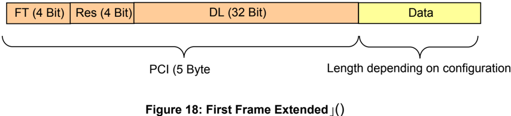

图18：扩展首帧（**Figure 18: First Frame Extended**）

在 FF-E 中，PCI 由 5 字节组成。FT 字段为 4 位长，4 位保留，DL 字段为 32 位。

DL 字段为 4 字节长，因此它允许传输最多 2^32-1 字节。

FT 字段设置为 0x5。

Res 字段（保留）设置为 0x0。

FF-E 的总长度从 7 字节到一个连接特定的最大值不等，该最大值取决于相关 N-PDU 的大小。

**错误处理**

DL 字段：如果 FR\_DL 值低于（从 PDU 大小和寻址类型可推导出的）SF 的可能载荷量，则该帧应被忽略。如果为相应信道配置了确认，则应向发送方回送一个带负向确认的 AF。

#### 7.3.4. 连续帧

如果未发生错误，FF-x 之后是连续帧，直到整个消息发送完毕。

**不符合 ISO 15765-2**：如果为特定信道进行了配置，连续帧也可以出现在 1:n 连接中。

如下所示，连续帧由一个字节的 PCI 和载荷组成。

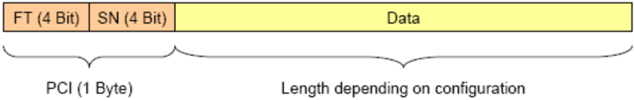

图19：连续帧（**Figure 19: Consecutive Frame**）

连续帧的 PCI 由一个字节组成，该字节分为两个 4 位的部分。

FT 字段再次表明帧类型；对于 CF，它应设置为 0x2；对于 CF2，它应为 0x6（CF2 帧**不符合 ISO 15765-2**）。

SN（序列号，Sequence Number）字段给出该连续帧的当前序列号。请注意，紧随 FF-x 之后的 CF 的 SN 被设置为 1，然后随每个帧递增，直到它回绕到 0 并依此类推。

包括地址信息在内的连续帧总长度（取决于按连接的配置）从 4 字节到一个连接特定的最大值不等。该最大值取决于用例（例如对于必须完全符合 ISO 15765-2 的与 **CAN** 的通信，它将是 10 或 12（FRARTP\_ISO6 模式下为 9 或 11））以及相关 PDU 的大小。

接收方可以通过查看相关 PduInfoType 结构体并考虑寻址模式来推导实际的数据长度。

**错误处理**

SN 字段：如果未配置确认，则在 SN 错误的情况下，即在 SN x 之后不是跟随 SN x+1，应中止传输，并在 PduR\_FrArTpRxIndication 中返回结果 **E_NOT_OK**。如果配置了确认，则在块结束之后应发生负向确认，然后如上所述中止传输。如果还配置了重试，则不应中止传输，而应进行重试（最多 FrArTpMaxRn 次）。

#### 7.3.5. 流控制（FC）

流控制帧用于分段的 1:1 连接（参见第 [7.2.1.1](#7211-无确认信道中的-11-连接) 节）。因此，它不能出现在 1:n 连接中。它允许接收方向发送方发送信息。它在接收到 FF-x 之后、以及在未发生错误时在块的最后一个 CF 之后发送。

FC 的布局如下所示：

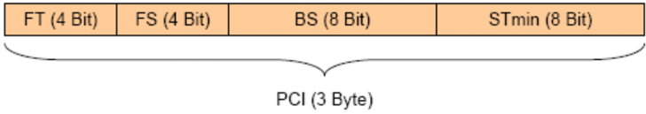

图20：流控制帧（**Figure 20: Flow Control frame**）

流控制帧只由协议控制信息组成。

照例，FT 字段表明帧类型，因此对于流控制帧，它应设置为 0x3。

FS 字段可以包含以下三种流状态值（另见第 [7.2.1.1](#7211-无确认信道中的-11-连接) 节）：

* CTS（值 0x0）：可以发送。发送方可以继续发送消息。
* WT（值 0x1）：等待。发送方应等待另一个 FC 帧（因此重启其定时器 FrArTpTimeoutBs）。如果 FS = WT 的连续流控制帧的数量达到按信道定义的最大值，则应中止传输。
* OVFLW（值 0x2）：溢出。应中止传输，因为接收方没有足够的缓冲区来容纳整个消息（依据 FF-x 的 DL 字段的值）。

BS 表明块大小（流控制帧之间的 CF 数量）。如果未配置确认，则从 0x00 到 0xFF 的所有值都有效，其中 0x00 表示不再进行流控制，挂起消息的其余部分将在一个大块中发送。否则，只有 0x01 - 0x10 的值有效。

最后一个字节包含 STmin，它定义两个 CF 之间的最小间隔。有效值范围为 0x00 到 0x7F 以及 0xF1 到 0xF9。0x00 到 0x7F 的范围规定以毫秒为单位的最小间隔（0ms .. 127ms），0xF1 到 0xF9 的范围规定以微秒为单位的间隔（100 µs、200 µs、.. 900 µs）。STmin 的受支持值受 N-PDU 在 FlexRay 循环中位置的限制，并受 N-PDU 在循环时隙中的位置所造成的抖动影响。

根据寻址配置，流控制帧的长度为 5 或 7 字节。

**错误处理**

FS 字段：如果配置了带重试的确认，则该帧应被忽略而不是中止传输。

BS 字段：如果未配置确认，则所有值都有效。否则，只有从 0x1 到 0x10 的值有效。在后一种情况下如果未配置重试，则应中止传输并以 **E_NOT_OK** 调用 PduR\_FrArTpTxConfirmation，否则该帧应被忽略。

STmin 字段：该参数的无效值范围为 0x80 到 0xF0 以及 0xFA 到 0xFF。如果接收到这样的值，应改为取值 0x7F。

#### 7.3.6. 确认帧（AF）

本节**不符合 ISO 15765-2**。

如果配置了确认，在正向确认的情况下每个 CF 块都由一个 FC 帧确认（与无确认连接中一样）。此外，在 1:1 连接中，一个 SF-x、CF 的最后一个块由一个 AF 确认；在负向确认的情况下，其他块也由 AF 确认。这种帧类型不能出现在 1:n 连接中。

这种帧类型看起来类似于 FC 帧（第 [7.3.5](#735-流控制fc) 节），但它有一个额外的字节。

AF 的布局如下所示：

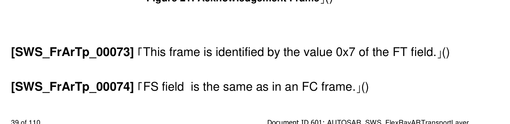

图21：确认帧（**Figure 21: Acknowledgement Frame**）

该帧由 FT 字段的值 0x7 标识。

FS 字段与 FC 帧中的相同。

由于 CF 中的 4 位序列号计数器（第 [7.3.4](#734-连续帧) 节），BS 字段只能设置为 0x01 到 0x10 的值。

STmin 与 FC 帧中的相同。

ACK 字段给出确认的类型：正向（0x0）或负向（0x1）。所有其他值都是保留的。

SN 字段包含最后一个块中第一个故障 CF 的编号。所有值都有效。

根据寻址类型，该帧的长度为 6 或 8 字节。

**错误处理**

以下内容仅在 AF 在预期时刻到达时成立。否则，参见第 [7.3.7](#737-ft-字段的错误处理) 节。

FS 字段：在分段传输中，所有高于 0x2 的值都应导致传输中止，并应以结果 **E_NOT_OK** 调用 PduR\_FrArTpTxConfirmation。如果还配置了重试，则这样的值不应导致传输中止。取而代之，该帧应被忽略。

带确认的 FS 字段：在无分段的已确认传输中或在分段已确认传输结束时，如果一个带负向确认且 FS = OVFLW 的 AF 到达发送方，则无论是否配置了重试，都应中止传输，并应以结果 **E_NOT_OK** 调用 PduR\_FrArTpTxConfirmation。

BS 字段：值 0x00 以及所有高于 0x10 的值都应导致传输中止，并应以结果 **E_NOT_OK** 调用 PduR\_FrArTpTxConfirmation。如果还配置了重试，则这样的值不应导致传输中止。取而代之，该帧应被忽略。

STmin 字段：该参数的无效值范围为 0x80 到 0xF0 以及 0xFA 到 0xFF。如果接收到这样的值，应改为取值 0x7F。

ACK 字段：高于 0x1 的值无效，应导致传输中止，并应以结果 **E_NOT_OK** 调用 PduR\_FrArTpTxConfirmation。如果还配置了重试，则这样的值不应导致传输中止。取而代之，该帧应被忽略。

SN 字段：如果到达的帧包含的 SN 属于一个在块内尚未被发送的 CF，例如块大小为 10 而该字段的值为 12，则应中止传输，并应以结果 **E_NOT_OK** 调用 PduR\_FrArTpTxConfirmation。如果还配置了重试，则不应中止传输。取而代之，该帧应被忽略。

一般说明：如果该信道未配置确认，则该帧类型应被忽略。

在无分段的已确认传输中，字段 BS、STmin 和 SN 的期望值为 0x0。其他值应被容忍。

为了便于理解，下表描绘了确认帧中 FS 和 ACK 字段的可能组合（及其含义）：

表2：FS 和 ACK 字段的可能组合（**Possible combinations of FS and ACK field**）

| FS 取值 | ACK = 0x0 | 含义 / 出现时机 | 是否导致重试（如果已配置） | ACK = 0x1 | 含义 / 出现时机 | 是否导致重试（如果已配置） |
| --- | --- | --- | --- | --- | --- | --- |
| FS = CTS | X | SF 之后或分段传输结束之后的正向确认 | 否 | X | SF 之后或分段传输中块结束之后的负向确认 | 是 |
| FS = WT | -- | -- | 否 | X | SF 之后的负向确认（如果当前没有可用的接收缓冲区） | 否 |
| FS = OVFLW | -- | -- | 否 | X | SF 之后的负向确认（如果没有可用的接收缓冲区） | 否 |

#### 7.3.7. FT 字段的错误处理

并非每种帧类型都可以在任何时间点、在任何信道/连接配置下被接受。因此，下面给出详细的描述。

FR\_FT 字段中高于 0x7 的值应始终被忽略。

如果相应的信道和连接被设置为符合 ISO 15765-2，则下表适用：

表3：符合 ISO 15765-2 的信道/连接中的 FT 错误处理（**FT Error Handling in ISO 15765-2 compliant channels/connections**）

| TP 层状态 | SF-I | FF-I (1:1) | CF (1:1) | FC | 其他 |
| --- | --- | --- | --- | --- | --- |
| 该连接内正在分段发送 | 如果该连接内正在接收，见下方对应单元格。否则，将该 SF-I 作为新接收的开始进行处理。 | 如果该连接内正在接收，见下方对应单元格。否则，将该 FF-I 作为新接收的开始进行处理。 | 如果该连接内正在接收，见下方对应单元格。否则，忽略它。 | 如果在等待则处理，否则忽略它。 | 忽略 |
| 该连接内正在分段接收 | 终止当前接收，以结果 **E_NOT_OK** 报告 PduR\_FrArTpRxIndication，并将该 SF-I 作为新接收的开始进行处理。 | 终止当前接收，以结果 **E_NOT_OK** 报告 PduR\_FrArTpRxIndication，并将该 FF-I 作为新接收的开始进行处理。 | 如果在等待则处理，否则忽略 | 如果该连接内正在发送，见上方对应单元格。否则忽略它 | 忽略 |
| 空闲 | 将该 SF-I 作为新接收的开始进行处理 | 将该 FF-I 作为新接收的开始进行处理 | 忽略 | 忽略 | 忽略 |

否则，行为解释如下：

SF-x、FF-x、CF/CF2 和 FC 帧：行为应如表3所描绘（也适用于 1:n 连接）。

FF-E 的忽略应依据 FrArTpLm 的值。

对于 CF 和 CF2 帧，在配置了重试的情况下有一种特殊的错误处理（否则 CF2 帧被忽略）：

如果发送方以非预期的帧开始一个块，即以 CF 代替 CF2 或以 CF2 代替 CF，则发送方正在进行一次接收方未请求的重试（可能是因为 FC-CTS 帧在总线上丢失）。因此，接收方必须始终记住旧的块大小，并在这个重传块的末尾再发送一个 FC-CTS。不必要重传的块中的错误应被忽略。

AF 帧：如果未激活确认，则该帧应被忽略。否则，在接收方一侧或空闲状态下，这些帧也应被忽略。

在发送方一侧，收到 AF 时的行为应如下：

* 如果 AF 在预期的时刻到达，动作如第 [7.2.1.3](#7213-带确认带重试的信道中的-11-连接) 节和第 [7.3.6](#736-确认帧af) 节的错误处理中所述。
* 如果一个带正向确认的非故障 AF 在一个块期间到达，则应忽略它。
* 如果一个带负向确认的非故障 AF 在一个块期间到达，则应根据重试机制的激活情况来处理它。如果未配置重试，则应中止传输。否则，应处理该 AF，即从指定的序列号开始进行重试。
* 如果一个故障的 AF 在一个块期间到达，则应忽略它。

#### 7.3.8. 寻址错误

SF-x 帧：无限制。

FF-x 和 CF 帧：如果没有通过参数 FrArTpGrpSeg 为特定信道显式配置，则 1:n 连接中的 FF-x 或 CF 应被忽略。

FC 和 AF 帧：这些帧类型不允许出现在 1:n 连接中；因此，在这种情况下它们应被忽略。

### 7.4. 进一步的工作原则

#### 7.4.1. 分段的判定

如本规范前文所述，有多个因素影响 FlexRay AUTOSAR 传输层模块对消息（N-SDU）是否分段的判定。

以下参数的取值在此发挥作用：

N-PDU 长度、FrArTpLm、FrArTpAdrType、FrArTpMultRec、FrArTpGrpSeg 以及待发送消息（N-SDU）的长度。

可用于载荷（即 N-SDU）的 N-PDU 字节数取决于所使用帧的 PCI 长度，即表示地址信息需要 2 字节还是 4 字节（FrArTpAdrType）。允许使用的帧以及它们可以承载的载荷取决于 FrArTpLm 的值（例如是否允许 SF-E，SF-I 可以承载 7 或 6 字节等）。如果该连接是 1:n 连接（FrArTpMultRec），则参数 FrArTpGrpSeg 表明是否允许分段。

凭借所有这些信息和待发送 N-SDU 的长度，FrArTp 可以决定是否必须对 N-SDU 进行分段。

#### 7.4.2. 传输期间 PDU 的调度

**PDU** 池的 **PDU** 必须以不让任何连接停滞的方式分配给所有活动连接，而具有优先 **PDU** 的连接优先得到服务。

为了实现 **PDU** 到与一个 **PDU** 池相关联的所有当前发送和/或接收连接的均匀分配，该池的 **PDU** 应使用轮转（round robin）调度分配给活动连接。当前正在接收和发送的连接可以在一轮分配中认领两个 **PDU**：一个用于 FC，一个用于 SF/FF/CF。

调度应在主函数的上下文中执行，并应从上一循环中调度停止的连接开始。

每个 **PDU** 分配循环应从优先 **PDU** 开始。在此阶段，**PDU** 只分配给具有优先 **PDU** 的活动连接，直到满足它们的需求。之后，继续为所有活动连接分配 **PDU**。

必须确保一个 FlexRay 循环内 **PDU** 池的最后一个 **PDU** 总是被调度所使用。

如果并非池的所有 **PDU** 都被使用，则未使用的 **PDU** 的位置无关紧要；间隙可以出现在任何位置。

#### 7.4.3. 接收连接的检测

当接收到 SF-x 或 FF-x 帧时，N-PDU-ID 被用于标识相关的池。由于一个 **PDU** 池只能被具有相同寻址类型的信道使用，因此可以从 N-PDU 中提取地址信息，据此可以标识接收连接，因为没有两个使用同一 **PDU** 池的连接具有相同的地址。

如果接收连接不活动，且相关信道的所有状态机都已被占用，则应忽略传入的消息。

#### 7.4.4. 接收期间的单帧处理

SF-x 的接收不使用状态机。当相应连接空闲时，应通过调用 PduR\_FrArTpStartOfReception 立即转发该单帧，并且在该调用成功返回后，调用 PduR\_FrArTpCopyRxData 和 PduR\_FrArTpRxIndication。

接收不成功情况下的行为在 N-PDU 数据拷贝的处理规定中描述。

#### 7.4.5. 使用元数据寻址

在发送期间，FrArTp 应使用上层经由元数据项 SOURCE\_ADDRESS\_16 和 TARGET\_ADDRESS\_16 提供的寻址信息，作为所发送 N-PDU 的本地地址和远程地址，并用于标识已接收的流控制 N-PDU。

在接收期间，FrArTp 应将在 N-PDU 中作为远程地址和本地地址接收到的寻址信息，经由元数据项 SOURCE\_ADDRESS\_16 和 TARGET\_ADDRESS_16 转发给上层，并在发送流控制 N-PDU 时使用相同的地址信息。

如果为一条待发送的 N-SDU 配置了 FrArTpLa 和/或 FrArTpRa，则即使上层提供了寻址信息，也使用它们。如果没有，则 N-PDU 中的地址信息应根据所提供的地址信息设置。

如果未为一条已接收的 N-SDU 配置 FrArTpLa 和/或 FrArTpRa，则任何接收到的寻址信息都可以分配给该 N-SDU。配置了 FrArTpLa 和/或 FrArTpRa 的 N-SDU 在接收时应优先于未配置这些配置参数的 N-SDU。

#### 7.4.6. 同一连接内的发送和接收

FrArTp 的实现应支持在同一连接内进行发送和接收。因此，同一连接可以既用于发送也用于接收。

更详细地解释：设想一个处于空闲状态的连接。如果此时发生 FrArTp\_Transmit() 调用，则本地对端成为该连接中的发送方（TP 帧的源地址 = FrArTpLa，TP 帧的目标地址 = FrArTpRa）。否则，如果针对映射到该连接的 N-SDU 的某个 N-PDU 发生了 FrArTp\_RxIndication()，则它成为接收方（TP 帧的源地址 = FrArTpRa，TP 帧的目标地址 = FrArTpLa）。

该特性适用于这样的连接：有时一个对端必须发送数据，有时另一个对端发送，从而在这种情况下不需要两个连接。

#### 7.4.7. 超时和错误时的行为

发生超时时的行为取决于 FrArTpAckType 的值，即为相应信道配置了何种确认。

当 FrIf\_Transmit 返回 **E_NOT_OK** 时，FrArTp 应中止该连接。

##### 7.4.7.1. 负向 TxConfirmation 的处理

如果 **API** FrArTp\_TxConfirmation 以结果 **E_NOT_OK** 被调用且针对一个正在进行的接收过程，则应立即终止该 SDU 的接收，并在 PduR\_FrArTpRxIndication 中返回结果 **E_NOT_OK**。

如果 **API** FrArTp\_TxConfirmation 以结果 **E_NOT_OK** 被调用且针对一个正在进行的发送过程，则应立即终止该 SDU 的发送，并在 PduR\_FrArTpTxConfirmation 中返回结果 **E_NOT_OK**。

##### 7.4.7.2. 信道未配置确认

在这种情况下，行为应如 [\[13\]](#ref-13) 中所述，即：

* 如果 AS 定时器（FrArTpTimeoutAs）超时，则根据 FrArTpMaxAs 的值重试发送（因为还有剩余的尝试次数）或中止传输，并在 PduR\_FrArTpTxConfirmation 中返回结果 **E_NOT_OK**。
* 如果 AR 定时器（FrArTpTimeoutAr）超时，则根据 FrArTpMaxAr 的值重试发送（因为还有剩余的尝试次数）或中止传输，并在 PduR\_FrArTpRxIndication 中返回结果 **E_NOT_OK**。
* 如果 BS 定时器（FrArTpTimeoutBs）超时，则应中止传输，并在 PduR\_FrArTpTxConfirmation 中返回结果 **E_NOT_OK**。
* 如果 CR 定时器（FrArTpTimeoutCr）超时，则应中止传输，并在 PduR\_FrArTpRxIndication 中返回结果 **E_NOT_OK**。如果此前在当前块中发生了序列错误，则该错误应在块结束时在 PduR\_FrArTpRxIndication 中报告。

##### 7.4.7.3. 信道配置了不带重试的确认

本节**不符合 ISO 15765-2**。

在这种情况下，行为如下：

* 在定时器 AS、AR 或 BS 超时的情况下，行为应与上一节中提到的相同。
* 如果 CR 定时器（FrArTpTimeoutCr）超时，则应发送一个带负向确认的 AF，应中止传输，并在 PduR\_FrArTpRxIndication 中返回结果 **E_NOT_OK**。如果此前在当前块中发生了序列错误，则该错误应在块结束时在 PduR\_FrArTpRxIndication 中报告。

##### 7.4.7.4. 信道配置了带重试的确认

本节**不符合 ISO 15765-2**。

在这种情况下，行为应如下：

* 在定时器 AS 或 AR 超时的情况下，行为应与第 [7.4.7.2](#7472-信道未配置确认) 节中提到的相同。
* 如果 BS 定时器（FrArTpTimeoutBs）超时，则发送方应重传整个块，最多 FrArTpMaxRn 次。此后，应中止传输，并在 PduR\_FrArTpTxConfirmation 中返回结果 **E_NOT_OK**。
* 如果 CR 定时器（FrArTpTimeoutCr）超时，则接收方应发送一个带负向确认和缺失 CF 的序列号的 AF。这应最多进行 FrArTpMaxRn 次。此后，应中止传输，并在 PduR\_FrArTpRxIndication 中返回结果 **E_NOT_OK**。如果此前在当前块中发生了序列错误，则该错误应在块结束时在 PduR\_FrArTpRxIndication 中报告。

#### 7.4.8. 发送取消

该特性可以通过静态配置（参数 FrArTpTc）（去）激活。发送取消由调用 FrArTp\_CancelTransmit 触发。

当发送仍在进行中时，FrArTp\_CancelTransmit 应返回 **E_OK**，且该发送应被停止。当连接不活动时，或当无确认传输的最后一个 N-PDU 已经被转发给 FrIf 时，FrArTp\_CancelTransmit 应返回 **E_NOT_OK**。

该服务在连接的发送方一侧按如下方式工作：

* 如果相应连接没有挂起的发送请求，则无事可做。
* 如果有请求挂起但发送尚未开始，则 FrArTp 应立即调用 PduR\_FrArTpTxConfirmation 并释放该连接。
* 如果发送已经开始，则 FrArTp 应立即调用 PduR\_FrArTpTxConfirmation，并记住已经为该连接分配的 N-PDU 在被确认之前不能再次使用。当经由 TriggerTransmit 请求时，挂起的 N-PDU 要么像未被取消那样被传输给 FrIf，要么返回 **E_NOT_OK**。

如果一次传输被调用 FrArTp\_CancelTransmit 取消，则应以 **E_NOT_OK** 调用 PduR\_FrArTpTxConfirmation。

#### 7.4.9. 接收取消

如果启用了开发错误检测，则函数 FrArTp\_CancelReceive 应检查 FrArTpRxSduId 参数的有效性。

如果服务 FrArTp\_CancelReceive 提供了有效的 FrArTpRxSduId，则 FrArTp 应中止当前 N-SDU 的接收。

当以下情况时，FrArTp 应通过返回 **E_NOT_OK** 拒绝接收取消请求：

* a) 被取消的连接不活动；或
* b) FrArTp 已经接收到无确认连接的最后一个帧；或
* c) FrArTp 已经提供了已确认连接的最终 AF。

如果 FrArTp\_CancelReceive 服务已成功执行，则 FrArTp 应以 **E_NOT_OK** 调用 PduR\_FrArTpRxIndication。

#### 7.4.10. 参数更改

FrArTp 还支持经由 **API** 调用 FrArTp\_ChangeParameter 更改 [\[13\]](#ref-13) 中提到的参数 FrArTpMaxBs 和 FrArTpStMin / FrArTpStMinGrpSeg 的可选服务。在正在进行的接收期间不可能进行更改，并应导致返回值 **E_NOT_OK**。

#### 7.4.11. 数据处理、块大小和 WAIT 帧

FlexRay AUTOSAR 传输层不提供消息缓冲区，无论发送还是接收。取而代之，它分块地向上层提供已接收的数据、并分块地向上层请求待发送的数据。

当通过接收到 FF 或 SF 发起新的接收时，TP 检查相关信道的可用性，然后调用 PduR\_FrArTpStartOfReception，将预期的消息大小告知上层，并检索关于当前可用缓冲区的信息。通过该调用，FrArTp 向上层提供已接收数据（SDU）的总大小以及 FF 或 SF 的数据和大小。当该调用成功时，连接被置为已建立（established），并调用 PduR\_FrArTpCopyRxData 将帧的载荷提供给上层。

当通过调用 FrArTp\_Transmit 发起新的发送时，TP 检查相关信道的可用性，并将连接置为已建立。然后 TP 调用 PduR\_FrArTpCopyTxData 来获取 SF 或 FF 以及后续 CF 的数据。

取决于消息长度和 FrArTp 的配置，将发生分段的或无分段的传输。

**API** 函数 PduR\_FrArTpCopyTxData 有一个名为 retry 的参数，它是指向 RetryInfoType 类型结构的指针。当重试被禁用时，retry 应始终设置为 **NULL**。否则，使用 retry.TpDataState 的不同取值来处理重试。

###### 7.4.11.1. 无分段传输

在发送方一侧，该原则的工作方式如下：

1. **PDU** 路由器调用服务 FrArTp\_Transmit。
2. FrArTp 应调用 PduR\_FrArTpCopyTxData 来获取 SF-x 的所有数据字节。当重试被启用时，retry.TpDataState 应设置为 TP\_CONFPENDING。

如果针对 SF-x 的 PduR\_FrArTpCopyTxData 返回 **BUFREQ_E_BUSY**，则应重复该调用直到 FrArTpTimeCs 超时。当返回值为 **BUFREQ_E_NOT_OK** 或在 FrArTpTimeCs 超时之后，应通过以 **E_NOT_OK** 调用 PduR\_FrArTpTxConfirmation 来中止传输。

如果启用了重试，则 SF-x 应在接收到负向 AF 之后再次发送。FrArTp 应在接收到正向 AF 之后通过以 **E_OK** 调用 PduR\_FrArTpTxConfirmation 来完成传输。

在接收方一侧，该原则的工作方式如下：

1. FrIf 调用服务 FrArTp\_RxIndication。
2. FrArTp 应调用 PduR\_FrArTpStartOfReception 来准备接收。
3. FrArTp 应调用 PduR\_FrArTpCopyRxData 来转发 SF 数据。

如果针对 SF-x 的 PduR\_FrArTpStartOfReception 返回 **BUFREQ_E_NOT_OK** 或 **BUFREQ_E_OVFL**，则应立即中止传输且不调用 PduR\_FrArTpRxIndication。

如果 PduR\_FrArTpStartOfReception 报告的可用缓冲区对于 SF-x 来说太小，或者针对 SF-x 的 PduR\_FrArTpCopyRxData 返回 **BUFREQ_E_NOT_OK**，则 FrArTp 应中止传输并以 **E_NOT_OK** 调用 PduR\_FrArTpRxIndication。

如果配置了确认：在拷贝已接收数据失败的情况下（返回了 **BUFREQ_E_NOT_OK** 或 **BUFREQ_E_OVFL**，或可用缓冲区太小），应向发送方回送一个带负向确认和 FS = OVFLW 的 AF。

###### 7.4.11.2. 分段传输

在发送方一侧，该原则的工作方式如下：

1. **PDU** 路由器调用服务 FrArTp\_Transmit。
2. FrArTp 应调用 PduR\_FrArTpCopyTxData 来获取 FF 和后续 CF 的数据字节。

当重试被启用时，TP 发送不带数据的 FF-x。在接收到 FC 之后，以 retry.TpDataState 设置为 TP\_DATACONF 获取第一个 CF 的数据。对于后续的 CF，retry.TpDataState 应设置为 TP\_CONFPENDING。

当重试被启用时，在负向 AF 之后，第一块的 CF 数据以 retry.TpDataState 设置为 TP\_DATARETRY 获取，而 retry.TxTpDataCnt 包含先前发送块的大小（以字节为单位）。上层中最后一个块的缓冲区只有在以 **E_OK** 调用 PduR\_FrArTpTxConfirmation 并接收到正向 AF 之后才被释放。

如果针对 FF-x（未配置重试）或任何 CF 的 PduR\_FrArTpCopyTxData 返回 **BUFREQ_E_BUSY**，则应重复该调用直到 FrArTpTimeCs 超时。

如果 PduR\_FrArTpCopyTxData 返回 **BUFREQ_E_NOT_OK** 或当 FrArTpTimeCs 已超时，应通过以 **E_NOT_OK** 调用 PduR\_FrArTpTxConfirmation 来中止传输。

在接收方一侧，该原则的工作方式如下：

1. FrIf 调用服务 FrArTp\_RxIndication。
2. FrArTp 应调用 PduR\_FrArTpStartOfReception 来准备接收。
3. FrArTp 应调用 PduR\_FrArTpCopyRxData 来转发 FF 和 CF 数据。

接收期间使用的块大小是恒定的。该值通过 FrArTpMaxBs 配置，并可以通过 API FrArTp\_ChangeParameter 更改。

如果重试未启用，且 PduR\_FrArTpStartOfReception 返回的可用缓冲区大小对于 FF-x 来说太小，则 FrArTp 应中止传输并以 **E_NOT_OK** 调用 PduR\_FrArTpRxIndication。

如果重试已启用，且 PduR\_FrArTpStartOfReception 返回的可用缓冲区大小对于第一个块来说太小，则 FrArTp 应以 info.SduLength 等于 0 调用 PduR\_FrArTpCopyRxData，直到可用缓冲区大到足以容纳第一个块。这些调用应重复进行直到 FrArTpTimeBr 超时。

如果针对 FF-x（重试未启用）或一个块的最后一个 CF（与重试配置无关）的 PduR\_FrArTpCopyRxData 返回的可用缓冲区大小不足以容纳下一个块，则应以 info.SduLength 等于 0 反复调用 PduR\_FrArTpCopyRxData，直到可用缓冲区足够大。这些调用应重复进行直到 FrArTpTimeBr 超时。

当在以 info.SduLength 等于 0 调用 PduR\_FrArTpCopyRxData 期间 FrArTpTimeBr 超时，应发送一个 WAIT 帧（FS = WT 的 FC 帧），并且重试阶段应重新开始，但最多 FrArTpMaxWft 次。

如果 PduR\_FrArTpCopyRxData 返回 **BUFREQ_E_NOT_OK**，或当 FrArTpMaxWft 已用尽，则应中止传输并以 **E_NOT_OK** 调用 PduR\_FrArTpRxIndication。

在拷贝已接收数据失败的情况下，应丢弃当前块的剩余 CF。当故障发生在最后一个块中且确认已启用时，应向发送方回送一个带负向确认和 FS = OVFLW 的 AF。否则，应回送一个 FS = OVFLW 的 FC，但仅当对 PduR\_FrTpStartOfReception 的初始调用返回了 **BUFREQ_E_OVFL** 时才发送。

###### 7.4.11.3. 缓冲区锁定

在发送方一侧，传输的发起方（例如 **DCM** 或 **COM**）在成功的 Transmit 调用之后、直到通过调用 TxConfirmation 关闭连接之前，不得更改缓冲区。当使用循环缓冲区时，该缓冲区中的数据必须保持不变，直到它通过以 retry.TpDataState 设置为 TP\_DATACONF 调用 PduR\_FrArTpCopyTxData 被显式释放。

在接收方一侧，提供接收缓冲区的模块（例如 **DCM** 或 **COM**）在成功调用 StartOfReception 之后、直到通过调用 PduR\_FrArTpRxIndication 关闭连接之前，不得更改该缓冲区。当使用循环缓冲区时，它可以假定经由 PduR\_FrArTpCopyRxData 提供的所有数据都是有效的，并且可以立即丢弃。

###### 7.4.11.4. 首帧中的数据字节

**不符合 ISO 15765-2**：如第 [7.4.11.2](#74112-分段传输) 节所述，如果为相应信道配置了带重试的确认，则在发生分段传输时，FF-x 内不发送任何载荷。

这是为了保持在总线层面上与 AUTOSAR 3 版 FrTp 的向后兼容性。

如果配置了不带重试的确认（或无确认），则 FF-x 内存在数据字节。

#### 7.4.12. 被忽略的帧

在整篇规范中，多次提到了帧的忽略。请注意，被忽略的帧绝不影响任何定时器，即绝不引起定时器的重启。

唯一的例外是：在接收方一侧，当配置了重试且由于一个错误帧而发送了带负向确认的 AF、因此正在等待重试帧时。在这种情况下，定时器 CR 将由该错误帧复位。

### 7.5. FlexRay 接口中的缓冲区访问模式

FrArTp 的实现应能够既与（在 FlexRay 接口中）为立即缓冲区访问配置的 N-PDU 工作，也与为解耦缓冲区访问配置的 N-PDU 工作，即如果本地对端是发送方，则在相应 **PDU** 池的 TxConfirmation 到达之前，它不得重用其信道特定的临时缓冲区。

在接收的情况下，从 FrArTp 的角度来看，为解耦缓冲区访问配置的 N-PDU 与为立即缓冲区访问配置的 N-PDU 之间没有区别。

### 7.6. 错误分类

文档「General Specification of Basic Software Modules」的「错误处理」一节详细描述了基础软件的错误处理。最重要的是，它构成了一个由五种错误类型组成的分类方案，这些错误类型可能发生在 **BSW** 模块中。

基于此，以下各节在相应的小节中规定了特定的错误。

#### 7.6.1. 开发错误

| 错误类型 | 相关错误代码 | 错误值 |
| --- | --- | --- |
| 在模块未初始化的情况下调用 API 服务 | **FRARTP_E_UNINIT** | 0x1 |
| 以无效的指针调用 API 服务 | **FRARTP_E_PARAM_POINTER** | 0x2 |
| 以无效的 SDU 或 PDU ID 调用 API 服务 | **FRARTP_E_INVALID_PDU_SDU_ID** | 0x3 |
| 无效的配置集选择 | **FRARTP_E_INIT_FAILED** | 0x4 |

#### 7.6.2. 运行时错误

不存在运行时错误。

#### 7.6.3. 瞬态故障

不存在瞬态故障。

#### 7.6.4. 生产错误

不存在生产错误。

#### 7.6.5. 扩展生产错误

不存在扩展生产错误。

## 8. API规范

如果启用了开发错误检测，则所有带包含 SDU 或 PDU 标识符的参数的 **API** 都应检查该标识符，并在该标识符未被配置时引发开发错误 **FRARTP_E_INVALID_PDU_SDU_ID**。

### 8.1. 导入的类型

以下类型定义在 **AUTOSAR** 中并被 FrArTp 使用：

| 模块 | 头文件 | 导入的类型 |
| --- | --- | --- |
| ComStack_Types | ComStack_Types.h | BufReq_ReturnType |
| ComStack_Types | ComStack_Types.h | PduIdType |
| ComStack_Types | ComStack_Types.h | PduInfoType |
| ComStack_Types | ComStack_Types.h | PduLengthType |
| ComStack_Types | ComStack_Types.h | RetryInfoType |
| ComStack_Types | ComStack_Types.h | TPParameterType |
| ComStack_Types | ComStack_Types.h | TpDataStateType |
| Std | Std_Types.h | Std_ReturnType |
| Std | Std_Types.h | Std_VersionInfoType |

### 8.2. 类型定义

| 名称 | FrArTp_ConfigType |
| --- | --- |
| 类别 | 结构体（Structure） |
| 元素 | 实现特定 |
| 描述 | 指向 FlexRay 传输层初始化数据结构的指针。 |
| 可通过 | FrArTp.h 获得 |

### 8.3. 函数定义

这是提供给上层模块的函数列表。

#### 8.3.1. 标准函数

##### 8.3.1.1. FrArTp_GetVersionInfo

**说明**： 返回版本信息。可通过 **FrArTp.h** 获得。本服务为同步调用，可重入。参数 versioninfo（out）：存储本模块版本信息的位置的指针。无返回值。

```C
void FrArTp_GetVersionInfo (Std_VersionInfoType* versioninfo)
```

#### 8.3.2. 初始化和关闭

##### 8.3.2.1. FrArTp_Init

**说明**： 该服务初始化 FlexRay AUTOSAR 传输层的所有全局变量，并将所有状态置为空闲。可通过 **FrArTp.h** 获得。本服务为同步调用，不可重入。参数 configPtr（in）：指向 FlexRay 传输协议配置的指针。无返回值。

```C
void FrArTp_Init (const FrArTp_ConfigType* configPtr)
```

请注意：在将 FrArTp 用于进一步处理之前，必须调用该服务。

##### 8.3.2.2. FrArTp_Shutdown

**说明**： 该服务通过简单地停止运行来关闭所有挂起的传输协议连接，释放所有资源并停止 FrArTp 模块。可通过 **FrArTp.h** 获得。本服务为同步调用，不可重入。无参数，无返回值。

```C
void FrArTp_Shutdown (void)
```

#### 8.3.3. 正常运行

##### 8.3.3.1. FrArTp_Transmit

**说明**： 请求发送一个 **PDU**。可通过 **FrArTp.h** 获得。本服务为同步调用，对于不同的 PduId 可重入，对于相同的 PduId 不可重入。参数 TxPduId（in）：要发送的 **PDU** 的标识符；PduInfoPtr（in）：**PDU** 数据的长度和指针以及指向 Meta Data 的指针。返回值：Std_ReturnType，E_OK：发送请求已被接受；E_NOT_OK：发送请求未被接受。

```C
Std_ReturnType FrArTp_Transmit (PduIdType TxPduId, const PduInfoType* PduInfoPtr)
```

##### 8.3.3.2. FrArTp_CancelTransmit

**说明**： 请求取消下层通信模块中某个 **PDU** 正在进行的发送。可通过 **FrArTp.h** 获得。本服务为同步调用，对于不同的 PduId 可重入，对于相同的 PduId 不可重入。参数 TxPduId（in）：要取消的 **PDU** 的标识。返回值：Std_ReturnType，E_OK：目标模块成功执行了取消；E_NOT_OK：目标模块拒绝了取消。

```C
Std_ReturnType FrArTp_CancelTransmit (PduIdType TxPduId)
```

请注意：当一次传输被成功取消时，函数 PduR\_FrArTpTxConfirmation 将以 **E_NOT_OK** 被调用。

##### 8.3.3.3. FrArTp_CancelReceive

**说明**： 请求取消下层传输协议模块中某个 **PDU** 正在进行的接收。可通过 **FrArTp.h** 获得。本服务为同步调用，不可重入。参数 RxPduId（in）：要取消的 **PDU** 的标识。返回值：Std_ReturnType，E_OK：目标模块成功执行了取消；E_NOT_OK：目标模块拒绝了取消。

```C
Std_ReturnType FrArTp_CancelReceive (PduIdType RxPduId)
```

##### 8.3.3.4. FrArTp_ChangeParameter

**说明**： 请求更改一个特定的传输协议参数（例如块大小）。可通过 **FrArTp.h** 获得。本服务为同步调用，不可重入。参数 id（in）：该参数更改所影响的 **PDU** 的标识；parameter（in）：要更改的参数的 ID；value（in）：该参数的新值。返回值：Std_ReturnType，E_OK：参数已成功更改；E_NOT_OK：参数更改被拒绝。

```C
Std_ReturnType FrArTp_ChangeParameter (PduIdType id, TPParameterType parameter, uint16 value)
```

注意事项：根据 ISO 15765-2，在正在进行的接收期间不可能更改参数值。

### 8.4. 回调通知

#### 8.4.1. FrArTp_TriggerTransmit

**说明**： 在该 **API** 中，上层模块（被调用模块）应检查可用数据是否适合 PduInfoPtr-&gt;SduLength 报告的缓冲区大小。如果适合，则将其数据拷贝到 PduInfoPtr-&gt;SduDataPtr 提供的缓冲区中，并更新 PduInfoPtr-&gt;SduLength 中实际拷贝数据的长度。如果不适合，则返回 **E_NOT_OK** 且不更改 PduInfoPtr。可通过 **FrArTp.h** 获得。本服务为同步调用，对于不同的 PduId 可重入，对于相同的 PduId 不可重入。参数 TxPduId（in）：请求发送的 **SDU** 的 ID；PduInfoPtr（inout）：包含指向 **SDU** 数据应拷贝到的缓冲区的指针（SduDataPtr），以及 SduLengh 中可用的缓冲区大小。返回时，该服务将在 SduLength 中指示已拷贝 **SDU** 数据的长度。返回值：Std_ReturnType，E_OK：**SDU** 已拷贝，且 SduLength 指示已拷贝的字节数；E_NOT_OK：没有 **SDU** 数据被拷贝。不得使用 PduInfoPtr，因为它可能包含空指针或指向无效数据。

```C
Std_ReturnType FrArTp_TriggerTransmit (PduIdType TxPduId, PduInfoType* PduInfoPtr)
```

请注意：该函数可能在中断上下文中被调用。

#### 8.4.2. FrArTp_RxIndication

**说明**： 下层通信接口模块对已接收 **PDU** 的指示。可通过 **FrArTp.h** 获得。本服务为同步调用，对于不同的 PduId 可重入，对于相同的 PduId 不可重入。参数 RxPduId（in）：已接收 **PDU** 的 ID；PduInfoPtr（in）：包含已接收 **PDU** 的长度（SduLength）、指向包含该 **PDU** 的缓冲区的指针（SduDataPtr）以及与该 **PDU** 相关的 MetaData。无返回值。

```C
void FrArTp_RxIndication (PduIdType RxPduId, const PduInfoType* PduInfoPtr)
```

#### 8.4.3. FrArTp_TxConfirmation

**说明**： 下层通信接口模块确认 **PDU** 的发送，或 **PDU** 发送的失败。可通过 **FrArTp.h** 获得。本服务为同步调用，对于不同的 PduId 可重入，对于相同的 PduId 不可重入。参数 TxPduId（in）：已发送的 **PDU** 的 ID；result（in）：E_OK：**PDU** 已发送。E_NOT_OK：**PDU** 发送失败。无返回值。

```C
void FrArTp_TxConfirmation (PduIdType TxPduId, Std_ReturnType result)
```

### 8.5. 调度函数

#### 8.5.1. FrArTp_MainFunction

**说明**： 调度 FlexRay TP。（调度的入口点）可通过 **SchM_FrArTp.h** 获得。无参数，无返回值。

```C
void FrArTp_MainFunction (void)
```

请注意：该函数由基础软件调度器（SchM）直接调用。

### 8.6. 期望接口

本节列出从其他模块要求的所有接口。

#### 8.6.1. 必需接口

本节定义实现模块核心功能所需的全部接口。

| API 函数 | 头文件 | 描述 |
| --- | --- | --- |
| FrIf_Transmit | FrIf.h | 请求发送一个 PDU。 |
| PduR_FrArTpCopyRxData | PduR_FrArTp.h | 调用该函数以将 I-PDU 分段（N-PDU）的已接收数据提供给上层。每次调用该函数都提供 I-PDU 数据的下一个部分。剩余缓冲区的大小被写到 bufferSizePtr 指示的位置。 |
| PduR_FrArTpCopyTxData | PduR_FrArTp.h | 调用该函数以获取 I-PDU 分段（N-PDU）的发送数据。除非 retry-&gt;TpDataState 为 TP_DATARETRY，否则每次调用该函数都提供 I-PDU 数据的下一个部分。在这种情况下，该函数重新开始从 retry-&gt;TxTpDataCnt 指示的当前位置偏移处拷贝数据。剩余数据的大小被写到 availableDataPtr 指示的位置。 |
| PduR_FrArTpRxIndication | PduR_FrArTp.h | 在经由 TP API 接收到一个 I-PDU 之后调用，结果表明该发送是否成功。 |
| PduR_FrArTpStartOfReception | PduR_FrArTp.h | 在开始接收一个 N-SDU 时调用。该 N-SDU 可能被分段为多个 N-PDU（带一个或多个后续 CF 的 FF），也可能由单个 N-PDU（SF）组成。当以 TpSduLength 等于 0 调用时，该服务应提供当前可用的最大缓冲区大小。 |
| PduR_FrArTpTxConfirmation | PduR_FrArTp.h | 在该 I-PDU 已经在其网络上发送之后调用，结果表明该发送是否成功。 |

#### 8.6.2. 可选接口

本节定义实现模块可选功能所需的全部接口。

| API 函数 | 头文件 | 描述 |
| --- | --- | --- |
| Det_ReportError | Det.h | 报告开发错误的服务。 |

## 9. 时序图

尽管以下时序图相当详细，但它们并未描绘每个细节。因此，应将它们视为本规范的附录。

### 9.1. N-SDU 发送

#### 9.1.1. 无分段 N-SDU 发送

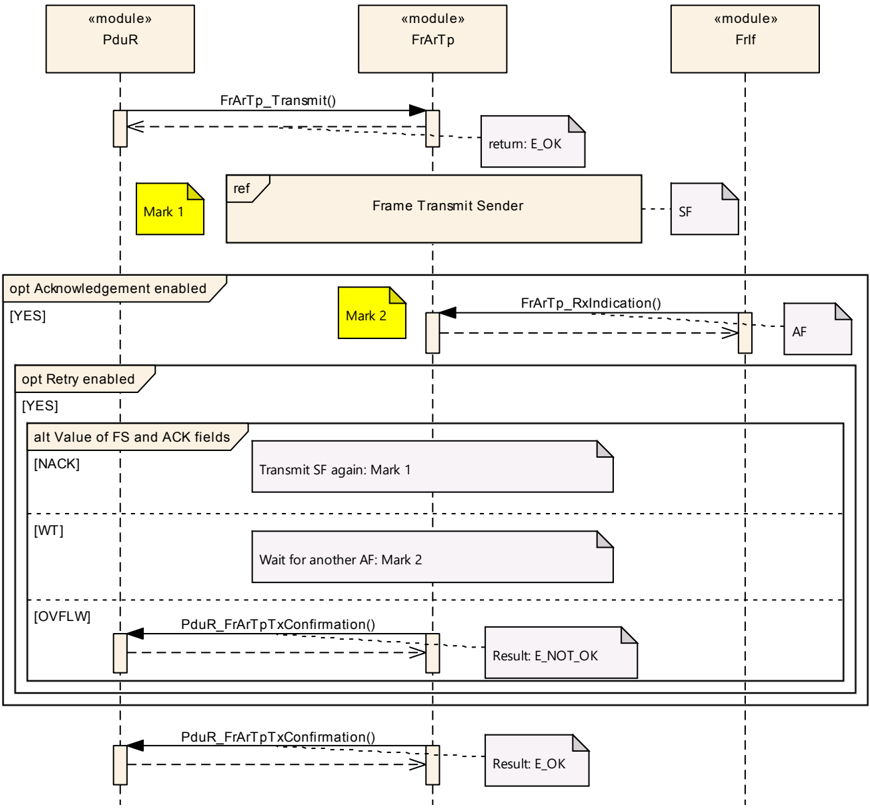

#### 9.1.2. 不带重试的分段 N-SDU 发送

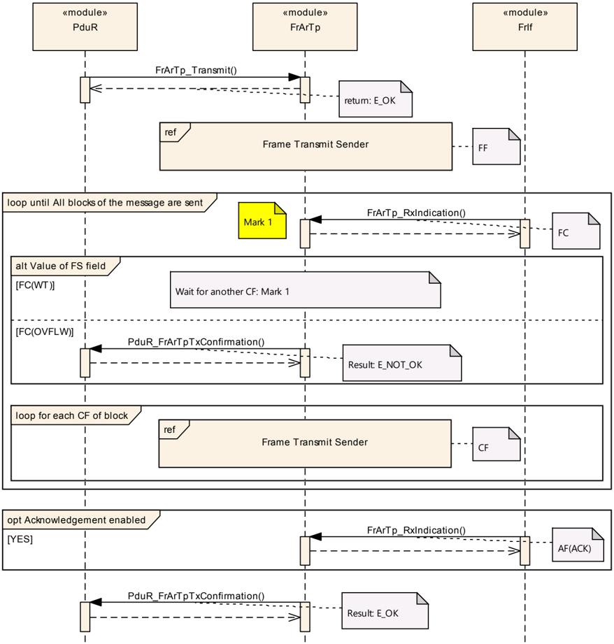

#### 9.1.3. 带重试的分段 N-SDU 发送

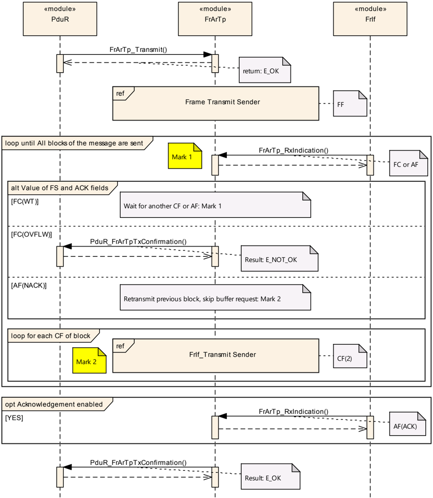

##### 9.1.3.1. N-SDU 发送期间的 N-PDU 发送

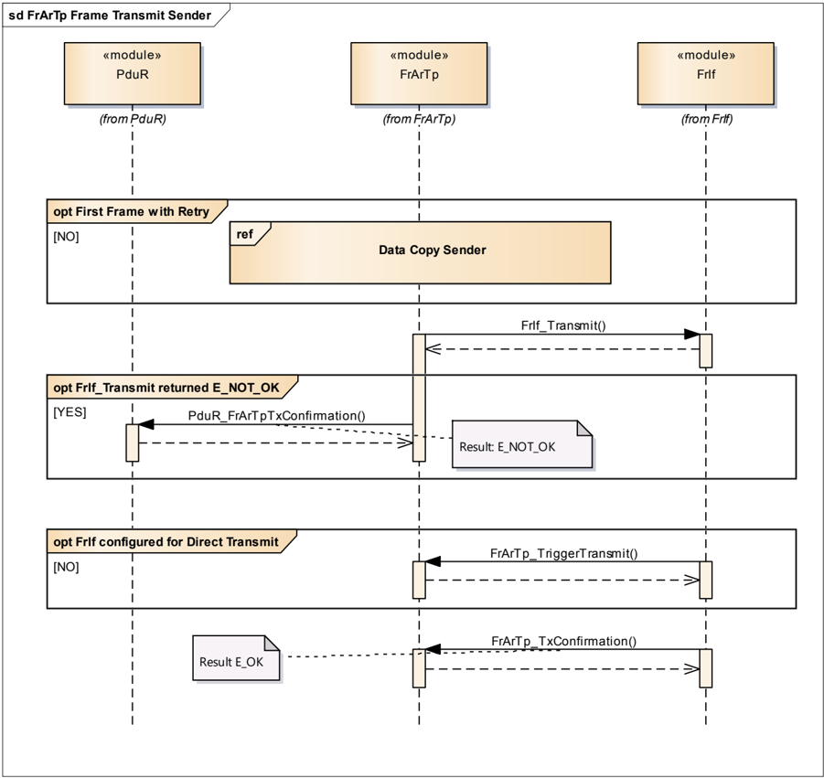

#### 9.1.4. N-SDU 发送期间的 N-PDU 数据拷贝

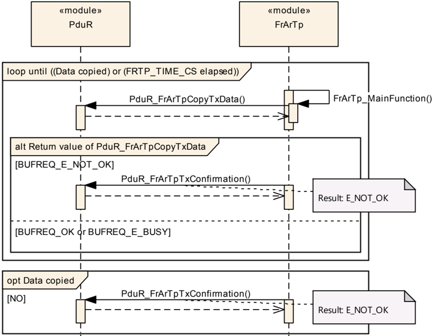

##### 9.1.4.1. 发送取消

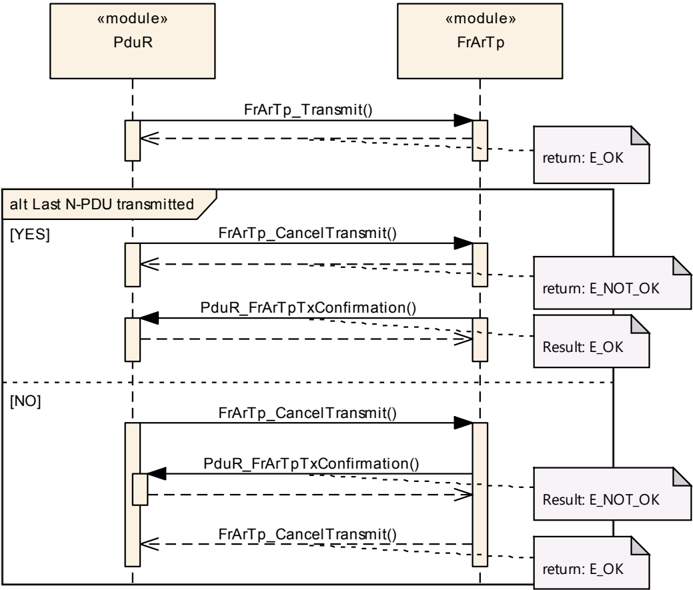

### 9.2. N-SDU 接收

#### 9.2.1. 无分段 N-SDU 接收

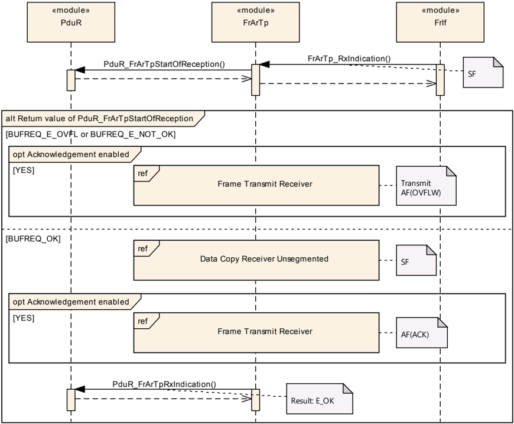

#### 9.2.2. 无分段 N-SDU 接收期间的 N-PDU 数据拷贝


#### 9.2.3. 分段 N-SDU 接收


#### 9.2.4. 分段 N-SDU 接收期间等待缓冲区

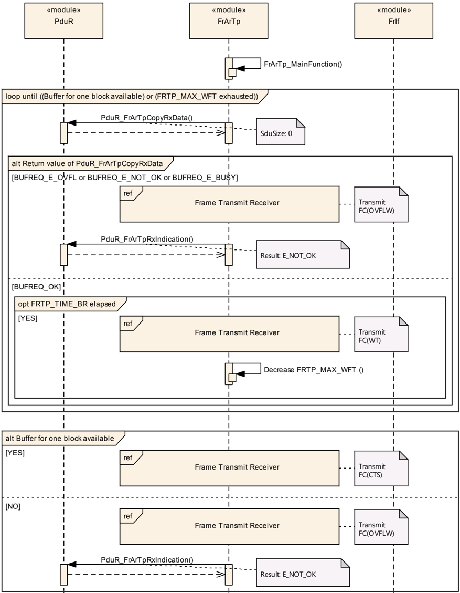

#### 9.2.5. 分段 N-SDU 接收期间的 N-PDU 数据拷贝

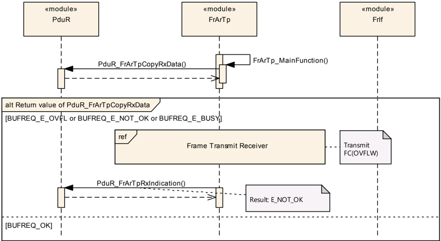

#### 9.2.6. N-SDU 接收期间的 N-PDU 发送

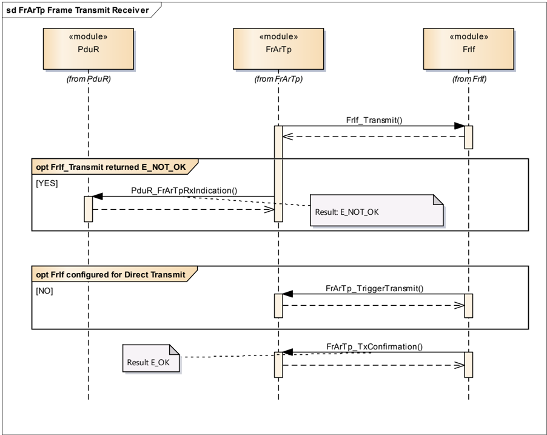

#### 9.2.7. 接收取消

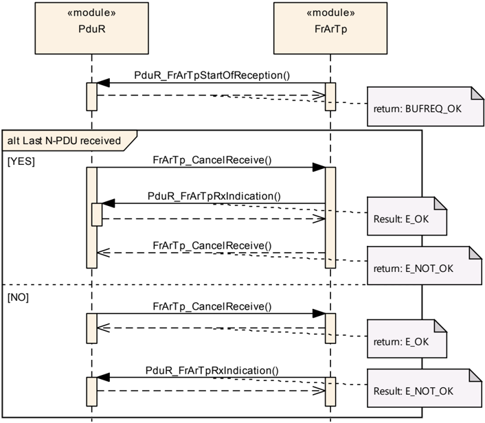

## 10. 配置规范

通常，本章定义配置参数及其到容器的聚类。

第 10.1 节和第 10.3 节指向 **SWS BSW General** 中的相应章节。

第 10.2 节规定 FlexRay AUTOSAR 传输层模块的结构（容器）和参数。

第 10.4 节规定 FlexRay AUTOSAR 传输层模块某些参数的限制。

### 10.1. 如何阅读本章

详情请参阅 SWS\_BSWGeneral 中第 10.1 节「配置规范简介（Introduction to configuration specification）」。

### 10.2. 容器和配置参数

以下各节汇总所有配置参数。这些参数的详细含义在第 7 章和第 8 章中描述。

以下图片给出了配置的概览：


图22：FrArTp 主配置（**Figure 22: FrArTp main configuration**）

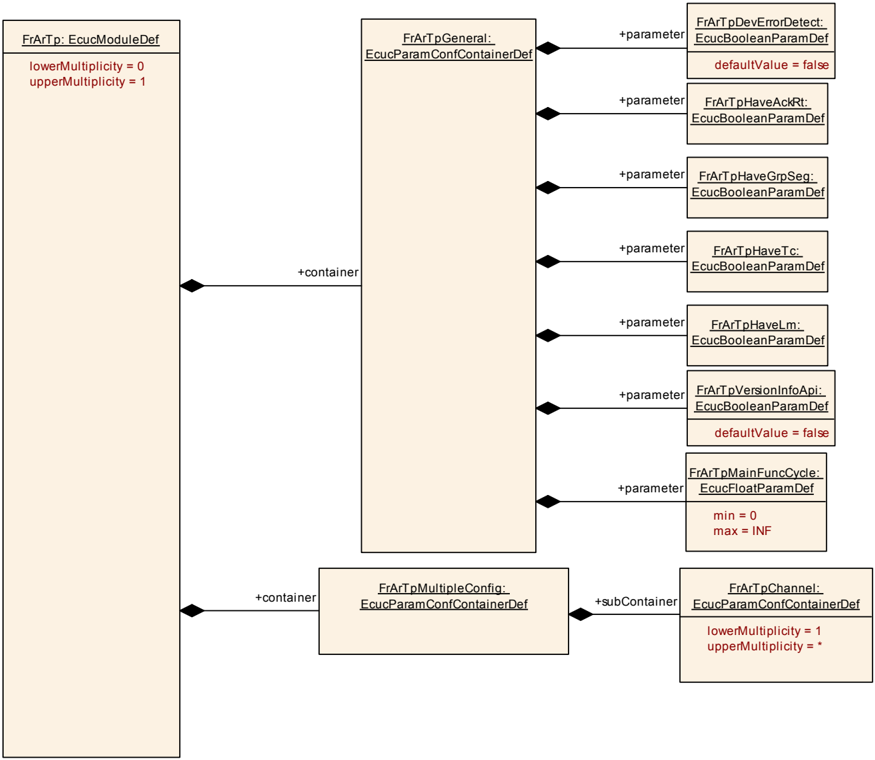

图23：FrArTpChannel 配置（**Figure 23: FrArTpChannel configuration**）

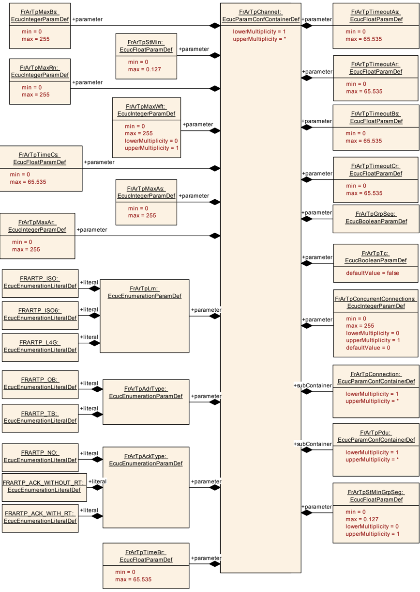

图24：FrArTpConnection 配置（**Figure 24: FrArTpConnection configuration**）
#### 9.2.1. FrArTp

| 项目 | 内容 |
| --- | --- |
| SWS 条目 | [ECUC_FrArTp_00001] |
| 容器名称 | FrArTp |
| 描述 | FrArTp（FlexRay 传输协议）模块的配置。 |
| 配置参数 | 见下方参数表 |


图10.1：FrArTp 主配置（**Figure 22: FrArTp main configuration**）

| 包含的容器 | 容器名称 | 多重性 |
| --- | --- | --- |
| 包含的容器 | FrArTpGeneral | 1 |
| 包含的容器 | FrArTpMultipleConfig | 1 |

#### 9.2.2. FrArTpGeneral

| 项目 | 内容 |
| --- | --- |
| SWS 条目 | [ECUC_FrArTp_00012] |
| 容器名称 | FrArTpGeneral |
| 父容器 | FrArTp |
| 描述 | 该容器包含 FlexRay TP 的通用配置（参数）。 |
| 配置参数 | 见下方参数表 |

无包含的容器。

| 项目 | 内容 |
| --- | --- |
| SWS 条目 | [ECUC_FrArTp_00011] |
| 参数名称 | FrArTpDevErrorDetect |
| 父容器 | FrArTpGeneral |
| 描述 | 打开或关闭开发错误检测和通知。true：启用检测和通知。false：禁用检测和通知。 |
| 多重性 | 1 |
| 类型 | EcucBooleanParamDef |
| 默认值 | false |
| Post-Build 变体值 | false |
| 值配置类 | Pre-compile time：X（All Variants）；Link time：--；Post-build time：-- |
| 作用域/依赖 | scope: local |

| 项目 | 内容 |
| --- | --- |
| SWS 条目 | [ECUC_FrArTp_00014] |
| 参数名称 | FrArTpHaveAckRt |
| 父容器 | FrArTpGeneral |
| 描述 | 用于启用确认（Acknowledgement）和重试（Retry）机制的预处理器开关。 |
| 多重性 | 1 |
| 类型 | EcucBooleanParamDef |
| 默认值 | -- |
| Post-Build 变体值 | false |
| 值配置类 | Pre-compile time：X（All Variants）；Link time：--；Post-build time：-- |
| 作用域/依赖 | scope: local |

| 项目 | 内容 |
| --- | --- |
| SWS 条目 | [ECUC_FrArTp_00015] |
| 参数名称 | FrArTpHaveGrpSeg |
| 父容器 | FrArTpGeneral |
| 描述 | 用于启用 1:n 消息分段的预处理器开关。 |
| 多重性 | 1 |
| 类型 | EcucBooleanParamDef |
| 默认值 | -- |
| Post-Build 变体值 | false |
| 值配置类 | Pre-compile time：X（All Variants）；Link time：--；Post-build time：-- |
| 作用域/依赖 | scope: local |

| 项目 | 内容 |
| --- | --- |
| SWS 条目 | [ECUC_FrArTp_00016] |
| 参数名称 | FrArTpHaveLm |
| 父容器 | FrArTpGeneral |
| 描述 | 用于启用长消息机制的预处理器开关（用于超过 ISO 15765-2 所允许长度的消息）。 |
| 多重性 | 1 |
| 类型 | EcucBooleanParamDef |
| 默认值 | -- |
| Post-Build 变体值 | false |
| 值配置类 | Pre-compile time：X（All Variants）；Link time：--；Post-build time：-- |
| 作用域/依赖 | scope: local |

| 项目 | 内容 |
| --- | --- |
| SWS 条目 | [ECUC_FrArTp_00017] |
| 参数名称 | FrArTpHaveTc |
| 父容器 | FrArTpGeneral |
| 描述 | 用于启用发送取消（Transmit Cancellation）和接收取消（Receive Cancellation）的预处理器开关。 |
| 多重性 | 1 |
| 类型 | EcucBooleanParamDef |
| 默认值 | -- |
| Post-Build 变体值 | false |
| 值配置类 | Pre-compile time：X（All Variants）；Link time：--；Post-build time：-- |
| 作用域/依赖 | scope: local |

| 项目 | 内容 |
| --- | --- |
| SWS 条目 | [ECUC_FrArTp_00020] |
| 参数名称 | FrArTpMainFuncCycle |
| 父容器 | FrArTpGeneral |
| 描述 | 该参数包含 TP 主函数的调用周期。该参数以秒为单位规定。 |
| 多重性 | 1 |
| 类型 | EcucFloatParamDef |
| 默认值 | -- |
| Post-Build 变体值 | true |
| 范围 | ]0 .. INF[ |
| 值配置类 | Pre-compile time：X（VARIANT-PRE-COMPILE）；Link time：--；Post-build time：X（VARIANT-POST-BUILD） |
| 作用域/依赖 | scope: ECU |

| 项目 | 内容 |
| --- | --- |
| SWS 条目 | [ECUC_FrArTp_00054] |
| 参数名称 | FrArTpVersionInfoApi |
| 父容器 | FrArTpGeneral |
| 描述 | 用于启用版本信息 API 的预处理器开关。 |
| 多重性 | 1 |
| 类型 | EcucBooleanParamDef |
| 默认值 | false |
| Post-Build 变体值 | false |
| 值配置类 | Pre-compile time：X（All Variants）；Link time：--；Post-build time：-- |
| 作用域/依赖 | scope: local |

#### 9.2.3. FrArTpChannel

| 项目 | 内容 |
| --- | --- |
| SWS 条目 | [ECUC_FrArTp_00005] |
| 容器名称 | FrArTpChannel |
| 父容器 | FrArTpMultipleConfig |
| 描述 | 该容器包含一个 FlexRay TP 信道的配置（参数）。 |
| 多重性配置类 | Pre-compile time：X（VARIANT-PRE-COMPILE）；Link time：--；Post-build time：X（VARIANT-POST-BUILD） |
| Post-Build 变体多重性 | true |
| 配置参数 | 见下方参数表 |

| 包含的容器 | 容器名称 | 多重性 |
| --- | --- | --- |
| 包含的容器 | FrArTpConnection | 1..* |
| 包含的容器 | FrArTpPdu | 1..* |

| 项目 | 内容 |
| --- | --- |
| SWS 条目 | [ECUC_FrArTp_00002] |
| 参数名称 | FrArTpAckType |
| 父容器 | FrArTpChannel |
| 描述 | 该参数定义用于特定信道的确认类型。 |
| 多重性 | 1 |
| 类型 | EcucEnumerationParamDef |
| Post-Build 变体值 | true |
| 范围 | FRARTP_ACK_WITHOUT_RT（确认而不重试）；FRARTP_ACK_WITH_RT（确认并重试）；FRARTP_NO（无确认） |
| 值配置类 | Pre-compile time：X（VARIANT-PRE-COMPILE）；Link time：--；Post-build time：X（VARIANT-POST-BUILD） |
| 作用域/依赖 | scope: local |

| 项目 | 内容 |
| --- | --- |
| SWS 条目 | [ECUC_FrArTp_00008] |
| 参数名称 | FrArTpAdrType |
| 父容器 | FrArTpChannel |
| 描述 | 该参数规定该信道使用的寻址类型。取值的含义是一字节寻址和两字节寻址。 |
| 多重性 | 1 |
| 类型 | EcucEnumerationParamDef |
| Post-Build 变体值 | true |
| 范围 | FRARTP_OB（一字节寻址）；FRARTP_TB（两字节寻址） |
| 值配置类 | Pre-compile time：X（VARIANT-PRE-COMPILE）；Link time：--；Post-build time：X（VARIANT-POST-BUILD） |
| 作用域/依赖 | scope: local |

| 项目 | 内容 |
| --- | --- |
| SWS 条目 | [ECUC_FrArTp_00057] |
| 参数名称 | FrArTpConcurrentConnections |
| 父容器 | FrArTpChannel |
| 描述 | 该参数定义可以同时处于活动状态的连接数量。如果设置为 0，则所有已配置的连接都可以同时处于活动状态。 |
| 多重性 | 0..1 |
| 类型 | EcucIntegerParamDef |
| 默认值 | 0 |
| Post-Build 变体多重性 | true |
| Post-Build 变体值 | true |
| 范围 | 0 .. 255 |
| 值配置类 | Pre-compile time：X（VARIANT-PRE-COMPILE）；Link time：--；Post-build time：X（VARIANT-POST-BUILD） |
| 多重性配置类 | Pre-compile time：X（VARIANT-PRE-COMPILE）；Link time：--；Post-build time：X（VARIANT-POST-BUILD） |
| 作用域/依赖 | scope: local |

| 项目 | 内容 |
| --- | --- |
| SWS 条目 | [ECUC_FrArTp_00013] |
| 参数名称 | FrArTpGrpSeg |
| 父容器 | FrArTpChannel |
| 描述 | 在此可以规定在一个 1:n 连接内是否允许分段。 |
| 多重性 | 1 |
| 类型 | EcucBooleanParamDef |
| 默认值 | -- |
| Post-Build 变体值 | true |
| 值配置类 | Pre-compile time：X（VARIANT-PRE-COMPILE）；Link time：--；Post-build time：X（VARIANT-POST-BUILD） |
| 作用域/依赖 | scope: local |

| 项目 | 内容 |
| --- | --- |
| SWS 条目 | [ECUC_FrArTp_00019] |
| 参数名称 | FrArTpLm |
| 父容器 | FrArTpChannel |
| 描述 | 该参数规定特定信道的最大消息长度。 |
| 多重性 | 1 |
| 类型 | EcucEnumerationParamDef |
| Post-Build 变体值 | true |
| 范围 | FRARTP_ISO（ISO 15765-2 兼容长度）；FRARTP_ISO6（ISO 15765-2 兼容长度，6 字节数据）；FRARTP_L4G（最大 4 GB 消息长度） |
| 值配置类 | Pre-compile time：X（VARIANT-PRE-COMPILE）；Link time：--；Post-build time：X（VARIANT-POST-BUILD） |
| 作用域/依赖 | scope: local |

| 项目 | 内容 |
| --- | --- |
| SWS 条目 | [ECUC_FrArTp_00021] |
| 参数名称 | FrArTpMaxAr |
| 父容器 | FrArTpChannel |
| 描述 | 该参数定义发生 TIMEOUT AR 时尝试发送一个帧的最大次数。 |
| 多重性 | 1 |
| 类型 | EcucIntegerParamDef |
| 默认值 | -- |
| Post-Build 变体值 | true |
| 范围 | 0 .. 255 |
| 值配置类 | Pre-compile time：X（VARIANT-PRE-COMPILE）；Link time：--；Post-build time：X（VARIANT-POST-BUILD） |
| 作用域/依赖 | scope: local |

| 项目 | 内容 |
| --- | --- |
| SWS 条目 | [ECUC_FrArTp_00022] |
| 参数名称 | FrArTpMaxAs |
| 父容器 | FrArTpChannel |
| 描述 | 该参数定义发生 TIMEOUT AS 时尝试发送一个帧的最大次数。 |
| 多重性 | 1 |
| 类型 | EcucIntegerParamDef |
| 默认值 | -- |
| Post-Build 变体值 | true |
| 范围 | 0 .. 255 |
| 值配置类 | Pre-compile time：X（VARIANT-PRE-COMPILE）；Link time：--；Post-build time：X（VARIANT-POST-BUILD） |
| 作用域/依赖 | scope: local |

| 项目 | 内容 |
| --- | --- |
| SWS 条目 | [ECUC_FrArTp_00023] |
| 参数名称 | FrArTpMaxBs |
| 父容器 | FrArTpChannel |
| 描述 | 该参数定义两个 FC 之间的连续 CF 数量（块大小）。当重试被激活时有效值为 1 .. 16，否则为 0 .. 255。 |
| 多重性 | 1 |
| 类型 | EcucIntegerParamDef |
| 默认值 | -- |
| Post-Build 变体值 | true |
| 范围 | 0 .. 255 |
| 值配置类 | Pre-compile time：X（VARIANT-PRE-COMPILE）；Link time：--；Post-build time：X（VARIANT-POST-BUILD） |
| 作用域/依赖 | scope: local |

| 项目 | 内容 |
| --- | --- |
| SWS 条目 | [ECUC_FrArTp_00026] |
| 参数名称 | FrArTpMaxRn |
| 父容器 | FrArTpChannel |
| 描述 | 该参数定义（如果为特定信道配置了重试）重试的最大次数。 |
| 多重性 | 1 |
| 类型 | EcucIntegerParamDef |
| 默认值 | -- |
| Post-Build 变体值 | true |
| 范围 | 0 .. 255 |
| 值配置类 | Pre-compile time：X（VARIANT-PRE-COMPILE）；Link time：--；Post-build time：X（VARIANT-POST-BUILD） |
| 作用域/依赖 | scope: local |

| 项目 | 内容 |
| --- | --- |
| SWS 条目 | [ECUC_FrArTp_00059] |
| 参数名称 | FrArTpMaxWft |
| 父容器 | FrArTpChannel |
| 描述 | 该参数定义为挂起的连接发送等待帧（wait frames）的最大数量。 |
| 多重性 | 0..1 |
| 类型 | EcucIntegerParamDef |
| 默认值 | -- |
| Post-Build 变体多重性 | true |
| Post-Build 变体值 | true |
| 范围 | 0 .. 255 |
| 值配置类 | Pre-compile time：X（VARIANT-PRE-COMPILE）；Link time：--；Post-build time：X（VARIANT-POST-BUILD） |
| 多重性配置类 | Pre-compile time：X（VARIANT-PRE-COMPILE）；Link time：--；Post-build time：X（VARIANT-POST-BUILD） |
| 作用域/依赖 | scope: local |

| 项目 | 内容 |
| --- | --- |
| SWS 条目 | [ECUC_FrArTp_00042] |
| 参数名称 | FrArTpStMin |
| 父容器 | FrArTpChannel |
| 描述 | 该参数以秒为单位定义 1:1 分段传输中两个相继 CF 之间的最小时间量。有效值为 0、100µs、200µs ... 900µs、1ms、2ms .. 127ms。该值可以在运行时通过 FrArTp_ChangeParameter 接口更改。FrArTpStMin 必须是循环长度与复用因子乘积的整数倍，即 FrArTpStMin = n * FrIfGdCycle * m，其中 n 是大于等于 0 的整数，m 是 PDU 池的 PDU 被调度的那些循环的循环复用因子。请注意：由于 FrArTp 的调度策略，FrArTpStMin 只能保持到由一个 FlexRay 循环内 PDU 池的 PDU 的最大时间距离所定义的程度。 |
| 多重性 | 1 |
| 类型 | EcucFloatParamDef |
| 默认值 | -- |
| Post-Build 变体值 | true |
| 范围 | [0 .. 0.127] |
| 值配置类 | Pre-compile time：X（VARIANT-PRE-COMPILE）；Link time：--；Post-build time：X（VARIANT-POST-BUILD） |
| 作用域/依赖 | scope: local |

| 项目 | 内容 |
| --- | --- |
| SWS 条目 | [ECUC_FrArTp_00060] |
| 参数名称 | FrArTpStMinGrpSeg |
| 父容器 | FrArTpChannel |
| 描述 | 该参数以秒为单位定义 1:n 分段传输中两个相继 CF 之间的最小时间量。有效值为 0、100µs、200µs ... 900µs、1ms、2ms .. 127ms。该值可以在运行时通过 FrArTp_ChangeParameter 接口更改。FrArTpStMinGrpSeg 必须是循环长度与复用因子乘积的整数倍，即 FrArTpStMinGrpSeg = n * FrIfGdCycle * m，其中 n 是大于等于 0 的整数，m 是 PDU 池的 PDU 被调度的那些循环的循环复用因子。请注意：由于 FrArTp 的调度策略，FrArTpStMinGrpSeg 只能保持到由一个 FlexRay 循环内 PDU 池的 PDU 的最大时间距离所定义的程度。 |
| 多重性 | 0..1 |
| 类型 | EcucFloatParamDef |
| 默认值 | -- |
| Post-Build 变体多重性 | true |
| Post-Build 变体值 | true |
| 范围 | [0 .. 0.127] |
| 值配置类 | Pre-compile time：X（VARIANT-PRE-COMPILE）；Link time：--；Post-build time：X（VARIANT-POST-BUILD） |
| 多重性配置类 | Pre-compile time：X（VARIANT-PRE-COMPILE）；Link time：--；Post-build time：X（VARIANT-POST-BUILD） |
| 作用域/依赖 | scope: local |

| 项目 | 内容 |
| --- | --- |
| SWS 条目 | [ECUC_FrArTp_00043] |
| 参数名称 | FrArTpTc |
| 父容器 | FrArTpChannel |
| 描述 | 通过该开关可以为该信道打开或关闭发送取消和接收取消。 |
| 多重性 | 1 |
| 类型 | EcucBooleanParamDef |
| 默认值 | false |
| Post-Build 变体值 | true |
| 值配置类 | Pre-compile time：X（VARIANT-PRE-COMPILE）；Link time：--；Post-build time：X（VARIANT-POST-BUILD） |
| 作用域/依赖 | scope: local |

| 项目 | 内容 |
| --- | --- |
| SWS 条目 | [ECUC_FrArTp_00044] |
| 参数名称 | FrArTpTimeBr |
| 父容器 | FrArTpChannel |
| 描述 | 时间约束 (FRARTP_TIMEOUT_CR + MAX_AR) &lt; FRARTP_TIMEOUT_BS 必须成立（因为块的传输必须在发送方的 BS 定时器超时之前完成）。 |
| 多重性 | 1 |
| 类型 | EcucFloatParamDef |
| 默认值 | -- |
| Post-Build 变体值 | true |
| 范围 | [0 .. 65.535] |
| 作用域/依赖 | scope: local |

| 项目 | 内容 |
| --- | --- |
| SWS 条目 | [ECUC_FrArTp_00046] |
| 参数名称 | FrArTpTimeCs |
| 父容器 | FrArTpChannel |
| 描述 | 显然，(FRARTP_TIMEOUT_AS + MAX_AS) &lt; FRARTP_TIME_CS &lt; FRARTP_TIMEOUT_CR 必须成立（因为块传输必须在接收方的 CR 定时器超时之前完成）。 |
| 多重性 | 1 |
| 类型 | EcucFloatParamDef |
| 默认值 | -- |
| Post-Build 变体值 | true |
| 范围 | [0 .. 65.535] |
| 值配置类 | Pre-compile time：X（VARIANT-PRE-COMPILE）；Link time：--；Post-build time：X（VARIANT-POST-BUILD） |
| 作用域/依赖 | scope: local |

| 项目 | 内容 |
| --- | --- |
| SWS 条目 | [ECUC_FrArTp_00048] |
| 参数名称 | FrArTpTimeoutAr |
| 父容器 | FrArTpChannel |
| 描述 | 该参数以秒为单位规定传输层在发送方等待 FlexRay 接口确认的超时（FC，即对 FC 帧的确认）。 |
| 多重性 | 1 |
| 类型 | EcucFloatParamDef |
| 默认值 | -- |
| Post-Build 变体值 | true |
| 范围 | [0 .. 65.535] |
| 值配置类 | Pre-compile time：X（VARIANT-PRE-COMPILE）；Link time：--；Post-build time：X（VARIANT-POST-BUILD） |
| 作用域/依赖 | scope: local |

| 项目 | 内容 |
| --- | --- |
| SWS 条目 | [ECUC_FrArTp_00049] |
| 参数名称 | FrArTpTimeoutAs |
| 父容器 | FrArTpChannel |
| 描述 | 该参数以秒为单位规定在发送方一侧、从传输层对当前连接所用组的首个 PDU 向 FlexRay 接口发出 PDU 发送请求，到 FlexRay 接口的相应确认（在已发送该连接所用组的最后一个 PDU 时）之间的超时（SF-x、FF-x、CF）。 |
| 多重性 | 1 |
| 类型 | EcucFloatParamDef |
| 默认值 | -- |
| Post-Build 变体值 | true |
| 范围 | [0 .. 65.535] |
| 值配置类 | Pre-compile time：X（VARIANT-PRE-COMPILE）；Link time：--；Post-build time：X（VARIANT-POST-BUILD） |
| 作用域/依赖 | scope: local |

| 项目 | 内容 |
| --- | --- |
| SWS 条目 | [ECUC_FrArTp_00050] |
| 参数名称 | FrArTpTimeoutBs |
| 父容器 | FrArTpChannel |
| 描述 | 该参数规定在发送方的分段传输中，在发送一个块的最后一个 CF 之后等待 FC 帧的超时时间（单位为秒）。 |
| 多重性 | 1 |
| 类型 | EcucFloatParamDef |
| 默认值 | -- |
| Post-Build 变体值 | true |
| 范围 | [0 .. 65.535] |
| 值配置类 | Pre-compile time：X（VARIANT-PRE-COMPILE）；Link time：--；Post-build time：X（VARIANT-POST-BUILD） |
| 作用域/依赖 | scope: local |

| 项目 | 内容 |
| --- | --- |
| SWS 条目 | [ECUC_FrArTp_00051] |
| 参数名称 | FrArTpTimeoutCr |
| 父容器 | FrArTpChannel |
| 描述 | 该参数以秒为单位定义在接收方一侧、在接收到最后一个 CF 之后或在发送 FC 或 AF 之后等待 CF 或 FF-x（重试情况下）的超时值。 |
| 多重性 | 1 |
| 类型 | EcucFloatParamDef |
| 默认值 | -- |
| Post-Build 变体值 | true |
| 范围 | [0 .. 65.535] |
| 值配置类 | Pre-compile time：X（VARIANT-PRE-COMPILE）；Link time：--；Post-build time：X（VARIANT-POST-BUILD） |
| 作用域/依赖 | scope: local |

#### 9.2.4. FrArTpPdu

| 项目 | 内容 |
| --- | --- |
| SWS 条目 | [ECUC_FrArTp_00029] |
| 容器名称 | FrArTpPdu |
| 父容器 | FrArTpChannel |
| 描述 | 保存 PDU 参数的容器。实现类型：PduInfoType |
| 多重性配置类 | Pre-compile time：X（VARIANT-PRE-COMPILE）；Link time：--；Post-build time：X（VARIANT-POST-BUILD） |
| Post-Build 变体多重性 | true |
| 配置参数 | 见下方参数表 |

无包含的容器。

| 项目 | 内容 |
| --- | --- |
| SWS 条目 | [ECUC_FrArTp_00030] |
| 参数名称 | FrArTpPduDirection |
| 父容器 | FrArTpPdu |
| 描述 | 该参数定义 PDU 的方向。 |
| 多重性 | 1 |
| 类型 | EcucEnumerationParamDef；EcucIntegerParamDef (Symbolic Name generated for this parameter) |
| 默认值 | -- |
| Post-Build 变体值 | true；false |
| 范围 | FRARTP_RX（接收）；FRARTP_TX（发送） |
| 值配置类 | Pre-compile time：X（VARIANT-PRE-COMPILE）；Link time：--；Post-build time：X（VARIANT-POST-BUILD）；Pre-compile time：X（All Variants）；Link time：--；Post-build time：-- |
| 作用域/依赖 | scope: local；scope: ECU withAuto = true |

| 项目 | 内容 |
| --- | --- |
| SWS 条目 | [ECUC_FrArTp_00036] |
| 参数名称 | FrArTpPduRef |
| 父容器 | FrArTpPdu |
| 描述 | 对全局 PDU 结构中某个 PDU 的引用。 |
| 多重性 | 1 |
| 类型 | Reference to Pdu |
| Post-Build 变体值 | true |
| 值配置类 | Pre-compile time：X（VARIANT-PRE-COMPILE）；Link time：--；Post-build time：X（VARIANT-POST-BUILD） |
| 作用域/依赖 | scope: local |

#### 9.2.5. FrArTpConnection

| 项目 | 内容 |
| --- | --- |
| SWS 条目 | [ECUC_FrArTp_00010] |
| 容器名称 | FrArTpConnection |
| 父容器 | FrArTpChannel |
| 描述 | 该容器包含一个 FlexRay TP 连接的配置（参数）。一个连接只能属于一个信道。 |
| 多重性配置类 | Pre-compile time：X（VARIANT-PRE-COMPILE）；Link time：--；Post-build time：X（VARIANT-POST-BUILD） |
| Post-Build 变体多重性 | true |
| 配置参数 | 见下方参数表 |

| 包含的容器 | 容器名称 | 多重性 |
| --- | --- | --- |
| 包含的容器 | FrArTpRxSdu | 0..1 |
| 包含的容器 | FrArTpTxSdu | 0..1 |

| 项目 | 内容 |
| --- | --- |
| SWS 条目 | [ECUC_FrArTp_00058] |
| 参数名称 | FrArTpConPrioPdus |
| 父容器 | FrArTpConnection |
| 描述 | 该参数定义该连接具有优先访问权的 TxNPdu 数量。必须确保所有连接的优先 PDU 数量之和小于相关 PDU 池中 TxNPdu 的总数。 |
| 多重性 | 0..1 |
| 类型 | EcucIntegerParamDef |
| 默认值 | 0 |
| Post-Build 变体多重性 | true |
| Post-Build 变体值 | true |
| 范围 | 0 .. 255 |
| 值配置类 | Pre-compile time：X（VARIANT-PRE-COMPILE）；Link time：--；Post-build time：X（VARIANT-POST-BUILD） |
| 多重性配置类 | Pre-compile time：X（VARIANT-PRE-COMPILE）；Link time：--；Post-build time：X（VARIANT-POST-BUILD） |
| 作用域/依赖 | scope: local |

| 项目 | 内容 |
| --- | --- |
| SWS 条目 | [ECUC_FrArTp_00018] |
| 参数名称 | FrArTpLa |
| 父容器 | FrArTpConnection |
| 描述 | 该参数定义相应连接的本地地址（Local Address）。当本地实例是发送方时，它是 TP 帧内的源地址（Source Address）。当本地实例是接收方时，它是 TP 帧内的目标地址（Target Address）。注意，在一字节寻址的情况下只有 0x0000 - 0x00FF 的值是有效的。如果未配置该参数，则所有相关的 Rx N-SDU 必须被配置为使用元数据项 TARGET_ADDRESS_16，并且所有相关的 Tx N-SDU 必须被配置为使用元数据项 SOURCE_ADDRESS_16。 |
| 多重性 | 0..1 |
| 类型 | EcucIntegerParamDef |
| 默认值 | -- |
| Post-Build 变体值 | true |
| 范围 | 0 .. 65535 |
| 值配置类 | Pre-compile time：X（VARIANT-PRE-COMPILE）；Link time：--；Post-build time：X（VARIANT-POST-BUILD） |
| 作用域/依赖 | scope: local |

| 项目 | 内容 |
| --- | --- |
| SWS 条目 | [ECUC_FrArTp_00027] |
| 参数名称 | FrArTpMultRec |
| 父容器 | FrArTpConnection |
| 描述 | 该参数定义该连接是否为 1:n（「true」）连接。当然，1:n 连接不具有重试或确认机制。 |
| 多重性 | 1 |
| 类型 | EcucBooleanParamDef |
| 默认值 | -- |
| Post-Build 变体值 | true |
| 值配置类 | Pre-compile time：X（VARIANT-PRE-COMPILE）；Link time：--；Post-build time：X（VARIANT-POST-BUILD） |
| 作用域/依赖 | scope: local |

| 项目 | 内容 |
| --- | --- |
| SWS 条目 | [ECUC_FrArTp_00037] |
| 参数名称 | FrArTpRa |
| 父容器 | FrArTpConnection |
| 描述 | 该参数定义相应连接的远程地址（Remote Address）。当本地实例是发送方时，它是 TP 帧内的目标地址（Target Address）。当本地实例是接收方时，它是 TP 帧内的源地址（Source Address）。注意，在一字节寻址的情况下只有 0x0000 - 0x00FF 的值是有效的。如果未配置该参数，则必须使用元数据项。 |
| 多重性 | 0..1 |
| 类型 | EcucIntegerParamDef |
| 默认值 | -- |
| Post-Build 变体值 | true |
| 范围 | 0 .. 65535 |
| 值配置类 | Pre-compile time：X（VARIANT-PRE-COMPILE）；Link time：--；Post-build time：X（VARIANT-POST-BUILD） |
| 作用域/依赖 | scope: local |

#### 9.2.6. FrArTpTxSdu

| 项目 | 内容 |
| --- | --- |
| SWS 条目 | [ECUC_FrArTp_00055] |
| 容器名称 | FrArTpTxSdu |
| 父容器 | FrArTpConnection |
| 描述 | 描述 Tx N-SDU。该 N-SDU 可以使用类型为 SOURCE_ADDRESS_16 和 TARGET_ADDRESS_16 的元数据项。 |
| 多重性配置类 | Pre-compile time：X（VARIANT-PRE-COMPILE）；Link time：--；Post-build time：X（VARIANT-POST-BUILD） |
| Post-Build 变体多重性 | true |
| 配置参数 | 见下方参数表 |

无包含的容器。

| 项目 | 内容 |
| --- | --- |
| SWS 条目 | [ECUC_FrArTp_00041] |
| 参数名称 | FrArTpSduTxId |
| 父容器 | FrArTpTxSdu |
| 描述 | 这是经由 PDU Router 发送的 N-SDU 的唯一标识符。上层（例如 DCM）可以借助该标识符（例如通过查找表）恰当地标识连接，而无需处理传输层的特殊性。该参数也可以看作是传输层连接的标识符。实现类型：PduIdType |
| 多重性 | 1 |
| 类型 | EcucIntegerParamDef (Symbolic |
| 默认值 | -- |
| Post-Build 变体值 | false |
| 范围 | 0 .. 65535 |
| 作用域/依赖 | scope: ECU withAuto = true |

| 项目 | 内容 |
| --- | --- |
| SWS 条目 | [ECUC_FrArTp_00052] |
| 参数名称 | FrArTpTxSduRef |
| 父容器 | FrArTpTxSdu |
| 描述 | 对全局 PDU 结构中某个 PDU 的引用。 |
| 多重性 | 1 |
| 类型 | Reference to Pdu |
| Post-Build 变体值 | true |
| 值配置类 | Pre-compile time：X（VARIANT-PRE-COMPILE）；Link time：--；Post-build time：X（VARIANT-POST-BUILD） |
| 作用域/依赖 | scope: local |

#### 9.2.7. FrArTpRxSdu

| 项目 | 内容 |
| --- | --- |
| SWS 条目 | [ECUC_FrArTp_00038] |
| 容器名称 | FrArTpRxSdu |
| 父容器 | FrArTpConnection |
| 描述 | 描述 Rx N-SDU。该 N-SDU 可以产生类型为 SOURCE_ADDRESS_16 和 TARGET_ADDRESS_16 的元数据项。 |
| 多重性配置类 | Pre-compile time：X（VARIANT-PRE-COMPILE）；Link time：--；Post-build time：X（VARIANT-POST-BUILD） |
| Post-Build 变体多重性 | true |
| 配置参数 | 见下方参数表 |

无包含的容器。

| 项目 | 内容 |
| --- | --- |
| SWS 条目 | [ECUC_FrArTp_00039] |
| 参数名称 | FrArTpRxSduRef |
| 父容器 | FrArTpRxSdu |
| 描述 | 对全局 PDU 结构中某个 PDU 的引用。 |
| 多重性 | 1 |
| 类型 | Reference to Pdu |
| Post-Build 变体值 | true |
| 值配置类 | Pre-compile time：X（VARIANT-PRE-COMPILE）；Link time：--；Post-build time：X（VARIANT-POST-BUILD） |
| 作用域/依赖 | scope: local |

#### 9.2.8. FrArTpMultipleConfig

| 项目 | 内容 |
| --- | --- |
| SWS 条目 | [ECUC_FrArTp_00028] |
| 容器名称 | FrArTpMultipleConfig |
| 描述 | 该容器包含 AUTOSAR FrArTp 模块的配置参数和子容器。 |
| 配置参数 | 见下方参数表 |

| 包含的容器 | 容器名称 | 多重性 |
| --- | --- | --- |
| 包含的容器 | FrArTpChannel | 1..* |

### 10.3. 发布信息

详情请参阅 SWS\_BSWGeneral 中第 10.3 节「发布信息（Published Information）」。

### 10.4. 配置中的重要事项

#### 10.4.1. 时序参数的启动和停止

表4给出了这些参数中的每一个何时开始计时以及何时停止的概览。注意，如果提到 SF-x，则指已配置确认的情况（AF 同理）。

对于 1:n 连接，只有参数 FrArTpTimeoutAs、FrArTpTimeCs（仅 CF）和 FrArTpTimeoutCr（仅 CF）适用，因为在这种情况下不允许流控制或确认。

表4：不同超时和时间的启动与停止（**Start and Stop of the different timeouts and times**）

| 时序参数 | 启动 | 停止 |
| --- | --- | --- |
| FrArTpTimeoutAs | FrIf_Transmit（当前连接所用组的首个 PDU） | FrArTp_TxConfirmation（针对当前连接所用组的最后一个 PDU） |
| FrArTpTimeoutAr | FrIf_Transmit（FC 或 AF） | FrArTp_TxConfirmation（FC 或 AF） |
| FrArTpTimeoutBs | FrArTp_TxConfirmation（SF-x、FF-x 或块的最后一个 CF）、FrArTp_RxIndication（FC 或 AF，两者都在 FR_FS = WAIT 的情况下） | FrArTp_RxIndication（FC 或 AF） |
| FrArTpTimeBr | FrArTp_RxIndication（FF-x、块的最后一个 CF 或 SF-x）、FrArTp_TxConfirmation（FC 或 AF，两者都在 FR_FS = WAIT 的情况下） | FrIf_Transmit（FC 或 AF） |
| FrArTpTimeoutCr | FrArTp_RxIndication（CF）、FrArTp_TxConfirmation（FC 或 AF） | FrArTp_RxIndication（CF 或 SF-x、FF-x（后两者在重试情况下）） |
| FrArTpTimeCs | FrArTp_TxConfirmation（CF）、FrArTp_RxIndication（FC 或 AF（不是在最后一个之后）） | FrIf_Transmit（CF） |

#### 10.4.2. 如何获得符合 ISO 15765-2 的信道/连接

要在信道/连接内实现 ISO 15765-2 符合性，某些参数存在限制。标记有「*」的那些只在特性被编译进代码时才相关（参见第 10.2 节）。

这些在下表中解释：

表5：ISO 15765-2 符合性的参数设置（**Parameter Setting for ISO 15765-2 compliance**）

| 参数 | 允许的取值 |
| --- | --- |
| FrArTpAckType (*) | FRARTP_NO |
| FrArTpGrpSeg (*) | false |
| FrArTpTc (*) | false |
| FrArTpLm (*) | FRARTP_ISO、FRARTP_ISO6 |
| N-PDU 长度 | 9 [FrArTpAdrType == FRARTP_OB, FrArTpLm == FRARTP_ISO6]、10 [FrArTpAdrType == FRARTP_OB, FrArTpLm == FRARTP_ISO]、11 [FrArTpAdrType == FRARTP_TB, FrArTpLm == FRARTP_ISO6]、12 [FrArTpAdrType == FRARTP_TB, FrArTpLm == FRARTP_ISO] |

所有未提到的参数可以取任意值。

#### 10.4.3. 参数之间的依赖关系

连接特定配置参数与信道特定配置参数之间存在若干依赖关系：

* 如果 FrArTpMultRec 将连接设置为 1:1 连接，则 FrArTpGrpSeg 的值对该连接不起作用，因为它只与 1:n 连接相关。
* 如果 FrArTpMultRec 将连接设置为 1:n 连接，则 FrArTpAckType、FrArTpMaxBs 和 FrArTpMaxRn 的值对该连接不起作用，因为它们只与 1:1 连接相关。
* 如果 FrArTpMultRec 将连接设置为 1:n 连接，或 FrArTpAckType 未激活重试（FRARTP\_NO、FRARTP\_ACK\_WITHOUT\_RT），则 FrArTpMaxBs 的值对该连接不起作用，因为它只在启用了重试的信道内的 1:1 连接中相关。

#### 10.4.4. 时序约束

以下约束应适用于时序参数：

```
[SWS_FrArTp_00242] VE + FrArTpTimeBr + (FrArTpTimeoutAr * FrArTpMaxAr) + VS < FrArTpTimeoutBs
[SWS_FrArTp_00243] Vs + FrArTpTimeCs + (FrArTpTimeoutAs * FrArTpMaxAs) + VE < FrArTpTimeoutCr
```

其中 VE 是从启动 BS 定时器到接收方 TP 识别出该帧的时间，VS 是从启动 CR 定时器到发送方 TP 识别出该帧的时间。

#### 10.4.5. 对 FlexRay AUTOSAR 传输层的配置要求

必须确保 FrArTpStMin &lt; FrArTpTimeoutCr，因为否则后者总会发生超时。

连接和信道的配置在发送方和接收方两侧当然应当相同。只有 FrArTpLa 和 FrArTpRa 的值相互对调。

如果一个信道引用了某个方向（接收或发送）的一个同时也被另一个信道引用的 **PDU**，则这两个信道必须为该方向引用完全相同的 **PDU** 集合。该限制确保了被引用 **PDU** 的池语义。

一个 **PDU** 池的所有 **PDU** 必须具有相同的大小，并且引用这些 **PDU** 的所有信道必须具有相同的寻址类型。

在与一个 **PDU** 池相关联的连接集合中，任何两个连接都不得具有相同的地址信息，即使是地址对调也不行。

与一个 **PDU** 池相关联的所有连接的优先 **PDU** 数量之和必须小于该池中 **PDU** 的数量；否则，一组活动的优先连接可能导致其他连接超时。

#### 10.4.6. 对 FlexRay 接口的配置要求

如果一个连接内的一个 N-SDU 使用了多于一个 N-PDU，则 FrIf 应保证这些 N-PDU（L-SDU）按照 FlexRay AUTOSAR 传输层使用它们的顺序被调度（经由总线发送），即按照 FlexRay AUTOSAR 传输层中使用的 N-PDU ID 的升序。为了简化配置，一个池的所有 **PDU** 应被安排为总是以它们被发送的相同顺序被接收，而与 FlexRay 通信轮中的当前循环无关。

这是必要的，以避免分段传输中 CF 乱序到达。

对于每个 FrArTp L-SDU，应激活 FrIf 的 PDU 更新/有效信息，除非它是帧中的唯一 **PDU**。

这是必要的，以避免 FrArTp 在当前传输中未使用的 N-PDU 上收到 Rx 指示，或例如在每第 2 个 FlexRay 总线循环调度一个 N-PDU 的情况下收到 Rx 指示。

对于每个 **PDU** 池的最后一个 **PDU**（按时间顺序），应配置一个 TxConfirmation。
