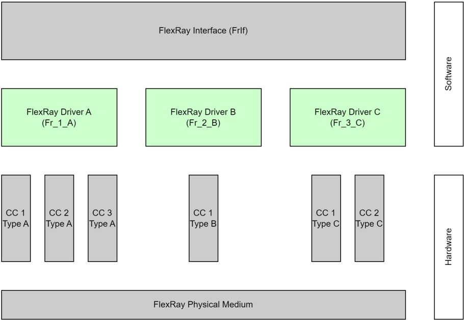
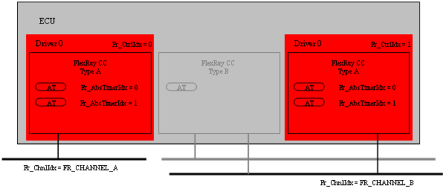
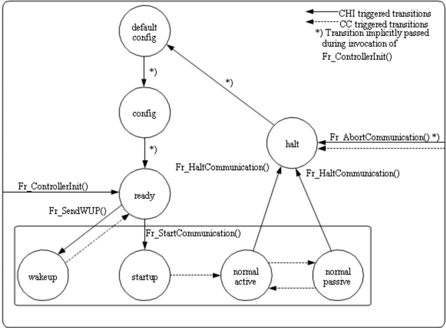

## 1. 简介和功能概述

本规范描述 **AUTOSAR** 基础软件模块 **FlexRay Driver**（**Fr**）的功能、**API** 和配置。

**FlexRay Driver** 抽象了特定 FlexRay 通信控制器（**CC**）的硬件相关实现细节。本规范基本上依赖于符合 FlexRay 规范 [\[1\]](#ref-1) 的 FlexRay CC。此外，本规范也支持符合 FlexRay 规范 [\[2\]](#ref-2) 的较旧 FlexRay 控制器。由所支持的 FlexRay 规范不同而导致的本 SWS 中的不同行为，会在适用之处以脚注或注释的形式指出。

FlexRay 控制器的所有受支持特性都封装在 **Fr** 模块内，并且应当只通过该统一接口访问。这些 **API** 提供抽象的功能操作，这些操作根据实际实现的 **Fr** 模块被映射为一个硬件访问序列。这样，作为 **Fr** 模块使用者的 **FlexRay Interface**（**FrIf**）就独立于底层的 FlexRay CC 硬件。**Fr** 模块没有 Main 函数或 **ISR**。所有 **Fr** 模块 **API** 函数都只在 **FrIf** 的上下文中执行。

单个 **Fr** 模块只支持单一类型的 FlexRay CC 硬件实现。**Fr** 支持该单一硬件实现的多个 FlexRay CC。**FlexRay Driver** 的前缀按 **Fr** 模块唯一分配，以允许使用不同的、以命名空间分隔名称的 **FlexRay Driver**。**FrIf** 可以使用不同的 **FlexRay Driver** 访问不同的 FlexRay CC 硬件实现。**FrIf** 的配置决定使用不同类型中的哪个驱动程序来访问特定的 **CC**。

**Fr** 模块的配置应在系统配置时完成，**Fr** 模块的特定配置由模块配置生成器（**MCG**）生成，它将 **ECU** 配置参数中的参数转换为 **Fr** 模块特定的配置数据结构。

图 1.1 描绘了 FlexRay 协议栈的基本结构。一个 **FrIf** 使用一个或多个 **FlexRay Driver** 访问多个 **CC**。



## 2. 缩略语

以下术语表列出了与 **FlexRay Driver** 模块相关、但未包含在 [\[3\]](#ref-3)（**AUTOSAR** 术语表）中的首字母缩略词和缩略语。

**API**
> 应用编程接口（**Application Programming Interface**）。

**AUTOSAR**
> Automotove Open Systems Architecture（汽车开放系统架构）。

**BSW**
> 基础软件（**Basic Software**）。

**DEM/Dem**
> AUTOSAR 模块：诊断事件管理器（**Diagnostic Event Manager**）。

**DET/Det**
> AUTOSAR 模块：默认错误跟踪器（**Default Error Tracer**）。

**ECU**
> 电子控制单元（**Electronic Control Unit**）。

**MCG**
> 模块配置生成器（**Module Configuration Generator**）。

**CC**
> 通信控制器（**Communication Controller**）。

**CHI**
> 控制器主机接口（**Controller Host Interface**）。

**FIFO**
> 先进先出缓冲区（**First In First Out buffer**）。

**Fr**
> AUTOSAR 模块：FlexRay 驱动程序（**FlexRay Driver**）。

**FrIf**
> AUTOSAR 模块：FlexRay 接口（**FlexRay Interface**）。

**FrTp**
> AUTOSAR 模块：FlexRay 传输协议（**FlexRay Transport Protocol**）。

**FrTrcv**
> AUTOSAR 模块：FlexRay 收发器驱动程序（**FlexRay Transceiver Driver**）。

**ID/Id**
> 标识符（**Identifier**）。

**ISR**
> 中断服务程序（**Interrupt Service Routine**）。

**LPdu**
> 数据链路层协议数据单元（**Datalink layer Protocol Datagram Unit**）。

**MCAL**
> 微控制器抽象层（**Microcontroller Abstraction Layer**）。

**MCU**
> 微控制器单元（**Microcontroller Unit**）。

**MISRA**
> Motor Industry Software Reliability Association（汽车工业软件可靠性协会）。

**NIT**
> FlexRay 网络空闲时间（**FlexRay Network Idle Time**）。

**n/a**
> 不适用（**Not Applicable**）。

**OS**
> 操作系统（**Operating System**）。

**PLL**
> 锁相环（**Phase Locked Loop**）。

**POC**
> 协议运行控制（**Protocol Operation Control**，详情参见 [\[1\]](#ref-1)）。

**POCState**
> **CC** 内部的 **POC** 实际状态。该状态在某些情况下可能与 vPOC!State 不同，例如在 FREEZE 命令调用之后（详情参见 [\[1\]](#ref-1)）。

**SchM**
> AUTOSAR 模块：调度管理器（**Schedule Manager**）。

**SRS**
> 系统需求规范（**System Requirements Specification**）。

**SW**
> 软件（**SoftWare**）。

**SW-C**
> 软件组件（**SoftWare Component**）。

**vPOC**
> **CC** 在 **CHI** 处提供给主机的数据结构，包含 **CC** 的实际 **POC** 状态（详情参见 [\[1\]](#ref-1)）。

**XML**
> 可扩展标记语言（**Extensible Markup Language**）。

### 2.1. 术语

**absolute timer（绝对定时器）**
> 绝对定时器被设置为 FlexRay 集群的一个绝对全局时间并由其触发。FlexRay 全局时间由一个周期（cycle）和一个宏节拍（macrotick）偏移量组成。

**buffer（缓冲区）**
> 在 **Fr** SWS 的上下文中，缓冲区描述一个硬件发送/接收资源，它是 FlexRay 控制器的一部分，被映射到一个 FlexRay 槽（slot）、信道（channel）、循环（cycle）用于发送或接收。

**cluster（集群）**
> 多个相互连接的节点构成的通信系统。

**Macrotick（宏节拍）**
> 宏节拍表示 FlexRay 集群全局同步时间的最小单位。

**Synchronized（同步）**
> 只要以下条件成立，就认为 FlexRay **CC** 与其所连接的 FlexRay 集群同步：((!vPOC!Freeze) && (vPOC!State == NORMAL_ACTIVE) || (vPOC!State == NORMAL_PASSIVE))。

## 3. 相关文档

### 3.1. 输入文件和相关标准与规范

<a id="ref-1"></a>[1] ISO 17458-1:2013, Road vehicles - FlexRay communication system
> https://www.iso.org

<a id="ref-2"></a>[2] FlexRay Communications System Protocol Specification V2.1
> http://www.flexray.com/

<a id="ref-3"></a>[3] Glossary
> AUTOSAR_FO_TR_Glossary

<a id="ref-4"></a>[4] General Specification of Basic Software Modules
> AUTOSAR_CP_SWS_BSWGeneral

<a id="ref-5"></a>[5] Specification of Standard Types
> AUTOSAR_CP_SWS_StandardTypes

<a id="ref-6"></a>[6] Specification of FlexRay Interface
> AUTOSAR_CP_SWS_FlexRayInterface

### 3.2. 相关规范

**AUTOSAR** 提供了一份基础软件模块通用规范 [\[4\]](#ref-4)，它对 **FlexRay Driver** 同样有效。

因此，规范 **SWS BSW General** 应被视为 **FlexRay Driver** 的附加且必需的规范。

## 4. 约束和假设

### 4.1. 限制

在每个 FlexRay 通信循环的动态段中，FlexRay 通信控制器的每个发送/接收缓冲区只能用于一个特定的 **LPdu**。这限制了重新配置的可能性，从而将每个动态段可传输（发送和接收）的 **LPdu** 数量限制为连接到一个集群的所有发送/接收缓冲区的总数（在一个 **ECU** 上的所有 **CC** 上累加）。这一限制源于 **LPdu** 在动态段内发送时间的不可预测性。因此，无法预先确定在动态段内为多次使用而重新配置某个缓冲区的时间点。

### 4.2. 汽车域的适用性

FlexRay 通信协议栈可用于任何需要高数据速率和容错通信（结合 [\[1\]](#ref-1)）的场合。此外，它还支持车内多个 **ECU** 的同步运行。

## 5. 对其他模块的依赖

本章列出与 **Fr** 模块交互的模块。

使用 **Fr** 模块的模块：

* **FrIf** 是 **Fr** 模块唯一的使用者（由 **EcuM** 进行的初始化除外）。它使用 **Fr** 模块以统一且抽象的方式访问可能不同的 FlexRay 通信控制器。
* **EcuM** 通过调用 [**Fr_Init**](#741-fr_init) 初始化 **Fr** 模块。

**Fr** 模块使用的模块：

* 当需要时，**Fr** 模块应使用 **BSW** 调度程序的机制来保证数据一致性。

其他模块依赖：

* 在某些系统上，**CC** 可能与其他组件（例如 **MCU**）共享资源，并可能依赖它们的配置。如果这些资源在其他模块的作用范围内（例如 **PLL** 配置、内存映射），则 **Fr** 模块不配置这些组件，而是要求它们的初始化先于 **Fr** 模块的初始化。

### 5.1. 文件结构

本节概述正确实现 **Fr** 模块所需的文件及其关系。请注意，文件结构并未完全规定，但实现至少应使用本节给出的文件和文件结构。

#### 5.1.1. 代码文件结构

代码文件结构不应在本规范内完全定义。

#### 5.1.2. 头文件结构

文件 **Fr.h** 应包含 **Fr** 模块环境所需的全部类型和函数原型。

**Fr_GeneralTypes.h** 应包含 **AUTOSAR** FlexRay 模块 **Fr**、**FrIf** 和 **FrTrcv** 之间共享的所有类型和常量。

## 6. 功能规格

### 6.1. 一般描述

单个 **Fr** 模块提供一种统一的方式来使用 FlexRay **CC** 的特性，而与 **CC** 的实现无关，从而对上层隐藏实际的硬件实现（寄存器、缓冲区等）。

**Fr** 模块将抽象的功能请求映射为 **CC** 特定的硬件访问序列。

所有 **API** 服务的详细描述见第 [7](#7-api规范) 章。

### 6.2. 实现需求

本章列出 **Fr** 模块实现应满足的需求。

**Fr** 模块的实现者应在实现期间将 **Fr** 规范中的所有前缀 **Fr** 替换为供应商特定的前缀 Fr_&lt;Vendor Id&gt;_&lt;Vendor specific name&gt;，以允许在一个构建系统中使用不同的 **FlexRay Driver**。**Fr** 模块的实现者应将此规则应用于文件名、**Fr** 模块特定数据类型、**Fr** 模块特定常量、**Fr** 模块特定全局变量和 **API** 函数中的所有前缀。

**Fr** 模块应将 **Fr** SWS 规定的 **API** 函数实现为真实的 **C** 代码函数，不得将 **API** 函数实现为宏。

上面规定的理由是允许目标代码模块集成。

**Fr** 模块的任何头文件都不得定义全局变量。

**Fr** 模块或底层硬件（或两者）应在失去同步的情况下停止 FlexRay 定时器。

实现可以假定：

* 在系统正常运行的情况下，**Fr** 模块的环境应同步于 FlexRay 全局时间（在预定的确定时间点）调用所有基于 **LPdu** 的服务（**[Fr_TransmitTxLPdu](#7411-fr_transmittxlpdu)()**、**[Fr_ReceiveRxLPdu](#7413-fr_receiverxlpdu)()**、**[Fr_CheckTxLPduStatus](#7414-fr_checktxlpdustatus)()**、**[Fr_PrepareLPdu](#7415-fr_preparelpdu)()**）。
* **Fr** 模块的环境可以在任何时间调用所有非基于 **LPdu** 的服务，而不依赖于 FlexRay 全局时间。

### 6.3. 索引方案

**Fr** 的使用者使用图 7.1 所描绘的索引方案来标识 **Fr** 资源。



可用的 **Fr** 资源如下：

**CC** 通过控制器索引（**Fr_CtrlIdx**）标识。

每个驱动程序的 **CC** 由控制器索引 0 到 (n-1) 标识，其中 n 是特定 **Fr** 所控制的 **CC** 数量。

对于每个 FlexRay **CC**，所连接的信道由信道索引（**Fr_ChnlIdx**）标识。

一个专用类型用于表示信道索引，它持有枚举 **FR_CHANNEL_A**、**FR_CHANNEL_B** 或 **FR_CHANNEL_AB**。

信道索引仅在元组 &lt;Fr_CtrlIdx, Fr_ChnlIdx&gt; 内有效。

**Fr API** 函数处理的每个 FlexRay 帧由一个 **LPdu** 索引（**Fr_LPduIdx**）标识。

每个 **LPdu** 携带 **LSdu**。每个控制器的 **LPdu** 由 **LPdu** 索引 0 到 (n-1) 标识，其中 n 是相应 **CC** 处理的 **LPdu** 数量。

**LPdu** 索引仅在元组 &lt;Fr_CtrlIdx, Fr_LPduIdx&gt; 内有效。

**Fr_LPduIdx** 作为一个键唯一地标识 FlexRay 帧的以下参数：{Slot ID、信道、循环重复（cycle repetition）、基础循环（base cycle）、发送/接收}。

每个 FlexRay **CC** 都包含绝对定时器。绝对 FlexRay 定时器通过绝对定时器索引（**Fr_AbsTimerIdx**）标识。

每个 **CC** 的绝对定时器由绝对定时器索引 0 到 (n-1) 标识，其中 n 是特定 **CC** 控制的绝对定时器数量。

绝对定时器索引仅在元组 &lt;Fr_CtrlIdx, Fr_AbsTimerIdx&gt; 内有效。

**FlexRay Driver** 的编号方案（图 7.1）按每个驱动程序为基础为这些项分配索引。注意，只有由一个特定 **Fr** 模块处理的 FlexRay **CC**（即示例中的类型 A 的 FlexRay **CC**）才在该 **Fr** 模块的上下文中被分配索引。所有其他 **CC**（例如类型 B 的 FlexRay **CC**）不由该 **Fr** 模块处理，因此在该 **Fr** 模块的上下文中没有为这些 FlexRay **CC** 分配索引。

### 6.4. POC 状态机控制

由于 FlexRay **CC** 是基于条件的，其内部维护着一个状态机，即协议运行控制（**POC**）状态机。状态转换既由硬件相关的事件驱动，也由主机在 **CHI** 处传递的命令驱动（详情参见 [\[1\]](#ref-1)）。

驱动 **POC** 状态机的 **CHI** 命令被合并到几个 **Fr** 模块 **API** 函数中。影响 FlexRay **CC** 的 **POC** 状态的 **API** 函数有：

* **[Fr_StartCommunication](#743-fr_startcommunication)()**
* **[Fr_HaltCommunication](#746-fr_haltcommunication)()**
* **[Fr_AbortCommunication](#747-fr_abortcommunication)()**
* **[Fr_SendWUP](#748-fr_sendwup)()**
* **[Fr_ControllerInit](#742-fr_controllerinit)()**

上述之外的所有 **API** 函数不得改变 FlexRay **CC** 的 **POC** 状态。图 7.2 展示了 FlexRay **CC** 的 **POC** 状态以及适用于 **Fr** 模块 **API** 函数的转换。注意：

* 某些转换（标有 *）通过调用单个 **API** 函数（**[Fr_ControllerInit](#742-fr_controllerinit)()**）执行。
* 某些转换可能由 FlexRay **CC** 在没有外部命令调用的情况下隐式执行（虚线箭头）。
* 规定的某些转换无法由当前的 **Fr** 模块 **API** 执行（未在图 3 中绘制——与 [\[1\]](#ref-1) 比较）。



### 6.5. FIFO 支持和消息 ID 过滤

为了在某些用例中高效地支持接收，FlexRay 控制器可能支持接收 **FIFO**。接收 **FIFO** 根据一组已配置的过滤条件在硬件中接纳 FlexRay 帧，这些条件匹配 FlexRay 特定属性（如 frameID、循环、信道）以及协议附加项（如消息 **ID**）。

如果已配置的 **FIFO** 过滤条件可以应用于硬件 **FIFO**，则应使用硬件接收 **FIFO**。

匹配某个接收 **FIFO** 过滤条件的所有 **LPdu**（如 **FrIf** 中所配置）应被分配给相应的接收 **FIFO**。

分配给接收 **FIFO** 的 **LPdu** 不应被分配任何特定的缓冲区。

如果对分配给接收 **FIFO** 的 **LPdu** 调用了 **[Fr_ReceiveRxLPdu](#7413-fr_receiverxlpdu)()**，则该服务 **Fr_ReceiveRxPdu()** 从相应的 **FIFO** 中取出第一个有效帧并将其作为接收到的帧返回。不存在 **FIFO** 特定的接收 **API**，因此上层不受影响。

**提示：** 这种受限的接收 **FIFO** 实现覆盖了一个非常典型的用例（**FrTp**）：

* 分配给 **FIFO** 的所有已接收 (L)Pdu 应由单个上层模块处理。
* 上层不关心 (L)Pdu 到 FlexRay FrameTriggering 的具体分配。

经由 **FIFO** 接收的 **LPdu** 应按照它们在 FlexRay 网络上被接收的相同顺序返回。

### 6.6. 配置描述

**Fr** 模块应提供一个 **XML** 文件，其中包含软件标识和配置参数所需的数据。如果适用，该文件应描述供应商特定的配置参数。

驱动程序 **MCG** 读取 **Fr** 和 **FrIf** 模块的 **ECU** 配置参数。集群相关的配置参数包含在 **FrIf** 模块的配置中，而 **CC** 相关的配置参数包含在 **Fr** 模块的配置中。**Fr** 模块的特定配置工具应读取这两个 **ECU** 模块配置，以推导出映射到 **Fr** 模块的所有 FlexRay **CC** 的配置参数。

所有与帧发送/接收相关的配置参数只位于 **FrIf** 模块描述中（在配置容器「FrIfLPdu」和「FrIfFrameTriggering」内）。**Fr** 必须能够处理所有相关 **LPdu** 的所有发送/接收请求。**FrIf** 配置中的 **LPdu** 既包含传递给 **Fr API** 的 **LPduIdx**，也包含一个指向 frame triggering 的链接，该 frame triggering 持有 **LPdu** 到 FlexRay 网络的链接（到槽、信道、循环的分配）。

与帧发送和接收相关的 **CC** 配置参数应从该 **CC** 在 **FrIf** 中所映射到的通信矩阵推导。

出于优化目的，**Fr MCG** 应读取 **FrIf** 作业列表，以检测 **FrIf** 将在哪些时间点同步地调用 **Fr** 上的某些操作（**FrIf** 配置参数参见 [\[6\]](#ref-6)）。

基于这些调用时间，**Fr MCG** 可以决定进行某些用于发送和接收的资源对齐优化（在多个 **LPdu** 之间共享缓冲区）。

如果 **FrIf** 作业列表包含允许优化的专用缓冲区重配置条目，则 **Fr** 模块的 **MCG** 可以决定在静态段内为多个 **LPdu** 共享一个缓冲区。

如果一个 **LPdu** 是动态可重配置的（「FrIfReconfigurable」设置为 true），则 **MCG** 应决定为这些 **LPdu** 分配一个独占的硬件报文缓冲区。

**Fr MCG** 应了解 **CC** 和相应驱动程序的能力，因此该工具被称为驱动程序依赖的。

如果 **Fr MCG** 无法将所有所需的通信操作映射到可用资源，则它必须报告该冲突。

所支持的 FlexRay **CC** 的数量在配置时定义。

**MCG** 应确保生成的配置的一致性。

**Fr** 模块应支持预编译期和 Post-build 期配置类。

这些配置类到配置参数的分配见第 [9](#9-配置规范) 章。

**提示：** 软件配置本身的描述不属于本规范，它是高度实现特定的。

所有 **Fr** 相关配置参数的详细描述在本文档的第 [9](#9-配置规范) 章中规定。此外，还应评估 **FrIf** 的配置参数（参见 [\[6\]](#ref-6) 的第 10 章）以进行 **Fr** 模块配置。

### 6.7. 错误分类

《基础软件模块通用规范》（**General Specification of Basic Software Modules**）[\[4\]](#ref-4) 的「错误处理」一节详细描述了基础软件的错误处理。最重要的是，它构成了一个由可能发生在 **BSW** 模块中的五种错误类型组成的分类方案。

在此基础上，以下各节规定了安排在相应小节中的特定错误。

#### 6.7.1. 开发错误

| 错误类型 | 相关错误代码 | 错误值 |
|---|---|---|
| 参数定时器索引超过可用定时器的数量 | FR_E_INV_TIMER_IDX | 0x01 |
| 参数列表中出现无效指针 | FR_E_PARAM_POINTER | 0x02 |
| 参数偏移量超出边界 | FR_E_INV_OFFSET | 0x03 |
| 无效的控制器索引 | FR_E_INV_CTRL_IDX | 0x04 |
| 无效的信道索引 | FR_E_INV_CHNL_IDX | 0x05 |
| 参数循环超过 63 | FR_E_INV_CYCLE | 0x06 |
| Fr 模块未初始化 | FR_E_INIT_FAILED | 0x08 |
| 载荷长度参数具有无效取值 | FR_E_INV_LENGTH | 0x0A |
| 无效的 LPdu 索引 | FR_E_INV_LPDU_IDX | 0x0B |
| 无效的 FlexRay 头 CRC | FR_E_INV_HEADERCRC | 0x0C |
| 作为参数 Fr_ConfigParamIdx 传递的取值无效 | FR_E_INV_CONFIG_IDX | 0x0D |
| 无效的帧列表大小取值 | FR_E_INV_FRAMELIST_SIZE | 0x0E |

#### 6.7.2. 运行时错误

| 错误类型 | 相关错误代码 | 错误值 |
|---|---|---|
| Fr CC 未处于预期的 POC 状态 | FR_E_INV_POCSTATE | 0x09 |

#### 6.7.3. 瞬态故障

没有瞬态故障。

#### 6.7.4. 生产错误

没有生产错误。

#### 6.7.5. 扩展生产错误

| 错误名称 | FR_E_CTRL_TESTRESULT [_&lt;Fr_CtrlIdx&gt;] |
|---|---|
| 简短描述 | FlexRay 控制器硬件错误。 |
| 详细描述 | 该扩展生产错误指示 FlexRay 通信控制器的硬件错误。请注意，该扩展生产错误不涉及在网络上检测到的 FlexRay 协议错误。 |
| 检测标准 | **Fail**：每个访问 FlexRay 控制器硬件寄存器的 **API** 函数都可能检测到设备相对于设备规范的不良行为。**Pass**：在 FlexRay 通信控制器初始化期间（函数 [Fr_ControllerInit](#742-fr_controllerinit)()），硬件寄存器的正常运行得到成功验证。 |
| 次要参数 | 在设备运行验证成功的情况下（函数 [Fr_ControllerInit](#742-fr_controllerinit)()），报告 **PASS**。 |
| 所需时间 | 如果发生 FlexRay 控制器硬件错误，应立即作为错误报告。 |
| 监控频率 | 持续。 |

| 错误名称 | FR_E_LPDU_SLOTSTATUS [_&lt;LPduIdx&gt;] |
|---|---|
| 简短描述 | FlexRay 协议通信错误。 |
| 详细描述 | 该生产错误指示网络上特定 **LPdu** 的 FlexRay 协议通信错误。 |
| 检测标准 | **Fail**：每当 FlexRay 槽状态带有以下至少一个处于活动状态的 FlexRay 协议错误时：vSS!SyntaxError、vSS!ContentError、vSS!Bviolation。**Pass**：每当 FlexRay 槽状态不带以下任何一个处于活动状态的 FlexRay 协议错误时：vSS!SyntaxError、vSS!ContentError、vSS!Bviolation。 |
| 次要参数 | 生产错误事件的检测仅在进行 FlexRay 通信期间处于活动状态。 |
| 所需时间 | 检测特定槽中的明显 FlexRay 协议错误所需的时间在很大程度上取决于实际 FlexRay 槽的周期，因而取决于 FlexRay 协议配置参数。 |
| 监控频率 | 持续。 |

### 6.8. 安全事件

本模块不报告安全事件。

## 7. API规范

所有 **API** 函数或全局变量（无论是否被规定）都应遵循命名方案 Fr_&lt;name&gt;，其中 &lt;name&gt; 中每个单词的首字母大写，其余字母小写。

在规定 **API** 函数时应用了以下准则：

* **Fr** 模块的 **API** 函数应具有返回类型 **Std_ReturnType** 或 **void**（无返回码）。
* 如果 **Fr** 模块的 **API** 函数具有返回类型 **Std_ReturnType**，且函数成功执行其服务，则它应返回 **E_OK**，否则返回 **E_NOT_OK**。
* 如果 **Fr** 模块的环境通过引用传递输入参数，则 **Fr** SWS 应使用 const 限定符（const type *）来保证它不改变输入参数。
* 对于输出参数，将用于存储参数的内存地址作为实参传递。
* 如果 **Fr** 模块的 **API** 函数成功完成（返回 **E_OK**），则所有输出参数都应以有效值写入。
* 如果 **Fr** 模块的 **API** 函数错误地完成（返回 **E_NOT_OK**），则不应写入任何输出参数。在这种情况下，输出参数应保持其原始取值。

### 7.1. 导入的类型

在本章中，列出了从以下文件包含的所有类型。

**Fr** 模块的导入数据类型定义

| 模块 | 头文件 | 导入的类型 |
|---|---|---|
| Dem | Rte_Dem_Type.h | Dem_EventIdType |
| Dem | Rte_Dem_Type.h | Dem_EventStatusType |
| Std | Std_Types.h | Std_ReturnType |
| Std | Std_Types.h | Std_VersionInfoType |

### 7.2. 宏定义

#### 7.2.1. 配置参数索引宏

下表列出了宏，这些宏列出可以传递给 **API** 函数 **[Fr_ReadCCConfig](#7432-fr_readccconfig)()** 作为参数 **Fr_ConfigParamIdx** 的符号名（参见第 [7.4.32](#7432-fr_readccconfig) 章）。

每个宏（索引）唯一地标识一个配置参数，可以使用 **[Fr_ReadCCConfig](#7432-fr_readccconfig)()** 从控制器的配置中读出该参数的取值。

| 宏名 | 取值 | 映射到的配置参数 |
|---|---|---|
| FR_CIDX_GDCYCLE | 0 | FrIfGdCycle |
| FR_CIDX_PMICROPERCYCLE | 1 | FrPMicroPerCycle |
| FR_CIDX_PDLISTENTIMEOUT | 2 | FrPdListenTimeout |
| FR_CIDX_GMACROPERCYCLE | 3 | FrIfGMacroPerCycle |
| FR_CIDX_GDMACROTICK | 4 | FrIfGdMacrotick |
| FR_CIDX_GNUMBEROFMINISLOTS | 5 | FrIfGNumberOfMinislots |
| FR_CIDX_GNUMBEROFSTATICSLOTS | 6 | FrIfGNumberOfStaticSlots |
| FR_CIDX_GDNIT | 7 | FrIfGdNit |
| FR_CIDX_GDSTATICSLOT | 8 | FrIfGdStaticSlot |
| FR_CIDX_GDWAKEUPRXWINDOW | 9 | FrIfGdWakeupRxWindow |
| FR_CIDX_PKEYSLOTID | 10 | FrPKeySlotId |
| FR_CIDX_PLATESTTX | 11 | FrPLatestTx |
| FR_CIDX_POFFSETCORRECTIONOUT | 12 | FrPOffsetCorrectionOut |
| FR_CIDX_POFFSETCORRECTIONSTART | 13 | FrPOffsetCorrectionStart |
| FR_CIDX_PRATECORRECTIONOUT | 14 | FrPRateCorrectionOut |
| FR_CIDX_PSECONDKEYSLOTID | 15 | FrPSecondKeySlotId |
| FR_CIDX_PDACCEPTEDSTARTUPRANGE | 16 | FrPdAcceptedStartupRange |
| FR_CIDX_GCOLDSTARTATTEMPTS | 17 | FrIfGColdStartAttempts |
| FR_CIDX_GCYCLECOUNTMAX | 18 | FrIfGCycleCountMax |
| FR_CIDX_GLISTENNOISE | 19 | FrIfGListenNoise |
| FR_CIDX_GMAXWITHOUTCLOCKCORRECTFATAL | 20 | FrIfGMaxWithoutClockCorrectFatal |
| FR_CIDX_GMAXWITHOUTCLOCKCORRECTPASSIVE | 21 | FrIfGMaxWithoutClockCorrectPassive |
| FR_CIDX_GNETWORKMANAGEMENTVECTORLENGTH | 22 | FrIfGNetworkManagementVectorLength |
| FR_CIDX_GPAYLOADLENGTHSTATIC | 23 | FrIfGPayloadLengthStatic |
| FR_CIDX_GSYNCFRAMEIDCOUNTMAX | 24 | FrIfGSyncFrameIDCountMax |
| FR_CIDX_GDACTIONPOINTOFFSET | 25 | FrIfGdActionPointOffset |
| FR_CIDX_GDBIT | 26 | FrIfGdBit |
| FR_CIDX_GDCASRXLOWMAX | 27 | FrIfGdCasRxLowMax |
| FR_CIDX_GDDYNAMICSLOTIDLEPHASE | 28 | FrIfGdDynamicSlotIdlePhase |
| FR_CIDX_GDMINISLOTACTIONPOINTOFFSET | 29 | FrIfGdMiniSlotActionPointOffset |
| FR_CIDX_GDMINISLOT | 30 | FrIfGdMinislot |
| FR_CIDX_GDSAMPLECLOCKPERIOD | 31 | FrIfGdSampleClockPeriod |
| FR_CIDX_GDSYMBOLWINDOW | 32 | FrIfGdSymbolWindow |
| FR_CIDX_GDSYMBOLWINDOWACTIONPOINTOFFSET | 33 | FrIfGdSymbolWindowActionPointOffset |
| FR_CIDX_GDTSSTRANSMITTER | 34 | FrIfGdTssTransmitter |
| FR_CIDX_GDWAKEUPRXIDLE | 35 | FrIfGdWakeupRxIdle |
| FR_CIDX_GDWAKEUPRXLOW | 36 | FrIfGdWakeupRxLow |
| FR_CIDX_GDWAKEUPTXACTIVE | 37 | FrIfGdWakeupTxActive |
| FR_CIDX_GDWAKEUPTXIDLE | 38 | FrIfGdWakeupTxIdle |
| FR_CIDX_PALLOWPASSIVETOACTIVE | 39 | FrPAllowPassiveToActive |
| FR_CIDX_PCHANNELS | 40 | FrPChannels |
| FR_CIDX_PCLUSTERDRIFTDAMPING | 41 | FrPClusterDriftDamping |
| FR_CIDX_PDECODINGCORRECTION | 42 | FrPDecodingCorrection |
| FR_CIDX_PDELAYCOMPENSATIONA | 43 | FrPDelayCompensationA |
| FR_CIDX_PDELAYCOMPENSATIONB | 44 | FrPDelayCompensationB |
| FR_CIDX_PMACROINITIALOFFSETA | 45 | FrPMacroInitialOffsetA |
| FR_CIDX_PMACROINITIALOFFSETB | 46 | FrPMacroInitialOffsetB |
| FR_CIDX_PMICROINITIALOFFSETA | 47 | FrPMicroInitialOffsetA |
| FR_CIDX_PMICROINITIALOFFSETB | 48 | FrPMicroInitialOffsetB |
| FR_CIDX_PPAYLOADLENGTHDYNMAX | 49 | FrPPayloadLengthDynMax |
| FR_CIDX_PSAMPLESPERMICROTICK | 50 | FrPSamplesPerMicrotick |
| FR_CIDX_PWAKEUPCHANNEL | 51 | FrPWakeupChannel |
| FR_CIDX_PWAKEUPPATTERN | 52 | FrPWakeupPattern |
| FR_CIDX_PDMICROTICK | 53 | FrPdMicrotick |
| FR_CIDX_GDIGNOREAFTERTX | 54 | FrIfGdIgnoreAfterTx |
| FR_CIDX_PALLOWHALTDUETOCLOCK | 55 | FrPAllowHaltDueToClock |
| FR_CIDX_PEXTERNALSYNC | 56 | FrPExternalSync |
| FR_CIDX_PFALLBACKINTERNAL | 57 | FrPFallBackInternal |
| FR_CIDX_PKEYSLOTONLYENABLED | 58 | FrPKeySlotOnlyEnabled |
| FR_CIDX_PKEYSLOTUSEDFORSTARTUP | 59 | FrPKeySlotUsedForStartup |
| FR_CIDX_PKEYSLOTUSEDFORSYNC | 60 | FrPKeySlotUsedForSync |
| FR_CIDX_PNMVECTOREARLYUPDATE | 61 | FrPNmVectorEarlyUpdate |
| FR_CIDX_PTWOKEYSLOTMODE | 62 | FrPTwoKeySlotMode |

### 7.3. 类型定义

**Fr_GeneralTypes.h** 的内容应通过一个 FR_GENERAL_TYPES define 加以保护。

如果使用了不同的 FlexRay 驱动程序，则在源代码树中只需包含该文件的一个实例。在实现中，应考虑前述文档中所有与 **Fr_GeneralTypes.h** 相关的类型。

所有类型（无论是规定的还是实现相关的）都应遵循命名方案 Fr_&lt;name&gt;Type，其中 &lt;name&gt; 中每个单词的首字母大写，其余字母小写。

#### 7.3.1. Fr_ConfigType

结构类型（**Structure**）。该类型包含实现特定的 Post-build 配置结构。可通过**Fr.h**获得。

上面规定的命名前缀替换规则应应用于 **Fr_ConfigType**。

#### 7.3.2. Fr_POCStateType

枚举类型（**Enumeration**）。该形式化定义指代 [\[1\]](#ref-1) 第 2.2.1.3 章「POC status」中类型 T_POCState 的描述。可通过**Fr_GeneralTypes.h**获得。

* **FR_POCSTATE_CONFIG**（0x00）：表示形式化类型定义 T_POCState 中的字面量 CONFIG。
* **FR_POCSTATE_DEFAULT_CONFIG**（0x01）：表示形式化类型定义 T_POCState 中的字面量 DEFAULT_CONFIG。
* **FR_POCSTATE_HALT**（0x02）：表示形式化类型定义 T_POCState 中的字面量 HALT。
* **FR_POCSTATE_NORMAL_ACTIVE**（0x03）：表示形式化类型定义 T_POCState 中的字面量 NORMAL_ACTIVE。
* **FR_POCSTATE_NORMAL_PASSIVE**（0x04）：表示形式化类型定义 T_POCState 中的字面量 NORMAL_PASSIVE。
* **FR_POCSTATE_READY**（0x05）：表示形式化类型定义 T_POCState 中的字面量 READY。
* **FR_POCSTATE_STARTUP**（0x06）：表示形式化类型定义 T_POCState 中的字面量 STARTUP。
* **FR_POCSTATE_WAKEUP**（0x07）：表示形式化类型定义 T_POCState 中的字面量 WAKEUP。

#### 7.3.3. Fr_SlotModeType

枚举类型（**Enumeration**）。该形式化定义指代 [\[1\]](#ref-1) 第 2.2.1.3 章「POC status」中类型 T_SlotMode 的描述。可通过**Fr_GeneralTypes.h**获得。

* **FR_SLOTMODE_KEYSLOT**（0x00）：表示形式化类型定义 T_SlotMode 中的字面量 KEYSLOT。
* **FR_SLOTMODE_ALL_PENDING**（0x01）：表示形式化类型定义 T_SlotMode 中的字面量 ALL_PENDING。
* **FR_SLOTMODE_ALL**（0x02）：表示形式化类型定义 T_SlotMode 中的字面量 ALL。

**注意：** 对于符合 FlexRay 2.1 Rev A 的 FlexRay 控制器，参见 [\[2\]](#ref-2) 中的字面量 SINGLESLOT 而非 KEYSLOT。

#### 7.3.4. Fr_ErrorModeType

枚举类型（**Enumeration**）。该形式化定义指代 [\[1\]](#ref-1) 第 2.2.1.3 章「POC status」中类型 T_ErrorMode 的描述。可通过**Fr_GeneralTypes.h**获得。

* **FR_ERRORMODE_ACTIVE**（0x00）：表示形式化类型定义 T_ErrorMode 中的字面量 ACTIVE。
* **FR_ERRORMODE_PASSIVE**（0x01）：表示形式化类型定义 T_ErrorMode 中的字面量 PASSIVE。
* **FR_ERRORMODE_COMM_HALT**（0x02）：表示形式化类型定义 T_ErrorMode 中的字面量 COMM_HALT。

#### 7.3.5. Fr_WakeupStatusType

枚举类型（**Enumeration**）。该形式化定义指代 [\[1\]](#ref-1) 第 2.2.1.3 章「POC status」中类型 T_WakeupStatus 的描述。可通过**Fr_GeneralTypes.h**获得。

* **FR_WAKEUP_UNDEFINED**（0x00）：表示形式化类型定义 T_WakeupStatus 中的字面量 UNDEFINED。
* **FR_WAKEUP_RECEIVED_HEADER**（0x01）：表示形式化类型定义 T_WakeupStatus 中的字面量 RECEIVED_HEADER。
* **FR_WAKEUP_RECEIVED_WUP**（0x02）：表示形式化类型定义 T_WakeupStatus 中的字面量 RECEIVED_WUP。
* **FR_WAKEUP_COLLISION_HEADER**（0x03）：表示形式化类型定义 T_WakeupStatus 中的字面量 COLLISION_HEADER。
* **FR_WAKEUP_COLLISION_WUP**（0x04）：表示形式化类型定义 T_WakeupStatus 中的字面量 COLLISION_WUP。
* **FR_WAKEUP_COLLISION_UNKNOWN**（0x05）：表示形式化类型定义 T_WakeupStatus 中的字面量 COLLISION_UNKNOWN。
* **FR_WAKEUP_TRANSMITTED**（0x06）：表示形式化类型定义 T_WakeupStatus 中的字面量 TRANSMITTED。

#### 7.3.6. Fr_StartupStateType

枚举类型（**Enumeration**）。该形式化定义指代 [\[1\]](#ref-1) 第 2.2.1.3 章「POC status」中类型 T_StartupState 的描述。可通过**Fr_GeneralTypes.h**获得。

* **FR_STARTUP_UNDEFINED**（0x00）：表示形式化类型定义 T_StartupState 中的字面量 UNDEFINED。
* **FR_STARTUP_COLDSTART_LISTEN**（0x01）：表示形式化类型定义 T_StartupState 中的字面量 COLDSTART_LISTEN。
* **FR_STARTUP_INTEGRATION_COLDSTART_CHECK**（0x02）：表示形式化类型定义 T_StartupState 中的字面量 INTEGRATION_COLDSTART_CHECK。
* **FR_STARTUP_COLDSTART_JOIN**（0x03）：表示形式化类型定义 T_StartupState 中的字面量 COLDSTART_JOIN。
* **FR_STARTUP_COLDSTART_COLLISION_RESOLUTION**（0x04）：表示形式化类型定义 T_StartupState 中的字面量 COLDSTART_COLLISION_RESOLUTION。
* **FR_STARTUP_COLDSTART_CONSISTENCY_CHECK**（0x05）：表示形式化类型定义 T_StartupState 中的字面量 COLDSTART_CONSISTENCY_CHECK。
* **FR_STARTUP_INTEGRATION_LISTEN**（0x06）：表示形式化类型定义 T_StartupState 中的字面量 INTEGRATION_LISTEN。
* **FR_STARTUP_INITIALIZE_SCHEDULE**（0x07）：表示形式化类型定义 T_StartupState 中的字面量 INITIALIZE_SCHEDULE。
* **FR_STARTUP_INTEGRATION_CONSISTENCY_CHECK**（0x08）：表示形式化类型定义 T_StartupState 中的字面量 INTEGRATION_CONSISTENCY_CHECK。
* **FR_STARTUP_COLDSTART_GAP**（0x09）：表示形式化类型定义 T_StartupState 中的字面量 COLDSTART_GAP。
* **FR_STARTUP_EXTERNAL_STARTUP**（0x0a）：表示形式化类型定义 T_StartupState 中的字面量 EXTERNAL_STARTUP。

**注意：** **Fr_StartupStateType** 包含 FlexRay 2.1 和 FlexRay 3.0 规范的超集。因此，在符合 FlexRay 2.1 的 FlexRay 控制器上无法到达状态 **FR_STARTUP_EXTERNAL_STARTUP**。

#### 7.3.7. Fr_POCStatusType

结构类型（**Structure**）。该形式化定义指代 [\[1\]](#ref-1) 第 2.2.1.3 章「POC status」中类型 T_POCStatus 的描述。元素：

| 元素 | 类型 | 说明 |
|---|---|---|
| CHIHaltRequest | boolean | - |
| ColdstartNoise | boolean | - |
| ErrorMode | [Fr_ErrorModeType](#734-fr_errormodetype) | - |
| Freeze | boolean | - |
| SlotMode | [Fr_SlotModeType](#733-fr_slotmodetype) | - |
| StartupState | [Fr_StartupStateType](#736-fr_startupstatetype) | - |
| State | [Fr_POCStateType](#732-fr_pocstatetype) | - |
| WakeupStatus | [Fr_WakeupStatusType](#735-fr_wakeupstatustype) | - |
| CHIReadyRequest | boolean | - |

可通过**Fr_GeneralTypes.h**获得。

#### 7.3.8. Fr_TxLPduStatusType

枚举类型（**Enumeration**）。这些取值用于确定一个 **LPdu** 是否已被发送。可通过**Fr_GeneralTypes.h**获得。

* **FR_TRANSMITTED**（0x00）：LPdu 已被发送。
* **FR_TRANSMITTED_CONFLICT**（0x01）：发生了发送冲突。
* **FR_NOT_TRANSMITTED**（0x02）：LPdu 未被发送。

#### 7.3.9. Fr_RxLPduStatusType

枚举类型（**Enumeration**）。这些取值用于确定一个 **LPdu** 是否已被接收。可通过**Fr_GeneralTypes.h**获得。

* **FR_RECEIVED**（0x00）：LPdu 已被接收。
* **FR_NOT_RECEIVED**（0x01）：LPdu 未被接收。
* **FR_RECEIVED_MORE_DATA_AVAILABLE**（0x02）：LPdu 已被接收。该 LPdu 的更多实例可用（**FIFO** 使用）。

#### 7.3.10. Fr_ChannelType

枚举类型（**Enumeration**）。这些取值用于引用 **CC** 上的信道。变体：-。可通过**Fr_GeneralTypes.h**获得。

* **FR_CHANNEL_A**（0x01）：指代 **CC** 的信道 A。
* **FR_CHANNEL_B**（0x02）：指代 **CC** 的信道 B。
* **FR_CHANNEL_AB**（0x03）：指代 **CC** 的两个信道（A 和 B）。

#### 7.3.11. Fr_SlotAssignmentType

结构类型（**Structure**）。元素：

| 元素 | 类型 | 说明 |
|---|---|---|
| Cycle | uint8 | 帧被发送/接收所在的循环。 |
| SlotId | uint16 | 帧的 Slot ID。 |
| channelId | [Fr_ChannelType](#7310-fr_channeltype) | 帧的信道。 |

可通过**Fr_GeneralTypes.h**获得。

### 7.4. 函数定义

#### 7.4.1. Fr_Init

**说明**: 初始化 **Fr**。可通过**Fr.h**获得。本服务为同步调用，不可重入。参数 Fr_ConfigPtr（in）：指向一个 **Fr** 依赖配置结构的地址，该结构包含后续运行 **Fr** 所需的全部信息。返回值：无。

```C
void Fr_Init ( const Fr_ConfigType* Fr_ConfigPtr )
```

函数 **Fr_Init()** 的 **CC** 前置条件：无。

函数 **Fr_Init()** 应在内部存储配置地址，使后续的 **API** 调用能够访问该配置。

#### 7.4.2. Fr_ControllerInit

**说明**: 初始化一个 FlexRay CC。可通过**Fr.h**获得。本服务为同步调用；对同一设备不可重入。参数 Fr_CtrlIdx（in）：**FlexRay Driver** 上下文中 FlexRay CC 的索引。返回值：Std_ReturnType，E_OK：API 调用成功完成；E_NOT_OK：API 调用因错误而中止。

```C
Std_ReturnType Fr_ControllerInit ( uint8 Fr_CtrlIdx )
```

函数 **Fr_ControllerInit()** 应在 FlexRay CC Fr_CtrIdx 上执行以下任务：

1. 将 **CC** 切换到「POC:config」（从任何其他 POCState）。
2. 配置所有 FlexRay 集群和节点配置参数（例如循环长度、宏节拍持续时间）。
3. 根据 **FrIf** 中包含的 frame triggering 配置参数配置所有发送/接收资源（例如缓冲区初始化）。
4. 将 **CC** 切换到「POC:ready」。
5. 返回 **E_OK**。

函数 **Fr_ControllerInit()** 的 **CC** 后置条件：**CC** Fr_CtrlIdx 应被留在 POCState「POC:ready」。

函数 **Fr_ControllerInit()** 应确保没有发送请求挂起。

函数 **Fr_ControllerInit()** 应确保没有接收指示挂起。

函数 **Fr_ControllerInit()** 应确保没有中断挂起。

函数 **Fr_ControllerInit()** 应确保所有定时器被禁用。

函数 **Fr_ControllerInit()** 应确保所有中断被禁用。

函数 **Fr_ControllerInit()** 应禁用所有动态可重配置的 **LPdu**（参见 **[Fr_ReconfigLPdu](#7416-fr_reconfiglpdu)()**、**[Fr_DisableLPdu](#7417-fr_disablelpdu)()**）。

如果函数 **Fr_ControllerInit()** 在测试 **CC**（**CC** 测试）时检测到错误，则它应将测试过程重复可配置的次数（**FrCtrlTestCount**）。如果所有测试都失败，则它调用 Dem_SetEventStatus()（[**FR_E_CTRL_TESTRESULT**](#675-扩展生产错误)，DEM_EVENT_STATUS_FAILED）并返回 **E_NOT_OK**。

**CC** 测试应验证（读回并与配置中保存的参考值比较）节点和集群 FlexRay 参数被正确写入 FlexRay **CC**。

如果函数 **Fr_ControllerInit()** 在可配置的次数（**FrCtrlTestCount**）内通过了 **CC** 测试，则它调用 Dem_SetEventStatus()（[**FR_E_CTRL_TESTRESULT**](#675-扩展生产错误)，DEM_EVENT_STATUS_PASSED）。

如果为 **Fr** 模块启用了开发错误检测，且在成功初始化 **Fr** 之前调用了函数 **Fr_ControllerInit()**，则函数 **Fr_ControllerInit()** 应引发开发错误 [**FR_E_INIT_FAILED**](#671-开发错误)。

如果为 **Fr** 模块启用了开发错误检测，则函数 **Fr_ControllerInit()** 应检查参数 **Fr_CtrlIdx** 的有效性。如果 **Fr_CtrlIdx** 无效，则函数 **Fr_ControllerInit()** 应引发开发错误 [**FR_E_INV_CTRL_IDX**](#671-开发错误)。

#### 7.4.3. Fr_StartCommunication

**说明**: 启动通信。可通过**Fr.h**获得。本服务为异步调用；对同一设备不可重入。参数 Fr_CtrlIdx（in）：**FlexRay Driver** 上下文中 FlexRay CC 的索引。返回值：Std_ReturnType，E_OK：API 调用成功完成；E_NOT_OK：API 调用因错误而中止。

```C
Std_ReturnType Fr_StartCommunication ( uint8 Fr_CtrlIdx )
```

**注意：** 仅当 **CC** Fr_CtrlIdx 处于 POCState「POC:ready」时，**Fr** 模块的环境才应调用函数 **Fr_StartCommunication()**。

函数 **Fr_StartCommunication()** 应在 FlexRay CC Fr_CtrIdx 上执行以下任务：

1. 调用 **CC CHI** 命令「RUN」，该命令在 FlexRay **CC** 内启动启动（startup）过程。
2. 返回 **E_OK**。

函数 **Fr_StartCommunication()** 的调用将 **CC** POCState 改变为 POC:startup，这是一个过渡状态。当通信启动成功时，**CC** 会将 POCState 改变为「POC:normal active」或「POC:normal passive」。不保证在调用函数 **Fr_StartCommunication()** 之后 FlexRay **CC** 会处于「POC:normal active」或「POC:normal passive」状态。

如果函数 **Fr_ExecuteRequest()** 在执行所请求的功能时能够检测到硬件错误，则它应调用 Dem_SetEventStatus()（[**FR_E_CTRL_TESTRESULT**](#675-扩展生产错误)，DEM_EVENT_STATUS_FAILED）并返回 **E_NOT_OK**。

如果为 **Fr** 模块启用了开发错误检测，且在成功初始化 **Fr** 之前调用了函数 **Fr_StartCommunication()**，则函数 **Fr_StartCommunication()** 应引发开发错误 [**FR_E_INIT_FAILED**](#671-开发错误)。

如果为 **Fr** 模块启用了开发错误检测，则函数 **Fr_StartCommunication()** 应检查参数 **Fr_CtrlIdx** 的有效性。如果 **Fr_CtrlIdx** 无效，则函数 **Fr_StartCommunication()** 应引发开发错误 [**FR_E_INV_CTRL_IDX**](#671-开发错误)。

函数 **Fr_StartCommunication()** 应检查 **CC** Fr_CtrlIdx 的 POCState 是否处于 POC:ready。如果 POCState 不是 POC:ready，则函数 **Fr_StartCommunication()** 应引发运行时错误 [**FR_E_INV_POCSTATE**](#672-运行时错误)。

#### 7.4.4. Fr_AllowColdstart

**说明**: 调用 **CC CHI** 命令「ALLOW_COLDSTART」。可通过**Fr.h**获得。本服务为异步调用；对同一设备不可重入。参数 Fr_CtrlIdx（in）：**FlexRay Driver** 上下文中 FlexRay CC 的索引。返回值：Std_ReturnType，E_OK：API 调用成功完成；E_NOT_OK：API 调用因错误而中止。

```C
Std_ReturnType Fr_AllowColdstart ( uint8 Fr_CtrlIdx )
```

**注意：** 仅当 **CC** Fr_CtrlIdx 处于 POCState「POC:ready」或「POC:startup」时，**Fr** 模块的环境才应调用函数 **Fr_AllowColdstart()**。

函数 **Fr_AllowColdstart()** 应在 FlexRay CC Fr_CtrIdx 上执行以下任务：

1. 调用 **CC CHI** 命令「ALLOW_COLDSTART」。
2. 返回 **E_OK**。

如果函数 **Fr_AllowColdstart()** 在执行所请求的功能时能够检测到硬件错误，则它应调用 Dem_SetEventStatus()（[**FR_E_CTRL_TESTRESULT**](#675-扩展生产错误)，DEM_EVENT_STATUS_FAILED）并返回 **E_NOT_OK**。

如果为 **Fr** 模块启用了开发错误检测，且在成功初始化 **Fr** 之前调用了函数 **Fr_AllowColdstart()**，则函数 **Fr_AllowColdstart()** 应引发开发错误 [**FR_E_INIT_FAILED**](#671-开发错误)。

如果为 **Fr** 模块启用了开发错误检测，则函数 **Fr_AllowColdstart()** 应检查参数 **Fr_CtrlIdx** 的有效性。如果 **Fr_CtrlIdx** 无效，则函数 **Fr_AllowColdstart()** 应引发开发错误 [**FR_E_INV_CTRL_IDX**](#671-开发错误)。

函数 **Fr_AllowColdstart()** 应检查 **CC** Fr_CtrlIdx 的 POCState。如果 POCState 为 POC:default config、POC:config 或 POC:halt，则函数 **Fr_AllowColdstart()** 应引发运行时错误 [**FR_E_INV_POCSTATE**](#672-运行时错误)。

#### 7.4.5. Fr_AllSlots

**说明**: 调用 **CC CHI** 命令「ALL_SLOTS」。可通过**Fr.h**获得。本服务为异步调用；对同一设备不可重入。参数 Fr_CtrlIdx（in）：**FlexRay Driver** 上下文中 FlexRay CC 的索引。返回值：Std_ReturnType，E_OK：API 调用成功完成；E_NOT_OK：API 调用因错误而中止。

```C
Std_ReturnType Fr_AllSlots ( uint8 Fr_CtrlIdx )
```

**注意：** 仅当 **CC** Fr_CtrlIdx 同步于 FlexRay 全局时间时，**Fr** 模块的环境才应调用函数 **Fr_AllSlots()**。

函数 **Fr_AllSlots()** 应在 FlexRay CC Fr_CtrIdx 上执行以下任务：

1. 调用 **CC CHI** 命令「ALL_SLOTS」，该命令请求在下一个通信循环开始时从仅 key slot 模式切换到 all slots 发送模式。
2. 返回 **E_OK**。

**注意：** 函数 **Fr_AllSlots()** 请求在下一个通信循环开始时从仅 key slot 模式切换到 all slots 发送模式。

如果函数 **Fr_AllSlots()** 在执行所请求的功能时能够检测到硬件错误，则它应调用 Dem_SetEventStatus()（[**FR_E_CTRL_TESTRESULT**](#675-扩展生产错误)，DEM_EVENT_STATUS_FAILED）并返回 **E_NOT_OK**。

如果为 **Fr** 模块启用了开发错误检测，且在成功初始化 **Fr** 之前调用了函数 **Fr_AllSlots()**，则函数 **Fr_AllSlots()** 应引发开发错误 [**FR_E_INIT_FAILED**](#671-开发错误)。

如果为 **Fr** 模块启用了开发错误检测，则函数 **Fr_AllSlots()** 应检查参数 **Fr_CtrlIdx** 的有效性。如果 **Fr_CtrlIdx** 无效，则函数 **Fr_AllSlots()** 应引发开发错误 [**FR_E_INV_CTRL_IDX**](#671-开发错误)。

函数 **Fr_AllSlots()** 应检查 **CC** Fr_CtrlIdx 是否同步于 FlexRay 全局时间。如果 **CC** Fr_CtrlIdx 不同步于 FlexRay 全局时间，则函数 **Fr_AllSlots()** 应引发运行时错误 [**FR_E_INV_POCSTATE**](#672-运行时错误)。

#### 7.4.6. Fr_HaltCommunication

**说明**: 调用 **CC CHI** 命令「DEFERRED_HALT」。可通过**Fr.h**获得。本服务为异步调用；对同一设备不可重入。参数 Fr_CtrlIdx（in）：**FlexRay Driver** 上下文中 FlexRay CC 的索引。返回值：Std_ReturnType，E_OK：API 调用成功完成；E_NOT_OK：API 调用因错误而中止。

```C
Std_ReturnType Fr_HaltCommunication ( uint8 Fr_CtrlIdx )
```

**注意：** 仅当 **CC** Fr_CtrlIdx 同步于 FlexRay 全局时间时，**Fr** 模块的环境才应调用函数 **Fr_HaltCommunication()**。

函数 **Fr_HaltCommunication()** 应在 FlexRay CC Fr_CtrIdx 上执行以下任务：

1. 调用 **CC CHI** 命令「DEFERRED_HALT」（对于符合 [\[2\]](#ref-2) 的 FlexRay 控制器调用命令「HALT」）。
2. 返回 **E_OK**。

**注意：** 函数 **Fr_HaltCommunication()** 请求 halt 状态，该状态应在当前 FlexRay 通信循环结束前到达，但可能不会立即到达。

如果函数 **Fr_HaltCommunication()** 在执行所请求的功能时能够检测到硬件错误，则它应调用 Dem_SetEventStatus()（[**FR_E_CTRL_TESTRESULT**](#675-扩展生产错误)，DEM_EVENT_STATUS_FAILED）并返回 **E_NOT_OK**。

如果为 **Fr** 模块启用了开发错误检测，且在成功初始化 **Fr** 之前调用了函数 **Fr_HaltCommunication()**，则函数 **Fr_HaltCommunication()** 应引发开发错误 [**FR_E_INIT_FAILED**](#671-开发错误)。

如果为 **Fr** 模块启用了开发错误检测，则函数 **Fr_HaltCommunication()** 应检查参数 **Fr_CtrlIdx** 的有效性。如果 **Fr_CtrlIdx** 无效，则函数 **Fr_HaltCommunication()** 应引发开发错误 [**FR_E_INV_CTRL_IDX**](#671-开发错误)。

函数 **Fr_HaltCommunication()** 应检查 **CC** Fr_CtrlIdx 是否同步于 FlexRay 全局时间。如果 **CC** Fr_CtrlIdx 不同步于 FlexRay 全局时间，则函数 **Fr_HaltCommunication()** 应引发运行时错误 [**FR_E_INV_POCSTATE**](#672-运行时错误)。

#### 7.4.7. Fr_AbortCommunication

**说明**: 调用 **CC CHI** 命令「FREEZE」。可通过**Fr.h**获得。本服务为同步调用；对同一设备不可重入。参数 Fr_CtrlIdx（in）：**FlexRay Driver** 上下文中 FlexRay CC 的索引。返回值：Std_ReturnType，E_OK：API 调用成功完成；E_NOT_OK：API 调用因错误而中止。

```C
Std_ReturnType Fr_AbortCommunication ( uint8 Fr_CtrlIdx )
```

函数 **Fr_AbortCommunication()** 应在 FlexRay CC Fr_CtrIdx 上执行以下任务：

* 调用 **CC CHI** 命令「FREEZE」，该命令立即中止通信（如果处于活动状态）并从任何先前的 POCState 转换到 POC:halt 状态。
* 返回 **E_OK**。

**注意：** 函数 **Fr_AbortCommunication()** 使 **CC** Fr_CtrlIdx 停留在 POCState POC:halt（vPOC!Freeze 被置位）。

如果函数 **Fr_AbortCommunication()** 在执行所请求的功能时能够检测到硬件错误，则它应调用 Dem_SetEventStatus()（[**FR_E_CTRL_TESTRESULT**](#675-扩展生产错误)，DEM_EVENT_STATUS_FAILED）并返回 **E_NOT_OK**。

如果为 **Fr** 模块启用了开发错误检测，且在成功初始化 **Fr** 之前调用了函数 **Fr_AbortCommunication()**，则函数 **Fr_AbortCommunication()** 应引发开发错误 [**FR_E_INIT_FAILED**](#671-开发错误)。

如果为 **Fr** 模块启用了开发错误检测，则函数 **Fr_AbortCommunication()** 应检查参数 **Fr_CtrlIdx** 的有效性。如果 **Fr_CtrlIdx** 无效，则函数 **Fr_AbortCommunication()** 应引发开发错误 [**FR_E_INV_CTRL_IDX**](#671-开发错误)。

#### 7.4.8. Fr_SendWUP

**说明**: 调用 **CC CHI** 命令「WAKEUP」。可通过**Fr.h**获得。本服务为异步调用；对同一设备不可重入。参数 Fr_CtrlIdx（in）：**FlexRay Driver** 上下文中 FlexRay CC 的索引。返回值：Std_ReturnType，E_OK：API 调用成功完成；E_NOT_OK：API 调用因错误而中止。

```C
Std_ReturnType Fr_SendWUP ( uint8 Fr_CtrlIdx )
```

**注意：** 仅当 **CC** Fr_CtrlIdx 处于 POCState「POC:ready」时，**Fr** 模块的环境才应调用 **Fr_SendWUP()**。

函数 **Fr_SendWUP()** 应在 FlexRay CC Fr_CtrIdx 上执行以下任务：

1. 调用 **CC CHI** 命令「WAKEUP」，该命令在已配置的 FlexRay 信道上启动唤醒发送过程。
2. 返回 **E_OK**。

**注意：** 函数 **Fr_SendWUP()** 将 **CC** Fr_CtrlIdx 的 POCState 改变为 POC:wakeup，这是一个过渡状态。在唤醒过程完成后，**CC** 会再次到达 POC:ready。

**注意：** 发送唤醒模式不一定会使所有集群节点随后被唤醒。函数 **Fr_SendWUP()** 只是在某个 FlexRay **CC** 上调用唤醒符号发送过程。

如果函数 **Fr_SendWUP()** 在执行所请求的功能时能够检测到硬件错误，则它应调用 Dem_SetEventStatus()（[**FR_E_CTRL_TESTRESULT**](#675-扩展生产错误)，DEM_EVENT_STATUS_FAILED）并返回 **E_NOT_OK**。

如果为 **Fr** 模块启用了开发错误检测，且在成功初始化 **Fr** 之前调用了函数 **Fr_SendWUP()**，则函数 **Fr_SendWUP()** 应引发开发错误 [**FR_E_INIT_FAILED**](#671-开发错误)。

如果为 **Fr** 模块启用了开发错误检测，则函数 **Fr_SendWUP()** 应检查参数 **Fr_CtrlIdx** 的有效性。如果 **Fr_CtrlIdx** 无效，则函数 **Fr_SendWUP()** 应引发开发错误 [**FR_E_INV_CTRL_IDX**](#671-开发错误)。

函数 **Fr_SendWUP()** 应检查 **CC** Fr_CtrlIdx 的 POCState 是否为 POC:ready。如果 POCState 不是 POC:ready，则函数 **Fr_SendWUP()** 应引发运行时错误 [**FR_E_INV_POCSTATE**](#672-运行时错误)。

#### 7.4.9. Fr_SetWakeupChannel

**说明**: 设置唤醒信道。可通过**Fr.h**获得。本服务为同步调用；对同一设备不可重入。参数 Fr_CtrlIdx（in）：**FlexRay Driver** 上下文中 FlexRay CC 的索引。参数 Fr_ChnlIdx（in）：FlexRay CC Fr_CtrlIdx 上下文中 FlexRay 信道的索引。有效取值为 **FR_CHANNEL_A** 和 **FR_CHANNEL_B**。返回值：Std_ReturnType，E_OK：API 调用成功完成；E_NOT_OK：API 调用因错误而中止。

```C
Std_ReturnType Fr_SetWakeupChannel ( uint8 Fr_CtrlIdx, Fr_ChannelType Fr_ChnlIdx )
```

如果函数 **Fr_SetWakeupChannel()** 在执行所请求的功能时能够检测到硬件错误，则它应调用 Dem_SetEventStatus()（[**FR_E_CTRL_TESTRESULT**](#675-扩展生产错误)，DEM_EVENT_STATUS_FAILED）并返回 **E_NOT_OK**。

如果为 **Fr** 模块启用了开发错误检测，且在成功初始化 **Fr** 之前调用了函数 **Fr_SetWakeupChannel()**，则函数 **Fr_SetWakeupChannel()** 应引发开发错误 [**FR_E_INIT_FAILED**](#671-开发错误)。

如果为 **Fr** 模块启用了开发错误检测，则函数 **Fr_SetWakeupChannel()** 应检查参数 **Fr_CtrlIdx** 的有效性。如果 **Fr_CtrlIdx** 无效，则函数 **Fr_SetWakeupChannel()** 应引发开发错误 [**FR_E_INV_CTRL_IDX**](#671-开发错误)。

如果为 **Fr** 模块启用了开发错误检测，则函数 **Fr_SetWakeupChannel()** 应检查参数 **Fr_ChnlIdx** 的有效性。如果 **Fr_ChnlIdx** 无效，则函数 **Fr_SetWakeupChannel()** 应引发开发错误 [**FR_E_INV_CHNL_IDX**](#671-开发错误)。

函数 **Fr_SetWakeupChannel()** 应检查 **CC** Fr_CtrlIdx 的 POCState 是否为 POC:ready。如果 POCState 不是「POC:ready」，则函数 **Fr_SetWakeupChannel()** 应引发运行时错误 [**FR_E_INV_POCSTATE**](#672-运行时错误)。

函数 **Fr_SetWakeupChannel()** 应在 FlexRay CC Fr_CtrIdx 上执行以下任务：

1. 通过调用 **CHI** 命令「CONFIG」将 **CC** 的 POCState 改变为 POC:config。
2. 根据参数 **Fr_ChnlIdx** 配置唤醒信道。
3. 通过调用 **CHI** 命令「CONFIG_COMPLETE」再次将 **CC** 的 POCState 改变为 POC:ready。
4. 返回 **E_OK**。

#### 7.4.10. Fr_GetPOCStatus

**说明**: 获取 **POC** 状态。可通过**Fr.h**获得。本服务为同步调用；对同一设备不可重入。参数 Fr_CtrlIdx（in）：**FlexRay Driver** 上下文中 FlexRay CC 的索引。参数 Fr_POCStatusPtr（out）：存储输出值的地址。返回值：Std_ReturnType，E_OK：API 调用成功完成；E_NOT_OK：API 调用因错误而中止。

```C
Std_ReturnType Fr_GetPOCStatus ( uint8 Fr_CtrlIdx, Fr_POCStatusType* Fr_POCStatusPtr )
```

函数 **Fr_GetPOCStatus()** 的 **CC** 前置条件：无。

函数 **Fr_GetPOCStatus()** 应在 FlexRay CC Fr_CtrIdx 上执行以下任务：

1. 通过读取 **CHI** 变量「vPOC」查询 **CC** 的实际 **POC** 状态，并将结果写入参数 **Fr_POCStatusPtr**。
2. 返回 **E_OK**。

如果函数 **Fr_GetPOCStatus()** 在执行所请求的功能时能够检测到硬件错误，则它应调用 Dem_SetEventStatus()（[**FR_E_CTRL_TESTRESULT**](#675-扩展生产错误)，DEM_EVENT_STATUS_FAILED）并返回 **E_NOT_OK**。

如果为 **Fr** 模块启用了开发错误检测，且在成功初始化 **Fr** 之前调用了函数 **Fr_GetPOCStatus()**，则函数 **Fr_GetPOCStatus()** 应引发开发错误 [**FR_E_INIT_FAILED**](#671-开发错误)。

如果为 **Fr** 模块启用了开发错误检测，则函数 **Fr_GetPOCStatus()** 应检查参数 **Fr_CtrlIdx** 的有效性。如果 **Fr_CtrlIdx** 无效，则函数 **Fr_GetPOCStatus()** 应引发开发错误 [**FR_E_INV_CTRL_IDX**](#671-开发错误)。

如果为 **Fr** 模块启用了开发错误检测，则函数 **Fr_GetPOCStatus()** 应检查参数 **Fr_POCStatusPtr** 是否为空指针（**NULL_PTR**）。如果 **Fr_POCStatusPtr** 是空指针，则函数 **Fr_GetPOCStatus()** 应引发开发错误 [**FR_E_PARAM_POINTER**](#671-开发错误)。

#### 7.4.11. Fr_TransmitTxLPdu

**说明**: 在 FlexRay 网络上发送数据。可通过**Fr.h**获得。本服务为异步调用；对同一设备不可重入。参数 Fr_CtrlIdx（in）：**FlexRay Driver** 上下文中 FlexRay CC 的索引。参数 Fr_LPduIdx（in）：该索引用于唯一地标识一个 FlexRay 帧。参数 Fr_LSduPtr（in）：该引用指向存储要在该 **LPdu** 内发送的已组装 **LSdu** 的缓冲区。参数 Fr_LSduLength（in）：确定要发送的数据长度（以字节为单位）。参数 Fr_SlotAssignmentPtr（out）：该引用指向存储由 **Fr_LPduIdx** 标识的帧的实际循环、槽 ID 和信道的内存位置。**NULL_PTR** 表示调用方不需要该信息。返回值：Std_ReturnType，E_OK：API 调用成功完成；E_NOT_OK：API 调用因错误而中止。

```C
Std_ReturnType Fr_TransmitTxLPdu ( uint8 Fr_CtrlIdx, uint16 Fr_LPduIdx, const uint8* Fr_LSduPtr, uint8 Fr_LSduLength, Fr_SlotAssignmentType* Fr_SlotAssignmentPtr )
```

函数 **Fr_TransmitTxLPdu()** 的 **CC** 前置条件：无。

函数 **Fr_TransmitTxLPdu()** 应在 FlexRay CC Fr_CtrIdx 上执行以下任务：

1. 弄清映射到由 **Fr_LPduIdx** 标识的 FlexRay 帧的发送的物理资源（例如缓冲区）。
2. 如果启用了 **FrExtendedLPduReporting** 且 **Fr_SlotAssignment** 不是空指针，则将所发送帧的期望循环和槽 ID 复制到 **Fr_SlotAssignment**。
3. 如果发送 **LPdu** 支持动态载荷长度（配置参数 FrIfAllowDynamicLSduLength 设置为 true），则应重新配置发送资源以匹配传递给该 **API** 的载荷长度 **Fr_LsduLength**。注意，动态载荷长度仅适用于动态 FlexRay 段内的帧。
4. 将 **Fr_LsduLength** 个字节从地址 **Fr_LsduPtr** 复制到 FlexRay **CC** 的发送资源中，然后将其激活以进行发送。
5. 返回 **E_OK**。

如果发送资源在多于 1 个 **LPdu** 之间共享（使用 [**Fr_PrepareLPdu**](#7415-fr_preparelpdu) 的重配置机制），则函数 **Fr_TransmitTxLPdu()** 必须确保发送资源被正确配置以匹配 **Fr_LpduIdx** 的属性。这意味着，如果针对特定的 **Fr_LpduIdx** 调用发送操作（**Fr_TransmitTxLPdu()**）且该 **LPdu** 与另一个 **LPdu** 共享单个缓冲区，则它应在服务调用时检查缓冲区是否按照要处理的 **LPdu** 进行了配置。如果检测到错误的缓冲区配置，函数 **Fr_TransmitTxLPdu()** 应返回 **E_NOT_OK** 并中止函数执行。

**Fr** 模块应确保载荷数据按照参数 **Fr_LsduPtr** 在函数 **Fr_TransmitTxLPdu()** 中传递的字节序在 FlexRay 网络上发送。（第一个字节 = 最低地址，最后一个字节 = 最高地址）。

如果函数 **Fr_TransmitTxLPdu()** 在执行所请求的功能时能够检测到硬件错误，则它应调用 Dem_SetEventStatus()（[**FR_E_CTRL_TESTRESULT**](#675-扩展生产错误)，DEM_EVENT_STATUS_FAILED）并返回 **E_NOT_OK**。

如果为 **Fr** 模块启用了开发错误检测，且在成功初始化 **Fr** 之前调用了函数 **Fr_TransmitTxLPdu()**，则函数 **Fr_TransmitTxLPdu()** 应引发开发错误 [**FR_E_INIT_FAILED**](#671-开发错误)。

如果为 **Fr** 模块启用了开发错误检测，则函数 **Fr_TransmitTxLPdu()** 应检查参数 **Fr_CtrlIdx** 的有效性。如果 **Fr_CtrlIdx** 无效，则函数 **Fr_TransmitTxLPdu()** 应引发开发错误 [**FR_E_INV_CTRL_IDX**](#671-开发错误)。

如果为 **Fr** 模块启用了开发错误检测，则函数 **Fr_TransmitTxLPdu()** 应检查参数 **Fr_LpduIdx** 的有效性。如果 **Fr_LpduIdx** 无效，则函数 **Fr_TransmitTxLPdu()** 应引发开发错误 [**FR_E_INV_LPDU_IDX**](#671-开发错误)。

如果为 **Fr** 模块启用了开发错误检测，则函数 **Fr_TransmitTxLPdu()** 应检查参数 **Fr_LsduLength** 的有效性。如果 **Fr_LsduLength** 无效，则函数 **Fr_TransmitTxLPdu()** 应引发开发错误 [**FR_E_INV_LENGTH**](#671-开发错误)。

如果为 **Fr** 模块启用了开发错误检测，则函数 **Fr_TransmitTxLPdu()** 应检查参数 **Fr_LsduPtr** 是否为空指针（**NULL_PTR**）。如果 **Fr_LsduPtr** 是空指针，则函数 **Fr_TransmitTxLPdu()** 应引发开发错误 [**FR_E_PARAM_POINTER**](#671-开发错误)。

#### 7.4.12. Fr_CancelTxLPdu

**说明**: 取消控制器物理发送资源（例如报文缓冲区）中已挂起的 **LPdu** 发送。可通过**Fr.h**获得。本服务为同步调用；对同一设备不可重入。参数 Fr_CtrlIdx（in）：**FlexRay Driver** 上下文中 FlexRay CC 的索引。参数 Fr_LPduIdx（in）：该索引用于唯一地标识一个 FlexRay 帧。返回值：Std_ReturnType，E_OK：API 调用成功完成；E_NOT_OK：API 调用因错误而中止。

```C
Std_ReturnType Fr_CancelTxLPdu ( uint8 Fr_CtrlIdx, uint16 Fr_LPduIdx )
```

函数 **Fr_CancelTxLPdu()** 的 **CC** 前置条件：无。

函数 **Fr_CancelTxLPdu()** 应在 FlexRay CC Fr_CtrIdx 上执行以下任务：

* 弄清映射到由 **Fr_LpduIdx** 标识的 FlexRay 帧的发送的物理资源（例如缓冲区）。
* 如果所弄清的物理资源正处于发送挂起状态，则应终止该特定资源的发送请求并返回 **E_OK**。如果没有发送挂起，则应返回 **E_NOT_OK**，表示没有进行这样的取消。

如果发送资源在多于 1 个 **LPdu** 之间共享（使用 **[Fr_PrepareLPdu](#7415-fr_preparelpdu)()** 的重配置机制），则函数 **Fr_CancelTxLPdu()** 必须确保发送资源被正确配置以匹配 **Fr_LpduIdx** 的属性。这意味着，如果针对特定的 **Fr_LpduIdx** 调用取消发送操作（**Fr_CancelTxLPdu()**）且该 **LPdu** 与另一个 **LPdu** 共享单个缓冲区，则它应在服务调用时检查缓冲区是否按照要处理的 **LPdu** 进行了配置。如果检测到错误的配置，函数 **Fr_CancelTxLPdu()** 应返回 **E_NOT_OK** 并中止函数执行。

如果函数 **Fr_CancelTxLPdu()** 在执行所请求的功能时能够检测到硬件错误，则它应调用 Dem_SetEventStatus()（[**FR_E_CTRL_TESTRESULT**](#675-扩展生产错误)，DEM_EVENT_STATUS_FAILED）并返回 **E_NOT_OK**。

如果为 **Fr** 模块启用了开发错误检测，且在成功初始化 **Fr** 之前调用了函数 **Fr_CancelTxLPdu()**，则函数 **Fr_CancelTxLPdu()** 应引发开发错误 [**FR_E_INIT_FAILED**](#671-开发错误)。

如果为 **Fr** 模块启用了开发错误检测，则函数 **Fr_CancelTxLPdu()** 应检查参数 **Fr_CtrlIdx** 的有效性。如果 **Fr_CtrlIdx** 无效，则函数 **Fr_CancelTxLPdu()** 应引发开发错误 [**FR_E_INV_CTRL_IDX**](#671-开发错误)。

如果为 **Fr** 模块启用了开发错误检测，则函数 **Fr_CancelTxLPdu()** 应检查参数 **Fr_LpduIdx** 的有效性。如果 **Fr_LpduIdx** 无效，则函数 **Fr_CancelTxLPdu()** 应引发开发错误 [**FR_E_INV_LPDU_IDX**](#671-开发错误)。

#### 7.4.13. Fr_ReceiveRxLPdu

**说明**: 从 FlexRay 网络接收数据。可通过**Fr.h**获得。本服务为同步调用；对同一设备不可重入。参数 Fr_CtrlIdx（in）：**FlexRay Driver** 上下文中 FlexRay CC 的索引。参数 Fr_LPduIdx（in）：该索引用于唯一地标识一个 FlexRay 帧。参数 Fr_LSduPtr（out）：该引用指向应存储要接收的 **LSdu** 的缓冲区。参数 Fr_LPduStatusPtr（out）：该引用指向应存储 **LPdu** 状态的内存位置。参数 Fr_LSduLengthPtr（out）：该引用指向应存储 **LSdu** 长度（以字节为单位）的内存位置。该长度表示复制到 **Fr_LSduPtr** 的字节数。参数 Fr_SlotAssignmentPtr（out）：该引用指向存储由 **Fr_LPduIdx** 标识的帧的实际循环、槽 ID 和信道的内存位置。**NULL_PTR** 表示调用方不需要该信息。返回值：Std_ReturnType，E_OK：API 调用成功完成；E_NOT_OK：API 调用因错误而中止。

```C
Std_ReturnType Fr_ReceiveRxLPdu ( uint8 Fr_CtrlIdx, uint16 Fr_LPduIdx, uint8* Fr_LSduPtr, Fr_RxLPduStatusType* Fr_LPduStatusPtr, uint8* Fr_LSduLengthPtr, Fr_SlotAssignmentType* Fr_SlotAssignmentPtr )
```

函数 **Fr_ReceiveRxLPdu()** 的 **CC** 前置条件：无。

如果接收资源在多于 1 个 **LPdu** 之间共享（使用 **[Fr_PrepareLPdu](#7415-fr_preparelpdu)()** 的重配置机制），则函数 **Fr_ReceiveRxLPdu()** 必须确保接收资源被正确配置以匹配 **Fr_LpduIdx** 的属性。这意味着，如果针对特定的 **Fr_LPduIdx** 调用接收操作（**Fr_ReceiveRxLPdu()**）且该 **LPdu** 与另一个 **LPdu** 共享单个缓冲区，则它应检查在服务调用时缓冲区是否按照要处理的 **LPdu** 进行了配置。如果检测到错误的缓冲区配置，函数 **Fr_ReceiveRxLPdu()** 应返回 **E_NOT_OK** 并中止函数执行。

函数 **Fr_ReceiveRxLPdu()** 应在 FlexRay CC Fr_CtrIdx 上执行以下任务：

1. 弄清映射到由 **Fr_LpduIdx** 标识的 FlexRay 帧的接收的物理资源（例如缓冲区、接收 **FIFO**）。
2. 弄清在第 1 项所确定的接收资源内是否已接收到新的 FlexRay 帧实例。如果接收资源是 **FIFO**，则从 **FIFO** 中取出第一个元素。
3. 如果启用了 FrExtendedLPduReporting 且 **Fr_SlotAssignment** 不是空指针且已接受一个新的 FlexRay 帧，则将帧的循环和槽 ID 复制到 **Fr_SlotAssignment**。
4. 如果已接受一个新的 FlexRay 帧，则将接收到的载荷数据复制到地址 **Fr_LsduPtr**，将复制的字节数存储到 **Fr_LsduLengthPtr**，并将状态 **FR_RECEIVED** 存储到 Fr_RxLPduStatusPtr。如果使用 **FIFO** 作为接收资源且 **FIFO** 非空，则将状态 **FR_RECEIVED_MORE_DATA_AVAILABLE** 存储到 Fr_RxLPduStatusPtr。
5. 如果没有接受新的帧，则不向 **Fr_LsduPtr** 复制任何载荷数据，向参数 **Fr_LsduLengthPtr** 写入 0，并将状态 **FR_NOT_RECEIVED** 存储到 Fr_RxLPduStatusPtr。
6. 返回 **E_OK**。

函数 **Fr_ReceiveRxLPdu()** 应确保载荷数据按照它在 FlexRay 总线上被接收的字节序复制到 **Fr_LSduPtr**。（第一个字节 = 最低地址，最后一个字节 = 最高地址）。

如果通过配置参数禁用了严格检查（FrRxStringentCheck 为 false），则当槽状态显示有效帧（vSS!ValidFrame）时接受接收到的数据。否则将 **FR_NOT_RECEIVED** 写入 Fr_RxLPduStatusPtr 并将 0 写入 **Fr_LSduLengthPtr**。

如果通过配置参数启用了严格检查（FrRxStringentCheck 为 true），则仅当槽状态显示有效帧（vSS!ValidFrame）且没有置位任何单个槽状态错误位（vSS!SyntaxError、vSS!ContentError、vSS!Bviolation）时才接受接收到的数据。否则将 **FR_NOT_RECEIVED** 写入 Fr_RxLPduStatusPtr 并将 0 写入 **Fr_LsduLengthPtr**。

函数 **Fr_ReceiveRxLPdu()** 应确保仅为非空帧（non-Nullframe）返回 **FR_RECEIVED**。

函数 **Fr_ReceiveRxLPdu()** 应确保每个接收到的帧只返回一次 **FR_RECEIVED**。

如果通过配置参数启用了严格长度检查（FrRxStringentLengthCheck 为 true），则仅当接收到的载荷长度与配置参数 FrIfLSduLength 提供的期望载荷长度完全匹配时才接受接收到的数据。否则将 **FR_NOT_RECEIVED** 写入 Fr_RxLPduStatusPtr 并将 0 写入 **Fr_LSduLengthPtr**。

函数 **Fr_ReceiveRxLPdu()** 应确保复制到 **Fr_LsduPtr** 的载荷字节数（因此还有存储到 **Fr_LSduLengthPtr** 的载荷长度）同时受接收到的载荷长度和 **FrIf** 中配置的配置参数 FrIfLSduLength 的限制。这使得：

* 能够部分接收大型 FlexRay 帧（例如支持本地资源优化、支持透明帧扩展）。
* 能够接收短 FlexRay 帧（例如具有动态载荷长度的帧）。

如果函数 **Fr_ReceiveRxLPdu()** 在执行所请求的功能时能够检测到硬件错误，则它应调用 Dem_SetEventStatus()（[**FR_E_CTRL_TESTRESULT**](#675-扩展生产错误)，DEM_EVENT_STATUS_FAILED）并返回 **E_NOT_OK**。

如果可选配置参数 FrIfDemFTSlotStatusRef 存在且置位了单个槽状态错误位（vSS!SyntaxError、vSS!ContentError、vSS!Bviolation），则槽状态信息应作为 Dem_SetEventStatus()（[**FR_E_LPDU_SLOTSTATUS**](#675-扩展生产错误)，DEM_EVENT_STATUS_FAILED）报告给 **DEM**。

如果可选配置参数 FrIfDemFTSlotStatusRef 存在且没有置位任何单个槽状态错误位（vSS!SyntaxError、vSS!ContentError、vSS!Bviolation），则槽状态信息应作为 Dem_SetEventStatus()（[**FR_E_LPDU_SLOTSTATUS**](#675-扩展生产错误)，DEM_EVENT_STATUS_PASSED）报告给 **DEM**。

仅当可选配置参数 FrIfDemFTSlotStatusRef 存在时才应调用 Dem_SetEventStatus()。

如果为 **Fr** 模块启用了开发错误检测，且在成功初始化 **Fr** 之前调用了函数 **Fr_ReceiveRxLPdu()**，则函数 **Fr_ReceiveRxLPdu()** 应引发开发错误 [**FR_E_INIT_FAILED**](#671-开发错误)。

如果为 **Fr** 模块启用了开发错误检测，则函数 **Fr_ReceiveRxLPdu()** 应检查参数 **Fr_CtrlIdx** 的有效性。如果 **Fr_CtrlIdx** 无效，则函数 **Fr_ReceiveRxLPdu()** 应引发开发错误 [**FR_E_INV_CTRL_IDX**](#671-开发错误)。

如果为 **Fr** 模块启用了开发错误检测，则函数 **Fr_ReceiveRxLPdu()** 应检查参数 **Fr_LpduIdx** 的有效性。如果 **Fr_LpduIdx** 无效，则函数 **Fr_ReceiveRxLPdu()** 应引发开发错误 [**FR_E_INV_LPDU_IDX**](#671-开发错误)。

如果为 **Fr** 模块启用了开发错误检测，则函数 **Fr_ReceiveRxLPdu()** 应检查参数 **Fr_LsduPtr** 是否为空指针（**NULL_PTR**）。如果 **Fr_LsduPtr** 是空指针，则函数 **Fr_ReceiveRxLPdu()** 应引发开发错误 [**FR_E_PARAM_POINTER**](#671-开发错误)。

如果为 **Fr** 模块启用了开发错误检测，则函数 **Fr_ReceiveRxLPdu()** 应检查参数 **Fr_RxLPduStatusPtr** 是否为空指针（**NULL_PTR**）。如果 **Fr_RxLPduStatusPtr** 是空指针，则函数 **Fr_ReceiveRxLPdu()** 应引发开发错误 [**FR_E_PARAM_POINTER**](#671-开发错误)。

如果为 **Fr** 模块启用了开发错误检测，则函数 **Fr_ReceiveRxLPdu()** 应检查参数 **Fr_LsduLengthPtr** 是否为空指针（**NULL_PTR**）。如果 **Fr_LsduLengthPtr** 是空指针，则函数 **Fr_ReceiveRxLPdu()** 应引发开发错误 [**FR_E_PARAM_POINTER**](#671-开发错误)。

#### 7.4.14. Fr_CheckTxLPduStatus

**说明**: 检查 **LSdu** 的发送状态。可通过**Fr.h**获得。本服务为同步调用；对同一设备不可重入。参数 Fr_CtrlIdx（in）：**FlexRay Driver** 上下文中 FlexRay CC 的索引。参数 Fr_LPduIdx（in）：该索引用于唯一地标识一个 FlexRay 帧。参数 Fr_TxLPduStatusPtr（out）：该引用用于存储 **LPdu** 的发送状态。参数 Fr_SlotAssignmentPtr（out）：该引用指向存储由 **Fr_LPduIdx** 标识的帧的实际循环、槽 ID 和信道的内存位置。**NULL_PTR** 表示调用方不需要该信息。返回值：Std_ReturnType，E_OK：API 调用成功完成；E_NOT_OK：API 调用因错误而中止。

```C
Std_ReturnType Fr_CheckTxLPduStatus ( uint8 Fr_CtrlIdx, uint16 Fr_LPduIdx, Fr_TxLPduStatusType* Fr_TxLPduStatusPtr, Fr_SlotAssignmentType* Fr_SlotAssignmentPtr )
```

函数 **Fr_CheckTxLPduStatus()** 的 **CC** 前置条件：无。

函数 **Fr_CheckTxLPduStatus()** 应在 FlexRay CC Fr_CtrIdx 上执行以下任务：

1. 弄清映射到由 **Fr_LpduIdx** 标识的 FlexRay 帧的发送的物理资源（例如缓冲区）。
2. 检查第 1 项所确定的发送资源是否处于发送挂起状态，以及该资源是否发生了 **TX** 冲突（vss!TxConflict）。
3. 如果启用了 FrExtendedLPduReporting 且 **Fr_SlotAssignment** 不是空指针，则将所检查帧的循环和槽 ID 复制到 **Fr_SlotAssignment**。
4. 如果发送请求挂起，则将状态 **FR_NOT_TRANSMITTED** 存储到 Fr_TxLPduStatusPtr。
5. 如果没有发送请求挂起且没有发生 **TX** 冲突，则将状态 **FR_TRANSMITTED** 存储到 Fr_TxLPduStatusPtr。
6. 如果没有发送请求挂起且发生了 **TX** 冲突，则将状态 **FR_TRANSMITTED_CONFLICT** 存储到 Fr_TxLPduStatusPtr。
7. 返回 **E_OK**。

**注意：** 返回的状态不检查发送是否真正执行过，而是返回发送资源是否为空。

如果函数 **Fr_CheckTxLPduStatus()** 在执行所请求的功能时能够检测到硬件错误，则它应调用 Dem_SetEventStatus()（[**FR_E_CTRL_TESTRESULT**](#675-扩展生产错误)，DEM_EVENT_STATUS_FAILED）并返回 **E_NOT_OK**。

如果可选配置参数 FrIfDemFTSlotStatusRef 存在且置位了单个槽状态错误位（vSS!SyntaxError、vSS!ContentError、vSS!Bviolation），则槽状态信息应作为 Dem_SetEventStatus()（[**FR_E_LPDU_SLOTSTATUS**](#675-扩展生产错误)，DEM_EVENT_STATUS_FAILED）报告给 **DEM**。

如果可选配置参数 FrIfDemFTSlotStatusRef 存在且没有置位任何单个槽状态错误位（vSS!SyntaxError、vSS!ContentError、vSS!Bviolation），则槽状态信息应作为 Dem_SetEventStatus()（[**FR_E_LPDU_SLOTSTATUS**](#675-扩展生产错误)，DEM_EVENT_STATUS_PASSED）报告给 **DEM**。

仅当可选配置参数 FrIfDemFTSlotStatusRef 存在时才应调用 Dem_SetEventStatus()。

如果为 **Fr** 模块启用了开发错误检测，且在成功初始化 **Fr** 之前调用了函数 **Fr_CheckTxLPduStatus()**，则函数 **Fr_CheckTxLPduStatus()** 应引发开发错误 [**FR_E_INIT_FAILED**](#671-开发错误)。

如果为 **Fr** 模块启用了开发错误检测，则函数 **Fr_CheckTxLPduStatus()** 应检查参数 **Fr_CtrlIdx** 的有效性。如果 **Fr_CtrlIdx** 无效，则函数 **Fr_CheckTxLPduStatus()** 应引发开发错误 [**FR_E_INV_CTRL_IDX**](#671-开发错误)。

如果为 **Fr** 模块启用了开发错误检测，则函数 **Fr_CheckTxLPduStatus()** 应检查参数 **Fr_LpduIdx** 的有效性。如果 **Fr_LpduIdx** 无效，则函数 **Fr_CheckTxLPduStatus()** 应引发开发错误 [**FR_E_INV_LPDU_IDX**](#671-开发错误)。

如果为 **Fr** 模块启用了开发错误检测，则函数 **Fr_CheckTxLPduStatus()** 应检查参数 **Fr_TxLPduStatusPtr** 是否为空指针（**NULL_PTR**）。如果 **Fr_TxLPduStatusPtr** 是空指针，则函数 **Fr_CheckTxLPduStatus()** 应引发开发错误 [**FR_E_PARAM_POINTER**](#671-开发错误)。

#### 7.4.15. Fr_PrepareLPdu

**说明**: 准备一个 **LPdu**。可通过**Fr.h**获得。本服务为同步调用；对同一设备不可重入。参数 Fr_CtrlIdx（in）：**FlexRay Driver** 上下文中 FlexRay CC 的索引。参数 Fr_LPduIdx（in）：该索引用于唯一地标识一个 FlexRay 帧。返回值：Std_ReturnType，E_OK：API 调用成功完成；E_NOT_OK：API 调用因错误而中止。

```C
Std_ReturnType Fr_PrepareLPdu ( uint8 Fr_CtrlIdx, uint16 Fr_LPduIdx )
```

函数 **Fr_PrepareLPdu()** 的 **CC** 前置条件：无。

函数 **Fr_PrepareLPdu()** 应在 FlexRay CC Fr_CtrIdx 上执行以下任务：

1. 弄清映射到由 **Fr_LpduIdx** 标识的 FlexRay 帧的处理的物理资源（例如缓冲区）。
2. 如果 **MCG** 使用重配置特性，则将物理资源（一个缓冲区）配置为适合 **Fr_LpduIdx** 的操作（SlotId、循环过滤器、载荷长度、头 CRC 等）。
3. 返回 **E_OK**。

函数 **Fr_PrepareLPdu()** 应可通过配置参数 **FrPrepareLPduSupport** 进行预编译期配置（开/关）。

如果函数 **Fr_PrepareLPdu()** 在执行所请求的功能时能够检测到硬件错误，则它应调用 Dem_SetEventStatus()（[**FR_E_CTRL_TESTRESULT**](#675-扩展生产错误)，DEM_EVENT_STATUS_FAILED）并返回 **E_NOT_OK**。

如果为 **Fr** 模块启用了开发错误检测，且在成功初始化 **Fr** 之前调用了函数 **Fr_PrepareLPdu()**，则函数 **Fr_PrepareLPdu()** 应引发开发错误 [**FR_E_INIT_FAILED**](#671-开发错误)。

如果为 **Fr** 模块启用了开发错误检测，则函数 **Fr_PrepareLPdu()** 应检查参数 **Fr_CtrlIdx** 的有效性。如果 **Fr_CtrlIdx** 无效，则函数 **Fr_PrepareLPdu()** 应引发开发错误 [**FR_E_INV_CTRL_IDX**](#671-开发错误)。

如果为 **Fr** 模块启用了开发错误检测，则函数 **Fr_PrepareLPdu()** 应检查参数 **Fr_LpduIdx** 的有效性。如果 **Fr_LpduIdx** 无效，则函数 **Fr_PrepareLPdu()** 应引发开发错误 [**FR_E_INV_LPDU_IDX**](#671-开发错误)。

#### 7.4.16. Fr_ReconfigLPdu

**说明**: 在运行时根据参数（FrameId、Channel、CycleRepetition、CycleOffset、PayloadLength、HeaderCRC）重新配置一个给定的 **LPdu**。可通过**Fr.h**获得。本服务为同步调用；对同一设备不可重入。参数 Fr_CtrlIdx（in）：**FlexRay Driver** 上下文中 FlexRay CC 的索引。参数 Fr_LPduIdx（in）：该索引用于唯一地标识一个 FlexRay 帧。参数 Fr_FrameId（in）：FrIf_LPdu 应配置到的 FlexRay Frame ID。参数 Fr_ChnlIdx（in）：FrIf_LPdu 应配置到的 FlexRay 信道。参数 Fr_CycleRepetition（in）：FrIf_LPdu 应配置到的循环过滤器机制的循环重复部分。参数 Fr_CycleOffset（in）：FrIf_LPdu 应配置到的循环过滤器机制的循环偏移部分。参数 Fr_PayloadLength（in）：FrIf_LPduIdx 应配置到的载荷长度（以字节为单位）。参数 Fr_HeaderCRC（in）：FrIf_LPdu 应配置到的头 CRC。返回值：Std_ReturnType，E_OK：API 调用成功完成；E_NOT_OK：API 调用因错误而中止。

```C
Std_ReturnType Fr_ReconfigLPdu ( uint8 Fr_CtrlIdx, uint16 Fr_LPduIdx, uint16 Fr_FrameId, Fr_ChannelType Fr_ChnlIdx, uint8 Fr_CycleRepetition, uint8 Fr_CycleOffset, uint8 Fr_PayloadLength, uint16 Fr_HeaderCRC )
```

函数 **Fr_ReconfigLPdu()** 的 **CC** 前置条件：无。

一个 **LPdu** 是否动态可重配置由配置参数 FrIfReconfigurable 确定，该参数是 FrIfLPdu 配置参数容器的一个属性。

由于 FlexRay 仅支持偶数字节作为载荷长度，如果参数 **Fr_PayloadLength** 为奇数，则必须在内部将其向上取整到下一个更高的偶数。

函数 **Fr_ReconfigLPdu()** 应可通过配置参数 **FrReconfigLPduSupport** 进行预编译期配置（开/关）。

函数 **Fr_ReconfigLPdu()** 应在 FlexRay CC Fr_CtrIdx 上执行以下任务：

* 弄清映射到由 **Fr_LpduIdx** 标识的 FlexRay 帧的处理的物理资源（例如缓冲区）。
* 根据 **API** 给定的参数配置物理资源（一个缓冲区）。**LPdu** 的方向与该 **LPdu** 静态关联，不能由该服务改变。
* 返回 **E_OK**。

如果函数 **Fr_ReconfigLPdu()** 在执行所请求的功能时能够检测到硬件错误，则它应调用 Dem_SetEventStatus()（[**FR_E_CTRL_TESTRESULT**](#675-扩展生产错误)，DEM_EVENT_STATUS_FAILED）并返回 **E_NOT_OK**。

如果为 **Fr** 模块启用了开发错误检测，且在成功初始化 **Fr** 之前调用了函数 **Fr_ReconfigLPdu()**，则函数 **Fr_ReconfigLPdu()** 应引发开发错误 [**FR_E_INIT_FAILED**](#671-开发错误)。

如果为 **Fr** 模块启用了开发错误检测，则函数 **Fr_ReconfigLPdu()** 应检查参数 **Fr_CtrlIdx** 的有效性。如果 **Fr_CtrlIdx** 无效，则函数 **Fr_ReconfigLPdu()** 应引发开发错误 [**FR_E_INV_CTRL_IDX**](#671-开发错误)。

如果为 **Fr** 模块启用了开发错误检测，则函数 **Fr_ReconfigLPdu()** 应检查参数 **Fr_LpduIdx** 的有效性。如果 **Fr_LpduIdx** 无效，则函数 **Fr_ReconfigLPdu()** 应引发开发错误 [**FR_E_INV_LPDU_IDX**](#671-开发错误)。

如果为 **Fr** 模块启用了开发错误检测，则函数 **Fr_ReconfigLPdu()** 应检查参数 **Fr_ChnlIdx** 的有效性。如果 **Fr_ChnlIdx** 无效，则函数 **Fr_ReconfigLPdu()** 应引发开发错误 [**FR_E_INV_CHNL_IDX**](#671-开发错误)。

如果为 **Fr** 模块启用了开发错误检测，则函数 **Fr_ReconfigLPdu()** 应检查参数 **Fr_CycleRepetition** 的有效性。如果 **Fr_CycleRepetition** 无效，则函数 **Fr_ReconfigLPdu()** 应引发开发错误 [**FR_E_INV_CYCLE**](#671-开发错误)。

参数 **Fr_CycleRepetition** 的有效取值为 1、2、4、5、8、10、16、20、32、40、50 和 64。

如果为 **Fr** 模块启用了开发错误检测，则函数 **Fr_ReconfigLPdu()** 应检查参数 **Fr_CycleOffset** 的有效性。如果 **Fr_CycleOffset** 无效，则函数 **Fr_ReconfigLPdu()** 应引发开发错误 [**FR_E_INV_CYCLE**](#671-开发错误)。

参数 **Fr_CycleOffset** 的有效取值为 0 到 (Fr_CycleRepetition - 1)。

如果为 **Fr** 模块启用了开发错误检测，则函数 **Fr_ReconfigLPdu()** 应检查参数 **Fr_PayloadLength** 的有效性。如果 **Fr_PayloadLength** 无效，则函数 **Fr_ReconfigLPdu()** 应引发开发错误 [**FR_E_INV_LENGTH**](#671-开发错误)。

如果为 **Fr** 模块启用了开发错误检测，则函数 **Fr_ReconfigLPdu()** 应检查参数 **Fr_HeaderCRC** 的有效性。如果 **Fr_HeaderCRC** 无效，则函数 **Fr_ReconfigLPdu()** 应引发开发错误 [**FR_E_INV_HEADERCRC**](#671-开发错误)。

#### 7.4.17. Fr_DisableLPdu

**说明**: 禁用一个 **LPdu**。可通过**Fr.h**获得。本服务为同步调用；对同一设备不可重入。参数 Fr_CtrlIdx（in）：**FlexRay Driver** 上下文中 FlexRay CC 的索引。参数 Fr_LPduIdx（in）：该索引用于唯一地标识一个 FlexRay 帧。返回值：Std_ReturnType，E_OK：API 调用成功完成；E_NOT_OK：API 调用因错误而中止。

```C
Std_ReturnType Fr_DisableLPdu ( uint8 Fr_CtrlIdx, uint16 Fr_LPduIdx )
```

函数 **Fr_DisableLPdu()** 的 **CC** 前置条件：无。

函数 **Fr_DisableLPdu()** 应在 FlexRay CC Fr_CtrIdx 上执行以下任务：

* 弄清映射到由 **Fr_LpduIdx** 标识的 FlexRay 帧的处理的物理资源（例如缓冲区）。
* 禁用所确定的物理资源（缓冲区）。
* 返回 **E_OK**。

函数 **Fr_DisableLPdu()** 应可通过配置参数 **FrDisableLPduSupport** 进行预编译期配置（开/关）。

如果函数 **Fr_DisableLPdu()** 在执行所请求的功能时能够检测到硬件错误，则它应调用 Dem_SetEventStatus()（[**FR_E_CTRL_TESTRESULT**](#675-扩展生产错误)，DEM_EVENT_STATUS_FAILED）并返回 **E_NOT_OK**。

如果为 **Fr** 模块启用了开发错误检测，且在成功初始化 **Fr** 之前调用了函数 **Fr_DisableLPdu()**，则函数 **Fr_DisableLPdu()** 应引发开发错误 [**FR_E_INIT_FAILED**](#671-开发错误)。

如果为 **Fr** 模块启用了开发错误检测，则函数 **Fr_DisableLPdu()** 应检查参数 **Fr_CtrlIdx** 的有效性。如果 **Fr_CtrlIdx** 无效，则函数 **Fr_DisableLPdu()** 应引发开发错误 [**FR_E_INV_CTRL_IDX**](#671-开发错误)。

如果为 **Fr** 模块启用了开发错误检测，则函数 **Fr_DisableLPdu()** 应检查参数 **Fr_LpduIdx** 的有效性。如果 **Fr_LpduIdx** 无效，则函数 **Fr_DisableLPdu()** 应引发开发错误 [**FR_E_INV_LPDU_IDX**](#671-开发错误)。

#### 7.4.18. Fr_GetGlobalTime

**说明**: 获取当前的全局 FlexRay 时间。可通过**Fr.h**获得。本服务为同步调用；对同一设备不可重入。参数 Fr_CtrlIdx（in）：**FlexRay Driver** 上下文中 FlexRay CC 的索引。参数 Fr_CyclePtr（out）：应存储当前 FlexRay 通信循环取值的地址。参数 Fr_MacroTickPtr（out）：应存储当前宏节拍取值的地址。返回值：Std_ReturnType，E_OK：API 调用成功完成；E_NOT_OK：API 调用因错误而中止。

```C
Std_ReturnType Fr_GetGlobalTime ( uint8 Fr_CtrlIdx, uint8* Fr_CyclePtr, uint16* Fr_MacroTickPtr )
```

**注意：** 仅当 **CC** Fr_CtrlIdx 同步于 FlexRay 全局时间时，**Fr** 模块的环境才应调用 **Fr_GetGlobalTime()**。

函数 **Fr_GetGlobalTime()** 应在 FlexRay CC Fr_CtrIdx 上执行以下任务：

1. 读取当前的全局 FlexRay 时间并将其写入输出参数 **Fr_CyclePtr** 和 **Fr_MacrotickPtr**。
2. 返回 **E_OK**。

函数 **Fr_GetGlobalTime()** 应确保时间信息是一致且有效的。这意味着两个参数（**Fr_CyclePtr** 和 **Fr_MacrotickPtr**）返回的取值必须取自同一时间点。所得的全局时间应始终随时间严格递增（直到在时间边界处回绕）。

函数 **Fr_GetGlobalTime()** 应确保时间信息有效且最新（**CC** 已同步）——否则不应写入输出参数并返回 **E_NOT_OK**。

如果函数 **Fr_GetGlobalTime()** 在执行所请求的功能时能够检测到硬件错误，则它应调用 Dem_SetEventStatus()（[**FR_E_CTRL_TESTRESULT**](#675-扩展生产错误)，DEM_EVENT_STATUS_FAILED）并返回 **E_NOT_OK**。

如果为 **Fr** 模块启用了开发错误检测，且在成功初始化 **Fr** 之前调用了函数 **Fr_GetGlobalTime()**，则函数 **Fr_GetGlobalTime()** 应引发开发错误 [**FR_E_INIT_FAILED**](#671-开发错误)。

如果为 **Fr** 模块启用了开发错误检测，则函数 **Fr_GetGlobalTime()** 应检查参数 **Fr_CtrlIdx** 的有效性。如果 **Fr_CtrlIdx** 无效，则函数 **Fr_GetGlobalTime()** 应引发开发错误 [**FR_E_INV_CTRL_IDX**](#671-开发错误)。

如果为 **Fr** 模块启用了开发错误检测，则函数 **Fr_GetGlobalTime()** 应检查参数 **Fr_CyclePtr** 是否为空指针（**NULL_PTR**）。如果 **Fr_CyclePtr** 是空指针，则函数 **Fr_GetGlobalTime()** 应引发开发错误 [**FR_E_PARAM_POINTER**](#671-开发错误)。

如果为 **Fr** 模块启用了开发错误检测，则函数 **Fr_GetGlobalTime()** 应检查参数 **Fr_MacroTickPtr** 是否为空指针（**NULL_PTR**）。如果 **Fr_MacroTickPtr** 是空指针，则函数 **Fr_GetGlobalTime()** 应引发开发错误 [**FR_E_PARAM_POINTER**](#671-开发错误)。

#### 7.4.19. Fr_GetNmVector

**说明**: 获取上一个通信循环的网络管理向量。可通过**Fr.h**获得。本服务为同步调用；对同一设备不可重入。参数 Fr_CtrlIdx（in）：**FlexRay Driver** 上下文中 FlexRay CC 的索引。参数 Fr_NmVectorPtr（out）：应存储上一个通信循环的 NmVector 的地址。返回值：Std_ReturnType，E_OK：API 调用成功完成；E_NOT_OK：API 调用因错误而中止。

```C
Std_ReturnType Fr_GetNmVector ( uint8 Fr_CtrlIdx, uint8* Fr_NmVectorPtr )
```

**注意：** 仅当 **CC** Fr_CtrlIdx 同步于 FlexRay 全局时间时，**Fr** 模块的环境才应调用函数 **Fr_GetNmVector()**。

**注意：** NM-Vector 会在一个确定的时间点更新（参见 [\[1\]](#ref-1)）。在该时间点，不应调用服务 **Fr_GetNmVector()**，以确保 NM-Vector 取值的一致性。

函数 **Fr_GetNmVector()** 应在 FlexRay CC Fr_CtrIdx 上执行以下任务：

1. 从 FlexRay **CC** 中读取当前的累计网络管理向量，然后将其写入输出参数 **Fr_NmVectorPtr**。写入输出参数的字节数是常量，在配置时已知（**FrIf** 配置参数 FrIfGNetworkManagementVectorLength）。
2. 返回 **E_OK**。

函数 **Fr_GetNmVector()** 应确保在读取数据时 FlexRay **CC** 同步于全局时间——否则不应写入输出参数并返回 **E_NOT_OK**。

函数 **Fr_GetNmVector()** 应确保载荷数据按照它们在 FlexRay 总线上被接收的字节序复制到 **Fr_NmVectorPtr**。（第一个字节 = 最低地址，最后一个字节 = 最高地址）。

如果函数 **Fr_GetNmVector()** 在执行所请求的功能时能够检测到硬件错误，则它应调用 Dem_SetEventStatus()（[**FR_E_CTRL_TESTRESULT**](#675-扩展生产错误)，DEM_EVENT_STATUS_FAILED）并返回 **E_NOT_OK**。

如果为 **Fr** 模块启用了开发错误检测，且在成功初始化 **Fr** 之前调用了函数 **Fr_GetNmVector()**，则函数 **Fr_GetNmVector()** 应引发开发错误 [**FR_E_INIT_FAILED**](#671-开发错误)。

如果为 **Fr** 模块启用了开发错误检测，则函数 **Fr_GetNmVector()** 应检查参数 **Fr_CtrlIdx** 的有效性。如果 **Fr_CtrlIdx** 无效，则函数 **Fr_GetNmVector()** 应引发开发错误 [**FR_E_INV_CTRL_IDX**](#671-开发错误)。

如果为 **Fr** 模块启用了开发错误检测，则函数 **Fr_GetNmVector()** 应检查参数 **Fr_NmVectorPtr** 是否为空指针（**NULL_PTR**）。如果 **Fr_NmVectorPtr** 是空指针，则函数 **Fr_GetNmVector()** 应引发开发错误 [**FR_E_PARAM_POINTER**](#671-开发错误)。

#### 7.4.20. Fr_GetNumOfStartupFrames

**说明**: 获取在集群上看到的当前启动帧数量。详情参见 [\[1\]](#ref-1) 的变量 vStartupPairs。可通过**Fr.h**获得。本服务为同步调用；对同一设备不可重入。参数 Fr_CtrlIdx（in）：**FlexRay Driver** 上下文中 FlexRay CC 的索引。参数 Fr_NumOfStartupFramesPtr（out）：应存储在上一个偶/奇循环对内看到的启动帧数量的地址。返回值：Std_ReturnType，E_OK：API 调用成功完成；E_NOT_OK：API 调用因错误而中止。

```C
Std_ReturnType Fr_GetNumOfStartupFrames ( uint8 Fr_CtrlIdx, uint8* Fr_NumOfStartupFramesPtr )
```

**注意：** 仅当 **CC** Fr_CtrlIdx 同步于 FlexRay 全局时间时，**Fr** 模块的环境才应调用 **Fr_GetNumOfStartupFrames()**。

函数 **Fr_GetNumOfStartupFrames()** 应在 FlexRay CC Fr_CtrIdx 上执行以下任务：

1. 读取在上一个双循环期间接收或发送的对齐启动帧对的数量（跨两个信道聚合），并将其写入输出参数 **Fr_NumOfStartupFramesPtr**。
2. 返回 **E_OK**。

如果硬件不支持累计启动帧数量（符合 FlexRay 2.1 Rev A 的硬件），则驱动程序应始终假定有 2 个启动帧可用。

函数 **Fr_GetNumOfStartupFrames()** 应确保信息有效且最新（**CC** 已同步）——否则不应写入输出参数并返回 **E_NOT_OK**。

如果函数 **Fr_GetNumOfStartupFrames()** 在执行所请求的功能时能够检测到硬件错误，则它应调用 Dem_SetEventStatus()（[**FR_E_CTRL_TESTRESULT**](#675-扩展生产错误)，DEM_EVENT_STATUS_FAILED）并返回 **E_NOT_OK**。

如果为 **Fr** 模块启用了开发错误检测，且在成功初始化 **Fr** 之前调用了函数 **Fr_GetNumOfStartupFrames()**，则函数 **Fr_GetNumOfStartupFrames()** 应引发开发错误 [**FR_E_INIT_FAILED**](#671-开发错误)。

如果为 **Fr** 模块启用了开发错误检测，则函数 **Fr_GetNumOfStartupFrames()** 应检查参数 **Fr_CtrlIdx** 的有效性。如果 **Fr_CtrlIdx** 无效，则函数 **Fr_GetNumOfStartupFrames()** 应引发开发错误 [**FR_E_INV_CTRL_IDX**](#671-开发错误)。

如果为 **Fr** 模块启用了开发错误检测，则函数 **Fr_GetNumOfStartupFrames()** 应检查参数 **Fr_NumOfStartupFramesPtr** 是否为空指针（**NULL_PTR**）。如果 **Fr_NumOfStartupFramesPtr** 是空指针，则函数 **Fr_GetNumOfStartupFrames()** 应引发开发错误 [**FR_E_PARAM_POINTER**](#671-开发错误)。

#### 7.4.21. Fr_GetChannelStatus

**说明**: 获取信道状态信息。可通过**Fr.h**获得。本服务为同步调用；对同一设备不可重入。参数 Fr_CtrlIdx（in）：**FlexRay Driver** 上下文中 FlexRay CC 的索引。参数 Fr_ChannelAStatusPtr（out）：应存储按位编码的信道 A 状态信息的地址。参数 Fr_ChannelBStatusPtr（out）：应存储按位编码的信道 B 状态信息的地址。返回值：Std_ReturnType，E_OK：API 调用成功完成；E_NOT_OK：API 调用因错误而中止。

```C
Std_ReturnType Fr_GetChannelStatus ( uint8 Fr_CtrlIdx, uint16* Fr_ChannelAStatusPtr, uint16* Fr_ChannelBStatusPtr )
```

**注意：** 仅当 **CC** Fr_CtrlIdx 同步于 FlexRay 全局时间时，**Fr** 模块的环境才应调用 **Fr_GetChannelStatus()**。

函数 **Fr_GetChannelStatus()** 应在 FlexRay CC Fr_CtrIdx 上执行以下任务：

1. 读取聚合的信道状态、NIT 状态、符号窗口状态，并将其写入输出参数 Fr_ChannelAStatusPtr / Fr_ChannelBStatusPtr。*Fr_ChannelAStatusPtr / *Fr_ChannelBStatusPtr 的取值按位编码，含义如下（Bit 0 = LSB，Bit 15 = MSB）：
   * Bit 0：信道 A/B 聚合信道状态 vSS!ValidFrame
   * Bit 1：信道 A/B 聚合信道状态 vSS!SyntaxError
   * Bit 2：信道 A/B 聚合信道状态 vSS!ContentError
   * Bit 3：信道 A/B 聚合信道状态 additional communication
   * Bit 4：信道 A/B 聚合信道状态 vSS!Bviolation
   * Bit 5：信道 A/B 聚合信道状态 vSS!TxConflict
   * Bit 6：未使用（0）
   * Bit 7：未使用（0）
   * Bit 8：信道 A/B 符号窗口状态数据 vSS!ValidMTS
   * Bit 9：信道 A/B 符号窗口状态数据 vSS!SyntaxError
   * Bit 10：信道 A/B 符号窗口状态数据 vSS!Bviolation
   * Bit 11：信道 A/B 符号窗口状态数据 vSS!TxConflict
   * Bit 12：信道 A/B NIT 状态数据 vSS!SyntaxError
   * Bit 13：信道 A/B NIT 状态数据 vSS!Bviolation
   * Bit 14：未使用（0）
   * Bit 15：未使用（0）
2. 复位 FlexRay 控制器内的聚合信道状态信息。
3. 返回 **E_OK**。

**注意：** 对于符合 FlexRay 2.1 的控制器，Bit 5 和 Bit 11 应设置为 0，因为该硬件不支持 vSS!TxConflict。

函数 **Fr_GetChannelStatus()** 应确保信息有效且最新（**CC** 已同步）——否则不应写入输出参数并返回 **E_NOT_OK**。

如果函数 **Fr_GetChannelStatus()** 在执行所请求的功能时能够检测到硬件错误，则它应调用 Dem_SetEventStatus()（[**FR_E_CTRL_TESTRESULT**](#675-扩展生产错误)，DEM_EVENT_STATUS_FAILED）并返回 **E_NOT_OK**。

如果为 **Fr** 模块启用了开发错误检测，且在成功初始化 **Fr** 之前调用了函数 **Fr_GetChannelStatus()**，则函数 **Fr_GetChannelStatus()** 应引发开发错误 [**FR_E_INIT_FAILED**](#671-开发错误)。

如果为 **Fr** 模块启用了开发错误检测，则函数 **Fr_GetChannelStatus()** 应检查参数 **Fr_CtrlIdx** 的有效性。如果 **Fr_CtrlIdx** 无效，则函数 **Fr_GetChannelStatus()** 应引发开发错误 [**FR_E_INV_CTRL_IDX**](#671-开发错误)。

如果为 **Fr** 模块启用了开发错误检测，则函数 **Fr_GetChannelStatus()** 应检查参数 **Fr_ChannelAStatusPtr** 是否为空指针（**NULL_PTR**）。如果 **Fr_ChannelAStatusPtr** 是空指针，则函数 **Fr_GetChannelStatus()** 应引发开发错误 [**FR_E_PARAM_POINTER**](#671-开发错误)。

如果为 **Fr** 模块启用了开发错误检测，则函数 **Fr_GetChannelStatus()** 应检查参数 **Fr_ChannelBStatusPtr** 是否为空指针（**NULL_PTR**）。如果 **Fr_ChannelBStatusPtr** 是空指针，则函数 **Fr_GetChannelStatus()** 应引发开发错误 [**FR_E_PARAM_POINTER**](#671-开发错误)。

#### 7.4.22. Fr_GetClockCorrection

**说明**: 获取当前的时钟校正取值。详情参见 [\[1\]](#ref-1) 的变量 vInterimRateCorrection 和 vInterimOffsetCorrection。可通过**Fr.h**获得。本服务为同步调用；对同一设备不可重入。参数 Fr_CtrlIdx（in）：**FlexRay Driver** 上下文中 FlexRay CC 的索引。参数 Fr_RateCorrectionPtr（out）：应存储当前速率校正取值的地址。参数 Fr_OffsetCorrectionPtr（out）：应存储当前偏移校正取值的地址。返回值：Std_ReturnType，E_OK：API 调用成功完成；E_NOT_OK：API 调用因错误而中止。

```C
Std_ReturnType Fr_GetClockCorrection ( uint8 Fr_CtrlIdx, sint16* Fr_RateCorrectionPtr, sint32* Fr_OffsetCorrectionPtr )
```

**注意：** 对于符合 FlexRay 2.1 的控制器，vInterimRateCorrection 映射到 [\[2\]](#ref-2) 的 vRateCorrection；vInterimOffsetCorrection 映射到 [\[2\]](#ref-2) 的 vOffsetCorrection。

函数 **Fr_GetClockCorrection()** 应在 FlexRay CC Fr_CtrIdx 上执行以下任务：

1. 读取速率校正取值（vInterimRateCorrection）并将其作为有符号整数写入输出参数 **Fr_RateCorrectionPtr**。读取偏移校正取值（vInterimOffsetCorrection）并将其作为有符号整数写入输出参数 **Fr_OffsetCorrectionPtr**。
2. 返回 **E_OK**。

如果函数 **Fr_GetClockCorrection()** 在执行所请求的功能时能够检测到硬件错误，则它应调用 Dem_SetEventStatus()（[**FR_E_CTRL_TESTRESULT**](#675-扩展生产错误)，DEM_EVENT_STATUS_FAILED）并返回 **E_NOT_OK**。

如果为 **Fr** 模块启用了开发错误检测，且在成功初始化 **Fr** 之前调用了函数 **Fr_GetClockCorrection()**，则函数 **Fr_GetClockCorrection()** 应引发开发错误 [**FR_E_INIT_FAILED**](#671-开发错误)。

如果为 **Fr** 模块启用了开发错误检测，则函数 **Fr_GetClockCorrection()** 应检查参数 **Fr_CtrlIdx** 的有效性。如果 **Fr_CtrlIdx** 无效，则函数 **Fr_GetClockCorrection()** 应引发开发错误 [**FR_E_INV_CTRL_IDX**](#671-开发错误)。

如果为 **Fr** 模块启用了开发错误检测，则函数 **Fr_GetClockCorrection()** 应检查参数 **Fr_RateCorrectionPtr** 是否为空指针（**NULL_PTR**）。如果 **Fr_RateCorrectionPtr** 是空指针，则函数 **Fr_GetClockCorrection()** 应引发开发错误 [**FR_E_PARAM_POINTER**](#671-开发错误)。

如果为 **Fr** 模块启用了开发错误检测，则函数 **Fr_GetClockCorrection()** 应检查参数 **Fr_OffsetCorrectionPtr** 是否为空指针（**NULL_PTR**）。如果 **Fr_OffsetCorrectionPtr** 是空指针，则函数 **Fr_GetClockCorrection()** 应引发开发错误 [**FR_E_PARAM_POINTER**](#671-开发错误)。

#### 7.4.23. Fr_GetSyncFrameList

**说明**: 获取在信道 A 和信道 B 上经由偶数和奇数通信循环接收或发送的同步帧列表。详情参见 [\[1\]](#ref-1) 的变量 vsSyncIdListA 和 vsSyncIdListB。可通过**Fr.h**获得。本服务为同步调用；对同一设备不可重入。参数 Fr_CtrlIdx（in）：**FlexRay Driver** 上下文中 FlexRay CC 的索引。参数 Fr_ListSize（in）：通过参数 Fr_ChannelAEvenListPtr、Fr_ChannelBEvenListPtr、Fr_ChannelAOddListPtr、Fr_ChannelBOddListPtr 传递的数组的大小。该服务必须确保向这些数组写入的条目不超过该参数允许的数量。参数 Fr_ChannelAEvenListPtr（out）：偶数通信循环内信道 A 上同步帧列表的写入地址。写入列表的元素的确切数量受参数 **Fr_ListSize** 限制。未使用的列表元素填充取值「0」以表示没有再看到同步帧。参数 Fr_ChannelBEvenListPtr（out）：偶数通信循环内信道 B 上同步帧列表的写入地址。写入列表的元素的确切数量受参数 **Fr_ListSize** 限制。未使用的列表元素填充取值「0」以表示没有再看到同步帧。参数 Fr_ChannelAOddListPtr（out）：奇数通信循环内信道 A 上同步帧列表的写入地址。写入列表的元素的确切数量受参数 **Fr_ListSize** 限制。未使用的列表元素填充取值「0」以表示没有再看到同步帧。参数 Fr_ChannelBOddListPtr（out）：奇数通信循环内信道 B 上同步帧列表的写入地址。写入列表的元素的确切数量受参数 **Fr_ListSize** 限制。未使用的列表元素填充取值「0」以表示没有再看到同步帧。返回值：Std_ReturnType，E_OK：API 调用成功完成；E_NOT_OK：API 调用因错误而中止。

```C
Std_ReturnType Fr_GetSyncFrameList ( uint8 Fr_CtrlIdx, uint8 Fr_ListSize, uint16* Fr_ChannelAEvenListPtr, uint16* Fr_ChannelBEvenListPtr, uint16* Fr_ChannelAOddListPtr, uint16* Fr_ChannelBOddListPtr )
```

函数 **Fr_GetSyncFrameList()** 应在 FlexRay CC Fr_CtrIdx 上执行以下任务：

1. 读取在上一个偶数通信循环内信道 A 上接收的同步帧列表，并将其作为数组写入内存位置 **Fr_ChannelAEvenListPtr**。
2. 读取在上一个偶数通信循环内信道 B 上接收的同步帧列表，并将其作为数组写入内存位置 **Fr_ChannelBEvenListPtr**。
3. 读取在上一个奇数通信循环内信道 A 上接收的同步帧列表，并将其作为数组写入内存位置 **Fr_ChannelAOddListPtr**。
4. 读取在上一个奇数通信循环内信道 B 上接收的同步帧列表，并将其作为数组写入内存位置 **Fr_ChannelBOddListPtr**。
5. 返回 **E_OK**。

写入 Fr_ChannelAEvenListPtr、Fr_ChannelBEvenListPtr、Fr_ChannelAOddListPtr 和 Fr_ChannelBOddListPtr 的数组的大小应限制为 **Fr_ListSize**（数组元素 0 到 (Fr_ListSize - 1)）。

未使用的数组元素应设置为 0，表示没有有效的同步帧。

最多应支持 15 个同步帧。

如果函数 **Fr_GetSyncFrameList()** 在执行所请求的功能时能够检测到硬件错误，则它应调用 Dem_SetEventStatus()（[**FR_E_CTRL_TESTRESULT**](#675-扩展生产错误)，DEM_EVENT_STATUS_FAILED）并返回 **E_NOT_OK**。

如果为 **Fr** 模块启用了开发错误检测，且在成功初始化 **Fr** 之前调用了函数 **Fr_GetSyncFrameList()**，则函数 **Fr_GetSyncFrameList()** 应引发开发错误 [**FR_E_INIT_FAILED**](#671-开发错误)。

如果为 **Fr** 模块启用了开发错误检测，则函数 **Fr_GetSyncFrameList()** 应检查参数 **Fr_CtrlIdx** 的有效性。如果 **Fr_CtrlIdx** 无效，则函数 **Fr_GetSyncFrameList()** 应引发开发错误 [**FR_E_INV_CTRL_IDX**](#671-开发错误)。

如果为 **Fr** 模块启用了开发错误检测，则函数 **Fr_GetSyncFrameList()** 应检查参数 **Fr_ListSize** 的有效性。如果 **Fr_ListSize** 大于 15，则函数 **Fr_GetSyncFrameList()** 应引发开发错误 [**FR_E_INV_FRAMELIST_SIZE**](#671-开发错误)。

如果为 **Fr** 模块启用了开发错误检测，则函数 **Fr_GetSyncFrameList()** 应检查参数 **Fr_ChannelAEvenListPtr** 是否为空指针（**NULL_PTR**）。如果 **Fr_ChannelAEvenListPtr** 是空指针，则函数 **Fr_GetSyncFrameList()** 应引发开发错误 [**FR_E_PARAM_POINTER**](#671-开发错误)。

如果为 **Fr** 模块启用了开发错误检测，则函数 **Fr_GetSyncFrameList()** 应检查参数 **Fr_ChannelBEvenListPtr** 是否为空指针（**NULL_PTR**）。如果 **Fr_ChannelBEvenListPtr** 是空指针，则函数 **Fr_GetSyncFrameList()** 应引发开发错误 [**FR_E_PARAM_POINTER**](#671-开发错误)。

如果为 **Fr** 模块启用了开发错误检测，则函数 **Fr_GetSyncFrameList()** 应检查参数 **Fr_ChannelAOddListPtr** 是否为空指针（**NULL_PTR**）。如果 **Fr_ChannelAOddListPtr** 是空指针，则函数 **Fr_GetSyncFrameList()** 应引发开发错误 [**FR_E_PARAM_POINTER**](#671-开发错误)。

如果为 **Fr** 模块启用了开发错误检测，则函数 **Fr_GetSyncFrameList()** 应检查参数 **Fr_ChannelBOddListPtr** 是否为空指针（**NULL_PTR**）。如果 **Fr_ChannelBOddListPtr** 是空指针，则函数 **Fr_GetSyncFrameList()** 应引发开发错误 [**FR_E_PARAM_POINTER**](#671-开发错误)。

#### 7.4.24. Fr_GetWakeupRxStatus

**说明**: 从 FlexRay 控制器获取唤醒接收信息。可通过**Fr.h**获得。本服务为同步调用；对同一设备不可重入。参数 Fr_CtrlIdx（in）：**FlexRay Driver** 上下文中 FlexRay CC 的索引。参数 Fr_WakeupRxStatusPtr（out）：应存储按位编码的唤醒接收状态的地址。Bit 0：信道 A 上接收到唤醒的指示；Bit 1：信道 B 上接收到唤醒的指示；Bit 2-7：未使用。返回值：Std_ReturnType，E_OK：API 调用成功完成；E_NOT_OK：API 调用因错误而中止。

```C
Std_ReturnType Fr_GetWakeupRxStatus ( uint8 Fr_CtrlIdx, uint8* Fr_WakeupRxStatusPtr )
```

函数 **Fr_GetWakeupRxStatus()** 应在 FlexRay CC Fr_CtrIdx 上执行以下任务：

1. 读取信道 A 和信道 B 的唤醒模式接收指示，并将其写入输出参数 **Fr_WakeupRxStatusPtr**。*Fr_WakeupRxStatusPtr 的取值按位编码，含义如下（Bit 0 = LSB，Bit 7 = MSB）：
   * Bit 0：信道 A 上接收到唤醒模式（1），否则（0）
   * Bit 1：信道 B 上接收到唤醒模式（1），否则（0）
   * Bit 2：未使用（始终为 0）
   * Bit 3：未使用（始终为 0）
   * Bit 4：未使用（始终为 0）
   * Bit 5：未使用（始终为 0）
   * Bit 6：未使用（始终为 0）
   * Bit 7：未使用（始终为 0）
2. 复位 FlexRay 控制器内的唤醒接收指示状态信息。
3. 返回 **E_OK**。

如果函数 **Fr_GetWakeupRxStatus()** 在执行所请求的功能时能够检测到硬件错误，则它应调用 Dem_SetEventStatus()（[**FR_E_CTRL_TESTRESULT**](#675-扩展生产错误)，DEM_EVENT_STATUS_FAILED）并返回 **E_NOT_OK**。

如果为 **Fr** 模块启用了开发错误检测，且在成功初始化 **Fr** 之前调用了函数 **Fr_GetWakeupRxStatus()**，则函数 **Fr_GetWakeupRxStatus()** 应引发开发错误 [**FR_E_INIT_FAILED**](#671-开发错误)。

如果为 **Fr** 模块启用了开发错误检测，则函数 **Fr_GetWakeupRxStatus()** 应检查参数 **Fr_CtrlIdx** 的有效性。如果 **Fr_CtrlIdx** 无效，则函数 **Fr_GetWakeupRxStatus()** 应引发开发错误 [**FR_E_INV_CTRL_IDX**](#671-开发错误)。

如果为 **Fr** 模块启用了开发错误检测，则函数 **Fr_GetWakeupRxStatus()** 应检查参数 **Fr_WakeupRxStatusPtr** 是否为空指针（**NULL_PTR**）。如果 **Fr_WakeupRxStatusPtr** 是空指针，则函数 **Fr_GetWakeupRxStatus()** 应引发开发错误 [**FR_E_PARAM_POINTER**](#671-开发错误)。

#### 7.4.25. Fr_SetAbsoluteTimer

**说明**: 设置绝对的 FlexRay 定时器。可通过**Fr.h**获得。本服务为同步调用；对同一设备不可重入。参数 Fr_CtrlIdx（in）：**FlexRay Driver** 上下文中 FlexRay CC 的索引。参数 Fr_AbsTimerIdx（in）：FlexRay CC 上下文中绝对定时器的索引。参数 Fr_Cycle（in）：定时器应到期的绝对循环。参数 Fr_Offset（in）：以宏节拍为单位、定时器应在循环 **Fr_Cycle** 内到期的偏移量。返回值：Std_ReturnType，E_OK：API 调用成功完成；E_NOT_OK：API 调用因错误而中止。

```C
Std_ReturnType Fr_SetAbsoluteTimer ( uint8 Fr_CtrlIdx, uint8 Fr_AbsTimerIdx, uint8 Fr_Cycle, uint16 Fr_Offset )
```

**注意：** 仅当 **CC** Fr_CtrlIdx 同步于 FlexRay 全局时间时（在定时器激活的时刻），**Fr** 模块的环境才应调用 **Fr_SetAbsoluteTimer()**。

函数 **Fr_SetAbsoluteTimer()** 应执行以下任务：

1. 根据参数 **Fr_Cycle** 和 **Fr_Offset** 编程绝对 FlexRay 定时器 **Fr_AbsTimerIdx**。
2. 返回 **E_OK**。

如果函数 **Fr_SetAbsoluteTimer()** 在执行所请求的功能时能够检测到硬件错误，则它应调用 Dem_SetEventStatus()（[**FR_E_CTRL_TESTRESULT**](#675-扩展生产错误)，DEM_EVENT_STATUS_FAILED）并返回 **E_NOT_OK**。

如果为 **Fr** 模块启用了开发错误检测，且在成功初始化 **Fr** 之前调用了函数 **Fr_SetAbsoluteTimer()**，则函数 **Fr_SetAbsoluteTimer()** 应引发开发错误 [**FR_E_INIT_FAILED**](#671-开发错误)。

如果为 **Fr** 模块启用了开发错误检测，则函数 **Fr_SetAbsoluteTimer()** 应检查参数 **Fr_CtrlIdx** 的有效性。如果 **Fr_CtrlIdx** 无效，则函数 **Fr_SetAbsoluteTimer()** 应引发开发错误 [**FR_E_INV_CTRL_IDX**](#671-开发错误)。

如果为 **Fr** 模块启用了开发错误检测，则函数 **Fr_SetAbsoluteTimer()** 应检查参数 **Fr_AbsTimerIdx** 的有效性。如果 **Fr_AbsTimerIdx** 无效，则函数 **Fr_SetAbsoluteTimer()** 应引发开发错误 [**FR_E_INV_TIMER_IDX**](#671-开发错误)。

如果为 **Fr** 模块启用了开发错误检测，则函数 **Fr_SetAbsoluteTimer()** 应检查参数 **Fr_Cycle** 的有效性。如果 **Fr_Cycle** 无效，则函数 **Fr_SetAbsoluteTimer()** 应引发开发错误 [**FR_E_INV_CYCLE**](#671-开发错误)。

如果为 **Fr** 模块启用了开发错误检测，则函数 **Fr_SetAbsoluteTimer()** 应检查参数 **Fr_Offset** 的有效性。如果 **Fr_Offset** 无效，则函数 **Fr_SetAbsoluteTimer()** 应引发开发错误 [**FR_E_INV_OFFSET**](#671-开发错误)。

函数 **Fr_SetAbsoluteTimer()** 应检查 **CC** Fr_CtrlIdx 是否同步于 FlexRay 全局时间。如果 **CC** Fr_CtrlIdx 不同步于 FlexRay 全局时间，则函数 **Fr_SetAbsoluteTimer()** 应引发运行时错误 [**FR_E_INV_POCSTATE**](#672-运行时错误)。

#### 7.4.26. Fr_CancelAbsoluteTimer

**说明**: 停止一个绝对定时器。可通过**Fr.h**获得。本服务为同步调用；对同一设备不可重入。参数 Fr_CtrlIdx（in）：**FlexRay Driver** 上下文中 FlexRay CC 的索引。参数 Fr_AbsTimerIdx（in）：FlexRay CC 上下文中绝对定时器的索引。返回值：Std_ReturnType，E_OK：API 调用成功完成；E_NOT_OK：API 调用因错误而中止。

```C
Std_ReturnType Fr_CancelAbsoluteTimer ( uint8 Fr_CtrlIdx, uint8 Fr_AbsTimerIdx )
```

函数 **Fr_CancelAbsoluteTimer()** 的 **CC** 前置条件：无。

函数 **Fr_CancelAbsoluteTimer()** 应执行以下任务：

1. 停止绝对定时器 **Fr_AbsTimerIdx**。
2. 返回 **E_OK**。

如果函数 **Fr_CancelAbsoluteTimer()** 在执行所请求的功能时能够检测到硬件错误，则它应调用 Dem_SetEventStatus()（[**FR_E_CTRL_TESTRESULT**](#675-扩展生产错误)，DEM_EVENT_STATUS_FAILED）并返回 **E_NOT_OK**。

如果为 **Fr** 模块启用了开发错误检测，且在成功初始化 **Fr** 之前调用了函数 **Fr_CancelAbsoluteTimer()**，则函数 **Fr_CancelAbsoluteTimer()** 应引发开发错误 [**FR_E_INIT_FAILED**](#671-开发错误)。

如果为 **Fr** 模块启用了开发错误检测，则函数 **Fr_CancelAbsoluteTimer()** 应检查参数 **Fr_CtrlIdx** 的有效性。如果 **Fr_CtrlIdx** 无效，则函数 **Fr_CancelAbsoluteTimer()** 应引发开发错误 [**FR_E_INV_CTRL_IDX**](#671-开发错误)。

如果为 **Fr** 模块启用了开发错误检测，则函数 **Fr_CancelAbsoluteTimer()** 应检查参数 **Fr_AbsTimerIdx** 的有效性。如果 **Fr_AbsTimerIdx** 无效，则函数 **Fr_CancelAbsoluteTimer()** 应引发开发错误 [**FR_E_INV_TIMER_IDX**](#671-开发错误)。

#### 7.4.27. Fr_EnableAbsoluteTimerIRQ

**说明**: 启用一个绝对定时器的中断线路。可通过**Fr.h**获得。本服务为同步调用；对同一设备不可重入。参数 Fr_CtrlIdx（in）：**FlexRay Driver** 上下文中 FlexRay CC 的索引。参数 Fr_AbsTimerIdx（in）：FlexRay CC 上下文中绝对定时器的索引。返回值：Std_ReturnType，E_OK：API 调用成功完成；E_NOT_OK：API 调用因错误而中止。

```C
Std_ReturnType Fr_EnableAbsoluteTimerIRQ ( uint8 Fr_CtrlIdx, uint8 Fr_AbsTimerIdx )
```

函数 **Fr_EnableAbsoluteTimerIRQ()** 的 **CC** 前置条件：无。

函数 **Fr_EnableAbsoluteTimerIRQ()** 应执行以下任务：

1. 启用与定时器 **Fr_AbsTimerIdx** 相关的中断线路。
2. 返回 **E_OK**。

如果函数 **Fr_EnableAbsoluteTimerIRQ()** 在执行所请求的功能时能够检测到硬件错误，则它应调用 Dem_SetEventStatus()（[**FR_E_CTRL_TESTRESULT**](#675-扩展生产错误)，DEM_EVENT_STATUS_FAILED）并返回 **E_NOT_OK**。

如果为 **Fr** 模块启用了开发错误检测，且在成功初始化 **Fr** 之前调用了函数 **Fr_EnableAbsoluteTimerIRQ()**，则函数 **Fr_EnableAbsoluteTimerIRQ()** 应引发开发错误 [**FR_E_INIT_FAILED**](#671-开发错误)。

如果为 **Fr** 模块启用了开发错误检测，则函数 **Fr_EnableAbsoluteTimerIRQ()** 应检查参数 **Fr_CtrlIdx** 的有效性。如果 **Fr_CtrlIdx** 无效，则函数 **Fr_EnableAbsoluteTimerIRQ()** 应引发开发错误 [**FR_E_INV_CTRL_IDX**](#671-开发错误)。

如果为 **Fr** 模块启用了开发错误检测，则函数 **Fr_EnableAbsoluteTimerIRQ()** 应检查参数 **Fr_AbsTimerIdx** 的有效性。如果 **Fr_AbsTimerIdx** 无效，则函数 **Fr_EnableAbsoluteTimerIRQ()** 应引发开发错误 [**FR_E_INV_TIMER_IDX**](#671-开发错误)。

#### 7.4.28. Fr_AckAbsoluteTimerIRQ

**说明**: 复位一个绝对定时器的中断条件。可通过**Fr.h**获得。本服务为同步调用；对同一设备不可重入。参数 Fr_CtrlIdx（in）：**FlexRay Driver** 上下文中 FlexRay CC 的索引。参数 Fr_AbsTimerIdx（in）：FlexRay CC 上下文中绝对定时器的索引。返回值：Std_ReturnType，E_OK：API 调用成功完成；E_NOT_OK：API 调用因错误而中止。

```C
Std_ReturnType Fr_AckAbsoluteTimerIRQ ( uint8 Fr_CtrlIdx, uint8 Fr_AbsTimerIdx )
```

函数 **Fr_AckAbsoluteTimerIRQ()** 的 **CC** 前置条件：无。

函数 **Fr_AckAbsoluteTimerIRQ()** 应执行以下任务：

1. 复位绝对定时器 **Fr_AbsTimerIdx** 的中断条件。
2. 返回 **E_OK**。

如果函数 **Fr_AckAbsoluteTimerIRQ()** 在执行所请求的功能时能够检测到硬件错误，则它应调用 Dem_SetEventStatus()（[**FR_E_CTRL_TESTRESULT**](#675-扩展生产错误)，DEM_EVENT_STATUS_FAILED）并返回 **E_NOT_OK**。

如果为 **Fr** 模块启用了开发错误检测，且在成功初始化 **Fr** 之前调用了函数 **Fr_AckAbsoluteTimerIRQ()**，则函数 **Fr_AckAbsoluteTimerIRQ()** 应引发开发错误 [**FR_E_INIT_FAILED**](#671-开发错误)。

如果为 **Fr** 模块启用了开发错误检测，则函数 **Fr_AckAbsoluteTimerIRQ()** 应检查参数 **Fr_CtrlIdx** 的有效性。如果 **Fr_CtrlIdx** 无效，则函数 **Fr_AckAbsoluteTimerIRQ()** 应引发开发错误 [**FR_E_INV_CTRL_IDX**](#671-开发错误)。

如果为 **Fr** 模块启用了开发错误检测，则函数 **Fr_AckAbsoluteTimerIRQ()** 应检查参数 **Fr_AbsTimerIdx** 的有效性。如果 **Fr_AbsTimerIdx** 无效，则函数 **Fr_AckAbsoluteTimerIRQ()** 应引发开发错误 [**FR_E_INV_TIMER_IDX**](#671-开发错误)。

#### 7.4.29. Fr_DisableAbsoluteTimerIRQ

**说明**: 禁用一个绝对定时器的中断线路。可通过**Fr.h**获得。本服务为同步调用；对同一设备不可重入。参数 Fr_CtrlIdx（in）：**FlexRay Driver** 上下文中 FlexRay CC 的索引。参数 Fr_AbsTimerIdx（in）：FlexRay CC 上下文中绝对定时器的索引。返回值：Std_ReturnType，E_OK：API 调用成功完成；E_NOT_OK：API 调用因错误而中止。

```C
Std_ReturnType Fr_DisableAbsoluteTimerIRQ ( uint8 Fr_CtrlIdx, uint8 Fr_AbsTimerIdx )
```

函数 **Fr_DisableAbsoluteTimerIRQ()** 的 **CC** 前置条件：无。

函数 **Fr_DisableAbsoluteTimerIRQ()** 应执行以下任务：

1. 禁用与定时器 **Fr_AbsTimerIdx** 相关的中断线路。
2. 返回 **E_OK**。

如果函数 **Fr_DisableAbsoluteTimerIRQ()** 在执行所请求的功能时能够检测到硬件错误，则它应调用 Dem_SetEventStatus()（[**FR_E_CTRL_TESTRESULT**](#675-扩展生产错误)，DEM_EVENT_STATUS_FAILED）并返回 **E_NOT_OK**。

如果为 **Fr** 模块启用了开发错误检测，且在成功初始化 **Fr** 之前调用了函数 **Fr_DisableAbsoluteTimerIRQ()**，则函数 **Fr_DisableAbsoluteTimerIRQ()** 应引发开发错误 [**FR_E_INIT_FAILED**](#671-开发错误)。

如果为 **Fr** 模块启用了开发错误检测，则函数 **Fr_DisableAbsoluteTimerIRQ()** 应检查参数 **Fr_CtrlIdx** 的有效性。如果 **Fr_CtrlIdx** 无效，则函数 **Fr_DisableAbsoluteTimerIRQ()** 应引发开发错误 [**FR_E_INV_CTRL_IDX**](#671-开发错误)。

如果为 **Fr** 模块启用了开发错误检测，则函数 **Fr_DisableAbsoluteTimerIRQ()** 应检查参数 **Fr_AbsTimerIdx** 的有效性。如果 **Fr_AbsTimerIdx** 无效，则函数 **Fr_DisableAbsoluteTimerIRQ()** 应引发开发错误 [**FR_E_INV_TIMER_IDX**](#671-开发错误)。

#### 7.4.30. Fr_GetAbsoluteTimerIRQStatus

**说明**: 返回绝对定时器的中断挂起状态。可通过**Fr.h**获得。本服务为同步调用；对同一设备不可重入。参数 Fr_CtrlIdx（in）：**FlexRay Driver** 上下文中 FlexRay CC 的索引。参数 Fr_AbsTimerIdx（in）：FlexRay CC 上下文中绝对定时器的索引。参数 Fr_IRQStatusPtr（out）：应存储绝对定时器中断挂起状态的地址。返回值：Std_ReturnType，E_OK：API 调用成功完成；E_NOT_OK：API 调用因错误而中止。

```C
Std_ReturnType Fr_GetAbsoluteTimerIRQStatus ( uint8 Fr_CtrlIdx, uint8 Fr_AbsTimerIdx, boolean* Fr_IRQStatusPtr )
```

函数 **Fr_GetAbsoluteTimerIRQStatus()** 的 **CC** 前置条件：无。

函数 **Fr_GetAbsoluteTimerIRQStatus()** 应执行以下任务：

1. 检查绝对定时器 **Fr_AbsTimerIdx** 的中断是否挂起。如果中断挂起，则向输出参数 Fr_IRQStatusPtr 写入 **TRUE**，否则写入 **FALSE**。
2. 返回 **E_OK**。

如果为 **Fr** 模块启用了开发错误检测，则函数 **Fr_GetAbsoluteTimerIRQStatus()** 应检查参数 **Fr_IRQStatusPtr** 是否为空指针（**NULL_PTR**）。如果 **Fr_IRQStatusPtr** 是空指针，则函数 **Fr_GetAbsoluteTimerIRQStatus()** 应引发开发错误 [**FR_E_PARAM_POINTER**](#671-开发错误)。

#### 7.4.31. Fr_GetVersionInfo

**说明**: 返回本模块的版本信息。可通过**Fr.h**获得。本服务为同步调用，可重入。参数 VersioninfoPtr（out）：指向存储本模块版本信息的位置的指针。返回值：无。

```C
void Fr_GetVersionInfo ( Std_VersionInfoType* VersioninfoPtr )
```

如果为 **Fr** 模块启用了开发错误检测，则函数 **Fr_GetVersionInfo()** 应检查参数 VersioninfoPtr 是否为空指针（**NULL_PTR**）。如果 VersioninfoPtr 是空指针，则函数 **Fr_GetVersionInfo()** 应引发开发错误 [**FR_E_PARAM_POINTER**](#671-开发错误) 并返回。

#### 7.4.32. Fr_ReadCCConfig

**说明**: 从模块的配置中为特定 FlexRay 控制器读取一个 FlexRay 协议配置参数。可通过**Fr.h**获得。本服务为同步调用；对同一设备不可重入。参数 Fr_CtrlIdx（in）：**FlexRay Driver** 上下文中 FlexRay CC 的索引。参数 Fr_ConfigParamIdx（in）：标识要读取的配置参数的索引。参见宏 FR_CIDX_&lt;config_parameter_name&gt;。参数 Fr_ConfigParamValuePtr（out）：存储输出值的地址。返回值：Std_ReturnType，E_OK：API 调用成功完成；E_NOT_OK：API 调用因错误而中止。

```C
Std_ReturnType Fr_ReadCCConfig ( uint8 Fr_CtrlIdx, uint8 Fr_ConfigParamIdx, uint32* Fr_ConfigParamValuePtr )
```

函数 **Fr_ReadCCConfig()** 应执行以下任务：

1. 从配置中读取由 **Fr_ConfigParamIdx** 请求的配置参数的取值，并将其写入输出参数 *Fr_ConfigParamValuePtr。
2. 返回 **E_OK**。

如果函数 **Fr_ReadCCConfig()** 在执行所请求的功能时能够检测到硬件错误，则它应调用 Dem_SetEventStatus()（[**FR_E_CTRL_TESTRESULT**](#675-扩展生产错误)，DEM_EVENT_STATUS_FAILED）并返回 **E_NOT_OK**。

如果为 **Fr** 模块启用了开发错误检测，且在成功初始化 **Fr** 之前调用了函数 **Fr_ReadCCConfig()**，则函数 **Fr_ReadCCConfig()** 应引发开发错误 [**FR_E_INIT_FAILED**](#671-开发错误)。

如果为 **Fr** 模块启用了开发错误检测，则函数 **Fr_ReadCCConfig()** 应检查参数 **Fr_CtrlIdx** 的有效性。如果 **Fr_CtrlIdx** 无效，则函数 **Fr_ReadCCConfig()** 应引发开发错误 [**FR_E_INV_CTRL_IDX**](#671-开发错误)。

如果为 **Fr** 模块启用了开发错误检测，则函数 **Fr_ReadCCConfig()** 应检查参数 **Fr_ConfigParamIdx** 的有效性。如果 **Fr_ConfigParamIdx** 无效，则函数 **Fr_ReadCCConfig()** 应引发开发错误 [**FR_E_INV_CONFIG_IDX**](#671-开发错误)。

如果为 **Fr** 模块启用了开发错误检测，则函数 **Fr_ReadCCConfig()** 应检查参数 **Fr_ConfigParamValuePtr** 是否为空指针（**NULL_PTR**）。如果 **Fr_ConfigParamValuePtr** 是空指针，则函数 **Fr_ReadCCConfig()** 应引发开发错误 [**FR_E_PARAM_POINTER**](#671-开发错误)。

配置参数取值被规定为整数、浮点数、枚举或布尔类型。为了将这些取值映射到 uint32 类型的输出参数，对整数和浮点数应应用以下通用转换规则：

* 整数按 1:1 映射。
* 浮点数（以秒为单位）被转换为纳秒单位（具有纳秒粒度）并转换为 uint32。
* 布尔值对 true 输出 1，对 false 输出 0。

对于规定为枚举类型的配置参数，应应用以下映射：

如果参数 **Fr_ConfigParamIdx** 设置为 **FR_CIDX_PCHANNELS**（FrPChannels），则存储在 Fr_ConfigParamValuePtr 的取值应解释为以下字面量：

* 0：FR_CHANNEL_A
* 1：FR_CHANNEL_B
* 2：FR_CHANNEL_AB

如果参数 **Fr_ConfigParamIdx** 设置为 **FR_CIDX_PSAMPLESPERMICROTICK**（FrPSamplesPerMicrotick），则存储在 Fr_ConfigParamValuePtr 的取值应解释为以下字面量：

* 0：N1SAMPLES
* 1：N2SAMPLES
* 2：N4SAMPLES

如果参数 **Fr_ConfigParamIdx** 设置为 **FR_CIDX_PWAKEUPCHANNEL**（FrPWakeupChannel），则存储在 Fr_ConfigParamValuePtr 的取值应解释为以下字面量：

* 0：FR_CHANNEL_A
* 1：FR_CHANNEL_B

如果参数 **Fr_ConfigParamIdx** 设置为 **FR_CIDX_PDMICROTICK**（FrPdMicrotick），则存储在 Fr_ConfigParamValuePtr 的取值应解释为以下字面量：

* 0：T12_5NS
* 1：T25NS
* 2：T50NS
* 3：T100NS
* 4：T200NS

如果参数 **Fr_ConfigParamIdx** 设置为 **FR_CIDX_GDSAMPLECLOCKPERIOD**（FrIfGdSampleClockPeriod），则存储在 Fr_ConfigParamValuePtr 的取值应解释为以下字面量：

* 0：T12_5NS
* 1：T25NS
* 2：T50NS

### 7.5. 回调通知

**FlexRay Driver** 不调用任何回调。

### 7.6. 调度函数

在 FlexRay 接口的上下文中执行的 **FlexRay** 驱动程序没有需要调度的函数。

### 7.7. 期望接口

在本章中，列出了从其他模块需要的所有接口。

#### 7.7.1. 强制接口

本章定义实现模块核心功能所需的全部接口。

| API 函数 | 头文件 | 描述 |
|---|---|---|
| Dem_SetEventStatus | Dem.h | 由 **SW-C** 或 **BSW** 模块调用，向 **Dem** 报告监控状态信息。调用 Dem_SetEventStatus 的 **BSW** 模块可以安全地忽略返回值。仅在 ({Dem/DemConfigSet/DemEventParameter/DemEventReportingType} == STANDARD_REPORTING) 时此 **API** 才可用。 |
| Det_ReportRuntimeError | Det.h | 报告运行时错误的服务。如果配置了 callout，则应调用该 callout。 |

#### 7.7.2. 可选接口

本章定义实现模块可选功能所需的全部接口。

| API 函数 | 头文件 | 描述 |
|---|---|---|
| Det_ReportError | Det.h | 报告开发错误的服务。 |
| SchM_Enter_Fr | &lt;none&gt; | 调用 SchM_Enter 函数以进入模块局部独占区。 |
| SchM_Exit_Fr | &lt;none&gt; | 调用 SchM_Exit 函数以退出独占区。 |

如果 **Fr** 使用其他模块来访问 **CC** 硬件，则可能会访问其他可选接口。

#### 7.7.3. 可配置接口

**FlexRay Driver** 没有相关的可配置接口。

### 7.8. 服务接口

不提供服务接口。

## 8. 时序图

驱动程序的使用方式描绘在 **FlexRay Interface** 的时序图中。

## 9. 配置规范

总体而言，本章定义配置参数及其到**容器**（container）的聚类组织。为支持本规范，第 9.1 章描述基础知识，并规定了应用于参数规范的模板（表）。我们有意将这些内容保留在规范中以保证可理解性。

第 9.1 章规定模块 **FlexRay Driver** 的结构（容器）和参数。

第 9.2 章规定模块 **FlexRay Driver** 的发布信息。

### 9.1. 容器与配置参数

以下各章汇总所有配置参数。各参数的详细含义见第 6 章和第 7 章。

**FlexRay Driver** 模块应拒绝其实现所不支持的、带有分区映射的配置。

#### 9.1.1. Fr

| SWS 条目 | [ECUC_Fr_00456] |
|---|---|
| 模块名称 | Fr |
| 描述 | Fr（FlexRay 驱动程序）模块的配置。 |
| Post-Build 变体支持 | true |
| 支持的配置变体 | VARIANT-POST-BUILD, VARIANT-PRE-COMPILE |

| 容器名称 | 多重性 | 作用域/依赖 |
|---|---|---|
| FrGeneral | 1 | FlexRay Driver 模块的通用配置（参数）。 |
| FrMultipleConfiguration | 1 | 该容器包含 **AUTOSAR** Fr 模块的配置参数和子容器。 |

#### 9.1.2. FrGeneral

| SWS 条目 | [ECUC_Fr_00392] |
|---|---|
| 容器名称 | FrGeneral |
| 父容器 | Fr |
| 描述 | FlexRay Driver 模块的通用配置（参数）。 |
| 配置参数 | 见下方参数表 |

| SWS 条目 | [ECUC_Fr_00001] |
|---|---|
| 参数名称 | FrCtrlTestCount |
| 父容器 | FrGeneral |
| 描述 | 在控制器初始化期间执行 FlexRay 控制器硬件测试的最大迭代次数。 |
| 多重性 | 1 |
| 类型 | EcucIntegerParamDef |
| 范围 | 0 .. 255 |
| 默认值 | 1 |
| Post-Build 变体值 | false |
| 值配置类 | Pre-compile time：x（All Variants）；Link time：-；Post-build time：- |
| 作用域/依赖 | scope: local |

| SWS 条目 | [ECUC_Fr_00393] |
|---|---|
| 参数名称 | FrDevErrorDetect |
| 父容器 | FrGeneral |
| 描述 | 开启或关闭开发错误检测与通知。* **true**：启用检测和通知。* **false**：禁用检测和通知。 |
| 多重性 | 1 |
| 类型 | EcucBooleanParamDef |
| 默认值 | false |
| Post-Build 变体值 | false |
| 值配置类 | Pre-compile time：x（All Variants）；Link time：-；Post-build time：- |
| 作用域/依赖 | scope: local |

| SWS 条目 | [ECUC_Fr_00455] |
|---|---|
| 参数名称 | FrDisableLPduSupport |
| 父容器 | FrGeneral |
| 描述 | 启用或禁用 **API** 函数 Fr_DisableLPdu。 |
| 多重性 | 1 |
| 类型 | EcucBooleanParamDef |
| 默认值 | - |
| Post-Build 变体值 | false |
| 值配置类 | Pre-compile time：x（All Variants）；Link time：-；Post-build time：- |
| 作用域/依赖 | scope: local |

| SWS 条目 | [ECUC_Fr_00459] |
|---|---|
| 参数名称 | FrExtendedLPduReporting |
| 父容器 | FrGeneral |
| 描述 | 启用或禁用由 Fr_TransmitTxLPdu、Fr_ReceiveRxLPdu 和 Fr_CheckTxLPduStatus 报告实际循环和槽 ID。 |
| 多重性 | 1 |
| 类型 | EcucBooleanParamDef |
| 默认值 | false |
| Post-Build 变体值 | false |
| 值配置类 | Pre-compile time：x（All Variants）；Link time：-；Post-build time：- |
| 作用域/依赖 | scope: local |

| SWS 条目 | [ECUC_Fr_00439] |
|---|---|
| 参数名称 | FrIndex |
| 父容器 | FrGeneral |
| 描述 | 指定本模块实例的 InstanceId。如果只存在一个实例，其 Id 应为 0。 |
| 多重性 | 1 |
| 类型 | EcucIntegerParamDef |
| 范围 | 0 .. 255 |
| 默认值 | - |
| Post-Build 变体值 | false |
| 值配置类 | Pre-compile time：x（All Variants）；Link time：-；Post-build time：- |
| 作用域/依赖 | scope: local |

| SWS 条目 | [ECUC_Fr_00394] |
|---|---|
| 参数名称 | FrNumCtrlSupported |
| 父容器 | FrGeneral |
| 描述 | 确定驱动程序支持的通信控制器的最大数量。 |
| 多重性 | 1 |
| 类型 | EcucIntegerParamDef |
| 范围 | 1 .. 256 |
| 默认值 | - |
| Post-Build 变体值 | false |
| 值配置类 | Pre-compile time：x（All Variants）；Link time：-；Post-build time：- |
| 作用域/依赖 | scope: local |

| SWS 条目 | [ECUC_Fr_00453] |
|---|---|
| 参数名称 | FrPrepareLPduSupport |
| 父容器 | FrGeneral |
| 描述 | 启用或禁用 **API** 函数 Fr_PrepareLPdu。 |
| 多重性 | 1 |
| 类型 | EcucBooleanParamDef |
| 默认值 | - |
| Post-Build 变体值 | false |
| 值配置类 | Pre-compile time：x（All Variants）；Link time：-；Post-build time：- |
| 作用域/依赖 | scope: local |

| SWS 条目 | [ECUC_Fr_00454] |
|---|---|
| 参数名称 | FrReconfigLPduSupport |
| 父容器 | FrGeneral |
| 描述 | 启用或禁用 **API** 函数 Fr_ReconfigLPdu。 |
| 多重性 | 1 |
| 类型 | EcucBooleanParamDef |
| 默认值 | - |
| Post-Build 变体值 | false |
| 值配置类 | Pre-compile time：x（All Variants）；Link time：-；Post-build time：- |
| 作用域/依赖 | scope: local |

| SWS 条目 | [ECUC_Fr_00002] |
|---|---|
| 参数名称 | FrRxStringentCheck |
| 父容器 | FrGeneral |
| 描述 | 如果启用严格检查（true），则只有在未发生槽状态错误时才接受接收到的帧。 |
| 多重性 | 1 |
| 类型 | EcucBooleanParamDef |
| 默认值 | false |
| Post-Build 变体值 | false |
| 值配置类 | Pre-compile time：x（All Variants）；Link time：-；Post-build time：- |
| 作用域/依赖 | scope: local |

| SWS 条目 | [ECUC_Fr_00016] |
|---|---|
| 参数名称 | FrRxStringentLengthCheck |
| 父容器 | FrGeneral |
| 描述 | 如果启用严格检查（true），则只有当接收到的载荷长度与配置的载荷长度匹配时才接受接收到的帧。 |
| 多重性 | 1 |
| 类型 | EcucBooleanParamDef |
| 默认值 | false |
| Post-Build 变体值 | false |
| 值配置类 | Pre-compile time：x（All Variants）；Link time：-；Post-build time：- |
| 作用域/依赖 | scope: local |

| SWS 条目 | [ECUC_Fr_00396] |
|---|---|
| 参数名称 | FrVersionInfoApi |
| 父容器 | FrGeneral |
| 描述 | 启用/禁用 Fr_GetVersionInfo **API** 的存在。 |
| 多重性 | 1 |
| 类型 | EcucBooleanParamDef |
| 默认值 | false |
| Post-Build 变体值 | false |
| 值配置类 | Pre-compile time：x（All Variants）；Link time：-；Post-build time：- |
| 作用域/依赖 | scope: local |

| SWS 条目 | [ECUC_Fr_00457] |
|---|---|
| 参数名称 | FrEcucPartitionRef |
| 父容器 | FrGeneral |
| 描述 | 将 FlexRay 驱动程序映射到零个或多个 **ECUC** 分区，以使模块的 **API** 在该分区中可用。FlexRay 驱动程序将在每个分区中作为一个独立的实例运行。 |
| 多重性 | 0..* |
| 类型 | Reference to EcucPartition |
| Post-Build 变体多重性 | true |
| Post-Build 变体值 | true |
| 多重性配置类 | Pre-compile time：x（All Variants）；Link time：-；Post-build time：- |
| 值配置类 | Pre-compile time：x（All Variants）；Link time：-；Post-build time：- |
| 作用域/依赖 | scope: ECU |

无包含的容器。

该模块将在每个分区中作为一个独立的实例运行，这意味着所调用的 **API** 将仅作用于其被调用所在的分区。（参见 FrEcucPartitionRef）

#### 9.1.3. FrController

| SWS 条目 | [ECUC_Fr_00083] |
|---|---|
| 容器名称 | FrController |
| 父容器 | FrMultipleConfiguration |
| 描述 | 单个控制器的配置。 |
| 配置参数 | 见下方参数表 |

| SWS 条目 | [ECUC_Fr_00400] |
|---|---|
| 参数名称 | FrCtrlIdx |
| 父容器 | FrController |
| 描述 | 确定 **CC** 在 **Fr** 内的索引。 |
| 多重性 | 1 |
| 类型 | EcucIntegerParamDef（为该参数生成符号名） |
| 范围 | 0 .. 255 |
| 默认值 | - |
| Post-Build 变体值 | false |
| 值配置类 | Pre-compile time：x（All Variants）；Link time：-；Post-build time：- |
| 作用域/依赖 | scope: local |

| SWS 条目 | [ECUC_Fr_00402] |
|---|---|
| 参数名称 | FrPAllowHaltDueToClock |
| 父容器 | FrController |
| 描述 | 控制由于时钟同步错误而转换到 POC:halt 状态的布尔标志。如果设置为 true，则允许 **CC** 转换到 POC:halt。如果设置为 false，**CC** 不会转换到 POC:halt 状态，而是进入或保持在 POC:normal passive 状态（仍可进行自愈）。 |
| 多重性 | 1 |
| 类型 | EcucBooleanParamDef |
| 默认值 | - |
| Post-Build 变体值 | true |
| 值配置类 | Pre-compile time：x（VARIANT-PRE-COMPILE）；Link time：-；Post-build time：x（VARIANT-POST-BUILD） |
| 作用域/依赖 | scope: local |

| SWS 条目 | [ECUC_Fr_00403] |
|---|---|
| 参数名称 | FrPAllowPassiveToActive |
| 父容器 | FrController |
| 描述 | 在 **CC** 被允许从 POC:normal passive 状态转换到 POC:normal active 状态之前，必须具有有效时钟校正项的连续偶/奇循环对的数量。如果设置为零，则不允许 **CC** 从 POC:normal passive 转换到 POC:normal active。 |
| 多重性 | 1 |
| 类型 | EcucIntegerParamDef |
| 范围 | 0 .. 31 |
| 默认值 | - |
| Post-Build 变体值 | true |
| 值配置类 | Pre-compile time：x（VARIANT-PRE-COMPILE）；Link time：-；Post-build time：x（VARIANT-POST-BUILD） |
| 作用域/依赖 | scope: local |

| SWS 条目 | [ECUC_Fr_00404] |
|---|---|
| 参数名称 | FrPChannels |
| 父容器 | FrController |
| 描述 | 节点所连接的信道。实现类型：Fr_ChannelType。 |
| 多重性 | 1 |
| 类型 | EcucEnumerationParamDef |
| 范围 | **FR_CHANNEL_A**：集群使用信道 A；**FR_CHANNEL_AB**：集群使用信道 A 和 B；**FR_CHANNEL_B**：集群使用信道 B |
| Post-Build 变体值 | true |
| 值配置类 | Pre-compile time：x（VARIANT-PRE-COMPILE）；Link time：-；Post-build time：x（VARIANT-POST-BUILD） |
| 作用域/依赖 | scope: local |

| SWS 条目 | [ECUC_Fr_00405] |
|---|---|
| 参数名称 | FrPClusterDriftDamping |
| 父容器 | FrController |
| 描述 | 用于速率校正的本地集群漂移阻尼因子 [Microticks]。注：为实现 FlexRay 协议 3.0 合规，上限为 10。 |
| 多重性 | 1 |
| 类型 | EcucIntegerParamDef |
| 范围 | 0 .. 20 |
| 默认值 | - |
| Post-Build 变体值 | true |
| 值配置类 | Pre-compile time：x（VARIANT-PRE-COMPILE）；Link time：-；Post-build time：x（VARIANT-POST-BUILD） |
| 作用域/依赖 | scope: local |

| SWS 条目 | [ECUC_Fr_00428] |
|---|---|
| 参数名称 | FrPdAcceptedStartupRange |
| 父容器 | FrController |
| 描述 | 集成期间允许启动帧的测量时钟偏差的扩展范围 [Microticks]。注：为实现 FlexRay 协议 2.1 Rev A 合规，上限为 1875。注：为实现 FlexRay 协议 3.0 合规，下限为 29。 |
| 多重性 | 1 |
| 类型 | EcucIntegerParamDef |
| 范围 | 0 .. 2743 |
| 默认值 | - |
| Post-Build 变体值 | true |
| 值配置类 | Pre-compile time：x（VARIANT-PRE-COMPILE）；Link time：-；Post-build time：x（VARIANT-POST-BUILD） |
| 作用域/依赖 | scope: local |

| SWS 条目 | [ECUC_Fr_00406] |
|---|---|
| 参数名称 | FrPDecodingCorrection |
| 父容器 | FrController |
| 描述 | 接收方用于计算主时间参考点与次时间参考点之间差值的取值 [Microticks]。注：为实现 FlexRay 协议 2.1 Rev. A 合规，下限为 14。为实现 FlexRay 协议 3.0 合规，上限为 136。 |
| 多重性 | 1 |
| 类型 | EcucIntegerParamDef |
| 范围 | 12 .. 143 |
| 默认值 | - |
| Post-Build 变体值 | true |
| 值配置类 | Pre-compile time：x（VARIANT-PRE-COMPILE）；Link time：-；Post-build time：x（VARIANT-POST-BUILD） |
| 作用域/依赖 | scope: local |

| SWS 条目 | [ECUC_Fr_00407] |
|---|---|
| 参数名称 | FrPDelayCompensationA |
| 父容器 | FrController |
| 描述 | 用于补偿指示信道上接收延迟的取值。它涵盖在 0.0125µs 至 0.05µs 微节拍范围内直到 cPropagationDelayMax 的假定传播延迟 [Microticks]。注：为实现 FlexRay 协议 3.0 合规，下限为 4。为实现 FlexRay 协议 2.1 Rev. A 合规，上限为 200。 |
| 多重性 | 1 |
| 类型 | EcucIntegerParamDef |
| 范围 | 0 .. 211 |
| 默认值 | - |
| Post-Build 变体值 | true |
| 值配置类 | Pre-compile time：x（VARIANT-PRE-COMPILE）；Link time：-；Post-build time：x（VARIANT-POST-BUILD） |
| 作用域/依赖 | scope: local |

| SWS 条目 | [ECUC_Fr_00408] |
|---|---|
| 参数名称 | FrPDelayCompensationB |
| 父容器 | FrController |
| 描述 | 用于补偿指示信道上接收延迟的取值。它涵盖在 0.0125µs 至 0.05µs 微节拍范围内直到 cPropagationDelayMax 的假定传播延迟 [Microticks]。注：为实现 FlexRay 协议 3.0 合规，下限为 4。为实现 FlexRay 协议 2.1 Rev. A 合规，上限为 200。 |
| 多重性 | 1 |
| 类型 | EcucIntegerParamDef |
| 范围 | 0 .. 211 |
| 默认值 | - |
| Post-Build 变体值 | true |
| 值配置类 | Pre-compile time：x（VARIANT-PRE-COMPILE）；Link time：-；Post-build time：x（VARIANT-POST-BUILD） |
| 作用域/依赖 | scope: local |

| SWS 条目 | [ECUC_Fr_00429] |
|---|---|
| 参数名称 | FrPdListenTimeout |
| 父容器 | FrController |
| 描述 | 启动侦听超时和唤醒侦听超时的取值。尽管这是节点本地参数，但该值的实际时间等价量对集群中的所有节点应相同 [Microticks]。注：为实现 FlexRay 协议 3.0 合规，下限为 1926。为实现 FlexRay 协议 2.1 Rev. A 合规，上限为 1283846。 |
| 多重性 | 1 |
| 类型 | EcucIntegerParamDef |
| 范围 | 1284 .. 2567692 |
| 默认值 | - |
| Post-Build 变体值 | true |
| 值配置类 | Pre-compile time：x（VARIANT-PRE-COMPILE）；Link time：-；Post-build time：x（VARIANT-POST-BUILD） |
| 作用域/依赖 | scope: local |

| SWS 条目 | [ECUC_Fr_00431] |
|---|---|
| 参数名称 | FrPdMicrotick |
| 父容器 | FrController |
| 描述 | 一个微节拍的持续时间。注：为实现 FlexRay 协议 3.0 合规，允许范围为 T12_5NS、T25NS、T50NS。 |
| 多重性 | 1 |
| 类型 | EcucEnumerationParamDef |
| 范围 | **T100NS**：100 ns；**T12_5NS**：12.5 ns；**T200NS**：200 ns；**T25NS**：25 ns；**T50NS**：50 ns |
| Post-Build 变体值 | true |
| 值配置类 | Pre-compile time：x（VARIANT-PRE-COMPILE）；Link time：-；Post-build time：x（VARIANT-POST-BUILD） |
| 作用域/依赖 | scope: local |

| SWS 条目 | [ECUC_Fr_00448] |
|---|---|
| 参数名称 | FrPExternalSync |
| 父容器 | FrController |
| 描述 | 指示节点是外部同步的（在 TT-E 集群中作为时间网关接收器运行）还是本地同步的标志。如果 FrPExternalSync 设置为「true」，则 FrPTwoKeySlotMode 也必须设置为「true」。注：为实现 FlexRay 协议 2.1 Rev. A 合规，设置为「false」。 |
| 多重性 | 1 |
| 类型 | EcucBooleanParamDef |
| 默认值 | - |
| Post-Build 变体值 | true |
| 值配置类 | Pre-compile time：x（VARIANT-PRE-COMPILE）；Link time：-；Post-build time：x（VARIANT-POST-BUILD） |
| 作用域/依赖 | scope: local |

| SWS 条目 | [ECUC_Fr_00447] |
|---|---|
| 参数名称 | FrPFallBackInternal |
| 父容器 | FrController |
| 描述 | 指示时间网关接收器节点在与时间网关源节点失去同步时是切换到本地时钟运行（FrPFallBackInternal = true）还是改为进入 POC:ready（FrPFallBackInternal = false）的标志。注：为实现 FlexRay 协议 2.1 Rev. A 合规，设置为「false」。 |
| 多重性 | 1 |
| 类型 | EcucBooleanParamDef |
| 默认值 | - |
| Post-Build 变体值 | true |
| 值配置类 | Pre-compile time：x（VARIANT-PRE-COMPILE）；Link time：-；Post-build time：x（VARIANT-POST-BUILD） |
| 作用域/依赖 | scope: local |

| SWS 条目 | [ECUC_Fr_00411] |
|---|---|
| 参数名称 | FrPKeySlotId |
| 父容器 | FrController |
| 描述 | key slot 的 ID，即用于发送启动帧、同步帧或指定 key slot 帧的槽。如果该参数设置为零，则节点没有 key slot。对于 Fr3.0：如果系统描述中未提供该值，则应配置为 0。对于 Fr2.1：如果未提供该值，则应配置为系统描述中 gKeySlotUsedForStartup/gKeySlotUsedForSync 所指示的相应取值。 |
| 多重性 | 1 |
| 类型 | EcucIntegerParamDef |
| 范围 | 0 .. 1023 |
| 默认值 | - |
| Post-Build 变体值 | true |
| 值配置类 | Pre-compile time：x（VARIANT-PRE-COMPILE）；Link time：-；Post-build time：x（VARIANT-POST-BUILD） |
| 作用域/依赖 | scope: local |

| SWS 条目 | [ECUC_Fr_00425] |
|---|---|
| 参数名称 | FrPKeySlotOnlyEnabled |
| 父容器 | FrController |
| 描述 | 指示节点在启动后是否应进入仅 key slot 模式的标志。注：该参数映射到 FlexRay 协议 2.1 Rev. A 参数 pSingleSlotEnabled。 |
| 多重性 | 1 |
| 类型 | EcucBooleanParamDef |
| 默认值 | - |
| Post-Build 变体值 | true |
| 值配置类 | Pre-compile time：x（VARIANT-PRE-COMPILE）；Link time：-；Post-build time：x（VARIANT-POST-BUILD） |
| 作用域/依赖 | scope: local |

| SWS 条目 | [ECUC_Fr_00412] |
|---|---|
| 参数名称 | FrPKeySlotUsedForStartup |
| 父容器 | FrController |
| 描述 | 指示 key slot 是否用于发送启动帧的标志。如果 FrPKeySlotUsedForStartup 设置为 true，则 FrPKeySlotUsedForSync 也必须设置为 true。如果 FrPTwoKeySlotMode 设置为 true，则 FrPKeySlotUsedForSync 和 FrPKeySlotUsedForStartup 都必须设置为 true。 |
| 多重性 | 1 |
| 类型 | EcucBooleanParamDef |
| 默认值 | - |
| Post-Build 变体值 | true |
| 值配置类 | Pre-compile time：x（VARIANT-PRE-COMPILE）；Link time：-；Post-build time：x（VARIANT-POST-BUILD） |
| 作用域/依赖 | scope: local |

| SWS 条目 | [ECUC_Fr_00413] |
|---|---|
| 参数名称 | FrPKeySlotUsedForSync |
| 父容器 | FrController |
| 描述 | 指示 key slot 是否用于发送同步帧的标志。如果 FrPKeySlotUsedForStartup 设置为 true，则 FrPKeySlotUsedForSync 也必须设置为 true。如果 FrPTwoKeySlotMode 设置为 true，则 FrPKeySlotUsedForSync 和 FrPKeySlotUsedForStartup 都必须设置为 true。 |
| 多重性 | 1 |
| 类型 | EcucBooleanParamDef |
| 默认值 | - |
| Post-Build 变体值 | true |
| 值配置类 | Pre-compile time：x（VARIANT-PRE-COMPILE）；Link time：-；Post-build time：x（VARIANT-POST-BUILD） |
| 作用域/依赖 | scope: local |

| SWS 条目 | [ECUC_Fr_00414] |
|---|---|
| 参数名称 | FrPLatestTx |
| 父容器 | FrController |
| 描述 | 动态段中可以开始帧发送的最后一个微时隙（minislot）的编号。注：为实现 FlexRay 协议 2.1 Rev A 合规，上限为 7980。 |
| 多重性 | 1 |
| 类型 | EcucIntegerParamDef |
| 范围 | 0 .. 7988 |
| 默认值 | - |
| Post-Build 变体值 | true |
| 值配置类 | Pre-compile time：x（VARIANT-PRE-COMPILE）；Link time：-；Post-build time：x（VARIANT-POST-BUILD） |
| 作用域/依赖 | scope: local |

| SWS 条目 | [ECUC_Fr_00415] |
|---|---|
| 参数名称 | FrPMacroInitialOffsetA |
| 父容器 | FrController |
| 描述 | 基于标称宏节拍持续时间，静态槽边界与次时间参考点之后的下一个宏节拍边界之间的宏节拍数 [Macroticks]。 |
| 多重性 | 1 |
| 类型 | EcucIntegerParamDef |
| 范围 | 2 .. 68 |
| 默认值 | - |
| Post-Build 变体值 | true |
| 值配置类 | Pre-compile time：x（VARIANT-PRE-COMPILE）；Link time：-；Post-build time：x（VARIANT-POST-BUILD） |
| 作用域/依赖 | scope: local |

| SWS 条目 | [ECUC_Fr_00416] |
|---|---|
| 参数名称 | FrPMacroInitialOffsetB |
| 父容器 | FrController |
| 描述 | 基于标称宏节拍持续时间，静态槽边界与次时间参考点之后的下一个宏节拍边界之间的宏节拍数 [Macroticks]。 |
| 多重性 | 1 |
| 类型 | EcucIntegerParamDef |
| 范围 | 2 .. 68 |
| 默认值 | - |
| Post-Build 变体值 | true |
| 值配置类 | Pre-compile time：x（VARIANT-PRE-COMPILE）；Link time：-；Post-build time：x（VARIANT-POST-BUILD） |
| 作用域/依赖 | scope: local |

| SWS 条目 | [ECUC_Fr_00417] |
|---|---|
| 参数名称 | FrPMicroInitialOffsetA |
| 父容器 | FrController |
| 描述 | 次时间参考点与紧随其后的宏节拍边界之间的微节拍数。该参数取决于 FrPDelayCompensationA，因此必须针对每个信道独立设置 [Microticks]。 |
| 多重性 | 1 |
| 类型 | EcucIntegerParamDef |
| 范围 | 0 .. 239 |
| 默认值 | - |
| Post-Build 变体值 | true |
| 值配置类 | Pre-compile time：x（VARIANT-PRE-COMPILE）；Link time：-；Post-build time：x（VARIANT-POST-BUILD） |
| 作用域/依赖 | scope: local |

| SWS 条目 | [ECUC_Fr_00418] |
|---|---|
| 参数名称 | FrPMicroInitialOffsetB |
| 父容器 | FrController |
| 描述 | 次时间参考点与紧随其后的宏节拍边界之间的微节拍数。该参数取决于 FrPDelayCompensationB，因此必须针对每个信道独立设置 [Microticks]。 |
| 多重性 | 1 |
| 类型 | EcucIntegerParamDef |
| 范围 | 0 .. 239 |
| 默认值 | - |
| Post-Build 变体值 | true |
| 值配置类 | Pre-compile time：x（VARIANT-PRE-COMPILE）；Link time：-；Post-build time：x（VARIANT-POST-BUILD） |
| 作用域/依赖 | scope: local |

| SWS 条目 | [ECUC_Fr_00419] |
|---|---|
| 参数名称 | FrPMicroPerCycle |
| 父容器 | FrController |
| 描述 | 本地节点通信循环中标称的微节拍数量。如果节点具有不同的微节拍持续时间，该数量将因节点而异 [Microticks]。注：为实现 FlexRay 协议 3.0 合规，下限为 960。为实现 FlexRay 协议 2.1 Rev A 合规，上限为 640000。 |
| 多重性 | 1 |
| 类型 | EcucIntegerParamDef |
| 范围 | 640 .. 1280000 |
| 默认值 | - |
| Post-Build 变体值 | true |
| 值配置类 | Pre-compile time：x（VARIANT-PRE-COMPILE）；Link time：-；Post-build time：x（VARIANT-POST-BUILD） |
| 作用域/依赖 | scope: local |

| SWS 条目 | [ECUC_Fr_00420] |
|---|---|
| 参数名称 | FrPNmVectorEarlyUpdate |
| 父容器 | FrController |
| 描述 | 指示 **CHI** 中网络管理向量的更新何时发生的标志。如果 FrPNmVectorEarlyUpdate 设置为 false，则更新应在 **NIT** 之后进行。如果 FrPNmVectorEarlyUpdate 设置为 true，则更新应在静态段结束后进行。注：为实现 FlexRay 协议 2.1 Rev. A 合规，设置为「false」。 |
| 多重性 | 1 |
| 类型 | EcucBooleanParamDef |
| 默认值 | - |
| Post-Build 变体值 | true |
| 值配置类 | Pre-compile time：x（VARIANT-PRE-COMPILE）；Link time：-；Post-build time：x（VARIANT-POST-BUILD） |
| 作用域/依赖 | scope: local |

| SWS 条目 | [ECUC_Fr_00421] |
|---|---|
| 参数名称 | FrPOffsetCorrectionOut |
| 父容器 | FrController |
| 描述 | 最大允许偏移校正取值的幅值 [Microticks]。注：为实现 FlexRay 协议 2.1 Rev A 合规，上限为 15567。为实现 FlexRay 协议 3.0 合规，下限为 15。 |
| 多重性 | 1 |
| 类型 | EcucIntegerParamDef |
| 范围 | 13 .. 16082 |
| 默认值 | - |
| Post-Build 变体值 | true |
| 值配置类 | Pre-compile time：x（VARIANT-PRE-COMPILE）；Link time：-；Post-build time：x（VARIANT-POST-BUILD） |
| 作用域/依赖 | scope: local |

| SWS 条目 | [ECUC_Fr_00422] |
|---|---|
| 参数名称 | FrPOffsetCorrectionStart |
| 父容器 | FrController |
| 描述 | **NIT** 内偏移校正阶段的开始，以距循环开始的宏节拍数表示 [Macroticks]。注：该参数映射到 FlexRay 协议 2.1 Rev. A 参数 gOffsetCorrectionStart。为实现 FlexRay 协议 2.1 Rev A 合规，下限为 9。 |
| 多重性 | 1 |
| 类型 | EcucIntegerParamDef |
| 范围 | 7 .. 15999 |
| 默认值 | - |
| Post-Build 变体值 | true |
| 值配置类 | Pre-compile time：x（VARIANT-PRE-COMPILE）；Link time：-；Post-build time：x（VARIANT-POST-BUILD） |
| 作用域/依赖 | scope: local |

| SWS 条目 | [ECUC_Fr_00423] |
|---|---|
| 参数名称 | FrPPayloadLengthDynMax |
| 父容器 | FrController |
| 描述 | 动态帧的最大载荷长度 [16 位字]。 |
| 多重性 | 1 |
| 类型 | EcucIntegerParamDef |
| 范围 | 0 .. 127 |
| 默认值 | - |
| Post-Build 变体值 | true |
| 值配置类 | Pre-compile time：x（VARIANT-PRE-COMPILE）；Link time：-；Post-build time：x（VARIANT-POST-BUILD） |
| 作用域/依赖 | scope: local |

| SWS 条目 | [ECUC_Fr_00424] |
|---|---|
| 参数名称 | FrPRateCorrectionOut |
| 父容器 | FrController |
| 描述 | 最大允许速率校正取值的幅值，以及两个以未同步时钟运行节点之间一个通信循环内的最大漂移偏移 [Microticks]。注：该参数映射到 FlexRay 协议 2.1 Rev. A 参数 pdMaxDrift。为实现 FlexRay 协议 3.0 合规，下限为 3。 |
| 多重性 | 1 |
| 类型 | EcucIntegerParamDef |
| 范围 | 2 .. 3846 |
| 默认值 | - |
| Post-Build 变体值 | true |
| 值配置类 | Pre-compile time：x（VARIANT-PRE-COMPILE）；Link time：-；Post-build time：x（VARIANT-POST-BUILD） |
| 作用域/依赖 | scope: local |

| SWS 条目 | [ECUC_Fr_00430] |
|---|---|
| 参数名称 | FrPSamplesPerMicrotick |
| 父容器 | FrController |
| 描述 | 每个微节拍的采样数。注：为实现 FlexRay 协议 3.0 合规，允许范围为 N1SAMPLES、N2SAMPLES。 |
| 多重性 | 1 |
| 类型 | EcucEnumerationParamDef |
| 范围 | **N1SAMPLES**：1 个采样；**N2SAMPLES**：2 个采样；**N4SAMPLES**：4 个采样 |
| Post-Build 变体值 | true |
| 值配置类 | Pre-compile time：x（VARIANT-PRE-COMPILE）；Link time：-；Post-build time：x（VARIANT-POST-BUILD） |
| 作用域/依赖 | scope: local |

| SWS 条目 | [ECUC_Fr_00426] |
|---|---|
| 参数名称 | FrPSecondKeySlotId |
| 父容器 | FrController |
| 描述 | 第二个 key slot 的 ID，在 TT-L 或 TT-D 集群中作为冷启动节点运行时，应在其中发送第二个启动帧。如果该参数设置为零，则节点没有第二个 key slot。注：为实现 FlexRay 协议 2.1 Rev A 合规，设置为 0。 |
| 多重性 | 1 |
| 类型 | EcucIntegerParamDef |
| 范围 | 0 .. 1023 |
| 默认值 | - |
| Post-Build 变体值 | true |
| 值配置类 | Pre-compile time：x（VARIANT-PRE-COMPILE）；Link time：-；Post-build time：x（VARIANT-POST-BUILD） |
| 作用域/依赖 | scope: local |

| SWS 条目 | [ECUC_Fr_00427] |
|---|---|
| 参数名称 | FrPTwoKeySlotMode |
| 父容器 | FrController |
| 描述 | 指示 CC 是否作为 TT-L 集群中的冷启动节点运行的标志。注：为实现 FlexRay 协议 2.1 Rev. A 合规，设置为「false」。 |
| 多重性 | 1 |
| 类型 | EcucBooleanParamDef |
| 默认值 | - |
| Post-Build 变体值 | true |
| 值配置类 | Pre-compile time：x（VARIANT-PRE-COMPILE）；Link time：-；Post-build time：x（VARIANT-POST-BUILD） |
| 作用域/依赖 | scope: local |

| SWS 条目 | [ECUC_Fr_00436] |
|---|---|
| 参数名称 | FrPWakeupChannel |
| 父容器 | FrController |
| 描述 | 包含用于发送唤醒的信道（由节点使用）的配置参数。实现类型：Fr_ChannelType。 |
| 多重性 | 1 |
| 类型 | EcucEnumerationParamDef |
| 范围 | **FR_CHANNEL_A**：-；**FR_CHANNEL_B**：- |
| Post-Build 变体值 | true |
| 值配置类 | Pre-compile time：x（VARIANT-PRE-COMPILE）；Link time：-；Post-build time：x（VARIANT-POST-BUILD） |
| 作用域/依赖 | scope: local |

| SWS 条目 | [ECUC_Fr_00437] |
|---|---|
| 参数名称 | FrPWakeupPattern |
| 父容器 | FrController |
| 描述 | 指示唤醒模式（Wakeup Pattern，WUP） repetitions 的配置参数。对于 FlexRay 2.1：该参数映射到 gWakeUpRxWindow（此取值乘以 gdWakeupSymbolRxIdle/gdWakeupSymbolRxLow 的两倍）。对于 FlexRay 3.0：该参数映射到 pWakeupPatternTx（对应 WUP 中唤醒符号的数量）。 |
| 多重性 | 1 |
| 类型 | EcucIntegerParamDef |
| 范围 | 0 .. 63 |
| 默认值 | - |
| Post-Build 变体值 | true |
| 值配置类 | Pre-compile time：x（VARIANT-PRE-COMPILE）；Link time：-；Post-build time：x（VARIANT-POST-BUILD） |
| 作用域/依赖 | scope: local |

| SWS 条目 | [ECUC_Fr_00458] |
|---|---|
| 参数名称 | FrCtrlEcucPartitionRef |
| 父容器 | FrController |
| 描述 | 将单个 FlexRay 控制器映射到零个或一个 **ECUC** 分区。被引用的 **ECUC** 分区是 FlexRay 驱动程序所映射到的 **ECUC** 分区的一个子集。 |
| 多重性 | 0..1 |
| 类型 | Reference to EcucPartition |
| Post-Build 变体多重性 | true |
| Post-Build 变体值 | true |
| 多重性配置类 | Pre-compile time：x（All Variants）；Link time：-；Post-build time：- |
| 值配置类 | Pre-compile time：x（All Variants）；Link time：-；Post-build time：- |
| 作用域/依赖 | scope: ECU |

| 容器名称 | 多重性 | 作用域/依赖 |
|---|---|---|
| FrAbsoluteTimer | 0..* | 指定 **Fr** 的绝对定时器配置参数。 |
| FrControllerDemEventParameterRefs | 0..1 | 对 DemEventParameter 元素的引用的容器，当相应错误发生时应使用 API Dem_SetEventStatus 调用这些元素。EventId 取自所引用的 DemEventParameter 的 DemEventId 符号值。标准化错误在该容器中提供，并可通过供应商特定的错误引用进行扩展。 |
| FrFifo | 0..* | 一个先进先出（**FIFO**）排队接收结构，定义对 **FIFO** 的接纳准则，并要求具备基于消息 **ID** 过滤准则将消息接纳进 **FIFO** 的能力。 |

#### 9.1.4. FrAbsoluteTimer

| SWS 条目 | [ECUC_Fr_00432] |
|---|---|
| 容器名称 | FrAbsoluteTimer |
| 父容器 | FrController |
| 描述 | 指定 **Fr** 的绝对定时器配置参数。 |
| 配置参数 | 见下方参数表 |

| SWS 条目 | [ECUC_Fr_00433] |
|---|---|
| 参数名称 | FrAbsTimerIdx |
| 父容器 | FrAbsoluteTimer |
| 描述 | 包含某个 FlexRay CC 上 **Fr** 中一个绝对定时器的索引。 |
| 多重性 | 1 |
| 类型 | EcucIntegerParamDef（为该参数生成符号名） |
| 范围 | 0 .. 254 |
| 默认值 | - |
| Post-Build 变体值 | false |
| 值配置类 | Pre-compile time：x（All Variants）；Link time：-；Post-build time：- |
| 作用域/依赖 | scope: local |

无包含的容器。

#### 9.1.5. FrControllerDemEventParameterRefs

| SWS 条目 | [ECUC_Fr_00452] |
|---|---|
| 容器名称 | FrControllerDemEventParameterRefs |
| 父容器 | FrController |
| 描述 | 对 DemEventParameter 元素的引用的容器，当相应错误发生时应使用 API Dem_SetEventStatus 调用这些元素。EventId 取自所引用的 DemEventParameter 的 DemEventId 符号值。标准化错误在该容器中提供，并可通过供应商特定的错误引用进行扩展。 |
| 配置参数 | 见下方参数表 |

| SWS 条目 | [ECUC_Fr_00005] |
|---|---|
| 参数名称 | FR_E_CTRL_TESTRESULT |
| 父容器 | FrControllerDemEventParameterRefs |
| 描述 | 对 **DEM** 事件 **ID** 的引用，在 FlexRay 控制器硬件测试失败时报告该事件。如果未配置该参数，则不进行事件报告。 |
| 多重性 | 0..1 |
| 类型 | Symbolic name reference to DemEventParameter |
| Post-Build 变体多重性 | true |
| Post-Build 变体值 | true |
| 多重性配置类 | Pre-compile time：x（VARIANT-PRE-COMPILE）；Link time：-；Post-build time：x（VARIANT-POST-BUILD） |
| 值配置类 | Pre-compile time：x（VARIANT-PRE-COMPILE）；Link time：-；Post-build time：x（VARIANT-POST-BUILD） |
| 作用域/依赖 | scope: local |

无包含的容器。

#### 9.1.6. FrFifo

| SWS 条目 | [ECUC_Fr_00009] |
|---|---|
| 容器名称 | FrFifo |
| 父容器 | FrController |
| 描述 | 一个先进先出（**FIFO**）排队接收结构，定义对 **FIFO** 的接纳准则，并要求具备基于消息 **ID** 过滤准则将消息接纳进 **FIFO** 的能力。 |
| 配置参数 | 见下方参数表 |

| SWS 条目 | [ECUC_Fr_00006] |
|---|---|
| 参数名称 | FrAdmitWithoutMessageId |
| 父容器 | FrFifo |
| 描述 | 确定动态段中接收到的、不包含消息 **ID** 的帧是否被接纳进 **FIFO**。 |
| 多重性 | 1 |
| 类型 | EcucBooleanParamDef |
| 默认值 | - |
| Post-Build 变体值 | true |
| 值配置类 | Pre-compile time：x（VARIANT-PRE-COMPILE）；Link time：-；Post-build time：x（VARIANT-POST-BUILD） |
| 作用域/依赖 | scope: local |

| SWS 条目 | [ECUC_Fr_00007] |
|---|---|
| 参数名称 | FrBaseCycle |
| 父容器 | FrFifo |
| 描述 | **FIFO** 循环计数器接纳准则。 |
| 多重性 | 1 |
| 类型 | EcucIntegerParamDef |
| 范围 | 0 .. 63 |
| 默认值 | - |
| Post-Build 变体值 | true |
| 值配置类 | Pre-compile time：x（VARIANT-PRE-COMPILE）；Link time：-；Post-build time：x（VARIANT-POST-BUILD） |
| 作用域/依赖 | scope: local |

| SWS 条目 | [ECUC_Fr_00449] |
|---|---|
| 参数名称 | FrChannels |
| 父容器 | FrFifo |
| 描述 | **FIFO** 信道接纳准则。 |
| 多重性 | 1 |
| 类型 | EcucEnumerationParamDef |
| 范围 | **FR_CHANNEL_A**：在信道 A 上接收的帧；**FR_CHANNEL_AB**：在信道 A 和 B 上接收的帧；**FR_CHANNEL_B**：在信道 B 上接收的帧 |
| Post-Build 变体值 | true |
| 值配置类 | Pre-compile time：x（VARIANT-PRE-COMPILE）；Link time：-；Post-build time：x（VARIANT-POST-BUILD） |
| 作用域/依赖 | scope: local |

| SWS 条目 | [ECUC_Fr_00008] |
|---|---|
| 参数名称 | FrCycleRepetition |
| 父容器 | FrFifo |
| 描述 | **FIFO** 循环计数器接纳准则。有效取值为 1、2、4、5、8、10、16、20、32、40、50、64。注：取值 1、2、4、8、16、32、64 仅在 FlexRay 协议 2.1 Rev A 合规时有效。 |
| 多重性 | 1 |
| 类型 | EcucIntegerParamDef |
| 范围 | 1 .. 64 |
| 默认值 | - |
| Post-Build 变体值 | true |
| 值配置类 | Pre-compile time：x（VARIANT-PRE-COMPILE）；Link time：-；Post-build time：x（VARIANT-POST-BUILD） |
| 作用域/依赖 | scope: local |

| SWS 条目 | [ECUC_Fr_00010] |
|---|---|
| 参数名称 | FrFifoDepth |
| 父容器 | FrFifo |
| 描述 | FrFifoDepth 配置 **FIFO** 中可包含的接收帧的最大数量。 |
| 多重性 | 1 |
| 类型 | EcucIntegerParamDef |
| 范围 | 1 .. 2048 |
| 默认值 | - |
| Post-Build 变体值 | true |
| 值配置类 | Pre-compile time：x（VARIANT-PRE-COMPILE）；Link time：-；Post-build time：x（VARIANT-POST-BUILD） |
| 作用域/依赖 | scope: local |

| SWS 条目 | [ECUC_Fr_00011] |
|---|---|
| 参数名称 | FrMsgIdMask |
| 父容器 | FrFifo |
| 描述 | **FIFO** 消息标识符接纳准则（掩码过滤器，Mask filter）。 |
| 多重性 | 1 |
| 类型 | EcucIntegerParamDef |
| 范围 | 0 .. 65535 |
| 默认值 | - |
| Post-Build 变体值 | true |
| 值配置类 | Pre-compile time：x（VARIANT-PRE-COMPILE）；Link time：-；Post-build time：x（VARIANT-POST-BUILD） |
| 作用域/依赖 | scope: local |

| SWS 条目 | [ECUC_Fr_00012] |
|---|---|
| 参数名称 | FrMsgIdMatch |
| 父容器 | FrFifo |
| 描述 | **FIFO** 消息标识符接纳准则（匹配过滤器，Match filter）。 |
| 多重性 | 1 |
| 类型 | EcucIntegerParamDef |
| 范围 | 0 .. 65535 |
| 默认值 | - |
| Post-Build 变体值 | true |
| 值配置类 | Pre-compile time：x（VARIANT-PRE-COMPILE）；Link time：-；Post-build time：x（VARIANT-POST-BUILD） |
| 作用域/依赖 | scope: local |

| 容器名称 | 多重性 | 作用域/依赖 |
|---|---|---|
| FrRange | 0..* | **FIFO** Frame Id 范围接纳准则。 |

#### 9.1.7. FrRange

| SWS 条目 | [ECUC_Fr_00013] |
|---|---|
| 容器名称 | FrRange |
| 父容器 | FrFifo |
| 描述 | **FIFO** Frame Id 范围接纳准则。 |
| 配置参数 | 见下方参数表 |

| SWS 条目 | [ECUC_Fr_00014] |
|---|---|
| 参数名称 | FrRangeMax |
| 父容器 | FrRange |
| 描述 | 该范围将被 **FIFO** 接受的最后一个 FrameId。 |
| 多重性 | 1 |
| 类型 | EcucIntegerParamDef |
| 范围 | 0 .. 2047 |
| 默认值 | - |
| Post-Build 变体值 | true |
| 值配置类 | Pre-compile time：x（VARIANT-PRE-COMPILE）；Link time：-；Post-build time：x（VARIANT-POST-BUILD） |
| 作用域/依赖 | scope: local |

| SWS 条目 | [ECUC_Fr_00015] |
|---|---|
| 参数名称 | FrRangeMin |
| 父容器 | FrRange |
| 描述 | 该范围将被 **FIFO** 接受的第一个 FrameId。 |
| 多重性 | 1 |
| 类型 | EcucIntegerParamDef |
| 范围 | 0 .. 2047 |
| 默认值 | - |
| Post-Build 变体值 | true |
| 值配置类 | Pre-compile time：x（VARIANT-PRE-COMPILE）；Link time：-；Post-build time：x（VARIANT-POST-BUILD） |
| 作用域/依赖 | scope: local |

无包含的容器。

#### 9.1.8. FrMultipleConfiguration

| SWS 条目 | [ECUC_Fr_00397] |
|---|---|
| 容器名称 | FrMultipleConfiguration |
| 父容器 | Fr |
| 描述 | 该容器包含 **AUTOSAR** Fr 模块的配置参数和子容器。 |
| 配置参数 | 见下方参数表 |

| 容器名称 | 多重性 | 作用域/依赖 |
|---|---|---|
| FrController | 1..* | 用于容纳多个配置集的容器。 |

### 9.2. 发布信息

详情请参阅 SWS_BSWGeneral 第 10.3 章「发布信息」。
