## 1. 简介和功能概述

本规范规定了 **AUTOSAR** 基础软件模块「**FlexRay Interface**」的功能、**API** 和配置。

在 **AUTOSAR** 分层软件架构 Layered Software Architecture 中，**FlexRay** 接口属于 **ECU** 抽象层，更准确地说属于通信硬件抽象。这指明了 **FlexRay** 接口的主要任务：

为上层提供通往 **FlexRay** 通信系统的抽象接口。至少就数据传输（即数据发送和接收）而言，该接口对于 **AUTOSAR** 中的所有总线系统（**FlexRay**、**CAN**、**LIN**）应当是统一的。这样，上层（诸如 **PDU** 路由器、传输协议和网络管理等通信服务以及其他模块）便能够以统一的方式访问所有底层总线系统进行数据传输。然而 **FlexRay** 接口的配置是总线特定的，因为它考虑了通信系统的具体特性。

**FlexRay** 接口不直接访问 **FlexRay** 硬件（**FlexRay** 通信控制器和 **FlexRay** 收发器），而是借助一个或多个硬件特定的驱动程序模块来访问。

为了访问 **FlexRay** 通信控制器，**FlexRay** 接口使用一个或多个 **FlexRay** 驱动程序模块，这些模块抽象了相应 **FlexRay** 通信控制器的具体特性和接口（**CHI**）。

同样，为了访问 **FlexRay** 收发器，**FlexRay** 接口应使用一个或多个 **FlexRay** 收发器驱动程序模块，这些模块抽象了相应 **FlexRay** 收发器的具体特性和接口。

因此，**FlexRay** 接口的可执行代码（但不包括运行时使用的配置）应完全独立于 **FlexRay** 通信控制器和 **FlexRay** 收发器。

注意：**FlexRay** 接口的规范方式允许按照「one-fits-all（一应俱全）」原则以目标代码形式交付代码模块，即 **FlexRay** 接口的全部配置都可以在不修改任何源代码的情况下完成。因此，**FlexRay** 接口的配置可以在很大程度上无需详细了解底层硬件即可完成。

**FlexRay** 接口为上层 **AUTOSAR BSW** 模块提供以下几组功能：

* 初始化
* 数据传输（发送和接收）
* 启动/停止/中止通信
* **FlexRay** 特有功能（例如发送唤醒模式）
* 设置运行模式
* 获取状态信息
* 各种定时器功能

### 1.1. 一般提示

一般而言，**FlexRay** 接口并不知道在 **API** 服务调用中传递给它的 **PDU** 的来源。

因此，在本文档中，术语「**PDU**」用于指源自或发送至以下模块的 **PDU**：

* 经由 **PDU** 路由器的 **AUTOSAR Com**（**I-PDU**），或
* **AUTOSAR FlexRay TP**（**N-PDU**），或
* **AUTOSAR FlexRay NM**
* **AUTOSAR XCP**

除了上述 **AUTOSAR BSW** 模块之外，凭借本规范中描述的功能，**FrIf** 还应支持其他非 **AUTOSAR** 的上层软件模块（复杂驱动程序），前提是这些模块以与上层 **AUTOSAR BSW** 模块相同的方式与 **FrIf** 交互。

在本文档中提到了多种更改配置数据的场景。它们的用途如下：

* 「pre compile time（预编译时）」= 在编译 **FlexRay** 接口的代码之前进行，因为代码生成取决于该设置。
* 「at system configuration time（在系统配置时）」= 存储在 **FlexRay** 接口中的静态配置参数；可以在编译 **FlexRay** 接口代码之后（「link time（链接时）」或「post build time（后构建时）」）定义，但必须在首次执行 **FlexRay** 接口代码之前定义。
* 「during runtime（运行时）」= 在 **FlexRay CC** 的 **POC:normal active** 状态下（如果受支持），在存储于 **FlexRay** 接口或 **FlexRay** 驱动程序的静态配置中的不同配置参数集之间动态切换。

本文档中未明确提及的所有内容都应视为实现特定的。

## 2. 缩略语和简称

本文档通篇使用以下缩略语和缩写：

**BSW**
> （**AUTOSAR**）基础软件（**Basic Software**）

**CAS**
> 冲突避免符号（**Collision Avoidance Symbol**）

**CC**
> （**FlexRay**）通信控制器（**Communication Controller**）

**CDD**
> 复杂驱动程序（**Complex Driver**）

**CHI**
> **FlexRay CC** 的控制器主机接口（**Controller Host Interface**）

**COM**
> 通信（**AUTOSAR BSW** 模块）

**ComM**
> 通信管理器（**AUTOSAR BSW** 模块）

**DEM**
> 诊断事件管理器（**AUTOSAR BSW** 模块）

**DET**
> 默认错误跟踪器（**AUTOSAR BSW** 模块）

**FrIf**
> **FlexRay** 接口（**AUTOSAR BSW** 模块）

**FrNm**
> **FlexRay** 网络管理（**AUTOSAR BSW** 模块）

**FrTp**
> **FlexRay** 传输层（**AUTOSAR BSW** 模块）

**ISR**
> 中断服务程序（**Interrupt Service Routine**）

**MCG**
> 模块配置生成器（**Module Configuration Generator**）

**PduR**
> **PDU** 路由器（**AUTOSAR BSW** 模块）

**POC**
> 协议操作控制（**Protocol Operation Control**）

**WUDOP**
> 运行期间唤醒（**Wake-Up During Operation**）

**WUP**
> 唤醒模式（**Wake-Up Pattern**）

**WUS**
> 唤醒符号（**Wake-Up Symbol**）

**System Designer**
> 负责配置所有系统参数的人员，这些参数不影响可执行代码本身（即运行时执行的指令序列），但影响用于配置该可执行代码在何种数据上以及在何时执行哪些操作的数据。

**i.e.**
> [拉丁语] id est = [英语] that is（即）

**e.g.**
> [拉丁语] exempli gratia = [英语] for example（例如）

**N/A**
> 不适用

## 3. 相关文档

### 3.1. 输入文件和相关标准与规范

<a id="ref-1"></a>[1] General Specification of Basic Software Modules
> AUTOSAR_CP_SWS_BSWGeneral

<a id="ref-2"></a>[2] FlexRay Communications System Protocol Specification V3.0

<a id="ref-3"></a>[3] General Requirements on Basic Software Modules
> AUTOSAR_CP_SRS_BSWGeneral

<a id="ref-4"></a>[4] Requirements on FlexRay
> AUTOSAR_CP_SRS_FlexRay

<a id="ref-5"></a>[5] Layered Software Architecture
> AUTOSAR_CP_EXP_LayeredSoftwareArchitecture

<a id="ref-6"></a>[6] FlexRay Communications System Protocol Specification V2.1
> http://www.flexray.com/

### 3.2. 相关规范

**AUTOSAR** 提供了一份基础软件模块通用规范 [\[1\]](#ref-1)（**SWS BSW General**），该规范同样适用于 **FrIf**。

因此，规范 **SWS BSW General** 应被视为 **FrIf** 的附加且必需的规范。

## 4. 约束和假设

### 4.1. 限制

**FlexRay BSW** 模块每个集群只能处理单一线程的执行。针对特定集群的执行不得被其自身针对同一集群的执行抢占。**FlexRay** 作业列表执行函数的执行也是如此。

在正常运行期间，无法传输超出所使用的 **FlexRay CC** 可用缓冲区大小的信号、**PDU** 和/或 **L-SDU**。更长的信号、**PDU** 和/或 **L-SDU** 必须使用 **FlexRay** 传输协议进行传输。

注意：**FlexRay** 接口不做出任何依赖于 **PDU** 载荷的路由决策。

注意：为了使 **AUTOSAR FlexRay BSW**（**FrIf** 和 **FlexRay** 驱动程序）模块能够控制 **FlexRay CC**，该 **CC** 必须允许对其发送/接收缓冲区进行配置以支持循环计数器过滤准则（支持时隙/循环复用）。

对于 2.1 **FlexRay** 硬件，可以进行如下循环计数器过滤

```
Cycle Number = (B + n * 2R) mod 64
```

其中 B 和 2R 的取值元组恰好唯一，并且：

* 基准循环（Base Cycle）B ∈ [0 ... 63]
* 循环重复（Cycle Repetition）2R；R ∈ [0 ... 6]
* 变量 n = 0 ... 63
* B &lt; 2R

对于 3.0 **FlexRay** 硬件，循环计数器过滤应如 [\[2\]](#ref-2)（FlexRay Communications System Protocol Specification V3.0）中所述进行。

### 4.2. 汽车域的适用性

**FlexRay BSW** 协议栈可应用于任何需要高数据速率和容错通信（结合 **AUTOSAR COM**）的场合。当然，它也可用于要求较低的用例，即低数据速率或非容错通信。此外，它还支持车内多个 **ECU** 的同步运行。

## 5. 对其他模块的依赖

### 5.1. AUTOSAR 操作系统

每个 **FlexRay** 集群都有一个专用的 **FlexRay** 作业列表执行函数。

**FlexRay** 接口模块应执行 **FlexRay** 作业列表执行函数。

注意：**FlexRay** 作业列表执行函数是在任务上下文中运行还是在中断服务程序（**ISR**）中运行由实现者决定。

### 5.2. 所有上层 AUTOSAR BSW 模块

**FlexRay** 接口模块同步于 **FlexRay** 全局时间调用 **FlexRay** 作业列表执行函数，从而确保接收数据的指示（向上层 **BSW** 模块）和发送数据的请求（向上层 **BSW** 模块）都同步于 **FlexRay** 全局时间发生。

**FlexRay** 接口模块应确保其缓冲区中的数据一致性。

[SWS_FrIf_05148] 的基本原理：如果相应的上层 **BSW** 模块不与 **FlexRay** 全局时间同步运行，那么这些事件对于该 **BSW** 模块的代码执行而言是异步的。

### 5.3. AUTOSAR PDU 路由器

**FrIf** 模块声明并调用 **PDU** 路由器的一些回调函数，以确认传输并通知 **PDU** 的接收。

### 5.4. AUTOSAR FlexRay 网络管理

**FrIf** 模块声明并调用 **FlexRay** 网络管理的一些回调函数，以确认传输并通知 **PDU** 的接收。

### 5.5. AUTOSAR FlexRay 传输协议

**FrIf** 模块声明并调用 **FlexRay** 传输协议的一些回调函数，以确认传输并通知 **PDU** 的接收。

### 5.6. AUTOSAR 总线镜像

**FrIf** 模块调用总线镜像模块的一个回调函数以报告接收和发送的帧，而总线镜像模块又调用 **FrIf** 模块的一些服务函数以获取网络状态。

### 5.7. AUTOSAR FlexRay 驱动

**FrIf** 模块与 **FlexRay** 驱动程序关系紧密，因为 **FrIf** 模块提供给上层 **BSW** 模块的许多与 **FlexRay** 相关的服务实际上是由 **FlexRay** 驱动程序 **BSW** 模块执行的。对于这些服务，**FrIf** 模块主要只对通信硬件特定的信息（例如 **FlexRay** 通信系统的拓扑结构）进行抽象，然后以相应的参数调用相应的 **FlexRay** 驱动程序。

**FlexRay** 驱动程序模块必须是唯一一个必须同步于 **FlexRay** 接口运行的 **BSW** 模块。

### 5.8. AUTOSAR FlexRay 收发器驱动

**FrIf** 模块与 **FlexRay** 收发器驱动程序关系紧密，因为对 **FlexRay** 收发器驱动程序的 **API** 服务的调用也要经由 **FrIf** 模块路由，以便抽象通信硬件特定的信息（例如 **FlexRay** 通信系统的拓扑结构）。

### 5.9. 文件结构

#### 5.9.1. 头文件结构

请参阅 [\[1\]](#ref-1)（General Specification of Basic Software Modules）中的「头文件结构」一章。

如果需要 **BSW** 调度器的数据一致性机制（如 [\[1\]](#ref-1)（General Specification of Basic Software Modules）中所述），则 **FrIf** 模块源代码文件应包含 **SchM_FrIf.h**。

头文件 **FrIf.h** 应包含软件版本号和规范版本号。

**Mirror.h** 包含总线镜像模块提供给 **FlexRay** 接口的 **API** 服务的声明。仅当启用了总线镜像时（参见 **FrIfBusMirroringSupport**）才包含此头文件。

## 6. 功能规格

### 6.1. FlexRay BSW 协议栈

作为 **AUTOSAR** 分层软件架构的一部分（见图7.1），**FlexRay BSW** 模块同样构成一个分层的软件协议栈。[\[5\]](#ref-5)（AUTOSAR_EXP_LayeredSoftwareArchitecture）描绘了该 **FlexRay BSW** 协议栈的基本结构。**FrIf** 模块借助 **FlexRay** 驱动程序层访问多个 **CC**，该驱动程序层可以由多个 **FlexRay** 驱动程序模块构成。**FlexRay** 收发器未在该图中显示；不过，适用于 **FlexRay** 驱动程序和 **FlexRay CC** 的结构同样适用于 **FlexRay** 收发器驱动程序和 **FlexRay** 收发器。

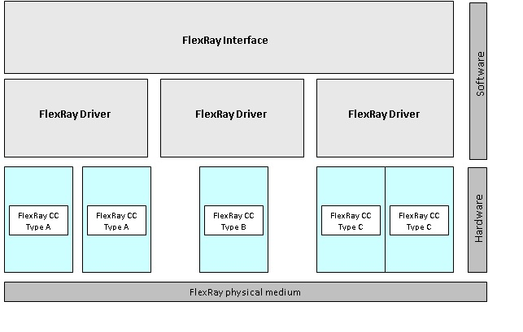

图7.1：FlexRay BSW 协议栈的基本结构（**Figure 7.1: Basic Structure of the FlexRay Bsw Stack**）

### 6.2. 索引方案

#### 6.2.1. 原理

**FrIf** 模块用于访问众多（硬件和软件）资源<sup>1</sup>的大多数 **API** 服务都映射到底层 **FlexRay** 驱动程序或 **FlexRay** 收发器驱动程序的相应 **API** 服务。


> 1 例如定时器、配置数据集等。

为了选择经由 **FrIf** 模块访问的、分布在各个实体<sup>2</sup>中的资源，与 **FlexRay** 相关的 **AUTOSAR BSW** 模块使用一种索引方案，图7.2和图7.3对其进行了示例性描述。


> 2 **FlexRay** 驱动程序、**FlexRay** 通信控制器、**FlexRay** 收发器驱动程序和 **FlexRay** 收发器。

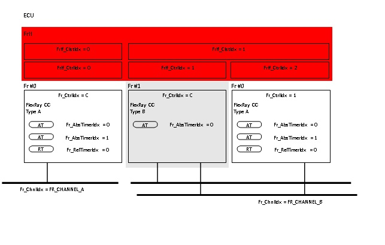

定义 ControllerIndex：ControllerIndex 是一个抽象的、唯一的、从零开始连续编号的索引，用于实现对 **FlexRay** 通信控制器的抽象，而与其类型、位置和访问方式无关。

定义 ClusterIndex：ClusterIndex 是一个抽象的、唯一的、从零开始连续编号的索引，用于实现对 **FlexRay** 集群的抽象，而与其类型、位置和访问方式无关。

定义 ChannelIndex：ChannelIndex 的取值为 **FR_CHANNEL_A** 或 **FR_CHANNEL_B**。它与 ControllerIndex 组合可以标识相应的 **FlexRay** 收发器。

**FrIf** 模块应通过为每种资源向上层 **BSW** 模块提供一个抽象的、唯一的、从零开始连续编号的索引来实现（对 **CC** 和驱动程序的）抽象，而与其类型、位置和访问方式无关。

基本原理：**FrIf** 模块通过向上层 **BSW** 模块提供这些抽象索引来实现（对 **CC** 和驱动程序的）抽象。

**FrIf** 模块的 **API** 服务使用上层 **BSW** 模块传递给它的抽象索引来检索：

* 指向底层 **BSW** 模块相应 **API** 服务的函数指针，该指针取自一个静态配置数据表，该表包含 **FrIf** 模块所调用的所有底层 **BSW** 模块的所有 **API** 服务的函数指针；以及
* 在对底层 **BSW** 模块 **API** 服务的调用中使用的已翻译的索引，该索引取自一个静态配置数据表。

由于该静态配置数据表包含指向底层 **BSW** 模块 **API** 服务的函数指针，因此它显然必须与底层 **BSW** 模块已链接、已定位的代码进行链接。

随后，**FrIf** 模块通过该函数指针调用底层 **BSW** 模块的相应 **API** 服务，并在 **API** 调用中传递已翻译的索引。

第 [7](#7-api规范) 章中的函数描述详细规定了所需的底层 **BSW** 模块 **API** 服务调用。

图7.2：FlexRay 接口的 CC 索引方案（**Figure 7.2: CC Indexing Scheme of the FlexRay Interface**）

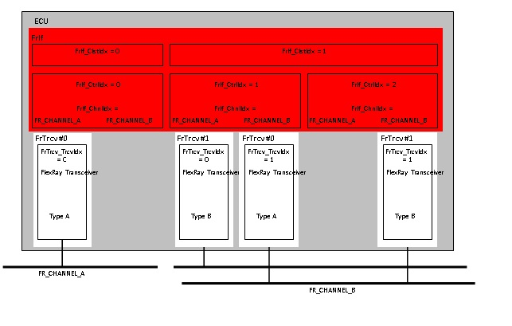

**FrIf** 模块应提供一个抽象的、唯一的、从零开始连续编号的配置参数索引 **FrIfCtrlIdx**，以便为上层 **BSW** 模块抽象 **FrIf** 模块经由 **FlexRay** 驱动程序模块控制的各个 **CC**，该索引映射到一个（**FlexRay** 驱动程序 **API** 服务函数指针，**CC** 索引 **Fr_CtrlIdx**）元组。

图7.3：FlexRay 接口的 FlexRay 收发器索引方案（**Figure 7.3: Flexray Transceiver Indexing Scheme of the FlexRay Interface**）

为了给上层 **BSW** 模块抽象 **FrIf** 模块经由 **FlexRay** 收发器驱动程序模块访问的各个 **FlexRay** 收发器模块，**FrIf** 模块利用了这样一个事实：每个 **FlexRay** 收发器模块都唯一地分配给特定 **FlexRay CC** 上的特定信道。

因此，**FrIf** 模块通过 **FrIf_CtrlIdx**（控制器索引）和 **FrIf_ChnlIdx**（信道索引）两个索引的组合来抽象各个 **FlexRay** 收发器，并将其映射为一个（**FlexRay** 收发器驱动程序 **API** 服务函数指针，**FlexRay** 收发器索引 **FrTrcv_TrcvIdx**）元组。

第 [7](#7-api规范) 章中的函数描述详细规定了上层 **BSW** 模块参数到底层 **BSW** 模块 **API** 服务的所需映射。

除硬件和软件资源之外，**FrIf** 模块还用一个抽象的、唯一的、从零开始连续编号的索引对 **FlexRay** 呈现的逻辑结构元素进行编号。

**FrIf** 模块的静态配置包含一个数据结构，该结构指明哪些 **FlexRay CC** 模块和哪些 **FlexRay** 收发器模块连接到哪些集群，换句话说，该结构将 **FrIf_ClstIdx** 的每个值映射到 **FrIf_CtrlIdx** 的一组取值和（**FrIfCtrlIdx**, **FrIf_ChnlIdx**）元组。

**FrIf** 模块应使用一个抽象的、唯一的、从零开始连续编号的索引 **TxPduId** 对所有待发送的 **PDU** 进行编号。

注意：该索引用于 **FrIf** 的 **API** 服务 [**FrIf_Transmit**](#7318-frif_transmit) 中，使 **FrIf** 模块能够（例如通过查表）快速识别由上层 **BSW** 模块传递给它的 **PDU**，并据此进行处理。

#### 6.2.2. 支持的索引资源

应能够将 **FrIf** 模块配置为支持至少四个（可能不同的）**FlexRay** 驱动程序来访问 **FlexRay** 通信控制器。

应能够使用参数 **FRIF_CTRL_IDX** 将 **FrIf** 模块配置为支持至少四个（可能不同的）**FlexRay CC**。

应能够将 **FrIf** 模块配置为支持 [\[6\]](#ref-6)（FlexRay Communications System Protocol Specification V2.1）中规定的两个 **FlexRay** 信道之一或两者。

应能够使用参数 **FRIF_CLST_IDX** 将 **FrIf** 模块配置为支持至少四个 **FlexRay** 集群。

应能够使用参数 **FRIF_ABS_TIMER_IDX** 将 **FrIf** 模块配置为为每个 **FlexRay CC** 支持至少一个绝对定时器。

### 6.3. FlexRay 接口状态机

为了能够控制 **FlexRay** 系统的通信操作，**FrIf** 模块应实现一种行为，该行为使用一个简单的状态机（每个 **FlexRay** 集群一个）来定义，称为 **FlexRay** 接口状态机。

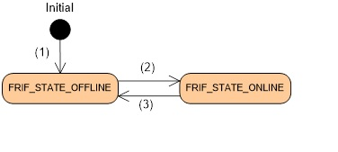

图7.4：FlexRay 接口状态机（**Figure 7.4: FlexRay Interface State Machine**）

表7.1：FlexRay 状态机转换（1）（**FlexRay State Machine Transitions (1)**）

| 状态 | 描述 |
| --- | --- |
| **FRIF_STATE_OFFLINE** | 不执行任何通信服务（详见第 [6.6](#66-通过-flexray-的数据通信) 节） |
| **FRIF_STATE_ONLINE** | 执行所有通信服务（接收、发送、发送确认）（详见第 [6.6](#66-通过-flexray-的数据通信) 节） |

在通过执行 [**FrIf_Init**](#731-frif_init) 初始化 **FrIf** 期间，每个集群的 **FrIf_State** 应初始化为状态「**FRIF_STATE_OFFLINE**」。

转换由 **API** 服务 [**FrIf_SetState**](#7310-frif_setstate) 请求，该服务接受要处理的集群和要调用的转换名称作为参数。

如果 **FrIf** 模块的环境以参数 **FrIf_StateTransition** = **FRIF_GOTO_ONLINE** 调用函数 [**FrIf_SetState**](#7310-frif_setstate)，并且所请求集群的当前状态为 **FRIF_STATE_OFFLINE**，则 **FrIf** 模块应将所请求集群的当前状态变为 **FRIF_STATE_ONLINE**。

如果 **FrIf** 模块的环境以参数 **FrIf_StateTransition** = **FRIF_GOTO_OFFLINE** 调用函数 [**FrIf_SetState**](#7310-frif_setstate)，并且所请求集群的当前状态为 **FRIF_STATE_ONLINE**，则 **FrIf** 模块应将所请求集群的当前状态变为 **FRIF_STATE_OFFLINE**。

否则，不执行状态转换。详情参见图7.4和表7.2。

表7.2：FlexRay 状态机转换（2）（**FlexRay State Machine Transitions (2)**）

| 转换名称 | 转换（见图7.4） | 描述 |
| --- | --- | --- |
| **FRIF_GOTO_ONLINE** | (2) | 使 **FrIf_State** 变为 **FRIF_STATE_ONLINE** 的转换 |
| **FRIF_GOTO_OFFLINE** | (3) | 使 **FrIf_State** 变为 **FRIF_STATE_OFFLINE** 的转换 |

如果以参数 **FRIF_STATE_OFFLINE** 调用 **API** [**FrIf_SetState**](#7310-frif_setstate)，则 **FlexRay** 接口模块应检查每个 **PDU** 的参数「**TxConfCounter**」。如果相应 **PDU** 的值大于 0，**FlexRay** 接口应使用 **API** &lt;UL&gt;\_TxConfirmation(id, E\_NOT\_OK) 调用上层。

注意：必须确保在以参数 **FRIF_STATE_OFFLINE** 调用 **API** [**FrIf_SetState**](#7310-frif_setstate) 时，**FlexRay** 接口不会丢失 **TxConfCounter** 的值。

#### 6.3.1. FlexRay 接口主函数

**FlexRay** 接口主函数需要由 **BSW** 调度器提供的任务体以一定的调用周期（**FRIF_MAINFUNCTION_PERIOD**）周期性地调用，该周期取决于 **FlexRay** 循环长度，并可在系统配置时配置。

由于每个集群的循环长度相互独立，**FlexRay** 接口主函数所期望的调用周期可能因集群而异，「立即缓冲区访问的传输」除外。

**FrIf** 模块应为该 **FrIf** 模块所控制的每个 **FlexRay** 集群提供一个专用的 **FlexRay** 接口主函数。

**FlexRay** 接口主函数的 **API** 名称应遵循以下模式：

**FrIf_MainFunction_&lt;[FrIfCluster](#923-frifcluster).ShortName&gt;**，其中 **[FrIfCluster](#923-frifcluster).ShortName** 是相应 [**FrIfCluster**](#923-frifcluster) 的短名称。

主函数监控并控制 **FlexRay** 作业列表执行函数的连续执行，包括（重新）同步（如果当前 **FlexRay** 接口状态机为 **FRIF_STATE_ONLINE**）。

如果全局启用了总线镜像（参见 **FrIfBusMirroringSupport**），则对每个 **FlexRay** 集群中通过调用 [**FrIf_EnableBusMirroring**](#7416-frif_enablebusmirroring) 激活了镜像的所有控制器调用 **Fr_GetChannelStatus**，将同一集群各控制器报告的状态按位或合并，然后调用 **Mirror_ReportFlexRayChannelStatus** 并传入集群、**Fr_ChannelAStatusPtr** 和 **Fr_ChannelBStatusPtr**，将聚合后的信道状态报告给总线镜像模块。

如果存在可选的集群特定配置参数 [**FRIF_E_NIT_CH_A**](#674-生产错误)、[**FRIF_E_NIT_CH_B**](#674-生产错误)、[**FRIF_E_SW_CH_A**](#674-生产错误)、[**FRIF_E_SW_CH_B**](#674-生产错误) 或 [**FRIF_E_ACS_CH_A**](#674-生产错误)、[**FRIF_E_ACS_CH_B**](#674-生产错误)，则对该集群的每个 **FlexRay** 控制器调用 [**FrIf_GetChannelStatus**](#742-frif_getchannelstatus)，并按下文所述将状态报告给 **DEM**。

如果存在可选的配置参数 [**FRIF_E_NIT_CH_A**](#674-生产错误)，则当单个控制器的任一错误位置位时（信道 A **NIT** 状态数据 vSS!SyntaxError、vSS!Bviolation），信道状态信息应以 **Dem_SetEventStatus**（[**FRIF_E_NIT_CH_A**](#674-生产错误), **DEM_EVENT_STATUS_PREFAILED**）报告给 **DEM**；当这些错误位均未置位时，应以 **Dem_SetEventStatus**（[**FRIF_E_NIT_CH_A**](#674-生产错误), **DEM_EVENT_STATUS_PREPASSED**）报告给 **DEM**。

如果存在可选的配置参数 [**FRIF_E_NIT_CH_B**](#674-生产错误)，则当单个控制器的任一错误位置位时（信道 B **NIT** 状态数据 vSS!SyntaxError、vSS!Bviolation），信道状态信息应以 **Dem_SetEventStatus**（[**FRIF_E_NIT_CH_B**](#674-生产错误), **DEM_EVENT_STATUS_PREFAILED**）报告给 **DEM**；当这些错误位均未置位时，应以 **Dem_SetEventStatus**（[**FRIF_E_NIT_CH_B**](#674-生产错误), **DEM_EVENT_STATUS_PREPASSED**）报告给 **DEM**。

如果存在可选的配置参数 [**FRIF_E_SW_CH_A**](#674-生产错误)，则当单个控制器的任一错误位置位时（信道 A 符号窗口状态数据 vSS!SyntaxError、vSS!Bviolation、vSS!TxConflict），信道状态信息应以 **Dem_SetEventStatus**（[**FRIF_E_SW_CH_A**](#674-生产错误), **DEM_EVENT_STATUS_PREFAILED**）报告给 **DEM**；当这些错误位均未置位时，应以 **Dem_SetEventStatus**（[**FRIF_E_SW_CH_A**](#674-生产错误), **DEM_EVENT_STATUS_PREPASSED**）报告给 **DEM**。

如果存在可选的配置参数 [**FRIF_E_SW_CH_B**](#674-生产错误)，则当单个控制器的任一错误位置位时（信道 B 符号窗口状态数据 vSS!SyntaxError、vSS!Bviolation、vSS!TxConflict），信道状态信息应以 **Dem_SetEventStatus**（[**FRIF_E_SW_CH_B**](#674-生产错误), **DEM_EVENT_STATUS_PREFAILED**）报告给 **DEM**；当这些错误位均未置位时，应以 **Dem_SetEventStatus**（[**FRIF_E_SW_CH_B**](#674-生产错误), **DEM_EVENT_STATUS_PREPASSED**）报告给 **DEM**。

如果存在可选的配置参数 [**FRIF_E_ACS_CH_A**](#674-生产错误)，则当单个控制器的任一错误位置位时（信道 A 聚合信道状态 vSS!SyntaxError、vSS!ContentError、vSS!Bviolation、vSS!TxConflict），信道状态信息应以 **Dem_SetEventStatus**（[**FRIF_E_ACS_CH_A**](#674-生产错误), **DEM_EVENT_STATUS_PREFAILED**）报告给 **DEM**；当这些错误位均未置位时，应以 **Dem_SetEventStatus**（[**FRIF_E_ACS_CH_A**](#674-生产错误), **DEM_EVENT_STATUS_PREPASSED**）报告给 **DEM**。

如果存在可选的配置参数 [**FRIF_E_ACS_CH_B**](#674-生产错误)，则当单个控制器的任一错误位置位时（信道 B 聚合信道状态 vSS!SyntaxError、vSS!ContentError、vSS!Bviolation、vSS!TxConflict），信道状态信息应以 **Dem_SetEventStatus**（[**FRIF_E_ACS_CH_B**](#674-生产错误), **DEM_EVENT_STATUS_PREFAILED**）报告给 **DEM**；当这些错误位均未置位时，应以 **Dem_SetEventStatus**（[**FRIF_E_ACS_CH_B**](#674-生产错误), **DEM_EVENT_STATUS_PREPASSED**）报告给 **DEM**。

如果检测到作业列表失去同步（参见 **JobListAsyncFlag**）或发生执行错过，则应执行以下步骤：

1. 获取全局时间（[**FrIf_GetGlobalTime**](#7314-frif_getglobaltime)）
   * 如果 [**FrIf_GetGlobalTime**](#7314-frif_getglobaltime) 返回 **E_NOT_OK**，则到此为止
   * 如果 [**FrIf_GetGlobalTime**](#7314-frif_getglobaltime) 返回 **E_OK**，则继续执行步骤 2
2. 增加一定的「时间缓冲」（即考虑抖动的一段时间）
3. 在 **FlexRay** 作业列表中搜索下一个作业，即调用时间大于当前全局时间 + 「时间缓冲」的作业。
4. 将 JobListPointer 设置为该作业，并以该作业的调用时间对绝对定时器编程（此时 **FlexRay** 作业列表重新同步）
5. 清除 JobListAsyncFlag
6. 使能绝对定时器中断

### 6.4. 实现需求

**FlexRay** 接口的可执行代码（但不包括运行时使用的配置）应完全独立于 **FlexRay** 通信控制器和 **FlexRay** 收发器。

**FrIf** 模块应支持预编译时、链接时和后构建时配置。

**FrIf** 模块应将链接时和后构建时配置数据实现为只读数据结构。

**FrIf** 模块的实现应立即引用链接时配置数据。

**FrIf** 模块应将 **FrIf** SWS 规定的 **API** 函数实现为真实的 **C** 代码函数，不得将 **API** 函数实现为宏。

注：**SWS_FrIf_05078** 的基本原理是允许目标代码模块集成。

**FrIf** 模块应对位于 **FrIf** L-Sdu 上且 **FrIfAllowDynamicLSduLength** 设置为 false 的已发送 **PDU** 进行填充（如果其大小小于 **PDU** 的配置大小）。填充应使用配置的 **FrIfUnusedBitValue** 进行。

### 6.5. 配置描述

**FrIf** 模块应提供一个 **XML** 文件，其中包含软件标识（应包含供应商标识、模块 **ID** 和软件版本信息）、配置和集成过程所需的数据。该文件应描述供应商特定的配置参数，并应包含推荐的配置参数值。

配置和初始化数据本身的描述不属于本规范的一部分，而是非常依赖于实现。

### 6.6. 通过 FlexRay 的数据通信

**FlexRay** 总体上是一个确定性的时间驱动通信系统。

每个要发送或接收的数据都必须在系统配置时进行调度。

即使从应用的角度来看被视为事件驱动的数据也是如此。

注意：如果只观察运行在特定 **ECU** 上的 **AUTOSAR FlexRay** 软件模块的特定实例，则无法「预知」某个 **FlexRay** 帧在 **FlexRay** 循环的动态段中被发送（或接收）的确切时间点。

**FrIf** 模块应在系统配置时专门为数据发送（或数据接收）定义数据发送（或接收）所需的资源（例如 **FlexRay** 通信控制器或 **FlexRay** 驱动程序中的缓冲区）。

注意：**FlexRay** 上不存在真正自发的、事件驱动的数据通信。即使在不可预测的时间点出现（即「事件驱动」）且应通过 **FlexRay** 发送的应用数据，也必须在系统配置时调度其发送。

#### 6.6.1. PDU 打包、PDU 更新位和帧构造计划

按照 **AUTOSAR** 的基本规则，**FrIf** 模块提供给上层 **BSW** 模块用于数据发送和数据接收的 **API** 服务是基于 **PDU** 的。

**FrIf** 模块应能够将多个 **PDU** 打包进一个 **FlexRay** 帧。

SWS_FrIf_05121 的基本原理：与总线无关的 **AUTOSAR PDU** 的最大长度为 8 字节，但根据 [\[6\]](#ref-6)（FlexRay Communications System Protocol Specification V2.1），一个 **FlexRay** 帧最多可包含 254 字节的载荷数据。

注意：也允许定义大于 8 字节的 **PDU**。但请注意，大于 8 字节的 **PDU** 不再与总线无关！

**FrIf** 模块应从所谓的帧构造计划中获取如何将 **PDU** 打包进 **FlexRay** 帧的信息。定义如何将 **PDU** 打包进 **FlexRay** 帧的规则在系统配置时定义。

帧构造计划应存储在 **FrIf** 模块的静态配置中（配置参数 [**FrIfFrameStructure**](#9211-frifframestructure)，参见 FrIf05370）。

如果多个 **PDU** 被打包进单个 **FlexRay** 帧，并且 **FrIf** 模块识别出其中至少一个 **PDU** 被更新，则 **FrIf** 模块应发送该 **FlexRay** 帧。

注意：因此，该 **FlexRay** 帧中与未被上层 **BSW** 模块更新的 **PDU** 相关联的空间也将被发送。这并不一定意味着这些 **PDU** 的先前值会被发送。相反，如果参数「**FrIfUnusedBitValue**」不存在，这些 **PDU** 的任意值将被发送。

如果参数「**FrIfUnusedBitValue**」存在，则在发送方组装帧时，帧构造计划内所有未使用的位都应设置为配置的值「**FrIfUnusedBitValue**」。

**FlexRay** 接口应确保帧构造计划内未使用的空间只包含确定性的值（而不是可能的随机数据）。

为此，应使用参数「**FrIfUnusedBitValue**」给出的值来填充未使用的空间。

可以为每个 **PDU** 配置（配置参数 **FrIfPduUpdateBitOffset**，参见 FrIf06071）**FlexRay** 帧中的专用 **PDU** 更新位。**FrIf** 模块应使用存储在配置参数 **FrIfPduUpdateBitOffset** 中的信息来识别每个 **PDU** 的 **PDU** 更新位的位置。

接收方 **FrIf** 模块应评估 **PDU** 更新位（如果已配置）以识别与该 **PDU** 更新位相关联的 **PDU** 的更新。

基本原理：为了使接收方 **FrIf** 模块能够确定接收到的 **FlexRay** 帧中哪些 **PDU** 实际上已被发送方的上层 **BSW** 模块更新（通过调用 [**FrIf_Transmit**](#7318-frif_transmit)），应向接收方 **FrIf** 模块发送额外的更新信息，即 **FlexRay** 帧内所谓的 **PDU** 更新位。

注意：更新位处理的详细描述见通信操作第 [6.6.5.1](#6651-transmitwithdecoupledbufferaccess) 节「TransmitWithDecoupledBufferAccess」。

该 **PDU** 更新位应位于帧构造计划中未被任何 **PDU** 占用的任意位位置。

**PDU** 更新位的配置以及更新位在 **FlexRay** 帧内位置的定义在系统配置时完成 [配置参数 **FrIfPduUpdateBitOffset**，参见 FrIf06071]。

如果没有为特定 **PDU** 配置更新位，**FrIf** 模块应假定该 **PDU** 始终有效，并且 **FrIf** 模块应在接收方始终将其接收情况指示给上层 **BSW** 模块。

如果参数「**FrIfAllowDynamicLSduLength**」存在且为所关联的接收帧触发设置为 TRUE，则处于未接收区域（**PDU** 偏移 &gt; 实际 **L-SDU** 长度）的 **PDU** 不得指示给上层。

如果使用立即缓冲区访问的传输，则每个 **FlexRay** 帧（**L-SDU**）只允许一个 **PDU**。

注意：因此，立即缓冲区访问的传输可以省略 **PDU** 更新位。

#### 6.6.2. 动态 PDU 长度

如果参数「**FrIfAllowDynamicLSduLength**」（参见 FrIf06049）为所关联的帧触发设置为 true，则 **FrIf** 模块将实际使用的 **L-PDU** 长度传递给驱动程序（**Fr_TransmitTxLPdu**），并针对每个 **PDU** 考虑以下参数：

* **PDU** 在 **L-PDU** 内的位置
* 更新位信息的位置（如果已配置）

如果 **FrIfImmediate** 等于 TRUE，则相应 **PDU** 的实际长度应为经由 [**FrIf_Transmit**](#7318-frif_transmit) 传递的长度。

如果 **FrIfImmediate** 等于 FALSE，则相应 **PDU** 的实际长度应为经由 &lt;UL\_TriggerTransmit&gt; 传递的长度。

注意：如果 **FrIfAllowDynamicLSduLength** 设置为 false，**FrIf** 模块只按照帧构造计划将长度信息传递给 **FlexRay** 驱动程序。

**FrIf** 应只将处于已接收区域（**PDU** 偏移 &lt;= 实际 **L-PDU** 长度）的 **PDU** 指示给上层。

#### 6.6.3. AlwaysTransmit

注意：根据 [\[6\]](#ref-6)（FlexRay Communications System Protocol Specification V2.1），**FlexRay CC** 可能只支持所谓的「连续传输模式」，即消息被连续发送，直到主机显式地使发送缓冲区失效。如果使用这样的 **FlexRay CC** 进行发送，而接收方 **FrIf** 仍应能够确定接收到的 **FlexRay** 帧中哪些 **PDU** 实际上已被发送方的上层 **BSW** 模块更新，则在发送方 **FrIf** 中需要一种称为 **AlwaysTransmit** 的特殊机制（配置参数 **FrIfAlwaysTransmit**，参见 ECUC\_FrIf\_06050）。如果为使用通信操作 **DECOUPLED_TRANSMISSION** 发送的 **L-PDU** 启用了 **AlwaysTransmit**，则无论该 **L-PDU** 中的 **PDU** 是否被上层 **BSW** 模块更新，都会为该 **L-PDU** 调用 **FlexRay** 驱动程序的 **API** 服务 **Fr_TransmitTxLPdu**。这使得即使 **FlexRay** 帧中的所有 **PDU** 实际上都未被上层 **BSW** 模块更新，也能够复位 **FlexRay CC** 发送缓冲区中的 **PDU** 更新位，从而确保接收方 **FrIf** 对接收到的帧内容的正确解释。

注意：由于：

* 通常，**FlexRay CC** 的发送模式是可以配置的（「连续模式」/「单次模式」），
* 可以针对每个 **L-PDU** 独立配置 **AlwaysTransmit**，并且
* 可以针对每个 **PDU** 独立配置更新位，

因此可以对 **FrIf** 模块进行裁剪，使其展现出特定用例所要求的确切行为。

然而，选择所有这些参数的正确配置是系统设计者（**System Designer**）的责任。错误的配置将导致非预期的结果。

#### 6.6.4. 时间驱动的 FlexRay 调度表的实现

根据 [\[6\]](#ref-6)（FlexRay Communications System Protocol Specification V2.1），**FlexRay CC** 不要求在硬件中提供确保对其发送和接收缓冲区进行异步访问的机制，例如通过提供可由 **AUTOSAR FlexRay** 软件模块异步访问的影子缓冲区。

**FrIf** 模块应同步地（即同步于 **FlexRay** 全局时间）调用所有访问发送和接收缓冲区的函数（即分别执行数据发送或数据接收的函数）。

SWS_FrIf_05130 的基本原理：**FrIf** 模块函数只在明确定义的时间点<sup>3</sup>访问发送和接收缓冲区，从而避免了硬件和软件对缓冲区的并发访问。


> 3 在 **FlexRay** 全局时间中

注意：为了提供这种必要的同步性，**FrIf** 模块为每个集群定义了一个 **FlexRay** 作业列表 [配置参数 [**FrIfJobList**](#928-frifjoblist)，参见 FrIf05367]。

集群的 **FlexRay** 作业列表由其作业列表执行函数（参见第 [7.5.1](#751-frif_joblistexec_frifclustershortname) 节）使用连接到相应集群的 **FlexRay CC** 的绝对定时器 [配置参数 **FrIfAbsTimerRef**，参见 FrIf06063] 来执行。

##### 6.6.4.1. FlexRay 作业列表

定义：**FlexRay** 作业列表是一个按各自执行开始时间排序的（可能不同的）通信作业的列表。

每个通信作业 [配置参数 [**FrIfJob**](#929-frifjob)，参见 FrIf05368] 包含以下属性：

* 通过以下方式表示的作业开始时间
  * **FlexRay** 通信循环 [配置参数 **FrIfCycle**，参见 FrIf06064]
  * 通信循环内的宏节拍偏移 [配置参数 **FrIfMacrotick**，参见 FrIf06065]。
* 按可配置的通信操作索引 [配置参数 **FrIfCommunicationOperationIdx**，参见 FrIf06068] 排序的通信操作列表 [配置参数 [**FrIfCommunicationOperation**](#9210-frifcommunicationoperation)，参见 FrIf05369]。排序顺序定义了 **FlexRay** 通信作业内通信操作的执行顺序。

**FrIf** 模块应调用相应集群的 **FlexRay** 作业列表执行函数，在分配给每个 **FlexRay** 通信作业的执行开始时间执行该作业。

**FrIf** 模块应处理分配给每个 **FlexRay** 通信作业的通信操作所确定的动作。

每个通信操作（参见 FrIf05369）包含以下属性：

* 通信操作索引 [配置参数 **FrIfCommunicationOperationIdx**，参见 ECUC\_FrIf\_06068]，它决定通信操作的执行顺序。
* 通信动作 [配置参数 **FrIfCommunicationAction**，参见 FrIf06067]，它规定要执行的实际动作
  * **DECOUPLED_TRANSMISSION**
  * **TX_CONFIRMATION**
  * **RECEIVE_AND_STORE**
  * **RX_INDICATION**
  * **RECEIVE_AND_INDICATE**
  * **PREPARE_LPDU**
* 对与要执行的通信动作相关联的帧触发（**L-PDU**）的引用 [配置参数 **FrIfLPduIdx**，参见 FrIf06058]<sup>4</sup>。


> 4 **LPDU** 由 **LPdu** 索引标识，出于历史原因，该索引与一个帧触发存在 1:1 关联。为保持兼容性，此处不更改此配置结构。**L-PDU** 索引采用从零开始且连续的索引，在处理 **LPdu** 时，该索引用作传递给 **AUTOSAR FlexRay** 驱动程序的参数 **Fr_LPduIdx**。

##### 6.6.4.2. FlexRay 作业列表执行函数

由于每个 **FlexRay** 集群的通信调度相互独立，因此 **FlexRay** 接口所控制的每个 **FlexRay** 集群都有一个专用的 **FlexRay** 作业列表和一个专用的 **FlexRay** 作业列表执行函数。

进出 **FlexRay CC** 的拷贝操作在 **FlexRay** 作业列表的通信操作中进行调度。

**FlexRay** 作业列表执行函数的 **API** 名称应遵循以下模式：

**FrIf_JobListExec_&lt;[FrIfCluster](#923-frifcluster).ShortName&gt;**，其中 **[FrIfCluster](#923-frifcluster).ShortName** 是相应 [**FrIfCluster**](#923-frifcluster) 的短名称。

**FlexRay** 作业列表执行函数应同步于集群的全局时间（即在明确定义的时间点）执行集群的 **FlexRay** 作业列表的作业。

被调用时，**FlexRay** 作业列表执行函数应执行以下步骤：

1. 从提供集群绝对定时器中断的 **FlexRay CC** 获取 **FlexRay** 全局时间。
2. 如果无法获取 **FlexRay** 全局时间，或者相对于作业开始时间的全局时间延迟大于最大延迟 [配置参数 **FrIfMaxIsrDelay**，参见 FrIf06004]，则 **FlexRay** 作业列表的执行被视为与 **FlexRay** 全局时间异步，因此执行以下动作：
   * 要么置位一个标志（JobListAsyncFlag），表明该集群 **FlexRay** 作业列表的执行是异步的，要么按照 **SWS_FrIf_95120** 的描述直接重新同步作业列表
   * 如果 JobListAsyncFlag 已置位，则调用运行时错误 [**FRIF_E_JLE_SYNC**](#672-运行时错误)
   * 禁用绝对定时器中断
   * 终止该 **FlexRay** 作业的执行。

   否则，**FlexRay** 作业列表执行函数继续执行步骤 3。
3. 检索当前作业指针所指向的当前作业的已排序通信操作列表。
4. 将当前作业指针前移到下一个作业列表条目。如果作业指针已指向作业列表的末尾，则回绕并将其设置为第一个作业列表条目。
5. 检索作业指针所标记作业的执行开始时间，并将绝对定时器设置为该作业的开始时间，以便再次调用 **FlexRay** 作业列表执行函数。
6. 执行检索到的通信操作。

注意：为了保持 **JLEF** 的运行时间较短，可以将所描述的 **JLEF** 功能实现到一个单独的高优先级任务中，该任务必须在 **JLEF** 中被立即激活。

#### 6.6.5. 通信操作

本章描述在作业列表执行函数内执行的每种通信操作。

###### 6.6.5.1. TransmitWithDecoupledBufferAccess

**FrIf** 模块应能够通过使用 **TrigTxCounter** 实现发送请求排队。

注意：只存储发送请求的数量，而不存储数据本身。

如果对于通信操作 **DECOUPLED_TRANSMISSION**，相关 **CC** 处于 **FrIf_State** **FRIF_STATE_ONLINE**，则作业列表执行函数应执行该通信操作。否则，作业列表执行函数应忽略该通信操作。

对于通信操作 **DECOUPLED_TRANSMISSION**，作业列表执行函数应执行以下步骤：

1. 遍历包含在该通信操作的关联帧触发的 [**FrIfFrameStructure**](#9211-frifframestructure)（参见 FrIf05370）中的所有 **PDU**，并且
   * (a) 检查该 **PDU** 的 **TrigTxCounter** 是否 &gt; 0 或 **FrIfNoneMode** == true。如果不是，则清除该 **PDU** 的更新位 [配置参数 **FrIfPduUpdateBitOffset**，参见 FrIf06071] 并继续处理下一个 **PDU**；否则继续执行以下步骤：
     * i. 仅当 **TrigTxCounter** &gt; 0 时才递减 **TrigTxCounter**。如果 **TrigTxCounter** 的值为 0，则不递减。
     * ii. 使用关联的 **PDUId**（由上层定义）调用上层的函数 &lt;UL&gt;\_TriggerTransmit()，并传递一个指向 **FrIf** 内组装 **L-SDU** 的临时缓冲区的指针。该指针应考虑 **PDU** 在帧内的字节偏移 [配置参数 **FrIfPduOffset**，参见 FrIf06070]。如果 &lt;UL&gt;\_TriggerTransmit() 返回 **E_NOT_OK**，则必须将 **TrigTxCounter** 的值回滚到先前的值。
     * iii. 如果该 **PDU** 需要发送确认 [配置参数 **FrIfConfirm**，参见 FrIf06075]，则记住该 **PDU** 的发送处于挂起状态：递增 **TxConfCounter**，其最大值受静态配置限制 [配置参数 **FrIfCounterLimit**，参见 FrIf06076]。如果已达到 **FrIfCounterLimit**，则保持 **FrIfCounterLimit** 的值，不再递增。
     * iv. 如果为该 **PDU** 配置了更新位 [配置参数 **FrIfPduUpdateBitOffset**，参见 FrIf06071]，则置位更新位。如果 **API** &lt;UL&gt;\_TriggerTransmit() 未返回 **E_OK**，或者已对相应的 **PDU** 调用了 **API** [**FrIf_CancelTransmit**](#747-frif_canceltransmit)，则将更新位复位为「未更新」。
2. 如果至少有一个 **PDU** 被请求发送，或者至少有一个 **PDU** 的 **FrIfNoneMode** == true 且 &lt;UL&gt;\_TriggerTransmit 返回了 **E_OK**，或者该帧被配置为始终发送 [配置参数 **FrIfAlwaysTransmit** == true]，则调用 **FlexRay** 驱动程序的 **API** 服务 **Fr_TransmitTxLPdu**：
   * (a) **Fr_CtrlIdx** 按照索引方案一章中描述的索引方案推导。
   * (b) **Fr_LPduIdx** 设置为与该通信操作相关联的已配置 **L-PDU** 索引 [配置参数 **FrIfLPduIdx**，参见 FrIf06058]。
   * (c) **Fr_LSduPtr** 设置为 **FrIf** 的临时 **L-SDU** 组装缓冲区。
   * (d) **Fr_LSduLength** 设置为 **L-SDU** 长度 [配置参数 **FrIfLSduLength**，参见 FrIf06054]。
   * (e) 如果全局启用了总线镜像（参见 **FrIfBusMirroringSupport**），则 **Fr_SlotAssignmentPtr** 设置为临时时隙分配缓冲区，否则设置为 **NULL_PTR**。
3. 如果全局启用了总线镜像（参见 **FrIfBusMirroringSupport**），并且已通过调用 [**FrIf_EnableBusMirroring**](#7416-frif_enablebusmirroring) 为 **Fr_CtrlIdx** 激活镜像，且 **Fr_TransmitTxLPdu** 返回了 **E_OK**（表明发送成功），则调用 **Mirror_ReportFlexRayFrame**，其中「controllerId」设置为 **Fr_CtrlIdx**，「slotId」、「cycle」和「channel」取自 **Fr_SlotAssignmentPtr**，「frame」由 **Fr_LSduPtr** 和 **Fr_LSduLength** 构造，「txConflict」设置为 false。
4. 如果驱动程序的 **API** **Fr_TransmitTxLPdu** 返回 **E_NOT_OK**（表明发送失败），则必须为 **FlexRay L-SDU** 中包含的每个 **PDU** 回滚 **TrigTxCounter** 和 **TxConfCounter** 的更改（参见 1.iii 和 2）。

注意：**SWS_FrIf_05287** 中描述的所有动作都在第 8.1.2 节的时序图中详细描绘。

如果 **FrIfAllowDynamicLSduLength** 存在且为所关联的帧触发设置为 TRUE，则通过调用 **Fr_TransmitTxLPdu** 传递给驱动程序的实际 **L-SDU** 长度应这样确定（即尽可能缩短）：只考虑那些已经由 &lt;UL\_TriggerTransmit&gt;() 指示的 **PDU**，并考虑以下几点：

* 相应 **PDU** 在 **L-SDU** 内的位置
* 经由 &lt;UL\_TriggerTransmit&gt;() 传递的相应 **PDU** 的实际长度

缩短的 L-Sdu（参见上文 **SWS_FrIf_05435** 的规定）应始终包含所有已配置的更新位。

注意：**SWS_FrIf_05435** 和 **SWS_FrIf_05436** 一方面确保接收方拥有解包 **L-SDU** 所需的全部信息（**PDU** 本身以及相应的更新位（如果已配置）），另一方面确保在缩短传递给驱动程序的 **L-SDU** 时，通过考虑帧构造计划中包含的用于解包的所有必需数据的位置，可以尽可能减小载荷。

###### 6.6.5.2. ProvideTxConfirmation

该通信操作提供发送确认，并可选地检查发送冲突的发生。

如果对于通信操作 **TX_CONFIRMATION**，相关 **CC** 处于 **FrIf_State** **FRIF_STATE_ONLINE**，则作业列表执行函数应执行该通信操作。否则，作业列表执行函数应忽略该通信操作。

对于通信操作 **TX_CONFIRMATION**，作业列表执行函数应执行以下步骤：

1. 调用 **FlexRay** 驱动程序的 **API** 函数 **Fr_CheckTxLPduStatus**：
   * **Fr_CtrlIdx** 按照索引方案一章中描述的索引方案推导。
   * **Fr_LPduIdx** 设置为与该通信操作相关联的已配置 **L-PDU** 缓冲区索引 [配置参数 **FrIfLPduIdx**，参见 FrIf06058]。
   * 如果全局启用了总线镜像（参见 **FrIfBusMirroringSupport**），则 **Fr_SlotAssignmentPtr** 设置为临时时隙分配缓冲区，否则设置为 **NULL_PTR**。
2. 如果已执行发送（输出参数 \*Fr\_TxLPduStatusPtr 设置为 **FR_TRANSMITTED**），则遍历包含在该通信操作关联帧触发的 [**FrIfFrameStructure**](#9211-frifframestructure)（参见 FrIf05370）中的所有 **PDU**。如果某个 **PDU** 的 **TxConfCounter** 为 0，则继续处理下一个 **PDU**，否则：
   * 如果 **FrIfConfirm** == true，则使用关联的 **PDUId**（由上层定义）调用上层的函数 &lt;UL\_TxConfirmation(E\_OK)&gt;。
   * 如果 **FrIfConfirm** == true，则递减 **TxConfCounter**。
3. 如果已执行发送但发生了发送冲突（TxConflict）（输出参数 \*Fr\_TxLPduStatusPtr 设置为 **FR_TRANSMITTED_CONFLICT**），则遍历包含在该通信操作关联帧触发的 [**FrIfFrameStructure**](#9211-frifframestructure)（参见 FrIf05370）中的所有 **PDU**。如果某个 **PDU** 的 **TxConfCounter** 为 0，则继续处理下一个 **PDU**，否则：
   * 如果 **FrIfConfirm** == true，则使用关联的 **PDUId**（由上层定义）调用上层的函数 &lt;UL\_TxConfirmation(E\_NOT\_OK)&gt;。
   * 如果 **FrIfConfirm** == true，则递减 **TxConfCounter**。
4. 如果全局启用了总线镜像（参见 **FrIfBusMirroringSupport**），并且已通过调用 [**FrIf_EnableBusMirroring**](#7416-frif_enablebusmirroring) 为 **Fr_CtrlIdx** 激活镜像，且 **API** **Fr_CheckTxLpduStatus** 返回「**FR_TRANSMITTED_CONFLICT**」，则调用 **Mirror_ReportFlexRayFrame**，其中「controllerId」设置为 **Fr_CtrlIdx**，「slotId」、「cycle」和「channel」取自 **Fr_SlotAssignmentPtr**，「frame」设置为 **NULL_PTR**，「txConflict」设置为 true。

如果 **API** **Fr_CheckTxLpduStatus** 返回「**FR_TRANSMITTED_CONFLICT**」，且 &lt;UL\_TxConflictNotification&gt; 已通过 **FrIfTxConflictNotificationName**（ECUC\_FrIf\_06122）配置，则对同一 **LPduIdx** 调用该函数。

###### 6.6.5.3. ReceiveAndStore

如果对于通信操作 **RECEIVE_AND_STORE**，相关 **CC** 处于 **FrIf_State** **FRIF_STATE_ONLINE**，则作业列表执行函数应执行该通信操作。否则，作业列表执行函数应忽略该通信操作。

对于通信操作 **RECEIVE_AND_STORE**，作业列表执行函数应执行以下步骤：

1. 调用 **FlexRay** 驱动程序的 **API** 函数 **Fr_ReceiveRxLPdu**：
   * (a) **Fr_CtrlIdx** 按照索引方案一章中描述的索引方案推导。
   * (b) **Fr_LPduIdx** 设置为与该通信操作相关联的已配置 **L-PDU** 索引 [配置参数 **FrIfLPduIdx**，参见 FrIf06058]。
   * (c) **Fr_LSduPtr** 设置为临时缓冲区。
   * (d) 如果全局启用了总线镜像（参见 **FrIfBusMirroringSupport**），则 **Fr_SlotAssignmentPtr** 设置为临时时隙分配缓冲区，否则设置为 **NULL_PTR**。
2. 如果全局启用了总线镜像（参见 **FrIfBusMirroringSupport**），并且已通过调用 [**FrIf_EnableBusMirroring**](#7416-frif_enablebusmirroring) 为 **Fr_CtrlIdx** 激活镜像，且已接收到一个 **L-PDU**（输出参数 \*Fr\_LPduStatusPtr != **FR_NOT_RECEIVED**），则调用 **Mirror_ReportFlexRayFrame**，其中「controllerId」设置为 **Fr_CtrlIdx**，「slotId」、「cycle」和「channel」取自 **Fr_SlotAssignmentPtr**，「frame」由 **Fr_LSduPtr** 和 **Fr_LSduLengthPtr** 构造，「txConflict」设置为 false。
3. 如果已接收到一个 **L-PDU**（输出参数 \*Fr\_LPduStatusPtr != **FR_NOT_RECEIVED**），则遍历包含在该通信操作关联帧触发的 [**FrIfFrameStructure**](#9211-frifframestructure)（参见 FrIf05370）中的所有 **PDU**，并且：
   * (a) 如果为该 **PDU** 配置了更新位 [配置参数 **FrIfPduUpdateBitOffset**，参见 FrIf06071]，且该 **PDU** 的更新位未置位，则继续处理下一个 **PDU**。否则：
   * (b) 考虑 **PDU** 在 **L-SDU** 内的偏移 [配置参数 **FrIfPduOffset**，参见 FrIf06070]，将 **PDU** 载荷从临时缓冲区拷贝到 **FrIf** 的 **PDU** 相关静态缓冲区中。
   * (c) 存储实际接收到的 **PDU** 长度。
   * (d) 将该 **PDU** 相关静态缓冲区标记为最新（up-to-date）。
4. 如果 \*Fr\_LPduStatusPtr == **FR_RECEIVED_MORE_DATA_AVAILABLE**，则重新从第 1 步开始。否则该通信操作已结束。

###### 6.6.5.4. ProvideRxIndication

如果对于通信操作 **RX_INDICATION**，相关 **CC** 处于 **FrIf_State** **FRIF_STATE_ONLINE**，则作业列表执行函数应执行该通信操作。否则，作业列表执行函数应忽略该通信操作。

对于通信操作 **RX_INDICATION**，作业列表执行函数应执行以下步骤：

1. 遍历包含在该通信操作关联帧触发的 [**FrIfFrameStructure**](#9211-frifframestructure)（参见 FrIf05370）中的所有 **PDU** 的 **PDU** 相关静态缓冲区。
2. 如果该 **PDU** 相关静态缓冲区被标记为过期（outdated），则继续处理下一个 **PDU**。否则，如果该缓冲区被标记为最新（up-to-date），则：
   * (a) 使用接收模块所期望的 **PDU Id** 以及包含接收数据地址和接收数据长度的 **PduInfoPtr** 调用上层的函数 &lt;UL&gt;\_RxIndication()。
   * (b) 将该 **PDU** 相关静态缓冲区标记为过期（outdated）。

###### 6.6.5.5. ReceiveAndIndicate

如果对于通信操作 **RECEIVE_AND_INDICATE**，相关 **CC** 处于 **FrIf_State** **FRIF_STATE_ONLINE**，则作业列表执行函数应执行该通信操作。否则，作业列表执行函数应忽略该通信操作。

对于通信操作 **RECEIVE_AND_INDICATE**，作业列表执行函数应执行以下步骤：

1. 计算输入参数的值：
   * (a) **Fr_CtrlIdx** 按照索引方案一章中描述的索引方案推导。
   * (b) **Fr_LPduIdx** 设置为与该通信操作相关联的已配置 **L-PDU** 索引 [配置参数 **FrIfLPduIdx**，参见 FrIf06058]。
   * (c) **Fr_LSduPtr** 设置为临时缓冲区。
   * (d) 如果全局启用了总线镜像（参见 **FrIfBusMirroringSupport**），则 **Fr_SlotAssignmentPtr** 设置为临时时隙分配缓冲区，否则设置为 **NULL_PTR**。
2. 将 ComOpLoopCounter 初始化为 0。
3. 只要 ComOpLoopCounter &lt; **FrIfRxComOpMaxLoop**，则执行：
   * (a) 使用步骤 1) 中计算出的参数调用 **Fr_ReceiveRxLPdu**。
   * (b) 如果 \*Fr\_LPduStatusPtr != **FR_NOT_RECEIVED**，则继续执行 3)c)，否则该通信操作已结束。
   * (c) 如果全局启用了总线镜像（参见 **FrIfBusMirroringSupport**），并且已通过调用 [**FrIf_EnableBusMirroring**](#7416-frif_enablebusmirroring) 为 **Fr_CtrlIdx** 激活镜像，则调用 **Mirror_ReportFlexRayFrame**，其中「controllerId」设置为 **Fr_CtrlIdx**，「slotId」、「cycle」和「channel」取自 **Fr_SlotAssignmentPtr**，「frame」由 **Fr_LSduPtr** 和 **Fr_LSduLengthPtr** 构造，「txConflict」设置为 false。否则，继续执行 3)d)。
   * (d) 对于包含在该通信操作关联帧触发的 [**FrIfFrameStructure**](#9211-frifframestructure)（参见 FrIf05370）中的每个 **Pdu**：
     * 如果为该 **PDU** 配置了更新位 [配置参数 **FrIfPduUpdateBitOffset**，参见 FrIf06071]，且该 **PDU** 的更新位未置位，则继续处理下一个 **PDU**。否则：
     * 使用接收模块所期望的 **PDU Id** 以及一个指向 Pdu-Info 结构的指针作为参数调用上层的函数 &lt;UL&gt;\_RxIndication()，该结构包含 **Pdu** 长度和对临时缓冲区的引用（考虑 **PDU** 在 **L-SDU** 内的偏移 [配置参数 **FrIfPduOffset**，参见 FrIf06070]）。
   * (e) 如果 \*Fr\_LPduStatusPtr == **FR_RECEIVED_MORE_DATA_AVAILABLE**，则递增 ComOpLoopCounter 并重新从 3)a) 开始，否则该通信操作已结束。

###### 6.6.5.6. PREPARE_LPDU

通信操作 **PREPARE_LPDU** 用于实现硬件优化目的（硬件缓冲区重新配置）。

通信操作 **PREPARE_LPDU** 执行以下步骤：

1. 调用 **FlexRay** 驱动程序的 **API** 函数 **Fr_PrepareLPdu**：
   * **Fr_CtrlIdx** 按照索引方案一章中描述的索引方案推导。
   * **Fr_LPduIdx** 设置为与该通信操作相关联的已配置 **L-PDU** 索引 [配置参数 **FrIfLPduIdx**，参见 FrIf06058]。

通信操作 **PREPARE_LPDU** 用于实现硬件优化目的。其目的是使某些 **FlexRay CC** 硬件资源（例如 **CC** 的消息缓冲区）能够在适当的时机为某个 **L-PDU** 的发送/接收做好准备（配置）。

该通信操作使 **FlexRay** 驱动程序能够在可用时优化硬件资源的使用。然而，基于 **PREPARE_LPDU** 通信操作来决定和验证资源分配优化是 **FlexRay** 驱动程序的责任。实际上，即使 **FlexRay** 驱动程序不利用重新配置的机会，使用该通信操作也会引入一些运行时开销。

###### 6.6.5.7. FREE_OP_A

为支持硬件特定的或额外的通信控制器特性以提高性能而定义的用户自定义通信操作。用例包括采用串行连接或 **DMA** 传输的通信控制器。

###### 6.6.5.8. FREE_OP_B

为支持硬件特定的或额外的通信控制器特性以提高性能而定义的用户自定义通信操作。用例包括采用串行连接或 **DMA** 传输的通信控制器。

#### 6.6.6. 立即缓冲区访问的传输

**FlexRay** 作业列表执行函数不发起立即缓冲区访问的传输。相反，此处描述的动作在 [**FrIf_Transmit**](#7318-frif_transmit) **API** 服务的上下文中执行，该服务又由上层 **BSW** 模块调用。

仅当以下关于静态配置的限制适用时，**FlexRay** 接口才应执行立即缓冲区访问的 **PDU** 发送（参见第 [8.1](#81-数据传输) 节）：

* 该 **PDU** 必须是 **FlexRay** 帧（**L-SDU**）中唯一的 **PDU**。它不与其他 **PDU** 一起打包进 **FlexRay** 帧（即该 **PDU** 与相应 **L-SDU** 之间的映射是 1:1 关联）。
* 该 **PDU** 必须位于 **L-SDU** 的起始处。
* 没有为立即（immediate）**PDU** 配置更新位。

如果上层模块以被配置为立即 **PDU** 的 **TxPduId** 调用 [**FrIf_Transmit**](#7318-frif_transmit)，则 **AUTOSAR** 模块 **FlexRay** 接口应在 [**FrIf_Transmit**](#7318-frif_transmit) **API** 服务的上下文内执行以下步骤来完成立即 **PDU** 发送，即调用驱动程序的 **API** 函数 **Fr_TransmitTxLPdu**：

* **Fr_CtrlIdx** 按照索引方案一章中描述的索引方案推导。
* **Fr_LPduIdx** 设置为与该 **TxPduId** 相关联的已配置 **L-PDU** 索引 [配置参数 **FrIfLPduIdx**，参见 FrIf06058]。
* **Fr_LSduPtr** 设置为作为参数传递给 [**FrIf_Transmit**](#7318-frif_transmit) 的 **PduInfoPtr** 中包含的 **Pdu** 载荷指针。
* 如果参数 **FrIfAllowDynamicLSduLength**=TRUE，则相应 **PDU** 的实际长度应为经由 [**FrIf_Transmit**](#7318-frif_transmit) 传递的长度。
* 如果全局启用了总线镜像（参见 **FrIfBusMirroringSupport**），则 **Fr_SlotAssignmentPtr** 设置为临时时隙分配缓冲区，否则设置为 **NULL_PTR**。

如果驱动程序的 **API** **Fr_TransmitTxLPdu** 返回 **E_OK**（表明发送请求成功），则为相应的 **PDU** 递增 **TxConfCounter**。**TxConfCounter** 的最大值受静态配置限制 [配置参数 **FrIfCounterLimit**，参见 FrIf06076]。如果全局启用了总线镜像（参见 **FrIfBusMirroringSupport**），并且已通过调用 [**FrIf_EnableBusMirroring**](#7416-frif_enablebusmirroring) 为 **Fr_CtrlIdx** 激活镜像，则调用 **Mirror_ReportFlexRayFrame**，其中「controllerId」设置为 **Fr_CtrlIdx**，「slotId」、「cycle」和「channel」取自 **Fr_SlotAssignmentPtr**，「frame」由 **Fr_LSduPtr** 和 **Fr_LSduLength** 构造，「txConflict」设置为 false。

如果驱动程序的 **API** **Fr_TransmitTxLPdu** 返回 **E_NOT_OK**，则不修改 **TxConfCounter** 的当前计数值。

### 6.7. 错误分类

文档 [\[1\]](#ref-1)「General Specification of Basic Software Modules」的「错误处理」一节详细描述了基础软件的错误处理。最重要的是，它构成了一个由五种错误类型组成的分类方案，这些错误类型可能发生在 **BSW** 模块中。

基于此，以下各节在相应的小节中规定了特定的错误。

#### 6.7.1. 开发错误

模块 FrIf 中开发错误的定义：

| 错误类型 | 相关错误代码 | 错误值 |
| --- | --- | --- |
| 无效指针 | **FRIF_E_PARAM_POINTER** | 0x01 |
| 无效控制器索引 | **FRIF_E_INV_CTRL_IDX** | 0x02 |
| 无效集群索引 | **FRIF_E_INV_CLST_IDX** | 0x03 |
| 无效信道索引 | **FRIF_E_INV_CHNL_IDX** | 0x04 |
| 无效定时器索引 | **FRIF_E_INV_TIMER_IDX** | 0x05 |
| 无效 FrIf_TxPdu 索引 | **FRIF_E_INV_TXPDUID** | 0x06 |
| 无效 LPdu 索引 | **FRIF_E_INV_LPDU_IDX** | 0x07 |
| FrIf 未初始化 | **FRIF_E_UNINIT** | 0x08 |
| 请求了无效状态 | **FRIF_E_INV_FRIF_STATE** | 0x0A |
| 无效帧 ID | **FRIF_E_INV_FRAME_ID** | 0x0B |
| 初始化失败 | **FRIF_E_INIT_FAILED** | 0x0C |
| 无效 PDU 长度 | **FRIF_E_INV_PDULENGTH** | 0x0D |

#### 6.7.2. 运行时错误

| 错误类型 | 相关错误代码 | 错误值 |
| --- | --- | --- |
| 作业列表执行失去与 FlexRay 全局时间的同步 | **FRIF_E_JLE_SYNC** | 0x01 |

#### 6.7.3. 瞬态故障

不存在瞬态故障。

#### 6.7.4. 生产错误

参见下表「生产错误的定义」。

表7.3：生产错误的定义（**Definition of Production Errors**）

| 错误类型 | 相关错误代码 | 值 [hex] |
| --- | --- | --- |
| 信道 A 上的 NIT 错误检测 | **FRIF_E_NIT_CH_A** | 由 DEM 分配 |
| 信道 B 上的 NIT 错误检测 | **FRIF_E_NIT_CH_B** | 由 DEM 分配 |
| 信道 A 上的 SW 错误检测 | **FRIF_E_SW_CH_A** | 由 DEM 分配 |
| 信道 B 上的 SW 错误检测 | **FRIF_E_SW_CH_B** | 由 DEM 分配 |
| 信道 A 上的 ACS 错误检测 | **FRIF_E_ACS_CH_A** | 由 DEM 分配 |
| 信道 B 上的 ACS 错误检测 | **FRIF_E_ACS_CH_B** | 由 DEM 分配 |

表7.4：信道 A 上的 NIT 错误检测（**Error Detection in NIT channel A**）

| 项目 | 内容 |
| --- | --- |
| 错误名称 | **FRIF_E_NIT_CH_A** |
| 简短描述 | 信道 A 上的 NIT 错误检测 |
| 详细描述 | 当检测到信道 A 上的 NIT 错误时，应发出该生产错误 |
| 推荐的 DTC | N/A |
| 检测准则 | Fail：当单个控制器的任一错误位置位时（信道 A NIT 状态数据 vSS!SyntaxError、vSS!Bviolation），信道状态信息应以 Dem_SetEventStatus（**FRIF_E_NIT_CH_A**, **DEM_EVENT_STATUS_PREFAILED**）报告给 DEM（SWS_FrIf_35120） |
| 检测准则 | Pass：当单个控制器的所有错误位均未置位时（信道 A NIT 状态数据 vSS!SyntaxError、vSS!Bviolation），信道状态信息应以 Dem_SetEventStatus（**FRIF_E_NIT_CH_A**, **DEM_EVENT_STATUS_PREPASSED**）报告给 DEM（SWS_FrIf_35120） |
| 次要参数 | N/A |
| 所需时间 | N/A |
| 监控频率 | continuous（连续） |
| MIL 点亮 | N/A |

表7.5：信道 B 上的 NIT 错误检测（**Error Detection in NIT channel B**）

| 项目 | 内容 |
| --- | --- |
| 错误名称 | **FRIF_E_NIT_CH_B** |
| 简短描述 | 信道 B 上的 NIT 错误检测 |
| 详细描述 | 当检测到信道 B 上的 NIT 错误时，应发出该生产错误 |
| 推荐的 DTC | N/A |
| 检测准则 | Fail：当单个控制器的任一错误位置位时（信道 B NIT 状态数据 vSS!SyntaxError、vSS!Bviolation），信道状态信息应以 Dem_SetEventStatus（**FRIF_E_NIT_CH_B**, **DEM_EVENT_STATUS_PREFAILED**）报告给 DEM（SWS_FrIf_45120） |
| 检测准则 | Pass：当单个控制器的所有错误位均未置位时（信道 B NIT 状态数据 vSS!SyntaxError、vSS!Bviolation），信道状态信息应以 Dem_SetEventStatus（**FRIF_E_NIT_CH_B**, **DEM_EVENT_STATUS_PREPASSED**）报告给 DEM（SWS_FrIf_45120） |
| 次要参数 | N/A |
| 所需时间 | N/A |
| 监控频率 | continuous（连续） |
| MIL 点亮 | N/A |

表7.6：信道 A 上的 SW 错误检测（**Error detection in SW on channel A**）

| 项目 | 内容 |
| --- | --- |
| 错误名称 | **FRIF_E_SW_CH_A** |
| 简短描述 | 信道 A 上的 SW 错误检测 |
| 详细描述 | 当检测到信道 A 上的 SW 错误时，应发出该生产错误 |
| 推荐的 DTC | N/A |
| 检测准则 | Fail：当单个控制器的任一错误位置位时（信道 A 符号窗口状态数据 vSS!SyntaxError、vSS!Bviolation、vSS!TxConflict），信道状态信息应以 Dem_SetEventStatus（**FRIF_E_SW_CH_A**, **DEM_EVENT_STATUS_PREFAILED**）报告给 DEM（SWS_FrIf_55120） |
| 检测准则 | Pass：当单个控制器的所有错误位均未置位时（信道 A 符号窗口状态数据 vSS!SyntaxError、vSS!Bviolation、vSS!TxConflict），信道状态信息应以 Dem_SetEventStatus（**FRIF_E_SW_CH_A**, **DEM_EVENT_STATUS_PREPASSED**）报告给 DEM（SWS_FrIf_55120） |
| 次要参数 | N/A |
| 所需时间 | N/A |
| 监控频率 | continuous（连续） |
| MIL 点亮 | N/A |

表7.7：信道 B 上的 SW 错误检测（**Error detection in SW on channel B**）

| 项目 | 内容 |
| --- | --- |
| 错误名称 | **FRIF_E_SW_CH_B** |
| 简短描述 | 信道 B 上的 SW 错误检测 |
| 详细描述 | 当检测到信道 B 上的 SW 错误时，应发出该生产错误 |
| 推荐的 DTC | N/A |
| 检测准则 | Fail：当单个控制器的任一错误位置位时（信道 B 符号窗口状态数据 vSS!SyntaxError、vSS!Bviolation、vSS!TxConflict），信道状态信息应以 Dem_SetEventStatus（**FRIF_E_SW_CH_B**, **DEM_EVENT_STATUS_PREFAILED**）报告给 DEM（SWS_FrIf_65120） |
| 检测准则 | Pass：当单个控制器的所有错误位均未置位时（信道 B 符号窗口状态数据 vSS!SyntaxError、vSS!Bviolation、vSS!TxConflict），信道状态信息应以 Dem_SetEventStatus（**FRIF_E_SW_CH_B**, **DEM_EVENT_STATUS_PREPASSED**）报告给 DEM（SWS_FrIf_65120） |
| 次要参数 | N/A |
| 所需时间 | N/A |
| 监控频率 | continuous（连续） |
| MIL 点亮 | N/A |

表7.8：信道 A 上的 ACS 错误检测（**Error detection in ACS on channel A**）

| 项目 | 内容 |
| --- | --- |
| 错误名称 | **FRIF_E_ACS_CH_A** |
| 简短描述 | 信道 A 上的 ACS 错误检测 |
| 详细描述 | 当检测到信道 A 上的 ACS 错误时，应发出该生产错误 |
| 推荐的 DTC | N/A |
| 检测准则 | Fail：当单个控制器的任一错误位置位时（信道 A 聚合信道状态 vSS!SyntaxError、vSS!ContentError、vSS!Bviolation、vSS!TxConflict），信道状态信息应以 Dem_SetEventStatus（**FRIF_E_ACS_CH_A**, **DEM_EVENT_STATUS_PREFAILED**）报告给 DEM（SWS_FrIf_75120） |
| 检测准则 | Pass：当单个控制器的所有错误位均未置位时（信道 A 聚合信道状态 vSS!SyntaxError、vSS!ContentError、vSS!Bviolation、vSS!TxConflict），信道状态信息应以 Dem_SetEventStatus（**FRIF_E_ACS_CH_A**, **DEM_EVENT_STATUS_PREPASSED**）报告给 DEM（SWS_FrIf_75120） |
| 次要参数 | N/A |
| 所需时间 | N/A |
| 监控频率 | continuous（连续） |
| MIL 点亮 | N/A |

表7.9：信道 B 上的 ACS 错误检测（**Error detection in ACS on channel B**）

| 项目 | 内容 |
| --- | --- |
| 错误名称 | **FRIF_E_ACS_CH_B** |
| 简短描述 | 信道 B 上的 ACS 错误检测 |
| 详细描述 | 当检测到信道 B 上的 ACS 错误时，应发出该生产错误 |
| 推荐的 DTC | N/A |
| 检测准则 | Fail：当单个控制器的任一错误位置位时（信道 B 聚合信道状态 vSS!SyntaxError、vSS!ContentError、vSS!Bviolation、vSS!TxConflict），信道状态信息应以 Dem_SetEventStatus（**FRIF_E_SW_CH_B**, **DEM_EVENT_STATUS_PREFAILED**）报告给 DEM（SWS_FrIf_85120） |
| 检测准则 | Pass：当单个控制器的所有错误位均未置位时（信道 B 聚合信道状态 vSS!SyntaxError、vSS!ContentError、vSS!Bviolation、vSS!TxConflict），信道状态信息应以 Dem_SetEventStatus（**FRIF_E_ACS_CH_B**, **DEM_EVENT_STATUS_PREPASSED**）报告给 DEM（SWS_FrIf_85120） |
| 次要参数 | N/A |
| 所需时间 | N/A |
| 监控频率 | continuous（连续） |
| MIL 点亮 | N/A |

#### 6.7.5. 扩展生产错误

不存在扩展生产错误。

## 7. API规范

### 7.1. 导入的类型

本章列出了从以下文件包含的所有类型。

| 模块 | 头文件 | 导入的类型 |
| --- | --- | --- |
| ComStack_Types | ComStack_Types.h | PduIdType |
| ComStack_Types | ComStack_Types.h | PduInfoType |
| ComStack_Types | ComStack_Types.h | PduLengthType |
| Dem | Rte_Dem_Type.h | Dem_EventIdType |
| Dem | Rte_Dem_Type.h | Dem_EventStatusType |
| Fr | Fr_GeneralTypes.h | Fr_ChannelType |
| Fr | Fr_GeneralTypes.h | Fr_ErrorModeType |
| Fr | Fr_GeneralTypes.h | Fr_POCStateType |
| Fr | Fr_GeneralTypes.h | Fr_POCStatusType |
| Fr | Fr_GeneralTypes.h | Fr_RxLPduStatusType |
| Fr | Fr_GeneralTypes.h | Fr_SlotAssignmentType |
| Fr | Fr_GeneralTypes.h | Fr_SlotModeType |
| Fr | Fr_GeneralTypes.h | Fr_StartupStateType |
| Fr | Fr_GeneralTypes.h | Fr_TxLPduStatusType |
| Fr | Fr_GeneralTypes.h | Fr_WakeupStatusType |
| FrTrcv | Fr_GeneralTypes.h | FrTrcv_TrcvModeType |
| FrTrcv | Fr_GeneralTypes.h | FrTrcv_TrcvWUReasonType |
| Std | Std_Types.h | Std_ReturnType |
| Std | Std_Types.h | Std_VersionInfoType |

### 7.2. 类型定义

本章列出 **FlexRay** 接口定义的数据类型。

#### 7.2.1. FrIf_ConfigType

| 名称 | FrIf_ConfigType |
| --- | --- |
| 类别 | 结构体（Structure） |
| 元素 | 实现特定 |
| 描述 | 该类型包含实现特定的后构建时（post build time）配置结构体。只允许使用该类型的指针。 |
| 可通过 | FrIf.h 获得 |

#### 7.2.2. FrIf_StateType

| 名称 | FrIf_StateType | | |
| --- | --- | --- | --- |
| 类别 | 枚举 | | |
| 取值 | **FRIF_STATE_OFFLINE** | - | FlexRay CC 未准备好通信，FlexRay 集群未同步。 |
| | **FRIF_STATE_ONLINE** | - | FlexRay CC 已准备好通信，FlexRay 集群已同步。 |
| 描述 | 该类型的变量用于表示 FlexRay CC 的 FrIf_State。 | | |
| 可通过 | FrIf.h 获得 | | |

#### 7.2.3. FrIf_StateTransitionType

| 名称 | FrIf_StateTransitionType | | |
| --- | --- | --- | --- |
| 类别 | 枚举 | | |
| 取值 | **FRIF_GOTO_OFFLINE** | - | 请求转换到 FRIF_STATE_OFFLINE 的字面量 |
| | **FRIF_GOTO_ONLINE** | - | 请求转换到 FRIF_STATE_ONLINE 状态的字面量。 |
| 描述 | 该类型的变量用于表示 FlexRay CC 的 FrIf_State。 | | |
| 可通过 | FrIf.h 获得 | | |

### 7.3. 函数定义

这是 **FrIf** 模块提供给上层 **BSW** 模块的 **API** 服务（函数）列表。

#### 7.3.1. FrIf_Init

**说明**： 初始化 **FlexRay** 接口。可通过 **FrIf.h** 获得。本服务为同步调用，不可重入。参数 FrIf_ConfigPtr（in）：指向 **FlexRay** 接口配置结构体的基本指针。

```C
void FrIf_Init (const FrIf_ConfigType* FrIf_ConfigPtr)
```

注意：**AUTOSAR ECU StateManager** 以参数 FrIf_ConfigPtr 传入 **FrIf** 模块的静态配置结构体的地址来调用该 **FlexRay** 接口 **API** 服务。

[**FrIf_Init**](#731-frif_init) 函数应执行以下动作：

1. 配置 **FlexRay** 接口模块：初始化用于存储 **PDU** 数据、**PDU** 属性和状态变量以及 **FlexRay** 接口状态机的本地内存空间。
2. 内存空间的初始化必须确保 **PDU** 相关静态缓冲区的状态被设置为「过期（outdated）」。

#### 7.3.2. FrIf_ControllerInit

**说明**： 初始化一个 **FlexRay CC**。可通过 **FrIf.h** 获得。本服务为同步调用，对于相同的 FrIf_CtrlIdx 取值不可重入，对于不同的 FrIf_CtrlIdx 取值可重入。参数 FrIf_CtrlIdx（in）：要寻址的 **FlexRay CC** 的索引。返回值：Std_ReturnType，E_OK：对 **FlexRay** 驱动程序 **API** 服务的调用已返回 **E_OK**；E_NOT_OK：对 **FlexRay** 驱动程序 **API** 服务的调用已返回 **E_NOT_OK**，或者在开发模式下检测到了错误。

```C
Std_ReturnType FrIf_ControllerInit (uint8 FrIf_CtrlIdx)
```

如果参数 FrIf_CtrlIdx 的取值无效，并且如果启用了开发错误检测（即 **FrIfDevErrorDetect** 等于 ON），则 [**FrIf_ControllerInit**](#732-frif_controllerinit) 函数应向 **DET** 模块的 Det_ReportError 服务报告开发错误代码 [**FRIF_E_INV_CTRL_IDX**](#671-开发错误)。

[**FrIf_ControllerInit**](#732-frif_controllerinit) 函数应按以下方式封装 **FlexRay** 驱动程序的 **API** 函数 Fr_ControllerInit()：

1. （基于 **FrIf** 模块的静态配置）将 **FlexRay CC** 索引 FrIf_CtrlIdx 翻译为一个（**FlexRay** 驱动程序 | 驱动程序特定的 **CC** 索引 Fr_CtrlIdx）元组。
2. 使用按上述方式确定的参数调用所确定的 **FlexRay** 驱动程序模块的 Fr_ControllerInit()。

注意：在调用该 **API** 服务之前，必须已通过调用 [**FrIf_Init**](#731-frif_init) 对 **FlexRay** 接口模块完成初始化，参见 [**FrIf_Init**](#731-frif_init) 的规范。

#### 7.3.3. FrIf_SetAbsoluteTimer

**说明**： 封装 **FlexRay** 驱动程序的 **API** 函数 Fr_SetAbsoluteTimer()。可通过 **FrIf.h** 获得。本服务为同步调用，对于同一个 **FlexRay CC** 不可重入，对于不同的 **FlexRay CC** 可重入。参数 FrIf_CtrlIdx（in）：要寻址的 **FlexRay CC** 的索引；FrIf_AbsTimerIdx（in）：要寻址的绝对定时器的索引；FrIf_Cycle（in）：要设置的 **FlexRay** 循环编号；FrIf_Offset（in）：要设置的宏节拍数量。返回值：Std_ReturnType，E_OK：对 **FlexRay** 驱动程序 **API** 服务的调用已返回 **E_OK**；E_NOT_OK：对 **FlexRay** 驱动程序 **API** 服务的调用已返回 **E_NOT_OK**，或者在开发模式下检测到了错误。

```C
Std_ReturnType FrIf_SetAbsoluteTimer (uint8 FrIf_CtrlIdx, uint8 FrIf_AbsTimerIdx, uint8 FrIf_Cycle, uint16 FrIf_Offset)
```

如果参数 FrIf_CtrlIdx 的取值无效，并且如果启用了开发错误检测（即 **FrIfDevErrorDetect** 等于 ON），则 [**FrIf_SetAbsoluteTimer**](#733-frif_setabsolutetimer) 函数应向 **DET** 模块的 Det_ReportError 服务报告开发错误代码 [**FRIF_E_INV_CTRL_IDX**](#671-开发错误)。

[**FrIf_SetAbsoluteTimer**](#733-frif_setabsolutetimer) 函数应按以下方式封装 **FlexRay** 驱动程序的 **API** 函数 Fr_SetAbsoluteTimer()：

1. （基于 **FrIf** 模块的静态配置）将 **FlexRay CC** 索引 FrIf_CtrlIdx 翻译为一个（**FlexRay** 驱动程序 | 驱动程序特定的 **CC** 索引 Fr_CtrlIdx）元组。
2. 设置参数
   * Fr_AbsTimerIdx 为 FrIf_AbsTimerIdx
   * Fr_Cycle 为 FrIf_Cycle
   * Fr_Offset 为 FrIf_Offset
3. 使用按上述方式确定的参数调用所确定的 **FlexRay** 驱动程序模块的 Fr_SetAbsoluteTimer()。

注意：在调用该 **API** 服务之前，必须已通过调用 [**FrIf_Init**](#731-frif_init) 对 **FlexRay** 接口模块完成初始化，参见 [**FrIf_Init**](#731-frif_init) 的规范。

#### 7.3.4. FrIf_EnableAbsoluteTimerIRQ

**说明**： 封装 **FlexRay** 驱动程序的 **API** 函数 Fr_EnableAbsoluteTimerIRQ()。可通过 **FrIf.h** 获得。本服务为同步调用，对于同一个 **FlexRay CC** 不可重入，对于不同的 **FlexRay CC** 可重入。参数 FrIf_CtrlIdx（in）：要寻址的 **FlexRay CC** 的索引；FrIf_AbsTimerIdx（in）：要寻址的绝对定时器的索引。返回值：Std_ReturnType，E_OK：对 **FlexRay** 驱动程序 **API** 服务的调用已返回 **E_OK**；E_NOT_OK：对 **FlexRay** 驱动程序 **API** 服务的调用已返回 **E_NOT_OK**，或者在开发模式下检测到了错误。

```C
Std_ReturnType FrIf_EnableAbsoluteTimerIRQ (uint8 FrIf_CtrlIdx, uint8 FrIf_AbsTimerIdx)
```

如果参数 FrIf_CtrlIdx 的取值无效，并且如果启用了开发错误检测（即 **FrIfDevErrorDetect** 等于 ON），则 [**FrIf_EnableAbsoluteTimerIRQ**](#734-frif_enableabsolutetimerirq) 函数应向 **DET** 模块的 Det_ReportError 服务报告开发错误代码 [**FRIF_E_INV_CTRL_IDX**](#671-开发错误)。

[**FrIf_EnableAbsoluteTimerIRQ**](#734-frif_enableabsolutetimerirq) 函数应按以下方式封装 **FlexRay** 驱动程序的 **API** 函数 Fr_EnableAbsoluteTimerIRQ()：

1. （基于 **FrIf** 模块的静态配置）将 **FlexRay CC** 索引 FrIf_CtrlIdx 翻译为一个（**FlexRay** 驱动程序 | 驱动程序特定的 **CC** 索引 Fr_CtrlIdx）元组。
2. 设置参数
   * Fr_AbsTimerIdx 为 FrIf_AbsTimerIdx
3. 使用按上述方式确定的参数调用所确定的 **FlexRay** 驱动程序模块的 Fr_EnableAbsoluteTimerIRQ()。

注意：在调用该 **API** 服务之前，必须已通过调用 [**FrIf_Init**](#731-frif_init) 对 **FlexRay** 接口模块完成初始化，参见 [**FrIf_Init**](#731-frif_init) 的规范。

#### 7.3.5. FrIf_AckAbsoluteTimerIRQ

**说明**： 封装 **FlexRay** 驱动程序的 **API** 函数 Fr_AckAbsoluteTimerIRQ()。可通过 **FrIf.h** 获得。本服务为同步调用，对于同一个 **FlexRay CC** 不可重入，对于不同的 **FlexRay CC** 可重入。参数 FrIf_CtrlIdx（in）：要寻址的 **FlexRay CC** 的索引；FrIf_AbsTimerIdx（in）：要寻址的绝对定时器的索引。返回值：Std_ReturnType，E_OK：对 **FlexRay** 驱动程序 **API** 服务的调用已返回 **E_OK**；E_NOT_OK：对 **FlexRay** 驱动程序 **API** 服务的调用已返回 **E_NOT_OK**，或者在开发模式下检测到了错误。

```C
Std_ReturnType FrIf_AckAbsoluteTimerIRQ (uint8 FrIf_CtrlIdx, uint8 FrIf_AbsTimerIdx)
```

如果参数 FrIf_CtrlIdx 的取值无效，并且如果启用了开发错误检测（即 **FrIfDevErrorDetect** 等于 ON），则 [**FrIf_AckAbsoluteTimerIRQ**](#735-frif_ackabsolutetimerirq) 函数应向 **DET** 模块的 Det_ReportError 服务报告开发错误代码 [**FRIF_E_INV_CTRL_IDX**](#671-开发错误)。

[**FrIf_AckAbsoluteTimerIRQ**](#735-frif_ackabsolutetimerirq) 函数应按以下方式封装 **FlexRay** 驱动程序的 **API** 函数 Fr_AckAbsoluteTimerIRQ()：

1. （基于 **FrIf** 模块的静态配置）将 **FlexRay CC** 索引 FrIf_CtrlIdx 翻译为一个（**FlexRay** 驱动程序 | 驱动程序特定的 **CC** 索引 Fr_CtrlIdx）元组。
2. 设置参数
   * Fr_AbsTimerIdx 为 FrIf_AbsTimerIdx
3. 使用按上述方式确定的参数调用所确定的 **FlexRay** 驱动程序模块的 Fr_AckAbsoluteTimerIRQ()。

注意：在调用该 **API** 服务之前，必须已通过调用 [**FrIf_Init**](#731-frif_init) 对 **FlexRay** 接口模块完成初始化，参见 [**FrIf_Init**](#731-frif_init) 的规范。

#### 7.3.6. FrIf_StartCommunication

**说明**： 封装 **FlexRay** 驱动程序的 **API** 函数 Fr_StartCommunication()。可通过 **FrIf.h** 获得。本服务为异步调用，对于相同的 FrIf_CtrlIdx 取值不可重入，对于不同的 FrIf_CtrlIdx 取值可重入。参数 FrIf_CtrlIdx（in）：要寻址的 **FlexRay CC** 的索引。返回值：Std_ReturnType，E_OK：对 **FlexRay** 驱动程序 **API** 服务的调用已返回 **E_OK**；E_NOT_OK：对 **FlexRay** 驱动程序 **API** 服务的调用已返回 **E_NOT_OK**，或者在开发模式下检测到了错误。

```C
Std_ReturnType FrIf_StartCommunication (uint8 FrIf_CtrlIdx)
```

如果参数 FrIf_CtrlIdx 的取值无效，并且如果启用了开发错误检测（即 **FrIfDevErrorDetect** 等于 ON），则 [**FrIf_StartCommunication**](#736-frif_startcommunication) 函数应向 **DET** 模块的 Det_ReportError 服务报告开发错误代码 [**FRIF_E_INV_CTRL_IDX**](#671-开发错误)。

[**FrIf_StartCommunication**](#736-frif_startcommunication) 函数应按以下方式封装 **FlexRay** 驱动程序的 **API** 函数 Fr_StartCommunication()：

1. （基于 **FrIf** 模块的静态配置）将 **FlexRay CC** 索引 FrIf_CtrlIdx 翻译为一个（**FlexRay** 驱动程序 | 驱动程序特定的 **CC** 索引 Fr_CtrlIdx）元组。
2. 使用按上述方式确定的参数调用所确定的 **FlexRay** 驱动程序模块的 Fr_StartCommunication()。

注意：在调用该 **API** 服务之前，必须已通过调用 [**FrIf_Init**](#731-frif_init) 对 **FlexRay** 接口模块完成初始化，参见 [**FrIf_Init**](#731-frif_init) 的规范。

#### 7.3.7. FrIf_HaltCommunication

**说明**： 封装 **FlexRay** 驱动程序的 **API** 函数 Fr_HaltCommunication()。可通过 **FrIf.h** 获得。本服务为异步调用，对于相同的 FrIf_CtrlIdx 取值不可重入，对于不同的 FrIf_CtrlIdx 取值可重入。参数 FrIf_CtrlIdx（in）：要寻址的 **FlexRay CC** 的索引。返回值：Std_ReturnType，E_OK：对 **FlexRay** 驱动程序 **API** 服务的调用已返回 **E_OK**；E_NOT_OK：对 **FlexRay** 驱动程序 **API** 服务的调用已返回 **E_NOT_OK**，或者在开发模式下检测到了错误。

```C
Std_ReturnType FrIf_HaltCommunication (uint8 FrIf_CtrlIdx)
```

如果参数 FrIf_CtrlIdx 的取值无效，并且如果启用了开发错误检测（即 **FrIfDevErrorDetect** 等于 ON），则 [**FrIf_HaltCommunication**](#737-frif_haltcommunication) 函数应向 **DET** 模块的 Det_ReportError 服务报告开发错误代码 [**FRIF_E_INV_CTRL_IDX**](#671-开发错误)。

[**FrIf_HaltCommunication**](#737-frif_haltcommunication) 函数应按以下方式封装 **FlexRay** 驱动程序的 **API** 函数 Fr_HaltCommunication()：

1. （基于 **FrIf** 模块的静态配置）将 **FlexRay CC** 索引 FrIf_CtrlIdx 翻译为一个（**FlexRay** 驱动程序 | 驱动程序特定的 **CC** 索引 Fr_CtrlIdx）元组。
2. 使用按上述方式确定的参数调用所确定的 **FlexRay** 驱动程序模块的 Fr_HaltCommunication()。

注意：在调用该 **API** 服务之前，必须已通过调用 [**FrIf_Init**](#731-frif_init) 对 **FlexRay** 接口模块完成初始化，参见 [**FrIf_Init**](#731-frif_init) 的规范。

#### 7.3.8. FrIf_AbortCommunication

**说明**： 封装 **FlexRay** 驱动程序的 **API** 函数 Fr_AbortCommunication()。可通过 **FrIf.h** 获得。本服务为同步调用，对于相同的 FrIf_CtrlIdx 取值不可重入，对于不同的 FrIf_CtrlIdx 取值可重入。参数 FrIf_CtrlIdx（in）：要寻址的 **FlexRay CC** 的索引。返回值：Std_ReturnType，E_OK：对 **FlexRay** 驱动程序 **API** 服务的调用已返回 **E_OK**；E_NOT_OK：对 **FlexRay** 驱动程序 **API** 服务的调用已返回 **E_NOT_OK**，或者在开发模式下检测到了错误。

```C
Std_ReturnType FrIf_AbortCommunication (uint8 FrIf_CtrlIdx)
```

如果参数 FrIf_CtrlIdx 的取值无效，并且如果启用了开发错误检测（即 **FrIfDevErrorDetect** 等于 ON），则 [**FrIf_AbortCommunication**](#738-frif_abortcommunication) 函数应向 **DET** 模块的 Det_ReportError 服务报告开发错误代码 [**FRIF_E_INV_CTRL_IDX**](#671-开发错误)。

[**FrIf_AbortCommunication**](#738-frif_abortcommunication) 函数应按以下方式封装 **FlexRay** 驱动程序的 **API** 函数 Fr_AbortCommunication()：

1. （基于 **FrIf** 模块的静态配置）将 **FlexRay CC** 索引 FrIf_CtrlIdx 翻译为一个（**FlexRay** 驱动程序 | 驱动程序特定的 **CC** 索引 Fr_CtrlIdx）元组。
2. 使用按上述方式确定的参数调用所确定的 **FlexRay** 驱动程序模块的 Fr_AbortCommunication()。

注意：在调用该 **API** 服务之前，必须已通过调用 [**FrIf_Init**](#731-frif_init) 对 **FlexRay** 接口模块完成初始化，参见 [**FrIf_Init**](#731-frif_init) 的规范。

#### 7.3.9. FrIf_GetState

**说明**： 获取当前 FrIf 状态。可通过 **FrIf.h** 获得。本服务为同步调用，可重入。参数 FrIf_ClstIdx（in）：被寻址集群的索引；FrIf_StatePtr（out）：存储所获取的 FrIfState 的内存位置的指针。返回值：Std_ReturnType，E_OK：函数成功执行。状态转换请求被接受；E_NOT_OK：函数因检测到错误而执行失败。状态转换请求未被接受。

```C
Std_ReturnType FrIf_GetState (uint8 FrIf_ClstIdx, FrIf_StateType* FrIf_StatePtr)
```

如果参数 FrIf_ClstIdx 的取值无效，并且如果启用了开发错误检测（即 **FrIfDevErrorDetect** 等于 ON），则 [**FrIf_GetState**](#739-frif_getstate) 函数应向 **DET** 模块的 Det_ReportError 服务报告开发错误代码 [**FRIF_E_INV_CLST_IDX**](#671-开发错误)。

如果参数 FrIf_StatePtr 等于 **NULL_PTR**，并且如果启用了开发错误检测（即 **FrIfDevErrorDetect** 等于 ON），则 [**FrIf_GetState**](#739-frif_getstate) 函数应向 **DET** 模块的 Det_ReportError 服务报告开发错误代码 [**FRIF_E_PARAM_POINTER**](#671-开发错误)。

注意：在调用该 **API** 服务之前，必须已通过调用 [**FrIf_Init**](#731-frif_init) 对 **FlexRay** 接口模块完成初始化，参见 [**FrIf_Init**](#731-frif_init) 的规范。

#### 7.3.10. FrIf_SetState

**说明**： 请求 FrIf 状态机转换。可通过 **FrIf.h** 获得。本服务为同步调用，不可重入。参数 FrIf_ClstIdx（in）：被寻址集群的索引；FrIf_StateTransition（in）：所请求的 FrIf 状态转换。返回值：Std_ReturnType，E_OK：函数成功执行。状态转换请求被接受；E_NOT_OK：函数因检测到错误而执行失败。状态转换请求未被接受。

```C
Std_ReturnType FrIf_SetState (uint8 FrIf_ClstIdx, FrIf_StateTransitionType FrIf_StateTransition)
```

如果参数 FrIf_ClstIdx 的取值无效，并且如果启用了开发错误检测（即 **FrIfDevErrorDetect** 等于 ON），则 [**FrIf_SetState**](#7310-frif_setstate) 函数应向 **DET** 模块的 Det_ReportError 服务报告开发错误代码 [**FRIF_E_INV_CLST_IDX**](#671-开发错误)。

如果参数 FrIf_StateTransition 的取值无效，并且如果启用了开发错误检测（即 **FrIfDevErrorDetect** 等于 ON），则 [**FrIf_SetState**](#7310-frif_setstate) 函数应向 **DET** 模块的 Det_ReportError 服务报告开发错误代码 [**FRIF_E_INV_FRIF_STATE**](#671-开发错误)。

注意：在调用该 **API** 服务之前，必须已通过调用 [**FrIf_Init**](#731-frif_init) 对 **FlexRay** 接口模块完成初始化，参见 [**FrIf_Init**](#731-frif_init) 的规范。

#### 7.3.11. FrIf_SetWakeupChannel

**说明**： 封装 **FlexRay** 驱动程序的 **API** 函数 Fr_SetWakeupChannel()。枚举值「**FR_CHANNEL_AB**」不得使用。可通过 **FrIf.h** 获得。本服务为同步调用，对于相同的 FrIf_CtrlIdx 取值不可重入，对于不同的 FrIf_CtrlIdx 取值可重入。参数 FrIf_CtrlIdx（in）：要寻址的 **FlexRay CC** 的索引；FrIf_ChnlIdx（in）：在 **FlexRay** 控制器 FrIf_CtrlIdx 范围内要寻址的 **FlexRay** 信道索引。返回值：Std_ReturnType，E_OK：对 **FlexRay** 驱动程序 **API** 服务的调用已返回 **E_OK**；E_NOT_OK：对 **FlexRay** 驱动程序 **API** 服务的调用已返回 **E_NOT_OK**，或者在开发模式下检测到了错误。

```C
Std_ReturnType FrIf_SetWakeupChannel (uint8 FrIf_CtrlIdx, Fr_ChannelType FrIf_ChnlIdx)
```

如果参数 FrIf_CtrlIdx 的取值无效，并且如果启用了开发错误检测（即 **FrIfDevErrorDetect** 等于 ON），则 [**FrIf_SetWakeupChannel**](#7311-frif_setwakeupchannel) 函数应向 **DET** 模块的 Det_ReportError 服务报告开发错误代码 [**FRIF_E_INV_CTRL_IDX**](#671-开发错误)。

如果参数 FrIf_ChnlIdx 的取值无效，并且如果启用了开发错误检测（即 **FrIfDevErrorDetect** 等于 ON），则 [**FrIf_SetWakeupChannel**](#7311-frif_setwakeupchannel) 函数应向 **DET** 模块的 Det_ReportError 服务报告开发错误代码 [**FRIF_E_INV_CHNL_IDX**](#671-开发错误)。

[**FrIf_SetWakeupChannel**](#7311-frif_setwakeupchannel) 函数应按以下方式封装 **FlexRay** 驱动程序的 **API** 函数 Fr_SetWakeupChannel()：

1. （基于 **FrIf** 模块的静态配置）将 **FlexRay CC** 索引 FrIf_CtrlIdx 翻译为一个（**FlexRay** 驱动程序 | 驱动程序特定的 **CC** 索引 Fr_CtrlIdx）元组。
2. 设置参数 Fr_ChnlIdx 为 FrIf_ChnlIdx
3. 使用按上述方式确定的参数调用所确定的 **FlexRay** 驱动程序模块的 Fr_SetWakeupChannel()。

注意：在调用该 **API** 服务之前，必须已通过调用 [**FrIf_Init**](#731-frif_init) 对 **FlexRay** 接口模块完成初始化，参见 [**FrIf_Init**](#731-frif_init) 的规范。

#### 7.3.12. FrIf_SendWUP

**说明**： 封装 **FlexRay** 驱动程序的 **API** 函数 Fr_SendWUP()。可通过 **FrIf.h** 获得。本服务为异步调用，对于相同的 FrIf_CtrlIdx 取值不可重入，对于不同的 FrIf_CtrlIdx 取值可重入。参数 FrIf_CtrlIdx（in）：要寻址的 **FlexRay CC** 的索引。返回值：Std_ReturnType，E_OK：对 **FlexRay** 驱动程序 **API** 服务的调用已返回 **E_OK**；E_NOT_OK：对 **FlexRay** 驱动程序 **API** 服务的调用已返回 **E_NOT_OK**，或者在开发模式下检测到了错误。

```C
Std_ReturnType FrIf_SendWUP (uint8 FrIf_CtrlIdx)
```

如果参数 FrIf_CtrlIdx 的取值无效，并且如果启用了开发错误检测（即 **FrIfDevErrorDetect** 等于 ON），则 [**FrIf_SendWUP**](#7312-frif_sendwup) 函数应向 **DET** 模块的 Det_ReportError 服务报告开发错误代码 [**FRIF_E_INV_CTRL_IDX**](#671-开发错误)。

[**FrIf_SendWUP**](#7312-frif_sendwup) 函数应按以下方式封装 **FlexRay** 驱动程序的 **API** 函数 Fr_SendWUP()：

1. （基于 **FrIf** 模块的静态配置）将 **FlexRay CC** 索引 FrIf_CtrlIdx 翻译为一个（**FlexRay** 驱动程序 | 驱动程序特定的 **CC** 索引 Fr_CtrlIdx）元组。
2. 使用按上述方式确定的参数调用所确定的 **FlexRay** 驱动程序模块的 Fr_SendWUP()。

注意：在调用该 **API** 服务之前，必须已通过调用 [**FrIf_Init**](#731-frif_init) 对 **FlexRay** 接口模块完成初始化，参见 [**FrIf_Init**](#731-frif_init) 的规范。

#### 7.3.13. FrIf_GetPOCStatus

**说明**： 封装 **FlexRay** 驱动程序的 **API** 函数 Fr_GetPOCStatus()。可通过 **FrIf.h** 获得。本服务为同步调用，对于相同的 FrIf_CtrlIdx 取值不可重入，对于不同的 FrIf_CtrlIdx 取值可重入。参数 FrIf_CtrlIdx（in）：要寻址的 **FlexRay CC** 的索引；FrIf_POCStatusPtr（out）：存储输出值的内存位置的指针。返回值：Std_ReturnType，E_OK：对 **FlexRay** 驱动程序 **API** 服务的调用已返回 **E_OK**；E_NOT_OK：对 **FlexRay** 驱动程序 **API** 服务的调用已返回 **E_NOT_OK**，或者在开发模式下检测到了错误。

```C
Std_ReturnType FrIf_GetPOCStatus (uint8 FrIf_CtrlIdx, Fr_POCStatusType* FrIf_POCStatusPtr)
```

如果参数 FrIf_CtrlIdx 的取值无效，并且如果启用了开发错误检测（即 **FrIfDevErrorDetect** 等于 ON），则 [**FrIf_GetPOCStatus**](#7313-frif_getpocstatus) 函数应向 **DET** 模块的 Det_ReportError 服务报告开发错误代码 [**FRIF_E_INV_CTRL_IDX**](#671-开发错误)。

[**FrIf_GetPOCStatus**](#7313-frif_getpocstatus) 函数应按以下方式封装 **FlexRay** 驱动程序的 **API** 函数 Fr_GetPOCStatus()：

1. （基于 **FrIf** 模块的静态配置）将 **FlexRay CC** 索引 FrIf_CtrlIdx 翻译为一个（**FlexRay** 驱动程序 | 驱动程序特定的 **CC** 索引 Fr_CtrlIdx）元组。
2. 设置参数 Fr_POCStatusPtr 为 FrIf_POCStatusPtr
3. 使用按上述方式确定的参数调用所确定的 **FlexRay** 驱动程序模块的 Fr_GetPOCStatus()。

注意：在调用该 **API** 服务之前，必须已通过调用 [**FrIf_Init**](#731-frif_init) 对 **FlexRay** 接口模块完成初始化，参见 [**FrIf_Init**](#731-frif_init) 的规范。

#### 7.3.14. FrIf_GetGlobalTime

**说明**： 封装 **FlexRay** 驱动程序的 **API** 函数 Fr_GetGlobalTime()。可通过 **FrIf.h** 获得。本服务为同步调用，对于相同的 FrIf_CtrlIdx 取值不可重入，对于不同的 FrIf_CtrlIdx 取值可重入。参数 FrIf_CtrlIdx（in）：要寻址的 **FlexRay CC** 的索引；FrIf_CyclePtr（out）：存储输出值的内存位置的指针；FrIf_MacroTickPtr（out）：存储输出值的内存位置的指针。返回值：Std_ReturnType，E_OK：对 **FlexRay** 驱动程序 **API** 服务的调用已返回 **E_OK**；E_NOT_OK：对 **FlexRay** 驱动程序 **API** 服务的调用已返回 **E_NOT_OK**，或者在开发模式下检测到了错误。

```C
Std_ReturnType FrIf_GetGlobalTime (uint8 FrIf_CtrlIdx, uint8* FrIf_CyclePtr, uint16* FrIf_MacroTickPtr)
```

如果参数 FrIf_CtrlIdx 的取值无效，并且如果启用了开发错误检测（即 **FrIfDevErrorDetect** 等于 ON），则 [**FrIf_GetGlobalTime**](#7314-frif_getglobaltime) 函数应向 **DET** 模块的 Det_ReportError 服务报告开发错误代码 [**FRIF_E_INV_CTRL_IDX**](#671-开发错误)。

[**FrIf_GetGlobalTime**](#7314-frif_getglobaltime) 函数应按以下方式封装 **FlexRay** 驱动程序的 **API** 函数 Fr_GetGlobalTime()：

1. （基于 **FrIf** 模块的静态配置）将 **FlexRay CC** 索引 FrIf_CtrlIdx 翻译为一个（**FlexRay** 驱动程序 | 驱动程序特定的 **CC** 索引 Fr_CtrlIdx）元组。
2. 设置参数
   * Fr_CylcePtr 为 FrIf_CyclePtr
   * Fr_MacroTickPtr 为 FrIf_MacroTickPtr
3. 使用按上述方式确定的参数调用所确定的 **FlexRay** 驱动程序模块的 Fr_GetGlobalTime()。

注意：在调用该 **API** 服务之前，必须已通过调用 [**FrIf_Init**](#731-frif_init) 对 **FlexRay** 接口模块完成初始化，参见 [**FrIf_Init**](#731-frif_init) 的规范。

#### 7.3.15. FrIf_AllowColdstart

**说明**： 封装 **FlexRay** 驱动程序的 **API** 函数 Fr_AllowColdstart()。可通过 **FrIf.h** 获得。本服务为异步调用，对于相同的 FrIf_CtrlIdx 取值不可重入，对于不同的 FrIf_CtrlIdx 取值可重入。参数 FrIf_CtrlIdx（in）：要寻址的 **FlexRay CC** 的索引。返回值：Std_ReturnType，E_OK：对 **FlexRay** 驱动程序 **API** 服务的调用已返回 **E_OK**；E_NOT_OK：对 **FlexRay** 驱动程序 **API** 服务的调用已返回 **E_NOT_OK**，或者在开发模式下检测到了错误。

```C
Std_ReturnType FrIf_AllowColdstart (uint8 FrIf_CtrlIdx)
```

如果参数 FrIf_CtrlIdx 的取值无效，并且如果启用了开发错误检测（即 **FrIfDevErrorDetect** 等于 ON），则 [**FrIf_AllowColdstart**](#7315-frif_allowcoldstart) 函数应向 **DET** 模块的 Det_ReportError 服务报告开发错误代码 [**FRIF_E_INV_CTRL_IDX**](#671-开发错误)。

[**FrIf_AllowColdstart**](#7315-frif_allowcoldstart) 函数应按以下方式封装 **FlexRay** 驱动程序的 **API** 函数 Fr_AllowColdstart()：

1. （基于 **FrIf** 模块的静态配置）将 **FlexRay CC** 索引 FrIf_CtrlIdx 翻译为一个（**FlexRay** 驱动程序 | 驱动程序特定的 **CC** 索引 Fr_CtrlIdx）元组。
2. 使用按上述方式确定的参数调用所确定的 **FlexRay** 驱动程序模块的 Fr_AllowColdstart()。

注意：在调用该 **API** 服务之前，必须已通过调用 [**FrIf_Init**](#731-frif_init) 对 **FlexRay** 接口模块完成初始化，参见 [**FrIf_Init**](#731-frif_init) 的规范。

#### 7.3.16. FrIf_GetMacroticksPerCycle

**说明**： 获取每个循环的宏节拍数量。可通过 **FrIf.h** 获得。本服务为同步调用，可重入。参数 FrIf_CtrlIdx（in）：要寻址的 **FlexRay CC** 的索引。返回值：uint16，每个循环的宏节拍数量。

```C
uint16 FrIf_GetMacroticksPerCycle (uint8 FrIf_CtrlIdx)
```

该 **FlexRay** 接口 **API** 服务从静态配置中检索索引为 FrIf_CtrlIdx 的 **FlexRay** 集群每个 **FlexRay** 循环的宏节拍数量。

如果参数 FrIf_CtrlIdx 的取值无效，并且如果启用了开发错误检测（即 **FrIfDevErrorDetect** 等于 ON），则 [**FrIf_GetMacroticksPerCycle**](#7316-frif_getmacrotickspercycle) 函数应向 **DET** 模块的 Det_ReportError 服务报告开发错误代码 [**FRIF_E_INV_CTRL_IDX**](#671-开发错误)。

注意：在调用该 **API** 服务之前，必须已通过调用 [**FrIf_Init**](#731-frif_init) 对 **FlexRay** 接口模块完成初始化，参见 [**FrIf_Init**](#731-frif_init) 的规范。

#### 7.3.17. FrIf_GetMacrotickDuration

**说明**： 获取一个宏节拍的持续时间（单位为 ns）。可通过 **FrIf.h** 获得。本服务为同步调用，可重入。参数 FrIf_CtrlIdx（in）：要寻址的 **FlexRay CC** 的索引。返回值：uint16，一个宏节拍的持续时间（单位为 ns）。

```C
uint16 FrIf_GetMacrotickDuration (uint8 FrIf_CtrlIdx)
```

该 **FlexRay** 接口 **API** 服务从静态配置中检索索引为 FrIf_CtrlIdx 的 **FlexRay** 集群一个宏节拍的持续时间（单位为纳秒）。

如果参数 FrIf_CtrlIdx 的取值无效，并且如果启用了开发错误检测（即 **FrIfDevErrorDetect** 等于 ON），则 [**FrIf_GetMacrotickDuration**](#7317-frif_getmacrotickduration) 函数应向 **DET** 模块的 Det_ReportError 服务报告开发错误代码 [**FRIF_E_INV_CTRL_IDX**](#671-开发错误)。

注意：在调用该 **API** 服务之前，必须已通过调用 [**FrIf_Init**](#731-frif_init) 对 **FlexRay** 接口模块完成初始化，参见 [**FrIf_Init**](#731-frif_init) 的规范。

#### 7.3.18. FrIf_Transmit

**说明**： 请求发送一个 **PDU**。可通过 **FrIf.h** 获得。本服务为同步调用，对于不同的 PduId 可重入，对于相同的 PduId 不可重入。参数 TxPduId（in）：要发送的 **PDU** 的标识符；PduInfoPtr（in）：**PDU** 数据的长度和指针以及指向 MetaData 的指针。返回值：Std_ReturnType，E_OK：发送请求已被接受；E_NOT_OK：发送请求未被接受。

```C
Std_ReturnType FrIf_Transmit (PduIdType TxPduId, const PduInfoType* PduInfoPtr)
```

如果 **FrIf** 的状态为 **FRIF_STATE_OFFLINE**，[**FrIf_Transmit**](#7318-frif_transmit) 应返回 **E_NOT_OK**。

如果参数 TxPduId 的取值无效，并且如果启用了开发错误检测（即 **FrIfDevErrorDetect** 等于 ON），则 [**FrIf_Transmit**](#7318-frif_transmit) 函数应向 **DET** 模块的 Det_ReportError 服务报告开发错误代码 [**FRIF_E_INV_TXPDUID**](#671-开发错误)。

如果参数 **FrIfAllowedDynamicSduLength** 设置为 false，和/或如果所传入 TxPduId 的参数 **FrIfImmediate** 设置为 true，则在启用了开发错误检测的情况下（即 **FrIfDevErrorDetect** 等于 ON），应检查在参数 PduInfoPtr 中传入的 Sdu DataPtr 是否为 **NULL_PTR**。在这种情况下，如果传入的 SduDataPtr 等于 **NULL_PTR**，则 [**FrIf_Transmit**](#7318-frif_transmit) 函数应向 **DET** 模块的 Det_ReportError 服务报告开发错误代码 [**FRIF_E_PARAM_POINTER**](#671-开发错误)。

在解耦发送（decoupled transmission）的情况下，索引为 TxPduId 的 **PDU** 尚不会被传递给底层的 **FlexRay** 驱动程序模块进行发送。**FrIf** 只记住该 **PDU** 的发送请求（递增 TrigTxCounter<sup>5</sup>）。[**FrIf_Transmit**](#7318-frif_transmit) 调用与 FrIfCommunicationAction 的执行（参见 FrIf06067）之间的这种解耦机制具有以下影响：


> 5 受静态配置限制，参见 **FrIfCounterLimit**

* 上层 **BSW** 模块可以与 **FlexRay** 通信系统异步运行，因此可以在任何时间点调用 [**FrIf_Transmit**](#7318-frif_transmit)。
* 上层 **BSW** 模块必须持续缓存 **PDU** 的载荷数据，并且必须能够（从 **BSW** 的角度来看）在任意时间点处理对其 &lt;UL\_TriggerTransmit&gt;() **API** 服务的调用。

在立即发送（immediate transmission）的情况下，[**FrIf_Transmit**](#7318-frif_transmit) 函数应立即将 **PDU**（单个 **PDU**，无更新位）传递给底层的 **FlexRay** 驱动程序模块进行发送。

「如果参数 TxPduId 被配置为立即 **PDU**，并且如果配置参数 **FrIfAllowDynamicLSduLength** 设置为 FALSE，则应将 PduInfoPtr 中提供的长度与静态配置的长度进行比较（参见 ECUC\_FrIf\_06054）。

如果长度信息不匹配，[**FrIf_Transmit**](#7318-frif_transmit) 应返回 **E_NOT_OK**，并且不应执行立即 **PDU** 发送。如果启用了开发错误检测（即 **FrIfDevErrorDetect** 等于 ON），则 [**FrIf_Transmit**](#7318-frif_transmit) 函数应向 **DET** 模块的 Det_ReportError 服务报告开发错误代码 [**FRIF_E_INV_PDULENGTH**](#671-开发错误)。

[**FrIf_Transmit**](#7318-frif_transmit) 的注意事项：在可以调用该 **API** 服务之前，必须已通过调用 [**FrIf_Init**](#731-frif_init) 对 **FlexRay** 接口模块完成初始化，参见 [**FrIf_Init**](#731-frif_init) 的规范。

#### 7.3.19. FrIf_SetTransceiverMode

**说明**： 封装 **FlexRay** 收发器驱动程序的 **API** 函数 FrTrcv_SetTransceiverMode()。枚举值「**FR_CHANNEL_AB**」不得使用。可通过 **FrIf.h** 获得。本服务为同步调用，可重入。参数 FrIf_CtrlIdx（in）：要寻址的 **FlexRay CC** 的索引；FrIf_ChnlIdx（in）：在 **FlexRay** 控制器 FrIf_CtrlIdx 范围内要寻址的 **FlexRay** 信道索引；FrIf_TrcvMode（in）：要设置的收发器模式。返回值：Std_ReturnType，E_OK：对 **FlexRay** 收发器驱动程序 **API** 服务的调用已返回 **E_OK**；E_NOT_OK：对 **FlexRay** 收发器驱动程序 **API** 服务的调用已返回 **E_NOT_OK**。

```C
Std_ReturnType FrIf_SetTransceiverMode (uint8 FrIf_CtrlIdx, Fr_ChannelType FrIf_ChnlIdx, FrTrcv_TrcvModeType FrIf_TrcvMode)
```

如果参数 FrIf_CtrlIdx 的取值无效，并且如果启用了开发错误检测（即 **FrIfDevErrorDetect** 等于 ON），则 [**FrIf_SetTransceiverMode**](#7319-frif_settransceivermode) 函数应向 **DET** 模块的 Det_ReportError 服务报告开发错误代码 [**FRIF_E_INV_CTRL_IDX**](#671-开发错误)。

如果参数 FrIf_ChnlIdx 的取值无效，并且如果启用了开发错误检测（即 **FrIfDevErrorDetect** 等于 ON），则 [**FrIf_SetTransceiverMode**](#7319-frif_settransceivermode) 函数应向 **DET** 模块的 Det_ReportError 服务报告开发错误代码 [**FRIF_E_INV_CHNL_IDX**](#671-开发错误)。

[**FrIf_SetTransceiverMode**](#7319-frif_settransceivermode) 函数应按以下方式封装 **FlexRay** 收发器驱动程序的 **API** 函数 FrTrcv_SetTransceiverMode()：

1. （基于 **FrIf** 模块的静态配置）将（**FlexRay CC** 索引 FrIf_CtrlIdx | **FlexRay** 信道索引 FrIf_ChnlIdx）元组翻译为一个（**FlexRay** 收发器驱动程序 | 驱动程序特定的收发器索引 FrTrcv_TrcvIdx）元组。
2. 设置参数
   * FrTrcv_TrcvMode 为 FrIf_TrcvMode
3. 使用按上述方式确定的参数调用所确定的 **FlexRay** 驱动程序模块的 FrTrcv_SetTransceiverMode()。

注意：在调用该 **API** 服务之前，必须已通过调用 [**FrIf_Init**](#731-frif_init) 对 **FlexRay** 接口模块完成初始化，参见 [**FrIf_Init**](#731-frif_init) 的规范。

#### 7.3.20. FrIf_GetTransceiverMode

**说明**： 封装 **FlexRay** 收发器驱动程序的 **API** 函数 FrTrcv_GetTransceiverMode()。枚举值「**FR_CHANNEL_AB**」不得使用。可通过 **FrIf.h** 获得。本服务为同步调用，可重入。参数 FrIf_CtrlIdx（in）：要寻址的 **FlexRay CC** 的索引；FrIf_ChnlIdx（in）：在 **FlexRay** 控制器 FrIf_CtrlIdx 范围内要寻址的 **FlexRay** 信道索引；FrIf_TrcvModePtr（out）：存储输出值的内存位置的指针。返回值：Std_ReturnType，E_OK：对 **FlexRay** 收发器驱动程序 **API** 服务的调用已返回 **E_OK**；E_NOT_OK：对 **FlexRay** 收发器驱动程序 **API** 服务的调用已返回 **E_NOT_OK**。

```C
Std_ReturnType FrIf_GetTransceiverMode (uint8 FrIf_CtrlIdx, Fr_ChannelType FrIf_ChnlIdx, FrTrcv_TrcvModeType* FrIf_TrcvModePtr)
```

如果参数 FrIf_CtrlIdx 的取值无效，并且如果启用了开发错误检测（即 **FrIfDevErrorDetect** 等于 ON），则 [**FrIf_GetTransceiverMode**](#7320-frif_gettransceivermode) 函数应向 **DET** 模块的 Det_ReportError 服务报告开发错误代码 [**FRIF_E_INV_CTRL_IDX**](#671-开发错误)。

如果参数 FrIf_ChnlIdx 的取值无效，并且如果启用了开发错误检测（即 **FrIfDevErrorDetect** 等于 ON），则 [**FrIf_GetTransceiverMode**](#7320-frif_gettransceivermode) 函数应向 **DET** 模块的 Det_ReportError 服务报告开发错误代码 [**FRIF_E_INV_CHNL_IDX**](#671-开发错误)。

[**FrIf_GetTransceiverMode**](#7320-frif_gettransceivermode) 函数应按以下方式封装 **FlexRay** 收发器驱动程序的 **API** 函数 FrTrcv_GetTransceiverMode()：

1. （基于 **FrIf** 模块的静态配置）将（**FlexRay CC** 索引 FrIf_CtrlIdx | **FlexRay** 信道索引 FrIf_ChnlIdx）元组翻译为一个（**FlexRay** 收发器驱动程序 | 驱动程序特定的收发器索引 FrTrcv_TrcvIdx）元组。
2. 设置参数
   * FrTrcv_TrcvModePtr 为 FrIf_TrcvModePtr
3. 使用按上述方式确定的参数调用所确定的 **FlexRay** 驱动程序模块的 FrTrcv_GetTransceiverMode()。

注意：在调用该 **API** 服务之前，必须已通过调用 [**FrIf_Init**](#731-frif_init) 对 **FlexRay** 接口模块完成初始化，参见 [**FrIf_Init**](#731-frif_init) 的规范。

#### 7.3.21. FrIf_GetTransceiverWUReason

**说明**： 封装 **FlexRay** 收发器驱动程序的 **API** 函数 FrTrcv_GetTransceiverWUReason()。枚举值「**FR_CHANNEL_AB**」不得使用。可通过 **FrIf.h** 获得。本服务为同步调用，可重入。参数 FrIf_CtrlIdx（in）：要寻址的 **FlexRay CC** 的索引；FrIf_ChnlIdx（in）：在 **FlexRay** 控制器 FrIf_CtrlIdx 范围内要寻址的 **FlexRay** 信道索引；FrIf_TrcvWUReasonPtr（out）：存储输出值的内存位置的指针。返回值：Std_ReturnType，E_OK：对 **FlexRay** 收发器驱动程序 **API** 服务的调用已返回 **E_OK**；E_NOT_OK：对 **FlexRay** 收发器驱动程序 **API** 服务的调用已返回 **E_NOT_OK**。

```C
Std_ReturnType FrIf_GetTransceiverWUReason (uint8 FrIf_CtrlIdx, Fr_ChannelType FrIf_ChnlIdx, FrTrcv_TrcvWUReasonType* FrIf_TrcvWUReasonPtr)
```

如果参数 FrIf_CtrlIdx 的取值无效，并且如果启用了开发错误检测（即 **FrIfDevErrorDetect** 等于 ON），则 [**FrIf_GetTransceiverWUReason**](#7321-frif_gettransceiverwureason) 函数应向 **DET** 模块的 Det_ReportError 服务报告开发错误代码 [**FRIF_E_INV_CTRL_IDX**](#671-开发错误)。

如果参数 FrIf_ChnlIdx 的取值无效，并且如果启用了开发错误检测（即 **FrIfDevErrorDetect** 等于 ON），则 [**FrIf_GetTransceiverWUReason**](#7321-frif_gettransceiverwureason) 函数应向 **DET** 模块的 Det_ReportError 服务报告开发错误代码 [**FRIF_E_INV_CHNL_IDX**](#671-开发错误)。

[**FrIf_GetTransceiverWUReason**](#7321-frif_gettransceiverwureason) 函数应按以下方式封装 **FlexRay** 收发器驱动程序的 **API** 函数 FrTrcv_GetTransceiverWUReason()：

1. （基于 **FrIf** 模块的静态配置）将（**FlexRay CC** 索引 FrIf_CtrlIdx | **FlexRay** 信道索引 FrIf_ChnlIdx）元组翻译为一个（**FlexRay** 收发器驱动程序 | 驱动程序特定的收发器索引 FrTrcv_TrcvIdx）元组。
2. 设置参数
   * FrTrcv_TrcvWUReasonPtr 为 FrIf_WUReasonPtr
3. 使用按上述方式确定的参数调用所确定的 **FlexRay** 驱动程序模块的 FrTrcv_GetTransceiverWUReason()。

注意：在调用该 **API** 服务之前，必须已通过调用 [**FrIf_Init**](#731-frif_init) 对 **FlexRay** 接口模块完成初始化，参见 [**FrIf_Init**](#731-frif_init) 的规范。

#### 7.3.22. FrIf_ClearTransceiverWakeup

**说明**： 封装 **FlexRay** 收发器驱动程序的 **API** 函数 FrTrcv_ClearTransceiverWakeup()。枚举值「**FR_CHANNEL_AB**」不得使用。可通过 **FrIf.h** 获得。本服务为同步调用，可重入。参数 FrIf_CtrlIdx（in）：要寻址的 **FlexRay CC** 的索引；FrIf_ChnlIdx（in）：在 **FlexRay** 控制器 FrIf_CtrlIdx 范围内要寻址的 **FlexRay** 信道索引。返回值：Std_ReturnType，E_OK：对 **FlexRay** 收发器驱动程序 **API** 服务的调用已返回 **E_OK**；E_NOT_OK：对 **FlexRay** 收发器驱动程序 **API** 服务的调用已返回 **E_NOT_OK**。

```C
Std_ReturnType FrIf_ClearTransceiverWakeup (uint8 FrIf_CtrlIdx, Fr_ChannelType FrIf_ChnlIdx)
```

如果参数 FrIf_CtrlIdx 的取值无效，并且如果启用了开发错误检测（即 **FrIfDevErrorDetect** 等于 ON），则 [**FrIf_ClearTransceiverWakeup**](#7322-frif_cleartransceiverwakeup) 函数应向 **DET** 模块的 Det_ReportError 服务报告开发错误代码 [**FRIF_E_INV_CTRL_IDX**](#671-开发错误)。

如果参数 FrIf_ChnlIdx 的取值无效，并且如果启用了开发错误检测（即 **FrIfDevErrorDetect** 等于 ON），则 [**FrIf_ClearTransceiverWakeup**](#7322-frif_cleartransceiverwakeup) 函数应向 **DET** 模块的 Det_ReportError 服务报告开发错误代码 [**FRIF_E_INV_CHNL_IDX**](#671-开发错误)。

[**FrIf_ClearTransceiverWakeup**](#7322-frif_cleartransceiverwakeup) 函数应按以下方式封装 **FlexRay** 收发器驱动程序的 **API** 函数 FrTrcv_ClearTransceiverWakeup()：

1. （基于 **FrIf** 模块的静态配置）将（**FlexRay CC** 索引 FrIf_CtrlIdx | **FlexRay** 信道索引 FrIf_ChnlIdx）元组翻译为一个（**FlexRay** 收发器驱动程序 | 驱动程序特定的收发器索引 FrTrcv_TrcvIdx）元组。
2. 使用按上述方式确定的参数调用所确定的 **FlexRay** 驱动程序模块的 FrTrcv_ClearTransceiverWakeup()。

注意：在调用该 **API** 服务之前，必须已通过调用 [**FrIf_Init**](#731-frif_init) 对 **FlexRay** 接口模块完成初始化，参见 [**FrIf_Init**](#731-frif_init) 的规范。

#### 7.3.23. FrIf_CancelAbsoluteTimer

**说明**： 封装 **FlexRay** 驱动程序的 **API** 函数 Fr_CancelAbsoluteTimer()。可通过 **FrIf.h** 获得。本服务为同步调用，对于同一个 **FlexRay CC** 不可重入，对于不同的 **FlexRay CC** 可重入。参数 FrIf_CtrlIdx（in）：要寻址的 **FlexRay CC** 的索引；FrIf_AbsTimerIdx（in）：要寻址的绝对定时器的索引。返回值：Std_ReturnType，E_OK：对 **FlexRay** 驱动程序 **API** 服务的调用已返回 **E_OK**；E_NOT_OK：对 **FlexRay** 驱动程序 **API** 服务的调用已返回 **E_NOT_OK**，或者在开发模式下检测到了错误。

```C
Std_ReturnType FrIf_CancelAbsoluteTimer (uint8 FrIf_CtrlIdx, uint8 FrIf_AbsTimerIdx)
```

如果参数 FrIf_CtrlIdx 的取值无效，并且如果启用了开发错误检测（即 **FrIfDevErrorDetect** 等于 ON），则 [**FrIf_CancelAbsoluteTimer**](#7323-frif_cancelabsolutetimer) 函数应向 **DET** 模块的 Det_ReportError 服务报告开发错误代码 [**FRIF_E_INV_CTRL_IDX**](#671-开发错误)。

[**FrIf_CancelAbsoluteTimer**](#7323-frif_cancelabsolutetimer) 函数应按以下方式封装 **FlexRay** 驱动程序的 **API** 函数 Fr_CancelAbsoluteTimer()：

1. （基于 **FrIf** 模块的静态配置）将 **FlexRay CC** 索引 FrIf_CtrlIdx 翻译为一个（**FlexRay** 驱动程序 | 驱动程序特定的 **CC** 索引 Fr_CtrlIdx）元组。
2. 设置参数 Fr_AbsTimerIdx 为 FrIf_AbsTimerIdx
3. 使用按上述方式确定的参数调用所确定的 **FlexRay** 驱动程序模块的 Fr_CancelAbsoluteTimer()。

注意：在调用该 **API** 服务之前，必须已通过调用 [**FrIf_Init**](#731-frif_init) 对 **FlexRay** 接口模块完成初始化，参见 [**FrIf_Init**](#731-frif_init) 的规范。

#### 7.3.24. FrIf_GetAbsoluteTimerIRQStatus

**说明**： 封装 **FlexRay** 驱动程序的 **API** 函数 Fr_GetAbsoluteTimerIRQStatus()。可通过 **FrIf.h** 获得。本服务为同步调用，对于同一个 **FlexRay CC** 不可重入，对于不同的 **FlexRay CC** 可重入。参数 FrIf_CtrlIdx（in）：要寻址的 **FlexRay CC** 的索引；FrIf_AbsTimerIdx（in）：要寻址的绝对定时器的索引；FrIf_IRQStatusPtr（out）：存储输出值的内存位置的指针。返回值：Std_ReturnType，E_OK：对 **FlexRay** 驱动程序 **API** 服务的调用已返回 **E_OK**；E_NOT_OK：对 **FlexRay** 驱动程序 **API** 服务的调用已返回 **E_NOT_OK**，或者在开发模式下检测到了错误。

```C
Std_ReturnType FrIf_GetAbsoluteTimerIRQStatus (uint8 FrIf_CtrlIdx, uint8 FrIf_AbsTimerIdx, boolean* FrIf_IRQStatusPtr)
```

如果参数 FrIf_CtrlIdx 的取值无效，并且如果启用了开发错误检测（即 **FrIfDevErrorDetect** 等于 ON），则 [**FrIf_GetAbsoluteTimerIRQStatus**](#7324-frif_getabsolutetimerirqstatus) 函数应向 **DET** 模块的 Det_ReportError 服务报告开发错误代码 [**FRIF_E_INV_CTRL_IDX**](#671-开发错误)。

[**FrIf_GetAbsoluteTimerIRQStatus**](#7324-frif_getabsolutetimerirqstatus) 函数应按以下方式封装 **FlexRay** 驱动程序的 **API** 函数 Fr_GetAbsoluteTimerIRQStatus()：

1. （基于 **FrIf** 模块的静态配置）将 **FlexRay CC** 索引 FrIf_CtrlIdx 翻译为一个（**FlexRay** 驱动程序 | 驱动程序特定的 **CC** 索引 Fr_CtrlIdx）元组。
2. 设置参数
   * Fr_AbsTimerIdx 为 FrIf_AbsTimerIdx
   * Fr_IRQStatusPtr 为 FrIf_IRQStatusPtr
3. 使用按上述方式确定的参数调用所确定的 **FlexRay** 驱动程序模块的 Fr_GetAbsoluteTimerIRQStatus()。

注意：在调用该 **API** 服务之前，必须已通过调用 [**FrIf_Init**](#731-frif_init) 对 **FlexRay** 接口模块完成初始化，参见 [**FrIf_Init**](#731-frif_init) 的规范。

#### 7.3.25. FrIf_DisableAbsoluteTimerIRQ

**说明**： 封装 **FlexRay** 驱动程序的 **API** 函数 Fr_DisableAbsoluteTimerIRQ()。可通过 **FrIf.h** 获得。本服务为同步调用，对于同一个 **FlexRay CC** 不可重入，对于不同的 **FlexRay CC** 可重入。参数 FrIf_CtrlIdx（in）：要寻址的 **FlexRay CC** 的索引；FrIf_AbsTimerIdx（in）：要寻址的绝对定时器的索引。返回值：Std_ReturnType，E_OK：对 **FlexRay** 驱动程序 **API** 服务的调用已返回 **E_OK**；E_NOT_OK：对 **FlexRay** 驱动程序 **API** 服务的调用已返回 **E_NOT_OK**，或者在开发模式下检测到了错误。

```C
Std_ReturnType FrIf_DisableAbsoluteTimerIRQ (uint8 FrIf_CtrlIdx, uint8 FrIf_AbsTimerIdx)
```

如果参数 FrIf_CtrlIdx 的取值无效，并且如果启用了开发错误检测（即 **FrIfDevErrorDetect** 等于 ON），则 [**FrIf_DisableAbsoluteTimerIRQ**](#7325-frif_disableabsolutetimerirq) 函数应向 **DET** 模块的 Det_ReportError 服务报告开发错误代码 [**FRIF_E_INV_CTRL_IDX**](#671-开发错误)。

注意：在调用该 **API** 服务之前，必须已通过调用 [**FrIf_Init**](#731-frif_init) 对 **FlexRay** 接口模块完成初始化，参见 [**FrIf_Init**](#731-frif_init) 的规范。

#### 7.3.26. FrIf_GetCycleLength

**说明**： 该 **API** 返回索引为 FrIf_CtrlIdx 的 **FlexRay** 控制器配置参数「**GdCycle**」的配置时间（单位为纳秒）。可通过 **FrIf.h** 获得。本服务为同步调用，对于同一个 **FlexRay CC** 不可重入，对于不同的 **FlexRay CC** 可重入。参数 FrIf_CtrlIdx（in）：要寻址的 **FlexRay CC** 的索引。返回值：uint32，以纳秒为单位的时间。

```C
uint32 FrIf_GetCycleLength (uint8 FrIf_CtrlIdx)
```

如果参数 FrIf_CtrlIdx 的取值无效，并且如果启用了开发错误检测（即 **FrIfDevErrorDetect** 等于 ON），则 [**FrIf_GetCycleLength**](#7326-frif_getcyclelength) 函数应向 **DET** 模块的 Det_ReportError 服务报告开发错误代码 [**FRIF_E_INV_CTRL_IDX**](#671-开发错误)。

注意：在调用该 **API** 服务之前，必须已通过调用 [**FrIf_Init**](#731-frif_init) 对 **FlexRay** 接口模块完成初始化，参见 [**FrIf_Init**](#731-frif_init) 的规范。

### 7.4. 可选函数定义

#### 7.4.1. FrIf_AllSlots

**说明**： 封装 **FlexRay** 驱动程序的 **API** 函数 Fr_AllSlots。可通过 **FrIf.h** 获得。本服务为同步调用，不可重入。参数 FrIf_CtrlIdx（in）：要寻址的 **FlexRay CC** 的索引。返回值：Std_ReturnType，E_OK：对 **FlexRay** 驱动程序 **API** 服务的调用已返回 **E_OK**；E_NOT_OK：对 **FlexRay** 驱动程序 **API** 服务的调用已返回 **E_NOT_OK**，或者在开发模式下检测到了错误。

```C
Std_ReturnType FrIf_AllSlots (uint8 FrIf_CtrlIdx)
```

[**FrIf_AllSlots**](#741-frif_allslots) 函数应可通过配置参数 **FrIfAllSlotsSupport**（源自配置参数 FrIfAllSlotsSupport，参见 ECUC\_FrIf\_06108）在预编译时配置开/关。

如果为 **FrIf** 模块启用了开发错误检测：如果在 **FrIf** 成功初始化之前调用了 [**FrIf_AllSlots**](#741-frif_allslots) 函数，则 [**FrIf_AllSlots**](#741-frif_allslots) 函数应引发开发错误 [**FRIF_E_UNINIT**](#671-开发错误) 并返回 **E_NOT_OK**。

如果为 **Fr** 模块启用了开发错误检测：[**FrIf_AllSlots**](#741-frif_allslots) 函数应检查参数 FrIf_CtrlIdx 是否有效。如果 FrIf_CtrlIdx 无效，[**FrIf_AllSlots**](#741-frif_allslots) 函数应引发开发错误 [**FRIF_E_INV_CTRL_IDX**](#671-开发错误) 并返回 **E_NOT_OK**。

#### 7.4.2. FrIf_GetChannelStatus

**说明**： 封装 **FlexRay** 驱动程序的 **API** 函数 Fr_GetChannelStatus() 并获取信道状态信息。可通过 **FrIf.h** 获得。本服务为同步调用，对于同一设备不可重入。参数 FrIf_CtrlIdx（in）：在 **FlexRay** 接口上下文中 **FlexRay CC** 的索引；FrIf_ChannelAStatusPtr（out）：存储经位编码的信道 A 状态信息的地址；FrIf_ChannelBStatusPtr（out）：存储经位编码的信道 B 状态信息的地址。返回值：Std_ReturnType，E_OK：**API** 调用成功完成；E_NOT_OK：**API** 调用因错误而中止。

```C
Std_ReturnType FrIf_GetChannelStatus (uint8 FrIf_CtrlIdx, uint16* FrIf_ChannelAStatusPtr, uint16* FrIf_ChannelBStatusPtr)
```

[**FrIf_GetChannelStatus**](#742-frif_getchannelstatus) 函数应可通过配置参数 **FrIfGetGetChannelStatusSupport**（源自配置参数 FrIfGetGetChannelStatusSupport，参见 ECUC\_FrIf\_06105）在预编译时配置开/关。

如果为 **FrIf** 模块启用了开发错误检测：如果在 **FrIf** 模块成功初始化之前调用了 [**FrIf_GetChannelStatus**](#742-frif_getchannelstatus) 函数，则 [**FrIf_GetChannelStatus**](#742-frif_getchannelstatus) 函数应引发开发错误 [**FRIF_E_UNINIT**](#671-开发错误) 并返回 **E_NOT_OK**。

如果为 **FrIf** 模块启用了开发错误检测：[**FrIf_GetChannelStatus**](#742-frif_getchannelstatus) 函数应检查参数 FrIf_CtrlIdx 是否有效。如果 FrIf_CtrlIdx 无效，[**FrIf_GetChannelStatus**](#742-frif_getchannelstatus) 函数应引发开发错误 [**FRIF_E_INV_CTRL_IDX**](#671-开发错误) 并返回 **E_NOT_OK**。

#### 7.4.3. FrIf_GetClockCorrection

**说明**： 封装 **FlexRay** 驱动程序的 **API** 函数 Fr_GetClockCorrection() 并获取当前的时钟校正（clock correction）值。可通过 **FrIf.h** 获得。本服务为同步调用，对于同一设备不可重入。参数 FrIf_CtrlIdx（in）：在 **FlexRay** 接口上下文中 **FlexRay CC** 的索引；FrIf_RateCorrectionPtr（out）：存储当前速率校正（rate correction）值的地址；FrIf_OffsetCorrectionPtr（out）：存储当前偏移校正（offset correction）值的地址。返回值：Std_ReturnType，E_OK：**API** 调用成功完成；E_NOT_OK：**API** 调用因错误而中止。

```C
Std_ReturnType FrIf_GetClockCorrection (uint8 FrIf_CtrlIdx, sint16* FrIf_RateCorrectionPtr, sint32* FrIf_OffsetCorrectionPtr)
```

[**FrIf_GetClockCorrection**](#743-frif_getclockcorrection) 函数应可通过配置参数 **FrIfGetClockCorrectionSupport**（源自配置参数 FrIfGetClockCorrectionSupport，参见 ECUC\_FrIf\_06106）在预编译时配置开/关。

如果为 **FrIf** 模块启用了开发错误检测：如果在 **FrIf** 成功初始化之前调用了 [**FrIf_GetClockCorrection**](#743-frif_getclockcorrection) 函数，则 [**FrIf_GetClockCorrection**](#743-frif_getclockcorrection) 函数应引发开发错误 [**FRIF_E_UNINIT**](#671-开发错误) 并返回 **E_NOT_OK**。

如果为 **FrIf** 模块启用了开发错误检测：[**FrIf_GetClockCorrection**](#743-frif_getclockcorrection) 函数应检查参数 FrIf_CtrlIdx 是否有效。如果 FrIf_CtrlIdx 无效，[**FrIf_GetClockCorrection**](#743-frif_getclockcorrection) 函数应引发开发错误 [**FRIF_E_INV_CTRL_IDX**](#671-开发错误) 并返回 **E_NOT_OK**。

#### 7.4.4. FrIf_GetSyncFrameList

**说明**： 封装 **FlexRay** 驱动程序的 **API** 函数 Fr_GetSyncFrameList，并获取经由偶数和奇数通信循环在信道 A 和信道 B 上接收或发送的同步帧列表。可通过 **FrIf.h** 获得。本服务为同步调用，对于同一设备不可重入。参数 FrIf_CtrlIdx（in）：在 **FlexRay** 接口上下文中 **FlexRay CC** 的索引；FrIf_ListSize（in）：通过参数 FrIf_ChannelAEvenListPtr、FrIf_ChannelBEvenListPtr、FrIf_ChannelAOddListPtr、FrIf_ChannelBOddListPtr 传入的数组的大小。该服务必须确保写入这些数组的条目数不超过该参数允许的数量；FrIf_ChannelAEvenListPtr（out）：偶数通信循环内信道 A 上的同步帧列表的写入地址。写入列表的准确元素数量受参数 FrIf_ListSize 限制。未使用的列表元素以值「0」填充，以表明未再发现同步帧；FrIf_ChannelBEvenListPtr（out）：偶数通信循环内信道 B 上的同步帧列表的写入地址。写入列表的准确元素数量受参数 FrIf_ListSize 限制。未使用的列表元素以值「0」填充，以表明未再发现同步帧；FrIf_ChannelAOddListPtr（out）：奇数通信循环内信道 A 上的同步帧列表的写入地址。写入列表的准确元素数量受参数 FrIf_ListSize 限制。未使用的列表元素以值「0」填充，以表明未再发现同步帧；FrIf_ChannelBOddListPtr（out）：奇数通信循环内信道 B 上的同步帧列表的写入地址。写入列表的准确元素数量受参数 FrIf_ListSize 限制。未使用的列表元素以值「0」填充，以表明未再发现同步帧。返回值：Std_ReturnType，E_OK：**API** 调用成功完成；E_NOT_OK：**API** 调用因错误而中止。

```C
Std_ReturnType FrIf_GetSyncFrameList (uint8 FrIf_CtrlIdx, uint8 FrIf_ListSize, uint16* FrIf_ChannelAEvenListPtr, uint16* FrIf_ChannelBEvenListPtr, uint16* FrIf_ChannelAOddListPtr, uint16* FrIf_ChannelBOddListPtr)
```

[**FrIf_GetSyncFrameList**](#744-frif_getsyncframelist) 函数应可通过配置参数 **FrIfGetSyncFrameListSupport**（源自配置参数 FrIfGetSyncFrameListSupport，参见 ECUC\_FrIf\_06107）在预编译时配置开/关。

如果为 **FrIf** 模块启用了开发错误检测：如果在 **Fr** 成功初始化之前调用了 [**FrIf_GetSyncFrameList**](#744-frif_getsyncframelist) 函数，则 [**FrIf_GetSyncFrameList**](#744-frif_getsyncframelist) 函数应引发开发错误 [**FRIF_E_UNINIT**](#671-开发错误) 并返回 **E_NOT_OK**。

如果为 **FrIf** 模块启用了开发错误检测：[**FrIf_GetSyncFrameList**](#744-frif_getsyncframelist) 函数应检查参数 FrIf_CtrlIdx 是否有效。如果 FrIf_CtrlIdx 无效，[**FrIf_GetSyncFrameList**](#744-frif_getsyncframelist) 函数应引发开发错误 [**FRIF_E_INV_CTRL_IDX**](#671-开发错误) 并返回 **E_NOT_OK**。

#### 7.4.5. FrIf_GetNumOfStartupFrames

**说明**： 封装 **FlexRay** 驱动程序的 **API** 函数 Fr_GetNumOfStartupFrames，并获取在集群上看到的当前启动帧数量的列表。详情参见 [12] 的变量 vStartupPairs。可通过 **FrIf.h** 获得。本服务为同步调用，对于同一设备不可重入。参数 FrIf_CtrlIdx（in）：在 **FlexRay** 接口上下文中 **FlexRay CC** 的索引；FrIf_NumOfStartupFramesPtr（out）：存储在最近的偶数/奇数循环对内看到的启动帧数量的地址。返回值：Std_ReturnType，E_OK：**API** 调用成功完成；E_NOT_OK：**API** 调用因错误而中止。

```C
Std_ReturnType FrIf_GetNumOfStartupFrames (uint8 FrIf_CtrlIdx, uint8* FrIf_NumOfStartupFramesPtr)
```

[**FrIf_GetNumOfStartupFrames**](#745-frif_getnumofstartupframes) 函数应可通过配置参数 **FrIfGetNumOfStartupFramesSupport**（源自配置参数 FrIfGetNumOfStartupFramesSupport，参见 ECUC\_FrIf\_06104）在预编译时配置开/关。

如果为 **FrIf** 模块启用了开发错误检测：如果在 **FrIf** 成功初始化之前调用了 [**FrIf_GetNumOfStartupFrames**](#745-frif_getnumofstartupframes) 函数，则 [**FrIf_GetNumOfStartupFrames**](#745-frif_getnumofstartupframes) 函数应引发开发错误 [**FRIF_E_UNINIT**](#671-开发错误) 并返回 **E_NOT_OK**。

如果为 **FrIf** 模块启用了开发错误检测：[**FrIf_GetNumOfStartupFrames**](#745-frif_getnumofstartupframes) 函数应检查参数 FrIf_CtrlIdx 是否有效。如果 FrIf_CtrlIdx 无效，[**FrIf_GetNumOfStartupFrames**](#745-frif_getnumofstartupframes) 函数应引发开发错误 [**FRIF_E_INV_CTRL_IDX**](#671-开发错误) 并返回 **E_NOT_OK**。

#### 7.4.6. FrIf_GetWakeupRxStatus

**说明**： 封装 **FlexRay** 驱动程序的 **API** 函数 Fr_GetWakeupRxStatus，并从 **FlexRay** 控制器获取唤醒接收信息。可通过 **FrIf.h** 获得。本服务为同步调用，对于同一设备不可重入。参数 FrIf_CtrlIdx（in）：在 **FlexRay** 驱动程序上下文中 **FlexRay CC** 的索引；FrIf_WakeupRxStatusPtr（out）：存储经位编码的唤醒接收状态的地址。位 0：在信道 A 上接收到唤醒的指示位。位 1：在信道 B 上接收到唤醒的指示位。位 2-7：未使用。返回值：Std_ReturnType，E_OK：**API** 调用成功完成；E_NOT_OK：**API** 调用因错误而中止。

```C
Std_ReturnType FrIf_GetWakeupRxStatus (uint8 FrIf_CtrlIdx, uint8* FrIf_WakeupRxStatusPtr)
```

[**FrIf_GetWakeupRxStatus**](#746-frif_getwakeuprxstatus) 函数应可通过配置参数 **FrIfGetWakeupRxStatusSupport**（源自配置参数 FrIfGetWakeupRxStatusSupport，参见 ECUC\_FrIf\_06111）在预编译时配置开/关。

如果为 **FrIf** 模块启用了开发错误检测：如果在 **Fr** 成功初始化之前调用了 [**FrIf_GetWakeupRxStatus**](#746-frif_getwakeuprxstatus) 函数，则 [**FrIf_GetWakeupRxStatus**](#746-frif_getwakeuprxstatus) 函数应引发开发错误 [**FRIF_E_UNINIT**](#671-开发错误) 并返回 **E_NOT_OK**。

如果为 **FrIf** 模块启用了开发错误检测：[**FrIf_GetWakeupRxStatus**](#746-frif_getwakeuprxstatus) 函数应检查参数 FrIf_CtrlIdx 是否有效。如果 FrIf_CtrlIdx 无效，[**FrIf_GetWakeupRxStatus**](#746-frif_getwakeuprxstatus) 函数应引发开发错误 [**FRIF_E_INV_CTRL_IDX**](#671-开发错误) 并返回 **E_NOT_OK**。

#### 7.4.7. FrIf_CancelTransmit

**说明**： 请求取消下层通信模块中某个 **PDU** 正在进行的发送。可通过 **FrIf.h** 获得。本服务为同步调用，对于不同的 PduId 可重入，对于相同的 PduId 不可重入。参数 TxPduId（in）：要取消的 **PDU** 的标识。返回值：Std_ReturnType，E_OK：目标模块成功执行了取消；E_NOT_OK：目标模块拒绝了取消。

```C
Std_ReturnType FrIf_CancelTransmit (PduIdType TxPduId)
```

[**FrIf_CancelTransmit**](#747-frif_canceltransmit) 函数应可通过配置参数 **FrIfCancelTransmitSupport**（源自配置参数 FrIfCancelTransmitSupport，参见 ECUC\_FrIf\_00002）在预编译时配置开/关。

如果为 **FrIf** 模块启用了开发错误检测：如果在 **FrIf** 成功初始化之前调用了 [**FrIf_CancelTransmit**](#747-frif_canceltransmit) 函数，则 [**FrIf_CancelTransmit**](#747-frif_canceltransmit) 函数应引发开发错误 [**FRIF_E_UNINIT**](#671-开发错误) 并返回 **E_NOT_OK**。

如果为 **FrIf** 模块启用了开发错误检测：[**FrIf_CancelTransmit**](#747-frif_canceltransmit) 函数应检查参数 TxPduId 是否有效。如果 TxPduId 无效，[**FrIf_CancelTransmit**](#747-frif_canceltransmit) 函数应引发开发错误 [**FRIF_E_INV_TXPDUID**](#671-开发错误) 并返回 **E_NOT_OK**。

对于发送取消（Transmit Cancellation），应执行以下步骤：

1. 递减要取消的 **IPDU** 的 TrigTxCounter。
2. 如果该 **PDU** 的 TxConfCounter &gt; 0，则继续执行步骤 3)。否则，到此为止。
3. 调用 **FlexRay** 驱动程序的 **API** 函数 Fr_CancelTxLPdu()：
   * (a) 按照索引方案一章中描述的索引方案推导 Fr_CtrlIdx。
   * (b) 将 Fr_LPduIdx 设置为与该通信操作相关联的已配置 **L-PDU** 缓冲区索引 [配置参数 **FrIfLPduIdx**，参见 FrIf06058]。
4. 为该 **L-PDU** 内 TxConfCounter &gt; 0 的所有其他 **I-PDU** 递增 TrigTxCounter（受 **FrIfCounterLimit** 限制）。
5. 为该 **L-PDU** 内 TxConfCounter &gt; 0 的所有其他 **I-PDU** 递减 TxConfCounter。
6. 为由该取消发送 **API** 调用所发起的 **IPDU** 递减 TxConfCounter。

#### 7.4.8. FrIf_DisableLPdu

**说明**： 封装 **FlexRay** 驱动程序函数 Fr_DisableLPdu。它禁用某个 **LPdu** 用于发送/接收的硬件资源。可通过 **FrIf.h** 获得。本服务为同步调用，对于同一设备不可重入。参数 FrIf_CtrlIdx（in）：在 **FlexRay** 接口上下文中 **FlexRay CC** 的索引；FrIf_LPduIdx（in）：该索引用于唯一地标识一个 **FlexRay** 帧。返回值：Std_ReturnType，E_OK：**API** 调用成功完成；E_NOT_OK：**API** 调用因错误而中止。

```C
Std_ReturnType FrIf_DisableLPdu (uint8 FrIf_CtrlIdx, uint16 FrIf_LPduIdx)
```

[**FrIf_DisableLPdu**](#748-frif_disablelpdu) 函数应可通过配置参数 **FrIfDisableLPduSupport**（源自配置参数 FrIfDisableLPduSupport，参见 ECUC\_FrIf\_06110）在预编译时配置开/关。

如果为 **FrIf** 模块启用了开发错误检测：如果在 **FrIf** 成功初始化之前调用了 [**FrIf_DisableLPdu**](#748-frif_disablelpdu) 函数，则 [**FrIf_DisableLPdu**](#748-frif_disablelpdu) 函数应引发开发错误 [**FRIF_E_UNINIT**](#671-开发错误) 并返回 **E_NOT_OK**。

如果为 **FrIf** 模块启用了开发错误检测：[**FrIf_DisableLPdu**](#748-frif_disablelpdu) 函数应检查参数 FrIf_CtrlIdx 是否有效。如果 FrIf_CtrlIdx 无效，[**FrIf_DisableLPdu**](#748-frif_disablelpdu) 函数应引发开发错误 [**FRIF_E_INV_CTRL_IDX**](#671-开发错误) 并返回 **E_NOT_OK**。

#### 7.4.9. FrIf_GetTransceiverError

**说明**： 封装 **FlexRay** 收发器驱动程序的 **API** 函数 FrTrcv_GetTransceiverError。枚举值「**FR_CHANNEL_AB**」不得使用。可通过 **FrIf.h** 获得。本服务为同步调用，对于同一控制器的同一信道不可重入。参数 FrIf_CtrlIdx（in）：要寻址的 **FlexRay CC** 的索引；FrIf_ChnlIdx（in）：在 **FlexRay** 控制器 FrIf_CtrlIdx 范围内要寻址的 **FlexRay** 信道索引；FrIf_BranchIdx（in）：该从零开始的索引标识 **API** 调用所应用到的（有源星型）收发器的分支；FrIf_BusErrorState（out）：存储收发器错误状态的地址。返回值：Std_ReturnType，E_OK：**API** 调用成功完成；E_NOT_OK：**API** 调用因错误而中止。

```C
Std_ReturnType FrIf_GetTransceiverError (uint8 FrIf_CtrlIdx, Fr_ChannelType FrIf_ChnlIdx, uint8 FrIf_BranchIdx, uint32* FrIf_BusErrorState)
```

[**FrIf_GetTransceiverError**](#749-frif_gettransceivererror) 函数应可通过配置参数 **FrIfGetTransceiverErrorSupport**（源自配置参数 FrIfGetTransceiverErrorSupport，参见 ECUC\_FrIf\_06101）在预编译时配置开/关。

如果为 **FrIf** 模块启用了开发错误检测：如果在 **FrIf** 成功初始化之前调用了 [**FrIf_GetTransceiverError**](#749-frif_gettransceivererror) 函数，则 [**FrIf_GetTransceiverError**](#749-frif_gettransceivererror) 函数应引发开发错误 [**FRIF_E_UNINIT**](#671-开发错误) 并返回 **E_NOT_OK**。

如果为 **FrIf** 模块启用了开发错误检测：[**FrIf_GetTransceiverError**](#749-frif_gettransceivererror) 函数应检查参数 FrIf_CtrlIdx 是否有效。如果 FrIf_CtrlIdx 无效，[**FrIf_GetTransceiverError**](#749-frif_gettransceivererror) 函数应引发开发错误 [**FRIF_E_INV_CTRL_IDX**](#671-开发错误) 并返回 **E_NOT_OK**。

如果参数 FrIf_ChnlIdx 的取值无效，并且如果启用了开发错误检测（即 **FrIfDevErrorDetect** 等于 ON），则 [**FrIf_GetTransceiverError**](#749-frif_gettransceivererror) 函数应向 **DET** 模块的 Det_ReportError 服务报告开发错误代码 [**FRIF_E_INV_CHNL_IDX**](#671-开发错误)。

[**FrIf_GetTransceiverError**](#749-frif_gettransceivererror) 函数应按以下方式封装 **FlexRay** 收发器驱动程序的 **API** 函数 FrTrcv_GetTransceiverError：

1. （基于 **FrIf** 模块的静态配置）将（**FlexRay CC** 索引 FrIf_CtrlIdx | **FlexRay** 信道索引 FrIf_ChnlIdx）元组翻译为一个（**FlexRay** 收发器驱动程序 | 驱动程序特定的收发器索引 FrTrcv_TrcvIdx）元组。
2. 设置参数
   * FrTrcv_BranchIdx 为 FrIf_BranchIdx
   * FrTrcv_BusErrorState 为 FrIf_BusErrorState
3. 使用按上述方式确定的参数调用所确定的 **FlexRay** 收发器模块的 FrTrcv_GetTransceiverError。

#### 7.4.10. FrIf_EnableTransceiverBranch

**说明**： 封装 **FlexRay** 收发器驱动程序的 **API** 函数 FrTrcv_EnableTransceiverBranch。枚举值「**FR_CHANNEL_AB**」不得使用。可通过 **FrIf.h** 获得。本服务为同步调用，可重入。参数 FrIf_CtrlIdx（in）：要寻址的 **FlexRay CC** 的索引；FrIf_ChnlIdx（in）：在 **FlexRay** 控制器 FrIf_CtrlIdx 范围内要寻址的 **FlexRay** 信道索引；FrIf_BranchIdx（in）：该从零开始的索引标识 **API** 调用所应用到的（有源星型）收发器的分支。返回值：Std_ReturnType，E_OK：对 **FlexRay** 收发器驱动程序 **API** 服务的调用已返回 **E_OK**；E_NOT_OK：对 **FlexRay** 收发器驱动程序 **API** 服务的调用已返回 **E_NOT_OK**。

```C
Std_ReturnType FrIf_EnableTransceiverBranch (uint8 FrIf_CtrlIdx, Fr_ChannelType FrIf_ChnlIdx, uint8 FrIf_BranchIdx)
```

[**FrIf_EnableTransceiverBranch**](#7410-frif_enabletransceiverbranch) 函数应可通过配置参数 **FrIfEnableTransceiverBranchSupport**（源自配置参数 FrIfEnableTransceiverBranchSupport，参见 ECUC\_FrIf\_06103）在预编译时配置开/关。

如果参数 FrIf_CtrlIdx 的取值无效，并且如果启用了开发错误检测（即 **FrIfDevErrorDetect** 等于 ON），则 [**FrIf_EnableTransceiverBranch**](#7410-frif_enabletransceiverbranch) 函数应向 **DET** 模块的 Det_ReportError 服务报告开发错误代码 [**FRIF_E_INV_CTRL_IDX**](#671-开发错误)。

如果参数 FrIf_ChnlIdx 的取值无效，并且如果启用了开发错误检测（即 **FrIfDevErrorDetect** 等于 ON），则 [**FrIf_EnableTransceiverBranch**](#7410-frif_enabletransceiverbranch) 函数应向 **DET** 模块的 Det_ReportError 服务报告开发错误代码 [**FRIF_E_INV_CHNL_IDX**](#671-开发错误)。

[**FrIf_EnableTransceiverBranch**](#7410-frif_enabletransceiverbranch) 函数应按以下方式封装 **FlexRay** 收发器驱动程序的 **API** 函数 FrIf_EnableTransceiverBranch：

1. （基于 **FrIf** 模块的静态配置）将（**FlexRay CC** 索引 FrIf_CtrlIdx | **FlexRay** 信道索引 FrIf_ChnlIdx）元组翻译为一个（**FlexRay** 收发器驱动程序 | 驱动程序特定的收发器索引 FrTrcv_TrcvIdx）元组。
2. 设置参数：FrTrcv_BranchIdx 为 FrIf_BranchIdx
3. 使用按上述方式确定的参数调用所确定的 **FlexRay** 驱动程序模块的 FrTrcv_EnableTransceiverBranch。

如果为 **FrIf** 模块启用了开发错误检测：如果在 **Fr** 成功初始化之前调用了 [**FrIf_EnableTransceiverBranch**](#7410-frif_enabletransceiverbranch) 函数，则 [**FrIf_EnableTransceiverBranch**](#7410-frif_enabletransceiverbranch) 函数应引发开发错误 [**FRIF_E_UNINIT**](#671-开发错误) 并返回 **E_NOT_OK**。

#### 7.4.11. FrIf_DisableTransceiverBranch

**说明**： 封装 **FlexRay** 收发器驱动程序的 **API** 函数 FrTrcv_DisableTransceiverBranch。枚举值「**FR_CHANNEL_AB**」不得使用。可通过 **FrIf.h** 获得。本服务为同步调用，可重入。参数 FrIf_CtrlIdx（in）：要寻址的 **FlexRay CC** 的索引；FrIf_ChnlIdx（in）：在 **FlexRay** 控制器 FrIf_CtrlIdx 范围内要寻址的 **FlexRay** 信道索引；FrIf_BranchIdx（in）：该从零开始的索引标识 **API** 调用所应用到的（有源星型）收发器的分支。返回值：Std_ReturnType，E_OK：对 **FlexRay** 收发器驱动程序 **API** 服务的调用已返回 **E_OK**；E_NOT_OK：对 **FlexRay** 收发器驱动程序 **API** 服务的调用已返回 **E_NOT_OK**。

```C
Std_ReturnType FrIf_DisableTransceiverBranch (uint8 FrIf_CtrlIdx, Fr_ChannelType FrIf_ChnlIdx, uint8 FrIf_BranchIdx)
```

[**FrIf_DisableTransceiverBranch**](#7411-frif_disabletransceiverbranch) 函数应可通过配置参数 **FrIfDisableTransceiverBranchSupport**（源自配置参数 FrIfDisableTransceiverBranchSupport，参见 ECUC\_FrIf\_06102）在预编译时配置开/关。

如果参数 FrIf_CtrlIdx 的取值无效，并且如果启用了开发错误检测（即 **FrIfDevErrorDetect** 等于 ON），则 [**FrIf_DisableTransceiverBranch**](#7411-frif_disabletransceiverbranch) 函数应向 **DET** 模块的 Det_ReportError 服务报告开发错误代码 [**FRIF_E_INV_CTRL_IDX**](#671-开发错误)。

如果参数 FrIf_ChnlIdx 的取值无效，并且如果启用了开发错误检测（即 **FrIfDevErrorDetect** 等于 ON），则 [**FrIf_DisableTransceiverBranch**](#7411-frif_disabletransceiverbranch) 函数应向 **DET** 模块的 Det_ReportError 服务报告开发错误代码 [**FRIF_E_INV_CHNL_IDX**](#671-开发错误)。

[**FrIf_DisableTransceiverBranch**](#7411-frif_disabletransceiverbranch) 函数应按以下方式封装 **FlexRay** 收发器驱动程序的 **API** 函数 FrIf_DisableTransceiverBranch：

1. （基于 **FrIf** 模块的静态配置）将（**FlexRay CC** 索引 FrIf_CtrlIdx | **FlexRay** 信道索引 FrIf_ChnlIdx）元组翻译为一个（**FlexRay** 收发器驱动程序 | 驱动程序特定的收发器索引 FrTrcv_TrcvIdx）元组。
2. 设置参数：FrTrcv_BranchIdx 为 FrIf_BranchIdx
3. 使用按上述方式确定的参数调用所确定的 **FlexRay** 驱动程序模块的 FrTrcv_DisableTransceiverBranch()。

注意：在调用该 **API** 服务之前，必须已通过调用 [**FrIf_Init**](#731-frif_init) 对 **FlexRay** 接口模块完成初始化，参见 [**FrIf_Init**](#731-frif_init) 的规范。

#### 7.4.12. FrIf_ReconfigLPdu

**说明**： 调用 **FlexRay** 驱动程序的 **API** Fr_ReconfigLPdu。枚举值「**FR_CHANNEL_AB**」不得使用。可通过 **FrIf.h** 获得。本服务为同步调用，不可重入。参数 FrIf_CtrlIdx（in）：在 **FlexRay** 驱动程序上下文中 **FlexRay CC** 的索引；FrIf_LPduIdx（in）：该索引用于唯一地标识一个 **FlexRay** 帧；FrIf_FrameId（in）：FrIf_LPdu 应配置到的 **FlexRay** 帧 ID；FrIf_ChnlIdx（in）：FrIf_LPdu 应配置到的 **FlexRay** 信道；FrIf_CycleRepetition（in）：FrIf_LPdu 应配置到的循环过滤机制的循环重复部分；FrIf_CycleOffset（in）：FrIf_LPdu 应配置到的循环过滤机制的循环偏移部分；FrIf_PayloadLength（in）：FrIf_LPduIdx 应配置到的载荷长度（单位为字节）；FrIf_HeaderCRC（in）：FrIf_LPdu 应配置到的头部 CRC。返回值：Std_ReturnType，E_OK：**API** 调用成功完成；E_NOT_OK：**API** 调用因错误而中止。

```C
Std_ReturnType FrIf_ReconfigLPdu (uint8 FrIf_CtrlIdx, uint16 FrIf_LPduIdx, uint16 FrIf_FrameId, Fr_ChannelType FrIf_ChnlIdx, uint8 FrIf_CycleRepetition, uint8 FrIf_CycleOffset, uint8 FrIf_PayloadLength, uint16 FrIf_HeaderCRC)
```

[**FrIf_ReconfigLPdu**](#7412-frif_reconfiglpdu) 函数应可通过配置参数 **FrIfReconfigLPduSupport**（源自配置参数 FrIfReconfigLPduSupport，参见 ECUC\_FrIf\_06109）在预编译时配置开/关。

如果参数 FrIf_CtrlIdx 的取值无效，并且如果启用了开发错误检测（即 **FrIfDevErrorDetect** 等于 ON），则 [**FrIf_ReconfigLPdu**](#7412-frif_reconfiglpdu) 函数应向 **DET** 模块的 Det_ReportError 服务报告开发错误代码 [**FRIF_E_INV_CTRL_IDX**](#671-开发错误)。

如果参数 FrIf_ChnlIdx 的取值无效，并且如果启用了开发错误检测（即 **FrIfDevErrorDetect** 等于 ON），则 [**FrIf_ReconfigLPdu**](#7412-frif_reconfiglpdu) 应向 **DET** 模块的 Det_ReportError 服务报告开发错误代码 [**FRIF_E_INV_CHNL_IDX**](#671-开发错误)。

如果参数 FrIf_LPduIdx 的取值无效（即超出 **LPdu** 范围，或该 **LPdu** 的 **FrIfReconfigurable** 未设置为 TRUE），并且启用了开发错误检测（即 **FrIfDevErrorDetect** 等于 ON），则 [**FrIf_ReconfigLPdu**](#7412-frif_reconfiglpdu) 应向 **DET** 模块的 Det_ReportError 服务报告开发错误代码 [**FRIF_E_INV_LPDU_IDX**](#671-开发错误)。

如果参数 FrIf_FrameId 的取值无效，并且如果启用了开发错误检测（即 **FrIfDevErrorDetect** 等于 ON），则 [**FrIf_ReconfigLPdu**](#7412-frif_reconfiglpdu) 应向 **DET** 模块的 Det_ReportError 服务报告开发错误代码 [**FRIF_E_INV_FRAME_ID**](#671-开发错误)。

#### 7.4.13. FrIf_GetNmVector

**说明**： 推导 **FlexRay NM Vector**。可通过 **FrIf.h** 获得。本服务为同步调用，对于相同的 FrIf_CtrlIdx 取值不可重入，对于不同的 FrIf_CtrlIdx 取值可重入。参数 FrIf_CtrlIdx（in）：要寻址的 **FlexRay CC** 的索引；FrIf_NmVectorPtr（out）：存储输出值的内存位置的指针。返回值：Std_ReturnType，E_OK：对 **FlexRay** 驱动程序 **API** 服务的调用已返回 **E_OK**；E_NOT_OK：对 **FlexRay** 驱动程序 **API** 服务的调用已返回 **E_NOT_OK**，或者在开发模式下检测到了错误。

```C
Std_ReturnType FrIf_GetNmVector (uint8 FrIf_CtrlIdx, uint8* FrIf_NmVectorPtr)
```

[**FrIf_GetNmVector**](#7413-frif_getnmvector) 函数应可通过配置参数 **FrIfGetNmVectorSupport**（源自配置参数 FrIfGetNmVectorSupport，参见 FrIf06100\_Conf）在预编译时配置开/关。

如果参数 FrIf_CtrlIdx 的取值无效，并且如果启用了开发错误检测（即 **FrIfDevErrorDetect** 等于 ON），则 [**FrIf_GetNmVector**](#7413-frif_getnmvector) 函数应向 **DET** 模块的 Det_ReportError 服务报告开发错误代码 [**FRIF_E_INV_CTRL_IDX**](#671-开发错误)。

[**FrIf_GetNmVector**](#7413-frif_getnmvector) 函数封装 **FlexRay** 驱动程序的 **API** Fr_GetNmVector 函数。

注意：在调用该 **API** 服务之前，必须已通过调用 [**FrIf_Init**](#731-frif_init) 对 **FlexRay** 接口模块完成初始化，参见 [**FrIf_Init**](#731-frif_init) 的规范。

#### 7.4.14. FrIf_GetVersionInfo

**说明**： 返回本模块的版本信息。可通过 **FrIf.h** 获得。本服务为同步调用，可重入。参数 FrIf_VersionInfoPtr（out）：存储 **FlexRay** 接口版本信息的内存位置的指针。返回值：void。

```C
void FrIf_GetVersionInfo (Std_VersionInfoType* FrIf_VersionInfoPtr)
```

[**FrIf_GetVersionInfo**](#7414-frif_getversioninfo) 函数应可通过配置参数 **FrIfVersionInfoApi**（源自配置参数 FrIfVersionInfoApi，参见 ECUC\_FrIf\_06083）在预编译时配置开/关。

如果参数 FrIf_VersionInfoPtr 等于 **NULL_PTR**，并且如果启用了开发错误检测（即 **FrIfDevErrorDetect** 等于 ON），则 [**FrIf_GetVersionInfo**](#7414-frif_getversioninfo) 函数应向 **DET** 模块的 Det_ReportError 服务报告开发错误代码 [**FRIF_E_PARAM_POINTER**](#671-开发错误)。

#### 7.4.15. FrIf_ReadCCConfig

**说明**： 封装 **FlexRay** 驱动程序的 **API** 函数 Fr_ReadCCConfig()。可通过 **FrIf.h** 获得。本服务为同步调用，对于同一个 **FlexRay CC** 不可重入，对于不同的 **FlexRay CC** 可重入。参数 FrIf_CtrlIdx（in）：要寻址的 **FlexRay CC** 的索引；FrIf_ConfigParamIdx（in）：要读取的配置参数的索引；FrIf_ConfigParamValuePtr（out）：存储输出值的内存位置的指针。返回值：Std_ReturnType，E_OK：对 **FlexRay** 驱动程序 **API** 服务的调用已返回 **E_OK**；E_NOT_OK：对 **FlexRay** 驱动程序 **API** 服务的调用已返回 **E_NOT_OK**，或者在开发模式下检测到了错误。

```C
Std_ReturnType FrIf_ReadCCConfig (uint8 FrIf_CtrlIdx, uint8 FrIf_ConfigParamIdx, uint32* FrIf_ConfigParamValuePtr)
```

[**FrIf_ReadCCConfig**](#7415-frif_readccconfig) 函数封装 **FlexRay** 驱动程序的 **API** Fr_ReadCCConfig 函数。

如果参数 FrIf_CtrlIdx 的取值无效，并且如果启用了开发错误检测（即 **FrIfDevErrorDetect** 等于 ON），则 [**FrIf_ReadCCConfig**](#7415-frif_readccconfig) 函数应向 **DET** 模块的 Det_ReportError 服务报告开发错误代码 [**FRIF_E_INV_CTRL_IDX**](#671-开发错误)。

#### 7.4.16. FrIf_EnableBusMirroring

**说明**： 为连接到被寻址 **FlexRay** 集群的所有 **FlexRay** 控制器启用或禁用镜像。可通过 **FrIf.h** 获得。本服务为同步调用，可重入。参数 FrIf_ClstIdx（in）：要寻址的 **FlexRay** 集群的索引；FrIf_MirroringActive（in）：TRUE：对于在被寻址 **FlexRay CC** 上接收或发送的每个帧，都会调用 Mirror_ReportFlexRayFrame。FALSE：对于被寻址的 **FlexRay CC**，不会调用 Mirror_ReportFlexRayFrame。返回值：Std_ReturnType，E_OK：镜像模式已更改；E_NOT_OK：FrIf_CtrlIdx 错误，或镜像被全局禁用（参见 **FrIfBusMirroringSupport**）。

```C
Std_ReturnType FrIf_EnableBusMirroring (uint8 FrIf_ClstIdx, boolean FrIf_MirroringActive)
```

[**FrIf_EnableBusMirroring**](#7416-frif_enablebusmirroring) 函数应可通过配置参数 **FrIfBusMirroringSupport**（参见 ECUC\_FrIf\_06124）在预编译时配置开/关。

### 7.5. 中断服务程序

#### 7.5.1. FrIf_JobListExec_&lt;FrIfCluster.ShortName&gt;

**说明**： 处理索引为 ClstIdx 的 **FlexRay** 集群的 **FlexRay** 作业列表。可通过 **FrIf.h** 获得。本服务为同步调用，不可重入。无参数，无返回值。该 **API** 服务的详细描述请参见第 [6.6.4.2](#6642-flexray-作业列表执行函数) 节。

```C
void FrIf_JobListExec_<FrIfCluster.ShortName> (void)
```

[**FrIf_JobListExec_&lt;FrIfCluster.ShortName&gt;**](#751-frif_joblistexec_frifclustershortname) 函数应在 **FlexRay** 接口模块的每个 **FlexRay** 集群中存在一个实例。

**FrIf_JobListExec_&lt;[FrIfCluster](#923-frifcluster).ShortName&gt;** 的每个实例的函数名应包含相应 **FlexRay** 集群（[**FrIfCluster**](#923-frifcluster)）的短名称。

对于每个 **FlexRay** 集群（由索引 ClstIdx 标识），如果该 **CC** 不保证异步缓冲区访问，则相应的 **API** 服务 **FrIf_JobListExec_&lt;[FrIfCluster](#923-frifcluster).ShortName&gt;** 必须在 **AUTOSAR OS** 中注册为连接到索引为 ClstIdx 的 **FlexRay** 集群的 **FlexRay CC** 的绝对定时器的 **ISR**。

注意：如果 **CC** 保证异步缓冲区访问，则 **FrIf_JobListExec_&lt;[FrIfCluster](#923-frifcluster).ShortName&gt;** 的执行可以在常规的 OS 任务中运行。

注意：在调用该 **API** 服务之前，必须已通过调用 [**FrIf_Init**](#731-frif_init) 对 **FlexRay** 接口模块完成初始化，参见 [**FrIf_Init**](#731-frif_init) 的规范。

### 7.6. 回调通知

这是提供给其他模块使用的函数列表。

#### 7.6.1. FrIf_CheckWakeupByTransceiver

**说明**： 封装 **FlexRay** 收发器驱动程序的 **API** 函数 FrTrcv_CheckWakeupByTransceiver()。枚举值「**FR_CHANNEL_AB**」不得使用。可通过 **FrIf.h** 获得。本服务为同步调用，可重入。参数 FrIf_CtrlIdx（in）：要寻址的 **FlexRay CC** 的索引；FrIf_ChnlIdx（in）：在 **FlexRay** 控制器 FrIf_CtrlIdx 范围内要寻址的 **FlexRay** 信道索引。无返回值。

```C
void FrIf_CheckWakeupByTransceiver (uint8 FrIf_CtrlIdx, Fr_ChannelType FrIf_ChnlIdx)
```

如果参数 FrIf_CtrlIdx 的取值无效，并且如果启用了开发错误检测（即 **FrIfDevErrorDetect** 等于 ON），则 [**FrIf_CheckWakeupByTransceiver**](#761-frif_checkwakeupbytransceiver) 函数应向 **DET** 模块的 Det_ReportError 服务报告开发错误代码 [**FRIF_E_INV_CTRL_IDX**](#671-开发错误)。

如果参数 FrIf_ChnlIdx 的取值无效，并且如果启用了开发错误检测（即 **FrIfDevErrorDetect** 等于 ON），则 [**FrIf_CheckWakeupByTransceiver**](#761-frif_checkwakeupbytransceiver) 函数应向 **DET** 模块的 Det_ReportError 服务报告开发错误代码 [**FRIF_E_INV_CHNL_IDX**](#671-开发错误)。

[**FrIf_CheckWakeupByTransceiver**](#761-frif_checkwakeupbytransceiver) 函数应按以下方式封装 **FlexRay** 收发器驱动程序的 **API** 函数 FrTrcv_CheckWakeupByTransceiver()：

1. （基于 **FrIf** 模块的静态配置）将（**FlexRay CC** 索引 FrIf_CtrlIdx | **FlexRay** 信道索引 FrIf_ChnlIdx）元组翻译为一个（**FlexRay** 收发器驱动程序 | 驱动程序特定的收发器索引 FrTrcv_TrcvIdx）元组。
2. 使用按上述方式确定的参数调用所确定的 **FlexRay** 驱动程序模块的 FrTrcv_CheckWakeupByTransceiver()。

注意：在调用该 **API** 服务之前，必须已通过调用 [**FrIf_Init**](#731-frif_init) 对 **FlexRay** 接口模块完成初始化，参见 [**FrIf_Init**](#731-frif_init) 的规范。

### 7.7. 调度函数

#### 7.7.1. FrIf_MainFunction_&lt;FrIfCluster.ShortName&gt;

**说明**： 该函数将由 **BSW** 调度器提供的任务体周期性地调用。可通过 **SchM_FrIf.h** 获得。无参数，无返回值。

```C
void FrIf_MainFunction_<FrIfCluster.ShortName> (void)
```

注意：**FlexRay** 接口的这一周期性执行的 **API** 服务用于以下目的：

* 对绝对定时器中断进行编程，以便在 **CC** 不支持异步缓冲区访问时启动 [**FrIf_JobListExec_&lt;FrIfCluster.ShortName&gt;**](#751-frif_joblistexec_frifclustershortname)() 的执行。
* 监控 [**FrIf_JobListExec_&lt;FrIfCluster.ShortName&gt;**](#751-frif_joblistexec_frifclustershortname)() 的按时执行，并在必要时重新同步作业列表。

详细描述请参见第 [6.3](#63-flexray-接口状态机) 节。

前提条件：函数 **FrIf_MainFunction_&lt;[FrIfCluster](#923-frifcluster).ShortName&gt;** 由 **BSW** 调度器模块提供的任务体周期性调用。

由于一个 **ECU** 上两个集群的 **FlexRay** 循环持续时间可能不同，因此该 **API** 服务的调用周期（参数 **FrIfMainFunctionPeriod**）应在系统配置时针对每个集群独立配置。

参数 **FrIfMainFunctionPeriod** 为 **FlexRay** 接口模块的每个 **FlexRay** 集群确定提供给 **BSW** 调度器模块的调用周期。

[**FrIf_MainFunction_&lt;FrIfCluster.ShortName&gt;**](#771-frif_mainfunction_frifclustershortname) 函数应在 **FlexRay** 接口模块的每个 **FlexRay** 集群中存在一个实例。

**FrIf_MainFunction_&lt;[FrIfCluster](#923-frifcluster).ShortName&gt;** 的每个实例的函数名应包含相应 **FlexRay** 集群（[**FrIfCluster**](#923-frifcluster)）的短名称。

### 7.8. 期望接口

本章列出从其他 **BSW** 模块要求的所有 **API** 服务。

#### 7.8.1. 必需接口

本章定义了为实现 **FlexRay** 接口的核心功能而从其他 **BSW** 模块要求的所有 **API** 服务。

| API 函数 | 头文件 | 描述 |
| --- | --- | --- |
| Det_ReportRuntimeError | Det.h | 报告运行时错误的服务。如果配置了 callout，则应调用该 callout。 |
| Fr_AbortCommunication | Fr.h | 调用 **CC CHI** 命令「FREEZE」。 |
| Fr_AckAbsoluteTimerIRQ | Fr.h | 复位绝对定时器的中断条件。 |
| Fr_AllowColdstart | Fr.h | 调用 **CC CHI** 命令「ALLOW_COLDSTART」。 |
| Fr_CancelAbsoluteTimer | Fr.h | 停止一个绝对定时器。 |
| Fr_CheckTxLPduStatus | Fr.h | 检查 LSdu 的发送状态。 |
| Fr_ControllerInit | Fr.h | 初始化一个 **FlexRay CC**。 |
| Fr_DisableAbsoluteTimerIRQ | Fr.h | 禁用绝对定时器的中断线。 |
| Fr_EnableAbsoluteTimerIRQ | Fr.h | 使能绝对定时器的中断线。 |
| Fr_GetAbsoluteTimerIRQStatus | Fr.h | 获取绝对定时器的 IRQ 状态。 |
| Fr_GetGlobalTime | Fr.h | 获取当前的 **FlexRay** 全局时间。重要说明：Fr_GetGlobalTime 可以在独占区内调用。 |
| Fr_GetPOCStatus | Fr.h | 获取 POC 状态。 |
| Fr_HaltCommunication | Fr.h | 调用 **CC CHI** 命令「DEFERRED_HALT」。 |
| Fr_ReceiveRxLPdu | Fr.h | 从 **FlexRay** 网络接收数据。 |
| Fr_SendWUP | Fr.h | 调用 **CC CHI** 命令「WAKEUP」。 |
| Fr_SetAbsoluteTimer | Fr.h | 设置 **FlexRay** 绝对定时器。 |
| Fr_SetWakeupChannel | Fr.h | 设置唤醒信道。 |
| Fr_StartCommunication | Fr.h | 启动通信。 |
| Fr_TransmitTxLPdu | Fr.h | 在 **FlexRay** 网络上发送数据。 |
| FrTrcv_CheckWakeupByTransceiver | FrTrcv.h | - |
| FrTrcv_ClearTransceiverWakeup | FrTrcv.h | 该函数清除一个挂起的唤醒事件。 |
| FrTrcv_GetTransceiverMode | FrTrcv.h | 该函数返回收发器的实际状态。 |
| FrTrcv_GetTransceiverWUReason | FrTrcv.h | 该函数返回唤醒原因。 |
| FrTrcv_SetTransceiverMode | FrTrcv.h | 该服务设置收发器模式。 |

#### 7.8.2. 可选接口

本章定义了为实现 **FlexRay** 接口的可选功能而从其他 **BSW** 模块要求的所有 **API** 服务。

| API 函数 | 头文件 | 描述 |
| --- | --- | --- |
| Dem_SetEventStatus | Dem.h | 由 **SW-C** 或 **BSW** 模块调用，以向 **Dem** 报告监控状态信息。调用 Dem_SetEventStatus 的 **BSW** 模块可以安全地忽略返回值。仅当 ({Dem/DemConfigSet/DemEventParameter/DemEventReportingType} == STANDARD_REPORTING) 时该 **API** 才可用 |
| Det_ReportError | Det.h | 报告开发错误的服务。 |
| Fr_AllSlots | Fr.h | 调用 **CC CHI** 命令「ALL_SLOTS」。 |
| Fr_CancelTxLPdu | Fr.h | 取消已包含在控制器物理发送资源（例如消息缓冲区）中的 **LPdu** 的挂起发送。 |
| Fr_DisableLPdu | Fr.h | 禁用 **LPdu** 用于发送/接收的硬件资源。 |
| Fr_GetChannelStatus | Fr.h | 获取信道状态信息。 |
| Fr_GetClockCorrection | Fr.h | 获取当前的时钟校正值。详情参见 [12] 的变量 vInterimRateCorrection 和 vInterimOffsetCorrection。 |
| Fr_GetNmVector | Fr.h | 获取最后一个通信循环的网络管理向量。 |
| Fr_GetNumOfStartupFrames | Fr.h | 获取在集群上看到的当前启动帧数量。详情参见 [12] 的变量 vStartupPairs。 |
| Fr_GetSyncFrameList | Fr.h | 获取经由偶数和奇数通信循环在信道 A 和信道 B 上接收或发送的同步帧列表。详情参见 [12] 的变量 vsSyncIdListA 和 vsSyncIdListB。 |
| Fr_GetWakeupRxStatus | Fr.h | 从 **FlexRay** 控制器获取唤醒接收信息。 |
| Fr_PrepareLPdu | Fr.h | 准备一个 **LPdu**。 |
| Fr_ReadCCConfig | Fr.h | 从模块配置中读取特定 **FlexRay** 控制器的 **FlexRay** 协议配置参数。 |
| Fr_ReconfigLPdu | Fr.h | 在运行时根据参数（FrameId、Channel、CycleRepetition、CycleOffset、PayloadLength、HeaderCRC）重新配置给定的 **LPdu**。 |
| FrArTp_RxIndication | FrArTp.h | 下层通信接口模块对已接收 **PDU** 的指示。 |
| FrArTp_TriggerTransmit | FrArTp.h | 在该 **API** 中，上层模块（被调用模块）应检查可用数据是否适合 PduInfoPtr-&gt;SduLength 报告的缓冲区大小。如果适合，则将其数据拷贝到 PduInfoPtr-&gt;SduDataPtr 提供的缓冲区中，并更新 PduInfoPtr-&gt;SduLength 中实际拷贝数据的长度。如果不适合，则返回 **E_NOT_OK** 且不更改 PduInfoPtr。 |
| FrArTp_TxConfirmation | FrArTp.h | 下层通信接口模块确认 **PDU** 的发送，或 **PDU** 发送的失败。 |
| FrNm_RxIndication | FrNm_FrIf.h | 下层通信接口模块对已接收 **PDU** 的指示。 |
| FrNm_TriggerTransmit | FrNm_FrIf.h | 在该 **API** 中，上层模块（被调用模块）应检查可用数据是否适合 PduInfoPtr-&gt;SduLength 报告的缓冲区大小。如果适合，则将其数据拷贝到 PduInfoPtr-&gt;SduDataPtr 提供的缓冲区中，并更新 PduInfoPtr-&gt;SduLength 中实际拷贝数据的长度。如果不适合，则返回 **E_NOT_OK** 且不更改 PduInfoPtr。 |
| FrNm_TxConfirmation | FrNm_FrIf.h | 下层通信接口模块确认 **PDU** 的发送，或 **PDU** 发送的失败。 |
| FrTp_RxIndication | FrTp.h | 下层通信接口模块对已接收 **PDU** 的指示。 |
| FrTp_TriggerTransmit | FrTp.h | 在该 **API** 中，上层模块（被调用模块）应检查可用数据是否适合 PduInfoPtr-&gt;SduLength 报告的缓冲区大小。如果适合，则将其数据拷贝到 PduInfoPtr-&gt;SduDataPtr 提供的缓冲区中，并更新 PduInfoPtr-&gt;SduLength 中实际拷贝数据的长度。如果不适合，则返回 **E_NOT_OK** 且不更改 PduInfoPtr。 |
| FrTp_TxConfirmation | FrTp.h | 下层通信接口模块确认 **PDU** 的发送，或 **PDU** 发送的失败。 |
| FrTrcv_DisableTransceiverBranch | FrTrcv.h | 该函数禁用被寻址（有源星型）收发器上的指定分支。 |
| FrTrcv_EnableTransceiverBranch | FrTrcv.h | 该函数使能被寻址（有源星型）收发器上的指定分支。 |
| FrTrcv_GetTransceiverError | FrTrcv.h | **FlexRay** 收发器硬件所支持的 **FlexRay** EPL [\[5\]](#ref-5) 定义的所有强制错误都可以通过该 **API** 访问：除了物理层错误和 **ECU** 硬件本地错误之外，还提供了一个全局错误标志。 |
| Mirror_ReportFlexRayFrame | Mirror.h | 报告接收或发送的 **FlexRay** 帧或发送冲突（Tx conflict）。 |
| PduR_FrIfRxIndication | PduR_FrIf.h | 下层通信接口模块对已接收 **PDU** 的指示。 |
| PduR_FrIfTriggerTransmit | PduR_FrIf.h | 在该 **API** 中，上层模块（被调用模块）应检查可用数据是否适合 PduInfoPtr-&gt;SduLength 报告的缓冲区大小。如果适合，则将其数据拷贝到 PduInfoPtr-&gt;SduDataPtr 提供的缓冲区中，并更新 PduInfoPtr-&gt;SduLength 中实际拷贝数据的长度。如果不适合，则返回 **E_NOT_OK** 且不更改 PduInfoPtr。 |
| PduR_FrIfTxConfirmation | PduR_FrIf.h | 下层通信接口模块确认 **PDU** 的发送，或 **PDU** 发送的失败。 |
| Xcp_FrIfRxIndication | Xcp.h | 下层通信接口模块对已接收 **PDU** 的指示。 |
| Xcp_FrIfTriggerTransmit | Xcp.h | 在该 **API** 中，上层模块（被调用模块）应检查可用数据是否适合 PduInfoPtr-&gt;SduLength 报告的缓冲区大小。如果适合，则将其数据拷贝到 PduInfoPtr-&gt;SduDataPtr 提供的缓冲区中，并更新 PduInfoPtr-&gt;SduLength 中实际拷贝数据的长度。如果不适合，则返回 **E_NOT_OK** 且不更改 PduInfoPtr。 |
| Xcp_FrIfTxConfirmation | Xcp.h | 下层通信接口模块确认 **PDU** 的发送，或 **PDU** 发送的失败。 |

#### 7.8.3. 可配置接口

本章列出了所有这样的接口：需要调用其中一个或多个接口的任何上层的目标 **API** 服务，必须通过 **FlexRay** 接口的静态配置来建立。目标函数通常是一个回调（call-back）函数。这类接口的名称不是固定的，因为它们是可配置的。

这些回调服务在使用 **FlexRay** 接口的上层 **BSW** 模块中按照 [参考文献 **5**，分层软件架构] 进行规定和实现。具体的回调通知在相应的 **AUTOSAR** SWS 文档中规定（参见第 [3](#3-相关文档) 章）。

除了上层的 **AUTOSAR BSW** 模块之外，凭借本规范中描述的功能，**FrIf** 还可以支持其他非 **AUTOSAR** 的上层软件模块（**CDD**），前提是这些模块以与上层 **AUTOSAR BSW** 模块相同的方式与 **FrIf** 交互。特别是，这些非 **AUTOSAR** 模块需要提供本章所述的 **API**。

&lt;UL\_RxIndication&gt; 的配置：如果参数 **FrIfUserRxIndicationUL** 设置为 **FR_AR_TP**，则 &lt;UL\_RxIndication&gt; 必须是 FrArTp_RxIndication。

&lt;UL\_RxIndication&gt; 的配置：如果参数 **FrIfUserRxIndicationUL** 设置为 **FR_NM**，则 &lt;UL\_RxIndication&gt; 必须是 FrNm_RxIndication。

&lt;UL\_RxIndication&gt; 的配置：如果参数 **FrIfUserRxIndicationUL** 设置为 **FR_TP**，则 &lt;UL\_RxIndication&gt; 必须是 FrTp_RxIndication。

&lt;UL\_RxIndication&gt; 的配置：如果参数 **FrIfUserRxIndicationUL** 设置为 **PDUR**，则 &lt;UL\_RxIndication&gt; 必须是 PduR_FrIfRxIndication。

&lt;UL\_RxIndication&gt; 的配置：如果参数 **FrIfUserRxIndicationUL** 设置为 **XCP**，则 &lt;UL\_RxIndication&gt; 必须是 Xcp_FrIfRxIndication。

&lt;UL\_RxIndication&gt; 的配置：如果参数 **FrIfUserRxIndicationUL** 设置为 **FR_TSYN**，则 &lt;UL\_RxIndication&gt; 必须是 FrTSyn_RxIndication。

&lt;UL\_TxConfirmation&gt; 的配置：如果参数 **FrIfUserTxUL** 设置为 **FR_AR_TP**，则 &lt;UL\_TxConfirmation&gt; 必须是 FrArTp_TxConfirmation。

&lt;UL\_TxConfirmation&gt; 的配置：如果参数 **FrIfUserTxUL** 设置为 **FR_NM**，则 &lt;UL\_TxConfirmation&gt; 必须是 FrNm_TxConfirmation。

&lt;UL\_TxConfirmation&gt; 的配置：如果参数 **FrIfUserTxUL** 设置为 **FR_TP**，则 &lt;UL\_TxConfirmation&gt; 必须是 FrTp_TxConfirmation。

&lt;UL\_TxConfirmation&gt; 的配置：如果参数 **FrIfUserTxUL** 设置为 **PDUR**，则 &lt;UL\_TxConfirmation&gt; 必须是 PduR_FrIfTxConfirmation。

&lt;UL\_TxConfirmation&gt; 的配置：如果参数 **FrIfUserTxUL** 设置为 **XCP**，则 &lt;UL\_TxConfirmation&gt; 必须是 Xcp_FrIfTxConfirmation。

&lt;UL\_TriggerTransmit&gt; 的配置：如果参数 **FrIfUserTxUL** 设置为 **FR_AR_TP**，则 &lt;UL\_TriggerTransmit&gt; 必须是 FrArTp_TriggerTransmit。

&lt;UL\_TriggerTransmit&gt; 的配置：如果参数 **FrIfUserTxUL** 设置为 **FR_NM**，则 &lt;UL\_TriggerTransmit&gt; 必须是 FrNm_TriggerTransmit。

&lt;UL\_TriggerTransmit&gt; 的配置：如果参数 **FrIfUserTxUL** 设置为 **FR_TP**，则 &lt;UL\_TriggerTransmit&gt; 必须是 FrTp_TriggerTransmit。

&lt;UL\_TriggerTransmit&gt; 的配置：如果参数 **FrIfUserTxUL** 设置为 **PDUR**，则 &lt;UL\_TriggerTransmit&gt; 必须是 PduR_TriggerTransmit。

&lt;UL\_TriggerTransmit&gt; 的配置：如果参数 **FrIfUserTxUL** 设置为 **XCP**，则 &lt;UL\_TriggerTransmit&gt; 必须是 Xcp_TriggerTransmit。

&lt;UL\_TriggerTransmit&gt; 的配置：如果参数 **FrIfUserTxUL** 设置为 **FR_TSYN**，则 &lt;UL\_TriggerTransmit&gt; 必须是 FrTSyn_TriggerTransmit。

##### 7.8.3.1. &lt;UL_RxIndication&gt;

| 名称 | &lt;User_RxIndication&gt; | |
| --- | --- | --- |
| 语法 | void &lt;User_RxIndication&gt; ( PduIdType RxPduId, const PduInfoType* PduInfoPtr ) | |
| 同步/异步 | 同步 | |
| 可重入性 | 对于不同的 PduId 可重入，对于相同的 PduId 不可重入。 | |
| 参数（in） | RxPduId | 已接收 **PDU** 的 ID。 |
| | PduInfoPtr | 包含已接收 **PDU** 的长度（SduLength）、指向包含该 **PDU** 的缓冲区的指针（SduDataPtr）以及与该 **PDU** 相关的 MetaData。 |
| 参数（inout） | None | None |
| 参数（out） | None | None |
| 返回值 | None | None |
| 描述 | 下层通信接口模块对已接收 **PDU** 的指示。 | |
| 可通过 | configurable（可配置） | |

注意：在该 **API** 服务执行期间，作为该 **PDU** 最终接收者的上层 **BSW** 模块应通过包含接收数据地址和接收数据长度的指针 PduInfoPtr 来获取（即拷贝）**SDU**（即该 **PDU** 的载荷）。

&lt;UL\_RxIndication&gt; 的注意事项：该 **API** 服务在 **FlexRay** 作业列表执行函数的执行期间被调用。

##### 7.8.3.2. &lt;UL_TxConfirmation&gt;

| 名称 | &lt;User_TxConfirmation&gt; | |
| --- | --- | --- |
| 语法 | void &lt;User_TxConfirmation&gt; ( PduIdType TxPduId, Std_ReturnType result ) | |
| 同步/异步 | 同步 | |
| 可重入性 | 对于不同的 PduId 可重入，对于相同的 PduId 不可重入。 | |
| 参数（in） | TxPduId | 已发送的 **PDU** 的 ID。 |
| | result | E_OK：**PDU** 已发送。E_NOT_OK：**PDU** 发送失败。 |
| 参数（inout） | None | None |
| 参数（out） | None | None |
| 返回值 | None | None |
| 描述 | 下层通信接口模块确认 **PDU** 的发送，或 **PDU** 发送的失败。 | |
| 可通过 | configurable（可配置） | |

##### 7.8.3.3. &lt;UL_TriggerTransmit&gt;

| 名称 | &lt;User_TriggerTransmit&gt; | |
| --- | --- | --- |
| 语法 | Std_ReturnType &lt;User_TriggerTransmit&gt; ( PduIdType TxPduId, PduInfoType* PduInfoPtr ) | |
| 同步/异步 | 同步 | |
| 可重入性 | 对于不同的 PduId 可重入，对于相同的 PduId 不可重入。 | |
| 参数（in） | TxPduId | 请求发送的 **SDU** 的 ID。 |
| 参数（inout） | PduInfoPtr | 包含指向 **SDU** 数据应拷贝到的缓冲区的指针（SduDataPtr），以及 SduLength 中可用的缓冲区大小。返回时，该服务将在 SduLength 中指示已拷贝 **SDU** 数据的长度。 |
| 参数（out） | None | None |
| 返回值 | Std_ReturnType | E_OK：**SDU** 已拷贝，且 SduLength 指示已拷贝的字节数。E_NOT_OK：没有 **SDU** 数据被拷贝。不得使用 PduInfoPtr，因为它可能包含空指针或指向无效数据。 |
| 描述 | 在该 **API** 中，上层模块（被调用模块）应检查可用数据是否适合 PduInfoPtr-&gt;SduLength 报告的缓冲区大小。如果适合，则将其数据拷贝到 PduInfoPtr-&gt;SduDataPtr 提供的缓冲区中，并更新 PduInfoPtr-&gt;SduLength 中实际拷贝数据的长度。如果不适合，则返回 **E_NOT_OK** 且不更改 PduInfoPtr。 | |
| 可通过 | configurable（可配置） | |

&lt;UL\_TriggerTransmit&gt; 的注意事项：该 **API** 服务在 **FlexRay** 作业列表执行函数的执行期间被调用。

##### 7.8.3.4. &lt;Free_Op_A&gt;

| 名称 | &lt;Free_Op_A&gt; | |
| --- | --- | --- |
| 语法 | void &lt;Free_Op_A&gt; ( uint8 FrIf_CtrlIdx, uint16 FrIf_LPduIdx ) | |
| 同步/异步 | 同步 | |
| 可重入性 | 对于不同的 FrIf_LPduIdx 可重入，对于相同的 FrIf_LPduIdx 不可重入 | |
| 参数（in） | FrIf_CtrlIdx | 要寻址的 **FlexRay CC** 的索引。 |
| | FrIf_LPduIdx | 该索引用于唯一地标识一个 **FlexRay** 帧。 |
| 参数（inout） | None | None |
| 参数（out） | None | None |
| 返回值 | None | None |
| 描述 | 为支持硬件特定的或额外的通信控制器特性以提高性能而定义的用户自定义通信操作。 | |
| 可通过 | FrIf_Externals.h | |

&lt;Free\_Op\_A&gt; 的注意事项：该 **API** 服务在 **FlexRay** 作业列表执行函数的执行期间被调用。

##### 7.8.3.5. &lt;Free_Op_B&gt;

| 名称 | &lt;Free_Op_B&gt; | |
| --- | --- | --- |
| 语法 | void &lt;Free_Op_B&gt; ( uint8 FrIf_CtrlIdx, uint16 FrIf_LPduIdx ) | |
| 同步/异步 | 同步 | |
| 可重入性 | 对于不同的 FrIf_LPduIdx 可重入，对于相同的 FrIf_LPduIdx 不可重入 | |
| 参数（in） | FrIf_CtrlIdx | 要寻址的 **FlexRay CC** 的索引。 |
| | FrIf_LPduIdx | 该索引用于唯一地标识一个 **FlexRay** 帧。 |
| 参数（inout） | None | None |
| 参数（out） | None | None |
| 返回值 | None | None |
| 描述 | 为支持硬件特定的或额外的通信控制器特性以提高性能而定义的用户自定义通信操作。 | |
| 可通过 | FrIf_Externals.h | |

&lt;Free\_Op\_B&gt; 的注意事项：该 **API** 服务在 **FlexRay** 作业列表执行函数的执行期间被调用。

##### 7.8.3.6. &lt;UL_TxConflictNotification&gt;

| 名称 | &lt;UL_TxConflictNotification&gt; | |
| --- | --- | --- |
| 语法 | void &lt;UL_TxConflictNotification&gt; ( uint8 FrIf_CtrlIdx, uint16 FrIf_LPduIdx ) | |
| 同步/异步 | 同步 | |
| 可重入性 | 对于不同的 FrIf_LPduIdx 可重入，对于相同的 FrIf_LPduIdx 不可重入。 | |
| 参数（in） | FrIf_CtrlIdx | 被寻址 **FlexRay CC** 的 ID |
| | FrIf_LPduIdx | 已发送 **FlexRay** 帧的 ID |
| 参数（inout） | None | None |
| 参数（out） | None | None |
| 返回值 | None | None |
| 描述 | 检测到发送冲突（TxConflict）时的通知。 | |
| 可通过 | FrIf_Externals.h | |

## 8. 时序图

本章中的时序图展示了在执行各种通信操作时，**FlexRay** 集群的 **FlexRay** 作业列表执行函数中执行的基本操作。它们还展示了 **FrIf** 与上层 **BSW** 模块以及底层 **FlexRay** 驱动程序之间的交互。

请注意，时序图是为了便于理解本规范而提供的说明性扩展。

### 8.1. 数据传输

#### 8.1.1. TransmitWithImmediateBufferAccess

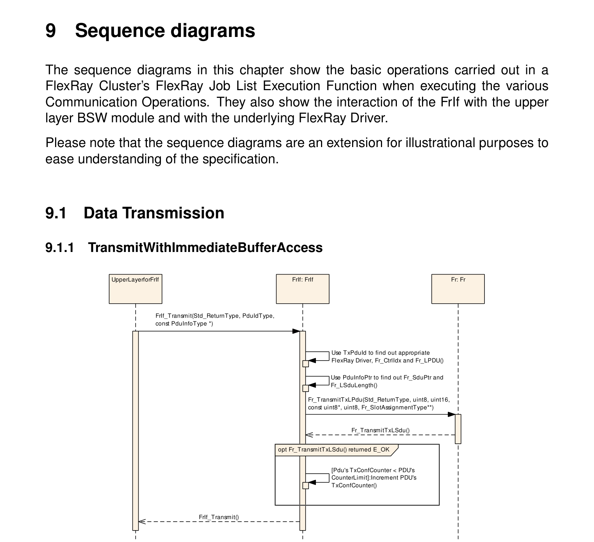

图9.1：立即缓冲区访问的发送（**Figure 9.1: Transmit With Immediate Buffer Access**）

#### 8.1.2. TransmitWithDecoupledBufferAccess

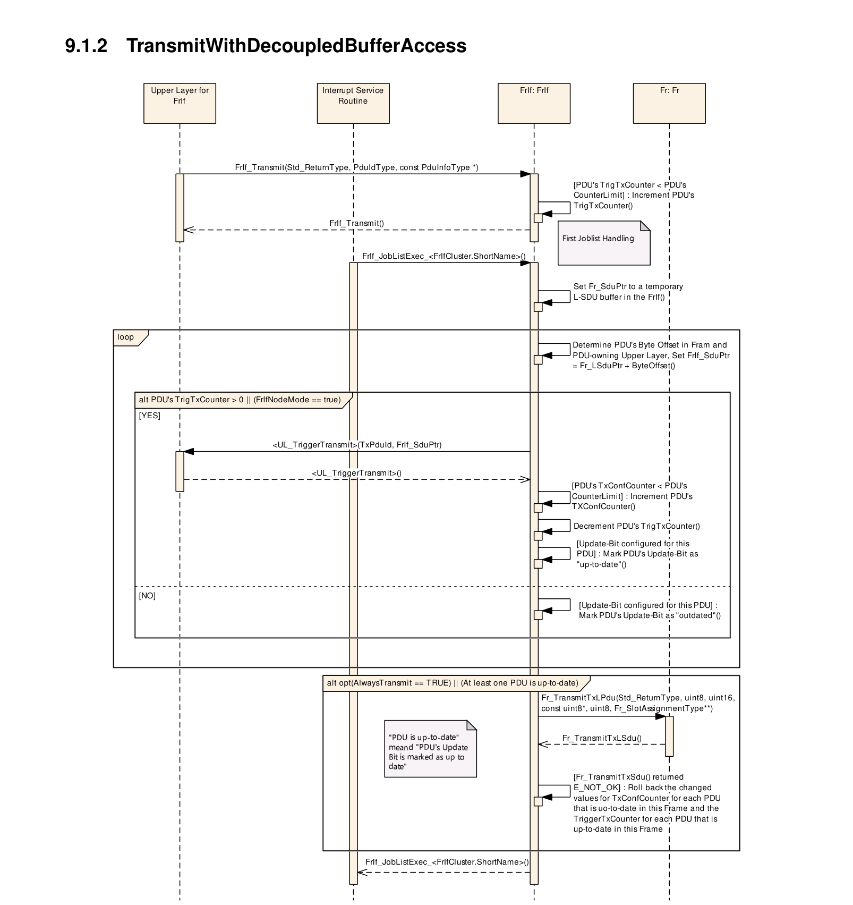

图9.2：解耦缓冲区访问的发送（**Figure 9.2: Transmit With Decoupled Buffer Access**）

#### 8.1.3. ProvideTxConfirmation

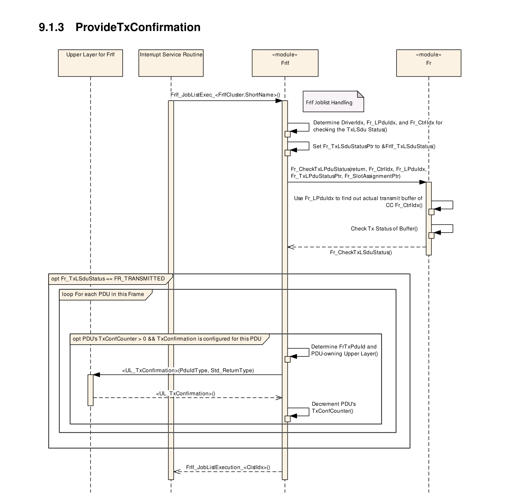

图9.3：提供发送确认（**Figure 9.3: Provide TX Confirmation**）

### 8.2. 数据接收

#### 8.2.1. ReceiveAndIndicate

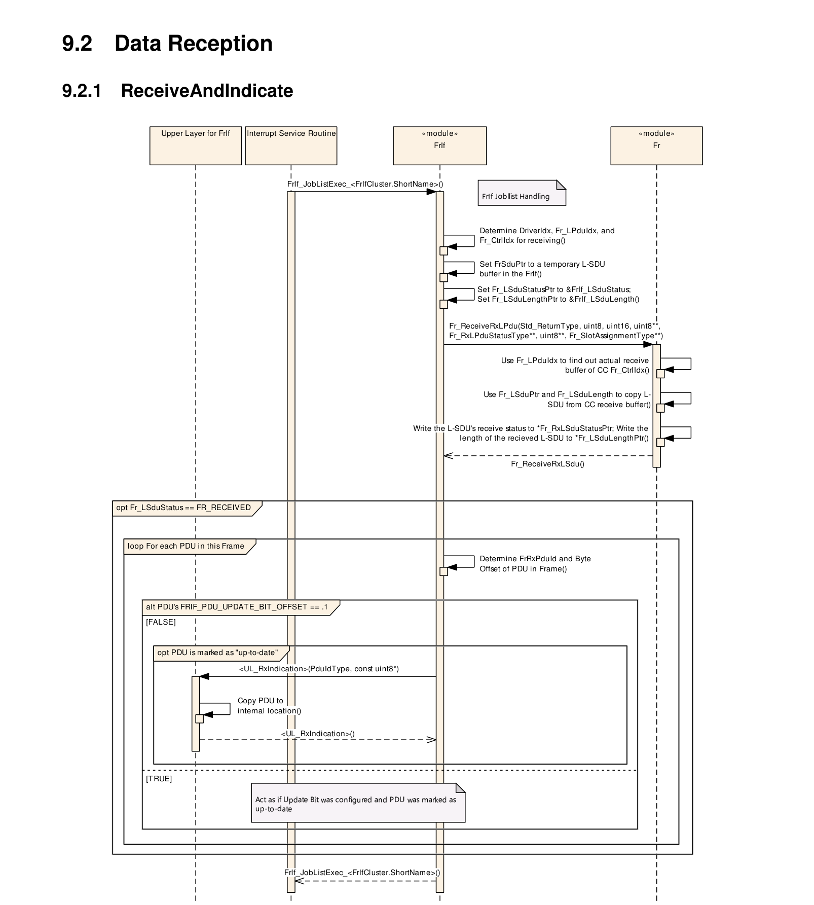

图9.4：接收并指示（**Figure 9.4: Receive and Indicate**）

#### 8.2.2. ReceiveAndStore

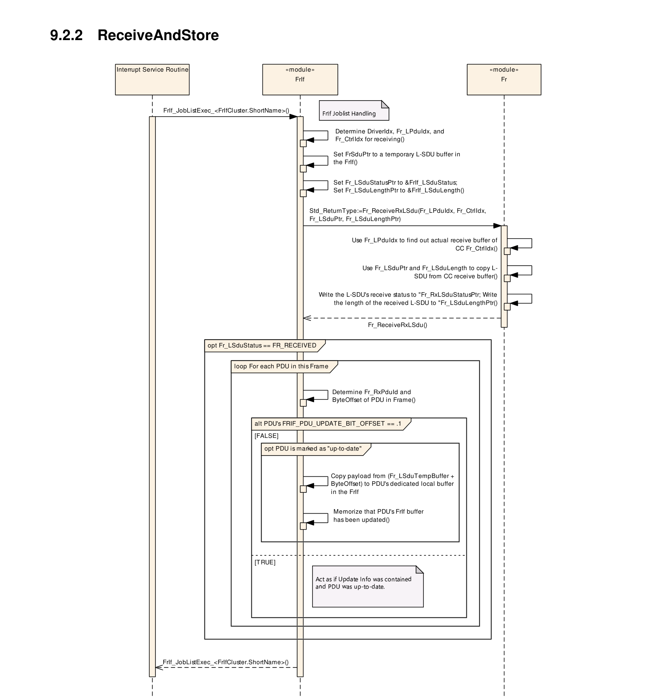

图9.5：接收并存储（**Figure 9.5: Receive and Store**）

#### 8.2.3. ProvideRxIndication

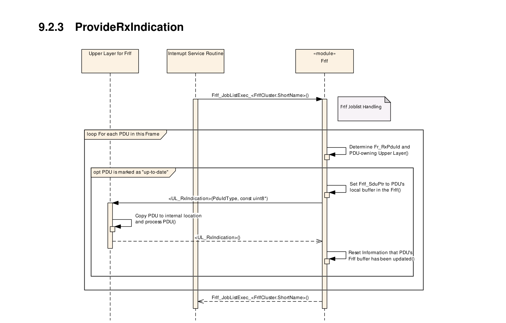

图9.6：提供接收指示（**Figure 9.6: Provide Rx Indication**）

#### 8.2.4. 取消传输

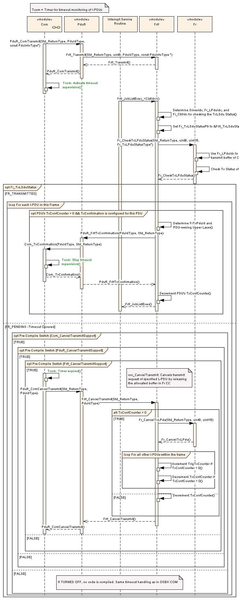

图9.7：取消传输（**Figure 9.7: Cancel Transmission**）

### 8.3. 准备 LPDU

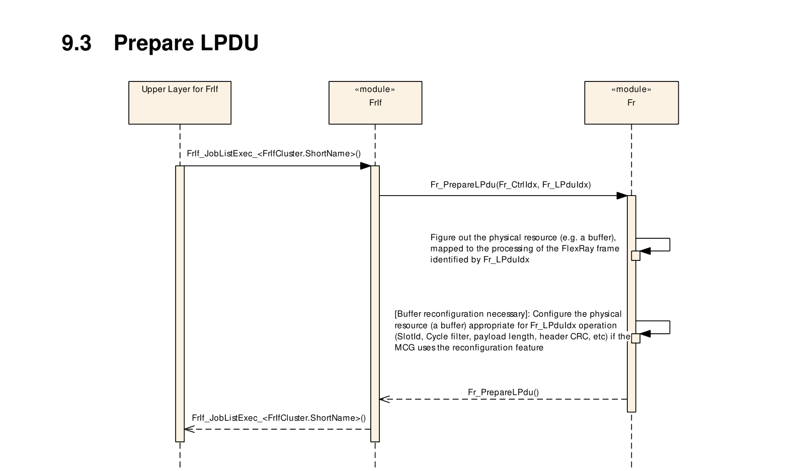

图9.8：准备 LPdu（**Figure 9.8: Prepare LPdu**）

## 9. 配置规范

通常，本章定义配置参数及其到容器的聚类。为便于理解，第 9.1 节描述了基本原理。它还规定了用于参数规范的一个模板（表格）。我们有意在本规范中保留第 9.1 节的内容以保证可理解性。

第 9.2 节规定了模块 **FrIf** 的结构（容器）和参数。

第 9.3 节规定了模块 **FrIf** 的发布信息。

### 9.1. 如何阅读本章

详情请参阅 SWS\_BSWGeneral 中 [\[1\]](#ref-1)（General Specification of Basic Software Modules）的「配置规范简介」一章。

### 9.2. 容器和配置参数

以下各节汇总所有配置参数。参数的详细含义见第 6 章和第 7 章。

所列出的配置项可以从基于 **EcuConfigurationTemplate** 的网络描述数据库中导出。配置工具必须提取配置 **FrIf** 模块所需的全部信息。

注意：

配置工具必须在配置时检查配置的一致性。

注意：

**FlexRay** 接口与 **FlexRay** 驱动程序配置之间的这些依赖关系必须由配置工具在配置时提供。
#### 9.2.1. FrIf

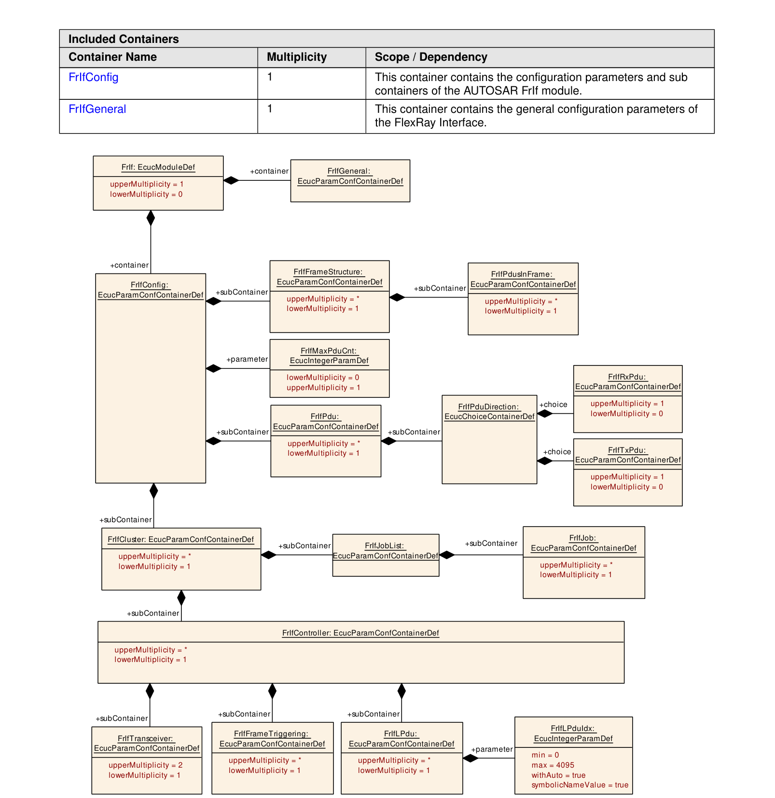

| 项目 | 内容 |
| --- | --- |
| SWS 条目 | [ECUC_FrIf_06087] |
| 容器名称 | FrIf |
| 描述 | FrIf（FlexRay 接口）模块的配置。 |
| 配置参数 | 见下方参数表 |

图10.1：FlexRay 接口模块（**Figure 10.1: FlexRay Interface Module**）

| 包含的容器 | 容器名称 | 多重性 |
| --- | --- | --- |
| 包含的容器 | FrIfConfig | 1 |
| 包含的容器 | FrIfGeneral | 1 |

#### 9.2.2. FrIfGeneral

| 项目 | 内容 |
| --- | --- |
| SWS 条目 | [ECUC_FrIf_05360] |
| 容器名称 | FrIfGeneral |
| 父容器 | FrIf |
| 描述 | 该容器包含 FlexRay 接口的通用配置参数。 |
| 配置参数 | 见下方参数表 |

无包含的容器。

| 项目 | 内容 |
| --- | --- |
| SWS 条目 | [ECUC_FrIf_06112] |
| 参数名称 | FrIfAbsTimerIdx |
| 父容器 | FrIfGeneral |
| 描述 | 支持的最大绝对定时器数量。 |
| 多重性 | 1 |
| 类型 | EcucIntegerParamDef |
| 默认值 | - |
| Post-Build 变体值 | false |
| 范围 | 1 .. 15 |
| 值配置类 | Pre-compile time：X（All Variants）；Link time：-；Post-build time：- |
| 作用域/依赖 | scope: local |

| 项目 | 内容 |
| --- | --- |
| SWS 条目 | [ECUC_FrIf_06108] |
| 参数名称 | FrIfAllSlotsSupport |
| 父容器 | FrIfGeneral |
| 描述 | 用于启用/禁用 FrIf 支持的配置参数，即启用/禁用从关键时隙/单时隙模式切换到全时隙模式。 |
| 多重性 | 1 |
| 类型 | EcucBooleanParamDef |
| 默认值 | - |
| Post-Build 变体值 | false |
| 值配置类 | Pre-compile time：X（All Variants）；Link time：-；Post-build time：- |
| 作用域/依赖 | scope: local |

| 项目 | 内容 |
| --- | --- |
| SWS 条目 | [ECUC_FrIf_06124] |
| 参数名称 | FrIfBusMirroringSupport |
| 父容器 | FrIfGeneral |
| 描述 | 用于启用/禁用 FrIf 支持的配置参数，即启用/禁用向总线镜像模块报告接收/发送的帧。 |
| 多重性 | 1 |
| 类型 | EcucBooleanParamDef |
| 默认值 | false |
| Post-Build 变体值 | false |
| 值配置类 | Pre-compile time：X（All Variants）；Link time：-；Post-build time：- |
| 作用域/依赖 | scope: local |

| 项目 | 内容 |
| --- | --- |
| SWS 条目 | [ECUC_FrIf_00002] |
| 参数名称 | FrIfCancelTransmitSupport |
| 父容器 | FrIfGeneral |
| 描述 | 用于启用/禁用 FrIf 支持的配置参数，即向 FrDrv 请求取消 I-PDU 的发送。 |
| 多重性 | 1 |
| 类型 | EcucBooleanParamDef |
| 默认值 | - |
| Post-Build 变体值 | false |
| 值配置类 | Pre-compile time：X（All Variants）；Link time：-；Post-build time：- |
| 作用域/依赖 | scope: local |

| 项目 | 内容 |
| --- | --- |
| SWS 条目 | [ECUC_FrIf_06080] |
| 参数名称 | FrIfDevErrorDetect |
| 父容器 | FrIfGeneral |
| 描述 | 打开或关闭开发错误检测和通知。true：启用检测和通知。false：禁用检测和通知。 |
| 多重性 | 1 |
| 类型 | EcucBooleanParamDef |
| 默认值 | false |
| Post-Build 变体值 | false |
| 值配置类 | Pre-compile time：X（All Variants）；Link time：-；Post-build time：- |
| 作用域/依赖 | scope: local |

| 项目 | 内容 |
| --- | --- |
| SWS 条目 | [ECUC_FrIf_06110] |
| 参数名称 | FrIfDisableLPduSupport |
| 父容器 | FrIfGeneral |
| 描述 | 用于启用/禁用 FrIf 支持的配置参数，即禁用某个 LPdu 用于发送/接收的硬件资源。 |
| 多重性 | 1 |
| 类型 | EcucBooleanParamDef |
| 默认值 | - |
| Post-Build 变体值 | false |
| 值配置类 | Pre-compile time：X（All Variants）；Link time：-；Post-build time：- |
| 作用域/依赖 | scope: local |

| 项目 | 内容 |
| --- | --- |
| SWS 条目 | [ECUC_FrIf_06102] |
| 参数名称 | FrIfDisableTransceiverBranchSupport |
| 父容器 | FrIfGeneral |
| 描述 | 用于启用/禁用 FrIf 支持的配置参数，即禁用有源星型（active star）的分支。 |
| 多重性 | 1 |
| 类型 | EcucBooleanParamDef |
| 默认值 | - |
| Post-Build 变体值 | false |
| 值配置类 | Pre-compile time：X（All Variants）；Link time：-；Post-build time：- |
| 作用域/依赖 | scope: local |

| 项目 | 内容 |
| --- | --- |
| SWS 条目 | [ECUC_FrIf_06103] |
| 参数名称 | FrIfEnableTransceiverBranchSupport |
| 父容器 | FrIfGeneral |
| 描述 | 用于启用/禁用 FrIf 支持的配置参数，即使能有源星型（active star）的分支。 |
| 多重性 | 1 |
| 类型 | EcucBooleanParamDef |
| 默认值 | - |
| Post-Build 变体值 | false |
| 值配置类 | Pre-compile time：X（All Variants）；Link time：-；Post-build time：- |
| 作用域/依赖 | scope: local |

| 项目 | 内容 |
| --- | --- |
| SWS 条目 | [ECUC_FrIf_06118] |
| 参数名称 | FrIfFreeOpAApiName |
| 父容器 | FrIfGeneral |
| 描述 | 当选择 FREE_OP_A 作为通信操作时调用的 API 名称。另见第 7.8.3 章（可配置接口）。 |
| 多重性 | 0..1 |
| 类型 | EcucStringParamDef |
| 默认值 | - |
| 正则表达式 | - |
| Post-Build 变体多重性 | false |
| Post-Build 变体值 | false |
| 值配置类 | Pre-compile time：X；Link time：-；Post-build time：- |
| 多重性配置类 | Pre-compile time：X；Link time：-；Post-build time：- |
| 作用域/依赖 | scope: local |

| 项目 | 内容 |
| --- | --- |
| SWS 条目 | [ECUC_FrIf_06119] |
| 参数名称 | FrIfFreeOpBApiName |
| 父容器 | FrIfGeneral |
| 描述 | 当选择 FREE_OP_B 作为通信操作时调用的 API 名称。另见第 7.8.3 章（可配置接口）。 |
| 多重性 | 0..1 |
| 类型 | EcucStringParamDef |
| 默认值 | - |
| 正则表达式 | - |
| Post-Build 变体多重性 | false |
| Post-Build 变体值 | false |
| 值配置类 | Pre-compile time：X；Link time：-；Post-build time：- |
| 多重性配置类 | Pre-compile time：X；Link time：-；Post-build time：- |
| 作用域/依赖 | scope: local |

| 项目 | 内容 |
| --- | --- |
| SWS 条目 | [ECUC_FrIf_06120] |
| 参数名称 | FrIfFreeOpsHeader |
| 父容器 | FrIfGeneral |
| 描述 | 定义可配置的 FREE_OP_A / FREE_OP_B 函数的头文件。 |
| 多重性 | 0..1 |
| 类型 | EcucStringParamDef |
| 默认值 | - |
| 正则表达式 | - |
| Post-Build 变体多重性 | false |
| Post-Build 变体值 | false |
| 值配置类 | Pre-compile time：X；Link time：-；Post-build time：- |
| 多重性配置类 | Pre-compile time：X；Link time：-；Post-build time：- |
| 作用域/依赖 | scope: local |

| 项目 | 内容 |
| --- | --- |
| SWS 条目 | [ECUC_FrIf_06106] |
| 参数名称 | FrIfGetClockCorrectionSupport |
| 父容器 | FrIfGeneral |
| 描述 | 用于启用/禁用 FrIf 支持的配置参数，即启用/禁用轮询 FlexRay 驱动程序以获取 CC 时钟校正值。 |
| 多重性 | 1 |
| 类型 | EcucBooleanParamDef |
| 默认值 | - |
| Post-Build 变体值 | false |
| 值配置类 | Pre-compile time：X（All Variants）；Link time：- |
| 作用域/依赖 | scope: local |

| 项目 | 内容 |
| --- | --- |
| SWS 条目 | [ECUC_FrIf_06105] |
| 参数名称 | FrIfGetGetChannelStatusSupport |
| 父容器 | FrIfGeneral |
| 描述 | 用于启用/禁用 FrIf 支持的配置参数，即启用/禁用轮询 FlexRay 驱动程序以获取 FlexRay 通信总线的错误信息。 |
| 多重性 | 1 |
| 类型 | EcucBooleanParamDef |
| 默认值 | - |
| Post-Build 变体值 | false |
| 值配置类 | Pre-compile time：X（All Variants）；Link time：-；Post-build time：- |
| 作用域/依赖 | scope: local |

| 项目 | 内容 |
| --- | --- |
| SWS 条目 | [ECUC_FrIf_06114] |
| 参数名称 | FrIfGetNmVectorSupport |
| 父容器 | FrIfGeneral |
| 描述 | 用于启用/禁用 FrIf 支持的配置参数，即请求 FlexRay 硬件的 NMVector。 |
| 多重性 | 1 |
| 类型 | EcucBooleanParamDef |
| 默认值 | - |
| Post-Build 变体值 | false |
| 值配置类 | Pre-compile time：X（All Variants）；Link time：-；Post-build time：- |
| 作用域/依赖 | scope: local |

| 项目 | 内容 |
| --- | --- |
| SWS 条目 | [ECUC_FrIf_06104] |
| 参数名称 | FrIfGetNumOfStartupFramesSupport |
| 父容器 | FrIfGeneral |
| 描述 | 用于启用/禁用 FrIf 支持的配置参数，即启用/禁用轮询 FlexRay 驱动程序以获取总线上实际接收到的启动帧数量。 |
| 多重性 | 1 |
| 类型 | EcucBooleanParamDef |
| 默认值 | - |
| Post-Build 变体值 | false |
| 值配置类 | Pre-compile time：X（All Variants）；Link time：-；Post-build time：- |
| 作用域/依赖 | scope: local |

| 项目 | 内容 |
| --- | --- |
| SWS 条目 | [ECUC_FrIf_06107] |
| 参数名称 | FrIfGetSyncFrameListSupport |
| 父容器 | FrIfGeneral |
| 描述 | 用于启用/禁用 FrIf 支持的配置参数，即启用/禁用轮询 FlexRay 驱动程序以获取实际接收到的同步帧列表。 |
| 多重性 | 1 |
| 类型 | EcucBooleanParamDef |
| 默认值 | - |
| Post-Build 变体值 | false |
| 值配置类 | Pre-compile time：X（All Variants）；Link time：-；Post-build time：- |
| 作用域/依赖 | scope: local |

| 项目 | 内容 |
| --- | --- |
| SWS 条目 | [ECUC_FrIf_06101] |
| 参数名称 | FrIfGetTransceiverErrorSupport |
| 父容器 | FrIfGeneral |
| 描述 | 用于启用/禁用 FrIf 支持的配置参数，即通过调用 FlexRay 收发器模块获取 FlexRay 收发器错误。 |
| 多重性 | 1 |
| 类型 | EcucBooleanParamDef |
| 默认值 | - |
| Post-Build 变体值 | false |
| 值配置类 | Pre-compile time：X（All Variants）；Link time：-；Post-build time：- |
| 作用域/依赖 | scope: local |

| 项目 | 内容 |
| --- | --- |
| SWS 条目 | [ECUC_FrIf_06111] |
| 参数名称 | FrIfGetWakeupRxStatusSupport |
| 父容器 | FrIfGeneral |
| 描述 | 用于启用/禁用 FrIf 支持的配置参数，即从 FlexRay 控制器获取唤醒接收信息。 |
| 多重性 | 1 |
| 类型 | EcucBooleanParamDef |
| 默认值 | - |
| Post-Build 变体值 | false |
| 值配置类 | Pre-compile time：X（All Variants）；Link time：-；Post-build time：- |
| 作用域/依赖 | scope: local |

| 项目 | 内容 |
| --- | --- |
| SWS 条目 | [ECUC_FrIf_06081] |
| 参数名称 | FrIfNumClstSupported |
| 父容器 | FrIfGeneral |
| 描述 | FlexRay 接口支持的最大 FlexRay 集群数量。 |
| 多重性 | 1 |
| 类型 | EcucIntegerParamDef |
| 默认值 | - |
| Post-Build 变体值 | false |
| 范围 | 1 .. 15 |
| 值配置类 | Pre-compile time：X（All Variants）；Link time：-；Post-build time：- |
| 作用域/依赖 | scope: local |

| 项目 | 内容 |
| --- | --- |
| SWS 条目 | [ECUC_FrIf_06082] |
| 参数名称 | FrIfNumCtrlSupported |
| 父容器 | FrIfGeneral |
| 描述 | FlexRay 接口支持的最大 FlexRay CC 数量 |
| 多重性 | 1 |
| 类型 | EcucIntegerParamDef |
| 默认值 | - |
| Post-Build 变体值 | false |
| 范围 | 1 .. |
| 值配置类 | Pre-compile time：X（All Variants）；Link time：-；Post-build time：- |
| 作用域/依赖 | scope: local |

| 项目 | 内容 |
| --- | --- |
| SWS 条目 | [ECUC_FrIf_06116] |
| 参数名称 | FrIfPublicCddHeaderFile |
| 父容器 | FrIfGeneral |
| 描述 | 为回调函数定义头文件，在存在 CDD 的情况下应包含这些头文件。字符范围为 1..32。 |
| 多重性 | 0..* |
| 类型 | EcucStringParamDef |
| 默认值 | - |
| 正则表达式 | - |
| Post-Build 变体多重性 | false |
| Post-Build 变体值 | false |
| 值配置类 | Pre-compile time：X；Link time：-；Post-build time：- |
| 多重性配置类 | Pre-compile time：X；Link time：-；Post-build time：- |
| 作用域/依赖 | scope: local |

| 项目 | 内容 |
| --- | --- |
| SWS 条目 | [ECUC_FrIf_06117] |
| 参数名称 | FrIfReadCCConfigApi |
| 父容器 | FrIfGeneral |
| 描述 | 用于启用/禁用可选 FrIf_ReadCCConfig API 的配置参数。 |
| 多重性 | 1 |
| 类型 | EcucBooleanParamDef |
| 默认值 | - |
| Post-Build 变体值 | false |
| 值配置类 | Pre-compile time：X（All Variants）；Link time：-；Post-build time：- |
| 作用域/依赖 | scope: local |

| 项目 | 内容 |
| --- | --- |
| SWS 条目 | [ECUC_FrIf_06109] |
| 参数名称 | FrIfReconfigLPduSupport |
| 父容器 | FrIfGeneral |
| 描述 | 用于启用/禁用 FrIf 支持的配置参数，即启用/禁用在运行时根据参数（FrameId、Channel、CycleRepetition、CycleOffset、PayloadLength、HeaderCRC）重新配置给定的 LPdu。 |
| 多重性 | 1 |
| 类型 | EcucBooleanParamDef |
| 默认值 | - |
| Post-Build 变体值 | false |
| 值配置类 | Pre-compile time：X（All Variants）；Link time：-；Post-build time：- |
| 作用域/依赖 | scope: local |

| 项目 | 内容 |
| --- | --- |
| SWS 条目 | [ECUC_FrIf_06123] |
| 参数名称 | FrIfTxConflictNotificationHeaderName |
| 父容器 | FrIfGeneral |
| 描述 | 定义 UL_TxConflictNotification 的头文件名的配置。 |
| 多重性 | 0..1 |
| 类型 | EcucStringParamDef |
| 默认值 | - |
| 正则表达式 | - |
| Post-Build 变体多重性 | false |
| Post-Build 变体值 | false |
| 值配置类 | Pre-compile time：X；Link time：-；Post-build time：- |
| 多重性配置类 | Pre-compile time：X；Link time：-；Post-build time：- |
| 作用域/依赖 | scope: local dependency: FrIfTxConflictNotificationName |

| 项目 | 内容 |
| --- | --- |
| SWS 条目 | [ECUC_FrIf_06122] |
| 参数名称 | FrIfTxConflictNotificationName |
| 父容器 | FrIfGeneral |
| 描述 | 检测到发送冲突（TxConflict）时所调用 API 名称的配置。 |
| 多重性 | 0..1 |
| 类型 | EcucStringParamDef |
| 默认值 | - |
| Post-Build 变体多重性 | false |
| Post-Build 变体值 | false |
| 值配置类 | Pre-compile time：X（All Variants）；Link time：-；Post-build time：- |
| 多重性配置类 | Pre-compile time：X（All Variants）；Link time：-；Post-build time：- |
| 作用域/依赖 | scope: local dependency: FrIfTxConflictNotificationHeaderName |

| 项目 | 内容 |
| --- | --- |
| SWS 条目 | [ECUC_FrIf_00001] |
| 参数名称 | FrIfUnusedBitValue |
| 父容器 | FrIfGeneral |
| 描述 | 将已发送 Pdu 的未使用位设置为一个定义的值。 |
| 多重性 | 0..1 |
| 类型 | EcucIntegerParamDef |
| 默认值 | - |
| Post-Build 变体多重性 | false |
| Post-Build 变体值 | false |
| 范围 | 0 .. 1 |
| 值配置类 | Pre-compile time：X；Link time：-；Post-build time：- |
| 多重性配置类 | Pre-compile time：X；Link time：-；Post-build time：- |
| 作用域/依赖 | scope: local |

| 项目 | 内容 |
| --- | --- |
| SWS 条目 | [ECUC_FrIf_06083] |
| 参数名称 | FrIfVersionInfoApi |
| 父容器 | FrIfGeneral |
| 描述 | 启用/禁用 FrIf_GetVersionInfo() API 服务是否存在。true：FrIf_GetVersionInfo() API 服务存在。false：FrIf_GetVersionInfo() API 服务不存在 |
| 多重性 | 1 |
| 类型 | EcucBooleanParamDef |
| 默认值 | false |
| Post-Build 变体值 | false |
| 值配置类 | Pre-compile time：X（All Variants）；Link time：-；Post-build time：- |
| 作用域/依赖 | scope: local |

#### 9.2.3. FrIfCluster

| 项目 | 内容 |
| --- | --- |
| SWS 条目 | [ECUC_FrIf_05366] |
| 容器名称 | FrIfCluster |
| 父容器 | FrIfConfig |
| 描述 | 该容器规定了一个 FrIf 集群以及启用该集群通信所需的全部相关数据。一个集群可以由多于一个控制器组成。 |
| 多重性配置类 | Pre-compile time：X（VARIANT-PRE-COMPILE, VARIANT-LINK-TIME, VARIANT-POST-BUILD）；Link time：-；Post-build time：- |
| Post-Build 变体多重性 | false |
| 配置参数 | 见下方参数表 |

| 包含的容器 | 容器名称 | 多重性 |
| --- | --- | --- |
| 包含的容器 | FrIfClusterDemEventParameterRefs | 0..1 |
| 包含的容器 | FrIfController | 1..* |
| 包含的容器 | FrIfJobList | 1 |

| 项目 | 内容 |
| --- | --- |
| SWS 条目 | [ECUC_FrIf_06002] |
| 参数名称 | FrIfClstIdx |
| 父容器 | FrIfCluster |
| 描述 | 该参数提供 FlexRay 集群的从零开始连续编号的索引。上层 BSW 模块和 FrIf 自身使用该索引来标识一个 FlexRay 集群。 |
| 多重性 | 1 |
| 类型 | EcucIntegerParamDef (Symbolic Name generated for this parameter) |
| 默认值 | - |
| Post-Build 变体值 | false |
| 范围 | 0 .. 63 |
| 值配置类 | Pre-compile time：X（All Variants）；Link time：-；Post-build time：- |
| 作用域/依赖 | scope: local |

| 项目 | 内容 |
| --- | --- |
| SWS 条目 | [ECUC_FrIf_00003] |
| 参数名称 | FrIfDetectNITError |
| 父容器 | FrIfCluster |
| 描述 | 指示是否应检测每个集群的 NIT 错误状态。 |
| 多重性 | 1 |
| 类型 | EcucBooleanParamDef |
| 默认值 | - |
| Post-Build 变体值 | true |
| 值配置类 | Pre-compile time：X（VARIANT-PRE-COMPILE）；Link time：X（VARIANT-LINK-TIME）；Post-build time：X（VARIANT-POST-BUILD） |
| 作用域/依赖 | scope: local |

| 项目 | 内容 |
| --- | --- |
| SWS 条目 | [ECUC_FrIf_06006] |
| 参数名称 | FrIfGChannels |
| 父容器 | FrIfCluster |
| 描述 | 集群使用的信道。实现类型：Fr_ChannelType |
| 多重性 | 1 |
| 类型 | EcucEnumerationParamDef |
| Post-Build 变体值 | true |
| 范围 | FR_CHANNEL_A；FR_CHANNEL_AB；FR_CHANNEL_B |
| 值配置类 | Pre-compile time：X（VARIANT-PRE-COMPILE）；Link time：X（VARIANT-LINK-TIME）；Post-build time：X（VARIANT-POST-BUILD） |
| 作用域/依赖 | scope: local |

| 项目 | 内容 |
| --- | --- |
| SWS 条目 | [ECUC_FrIf_06008] |
| 参数名称 | FrIfGColdStartAttempts |
| 父容器 | FrIfCluster |
| 描述 | 集群中的节点通过发起调度同步来尝试启动集群的最大允许次数 |
| 多重性 | 1 |
| 类型 | EcucIntegerParamDef |
| 默认值 | - |
| Post-Build 变体值 | true |
| 范围 | 2 .. 31 |
| 值配置类 | Pre-compile time：X（VARIANT-PRE-COMPILE）；Link time：X（VARIANT-LINK-TIME）；Post-build time：X（VARIANT-POST-BUILD） |
| 作用域/依赖 | scope: local |

| 项目 | 内容 |
| --- | --- |
| SWS 条目 | [ECUC_FrIf_06086] |
| 参数名称 | FrIfGCycleCountMax |
| 父容器 | FrIfCluster |
| 描述 | 给定集群中循环计数器的最大值。备注：为符合 FlexRay Protocol 2.1 Rev. A，设置为 63。 |
| 多重性 | 1 |
| 类型 | EcucIntegerParamDef |
| 默认值 | - |
| Post-Build 变体值 | true |
| 范围 | 7 .. 63 |
| 值配置类 | Pre-compile time：X（VARIANT-PRE-COMPILE）；Link time：X（VARIANT-LINK-TIME）；Post-build time：X（VARIANT-POST-BUILD） |
| 作用域/依赖 | scope: local |

| 项目 | 内容 |
| --- | --- |
| SWS 条目 | [ECUC_FrIf_06020] |
| 参数名称 | FrIfGdActionPointOffset |
| 父容器 | FrIfCluster |
| 描述 | 动作点（action point）从静态时隙起始处偏移的宏节拍数。 |
| 多重性 | 1 |
| 类型 | EcucIntegerParamDef |
| 默认值 | - |
| Post-Build 变体值 | true |
| 范围 | 1 .. 63 |
| 值配置类 | Pre-compile time：X（VARIANT-PRE-COMPILE）；Link time：X（VARIANT-LINK-TIME）；Post-build time：X（VARIANT-POST-BUILD） |
| 作用域/依赖 | scope: ECU |

| 项目 | 内容 |
| --- | --- |
| SWS 条目 | [ECUC_FrIf_06021] |
| 参数名称 | FrIfGdBit |
| 父容器 | FrIfCluster |
| 描述 | 标称位时间（单位为秒） |
| 多重性 | 1 |
| 类型 | EcucEnumerationParamDef |
| Post-Build 变体值 | true |
| 范围 | T100NS；T200NS；T400NS |
| 值配置类 | Pre-compile time：X（VARIANT-PRE-COMPILE）；Link time：X（VARIANT-LINK-TIME）；Post-build time：X（VARIANT-POST-BUILD） |
| 作用域/依赖 | scope: local |

| 项目 | 内容 |
| --- | --- |
| SWS 条目 | [ECUC_FrIf_06024] |
| 参数名称 | FrIfGdCasRxLowMax |
| 父容器 | FrIfCluster |
| 描述 | CAS 接受窗口的上限 [gdBit]。备注：为符合 FlexRay Protocol 2.1 Rev. A，范围为 67 到 99。 |
| 多重性 | 1 |
| 类型 | EcucIntegerParamDef |
| 默认值 | - |
| Post-Build 变体值 | true |
| 范围 | 28 .. 254 |
| 值配置类 | Pre-compile time：X（VARIANT-PRE-COMPILE）；Link time：X（VARIANT-LINK-TIME）；Post-build time：X（VARIANT-POST-BUILD） |
| 作用域/依赖 | scope: local |

| 项目 | 内容 |
| --- | --- |
| SWS 条目 | [ECUC_FrIf_06025] |
| 参数名称 | FrIfGdCycle |
| 父容器 | FrIfCluster |
| 描述 | 循环的长度，用 [s] 表示。备注：为符合 FlexRay Protocol 3.0，下限为 0.000024。 |
| 多重性 | 1 |
| 类型 | EcucFloatParamDef |
| 默认值 | - |
| Post-Build 变体值 | true |
| 范围 | [2.4E-5 .. 0.016] |
| 值配置类 | Pre-compile time：X（VARIANT-PRE-COMPILE）；Link time：X（VARIANT-LINK-TIME）；Post-build time：X（VARIANT-POST-BUILD） |
| 作用域/依赖 | scope: local |

| 项目 | 内容 |
| --- | --- |
| SWS 条目 | [ECUC_FrIf_06026] |
| 参数名称 | FrIfGdDynamicSlotIdlePhase |
| 父容器 | FrIfCluster |
| 描述 | 动态时隙内空闲阶段的持续时间 [Minislots]。 |
| 多重性 | 1 |
| 类型 | EcucIntegerParamDef |
| 默认值 | - |
| Post-Build 变体值 | true |
| 范围 | 0 .. 2 |
| 值配置类 | Pre-compile time：X（VARIANT-PRE-COMPILE）；Link time：X（VARIANT-LINK-TIME）；Post-build time：X（VARIANT-POST-BUILD） |
| 作用域/依赖 | scope: local |

| 项目 | 内容 |
| --- | --- |
| SWS 条目 | [ECUC_FrIf_00012] |
| 参数名称 | FrIfGdIgnoreAfterTx |
| 父容器 | FrIfCluster |
| 描述 | 发送之后位选通（bitstrobing）暂停的持续时间 [gdBit]。备注：为符合 FlexRay Protocol 2.1 Rev. A，设置为 0。 |
| 多重性 | 1 |
| 类型 | EcucIntegerParamDef |
| 默认值 | - |
| Post-Build 变体值 | true |
| 范围 | 0 .. 15 |
| 值配置类 | Pre-compile time：X（VARIANT-PRE-COMPILE）；Link time：X（VARIANT-LINK-TIME）；Post-build time：X（VARIANT-POST-BUILD） |
| 作用域/依赖 | scope: local |

| 项目 | 内容 |
| --- | --- |
| SWS 条目 | [ECUC_FrIf_06027] |
| 参数名称 | FrIfGdMacrotick |
| 父容器 | FrIfCluster |
| 描述 | 宏节拍的持续时间 |
| 多重性 | 1 |
| 类型 | EcucFloatParamDef |
| 默认值 | - |
| Post-Build 变体值 | true |
| 范围 | [1E-6 .. 6E-6] |
| 值配置类 | Pre-compile time：X（VARIANT-PRE-COMPILE）；Link time：X（VARIANT-LINK-TIME）；Post-build time：X（VARIANT-POST-BUILD） |
| 作用域/依赖 | scope: local |

| 项目 | 内容 |
| --- | --- |
| SWS 条目 | [ECUC_FrIf_06033] |
| 参数名称 | FrIfGdMinislot |
| 父容器 | FrIfCluster |
| 描述 | 一个微时隙（minislot）的持续时间 [Macroticks] |
| 多重性 | 1 |
| 类型 | EcucIntegerParamDef |
| 默认值 | - |
| Post-Build 变体值 | true |
| 范围 | 2 .. 63 |
| 值配置类 | Pre-compile time：X（VARIANT-PRE-COMPILE）；Link time：X（VARIANT-LINK-TIME）；Post-build time：X（VARIANT-POST-BUILD） |
| 作用域/依赖 | scope: ECU |

| 项目 | 内容 |
| --- | --- |
| SWS 条目 | [ECUC_FrIf_06032] |
| 参数名称 | FrIfGdMiniSlotActionPointOffset |
| 父容器 | FrIfCluster |
| 描述 | 微时隙动作点从一个微时隙起始处偏移的宏节拍数 [Macroticks]。 |
| 多重性 | 1 |
| 类型 | EcucIntegerParamDef |
| 默认值 | - |
| Post-Build 变体值 | true |
| 范围 | 1 .. 31 |
| 值配置类 | Pre-compile time：X（VARIANT-PRE-COMPILE）；Link time：X（VARIANT-LINK-TIME）；Post-build time：X（VARIANT-POST-BUILD） |
| 作用域/依赖 | scope: local |

| 项目 | 内容 |
| --- | --- |
| SWS 条目 | [ECUC_FrIf_06034] |
| 参数名称 | FrIfGdNit |
| 父容器 | FrIfCluster |
| 描述 | 网络空闲时间（Network Idle Time）的持续时间 [Macroticks]。备注：为符合 FlexRay Protocol 2.1 Rev. A，上限为 805。 |
| 多重性 | 1 |
| 类型 | EcucIntegerParamDef |
| 默认值 | - |
| Post-Build 变体值 | true |
| 范围 | 2 .. 15978 |
| 值配置类 | Pre-compile time：X（VARIANT-PRE-COMPILE）；Link time：X（VARIANT-LINK-TIME）；Post-build time：X（VARIANT-POST-BUILD） |
| 作用域/依赖 | scope: local |

| 项目 | 内容 |
| --- | --- |
| SWS 条目 | [ECUC_FrIf_06035] |
| 参数名称 | FrIfGdSampleClockPeriod |
| 父容器 | FrIfCluster |
| 描述 | 采样时钟周期 |
| 多重性 | 1 |
| 类型 | EcucEnumerationParamDef |
| Post-Build 变体值 | true |
| 范围 | T12_5NS；T25NS；T50NS |
| 值配置类 | Pre-compile time：X（VARIANT-PRE-COMPILE）；Link time：X（VARIANT-LINK-TIME）；Post-build time：X（VARIANT-POST-BUILD） |
| 作用域/依赖 | scope: local |

| 项目 | 内容 |
| --- | --- |
| SWS 条目 | [ECUC_FrIf_06036] |
| 参数名称 | FrIfGdStaticSlot |
| 父容器 | FrIfCluster |
| 描述 | 一个静态时隙的持续时间 [Macroticks]。备注：为符合 FlexRay Protocol 2.1 Rev. A，范围为 4-661。 |
| 多重性 | 1 |
| 类型 | EcucIntegerParamDef |
| 默认值 | - |
| Post-Build 变体值 | true |
| 范围 | 3 .. 664 |
| 值配置类 | Pre-compile time：X（VARIANT-PRE-COMPILE）；Link time：X（VARIANT-LINK-TIME）；Post-build time：X（VARIANT-POST-BUILD） |
| 作用域/依赖 | scope: local |

| 项目 | 内容 |
| --- | --- |
| SWS 条目 | [ECUC_FrIf_06037] |
| 参数名称 | FrIfGdSymbolWindow |
| 父容器 | FrIfCluster |
| 描述 | 符号窗口的持续时间 [Macroticks]。备注：为符合 FlexRay Protocol 2.1 Rev. A，范围为 0-142。 |
| 多重性 | 1 |
| 类型 | EcucIntegerParamDef |
| 默认值 | - |
| Post-Build 变体值 | true |
| 范围 | 0 .. 162 |
| 值配置类 | Pre-compile time：X（VARIANT-PRE-COMPILE）；Link time：X（VARIANT-LINK-TIME）；Post-build time：X（VARIANT-POST-BUILD） |
| 作用域/依赖 | scope: local |

| 项目 | 内容 |
| --- | --- |
| SWS 条目 | [ECUC_FrIf_00011] |
| 参数名称 | FrIfGdSymbolWindowActionPointOffset |
| 父容器 | FrIfCluster |
| 描述 | 动作点从符号窗口起始处偏移的宏节拍数 [Macroticks]。备注：为符合 FlexRay Protocol 2.1 Rev. A，设置为 GdActionPointOffset。 |
| 多重性 | 1 |
| 类型 | EcucIntegerParamDef |
| 默认值 | - |
| Post-Build 变体值 | true |
| 范围 | 1 .. 63 |
| 值配置类 | Pre-compile time：X（VARIANT-PRE-COMPILE）；Link time：X（VARIANT-LINK-TIME）；Post-build time：X（VARIANT-POST-BUILD） |
| 作用域/依赖 | scope: local |

| 项目 | 内容 |
| --- | --- |
| SWS 条目 | [ECUC_FrIf_06038] |
| 参数名称 | FrIfGdTSSTransmitter |
| 父容器 | FrIfCluster |
| 描述 | 发送起始序列（Transmission Start Sequence）中的位数 [gdBits]。备注：为符合 FlexRay Protocol 2.1 Rev. A，下限为 3。 |
| 多重性 | 1 |
| 类型 | EcucIntegerParamDef |
| 默认值 | - |
| Post-Build 变体值 | true |
| 范围 | 1 .. 15 |
| 值配置类 | Pre-compile time：X（VARIANT-PRE-COMPILE）；Link time：X（VARIANT-LINK-TIME）；Post-build time：X（VARIANT-POST-BUILD） |
| 作用域/依赖 | scope: local |

| 项目 | 内容 |
| --- | --- |
| SWS 条目 | [ECUC_FrIf_06039] |
| 参数名称 | FrIfGdWakeupRxIdle |
| 父容器 | FrIfCluster |
| 描述 | 节点用于测试所接收唤醒的「空闲（idle）」或 HIGH 阶段持续时间的位数 [gdBit]。备注：该参数映射到 FlexRay Protocol 2.1 Rev. A 参数 gdWakeupSymbolRxIdle。为符合 FlexRay Protocol 2.1 Rev. A，下限为 14。 |
| 多重性 | 1 |
| 类型 | EcucIntegerParamDef |
| 默认值 | - |
| Post-Build 变体值 | true |
| 范围 | 8 .. 59 |
| 值配置类 | Pre-compile time：X（VARIANT-PRE-COMPILE）；Link time：X（VARIANT-LINK-TIME）；Post-build time：X（VARIANT-POST-BUILD） |
| 作用域/依赖 | scope: local |

| 项目 | 内容 |
| --- | --- |
| SWS 条目 | [ECUC_FrIf_06040] |
| 参数名称 | FrIfGdWakeupRxLow |
| 父容器 | FrIfCluster |
| 描述 | 节点用于测试所接收唤醒的 LOW 阶段持续时间的位数 [gdBit]。备注：该参数映射到 FlexRay Protocol 2.1 Rev. A 参数 gdWakeupSymbolRxLow。为符合 FlexRay Protocol 2.1 Rev. A，下限为 11。 |
| 多重性 | 1 |
| 类型 | EcucIntegerParamDef |
| 默认值 | - |
| Post-Build 变体值 | true |
| 范围 | 8 .. 59 |
| 值配置类 | Pre-compile time：X（VARIANT-PRE-COMPILE）；Link time：X（VARIANT-LINK-TIME）；Post-build time：X（VARIANT-POST-BUILD） |
| 作用域/依赖 | scope: local |

| 项目 | 内容 |
| --- | --- |
| SWS 条目 | [ECUC_FrIf_06041] |
| 参数名称 | FrIfGdWakeupRxWindow |
| 父容器 | FrIfCluster |
| 描述 | 用于检测唤醒的窗口大小 [gdBit]。备注：该参数映射到 FlexRay Protocol 2.1 Rev. A 参数 gdWakeupSymbolRxWindow。为符合 FlexRay Protocol 2.1 Rev. A，上限为 301。 |
| 多重性 | 1 |
| 类型 | EcucIntegerParamDef |
| 默认值 | - |
| Post-Build 变体值 | true |
| 范围 | 76 .. 485 |
| 值配置类 | Pre-compile time：X（VARIANT-PRE-COMPILE）；Link time：X（VARIANT-LINK-TIME）；Post-build time：X（VARIANT-POST-BUILD） |
| 作用域/依赖 | scope: local |

| 项目 | 内容 |
| --- | --- |
| SWS 条目 | [ECUC_FrIf_06043] |
| 参数名称 | FrIfGdWakeupTxActive |
| 父容器 | FrIfCluster |
| 描述 | 节点用于发送唤醒符号的 LOW 阶段以及 WUDOP 的 HIGH 和 LOW 阶段的位数 [gdBit]。备注：该参数映射到 FlexRay Protocol 2.1 Rev. A 参数 gdWakeupSymbolTxLow。 |
| 多重性 | 1 |
| 类型 | EcucIntegerParamDef |
| 默认值 | - |
| Post-Build 变体值 | true |
| 范围 | 15 .. 60 |
| 值配置类 | Pre-compile time：X（VARIANT-PRE-COMPILE）；Link time：X（VARIANT-LINK-TIME）；Post-build time：X（VARIANT-POST-BUILD） |
| 作用域/依赖 | scope: local |

| 项目 | 内容 |
| --- | --- |
| SWS 条目 | [ECUC_FrIf_06042] |
| 参数名称 | FrIfGdWakeupTxIdle |
| 父容器 | FrIfCluster |
| 描述 | 节点用于发送唤醒符号的「空闲（idle）」部分的位数 [gdBit]。备注：该参数映射到 FlexRay Protocol 2.1 Rev. A 参数 gdWakeupSymbolTxIdle。 |
| 多重性 | 1 |
| 类型 | EcucIntegerParamDef |
| 默认值 | - |
| Post-Build 变体值 | true |
| 范围 | 45 .. 180 |
| 值配置类 | Pre-compile time：X（VARIANT-PRE-COMPILE）；Link time：X（VARIANT-LINK-TIME）；Post-build time：X（VARIANT-POST-BUILD） |
| 作用域/依赖 | scope: local |

| 项目 | 内容 |
| --- | --- |
| SWS 条目 | [ECUC_FrIf_06009] |
| 参数名称 | FrIfGListenNoise |
| 父容器 | FrIfCluster |
| 描述 | 存在噪声时启动监听超时和唤醒监听超时的上限。它用作节点参数 pdListenTimeout 的乘数。 |
| 多重性 | 1 |
| 类型 | EcucIntegerParamDef |
| 默认值 | - |
| Post-Build 变体值 | true |
| 范围 | 2 .. 16 |
| 值配置类 | Pre-compile time：X（VARIANT-PRE-COMPILE）；Link time：X（VARIANT-LINK-TIME）；Post-build time：X（VARIANT-POST-BUILD） |
| 作用域/依赖 | scope: local |

| 项目 | 内容 |
| --- | --- |
| SWS 条目 | [ECUC_FrIf_06010] |
| 参数名称 | FrIfGMacroPerCycle |
| 父容器 | FrIfCluster |
| 描述 | 一个通信循环中的宏节拍数量。注意：为符合 FlexRay Protocol 2.1 Rev. A，下限为 10 |
| 多重性 | 1 |
| 类型 | EcucIntegerParamDef |
| 默认值 | - |
| Post-Build 变体值 | true |
| 范围 | 8 .. 16000 |
| 值配置类 | Pre-compile time：X（VARIANT-PRE-COMPILE）；Link time：X（VARIANT-LINK-TIME）；Post-build time：X（VARIANT-POST-BUILD） |
| 作用域/依赖 | scope: local |

| 项目 | 内容 |
| --- | --- |
| SWS 条目 | [ECUC_FrIf_06011] |
| 参数名称 | FrIfGMaxWithoutClockCorrectFatal |
| 父容器 | FrIfCluster |
| 描述 | 用于测试 vClockCorrectionFailed 计数器的阈值。定义将导致协议从 POC:normal active 或 POC:normal passive 状态转换到 POC:halt 状态的、缺少时钟校正项的连续偶数/奇数循环对的数量 [偶数/奇数循环对]。 |
| 多重性 | 1 |
| 类型 | EcucIntegerParamDef |
| 默认值 | - |
| Post-Build 变体值 | true |
| 范围 | 1 .. 15 |
| 值配置类 | Pre-compile time：X（VARIANT-PRE-COMPILE）；Link time：X（VARIANT-LINK-TIME）；Post-build time：X（VARIANT-POST-BUILD） |
| 作用域/依赖 | scope: local |

| 项目 | 内容 |
| --- | --- |
| SWS 条目 | [ECUC_FrIf_06012] |
| 参数名称 | FrIfGMaxWithoutClockCorrectPassive |
| 父容器 | FrIfCluster |
| 描述 | 用于测试 vClockCorrectionFailed 计数器的阈值。定义将导致协议从 POC:normal active 状态转换到 POC:normal passive 状态的、缺少时钟校正项的连续偶数/奇数循环对的数量 [偶数/奇数循环对] |
| 多重性 | 1 |
| 类型 | EcucIntegerParamDef |
| 默认值 | - |
| Post-Build 变体值 | true |
| 范围 | 1 .. 15 |
| 值配置类 | Pre-compile time：X（VARIANT-PRE-COMPILE）；Link time：X（VARIANT-LINK-TIME）；Post-build time：X（VARIANT-POST-BUILD） |
| 作用域/依赖 | scope: local |

| 项目 | 内容 |
| --- | --- |
| SWS 条目 | [ECUC_FrIf_06013] |
| 参数名称 | FrIfGNetworkManagementVectorLength |
| 父容器 | FrIfCluster |
| 描述 | 集群中网络管理向量的长度 [字节] |
| 多重性 | 1 |
| 类型 | EcucIntegerParamDef |
| 默认值 | - |
| Post-Build 变体值 | true |
| 范围 | 0 .. 12 |
| 值配置类 | Pre-compile time：X（VARIANT-PRE-COMPILE）；Link time：X（VARIANT-LINK-TIME）；Post-build time：X（VARIANT-POST-BUILD） |
| 作用域/依赖 | scope: local |

| 项目 | 内容 |
| --- | --- |
| SWS 条目 | [ECUC_FrIf_06014] |
| 参数名称 | FrIfGNumberOfMinislots |
| 父容器 | FrIfCluster |
| 描述 | 动态段中的微时隙数量。备注：为符合 FlexRay Protocol 2.1 Rev. A，上限为 7986 |
| 多重性 | 1 |
| 类型 | EcucIntegerParamDef |
| 默认值 | - |
| Post-Build 变体值 | true |
| 范围 | 0 .. 7988 |
| 值配置类 | Pre-compile time：X（VARIANT-PRE-COMPILE）；Link time：X（VARIANT-LINK-TIME）；Post-build time：X（VARIANT-POST-BUILD） |
| 作用域/依赖 | scope: local |

| 项目 | 内容 |
| --- | --- |
| SWS 条目 | [ECUC_FrIf_06015] |
| 参数名称 | FrIfGNumberOfStaticSlots |
| 父容器 | FrIfCluster |
| 描述 | 静态段中的静态时隙数量 |
| 多重性 | 1 |
| 类型 | EcucIntegerParamDef |
| 默认值 | - |
| Post-Build 变体值 | true |
| 范围 | 2 .. 1023 |
| 值配置类 | Pre-compile time：X（VARIANT-PRE-COMPILE）；Link time：X（VARIANT-LINK-TIME）；Post-build time：X（VARIANT-POST-BUILD） |
| 作用域/依赖 | scope: local |

| 项目 | 内容 |
| --- | --- |
| SWS 条目 | [ECUC_FrIf_06018] |
| 参数名称 | FrIfGPayloadLengthStatic |
| 父容器 | FrIfCluster |
| 描述 | 静态帧的载荷长度 [16 位字] |
| 多重性 | 1 |
| 类型 | EcucIntegerParamDef |
| 默认值 | - |
| Post-Build 变体值 | true |
| 范围 | 0 .. 127 |
| 值配置类 | Pre-compile time：X（VARIANT-PRE-COMPILE）；Link time：X（VARIANT-LINK-TIME）；Post-build time：X（VARIANT-POST-BUILD） |
| 作用域/依赖 | scope: local |

| 项目 | 内容 |
| --- | --- |
| SWS 条目 | [ECUC_FrIf_06019] |
| 参数名称 | FrIfGSyncFrameIDCountMax |
| 父容器 | FrIfCluster |
| 描述 | 给定集群中存在的不同同步帧标识符的最大数量。该参数映射到 FlexRay Protocol 2.1 Rev. A 参数 gSyncNodeMax。 |
| 多重性 | 1 |
| 类型 | EcucIntegerParamDef |
| 默认值 | - |
| Post-Build 变体值 | true |
| 范围 | 2 .. 15 |
| 值配置类 | Pre-compile time：X（VARIANT-PRE-COMPILE）；Link time：X（VARIANT-LINK-TIME）；Post-build time：X（VARIANT-POST-BUILD） |
| 作用域/依赖 | scope: local |

| 项目 | 内容 |
| --- | --- |
| SWS 条目 | [ECUC_FrIf_06003] |
| 参数名称 | FrIfMainFunctionPeriod |
| 父容器 | FrIfCluster |
| 描述 | FrIf_MainFunction_<FrIfCluster.ShortName>() 的执行周期（单位为秒）。FrIf 不需要该信息，但调用集群主函数的 BSW 调度器需要它来规划其任务。 |
| 多重性 | 1 |
| 类型 | EcucFloatParamDef |
| 默认值 | - |
| Post-Build 变体值 | false |
| 范围 | ]0 .. INF[ |
| 值配置类 | Pre-compile time：X（VARIANT-PRE-COMPILE）；Link time：X（VARIANT-LINK-TIME, VARIANT-POST-BUILD）；Post-build time：- |
| 作用域/依赖 | scope: local |

| 项目 | 内容 |
| --- | --- |
| SWS 条目 | [ECUC_FrIf_00004] |
| 参数名称 | FrIfSafetyMargin |
| 父容器 | FrIfCluster |
| 描述 | 以宏节拍表示的额外时间跨度，它将抖动考虑在内，以便在 FlexRay 作业列表执行函数需要重新同步时能够将 JobListPointer 设置为下一个可以执行的作业。 |
| 多重性 | 1 |
| 类型 | EcucIntegerParamDef |
| 默认值 | - |
| Post-Build 变体值 | true |
| 范围 | 0 .. 1024000 |
| 值配置类 | Pre-compile time：X（VARIANT-PRE-COMPILE）；Link time：X（VARIANT-LINK-TIME）；Post-build time：X（VARIANT-POST-BUILD） |
| 作用域/依赖 | scope: local |

#### 9.2.4. FrIfController

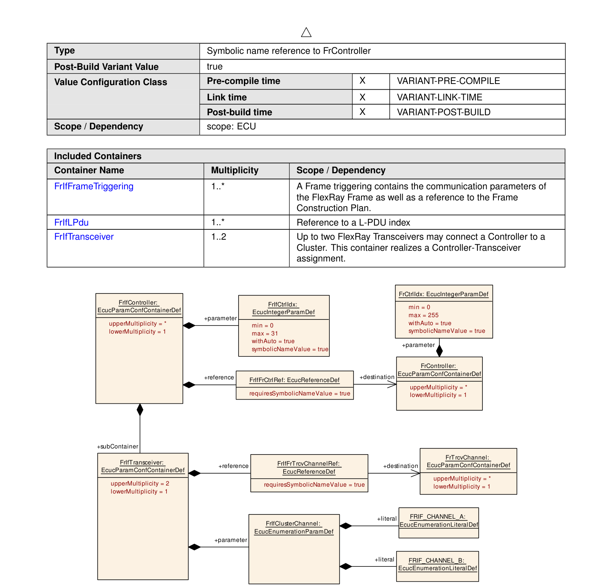

| 项目 | 内容 |
| --- | --- |
| SWS 条目 | [ECUC_FrIf_05363] |
| 容器名称 | FrIfController |
| 父容器 | FrIfCluster |
| 描述 | 该容器包含 FlexRay CC 的配置。 |
| 多重性配置类 | Pre-compile time：X（VARIANT-PRE-COMPILE, VARIANT-LINK-TIME, VARIANT-POST-BUILD）；Link time：-；Post-build time：- |
| Post-Build 变体多重性 | false |
| 配置参数 | 见下方参数表 |

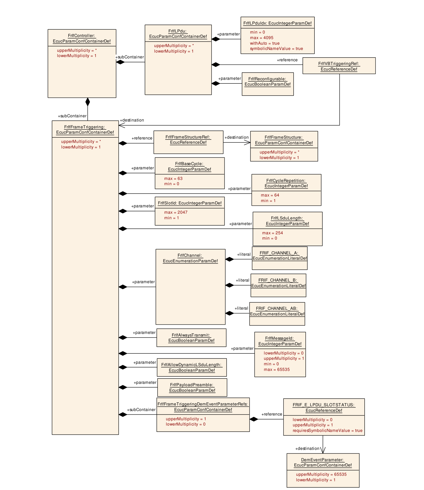

图10.2：FlexRay 接口控制器（硬件引用）（**Figure 10.2: FlexRay Interface Controller (hardware reference)**）

图10.3：FlexRay 接口控制器（数据引用）（**Figure 10.3: FlexRay Interface Controller (data reference)**）

| 包含的容器 | 容器名称 | 多重性 |
| --- | --- | --- |
| 包含的容器 | FrIfFrameTriggering | 1..* |
| 包含的容器 | FrIfLPdu | 1..* |
| 包含的容器 | FrIfTransceiver | 1..2 |

| 项目 | 内容 |
| --- | --- |
| SWS 条目 | [ECUC_FrIf_06045] |
| 参数名称 | FrIfCtrlIdx |
| 父容器 | FrIfController |
| 描述 | 该参数提供 FlexRay 通信控制器的从零开始连续编号的索引。上层 BSW 模块和 FrIf 自身使用该索引来标识一个 FlexRay CC。 |
| 多重性 | 1 |
| 类型 | EcucIntegerParamDef (Symbolic Name generated for this parameter) |
| 默认值 | - |
| Post-Build 变体值 | false |
| 范围 | 0 .. 31 |
| 值配置类 | Pre-compile time：X（All Variants）；Link time：-；Post-build time：- |
| 作用域/依赖 | scope: ECU |

| 项目 | 内容 |
| --- | --- |
| SWS 条目 | [ECUC_FrIf_06044] |
| 参数名称 | FrIfFrCtrlRef |
| 父容器 | FrIfController |
| 描述 | 对由特定驱动程序处理的控制器的引用。该引用对于 ECU 是唯一的。 |
| 多重性 | 1 |
| 类型 | Symbolic name reference to FrController |
| Post-Build 变体值 | true |
| 值配置类 | Pre-compile time：X（VARIANT-PRE-COMPILE）；Link time：X（VARIANT-LINK-TIME）；Post-build time：X（VARIANT-POST-BUILD） |
| 作用域/依赖 | scope: ECU |

#### 9.2.5. FrIfTransceiver

| 项目 | 内容 |
| --- | --- |
| SWS 条目 | [ECUC_FrIf_05391] |
| 容器名称 | FrIfTransceiver |
| 父容器 | FrIfController |
| 描述 | 最多可以有两个 FlexRay 收发器将控制器连接到集群。该容器实现控制器-收发器的分配。 |
| 配置参数 | 见下方参数表 |

无包含的容器。

| 项目 | 内容 |
| --- | --- |
| SWS 条目 | [ECUC_FrIf_06062] |
| 参数名称 | FrIfClusterChannel |
| 父容器 | FrIfTransceiver |
| 描述 | 该参数标识收发器连接到集群的两个信道（A、B、A 和 B）中的哪一个。FrIfClusterChannel 应映射到 Fr_ChannelType：FRIF_CHANNEL_A == FR_CHANNEL_A，FRIF_CHANNEL_B == FR_CHANNEL_B，FR_CHANNEL_AB 不得使用。 |
| 多重性 | 1 |
| 类型 | EcucEnumerationParamDef |
| Post-Build 变体值 | true |
| 范围 | FRIF_CHANNEL_A；FRIF_CHANNEL_B |
| 值配置类 | Pre-compile time：X（VARIANT-PRE-COMPILE）；Link time：X（VARIANT-LINK-TIME）；Post-build time：X（VARIANT-POST-BUILD） |
| 作用域/依赖 | scope: local |

| 项目 | 内容 |
| --- | --- |
| SWS 条目 | [ECUC_FrIf_06061] |
| 参数名称 | FrIfFrTrcvChannelRef |
| 父容器 | FrIfTransceiver |
| 描述 | 对收发器驱动程序信道的引用。该引用对于 ECU 是唯一的。 |
| 多重性 | 1 |
| 类型 | Symbolic name reference to FrTrcvChannel |
| Post-Build 变体值 | true |
| 值配置类 | Pre-compile time：X（VARIANT-PRE-COMPILE）；Link time：X（VARIANT-LINK-TIME）；Post-build time：X（VARIANT-POST-BUILD） |
| 作用域/依赖 | scope: ECU |

#### 9.2.6. FrIfLPdu

| 项目 | 内容 |
| --- | --- |
| SWS 条目 | [ECUC_FrIf_05364] |
| 容器名称 | FrIfLPdu |
| 父容器 | FrIfController |
| 描述 | 对 L-PDU 索引的引用 |
| 多重性配置类 | Pre-compile time：X（VARIANT-PRE-COMPILE）；Link time：X（VARIANT-LINK-TIME）；Post-build time：X（VARIANT-POST-BUILD） |
| Post-Build 变体多重性 | true |
| 配置参数 | 见下方参数表 |

无包含的容器。

| 项目 | 内容 |
| --- | --- |
| SWS 条目 | [ECUC_FrIf_06058] |
| 参数名称 | FrIfLPduIdx |
| 父容器 | FrIfLPdu |
| 描述 | 该参数在 FlexRay 接口与 FlexRay 驱动程序的交互中标识 L-PDU。 |
| 多重性 | 1 |
| 类型 | EcucIntegerParamDef (Symbolic Name generated for this parameter) |
| 默认值 | - |
| Post-Build 变体值 | false |
| 范围 | 0 .. 4095 |
| 值配置类 | Pre-compile time：X（All Variants）；Link time：-；Post-build time：- |
| 作用域/依赖 | scope: local |

| 项目 | 内容 |
| --- | --- |
| SWS 条目 | [ECUC_FrIf_00008] |
| 参数名称 | FrIfReconfigurable |
| 父容器 | FrIfLPdu |
| 描述 | 该参数规定可以使用 FrIf_ReconfigLPdu 对该 LPdu 进行重新配置。这意味着该 LPdu 可以在运行时分配给不同的帧触发。但是，这种重新配置受硬件约束的限制。LPdu 的方向不能重新配置。 |
| 多重性 | 1 |
| 类型 | EcucBooleanParamDef |
| 默认值 | - |
| Post-Build 变体值 | true |
| 值配置类 | Pre-compile time：X（VARIANT-PRE-COMPILE）；Link time：X（VARIANT-LINK-TIME）；Post-build time：X（VARIANT-POST-BUILD） |
| 作用域/依赖 | scope: local |

| 项目 | 内容 |
| --- | --- |
| SWS 条目 | [ECUC_FrIf_06057] |
| 参数名称 | FrIfVBTriggeringRef |
| 父容器 | FrIfLPdu |
| 描述 | 对所分配帧触发的引用。 |
| 多重性 | 1 |
| 类型 | Reference to FrIfFrameTriggering |
| Post-Build 变体值 | true |
| 值配置类 | Pre-compile time：X（VARIANT-PRE-COMPILE）；Link time：X（VARIANT-LINK-TIME）；Post-build time：X（VARIANT-POST-BUILD） |
| 作用域/依赖 | scope: local |

#### 9.2.7. FrIfFrameTriggering

| 项目 | 内容 |
| --- | --- |
| SWS 条目 | [ECUC_FrIf_06090] |
| 容器名称 | FrIfFrameTriggering |
| 父容器 | FrIfController |
| 描述 | 帧触发包含 FlexRay 帧的通信参数以及对帧构造计划的引用。 |
| 多重性配置类 | Pre-compile time：X（VARIANT-PRE-COMPILE）；Link time：X（VARIANT-LINK-TIME）；Post-build time：X（VARIANT-POST-BUILD） |
| Post-Build 变体多重性 | true |
| 配置参数 | 见下方参数表 |

| 包含的容器 | 容器名称 | 多重性 |
| --- | --- | --- |
| 包含的容器 | FrIfFrameTriggeringDemEventParameterRefs | 0..1 |

| 项目 | 内容 |
| --- | --- |
| SWS 条目 | [ECUC_FrIf_06049] |
| 参数名称 | FrIfAllowDynamicLSduLength |
| 父容器 | FrIfFrameTriggering |
| 描述 | 允许缩短 L-PDU 长度（FrIfLSduLength 定义最大长度），并指示在发送该 L-PDU 之前必须针对实际长度和 Header-CRC 重新配置相关的 CC 缓冲区。 |
| 多重性 | 1 |
| 类型 | EcucBooleanParamDef |
| 默认值 | - |
| Post-Build 变体值 | true |
| 值配置类 | Pre-compile time：X（VARIANT-PRE-COMPILE）；Link time：X（VARIANT-LINK-TIME）；Post-build time：X（VARIANT-POST-BUILD） |
| 作用域/依赖 | scope: local |

| 项目 | 内容 |
| --- | --- |
| SWS 条目 | [ECUC_FrIf_00013] |
| 参数名称 | FrIfAlwaysTransmit |
| 父容器 | FrIfFrameTriggering |
| 描述 | 定义是否应始终为该 L-PDU 调用驱动程序的 API 函数 Fr_TransmitTxLPdu()。 |
| 多重性 | 1 |
| 类型 | EcucBooleanParamDef |
| 默认值 | - |
| Post-Build 变体值 | true |
| 值配置类 | Pre-compile time：X（VARIANT-PRE-COMPILE）；Link time：X（VARIANT-LINK-TIME）；Post-build time：X（VARIANT-POST-BUILD） |
| 作用域/依赖 | scope: local |

| 项目 | 内容 |
| --- | --- |
| SWS 条目 | [ECUC_FrIf_06051] |
| 参数名称 | FrIfBaseCycle |
| 父容器 | FrIfFrameTriggering |
| 描述 | 该参数包含用于发送该 FlexRay 帧的 FlexRay 基准循环。 |
| 多重性 | 1 |
| 类型 | EcucIntegerParamDef |
| 默认值 | - |
| Post-Build 变体值 | true |
| 范围 | 0 .. 63 |
| 值配置类 | Pre-compile time：X（VARIANT-PRE-COMPILE）；Link time：X（VARIANT-LINK-TIME）；Post-build time：X（VARIANT-POST-BUILD） |
| 作用域/依赖 | scope: local |

| 项目 | 内容 |
| --- | --- |
| SWS 条目 | [ECUC_FrIf_06052] |
| 参数名称 | FrIfChannel |
| 父容器 | FrIfFrameTriggering |
| 描述 | 该参数包含用于发送该 FlexRay 帧的 FlexRay 信道。 |
| 多重性 | 1 |
| 类型 | EcucEnumerationParamDef |
| Post-Build 变体值 | true |
| 范围 | FRIF_CHANNEL_A；FRIF_CHANNEL_AB；FRIF_CHANNEL_B |
| 值配置类 | Pre-compile time：X（VARIANT-PRE-COMPILE）；Link time：X（VARIANT-LINK-TIME）；Post-build time：X（VARIANT-POST-BUILD） |
| 作用域/依赖 | scope: local |

| 项目 | 内容 |
| --- | --- |
| SWS 条目 | [ECUC_FrIf_06053] |
| 参数名称 | FrIfCycleRepetition |
| 父容器 | FrIfFrameTriggering |
| 描述 | 该参数包含用于发送该 FlexRay 帧的 FlexRay 循环重复。FlexRay Protocol 版本 2.1 的可能值：1,2,4,8,16,32,64。FlexRay Protocol 版本 3.0 的可能值：1,2,4,5,8,10,16,20,32,40,50,64 |
| 多重性 | 1 |
| 类型 | EcucIntegerParamDef |
| 默认值 | - |
| Post-Build 变体值 | true |
| 范围 | 1 .. 64 |
| 值配置类 | Pre-compile time：X（VARIANT-PRE-COMPILE）；Link time：X（VARIANT-LINK-TIME）；Post-build time：X（VARIANT-POST-BUILD） |
| 作用域/依赖 | scope: local |

| 项目 | 内容 |
| --- | --- |
| SWS 条目 | [ECUC_FrIf_06054] |
| 参数名称 | FrIfLSduLength |
| 父容器 | FrIfFrameTriggering |
| 描述 | 此处给出帧的载荷长度。在配置时，该参数用于校验已配置的 PDU 和更新信息是否适合该帧 [字节]。 |
| 多重性 | 1 |
| 类型 | EcucIntegerParamDef |
| 默认值 | - |
| Post-Build 变体值 | true |
| 范围 | 0 .. 254 |
| 值配置类 | Pre-compile time：X（VARIANT-PRE-COMPILE）；Link time：X（VARIANT-LINK-TIME）；Post-build time：X（VARIANT-POST-BUILD） |
| 作用域/依赖 | scope: local dependency: The parameter depends on the low level parameters of the FlexRay CC. |

| 项目 | 内容 |
| --- | --- |
| SWS 条目 | [ECUC_FrIf_00010] |
| 参数名称 | FrIfMessageId |
| 父容器 | FrIfFrameTriggering |
| 描述 | 对于在动态段中发送的帧，FlexRay 帧格式载荷段的前两个字节可以用作接收方可过滤的数据，称为消息 ID。 |
| 多重性 | 0..1 |
| 类型 | EcucIntegerParamDef |
| 默认值 | - |
| Post-Build 变体多重性 | true |
| Post-Build 变体值 | true |
| 范围 | 0 .. 65535 |
| 值配置类 | Pre-compile time：X（VARIANT-PRE-COMPILE）；Link time：X（VARIANT-LINK-TIME）；Post-build time：X（VARIANT-POST-BUILD） |
| 多重性配置类 | Pre-compile time：X（VARIANT-PRE-COMPILE）；Link time：X（VARIANT-LINK-TIME）；Post-build time：X（VARIANT-POST-BUILD） |
| 作用域/依赖 | scope: local |

| 项目 | 内容 |
| --- | --- |
| SWS 条目 | [ECUC_FrIf_06055] |
| 参数名称 | FrIfPayloadPreamble |
| 父容器 | FrIfFrameTriggering |
| 描述 | 载荷前导位（Payload Preamble bit）的切换。 |
| 多重性 | 1 |
| 类型 | EcucBooleanParamDef |
| 默认值 | - |
| Post-Build 变体值 | true |
| 值配置类 | Pre-compile time：X（VARIANT-PRE-COMPILE）；Link time：X（VARIANT-LINK-TIME）；Post-build time：X（VARIANT-POST-BUILD） |
| 作用域/依赖 | scope: local |

| 项目 | 内容 |
| --- | --- |
| SWS 条目 | [ECUC_FrIf_06056] |
| 参数名称 | FrIfSlotId |
| 父容器 | FrIfFrameTriggering |
| 描述 | 该参数包含用于发送该 FlexRay 帧的 FlexRay 时隙 ID。 |
| 多重性 | 1 |
| 类型 | EcucIntegerParamDef |
| 默认值 | - |
| Post-Build 变体值 | true |
| 范围 | 1 .. 2047 |
| 值配置类 | Pre-compile time：X（VARIANT-PRE-COMPILE）；Link time：X（VARIANT-LINK-TIME）；Post-build time：X（VARIANT-POST-BUILD） |
| 作用域/依赖 | scope: local |

| 项目 | 内容 |
| --- | --- |
| SWS 条目 | [ECUC_FrIf_06048] |
| 参数名称 | FrIfFrameStructureRef |
| 父容器 | FrIfFrameTriggering |
| 描述 | 对 FlexRay 帧构造计划的引用。 |
| 多重性 | 1 |
| 类型 | Reference to FrIfFrameStructure |
| Post-Build 变体值 | true |
| 值配置类 | Pre-compile time：X（VARIANT-PRE-COMPILE）；Link time：X（VARIANT-LINK-TIME）；Post-build time：X（VARIANT-POST-BUILD） |
| 作用域/依赖 | scope: local |

#### 9.2.8. FrIfJobList

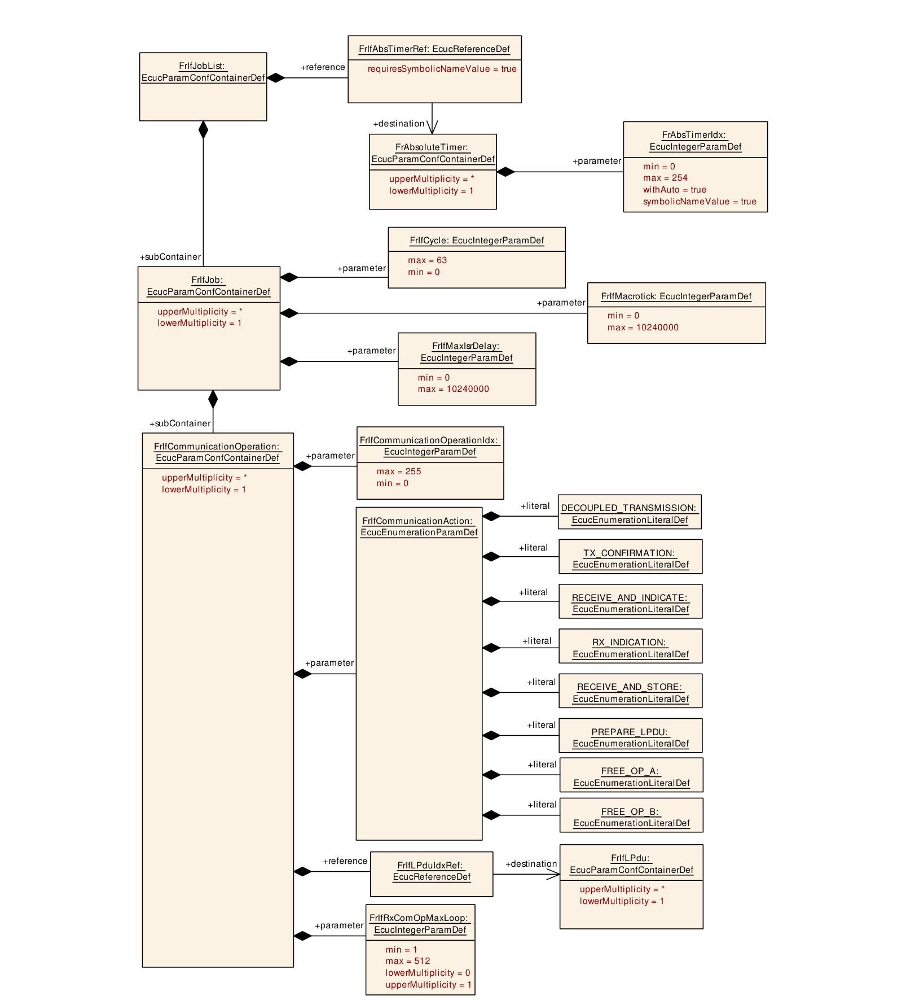

| 项目 | 内容 |
| --- | --- |
| SWS 条目 | [ECUC_FrIf_05367] |
| 容器名称 | FrIfJobList |
| 父容器 | FrIfCluster |
| 描述 | 该容器规定了将由 FrIf_JobListExec_<FrIfCluster.ShortName>() 执行的该集群所有 FlexRay 作业的列表。 |
| 配置参数 | 见下方参数表 |

图10.4：FlexRay 接口作业列表（**Figure 10.4: FlexRay Interface Joblist**）

| 包含的容器 | 容器名称 | 多重性 |
| --- | --- | --- |
| 包含的容器 | FrIfJob | 1..* |

| 项目 | 内容 |
| --- | --- |
| SWS 条目 | [ECUC_FrIf_06063] |
| 参数名称 | FrIfAbsTimerRef |
| 父容器 | FrIfJobList |
| 描述 | 对绝对定时器的引用，该定时器用于触发其中断服务程序包含 FrIf_JobListExec_<FrIfCluster.ShortName>() 函数的中断。 |
| 多重性 | 1 |
| 类型 | Symbolic name reference to FrAbsoluteTimer |
| Post-Build 变体值 | true |
| 值配置类 | Pre-compile time：X（VARIANT-PRE-COMPILE）；Link time：X（VARIANT-LINK-TIME）；Post-build time：X（VARIANT-POST-BUILD） |
| 作用域/依赖 | scope: local |

#### 9.2.9. FrIfJob

| 项目 | 内容 |
| --- | --- |
| SWS 条目 | [ECUC_FrIf_05368] |
| 容器名称 | FrIfJob |
| 父容器 | FrIfJobList |
| 描述 | 一个作业可以包含多于一个在特定时间点执行的操作。 |
| 多重性配置类 | Pre-compile time：X（VARIANT-PRE-COMPILE）；Link time：X（VARIANT-LINK-TIME）；Post-build time：X（VARIANT-POST-BUILD） |
| Post-Build 变体多重性 | true |
| 配置参数 | 见下方参数表 |

| 包含的容器 | 容器名称 | 多重性 |
| --- | --- | --- |
| 包含的容器 | FrIfCommunicationOperation | 1..* |

| 项目 | 内容 |
| --- | --- |
| SWS 条目 | [ECUC_FrIf_06064] |
| 参数名称 | FrIfCycle |
| 父容器 | FrIfJob |
| 描述 | 通信操作将执行该作业的 FlexRay 循环 |
| 多重性 | 1 |
| 类型 | EcucIntegerParamDef |
| 默认值 | - |
| Post-Build 变体值 | true |
| 范围 | 0 .. 63 |
| 值配置类 | Pre-compile time：X（VARIANT-PRE-COMPILE）；Link time：X（VARIANT-LINK-TIME）；Post-build time：X（VARIANT-POST-BUILD） |
| 作用域/依赖 | scope: local |

| 项目 | 内容 |
| --- | --- |
| SWS 条目 | [ECUC_FrIf_06065] |
| 参数名称 | FrIfMacrotick |
| 父容器 | FrIfJob |
| 描述 | 循环内的宏节拍偏移 [Macrotick] |
| 多重性 | 1 |
| 类型 | EcucIntegerParamDef |
| 默认值 | - |
| Post-Build 变体值 | true |
| 范围 | 0 .. 10240000 |
| 值配置类 | Pre-compile time：X（VARIANT-PRE-COMPILE）；Link time：X（VARIANT-LINK-TIME）；Post-build time：X（VARIANT-POST-BUILD） |
| 作用域/依赖 | scope: local |

| 项目 | 内容 |
| --- | --- |
| SWS 条目 | [ECUC_FrIf_06004] |
| 参数名称 | FrIfMaxIsrDelay |
| 父容器 | FrIfJob |
| 描述 | 在绝对定时器中断触发之后，处理 FrIf_JobListExec_<FrIfCluster.ShortName>() 函数的最大延迟（以宏节拍为单位）。 |
| 多重性 | 1 |
| 类型 | EcucIntegerParamDef |
| 默认值 | - |
| Post-Build 变体值 | true |
| 范围 | 0 .. 10240000 |
| 值配置类 | Pre-compile time：X（VARIANT-PRE-COMPILE）；Link time：X（VARIANT-LINK-TIME）；Post-build time：X（VARIANT-POST-BUILD） |
| 作用域/依赖 | scope: local |

#### 9.2.10. FrIfCommunicationOperation

| 项目 | 内容 |
| --- | --- |
| SWS 条目 | [ECUC_FrIf_05369] |
| 容器名称 | FrIfCommunicationOperation |
| 父容器 | FrIfJob |
| 描述 | 作为 FlexRay 作业一部分的独立操作，它定义执行何种类型的动作。 |
| 多重性配置类 | Pre-compile time：X（VARIANT-PRE-COMPILE）；Link time：X（VARIANT-LINK-TIME）；Post-build time：X（VARIANT-POST-BUILD） |
| Post-Build 变体多重性 | true |
| 配置参数 | 见下方参数表 |

无包含的容器。

| 项目 | 内容 |
| --- | --- |
| SWS 条目 | [ECUC_FrIf_06067] |
| 参数名称 | FrIfCommunicationAction |
| 父容器 | FrIfCommunicationOperation |
| 描述 | 要在 FlexRay 操作中执行的动作 |
| 多重性 | 1 |
| 类型 | EcucEnumerationParamDef |
| Post-Build 变体值 | true |
| 范围 | DECOUPLED_TRANSMISSION（解耦发送）；FREE_OP_A（用户自定义的通信操作。）；FREE_OP_B（用户自定义的通信操作。）；PREPARE_LPDU（准备 CC 的消息缓冲区）；RECEIVE_AND_INDICATE（立即接收）；RECEIVE_AND_STORE（解耦接收）；RX_INDICATION（接收指示）；TX_CONFIRMATION（发送确认，可选进行发送冲突检查） |
| 值配置类 | Pre-compile time：X（VARIANT-PRE-COMPILE）；Link time：X（VARIANT-LINK-TIME）；Post-build time：X（VARIANT-POST-BUILD） |
| 作用域/依赖 | scope: local dependency: FrIfCommunicationAction can be configured as PREPARE_LPDU only if FrPrepareLPduSupport (ECUC_Fr_00453) is configured as TRUE. |

| 项目 | 内容 |
| --- | --- |
| SWS 条目 | [ECUC_FrIf_06068] |
| 参数名称 | FrIfCommunicationOperationIdx |
| 父容器 | FrIfCommunicationOperation |
| 描述 | 对于每个 FlexRay 通信作业，该索引构成一个从零开始连续编号的取值范围，从而定义相应 FlexRay 通信作业中 FlexRay 通信操作的顺序。 |
| 多重性 | 1 |
| 类型 | EcucIntegerParamDef |
| 默认值 | - |
| Post-Build 变体值 | true |
| 范围 | 0 .. 255 |
| 值配置类 | Pre-compile time：X（VARIANT-PRE-COMPILE）；Link time：X（VARIANT-LINK-TIME）；Post-build time：X（VARIANT-POST-BUILD） |
| 作用域/依赖 | scope: local |

| 项目 | 内容 |
| --- | --- |
| SWS 条目 | [ECUC_FrIf_00007] |
| 参数名称 | FrIfRxComOpMaxLoop |
| 父容器 | FrIfCommunicationOperation |
| 描述 | 定义接收 RECEIVE_AND_INDICATE 的最大循环次数（用例：清空 FIFO）。请注意，如果 FrIfCommunicationAction 参数设置为 RECEIVE_AND_INDICATE，则该参数是必需的。对于所有其他操作，可以忽略该参数。 |
| 多重性 | 0..1 |
| 类型 | EcucIntegerParamDef |
| 默认值 | - |
| Post-Build 变体多重性 | true |
| Post-Build 变体值 | true |
| 范围 | 1 .. 512 |
| 值配置类 | Pre-compile time：X（VARIANT-PRE-COMPILE）；Link time：X（VARIANT-LINK-TIME）；Post-build time：X（VARIANT-POST-BUILD） |
| 多重性配置类 | Pre-compile time：X（VARIANT-PRE-COMPILE）；Link time：X（VARIANT-LINK-TIME）；Post-build time：X（VARIANT-POST-BUILD） |
| 作用域/依赖 | scope: local |

| 项目 | 内容 |
| --- | --- |
| SWS 条目 | [ECUC_FrIf_06066] |
| 参数名称 | FrIfLPduIdxRef |
| 父容器 | FrIfCommunicationOperation |
| 描述 | 对 L-PDU 索引的引用 |
| 多重性 | 1 |
| 类型 | Reference to FrIfLPdu |
| Post-Build 变体值 | true |
| 值配置类 | Pre-compile time：X（VARIANT-PRE-COMPILE）；Link time：X（VARIANT-LINK-TIME）；Post-build time：X（VARIANT-POST-BUILD） |
| 作用域/依赖 | scope: local |

#### 9.2.11. FrIfFrameStructure

| 项目 | 内容 |
| --- | --- |
| SWS 条目 | [ECUC_FrIf_05370] |
| 容器名称 | FrIfFrameStructure |
| 父容器 | FrIfConfig |
| 描述 | 帧结构规定了一个构造计划，说明如何用 PDU 及其各自的更新位组装一个帧。 |
| 多重性配置类 | Pre-compile time：X（VARIANT-PRE-COMPILE）；Link time：X（VARIANT-LINK-TIME）；Post-build time：X（VARIANT-POST-BUILD） |
| Post-Build 变体多重性 | true |
| 配置参数 | 见下方参数表 |

| 包含的容器 | 容器名称 | 多重性 |
| --- | --- | --- |
| 包含的容器 | FrIfPdusInFrame | 1..* |

| 项目 | 内容 |
| --- | --- |
| SWS 条目 | [ECUC_FrIf_06113] |
| 参数名称 | FrIfByteOrder |
| 父容器 | FrIfFrameStructure |
| 描述 | 该参数定义映射到帧中的所有 Pdu 的字节序。Pdu 在帧中的绝对位置由字节序参数的定义决定：如果指定了 BIG_ENDIAN，则 FrIfPduOffset 指示最高有效位在帧中的位置。如果指定了 LITTLE_ENDIAN，则 FrIfPduOffset 指示最低有效位在帧中的位置。 |
| 多重性 | 1 |
| 类型 | EcucEnumerationParamDef |
| Post-Build 变体值 | true |
| 范围 | BIG_ENDIAN；LITTLE_ENDIAN |
| 值配置类 | Pre-compile time：X（VARIANT-PRE-COMPILE）；Link time：X（VARIANT-LINK-TIME）；Post-build time：X（VARIANT-POST-BUILD） |
| 作用域/依赖 | scope: local |

#### 9.2.12. FrIfPdusInFrame

| 项目 | 内容 |
| --- | --- |
| SWS 条目 | [ECUC_FrIf_05371] |
| 容器名称 | FrIfPdusInFrame |
| 父容器 | FrIfFrameStructure |
| 描述 | 该容器保存 FlexRay 帧中某个 PDU 的全部信息。 |
| 多重性配置类 | Pre-compile time：X（VARIANT-PRE-COMPILE）；Link time：X（VARIANT-LINK-TIME）；Post-build time：X（VARIANT-POST-BUILD） |
| Post-Build 变体多重性 | true |
| 配置参数 | 见下方参数表 |

| 包含的容器 | 容器名称 | 多重性 |
| --- | --- | --- |
| 包含的容器 | FrIfPduDirection | 1 |

| 项目 | 内容 |
| --- | --- |
| SWS 条目 | [ECUC_FrIf_06070] |
| 参数名称 | FrIfPduOffset |
| 父容器 | FrIfPdusInFrame |
| 描述 | 该值规定 PDU 在帧内的偏移 [字节]。 |
| 多重性 | 1 |
| 类型 | EcucIntegerParamDef |
| 默认值 | - |
| Post-Build 变体值 | true |
| 范围 | 0 .. 253 |
| 值配置类 | Pre-compile time：X（VARIANT-PRE-COMPILE）；Link time：X（VARIANT-LINK-TIME）；Post-build time：X（VARIANT-POST-BUILD） |
| 作用域/依赖 | scope: local dependency: This parameter depends on the number of PDUs contained in the Frame, PDU length, and Update-Bits of other PDUs in the Frame. In addition, if the Frame will |

| 项目 | 内容 |
| --- | --- |
| SWS 条目 | [ECUC_FrIf_06071] |
| 参数名称 | FrIfPduUpdateBitOffset |
| 父容器 | FrIfPdusInFrame |
| 描述 | 该值规定 PDU 的更新位在帧中的存储位置（PDU 更新位在 FlexRay 帧中的位位置）。 |
| 多重性 | 0..1 |
| 类型 | EcucIntegerParamDef |
| 默认值 | - |
| Post-Build 变体多重性 | true |
| Post-Build 变体值 | true |
| 范围 | 0 .. 2031 |
| 值配置类 | Pre-compile time：X（VARIANT-PRE-COMPILE）；Link time：X（VARIANT-LINK-TIME）；Post-build time：X（VARIANT-POST-BUILD） |
| 多重性配置类 | Pre-compile time：X（VARIANT-PRE-COMPILE）；Link time：X（VARIANT-LINK-TIME）；Post-build time：X（VARIANT-POST-BUILD） |
| 作用域/依赖 | scope: local dependency: This parameter depends on the number of PDUs contained in the Frame, PDU length, and Update-Bits of other PDUs in the Frame. In addition, if the Frame will is sent in static segment, this parameter depends on GPayloadLengthStatic. |

| 项目 | 内容 |
| --- | --- |
| SWS 条目 | [ECUC_FrIf_06069] |
| 参数名称 | FrIfPduRef |
| 父容器 | FrIfPdusInFrame |
| 描述 | 对 PDU 本地定义的引用。 |
| 多重性 | 1 |
| 类型 | Reference to FrIfPdu |
| Post-Build 变体值 | true |
| 值配置类 | Pre-compile time：X（VARIANT-PRE-COMPILE）；Link time：X（VARIANT-LINK-TIME）；Post-build time：X（VARIANT-POST-BUILD） |
| 作用域/依赖 | scope: local |

#### 9.2.13. FrIfPdu

| 项目 | 内容 |
| --- | --- |
| SWS 条目 | [ECUC_FrIf_05372] |
| 容器名称 | FrIfPdu |
| 父容器 | FrIfConfig |
| 描述 | 包含 PDU 信息。PDU 可以是发送 PDU 或接收 PDU。 |
| 多重性配置类 | Pre-compile time：X（VARIANT-PRE-COMPILE）；Link time：X（VARIANT-LINK-TIME）；Post-build time：X（VARIANT-POST-BUILD） |
| Post-Build 变体多重性 | true |
| 配置参数 | 见下方参数表 |

| 包含的容器 | 容器名称 | 多重性 |
| --- | --- | --- |
| 包含的容器 | FrIfPduDirection | 1 |

#### 9.2.14. FrIfPduDirection

| 项目 | 内容 |
| --- | --- |
| SWS 条目 | [] |
| 容器名称 | FrIfPduDirection |
| 描述 | PDU 要么是发送的，要么是接收的 |
| 配置参数 | 见下方参数表 |

无包含的容器。

| 容器选项 | 多重性 | 描述 |
| --- | --- | --- |
| FrIfRxPdu | 0..1 | 接收 PDU |
| FrIfTxPdu | 0..1 | 该容器规定发送 PDU。 |

#### 9.2.15. FrIfTxPdu

| 项目 | 内容 |
| --- | --- |
| SWS 条目 | [ECUC_FrIf_05374] |
| 容器名称 | FrIfTxPdu |
| 父容器 | FrIfPduDirection |
| 描述 | 该容器规定发送 PDU。 |
| 配置参数 | 见下方参数表 |

无包含的容器。

| 项目 | 内容 |
| --- | --- |
| SWS 条目 | [ECUC_FrIf_06075] |
| 参数名称 | FrIfConfirm |
| 父容器 | FrIfTxPdu |
| 描述 | 定义是否应检查 PDU 的发送并向拥有该 PDU 的 BSW 模块确认。如果「FrIfUserTxUL」配置为 FR_TSYN，则对于该 PDU 必须将此参数设置为 FALSE。 |
| 多重性 | 1 |
| 类型 | EcucBooleanParamDef |
| 默认值 | - |
| Post-Build 变体值 | true |
| 值配置类 | Pre-compile time：X（VARIANT-PRE-COMPILE）；Link time：X（VARIANT-LINK-TIME）；Post-build time：X（VARIANT-POST-BUILD） |
| 作用域/依赖 | scope: local |

| 项目 | 内容 |
| --- | --- |
| SWS 条目 | [ECUC_FrIf_06076] |
| 参数名称 | FrIfCounterLimit |
| 父容器 | FrIfTxPdu |
| 描述 | 该值规定在没有中间 PDU 发送的情况下，就绪 PDU 数据向 FrIf 指示的最大次数（即 FrIf_Transmit 的最大调用次数）。 |
| 多重性 | 0..1 |
| 类型 | EcucIntegerParamDef |
| 默认值 | - |
| Post-Build 变体值 | true |
| 范围 | 1 .. 255 |
| 值配置类 | Pre-compile time：X（VARIANT-PRE-COMPILE）；Link time：X（VARIANT-LINK-TIME）；Post-build time：X（VARIANT-POST-BUILD） |
| 作用域/依赖 | scope: local |

| 项目 | 内容 |
| --- | --- |
| SWS 条目 | [ECUC_FrIf_06077] |
| 参数名称 | FrIfImmediate |
| 父容器 | FrIfTxPdu |
| 描述 | 定义 PDU 是立即发送还是解耦发送。 |
| 多重性 | 1 |
| 类型 | EcucBooleanParamDef |
| 默认值 | - |
| Post-Build 变体值 | true |
| 值配置类 | Pre-compile time：X（VARIANT-PRE-COMPILE）；Link time：X（VARIANT-LINK-TIME）；Post-build time：X（VARIANT-POST-BUILD） |
| 作用域/依赖 | scope: ECU |

| 项目 | 内容 |
| --- | --- |
| SWS 条目 | [ECUC_FrIf_06050] |
| 参数名称 | FrIfNoneMode |
| 父容器 | FrIfTxPdu |
| 描述 | 使用「None-Mode（无模式）」，这意味着对于该 PDU，上层不会调用 API FrIf_Transmit。 |
| 多重性 | 0..1 |
| 类型 | EcucBooleanParamDef |
| 默认值 | false |
| Post-Build 变体多重性 | true |
| Post-Build 变体值 | true |
| 值配置类 | Pre-compile time：X（VARIANT-PRE-COMPILE）；Link time：X（VARIANT-LINK-TIME）；Post-build time：X（VARIANT-POST-BUILD） |
| 多重性配置类 | Pre-compile time：X（VARIANT-PRE-COMPILE）；Link time：X（VARIANT-LINK-TIME）；Post-build time：X（VARIANT-POST-BUILD） |
| 作用域/依赖 | scope: local dependency: FrIfImmediate |

| 项目 | 内容 |
| --- | --- |
| SWS 条目 | [ECUC_FrIf_00014] |
| 参数名称 | FrIfTxConfirmationName |
| 父容器 | FrIfTxPdu |
| 描述 | 该参数定义 <User_TxConfirmation> 的名称。该参数取决于参数 FrIfUserTxUL。如果 FrIfUserTxUL 等于 FR_TP、FR_AR_TP、FR_NM、PDUR 或 XCP，则 <User_TxConfirmation> 的名称是固定的。如果 FrIfUserTxUL 等于 CDD，则 <User_TxConfirmation> 的名称是可选择的。 |
| 多重性 | 0..1 |
| 类型 | EcucFunctionNameDef |
| 默认值 | - |
| 正则表达式 | - |
| Post-Build 变体多重性 | true |
| Post-Build 变体值 | true |
| 值配置类 | Pre-compile time：X（VARIANT-PRE-COMPILE）；Link time：X（VARIANT-LINK-TIME）；Post-build time：X（VARIANT-POST-BUILD） |
| 多重性配置类 | Pre-compile time：X（VARIANT-PRE-COMPILE）；Link time：X（VARIANT-LINK-TIME）；Post-build time：X（VARIANT-POST-BUILD） |
| 作用域/依赖 | scope: ECU |

| 项目 | 内容 |
| --- | --- |
| SWS 条目 | [ECUC_FrIf_06078] |
| 参数名称 | FrIfTxPduId |
| 父容器 | FrIfTxPdu |
| 描述 | 全局 PDU 标识符，该标识符必须从零开始且连续。 |
| 多重性 | 1 |
| 类型 | EcucIntegerParamDef |
| 默认值 | - |
| Post-Build 变体值 | false |
| 范围 | 0 .. 65535 |
| 值配置类 | Pre-compile time：X（All Variants） |
| 作用域/依赖 | scope: ECU；withAuto = true |

| 项目 | 内容 |
| --- | --- |
| SWS 条目 | [ECUC_FrIf_06084] |
| 参数名称 | FrIfUserTriggerTransmitName |
| 父容器 | FrIfTxPdu |
| 描述 | 该参数定义 <User_TriggerTransmit> 的名称。该参数取决于参数 FrIfUserTxUL。如果 FrIfUserTxUL 等于 FR_TP、FR_AR_TP、FR_NM、PDUR、FR_TSYN 或 XCP，则 <User_TriggerTransmit> 的名称是固定的。如果 FrIfUserTxUL 等于 CDD，则 <User_TriggerTransmit> 的名称是可选择的。 |
| 多重性 | 0..1 |
| 类型 | EcucFunctionNameDef |
| 默认值 | - |
| 正则表达式 | - |
| Post-Build 变体多重性 | true |
| Post-Build 变体值 | true |
| 值配置类 | Pre-compile time：X（VARIANT-PRE-COMPILE）；Link time：X（VARIANT-LINK-TIME）；Post-build time：X（VARIANT-POST-BUILD） |
| 多重性配置类 | Pre-compile time：X（VARIANT-PRE-COMPILE）；Link time：X（VARIANT-LINK-TIME）；Post-build time：X（VARIANT-POST-BUILD） |
| 作用域/依赖 | scope: ECU dependency: FrIfImmediate |

| 项目 | 内容 |
| --- | --- |
| SWS 条目 | [ECUC_FrIf_00015] |
| 参数名称 | FrIfUserTxUL |
| 父容器 | FrIfTxPdu |
| 描述 | 该参数定义上层（UL）模块，待发送 Pdu 的触发（经由 <User_TriggerTransmit>）或成功发送的 Pdu 的确认（经由 <User_TxConfirmation>）应路由到该模块。请注意，回调函数中使用的句柄 ID 由上层模块定义。 |
| 多重性 | 1 |
| 类型 | EcucEnumerationParamDef |
| Post-Build 变体值 | true |
| 范围 | CDD；FR_AR_TP；FR_NM；FR_TP；FR_TSYN；PDUR；XCP |
| 值配置类 | Pre-compile time：X（VARIANT-PRE-COMPILE）；Link time：X（VARIANT-LINK-TIME）；Post-build time：X（VARIANT-POST-BUILD） |
| 作用域/依赖 | scope: ECU dependency: FrIfConfirm |

| 项目 | 内容 |
| --- | --- |
| SWS 条目 | [ECUC_FrIf_06074] |
| 参数名称 | FrIfTxPduRef |
| 父容器 | FrIfTxPdu |
| 描述 | 对外部 PDU 定义的引用。 |
| 多重性 | 1 |
| 类型 | Reference to Pdu |
| Post-Build 变体值 | true |
| 值配置类 | Pre-compile time：X（VARIANT-PRE-COMPILE）；Link time：X（VARIANT-LINK-TIME）；Post-build time：X（VARIANT-POST-BUILD） |
| 作用域/依赖 | scope: ECU |

#### 9.2.16. FrIfRxPdu

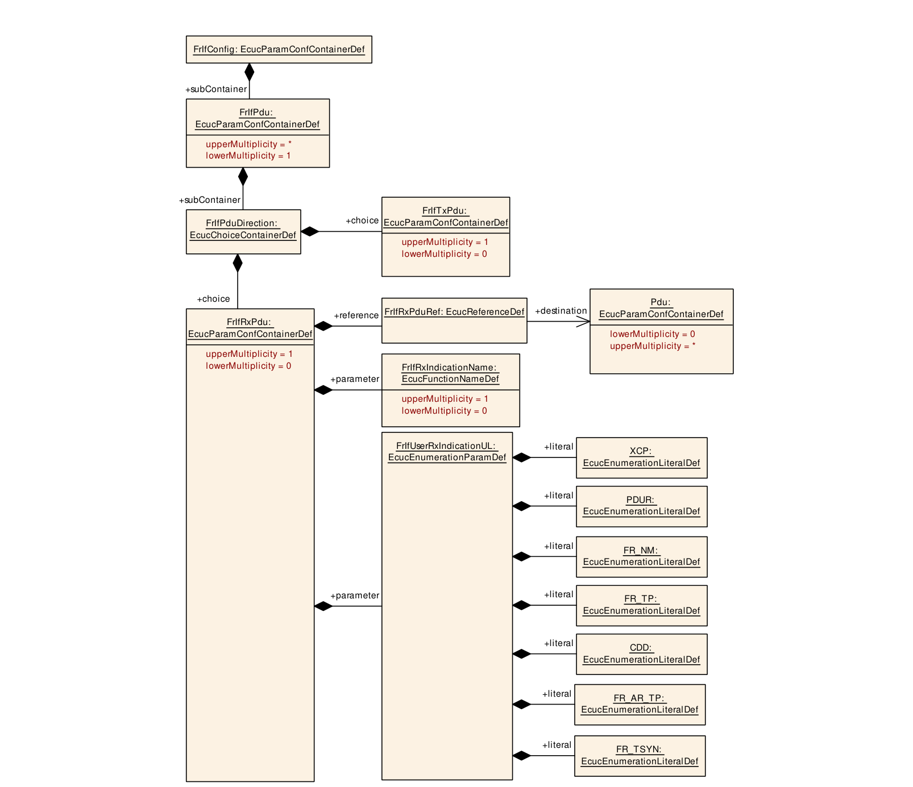

| 项目 | 内容 |
| --- | --- |
| SWS 条目 | [ECUC_FrIf_05373] |
| 容器名称 | FrIfRxPdu |
| 父容器 | FrIfPduDirection |
| 描述 | 接收 PDU |
| 配置参数 | 见下方参数表 |

图10.5：FlexRay 接口 RX Pdu（**Figure 10.5: FlexRay Interface RX Pdu**）

无包含的容器。

| 项目 | 内容 |
| --- | --- |
| SWS 条目 | [ECUC_FrIf_00016] |
| 参数名称 | FrIfRxIndicationName |
| 父容器 | FrIfRxPdu |
| 描述 | 该参数定义 <User_RxIndication> 的名称。该参数取决于参数 FrIfUserRxIndicationUL。如果 FrIfUserRxIndicationUL 等于 FR_TP、FR_AR_TP、FR_NM、PDUR、FR_TSYN 或 XCP，则 <User_RxIndication> 的名称是固定的。如果 FrIfUserRxIndicationUL 等于 CDD，则 <User_RxIndication> 的名称是可选择的。 |
| 多重性 | 0..1 |
| 类型 | EcucFunctionNameDef |
| 默认值 | - |
| 正则表达式 | - |
| Post-Build 变体多重性 | true |
| Post-Build 变体值 | true |
| 值配置类 | Pre-compile time：X（VARIANT-PRE-COMPILE）；Link time：X（VARIANT-LINK-TIME）；Post-build time：X（VARIANT-POST-BUILD） |
| 多重性配置类 | Pre-compile time：X（VARIANT-PRE-COMPILE）；Link time：X（VARIANT-LINK-TIME）；Post-build time：X（VARIANT-POST-BUILD） |
| 作用域/依赖 | scope: ECU |

| 项目 | 内容 |
| --- | --- |
| SWS 条目 | [ECUC_FrIf_00017] |
| 参数名称 | FrIfUserRxIndicationUL |
| 父容器 | FrIfRxPdu |
| 描述 | 该参数定义上层（UL）模块，成功接收的 FrIfRxPdu 的指示（经由 <User_RxIndication>）应路由到该模块。当 FR 驱动程序模块的 Rx 指示事件接收到所配置 FrIfRxPdu 的指示时，必须调用该 <User_RxIndication>。如果没有配置上层（UL）模块，则在 FR 驱动程序模块产生 FrIfRxPdu 的 Rx 指示事件时，不必调用任何 <User_RxIndication>。 |
| 多重性 | 1 |
| 类型 | EcucEnumerationParamDef |
| Post-Build 变体值 | true |
| 范围 | CDD；FR_AR_TP；FR_NM；FR_TP；FR_TSYN；PDUR；XCP |
| 值配置类 | Pre-compile time：X（VARIANT-PRE-COMPILE）；Link time：X（VARIANT-LINK-TIME）；Post-build time：X（VARIANT-POST-BUILD） |
| 作用域/依赖 | scope: ECU |

| 项目 | 内容 |
| --- | --- |
| SWS 条目 | [ECUC_FrIf_06073] |
| 参数名称 | FrIfRxPduRef |
| 父容器 | FrIfRxPdu |
| 描述 | 对外部 PDU 定义的引用。 |
| 多重性 | 1 |
| 类型 | Reference to Pdu |
| Post-Build 变体值 | true |
| 值配置类 | Pre-compile time：X（VARIANT-PRE-COMPILE）；Link time：X（VARIANT-LINK-TIME）；Post-build time：X（VARIANT-POST-BUILD） |
| 作用域/依赖 | scope: ECU |

#### 9.2.17. FrIfConfig

| 项目 | 内容 |
| --- | --- |
| SWS 条目 | [ECUC_FrIf_06001] |
| 容器名称 | FrIfConfig |
| 父容器 | FrIf |
| 描述 | 该容器包含 AUTOSAR FrIf 模块的配置参数和子容器。 |
| 配置参数 | 见下方参数表 |

| 包含的容器 | 容器名称 | 多重性 |
| --- | --- | --- |
| 包含的容器 | FrIfCluster | 1..* |
| 包含的容器 | FrIfFrameStructure | 1..* |
| 包含的容器 | FrIfPdu | 1..* |

| 项目 | 内容 |
| --- | --- |
| SWS 条目 | [ECUC_FrIf_06121] |
| 参数名称 | FrIfMaxPduCnt |
| 父容器 | FrIfConfig |
| 描述 | Pdu 的最大数量。仅在使用静态内存分配的后构建可加载（post-build loadable）实现的情况下才需要该参数。 |
| 多重性 | 0..1 |
| 类型 | EcucIntegerParamDef |
| 默认值 | - |
| Post-Build 变体多重性 | false |
| Post-Build 变体值 | false |
| 值配置类 | Pre-compile time：X（VARIANT-PRE-COMPILE）；Link time：X（VARIANT-LINK-TIME, VARIANT-POST-BUILD）；Post-build time：- |
| 多重性配置类 | Pre-compile time：X（VARIANT-PRE-COMPILE）；Link time：X（VARIANT-LINK-TIME, VARIANT-POST-BUILD）；Post-build time：- |
| 作用域/依赖 | scope: local |

#### 9.2.18. FrIfClusterDemEventParameterRefs

| 项目 | 内容 |
| --- | --- |
| SWS 条目 | [ECUC_FrIf_06091] |
| 容器名称 | FrIfClusterDemEventParameterRefs |
| 父容器 | FrIfCluster |
| 描述 | 该容器保存对 DemEventParameter 元素的引用，当发生相应错误时，应使用 API Dem_SetEventStatus 调用这些引用。EventId 取自被引用的 DemEventParameter 的 DemEventId 符号值。标准化错误在该容器中提供，并可以通过供应商特定的错误引用进行扩展。 |
| 配置参数 | 见下方参数表 |

无包含的容器。

| 项目 | 内容 |
| --- | --- |
| SWS 条目 | [ECUC_FrIf_06097] |
| 参数名称 | FRIF_E_ACS_CH_A |
| 父容器 | FrIfClusterDemEventParameterRefs |
| 描述 | 对 DemEventParameter 的引用，当检测到信道 A 上 ACS 中的错误时应发出该引用。如果未配置该引用，则不应报告该错误。 |
| 多重性 | 0..1 |
| 类型 | Symbolic name reference to DemEventParameter |
| Post-Build 变体多重性 | true |
| Post-Build 变体值 | true |
| 值配置类 | Pre-compile time：X（VARIANT-PRE-COMPILE）；Link time：X（VARIANT-LINK-TIME）；Post-build time：X（VARIANT-POST-BUILD） |
| 多重性配置类 | Pre-compile time：X（VARIANT-PRE-COMPILE）；Link time：X（VARIANT-LINK-TIME）；Post-build time：X（VARIANT-POST-BUILD） |
| 作用域/依赖 | scope: local |

| 项目 | 内容 |
| --- | --- |
| SWS 条目 | [ECUC_FrIf_06098] |
| 参数名称 | FRIF_E_ACS_CH_B |
| 父容器 | FrIfClusterDemEventParameterRefs |
| 描述 | 对 DemEventParameter 的引用，当检测到信道 B 上 ACS 中的错误时应发出该引用。如果未配置该引用，则不应报告该错误。 |
| 多重性 | 0..1 |
| 类型 | Symbolic name reference to DemEventParameter |
| Post-Build 变体多重性 | true |
| Post-Build 变体值 | true |
| 值配置类 | Pre-compile time：X（VARIANT-PRE-COMPILE）；Link time：X（VARIANT-LINK-TIME）；Post-build time：X（VARIANT-POST-BUILD） |
| 多重性配置类 | Pre-compile time：X（VARIANT-PRE-COMPILE）；Link time：X（VARIANT-LINK-TIME）；Post-build time：X（VARIANT-POST-BUILD） |
| 作用域/依赖 | scope: local |

| 项目 | 内容 |
| --- | --- |
| SWS 条目 | [ECUC_FrIf_06093] |
| 参数名称 | FRIF_E_NIT_CH_A |
| 父容器 | FrIfClusterDemEventParameterRefs |
| 描述 | 对 DemEventParameter 的引用，当检测到信道 A 上 NIT 中的错误时应发出该引用。如果未配置该引用，则不应报告该错误。 |
| 多重性 | 0..1 |
| 类型 | Symbolic name reference to DemEventParameter |
| Post-Build 变体多重性 | true |
| Post-Build 变体值 | true |
| 值配置类 | Pre-compile time：X（VARIANT-PRE-COMPILE）；Link time：X（VARIANT-LINK-TIME）；Post-build time：X（VARIANT-POST-BUILD） |
| 多重性配置类 | Pre-compile time：X（VARIANT-PRE-COMPILE）；Link time：X（VARIANT-LINK-TIME）；Post-build time：X（VARIANT-POST-BUILD） |
| 作用域/依赖 | scope: local |

| 项目 | 内容 |
| --- | --- |
| SWS 条目 | [ECUC_FrIf_06094] |
| 参数名称 | FRIF_E_NIT_CH_B |
| 父容器 | FrIfClusterDemEventParameterRefs |
| 描述 | 对 DemEventParameter 的引用，当检测到信道 B 上 NIT 中的错误时应发出该引用。如果未配置该引用，则不应报告该错误。 |
| 多重性 | 0..1 |
| 类型 | Symbolic name reference to DemEventParameter |
| Post-Build 变体多重性 | true |
| Post-Build 变体值 | true |
| 值配置类 | Pre-compile time：X（VARIANT-PRE-COMPILE）；Link time：X（VARIANT-LINK-TIME）；Post-build time：X（VARIANT-POST-BUILD） |
| 多重性配置类 | Pre-compile time：X（VARIANT-PRE-COMPILE）；Link time：X（VARIANT-LINK-TIME）；Post-build time：X（VARIANT-POST-BUILD） |
| 作用域/依赖 | scope: local |

| 项目 | 内容 |
| --- | --- |
| SWS 条目 | [ECUC_FrIf_06095] |
| 参数名称 | FRIF_E_SW_CH_A |
| 父容器 | FrIfClusterDemEventParameterRefs |
| 描述 | 对 DemEventParameter 的引用，当检测到信道 A 上 SW 中的错误时应发出该引用。如果未配置该引用，则不应报告该错误。 |
| 多重性 | 0..1 |
| 类型 | Symbolic name reference to DemEventParameter |
| Post-Build 变体多重性 | true |
| Post-Build 变体值 | true |
| 值配置类 | Pre-compile time：X（VARIANT-PRE-COMPILE）；Link time：X（VARIANT-LINK-TIME）；Post-build time：X（VARIANT-POST-BUILD） |
| 多重性配置类 | Pre-compile time：X（VARIANT-PRE-COMPILE）；Link time：X（VARIANT-LINK-TIME）；Post-build time：X（VARIANT-POST-BUILD） |
| 作用域/依赖 | scope: local |

| 项目 | 内容 |
| --- | --- |
| SWS 条目 | [ECUC_FrIf_06096] |
| 参数名称 | FRIF_E_SW_CH_B |
| 父容器 | FrIfClusterDemEventParameterRefs |
| 描述 | 对 DemEventParameter 的引用，当检测到信道 B 上 SW 中的错误时应发出该引用。如果未配置该引用，则不应报告该错误。 |
| 多重性 | 0..1 |
| 类型 | Symbolic name reference to DemEventParameter |
| Post-Build 变体多重性 | true |
| Post-Build 变体值 | true |
| 值配置类 | Pre-compile time：X（VARIANT-PRE-COMPILE）；Link time：X（VARIANT-LINK-TIME）；Post-build time：X（VARIANT-POST-BUILD） |
| 多重性配置类 | Pre-compile time：X（VARIANT-PRE-COMPILE）；Link time：X（VARIANT-LINK-TIME）；Post-build time：X（VARIANT-POST-BUILD） |
| 作用域/依赖 | scope: local |

#### 9.2.19. FrIfFrameTriggeringDemEventParameterRefs

| 项目 | 内容 |
| --- | --- |
| SWS 条目 | [ECUC_FrIf_06099] |
| 容器名称 | FrIfFrameTriggeringDemEventParameterRefs |
| 父容器 | FrIfFrameTriggering |
| 描述 | 该容器保存对 DemEventParameter 元素的引用，当发生相应错误时，应使用 API Dem_SetEventStatus 调用这些引用。EventId 取自被引用的 DemEventParameter 的 DemEventId 符号值。标准化错误在该容器中提供，并可以通过供应商特定的错误引用进行扩展。 |
| 配置参数 | 见下方参数表 |

无包含的容器。

| 项目 | 内容 |
| --- | --- |
| SWS 条目 | [ECUC_FrIf_00009] |
| 参数名称 | FRIF_E_LPDU_SLOTSTATUS |
| 父容器 | FrIfFrameTriggeringDemEventParameterRefs |
| 描述 | 对 DEM 事件 Id 的引用，当 FlexRay 驱动程序模块检测到时隙错误时报告该事件。如果未配置该参数，则不会发生事件报告。 |
| 多重性 | 0..1 |
| 类型 | Symbolic name reference to DemEventParameter |
| Post-Build 变体多重性 | true |
| Post-Build 变体值 | true |
| 值配置类 | Pre-compile time：X（VARIANT-PRE-COMPILE）；Link time：X（VARIANT-LINK-TIME）；Post-build time：X（VARIANT-POST-BUILD） |
| 多重性配置类 | Pre-compile time：X（VARIANT-PRE-COMPILE）；Link time：X（VARIANT-LINK-TIME）；Post-build time：X（VARIANT-POST-BUILD） |
| 作用域/依赖 | scope: local |

### 9.3. 发布信息

详情请参阅 SWS\_BSWGeneral 中第 10.3 节「发布信息（Published Information）」。

## B. AUTOSAR 可追溯项变更历史

请注意，本章中的列表还包含已在后续版本中从规范中删除的可追溯项。这些项不会作为超链接出现在文档中。

### B.1. 本文档根据 AUTOSAR 发布版本 R23-11 的可追溯项历史

#### B.1.1. R23-11 中新增的规范项

无。

#### B.1.2. R23-11 中变更的规范项

无。

#### B.1.3. R23-11 中删除的规范项

无。
