## 1. 简介和功能概述

本规范描述 AUTOSAR 基础软件模块 FlexRay 传输协议（**FlexRay Transport Protocol**，**FrTp**）的功能、API 与配置。

依据 AUTOSAR 分层软件架构 [\[2\]](#ref-2)（见图 1），FlexRay 传输协议（**FrTp**）位于 **PDU** 路由器模块与 **FlexRay** 接口模块之间。FlexRay 传输协议的主要目的是对无法装入单个已分配 FlexRay L-PDU 的消息（I-PDU）进行分段与重组。

图 1：AUTOSAR FlexRay 分层架构（**AUTOSAR FlexRay Layered Architecture**）

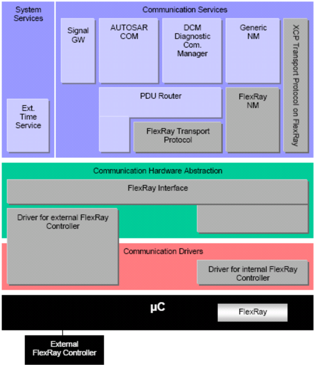

图 2 描绘了 AUTOSAR 命名法中不同的 PDU 名称以及不同 AUTOSAR 模块之间的信号依赖关系。

**PDU** 路由器将上层（例如 **COM**、**DCM** 等）的 I-PDU 部署到不同的通信协议上。经由网络系统类型（例如 **FlexRay**、**CAN**、**LIN** 等）的路由取决于 I-PDU 标识符。PDU 路由器还（通过配置）决定是否使用传输协议。最后，在没有速率转换的情况下，该模块执行网关功能。

**FlexRay** 接口（**FrIf**）提供标准化机制，经由 FlexRay 通信控制器访问 FlexRay 总线通道，而不论其位置（µC 内部/外部）。依据 PDU ID，FlexRay 接口必须将 N-PDU 转发给 **FrTp**，或将 I-PDU 转发给 **PduR**。**FrTp** 只处理传输协议 N-PDU（即 SF、CF、LF 与 FC PDU）。

图 2：AUTOSAR 信号命名法（**AUTOSAR Signal Nomenclature**）

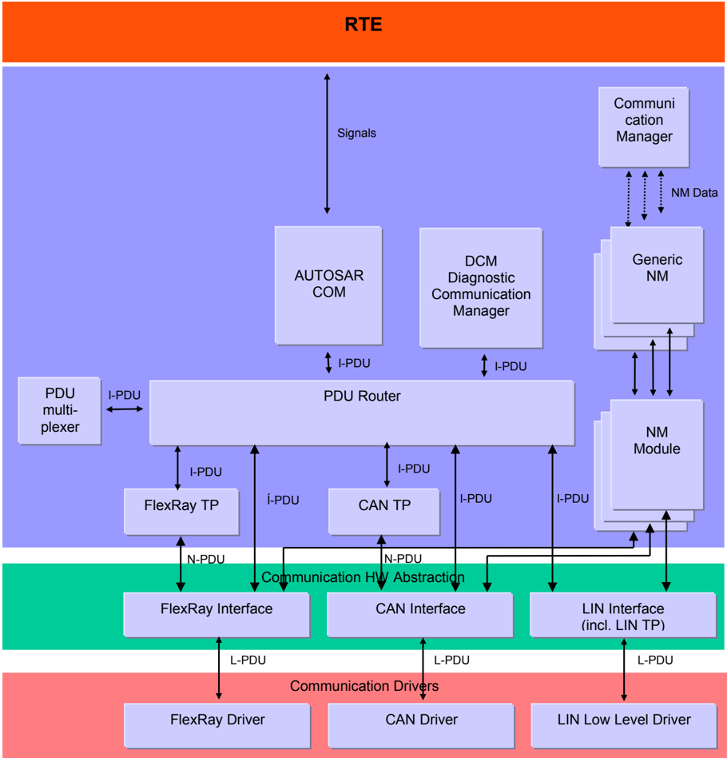

FlexRay 传输协议的主要目的是执行消息（I-PDU）的传输——例如它可能装得进、也可能装不进单个 FlexRay L-PDU。装不进单个 FlexRay L-PDU 的 I-PDU 会被分段为多个部分，每部分可在一条 FlexRay L-PDU 中传输。依据 AUTOSAR 基础软件架构，FlexRay 传输协议提供以下方法：

* 发送方向上的数据分段
* 接收方向上的数据重组
* 数据流控制
* 分段会话中的错误检测
* 发送取消

AUTOSAR 决定将基础软件模块规范建立在既有标准之上，因此本 AUTOSAR FlexRay 传输层规范基于国际标准 ISO 10681-2 [16]。该标准提供：

* 已知消息长度的消息传输
* 未知但有限消息长度的消息传输
* 带重试机制的传输确认

FlexRay 传输协议支持 1:1 与 1:n 连接。

FlexRay 传输协议支持最多 2^16-1 字节载荷的数据传输。

FlexRay 传输协议主要用于车辆诊断系统。尽管如此，它的开发也考虑了其他基于 FlexRay、需要传输层协议的系统的需求（例如诊断通信、ECU 间通信、**XCP** 通信等）。

## 2. 缩略语和缩写

本文档使用的前缀表示法如下：

| 前缀 | 说明 |
| --- | --- |
| I- | 相对于上层 AUTOSAR 层（例如 **COM**、**DCM** 等） |
| L- | 相对于 **FlexRay** 接口模块。 |
| N- | 相对于 FlexRay 传输协议层。 |

特定于 FlexRay 传输层、因此未包含在 AUTOSAR 术语表中的全部缩略语和缩写在下面描述：

**Fr L-SDU**
> 这是 **FlexRay** 接口模块的 SDU。从 FlexRay 接口模块的角度看，它与 Fr N-PDU 类似。

**Fr L-SduId**
> 这是 FlexRay 接口内 Fr-L-SDU 的唯一标识符。它用于引用 L-SDU 的路由属性。

**Fr N-PDU**
> 这是 FlexRay 传输层的 PDU。它包含地址信息、协议控制信息与数据（完整的 Fr N-SDU 或其一部分）。

**Fr N-SDU**
> 这是 FlexRay 传输层的 SDU。在 AUTOSAR 架构中，它是来自 PDU 路由器的一组数据。

**Fr N-SduId**
> FlexRay 传输层内唯一的 N-SDU 标识符。它用于引用 N-SDU 的路由属性。

**I-PDU**
> 这是上层 AUTOSAR 模块（例如 **COM**、**DCM** 等）的 PDU。如果配置了经由 FlexRay 传输协议的数据传输，I-PDU 类似于一个 FrTp N-SDU。

**PDU**
> 在分层系统中，它指在给定层的协议中规定的数据单元。它包含该层的用户数据（SDU）以及可能的协议控制信息。此外，层 X 的 PDU 是其下层 X-1 的 SDU（即 (X)-PDU = (X-1)-SDU）。

**PduInfoType**
> 该类型指用于存储处理 PDU（或 SDU）的发送/接收所需基本信息（即指向其在 RAM 中载荷的指针与相应长度（字节））的结构。

**Channel**
> 从 **FrTp** 的角度看，通道是 **FrTp** 模块用于处理到其他通信节点通信链路（传输 Fr N-PDU）的资源。

**Connection**
> 从 **FrTp** 的角度看，连接规定了不同通信节点之间的通信链路。连接定义了通信节点的发送方/接收方关系。

**PCI**
> 协议控制信息（**Protocol Control Information**）

**e.g.**
> 拉丁语「exempli gratia」——英语即 for example（例如）

**i.e.**
> 拉丁语「id est」——英语即 that is（也就是说）

**CanTp**
> CAN 传输协议（**CAN Transport Protocol**）

**LinTp**
> LIN 传输协议（**LIN Transport Protocol**）

**CF**
> 连续帧 Fr N-PDU（**Consecutive Frame Fr N-PDU**）

**COM**
> AUTOSAR 通信模块（**AUTOSAR Communications module**）

**DCM**
> 诊断通信管理器模块（**Diagnostic Communication Manager module**）

**DET**
> 默认错误追踪器（**Default Error Tracer**）

**FC**
> 流控制 Fr N-PDU（**Flow Control Fr N-PDU**）

**Fr**
> FlexRay 驱动模块（**FlexRay Driver module**）

**FrIf**
> FlexRay 接口模块（**FlexRay Interface module**）

**FrTp**
> FlexRay 传输协议层（**FlexRay Transport Protocol Layer**）

**PduR**
> PDU 路由器（**PDU Router**）

**SF**
> 起始帧 Fr N-PDU（**Start Frame Fr N-PDU**）

**LF**
> 末帧 Fr N-PDU（**Last Frame Fr N-PDU**）

**TP**
> 传输协议层（**Transport Protocol Layer**）

**SDU**
> 在分层系统中，它指由给定层服务的用户发送、并传输到对等服务用户的一组数据，其间保持语义不变。

**AUTOSAR**
> 汽车开放系统架构（**Automotive Open System Architecture**）

**SWS**
> 软件规范（**Software Specification**）

**MISRA**
> 汽车工业软件可靠性协会（**Motor Industry Software Reliability Association**）

**ISO**
> 国际标准化组织（**International Standard Organisation**）

**ID**
> 标识符（**Identifier**）

**OS**
> 操作系统（**Operating System**）

**MCAL**
> 微控制器抽象层（**Microcontroller Abstraction Layer**）

**CPU**
> 中央处理单元（**Central Processing Unit**）

**ROM**
> 只读存储器（**Read Only Memory**）

**RAM**
> 随机存取存储器（**Random Access Memory**）

**STF**
> 起始帧（Start Frame，请参阅 ISO 10681-2）

**AF**
> 确认帧（Acknowledge Frame，请参阅 ISO 10681-2）

**SN**
> 序列号（**Sequence Number**，请参阅 ISO 10681-2）

**FrTp_As**
> 发送方的定时器参数。发送方一侧 FlexRay 帧（任意 N_PDU）的传输时间。（请参阅 ISO 10681-2）

**FrTp_Ar**
> 接收方的定时器参数。接收方一侧 FlexRay 帧（任意 N_PDU）的传输时间。（请参阅 ISO 10681-2）

**FrTp_BS**
> 发送方的定时器参数。直到收到下一个流控制 N_PDU 的时间。（请参阅 ISO 10681-2）

**FrTp_Br**
> 接收方的定时器参数。直到发送下一个流控制 N_PDU 的时间。（请参阅 ISO 10681-2）

**FrTp_Cs**
> 发送方的定时器参数。直到发送下一个连续帧 N_PDU/末帧 N_PDU 的时间。（请参阅 ISO 10681-2）

**FrTp_Cr**
> 接收方的定时器参数。直到收到下一个连续帧 N_PDU 的时间。（请参阅 ISO 10681-2）

## 3. 相关文档

### 3.1. 输入文件

<a id="ref-1"></a>- [1] 基础软件模块清单 AUTOSAR\_TR\_BSWModuleList
<a id="ref-2"></a>- [2] 分层软件架构 AUTOSAR\_EXP\_LayeredSoftwareArchitecture
<a id="ref-3"></a>- [3] 基础软件模块通用需求 AUTOSAR\_SRS\_BSWGeneral
<a id="ref-4"></a>- [4] FlexRay 需求 AUTOSAR\_SRS\_FlexRay
<a id="ref-5"></a>- [5] FlexRay 接口规范 AUTOSAR\_SWS\_FlexRayInterface
<a id="ref-6"></a>- [6] PDU 路由器规范 AUTOSAR\_SWS\_PDURouter
<a id="ref-7"></a>- [7] 通信栈类型规范 AUTOSAR\_SWS\_CommunicationStackTypes
<a id="ref-8"></a>- [8] 标准类型规范 AUTOSAR\_SWS\_StandardTypes
<a id="ref-9"></a>- [9] 平台类型规范 AUTOSAR\_SWS\_PlatformTypes
<a id="ref-10"></a>- [10] 基础软件模块描述模板 AUTOSAR\_TPS\_BSWModuleDescriptionTemplate
<a id="ref-11"></a>- [11] ECU 配置规范 AUTOSAR\_TPS\_ECUConfiguration
<a id="ref-12"></a>- [12] 诊断事件管理器规范 AUTOSAR\_SWS\_DiagnosticEventManager
<a id="ref-13"></a>- [13] 默认错误追踪器规范 AUTOSAR\_SWS\_DefaultErrorTracer
<a id="ref-14"></a>- [14] 基础软件模块通用规范 AUTOSAR\_SWS\_BSWGeneral

### 3.2. 相关标准与规范

- [15] FlexRay Communications System Protocol Specification Version 2.1
- [16] ISO10681-2, Road vehicles - Communication on FlexRay - Part 2: Communication Layer services

### 3.3. 相关规范

AUTOSAR 提供了一份基础软件模块通用规范 [\[14\]](#ref-14)（SWS BSW General），它同样适用于 FlexRay ISO 传输层。

因此，规范 **SWS BSW General** 应被视为 FlexRay ISO 传输层的附加且必需的规范。

## 4. 约束和假设

### 4.1. 限制

AUTOSAR 架构定义了通信系统特定的传输协议层（**FrTp**、**CanTp**、**LinTp** 等）。因此，FlexRay 传输协议层（**FrTp**）只涵盖 FlexRay 传输协议的特定内容。

FlexRay 传输协议具有通往单个底层 FlexRay 接口层与单个上层 PDU 路由器模块的接口。

全部被上报的 DTC 在每次启动时都被置为已测试（notTestedThisCycle = 0）。对于持续存在的问题，这会导致 DTC 来回翻转，使出现计数器和/或运行周期计数器（若已配置）在每次上电时递增。

### 4.2. 汽车域的适用性

只要使用了 FlexRay 协议，FlexRay 模块总是可以用于各类应用。

### 4.3. 对 ISO 10681-2 的限制

AUTOSAR **FrTp** 模块不支持下列 ISO 10681-2 功能：

表 1：AUTOSAR FrTp 相对 ISO 10681-2 的限制（**Limitation of AUTOSAR FrTp vs. ISO 10681-2**）

| 功能 | 说明 |
| --- | --- |
| 状态监控 | ISO 10681-2 提供监控激活数据传输状态的功能。因此 ISO 10681-2 API 提供服务原语 C_GetStatus.request 与 C_GetStatus.confirm。 |
| 读取通信参数值 | ISO 10681-2 提供读出当前通信参数值的功能。因此 ISO 10681-2 API 提供服务原语 C_GetParameters.request 与 C_GetParameters.confirm。 |

## 5. 对其他模块的依赖

本节阐述 FlexRay 传输协议（**FrTp**）与其他 AUTOSAR 基础软件模块之间的关系。它简要描述 **FrTp** 向其他模块要求的服务、以及其他模块向 **FrTp** 要求的服务。

### 5.1. FlexRay 传输层交互

**FrTp** 的上层接口为 **PduR** 模块提供全局访问，以发送和接收数据（Fr N-SDU）。FlexRay N-SDU 标识符（Fr N-SDU-ID）实现这一访问。FlexRay N-SDU-ID 引用一个常量数据结构，它由描述 FlexRay N-SDU 的属性组成。下图展示了 **FrTp**、**PduR** 与 **FrIf** 模块之间的交互。

图 3：FrTp 交互（**FrTp interactions**）

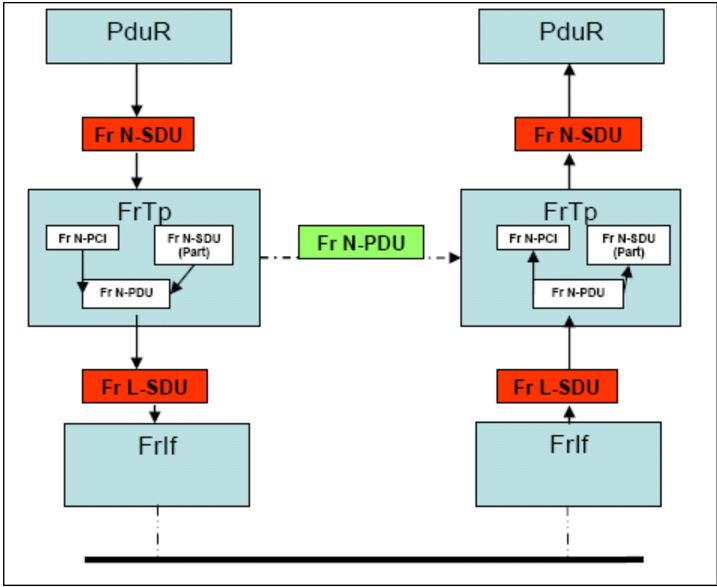

### 5.2. PDU 路由器

**FrTp** 模块请求 **PDU** 路由器模块提供的不同服务原语。所请求的 PDU 路由器模块服务原语列在下面。更多细节请参阅 [7.2](#72-类型定义) 章与规范 [\[6\]](#ref-6)：

**PduR_FrTpStartOfReception**

通过该 API 服务原语，**FrTp** 指示一个 FrTp-I-PDU 接收的开始。

**PduR_FrTpCopyRxData**

通过该 API 服务原语，**FrTp** 发起将收到的 FrTp N-PDU 载荷数据复制到所提供的 &lt;上层&gt; Rx 缓冲区的过程。

**PduR_FrTpRxIndication**

通过该 API 服务原语，**FrTp** 指示一个 FrTp-I-PDU 的接收已（不）成功完成。

**PduR_FrTpCopyTxData**

通过该 API 服务原语，**FrTp** 发起从所提供的 &lt;上层&gt; Tx 缓冲区复制 FrTp N-PDU 载荷数据的过程。

**PduR_FrTpTxConfirmation**

通过该 API 服务原语，**FrTp** 模块向相应的发送方模块（例如 **COM**、**DCM** 等）确认完整 Fr N-SDU 的（不）成功发送。

由 PDU 路由器调用的 **FrTp** 模块服务原语如下：

[**FrTp_Transmit**](#7331-frtp_transmit)

通过该 API 服务原语，上层经由 PDU 路由器发起一次 I-PDU 数据传输。

[**FrTp_CancelTransmit**](#7332-frtp_canceltransmit)

通过该 API 服务原语，在发送方一侧取消一个 Fr N-SDU 的发送。

[**FrTp_ChangeParameter**](#7333-frtp_changeparameter)

通过该 API 服务原语，可以改变 **FrTp** 模块的某些通信参数。

[**FrTp_CancelReceive**](#7334-frtp_cancelreceive)

通过该 API 服务原语，可以取消一次正在进行的接收。

### 5.3. FlexRay 接口

由 **FrTp** 调用的 FlexRay 接口（**FrIf**）模块服务原语如下：

**FrIf_Transmit**

通过该 API 服务原语，发起一个 Fr N-PDU 的传输。

由 FlexRay 接口模块调用的 **FrTp** 模块服务原语如下：

[**FrTp_RxIndication**](#742-frtp_rxindication)

通过该 API 服务原语，FlexRay 接口模块向 **FrTp** 指示收到一个 FrTp 帧（Fr N-PDU，不要与 FlexRay 帧混淆）。**FrTp** 随后处理该帧。

[**FrTp_TxConfirmation**](#743-frtp_txconfirmation)

通过该 API 服务原语，FlexRay 接口模块以结果（传输成功为 `E_OK`，失败为 `E_NOT_OK`）确认包含该 Fr N-PDU 的帧已在 FlexRay 网络上发送。

[**FrTp_TriggerTransmit**](#741-frtp_triggertransmit)

通过该 API 服务原语，FlexRay 接口获得对 Fr N-PDU 数据的访问。

### 5.4. ECU 状态管理器

由 ECU 状态管理器模块调用的 **FrTp** 模块服务原语如下（SWS_EcuM_02859）：

[**FrTp_Init**](#7321-frtp_init)

通过该 API 服务原语，**FrTp** 模块被初始化。

[**FrTp_Shutdown**](#7322-frtp_shutdown)

通过该 API 服务原语，所有激活的通信链路被关闭，资源被释放，模块被停止。

### 5.5. 默认错误追踪

由 **FrTp** 模块调用的默认错误追踪模块服务原语如下：

**Det_ReportError**

通过该 API 服务原语，**FrTp** 模块上报开发错误。

### 5.6. 文件结构

#### 5.6.1. 代码文件结构

详细内容请参阅 SWS\_BSWGeneral 的 5.1.6 章「代码文件结构」（Code file structure）。

#### 5.6.2. 头文件结构

FrTp.h 应包含从 **FrTp** 导出的全部数据——API 声明、回调、外部类型与全局数据。

#### 5.6.3. 设计规则

**FrTp** 模块的源代码既不应依赖于编译器（工具），也不应依赖于平台（处理器）。

FlexRay 传输层模块架构应支持通过专门的更新过程（例如 flash 重新编程）修改配置。

## 6. 功能规格

本节描述 FlexRay 传输协议层的功能。它解释提供给上层与下层的服务以及 FrTp 层模块的内部行为。

FlexRay 传输协议（**FrTp**）层的主要目的是传输可能装得进、也可能装不进单个 FlexRay 帧（L-PDU）的消息（I-PDU）。FrTp 层模块提供上层消息（Fr N-SDU）的分段与重组服务。因此 **FrTp** 模块提供分段、带流控制的传输以及消息重组等服务。

阅读本文档时需要记住：传输协议功能（例如帧组装、帧处理、错误处理等）遵循 ISO10681-2《Road vehicles - Communication on FlexRay - Part 2: Communication Layer services》[16]。

如果没有定义显式的建议或需求，**FrTp** 模块应遵循规范 ISO10681-2《Road vehicles - Communication on FlexRay - Part 2: Communication Layer services》[16]。

传输协议设施将用于传输来自不同源模块（例如 **COM**、**DCM** 等）的 AUTOSAR I-PDU。因此 **FrTp** 模块能够同时处理多个连接（即并行运行多个分段会话）。

同时激活连接的最大数量是静态配置的。该配置对所生成代码的复杂度与资源消耗（**CPU**、**ROM** 与 **RAM**）有重要影响，因为必须为每个同时访问预留资源（例如 Rx 与 Tx 状态机、用于处理 N-PCI 数据的变量等）。

### 6.1. FrTp 使用场景

如图 4 所示，**FrTp** 模块既可用于单个电子控制单元（ECU）内，也可用于网关。两种情况下 **FrTp** 模块都负责处理经由 **FlexRay** 的通信，但网关用途需要考虑一些额外需求。

**注意：**

每当需要考虑一个特殊的使用场景时，文档内会给出一个脚注。

图 4：FrTp 使用场景（**FrTp usage scenarios**）

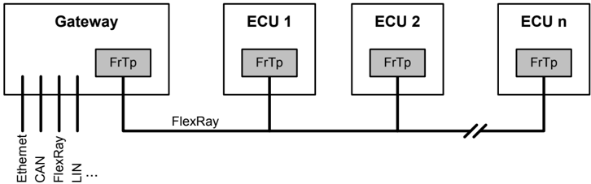

### 6.2. 依据 ISO10681-2 的 FrTp 行为

本章依据 ISO 10681-2 简要概述传输协议行为与数据传输场景。本章只是为了更好地理解满足 ISO 10681-2 的软件方案，不规定任何额外需求。

#### 6.2.1. 协议数据单元（PDU）

**FrTp** 模块应支持 [16] ISO10681-2《Road vehicles - Communication on FlexRay - Part 2: Communication Layer services》中定义的 Fr N-PDU 格式。

#### 6.2.2. 帧序列图

本章依据 ISO10681-2 基于传输协议层帧（N-PDU）序列描述数据传输模式。这只是为了让您更好地理解 **FrTp** 的内部工作，不作为额外的规范。对于最终实现，只有 [16] ISO10681-2《Road vehicles - Communication on FlexRay - Part 2: Communication Layer services》中的图是相关的。

##### 6.2.2.1. 已知消息长度的非分段非确认数据传输

依据 ISO 10681-2 [16]，**FrTp** 模块应支持已知消息长度的非分段非确认数据传输，如图 5 所示。

图 5：已知消息长度的非分段非确认数据传输的帧序列（**Frame sequence of an unsegmented unacknowledged data transfer with known message length**）

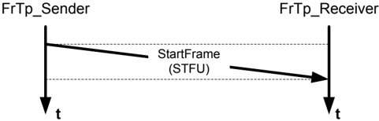

##### 6.2.2.2. 已知消息长度的非分段确认数据传输

依据 ISO 10681-2 [16]，**FrTp** 模块支持已知消息长度的非分段确认数据传输，如图 6 所示。

图 6：已知消息长度的非分段确认数据传输的帧序列（**Frame sequence of an unsegmented acknowledged data transfer with known message length**）

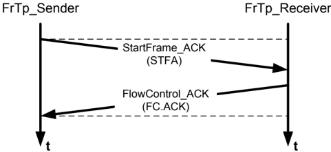

##### 6.2.2.3. 已知消息长度的分段非确认数据传输

依据 ISO 10681-2 [16]，**FrTp** 模块应支持已知消息长度的分段非确认数据传输，如图 7 所示。

图 7：已知消息长度的分段非确认数据传输的帧序列（**Frame sequence a segmented unacknowledged data transfer with known message length**）

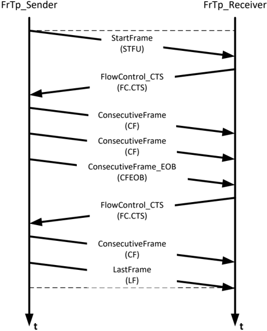

##### 6.2.2.4. 已知消息长度的分段确认数据传输

依据 ISO 10681-2 [16]，**FrTp** 模块应支持已知消息长度的分段确认数据传输，如图 8 所示。

图 8：已知消息长度的分段确认数据传输的帧序列（**Frame sequence of a segmented acknowledged data transfer with known message length**）

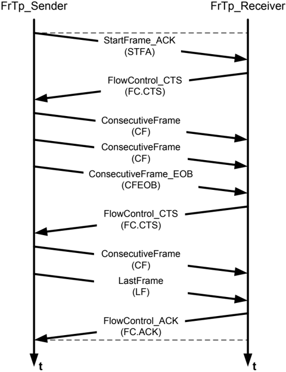

##### 6.2.2.5. 未知消息长度的分段非确认数据传输

依据 ISO 10681-2 [16]，**FrTp** 模块应支持未知消息长度的分段非确认数据传输，如图 9 所示。

图 9：未知消息长度的分段非确认数据传输的帧序列（**Frame sequence of a segmented unacknowledged data transfer with unknown message length**）

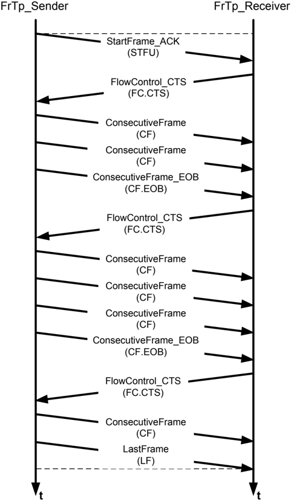

##### 6.2.2.6. 未知消息长度的分段确认数据传输

依据 ISO 10681-2 [16]，**FrTp** 模块应支持未知消息长度的分段确认数据传输，如图 10 所示。

图 10：未知消息长度的分段确认数据传输的帧序列（**Frame sequence of a segmented acknowledged data transfer with unknown message length**）

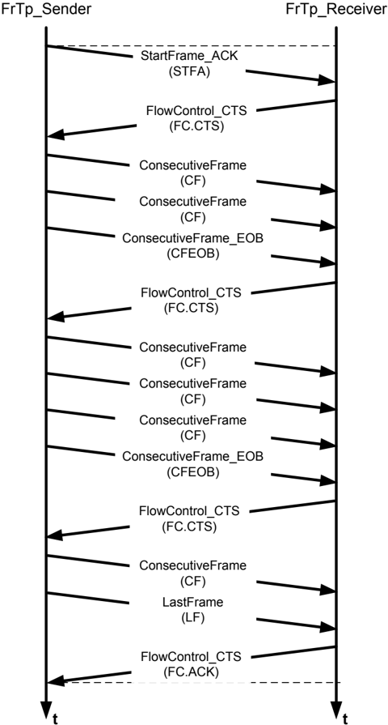

#### 6.2.3. 对 ISO10681-2 的限制

对 ISO 10681-2 的限制在 [4.3](#43-对-iso-10681-2-的限制) 章——表 1 中描述。

### 6.3. 模块内部行为规范

本章规定 FlexRay 传输层模块为满足 ISO 10681-2 [16] 协议行为的内部行为。

#### 6.3.1. 概述

图 11 描绘了 FrTp 层模块架构的抽象总览。

图 11：FlexRay 传输模块总览（**FlexRay Transport Module overview**）

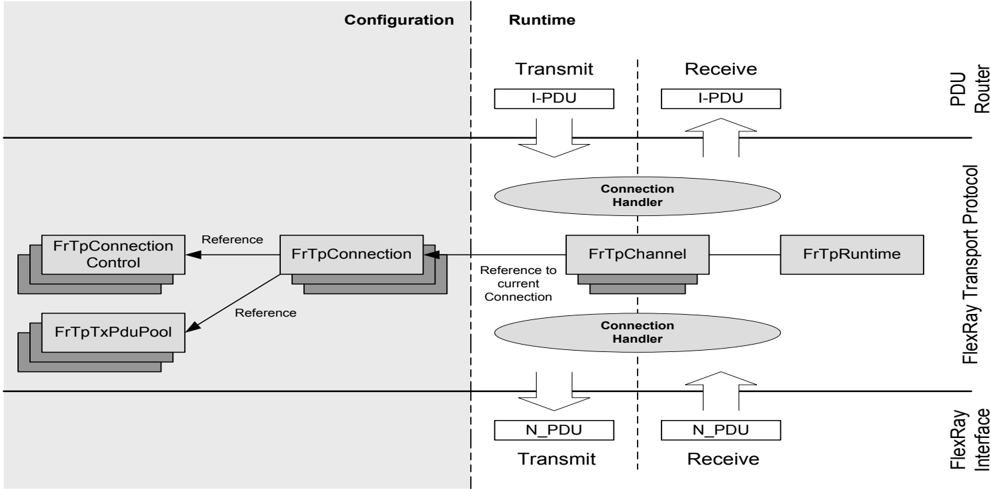

图 11 描绘了配置部分与运行时部分之间的划分。模块初始化后，它能够从上层（PDUR）发送 I-PDU，或从下层（FrIf）接收 N-PDU。下面简要描述参与 FrTp 层处理过程的各个部分。

| 术语 | 说明 |
| --- | --- |
| [FrTpConnection](#924-frtpconnection) | 连接是一个配置参数集，包含唯一标识不同通信节点之间连接链路所需的全部参数。一个连接在发送节点（由源地址表示）、一个或多个接收节点（由目标地址表示）与上层 I-PDU 源（由 I-PDU-ID 表示）之间具有固定的分配关系。此外，连接还有一个对为经由 **FrTp** 发送数据而定义的一组 N-PDU（PDU-Pool）的引用。也定义了到连接特定参数（例如定时与超时等）的引用。 |
| [FrTpConnectionControl](#927-frtpconnectioncontrol) | 连接配置是一个参数集，包含配置特定参数（例如定时、超时、默认参数等）。它被一个连接引用。 |
| [FrTpTxPduPool](#928-frtptxpdupool) | Tx-N-PduPool 是为 **FrTp** 发送目的定义的一组 N-PDU。 |
| FrTpChannel | 通道是 **FrTp** 模块的运行时资源，它实现处理经由 **FlexRay** 的通信链路所需的全部通信控制机制（例如状态机等）。通道可以被连接处理程序分配，以处理一个所需的连接。因此通道具有一个对当前由该通道处理的连接的引用。数据传输完成后，通道与连接之间的分配被清除，通道可以被另一个连接重新分配。 |
| FrTpRuntime | FrTpRuntime 是控制激活连接所需的运行时参数的集合（请参阅 [6.3.3.1](#6331-frtpruntime) 小节）。 |
| 连接处理程序（Connection Handler） | 连接处理程序是 **FrTp** 模块的一个抽象部分，负责通道的（重新）分配以及通道与连接之间的（重新）指派。 |

如果上层模块（例如 **COM**、**DCM** 等）想发送数据（I-PDU），**PduR** 模块执行相应的 FrTp 层模块 API 调用。连接处理程序为相应的连接求值 I-PDU-ID（从 **FrTp** 的角度看等于 N-SDU-ID）。连接处理程序分配一个空闲通道，并将通道的连接引用设置为所选连接。现在可以经由引用访问的连接控制参数集对通道进行初始化。通道处理通信，直到全部数据发送完毕。最后一条 N-PDU 发送后，连接处理程序释放通道，并复位对连接的引用。

如果一个 N-PDU 经由 **FlexRay** 被接收，**FrIf** 执行相应的 FrTp API 调用。连接处理程序求值 N-PDU 中属于协议控制信息（PCI）一部分的目标地址与源地址。连接处理程序查找相应的连接，分配一个通道，设置对所选连接的引用并对其进行初始化。在最后一条 N-PDU 被接收之前，连接处理程序重新分配通道；最后跳过对所选连接的引用，并通过调用相应的 PDUR 模块 API 将 I-PDU 交付给被寻址的上层。

##### 6.3.2. 配置数据

连接标识这条特定通信链路的发送方与接收方。

一个 FrTp 连接链路由以下要素定义：

* a) 接收节点的目标地址，以及
* b) 发送节点的源地址。

为了在 FlexRay 通信栈内对不同的 PDU 进行内部处理，I-PDU-ID（N-SDU-ID）标识到上层发送或接收模块的数据链路（见图 2）。

此外，连接还有一个对为经由这条特定连接发送数据而定义的一组 N-PDU（[FrTpTxPduPool](#928-frtptxpdupool)）的引用。也定义了到连接特定参数（例如定时与超时等）的引用（FrTpConnectionConfig）。

一个 [FrTpConnection](#924-frtpconnection) 容器应实现 [9.2](#92-容器与配置参数) 章定义的全部参数。

对于 **FrTp** 模块应处理的每条连接链路，应创建一个新的 [FrTpConnection](#924-frtpconnection) 容器实例。

**FrTp** 模块应支持构建后（post build）可配置的连接数量。

每个 [FrTpConnection](#924-frtpconnection) 应有一个模块范围内唯一的 RemoteAddress/LocalAddress 对（见 [9.2](#92-容器与配置参数) 节）。

每个 [FrTpConnection](#924-frtpconnection) 应有一个模块范围内唯一的 FRTP_SDUID（N-SDU ID）（见 [9.2](#92-容器与配置参数) 节）。

##### 6.3.2.2. FrTpTxPduPool

[FrTpTxPduPool](#928-frtptxpdupool) 包含为发送 FrTp N-PDU 而配置的 N-PDU 列表。一个 [FrTpTxPduPool](#928-frtptxpdupool) 可以被不同的 [FrTpConnection](#924-frtpconnection) 引用，但每个 [FrTpConnection](#924-frtpconnection) 恰好有一个对一个 [FrTpTxPduPool](#928-frtptxpdupool) 的引用（另见图 17）。[FrTpTxPduPool](#928-frtptxpdupool) 是支持连接的动态带宽分配所必需的。

[6.3.2.2](#6322-frtptxpdupool) 章节脚注：构建后可配置的连接数量是例如网关所要求的。如果在车辆生命周期内定义了新的连接，则只需更新该连接的参数集。

[6.3.2](#632-配置数据) 章节脚注：AUTOSAR 本地地址与远程地址映射到 ISO 10681-2 的源地址与目标地址。

[6.3.2.2](#6322-frtptxpdupool) 章详细描述动态带宽分配。此处仅引入术语 [FrTpTxPduPool](#928-frtptxpdupool)，并规定对 [FrTpTxPduPool](#928-frtptxpdupool) 的一些基本需求。

一个 [FrTpTxPduPool](#928-frtptxpdupool) 容器应实现 [9.2](#92-容器与配置参数) 章定义的全部参数。

单个 [FrTpTxPduPool](#928-frtptxpdupool) 可以被不同的 [FrTpConnection](#924-frtpconnection) 引用。

**注意：**

将 PDU 池配置为限制到某个 ECU 的带宽在 [9.4.4](#944-带宽控制配置) 章描述。

##### 6.3.2.3. FrTpConnectionControl

一个 [FrTpConnectionControl](#927-frtpconnectioncontrol) 容器包含控制一条连接所需的全部静态（非运行时）参数，例如初始定时器值、超时控制值等。每个 [FrTpConnection](#924-frtpconnection) 具有到一个 [FrTpConnectionControl](#927-frtpconnectioncontrol) 容器的独占链接。具有相同控制参数的 [FrTpConnection](#924-frtpconnection) 可以引用同一个 [FrTpConnectionControl](#927-frtpconnectioncontrol)。

一个 [FrTpConnectionControl](#927-frtpconnectioncontrol) 容器应实现 [9.2](#92-容器与配置参数) 章定义的全部参数。

一个 [FrTpConnectionControl](#927-frtpconnectioncontrol) 可以被不同的 [FrTpConnection](#924-frtpconnection) 引用。

##### 6.3.3. 运行时数据

如图 11 所示，还需要一些运行时信息。全部运行时信息都封装在容器中。本章定义全部运行时容器及其作用域内相应的变量——这是理解 **FrTp** 工作所必需的。

建议将实现所需的全部运行时数据也放入全局 FrTpRuntime 容器中。

###### 6.3.3.1. FrTpRuntime

表：FrTpRuntime

| 属性 | 值 |
| --- | --- |
| 模块名称 | FrTpRuntime |
| 模块描述 | 该容器包含依据 ISO 10681-2 处理 FlexRay 传输协议通信所需的运行时参数/变量。 |

| 容器名称 | 多重性 | 作用域/依赖 |
| --- | --- | --- |
| FrTp_Channel | 1..* | FrTp 通道：该容器包含一个 FrTpChannel 的运行时参数/变量。 |
| FrTp_ConCtrlRuntime | 1..* | FrTp 连接控制运行时：该容器包含处理一个 [FrTpConnection](#924-frtpconnection) 的运行时参数/变量。 |
| FrTp_PduPoolRuntime | 1..* | FrTp PDU 池运行时：该容器包含处理一个 FrTpPduPool 的运行时参数/变量。 |

###### 6.3.3.2. FrTpChannel

如上所述，通道是 **FrTp** 的运行时资源。通道可以被分配来处理一条连接。本章在不涉及实现特定信息（例如类型等）的情况下描述通道的相关信息。

| 属性 | 值 |
| --- | --- |
| 名称 | FrTpChannel |
| 描述 | 该容器包含一个 FlexRay 通道的参数与变量 |
| 容器参数与变量 | 容器参数与变量 |

| 信息 | 说明 |
| --- | --- |
| FrTpChannelNumber | 该通道的编号 |
| FrTpTxChannelState | Tx 通道的当前状态（idle = 0 或 busy = 1） |
| FrTpTxConState | FrTp Tx 连接状态：该参数实现 Tx 连接的当前状态（依据 ISO 10681-2 协议处理的 Tx 通信状态机）。 |
| FrTpTxConRef | FrTp Tx 连接引用：这是到该通道当前正在处理的当前 Tx [FrTpConnection](#924-frtpconnection) 的引用（指向连接的指针）。 |
| FrTpTxConTxPduPendingCounter | FrTp Tx 连接 Tx PDU 待决计数器：该计数器统计激活 TxConnection 中当前已发送但未确认的 Fr N-PDU（例如 SF、CF、LF）的数量。**FrTp** 每发送一个 FrTp Tx N-PDU，该计数器应递增；**FrIf** 每确认一个已发送的 FrTp Tx N-PDU，该计数器应递减。 |
| FrTpTxConTxPduPoolRuntimeRef | FrTp Tx 连接 Tx PDU 池运行时引用：这是到相应 PDU 池的运行时容器（指向 FrTp_TxPduPoolRuntime）的引用。**注意：** PDU 池的运行时容器控制 TxConfirmation 信号。 |
| FrTpTxConConfigRuntimeRef | FrTp Tx 连接配置运行时引用：这是到相应 Tx 连接配置的运行时容器（指向 FrTp_ConConfigRuntime）的引用。**注意：** Tx 连接配置的运行时容器控制可在运行时更改的连接参数。 |
| FrTpRxChannelState | Rx 通道的当前状态（idle 或 busy） |
| FrTpRxConState | FrTp Rx 连接状态：该参数实现 Rx 连接的当前状态（依据 ISO 10681-2 协议处理的 Rx 通信状态机）。 |
| FrTpRxConRef | FrTp Rx 连接引用：这是到该通道当前正在处理的当前 Rx [FrTpConnection](#924-frtpconnection) 的引用（指向连接的指针）。 |
| FrTpRxConTxPduPendingCounter | FrTp Rx 连接 Tx PDU 待决计数器：该计数器统计激活 RxConnection（FlowControl）中当前已发送但未确认的 Fr N-PDU 的数量。**FrTp** 每发送一个 FrTp Tx N-PDU，该计数器应递增；**FrIf** 每确认一个已发送的 FrTp Tx N-PDU，该计数器应递减。因此该计数器只在 0 与 1 之间翻转。 |
| FrTpRxConTxPduPoolRuntimeRef | FrTp Rx 连接 Tx PDU 池运行时引用：这是到相应 PDU 池的运行时容器（指向 FrTpTxPduPoolRuntime）的引用。**注意：** PDU 池的运行时容器控制 TxConfirmation 信号。在该通道上进行中的接收期间，发送 FlowControl N-PDU 的传输控制需要该引用。**注意：** 对于全双工通道配置（见 [6.3.3.2.1](#63321-全双工与半双工) 小节），FrTpTxConTxPduPoolRuntimeRef 与 FrTpRxConTxPduPoolRuntimeRef 相等。 |
| FrTpRxConConfigRuntimeRef | FrTp Rx 连接配置运行时引用：这是到相应 Rx 连接配置的运行时容器（指向 FrTpConConfigRuntime）的引用。**注意：** Rx 连接配置的运行时容器控制可在运行时更改的连接参数。 |
| 无包含的容器 | 无包含的容器 |

* **FrTp** 模块应支持多个 FrTpChannel 的并发工作。
* 提供通道的确切数量应可通过参数 FrTpChanNum 配置（见 [9.2](#92-容器与配置参数) 节）。
* 如果该通道被分配给一个 Rx 连接，运行时变量 FrTpRxChannelState 应从「idle」状态切换到「busy」状态。
* 如果一个 Rx 连接关闭后通道空闲，运行时变量 FrTpRxChannelState 应从「busy」状态切换回「idle」状态。
* 如果该通道被分配给一个 Tx 连接，运行时变量 FrTpTxChannelState 应从「idle」状态切换到「busy」状态。
* 如果一个 Tx 连接关闭后通道空闲，运行时变量 FrTpTxChannelState 应从「busy」状态切换回「idle」状态。

**注意：**

对于没有 FrTpChannel 资源可用（FrTpTxChannelState ≠ idle）而无法进行数据传输的情况，其错误处理规定于 [SWS_FrTp_01041]。

###### 6.3.3.2.1. 全双工与半双工

通常，全双工通道支持同一连接同时并发地发送与接收 Fr N-PDU。图 12 描绘了一个全双工实现。

图 12：全双工总览（**Full Duplex Overview**）

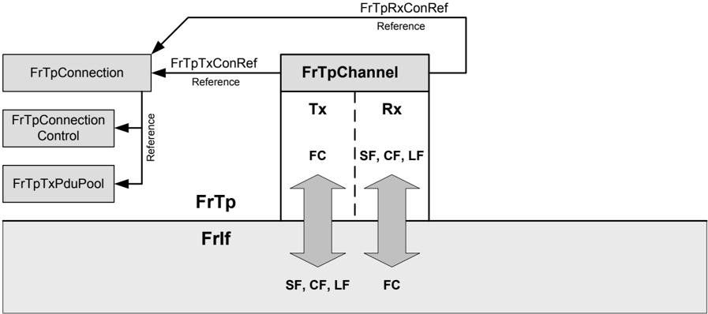

另一方面，半双工通道只支持一个方向的数据传输。Rx 传输也必须发送一个 FlowControl、或 Tx 传输必须接收一个 FlowControl 这一事实与全双工连接不同。图 13 描绘了一个半双工 FrTp_Channel，其中要么处理 Tx 连接、要么处理 Rx 连接。

[6.3.3.2.1](#63321-全双工与半双工) 章节脚注：理论上，两个 ECU 可以同时相互传输数据。这意味着每个 ECU 同时是发送方与接收方。如果两个 ECU 都只有一个远程地址与一个本地地址，**FrTp** 应求值 PCI 以区分收到的是 Rx 方向（CF 或 LF）的 PDU 还是 Tx 方向（FC）的 PDU。这就是全双工机制。

图 13：半双工总览（**Half Duplex Overview**）

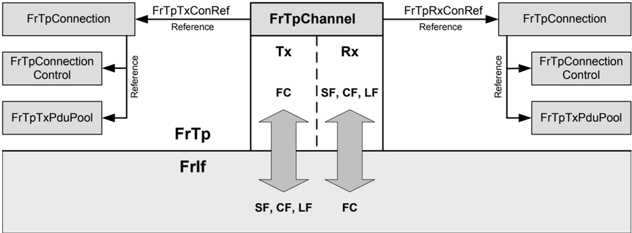

FrTpChannels 的最终功能取决于实现，因此本文档不对其作规定。

###### 6.3.3.3. FrTpConnectionControlRuntime

本章在不涉及实现特定信息（例如类型等）的情况下描述连接控制的相关信息。

| 属性 | 值 |
| --- | --- |
| 名称 | FrTpConCtrlRuntime |
| 描述 | FrTp 连接控制运行时：该容器包含连接控制的运行时数据。 |
| 容器参数与变量 | 容器参数与变量 |

| 信息 | 说明 |
| --- | --- |
| FrTpSCexpRuntime | FRTP_SEPARATION_CYCLE_EXPONENT：FrTpSCexp 参数的运行时值。该参数可以通过 API 调用「[FrTp_ChangeParameter](#7333-frtp_changeparameter)」修改，不同于所配置的默认值。 |
| FrTpMaxNbrOfNPduPerCycleRuntime | FRTP_MAX_NUMBER_OF_NPDU_PER_CYCLE：FrTpMaxNbrOfNPduPerCycle 参数的运行时值。该参数可以通过 API 调用「[FrTp_ChangeParameter](#7333-frtp_changeparameter)」修改，不同于所配置的默认值。 |
| 无包含的容器 | 无包含的容器 |

### 6.4. 初始化与关机

**FrTp** 模块应有两个内部状态：FRTP_OFF 与 FRTP_ON。

**FrTp** 模块应实现一个静态状态变量 FrTpState，用于表示 **FrTp** 模块是否已初始化。

应检查 FrTpState 以检测 **FrTp** 模块是否已初始化。

上电后 **FrTp** 模块应处于 FRTP_OFF 状态。

当 **FrTp** 已通过服务原语 `[FrTp_Init](#7321-frtp_init)()` 成功初始化时，**FrTp** 模块应切换到内部状态 FRTP_ON。

只有当 **FrTp** 模块处于 FRTP_ON 状态时，**FrTp** 模块才应执行正常的 FrTp 操作任务（例如分段、重组等）。

服务原语 `[FrTp_Init](#7321-frtp_init)` 应初始化模块的全部全局变量，并将所有传输协议连接置入 FRTP_ON 的一个子状态——在该子状态中既没有正在进行的发送也没有正在进行的接收。

如果 **FrTp** 模块处于全局状态 FRTP_ON，调用服务原语 `[FrTp_Init](#7321-frtp_init)` 应使模块回到一个无风险的空闲状态（空闲状态 = FRTP_ON，但没有发送或接收正在进行），并且模块应放弃全部当前连接。

当服务原语 `[FrTp_Shutdown](#7322-frtp_shutdown)()` 已成功执行时，**FrTp** 模块应切换到内部状态 FRTP_OFF。

图：FrTp 初始化与关机状态图（**FrTp Initialization and shutdown state diagram**）

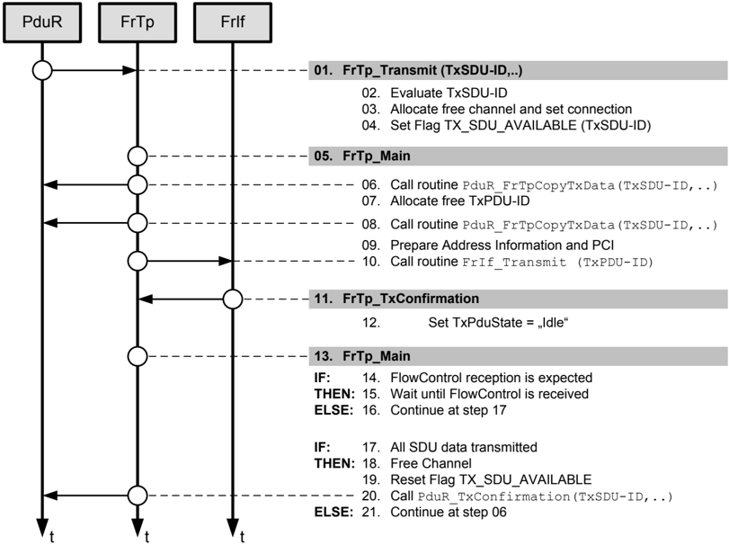

### 6.5. 数据传输处理

本章涵盖 **FrTp** 模块数据传输处理的全部主题——当上层（例如 **COM**、**DCM** 等）经由 **PduR** 模块请求数据（Fr N-SDU）传输时，或当数据（Fr N-PDU）经由 **FrIf** 模块被接收时。为了便于理解，各个主题被封装在若干小节中，从数据传输与接收的基本定义开始。缓冲区处理在单独的一章中描述。

FlexRay 协议栈为数据传输支持两种不同的缓冲区访问模式：

* a) 立即缓冲区访问模式（Immediate Buffer Access Mode）
* b) 解耦缓冲区访问模式（Decoupled Buffer Access Mode）

由于这一事实，数据传输处理有两种不同的序列。

#### 6.5.1. 标志

**FrTp** 模块使用若干标志来通知内部状态（另见第 [8](#8-时序图) 章的时序图）。本章描述模块间状态处理所需的标志。

##### 6.5.1.1. TX_SDU_AVAILABLE

TX_SDU_AVAILABLE 标志由服务原语 `[FrTp_Transmit](#7331-frtp_transmit)` 设置，以指示 N-SDU 发送请求。

每个通道都应存在 TX_SDU_AVAILABLE 标志。

TX_SDU_AVAILABLE 标志应指示在已分配通道上针对一个已配置连接的 Fr N-SDU 发送请求。

**注意：**

关于置位/复位条件与行为的详细信息，请参阅 [6.5.2](#652-发送数据) 章与 [SWS_FrTp_01057]。

##### 6.5.1.2. TX_SDU_UNKNOWN_MSG_LENGTH

TX_SDU_UNKNOWN_MSG_LENGTH 标志由服务原语 `[FrTp_Transmit](#7331-frtp_transmit)` 设置，以指示未知消息长度的 N-SDU 发送请求。依据该标志的状态，**FrTp** 模块将多次调用服务原语 `PduR_FrTpCopyTxData`，直到全部数据发送完毕。

TX_SDU_UNKNOWN_MSG_LENGTH 标志应指示未知消息长度的 Fr N-SDU 发送请求。

每个通道都应存在 TX_SDU_UNKNOWN_MSG_LENGTH 标志。

**注意：**

关于置位/复位条件与行为的详细信息，请参阅 [6.5.2](#652-发送数据) 章与 [SWS_FrTp_01124]。

##### 6.5.1.3. RX_PDU_AVAILABLE

RX_PDU_AVAILABLE 标志由服务原语 `[FrTp_RxIndication](#742-frtp_rxindication)` 设置，以指示一个 N-PDU 的接收。

对于配置为由 **FrTp** 模块接收的每个 Fr N-PDU，都应存在 RX_PDU_AVAILABLE 标志。

**注意：**

关于置位/复位条件与行为的详细信息，请参阅 [6.5.3](#653-接收数据) 章与 [SWS_FrTp_01074]。

##### 6.5.1.4. RX_ERROR

在配置了带确认与重试的传输的情况下，需要 RX_ERROR 标志。在分段数据接收期间可能发生错误，但当前无法发送 FlowControl。此时必须存储关于错误的信息，直到允许发送 FlowControl。

每个 FrTpChannel 都应存在 RX_ERROR 标志。

RX_ERROR 标志应指示在分段接收期间发生了错误。

RX_ERROR 标志应在反应（重试、否定确认、中止）之后被清除。

#### 6.5.2. 发送数据

在发送期间，**FrTp** 应使用上层经由元数据项 SOURCE_ADDRESS_16 与 TARGET_ADDRESS_16 提供的寻址信息作为被发送 N-PDU 的本地地址与远程地址，并用于标识收到的流控制 N-PDU。

如果为被发送的 N-SDU 配置了 FrTpLa 和/或 FrTpRa，则即使上层提供了寻址信息，也使用它们。若未配置，N-PDU 中的地址信息应按照所提供的地址信息设置。

##### 6.5.2.1. 经由「立即缓冲区访问」模式发送数据

本章定义由上层（例如 **COM**、**DCM** 等）经由「立即缓冲区访问」模式请求的数据传输。

图 14 描绘了配置「立即缓冲区访问」模式时数据传输的原则性内部处理。下面描述经由 **FrTp** 发送数据所需的各个步骤。

图 14：「立即缓冲区访问」模式下的发送数据总览（**Transmit data overview in 'Immediate Buffer Access' mode**）

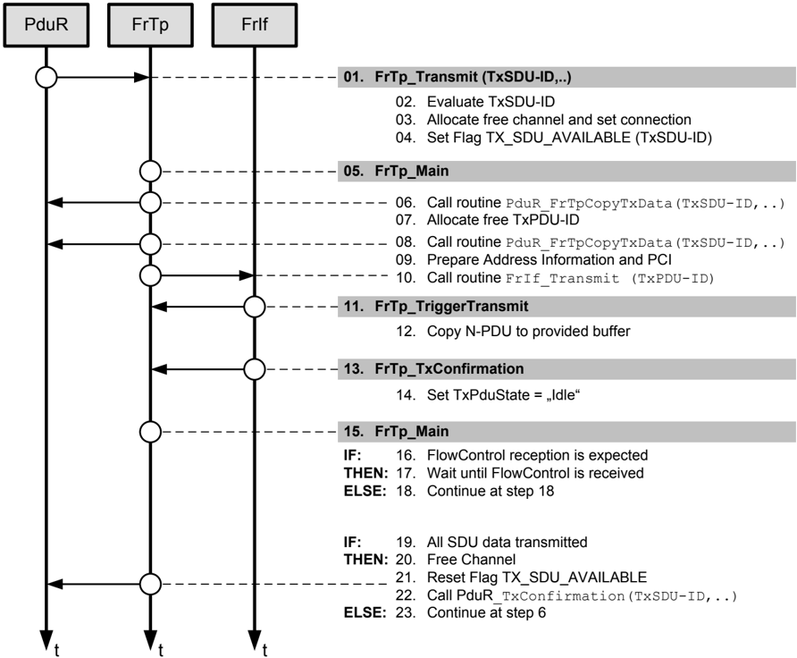

**步骤 1–4**

Fr N-SDU 数据的发送应始终由服务原语调用 `[FrTp_Transmit](#7331-frtp_transmit)` 发起（见 [7.3.3.1](#7331-frtp_transmit) 章）。

**FrTp** 模块应求值 PduInfoType.SduLength 的值：

* SduLength = 0：请求未知消息长度的传输
* SduLength ≠ 0：请求已知消息长度的传输

如果配置了支持未知消息长度，**FrTp** 模块应依据上述求值结果设置标志 TX_SDU_UNKNOWN_MSG_LENGTH（另见 [6.5.1.2](#6512-tx_sdu_unknown_msg_length) 小节）。

当检测到未知消息长度的传输、但未配置对未知消息长度的支持、且 **FrTp** 模块的开发错误检测已使能时，FRTP 模块应引发开发错误 [FRTP_E_UMSG_LENGTH_ERROR](#671-开发错误)。

服务原语参数 TxPduId 应用于选择正确的连接。这应通过在 [FrTpConnection](#924-frtpconnection) 容器中搜索正确的条目（[FrTpConnection](#924-frtpconnection).FrTpTxSduId）来完成。如果给出了有效的参数 TxPduId，**FrTp** 模块应搜索一个空闲的通道资源（FrTpTxChannelState = Idle）并分配它来控制所请求的 Tx 数据传输。

正在进行的 Data Transfer 应通过标志 TX_SDU_AVAILABLE 来示意（另见 [6.5.1.1](#6511-tx_sdu_available) 小节）。

只有在以下情况下，服务原语才应置位标志 TX_SDU_AVAILABLE：

* a) 所请求的 TxPduId 有效；
* b) 有空闲的通道资源可用（FrTpTxChannelState = Idle）。

如果当前参数 TxPduId 不受支持，服务原语 `[FrTp_Transmit](#7331-frtp_transmit)` 应：

* a) 被终止且返回值置为 `E_NOT_OK`（另见 [7.2.1](#721-frtp_configtype) 章），并且
* b) 在 **FrTp** 模块的开发错误检测已使能时，引发开发错误 [FRTP_E_INVALID_PDU_SDU_ID](#671-开发错误)。

如果没有空闲通道可用（FrTpTxChannelState ≠ Idle），服务原语 `[FrTp_Transmit](#7331-frtp_transmit)` 应被终止且返回值置为 `E_NOT_OK`（另见 [7.2.1](#721-frtp_configtype) 章）。

**FrTp** 模块应引发运行时错误 [FRTP_E_NO_CHANNEL](#672-运行时错误)。

[6.5.2.1](#6521-经由立即缓冲区访问模式发送数据) 章节脚注：这种情况可能发生在网关上——如果请求经由比所配置通道资源更多的连接进行通信。

如果由于针对指定地址信息的另一次传输处于激活状态而导致消息传输请求未被接受，则 `[FrTp_Transmit](#7331-frtp_transmit)` 应返回 `E_NOT_OK`。

**步骤 5–10**

如果 TX_SDU_AVAILABLE 标志已置位，**FrTp** 模块必须通过第一次调用服务原语 `PduR_FrTpCopyTxData()` 来求值当前可用的 FrTp N-SDU 数据的长度。在知道可用数据大小后，**FrTp** 模块扫描 [FrTpTxPduPool](#928-frtptxpdupool)，并为该数据传输分配第一个空闲的 FrTpPdu。依据可用的 FrTp-N-SDU 长度与 [FrTpTxPduPool](#928-frtptxpdupool) 的空闲 FrTpPdu 长度，**FrTp** 模块决定该 N-SDU 传输是否需要分段。通过调用服务原语 `PduR_FrTpCopyTxData()`，数据被复制到相应的缓冲区。下一步准备相应的地址信息与 PCI，并以相应的 TxPduId 调用服务原语 `FrIf_Transmit`。

如果 TX_SDU_AVAILABLE 标志已置位，**FrTp** 模块应调用服务原语 `PduR_FrTpCopyTxData()` 以获取当前可用的 FrTp N-SDU 长度信息。

**FrTp** 模块在扫描相应的 [FrTpTxPduPool](#928-frtptxpdupool) 时（另见 [6.3.2.2](#6322-frtptxpdupool) 小节），应始终分配第一个空闲的 [FrTpTxPdu](#9210-frtptxpdu)。

如果识别出一个空闲的 [FrTpTxPdu](#9210-frtptxpdu)，**FrTp** 模块应使用该 [FrTpTxPdu](#9210-frtptxpdu) 继续当前的传输过程。

如果没有识别出空闲的 [FrTpTxPdu](#9210-frtptxpdu)，**FrTp** 模块应将相应连接的处理推迟到下一次主函数调用。

**注意：**

**FrTp** 模块应推迟相应连接的处理，直到依据 [SWS_FrTp_01046] 识别出空闲的 [FrTpTxPdu](#9210-frtptxpdu)，或发生超时（见 6.5.8 节）。

[6.5.2.1](#6521-经由立即缓冲区访问模式发送数据) 章节脚注：可用数据长度的求值取决于 **FrTp** 所处的不同场景。

* 对于以未知消息长度传输数据的普通 ECU，需要求值当前存储的 FrTp-N-SDU 的长度。
* 对于以已知消息长度传输数据的 ECU，Tx 数据长度由 `[FrTp_Transmit](#7331-frtp_transmit)` 服务原语的参数给出。额外调用 `PduR_FrTpCopyTxData(..)` 进行求值也是可能的，以便对已知与未知消息长度传输采用相同的求值序列，但可以通过运行时优化跳过（实现相关）。
* 对于路由不同总线系统 N-SDU 的网关，需要获取网关缓冲区中当前可用的（已接收）数据长度。

**FrTp** 模块应依据从 [FrTpTxPduPool](#928-frtptxpdupool) 为当前处理的 [FrTpConnection](#924-frtpconnection) 分配的第一个 [FrTpTxPdu](#9210-frtptxpdu) 的长度信息，决定所请求的 N-SDU 传输是否需要分段（另见图解 2）。

图解 2：分段决策（**Segmentation decision**）

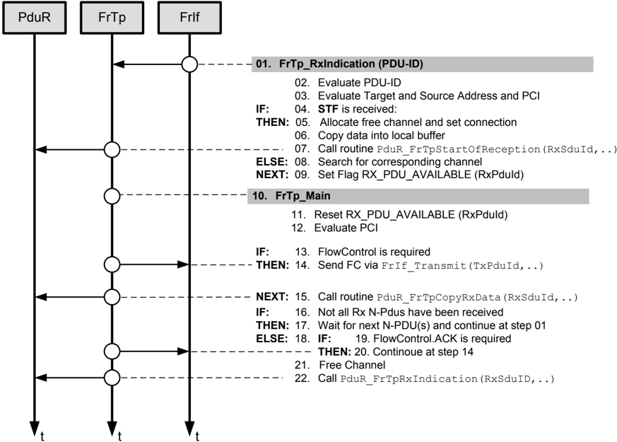

**注意：** 能否分段还取决于连接模式（1:1 或 1:n）。

**FrTp** 模块应调用服务原语 `PduR_FrTpCopyTxData()`，以 [FrTpTxPdu](#9210-frtptxpdu) 的长度将当前可用的 FrTp N-SDU 数据复制到相应的发送缓冲区。

**FrTp** 模块应依据上述决策的结果，按照规范 ISO 10681-2 [16] 的定义准备地址信息与 PCI。

**FrTp** 模块应以最近分配的 [FrTpTxPdu](#9210-frtptxpdu) 的 TxPduId 调用服务原语 `FrIf_Transmit()` 发起一次 N-PDU 数据传输。

**FrTp** 应将服务原语 `FrIf_Transmit` 的参数 PduInfoType 所引用的相应数据长度设置为缓冲区的确切数据长度。

[6.5.2.1](#6521-经由立即缓冲区访问模式发送数据) 章节脚注：**FrTp** 总是发送相应缓冲区中存储的真实数据量。**FrTp** 不负责填充字节。将 N-SDU 填充到所配置帧大小的工作在下层（例如 **FrIf** 或 FlexRay 驱动）完成。**FrTp** 只决定是否需要分段，并将连续帧 N-PDU 分段到相应 PduPool 的对应 PDU 的最大长度。

**步骤 11–12**

如果 N-PDU 已被 **FrIf** 模块成功发送，**FrIf** 模块应以结果 `E_OK` 调用服务原语 `[FrTp_TxConfirmation](#743-frtp_txconfirmation)`。在该服务原语内，**FrTp** 模块应复位相应 [FrTpTxPdu](#9210-frtptxpdu) 的状态。

底层模块应在相应 N-PDU 成功或失败的传输之后调用服务原语 `[FrTp_TxConfirmation](#743-frtp_txconfirmation)`。

底层模块应以成功发送的 PDU 的相应 FrTpTxConfirmationPduId 调用服务原语 `[FrTp_TxConfirmation](#743-frtp_txconfirmation)`。

服务原语 `[FrTp_TxConfirmation](#743-frtp_txconfirmation)` 应将相应 [FrTpTxPdu](#9210-frtptxpdu)（N-PDU）的状态复位为「idle」。

**步骤 13–16**

依据 ISO 10681-2 协议处理，在某些情况下发送方期望来自接收方的响应 N-PDU（Flow Control）。因此发送方必须等到响应 N-PDU（Flow Control）被接收，并在接收后继续处理。

**FrTp** 模块应实现 [6.5.8](#658-定时参数与超时行为) 章定义的定时与超时行为。

**步骤 17–21**

如果全部 N-SDU 数据已发送，**FrTp** 模块应释放全部已分配的资源，并复位为该连接示意正在进行的数据传输的全部标志。如果数据传输仍处于待决状态，**FrTp** 模块应在步骤 6 处继续数据传输。

**FrTp** 模块应在以下情况下释放已分配的通道（FrTpTxChannelState = Idle）：

* a) 全部 Tx N-SDU 数据已发送，并且
* b) `[FrTp_TxConfirmation](#743-frtp_txconfirmation)` 以结果 `E_OK` 给出，并且
* c) 在配置了确认的情况下收到了最终确认；

或者：

* d) `[FrTp_TxConfirmation](#743-frtp_txconfirmation)` 以结果 `E_NOT_OK` 给出。

**FrTp** 模块应在以下情况下复位标志 TX_SDU_AVAILABLE：a) 全部 N-SDU 数据已发送，且 b) `[FrTp_TxConfirmation](#743-frtp_txconfirmation)` 以结果 `E_OK` 给出，且 c) 在配置了确认的情况下收到了最终确认；或 d) `[FrTp_TxConfirmation](#743-frtp_txconfirmation)` 以结果 `E_NOT_OK` 给出。

**FrTp** 模块应在以下情况下复位标志 TX_SDU_UNKNOWN_MSG_LENGTH：a) 全部 N-SDU 数据已发送，且 b) `[FrTp_TxConfirmation](#743-frtp_txconfirmation)` 以结果 `E_OK` 给出，且 c) 在配置了确认的情况下收到了最终确认；或 d) 传输被中止，或 `[FrTp_TxConfirmation](#743-frtp_txconfirmation)` 以结果 `E_NOT_OK` 给出。

在发送请求被接受后，**FrTp** 模块应始终为相应的 [FrTpTxSdu](#925-frtptxsdu) ID 调用服务原语 `PduR_FrTpTxConfirmation`。结果应为 `E_OK`——前提是 a) 全部 N-SDU 数据已发送，b) `[FrTp_TxConfirmation](#743-frtp_txconfirmation)` 以结果 `E_OK` 给出，且 c) 在配置了确认的情况下收到了最终确认；否则结果应为 `E_NOT_OK`。

如果收到的 FC 帧带有无效的 FS、或 FS 被置为 OVFLW 或 ABT，**FrTp** 模块应中止该消息的传输，并以结果 `E_NOT_OK` 调用回调函数 `PduR_FrTpTxConfirmation` 通知上层。

如果收到的 FC 帧 FS 被置为 ACK_RET、而 BP 指向发送方缓冲区之外的位置，则 **FrTp** 模块应中止该消息的传输，并以结果 `E_NOT_OK` 调用回调函数 `PduR_FrTpTxConfirmation` 通知上层。

##### 6.5.2.2. 经由「解耦缓冲区访问」模式发送数据

图 15 描绘了配置「解耦缓冲区访问」模式时数据传输的原则性内部处理。下面描述经由 **FrTp** 发送数据所需的各个步骤。

图 15：「解耦缓冲区访问」模式下的发送数据总览（**Transmit data overview in 'Decoupled Buffer Access' mode**）

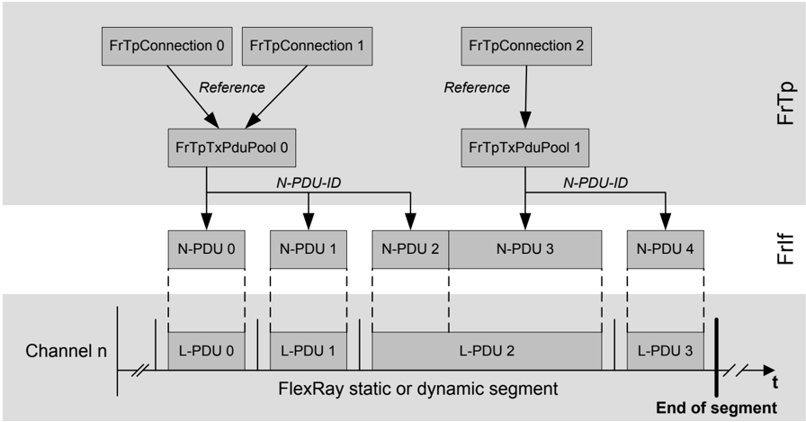

**步骤 01–10**

「解耦访问模式」中的步骤 01–10 与「立即访问模式」中的步骤 01–10 相同。请参阅 [6.5.2.1](#6521-经由立即缓冲区访问模式发送数据) 小节。

对于步骤 09，建议将地址信息与 PCI 设置到本地缓冲区，因为服务原语 `[FrTp_TriggerTransmit](#741-frtp_triggertransmit)` 在中断模式下被调用，因此复制完整 N-PDU（地址信息、PCI 与（部分）SDU 数据）的处理时间应尽可能短。

**步骤 11–12**

**FrIf** 模块应调用服务原语 `[FrTp_TriggerTransmit](#741-frtp_triggertransmit)`，将 FrTp N-PDU 传播到下层（例如 FlexRay 驱动）。

服务原语 `[FrTp_TriggerTransmit](#741-frtp_triggertransmit)` 应将地址信息、PCI 与 N-SDU 数据复制到相应的缓冲区——即服务原语参数 PduInfoType 所引用的缓冲区。

服务原语 `[FrTp_TriggerTransmit](#741-frtp_triggertransmit)` 应将服务原语参数 PduInfoType 所引用的相应数据长度设置为缓冲区的确切数据长度。

**步骤 13–23**

「解耦访问模式」中的步骤 13–23 与「立即访问模式」中的步骤 10–20 相同。请参阅 [6.5.2.1](#6521-经由立即缓冲区访问模式发送数据) 小节。

##### 6.5.2.3. 未知消息长度的数据传输

ISO10681-2 支持传输未知消息长度数据的可能性。

支持未知消息长度数据传输的功能应可通过编译开关配置。

如果配置了 1:n 连接（参数 FRTP_MULTIPLE_RECEIVER_CON 已置位），则不应处理未知消息长度的数据传输，且服务原语调用 `[FrTp_Transmit](#7331-frtp_transmit)` 应以返回值 `E_NOT_OK` 被拒绝。

当出现以下情况时，**FrTp** 模块应引发运行时错误 [FRTP_E_SEG_ERROR](#672-运行时错误)：a) 如 [SWS_FrTp_01063] 所述请求了 1:n 连接。

上层未知消息长度的数据传输应以服务原语参数 PduLength = 0（「零」）调用服务原语 `[FrTp_Transmit](#7331-frtp_transmit)` 来发起。

在未知消息长度的数据传输进行期间，服务原语 `PduR_FrTpCopyTxData()` 的服务原语参数 Length 应设置为当前存储的 Tx 缓冲区数据字节的值。

如果服务原语内的参数 length 被置为 0（「零」），则正在进行的上层未知消息长度数据传输应结束。

**FrTp** 模块应将全部 PduInfoType.PduLength 值相加，以计算由末帧（LF）发送的总消息长度。

[6.5.2.3](#6523-未知消息长度的数据传输) 章节脚注：未知消息长度的数据传输需要分段，因为至少必须发送一个起始帧与一个末帧。

##### 6.5.2.4. 数据传输的分段条件

如果相应 [FrTpConnection](#924-frtpconnection) 的 [FrTpConnectionControl](#927-frtpconnectioncontrol) 参数 FRTP_MULTIPLE_RECEIVER_CON（见 [9.2](#92-容器与配置参数) 节）已置位，通信处理程序不得处理 N-SDU 的分段，并采取以下动作：

* a) 引发运行时错误 [FRTP_E_SEG_ERROR](#672-运行时错误)，并且
* b) 中止该消息的传输，并以结果 `E_NOT_OK` 调用回调函数 `PduR_FrTpTxConfirmation` 通知上层。

#### 6.5.3. 接收数据

本章定义由下层 FlexRay 接口（**FrIf**）请求的 **FrTp** 模块数据接收。

在接收期间，**FrTp** 应把在 N-PDU 中作为本地地址与远程地址收到的寻址信息，经由元数据项 SOURCE_ADDRESS_16 与 TARGET_ADDRESS_16 转发给上层，并在发送流控制 N-PDU 时使用相同的地址信息。

如果未为接收的 N-SDU 配置 FrTpLa 和/或 FrTpRa，则任何收到的寻址信息都可以分配给该 N-SDU。在接收时，配置了 FrTpLa 和/或 FrTpRa 的 N-SDU 应优先于未配置这些参数的 N-SDU。

**注意：** 服务例程 `PduR_FrTpStartOfReception()` 应在 `[FrTp_MainFunction](#751-frtp_mainfunction)()` 或 `[FrTp_RxIndication](#742-frtp_rxindication)()` 中被调用。

图 16 描绘了数据接收的原则性内部处理。下面描述经由 **FrTp** 接收数据所需的各个步骤。

图 16：接收数据总览（[FrTp_RxIndication](#742-frtp_rxindication)() 应调用 PduR_FrTpStartOfReception() 例程）（**Receive data overview**）

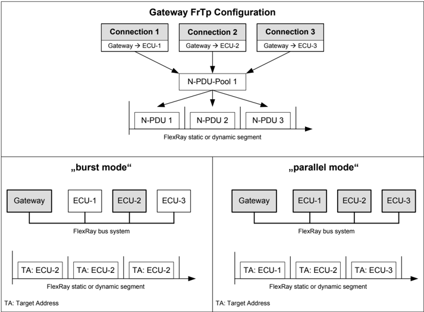

**步骤 1–9**

接收应由服务原语调用 `[FrTp_RxIndication](#742-frtp_rxindication)` 发起。

**FrTp** 模块应校验 RxPduId。如果收到无效的 RxPduId，服务原语 `[FrTp_RxIndication](#742-frtp_rxindication)` 被终止。对于有效的 RxPduId，**FrTp** 模块求值目标地址与源地址，并选择相应的 [FrTpConnection](#924-frtpconnection)。如果收到起始帧（STF），则必须为该连接分配一个空闲的 FrTpChannel 资源（FrTpRxChannelState = Idle）。调用服务原语 `PduR_FrTpStartOfReception` 向上层示意一次新的数据接收。

如果收到连续帧（CF）或末帧（LF），则必须求值相应的通道，并应置位 RX_PDU_AVAILABLE 标志。

只有在以下情况下，**FrTp** 模块才应处理收到的 FrTp N-PDU：

* a) 收到了有效的 RxPduId，并且
* b) FrTp N-PDU 的地址信息与已配置的 [FrTpConnection](#924-frtpconnection) 地址信息匹配。

如果收到无效（未定义）的 RxPduId，**FrTp** 模块应：a) 忽略该 FrTp N-PDU，且 b) 在 **FrTp** 模块的开发错误检测已使能时引发开发错误 [FRTP_E_INVALID_PDU_SDU_ID](#671-开发错误)。

只有满足以下条件才识别出匹配的 [FrTpConnection](#924-frtpconnection)：

* c) 收到的 FrTp N-PDU 的「目标地址」（见 ISO 10681-2）等于已配置 [FrTpConnection](#924-frtpconnection) 的本地地址（FrTpLa，见 [9.2](#92-容器与配置参数) 节），并且
* d) 收到的 FrTp N-PDU 的「源地址」（见 ISO 10681-2）等于已配置 [FrTpConnection](#924-frtpconnection) 的远程地址（FrTpRa，见 [9.2](#92-容器与配置参数) 节）。

如果地址检查与任何已配置的 [FrTpConnection](#924-frtpconnection) 都不匹配，则收到的 FrTp N-PDU 应被忽略。

只有在以下情况下，服务原语才应置位标志 RX_PDU_AVAILABLE：

* a) 所请求的 RxPduId 有效，并且
* b) 地址检查与某个已配置的 [FrTpConnection](#924-frtpconnection) 匹配，并且
* c) 有空闲的通道资源可用（FrTpRxChannelState = Idle）。

如果当前参数 RxPduId 不受支持，服务原语 `[FrTp_RxIndication](#742-frtp_rxindication)` 应被终止而不采取任何进一步动作。

如果没有空闲通道可用（FrTpRxChannelState ≠ Idle），服务原语 `[FrTp_RxIndication](#742-frtp_rxindication)` 应被终止而不采取任何进一步动作。

**FrTp** 模块应引发运行时错误 [FRTP_E_NO_CHANNEL](#672-运行时错误)。

[6.5.3](#653-接收数据) 章节脚注：若 **DET** 处于激活状态，应设置相应的错误。[6.5.3](#653-接收数据) 章节脚注：无法向上层示意这一临时资源短缺，因为 `PduR_FrTpStartOfReception` 没有为这种情况提供参数。

在服务原语 `[FrTp_RxIndication](#742-frtp_rxindication)` 内，**FrTp** 模块应将收到的起始帧 PDU 复制到本地缓冲区。

如果建立了新连接，**FrTp** 模块应以相应的 [FrTpRxSdu](#926-frtprxsdu) ID 与期望的数据长度调用服务原语 `PduR_FrTpStartOfReception`，向上层指示数据接收的开始。

通过调用 `PduR_FrTpStartOfReception`，**FrTp** 应通过其 info 参数把 STF 的数据与大小提供给上层。

[6.5.3](#653-接收数据) 章节脚注：只有收到的起始帧 PDU 会被临时存储在本地缓冲区中。这在网关临时没有空闲资源处理该帧的情况下是必需的。如果 **FrTp** 在分配了空闲通道之后才发送 FlowControl PDU，则正确的协议与定时行为得以保证。[6.5.3](#653-接收数据) 章节脚注：该过程也用于网关的「边收边路由」（Routing-On-The-Fly）行为。

**步骤 10–14**

依据 ISO 10681-2 协议（求值 PCI），收到的 N-PDU 可能需要一个 N-PDU 响应（例如 FlowControl）。此时 **FrTp** 模块应从被引用的 PDU 池中分配第一个空闲的 N-PDU，准备响应，并以相应的 TxPduId 调用服务原语 `FrIf_Transmit` 发起传输过程。传输后 **FrTp** 模块应等待连续 N-PDU 的接收。如果协议不需要 N-PDU 响应，**FrTp** 模块应继续接收处理。

如果 ISO10681-2 协议处理要求发送一个 N-PDU 响应，**FrTp** 模块应向最初的发送节点发送相应的 N-PDU（例如 FlowControl）。

**步骤 15**

**FrTp** 模块应依据 ISO 10681-2 从收到的 N-PDU 数据中提取 N-SDU 数据。

**FrTp** 模块应通过调用服务原语 `PduR_FrTpCopyRxData` 发起所接收 N-SDU（分片）的复制过程。

RX_PDU_AVAILABLE 标志应在完成 Fr N-PDU 的处理后清除。

**步骤 16–17**

**FrTp** 模块可以计算一个 N-SDU 的全部 N-PDU 是否已收到。如果通信仍在进行，**FrTp** 模块应在步骤 01 处继续数据接收。

**步骤 18–22**

如果完整 N-SDU 传输的全部 FrTp Rx-PDU 都已收到，**FrTp** 模块应在需要时发送一个确认，并释放已分配的通道资源。下一步，**FrTp** 模块应以相应的 [FrTpRxSdu](#926-frtprxsdu) ID 调用服务原语 `PduR_FrTpRxIndication`，向上层示意已收到一个 N-SDU。

**FrTp** 模块应在以下情况下释放已分配的通道（FrTpRxChannelState = Idle）：

* a) 全部 N-SDU 数据已接收，并且
* b) 全部所需的响应 N-PDU（FlowControl）已发送且 TxConfirmation 以结果 `E_OK` 给出；

或者：

* c) `[FrTp_TxConfirmation](#743-frtp_txconfirmation)` 以结果 `E_NOT_OK` 给出。

在 `PduR_FrTpStartOfReception` 成功之后，**FrTp** 模块应始终调用服务原语 `PduR_FrTpRxIndication`。结果应为 `E_OK`——前提是 a) 全部 N-SDU 数据已接收，且 b) 全部所需的响应 N-PDU（FlowControl）已发送且 TxConfirmation 已给出。

##### 6.5.3.1. 未知消息长度的接收

依据 ISO 10681-2 的 **FrTp** 提供接收未知消息长度数据的方法。

如果要建立未知消息长度的数据接收，**FrTp** 应以期望数据长度为零（「0」）调用 API `PduR_FrTpStartOfReception()`。

**注意：**

如果 API `PduR_FrTpStartOfReception()` 以数据长度为零（「0」）被调用，上层模块应提供当前可用的最大缓冲区大小。

**ECU 场景：**

上层（例如 **DCM**）应提供当前可用的最大缓冲区大小。

**网关场景：**

**PduR** 模块应提供当前可用的最大缓冲区大小。

#### 6.5.4. 缓冲区处理

**FrTp** 模块一次处理一帧的接收/发送数据。

在接收期间，它把从 **FrIf** 收到的数据直接转发给上层，不涉及缓冲。

在立即缓冲区访问模式的发送期间，它必须向上层提供一个临时缓冲区，该缓冲区随后被直接转发给 **FrIf**。

在解耦缓冲区访问模式的情况下，必须向上层提供每连接一个的静态缓冲区，并保持到 TriggerTransmit 发生为止。

用于请求上层从/向 **FrTp** 提供的缓冲区复制数据的服务原语是：`PduR_FrTpCopyTxData` 与 `PduR_FrTpCopyRxData`。

如果对 Tx 缓冲区的调用（服务原语 `PduR_FrTpCopyTxData`）没有提供有效的缓冲区、且服务原语通知结果类型值为 BUFREQ_E_BUSY，则 **FrTp** 模块应最多尝试 FrTpTimeCs 次以获取有效的缓冲区。

如果对 Tx 缓冲区的调用（服务原语 `PduR_FrTpCopyTxData`）没有提供有效的缓冲区（当 FrTpTimeCs 到期时）、且服务原语通知结果类型值为 BUFREQ_E_NOT_OK，则应通过以 `E_NOT_OK` 调用 `PduR_FrTpTxConfirmation` 中止该传输。

##### 6.5.4.1. 缓冲区访问模式

对于 Tx 方向，FlexRay 传输协议层应支持：

* a) 「立即缓冲区访问」模式，以及
* b) 「解耦缓冲区访问」模式。

#### 6.5.5. 动态带宽分配

从 **FrTp** 的角度看，物理 FlexRay 带宽由 N-PDU 表示。如图 17 所示，N-PDU 与 L-PDU 之间存在直接映射（在 **FrIf** 模块的帧构造计划中完成）。

图 17：N-PDU 到 N-PDU 池的映射（**Mapping of N-PDUs to N-PDU-Pools**）

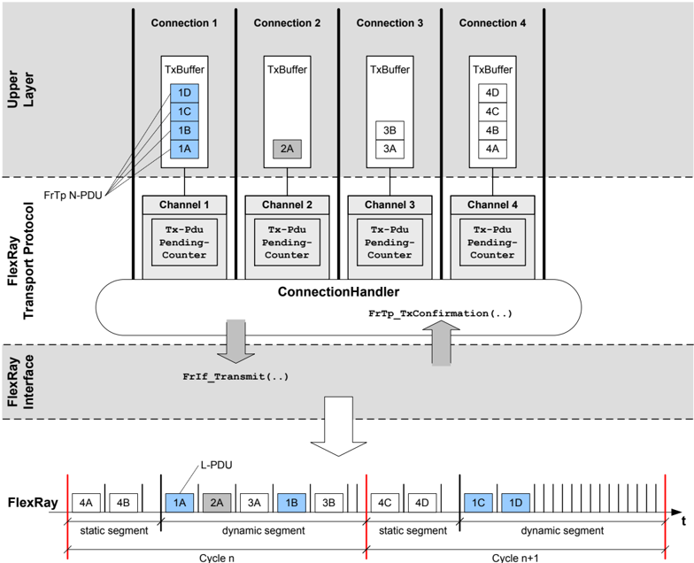

一个 [FrTpTxPduPool](#928-frtptxpdupool) 可以被不同的 [FrTpConnection](#924-frtpconnection) 引用（另见 [6.3.2.2](#6322-frtptxpdupool) 小节）。依据当前激活的 [FrTpConnection](#924-frtpconnection) 的数量，带宽（N-PDU）在它们之间共享。通过支持动态带宽分配，可以支持不同的通信场景。

图 18 描绘了仅用一个 FrTp 配置即可支持的两种不同场景。从网关的角度看，可能的通信场景有：

* a) 单连接通信——全部带宽（时隙）被分配给一条通信链路（例如 ECU 2）；
* b) 多连接通信——带宽（时隙）在不同通信链路之间共享，通向不同的 ECU（例如 ECU 1–3）。

[6.5.5](#655-动态带宽分配) 章节脚注：场景：例如网关通信——对于诊断通信，需要为每个 ECU 定义一条连接。某些情况下既需要在其他通道上最大并行通信，又需要恰好对某个 ECU 有最大带宽（例如重新编程目的）。如果动态带宽分配可行，则两种场景都能以最少的 FlexRay 资源（「时隙」）实现。

图 18：不同连接对 PDU 池的共享（**PDU-Pool sharing by different connections**）

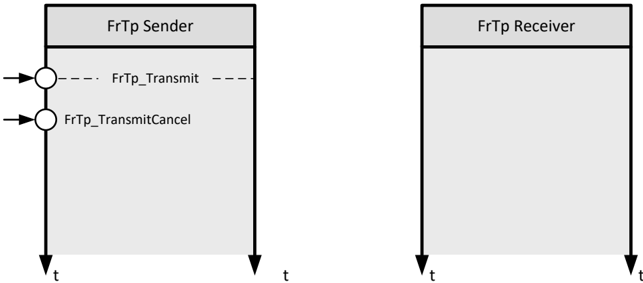

连接处理程序控制带宽的划分（见图 19）。

图 19：不同连接的连接处理程序（**Connection Handler for different connections**）

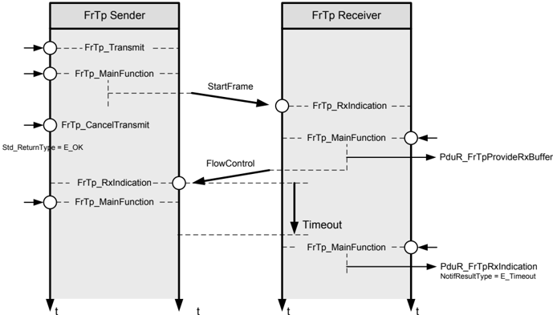

带宽分配可以随激活的通信链路在每个通信周期中变化。特别是网关可能并行拥有多个激活的通信链路。因此对 **FrTp** 模块处理并发连接有一些额外的需求。特别是对于分段数据传输，必须确保连接处理程序不会交换连续帧的顺序。

[6.5.5](#655-动态带宽分配) 章节脚注：这可能发生在动态段中——如果包含一个连续帧的最后一条 L-PDU 的传输在当前通信周期被跳过，而在下一个通信周期中其他连续帧被排在该被跳过帧之前发送。

一个 [FrTpTxPduPool](#928-frtptxpdupool) 内的全部 FrTp Tx N-PDU 应依据其在全局 N-PDU 网络计划中的位置按升序列出。

[6.5.5](#655-动态带宽分配) 章节脚注：另见 [6.3.2.2](#6322-frtptxpdupool) 小节。[6.5.5](#655-动态带宽分配) 章节脚注：ECU 特定的 N-PDU 计划意味着每个 N-PDU（由其 N-PDU-ID 唯一标识）被映射到一个 L-PDU。每个 L-PDU 由其参数集「slot-ID」「cycle counter」「cycle offset」唯一标识。因此全部 N-PDU 也具有隐式的顺序。

一个 [FrTpTxPduPool](#928-frtptxpdupool) 内的每个 FrTp Tx N-PDU 可以有各自的长度。

[6.5.5](#655-动态带宽分配) 章节脚注：如图 17 所示，在一段的末尾可能只有载荷较少的 L-PDU 能放入调度。因此被映射的 FrTp N-PDU 应具有相应的长度以避免浪费带宽。

如果在一条连接内使用多于一个 FrTp Tx N-PDU 进行数据传输，则必须控制当前使用的 FrTp Tx N-PDU 的数量。因此定义一个计数器来跟踪所有已发起但当前未确认的 FrTp Tx N-PDU 传输。

每个 FrTpChannel 应实现一个运行时变量 TxPduPendingCounter（见 [6.3.3.2](#6332-frtpchannel) 小节）。

每次服务原语 `FrIf_Transmit` 以返回值 `E_OK` 针对相应的 FrTp Tx N-PDU（TxPduId）终止时，TxPduPendingCounter 应递增。

每次以相应的参数 FrTpTxConfirmationPduId 调用服务原语 `[FrTp_TxConfirmation](#743-frtp_txconfirmation)` 时，TxPduPendingCounter 应递减。

底层模块应为每个已发送的 N-PDU 以相应的 FrTpTxConfirmationPduId 调用相应的服务原语 `[FrTp_TxConfirmation](#743-frtp_txconfirmation)` 给出 TxConfirmation。

[6.5.5](#655-动态带宽分配) 章节脚注：交替意味着必须实现一个调度，每次实例以一个 N-PDU 处理全部激活的 [FrTpConnection](#924-frtpconnection)。建议使用简单的轮询（round-robin）方法，但其他调度也是可行的。

通信处理程序任务应只在任务开始时相应 TxPduPendingCounter 为零的情况下处理一个激活的 [FrTpConnection](#924-frtpconnection)（由某个 FrTpChannel 引用）。如果 TxPduPendingCounter 不等于零，则有一个 FrTp Tx N-PDU 确认待决，当前通信处理程序任务将跳过对相应 [FrTpConnection](#924-frtpconnection) 的处理。

只有在相应 FrTpChannel 的 TxPduPendingCounter 在通信处理程序任务开始时为零（「0」）的情况下，才应处理激活的 [FrTpConnection](#924-frtpconnection)（由某个 FrTpCannel 引用）。

如果 TxPduPendingCounter 不等于零（「0」），当前通信处理程序任务应跳过对相应 [FrTpConnection](#924-frtpconnection) 的处理。

通信处理程序任务应交替处理全部激活的 [FrTpConnection](#924-frtpconnection)——只要被引用的 [FrTpTxPduPool](#928-frtptxpdupool) 内有可用的空闲 FrTp Tx N-PDU。

#### 6.5.6. 发送取消

依据 ISO 10681-2，**FrTp** 模块对正在进行的 FrTp N-SDU 传输支持「发送取消」。该功能可以通过全局编译开关停用。

「发送取消」特性应通过对 FrTp 参数 FrTpTransmitCancellation 的静态配置（去）激活（见 [9.2](#92-容器与配置参数) 节）。

发送取消请求应通过调用服务原语 `[FrTp_CancelTransmit](#7332-frtp_canceltransmit)()` 完成（见 [SWS_FrTp_00150]）。

当传输仍在进行时，`[FrTp_CancelTransmit](#7332-frtp_canceltransmit)` 应停止传输并返回 `E_OK`。当连接未激活、或无确认传输的最后一条 N-PDU 已经交付给 **FrIf** 时，`[FrTp_CancelTransmit](#7332-frtp_canceltransmit)` 应返回 `E_NOT_OK`。

如果发送请求待决但传输尚未开始，`[FrTp_CancelTransmit](#7332-frtp_canceltransmit)`（见 [SWS_FrTp_00150]）应立即释放该连接。

##### 6.5.6.1. 非分段数据传输的发送取消

非分段数据传输的发送取消请求可能发生在 **FrTp** 模块处理中的两个不同位置：

* a) 在发送起始帧（STF）之前——发送取消请求有效；
* b) 在发送起始帧（STF）之后——发送取消请求无效，因为起始帧已经发出。

图 20 描绘了非分段数据传输的发送取消行为。

图 20：非分段数据传输时的发送取消（**Transmit Cancellation at unsegmented data transfer**）

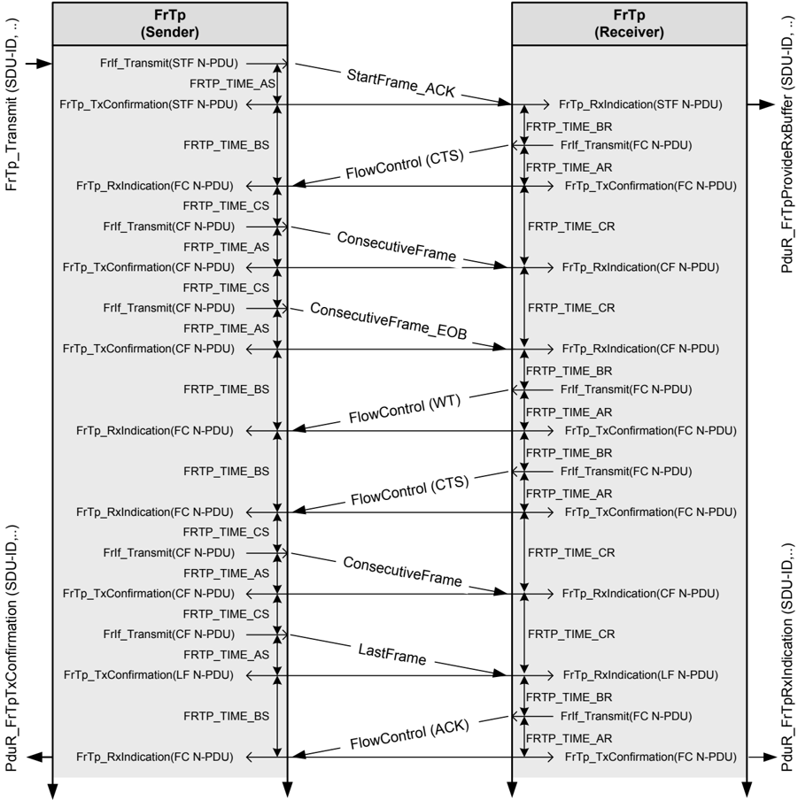

如果要取消一个已请求但当前尚未开始的数据传输，则调用服务原语 `[FrTp_CancelTransmit](#7332-frtp_canceltransmit)()`。`[FrTp_CancelTransmit](#7332-frtp_canceltransmit)()` 应取消所请求的数据传输。接收方一侧不会识别出数据传输。

##### 6.5.6.2. 分段数据传输的发送取消

分段数据传输的发送取消请求可能发生在 **FrTp** 模块处理中的三个不同位置：

* a) 在发送起始帧（STF）之前——发送取消请求有效；
* b) 在正在进行的传输中——发送取消请求有效；
* c) 在发送末帧（LF）之后——发送取消请求无效，因为发送完末帧（LF）后传输已经结束。

图 21 描绘了分段数据传输的发送取消行为。如果要取消一个已请求但当前尚未开始的数据传输，则调用服务原语 `[FrTp_CancelTransmit](#7332-frtp_canceltransmit)`。接收方一侧不会识别出数据传输。

图 21：分段数据传输时的发送取消（**Transmit Cancellation at segmented data transfer**）

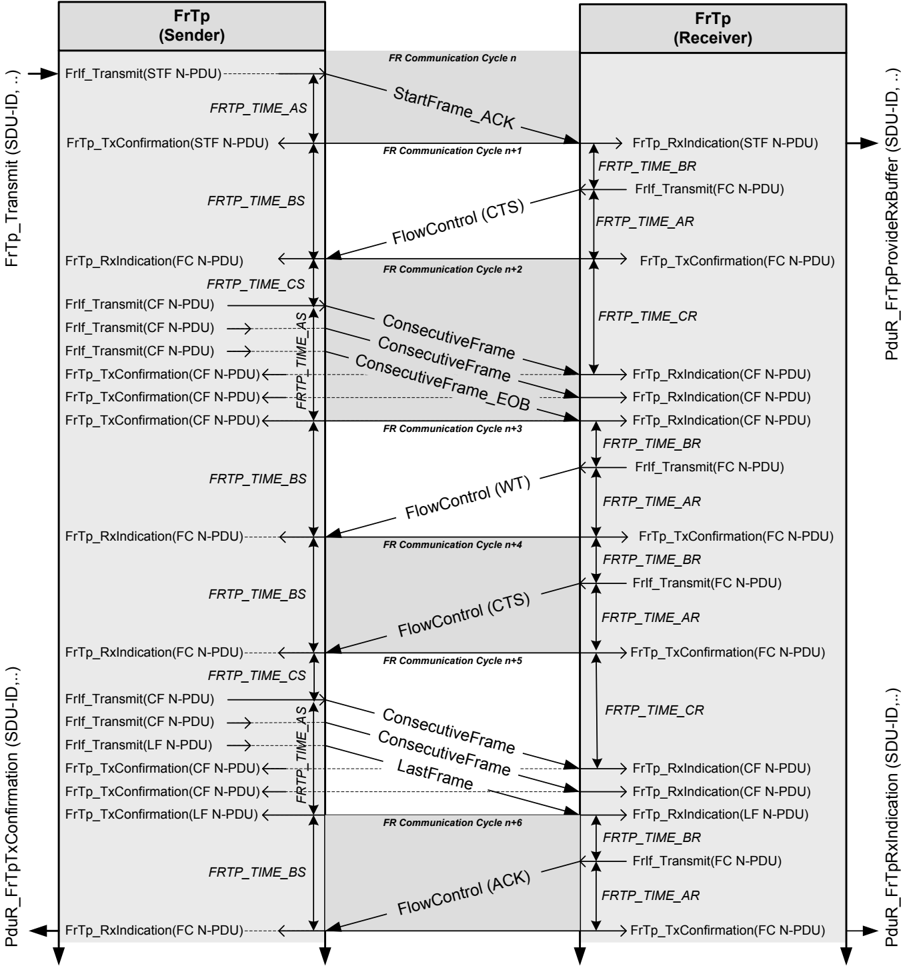

如果要取消一个正在进行的传输，则调用服务原语 `[FrTp_CancelTransmit](#7332-frtp_canceltransmit)()`。`[FrTp_CancelTransmit](#7332-frtp_canceltransmit)()` 应取消当前的数据传输过程。接收方一侧会识别出一次初始数据接收并处理之（例如调用服务原语 `PduR_FrTpStartOfReception`、发送 FlowControl N-PDU 等）。如果发送方取消了数据传输，接收方一侧会发生一次超时。

如果未配置重试，该超时用于通过以相应的通知结果错误码调用服务原语 `PduR_FrTpRxIndication` 来取消当前接收。

如果配置了重试，接收方会发送一个额外的 FlowControl。在配置次数的重试之后，用最终超时通过以相应的通知结果错误码调用服务原语 `PduR_FrTpRxIndication` 来取消当前接收。

[6.5.6.2](#6562-分段数据传输的发送取消) 章节脚注：**注意：** 在发送方一侧，额外的 FlowControl 被当作一个意外的 N-PDU 接收并被忽略。

#### 6.5.7. 修改 FrTp 参数

**FrTp** 模块应在运行时修改 ISO10681-2 流控制 PDU 的带宽控制（BC）参数——当相应的 API 服务原语 `[FrTp_ChangeParameter](#7333-frtp_changeparameter)` 被调用时：

* a) FrTpSCexp（请参阅 ISO 10681-2）；
* b) FrTpMaxNbrOfNPduPerCycle（请参阅 ISO 10681-2）。

BC 参数的布局应与 FC(CTS) 帧中的布局相同：FrTpMaxNbrOfNPduPerCycle 应位于位 3..7，FrTpSCexp 位于位 0…2。参数的高字节不使用。

在正在进行的接收期间发出的修改参数请求应以返回值 `E_NOT_OK` 终止。

如果修改成功执行，**FrTp** 模块应为相应连接使用新的带宽控制参数。

**注意：** 带宽控制是运行时参数集的一部分。详细内容请参阅 [6.3.3.3](#6333-frtpconnectioncontrolruntime) 小节。

#### 6.5.8. 定时参数与超时行为

**FrTp** 模块需要不同的定时参数来进行通信处理。本章定义定时与超时行为。

**FrTp** 模块应支持图 22、图 23 与表 2 中定义的不同定时器及其启动/停止条件。

图 22：每次 MainFunction 调用一条 PDU 传输的定时参数定义（**Timing parameter definition for one PDU transmission per MainFunction call**）

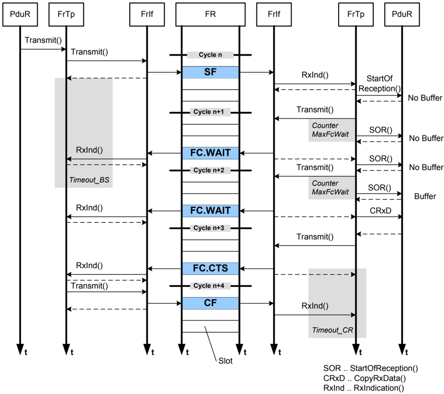

如上所述，在一个 FlexRay 通信周期内，每条连接可以发送多于一个 N-PDU。因此通信处理程序应能多次调用 `FrIf_Transmit` API（取决于 Tx-PDU 池内可用的 N-PDU）——与先前发送的 N-PDU 是否已给出 `[FrTp_TxConfirmation](#743-frtp_txconfirmation)` 无关。由此，定时行为（例如启动 FRTP_Time_AS 等）也不同。如果要在一次 MainFunction 调用内发送多于一个 N-PDU，定时行为如图 23 所示。

图 23：每次 MainFunction 调用多条 PDU 传输的定时参数定义（**Timing parameter definition for multiple PDU transmission per MainFunction call**）

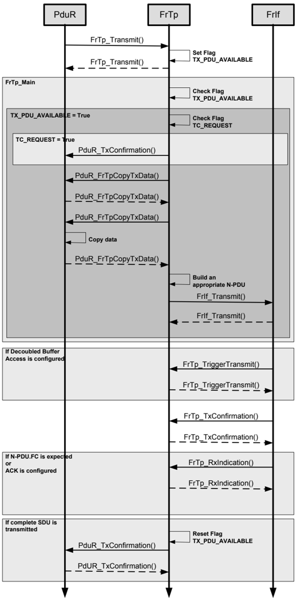

**注意：**

带宽控制限制每个 FlexRay 周期的 N-PDU 数量。这会影响 FrTp_Time_CS。因此该时间取决于实现（`FrTp_Main()` 的任务调度与相应的 FlowControl 参数）。详细内容请参阅 [6.3.3.3](#6333-frtpconnectioncontrolruntime) 小节。

表 2：FrTp 模块的定时参数（**Timing parameter for the FrTp module**）

| 定时参数 | 说明 | 定时器启动条件 | 定时器停止条件 |
| --- | --- | --- | --- |
| FRTP_TIME_AS | 发送方一侧任何 FrTp N-PDU 的传输时间。这是一个性能需求。该时间取决于实现与全局 FlexRay 调度。最大时间由 FRTP_TIMEOUT_AS 控制。 | FrIf_Transmit() | [FrTp_TxConfirmation](#743-frtp_txconfirmation)() |
| FRTP_TIME_AR | 接收方一侧 FlowControl FrTp N-PDU 的传输时间。这是一个性能需求。该时间取决于实现与全局 FlexRay 调度。最大时间由 FRTP_TIMEOUT_AR 控制。 | FrIf_Transmit() | [FrTp_TxConfirmation](#743-frtp_txconfirmation) |
| FRTP_TIME_BS | 直到收到下一个 FlowControl N-PDU 的时间。最大时间由 FRTP_TIMEOUT_BS 控制。 | [FrTp_TxConfirmation](#743-frtp_txconfirmation)（STF）、[FrTp_RxIndication](#742-frtp_rxindication)（FC）、[FrTp_TxConfirmation](#743-frtp_txconfirmation)（CF）、[FrTp_TxConfirmation](#743-frtp_txconfirmation)（LF） | [FrTp_RxIndication](#742-frtp_rxindication)（FC） |
| FRTP_TIME_BR | 直到发送下一个 FlowControl N-PDU 的时间。 | [FrTp_RxIndication](#742-frtp_rxindication)（STF）、[FrTp_TxConfirmation](#743-frtp_txconfirmation)（FC）、[FrTp_RxIndication](#742-frtp_rxindication)（CF）、[FrTp_RxIndication](#742-frtp_rxindication)（LF） | FrIf_Transmit（FC） |
| FRTP_TIME_CR | 直到收到下一个连续帧 N-PDU 的时间。最大时间由 FRTP_TIMEOUT_CR 控制。 | [FrTp_TxConfirmation](#743-frtp_txconfirmation)（FC）、[FrTp_RxIndication](#742-frtp_rxindication)（CF） | [FrTp_RxIndication](#742-frtp_rxindication)（CF）、[FrTp_RxIndication](#742-frtp_rxindication)（LF） |
| FRTP_TIME_CS | 直到发送下一个连续帧 N-PDU/末帧 N-PDU 的时间（秒）。 | [FrTp_TxConfirmation](#743-frtp_txconfirmation)（CF）、[FrTp_RxIndication](#742-frtp_rxindication)（FC） | FrIf_Transmit（CF） |
| S/s…发送方，R/r…接收方 | S/s…发送方，R/r…接收方 | S/s…发送方，R/r…接收方 | S/s…发送方，R/r…接收方 |

**FrTp** 模块应支持表 3 中定义的通信超时行为。

表 3：FrTp 模块的超时行为（**Timeout behaviour for FrTp module**）

| 超时参数 | 起因 | 动作 |
| --- | --- | --- |
| FRTP_TIMEOUT_AS | 发送方一侧任何 FrTp N-PDU 未及时发送。 | 中止消息传输：a) 调用 `FrIf_CancelTransmit()` 并释放 [FrTpTxPdu](#9210-frtptxpdu)；b) 以相应的 [FrTpTxSdu](#925-frtptxsdu) ID 与 `E_NOT_OK` 发出 PduR_FrTpTxConfirmation。 |
| FRTP_TIMEOUT_AR | 接收方一侧任何 FrTp FC N-PDU 未及时发送。 | 中止消息接收，并以相应的 [FrTpRxSdu](#926-frtprxsdu) ID 发出 PduR_FrTpRxIndication。 |
| FRTP_TIMEOUT_BS | 发送方一侧未收到 FlowControl N-PDU（丢失、被覆盖）。 | 中止消息传输，并以相应的 [FrTpTxSdu](#925-frtptxsdu) ID 与 `E_NOT_OK` 发出 PduR_FrTpTxConfirmation。 |
| FRTP_TIMEOUT_CR | 接收方一侧未收到连续帧或末帧 N-PDU（丢失、被覆盖）。 | 中止消息接收，并以相应的 [FrTpRxSdu](#926-frtprxsdu) ID 与 `E_NOT_OK` 发出 PduR_FrTpRxIndication。 |
| FRTP_TIMEOUT_BR | 在收到下一个连续帧（STF、块的最后一个 CF 或 LF）之后、或在流控制（WT）帧的发送确认之后，接收方一侧未发起任何 FrTp FC N-PDU 传输。 | 中止消息接收，并以相应的 [FrTpRxSdu](#926-frtprxsdu) ID 发出 PduR_FrTpRxIndication。 |
| FRTP_TIMEOUT_CS | 发送方一侧在收到流控制帧（CTS）后未及时发起任何 FrTp CF N-PDU 传输。 | 中止消息传输，并以相应的 [FrTpTxSdu](#925-frtptxsdu) ID 与 `E_NOT_OK` 发出 PduR_FrTpTxConfirmation。 |

[6.5.8](#658-定时参数与超时行为) 章节脚注：如果一条 N-PDU 在动态段内被多次暂停，则可能发生这种情况。[6.5.8](#658-定时参数与超时行为) 章节脚注：**注意：** 在 FlexRay 上，发送确认不像其他总线协议（例如 **CAN**）那样提供端到端确认。这意味着只要 L-PDU 被交给网络（且只有此时）就提供发送确认。因此，如果没有发生确认，则 L-PDU 仍卡在 FlexRay 控制器的消息缓冲区中——它被占用，期间无法使用。[6.5.8](#658-定时参数与超时行为) 章节脚注：如果一条 N-PDU 在动态段内被多次暂停，则可能发生这种情况。[6.5.8](#658-定时参数与超时行为) 章节脚注：这可能发生在前面的 FlowControl N-PDU 未在整体发送方一侧收到（丢失、被覆盖）的情况下。

#### 6.6. 计数器

若干计数器用于处理不同的重试尝试。本章定义这些不同的计数器及其递增与递减行为。每个计数器都受一个指定值的限制。下图展示了定时器、计数器与函数调用之间的不同交互。

图 24：计数器、定时器与函数调用的交互（**Counter, timer and function call interaction**）

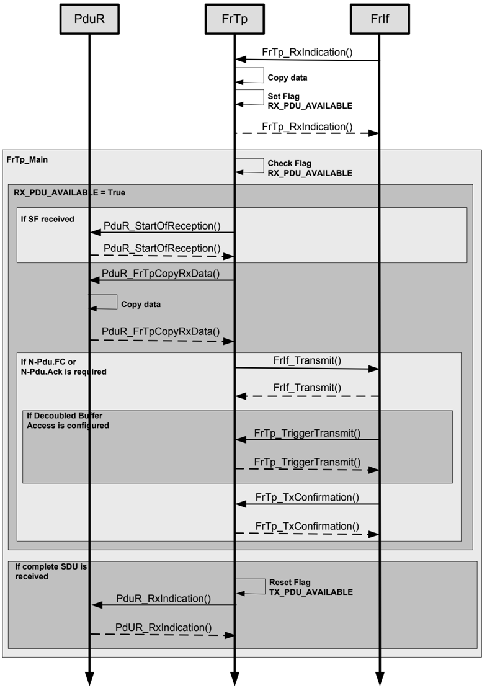

**FrTp** 模块应支持表 4「FrTp 计数器」中定义的计数器及相应的限值。

每个 FrTp 计数器都应受表 4 中定义的最大值限制。

表 4：FrTp 计数器（**FrTp Counter**）

| 计数器名称 | 计数器描述 | 限值 |
| --- | --- | --- |
| COUNTER_FCWT | 接收方一侧：统计已发送的 FlowControl.Wait 帧的数量 | FrTpMaxFCWait |
| Counter_RX_RN | 统计接收方一侧因帧错误（例如 CF 中错误的 SN）而发起的传输重试请求 | FrTpMaxRn |

[6.6](#66-计数器) 章节脚注：COUNTER_FCWT 的限值应与获取 Rx 缓冲区的任务（服务原语调用 PduR_FrTpCopyRxData）相关。缓冲区请求重试的频率必须等于/高于 FC.WAIT 的发送频率。

如果某个计数器已达到限值，**FrTp** 模块应按表 5 反应。

表 5：计数器达到限值时 FrTp 模块的反应（**FrTp module reaction if counters reached**）

| 计数器名称 | 达到限值时的处理 |
| --- | --- |
| COUNTER_FCWT | 中止传输 |
| COUNTER_RX_RN | 情况 a) 分段-确认传输：1) 以 `E_NOT_OK` 调用服务原语 PduR_FrTpRxIndication 中止接收；2) 发送 FlowControl.ABT（若 FlowControl 可行） |

### 6.7. 错误分类

文档《基础软件模块通用规范》的「错误处理」一节详细描述了基础软件的错误处理。其中最重要的是一个由五种错误类型构成的分类体系，这些错误可能发生在 **BSW** 模块中。

在此基础上，以下各节在相应的小节中规定具体的错误。

#### 6.7.1. 开发错误

表：模块 FrTp 的开发错误定义

| 错误类型 | 相关错误码 | 错误值 |
| --- | --- | --- |
| 未进行模块初始化就调用 API 服务。例外：a) [FrTp_Init](#7321-frtp_init)()，b) [FrTp_GetVersionInfo](#7311-frtp_getversioninfo)() | FRTP_E_UNINIT | 0x01 |
| 任何 API 调用中的空指针 | FRTP_E_PARAM_POINTER | 0x02 |
| 以无效的 SDU-ID（PduR）或 PDU-ID（FrIf）调用 API | FRTP_E_INVALID_PDU_SDU_ID | 0x03 |
| 以无效的参数调用 API | FRTP_E_INVALID_PARAMETER | 0x04 |
| 检测到未知消息长度的传输但未配置 | FRTP_E_UMSG_LENGTH_ERROR | 0x06 |
| FrTp 初始化失败；例如所选配置集不存在 | FRTP_E_INIT_FAILED | 0x08 |

#### 6.7.2. 运行时错误

表：模块 FrTp 的运行时错误定义

| 错误类型 | 相关错误码 | 错误值 |
| --- | --- | --- |
| 1:n 连接需要分段 | FRTP_E_SEG_ERROR | 0x05 |
| 没有可用的空闲通道 | FRTP_E_NO_CHANNEL | 0x07 |

#### 6.7.3. 瞬态故障

没有瞬态故障。

#### 6.7.4. 产出错误

没有产出错误。

#### 6.7.5. 扩展产出错误

表：扩展产出错误 FRTP C_As

| 属性 | 值 |
| --- | --- |
| 错误名称 | FRTP_E_FRTPTIMEOUTAS_TIMEOUT_OCCURRED |
| 简要描述 | 如果 FR TP 检测到 C_As 超时，FR TP 应向 **DEM** 上报扩展产出错误 FRTP_E_FRTPTIMEOUTAS_OCCURRED。 |
| 检测条件 | FAIL——FR TP C_As 超时到期；PASS——调用 `[FrTp_Init](#7321-frtp_init)()` 函数 |
| 次要参数 | FAIL 和/或 PASS 检测处于激活状态的条件：无 |
| 所需时间 | 不适用 |
| 监控频率 | 事件触发（on event） |

表：扩展产出错误 FRTP C_Ar

| 属性 | 值 |
| --- | --- |
| 错误名称 | FRTP_E_FRTPTIMEOUTAR_TIMEOUT_OCCURRED |
| 简要描述 | 如果 FR TP 检测到 C_Ar 超时，FR TP 应向 **DEM** 上报扩展产出错误 FRTP_E_FRTPTIMEOUTAR_OCCURRED。 |
| 检测条件 | FAIL——FR TP C_Ar 超时到期；PASS——调用 `[FrTp_Init](#7321-frtp_init)()` 函数 |
| 次要参数 | FAIL 和/或 PASS 检测处于激活状态的条件：无 |
| 所需时间 | 不适用 |
| 监控频率 | 事件触发（on event） |

表：扩展产出错误 FRTP C_Bs

| 属性 | 值 |
| --- | --- |
| 错误名称 | FRTP_E_FRTPTIMEOUTBS_TIMEOUT_OCCURRED |
| 简要描述 | 如果 FR TP 检测到 C_Bs 超时，FR TP 应向 **DEM** 上报扩展产出错误 FRTP_E_FRTPTIMEOUTBS_OCCURRED。 |
| 检测条件 | FAIL——FR TP C_Bs 超时到期；PASS——调用 `[FrTp_Init](#7321-frtp_init)()` 函数 |
| 次要参数 | FAIL 和/或 PASS 检测处于激活状态的条件：无 |
| 所需时间 | 不适用 |
| 监控频率 | 事件触发（on event） |

表：扩展产出错误 FRTP C_Br

| 属性 | 值 |
| --- | --- |
| 错误名称 | FRTP_E_FRTPTIMEBR_TIMEOUT_OCCURRED |
| 简要描述 | 如果 FR TP 检测到 C_Br 超时，FR TP 应向 **DEM** 上报扩展产出错误 FRTP_E_FRTPTIMEBR_TIMEOUT_OCCURRED。 |
| 检测条件 | FAIL——FR TP C_Br 超时到期；PASS——调用 `[FrTp_Init](#7321-frtp_init)()` 函数 |
| 次要参数 | FAIL 和/或 PASS 检测处于激活状态的条件：无 |
| 所需时间 | 不适用 |
| 监控频率 | 事件触发（on event） |

表：扩展产出错误 FRTP C_Cr

| 属性 | 值 |
| --- | --- |
| 错误名称 | FRTP_E_FRTPTIMEOUTCR_TIMEOUT_OCCURRED |
| 简要描述 | 如果 FR TP 检测到 C_Cr 超时，FR TP 应向 **DEM** 上报扩展产出错误 FRTP_E_FRTPTIMEOUTCR_TIMEOUT_OCCURRED。 |
| 检测条件 | FAIL——FR TP C_Cr 超时到期；PASS——调用 `[FrTp_Init](#7321-frtp_init)()` 函数 |
| 次要参数 | FAIL 和/或 PASS 检测处于激活状态的条件：无 |
| 所需时间 | 不适用 |
| 监控频率 | 事件触发（on event） |

表：扩展产出错误（交换的连续帧）

| 属性 | 值 |
| --- | --- |
| 错误名称 | FRTP_E_SWAPPED_CONSECUTIVE_FRAMES_RECEIVED |
| 简要描述 | 如果 FR TP 收到被交换的连续帧，FR TP 应向 **DEM** 上报扩展产出错误 FRTP_E_SWAPPED_CONSECUTIVE_FRAMES_RECEIVED。 |

表：扩展产出错误（丢失的连续帧）

| 属性 | 值 |
| --- | --- |
| 错误名称 | FRTP_E_DROPPED_CONSECUTIVE_FRAMES_DETECTED |
| 简要描述 | 如果 FR TP 检测到缺失的连续帧，FR TP 应向 **DEM** 上报扩展产出错误 FRTP_E_DROPPED_CONSECUTIVE_FRAMES_DETECTED。 |

表：扩展产出错误（收到 FC 溢出）

| 属性 | 值 |
| --- | --- |
| 错误名称 | FRTP_E_FC_OVERFLOW_RECEIVED |
| 简要描述 | 如果 FR TP 收到 FC.Ovflw 帧，FR TP 应向 **DEM** 上报扩展产出错误 FRTP_E_FC_OVERFLOW_RECEIVED。 |

表：扩展产出错误（发送 FC 溢出）

| 属性 | 值 |
| --- | --- |
| 错误名称 | FRTP_E_FC_OVERFLOW_TRANSMITTED |
| 简要描述 | 如果 FR TP 发送 FC.Ovflw 帧，FR TP 应向 **DEM** 上报扩展产出错误 FRTP_E_FC_OVERFLOW_TRANSMITTED。 |

表：扩展产出错误（收到 FC 中止）

| 属性 | 值 |
| --- | --- |
| 错误名称 | FRTP_E_FC_ABORT_RECEIVED |
| 简要描述 | 如果 FR TP 收到 FC.Abt 帧，FR TP 应向 **DEM** 上报扩展产出错误 FRTP_E_FC_ABORT_RECEIVED。 |

表：扩展产出错误（发送 FC 中止）

| 属性 | 值 |
| --- | --- |
| 错误名称 | FRTP_E_FC_ABORT_TRANSMITTED |
| 简要描述 | 如果 FR TP 发送 FC.Abt 帧，FR TP 应向 **DEM** 上报扩展产出错误 FRTP_E_FC_ABORT_TRANSMITTED。 |

## 7. API规范

### 7.1. 导入的类型

本章列出 FlexRay 传输层包含的全部类型及其对应的头文件。

`Std_ReturnType` 应从 Std_Types.h 导入。

`Std_VersionInfoType` 应从 Std_Types.h 导入。

`BufReq_ReturnType` 应从 ComStack_Types.h 导入。

`PduIdType` 应从 ComStack_Types.h 导入。

`PduInfoType` 应从 ComStack_Types.h 导入。

`PduLengthType` 应从 ComStack_Types.h 导入。

`RetryInfoType` 应从 ComStack_Types.h 导入。

`TPParameterType` 应从 ComStack_Types.h 导入。

表 7.6：导入类型总表

| 模块 | 头文件 | 导入的类型 |
| --- | --- | --- |
| ComStack_Types | ComStack_Types.h | BufReq_ReturnType |
| ComStack_Types | ComStack_Types.h | PduIdType |
| ComStack_Types | ComStack_Types.h | PduInfoType |
| ComStack_Types | ComStack_Types.h | PduLengthType |
| ComStack_Types | ComStack_Types.h | RetryInfoType |
| ComStack_Types | ComStack_Types.h | TPParameterType |
| ComStack_Types | ComStack_Types.h | TpDataStateType |
| Std | Std_Types.h | Std_ReturnType |
| Std | Std_Types.h | Std_VersionInfoType |

### 7.2. 类型定义

#### 7.2.1. FrTp_ConfigType

构建期配置满足两个功能：

* 构建后可选择（post-build selectable）：ECU 中存在多于一个配置，在 **FrTp** 模块初始化时选择其一；
* 构建后可加载（post-build loadable）：ECU 中存在一个配置。该配置可以在编译期之后重新编程。

原则上不限制把可选择与可加载混合使用。通常构建后可加载的配置位于自己的 flash 扇区中，可以在不影响其他模块/应用的情况下重新编程。

表 7.7：数据类型 FrTp_ConfigType 的定义（**Definition of datatype FrTp_ConfigType**）

| 属性 | 值 |
| --- | --- |
| 名称 | FrTp_ConfigType |
| 类别 | 结构体（Structure） |
| 元素 | 由实现定义 |
|  | 类型：--；注释：-- |
| 说明 | 指向 FlexRay 传输层初始化数据的指针。 |
| 可用性 | FrTp.h |

### 7.3. 函数定义

#### 7.3.1. 标准函数

##### 7.3.1.1. FrTp_GetVersionInfo

**说明**:

```C
void FrTp_GetVersionInfo ( Std_VersionInfoType* versioninfo )
```

| 属性 | 值 |
| --- | --- |
| 服务 ID [hex] | 0x27 |
| 同步/异步 | 同步（Synchronous） |
| 可重入性 | 可重入（Reentrant） |
| 参数（输入） | 无 |
| 参数（输入/输出） | 无 |
| 参数（输出） | versioninfo：指向存储本模块版本信息位置的指针。 |
| 返回值 | 无 |
| 说明 | 返回版本信息。 |
| 可用性 | FrTp.h |

函数 `FrTp_GetVersionInfo` 应可通过配置参数 FrTpVersionInfoApi 进行预编译期的开/关配置。

如果为 `FrTp_GetVersionInfo` 使能了开发错误检测：函数 `FrTp_GetVersionInfo` 应检查参数 versioninfo 是否有效。若对 FrTpRxPduInfoPtr 的检查失败，函数 `FrTp_GetVersionInfo` 应引发开发错误 [FRTP_E_PARAM_POINTER](#671-开发错误) 并返回 `E_NOT_OK`。

#### 7.3.2. 初始化与关机

##### 7.3.2.1. FrTp_Init

**说明**:

```C
void FrTp_Init ( const FrTp_ConfigType* configPtr )
```

| 属性 | 值 |
| --- | --- |
| 服务 ID [hex] | 0x00 |
| 同步/异步 | 同步（Synchronous） |
| 可重入性 | 不可重入（Non Reentrant） |
| 参数（输入） | configPtr：指向 FlexRay 传输协议配置的指针。 |
| 参数（输入/输出） | 无 |
| 参数（输出） | 无 |
| 返回值 | 无 |
| 说明 | 该服务初始化 FlexRay 传输层实例的全部全局变量并将其置入空闲状态。它没有返回值，因为初始化数据中的软件错误应在配置期（例如由配置工具）检测。 |
| 可用性 | FrTp.h |

##### 7.3.2.2. FrTp_Shutdown

**说明**:

```C
void FrTp_Shutdown ( void )
```

| 属性 | 值 |
| --- | --- |
| 服务 ID [hex] | 0x01 |
| 同步/异步 | 同步（Synchronous） |
| 可重入性 | 不可重入（Non Reentrant） |
| 参数（输入） | 无 |
| 参数（输入/输出） | 无 |
| 参数（输出） | 无 |
| 返回值 | 无 |
| 说明 | 该服务通过直接停止运行来关闭全部待决的传输协议连接，释放全部资源并停止 FrTp 模块。 |
| 可用性 | FrTp.h |

#### 7.3.3. 正常运行

##### 7.3.3.1. FrTp_Transmit

**说明**:

```C
Std_ReturnType FrTp_Transmit ( PduIdType TxPduId, const PduInfoType* PduInfoPtr )
```

| 属性 | 值 |
| --- | --- |
| 服务 ID [hex] | 0x49 |
| 同步/异步 | 同步（Synchronous） |
| 可重入性 | 对不同 PduId 可重入；对同一 PduId 不可重入。 |
| 参数（输入） | TxPduId：待发送 PDU 的标识符 |
| 参数（输入） | PduInfoPtr：PDU 数据的长度与指针，以及指向元数据（Meta Data）的指针。 |
| 参数（输入/输出） | 无 |
| 参数（输出） | 无 |
| 返回值 | Std_ReturnType：`E_OK`：发送请求已被接受；`E_NOT_OK`：发送请求未被接受。 |
| 说明 | 请求发送一个 PDU。 |
| 可用性 | FrTp.h |

**注意：**

如果有新数据可供发送，服务原语 `FrTp_Transmit` 会置位标志 TX_SDU_AVAILABLE。

如果为 `FrTp_Transmit` 使能了开发错误检测：函数 `FrTp_Transmit` 应检查参数 TxPduId 是否有效。若对 TxPduId 的检查失败，函数 `FrTp_Transmit` 应引发开发错误 [FRTP_E_INVALID_PDU_SDU_ID](#671-开发错误) 并返回 `E_NOT_OK`。

如果为 `FrTp_Transmit` 使能了开发错误检测：函数 `FrTp_Transmit` 应检查参数 PduInfoPtr 是否有效。若对 PduInfoPtr 的检查失败，函数 `FrTp_Transmit` 应引发开发错误 [FRTP_E_PARAM_POINTER](#671-开发错误) 并返回 `E_NOT_OK`。

##### 7.3.3.2. FrTp_CancelTransmit

**说明**:

```C
Std_ReturnType FrTp_CancelTransmit ( PduIdType TxPduId )
```

| 属性 | 值 |
| --- | --- |
| 服务 ID [hex] | 0x4a |
| 同步/异步 | 同步（Synchronous） |
| 可重入性 | 对不同 PduId 可重入；对同一 PduId 不可重入。 |
| 参数（输入） | TxPduId：待取消 PDU 的标识。 |
| 参数（输入/输出） | 无 |
| 参数（输出） | 无 |
| 返回值 | Std_ReturnType：`E_OK`：目的模块成功执行了取消；`E_NOT_OK`：目的模块拒绝了取消。 |
| 说明 | 请求取消下层通信模块中一个正在进行的 PDU 发送。 |
| 可用性 | FrTp.h |

如果为 `FrTp_CancelTransmit` 使能了开发错误检测：函数 `FrTp_CancelTransmit` 应检查参数 TxPduId 是否有效。若对 TxPduId 的检查失败，函数 `FrTp_CancelTransmit` 应引发开发错误 [FRTP_E_INVALID_PDU_SDU_ID](#671-开发错误) 并返回 `E_NOT_OK`。

##### 7.3.3.3. FrTp_ChangeParameter

**说明**:

```C
Std_ReturnType FrTp_ChangeParameter ( PduIdType id, TPParameterType parameter, uint16 value )
```

| 属性 | 值 |
| --- | --- |
| 服务 ID [hex] | 0x4b |
| 同步/异步 | 同步（Synchronous） |
| 可重入性 | 不可重入（Non Reentrant） |
| 参数（输入） | id：参数修改所影响的 PDU 的标识。 |
| 参数（输入） | parameter：待修改参数的 ID。 |
| 参数（输入） | value：参数的新值。 |
| 参数（输入/输出） | 无 |
| 参数（输出） | 无 |
| 返回值 | Std_ReturnType：`E_OK`：参数修改成功；`E_NOT_OK`：参数修改被拒绝。 |
| 说明 | 请求修改一个特定的传输协议参数（例如块大小）。 |
| 可用性 | FrTp.h |

**注意：** 服务 `FrTp_ChangeParameter` 用于修改传输协议参数带宽控制（Bandwidth Control，BC）。

如果为 `FrTp_ChangeParameter` 使能了开发错误检测：函数 `FrTp_ChangeParameter` 应检查参数 Id 是否有效。若对 Id 的检查失败，函数 `FrTp_ChangeParameter` 应引发开发错误 [FRTP_E_INVALID_PDU_SDU_ID](#671-开发错误) 并返回 `E_NOT_OK`。

如果为 `FrTp_ChangeParameter` 使能了开发错误检测：函数 `FrTp_ChangeParameter` 应检查参数是否有效。若对参数的检查失败，函数 `FrTp_ChangeParameter` 应引发开发错误 [FRTP_E_INVALID_PARAMETER](#671-开发错误) 并返回 `E_NOT_OK`。

##### 7.3.3.4. FrTp_CancelReceive

**说明**:

```C
Std_ReturnType FrTp_CancelReceive ( PduIdType RxPduId )
```

| 属性 | 值 |
| --- | --- |
| 服务 ID [hex] | 0x4c |
| 同步/异步 | 同步（Synchronous） |
| 可重入性 | 不可重入（Non Reentrant） |
| 参数（输入） | RxPduId：待取消 PDU 的标识。 |
| 参数（输入/输出） | 无 |
| 参数（输出） | 无 |
| 返回值 | Std_ReturnType：`E_OK`：目的模块成功执行了取消；`E_NOT_OK`：目的模块拒绝了取消。 |
| 说明 | 请求取消下层传输协议模块中一个正在进行的 PDU 接收。 |
| 可用性 | FrTp.h |

如果使能了开发错误检测：函数 `FrTp_CancelReceive` 应检查参数 RxPduId 是否有效。若对 RxPduId 的检查失败，函数应引发开发错误 [FRTP_E_INVALID_PDU_SDU_ID](#671-开发错误) 并返回 `E_NOT_OK`。

如果服务 `FrTp_CancelReceive` 提供了有效的 RxPduId，**FrTp** 应中止当前 N-PDU 的接收。

在以下情况下，**FrTp** 应拒绝接收取消请求：a) 非分段接收；或 b) **FrTp** 正在接收该 N-SDU 的末帧——并应返回 `E_NOT_OK`。

如果 `FrTp_CancelReceive` 服务已成功执行，`FrTp_CancelReceive` 应以结果 `E_OK` 返回。

### 7.4. 回调通知

#### 7.4.1. FrTp_TriggerTransmit

**说明**:

```C
Std_ReturnType FrTp_TriggerTransmit ( PduIdType TxPduId, PduInfoType* PduInfoPtr )
```

| 属性 | 值 |
| --- | --- |
| 服务 ID [hex] | 0x41 |
| 同步/异步 | 同步（Synchronous） |
| 可重入性 | 对不同 PduId 可重入；对同一 PduId 不可重入。 |
| 参数（输入） | TxPduId：被请求发送的 SDU 的 ID。 |
| 参数（输入/输出） | PduInfoPtr：包含一个指向缓冲区的指针（SduDataPtr）——SDU 数据应复制到那里，以及 SduLengh 中的可用缓冲区大小。返回时，该服务在 SduLength 中指示已复制的 SDU 数据长度。 |
| 参数（输出） | 无 |
| 返回值 | Std_ReturnType：`E_OK`：SDU 已复制且 SduLength 指示复制的字节数；`E_NOT_OK`：没有复制任何 SDU 数据。不得使用 PduInfoPtr，因为它可能包含 NULL 指针或指向无效数据。 |
| 说明 | 在该 API 内，上层模块（被调用方）应检查可用数据是否装得进 PduInfoPtr->SduLength 报告的缓冲区大小。如果装得下，它应把数据复制到 PduInfoPtr->SduDataPtr 提供的缓冲区，并更新 PduInfoPtr->SduLength 中实际复制数据的长度。如果装不下，它返回 `E_NOT_OK` 且不修改 PduInfoPtr。 |
| 可用性 | FrTp.h |

如果为 `FrTp_TriggerTransmit` 使能了开发错误检测：函数 `FrTp_TriggerTransmit` 应检查参数 TxPduId 是否有效。若对 TxPduId 的检查失败，函数 `FrTp_TriggerTransmit` 应引发开发错误 [FRTP_E_INVALID_PDU_SDU_ID](#671-开发错误) 并返回 `E_NOT_OK`。

如果为 `FrTp_TriggerTransmit` 使能了开发错误检测：函数 `FrTp_TriggerTransmit` 应检查参数 PduInfoPtr 是否有效。若对 PduInfoPtr 的检查失败，函数 `FrTp_TriggerTransmit` 应引发开发错误 [FRTP_E_PARAM_POINTER](#671-开发错误) 并返回 `E_NOT_OK`。

#### 7.4.2. FrTp_RxIndication

**说明**:

```C
void FrTp_RxIndication ( PduIdType RxPduId, const PduInfoType* PduInfoPtr )
```

| 属性 | 值 |
| --- | --- |
| 服务 ID [hex] | 0x42 |
| 同步/异步 | 同步（Synchronous） |
| 可重入性 | 对不同 PduId 可重入；对同一 PduId 不可重入。 |
| 参数（输入） | RxPduId：所接收 PDU 的 ID。 |
| 参数（输入） | PduInfoPtr：包含所接收 PDU 的长度（SduLength）、指向包含该 PDU 的缓冲区的指针（SduDataPtr），以及与该 PDU 相关的元数据（MetaData）。 |
| 参数（输入/输出） | 无 |
| 参数（输出） | 无 |
| 返回值 | 无 |
| 说明 | 来自下层通信接口模块的 PDU 接收指示。 |
| 可用性 | FrTp.h |

如果为 `FrTp_RxIndication` 使能了开发错误检测：函数 `FrTp_RxIndication` 应检查参数 RxPduId 是否有效。若对 RxPduId 的检查失败，函数 `FrTp_RxIndication` 应引发开发错误 [FRTP_E_INVALID_PDU_SDU_ID](#671-开发错误)。

如果为 `FrTp_RxIndication` 使能了开发错误检测：函数 `FrTp_RxIndication` 应检查参数 PduInfoPtr 是否有效。若对 PduInfoPtr 的检查失败，函数 `FrTp_RxIndication` 应引发开发错误 [FRTP_E_PARAM_POINTER](#671-开发错误)。

#### 7.4.3. FrTp_TxConfirmation

**说明**:

```C
void FrTp_TxConfirmation ( PduIdType TxPduId, Std_ReturnType result )
```

| 属性 | 值 |
| --- | --- |
| 服务 ID [hex] | 0x40 |
| 同步/异步 | 同步（Synchronous） |
| 可重入性 | 对不同 PduId 可重入；对同一 PduId 不可重入。 |
| 参数（输入） | TxPduId：已被发送的 PDU 的 ID。 |
| 参数（输入） | result：`E_OK`：该 PDU 已发送；`E_NOT_OK`：该 PDU 发送失败。 |
| 参数（输入/输出） | 无 |
| 参数（输出） | 无 |
| 返回值 | 无 |
| 说明 | 下层通信接口模块确认一个 PDU 的发送，或其发送失败。 |
| 可用性 | FrTp.h |

如果为 `FrTp_TxConfirmation` 使能了开发错误检测：函数 `FrTp_TxConfirmation` 应检查参数 TxPduId 是否有效。若对 TxPduId 的检查失败，函数 `FrTp_TxConfirmation` 应引发开发错误 [FRTP_E_INVALID_PDU_SDU_ID](#671-开发错误)。

如果使能了开发错误检测：函数 `FrTp_TxConfirmation` 应检查参数 result 是否有效。若对 result 的检查失败，函数 `FrTp_TxConfirmation` 应引发开发错误 [FRTP_E_INVALID_PARAMETER](#671-开发错误)。

### 7.5. 调度函数

基础软件调度器直接调用这些函数。

#### 7.5.1. FrTp_MainFunction

`FrTp_MainFunction` 应用于调度 **FrTp** 模块。

`FrTp_MainFunction` 应作为 **FrTp** 处理任务的入口点。

每个 FlexRay 周期 `FrTp_MainFunction` 应至少被调用一次。

`FrTp_MainFunction` 应遵循如下所定义的服务原语定义：

**说明**:

```C
void FrTp_MainFunction ( void )
```

| 属性 | 值 |
| --- | --- |
| 服务 ID [hex] | 0x10 |
| 说明 | 调度 FlexRay TP。（调度入口点） |
| 可用性 | SchM_FrTp.h |

### 7.6. 期望接口

本章描述从其他模块期望的全部 API。

#### 7.6.1. 必需接口

本章定义实现 **FrTp** 模块核心功能所需的全部必需接口（API 服务原语）。

表 7.8：FrTp 必需接口（**FrTp_MandatoryInterfaces**）

| API 函数 | 头文件 | 说明 |
| --- | --- | --- |
| Det_ReportRuntimeError | Det.h | 上报运行时错误的服务。如果配置了 callout，则应调用该 callout。 |
| FrIf_Transmit | FrIf.h | 请求发送一个 PDU。 |
| PduR_FrTpCopyRxData | PduR_FrTp.h | 调用该函数以把一个 I-PDU 段（N-PDU）的已接收数据提供给上层。每次调用提供 I-PDU 数据的下一部分。剩余缓冲区的大小被写入 bufferSizePtr 指示的位置。 |
| PduR_FrTpCopyTxData | PduR_FrTp.h | 调用该函数以获取一个 I-PDU 段（N-PDU）的发送数据。除非 retry->TpDataState 为 TP_DATARETRY，每次调用提供 I-PDU 数据的下一部分；此时该函数从 retry->TxTpDataCnt 指示的、自当前位置起的偏移处重新开始复制数据。剩余数据的大小被写入 availableDataPtr 指示的位置。 |
| PduR_FrTpRxIndication | PduR_FrTp.h | 在经由 TP API 接收到一个 I-PDU 之后被调用，结果指示发送是否成功。 |
| PduR_FrTpStartOfReception | PduR_FrTp.h | 该函数在开始接收一个 N-SDU 时被调用。N-SDU 可能被分片为多个 N-PDU（一个 FF 后跟一个或多个 CF），也可能由单个 N-PDU（SF）组成。当以等于 0 的 TpSduLength 调用时，该服务应提供当前可用的最大缓冲区大小。 |
| PduR_FrTpTxConfirmation | PduR_FrTp.h | 该函数在 I-PDU 已在其网络上发送之后被调用，结果指示发送是否成功。 |

#### 7.6.2. 可选接口

本章定义实现模块可选功能所需的接口。

表 7.9：FrTp 可选接口（**FrTp_OptionalInterfaces**）

| API 函数 | 说明 |
| --- | --- |
| Det_ReportError | 上报开发错误的服务。 |
| FrIf_CancelTransmit | 封装 FlexRay 驱动 API 函数 Fr_CancelTxLPdu。 |

#### 7.6.3. 可配置接口

未定义任何接口。

## 8. 时序图

尽管下面的时序图相当详细，但它们并未描绘每个细节。因此应将其视为本规范的附录。

### 8.1. N-PDU 的发送

下面的流程图描绘了发送过程的 API 调用与标志处理。该流程图展示了分段/非分段传输、带确认与不带确认的传输，以及立即/解耦缓冲区访问。

图 25：N-PDU 的发送（**Sending of N-Pdus**）


### 8.2. N-PDU 的接收

下面的流程图描绘了接收过程的 API 调用与标志处理。该流程图展示了分段/非分段传输、带确认与不带确认的传输，以及立即/解耦缓冲区访问。

图 26：N-PDU 的接收（[FrTp_MainFunction](#751-frtp_mainfunction)() 应调用 PduR_FrTpStartOfReception() 例程）（**Receiving of N-Pdus**）


## 9. 配置规范

本章定义配置参数及其到容器中的聚合。为支持本规范，9.1 章描述基础知识。

9.2 章规定 FlexRay 传输层模块的结构（容器）与参数。

9.2.10 章规定 FlexRay 传输层模块的发布信息。

配置工具应提取配置 FlexRay 传输协议的全部信息。

### 9.1. 如何阅读本章

详细内容请参阅 SWS\_BSWGeneral 的 10.1 章「配置规范导论」（Introduction to configuration specification）。

### 9.2. 容器与配置参数

以下各章汇总 **FrTp** 模块的全部配置参数。

#### 9.2.1. FrTp

| 属性 | 值 |
| --- | --- |
| 模块名称 | FrTp |
| 描述 | 依据 ISO 10681-2 的 FlexRay 传输协议模块的配置。 |
| Post-Build 变体支持 | true |
| 支持的配置变体 | VARIANT-POST-BUILD、VARIANT-PRE-COMPILE |

| 容器名称 | 多重性 | 作用域/依赖 |
| --- | --- | --- |
| FrTpDemEventParameterRefs | 0..1 | 对 DemEventParameter 元素的引用的容器——当相应错误发生时应使用 API Dem_SetEventStatus 调用这些元素。事件 Id 取自被引用 DemEventParameter 的 DemEventId 符号值。该容器提供标准化的错误，并可由供应商特定的错误引用扩展。 |
| FrTpGeneral | 1 | 该容器包含 FlexRay 传输协议模块的通用配置参数。 |
| FrTpMultipleConfig | 1 | 该容器包含 AUTOSAR FrTp 模块的配置参数与子容器。 |

图 10.1：FrTp 配置总览

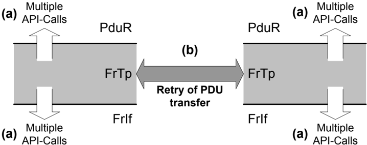

#### 9.2.2. FrTpGeneral

| 属性 | 值 |
| --- | --- |
| 容器名称 | FrTpGeneral |
| 父容器 | FrTp |
| 描述 | 该容器包含 FlexRay 传输协议模块的通用配置参数。 |

参数 FrTpAckRt 的定义：

| 属性 | 值 |
| --- | --- |
| 参数名称 | FrTpAckRt |
| 父容器 | FrTpGeneral |
| 描述 | 用于使能确认与重试机制的预处理器开关。**true**：确认与重试已启用；**false**：确认与重试已禁用。 |
| 多重性 | 1 |
| 类型 | EcucBooleanParamDef |
| 默认值 | -- |
| Post-Build 变体值 | false |
| 值配置类 | Pre-compile time：X（All Variants）；Link time：--；Post-build time：-- |
| 作用域/依赖 | scope: local |

参数 FrTpChangeParamApi 的定义：

| 属性 | 值 |
| --- | --- |
| 参数名称 | FrTpChangeParamApi |
| 父容器 | FrTpGeneral |
| 描述 | 用于使能修改 **FrTp** 通信参数的 API 的预处理器开关。**true**：ChangeParameter API 已启用；**false**：ChangeParameter API 已禁用。 |
| 多重性 | 1 |
| 类型 | EcucBooleanParamDef |
| 默认值 | -- |
| Post-Build 变体值 | false |
| 值配置类 | Pre-compile time：X（All Variants）；Link time：--；Post-build time：-- |
| 作用域/依赖 | scope: local |

参数 FrTpChanNum 的定义：

| 属性 | 值 |
| --- | --- |
| 参数名称 | FrTpChanNum |
| 父容器 | FrTpGeneral |
| 描述 | 用于定义模块支持的并发通道数量的预处理器开关。此处最多应可定义 32 个通道。 |
| 多重性 | 1 |
| 类型 | EcucIntegerParamDef |
| 取值范围 | 1 .. 32 |
| 默认值 | -- |
| Post-Build 变体值 | false |
| 值配置类 | Pre-compile time：X（All Variants）；Link time：--；Post-build time：-- |
| 作用域/依赖 | scope: local |

参数 FrTpDevErrorDetect 的定义：

| 属性 | 值 |
| --- | --- |
| 参数名称 | FrTpDevErrorDetect |
| 父容器 | FrTpGeneral |
| 描述 | **true**：检测已启用。 |
| 多重性 | 1 |
| 类型 | EcucBooleanParamDef |
| 默认值 | false |
| Post-Build 变体值 | false |
| 值配置类 | Pre-compile time：X（All Variants）；Link time：--；Post-build time：-- |
| 作用域/依赖 | scope: local |

参数 FrTpFullDuplexEnable 的定义：

| 属性 | 值 |
| --- | --- |
| 参数名称 | FrTpFullDuplexEnable |
| 父容器 | FrTpGeneral |
| 描述 | 为全部通道使能全双工机制的预处理器开关。**true**：全双工已启用；**false**：全双工已禁用（半双工已启用）。 |
| 多重性 | 1 |
| 类型 | EcucBooleanParamDef |
| 默认值 | false |
| Post-Build 变体值 | false |
| 值配置类 | Pre-compile time：X（All Variants）；Link time：--；Post-build time：-- |
| 作用域/依赖 | scope: local |

参数 FrTpMainFuncCycle 的定义：

| 属性 | 值 |
| --- | --- |
| 参数名称 | FrTpMainFuncCycle |
| 父容器 | FrTpGeneral |
| 描述 | 该参数包含 TP 主函数的调用周期。该参数以秒为单位规定。 |
| 多重性 | 1 |
| 类型 | EcucFloatParamDef |
| 取值范围 | ]0 .. INF[ |
| 默认值 | -- |
| Post-Build 变体值 | false |
| 值配置类 | Pre-compile time：X（All Variants）；Link time：--；Post-build time：-- |
| 作用域/依赖 | scope: local |

参数 FrTpTransmitCancellation 的定义：

| 属性 | 值 |
| --- | --- |
| 参数名称 | FrTpTransmitCancellation |
| 父容器 | FrTpGeneral |
| 描述 | 用于使能发送取消与接收取消的预处理器开关。**true**：发送/接收取消已启用；**false**：发送/接收取消已禁用。 |
| 多重性 | 1 |
| 类型 | EcucBooleanParamDef |
| 默认值 | false |
| Post-Build 变体值 | false |
| 值配置类 | Pre-compile time：X（All Variants）；Link time：--；Post-build time：-- |
| 作用域/依赖 | scope: local |

参数 FrTpUnknownMsgLength 的定义：

| 属性 | 值 |
| --- | --- |
| 参数名称 | FrTpUnknownMsgLength |
| 父容器 | FrTpGeneral |
| 描述 | 支持未知消息长度数据传输的预处理器开关。**true**：未知消息长度的传输已启用；**false**：未知消息长度的传输已禁用。 |
| 多重性 | 1 |
| 类型 | EcucBooleanParamDef |
| 默认值 | -- |
| Post-Build 变体值 | false |
| 值配置类 | Pre-compile time：X（All Variants）；Link time：--；Post-build time：-- |
| 作用域/依赖 | scope: local |

参数 FrTpVersionInfoApi 的定义：

| 属性 | 值 |
| --- | --- |
| 参数名称 | FrTpVersionInfoApi |
| 父容器 | FrTpGeneral |
| 描述 | 用于使能版本信息 API 的预处理器开关。**true**：版本信息 API 已启用；**false**：版本信息 API 已禁用。 |
| 多重性 | 1 |
| 类型 | EcucBooleanParamDef |
| 默认值 | false |
| Post-Build 变体值 | false |
| 值配置类 | Pre-compile time：X（All Variants）；Link time：--；Post-build time：-- |
| 作用域/依赖 | scope: local |

无包含的容器（No Included Containers）。

#### 9.2.3. FrTpMultipleConfig

| 属性 | 值 |
| --- | --- |
| 容器名称 | FrTpMultipleConfig |
| 父容器 | FrTp |
| 描述 | 该容器包含 AUTOSAR FrTp 模块的配置参数与子容器。 |

参数 FrTpMaxConnectionCnt 的定义：

| 属性 | 值 |
| --- | --- |
| 参数名称 | FrTpMaxConnectionCnt |
| 父容器 | FrTpMultipleConfig |
| 描述 | TP 连接的最大数量。只有在使用静态内存分配的构建后可加载实现的情况下才需要该参数。 |
| 多重性 | 0..1 |
| 类型 | EcucIntegerParamDef |
| 取值范围 | 0 .. 18446744073709551615 |
| 默认值 | -- |
| Post-Build 变体多重性 | false |
| Post-Build 变体值 | false |
| 多重性配置类 | Pre-compile time：X（All Variants）；Link time：--；Post-build time：-- |
| 值配置类 | Pre-compile time：X（All Variants）；Link time：--；Post-build time：-- |
| 作用域/依赖 | scope: local |

| 容器名称 | 多重性 | 作用域/依赖 |
| --- | --- | --- |
| FrTpConnection | 1..* | 该容器包含经由 FlexRay TP 传输 N-PDU 的连接特定参数。 |
| FrTpConnectionControl | 1..* | 该容器包含控制一条 FlexRay TP 连接的配置参数。 |
| FrTpRxPduPool | 0..* | 该容器包含分配给该 PDU 池的全部 PDU。 |
| FrTpTxPduPool | 0..* | 该容器包含分配给该 PDU 池的全部 PDU。 |

#### 9.2.4. FrTpConnection

| 属性 | 值 |
| --- | --- |
| 容器名称 | FrTpConnection |
| 父容器 | FrTpMultipleConfig |
| 描述 | 该容器包含经由 FlexRay TP 传输 N-PDU 的连接特定参数。 |
| Post-Build 变体多重性 | true |
| 多重性配置类 | Pre-compile time：X（VARIANT-PRE-COMPILE）；Link time：--；Post-build time：X（VARIANT-POST-BUILD） |

参数 FrTpBandwidthLimitation 的定义：

| 属性 | 值 |
| --- | --- |
| 参数名称 | FrTpBandwidthLimitation |
| 父容器 | FrTpConnection |
| 描述 | 定义是否限制连接的带宽。如果 FrTpBandwidthLimitation=True，发送方应发送一个起始帧……（源文此处截断） |
| 多重性 | 1 |
| 类型 | EcucBooleanParamDef |
| 默认值 | -- |
| Post-Build 变体值 | true |
| 值配置类 | Pre-compile time：X（VARIANT-PRE-COMPILE）；Link time：--；Post-build time：X（VARIANT-POST-BUILD） |
| 作用域/依赖 | scope: local |

参数 FrTpLa 的定义：

| 属性 | 值 |
| --- | --- |
| 参数名称 | FrTpLa |
| 父容器 | FrTpConnection |
| 描述 | 该参数定义相应连接的本地地址（Local Address）。当本地实例是发送方时，它是 TP 帧内的源地址；当本地实例是接收方时，它是 TP 帧内的目标地址。若未配置该参数，则所有相关的 Rx N-SDU 必须配置为使用元数据项 TARGET_ADDRESS_16，所有相关的 Tx N-SDU 必须配置为使用元数据项 SOURCE_ADDRESS_16。 |
| 多重性 | 0..1 |
| 类型 | EcucIntegerParamDef |
| 取值范围 | 0 .. 65535 |
| 默认值 | -- |
| Post-Build 变体值 | true |
| 值配置类 | Pre-compile time：X（VARIANT-PRE-COMPILE）；Link time：--；Post-build time：X（VARIANT-POST-BUILD） |
| 作用域/依赖 | scope: local |

参数 FrTpMultipleReceiverCon 的定义：

| 属性 | 值 |
| --- | --- |
| 参数名称 | FrTpMultipleReceiverCon |
| 父容器 | FrTpConnection |
| 描述 | 定义该连接是否为（「true」）1:n 连接。如果通过 FlexRay TP 传输数据……需检查是否分段……（源文此处截断） |
| 多重性 | 1 |
| 类型 | EcucBooleanParamDef |
| 默认值 | -- |
| Post-Build 变体值 | true |
| 值配置类 | Pre-compile time：X（VARIANT-PRE-COMPILE）；Link time：--；Post-build time：X（VARIANT-POST-BUILD） |
| 作用域/依赖 | scope: local |

参数 FrTpRa 的定义：

| 属性 | 值 |
| --- | --- |
| 参数名称 | FrTpRa |
| 父容器 | FrTpConnection |
| 描述 | 该参数定义相应连接的远程地址（Remote Address）。当本地实例是发送方时，它是 TP 帧内的目标地址；当本地实例是接收方时，它是 TP 帧内的源地址。若未配置该参数，则所有相关的 Rx N-SDU 必须配置为使用元数据项 SOURCE_ADDRESS_16，所有相关的 Tx N-SDU 必须配置为使用元数据项 TARGET_ADDRESS_16。 |
| 多重性 | 0..1 |
| 类型 | EcucIntegerParamDef |
| 取值范围 | 0 .. 65535 |
| 默认值 | -- |
| Post-Build 变体值 | true |
| 值配置类 | Pre-compile time：X（VARIANT-PRE-COMPILE）；Link time：--；Post-build time：X（VARIANT-POST-BUILD） |
| 作用域/依赖 | scope: local |

参数 FrTpConCtrlRef 的定义：

| 属性 | 值 |
| --- | --- |
| 参数名称 | FrTpConCtrlRef |
| 父容器 | FrTpConnection |
| 描述 | FrTpConnectionControl 引用：该参数定义到一个连接控制容器的引用。 |
| 多重性 | 1 |
| 类型 | 对 FrTpConnectionControl 的引用（Reference to FrTpConnectionControl） |
| Post-Build 变体值 | true |
| 值配置类 | Pre-compile time：X（VARIANT-PRE-COMPILE）；Link time：--；Post-build time：X（VARIANT-POST-BUILD） |
| 作用域/依赖 | scope: local |

参数 FrTpRxPduPoolRef 的定义：

| 属性 | 值 |
| --- | --- |
| 参数名称 | FrTpRxPduPoolRef |
| 父容器 | FrTpConnection |
| 描述 | 该参数定义到一个 RxPduPool 的引用。 |
| 多重性 | 0..1 |
| 类型 | 对 FrTpRxPduPool 的引用（Reference to FrTpRxPduPool） |
| Post-Build 变体多重性 | true |
| Post-Build 变体值 | true |
| 多重性配置类 | Pre-compile time：X（VARIANT-PRE-COMPILE）；Link time：--；Post-build time：X（VARIANT-POST-BUILD） |
| 值配置类 | Pre-compile time：X（VARIANT-PRE-COMPILE）；Link time：--；Post-build time：X（VARIANT-POST-BUILD） |
| 作用域/依赖 | scope: local |

参数 FrTpTxPduPoolRef 的定义：

| 属性 | 值 |
| --- | --- |
| 参数名称 | FrTpTxPduPoolRef |
| 父容器 | FrTpConnection |
| 描述 | 该参数定义到一个 TxPduPool 的引用。 |
| 多重性 | 0..1 |
| 类型 | 对 FrTpTxPduPool 的引用（Reference to FrTpTxPduPool） |
| Post-Build 变体多重性 | true |
| Post-Build 变体值 | true |
| 多重性配置类 | Pre-compile time：X（VARIANT-PRE-COMPILE）；Link time：--；Post-build time：X（VARIANT-POST-BUILD） |
| 值配置类 | Pre-compile time：X（VARIANT-PRE-COMPILE）；Link time：--；Post-build time：X（VARIANT-POST-BUILD） |
| 作用域/依赖 | scope: local |

| 容器名称 | 多重性 | 作用域/依赖 |
| --- | --- | --- |
| FrTpRxSdu | 0..1 | 该参数定义 Rx 服务数据单元标识符（Sdu Id），它唯一标识 **FrTp** 与 **PDUR** 之间的一次数据传输（模块间通信）。该 N-SDU 可以产生 SOURCE_ADDRESS_16 与 TARGET_ADDRESS_16 类型的元数据项。 |
| FrTpTxSdu | 0..1 | 该参数定义 Tx 服务数据单元标识符（Sdu Id），它唯一标识 **FrTp** 与 **PDUR** 之间的一次数据传输（模块间通信）。该 N-SDU 可以消耗 SOURCE_ADDRESS_16 与 TARGET_ADDRESS_16 类型的元数据项。 |

#### 9.2.5. FrTpTxSdu

| 属性 | 值 |
| --- | --- |
| 容器名称 | FrTpTxSdu |
| 父容器 | FrTpConnection |
| 描述 | 该参数定义 Tx 服务数据单元标识符（Sdu Id），它唯一标识 **FrTp** 与 **PDUR** 之间的一次数据传输（模块间通信）。该 N-SDU 可以消耗 SOURCE_ADDRESS_16 与 TARGET_ADDRESS_16 类型的元数据项。 |

参数 FrTpTxSduId 的定义：

| 属性 | 值 |
| --- | --- |
| 参数名称 | FrTpTxSduId |
| 父容器 | FrTpTxSdu |
| 描述 | 这是从 **PduR** 发往 **FrTp** 的待发送消息的唯一标识符。ImplementationType：PduIdType。 |
| 多重性 | 1 |
| 类型 | EcucIntegerParamDef（为该参数生成的符号名） |
| 取值范围 | 0 .. 65535 |
| 默认值 | -- |
| Post-Build 变体值 | false |
| 值配置类 | Pre-compile time：X（All Variants）；Link time：--；Post-build time：-- |
| 作用域/依赖 | scope: local；withAuto = true |

参数 FrTpTxSduRef 的定义：

| 属性 | 值 |
| --- | --- |
| 参数名称 | FrTpTxSduRef |
| 父容器 | FrTpTxSdu |
| 描述 | 对全局 PDU 结构中一个 PDU 的引用。 |
| 多重性 | 1 |
| 类型 | 对 Pdu 的引用（Reference to Pdu） |
| Post-Build 变体值 | true |
| 值配置类 | Pre-compile time：X（VARIANT-PRE-COMPILE）；Link time：--；Post-build time：X（VARIANT-POST-BUILD） |
| 作用域/依赖 |  |

无包含的容器（No Included Containers）。

#### 9.2.6. FrTpRxSdu

| 属性 | 值 |
| --- | --- |
| 容器名称 | FrTpRxSdu |
| 父容器 | FrTpConnection |
| 描述 | 该参数定义 Rx 服务数据单元标识符（Sdu Id），它唯一标识 **FrTp** 与 **PDUR** 之间的一次数据传输（模块间通信）。该 N-SDU 可以产生 SOURCE_ADDRESS_16 与 TARGET_ADDRESS_16 类型的元数据项。 |

参数 FrTpRxSduId 的定义：

| 属性 | 值 |
| --- | --- |
| 参数名称 | FrTpRxSduId |
| 父容器 | FrTpRxSdu |
| 描述 | 该唯一标识符用于从 **PduR** 到 **FrTp** 的修改参数请求或接收取消。ImplementationType：PduIdType。 |
| 多重性 | 1 |
| 类型 | EcucIntegerParamDef（为该参数生成的符号名） |
| 取值范围 | 0 .. 65535 |
| 默认值 | -- |
| Post-Build 变体值 | false |
| 值配置类 | Pre-compile time：X（All Variants）；Link time：--；Post-build time：-- |
| 作用域/依赖 | scope: local；withAuto = true |

参数 FrTpRxSduRef 的定义：

| 属性 | 值 |
| --- | --- |
| 参数名称 | FrTpRxSduRef |
| 父容器 | FrTpRxSdu |
| 描述 | 对全局 PDU 结构中一个 PDU 的引用。 |
| 多重性 | 1 |
| 类型 | 对 Pdu 的引用（Reference to Pdu） |
| Post-Build 变体值 | true |
| 值配置类 | Pre-compile time：X（VARIANT-PRE-COMPILE）；Link time：--；Post-build time：X（VARIANT-POST-BUILD） |
| 作用域/依赖 |  |

无包含的容器（No Included Containers）。

#### 9.2.7. FrTpConnectionControl

| 属性 | 值 |
| --- | --- |
| 容器名称 | FrTpConnectionControl |
| 父容器 | FrTpMultipleConfig |
| 描述 | 该容器包含控制一条 FlexRay TP 连接的配置参数。 |
| Post-Build 变体多重性 | true |
| 多重性配置类 | Pre-compile time：X（VARIANT-PRE-COMPILE）；Link time：--；Post-build time：X（VARIANT-POST-BUILD） |

参数 FrTpAckType 的定义：

| 属性 | 值 |
| --- | --- |
| 参数名称 | FrTpAckType |
| 父容器 | FrTpConnectionControl |
| 描述 | 该参数定义用于特定通道的确认类型。 |
| 多重性 | 1 |
| 类型 | EcucEnumerationParamDef |
| Post-Build 变体值 | true |
| 值配置类 | Pre-compile time：X（VARIANT-PRE-COMPILE）；Link time：--；Post-build time：X（VARIANT-POST-BUILD） |
| 作用域/依赖 | scope: local |

| 取值 | 说明 |
| --- | --- |
| FRTP_ACK_WITH_RT | 带重试的确认（Acknowledgement with retry） |
| FRTP_NO | 无确认（No acknowledgement） |

参数 FrTpMaxFCWait 的定义：

| 属性 | 值 |
| --- | --- |
| 参数名称 | FrTpMaxFCWait |
| 父容器 | FrTpConnectionControl |
| 描述 | 该参数定义 FlowState 为「WAIT」的 FlowControl N-PDU 的最大数量。 |
| 多重性 | 1 |
| 类型 | EcucIntegerParamDef |
| 取值范围 | 0 .. 255 |
| 默认值 | -- |
| Post-Build 变体值 | true |
| 值配置类 | Pre-compile time：X（VARIANT-PRE-COMPILE）；Link time：--；Post-build time：X（VARIANT-POST-BUILD） |
| 作用域/依赖 | scope: local |

参数 FrTpMaxNbrOfNPduPerCycle 的定义：

| 属性 | 值 |
| --- | --- |
| 参数名称 | FrTpMaxNbrOfNPduPerCycle |
| 父容器 | FrTpConnectionControl |
| 描述 | 该参数是 ISO 10681-2 协议 FlowControl「带宽控制（BC）」的一部分。它限制一个 FlexRay 周期内可发送的 N-PDU 数量。 |
| 多重性 | 1 |
| 类型 | EcucIntegerParamDef |
| 取值范围 | 0 .. 31 |
| 默认值 | -- |
| Post-Build 变体值 | true |
| 值配置类 | Pre-compile time：X（VARIANT-PRE-COMPILE）；Link time：--；Post-build time：X（VARIANT-POST-BUILD） |
| 作用域/依赖 | scope: local |

参数 FrTpMaxRn 的定义：

| 属性 | 值 |
| --- | --- |
| 参数名称 | FrTpMaxRn |
| 父容器 | FrTpConnectionControl |
| 描述 | 该参数定义最大重试次数（若已配置）。 |
| 多重性 | 1 |
| 类型 | EcucIntegerParamDef |
| 取值范围 | 0 .. 255 |
| 默认值 | -- |
| Post-Build 变体值 | true |
| 值配置类 | Pre-compile time：X（VARIANT-PRE-COMPILE）；Link time：--；Post-build time：X（VARIANT-POST-BUILD） |
| 作用域/依赖 | scope: local |

参数 FrTpSCexp 的定义：

| 属性 | 值 |
| --- | --- |
| 参数名称 | FrTpSCexp |
| 父容器 | FrTpConnectionControl |
| 描述 | 该参数是「带宽控制（BC）」的一部分：一个 FrTp N-Pdu 的「分离周期」（Separation Cycles）数量。 |
| 多重性 | 1 |
| 类型 | EcucIntegerParamDef |
| 取值范围 | 0 .. 7 |
| 默认值 | -- |
| Post-Build 变体值 | true |
| 值配置类 | Pre-compile time：X（VARIANT-PRE-COMPILE）；Link time：--；Post-build time：X（VARIANT-POST-BUILD） |
| 作用域/依赖 | scope: local |

参数 FrTpTimeBr 的定义：

| 属性 | 值 |
| --- | --- |
| 参数名称 | FrTpTimeBr |
| 父容器 | FrTpConnectionControl |
| 描述 | 该参数定义到相应 FlowControl 帧的时间。依据 ISO 10681-2，这是一个性能需求。 |
| 多重性 | 1 |
| 类型 | EcucFloatParamDef |
| 取值范围 | [0 .. 0.255] |
| 默认值 | -- |
| Post-Build 变体值 | true |
| 值配置类 | Pre-compile time：X（VARIANT-PRE-COMPILE）；Link time：--；Post-build time：X（VARIANT-POST-BUILD） |
| 作用域/依赖 | scope: local |

参数 FrTpTimeCs 的定义：

| 属性 | 值 |
| --- | --- |
| 参数名称 | FrTpTimeCs |
| 父容器 | FrTpConnectionControl |
| 描述 | 该参数以秒定义以下各项之间的时间：两条 CF 的发送之间；一条 CF 与一条 LF 的发送之间；或收到一条 FC 与发送下一条 CF 之间。 |
| 多重性 | 1 |
| 类型 | EcucFloatParamDef |
| 取值范围 | [0 .. 65.535] |
| 默认值 | -- |
| Post-Build 变体值 | true |
| 值配置类 | Pre-compile time：X（VARIANT-PRE-COMPILE）；Link time：--；Post-build time：X（VARIANT-POST-BUILD） |
| 作用域/依赖 | scope: local |

参数 FrTpTimeoutAr 的定义：

| 属性 | 值 |
| --- | --- |
| 参数名称 | FrTpTimeoutAr |
| 父容器 | FrTpConnectionControl |
| 描述 | 该参数规定（以秒）从传输层向 FlexRay 接口发出 PDU 发送请求、到 FlexRay 接口在接收方一侧（对 FC 或 AF）给出相应确认之间的超时。 |
| 多重性 | 1 |
| 类型 | EcucFloatParamDef |
| 取值范围 | [0 .. 65.535] |
| 默认值 | -- |
| Post-Build 变体值 | true |
| 值配置类 | Pre-compile time：X（VARIANT-PRE-COMPILE）；Link time：--；Post-build time：X（VARIANT-POST-BUILD） |
| 作用域/依赖 | scope: local；依赖：显然必须满足 FRTP_TIME_BR + FRTP_TIMEOUT_AR < FRTP_TIMEOUT_BS（因为还必须考虑传输时长）。 |

参数 FrTpTimeoutAs 的定义：

| 属性 | 值 |
| --- | --- |
| 参数名称 | FrTpTimeoutAs |
| 父容器 | FrTpConnectionControl |
| 描述 | 该参数规定（以秒）发送方一侧等待来自 FlexRay 接口的发送确认的最大时间。 |
| 多重性 | 1 |
| 类型 | EcucFloatParamDef |
| 默认值 | -- |
| Post-Build 变体值 | true |
| 值配置类 | Pre-compile time：X（VARIANT-PRE-COMPILE）；Link time：--；Post-build time：X（VARIANT-POST-BUILD） |
| 作用域/依赖 | scope: local；依赖：显然必须满足 FRTP_TIME_CS + FRTP_TIMEOUT_AS < FRTP_TIMEOUT_CR（因为还必须考虑总线上的传输时长）。 |

参数 FrTpTimeoutBs 的定义：

| 属性 | 值 |
| --- | --- |
| 参数名称 | FrTpTimeoutBs |
| 父容器 | FrTpConnectionControl |
| 描述 | 该参数定义（以秒）在 1:1 连接中发送方一侧等待 FC 或 AF 的超时。 |
| 多重性 | 1 |
| 类型 | EcucFloatParamDef |
| 取值范围 | [0 .. 65.535] |
| 默认值 | -- |
| Post-Build 变体值 | true |
| 值配置类 | Pre-compile time：X（VARIANT-PRE-COMPILE）；Link time：--；Post-build time：X（VARIANT-POST-BUILD） |
| 作用域/依赖 | scope: local |

参数 FrTpTimeoutCr 的定义：

| 属性 | 值 |
| --- | --- |
| 参数名称 | FrTpTimeoutCr |
| 父容器 | FrTpConnectionControl |
| 描述 | 该参数定义（以秒）接收方一侧等待一条 CF 或一条 LF 的超时。 |
| 多重性 | 1 |
| 类型 | EcucFloatParamDef |
| 取值范围 | [0 .. 65.535] |
| 默认值 | -- |
| Post-Build 变体值 | true |
| 值配置类 | Pre-compile time：X（VARIANT-PRE-COMPILE）；Link time：--；Post-build time：X（VARIANT-POST-BUILD） |
| 作用域/依赖 | scope: local |

无包含的容器（No Included Containers）。

#### 9.2.8. FrTpTxPduPool

| 属性 | 值 |
| --- | --- |
| 容器名称 | FrTpTxPduPool |
| 父容器 | FrTpMultipleConfig |
| 描述 | 该容器包含分配给该 PDU 池的全部 PDU。 |
| Post-Build 变体多重性 | true |
| 多重性配置类 | Pre-compile time：X（VARIANT-PRE-COMPILE）；Link time：--；Post-build time：X（VARIANT-POST-BUILD） |

| 容器名称 | 多重性 | 作用域/依赖 |
| --- | --- | --- |
| FrTpTxPdu | 1..* | 保存 PDU 参数的容器。ImplementationType：PduInfoType。 |

#### 9.2.9. FrTpRxPduPool

| 属性 | 值 |
| --- | --- |
| 容器名称 | FrTpRxPduPool |
| 父容器 | FrTpMultipleConfig |
| 描述 | 该容器包含分配给该 PDU 池的全部 PDU。 |
| Post-Build 变体多重性 | true |
| 多重性配置类 | Pre-compile time：X（VARIANT-PRE-COMPILE）；Link time：--；Post-build time：X（VARIANT-POST-BUILD） |

| 容器名称 | 多重性 | 作用域/依赖 |
| --- | --- | --- |
| FrTpRxPdu | 1..* | 保存 PDU 参数的容器。ImplementationType：PduInfoType。 |

#### 9.2.10. FrTpTxPdu

| 属性 | 值 |
| --- | --- |
| 容器名称 | FrTpTxPdu |
| 父容器 | FrTpTxPduPool |
| 描述 | 保存 PDU 参数的容器。ImplementationType：PduInfoType。 |
| Post-Build 变体多重性 | true |
| 多重性配置类 | Pre-compile time：X（VARIANT-PRE-COMPILE）；Link time：--；Post-build time：X（VARIANT-POST-BUILD） |

参数 FrTpTxConfirmationPduId 的定义：

| 属性 | 值 |
| --- | --- |
| 参数名称 | FrTpTxConfirmationPduId |
| 父容器 | FrTpTxPdu |
| 描述 | **FrIf** 用于向 FrIf 模块确认 FrTpTxPdu 的发送（FrTp_TxConfirmation）的句柄 Id。 |
| 多重性 | 1 |
| 类型 | EcucIntegerParamDef（为该参数生成的符号名） |
| 取值范围 | 0 .. 65535 |
| 默认值 | -- |
| Post-Build 变体值 | false |
| 值配置类 | Pre-compile time：X（All Variants）；Link time：--；Post-build time：-- |
| 作用域/依赖 | scope: local；withAuto = true |

参数 FrTpTxPduRef 的定义：

| 属性 | 值 |
| --- | --- |
| 参数名称 | FrTpTxPduRef |
| 父容器 | FrTpTxPdu |
| 描述 | 对全局 PDU 结构中一个 PDU 的引用。 |
| 多重性 | 1 |
| 类型 | 对 Pdu 的引用（Reference to Pdu） |
| Post-Build 变体值 | true |
| 值配置类 | Pre-compile time：X（VARIANT-PRE-COMPILE）；Link time：--；Post-build time：X（VARIANT-POST-BUILD） |
| 作用域/依赖 | scope: local |

无包含的容器（No Included Containers）。

#### 9.2.11. FrTpRxPdu

| 属性 | 值 |
| --- | --- |
| 容器名称 | FrTpRxPdu |
| 父容器 | FrTpRxPduPool |
| 描述 | 保存 PDU 参数的容器。ImplementationType：PduInfoType。 |
| Post-Build 变体多重性 | true |
| 多重性配置类 | Pre-compile time：X（VARIANT-PRE-COMPILE）；Link time：--；Post-build time：X（VARIANT-POST-BUILD） |

参数 FrTpRxPduId 的定义：

| 属性 | 值 |
| --- | --- |
| 参数名称 | FrTpRxPduId |
| 父容器 | FrTpRxPdu |
| 描述 | 这是从 **FrIf** 转发给 **FrTp** 的所接收消息的唯一标识符。ImplementationType：PduIdType。 |
| 多重性 | 1 |
| 类型 | EcucIntegerParamDef（为该参数生成的符号名） |
| 取值范围 | 0 .. 65535 |
| 默认值 | -- |
| Post-Build 变体值 | false |
| 值配置类 | Pre-compile time：X（All Variants）；Link time：--；Post-build time：-- |
| 作用域/依赖 | scope: local；withAuto = true |

参数 FrTpRxPduRef 的定义：

| 属性 | 值 |
| --- | --- |
| 参数名称 | FrTpRxPduRef |
| 父容器 | FrTpRxPdu |
| 描述 | 对全局 PDU 结构中一个 PDU 的引用。 |
| 多重性 | 1 |
| 类型 | 对 Pdu 的引用（Reference to Pdu） |
| Post-Build 变体值 | true |
| 值配置类 | Pre-compile time：X（VARIANT-PRE-COMPILE）；Link time：--；Post-build time：X（VARIANT-POST-BUILD） |
| 作用域/依赖 | scope: local |

无包含的容器（No Included Containers）。

#### 9.2.12. FrTpDemEventParameterRefs

| 属性 | 值 |
| --- | --- |
| 容器名称 | FrTpDemEventParameterRefs |
| 父容器 | FrTp |
| 描述 | 对 DemEventParameter 元素的引用的容器——当相应错误发生时应使用 API Dem_SetEventStatus 调用这些元素。事件 Id 取自被引用 DemEventParameter 的 DemEventId 符号值。该容器提供标准化的错误，并可由供应商特定的错误引用扩展。 |
| Post-Build 变体多重性 | false |
| 多重性配置类 | Pre-compile time：X（All Variants）；Link time：--；Post-build time：-- |

以下参数均为对 DemEventParameter 元素的符号名引用（Symbolic name reference to DemEventParameter），多重性 0..1，描述为「应使用 API Dem_SetEventStatus 调用的 DemEventParameter 元素的引用——当相应错误发生时」，Post-Build 变体多重性 false、Post-Build 变体值 false，多重性配置类与值配置类均为 Pre-compile time：X（All Variants）；Link time：--；Post-build time：--，作用域 scope: local：

| 参数名称 |
| --- |
| FRTP_E_DROPPED_CONSECUTIVE_FRAMES_DETECTED |
| FRTP_E_FC_ABORT_RECEIVED |
| FRTP_E_FC_ABORT_TRANSMITTED |
| FRTP_E_FC_OVERFLOW_RECEIVED |
| FRTP_E_FC_OVERFLOW_TRANSMITTED |
| FRTP_E_FRTPNAR_TIMEOUT_OCCURRED |
| FRTP_E_FRTPNAS_TIMEOUT_OCCURRED |
| FRTP_E_FRTPNBR_TIMEOUT_OCCURRED |
| FRTP_E_FRTPNBS_TIMEOUT_OCCURRED |
| FRTP_E_FRTPNCR_TIMEOUT_OCCURRED |
| FRTP_E_FRTPNCS_TIMEOUT_OCCURRED |
| FRTP_E_SWAPPED_CONSECUTIVE_FRAMES_RECEIVED |

### 9.3. 发布信息

详细内容请参阅 SWS\_BSWGeneral 的 10.3 章「发布信息」（Published Information）。

### 9.4. 配置依赖与建议

**FrTp** 模块的功能基于若干配置参数。为了保证软件模块良好工作，本章给出一些配置建议。

#### 9.4.1. 重试行为

本文档中多次使用「重试」这一术语，但侧重点各不相同。如图 27 所示，**FrTp** 模块基本上有两种重试：

* a) 发生错误或系统繁忙时的多次 API 调用；
* b) 依据传输协议条件的 PDU 传输重试。

图 27：FrTp 重试场景（**FrTp Retry Scenarios**）

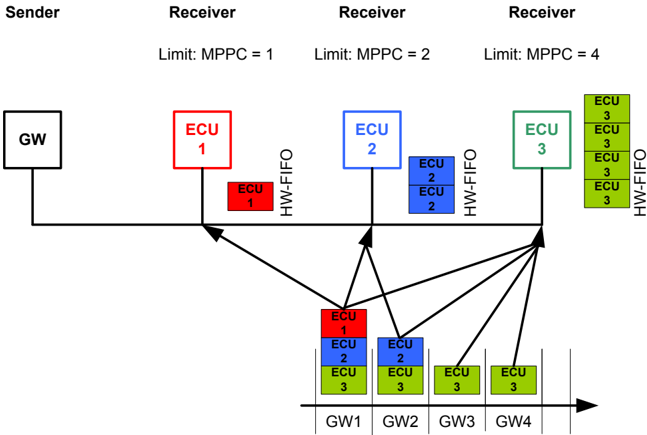

只有情况 (b)（PDU 传输重试）定义了一个用于启用与禁用的全局开关（FrTpAckType）。所有其他情况取决于相应的配置参数。

#### 9.4.2. TP 确认与重试

确认与重试只在 1:1 连接上可行，因为通信节点必须处理 FlowControl N-PDU。

如果为某条连接设置了配置参数 FrTpMultipleReceiverCon，则无论配置参数 FrTpAckType 是否设置，都不得进行确认与重试。

#### 9.4.3. 定时与超时参数

定时与超时行为取决于全局 FlexRay 调度。为保证系统稳定，应考虑一些定时与超时关系。

配置提示：对于超时 As 的配置，应考虑 FRTP_TIMEOUT_AS > FRTP_TIME_AS。对于超时 Cs 的配置，应考虑 FRTP_TIMEOUT_CS > FRTP_TIME_CS（依据 ISO 10681-2 [16]）。

**FrTp** 配置应确保 2^SeparationCycleExponent − 1 × tCycleTime ≤ FRTP_TIMEOUT_CR。

6.4.3 章节脚注：这是为了防止超时。请参阅 ISO 10681-2。

#### 9.4.4. 带宽控制配置

可能出现某个 ECU 无法接收其在连接所引用的 PDU 池内定义的那样多的 PDU 的情况。此时带宽可以按以下方式限制：

* a) 通过参数 FlowControl.BandwidthControl.MaxPduPerCycle 结合硬件 FIFO 缓冲机制限制带宽；
* b) 通过参数 FlowControl.BandwidthControl.MaxPduPerCycle 减少当前所选 PDU 池允许的 PDU 数量；
* c) 通过为通往受影响 ECU 的连接使用一个专用 PDU 池来限制带宽。

6.4.4 章节脚注：如果 FlexRay 通信控制器只支持较少的 Rx 缓冲区、且无法在周期结束时重新配置缓冲区，则可能发生这种情况。6.4.4 章节脚注：这是 FlexRay 3.0 协议的一个重要机制。

##### 9.4.4.1. 借助 FlowControl 参数结合硬件 FIFO 缓冲机制进行带宽控制

如果使用 FlowControl 参数结合硬件 FIFO 缓冲机制进行带宽控制，则不会出现额外的配置限制。

图 28：借助 FlowControl 参数结合 HW FIFO 缓冲的带宽控制（**BandwidthControl by FlowControl Parameters in combination with HW FIFO buffer**）

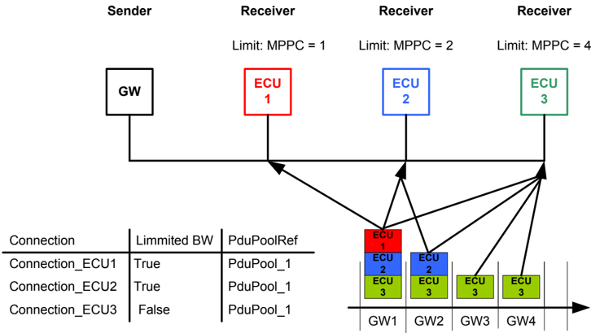

##### 9.4.4.2. 借助 FlowControl 参数进行带宽控制

如果使用 FlowControl 参数进行带宽控制，则必须考虑一些配置限制。下图展示了相互依赖关系。

图 29：借助 FlowControl 参数的带宽控制（**BandwidthControl by FlowControl Parameters**）

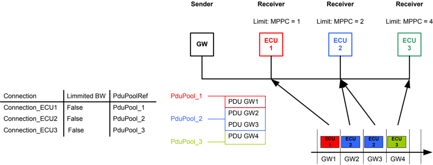

在一个网络中连接了四个 FlexRay 节点。为发送节点定义了 4 个 PDU。其中两个……

如果到某个特定 ECU 的连接中的带宽限制由 FlowControl 参数 BC（不带 HW-FIFO 机制）实现，则……

如果带宽限制由 FlowControl 参数 BC 实现、且属性「FrTpBandwidthLimitation」为 True，则发起一条通信链路的起始帧应始终在该连接的第一……

**注意：** 在带宽限制的情况下使用池的第一帧是历史原因。带宽限制只对 FlexRa……

如果某个 ECU 以 FlowControl 参数 BandwidthControl.MPPC ≠ 0（「零」）应答，发送方应只使用 BC.MP……

如果属性「FrTpBandwidthLimitation」置为「TRUE」，Rx 连接应使用被引用 TxPdu 池的第一条 Pdu……

##### 9.4.4.3. 借助不同的 PDU 池进行带宽控制

如果带宽控制由不同的 PDU 池实现，可能出现两种不同的场景。

###### 9.4.4.3.1. 借助不重叠的 Tx-Pdu 池进行带宽控制

图 30：借助不重叠 Tx-Pdu 池的带宽控制


###### 9.4.4.3.2. 借助重叠的 Tx-Pdu 池进行带宽控制

图 31：借助重叠 Tx-Pdu 池的带宽控制

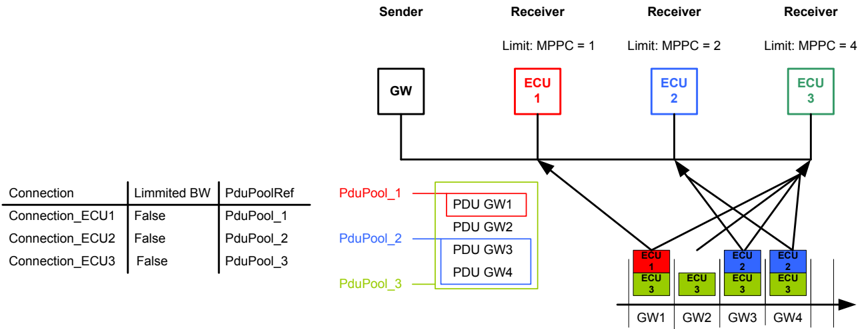

#### 9.4.5. 对 FlexRay 接口的配置需求

如果在一条连接内为一个 Fr N-SDU 使用多于一个 Fr N-PDU，**FrIf** 应保证这些 Fr N-PDU（Fr L-SDU）被调度……

对于每个 FrTp L-SDU，应激活 **FrIf** 的 PDU-Update/Valid 信息。

对于每个已发送的 N-Pdu，**FrIf** 模块应给出一个发送确认。

对于每个 FrTp L-SDU，不得使用 FrIf 触发发送计数器，即相应计数器的限值应为 1。
