## 1. 简介和功能概述

本规范描述 **AUTOSAR** 基础软件模块 **FlexRay** 网络管理（**FrNm**）的功能、**API** 和配置。

**AUTOSAR FlexRay** 网络管理是一种独立于硬件的协议，只能在 **FlexRay** 上使用（相关限制参见第 [4.1](#41-限制) 节）。它的主要用途是协调网络的正常运行与总线睡眠模式之间的转换。

除核心功能之外，还提供了一些可选特性，例如实现检测所有在位节点的服务，或检测所有其他节点是否已准备好睡眠的服务。

## 2. 缩略语和简称

下面的词汇表包含与 **FrNm** 模块相关、且未包含在 [\[1\]](#ref-1)（**AUTOSAR** 术语表）中的缩略语和缩写。

表2.1：本文档范围内使用的缩略语和缩写（**Acronyms and abbreviations used in the scope of this Document**）

**CC**
> 通信控制器（**Communication Controller**）

**NM**
> 网络管理（**Network Management**）

**WCET**
> 最坏情况执行时间（**Worst Case Execution Time**）

**DET**
> 默认错误跟踪器（**Default Error Tracer**），**AUTOSAR** 模块，用于在开发期间检测和报告错误。

**SRS**
> 软件需求规范（**Software requirements specification**）

**SWS**
> 软件工作规范（**Software working specification**）

**API**
> 应用编程接口（**Application program interface**）

**Com**
> 通信模块（**Communication module**）

**OS**
> 操作系统（**Operating system**）

**SchM**
> 调度管理器（**Schedule Manager**）

**PDU**
> 协议数据单元（**Protocol data unit**）

**CPU**
> 中央处理单元（**Central processing unit**）

**PNL**
> 部分网络学习（**Partial Network Learning**）

**FrIf**
> FlexRay 接口（**FlexRay Interface**）的缩写

**FrNm**
> FlexRay 上的网络管理（**Network Management on FlexRay**）的缩写

**NmIf**
> 通用网络管理（**Generic Network Management**）的缩写

**ECU**
> 电子控制单元（**Electronic control unit**）

**ComM**
> 通信管理器（**Communication manager**）

**FrSm**
> FlexRay 状态管理器（**FlexRay State Manager**）

**HW**
> 硬件（**Hardware**）

### 2.1. 术语

表2.2：本文档范围内使用的定义（**Definitions used in the scope of this Document**）

**Bus-Sleep Mode（总线睡眠模式）**
> 所有互连的通信控制器都处于睡眠模式的网络模式。

**NM-Network**
> 用于处理一条物理 FlexRay 总线的 FlexRay NM 实例。注意：FlexRay 总线包含两个无法彼此独立处理的 FlexRay 信道。因此 NM-Network 覆盖两条 FlexRay 总线信道。这等价于一个 NM-Cluster。

**Network requested（网络已请求）**
> 如果已调用 [FrNm_NetworkRequest](#733-frnm_networkrequest)，且此后网络既未被释放、也未进入总线睡眠模式，则 NM 网络处于「已请求」状态。

**Network released（网络已释放）**
> 如果已调用 [FrNm_NetworkRelease](#734-frnm_networkrelease)，且此后网络未被再次请求，则 NM 网络处于「已释放」状态。

**Repeat Message Request active（重复消息请求激活）**
> 如果已调用 [FrNm_RepeatMessageRequest](#738-frnm_repeatmessagerequest)，或在网络模式中接收到重复消息请求位置位的 NM PDU，则重复消息请求处于激活状态。当离开 Repeat Message 状态或进入总线睡眠模式时，它不再处于激活状态。

**NM Data Cycle（NM 数据循环）**
> 所有节点至少能够发送一次 NM 数据所需的 FlexRay 循环数量。

**NM Message（NM 消息）**
> 为 NM 算法的目的而在总线上交换的信息包。

**NM Repetition Cycle（NM 重复循环）**
> 不可能发生投票行为改变的 FlexRay 循环数量。该值必须是 NM 投票循环的整数倍。用于提高投票的可靠性。

**NM Slot（NM 时隙）**
> 为网络管理目的保留的时隙。

**NM Timeout（NM 超时）**
> NM 算法中引发向总线睡眠模式转换的超时。

**NM User Data（NM 用户数据）**
> 独立于 NM 投票在总线上发送的、应用特定的补充数据。

**NM Voting Cycle（NM 投票循环）**
> 所有节点至少投票一次所需的 FlexRay 循环数量。

**NM-Vote**
> 使用 FlexRay 总线发送的、表明某个 ECU 投票让总线保持唤醒的信息。

**NM-Vector**
> FlexRay NM 向量是当使用 FlexRay CC 可选的 NM 硬件向量服务时可获得的聚合数据。

**NM-Data**
> 使用 FlexRay 总线发送的与 NM 相关的数据。

**NM-Cluster**
> 已废弃，等价于 NM-Network。

**CBV**
> 控制位向量（**Control bit vector**）

**ClusterAwakeVote**
> 除自身之外的至少一个节点投票让集群保持唤醒。

**Positive NM-Vote in static segment（静态段中的正向 NM 投票）**
> 投票位（Voting Bit）置为「1」的 NM 投票 PDU 接收或发送。

**Positive NM-Vote in dynamic segment（动态段中的正向 NM 投票）**
> 接收到或发送了 NM 投票 PDU。

**Negative NM-Vote in static segment（静态段中的负向 NM 投票）**
> 投票位置为「0」的 NM 投票 PDU 接收或发送。

**Negative NM-Vote（负向 NM 投票）**
> 在动态段中：既未接收到也未发送 NM 投票 PDU。

**Top-level PNC coordinator（顶级 PNC 协调器）**
> 对于在所有已分配信道上被主动协调的那些 PNC，某个 ECU 充当顶级 PNC 协调器。该 ECU 启用了 PNC 网关功能。如果网络中没有其他 ECU 请求这些 PNC，且同步 PNC 关闭已启用，则顶级 PNC 协调器会为这些 PNC 触发同步的 PNC 关闭。注意：不同的 PNC 可以有不同的顶级 PNC 协调器。但对于同一个 PNC，只支持一个顶级协调器。

**Intermediate PNC coordinator（中间 PNC 协调器）**
> 对于在至少一个信道上被被动协调的那些 PNC，某个 ECU 充当中介 PNC 协调器。该 ECU 启用了 PNC 网关功能。如果同步 PNC 关闭已启用，中间 PNC 协调器将把同步 PNC 关闭转发给被动协调的 PNC 的主动协调信道。

**PNC leaf node（PNC 叶节点）**
> PNC 叶节点是在网络中完全不充当 PNC 协调器的 ECU。它像处理普通 NM 消息一样处理 PN 关闭消息。

**PN shutdown message（PN 关闭消息）**
> 顶级 PNC 协调器发送 PN 关闭消息以指示跨 PN 拓扑的同步 PNC 关闭。PN 关闭消息是这样的 NM 消息：其控制位向量中的 PNSR 位置位，且所有被指示为同步关闭的 PNC 都被置为「1」。

## 3. 相关文档

### 3.1. 输入文件和相关标准与规范

<a id="ref-1"></a>[1] Glossary
> AUTOSAR_FO_TR_Glossary

<a id="ref-2"></a>[2] General Specification of Basic Software Modules
> AUTOSAR_CP_SWS_BSWGeneral

<a id="ref-3"></a>[3] Requirements on AUTOSAR Network Management
> AUTOSAR_FO_RS_NetworkManagement

<a id="ref-4"></a>[4] General Requirements on Basic Software Modules
> AUTOSAR_CP_SRS_BSWGeneral

<a id="ref-5"></a>[5] Specification of ECU State Manager
> AUTOSAR_CP_SWS_ECUStateManager

<a id="ref-6"></a>[6] Specification of FlexRay State Manager
> AUTOSAR_CP_SWS_FlexRayStateManager

<a id="ref-7"></a>[7] FlexRay Communications System Protocol Specification V2.1
> http://www.flexray.com/

<a id="ref-8"></a>[8] System Template
> AUTOSAR_CP_TPS_SystemTemplate

<a id="ref-9"></a>[9] Specification of FlexRay Interface
> AUTOSAR_CP_SWS_FlexRayInterface

<a id="ref-10"></a>[10] Specification of Operating System
> AUTOSAR_CP_SWS_OS

<a id="ref-11"></a>[11] Guide to Mode Management
> AUTOSAR_CP_EXP_ModeManagementGuide

<a id="ref-12"></a>[12] Specification of Network Management Interface
> AUTOSAR_CP_SWS_NetworkManagementInterface

### 3.2. 相关规范

**AUTOSAR** 提供了一份基础软件模块通用规范 [\[2\]](#ref-2)（**SWS BSW General**），该规范同样适用于 **FlexRay** 网络管理。

因此，规范 **SWS BSW General** 应被视为 **FlexRay** 网络管理的附加且必需的规范。

## 4. 约束和假设

### 4.1. 限制

1. **FlexRay NM** 可应用于支持总线睡眠模式并以适当的唤醒机制实现的 FlexRay 通信系统。
2. 在同一个 **ECU** 内，一个 **FlexRay NM** 实例只能应用于一个 **FlexRay** 接口实例。
3. 在一个 FlexRay 网络中，一个 **FlexRay NM** 实例只能应用于一个 FlexRay NM 集群。一个 FlexRay NM 集群只能拥有一个 **FlexRay NM** 实例。
4. **FlexRay NM** 可以同时应用于同一 FlexRay 总线的两条 FlexRay 信道。

图4.1 展示了属于 FlexRay NM 集群的示例 **ECU** 内的 **AUTOSAR NM** 协议栈。

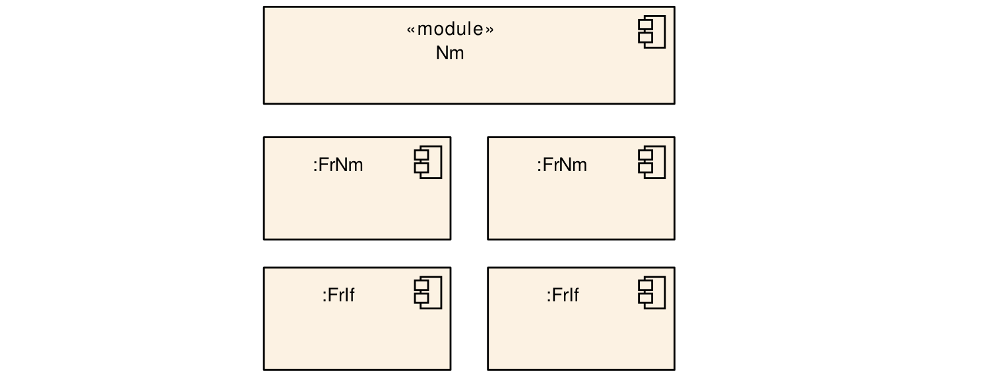

图4.1：FlexRay 上的 AUTOSAR NM 协议栈（**Figure 4.1: AUTOSAR NM Stack on FlexRay**）

### 4.2. 汽车域的适用性

在上述限制的前提下，**AUTOSAR NM** 可应用于使用 FlexRay 技术的任何汽车域。

## 5. 对其他模块的依赖

FlexRay NM 向通用网络管理接口（**NmIf**）提供服务，并使用 FlexRay 接口的服务。

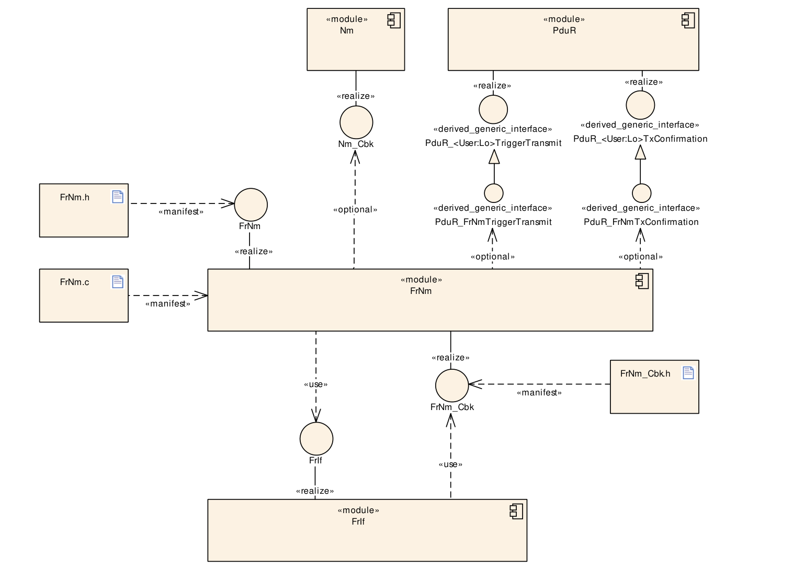

图5.1：NM 概览（**Figure 5.1: NM Overview**）

注意：除图5.1中描绘的模块之外，FlexRay Nm 还使用一些其他模块（如 **DET**）。

| 模块 | 依赖关系 |
| --- | --- |
| Nm | FlexRay NM 向通用网络管理接口（**NmIf**）提供服务 |
| PduR | FlexRay NM 使用 **PDU** 路由器的服务 |
| FrIf | FlexRay NM 使用 **FlexRay** 接口的服务。 |
| Det | FlexRay 网络管理将开发错误告知默认错误跟踪器 |
| EcuM | 如果硬件支持，EcuM 从 FlexRay 网络管理获取唤醒事件信息。 |
| RTE | FlexRay 网络管理主函数可以由 RTE 调度。 |

FlexRay NM 应只按照上表使用 **OS** 对象和/或相关的 **OS** 服务。

### 5.1. 文件结构

#### 5.1.1. 代码文件结构

详情请参阅 SWS\_BSWGeneral 中第 5.1.6 节「代码文件结构（Code file structure）」。

## 6. 功能规格

### 6.1. 协调算法

**AUTOSAR FlexRay NM** 基于分散式的直接网络管理策略，这意味着每个网络节点仅基于在通信系统内接收或发送的 NM 消息，独立地执行自给自足的 NM 活动。

**AUTOSAR FlexRay NM** 协调算法基于集群中所有节点接收的周期性 NM 投票（NM-Vote）消息。NM 投票消息的接收表明发送节点希望让 NM 集群保持唤醒。如果任何节点准备好进入总线睡眠模式，它会停止发送 NM 消息，但只要仍接收到来自其他节点的 NM 消息，它就会推迟向总线睡眠模式的转换。最终，如果由于 NM 消息长期缺失而使指定的定时器超时，则该节点发起向总线睡眠模式的转换。

如果 NM 集群中的任何节点需要总线通信，那么它可以通过发送 NM 投票消息来「唤醒」[^1] NM 集群。有关唤醒过程的更多细节，请参阅模式管理（参见 [\[5\]](#ref-5)、[\[6\]](#ref-6)）。

[^1]: NM 集群的「唤醒」不得与 FlexRay 集群的「唤醒」相混淆，后者不属于 FlexRay NM 唤醒过程的一部分，因为 FlexRay NM 要求一个已经启动的 FlexRay 集群。

FlexRay 网络管理负责以下功能：

* FlexRay NM PDU 的周期性更新
* FlexRay NM PDU 的编码和解码
* FlexRay NM PDU 的发送错误处理
* 就 FlexRay NM 状态机的变化向通用网络管理接口（**NmIf**）发出通知

一种特殊情况是可以将某个节点的 FrNm 配置为「被动（passive）」。这样的「被动节点」会监听 FlexRay 总线上的 NM 消息（以确定是保持唤醒还是进入睡眠），但自身不发送任何 NM 消息。因此，这样的节点会遵循网络的全局共识，但不会影响它。关于被动节点需求的更详细描述见第 [6.8.5](#685-被动节点配置可选) 节。

**AUTOSAR FlexRay NM** 协调算法的主要概念可以由以下关键需求来定义：

每个网络节点都应发送周期性的 NM 投票消息，以表明该节点是否需要总线通信。

如果总线通信被释放，FlexRay NM 模块应在没有任何正向 NM 投票的情况下，于 FrNmReadySleepCnt + 1 个重复循环结束时执行向总线睡眠模式的转换。因此，到转换为总线睡眠为止的绝对时间由公式 (FrNmReadySleepCnt + 1) * FrNmRepetitionCycle * 「一个 FlexRay 循环的持续时间」给出，它从包含最后一个正向 NM 投票的重复循环完成时开始计算。

示例：FrNmReadySleepCnt = 3；重复循环 = 4 个 FlexRay 循环；FlexRay 循环 = 5 毫秒：Ready Sleep 时间 = (3+1) * 4 * 5 毫秒 = 80 毫秒。

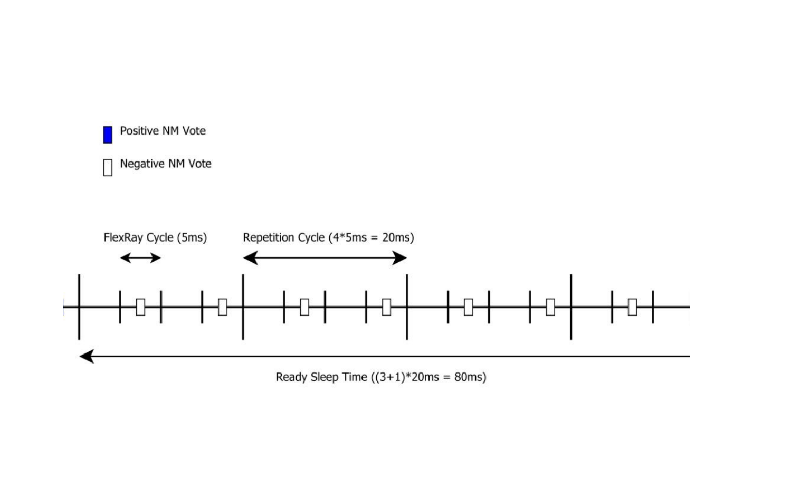

图7.1：向总线睡眠的转换（**Figure 7.1: Transition To BusSleep**）

**AUTOSAR FlexRay NM** 状态机应包含 **AUTOSAR FlexRay NM** 协调算法所需的全部状态、转换和触发器（从 NM 集群中单个节点的视角来看）。

**AUTOSAR FlexRay NM** 状态机中的转换应由对选定接口函数的调用或内部定时器/计数器的超时来触发。

FrNm 模块应使 FlexRay NM 状态机中的状态变化与 FlexRay 周期性调度同步。

基本原理：FlexRay NM 算法基于这样一个事实：所有参与 FlexRay NM 的 **ECU** 都同步到一个全局时间（基于其通信方案的周期性重复，即所谓的循环（Cycle）——参见 [\[7\]](#ref-7)）。为了防止 **ECU** 的不对称行为（例如只有一部分 **ECU** 进入睡眠模式，而其余部分保持唤醒），FlexRay NM 将状态变化与 NM 重复循环对齐，而 NM 重复循环又与基本的 FlexRay 通信循环对齐，从而保证 NM 集群中所有 **ECU** 上的 NM 状态机行为同步。

注意：第 [6.7.2](#672-flexray-nm-主函数的执行) 节描述了实现如何满足上述同步要求。

FrNm 模块的实现者应将与 FlexRay NM 协调算法相关的实现做到处理器无关，这意味着 FlexRay NM 协调算法不得依赖任何处理器特定的硬件支持，因而应可在 **AUTOSAR** 范围内的任何处理器架构上实现。

### 6.2. 运行模式

本章详细描述 **AUTOSAR FlexRay NM** 协调算法的运行模式。图7.2展示了 FlexRay NM 的详细 UML 状态图。

**AUTOSAR FrNm** 应由三种运行模式组成：

* 总线睡眠模式（Bus-Sleep Mode）
* 同步模式（Synchronize Mode）
* 网络模式（Network Mode）

**AUTOSAR FrNm** 运行模式的变化应由 FrNm 模块通过调用回调函数 Nm_StateChangeNotification 通知给通用 NM 接口模块。

#### 6.2.1. 总线睡眠模式

总线睡眠模式是 FrNm 状态机初始化之后的默认模式，除非 NM 被启动（通过被动启动请求或网络请求）或 **CPU** 断电，否则它保持在该模式。

在总线睡眠模式中，通信控制器可以切换到睡眠模式，此时唤醒检测机制被激活，功耗降低到最小水平。相应的功能（关闭 FlexRay、**CPU** 断电）将在其他模块中实现。FlexRay NM 只指示睡眠模式的就绪状态。

当进入总线睡眠模式时，FlexRay NM 应通过调用 Nm_StateChangeNotification 通知通用网络管理接口——但在初始化期间默认进入总线睡眠模式的情况除外。

注意：FlexRay NM 将经由通用 NM 接口（宏适配层）通知 **ComM**。该通知是一个可选接口。

当进入总线睡眠模式时（初始化时的默认进入除外），FrNm 模块应通过调用回调函数 Nm_BusSleepMode 通知上层。

当 FrNm 模块进入总线睡眠模式时，该模块应停用 NM 数据和 NM 投票两者的发送。

当 FrNm 模块成功接收到一个正向 NM 投票、且当前处于总线睡眠模式时，它应通过 NmIf 模块调用 Nm_NetworkStartIndication 通知 **ComM**。

基本原理：需要上述规定以避免网络管理与模式管理之间的竞态条件和状态不一致。总线睡眠模式中的 NM 消息接收处理取决于 **ECU** 关机/启动过程的当前状态。

注意：FlexRay NM 将经由通用 NM 接口（宏适配层）通知 **ComM**。

如果通用 NM 接口调用了 [FrNm_NetworkRequest](#733-frnm_networkrequest)，则应离开总线睡眠模式并进入同步模式。

如果通用 NM 接口调用了 [FrNm_PassiveStartUp](#732-frnm_passivestartup)，则应离开总线睡眠模式并进入同步模式。

#### 6.2.2. 同步模式

在同步模式中，FrNm 状态机等待与 FrNm 重复循环同步。这是必要的，因为 FlexRay NM 依赖于状态变化在整个 NM 集群范围内保持同步。

FrNm 模块应在两个 NM 重复循环之间的第一个边界处离开同步模式并进入网络模式。

当 FrNm 模块进入同步模式时，它应停用 NM 数据的发送并停用 NM 投票的发送。

如果 FlexRay NM 处于同步状态且 FlexRay NM 接收到 [FrNm_StartupError](#7315-frnm_startuperror) 指示、并且网络已被请求，则 FlexRay NM 应保持在同步状态。

如果 FlexRay NM 处于同步状态且 FlexRay NM 接收到 [FrNm_StartupError](#7315-frnm_startuperror) 指示、并且网络已被释放，则 FlexRay NM 应执行向总线睡眠状态的转换。

当 FrNm 模块进入同步模式后，它应通过调用 Nm_SynchronizeMode 通知通用 NM 接口模块。

#### 6.2.3. 网络模式

FrNm 模块的网络模式应由三个内部状态组成：

* Repeat Message 状态
* 正常运行状态（Normal Operation State）
* Ready Sleep 状态

FrNm 模块应将进入网络模式的所有状态变化以及网络模式内部的所有状态变化与两个 NM 重复循环之间的边界同步。

基本原理：FlexRay NM 定义一定数量的 FlexRay 循环作为 NM 重复循环，以提高 NM 投票发送的可靠性。在一个 NM 重复循环内，NM 不允许改变其 NM 投票。详情参见第 [6.9](#69-调度细节) 节。

进入网络模式状态时，FlexRay 网络管理应首先进入内部子状态 Repeat Message 状态。

当 FrNm 模块已进入网络模式后，它应通过调用 Nm_NetworkMode 通知通用 NM 接口模块。

当调用函数 [FrNm_Init](#731-frnm_init) 时，FrNm 模块应立即离开网络模式。

如果在 FrNmDynamicPncToChannelMappingEnabled 设置为 TRUE 的信道上调用函数 [FrNm_PnLearningRequest](#7320-frnm_pnlearningrequest)、且 FrNm 处于网络模式，则 FrNm 模块应在该信道上将 CBV 中的重复消息位和部分网络学习位（Partial Network Learning Bit）置为 1，并在一个 NM 重复循环结束时改变到 Repeat Message 状态或重新启动 Repeat Message 状态。

如果在一个 FrNmDynamicPncToChannelMappingEnabled 设置为 TRUE 的信道上同时接收到部分网络学习位和重复消息请求位、且 FrNm 处于网络模式，则 FrNm 模块应在该信道上将 CBV 中的部分网络学习位置为 1，并在一个 NM 重复循环结束时改变到 Repeat Message 状态或重新启动 Repeat Message 状态。

注意：上述两条中的「重新启动」是指 FrNm 已经处于 Repeat Message 状态，然后必须再完整地重新进入一次 Repeat Message 状态。

##### 6.2.3.1. Repeat Message 状态

对于未配置为被动的节点，Repeat Message 状态确保从总线睡眠到网络模式的任何转换对网络上的其他节点可见。此外，它确保任何节点至少在一段最短时间内保持活动。可选地，它还可用于在位节点的检测（说明参见第 [6.8.3](#683-节点检测可选) 节）。

当 FrNm 模块进入 Repeat Message 状态时，如果该节点被配置为发送 NM 数据，则它应激活 NM 数据的发送；并且如果该节点被配置为允许投票，则该节点应投票让集群保持唤醒。

当 FrNm 模块进入 Repeat Message 状态时，它应启动 NM 重复消息定时器（时间由参数 FrNmRepeatMessageTime 配置）。

如果 NM 重复消息定时器超时，FrNm 模块应离开 Repeat Message 状态。在此转换期间，它应清除重复消息请求位。

注意：该转换发生在重复循环边界处，因为 FrNmRepeatMessageTime 是一个重复循环的整数倍。

当 FlexRay NM 模块离开 Repeat Message 状态时，如果网络已被请求，它应进入正常运行状态。

当 FlexRay NM 模块离开 Repeat Message 状态时，如果网络已被释放，它应进入 Ready Sleep 状态。

如果 FlexRay NM 处于 Repeat Message 状态且无法获取全局时间，则 FlexRay NM 应执行向同步状态的转换。

如果 FrNmDynamicPncToChannelMappingEnabled 设置为 TRUE，则 FrNm 在离开 Repeat Message 状态时应清除部分网络学习位。

##### 6.2.3.2. 正常运行状态

正常运行状态确保只要网络被请求，任何节点都能让 NM 集群保持唤醒。

注意：如果节点被配置为「被动节点」，则不会到达该状态。对于这样的节点，由实现决定如何优化该状态并移除与该状态对应的代码。

当 FrNm 模块进入正常运行状态时，它应激活 NM 数据的发送，并且该节点应投票让集群保持唤醒（发送「正向」NM 投票）。

如果 FrNmNodeDetectionEnabled 设置为 TRUE，则当重复消息请求处于激活状态时，FlexRay NM 模块应在一个 NM 重复循环结束时离开正常运行状态并进入 Repeat Message 状态。在此转换期间，如果重复消息请求是因调用 [FrNm_RepeatMessageRequest](#738-frnm_repeatmessagerequest) 而激活的，则它应置位重复消息请求位。

如果没有重复消息请求处于激活状态、网络已被释放、且一个重复循环已经完成，则 FlexRay NM 模块应离开正常运行状态并进入 Ready Sleep 状态。

如果 FlexRay NM 处于正常运行状态且 FlexRay NM 无法获取全局时间，则 FlexRay NM 应执行向同步状态的转换。

##### 6.2.3.3. Ready Sleep 状态

Ready Sleep 状态确保 NM 集群中的任何节点在任何一个其他节点让 NM 集群保持唤醒期间，等待向总线睡眠模式的转换。

当 FrNm 模块进入 Ready Sleep 状态时，它应停用 NM 数据的发送，并应发送负向 NM 投票。

注意：如果被动模式被禁用，在某些情况下必须在 Ready Sleep 状态中发送 NM PDU 以保证网络中的同步关闭，例如 PN 关闭消息的重传。

FlexRay NM 模块应在没有任何正向 NM 投票的 FrNmReadySleepCnt + 1 个 NM 重复循环结束时离开 Ready Sleep 状态（和网络模式）并进入总线睡眠模式。

如果 FrNmNodeDetectionEnabled 设置为 TRUE，则当重复消息请求处于激活状态且 Ready Sleep 时间尚未超时时，FlexRay NM 模块应在一个 NM 重复循环结束时离开 Ready Sleep 状态并进入 Repeat Message 状态。在此转换期间，如果重复消息请求是因调用 [FrNm_RepeatMessageRequest](#738-frnm_repeatmessagerequest) 而激活的，则它应置位重复消息请求位。

如果 Ready Sleep 时间尚未超时、没有重复消息请求处于激活状态、且网络已被请求，则 FlexRay NM 模块应在一个 NM 重复循环结束时离开 Ready Sleep 状态并进入正常运行状态。

注意：在 Ready Sleep 状态中，因即将进入睡眠的最后一个重复循环内（参见前述规定），保持网络唤醒的本地请求（即网络请求）将被忽略。

如果 FlexRay NM 处于 Ready Sleep 状态、配置参数 FrNmCycleCounterEmulation 设置为 FALSE、无法获取全局时间且网络再次被请求，则 FlexRay NM 应执行向同步状态的转换。

如果 FlexRay NM 处于 Ready Sleep 状态、配置参数 FrNmCycleCounterEmulation 设置为 FALSE、网络仍未被请求且接收到 [FrNm_StartupError](#7315-frnm_startuperror)，则 FlexRay NM 应执行向总线睡眠状态的转换。

如果 FlexRay NM 进入 Ready Sleep 状态且配置参数 FrNmCycleCounterEmulation 设置为 TRUE，则 FlexRay NM 应提供一种独立于全局时间来检测重复循环结束的机制。

注意：上述机制可以例如通过持续时间等于一个重复循环的定时器或计数器来满足。只要能够获取全局时间，该定时器或计数器就可以同步到精确的时序。

如果 FlexRay NM 处于 Ready Sleep 状态、配置参数 FrNmCycleCounterEmulation 设置为 TRUE 且无法获取 FlexRay 全局时间，则每当到达仿真重复循环的结束点时，FlexRay NM 应将其计为一个没有任何正向投票的 NM 重复循环。如果 FlexRay NM 计满了 FrNmReadySleepCnt 加一个没有任何正向 NM 投票的 NM 重复循环，则 FlexRay NM 应执行向总线睡眠状态的转换。

### 6.3. 网络状态

网络状态（即「已请求（requested）」和「已释放（released）」）是平行于前述状态机（参见第 [6.4](#64-uml-状态图) 节）存在的另外两个「**AUTOSAR FlexRay NM** 状态机的状态」。

网络状态区分软件组件是否需要在总线上通信（此时网络状态为「已请求」）或不需要（此时网络状态为「已释放」）。注意：如果网络被释放，**ECU** 仍可能进行通信，因为至少还有一个其他 **ECU** 仍在请求网络。

这些网络状态反映了上层（例如 **ComM**）对保持总线唤醒（网络已请求）或不保持（网络已释放）的需求。

### 6.4. UML 状态图

该图展示了相对于 **API** 规范的 UML 状态图。

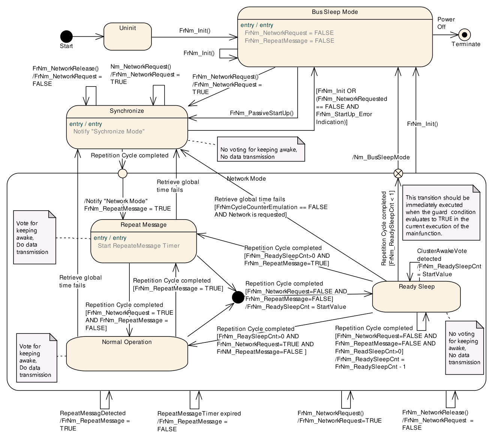

图7.2：UML 状态图（**Figure 7.2: UML State Chart**）

### 6.5. 初始化和启动

FrNm 模块应将初始化状态存储在一个私有变量中。

注意：FrNm 模块的环境应在相应的 FlexRay 接口初始化之后、且在调用任何其他 FlexRay NM 服务之前初始化 FrNm 模块。

FlexRay NM 应在初始化之后将标志 [FrNm_NetworkRequest](#733-frnm_networkrequest) 置为 FALSE 并进入总线睡眠模式。

在初始化期间，FrNm 模块应将用户数据的每个字节设置为 0xFF。

在初始化期间，FrNm 模块应将控制位向量设置为 0x00。

在初始化期间，如果 FrNmPnEnabled 为 TRUE，FrNm 模块应将 PNC 位向量的每个字节设置为 0x00。

注意：FrNm 不支持 PN 关闭消息的重传（例如 CanNm 支持该功能），因为 FlexRay 上的 NM 消息以较短的周期发送。初始化时，控制位向量被设置为 0x00，其中包括 PNSR 位（PNSR 位置为「0」== PN 关闭消息的发送被停用）。PNSR 位的设置由 [FrNm_ActivateTxPnShutdownMsg](#7321-frnm_activatetxpnshutdownmsg) 和 [FrNm_DeactivateTxPnShutdownMsg](#7322-frnm_deactivatetxpnshutdownmsg) 控制。不需要像 CanNm 那样的额外需求。

### 6.6. 通信

FlexRay NM 使用 NM 消息提供信息交换机制以协调关闭。这些消息按照每个 **ECU** 内配置的、并在 NM 集群内协调的调度进行发送。

#### 6.6.1. 一般需求

应为每个节点配置 FrIf，以接收所有未被 FlexRay 控制器聚合的 NM 投票消息。

注意：FlexRay 支持一种称为网络管理向量（Network Management Vector）的 NM 数据自动聚合机制（参见 FlexRay 协议规范 [\[7\]](#ref-7) 第 9.3.3.4 节「网络管理服务」，第 209 页）。

FlexRay 控制器通过在通信循环静态段内选定的、启用了网络管理的帧中交换 NM 向量来计算该 NM 向量。每个节点都可以被配置为在其一个发送时隙中发送一个 NM 向量。

FlexRay 通信控制器通过对每个接收到的网络管理向量（无论该帧是否被订阅到接收缓冲区）执行按位或运算，在整个通信循环期间维护一个聚合的网络管理向量。

这种方法是一种无需 **CPU** 参与即可从网络节点接收 NM 向量的强大方式，但要求（参与网络管理的）每个节点在静态段中至少有一个发送时隙。

FlexRay NM 的决策应受到每个接收到的 NM 投票以及 FlexRay 控制器聚合的每个 NM 投票的影响。

FlexRay NM 消息应只包含 NM 投票、NM 数据或两者。

FrNm 模块应能够分别发送 NM 数据和 NM 投票。

基本原理：FlexRay 的投票算法保持独立于 NM 数据的发送，因为 FlexRay 协议为发送和接收 NM 投票提供了硬件支持（参见 [\[7\]](#ref-7)）。为了利用该特性并提高 NM 投票的更新速率（相对于 NM 数据的更新速率），NM 数据和 NM 投票的发送可以分离。

应可以通过配置参数 FrNmPduScheduleVariant 配置 FrNm 模块识别哪些 NM 消息发送格式（NM 数据、NM 投票以及组合的 NM 数据/投票格式）。

基本原理：FrNm 模块必须能够接收并处理 FlexRay 总线上的 NM 消息。为了优化 NM 的资源需求，必须可配置 NM 支持哪些格式，以避免「未使用」格式的开销。

如果节点未被配置为「被动（Passive）」，则每个 FlexRay NM 节点都应能够发送 FlexRay 总线调度（静态段或动态段）中的 NM 投票。

注意：实际的 FlexRay 调度配置由 FrIf 配置负责。该需求是要规定 FrNm 将支持这样的配置。

在每个 FlexRay NM 节点中，应可以通过配置参数 FrNmHwVoteEnable 独立地配置为使用 FlexRay NM 硬件支持来接收在静态段中发送的 NM 投票。

每个 FlexRay NM 节点都应能够在静态时隙或动态时隙中发送 NM 数据。

注意：实际的 FlexRay 调度配置由 FrIf 和 FrDv 配置负责。该需求规定 FrNm 支持这样的配置。

尽管可以使用多个 FlexRay 时隙来发送 NM 数据，但只应使用一个时隙，以限制从不同节点接收 NM 数据所需的 FlexRay 缓冲区数量。

当使用来自 FlexRay CC 的 NM 向量硬件服务时，应使用 FrIf_GetNmVector 来检索聚合的 NM 向量。

基本原理：FlexRay NM 必须能够在失去同步之后进入总线睡眠状态。

#### 6.6.2. FlexRay NM-PDU 格式

如前文所述，FlexRay NM 能够独立发送 NM 投票和 NM 数据。因此 NM 投票和 NM 数据存在多种相应的 PDU 格式。为了在静态段中同时支持 NM 投票和 NM 数据的关联发送，NM 数据 PDU 包含一个可选的投票位。

##### 6.6.2.1. FlexRay NM-Data PDU 格式

下表以 8 字节 PDU 长度为例展示了网络管理 PDU 的格式，其中控制位向量位于第一个字节，源节点标识符位于第二个字节，使用了用户数据且启用了部分网络。用户数据范围位于系统字节与 PNC 位向量之间。

表7.1：FlexRay NM-Data PDU 格式（**FlexRay NM-Data PDU Format**）

| 字节 | 位 7 | 位 6 | 位 5 | 位 4 | 位 3 | 位 2 | 位 1 | 位 0 |
| --- | --- | --- | --- | --- | --- | --- | --- | --- |
| 字节 0 | 置为「0」 | 控制位向量 | 控制位向量 | 控制位向量 | 控制位向量 | 控制位向量 | 控制位向量 | 控制位向量 |
| 字节 1 | 源节点标识符 | 源节点标识符 | 源节点标识符 | 源节点标识符 | 源节点标识符 | 源节点标识符 | 源节点标识符 | 源节点标识符 |
| 字节 2 | 用户数据 0 | 用户数据 0 | 用户数据 0 | 用户数据 0 | 用户数据 0 | 用户数据 0 | 用户数据 0 | 用户数据 0 |
| 字节 3 | 用户数据 1 | 用户数据 1 | 用户数据 1 | 用户数据 1 | 用户数据 1 | 用户数据 1 | 用户数据 1 | 用户数据 1 |
| 字节 4 | PNC 位向量 - 字节 0 | PNC 位向量 - 字节 0 | PNC 位向量 - 字节 0 | PNC 位向量 - 字节 0 | PNC 位向量 - 字节 0 | PNC 位向量 - 字节 0 | PNC 位向量 - 字节 0 | PNC 位向量 - 字节 0 |
| 字节 5 | PNC 位向量 - 字节 1 | PNC 位向量 - 字节 1 | PNC 位向量 - 字节 1 | PNC 位向量 - 字节 1 | PNC 位向量 - 字节 1 | PNC 位向量 - 字节 1 | PNC 位向量 - 字节 1 | PNC 位向量 - 字节 1 |
| 字节 6 | PNC 位向量 - 字节 2 | PNC 位向量 - 字节 2 | PNC 位向量 - 字节 2 | PNC 位向量 - 字节 2 | PNC 位向量 - 字节 2 | PNC 位向量 - 字节 2 | PNC 位向量 - 字节 2 | PNC 位向量 - 字节 2 |
| 字节 7 | PNC 位向量 - 字节 3 | PNC 位向量 - 字节 3 | PNC 位向量 - 字节 3 | PNC 位向量 - 字节 3 | PNC 位向量 - 字节 3 | PNC 位向量 - 字节 3 | PNC 位向量 - 字节 3 | PNC 位向量 - 字节 3 |

注意：

* 在 FrNm 中控制位向量是必需的，因此不可配置。
* NM-PDU 的长度由「全局」**ECUC** 模块中的 PduLength 参数 [EcuC003\_Conf] 定义（参见 ECU 配置规范）。

FrNm 模块对源节点标识符的支持应可通过配置参数 FrNmSourceNodeIdentifierEnabled 在预编译时进行配置。

注意：将 FrNmSourceNodeIdentifierEnabled 设置为 FALSE 意味着 NM PDU 中不占用源节点标识符的空间。因此可以多出一个字节用于用户数据或 PNC 位向量。

未分配给 NM 系统字节或 PNC 位向量的剩余字节应用于用户数据。

注意：根据 [\[8\]](#ref-8)（[TPS\_SYST\_03069]、[TPS\_SYST\_03070]、[TPS\_SYST\_03071]、[TPS\_SYST\_03072]），用户数据的使用和位置是可配置的。如果使用用户数据，则用户数据被放置在 NM-PDU 的 PduLength 之内，且不与系统字节或 PNC 位向量的范围重叠。如果启用了部分网络功能（FrNmPnEnabled 设置为 TRUE）且使用了用户数据，则用户数据范围要么独占地位于系统字节与 PNC 位向量之间，要么独占地位于 PNC 位向量与 NM-PDU 末尾之间。用户数据范围的长度应按照以下限制计算：

* 如果用户数据范围位于系统字节与 PNC 位向量之间，则用户数据范围的长度由 PNC 位向量偏移与系统字节长度之差确定。
* 如果用户数据范围位于 PNC 位向量与 NM-PDU 末尾之间，则用户数据范围的长度由 NM-PDU 长度与 PNC 位向量最后一个字节的位置/索引（由 PNC 位偏移 + PNC 位向量长度定义）之差确定。

如果禁用了部分网络功能（FrNmPnEnabled 设置为 FALSE）且使用了用户数据，则用户数据范围由 NM-PDU 长度与系统字节长度之差确定。

表7.2：控制位向量格式（**Control Bit Vector Format**）

| 字节 | 位 7 | 位 6 | 位 5 | 位 4 | 位 3 | 位 2 | 位 1 | 位 0 |
| --- | --- | --- | --- | --- | --- | --- | --- | --- |
| 字节 0 | 保留 | 部分网络信息位 | 部分网络学习位 | 主动唤醒位 | NM 协调器睡眠就绪 | 保留 | PN 关闭请求位 | RptMsgRequest |

FrNm 模块的 NM-Data PDU 控制位向量格式应按照本表中的描述定义。

注意：位 1 和位 2 在 R3.2 中曾用作 NM 协调器 ID（低位）。

FrNm 模块的控制位向量应由以下内容构成：

位 0 重复消息请求位（RptMsgRequest）：

* 0：未请求 Repeat Message 状态
* 1：请求了 Repeat Message 状态

位 1 PN 关闭请求位（PNSR）：

* 0：NM 消息不包含同步的部分网络关闭请求
* 1：NM 消息包含针对至少一个 PNC 的同步部分网络关闭请求

位 3 NM 协调器睡眠就绪位：

* 0：NM 集群尚未准备好睡眠
* 1：NM 集群已准备好睡眠（NM 集群的所有节点都已准备好睡眠）

位 4 主动唤醒位：

* 0：节点尚未唤醒网络
* 1：节点已唤醒网络

位 5 部分网络学习位（PNL）：

* 0：未请求 PNC 学习
* 1：请求了 PNC 学习

位 6 部分网络信息位（PNI）：

* 0：NM 消息不包含部分网络请求信息
* 1：NM 消息包含部分网络请求信息

位 2、位 7 保留用于未来的扩展。

* 0：禁用 / 保留用于未来的使用。

FrNm 模块应将控制位向量的保留位置为 0b。

##### 6.6.2.2. FlexRay NM-Vote PDU 格式

表7.3：NM-Vote PDU 格式（**NM-Vote PDU Format**）

| 字节 | 位 7 | 位 6 | 位 5 | 位 4 | 位 3 | 位 2 | 位 1 | 位 0 |
| --- | --- | --- | --- | --- | --- | --- | --- | --- |
| 字节 0 | Vote | 置为「0」 | | | | | | |

FrNm 模块的 NM-Vote PDU 格式应按照本表中的描述定义。

FrNm 模块的 NM-Vote PDU 格式应包含一个具有以下含义的投票位（Vote）：

* 0：投票反对保持唤醒
* 1：投票赞成保持唤醒

注意：在动态段中发送 NM 投票（组合或单独）的情况下，不需要投票位，因为 NM PDU 的存在本身就已足够。因此在动态段内没有必要置位投票位。

##### 6.6.2.3. NM-PDU 的组合

当 NM 投票和 NM 数据组合在一个 PDU 中时（参见第 [6.9](#69-调度细节) 节），NM 投票的内容将与 NM 数据的控制位向量（CBV）字节的内容组合，如下面表7.4所示。以下需求规定了这种组合。

表7.4：组合的 NM-Vote 与 NM-Data CBV 格式（**Combined NM-Vote and NM-Data CBV Format**）

| | 位 7 | 位 6 | 位 5 | 位 4 | 位 3 | 位 2 | 位 1 | 位 0 |
| --- | --- | --- | --- | --- | --- | --- | --- | --- |
| NM-Data PDU - CBV | 置为「0」 | 部分网络信息位 | 部分网络学习位 | 主动唤醒位 | NM 协调器睡眠就绪 | 保留 | 保留 | RptMsgRequest |
| + | + | + | + | + | + | + | + | + |
| NM-Vote PDU | Vote | 置为「0」 | | | | | | |
| = | = | = | = | = | = | = | = | = |
| 组合的 CBV 与投票 | Vote | 部分网络信息位 | 部分网络学习位 | 主动唤醒位 | NM 协调器睡眠就绪 | 保留 | 保留 | RptMsgRequest |

如果 FrNm 模块应在与 NM 数据相同的 PDU 中发送 NM 投票，则 FrNm 模块应将 NM-Vote PDU 格式与 NM-Data PDU 的控制位向量格式组合。

#### 6.6.3. FlexRay NM-PDU 的发送

FlexRay NM-PDU 的发送既可以使用解耦缓冲区访问，也可以使用立即缓冲区访问。更多细节参见 FlexRay 接口 SWS [\[9\]](#ref-9)。

#### 6.6.4. FlexRay NM-PDU 的接收

FlexRay 接收指示用于指示 FlexRay NM-PDU 的接收。更多细节参见 FlexRay 接口 SWS [\[9\]](#ref-9)。

#### 6.6.5. FrNm API 的功能需求

以下需求定义了可用的 FlexRay NM 函数。

源节点标识符的集合应可通过配置参数 FrNmNodeId 进行配置。

如果 FrNmRepeatMsgIndEnabled 设置为 TRUE 且接收到重复消息请求位置为 1 的 NM 消息，则 FrNm 模块应只在第一次调用 callout 函数 Nm_RepeatMessageIndication，直到再次离开 Repeat Message 状态。如果同时接收到部分网络学习位且其值为 1、并且 FrNmDynamicPncToChannelMappingEnabled 设置为 TRUE，则在该函数调用中参数 pnLearningBitSet 应设置为 TRUE，否则设置为 FALSE。

注意：当接收到重复消息位时，NM 将进入或重新启动 Repeat Message 状态，但这些位仍会被继续接收，因为请求方在离开 Repeat Message 状态之前会一直发送，以容忍可能的消息丢失。状态变化和 callout 只在该节点第一次接收到时才需要。

#### 6.6.6. 一般 API 需求

除 [FrNm_Init](#731-frnm_init) 之外，每个服务都只指向一个 NM 集群。

注意：「NM 集群」不得与「FlexRay 信道」的含义相混淆。前者是逻辑单元，后者是物理总线接口线路。FlexRay 为每个通信控制器提供两个信道，这些 FlexRay 信道并不相互独立，因此不应被视为独立的「NM 集群」。

开发错误不得经由 **API** 函数返回。如果发生开发错误，相应的 **API** 函数应在适用的情况下返回 **E_NOT_OK**。

生产错误不得经由 **API** 函数返回。如果发生生产错误，相应的 **API** 函数应在适用的情况下返回 **E_NOT_OK**。

如果启用了 **DET** 且 FlexRay NM **API** 服务以无效的句柄被调用，则相应的函数应向默认错误跟踪器报告 [**FRNM_E_INVALID_CHANNEL**](#6111-开发错误) 错误，并且应返回 **E_NOT_OK**。

注意：如果网络句柄不同于允许的已配置值，则该网络句柄无效。

当向 FrNm 服务传入了空指针时，被调用的函数不得执行，并且应在适用的情况下向调用函数返回 **E_NOT_OK**。如果启用了开发错误检测（FrNmDevErrorDetect 设置为 TRUE），则应向 **DET** 报告相应的错误 [**FRNM_E_PARAM_POINTER**](#6111-开发错误)。

### 6.7. 执行

FlexRay NM 状态机以及 FlexRay NM 主函数的调用必须与 FlexRay 通信调度同步。FlexRay NM 的决策和状态变化必须与 FlexRay 通信循环对齐。为了保证 FrNm 的状态变化和决策同步，FlexRay NM 主函数（FrNm_MainFunction_&lt;[FrNmChannel](#926-frnmchannel).ShortName&gt;）必须在如图7.3所示的特定时间窗口内执行。该窗口的边界一侧由当前循环的所有 NM 投票（以及节点检测启用时的重复消息位）的可用性定义，另一侧由必须发送自身 NM 投票（下一循环的）的最晚时间点定义。

由于 FlexRay 循环的相对时间可能因 FlexRay 时钟速率校正而变化，且 FlexRay NM 算法依赖于与 FlexRay 网络的同步，因此不建议使用 **CPU** 时间服务。取而代之，这可以（例如）通过使用与全局（FlexRay）时间同步的 **AUTOSAR OS** 调度表（Schedule Table）来实现。

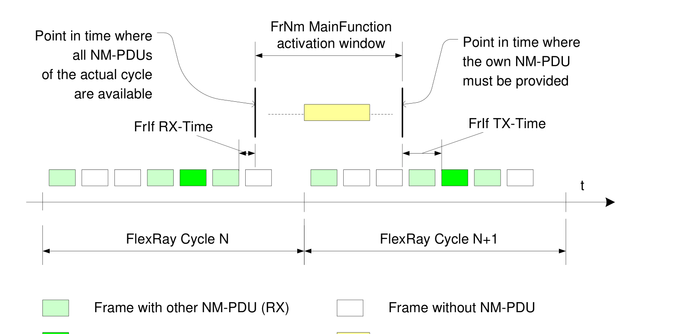

图7.3：FlexRay NM 主函数执行（**Figure 7.3: FlexRay NM Mainfunction Execution**）

注意：标记为 FrIf RX-Time 的持续时间是指从 FlexRay 帧发送结束到 FlexRay 接口（FrIf）调用 [FrNm_RxIndication](#741-frnm_rxindication) 之间的时间。标记为 FrIf TX-Time 的持续时间是指从 FrNm 调用 FrIf_Transmit 到相应帧开始发送之间的时间。

#### 6.7.1. FlexRay NM 主函数结构

FlexRay NM 主函数承载 FlexRay NM 的「自动化」功能——即 NM 消息的周期性发送、已接收 NM 消息的处理以及 FlexRay NM 状态机的周期性处理（在两个 NM 重复循环之间的边界处）。

如果循环 NM 消息的发送已经启动，则 FrNm 模块应调用 FlexRay 接口函数 FrIf_Transmit 来发送 NM 投票和 NM 数据。

注意：当 NM 消息被成功发送、且 FlexRay 接口内支持并配置了发送确认时，FlexRay 接口模块应以 **E_OK** 调用 FrNm 模块的函数 [FrNm_TxConfirmation](#743-frnm_txconfirmation)。

注意：当接收到 NM 消息时，FlexRay 接口模块应调用 FrNm 模块的函数 [FrNm_RxIndication](#741-frnm_rxindication)。至于 FrNm 模块如何处理 NM 消息中的数据由实现决定。它可以被立即处理（以减少内存消耗），也可以被存储起来以供后续处理（以减少计算时间）。

FrNm 模块应通过 **API** FrIf_GetGlobalTime() 检索当前的 FlexRay 通信循环。

#### 6.7.2. FlexRay NM 主函数的执行

注意：FlexRay NM 模块的集成者应定义一个调度，使 FlexRay NM 主函数同步于 FlexRay 通信循环被激活。

注意：FrNm 模块的环境（SchM[^2]）应在图7.3描绘的时间窗口内、且在 FlexRay 全局时间可用时，至少每个 FlexRay 通信循环一次、同步于 FlexRay 全局时间地执行 FlexRay NM 主函数（FrNm_MainFunction_&lt;[FrNmChannel](#926-frnmchannel).ShortName&gt;）。FlexRay NM 主函数的执行不得跨越 FlexRay 循环边界。即使 FlexRay 全局时间不再可用，FlexRay NM 主函数也应周期性地执行。FlexRay NM 主函数的周期在 SchM 配置中配置，该配置必须与 FrNmMainFunctionPeriod 配置参数的值一致。

[^2]: RTE 模块的一部分

基本原理：这是必要的，因为 FlexRay NM 状态变化可能影响后续循环中是否应发送 NM 投票 PDU。由于状态变化受给定循环中聚合 NM 投票的影响，而状态变化又反过来影响 NM 投票，因此 FlexRay NM 主函数必须在一个由循环结束和 NM 投票 PDU 发送时隙所限定的时间窗口内执行。

注意：**AUTOSAR OS** [\[10\]](#ref-10) 提供了可与全局时间同步的调度表（Schedule Tables）方法。这些方法可用于满足 FlexRay NM 的执行需求。AUTOSAR FlexRay NM 应尽可能使用第二个绝对定时器，因为 FlexRay NM 对第一个绝对定时器的访问与 FlexRay 接口作业列表执行函数对第一个绝对定时器的访问之间可能出现竞态条件。

状态机的守护条件、转换、条件和动作在 FrNm_MainFunction_&lt;[FrNmChannel](#926-frnmchannel).ShortName&gt; 的每次执行中至多求值一次。

FlexRay NM 模块应提供一个名为 FrNmMainAcrossFrCycle 的配置参数，用于选择调整 FlexRay NM 主函数的行为以适应 FlexRay NM 主函数被执行的时间点。

注意：如果 FlexRay NM 向量只在一个 FlexRay 循环结束时才可用，则求值将在下一个 FlexRay 循环中进行。——这取决于 FlexRay 通信控制器硬件的配置和实现。

RepetitionCycleCompleted 条件的求值以及由此产生的 RepetitionCycleCompleted 事件（见图7.1）的生成应遵循以下规则：

1. 如果 FrNmMainAcrossFrCycle 设置为 FALSE，则 RepetitionCycleCompleted 事件应在重复循环的最后一个 FlexRay 通信循环中、在接收到所有投票之后生成。
2. 如果 FrNmMainAcrossFrCycle 设置为 TRUE，则如果在发送任何投票之前、自上一次调用 FlexRay NM 主函数执行以来已经跨越了一个重复循环边界，则应生成 RepetitionCycleCompleted 事件。

情况 1) 的示例：如果投票被调度在循环 1 和 2 中，且重复循环周期为 4 个 FlexRay 通信循环，则 RepetitionCycleCompleted 事件可以（仅一次）在循环 3、7、11、15 等期间的任何时间生成。

情况 2) 的示例：如果投票被调度在循环 1 和 2 中，且重复循环周期为 4 个 FlexRay 通信循环，则 RepetitionCycleCompleted 可以（仅一次）在循环 0、4、8、12、16 等期间的任何时间生成。

注意：CycleNumber 表示 FlexRay 通信循环编号，其取值为 0 到 63 之间的整数。RepetitionCycleLength 是一个 NM 重复循环内的通信循环数量。FlexRay「CycleEnd」事件是在两个连续 FlexRay 通信循环的边界处生成的事件。

### 6.8. 附加特性

#### 6.8.1. 集群规模

**AUTOSAR FlexRay NM** 算法应支持每个 NM 集群最多 64 个节点。

注意：**AUTOSAR FlexRay NM** 算法可以支持每个 NM 集群任意数量的节点（甚至多于每个 FlexRay 集群最多 64 个节点的上限）。该上限只是配置问题，因为该上限不是固定的，它取决于为 **AUTOSAR FlexRay NM** 协调算法配置的响应时间、容错性和 resulting 总线负载之间的权衡。

#### 6.8.2. 远程睡眠指示的检测（可选）

「远程睡眠指示（Remote Sleep Indication）」表明这样一种情形：某个节点检测到所有其他节点都已准备好睡眠，但发生该指示的节点仍在让总线保持唤醒。

FrNm 模块对远程睡眠指示的检测应可通过配置参数 FrNmRemoteSleepIndicationEnabled 在预编译时进行配置。

注意：如果节点被配置为被动模式，则不得使用远程睡眠指示，因为该节点无法投票，因此不可能成为唯一让 NM 集群保持唤醒的节点。因而远程睡眠指示根本不会发生。

如果在正常运行状态中、在由 FrNmRemoteSleepIndTime 确定的可配置时间内没有接收到包含保持总线唤醒指示的 NM 消息，则 NM 应通过调用 Nm_RemoteSleepIndication 向通用 NM 接口模块通知集群中所有其他节点都已准备好睡眠（即「远程睡眠指示」）。

当不处于网络模式时，FrNm 模块应拒绝远程睡眠指示的检查（[FrNm_CheckRemoteSleepIndication](#7312-frnm_checkremotesleepindication)）。当不处于网络模式时，函数 [FrNm_CheckRemoteSleepIndication](#7312-frnm_checkremotesleepindication) 应立即返回 **E_NOT_OK**，并且不执行任何功能。

如果 FrNm 模块先前已经检测到远程睡眠指示，并且在正常运行状态或 Ready Sleep 状态中接收到了包含保持总线唤醒指示的 NM 消息，则 NM 应通过调用 Nm_RemoteSleepCancellation 向通用 NM 接口模块通知集群中某些节点不再准备好睡眠（即「远程睡眠取消」）。远程睡眠取消需要在接收到让网络保持唤醒的投票后尽快提供。

注意：具体而言，不应将其推迟到重复循环边界结束。

如果先前已检测到远程睡眠指示，且 FrNm 从正常运行状态或 Ready Sleep 状态进入 Repeat Message 状态，则 NM 应通过调用 Nm_RemoteSleepCancellation 向通用 NM 接口模块通知集群中某些节点不再准备好睡眠（即「远程睡眠取消」）。

注意：在 FrNmRemoteSleepIndTime = FrNmRepetitionCycle 的情况下，NM 可能在同一个重复循环内调用 [RemoteSleepIndication](#7634-remotesleepindication)() 和 [RemoteSleepCancellation](#7633-remotesleepcancellation)()。这不会影响任何外部行为，因为 NM 不改变 NM 模式。因此，FrNmRemoteSleepIndTime 应大于一个 FrNmRepetitionCycle，以确保考虑到所有可能的投票。

为了支持 NmIf 模块中的 NM 协调算法，仅在重复循环边界处、当 FrNm 模块处于网络模式、且配置参数 FrNmSynchronizationPointEnabled 设置为 TRUE 时，才向 NmIf 模块提供指示 Nm_SynchronizationPoint。

仅当 FrNmRemoteSleepIndicationEnabled 设置为 TRUE 时，才允许将 FrNmSynchronizationPointEnabled 设置为 true。

#### 6.8.3. 节点检测（可选）

启用了节点检测特性的节点会在 Repeat Message 状态（参见第 [6.2.3.1](#6231-repeat-message-状态) 节）或正常运行状态中，在总线上发送标识数据（NMData PDU）（参见第 [6.6.2](#662-flexray-nm-pdu-格式) 节）。这些数据可以由其他节点使用 [FrNm_GetNodeIdentifier](#739-frnm_getnodeidentifier) 函数接收。

节点可以通过反复调用上述函数来识别（检测）FlexRay 总线上的节点。

为确保所有（被配置为这样做的）节点都发送其标识数据，可以使用 [FrNm_RepeatMessageRequest](#738-frnm_repeatmessagerequest) 将所有节点带入 Repeat Message 状态。

#### 6.8.4. 用户数据（可选）

FrNm 模块对用户数据的支持应可通过配置参数 FrNmUserDataEnabled 在预编译时进行配置。

当调用 [FrNm_SetUserData](#735-frnm_setuserdata) 时，FrNm 模块应为接下来在总线上发送的网络管理 PDU 设置网络管理用户数据。

当调用 [FrNm_GetUserData](#736-frnm_getuserdata) 时，FrNm 模块应返回最近接收到的网络管理 PDU 的网络管理用户数据。

作为使用 FrNm API 设置和获取用户数据的替代方式，FrNm 可以使用 COM 来检索其用户数据。

如果启用了 FrNmComUserDataSupport，则 API [FrNm_SetUserData](#735-frnm_setuserdata) 不可用。

如果 FrNmComUserDataSupport 设置为 TRUE 且 NM-PDU 在 FrIf 中未配置为触发发送（FrIfImmediate = TRUE），则 FrNm 应在每次请求发送相应 NM 消息之前，通过调用「PduR_FrNmTriggerTransmit」从被引用的 NM I-PDU 收集 NM 用户数据，并将用户数据与后续的 NM 字节组合。

当 PduR_FrNmTriggerTransmit() 返回 **E_NOT_OK** 时，FrNm 应将最后一次发送的值用于 NmUserData。

注意：可以通过不停止 COM 中用于 NmUserData 发送的 IPdu 来避免发送过时的 NM 数据。

如果 FrNmComUserDataSupport 设置为 TRUE，则 FrNm 应在由 FrIf 调用的消息发送确认函数「[FrNm_TxConfirmation](#743-frnm_txconfirmation)」内调用「PduR_FrNmTxConfirmation」，并传递由 FrIf 传来的结果。

如果 FrNmComUserDataSupport 设置为 TRUE，则 FrNm 的实现应提供 API [FrNm_Transmit](#7316-frnm_transmit)。[FrNm_Transmit](#7316-frnm_transmit) 应是一个任何时候都返回 **E_OK** 的空函数，因为在 FlexRay 上不可能进行额外的异步消息发送。

提示：NM 用户数据由 **SW-C** 像处理「普通信号」一样处理。即使多于一个 **SWC** 发送用户数据，用户数据的一致性也得到保证。支持 **SW-C** / **VFB** 概念的迁移。

提示：**SW-C** 发送包含用户数据的信号，RTE 将信号传播到 COM，COM 必须被配置为将一个信道的所有用户数据信号聚合到一个 IPDU 中。该 IPDU 的发送类型必须配置为「NONE」（即 COM 从不发送该信号）。

注意：本文档未定义 NM 用户数据的接收路径。

注意：用户数据的内容和结构缺乏抽象（NM 用户数据的长度和结构是 **OEM** 特定的）。

#### 6.8.5. 被动节点配置（可选）

被配置为「被动（Passive）」模式的节点只能以被动方式参与集群 NM——无法发送任何 NM 投票或 NM 数据。这样的节点只能接收 NM 投票，但不能发送让集群保持唤醒的投票。这样的被动节点永远不能（在状态机中）改变到正常运行状态。如果 **ComM** 对这样的节点调用 Nm_NetworkRequest，则属于配置错误。

被动模式配置应可通过配置参数 FrNmPassiveModeEnabled 在预编译时进行配置。

如果启用了被动模式配置，则 FrNm 模块不得使用远程睡眠指示选项。

注意：配置参数 FrNmRemoteSleepIndicationEnabled 应设置为 false。

#### 6.8.6. NM PDU 接收指示（可选）

上层可以使用可选的 PDU 接收指示来检测 FlexRay 总线上的 NM 活动（NM 投票、NM 数据或组合的 NM 数据与投票 PDU 的接收）。然而，由于可能接收到许多 NM PDU（特别是在使用静态段进行 PDU 发送时），不建议使用该服务。

NM PDU 接收指示应可通过配置参数 FrNmPduRxIndicationEnabled 在预编译时进行配置。

如果启用了 NM PDU 接收指示，则 FrNm 模块应在成功接收到 NM-PDU 时调用函数 Nm_PduRxIndication。

#### 6.8.7. 状态变化通知（可选）

可选状态变化通知服务的包含应可通过配置参数 FrNmStateChangeIndicationEnabled 在预编译时进行配置。

如果启用了可选的状态变化通知服务，则 FrNm 模块应通过调用 Nm_StateChangeNotification 将所有状态变化（初始化期间进入总线睡眠模式的情况除外）通知 NmIf 模块。

#### 6.8.8. 双 FlexRay 信道 PDU 支持（可选）

如第 [6.9](#69-调度细节) 节中更详细的描述，FlexRay NM 应支持在两条 FlexRay 信道（A 和 B）上发送和接收 PDU。对于静态段，该特性由 FrIf 支持；而对于动态段，该特性必须由 FlexRay NM 自身提供，即发送（和接收）两个 PDU（一个用于 FlexRay 信道 A，一个用于 FlexRay 信道 B）。以下需求描述了所需的功能。

FlexRay NM 的双 FlexRay 信道 PDU 支持应可通过配置参数 FrNmDualChannelPduEnable 在预编译时进行静态配置。

在某些双 FlexRay 信道拓扑中，对于 FlexRay 集群中除一个节点之外的所有节点，应禁止在 Ready Sleep 计数器到期前的倒数第二个重复循环中改变投票，即如果 Ready Sleep 计数器将要到期，单 FlexRay 信道节点发送的 NM 投票在最后一个重复循环和倒数第二个重复循环中应当相同。该行为应可通过配置参数 FrNmVotingNextToLastRepetitionCycleDisable 在预编译时进行静态配置。

基本原理：将当前策略扩展到双 FlexRay 信道配置的挑战之一是，单 FlexRay 信道节点发送的投票对相反 FlexRay 信道上的单 FlexRay 信道节点不可见。对于某些节点仅连接到一个 FlexRay 信道而某些其他节点连接到另一个 FlexRay 信道的拓扑，由于双 FlexRay 信道节点转发投票的固有延迟，可能出现可避免的竞态条件。不过，只需稍作修改即可缓解这一问题：仅在一个 FlexRay 信道上投票的节点被禁止在 Ready Sleep 计数器可能到期前的倒数第二个重复循环中改变其投票。

#### 6.8.9. 车辆唤醒（Car Wakeup，可选）

NM 消息中 CWU 位的位置应由 FrNmCarWakeUpBytePosition 和 FrNmCarWakeUpBitPosition 定义。

##### 6.8.9.1. 接收路径

如果 FrNmCwuRxEnabled 为 TRUE、FrNmCarWakeUpFilterEnabled 为 FALSE 且接收到的 NM PDU 中车辆唤醒位为「1」，则 FrNm 应调用 Nm_CarWakeUpIndication 并执行标准的接收指示处理。

如果在 Nm_CarWakeUpIndication 的上下文中调用 [FrNm_GetPduData](#737-frnm_getpdudata)，则 FrNm 应返回引发 Nm_CarWakeUpIndication 调用的那个 PDU 的 PDU 数据。

注意：需要这一点是为了使 **ECU** 能够识别车辆唤醒请求发送方的细节。

如果 FrNmCwuRxEnabled 为 TRUE、FrNmCarWakeUpFilterEnabled 为 TRUE，且接收到的 NM PDU 中车辆唤醒位为「1」、并且接收到的节点 ID 等于 FrNmCarWakeUpFilterNodeId，则 FrNm 模块应调用 Nm_CarWakeUpIndication 并执行标准的接收指示处理。

注意：车辆唤醒过滤器对于实现只考虑中央网关车辆唤醒的子网关是必要的，以避免错误的唤醒。

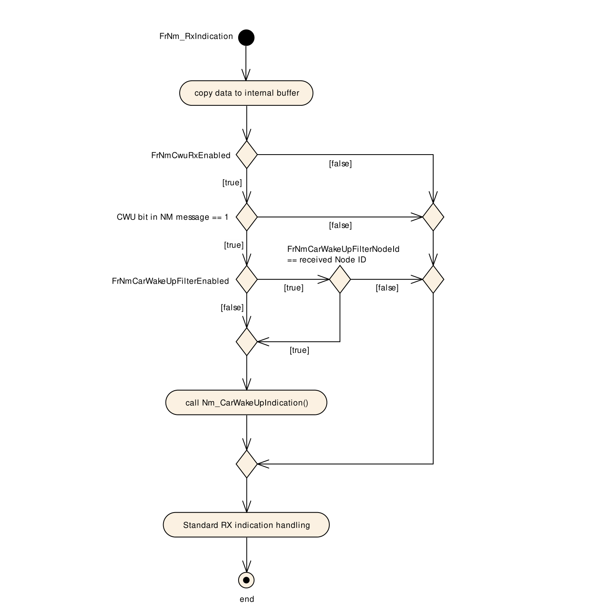

图7.5：CarWakeUp 指示处理（**Figure 7.5: CarWakeUp indication handling**）

##### 6.8.9.2. 发送路径

车辆唤醒位的发送应由应用使用 FrNm 模块提供的 NM 用户数据机制来处理。

#### 6.8.10. 协调式总线关闭（可选）

当多于一个协调器连接到同一总线时，CBV 中的一个特殊位——NmCoordinatorSleepReady 位——用于指示主协调器请求启动关闭序列。该算法的主要功能在 Nm 模块中描述。

如果 FrNm 已进入网络模式或之前调用过 Nm_CoordReadyToSleepCancellation，则它应在第一次接收到 NmCoordinatorSleepReady 位（参见 CBV）置为 1 的 NM 消息时，通过调用 Nm_CoordReadyToSleepIndication 通知 Nm。

如果 FrNm 已调用过 Nm_CoordReadyToSleepIndication 且仍处于网络模式，则它应在第一次接收到 NmCoordinatorSleepReady 位（参见 CBV）置为 0 的 NM 消息时，通过调用 Nm_CoordReadyToSleepCancellation 通知 NmIf。Nm_CoordReadyToSleepCancellation 只应在网络模式中被调用。

控制位向量中的 NMcoordinatorSleepReady 位应通过 API [FrNm_SetSleepReadyBit](#7319-frnm_setsleepreadybit) 设置。

API [FrNm_SetSleepReadyBit](#7319-frnm_setsleepreadybit)() 和「协调式总线关闭」特性应仅在 FrNmCoordinatorSyncSupport 设置为 TRUE 时可用。

#### 6.8.11. 部分网络扩展（可选）

为了降低通信域的功耗，应可以在总线通信进行期间关闭 **ECU** 的通信协议栈。为了以标准化的方式控制这些 **ECU**（集群）的关闭和唤醒，应使用 **AUTOSAR** 网络管理。因此，必须通过以下特性扩展 **AUTOSAR FrNm**。

关于部分网络集群功能的概述可参见文档 Guide to Mode Management [\[11\]](#ref-11)。

注意：无法只关闭 FlexRay 集群中的一个 **ECU**。

FrNm 的部分网络扩展通过配置开关 FrNmPnEnabled 启用。

FrNm 应能够区分包含 PNC 位向量的 NM PDU 和不包含 PNC 位向量的 NM PDU。这由 NM PDU 的 CBV 中的部分网络信息位（PNI）指示。PNI 位的含义：

* 0 == NM PDU 不包含 PNC 位向量
* 1 == NM PDU 包含 PNC 位向量

注意：PNC 位向量中的每一位代表一个特定的 PNC。PNC 位的含义如下：

* 0 == PNC 已释放
* 1 == PNC 已请求

###### 6.8.11.1. 接收路径

如果 FrNmPnEnabled 为 FALSE，则 FrNm 应执行标准的 FrNm 接收指示处理，且部分网络扩展被禁用。

如果 FrNmPnEnabled 为 TRUE 且 [FrNm_RxIndication](#741-frnm_rxindication)() 提供的 NM PDU 中的 PNI 位的值为 0，则 FrNm 应执行标准的 FrNm 接收指示处理，忽略部分网络扩展。

如果 FrNmPnEnabled 为 TRUE、接收到的 NM-PDU 中的 PNI 位置为 1，且以下前提条件之一有效：

* FrNmSynchronizedPncShutdownEnabled 设置为 FALSE
* FrNmSynchronizedPncShutdownEnabled 设置为 TRUE 且 PNSR 位为 0

则 FrNm 模块应根据部分网络配置（相应 NM 信道的 NmPncBitVectorOffset 和 NmPncBitVectorLength）从接收到的 NM-PDU 中提取 PNC 位向量，并通过调用 Nm_PncBitVectorRxIndication 转发该 PNC 位向量。

注意：仅当 FrNmSynchronizedPncShutdownEnabled 设置为 TRUE 时才对 PNSR 位求值。

注意：对于 FlexRay，无论接收到的 PNC 位向量的内容如何，所有 NM 消息都是相关的，因为单个 NM 节点无法独立于总线关闭。因此 Nm_PncBitVectorRxIndication 函数调用的输出值「RelevantPncRequestDetectedPtr」必须被忽略。

示例：

* 请注意：控制位向量是必需的，且总是位于字节 0
* FrNmSourceNodeIdentifierEnabled = TRUE（位于字节 1）
* NmPncBitVectorOffset = 4
* NmPncBitVectorLength = 4
* 计算出的用户数据范围长度 = 2

NM PDU 的字节 2 和字节 3 包含用户数据，字节 4 到字节 7 包含 PNC 位向量：

| 字节 0 | 字节 1 | 字节 2 | 字节 3 | 字节 4 | 字节 5 | 字节 6 | 字节 7 |
| --- | --- | --- | --- | --- | --- | --- | --- |
| CBV | NID | 用户数据 | 用户数据 | PNC 位向量 | PNC 位向量 | PNC 位向量 | PNC 位向量 |
| 0x40 | 0x00 | 0xFF | 0xFF | 0x12 | 0x8E | 0x80 | 0x01 |

对于本示例，应定义四个 NmPnFilterMaskByte。PN 过滤掩码的值按照部分网络设计使用，例如：

* NmPnFilterMaskByteIndex = 0，NmPnFilterMaskByteValue = 0x01
* NmPnFilterMaskByteIndex = 1，NmPnFilterMaskByteValue = 0x97
* NmPnFilterMaskByteIndex = 2，NmPnFilterMaskByteValue = 0x00
* NmPnFilterMaskByteIndex = 3，NmPnFilterMaskByteValue = 0x00

注意：PNC 位向量的偏移派生自 Nm 模块（NmPncBitVectorOffset）。PNC 位向量长度按 NM 信道从 Nm 模块派生（NmPncBitVectorLength）。PN 过滤掩码（NmPnFilterMaskByteIndex 和 NmPnFilterMaskByteValue）位于 Nm 模块中并在其中使用。

如果 FrNmSynchronizedPncShutdownEnabled 为 TRUE、接收到的 NM-PDU 中的 PNI 位为 1、接收到的 NM-PDU 中的 PNSR 位为 1、并且经由 FrNmComMNetworkHandleRef 配置的相应 ComMChannel 被主动协调（ComMPncGatewayType 设置为 COMM_GATEWAY_TYPE_ACTIVE），则 FrNm 模块应向默认错误跟踪器报告运行时错误 [**FRNM_E_INVALID_PN_SYNC_SHUTDOWN_REQUEST**](#6112-运行时错误)，忽略 PNSR 位，并像普通 NM PDU 一样处理该 PDU。

注意：该处理应支持当某个 **ECU** 的 NM 发生故障时，部分网络在同步关闭处理方面的健壮性。

如果 FrNmSynchronizedPncShutdownEnabled 为 TRUE、接收到的 NM-PDU 中的 PNI 位置为 1 且 PNSR 位置为 1，则 FrNm 模块应根据部分网络配置（相应 NM 信道的 NmPncBitVectorOffset 和 NmPncBitVectorLength）从接收到的 NM-PDU 中提取 PNC 位向量，并通过调用 Nm_ForwardSynchronizedPncShutdown 转发该 PNC 位向量。

注意：PNSR 位置为 1 只在请求了同步 PNC 关闭时才可能。同步 PNC 关闭应跨 PN 拓扑处理。因此，假定要么所有协调器都启用了同步 PNC 关闭，要么所有协调器都禁用了同步 PNC 关闭。两者混用将导致非同步的 PNC 关闭，这是必须避免的。

###### 6.8.11.2. 发送路径

如果 FrNmPnEnabled 为 TRUE，则 FrNm 应在发送的 NM PDU 中将 PNI 位的值设置为 1。

注意：如果该 **ECU** 使用了部分网络，则该 **ECU** 总是必须在其 NM 用户数据中发送部分网络信息。

如果 FrNmPnEnabled 为 FALSE，则 FrNm 应在发送的 NM PDU 中将 PNI 位的值设置为 0。

如果 FrNmGlobalPnSupport 设置为 TRUE，则 FrNm 模块应在每次经由调用 Nm_PncBitVectorTxIndication 从 Nm 模块获取 PNC 位向量时，为每个 NM 信道存储最新的 PNC 位向量。

如果 FrNmGlobalPnSupport 设置为 TRUE、一个 NM-PDU 已在某个 NM 信道上发送、且针对该 NM-PDU 以结果 **E_OK** 调用了 [FrNm_TxConfirmation](#743-frnm_txconfirmation)，则 FrNm 应通过调用 Nm_PncBitVectorTxConfirmation、以该 NM 信道的已存储 PNC 位向量、并将结果设置为 **E_OK**，将该确认转发给 Nm。

注意：无论发送 NM-PDU 的原因如何（例如以当前请求的 PNC 发送的 NM-PDU，或作为 PN 关闭消息发送的 NM-PDU），总是执行对 Nm 的确认。

如果 FrNmGlobalPnSupport 设置为 TRUE、一个 NM-PDU 已在某个 NM 信道上发送、且针对该 NM-PDU 以结果 **E_NOT_OK** 调用了 [FrNm_TxConfirmation](#743-frnm_txconfirmation)，或该 NM-PDU 的发送请求未被接受（FrIf_Transmit 返回 **E_NOT_OK**），则 FrNm 模块应通过调用 Nm_PncBitVectorTxConfirmation、以该 NM 信道的已存储 PNC 位向量、并将结果设置为 **E_NOT_OK**，将该确认转发给 Nm。

注意：Nm 模块使用以 **E_NOT_OK** 调用 Nm_PncBitVectorTxConfirmation 来执行（如果已配置的）同步 PNC 关闭处理。

如果 FrNmPnEnabled 为 TRUE 且必须发送一个 NM-PDU（或是带有已请求 PNC 的 NM-PDU，或是 PN 关闭消息），则 FrNm 模块应在请求发送该 NM-PDU 之前，额外地通过调用 Nm_PncBitVectorTxIndication 获取 PNC 位向量，并针对相应 NM 信道的 NmPncBitVectorOffset 和 NmPncBitVectorLength 将 PNC 位向量拷贝到该 NM-PDU 中。

注意：

* 如果配置了用户数据的使用，则 NM-PDU 的发送必须考虑用户数据。请参阅第 [6.8.4](#684-用户数据可选) 节「用户数据（可选）」。
* 无论 FrIf 中的立即发送（FrIfImmediate）设置为 TRUE 还是 FALSE，PNC 位向量总是在发送请求之前被获取。这应确保在发送请求时重新启动 Nm 中受影响 PNC 的 PN 复位定时器。

###### 6.8.11.3. 内部已请求部分网络集群的处理

所有内部 PNC 请求都由 **ComM** 维护。ComM 将每个信道聚合后的内部 PNC 请求作为 PNC 位向量转发给 NmIf。该 PNC 位向量承载所谓的「内部请求数组（Internal Request Array，IRA）」。FrNm 必须在每次发送 NM-PDU 时从 NmIf 获取最新的 IRA。NmIf 向 FrNm 提供 IRA 信息并更新 PNC 复位定时器（每当发送了一个相关 PNC，PNC 复位定时器就会重新启动）。

注意：对于 FrNmPnEnabled 设置为 TRUE 的所有已配置 NM 信道，FrNm 将调用 Nm_PncBitVectorTxIndication(&lt;NM 信道&gt;, &lt;存储聚合内部 PNC 请求的未过滤 PNC 位向量的缓冲区&gt;) 来指示发送，并按照已配置的 NmPncBitVectorLength 检索当前的内部 PNC 请求作为 PNC 位向量。FrNm 将接收到的内部 PNC 请求拷贝到 NM-PDU 的 PNC 位向量字节中。

### 6.9. 调度细节

以下各节描述在 FlexRay 总线上调度 NM PDU 的需求——包括动态段和静态段。

如第 [6.6](#66-通信) 节所述，FlexRay NM 可配置为在不同的 PDU 中发送 NM 投票和 NM 数据。因此 FlexRay NM 提供了七种发送 NM 消息的可能性。它们列举如下，并在随后的表中汇总。

1. NM 投票和 NM 数据在一个 PDU 中于静态段发送。NM 投票必须实现为 PDU 内的一个单独位。
2. NM 投票和 NM 数据在一个 PDU 中于动态段发送。PDU 的存在（或不存在）对应于 NM 投票。
3. NM 投票和 NM 数据在静态段中以分离的 PDU 发送。不推荐该备选方案——应改用备选方案 1。
4. NM 投票在静态段发送，NM 数据在动态段发送。
5. NM 投票在动态段发送，NM 数据在静态段发送。不推荐该备选方案——应改用可能性 2 或 6。
6. NM 投票和 NM 数据在动态段中以分离的 PDU 发送。
7. NM 投票和 CBV 的副本在静态段发送（使用 FlexRay NM 向量支持），NM 数据在动态段发送（参见第 [6.6.2.3](#6623-nm-pdu-的组合) 节）。

表7.5：FlexRay PDU 调度备选方案汇总（**Summary of FlexRay PDU schedule alternatives**）

| | 静态段 | 动态段 |
| --- | --- | --- |
| PDU 类型：NM-Vote | 3 和 4 | 5 和 6 |
| PDU 类型：NM-Data | 3 和 5 | 4、6 和 7 |
| NM-Vote 和 NM-Data | 1 | 2 |
| 组合的 NM-Vote 和 CBV | 7 | - |

注意：如果 NM 投票在 FlexRay 调度的静态段中发送（备选方案 1、3、4 和 7），则可以使用硬件 NM 向量支持。

尽管每个节点都可以独立地配置为上述七个选项之一，但选择一个「共同的」发送备选方案是有益的。

除上述 PDU 发送备选方案之外，FlexRay 还提供了两个可以发送数据的物理信道。帧可以在 FlexRay 信道 A、FlexRay 信道 B 或两条 FlexRay 信道上发送。对于动态段，在两条 FlexRay 信道上发送需要两个发送缓冲区和接收缓冲区，因为 FlexRay 协议不支持在动态时隙中于 FlexRay 信道 A 和 B 上共享发送。在这种特殊情况下，FlexRay NM 可以被配置为支持双重发送和接收（参见第 [6.8.8](#688-双-flexray-信道-pdu-支持可选) 节）。

当组合的 NM 投票和 CBV 在静态段和动态段中发送时，FrNm 模块应使用静态部分中的组合 NM 投票和 CBV 来对 NM 投票求值。

#### 6.9.1. FlexRay NM 循环需求

本节定义可靠发送 FlexRay NM 消息所需的调度特定需求。

FrNm 模块的集成者应将 FlexRay NM 投票循环（FrNmVotingCycle 配置参数）定义为至少发送一次每个节点的 NM 投票所需的循环数量。

注意：NM 投票循环的值通常由发送所有节点的投票所需的循环数量决定。例如，如果动态段中只使用一个时隙，则在动态段中发送的 3 个节点将要求投票循环设置为 4——另参见前述循环配置值的规定和图10.9。

FrNm 模块的集成者应将 FlexRay NM 数据循环（FrNmDataCycle 配置参数）定义为至少发送一次每个节点的 NM 数据所需的循环数量。

注意：NM 数据循环的值通常由使用动态段发送所有节点的 NM 数据所需的循环数量决定。例如，如果动态段中只使用一个时隙、且 5 个节点在动态段中发送它们的 NM 数据，则 NM 数据循环应设置为 8——另参见前述循环配置值的规定和图10.10。

FlexRay NM 调度特定的循环配置参数 FrNmVotingCycle、FrNmDataCycle 和 FrNmRepetitionCycle 的取值应从 1、2、4、8、16、32 或 64 中选择。

基本原理：将配置值限制为上述值是因为使用了 FlexRay 循环复用（FlexRay Cycle Multiplexing），它只针对这些值定义。

FlexRay NM 重复循环（FrNmRepetitionCycle 配置参数）应是 NM 投票循环（FrNmVotingCycle）的整数倍（包括 1）。

基本原理：为了提高 FlexRay NM 的可靠性，可以使用 NM 投票循环的若干次重复。这将提高不漏掉「保持唤醒」投票的机会（例如由发送错误引起的）——参见图10.9。

#### 6.9.2. NM 消息的调度需求

FlexRay NM 消息没有调度需求。不过，强烈建议对于在 FlexRay 调度动态段中发送的、包含 NM 信息的帧，选择动态段中的第一个时隙，并且只包含 NM 信息（NM 投票和/或 NM 数据），原因如下：

* 带宽（如果不发送 NM 消息，则消耗更少的带宽）
* 灵活性（不同的节点可以在同一个时隙中发送，但使用不同的循环）
* 可预测性（保证第一个时隙在每个循环中都被发送）
* 确定性（第一个时隙中的发送总是发生在相对于通信循环开始的同一时间点）。

### 6.10. 发送错误处理

如果 [FrNm_TxConfirmation](#743-frnm_txconfirmation) 以结果 **E_NOT_OK** 被调用，则 FrNm 应调用函数 Nm_TxTimeoutException。

注意：NM 消息发送预期会在调用 API FrIf_Transmit() 时被发送。

注意：「NM 集群」一词不得与「FlexRay 信道」的含义相混淆。前者是逻辑单元，后者是物理总线接口线路。FlexRay 为每个通信控制器提供两个信道，它们并不相互独立，因此不能被视为独立的「NM 集群」。

### 6.11. 错误分类

文档 [\[2\]](#ref-2)「General Specification of Basic Software Modules」的「错误处理」一节详细描述了基础软件的错误处理。最重要的是，它构成了一个由五种错误类型组成的分类方案，这些错误类型可能发生在 **BSW** 模块中。

基于此，以下各节在相应的小节中规定了特定的错误。

#### 6.11.1. 开发错误

模块 FrNm 中开发错误的定义：

| 错误类型 | 相关错误代码 | 错误值 |
| --- | --- | --- |
| 在模块未初始化的情况下使用 API 服务 | **FRNM_E_UNINIT** | 0x01 |
| 以无效的信道句柄调用 API 服务 | **FRNM_E_INVALID_CHANNEL** | 0x02 |
| 以无效的指针调用 API 服务 | **FRNM_E_PARAM_POINTER** | 0x03 |
| 以无效的 PDU ID 作为输入参数调用 API 服务 | **FRNM_E_PDU_ID_INVALID** | 0x04 |
| FrNm 初始化失败，例如所选配置集不存在 | **FRNM_E_INIT_FAILED** | 0x05 |

#### 6.11.2. 运行时错误

模块 FrNm 中运行时错误的定义：

| 错误类型 | 相关错误代码 | 错误值 |
| --- | --- | --- |
| 在由 ComM PNC 网关主动协调的信道上接收到带有 PN 关闭请求位的 NM 消息 | **FRNM_E_INVALID_PN_SYNC_SHUTDOWN_REQUEST** | 0x20 |

#### 6.11.3. 瞬态故障

不存在瞬态故障。

#### 6.11.4. 生产错误

不存在生产错误。

#### 6.11.5. 扩展生产错误

不存在扩展生产错误。

### 6.12. 版本检查

详情请参阅 SWS\_BSWGeneral 中第 5.1.8 节「版本检查（Version Check）」。

### 6.13. 在 CBV 中发送 ActiveWakeupBit

为了标识唤醒网络的 **ECU**，FrNm 应在每条 NM 消息中发送一条信息，表明该 **ECU** 是通信的发起方，还是被通信唤醒的。该信息一直保持有效，直到该 **ECU** 离开「网络模式」。

如果 FrNm 执行了从同步模式到网络模式的状态变化、且先前从总线睡眠模式到同步模式的状态变化是由调用 [FrNm_NetworkRequest](#733-frnm_networkrequest)() 引起的（由于主动唤醒）、并且 FrNmActiveWakeupBitEnabled 为 TRUE，则 FrNm 应置位 CBV 中的 ActiveWakeupBit。

如果 FrNm 模块离开网络模式且 FrNmActiveWakeupBitEnabled 为 TRUE，则 FrNm 模块应清除 CBV 中的 ActiveWakeupBit。

### 6.14. 安全事件

该模块不报告安全事件。

## 7. API规范

FlexRay NM **API** 由 FlexRay 特有的、可按需调用的服务组成。

除 [FrNm_Init](#731-frnm_init) 之外，每个服务都只指向一个 NM 集群。

注意：「NM 集群」不得与「FlexRay 信道」的含义相混淆。前者是逻辑单元，后者是物理总线接口线路。FlexRay 为每个通信控制器提供两个信道，这些 FlexRay 信道并不相互独立，因此不应与一个独立的「NM 集群」相混淆。

开发错误不得经由 **API** 函数返回。如果发生开发错误，相应的 **API** 函数应在适用的情况下返回 **E_NOT_OK**。

生产错误不得经由 **API** 函数返回。如果发生生产错误，相应的 **API** 函数应在适用的情况下返回 **E_NOT_OK**。

如果启用了 **DET** 且 FlexRay NM **API** 服务以无效的句柄被调用，则相应的函数应向默认错误跟踪器报告 [**FRNM_E_INVALID_CHANNEL**](#6111-开发错误) 错误，并且应返回 **E_NOT_OK**。

注意：如果网络句柄不同于允许的已配置值，则该网络句柄无效。

当向 FrNm 服务传入了空指针时，被调用的函数不得执行，并且应在适用的情况下向调用函数返回 **E_NOT_OK**。如果启用了开发错误检测（FrNmDevErrorDetect 设置为 TRUE），则应向 **DET** 报告相应的错误 [**FRNM_E_PARAM_POINTER**](#6111-开发错误)。

### 7.1. 导入的类型

本章列出了从以下文件包含的所有类型。

| 模块 | 头文件 | 导入的类型 |
| --- | --- | --- |
| ComStack_Types | ComStack_Types.h | NetworkHandleType |
| ComStack_Types | ComStack_Types.h | PduIdType |
| ComStack_Types | ComStack_Types.h | PduInfoType |
| ComStack_Types | ComStack_Types.h | PduLengthType |
| Nm | NmStack_types.h | Nm_ModeType |
| Nm | NmStack_types.h | Nm_StateType |
| Std | Std_Types.h | Std_ReturnType |
| Std | Std_Types.h | Std_VersionInfoType |

### 7.2. 类型定义

#### 7.2.1. 通用 NM 类型定义

FlexRay NM 将使用通用网络管理接口规范 [\[12\]](#ref-12) 第 8.2 章「类型定义（Type definitions）」中规定的类型定义。

#### 7.2.2. FlexRay NM 特定的类型定义

##### 7.2.2.1. FrNm_ConfigType

| 名称 | FrNm_ConfigType |
| --- | --- |
| 类别 | 结构体（Structure） |
| 描述 | 包含配置参数。 |
| 可通过 | FrNm.h 获得 |

FrNm\_ConfigType 参见第 [9.2.5](#925-frnmchannelconfig) 节。

### 7.3. 函数定义

#### 7.3.1. FrNm_Init

**说明**： 初始化 FlexRay NM 及其内部状态机。可通过 **FrNm.h** 获得。本服务为同步调用，不可重入。参数 nmConfigPtr（in）：指向所选配置集的指针。无返回值。

```C
void FrNm_Init (const FrNm_ConfigType* nmConfigPtr)
```

[**FrNm_Init**](#731-frnm_init) 函数应初始化 FrNm 模块。

在 FrNm 模块初始化之后，[**FrNm_Init**](#731-frnm_init) 函数应停用 NM 投票和 NM 数据的周期性发送（参见第 [6.1](#61-协调算法) 节和第 [6.2.1](#621-总线睡眠模式) 节的规定）。

在 FrNm 模块初始化之后，[**FrNm_Init**](#731-frnm_init) 函数应将 NM-Data 和 NM-Vote PDU 中的保留字节设置为 0。

在 FrNm 模块的初始化过程中，[**FrNm_Init**](#731-frnm_init) 函数应将用户数据字节设置为 FFh。

注意：请注意，如果启用了 FrNmComUserDataSupport，则这些初始值仅用于失效安全（fail-safe）。它们在第一次发送 NM 消息之前会被从 Com 检索到的值覆盖。

#### 7.3.2. FrNm_PassiveStartUp

**说明**： 发起 FlexRay NM 的被动启动（Passive Startup）。可通过 **FrNm.h** 获得。本服务为异步调用，不可重入。参数 NetworkHandle（in）：NM 信道的标识。返回值：Std_ReturnType，E_OK：无错误；E_NOT_OK：网络管理的启动已失败。

```C
Std_ReturnType FrNm_PassiveStartUp (NetworkHandleType NetworkHandle)
```

[**FrNm_PassiveStartUp**](#732-frnm_passivestartup) 函数应发起 FlexRay NM 的被动启动。

[**FrNm_PassiveStartUp**](#732-frnm_passivestartup) 函数应触发从总线睡眠模式到网络模式（Repeat Message 状态）的转换（经由同步状态）。

如果当前状态不是总线睡眠模式，[**FrNm_PassiveStartUp**](#732-frnm_passivestartup) 函数应对 FrNm 模块的运行模式没有任何影响，并应返回 **E_NOT_OK**。

#### 7.3.3. FrNm_NetworkRequest

**说明**： 由于 **ECU** 需要在总线上通信，该函数请求网络。网络状态应变为「已请求（requested）」。可通过 **FrNm.h** 获得。本服务为异步调用，不可重入。参数 NetworkHandle（in）：NM 信道的标识。返回值：Std_ReturnType，E_OK：无错误；E_NOT_OK：请求总线通信已失败。

```C
Std_ReturnType FrNm_NetworkRequest (NetworkHandleType NetworkHandle)
```

[**FrNm_NetworkRequest**](#733-frnm_networkrequest) 函数应仅在配置参数 FrNmPassiveModeEnabled 设置为 OFF 时可用。

#### 7.3.4. FrNm_NetworkRelease

**说明**： 由于 **ECU** 不需要在总线上通信，该函数释放网络。网络状态应变为「已释放（released）」。可通过 **FrNm.h** 获得。本服务为异步调用，不可重入。参数 NetworkHandle（in）：NM 信道的标识。返回值：Std_ReturnType，E_OK：无错误；E_NOT_OK：释放总线通信已失败。

```C
Std_ReturnType FrNm_NetworkRelease (NetworkHandleType NetworkHandle)
```

[**FrNm_NetworkRelease**](#734-frnm_networkrelease) 函数应仅在配置参数 FrNmPassiveModeEnabled 设置为 OFF 时可用。

#### 7.3.5. FrNm_SetUserData

**说明**： 该函数为接下来在总线上发送的 NM-Data 设置用户数据。可通过 **FrNm.h** 获得。本服务为同步调用，不可重入。参数 NetworkHandle（in）：NM 信道的标识；nmUserDataPtr（in）：下一条要发送的 NM 消息的用户数据。返回值：Std_ReturnType，E_OK：无错误；E_NOT_OK：设置用户数据已失败。

```C
Std_ReturnType FrNm_SetUserData (NetworkHandleType NetworkHandle, const uint8* nmUserDataPtr)
```

如果为 FrNm 模块启用了用户数据处理，则 [**FrNm_SetUserData**](#735-frnm_setuserdata) 函数应设置用户数据。

[**FrNm_SetUserData**](#735-frnm_setuserdata) 函数应仅在配置参数 FrNmUserDataEnabled 设置为 ON 时可用。

#### 7.3.6. FrNm_GetUserData

**说明**： 该函数从最后一条成功接收的 NM 消息中获取用户数据。可通过 **FrNm.h** 获得。本服务为同步调用，可重入。参数 NetworkHandle（in）：NM 信道的标识；nmUserDataPtr（out）：应将最后一条成功接收的 NM 消息的用户数据拷贝到的位置的指针。返回值：Std_ReturnType，E_OK：无错误；E_NOT_OK：获取用户数据已失败。

```C
Std_ReturnType FrNm_GetUserData (NetworkHandleType NetworkHandle, uint8* nmUserDataPtr)
```

如果为 FrNm 模块启用了用户数据处理，则 [**FrNm_GetUserData**](#736-frnm_getuserdata) 函数应提供最后接收到的 NM-Data PDU 中的用户数据。

[**FrNm_GetUserData**](#736-frnm_getuserdata) 函数应仅在配置参数 FrNmUserDataEnabled 设置为 ON 时可用。

#### 7.3.7. FrNm_GetPduData

**说明**： 获取 PDU 数据。可通过 **FrNm.h** 获得。本服务为同步调用，可重入。参数 NetworkHandle（in）：NM 信道的标识；nmPduData（out）：NM PDU 应拷贝到的指针。返回值：Std_ReturnType，E_OK：无错误；E_NOT_OK：获取 NM PDU 数据已失败，或该网络句柄未配置此项。

```C
Std_ReturnType FrNm_GetPduData (NetworkHandleType NetworkHandle, uint8* nmPduData)
```

#### 7.3.8. FrNm_RepeatMessageRequest

**说明**： 该函数使得下一条在总线上发送的消息携带重复消息请求。可通过 **FrNm.h** 获得。本服务为异步调用，不可重入。参数 NetworkHandle（in）：NM 信道的标识。返回值：Std_ReturnType，E_OK：无错误；E_NOT_OK：设置重复消息请求位已失败，或该网络句柄未配置此项。

```C
Std_ReturnType FrNm_RepeatMessageRequest (NetworkHandleType NetworkHandle)
```

如果 FlexRay NM 模块的环境在「总线睡眠模式」或「同步模式」中调用 [**FrNm_RepeatMessageRequest**](#738-frnm_repeatmessagerequest) 函数，则不得执行任何功能，并应返回 **E_NOT_OK**。

#### 7.3.9. FrNm_GetNodeIdentifier

**说明**： 该函数从最后一条成功接收的 NM 消息中获取节点标识符。可通过 **FrNm.h** 获得。本服务为同步调用，可重入。参数 NetworkHandle（in）：NM 信道的标识；nmNodeIdPtr（out）：应将最后一条成功接收的 NM 消息中的节点标识符拷贝到的位置的指针。返回值：Std_ReturnType，E_OK：无错误；E_NOT_OK：从最后接收到的 NM 消息中获取节点标识符已失败，或该网络句柄未配置此项。

```C
Std_ReturnType FrNm_GetNodeIdentifier (NetworkHandleType NetworkHandle, uint8* nmNodeIdPtr)
```

如果 FrNmSourceNodeIdentifierEnabled 设置为 TRUE，则 [**FrNm_GetNodeIdentifier**](#739-frnm_getnodeidentifier) 函数应提供最近接收到的 NM 消息中的节点标识符。

#### 7.3.10. FrNm_GetLocalNodeIdentifier

**说明**： 该函数获取为本地节点配置的节点标识符。可通过 **FrNm.h** 获得。本服务为同步调用，可重入。参数 NetworkHandle（in）：NM 信道的标识；nmNodeIdPtr（out）：应将本地节点的节点标识符拷贝到的位置的指针。返回值：Std_ReturnType，E_OK：无错误；E_NOT_OK：获取本地节点的节点标识符已失败，或该网络句柄未配置此项。

```C
Std_ReturnType FrNm_GetLocalNodeIdentifier (NetworkHandleType NetworkHandle, uint8* nmNodeIdPtr)
```

如果 FrNmSourceNodeIdentifierEnabled 设置为 TRUE，则 [**FrNm_GetLocalNodeIdentifier**](#7310-frnm_getlocalnodeidentifier) 函数应提供为本地主机节点配置的节点标识符（FrNmNodeId）。

#### 7.3.11. FrNm_RequestBusSynchronization

**说明**： 该函数没有任何功能——提供该服务只是为了与未来的扩展兼容，并与 CAN-NM 接口兼容。可通过 **FrNm.h** 获得。本服务为异步调用，不可重入。参数 NetworkHandle（in）：NM 集群的标识。返回值：Std_ReturnType，E_OK：无错误；E_NOT_OK：函数失败。

```C
Std_ReturnType FrNm_RequestBusSynchronization (NetworkHandleType NetworkHandle)
```

FrNm 模块应通过返回 **E_OK** 而不执行任何功能来支持 [**FrNm_RequestBusSynchronization**](#7311-frnm_requestbussynchronization) 函数。

基本原理：由于 FlexRay 总线是同步总线，FrNm 无法影响总线同步。该功能由 FlexRay 控制器和 FlexRay 驱动程序处理。由于该函数可能被用于未来的扩展（例如网关），该函数应保持可用。

[**FrNm_RequestBusSynchronization**](#7311-frnm_requestbussynchronization) 函数应仅在配置参数 FrNmBusSynchronizationEnabled 设置为 ON 时可用。

#### 7.3.12. FrNm_CheckRemoteSleepIndication

**说明**： 该函数检查远程睡眠指示是否已经发生。可通过 **FrNm.h** 获得。本服务为同步调用，可重入（但对同一个 NM 信道不可重入）。参数 NetworkHandle（in）：NM 信道的标识；nmRemoteSleepIndPtr（out）：应将远程睡眠指示的检查结果拷贝到的位置的指针。返回值：Std_ReturnType，E_OK：无错误；E_NOT_OK：检查远程睡眠指示位已失败。

```C
Std_ReturnType FrNm_CheckRemoteSleepIndication (NetworkHandleType NetworkHandle, boolean* nmRemoteSleepIndPtr)
```

在 FrNm 模块的环境调用 [**FrNm_CheckRemoteSleepIndication**](#7312-frnm_checkremotesleepindication) 函数之前，FrNm 模块和 NmIf 模块应已被正确初始化。

FlexRay NM 函数 [**FrNm_CheckRemoteSleepIndication**](#7312-frnm_checkremotesleepindication) 应提供关于远程睡眠指示当前状态的信息（即是否已经检测到远程睡眠指示）。

[**FrNm_CheckRemoteSleepIndication**](#7312-frnm_checkremotesleepindication) 函数应仅在配置参数 FrNmRemoteSleepIndicationEnabled 设置为 ON 时可用。

#### 7.3.13. FrNm_GetState

**说明**： 该函数返回网络管理的状态和模式。可通过 **FrNm.h** 获得。本服务为同步调用，可重入。参数 NetworkHandle（in）：NM 信道的标识；nmStatePtr（out）：应将网络管理的状态拷贝到的位置的指针；nmModePtr（out）：应将网络管理的模式拷贝到的位置的指针。返回值：Std_ReturnType，E_OK：无错误；E_NOT_OK：获取 NM 状态已失败。

```C
Std_ReturnType FrNm_GetState (NetworkHandleType NetworkHandle, Nm_StateType* nmStatePtr, Nm_ModeType* nmModePtr)
```

[**FrNm_GetState**](#7313-frnm_getstate) 函数应提供关于 NM 状态机当前状态和当前模式的一致性信息。

注意：应确保所提供的值与状态和模式的当前值之间的一致性。

#### 7.3.14. FrNm_GetVersionInfo

**说明**： 返回版本信息。可通过 **FrNm.h** 获得。本服务为同步调用，可重入。参数 NmVerInfoPtr（out）：应将本模块的版本信息拷贝到的位置的指针。无返回值。

```C
void FrNm_GetVersionInfo (Std_VersionInfoType* NmVerInfoPtr)
```

#### 7.3.15. FrNm_StartupError

**说明**： 当无法实现 FlexRay 集群的同步时，FrSM 调用该函数。可通过 **FrNm.h** 获得。本服务为同步调用，不可重入。参数 NetworkHandle（in）：NM 信道的标识。无返回值。

```C
void FrNm_StartupError (NetworkHandleType NetworkHandle)
```

#### 7.3.16. FrNm_Transmit

**说明**： 请求发送一个 **PDU**。可通过 **FrNm.h** 获得。本服务为同步调用，对于不同的 PduId 可重入，对于相同的 PduId 不可重入。参数 TxPduId（in）：要发送的 **PDU** 的标识符；PduInfoPtr（in）：**PDU** 数据的长度和指针以及指向 MetaData 的指针。返回值：Std_ReturnType，E_OK：发送请求已被接受；E_NOT_OK：发送请求未被接受。

```C
Std_ReturnType FrNm_Transmit (PduIdType TxPduId, const PduInfoType* PduInfoPtr)
```

注意：只有当节点被配置为主动节点（即只有当 FrNmPassiveModeEnabled（配置参数）设置为 OFF）时，FlexRay NM 才应实现 Transmit 函数。

#### 7.3.17. FrNm_EnableCommunication

**说明**： 由于 **ISO14229** 通信控制（28hex）服务而启用 NM PDU 发送能力。可通过 **FrNm.h** 获得。本服务为异步调用，可重入（但对同一个 NM 信道不可重入）。参数 nmChannelHandle（in）：NM 信道的标识。返回值：Std_ReturnType，E_OK：无错误；E_NOT_OK：启用 NM PDU 发送能力已失败。

```C
Std_ReturnType FrNm_EnableCommunication (NetworkHandleType nmChannelHandle)
```

如果当前模式不是网络模式，服务 [**FrNm_EnableCommunication**](#7317-frnm_enablecommunication) 应返回 **E_NOT_OK**。

如果模块以被动模式运行（FrNmPassiveModeEnabled），则服务 [**FrNm_EnableCommunication**](#7317-frnm_enablecommunication) 应没有任何效果并直接返回 **E_NOT_OK**。

#### 7.3.18. FrNm_DisableCommunication

**说明**： 由于 **ISO14229** 通信控制（28hex）服务而禁用 NM PDU 发送能力。可通过 **FrNm.h** 获得。本服务为异步调用，可重入（但对同一个 NM 信道不可重入）。参数 nmChannelHandle（in）：NM 信道的标识。返回值：Std_ReturnType，E_OK：无错误；E_NOT_OK：禁用 NM PDU 发送能力已失败。

```C
Std_ReturnType FrNm_DisableCommunication (NetworkHandleType nmChannelHandle)
```

如果当前模式不是网络模式，服务 [**FrNm_DisableCommunication**](#7318-frnm_disablecommunication) 应返回 **E_NOT_OK**。

如果模块以被动模式运行（FrNmPassiveModeEnabled），则服务 [**FrNm_DisableCommunication**](#7318-frnm_disablecommunication) 应没有任何效果并直接返回 **E_NOT_OK**。

#### 7.3.19. FrNm_SetSleepReadyBit

**说明**： 设置控制位向量中的 NM 协调器睡眠就绪位。可通过 **FrNm.h** 获得。本服务为同步调用，不可重入。参数 nmChannelHandle（in）：NM 信道的标识；nmSleepReadyBit（in）：写入 CBV 中 ReadySleep 位的值。返回值：Std_ReturnType，E_OK：无错误；E_NOT_OK：写入远程睡眠指示位已失败。

```C
Std_ReturnType FrNm_SetSleepReadyBit (NetworkHandleType nmChannelHandle, boolean nmSleepReadyBit)
```

#### 7.3.20. FrNm_PnLearningRequest

**说明**： 为接下来在总线上发送的 NM 消息设置重复消息请求位和部分网络学习位。这将强制所有节点进入 PNC 学习阶段。这对于可选的动态 PNC 到信道映射特性是必需的。可通过 **FrNm.h** 获得。本服务为异步调用，不可重入。参数 NetworkHandle（in）：NM 信道的标识。返回值：Std_ReturnType，E_OK：无错误；E_NOT_OK：PN 学习请求已失败，或该网络句柄未配置此项。

```C
Std_ReturnType FrNm_PnLearningRequest (NetworkHandleType NetworkHandle)
```

如果在同步模式或总线睡眠模式中调用 [**FrNm_PnLearningRequest**](#7320-frnm_pnlearningrequest) 函数，则不得执行任何功能，并应返回 **E_NOT_OK**。

[**FrNm_PnLearningRequest**](#7320-frnm_pnlearningrequest) 函数应仅在 FrNmDynamicPncToChannelMappingSupport 设置为 TRUE 时可用。

#### 7.3.21. FrNm_ActivateTxPnShutdownMsg

**说明**： NM 指示在给定的 NM 信道上激活 PN 关闭消息的发送。这将导致发送一个 PNSR 位置为 1 的 NM-PDU（PN 关闭消息）。可通过 **FrNm.h** 获得。本服务为同步调用，对于不同的 nmChannelHandle 可重入，对于相同的 nmChannelHandle 不可重入。参数 nmChannelHandle（in）：启动 PNC 关闭过程的 NM 信道的标识符。返回值：Std_ReturnType，E_OK：请求已被接受；E_NOT_OK：请求未被接受。

```C
Std_ReturnType FrNm_ActivateTxPnShutdownMsg (NetworkHandleType nmChannelHandle)
```

如果 FrNmSynchronizedPncShutdownEnabled 设置为 TRUE，则 FrNm 的实现应提供 API [**FrNm_ActivateTxPnShutdownMsg**](#7321-frnm_activatetxpnshutdownmsg)。

如果 FrNmSynchronizedPncShutdownEnabled 设置为 TRUE 且以有效的 NM 信道（nmChannelHandle）调用了 [**FrNm_ActivateTxPnShutdownMsg**](#7321-frnm_activatetxpnshutdownmsg)，则 FrNm 模块应将给定 NM 信道上 CBV 中的 PNSR 位置为 1，并以 **E_OK** 返回。

#### 7.3.22. FrNm_DeactivateTxPnShutdownMsg

**说明**： NM 指示在给定的 NM 信道上停用 PN 关闭消息的发送。这将导致发送 PNSR 位置为 0 的普通 NM-PDU。可通过 **FrNm.h** 获得。本服务为同步调用，对于不同的 nmChannelHandle 可重入，对于相同的 nmChannelHandle 不可重入。参数 nmChannelHandle（in）：停止 PNC 关闭过程的 NM 信道的标识符。返回值：Std_ReturnType，E_OK：请求已被接受；E_NOT_OK：请求未被接受。

```C
Std_ReturnType FrNm_DeactivateTxPnShutdownMsg (NetworkHandleType nmChannelHandle)
```

如果 FrNmSynchronizedPncShutdownEnabled 设置为 TRUE，则 FrNm 的实现应提供 API [**FrNm_DeactivateTxPnShutdownMsg**](#7322-frnm_deactivatetxpnshutdownmsg)。

如果 FrNmSynchronizedPncShutdownEnabled 设置为 TRUE 且以有效的 NM 信道（nmChannelHandle）调用了 [**FrNm_DeactivateTxPnShutdownMsg**](#7322-frnm_deactivatetxpnshutdownmsg)，则 FrNm 模块应将给定 NM 信道上 CBV 中的 PNSR 位置为 0，并以 **E_OK** 返回。

### 7.4. 回调通知

这是提供给其他模块使用的函数列表。

#### 7.4.1. FrNm_RxIndication

**说明**： 下层通信接口模块对已接收 **PDU** 的指示。可通过 **FrNm_FrIf.h** 获得。本服务为同步调用，对于不同的 PduId 可重入，对于相同的 PduId 不可重入。参数 RxPduId（in）：已接收 **PDU** 的 ID；PduInfoPtr（in）：包含已接收 **PDU** 的长度（SduLength）、指向包含该 **PDU** 的缓冲区的指针（SduDataPtr）以及与该 **PDU** 相关的 MetaData。无返回值。

```C
void FrNm_RxIndication (PduIdType RxPduId, const PduInfoType* PduInfoPtr)
```

[**FrNm_RxIndication**](#741-frnm_rxindication) 函数应处理来自 NM 消息的数据——这意味着该函数应拷贝接收到的 FlexRay NM PDU，并将其与接收到的 FlexRay NM PDU ID 相关联地存储在本地。

在 FrNm 模块的环境调用 [**FrNm_RxIndication**](#741-frnm_rxindication) 函数之前，FrIf 模块和 FrNm 模块必须已被正确初始化。

FrNm 模块的环境可能在中断上下文中调用 [**FrNm_RxIndication**](#741-frnm_rxindication) 函数。

#### 7.4.2. FrNm_TriggerTransmit

**说明**： 在该 **API** 中，上层模块（被调用模块）应检查可用数据是否适合 PduInfoPtr-&gt;SduLength 报告的缓冲区大小。如果适合，则将其数据拷贝到 PduInfoPtr-&gt;SduDataPtr 提供的缓冲区中，并更新 PduInfoPtr-&gt;SduLength 中实际拷贝数据的长度。如果不适合，则返回 **E_NOT_OK** 且不更改 PduInfoPtr。可通过 **FrNm_FrIf.h** 获得。本服务为同步调用，对于不同的 PduId 可重入，对于相同的 PduId 不可重入。参数 TxPduId（in）：请求发送的 **SDU** 的 ID；PduInfoPtr（inout）：包含指向 **SDU** 数据应拷贝到的缓冲区的指针（SduDataPtr），以及 SduLength 中可用的缓冲区大小。返回时，该服务将在 SduLength 中指示已拷贝 **SDU** 数据的长度。返回值：Std_ReturnType，E_OK：**SDU** 已拷贝，且 SduLength 指示已拷贝的字节数；E_NOT_OK：没有 **SDU** 数据被拷贝。不得使用 PduInfoPtr，因为它可能包含空指针或指向无效数据。

```C
Std_ReturnType FrNm_TriggerTransmit (PduIdType TxPduId, PduInfoType* PduInfoPtr)
```

注意：PNC 位向量不是在调用 FrNm_TriggerTransmit 时更新的，而是在每次 NM 消息发送请求之前更新（参见第 [6.8.11.2](#68112-发送路径) 节的规定）。这确保了独立于 FrIfImmediate 设置（TRUE 或 FALSE）的共同处理。

如果调用了 [**FrNm_TriggerTransmit**](#742-frnm_triggertransmit) 且启用了 FrNmComUserDataSupport，则 FrNm 应通过调用 PduR_FrNmTriggerTransmit 从被引用的 NM I-PDU 收集 NM 用户数据，并将该数据拷贝到 NM-PDU 的用户数据范围。

在 FrNm 模块的环境调用 [**FrNm_TriggerTransmit**](#742-frnm_triggertransmit) 函数之前，FrIf 模块和 FrNm 模块应已被正确初始化。

注意：FrIf 可能在中断上下文中调用 [**FrNm_TriggerTransmit**](#742-frnm_triggertransmit) 函数。

#### 7.4.3. FrNm_TxConfirmation

**说明**： 下层通信接口模块确认 **PDU** 的发送，或 **PDU** 发送的失败。可通过 **FrNm_FrIf.h** 获得。本服务为同步调用，对于不同的 PduId 可重入，对于相同的 PduId 不可重入。参数 TxPduId（in）：已发送的 **PDU** 的 ID；result（in）：E_OK：**PDU** 已发送。E_NOT_OK：**PDU** 发送失败。无返回值。

```C
void FrNm_TxConfirmation (PduIdType TxPduId, Std_ReturnType result)
```

### 7.5. 调度函数

这些函数由基础软件调度器直接调用。以下函数应没有返回值和参数。所有函数应不可重入。

#### 7.5.1. FrNm_MainFunction_&lt;FrNmChannel.ShortName&gt;

**说明**： FlexRay NM 的主函数。可通过 **SchM_FrNm.h** 获得。无参数，无返回值。

```C
void FrNm_MainFunction_<FrNmChannel.ShortName> (void)
```

FlexRay 网络管理的这一周期性执行的 **API** 服务用于维护 FrNm 状态机（参见第 [6.4](#64-uml-状态图) 节）。请参阅第 [6.2](#62-运行模式) 节。

FlexRay 网络管理的这一 **API** 服务由 **BSW** 调度器提供的任务体周期性调用。

由于两个不同集群的 FlexRay 循环持续时间可能不同，该 **API** 服务的调用周期应在系统配置时针对每个集群独立配置。

应为每个 NM 集群提供一个专用的 FlexRay NM 主函数。因此 **API** 名称为：

FrNm\_MainFunction\_&lt;[FrNmChannel](#926-frnmchannel).ShortName&gt;()

其中 &lt;[FrNmChannel](#926-frnmchannel).ShortName&gt; 是相应 FlexRay NM 信道的短名称。

应可以在主函数内按照 **SRS** 的规定独立地执行发送处理和接收处理。

[**FrNm_MainFunction_&lt;FrNmChannel.ShortName&gt;**](#751-frnm_mainfunction_frnmchannelshortname) 的 Service ID 应为 0xf0 + NetworkHandle。

### 7.6. 期望接口

本章列出从其他模块要求的所有接口。

#### 7.6.1. 必需接口

注意：本节定义实现模块核心功能所需的全部接口。

| API 函数 | 头文件 | 描述 |
| --- | --- | --- |
| FrIf_GetGlobalTime | FrIf.h | 封装 FlexRay 驱动程序的 API 函数 Fr_GetGlobalTime()。重要说明：FrIf_GetGlobalTime 可以在独占区内调用。 |
| FrIf_Transmit | FrIf.h | 请求发送一个 PDU。 |
| Nm_BusSleepMode | Nm.h | 通知网络管理已进入总线睡眠模式。 |
| Nm_NetworkMode | Nm.h | 通知网络管理已进入网络模式。 |
| Nm_SynchronizeMode | Nm.h | 通知网络管理已进入同步模式。 |
| Nm_TxTimeoutException | Nm.h | 指示发送 NM 消息的尝试失败的服务。 |

注意：通用 NM 接口目前被视为一个薄的适配层（例如实现为 C 宏），用于连接到 **ComM**。参见 [\[12\]](#ref-12)。

#### 7.6.2. 可选接口

本节定义实现模块可选功能所需的全部接口。

| API 函数 | 头文件 | 描述 |
| --- | --- | --- |
| Det_ReportError | Det.h | 报告开发错误的服务。 |
| FrIf_GetNmVector | FrIf.h | 推导 FlexRay NM 向量。 |
| Nm_CarWakeUpIndication | Nm.h | 该函数由 &lt;Bus&gt;Nm 调用，以指示接收到 CWU 请求。 |
| Nm_CoordReadyToSleepCancellation | Nm.h | 当控制位向量中的 NM 协调器睡眠就绪位被重新置为 0 时取消一个指示。 |
| Nm_CoordReadyToSleepIndication | Nm.h | 当控制位向量中的 NM 协调器睡眠就绪位被置位时设置一个指示。 |
| Nm_ForwardSynchronizedPncShutdown | Nm.h | 通知网络管理已在特定的 NM 信道上接收到 PN 关闭消息。这用于实现跨整个 PN 拓扑的近乎同步的 PNC 关闭。 |
| Nm_NetworkStartIndication | Nm.h | 通知已在总线睡眠模式中接收到 NM 消息，这表明网络中的某些节点已经进入网络模式。 |
| Nm_PduRxIndication | Nm.h | 通知已接收到一条 NM 消息。 |
| Nm_PncBitVectorRxIndication | Nm.h | 指示总线特定的网络管理已在特定的 NM 信道上接收到包含 PNC 位向量的 NM 消息。这用于聚合外部 PNC 请求。该函数判断给定的 PNC 位向量中是否存在相关的 PNC 请求（PNC 位置为「1」）。如果存在相关的 PNC 请求（PNC 位通过 PNC 位向量过滤器），则 RelevantPncRequestDetectedPtr 指向一个值设置为 TRUE 的布尔值，否则指向值设置为 FALSE 的布尔值。RelevantPncRequestDetectedPtr 由被调用的 &lt;Bus&gt;Nm 模块求值，以限定对接收到的 NM-PDU 的后续处理。 |
| Nm_PncBitVectorTxConfirmation | Nm.h | 由 &lt;Bus&gt;Nm 调用的函数，用于确认给定 NM 信道上给定 PNC 位向量的发送状态。 |
| Nm_PncBitVectorTxIndication | Nm.h | 由 &lt;Bus&gt;Nm 调用的函数，用于请求在 NM 消息内发送的聚合内部 PNC 请求。 |
| Nm_RemoteSleepCancellation | Nm.h | 通知网络管理已检测到并非网络上所有其他节点都仍准备好进入总线睡眠模式。 |
| Nm_RemoteSleepIndication | Nm.h | 通知网络管理已检测到网络上所有其他节点都已准备好进入总线睡眠模式。 |
| Nm_RepeatMessageIndication | Nm.h | 指示已接收到重复消息请求位置位的 NM 消息的服务。这是节点检测和动态 PNC 到信道映射特性所必需的。 |
| Nm_StateChangeNotification | Nm.h | 通知下层 &lt;Bus&gt;Nm 的状态已发生变化。 |
| Nm_SynchronizationPoint | Nm.h | 向 NM 协调器功能发出的通知，表明这是一个适合发起协调关闭的时间点。 |
| PduR_FrNmTriggerTransmit | PduR_FrNm.h | 在该 **API** 中，上层模块（被调用模块）应检查可用数据是否适合 PduInfoPtr-&gt;SduLength 报告的缓冲区大小。如果适合，则将其数据拷贝到 PduInfoPtr-&gt;SduDataPtr 提供的缓冲区中，并更新 PduInfoPtr-&gt;SduLength 中实际拷贝数据的长度。如果不适合，则返回 **E_NOT_OK** 且不更改 PduInfoPtr。 |
| PduR_FrNmTxConfirmation | PduR_FrNm.h | 下层通信接口模块确认 **PDU** 的发送，或 **PDU** 发送的失败。 |

FlexRay 网络管理对某些外部 **API** 的使用由配置定义：

* FrIf\_GetNmVector：由配置参数 FrIfGetNmVectorSupport 配置
* Nm\_PduRxIndication：在配置了 FrNmPduRxIndicationEnabled 时配置（参见 [ECUC\_FrNm\_00046]）
* Nm\_RemoteSleepCancellation：由 FrNmRemoteSleepIndicationEnabled 配置（参见 [ECUC\_FrNm\_00044]）
* Nm\_RemoteSleepIndication：由 FrNmRemoteSleepIndicationEnabled 配置（参见 [ECUC\_FrNm\_00044]）
* Nm\_StateChangeNotification：由 FrNmStateChangeIndicationEnabled 配置（参见 [ECUC\_FrNm\_00047]）
* Nm\_SynchronizationPoint：由 FrNmSynchronizationPointEnabled 配置（参见 [ECUC\_FrNm\_00021]）

#### 7.6.3. 可配置接口

本节列出所有目标函数可被配置的接口。目标函数通常是一个回调函数。这类接口的名称不是固定的，因为它们是可配置的。

##### 7.6.3.1. NetworkStartIndication

| 名称 | &lt;Nm_NetworkStartIndication&gt; | |
| --- | --- | --- |
| 语法 | void &lt;Nm_NetworkStartIndication&gt; ( NetworkHandleType nmNetworkHandle ) | |
| 同步/异步 | 同步 | |
| 可重入性 | 对于不同的 FrNm 集群可重入，对于相同的 FrNm 集群不可重入 | |
| 参数（in） | nmNetworkHandle | NM 集群的标识 |
| 参数（inout） | None | None |
| 参数（out） | None | None |
| 返回值 | None | None |
| 描述 | FlexRay 网络管理调用上层 Nm 的这一 **API** 服务，以向上层 **BSW** 模块指示已成功接收到一条 NM 消息且 FrNm 处于总线睡眠模式。 | |
| 可通过 | &lt;none&gt; | |

##### 7.6.3.2. PduRxIndication

| 名称 | &lt;Nm_PduRxIndication&gt; | |
| --- | --- | --- |
| 语法 | void &lt;Nm_PduRxIndication&gt; ( NetworkHandleType nmNetworkHandle ) | |
| 同步/异步 | 同步 | |
| 可重入性 | 对于不同的 FrNm 集群可重入，对于相同的 FrNm 集群不可重入 | |
| 参数（in） | nmNetworkHandle | NM 集群的标识 |
| 参数（inout） | None | None |
| 参数（out） | None | None |
| 返回值 | None | None |
| 描述 | FlexRay 网络管理调用上层 NM 的这一 **API** 服务，以向上层 **BSW** 模块 Nm 指示已成功接收到一条 NM 消息（参见上文 NM PDU 接收指示的规定）。该函数仅在定义了 \_PDU\_RX\_INDICATION\_ENABLED 时可用。 | |
| 可通过 | &lt;none&gt; | |

##### 7.6.3.3. RemoteSleepCancellation

| 名称 | &lt;UL_RemoteSleepCancellation&gt; | |
| --- | --- | --- |
| 语法 | void &lt;UL_RemoteSleepCancellation&gt; ( NetworkHandleType nmNetworkHandle ) | |
| 同步/异步 | 同步 | |
| 可重入性 | 对于不同的 FrNm 集群可重入，对于相同的 FrNm 集群不可重入 | |
| 参数（in） | nmNetworkHandle | NM 集群的标识 |
| 参数（inout） | None | None |
| 参数（out） | None | None |
| 返回值 | None | None |
| 描述 | FlexRay 网络管理调用上层 **BSW** 模块 &lt;UL&gt;（例如 ComM）的这一 **API** 服务，以向该上层 **BSW** 模块指示「远程睡眠」已被取消，因为已接收到包含保持总线唤醒指示的 NM 消息，且先前已检测到远程睡眠指示。 | |
| 可通过 | &lt;none&gt; | |

##### 7.6.3.4. RemoteSleepIndication

| 名称 | &lt;UL_RemoteSleepIndication&gt; | |
| --- | --- | --- |
| 语法 | void &lt;UL_RemoteSleepIndication&gt; ( NetworkHandleType nmNetworkHandle ) | |
| 同步/异步 | 同步 | |
| 可重入性 | 对于不同的 FrNm 集群可重入，对于相同的 FrNm 集群不可重入 | |
| 参数（in） | nmNetworkHandle | NM 集群的标识 |
| 参数（inout） | None | None |
| 参数（out） | None | None |
| 返回值 | None | None |
| 描述 | FlexRay 网络管理调用上层 **BSW** 模块 &lt;UL&gt;（例如 ComM）的这一 **API** 服务，以向该上层 **BSW** 模块指示集群中所有其他节点都已准备好睡眠（即「远程睡眠指示」），因为在正常运行状态中、在由 FRNM_REMOTE_SLEEP_IND_TIME（配置参数）确定的可配置时间内没有接收到包含保持总线唤醒指示的 NM 消息。 | |
| 可通过 | &lt;none&gt; | |

##### 7.6.3.5. TransmissionTimeoutException

| 名称 | &lt;UL_TransmissionTimeoutException&gt; | |
| --- | --- | --- |
| 语法 | void &lt;UL_TransmissionTimeoutException&gt; ( NetworkHandleType nmNetworkHandle ) | |
| 同步/异步 | 同步 | |
| 可重入性 | 对于不同的 FrNm 集群可重入，对于相同的 FrNm 集群不可重入 | |
| 参数（in） | nmNetworkHandle | NM 集群的标识 |
| 参数（inout） | None | None |
| 参数（out） | None | None |
| 返回值 | None | None |
| 描述 | 当 FrIf 以结果 **E_NOT_OK** 调用 [FrNm_TxConfirmation](#743-frnm_txconfirmation) 时，FlexRay 网络管理调用上层 **BSW** 模块 &lt;UL&gt; 的这一 **API** 服务，以向该上层 **BSW** 模块指示 NM 消息未能成功发送。 | |
| 可通过 | &lt;none&gt; | |

### 7.7. 服务接口

未提供服务接口。

## 8. 时序图

### 8.1. 用例 01 - 初始化

图9.1 FrNm 初始化序列中的序列展示了如何初始化 FlexRay 网络管理。


图9.1：FrNm 初始化序列（**Figure 9.1: FrNm Init Sequence**）

### 8.2. 用例 02 - 被动启动

图9.2中的序列展示了正常的被动启动。

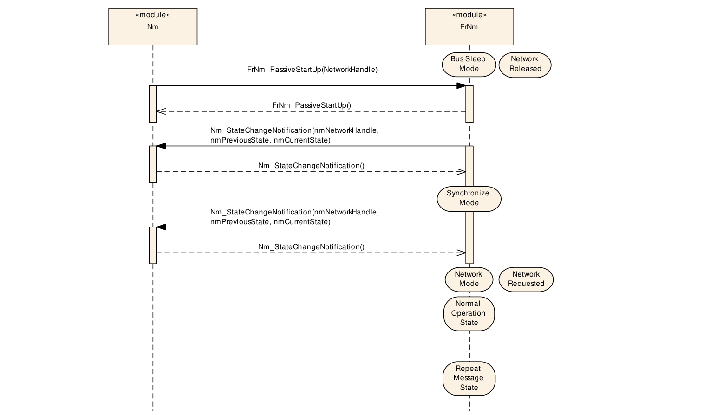

图9.2：FrNm 被动启动序列（**Figure 9.2: FrNm passive startup sequence**）

### 8.3. 用例 03 - 带有网络请求的被动启动

图9.3中的序列展示了一种在到达网络模式之前网络已被请求的被动启动。

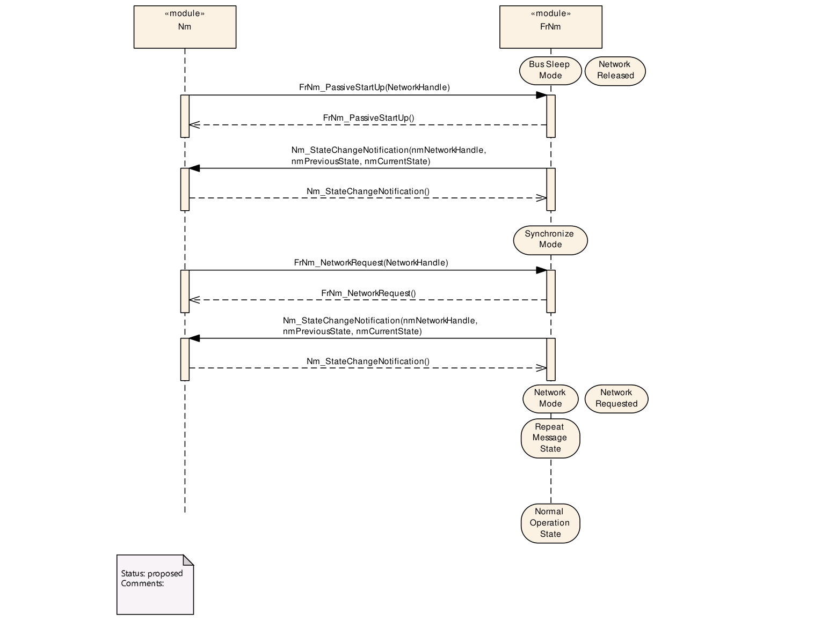

图9.3：带有「主动」网络请求的 FrNm 被动启动序列（**Figure 9.3: FrNm passive startup with a "active" network request sequence**）

### 8.4. 用例 04 - 正常运行

图9.4中的序列展示了如何请求和释放网络。

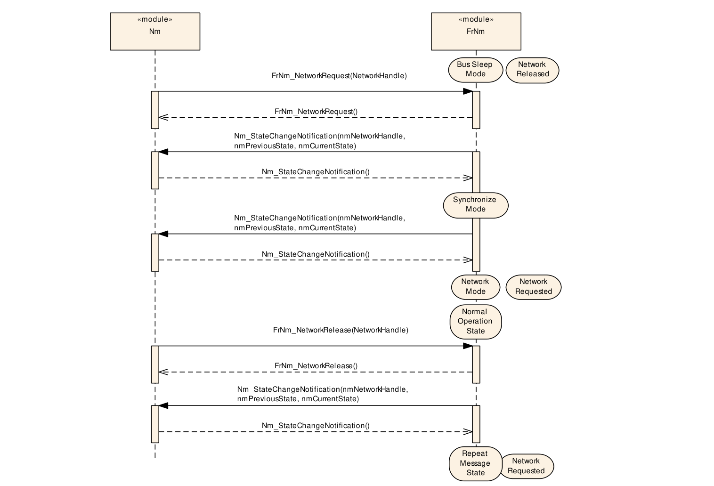

图9.4：FrNm 正常运行序列（**Figure 9.4: FrNm normal operation sequence**）

### 8.5. 用例 05 - 关闭

图9.5中的序列展示了一次正常的关闭序列。

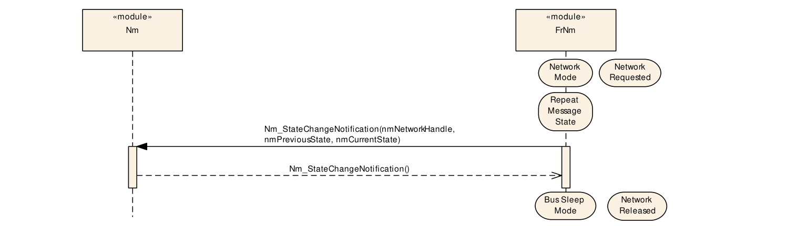

图9.5：FrNm 关闭（**Figure 9.5: FrNm Shutdown**）

## 9. 配置规范

以下章节包含用于确定 **AUTOSAR** 通用网络管理功能单元的所有配置参数和开关的表格。配置参数的默认值以粗体表示。

静态和运行时配置参数都应位于模块源代码之外。

通常，本章定义配置参数及其到容器的聚类。为便于理解，第 9.1 节描述了基本原理。它还规定了用于参数规范的一个模板（表格）。我们有意在本规范中保留第 9.1 节的内容以保证可理解性。

第 9.2 节规定了模块 FrNm 的结构（容器）和参数。

第 9.3 节规定了模块 FrNm 的发布信息。

### 9.1. 如何阅读本章

详情请参阅 SWS\_BSWGeneral 中第 10.1 节「配置规范简介（Introduction to configuration specification）」。

### 9.2. 容器和配置参数

以下各节汇总所有配置参数。参数的详细含义见第 6 章和第 7 章。

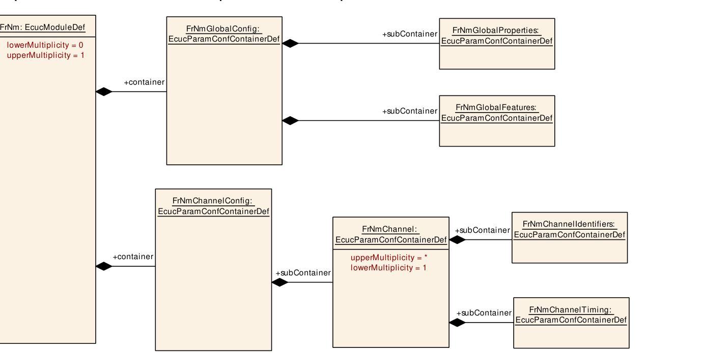

图10.1：配置参数（**Figure 10.1: Configuration Parameters**）
#### 9.2.1. FrNm

| 项目 | 内容 |
| --- | --- |
| SWS 条目 | [ECUC_FrNm_00083] |
| 容器名称 | FrNm |
| 描述 | FlexRay NM 模块 |
| 配置参数 | 见下方参数表 |

| 包含的容器 | 容器名称 | 多重性 |
| --- | --- | --- |
| 包含的容器 | FrNmChannelConfig | 1 |
| 包含的容器 | FrNmGlobalConfig | 1 |

#### 9.2.2. FrNmGlobalConfig

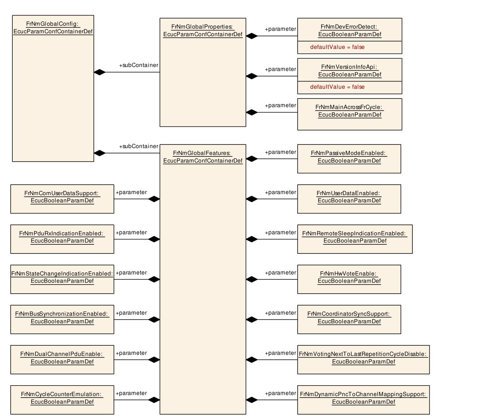

图10.2：全局配置参数（**Figure 10.2: Global Configuration Parameters**）

| 项目 | 内容 |
| --- | --- |
| SWS 条目 | [ECUC_FrNm_00001] |
| 容器名称 | FrNmGlobalConfig |
| 父容器 | FrNm |
| 描述 | 该容器包含 FrNm 模块的所有全局配置参数。 |
| 配置参数 | 见下方参数表 |

| 包含的容器 | 容器名称 | 多重性 |
| --- | --- | --- |
| 包含的容器 | FrNmGlobalFeatures | 1 |
| 包含的容器 | FrNmGlobalProperties | 1 |

#### 9.2.3. FrNmGlobalFeatures

| 项目 | 内容 |
| --- | --- |
| SWS 条目 | [ECUC_FrNm_00004] |
| 容器名称 | FrNmGlobalFeatures |
| 父容器 | FrNmGlobalConfig |
| 描述 | 该容器包含与 FlexRay NM 功能相关的模块特性。 |
| 配置参数 | 见下方参数表 |

无包含的容器。

| 项目 | 内容 |
| --- | --- |
| SWS 条目 | [ECUC_FrNm_00048] |
| 参数名称 | FrNmBusSynchronizationEnabled |
| 父容器 | FrNmGlobalFeatures |
| 描述 | 用于启用总线同步的预处理器开关。 |
| 多重性 | 1 |
| 类型 | EcucBooleanParamDef |
| 默认值 | - |
| Post-Build 变体值 | false |
| 值配置类 | Pre-compile time：X（All Variants）；Link time：-；Post-build time：- |
| 作用域/依赖 | scope: local |

| 项目 | 内容 |
| --- | --- |
| SWS 条目 | [ECUC_FrNm_00054] |
| 参数名称 | FrNmComUserDataSupport |
| 父容器 | FrNmGlobalFeatures |
| 描述 | 用于启用 Com 用户数据（Com User Data）发送路径的预处理器开关。用例：经由 SWC 设置 NMUserData。 |
| 多重性 | 1 |
| 类型 | EcucBooleanParamDef |
| 默认值 | - |
| Post-Build 变体值 | false |
| 值配置类 | Pre-compile time：X（All Variants）；Link time：-；Post-build time：- |
| 作用域/依赖 | scope: local dependency: FrNmComUserDataSupport shall be set to FALSE, if all bytes of the NM PDU are used for NM System Bytes and for the PNC bit vector and no space is left for |

| 项目 | 内容 |
| --- | --- |
| SWS 条目 | [ECUC_FrNm_00081] |
| 参数名称 | FrNmCoordinatorSyncSupport |
| 父容器 | FrNmGlobalFeatures |
| 描述 | 启用/禁用协调器同步支持。 |
| 多重性 | 1 |
| 类型 | EcucBooleanParamDef |
| 默认值 | - |
| Post-Build 变体值 | false |
| 值配置类 | Pre-compile time：X（All Variants）；Link time：-；Post-build time：- |
| 作用域/依赖 | scope: local dependency: FrNmCoordinatorSyncSupport has to be set to FALSE if FrNmPassive ModeEnabled is set to TRUE. |

| 项目 | 内容 |
| --- | --- |
| SWS 条目 | [ECUC_FrNm_00060] |
| 参数名称 | FrNmCycleCounterEmulation |
| 父容器 | FrNmGlobalFeatures |
| 描述 | 用于启用循环计数器仿真的预处理器开关。 |
| 多重性 | 1 |
| 类型 | EcucBooleanParamDef |
| 默认值 | - |
| Post-Build 变体值 | false |
| 值配置类 | Pre-compile time：X（All Variants）；Link time：- |
| 作用域/依赖 | scope: local |

| 项目 | 内容 |
| --- | --- |
| SWS 条目 | [ECUC_FrNm_00049] |
| 参数名称 | FrNmDualChannelPduEnable |
| 父容器 | FrNmGlobalFeatures |
| 描述 | 用于启用 NM 消息双信道发送和接收支持的预处理器开关。 |
| 多重性 | 1 |
| 类型 | EcucBooleanParamDef |
| 默认值 | - |
| Post-Build 变体值 | false |
| 值配置类 | Pre-compile time：X（All Variants）；Link time：-；Post-build time：- |
| 作用域/依赖 | scope: local |

| 项目 | 内容 |
| --- | --- |
| SWS 条目 | [ECUC_FrNm_00090] |
| 参数名称 | FrNmDynamicPncToChannelMappingSupport |
| 父容器 | FrNmGlobalFeatures |
| 描述 | 用于启用动态 PNC 到信道映射处理的预编译时开关。False：禁用动态 PNC 到信道映射。True：启用动态 PNC 到信道映射。 |
| 多重性 | 1 |
| 类型 | EcucBooleanParamDef |
| 默认值 | - |
| Post-Build 变体值 | false |
| 值配置类 | Pre-compile time：X（All Variants）；Link time：-；Post-build time：- |
| 作用域/依赖 | scope: ECU dependency: FrNmDynamicPncToChannelMappingSupport == TRUE only allowed if Fr NmPnEnabled == true for at least one FrNm Channel and FrNmPassiveModeEnabled |

| 项目 | 内容 |
| --- | --- |
| SWS 条目 | [ECUC_FrNm_00050] |
| 参数名称 | FrNmHwVoteEnable |
| 父容器 | FrNmGlobalFeatures |
| 描述 | 用于启用 FlexRay 硬件聚合 NM 投票处理的预处理器开关。该开关启用/禁用可选 API FrIf_GetNmVector。 |
| 多重性 | 1 |
| 类型 | EcucBooleanParamDef |
| 默认值 | - |
| Post-Build 变体值 | false |
| 值配置类 | Pre-compile time：X（All Variants）；Link time：-；Post-build time：- |
| 作用域/依赖 | scope: local |

| 项目 | 内容 |
| --- | --- |
| SWS 条目 | [ECUC_FrNm_00043] |
| 参数名称 | FrNmPassiveModeEnabled |
| 父容器 | FrNmGlobalFeatures |
| 描述 | 用于启用被动节点（Passive Node）配置支持的预处理器开关。 |
| 多重性 | 1 |
| 类型 | EcucBooleanParamDef |
| 默认值 | - |
| Post-Build 变体值 | false |
| 值配置类 | Pre-compile time：X（All Variants）；Link time：-；Post-build time：- |
| 作用域/依赖 | scope: local |

| 项目 | 内容 |
| --- | --- |
| SWS 条目 | [ECUC_FrNm_00046] |
| 参数名称 | FrNmPduRxIndicationEnabled |
| 父容器 | FrNmGlobalFeatures |
| 描述 | 用于启用 PDU 接收指示的预处理器开关。 |
| 多重性 | 1 |
| 类型 | EcucBooleanParamDef |
| 默认值 | - |
| Post-Build 变体值 | false |
| 值配置类 | Pre-compile time：X（All Variants）；Link time：-；Post-build time：- |
| 作用域/依赖 | scope: local |

| 项目 | 内容 |
| --- | --- |
| SWS 条目 | [ECUC_FrNm_00044] |
| 参数名称 | FrNmRemoteSleepIndicationEnabled |
| 父容器 | FrNmGlobalFeatures |
| 描述 | 用于启用远程睡眠指示（remote sleep indication）的预处理器开关。calculationFormula = If (FrNmPassiveModeEnabled == True) then Equal(False) else Equal(False or True) |
| 多重性 | 1 |
| 类型 | EcucBooleanParamDef |
| 默认值 | - |
| Post-Build 变体值 | false |
| 值配置类 | Pre-compile time：X（All Variants）；Link time：-；Post-build time：- |
| 作用域/依赖 | scope: local |

| 项目 | 内容 |
| --- | --- |
| SWS 条目 | [ECUC_FrNm_00047] |
| 参数名称 | FrNmStateChangeIndicationEnabled |
| 父容器 | FrNmGlobalFeatures |
| 描述 | 用于启用状态变化指示的预处理器开关。 |
| 多重性 | 1 |
| 类型 | EcucBooleanParamDef |
| 默认值 | - |
| Post-Build 变体值 | false |
| 值配置类 | Pre-compile time：X（All Variants）；Link time：-；Post-build time：- |
| 作用域/依赖 | scope: local |

| 项目 | 内容 |
| --- | --- |
| SWS 条目 | [ECUC_FrNm_00039] |
| 参数名称 | FrNmUserDataEnabled |
| 父容器 | FrNmGlobalFeatures |
| 描述 | 用于启用用户数据支持的预处理器开关。 |
| 多重性 | 1 |
| 类型 | EcucBooleanParamDef |
| 默认值 | - |
| Post-Build 变体值 | false |
| 值配置类 | Pre-compile time：X（All Variants）；Link time：-；Post-build time：- |
| 作用域/依赖 | scope: local dependency: FrNmUserDataEnabled shall be set to FALSE, if all bytes of the NM PDU are used for NM System Bytes and for the PNC bit vector and no space is left for user |

| 项目 | 内容 |
| --- | --- |
| SWS 条目 | [ECUC_FrNm_00073] |
| 参数名称 | FrNmVotingNextToLastRepetitionCycleDisable |
| 父容器 | FrNmGlobalFeatures |
| 描述 | 用于在 Ready Sleep Counter 到期前的最后两个重复循环内禁用投票变更的预处理器开关。 |
| 多重性 | 1 |
| 类型 | EcucBooleanParamDef |
| 默认值 | - |
| Post-Build 变体值 | false |
| 值配置类 | Pre-compile time：X（All Variants）；Link time：-；Post-build time：- |
| 作用域/依赖 | scope: local |

#### 9.2.4. FrNmGlobalProperties

| 项目 | 内容 |
| --- | --- |
| SWS 条目 | [ECUC_FrNm_00003] |
| 容器名称 | FrNmGlobalProperties |
| 父容器 | FrNmGlobalConfig |
| 描述 | 该容器包含与 FlexRay NM 功能相关的模块属性。 |
| 配置参数 | 见下方参数表 |

无包含的容器。

| 项目 | 内容 |
| --- | --- |
| SWS 条目 | [ECUC_FrNm_00036] |
| 参数名称 | FrNmDevErrorDetect |
| 父容器 | FrNmGlobalProperties |
| 描述 | 打开或关闭开发错误检测和通知。true：启用检测和通知。false：禁用检测和通知。 |
| 多重性 | 1 |
| 类型 | EcucBooleanParamDef |
| 默认值 | false |
| Post-Build 变体值 | false |
| 值配置类 | Pre-compile time：X（All Variants）；Link time：-；Post-build time：- |
| 作用域/依赖 | scope: local |

| 项目 | 内容 |
| --- | --- |
| SWS 条目 | [ECUC_FrNm_00038] |
| 参数名称 | FrNmMainAcrossFrCycle |
| 父容器 | FrNmGlobalProperties |
| 描述 | 如果 FlexRay NM 主函数完整地在「接收到当前投票循环最后一个 NM 投票」的那一个 FlexRay 通信循环内执行，则 FrNmMainAcrossFrCycle 应配置为 FALSE。如果 FlexRay NM 主函数完整地在「接收到当前投票循环最后一个 NM 投票」的循环之后的那个 FlexRay 通信循环内执行，则 FrNmMainAcrossFrCycle 应配置为 TRUE。 |
| 多重性 | 1 |
| 类型 | EcucBooleanParamDef |
| 默认值 | - |
| Post-Build 变体值 | false |
| 值配置类 | Pre-compile time：X（VARIANT-PRE-COMPILE）；Link time：X（VARIANT-LINK-TIME, VARIANT-POST-BUILD）；Post-build time：- |
| 作用域/依赖 | scope: local |

| 项目 | 内容 |
| --- | --- |
| SWS 条目 | [ECUC_FrNm_00037] |
| 参数名称 | FrNmVersionInfoApi |
| 父容器 | FrNmGlobalProperties |
| 描述 | 用于启用版本信息 API 支持的预处理器开关。 |
| 多重性 | 1 |
| 类型 | EcucBooleanParamDef |
| 默认值 | false |
| Post-Build 变体值 | false |
| 值配置类 | Pre-compile time：X（All Variants）；Link time：-；Post-build time：- |
| 作用域/依赖 | scope: local |

#### 9.2.5. FrNmChannelConfig

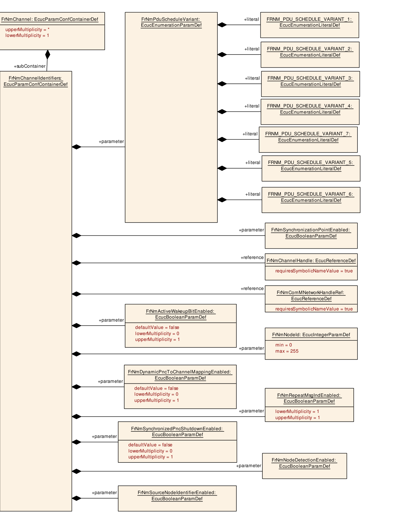

图10.3：信道可配置参数 - 第 1 部分（**Figure 10.3: Channel Configurable Parameters - part 1**）

| 项目 | 内容 |
| --- | --- |
| SWS 条目 | [ECUC_FrNm_00002] |
| 容器名称 | FrNmChannelConfig |
| 父容器 | FrNm |
| 描述 | 该容器包含所有 FlexRay NM 信道的配置参数。 |
| 配置参数 | 见下方参数表 |

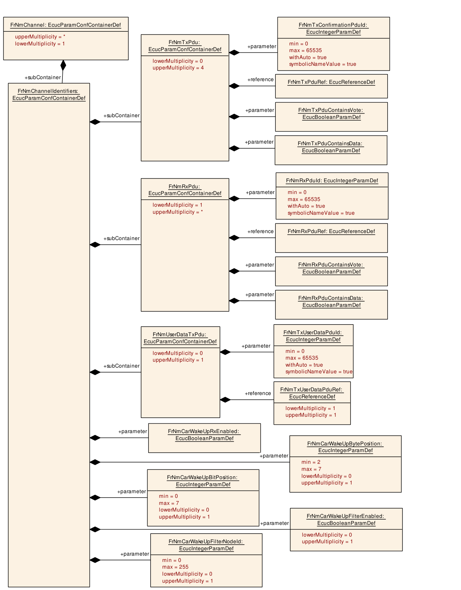

图10.4：信道可配置参数 - 第 2 部分（**Figure 10.4: Channel Configurable Parameters - part 2**）

以下运行时配置参数应可针对每个信道分别进行配置。

| 包含的容器 | 容器名称 | 多重性 |
| --- | --- | --- |
| 包含的容器 | FrNmChannel | 1..* |

#### 9.2.6. FrNmChannel

| 项目 | 内容 |
| --- | --- |
| SWS 条目 | [ECUC_FrNm_00006] |
| 容器名称 | FrNmChannel |
| 父容器 | FrNmChannelConfig |
| 描述 | 该容器包含一个 FlexRay NM 信道的配置参数。 |
| 多重性配置类 | Pre-compile time：X（VARIANT-PRE-COMPILE, VARIANT-LINK-TIME, VARIANT-POST-BUILD）；Link time：-；Post-build time：- |
| Post-Build 变体多重性 | false |
| 配置参数 | 见下方参数表 |

| 包含的容器 | 容器名称 | 多重性 |
| --- | --- | --- |
| 包含的容器 | FrNmChannelIdentifiers | 1 |
| 包含的容器 | FrNmChannelTiming | 1 |

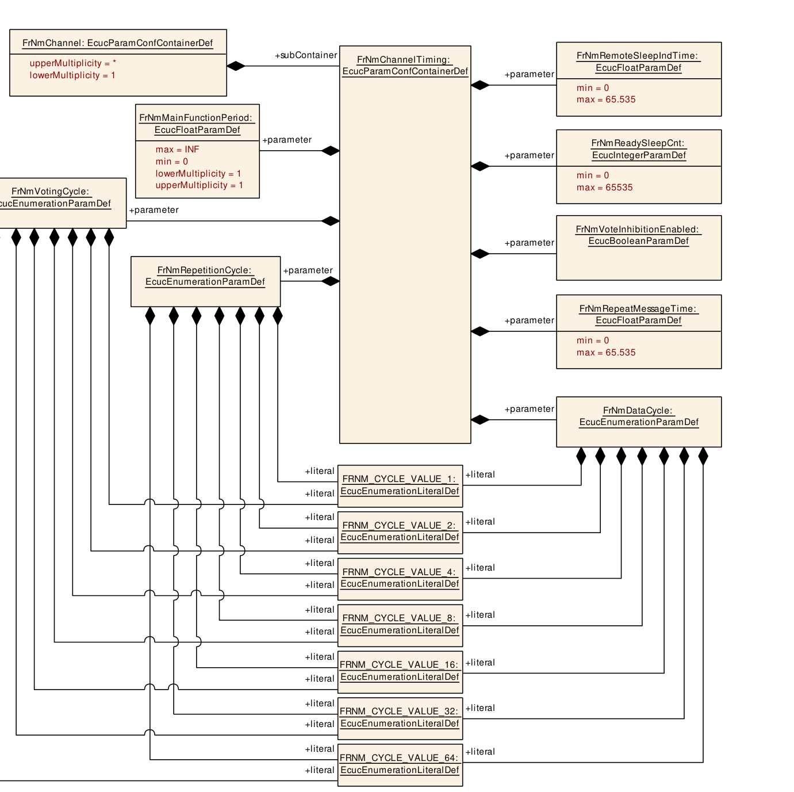

图10.5：FrNm 信道参数（**Figure 10.5: FrNm Channel Parameters**）

#### 9.2.7. FrNmChannelTiming

| 项目 | 内容 |
| --- | --- |
| SWS 条目 | [ECUC_FrNm_00008] |
| 容器名称 | FrNmChannelTiming |
| 父容器 | FrNmChannel |
| 描述 | 该容器包含与相应 FlexRay 信道相关的实例特定时序参数。 |
| 配置参数 | 见下方参数表 |

无包含的容器。

| 项目 | 内容 |
| --- | --- |
| SWS 条目 | [ECUC_FrNm_00031] |
| 参数名称 | FrNmDataCycle |
| 父容器 | FrNmChannelTiming |
| 描述 | 在 FlexRay 总线上发送所有 ECU 的 NM Data 所需的 FlexRay 调度循环数量 |
| 多重性 | 1 |
| 类型 | EcucEnumerationParamDef |
| Post-Build 变体值 | false |
| 范围 | FRNM_CYCLE_VALUE_1；FRNM_CYCLE_VALUE_2；FRNM_CYCLE_VALUE_4；FRNM_CYCLE_VALUE_8；FRNM_CYCLE_VALUE_16；FRNM_CYCLE_VALUE_32；FRNM_CYCLE_VALUE_64 |
| 值配置类 | Pre-compile time：X（VARIANT-PRE-COMPILE）；Link time：X（VARIANT-LINK-TIME, VARIANT-POST-BUILD）；Post-build time：- |
| 作用域/依赖 | scope: local |

| 项目 | 内容 |
| --- | --- |
| SWS 条目 | [ECUC_FrNm_00035] |
| 参数名称 | FrNmMainFunctionPeriod |
| 父容器 | FrNmChannelTiming |
| 描述 | 该参数以秒为单位定义 FrNm 模块主函数的处理周期。 |
| 多重性 | 1 |
| 类型 | EcucFloatParamDef |
| 默认值 | - |
| Post-Build 变体值 | false |
| 范围 | ]0 .. INF[ |
| 值配置类 | Pre-compile time：X（VARIANT-PRE-COMPILE）；Link time：X（VARIANT-LINK-TIME, VARIANT-POST-BUILD）；Post-build time：- |
| 作用域/依赖 | scope: local |

| 项目 | 内容 |
| --- | --- |
| SWS 条目 | [ECUC_FrNm_00051] |
| 参数名称 | FrNmReadySleepCnt |
| 父容器 | FrNmChannelTiming |
| 描述 | FrNm 在没有任何 NM 投票的 FrNmReadySleepCnt+1 个重复循环结束时切换到总线睡眠模式。例如取值为「1」时，NM 状态机将在两个没有「保持唤醒」投票的 NM 重复循环之后离开 Ready Sleep 状态。 |
| 多重性 | 1 |
| 类型 | EcucIntegerParamDef |
| 值配置类 | Pre-compile time：X（VARIANT-PRE-COMPILE）；Link time：X（VARIANT-LINK-TIME, VARIANT-POST-BUILD）；Post-build time：- |
| 作用域/依赖 | scope: local dependency: Condition: FrNmReadySleepCnt >= 1 |

| 项目 | 内容 |
| --- | --- |
| SWS 条目 | [ECUC_FrNm_00029] |
| 参数名称 | FrNmRemoteSleepIndTime |
| 父容器 | FrNmChannelTiming |
| 描述 | 远程睡眠指示的超时时间。它以秒为单位定义识别出所有其他节点已准备好睡眠所需的时间。值「0」表示未配置远程睡眠指示功能。 |
| 多重性 | 1 |
| 类型 | EcucFloatParamDef |
| 默认值 | - |
| Post-Build 变体值 | false |
| 范围 | [0 .. 65.535] |
| 值配置类 | Pre-compile time：X（VARIANT-PRE-COMPILE）；Link time：X（VARIANT-LINK-TIME, VARIANT-POST-BUILD）；Post-build time：- |
| 作用域/依赖 | scope: local dependency: Condition: FrNmRemoteSleepIndTime >= FrNmRepetitionCycle or FrNm RemoteSleepIndTime = 0 |

| 项目 | 内容 |
| --- | --- |
| SWS 条目 | [ECUC_FrNm_00030] |
| 参数名称 | FrNmRepeatMessageTime |
| 父容器 | FrNmChannelTiming |
| 描述 | Repeat Message 状态的超时时间。以秒为单位定义 NM 应在 Repeat Message 状态中停留多长时间。值「0」表示未配置 Repeat Message 状态，这意味着 Repeat Message 状态是瞬态的，即在进入后立即离开，因此不保证启动稳定性，也无法执行节点检测过程。 |
| 多重性 | 1 |
| 类型 | EcucFloatParamDef |
| 默认值 | - |
| Post-Build 变体值 | false |
| 范围 | [0 .. 65.535] |
| 值配置类 | Pre-compile time：X（VARIANT-PRE-COMPILE）；Link time：X（VARIANT-LINK-TIME, VARIANT-POST-BUILD）；Post-build time：- |
| 作用域/依赖 | scope: ECU dependency: Timing value shall be an integer multiple of the time for one repetition cycle. |

| 项目 | 内容 |
| --- | --- |
| SWS 条目 | [ECUC_FrNm_00033] |
| 参数名称 | FrNmRepetitionCycle |
| 父容器 | FrNmChannelTiming |
| 描述 | 用于在 FlexRay 总线上重复发送所有 ECU 的 NM 投票的 FlexRay 调度循环数量。 |
| 多重性 | 1 |
| 类型 | EcucEnumerationParamDef |
| Post-Build 变体值 | false |
| 范围 | FRNM_CYCLE_VALUE_1；FRNM_CYCLE_VALUE_2；FRNM_CYCLE_VALUE_4；FRNM_CYCLE_VALUE_8；FRNM_CYCLE_VALUE_16；FRNM_CYCLE_VALUE_32；FRNM_CYCLE_VALUE_64 |
| 值配置类 | Pre-compile time：X（VARIANT-PRE-COMPILE）；Link time：X（VARIANT-LINK-TIME, VARIANT-POST-BUILD）；Post-build time：- |
| 作用域/依赖 | scope: local dependency: Condition: FrNmRepetitionCycle = n * FrNmVotingCycle; n = [\[1,2,4,8,16,32,64\]](#ref-1) |

| 项目 | 内容 |
| --- | --- |
| SWS 条目 | [ECUC_FrNm_00053] |
| 参数名称 | FrNmVoteInhibitionEnabled |
| 父容器 | FrNmChannelTiming |
| 描述 | 用于在 Ready Sleep Counter 到期前、从倒数第二个重复循环到最后一个重复循环期间禁止投票变更的预处理器开关。 |
| 多重性 | 1 |
| 类型 | EcucBooleanParamDef |
| 默认值 | - |
| Post-Build 变体值 | false |
| 值配置类 | Pre-compile time：X（All Variants）；Link time：-；Post-build time：- |
| 作用域/依赖 | scope: local |

| 项目 | 内容 |
| --- | --- |
| SWS 条目 | [ECUC_FrNm_00032] |
| 参数名称 | FrNmVotingCycle |
| 父容器 | FrNmChannelTiming |
| 描述 | 在 FlexRay 总线上发送所有 ECU 的 NM 投票所需的 FlexRay 调度循环数量。 |
| 多重性 | 1 |
| 类型 | EcucEnumerationParamDef |
| Post-Build 变体值 | false |
| 范围 | FRNM_CYCLE_VALUE_1；FRNM_CYCLE_VALUE_2；FRNM_CYCLE_VALUE_4；FRNM_CYCLE_VALUE_8；FRNM_CYCLE_VALUE_16；FRNM_CYCLE_VALUE_32；FRNM_CYCLE_VALUE_64 |
| 值配置类 | Pre-compile time：X（VARIANT-PRE-COMPILE）；Link time：X（VARIANT-LINK-TIME, VARIANT-POST-BUILD）；Post-build time：- |
| 作用域/依赖 | scope: local |

#### 9.2.8. FrNmChannelIdentifiers

| 项目 | 内容 |
| --- | --- |
| SWS 条目 | [ECUC_FrNm_00007] |
| 容器名称 | FrNmChannelIdentifiers |
| 父容器 | FrNmChannel |
| 描述 | 该容器包含与相应 FlexRay 信道相关的实例特定标识符。 |
| 配置参数 | 见下方参数表 |

| 包含的容器 | 容器名称 | 多重性 |
| --- | --- | --- |
| 包含的容器 | FrNmRxPdu | 1..* |
| 包含的容器 | FrNmTxPdu | 0..4 |
| 包含的容器 | FrNmUserDataTxPdu | 0..1 |

| 项目 | 内容 |
| --- | --- |
| SWS 条目 | [ECUC_FrNm_00082] |
| 参数名称 | FrNmActiveWakeupBitEnabled |
| 父容器 | FrNmChannelIdentifiers |
| 描述 | 启用/禁用 FrNm 模块对 Active Wakeup 位的处理。 |
| 多重性 | 0..1 |
| 类型 | EcucBooleanParamDef |
| 默认值 | false |
| Post-Build 变体多重性 | false |
| Post-Build 变体值 | false |
| 值配置类 | Pre-compile time：X（VARIANT-PRE-COMPILE）；Link time：X（VARIANT-LINK-TIME, VARIANT-POST-BUILD）；Post-build time：- |
| 多重性配置类 | Pre-compile time：X（VARIANT-PRE-COMPILE）；Link time：X（VARIANT-LINK-TIME, VARIANT-POST-BUILD）；Post-build time：- |
| 作用域/依赖 | scope: local |

| 项目 | 内容 |
| --- | --- |
| SWS 条目 | [ECUC_FrNm_00076] |
| 参数名称 | FrNmCarWakeUpBitPosition |
| 父容器 | FrNmChannelIdentifiers |
| 描述 | 规定 CWU 在 NM 消息内的位位置。 |
| 多重性 | 0..1 |
| 类型 | EcucIntegerParamDef |
| 默认值 | - |
| Post-Build 变体多重性 | false |
| Post-Build 变体值 | false |
| 范围 | 0 .. 7 |
| 值配置类 | Pre-compile time：X（VARIANT-PRE-COMPILE）；Link time：X（VARIANT-LINK-TIME, VARIANT-POST-BUILD）；Post-build time：- |
| 多重性配置类 | Pre-compile time：X（VARIANT-PRE-COMPILE）；Link time：X（VARIANT-LINK-TIME, VARIANT-POST-BUILD）；Post-build time：- |
| 作用域/依赖 | scope: local dependency: only available if FrNmCarWakeUpRxEnabled == TRUE |

| 项目 | 内容 |
| --- | --- |
| SWS 条目 | [ECUC_FrNm_00075] |
| 参数名称 | FrNmCarWakeUpBytePosition |
| 父容器 | FrNmChannelIdentifiers |
| 描述 | 规定 CWU 在 NM 消息内的字节位置。 |
| 多重性 | 0..1 |
| 类型 | EcucIntegerParamDef |
| 默认值 | - |
| Post-Build 变体多重性 | false |
| Post-Build 变体值 | false |
| 范围 | 2 .. 7 |
| 值配置类 | Pre-compile time：X（VARIANT-PRE-COMPILE）；Link time：X（VARIANT-LINK-TIME, VARIANT-POST-BUILD）；Post-build time：- |
| 多重性配置类 | Pre-compile time：X（VARIANT-PRE-COMPILE）；Link time：X（VARIANT-LINK-TIME, VARIANT-POST-BUILD）；Post-build time：- |
| 作用域/依赖 | scope: local dependency: only available if FrNmCarWakeUpRxEnabled == TRUE |

| 项目 | 内容 |
| --- | --- |
| SWS 条目 | [ECUC_FrNm_00077] |
| 参数名称 | FrNmCarWakeUpFilterEnabled |
| 父容器 | FrNmChannelIdentifiers |
| 描述 | 如果支持 CWU 过滤，则只有源节点标识符为 FrNmCarWakeUpFilterNodeId 的 NM 消息内的 CWU 位才被视为 CWU 请求。FALSE - 不支持 CWU 过滤。TRUE - 支持 CWU 过滤。 |
| 多重性 | 0..1 |
| 类型 | EcucBooleanParamDef |
| 默认值 | - |
| Post-Build 变体多重性 | false |
| Post-Build 变体值 | false |
| 值配置类 | Pre-compile time：X（VARIANT-PRE-COMPILE）；Link time：X（VARIANT-LINK-TIME, VARIANT-POST-BUILD）；Post-build time：- |
| 多重性配置类 | Pre-compile time：X（VARIANT-PRE-COMPILE）；Link time：X（VARIANT-LINK-TIME, VARIANT-POST-BUILD）；Post-build time：- |
| 作用域/依赖 | scope: local dependency: only available if FrNmCarWakeUpRxEnabled == TRUE |

| 项目 | 内容 |
| --- | --- |
| SWS 条目 | [ECUC_FrNm_00078] |
| 参数名称 | FrNmCarWakeUpFilterNodeId |
| 父容器 | FrNmChannelIdentifiers |
| 描述 | 用于 CWU 过滤的源节点标识符。如果支持 CWU 过滤，则只有源节点标识符为 FrNmCarWakeUpFilterNodeId 的 NM 消息内的 CWU 位才被视为 CWU 请求。 |
| 多重性 | 0..1 |
| 类型 | EcucIntegerParamDef |
| 默认值 | - |
| Post-Build 变体多重性 | false |
| Post-Build 变体值 | false |
| 范围 | 0 .. 255 |
| 值配置类 | Pre-compile time：X（VARIANT-PRE-COMPILE）；Link time：X（VARIANT-LINK-TIME, VARIANT-POST-BUILD）；Post-build time：- |
| 多重性配置类 | Pre-compile time：X（VARIANT-PRE-COMPILE）；Link time：X（VARIANT-LINK-TIME, VARIANT-POST-BUILD）；Post-build time：- |
| 作用域/依赖 | scope: local dependency: only available if FrNmCarWakeUpRxEnabled == TRUE |

| 项目 | 内容 |
| --- | --- |
| SWS 条目 | [ECUC_FrNm_00074] |
| 参数名称 | FrNmCarWakeUpRxEnabled |
| 父容器 | FrNmChannelIdentifiers |
| 描述 | 启用或禁用对所接收 NM 消息中 CarWakeUp 位求值的支持。FALSE - 不支持 CarWakeUp。TRUE - 支持 CarWakeUp。 |
| 多重性 | 1 |
| 类型 | EcucBooleanParamDef |
| 默认值 | - |
| Post-Build 变体值 | false |
| 值配置类 | Pre-compile time：X（VARIANT-PRE-COMPILE）；Link time：X（VARIANT-LINK-TIME, VARIANT-POST-BUILD）；Post-build time：- |
| 作用域/依赖 | scope: local |

| 项目 | 内容 |
| --- | --- |
| SWS 条目 | [ECUC_FrNm_00092] |
| 参数名称 | FrNmDynamicPncToChannelMappingEnabled |
| 父容器 | FrNmChannelIdentifiers |
| 描述 | 用于启用动态 PNC 到信道映射特性的信道特定参数。False：禁用动态 PNC 到信道映射。True：启用动态 PNC 到信道映射。 |
| 多重性 | 0..1 |
| 类型 | EcucBooleanParamDef |
| 默认值 | false |
| Post-Build 变体多重性 | false |
| Post-Build 变体值 | false |
| 值配置类 | Pre-compile time：X（VARIANT-PRE-COMPILE）；Link time：X（VARIANT-LINK-TIME, VARIANT-POST-BUILD）；Post-build time：- |
| 多重性配置类 | Pre-compile time：X（VARIANT-PRE-COMPILE）；Link time：X（VARIANT-LINK-TIME, VARIANT-POST-BUILD）；Post-build time：- |
| 作用域/依赖 | scope: local dependency: Shall only be TRUE if FrNmDynamicPncToChannelMappingSupport is |

| 项目 | 内容 |
| --- | --- |
| SWS 条目 | [ECUC_FrNm_00086] |
| 参数名称 | FrNmNodeDetectionEnabled |
| 父容器 | FrNmChannelIdentifiers |
| 描述 | 该参数用于为某个 FrNm 信道启用或禁用节点检测支持。 |
| 多重性 | 1 |
| 类型 | EcucBooleanParamDef |
| 默认值 | - |
| Post-Build 变体值 | false |
| 值配置类 | Pre-compile time：X（VARIANT-PRE-COMPILE）；Link time：X（VARIANT-LINK-TIME, VARIANT-POST-BUILD）；Post-build time：- |
| 作用域/依赖 | scope: local dependency: FrNmSourceNodeIdentifierEnabled needs to be TRUE to use this feature for the corresponding FrNm Channel. calculationFormula = If (FrNmPassiveMode Enabled == False)then Equal(NmNodeDetectionEnabled) else Equal(False) |

| 项目 | 内容 |
| --- | --- |
| SWS 条目 | [ECUC_FrNm_00017] |
| 参数名称 | FrNmNodeId |
| 父容器 | FrNmChannelIdentifiers |
| 描述 | 为相应 FlexRay 信道配置的 NM 节点标识符。它用于在 NM 集群内标识相应的 NM 节点。在同一个 NM 集群内它对每个 NM 节点必须唯一。 |
| 多重性 | 1 |
| 类型 | EcucIntegerParamDef |
| 默认值 | - |
| Post-Build 变体值 | true |
| 范围 | 0 .. 255 |
| 值配置类 | Pre-compile time：X（VARIANT-PRE-COMPILE）；Link time：X（VARIANT-LINK-TIME）；Post-build time：X（VARIANT-POST-BUILD） |
| 作用域/依赖 | scope: local |

| 项目 | 内容 |
| --- | --- |
| SWS 条目 | [ECUC_FrNm_00022] |
| 参数名称 | FrNmPduScheduleVariant |
| 父容器 | FrNmChannelIdentifiers |
| 描述 | 该参数定义应在该信道上使用的 PDU 调度变体。选项 1：NM 投票和 NM 数据在静态段（一个 PDU）。选项 2：NM 投票和 NM 数据在动态段（一个 PDU）。选项 3：NM 投票和 NM 数据在静态段（分离的 PDU）。选项 4：NM 投票在静态段，NM 数据在动态段。选项 5：NM 投票在动态段，NM 数据在静态段。选项 6：NM 投票和 NM 数据在动态段（分离的 PDU）。选项 7：组合的 NM 投票和 CBV 在静态段，NM 数据在动态段。 |
| 多重性 | 1 |
| 类型 | EcucEnumerationParamDef |
| Post-Build 变体值 | false |
| 范围 | FRNM_PDU_SCHEDULE_VARIANT_1（NM 投票和 NM 数据在静态段，一个 PDU）；FRNM_PDU_SCHEDULE_VARIANT_2（NM 投票和 NM 数据在动态段，一个 PDU）；FRNM_PDU_SCHEDULE_VARIANT_3（NM 投票和 NM 数据在静态段，分离的 PDU）；FRNM_PDU_SCHEDULE_VARIANT_4（NM 投票在静态段，NM 数据在动态段）；FRNM_PDU_SCHEDULE_VARIANT_5（NM 投票在动态段，NM 数据在静态段）；FRNM_PDU_SCHEDULE_VARIANT_6（NM 投票和 NM 数据在动态段，分离的 PDU）；FRNM_PDU_SCHEDULE_VARIANT_7（组合的 NM 投票和 CBV 在静态段，NM 数据在动态段） |
| 值配置类 | Pre-compile time：X（VARIANT-PRE-COMPILE）；Link time：X（VARIANT-LINK-TIME, VARIANT-POST-BUILD）；Post-build time：- |
| 作用域/依赖 | scope: local |

| 项目 | 内容 |
| --- | --- |
| SWS 条目 | [ECUC_FrNm_00072] |
| 参数名称 | FrNmPnEnabled |
| 父容器 | FrNmChannelIdentifiers |
| 描述 | 启用或禁用部分网络（partial networking）支持。false：不支持部分网络。true：支持部分网络。 |
| 多重性 | 1 |
| 类型 | EcucBooleanParamDef |
| 默认值 | false |
| Post-Build 变体值 | true |
| 值配置类 | Pre-compile time：X（VARIANT-PRE-COMPILE）；Link time：X（VARIANT-LINK-TIME）；Post-build time：X（VARIANT-POST-BUILD） |
| 作用域/依赖 | scope: local dependency: If FrNmPnEnabled == TRUE then FrNmComUserDataSupport = TRUE |

| 项目 | 内容 |
| --- | --- |
| SWS 条目 | [ECUC_FrNm_00091] |
| 参数名称 | FrNmRepeatMsgIndEnabled |
| 父容器 | FrNmChannelIdentifiers |
| 描述 | 启用/禁用「已接收到 RepeatMessageRequest 位」的通知。 |
| 多重性 | 1 |
| 类型 | EcucBooleanParamDef |
| 默认值 | - |
| Post-Build 变体值 | false |
| 值配置类 | Pre-compile time：X（VARIANT-PRE-COMPILE）；Link time：X（VARIANT-LINK-TIME, VARIANT-POST-BUILD）；Post-build time：- |
| 作用域/依赖 | scope: ECU dependency: FrNmRepeatMsgIndEnabled = FALSE if FrNmPassiveModeEnabled == TRUE or (FrNmNodeDetectionEnabled == FALSE && FrNmDynamicPncToChannel MappingEnabled == FALSE). FrNmRepeatMsgIndEnabled = TRUE if FrNmDynamic PncToChannelMappingEnabled == TRUE. |

| 项目 | 内容 |
| --- | --- |
| SWS 条目 | [ECUC_FrNm_00085] |
| 参数名称 | FrNmSourceNodeIdentifierEnabled |
| 父容器 | FrNmChannelIdentifiers |
| 描述 | 该参数用于为某个 FrNm 信道启用或禁用 SourceNodeIdentifier 支持。 |
| 多重性 | 1 |
| 类型 | EcucBooleanParamDef |
| 默认值 | - |
| Post-Build 变体值 | false |
| 值配置类 | Pre-compile time：X（VARIANT-PRE-COMPILE）；Link time：X（VARIANT-LINK-TIME, VARIANT-POST-BUILD）；Post-build time：- |
| 作用域/依赖 | scope: local |

| 项目 | 内容 |
| --- | --- |
| SWS 条目 | [ECUC_FrNm_00021] |
| 参数名称 | FrNmSynchronizationPointEnabled |
| 父容器 | FrNmChannelIdentifiers |
| 描述 | 该参数定义该信道是否应向 NM 接口提供同步点指示。 |
| 多重性 | 1 |
| 类型 | EcucBooleanParamDef |
| 默认值 | - |
| Post-Build 变体值 | false |
| 值配置类 | Pre-compile time：X（VARIANT-PRE-COMPILE）；Link time：X（VARIANT-LINK-TIME, VARIANT-POST-BUILD）；Post-build time：- |
| 作用域/依赖 | scope: local |

| 项目 | 内容 |
| --- | --- |
| SWS 条目 | [ECUC_FrNm_00094] |
| 参数名称 | FrNmSynchronizedPncShutdownEnabled |
| 父容器 | FrNmChannelIdentifiers |
| 描述 | 规定 FrNm 是否处理 PN 关闭消息以支持跨 PN 拓扑的同步 PNC 关闭。该参数仅用于充当顶级 PNC 协调器或中间 PNC 协调器角色的 ECU。因此，PNC 网关功能被启用，并因此使用 ERA 计算。FALSE：禁用同步 PNC 关闭。TRUE：启用同步 PNC 关闭。 |
| 多重性 | 0..1 |
| 类型 | EcucBooleanParamDef |
| 默认值 | false |
| Post-Build 变体多重性 | false |
| Post-Build 变体值 | false |
| 值配置类 | Pre-compile time：X（VARIANT-PRE-COMPILE）；Link time：X（VARIANT-LINK-TIME）；Post-build time：- |
| 多重性配置类 | Pre-compile time：X（VARIANT-PRE-COMPILE）；Link time：X（VARIANT-LINK-TIME）；Post-build time：- |
| 作用域/依赖 | scope: local dependency: Only available if FrNmPnEnabled == TRUE and NmPnEraCalcEnabled |

| 项目 | 内容 |
| --- | --- |
| SWS 条目 | [ECUC_FrNm_00013] |
| 参数名称 | FrNmChannelHandle |
| 父容器 | FrNmChannelIdentifiers |
| 描述 | 为相应 NM 实例配置的信道标识符。FrNmChannelHandle 应被编码在由 FrIf 调用 FrNm_RxIndication() 函数时传入的 FrNmRxPduId 参数中。 |
| 多重性 | 1 |
| 类型 | Symbolic name reference to FrIfCluster |
| Post-Build 变体值 | true |
| 值配置类 | Pre-compile time：X（VARIANT-PRE-COMPILE）；Link time：X（VARIANT-LINK-TIME）；Post-build time：X（VARIANT-POST-BUILD） |
| 作用域/依赖 | scope: ECU |

| 项目 | 内容 |
| --- | --- |
| SWS 条目 | [ECUC_FrNm_00014] |
| 参数名称 | FrNmComMNetworkHandleRef |
| 父容器 | FrNmChannelIdentifiers |
| 描述 | 对 ComM 信道的符号名引用。对于同一个 ECU 内的每个 NM 实例它必须唯一。 |
| 多重性 | 1 |
| 类型 | Symbolic name reference to ComMChannel |
| Post-Build 变体值 | true |
| 值配置类 | Pre-compile time：X（VARIANT-PRE-COMPILE）；Link time：X（VARIANT-LINK-TIME）；Post-build time：X（VARIANT-POST-BUILD） |
| 作用域/依赖 | scope: local dependency: It must be unique for each NM instance within one ECU. |

#### 9.2.9. FrNmRxPdu

| 项目 | 内容 |
| --- | --- |
| SWS 条目 | [ECUC_FrNm_00010] |
| 容器名称 | FrNmRxPdu |
| 父容器 | FrNmChannelIdentifiers |
| 描述 | 该容器描述 FlexRay NM RX PDU。 |
| 配置参数 | 见下方参数表 |

无包含的容器。

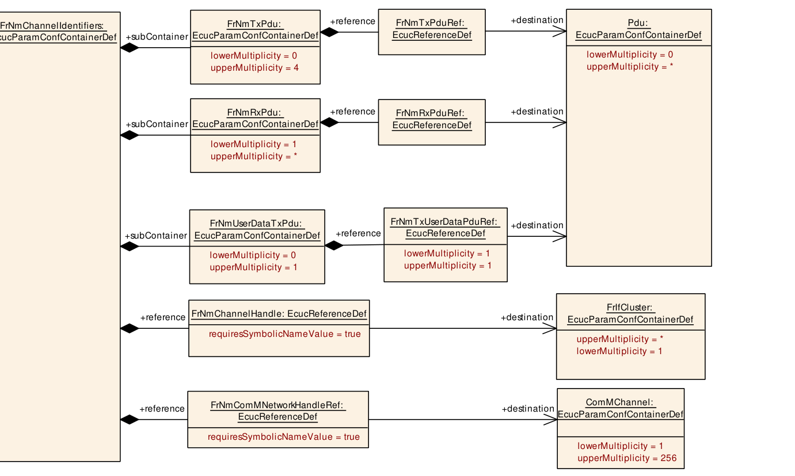

图10.6：FrNm 引用（**Figure 10.6: FrNm References**）

| 项目 | 内容 |
| --- | --- |
| SWS 条目 | [ECUC_FrNm_00027] |
| 参数名称 | FrNmRxPduContainsData |
| 父容器 | FrNmRxPdu |
| 描述 | 该参数定义该 PDU 是否包含 NM 数据。 |
| 多重性 | 1 |
| 类型 | EcucBooleanParamDef |
| 默认值 | - |
| Post-Build 变体值 | true |
| 值配置类 | Pre-compile time：X（VARIANT-PRE-COMPILE）；Link time：X（VARIANT-LINK-TIME）；Post-build time：X（VARIANT-POST-BUILD） |
| 作用域/依赖 | scope: local |

| 项目 | 内容 |
| --- | --- |
| SWS 条目 | [ECUC_FrNm_00026] |
| 参数名称 | FrNmRxPduContainsVote |
| 父容器 | FrNmRxPdu |
| 描述 | 该参数定义该 PDU 是否包含 NM 投票信息。 |
| 多重性 | 1 |
| 类型 | EcucBooleanParamDef |
| 默认值 | - |
| Post-Build 变体值 | true |
| 值配置类 | Pre-compile time：X（VARIANT-PRE-COMPILE）；Link time：X（VARIANT-LINK-TIME）；Post-build time：X（VARIANT-POST-BUILD） |
| 作用域/依赖 | scope: local |

| 项目 | 内容 |
| --- | --- |
| SWS 条目 | [ECUC_FrNm_00025] |
| 参数名称 | FrNmRxPduId |
| 父容器 | FrNmRxPdu |
| 描述 | 为相应 FlexRay 信道配置的 PDU 标识符。它用于指代 FlexRay 接口的接收函数。它必须与 FlexRay 接口中配置的值一致。该 ID 用于 NM 投票和 NM 数据的组合接收，或在 NM 数据于单独 PDU 中接收时用于 NM 投票的接收。实现类型：PduIdType |
| 多重性 | 1 |
| 类型 | EcucIntegerParamDef (Symbolic Name generated for this parameter) |
| 默认值 | - |
| Post-Build 变体值 | true |
| 范围 | 0 .. 65535 |
| 值配置类 | Pre-compile time：X（All Variants） |
| 作用域/依赖 | scope: local；withAuto = true |

| 项目 | 内容 |
| --- | --- |
| SWS 条目 | [ECUC_FrNm_00012] |
| 参数名称 | FrNmRxPduRef |
| 父容器 | FrNmRxPdu |
| 描述 | 对 AUTOSAR ECU 配置规范中描述的全局 PDU 结构中某个 PDU 的引用。FrIf 模块将使用该引用来推导 PDU Id。 |
| 多重性 | 1 |
| 类型 | Reference to Pdu |
| Post-Build 变体值 | true |
| 值配置类 | Pre-compile time：X（VARIANT-PRE-COMPILE）；Link time：X（VARIANT-LINK-TIME）；Post-build time：X（VARIANT-POST-BUILD） |
| 作用域/依赖 | scope: ECU |

#### 9.2.10. FrNmTxPdu

| 项目 | 内容 |
| --- | --- |
| SWS 条目 | [ECUC_FrNm_00009] |
| 容器名称 | FrNmTxPdu |
| 父容器 | FrNmChannelIdentifiers |
| 描述 | 该容器描述 FlexRay NM TX PDU。 |
| 配置参数 | 见下方参数表 |

无包含的容器。

| 项目 | 内容 |
| --- | --- |
| SWS 条目 | [ECUC_FrNm_00018] |
| 参数名称 | FrNmTxConfirmationPduId |
| 父容器 | FrNmTxPdu |
| 描述 | 下层在调用 FrNm_TriggerTransmit() 或 FrNm_TxConfirmation() 时使用的句柄 ID。 |
| 多重性 | 1 |
| 类型 | EcucIntegerParamDef (Symbolic Name generated for this parameter) |
| 默认值 | - |
| Post-Build 变体值 | true |
| 范围 | 0 .. 65535 |
| 值配置类 | Pre-compile time：X（All Variants）；Link time：-；Post-build time：- |
| 作用域/依赖 | scope: local |

| 项目 | 内容 |
| --- | --- |
| SWS 条目 | [ECUC_FrNm_00024] |
| 参数名称 | FrNmTxPduContainsData |
| 父容器 | FrNmTxPdu |
| 描述 | 该参数定义该 PDU 是否包含 NM 数据。 |
| 多重性 | 1 |
| 类型 | EcucBooleanParamDef |
| 默认值 | - |
| Post-Build 变体值 | true |
| 值配置类 | Pre-compile time：X（VARIANT-PRE-COMPILE）；Link time：X（VARIANT-LINK-TIME）；Post-build time：X（VARIANT-POST-BUILD） |
| 作用域/依赖 | scope: local |

| 项目 | 内容 |
| --- | --- |
| SWS 条目 | [ECUC_FrNm_00023] |
| 参数名称 | FrNmTxPduContainsVote |
| 父容器 | FrNmTxPdu |
| 描述 | 该参数定义该 PDU 是否包含 NM 投票信息。 |
| 多重性 | 1 |
| 类型 | EcucBooleanParamDef |
| 默认值 | - |
| Post-Build 变体值 | true |
| 值配置类 | Pre-compile time：X（VARIANT-PRE-COMPILE）；Link time：X（VARIANT-LINK-TIME）；Post-build time：X（VARIANT-POST-BUILD） |
| 作用域/依赖 | scope: local |

| 项目 | 内容 |
| --- | --- |
| SWS 条目 | [ECUC_FrNm_00011] |
| 参数名称 | FrNmTxPduRef |
| 父容器 | FrNmTxPdu |
| 描述 | 对 AUTOSAR ECU 配置规范中描述的全局 PDU 结构中某个 PDU 的引用。该引用用于推导由 FrIf 模块定义的 PDU Id。 |
| 多重性 | 1 |
| 类型 | Reference to Pdu |
| Post-Build 变体值 | true |
| 值配置类 | Pre-compile time：X（VARIANT-PRE-COMPILE）；Link time：X（VARIANT-LINK-TIME）；Post-build time：X（VARIANT-POST-BUILD） |
| 作用域/依赖 | scope: ECU |

#### 9.2.11. FrNmUserDataTxPdu

| 项目 | 内容 |
| --- | --- |
| SWS 条目 | [ECUC_FrNm_00055] |
| 容器名称 | FrNmUserDataTxPdu |
| 父容器 | FrNmChannelIdentifiers |
| 描述 | 该可选容器用于配置 UserNm PDU。仅当启用 FrNmComUserDataSupport 时该容器才可用。 |
| 配置参数 | 见下方参数表 |

无包含的容器。

| 项目 | 内容 |
| --- | --- |
| SWS 条目 | [ECUC_FrNm_00056] |
| 参数名称 | FrNmTxUserDataPduId |
| 父容器 | FrNmUserDataTxPdu |
| 描述 | 该参数定义 NM 用户数据 I-PDU 的句柄 ID。 |
| 多重性 | 1 |
| 类型 | EcucIntegerParamDef (Symbolic Name generated for this parameter) |
| 默认值 | - |
| Post-Build 变体值 | false |
| 范围 | 0 .. 65535 |
| 值配置类 | Pre-compile time：X（All Variants）；Link time：-；Post-build time：- |
| 作用域/依赖 | scope: local |

| 项目 | 内容 |
| --- | --- |
| SWS 条目 | [ECUC_FrNm_00057] |
| 参数名称 | FrNmTxUserDataPduRef |
| 父容器 | FrNmUserDataTxPdu |
| 描述 | 对全局 PDU 集合中 NM 用户数据 I-PDU 的引用。 |
| 多重性 | 1 |
| 类型 | Reference to Pdu |
| Post-Build 变体值 | true |
| 值配置类 | Pre-compile time：X（VARIANT-PRE-COMPILE）；Link time：X（VARIANT-LINK-TIME）；Post-build time：X（VARIANT-POST-BUILD） |
| 作用域/依赖 | scope: local |

### 9.3. 发布参数

详情请参阅 [\[2\]](#ref-2) 中第 10.3 节「发布信息（Published Information）」。

### 9.4. 配置约束

以下配置约束是有条件地推荐用于 FlexRay NM 的：

* NM\_REPEAT\_MESSAGE\_TIME = 0（条件：(1) 一旦 FlexRay 通信启动，所有应用的启动即告完成；(2) FlexRay NM 集群中不需要节点检测）
* FrNmReadySleepCnt = 0（条件：即使存在竞态条件，同一个 FlexRay NM 集群内所有节点的总线通信总是在 NM 重复循环结束时关闭）

### 9.5. 示例

以下示例需要示例中未描述的 FlexRay 知识（例如微时隙的定义）。FlexRay 通信系统规范 V2.1 [\[7\]](#ref-7) 包含必要的信息。

#### 9.5.1. 使用 NM-Vote PDU 的总线调度示例

假设一个由五个节点组成的示例网络，其各自的 ID 为 1、2、3、4 和 5，如图10.7所示。

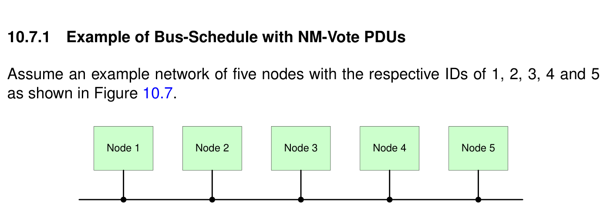

图10.7：五节点网络示例（**Figure 10.7: Example of five Node Network**）

FlexRay 调度在静态段中分配了 5 个时隙，在动态段中分配了 6 个（微）时隙，如图10.8所示。为了简化示例，节点被分配了与节点编号相同的静态编号，例如节点 1 在静态时隙 1 中发送，节点 2 在静态时隙 2 中发送，依此类推。

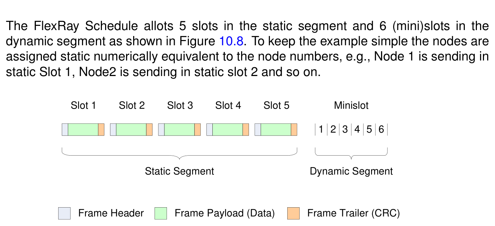

图10.8：总线调度示例（**Figure 10.8: Example of Bus Schedule**）

节点 2 和 5 在静态段中发送它们的 NM 投票，而其余三个节点 1、3 和 4 在动态段中发送它们的 NM 投票，如图10.9所示。

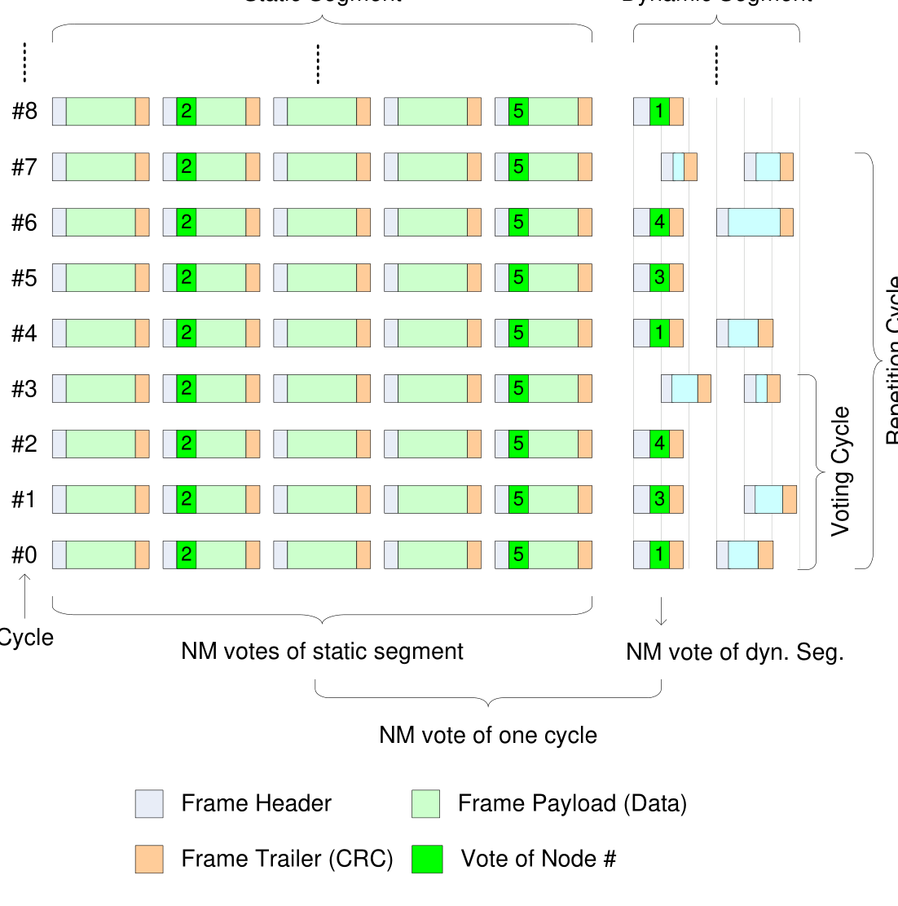

图10.9：动态段和静态段中的 NM 投票示例（**Figure 10.9: Example of NM-Vote in dynamic and static segment**）

由于存在三个动态投票者，投票循环为 4 并因此每四个循环重复一次（循环 0-1-2-3 和 4-5-6-7，依此类推）。请注意，在投票循环的最后一个循环中不会发送任何 NM 投票，因为所有节点都已经投过票。在本示例中，重复循环设置为 2，即投票循环的两倍。因此每个节点将发送它的投票两次。

#### 9.5.2. 使用 NM-Data PDU 的总线调度示例

本示例使用与上一示例（第 9.5.1 节）相同的设置——五个节点（图10.7）、静态段中的 5 个时隙以及动态段中的 6 个时隙（图10.8）。

五个节点需要发送它们的 NM 数据，这导致数据循环为「8」，因为由于 FlexRay 循环复用的限制，只允许 1、2、4、8、16、32 和 64（参见第 6.9.1 节的规定）。

图10.10显示节点 1 将在循环 2、10 等中发送其 NM 数据。节点 2、3、4 和 5 将以类似的方式运行。

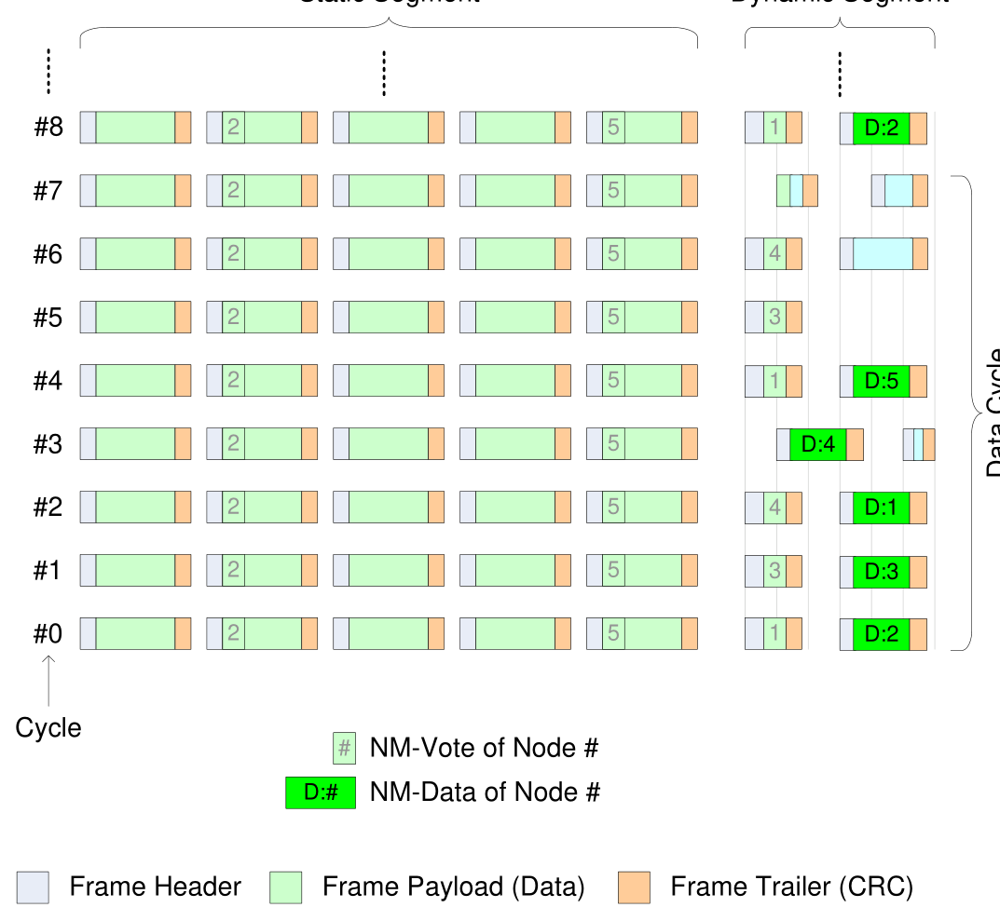

图10.10：使用 NM 数据的总线调度示例（**Figure 10.10: Example of Bus Schedule with NM-Data**）

由于数据循环为「8」，所有节点每 8 个循环才发送一次它们的 NM 数据。

## B. AUTOSAR 可追溯项变更历史

请注意，本章中的列表还包含已在后续版本中从规范中删除的可追溯项。这些项不会作为超链接出现在文档中。

### B.1. 本文档根据 AUTOSAR 发布版本 R23-11 的可追溯项历史

#### B.1.1. R23-11 中新增的规范项

无。

#### B.1.2. R23-11 中变更的规范项

无。

#### B.1.3. R23-11 中删除的规范项

无。
