## 1. 简介和功能概述

本规范描述 **AUTOSAR** 基础软件模块 FlexRay 状态管理器（**FrSM**）的功能、**API** 和配置。

**AUTOSAR BSW** 协议栈为每条通信总线规定了一个总线特定的状态管理器。该模块应实现相应总线的控制流。**FrSM** 是通信服务层的成员。它与通信硬件抽象层和系统服务层交互。

## 2. 缩略语和简称

下面的词汇表包含与 FlexRay 管理器模块相关、且未包含在 [\[1\]](#ref-1)（**AUTOSAR** 术语表）中的缩略语和缩写。

**BswM**
> 基础软件模式管理器（**Basic Software Mode Manager**）

**CC**
> 通信控制器（**Communication Controller**）

**CHI**
> 控制器主机接口（**Controller Host Interface**）

**ComM**
> **AUTOSAR** 通信管理器（**AUTOSAR Communication Manager**）

**DCM**
> 诊断通信管理器（**Diagnostic Communication Manager**）

**e.g.**
> [拉丁语] exempli gratia = [英语] for example（例如）

**EcuM**
> **ECU** 状态管理器（**ECU State Manager**）

**Fr**
> FlexRay 驱动程序（**FlexRay Driver**）

**FrIf**
> FlexRay 接口（**AUTOSAR BSW** 模块）

**FrSM**
> FlexRay 状态管理器（**FlexRay State Manager**）

**FrTrcv**
> FlexRay 收发器驱动程序（**FlexRay Transceiver Driver**）

**i.e.**
> [拉丁语] id est = [英语] that is（即）

**N/A**
> 不适用

**POC**
> 协议操作控制（**Protocol Operation Control**）

**POCState**
> **POC** 在 **CC** 内部的实际状态。在某些情况下该状态可能与 vPOC!State 不同，例如在调用 FREEZE 命令之后（详情参见 [\[3\]](#ref-3)）。

**RX**
> 接收（**Reception**）

**SchM**
> 调度管理器（**Schedule Manager**）

**TX**
> 发送（**Transmission**）

**vPOC**
> 由 **CC** 在 **CHI** 处提供给主机的数据结构，它包含 **CC** 的实际 POC 状态。

**vPOC!Freeze**
> vPOC!Freeze 表示 vPOC 数据结构中的 Freeze 位。**CC** 使用 Freeze 位来指示由于错误条件而进入了 HALT 状态。

**vPOC!SlotMode**
> vPOC!SlotMode 表示 vPOC 数据结构中的 SlotMode 字段。

**WUP**
> 唤醒模式（**Wake-Up Pattern**）

### 2.1. 术语

**主动唤醒（Active wake-up）**
> 由该 **ECU**（例如由某个传感器）引起的唤醒。

**被动唤醒（Passive wake-up）**
> 由另一个 **ECU** 引起、并（例如通过总线或唤醒线）传播到当前所关注的 **ECU** 的唤醒。

**远程唤醒（Remote wake-up）**
> 由 FlexRay 总线或唤醒线接收到的被动唤醒。

## 3. 相关文档

### 3.1. 输入文件和相关标准与规范

<a id="ref-1"></a>[1] Glossary
> AUTOSAR_FO_TR_Glossary

<a id="ref-2"></a>[2] General Specification of Basic Software Modules
> AUTOSAR_CP_SWS_BSWGeneral

<a id="ref-3"></a>[3] FlexRay Communications System Protocol Specification V2.1
> http://www.flexray.com/

<a id="ref-4"></a>[4] General Requirements on Basic Software Modules
> AUTOSAR_CP_SRS_BSWGeneral

### 3.2. 相关规范

**AUTOSAR** 提供了一份基础软件模块通用规范 [\[2\]](#ref-2)（**SWS BSW General**），该规范同样适用于 **FrSM**。

因此，规范 **SWS BSW General** 应被视为 **FrSM** 的附加且必需的规范。

## 4. 约束和假设

### 4.1. 限制

本规范只定义在 FlexRay 集群上启动和停止通信的直接了当的情形。

对于一个 **ECU** 的多个 **CC** 分配给同一个 FlexRay 集群的情况，一些事项留给实现去解决：

* 使用哪个 **CC** 发送唤醒模式
* 如何处理各 **CC** 之间不一致的 POC 状态

### 4.2. 汽车域的适用性

FlexRay 通信协议栈可应用于任何需要高数据速率和容错通信（结合 [\[3\]](#ref-3)，FlexRay 协议规范）的场合。此外，它还支持车内多个 **ECU** 的同步运行。

**FrSM** 可用于所有使用 FlexRay 协议的域应用。

## 5. 对其他模块的依赖

### 5.1. AUTOSAR BSW 调度器

**BSW** 调度器调用 **FrSM** 的主函数，这些主函数是 **FrSM** 周期性处理所必需的。

### 5.2. AUTOSAR 通信管理器

**ComM** 请求网络通信模式，并在达到某个通信模式时被 **FrSM** 通知。

### 5.3. AUTOSAR FlexRay 接口

**FrSM** 使用 **FrIf** 的 **API** 来初始化 FlexRay 通信硬件，并控制分配给 FlexRay 网络的 FlexRay 控制器和 FlexRay 收发器的运行模式。

### 5.4. AUTOSAR 默认错误跟踪器

为了能够报告开发错误，**FrSM** 必须能够访问默认错误跟踪器的错误钩子（error hook）。

### 5.5. AUTOSAR 诊断事件管理器

为了能够报告生产错误，**FrSM** 必须能够访问诊断事件管理器。

### 5.6. AUTOSAR BSW 模式管理器

为了能够报告状态变化，**FrSM** 必须能够访问 **BSW** 模式管理器。

### 5.7. AUTOSAR FlexRay 网络管理

为了能够报告启动失败，**FrSM** 必须能够访问 FlexRay 网络管理。

### 5.8. 文件结构

#### 5.8.1. 代码文件结构

详情请参阅 [\[2\]](#ref-2)（SWS BSW General）中第 5.1.6 节「代码文件结构（Code file structure）」。

#### 5.8.2. 头文件结构

头文件 **FrSM.h** 应包含软件版本号和规范版本号。

**FrSM** 模块应基于对相关代码文件和头文件版本号的预处理检查，执行代码文件与头文件之间的一致性检查。

## 6. 功能规格

### 6.1. 背景与基本原理

FlexRay 启动是一个与 **CAN** 完全不同的复杂过程。例如在 **CAN** 上任何消息都可以唤醒总线，而在 FlexRay 上需要一个特殊的唤醒模式。为了使 FlexRay 启动过程尽可能可靠，必须由一个具备深入 FlexRay 知识的 **BSW** 模块来控制它。由于 **AUTOSAR ComM** 具有完全抽象的总线视图，将这一抽象视图映射到 FlexRay **POC** 的状态以及改变这些状态的 **CHI** 命令是 **FrSM** 的任务。

### 6.2. FlexRay 状态管理器的主要任务

FrSm 模块的主要任务可以概括如下：

FrSM 模块应向 **AUTOSAR ComM** 模块提供一个抽象接口，用于启动或关闭 FlexRay 集群上的通信。FrSM 模块不应直接访问 FlexRay 硬件（FlexRay 通信控制器和 FlexRay 收发器），而应借助 FrIf 模块进行访问。FrIf 模块将请求重定向到相应的驱动程序模块。

### 6.3. FlexRay 状态管理器的状态机

#### 6.3.1. 一般说明

FrSM 应为每个 FlexRay 集群实现一个状态机。

该状态机的状态在某种程度上派生自 FlexRay **CC** 的 POC 状态。本文档基于这样一个假设：每个 FlexRay 集群总是存在唯一的 POC 状态（参见第 [4.1](#41-限制) 节的限制）。

每个集群的状态机由分配给该集群的主函数 FrSM\_MainFunction() 处理。不过，状态机的某些转换在 FrSM\_RequestComMode() 函数的上下文中处理，以获得确定性的关闭行为。

#### 6.3.2. 状态

状态机应包含以下状态：

* **FRSM_READY**
* **FRSM_WAKEUP**
* **FRSM_STARTUP**
* **FRSM_HALT_REQ**
* **FRSM_ONLINE**
* **FRSM_ONLINE_PASSIVE**
* **FRSM_KEYSLOT_ONLY**
* **FRSM_LOW_NUMBER_OF_COLDSTARTERS**

表7.1提供了关于状态机各状态的附加信息。

表7.1：FrSM 状态及其映射（**FrSM states and their mapping**）

| FrSM 集群状态 | 映射的 FlexRay CC 状态 | 描述 |
| --- | --- | --- |
| FRSM_READY | POC:ready | |
| FRSM_WAKEUP | POC:wake-up | FrSM 执行唤醒 |
| FRSM_STARTUP | POC:start-up | FrSM 执行启动 |
| FRSM_HALT_REQ | POC:normal active 或 POC:normal passive | FrSM 执行关闭 |
| FRSM_ONLINE | POC:normal active | 完全通信 |
| FRSM_ONLINE_PASSIVE | POC:normal passive | 由于时钟同步错误，不发送也不接收任何数据。 |
| FRSM_KEYSLOT_ONLY | POC:normal active 且 vPOCSlotMode = AllSlots | 数据只能在关键时隙中发送。 |
| FRSM_LOW_NUMBER_OF_COLDSTARTERS | POC:normal active | 完全通信；FlexRay 仅基于同步帧进行同步。 |

为了控制被动模式（只接收），状态机应额外包含以下与上述状态并发的状态：

* **FRSM_ECU_ACTIVE**
* **FRSM_ECU_PASSIVE**

表7.2提供了关于这些附加状态的更多信息。

表7.2：FrSM 附加状态（**FrSM Additional States**）

| FrSM 附加状态 | 描述 |
| --- | --- |
| FRSM_ECU_ACTIVE | 当 FrSM 同时处于 FRSM_READY 状态时，收发器被设置为 FRTRCV_TRCVMODE_STANDBY 模式，否则被设置为 FRTRCV_TRCVMODE_NORMAL 模式。 |
| FRSM_ECU_PASSIVE | 当 FrSM 同时处于 FRSM_READY 状态时，收发器被设置为 FRTRCV_TRCVMODE_STANDBY 模式，否则被设置为 FRTRCV_TRCVMODE_RECEIVEONLY 模式。 |

为了向 **BswM** 报告这两个并发状态，应按如下方式确定相应的 FrSM\_BswM\_StateType 取值：

* FrSM 附加状态为 FRSM\_ECU\_ACTIVE 时，报告相应的 FrSM 状态，例如 FRSM\_ONLINE
* FrSM 附加状态为 FRSM\_ECU\_PASSIVE 时，报告相应的 FrSM 状态并加上后缀「\_ECU\_PASSIVE」，例如 FRSM\_ONLINE\_ECU\_PASSIVE

表7.3列出了向 BswM 的所有可能报告。

表7.3：FrSM 向 BswM 的状态报告（**FrSM state reporting to BswM**）

| FrSM 集群状态 | FrSM 附加状态 | [FrSM_BswM_StateType](#722-frsm_bswm_statetype) 取值 |
| --- | --- | --- |
| FRSM_READY | FRSM_ECU_ACTIVE | FRSM_READY |
| FRSM_READY | FRSM_ECU_PASSIVE | FRSM_READY_ECU_PASSIVE |
| FRSM_WAKEUP | FRSM_ECU_ACTIVE | FRSM_WAKEUP |
| FRSM_WAKEUP | FRSM_ECU_PASSIVE | FRSM_WAKEUP_ECU_PASSIVE |
| FRSM_STARTUP | FRSM_ECU_ACTIVE | FRSM_STARTUP |
| FRSM_STARTUP | FRSM_ECU_PASSIVE | FRSM_STARTUP_ECU_PASSIVE |
| FRSM_ONLINE | FRSM_ECU_ACTIVE | FRSM_ONLINE |
| FRSM_ONLINE | FRSM_ECU_PASSIVE | FRSM_ONLINE_ECU_PASSIVE |
| FRSM_ONLINE_PASSIVE | FRSM_ECU_ACTIVE | FRSM_ONLINE_PASSIVE |
| FRSM_ONLINE_PASSIVE | FRSM_ECU_PASSIVE | FRSM_ONLINE_PASSIVE_ECU_PASSIVE |
| FRSM_KEYSLOT_ONLY | FRSM_ECU_ACTIVE | FRSM_KEYSLOT_ONLY |
| FRSM_KEYSLOT_ONLY | FRSM_ECU_PASSIVE | FRSM_KEYSLOT_ONLY_ECU_PASSIVE |
| FRSM_HALT_REQ | FRSM_ECU_ACTIVE | FRSM_HALT_REQ |
| FRSM_HALT_REQ | FRSM_ECU_PASSIVE | FRSM_HALT_REQ_ECU_PASSIVE |
| FRSM_LOW_NUMBER_OF_COLDSTARTERS | FRSM_ECU_ACTIVE | FRSM_LOW_NUMBER_OF_COLDSTARTERS |
| FRSM_LOW_NUMBER_OF_COLDSTARTERS | FRSM_ECU_PASSIVE | FRSM_LOW_NUMBER_OF_COLDSTARTERS_ECU_PASSIVE |

#### 6.3.3. 变量

除了其状态之外，状态机描述还使用了以下变量。请注意，这些变量只是提高规范清晰度和可读性的辅助手段。

| FrSM 变量 | 类型 | 描述 |
| --- | --- | --- |
| reqComMode | ComM_ModeType | ComM 已请求的通信模式。本文档中通信模式缩写如下：NoCom：COMM_NO_COMMUNICATION；SilentCom：COMM_SILENT_COMMUNICATION；FullCom：COMM_FULL_COMMUNICATION。根据 ComM_ModeType 的定义，这些模式的排序为：NoCom &lt; SilentCom &lt; FullCom |
| startupCounter | Integer | 已经执行的启动尝试次数 |
| wakeupType | Enum | 支持以下取值：SingleChannelWakeup、DualChannelWakeup、DualChannelWakeupForward、NoWakeup |
| wakeupTransmitted | Boolean | 如果在至少一次尝试发送唤醒模式时 vPOC!WakeupStatus = FR_WAKEUP_TRANSMITTED，则为 true，否则为 false |
| busTrafficDetected | Boolean | 如果在至少一次尝试发送唤醒模式时 vPOC!WakeupStatus = FR_WAKEUP_RECEIVED_HEADER 或 FR_WAKEUP_RECEIVED_WUP，则为 true，否则为 false |
| wakeupCounter | Integer | 已经执行的发送唤醒模式的尝试次数。 |

请注意，静默通信模式（SilentCom）在 FlexRay 上不受支持；ComM 模块不得请求它。

#### 6.3.4. 状态机配置

状态机描述使用以下配置参数，这些参数在第 [9.2.4](#924-frsmcluster) 节中针对每个 FlexRay 集群定义：

| FrSM 配置参数 | 类型 | 描述 |
| --- | --- | --- |
| FrSMIsWakeupEcu | Boolean | 配置参数，参见第 [9.2.4](#924-frsmcluster) 节。 |
| FrSMCheckWakeupReason | Boolean | 配置参数，参见第 [9.2.4](#924-frsmcluster) 节。 |
| FrSMIsColdstartEcu | Boolean | 配置参数，参见第 [9.2.4](#924-frsmcluster) 节。 |
| FrSMIsDualChannelNode | Boolean | 该参数派生自 FrIf 配置。如果相应的 FrIf 集群连接到 FlexRay 集群的两个信道，则该参数为 TRUE。否则为 FALSE。 |
| FrSMStartupRepetitionsWithWakeup | Integer | 配置参数，参见第 [9.2.4](#924-frsmcluster) 节。如果省略该可选配置参数，则不做任何限制，即该配置参数被视为具有取值 ∞ |
| FrSMStartupRepetitions | Integer | 配置参数，参见第 [9.2.4](#924-frsmcluster) 节。如果省略该可选配置参数，则不做任何限制，即该配置参数被视为具有取值 ∞ |
| FrSMNumWakeupPatterns | Integer | 配置参数，参见第 [9.2.4](#924-frsmcluster) 节。 |
| FrSMDelayStartupWithoutWakeup | Boolean | 配置参数，参见第 [9.2.4](#924-frsmcluster) 节。 |
| FrSMMinNumberOfColdstarter | Integer | 配置参数，参见第 [9.2.4](#924-frsmcluster) 节。 |

#### 6.3.5. 条件

状态机描述使用以下条件，这些条件在运行时针对每个 FlexRay 集群求值：

| FrSM 条件 | 类型 | 描述 |
| --- | --- | --- |
| WUReason | Enum | 如果 FrSMCheckWakeupReason 为 false，则 WUReason 求值为 NO_WU_BY_BUS。否则，如果 FrSMCheckWakeupReason 为 true，则通过对该 FlexRay 集群的每个收发器调用 FrIf_GetTransceiverWUReason 来确定唤醒原因，并检查 FRTRCV_WU_BY_BUS，将 WUReason 求值为：NO_WU_BY_BUS（未检测到唤醒）；PARTIAL_WU_BY_BUS（该 ECU 连接到集群的两条 FlexRay 信道、且只在恰好一条信道上检测到了唤醒）；ALL_WU_BY_BUS（在该 ECU 所连接的集群的全部 FlexRay 信道上都检测到了唤醒）。 |
| t1_IsActive | boolean | 如果 t1 已启动且尚未超时，则求值为 true，否则为 false |
| t3_IsNotActive | boolean | 如果 t3 正在运行且尚未超时，则求值为 false，否则为 true。 |
| t_TrcvStdbyDelay_IsActive | boolean | 如果 t_TrcvStdbyDelay 已启动且尚未超时，则求值为 true，否则为 false。 |
| wakeupFinished | boolean | 如果第 [6.3.8](#638-唤醒模式的发送) 节定义的唤醒模式发送仍在进行中，则求值为 false，否则为 true。 |
| lowNumberOfColdstarters | boolean | 如果 FrIf_GetNumOfStartupFrames() 小于 FrSMMinNumberOfColdstarter，则求值为 true，否则为 false。 |

#### 6.3.6. 定时器

状态机描述为每个 FlexRay 集群使用以下定时器：

| 定时器 | 描述 |
| --- | --- |
| t1 | 定时器 t1 模拟清除冷启动禁止模式（即调用 FrIf_AllowColdstart）的延迟。该定时器的持续时间可以通过配置参数 FrSMDurationT1 静态配置。 |
| t2 | 定时器 t2 模拟 FrSM 重复启动 FlexRay 集群的时间差。该定时器的持续时间可以通过配置参数 FrSMDurationT2 静态配置。 |
| t3 | 定时器 t3 监控向 FullCom 的转换。该定时器的持续时间可以通过配置参数 FrSMDurationT3 静态配置。 |
| t4 | 定时器 t4 确保双信道节点最终会清除其冷启动禁止位并成为主导冷启动节点。 |
| t_TrcvStdbyDelay | 定时器 t_TrcvStdbyDelay 模拟在 FlexRay 通信停止后、FrSM 重新初始化 FlexRay 通信控制器并将收发器设置为 STANDBY 模式的时间差。 |

如果配置参数 FrSMDurationT1 设置为 0，则不启动定时器 t1。取而代之，对 FrIf_AllowColdstart 的调用应紧随对 FrIf_StartCommunication 的调用之后。

如果定时器 t2 的持续时间 FrSMDurationT2 设置为 0，则不监控 FlexRay 集群的启动。

注意，对任何定时器是以软件还是硬件实现不做任何假设。

如果配置参数 FrSMTrcvStdbyDelay 未配置或设置为 0，则不启动定时器 t\_TrcvStdbyDelay。取而代之，应立即执行从状态 FRSM\_HALT\_REQ 到 FRSM\_READY 的转换。

#### 6.3.7. 功能元素

在状态机转换中执行的功能被划分为以下功能元素。也就是说，下表包含在 FrSM 状态机描述中用作动作的缩写，它们引用在 FrSM 模块接口处可见的一个或多个函数调用。

| 功能元素 | 描述 |
| --- | --- |
| FE_WAKEUP | 为 FlexRay 集群的每个控制器调用 FrIf_SendWUP。 |
| FE_SET_WU_CHANNEL_INITIAL | 对于单信道节点，不执行任何操作。对于双信道节点，为 FlexRay 集群的每个控制器调用 FrIf_SetWakeupChannel，以便将唤醒信道设置为信道 A。 |
| FE_SET_WU_CHANNEL_FORWARD | 对于单信道节点，不执行任何操作。对于双信道节点，为 FlexRay 集群的每个控制器调用 FrIf_SetWakeupChannel，以便将唤醒信道设置为在对 WUReason 求值期间未检测到唤醒的信道。 |
| FE_CONFIG | 为 FlexRay 集群的每个控制器调用 FrIf_ControllerInit。 |
| FE_START | 为 FlexRay 集群的每个控制器调用 FrIf_StartCommunication。 |
| FE_ALLOW_COLDSTART | 如果配置参数 FrSMIsColdstartEcu 为 true，则为 FlexRay 集群的每个控制器调用 FrIf_AllowColdstart。 |
| FE_HALT | 为 FlexRay 集群的每个控制器调用 FrIf_HaltCommunication。 |
| FE_TRCV_STANDBY | 为 FlexRay 集群的每个收发器调用 FrIf_SetTransceiverMode，其中 FrIf_TrcvMode 为 FRTRCV_TRCVMODE_STANDBY。 |
| FE_TRCV_NORMAL | 如果 FrSM 状态机处于 FRSM_ECU_ACTIVE 状态，则为 FlexRay 集群的每个收发器调用 FrIf_SetTransceiverMode（其中 FrIf_TrcvMode 为 FRTRCV_TRCVMODE_NORMAL）和 FrIf_ClearTransceiverWakeup。如果 FrSM 状态机处于 FRSM_ECU_PASSIVE 状态，则为 FlexRay 集群的每个收发器调用 FrIf_SetTransceiverMode（其中 FrIf_TrcvMode 为 FRTRCV_TRCVMODE_RECEIVEONLY）和 FrIf_ClearTransceiverWakeup。 |
| FE_START_FRIF | 通过为该集群调用 FrIf_SetState（其中 FrIf_StateTransition 为 FRIF_GOTO_ONLINE），将 FrIf 状态设置为 ONLINE。 |
| FE_STOP_FRIF | 通过为该集群调用 FrIf_SetState（其中 FrIf_StateTransition 为 FRIF_GOTO_OFFLINE），将 FrIf 状态设置为 OFFLINE。 |
| FE_DEM_STATUS_FAILED | 将生产错误 [FRSM_E_CLUSTER_STARTUP](#654-生产错误) 的状态报告为 failed。 |
| FE_DEM_STATUS_PASSED | 将生产错误 [FRSM_E_CLUSTER_STARTUP](#654-生产错误) 的状态报告为 passed。 |
| FE_DEM_SYNC_LOSS | 将生产错误 [FRSM_E_CLUSTER_SYNC_LOSS](#654-生产错误) 的状态报告为 failed。如果配置了指示函数的名称（参见第 [7.6.3](#763-可配置接口) 节），则以参数 SyncLossErrorStatus = true 调用该指示函数。 |
| FE_DEM_SYNC_LOSS_PASSED | 如果配置了指示函数的名称（参见第 [7.6.3](#763-可配置接口) 节），则以参数 SyncLossErrorStatus = false 调用该指示函数。此外，将生产错误 [FRSM_E_CLUSTER_SYNC_LOSS](#654-生产错误) 的状态报告为 passed。 |
| FE_FULL_COM_IND | 通过调用 ComM_BusSM_ModeIndication（FullCom）向 ComM 指示已达到 FullCom。 |
| FE_NO_COM_IND | 通过调用 ComM_BusSM_ModeIndication（NoCom）向 ComM 指示已离开 FullCom。 |
| FE_STARTUP_ERROR_IND | 调用 FrNm_StartupError。 |

#### 6.3.8. 唤醒模式的发送

FrSM 应按照配置参数 FrSMNumWakeupPatterns 重复唤醒模式的发送。也就是说，当处于 FRSM\_WAKEUP 状态时，FlexRay 状态管理器应执行以下动作：

* 进入 FRSM\_WAKEUP 状态时，将计数器 wakeupCounter 设置为 1
* 当 wakeupCounter &lt; FrSMNumWakeupPatterns 且 busTrafficDetected = false 时：
  * 等待，直到 FlexRay 集群的 FlexRay 控制器处于状态 FR\_READY
  * 当 FlexRay 控制器处于 FR\_READY 状态时，检查 FlexRay 控制器的 vPOC!WakeupStatus 并按如下方式行动：
    * 如果 vPOC!WakeupStatus = FR\_WAKEUP\_RECEIVED\_HEADER ∨ FR\_WAKEUP\_RECEIVED\_WUP：busTrafficDetected := true
    * 否则如果 vPOC!WakeupStatus = FR\_WAKEUP\_TRANSMITTED：wakeupTransmitted := true
    * 否则：wakeupTransmitted := false
* 如果 busTrafficDetected = false 且 wakeupCounter &lt; FrSMNumWakeupPatterns，则执行 FE\_WAKEUP
* 递增 wakeupCounter

如果任何一个 FlexRay 控制器由于错误条件而进入 HALT 状态，则应中止唤醒模式的发送，且 wakeupFinished 条件应求值为 true。

#### 6.3.9. 转换

下图展示了 FrSM 状态机。

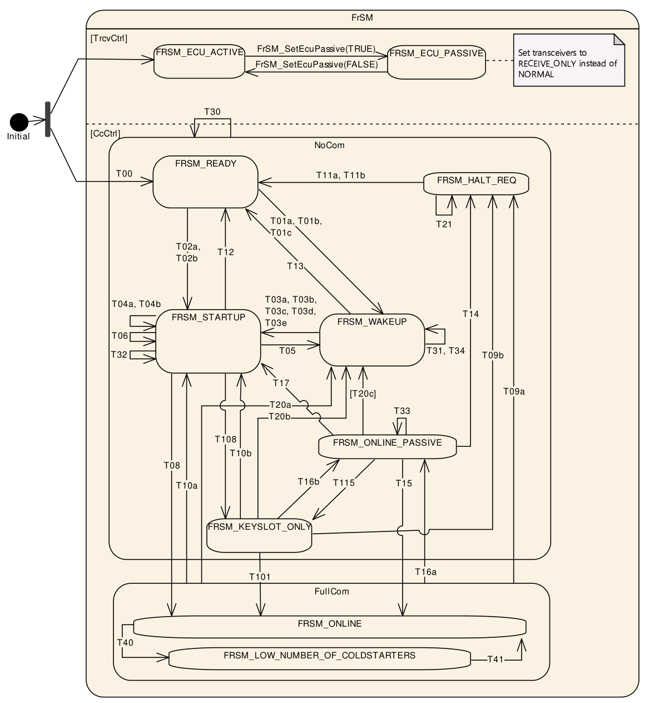

图7.1：FrSM 状态机（**Figure 7.1: FrSM state machine**）

请注意，各状态在第 [6.3.2](#632-状态) 节中描述。

下表定义了触发 FrSM 状态机转换的事件和条件，以及在转换内执行的动作。表的每一行包含一条需求，应按如下方式解释：如果 FrSM 模块处于「Transition」列中该转换的源状态（按前述转换表定义），并且当「Event [Condition]」列中的条件成立、且「Event [Condition]」列中的事件发生时，则应执行「Actions」列中的动作，随后 FrSM 模块应将其状态改变为「Transition」列中该转换的目标状态。

如果在转换 T 中必须执行不同的动作，则表中可以有多行。在这种情况下，这些行被标记为 T (a)、T (b) 等。注意，这些条件确保只有一种可能性匹配。

FrSM 应按照转换表内定义的顺序执行转换的动作。

在每次转换到不同状态之后，FrSM 应通过调用 BswM\_FrSM\_CurrentState 通知 BswM。

| 转换 | 事件 [条件] | 动作 |
| --- | --- | --- |
| T00 | [FrSM_Init](#731-frsm_init)() | FE_CONFIG |
| T01 (a) | [ reqComMode = FullCom ∧ FrSMIsWakeupEcu ∧ WUReason = NO_WU_BY_BUS ∧ ¬ FrSMIsDualChannelNode ] | FE_TRCV_NORMAL；startupCounter := 1；wakeupType := SingleChannelWakeup；wakeupTransmitted := false；FE_WAKEUP；start t1；start t3 |
| T01 (b) | [ reqComMode = FullCom ∧ FrSMIsWakeupEcu ∧ WUReason = NO_WU_BY_BUS ∧ FrSMIsDualChannelNode ] | FE_TRCV_NORMAL；startupCounter := 1；wakeupType := DualChannelWakeup；FE_SET_WU_CHANNEL_INITIAL；wakeupTransmitted := false；FE_WAKEUP；start t3；start t4 |
| T01 (c) | [ reqComMode = FullCom ∧ FrSMIsWakeupEcu ∧ WUReason = PARTIAL_WU_BY_BUS ] | FE_TRCV_NORMAL；startupCounter := 1；wakeupType := DualChannelWakeupForward；FE_SET_WU_CHANNEL_FORWARD；wakeupTransmitted := false；FE_WAKEUP；start t3 |
| T02 (a) | [ reqComMode = FullCom ∧ ( ¬ FrSMIsWakeupEcu ∨ WUReason = ALL_WU_BY_BUS ) ∧ ¬ FrSMDelayStartupWithoutWakeup ] | FE_TRCV_NORMAL；startupCounter := 1；wakeupType := NoWakeup；FE_START；FE_ALLOW_COLDSTART；start t2；start t3 |
| T02 (b) | [ reqComMode = FullCom ∧ ( ¬ FrSMIsWakeupEcu ∨ WUReason = ALL_WU_BY_BUS ) ∧ FrSMDelayStartupWithoutWakeup ] | FE_TRCV_NORMAL；startupCounter := 1；wakeupType := NoWakeup；FE_START；start t1；start t2；start t3 |
| T03 (a) | [ wakeupFinished ∧ reqComMode = FullCom ∧ FrSMNumWakeupPatterns = 1 ∧ wakeupType = SingleChannelWakeup ] | FE_START；cancel t1；start t1；start t2 |
| T03 (b) | [ wakeupFinished ∧ reqComMode = FullCom ∧ FrSMNumWakeupPatterns &gt; 1 ∧ wakeupTransmitted ∧ wakeupType = SingleChannelWakeup ] | FE_START；start t2；IF t1_IsActive: cancel t1 ELSE: FE_ALLOW_COLDSTART |
| T03 (c) | [ wakeupFinished ∧ reqComMode = FullCom ∧ FrSMNumWakeupPatterns &gt; 1 ∧ ¬ wakeupTransmitted ∧ wakeupType = SingleChannelWakeup ] | FE_START；start t2 |
| T03 (d) | [ wakeupFinished ∧ reqComMode = FullCom ∧ wakeupType = DualChannelWakeup ∧ wakeupTransmitted ∧ ¬ busTrafficDetected ] | FE_START；start t2 |
| T03 (e) | [ wakeupFinished ∧ reqComMode = FullCom ∧ wakeupType = DualChannelWakeupForward ] | FE_START；FE_ALLOW_COLDSTART；start t2；cancel t4 |
| T04 (a) | t1 [ reqComMode = FullCom ∧ vPOC!State = Normal Active ] | FE_ALLOW_COLDSTART |
| T04 (b) | t4 [ reqComMode = FullCom ∧ wakeupType = DualChannelWakeup ∧ vPOC!State = Normal Active ] | FE_ALLOW_COLDSTART |
| T05 | t2 [ startupCounter ≤ FrSMStartupRepetitionsWithWakeup ∧ reqComMode = FullCom ∧ wakeupType = NoWakeup ∧ vPOC!State = Normal Active ] | FE_CONFIG；FE_WAKEUP；startupCounter := startupCounter + 1；start t4（仅双信道节点） |
| T06 | t2 [ ( FrSMStartupRepetitionsWithWakeup &lt; startupCounter ∧ wakeupType = NoWakeup ) ∧ startupCounter ≤ FrSMStartupRepetitions ∧ reqComMode = FullCom ∧ vPOC!State = Normal Active ] | FE_CONFIG；FE_START；FE_ALLOW_COLDSTART；startupCounter := startupCounter + 1；start t2 |
| T08 | [ vPOC!State = Normal Active ∧ ¬ vPOCFreeze ∧ vPOCSlotMode = AllSlots ∧ reqComMode = FullCom ] | cancel t1；cancel t2；FE_START_FRIF；FE_DEM_STATUS_PASSED；FE_DEM_SYNC_LOSS_PASSED；FE_FULL_COM_IND；cancel t3 |
| T108 | [ vPOC!State = Normal Active ∧ ¬ vPOCFreeze ∧ vPOCSlotMode = AllSlots ∧ reqComMode = FullCom ] | cancel t1；cancel t2；FE_START_FRIF；FE_DEM_STATUS_PASSED；FE_DEM_SYNC_LOSS_PASSED；cancel t3 |
| T09a | [FrSM_RequestComMode](#732-frsm_requestcommode)() [ reqComMode = NoCom ] | FE_STOP_FRIF；FE_HALT；FE_NO_COM_IND |
| T09b | [FrSM_RequestComMode](#732-frsm_requestcommode)() [ reqComMode = NoCom ] | FE_STOP_FRIF；FE_HALT |
| T10a | [ (vPOC!State = Halt ∨ vPOCFreeze) ∧ reqComMode = FullCom ∧ (FrSMCheckWakeupReason ∨ ¬ FrSMIsWakeupEcu) ] | FE_DEM_SYNC_LOSS；FE_STOP_FRIF；FE_NO_COM_IND；FE_CONFIG；FE_START；startupCounter := 1；start t2；start t3 |
| T10b | [ (vPOC!State = Halt ∨ vPOCFreeze) ∧ reqComMode = FullCom ∧ (FrSMCheckWakeupReason ∨ ¬ FrSMIsWakeupEcu) ] | FE_DEM_SYNC_LOSS；FE_STOP_FRIF；FE_CONFIG；FE_START；startupCounter := 1；start t2；start t3 |
| T101 | [ vPOC!State = Normal Active ∧ ¬ vPOCFreeze ∧ vPOCSlotMode = AllSlots ] | FE_FULL_COM_IND |
| T11a | t_TrcvStdbyDelay[] | FE_TRCV_STANDBY；FE_CONFIG |
| T11b | [ (vPOC!State = Halt ∨ vPOCFreeze) ∧ reqComMode = FullCom ] | cancel t_TrcvStdbyDelay；FE_TRCV_STANDBY；FE_CONFIG |
| T12 | [reqComMode = NoCom] | cancel t1；cancel t2；cancel t3；FE_DEM_SYNC_LOSS_PASSED；FE_TRCV_STANDBY；FE_CONFIG |
| T13 | [reqComMode = NoCom] | FE_DEM_SYNC_LOSS_PASSED；FE_TRCV_STANDBY；FE_CONFIG；cancel t3；cancel t1 |
| T14 | [FrSM_RequestComMode](#732-frsm_requestcommode)() [ reqComMode = NoCom ] | FE_DEM_SYNC_LOSS_PASSED；FE_HALT；cancel t3 |
| T15 | [ vPOC!State = Normal Active ∧ ¬ vPOCFreeze ∧ vPOCSlotMode = AllSlots ] | FE_DEM_SYNC_LOSS_PASSED；FE_START_FRIF；FE_FULL_COM_IND；cancel t3 |
| T115 | [ vPOC!State = Normal Active ∧ ¬ vPOCFreeze ∧ vPOCSlotMode = AllSlots ] | FE_DEM_SYNC_LOSS_PASSED；FE_START_FRIF；cancel t3 |
| T16a | [ vPOC!State = Normal Passive ∧ ¬ vPOCFreeze ] | FE_DEM_SYNC_LOSS；FE_STOP_FRIF；FE_NO_COM_IND；start t3 |
| T16b | [ vPOC!State = Normal Passive ∧ ¬ vPOCFreeze ] | FE_DEM_SYNC_LOSS；FE_STOP_FRIF；start t3 |
| T17 | [ (vPOC!State = Halt ∨ vPOCFreeze) ∧ reqComMode = FullCom ∧ (FrSMCheckWakeupReason ∨ ¬ FrSMIsWakeupEcu) ] | FE_CONFIG；wakeupType := NoWakeup；FE_START；startupCounter := 1；start t2 |
| T20a | [ (vPOC!State = Halt ∨ vPOCFreeze) ∧ reqComMode = FullCom ∧ ¬ FrSMCheckWakeupReason ∧ FrSMIsWakeupEcu ] | wakeupType := SingleChannelWakeup；FE_DEM_SYNC_LOSS；FE_STOP_FRIF；FE_NO_COM_IND；FE_CONFIG；FE_WAKEUP；startupCounter := 1；start t1；start t3 |
| T20b | [ (vPOC!State = Halt ∨ vPOCFreeze) ∧ reqComMode = FullCom ∧ ¬ FrSMCheckWakeupReason ∧ FrSMIsWakeupEcu ] | wakeupType := SingleChannelWakeup；FE_DEM_SYNC_LOSS；FE_STOP_FRIF；FE_CONFIG；FE_WAKEUP；startupCounter := 1；start t1；start t3 |
| T20c | [ (vPOC!State = Halt ∨ vPOCFreeze) ∧ reqComMode = FullCom ∧ ¬ FrSMCheckWakeupReason ∧ FrSMIsWakeupEcu ] | wakeupType := SingleChannelWakeup；FE_CONFIG；FE_WAKEUP；startupCounter := 1；start t1；start t3 |
| T21 | [ (vPOC!State = Halt ∨ vPOCFreeze) ∧ ¬ t_TrcvStdbyDelay_IsActive ] | start t_TrcvStdbyDelay |
| T30 | t3[] | FE_DEM_STATUS_FAILED；FE_STARTUP_ERROR_IND |
| T31 | [t3_IsNotActive] | FE_STARTUP_ERROR_IND |
| T32 | [t3_IsNotActive] | FE_STARTUP_ERROR_IND |
| T33 | [t3_IsNotActive] | FE_STARTUP_ERROR_IND |
| T34 | [ wakeupFinished ∧ reqComMode = FullCom ∧ FrSMNumWakeupPatterns &gt; 1 ∧ ( ¬ wakeupTransmitted ∨ busTrafficDetected ) ∧ wakeupType = DualChannelWakeup ] | startupCounter := 1；wakeupType := DualChannelWakeupForward；FE_SET_WU_CHANNEL_FORWARD；wakeupTransmitted := false；busTrafficDetected := false；FE_WAKEUP；start t1；start t3 |
| T40 | [lowNumberOfColdstarters] | |
| T41 | [lowNumberOfColdstarters] | |

图例：

* ∧ AND（与）
* ∨ OR（或）
* ¬ NOT（非）
* := 赋值；start t：启动定时器 t；cancel t：停止定时器 t
* t1 [...]：转换 t1 的守护条件；t1 [...]：t1 已超时

注意：如果在达到 FullCom 之后失去同步，FrSM 模块将首先尝试在不允许冷启动的情况下使 FlexRay CC 进入启动状态。

基本原理：失去同步可能是该 **ECU** 的本地问题。因此，该 **ECU** 应首先尝试在不干扰集群的情况下重新集成。

注意：如果重新同步无法在 t2 超时之前完成（前述转换表中的 T08 和 T108），则将使用与初始同步相同的唤醒和启动过程。

注意：如果 FlexRay 集群的启动不成功（即定时器 t2 超时），FrSm 模块将根据计数器 startupCounter 的值重复启动过程：

* 如果 startupCounter 未超过阈值 FrSMStartupRepetitionsWithWakeup，则重复启动过程（包括唤醒）。
* 如果 startupCounter 超过了阈值 FrSMStartupRepetitionsWithWakeup 但未超过阈值 FrSMStartupRepetitions，则在不唤醒的情况下重复启动过程。

注意：当定时器 t3 超时后，FrSM 将报告生产错误 [**FRSM_E_CLUSTER_STARTUP**](#654-生产错误)。

注意：在定时器 t3 超时之后，FrSM 将调用 FrNm\_StartupError，直到要么实现了同步，要么请求了 NoCom（前述转换表中取消 t3 的所有转换）。

注意：当计数器 startupCounter 超过阈值 FrSMStartupRepetitions 时，被配置为冷启动节点的 **ECU** 将停止执行冷启动尝试。但是，如果另一个 **ECU** 执行冷启动，该 **ECU** 将加入冷启动。

注意：如果未配置阈值 FrSMStartupRepetitions，则被配置为冷启动节点的 **ECU** 将一直执行冷启动尝试，直到要么实现了同步，要么请求了 NoCom。

基本原理：如果 FlexRay **CC** 的接收路径发生故障，执行唤醒或冷启动的 **ECU** 可能会干扰 FlexRay 通信，因为它将无法检测到任何冲突。因此，无限次数的冷启动尝试可能导致 FlexRay 通信的持续干扰。

当对 FrIf **API** 的某个函数调用返回失败（例如 **E_NOT_OK**）时，FrSM 应忽略该返回值并继续执行该转换。

基本原理：当 FrIf 在生产环境中返回 **E_NOT_OK** 时，表示已向 **DEM** 报告了生产错误。这通常会触发 FlexRay 协议栈的重新初始化。

### 6.4. 配置描述

FrSM 配置工具读取 FrIf 的 **ECU** 配置描述，因为控制器到集群的映射包含在 FrIf 配置描述中。

### 6.5. 错误分类

文档 [\[2\]](#ref-2)「General Specification of Basic Software Modules」的「错误处理」一节详细描述了基础软件的错误处理。最重要的是，它构成了一个由五种错误类型组成的分类方案，这些错误类型可能发生在 **BSW** 模块中。

基于此，以下各节在相应的小节中规定了特定的错误。

#### 6.5.1. 开发错误

模块 FrSM 中开发错误的定义：

| 错误类型 | 相关错误代码 | 错误值 |
| --- | --- | --- |
| 参数列表中的指针无效。发生该错误时，除了报告该开发错误之外，API 服务应立即返回且不执行任何其他动作。 | **FRSM_E_PARAM_POINTER** | 0x01 |
| 无效的网络句柄参数 | **FRSM_E_INV_HANDLE** | 0x02 |
| FrSM 模块未被初始化 | **FRSM_E_UNINIT** | 0x03 |
| 请求了无效的通信模式 | **FRSM_E_INV_MODE** | 0x04 |
| 初始化失败 | **FRSM_INIT_FAILED** | 0x05 |

#### 6.5.2. 运行时错误

不存在运行时错误。

#### 6.5.3. 瞬态故障

不存在瞬态故障。

#### 6.5.4. 生产错误

##### 6.5.4.1. FRSM_E_CLUSTER_STARTUP

集群启动失败的生产错误定义：

| 项目 | 内容 |
| --- | --- |
| 错误名称 | [**FRSM_E_CLUSTER_STARTUP**](#654-生产错误) |
| 简短描述 | FlexRay 集群启动失败。 |
| 详细描述 | FlexRay 控制器在 FlexRay 启动后的配置时间内未达到 normal active 状态。 |
| 推荐的 DTC | 由 DEM 分配 |
| 检测准则 | Fail：FlexRay 控制器在时间 t3 内未达到 normal active 状态 |
| 检测准则 | Pass：FlexRay 控制器已达到 normal active 状态 |
| 次要参数 | None |
| 所需时间 | FrSMDurationT3 |
| 监控频率 | Continuous（连续） |
| MIL 点亮 | 由 DEM 分配 |

##### 6.5.4.2. FRSM_E_CLUSTER_SYNC_LOSS

失去同步的生产错误定义：

| 项目 | 内容 |
| --- | --- |
| 错误名称 | [**FRSM_E_CLUSTER_SYNC_LOSS**](#654-生产错误) |
| 简短描述 | FlexRay 失去同步。 |
| 详细描述 | FlexRay 控制器在成功启动后失去了同步。 |
| 推荐的 DTC | 由 DEM 分配 |
| 检测准则 | Fail：FlexRay 控制器在达到 normal active 状态之后失去了同步。 |
| 检测准则 | Pass：FlexRay 控制器已达到 normal active 状态，或者对 FlexRay 通信的请求已被释放。 |
| 次要参数 | None |
| 所需时间 | 取决于 FlexRay 配置。 |
| 监控频率 | Continuous（连续） |
| MIL 点亮 | 由 DEM 分配 |

#### 6.5.5. 扩展生产错误

不存在扩展生产错误。

## 7. API规范

### 7.1. 导入的类型

本章列出了从以下文件包含的所有类型。

| 模块 | 头文件 | 导入的类型 |
| --- | --- | --- |
| ComM | Rte_ComM_Type.h | ComM_ModeType |
| ComStack_Types | ComStack_Types.h | NetworkHandleType |
| Dem | Rte_Dem_Type.h | Dem_EventIdType |
| Dem | Rte_Dem_Type.h | Dem_EventStatusType |
| Fr | Fr_GeneralTypes.h | Fr_ChannelType |
| Fr | Fr_GeneralTypes.h | Fr_ErrorModeType |
| Fr | Fr_GeneralTypes.h | Fr_POCStateType |
| Fr | Fr_GeneralTypes.h | Fr_POCStatusType |
| Fr | Fr_GeneralTypes.h | Fr_SlotModeType |
| Fr | Fr_GeneralTypes.h | Fr_StartupStateType |
| Fr | Fr_GeneralTypes.h | Fr_WakeupStatusType |
| FrIf | FrIf.h | FrIf_StateTransitionType |
| FrTrcv | Fr_GeneralTypes.h | FrTrcv_TrcvModeType |
| FrTrcv | Fr_GeneralTypes.h | FrTrcv_TrcvWUReasonType |
| Std | Std_Types.h | Std_ReturnType |
| Std | Std_Types.h | Std_VersionInfoType |

### 7.2. 类型定义

#### 7.2.1. FrSM_ConfigType

| 名称 | FrSM_ConfigType |
| --- | --- |
| 类别 | 结构体（Structure） |
| 描述 | 该类型包含用于 [FrSM_Init](#731-frsm_init) 的实现特定的后构建时（post build time）配置结构体。 |
| 可通过 | FrSM.h 获得 |

#### 7.2.2. FrSM_BswM_StateType

| 名称 | FrSM_BswM_StateType | | |
| --- | --- | --- | --- |
| 类别 | 枚举 | | |
| 取值 | FRSM_BSWM_READY | 0x00 | - |
| | FRSM_BSWM_READY_ECU_PASSIVE | 0x01 | - |
| | FRSM_BSWM_STARTUP | 0x02 | - |
| | FRSM_BSWM_STARTUP_ECU_PASSIVE | 0x03 | - |
| | FRSM_BSWM_WAKEUP | 0x04 | - |
| | FRSM_BSWM_WAKEUP_ECU_PASSIVE | 0x05 | - |
| | FRSM_BSWM_HALT_REQ | 0x06 | - |
| | FRSM_BSWM_HALT_REQ_ECU_PASSIVE | 0x07 | - |
| | FRSM_BSWM_KEYSLOT_ONLY | 0x08 | - |
| | FRSM_BSWM_KEYSLOT_ONLY_ECU_PASSIVE | 0x09 | - |
| | FRSM_BSWM_ONLINE | 0x0A | - |
| | FRSM_BSWM_ONLINE_ECU_PASSIVE | 0x0B | - |
| | FRSM_BSWM_ONLINE_PASSIVE | 0x0C | - |
| | FRSM_BSWM_ONLINE_PASSIVE_ECU_PASSIVE | 0x0D | - |
| | FRSM_LOW_NUMBER_OF_COLDSTARTERS | 0x0E | - |
| | FRSM_LOW_NUMBER_OF_COLDSTARTERS_ECU_PASSIVE | 0x0F | - |
| 描述 | 该类型定义使用 BswM_FrSM_CurrentState 报告给 BswM 的状态。 | | |
| 可通过 | FrSM.h 获得 | | |

### 7.3. 函数定义

这是提供给上层模块的函数列表。

#### 7.3.1. FrSM_Init

**说明**： 初始化 FlexRay 状态管理器。可通过 **FrSM.h** 获得。本服务为同步调用，不可重入。参数 FrSM_ConfigPtr（in）：指向所选配置结构体的指针。无返回值。

```C
void FrSM_Init (const FrSM_ConfigType* FrSM_ConfigPtr)
```

[**FrSM_Init**](#731-frsm_init) 函数应初始化所有 FlexRay 集群的状态机，并将它们置于状态 **FRSM_READY**，即执行转换 T00。

[**FrSM_Init**](#731-frsm_init) 函数应在内部存储配置数据地址，使后续的 **API** 调用能够访问该配置数据。

如果启用了开发错误检测（FrSMDevErrorDetect 为 ON），则 [**FrSM_Init**](#731-frsm_init) 函数应在内部记住成功完成的初始化，供其他 **API** 函数检查模块是否已正确初始化。

#### 7.3.2. FrSM_RequestComMode

**说明**： ComM 使用该 **API** 函数来启动或关闭 FlexRay 集群上的通信。可通过 **FrSM.h** 获得。本服务为异步调用，对于不同的 FlexRay 集群可重入。参数 NetworkHandle（in）：该参数标识为其请求通信模式的 FlexRay 集群；ComM_Mode（in）：该参数保存所请求的通信模式。返回值：Std_ReturnType，E_OK：请求被接受；E_NOT_OK：请求未被接受。

```C
Std_ReturnType FrSM_RequestComMode (NetworkHandleType NetworkHandle, ComM_ModeType ComM_Mode)
```

[**FrSM_RequestComMode**](#732-frsm_requestcommode) 函数应存储所请求的通信模式。

FrSM\_MainFunction 的下一次激活将在处理相应集群的状态机时处理该请求。

注意，第 [6.2](#62-flexray-状态管理器的主要任务) 节中的状态机定义将该存储的请求称为 reqComMode。

如果 FullCom 已经达到（即相应集群的 FrSM 状态机处于状态 **FRSM_ONLINE**、**FRSM_KEYSLOT_ONLY**、**FRSM_LOW_NUMBER_OF_COLDSTARTERS** 或 **FRSM_ONLINE_PASSIVE**）之后请求了 NoCom，则 [**FrSM_RequestComMode**](#732-frsm_requestcommode) 函数应立即处理状态机的相应转换。

上述规定的基本原理：这应确保 NoCom 请求将在当前 FlexRay 循环结束时停止该 **ECU** 参与 FlexRay 通信。

如果 ComM\_Mode 的值为 COMM\_SILENT\_COMMUNICATION，则 FrSM 不应存储所请求的通信模式，并应返回 **E_NOT_OK**。如果启用了开发错误检测，则 FrSM 还应引发开发错误代码 [**FRSM_E_INV_MODE**](#651-开发错误)。

如果启用了开发错误检测且参数 NetworkHandle 的取值无效，则 [**FrSM_RequestComMode**](#732-frsm_requestcommode) 函数应引发开发错误代码 [**FRSM_E_INV_HANDLE**](#651-开发错误)，并且 [**FrSM_RequestComMode**](#732-frsm_requestcommode) 函数应返回 **E_NOT_OK**。

如果启用了开发错误检测且参数 ComM\_Mode 的取值无效，则 [**FrSM_RequestComMode**](#732-frsm_requestcommode) 函数应引发开发错误代码 [**FRSM_E_INV_MODE**](#651-开发错误)，并且 [**FrSM_RequestComMode**](#732-frsm_requestcommode) 函数应返回 **E_NOT_OK**。

如果启用了开发错误检测且 FrSM 模块尚未使用 [**FrSM_Init**](#731-frsm_init) 初始化，则 [**FrSM_RequestComMode**](#732-frsm_requestcommode) 函数应引发开发错误代码 [**FRSM_E_UNINIT**](#651-开发错误)，并且 [**FrSM_RequestComMode**](#732-frsm_requestcommode) 函数应返回 **E_NOT_OK**。

#### 7.3.3. FrSM_GetCurrentComMode

**说明**： 该 **API** 函数可用于确定 FlexRay 集群的当前通信模式。可通过 **FrSM.h** 获得。本服务为同步调用，对于不同的 FlexRay 集群可重入。参数 NetworkHandle（in）：通信网络的句柄；ComM_ModePtr（out）：应存储当前通信模式的内存位置的指针。返回值：Std_ReturnType，E_OK：请求被接受；E_NOT_OK：请求未被接受，因为 FrSM 尚未使用 [FrSM_Init](#731-frsm_init) 初始化。

```C
Std_ReturnType FrSM_GetCurrentComMode (NetworkHandleType NetworkHandle, ComM_ModeType* ComM_ModePtr)
```

[**FrSM_GetCurrentComMode**](#733-frsm_getcurrentcommode) 函数应将相应 FlexRay 集群的当前通信模式写入给定的内存位置。

[**FrSM_GetCurrentComMode**](#733-frsm_getcurrentcommode) 函数应按如下方式确定通信模式：

* 如果由 NetworkHandle 确定的 FlexRay 集群的 FrSM 状态机处于状态 **FRSM_ONLINE** 或 **FRSM_LOW_NUMBER_OF_COLDSTARTERS**，则通信模式为 COMM\_FULL\_COMMUNICATION。
* 在任何其他情况下，通信模式为 COMM\_NO\_COMMUNICATION。

如果启用了开发错误检测且参数 NetworkHandle 的取值无效，则 [**FrSM_GetCurrentComMode**](#733-frsm_getcurrentcommode) 函数应引发开发错误代码 [**FRSM_E_INV_HANDLE**](#651-开发错误)，并且 [**FrSM_GetCurrentComMode**](#733-frsm_getcurrentcommode) 函数应返回 **E_NOT_OK**。

如果启用了开发错误检测且参数 ComM\_ModePtr 等于 **NULL_PTR**，则 [**FrSM_GetCurrentComMode**](#733-frsm_getcurrentcommode) 函数应引发开发错误代码 [**FRSM_E_PARAM_POINTER**](#651-开发错误)，并且 [**FrSM_GetCurrentComMode**](#733-frsm_getcurrentcommode) 函数应返回 **E_NOT_OK**。

如果启用了开发错误检测且 FrSM 模块尚未使用 [**FrSM_Init**](#731-frsm_init) 初始化，则 [**FrSM_GetCurrentComMode**](#733-frsm_getcurrentcommode) 函数应引发开发错误代码 [**FRSM_E_UNINIT**](#651-开发错误)，并且 [**FrSM_GetCurrentComMode**](#733-frsm_getcurrentcommode) 函数应返回 **E_NOT_OK**。

#### 7.3.4. FrSM_GetVersionInfo

**说明**： 该服务返回本模块的版本信息。版本信息包括：模块 ID、供应商 ID、供应商特定的版本号（BSW00407）。该函数应可通过配置参数 FRSM_VERSION_INFO_API 在预编译时配置开/关。提示：如果调用方和被调用方的源代码都可用，则该函数应实现为宏。该宏应定义在模块的头文件中。可通过 **FrSM.h** 获得。本服务为同步调用，可重入。参数 versioninfo（out）：存储本模块版本信息的位置的指针。无返回值。

```C
void FrSM_GetVersionInfo (Std_VersionInfoType* versioninfo)
```

#### 7.3.5. FrSM_AllSlots

**说明**： 该 **API** 函数可用于离开 KeySlotOnlyMode。可通过 **FrSM.h** 获得。本服务为异步调用，对于不同的 FlexRay 集群可重入。参数 NetworkHandle（in）：该参数标识为其请求通信模式的 FlexRay 集群。返回值：Std_ReturnType，E_OK：请求被接受；E_NOT_OK：请求未被接受。

```C
Std_ReturnType FrSM_AllSlots (NetworkHandleType NetworkHandle)
```

[**FrSM_AllSlots**](#735-frsm_allslots) 函数应可通过配置参数 FrSMAllSlotsSupport 在预编译时配置开/关。

[**FrSM_AllSlots**](#735-frsm_allslots) 函数应为 FlexRay 集群的每个控制器调用 FrIf\_AllSlots。如果所有这些调用都返回 **E_OK**，则它应返回 **E_OK**，否则 [**FrSM_AllSlots**](#735-frsm_allslots) 应返回 **E_NOT_OK**。

如果启用了开发错误检测且参数 NetworkHandle 的取值无效，则 [**FrSM_AllSlots**](#735-frsm_allslots) 函数应引发开发错误代码 [**FRSM_E_INV_HANDLE**](#651-开发错误)，并且 [**FrSM_AllSlots**](#735-frsm_allslots) 函数应返回 **E_NOT_OK**。

如果启用了开发错误检测且 FrSM 模块尚未使用 [**FrSM_Init**](#731-frsm_init) 初始化，则 [**FrSM_AllSlots**](#735-frsm_allslots) 函数应引发开发错误代码 [**FRSM_E_UNINIT**](#651-开发错误)，并且 [**FrSM_AllSlots**](#735-frsm_allslots) 函数应返回 **E_NOT_OK**。

#### 7.3.6. FrSM_SetEcuPassive

**说明**： 该 **API** 函数可用于将 **ECU** 的所有 FlexRay 集群设置为只接收模式。可通过 **FrSM.h** 获得。本服务为同步调用，不可重入。参数 FrSM_Passive（in）：该参数决定是否将所有 FlexRay 集群设置为被动（即只接收）。返回值：Std_ReturnType，E_OK：请求被接受；E_NOT_OK：请求未被接受。

```C
Std_ReturnType FrSM_SetEcuPassive (boolean FrSM_Passive)
```

如果参数 FrSM\_Passive 求值为 true，则 [**FrSM_SetEcuPassive**](#736-frsm_setecupassive) 函数应将所有 FrSM 状态机的状态设置为 **FRSM_ECU_PASSIVE**，否则它应将所有 FrSM 状态机的状态设置为 **FRSM_ECU_ACTIVE**。

如果某个 FlexRay 集群的状态机不处于状态 **FRSM_READY**（即 FlexRay 集群的收发器不处于待机模式），则该函数应为该集群执行 FE\_TRCV\_NORMAL。

如果启用了开发错误检测且 FrSM 模块尚未使用 [**FrSM_Init**](#731-frsm_init) 初始化，则 [**FrSM_SetEcuPassive**](#736-frsm_setecupassive) 函数应引发开发错误代码 [**FRSM_E_UNINIT**](#651-开发错误)，并且 [**FrSM_SetEcuPassive**](#736-frsm_setecupassive) 函数应返回 **E_NOT_OK**。

### 7.4. 回调通知

FrSM 不向其他 **BSW** 模块提供任何回调 **API** 服务。

### 7.5. 调度函数

这些函数由基础软件调度器直接调用。以下函数应没有返回值和参数。所有函数应不可重入。

#### 7.5.1. FrSM_MainFunction_&lt;FrSMCluster.ShortName&gt;

**说明**： 可通过 **SchM_FrSM.h** 获得。无参数，无返回值。

```C
void FrSM_MainFunction_<FrSMCluster.ShortName> (void)
```

[**FrSM_MainFunction**](#751-frsm_mainfunction_frsmclustershortname) 应确定连接到相应 FlexRay 集群的所有 FlexRay CC 的 POC 状态。

本文档基于这样一个假设：每个 FlexRay 集群总是存在唯一的 POC 状态（参见第 [4.1](#41-限制) 节的限制）。

如果配置了可选的配置参数 FrSMMinNumberOfColdstarter，则 [**FrSM_MainFunction**](#751-frsm_mainfunction_frsmclustershortname) 应通过调用 FrIf\_GetNumOfStartupFrames 来确定启动帧的数量。

在确定了 POC 状态和（可选的）启动帧数量之后，[**FrSM_MainFunction**](#751-frsm_mainfunction_frsmclustershortname) 应处理相应集群的状态机。

注意：[**FrSM_MainFunction**](#751-frsm_mainfunction_frsmclustershortname) 应以小于或等于 FlexRay 循环持续时间的循环时间被周期性地调用。

基本原理：[**FrSM_MainFunction**](#751-frsm_mainfunction_frsmclustershortname) 应每个 FlexRay 循环至少被调用一次。由于 POC 状态每个循环只变化一次，每个 FlexRay 循环多次调用没有任何益处。

注意：在达到 FullCom 之后，可以选择将 [**FrSM_MainFunction**](#751-frsm_mainfunction_frsmclustershortname) 的调用同步到 FlexRay 全局时间，以确保 [**FrSM_MainFunction**](#751-frsm_mainfunction_frsmclustershortname) 每个 FlexRay 循环激活一次。但是，这超出了本规范的范围。

注意：在 FlexRay 循环时间非常短的情况下，[**FrSM_MainFunction**](#751-frsm_mainfunction_frsmclustershortname) 可以选择以大于 FlexRay 循环时间的循环时间被调用。但是，这超出了本规范的范围，因为它可能导致启动时间增加和 POC 状态变化未被检测到。

如果 FrSM 模块尚未使用 [**FrSM_Init**](#731-frsm_init) 初始化，则 [**FrSM_MainFunction**](#751-frsm_mainfunction_frsmclustershortname) 函数应立即返回，不执行任何功能，也不引发任何错误。

### 7.6. 期望接口

本章列出从其他模块要求的所有接口。

#### 7.6.1. 必需接口

注意：本节定义实现模块核心功能所需的全部接口。

| API 函数 | 头文件 | 描述 |
| --- | --- | --- |
| BswM_FrSM_CurrentState | BswM_FrSM.h | FrSM 调用以指示其当前状态的函数。 |
| ComM_BusSM_ModeIndication | ComM.h | 相应总线状态管理器对实际总线模式的指示。ComM 应通过 RTE 和 BswM 将所指示的状态传播给用户。 |
| FrIf_AllowColdstart | FrIf.h | 封装 FlexRay 驱动程序的 API 函数 Fr_AllowColdstart()。 |
| FrIf_ClearTransceiverWakeup | FrIf.h | 封装 FlexRay 收发器驱动程序的 API 函数 FrTrcv_ClearTransceiverWakeup()。枚举值「FR_CHANNEL_AB」不得使用。 |
| FrIf_ControllerInit | FrIf.h | 初始化一个 FlexRay CC。 |
| FrIf_GetPOCStatus | FrIf.h | 封装 FlexRay 驱动程序的 API 函数 Fr_GetPOCStatus()。 |
| FrIf_GetTransceiverWUReason | FrIf.h | 封装 FlexRay 收发器驱动程序的 API 函数 FrTrcv_GetTransceiverWUReason()。枚举值「FR_CHANNEL_AB」不得使用。 |
| FrIf_HaltCommunication | FrIf.h | 封装 FlexRay 驱动程序的 API 函数 Fr_HaltCommunication()。 |
| FrIf_SendWUP | FrIf.h | 封装 FlexRay 驱动程序的 API 函数 Fr_SendWUP()。 |
| FrIf_SetState | FrIf.h | 请求 FrIf 状态机转换。 |
| FrIf_SetTransceiverMode | FrIf.h | 封装 FlexRay 收发器驱动程序的 API 函数 FrTrcv_SetTransceiverMode()。枚举值「FR_CHANNEL_AB」不得使用。 |
| FrIf_StartCommunication | FrIf.h | 封装 FlexRay 驱动程序的 API 函数 Fr_StartCommunication()。 |

#### 7.6.2. 可选接口

本节定义实现模块可选功能所需的全部接口。

| API 函数 | 头文件 | 描述 |
| --- | --- | --- |
| Dem_SetEventStatus | Dem.h | 由 **SW-C** 或 **BSW** 模块调用，以向 **Dem** 报告监控状态信息。调用 Dem_SetEventStatus 的 **BSW** 模块可以安全地忽略返回值。仅当 ({Dem/DemConfigSet/DemEventParameter/DemEventReportingType} == STANDARD_REPORTING) 时该 **API** 才可用 |
| Det_ReportError | Det.h | 报告开发错误的服务。 |
| FrIf_AllSlots | FrIf.h | 封装 FlexRay 驱动程序的 API 函数 Fr_AllSlots |
| FrIf_GetNumOfStartupFrames | FrIf.h | 封装 FlexRay 驱动程序的 API 函数 Fr_GetNumOfStartupFrames，并获取在集群上看到的当前启动帧数量的列表。详情参见 [12] 的变量 vStartupPairs。 |
| FrIf_GetWakeupRxStatus | FrIf.h | 封装 FlexRay 驱动程序的 API 函数 Fr_GetWakeupRxStatus，并从 FlexRay 控制器获取唤醒接收信息。 |
| FrIf_SetWakeupChannel | FrIf.h | 封装 FlexRay 驱动程序的 API 函数 Fr_SetWakeupChannel()。枚举值「FR_CHANNEL_AB」不得使用。 |
| FrNm_StartupError | FrNm.h | 当无法实现 FlexRay 集群的同步时，FrSM 调用该函数。 |

#### 7.6.3. 可配置接口

本节列出所有目标函数可被配置的接口。目标函数通常是一个回调函数。这类接口的名称不是固定的，因为它们是可配置的。

##### 7.6.3.1. &lt;Cdd&gt;_SyncLossErrorIndication

| 名称 | &lt;Cdd&gt;_SyncLossErrorIndication | |
| --- | --- | --- |
| 语法 | void &lt;Cdd&gt;_SyncLossErrorIndication ( NetworkHandleType NetworkHandle, boolean SyncLossErrorStatus ) | |
| 同步/异步 | 同步 | |
| 可重入性 | 对于不同的 FlexRay 集群可重入 | |
| 参数（in） | NetworkHandle | FlexRay 集群的句柄 |
| | SyncLossErrorStatus | true：ECU 失去了与 FlexRay 集群的同步。false：ECU 可以与 FlexRay 集群同步，或者在 ECU 失去与 FlexRay 集群的同步之后对完全通信的请求已被释放。 |
| 参数（inout） | None | None |
| 参数（out） | None | None |
| 返回值 | None | None |
| 描述 | 当 ECU 失去与 FlexRay 集群的同步时，以参数 SyncLossErrorStatus = true 调用该函数。当 ECU 能够与 FlexRay 集群同步时，或在 ECU 失去与 FlexRay 集群的同步之后对完全通信的请求已被释放时，以参数 SyncLossErrorStatus = false 调用该函数。 | |
| 可通过 | FrSM_Externals.h | |

该函数的名称可以使用配置参数 FrSMSyncLossErrorIndicationName 进行配置（参见第 [9.2.3](#923-frsmgeneral) 节）。当该 **ECU** 失去与 FlexRay 集群的同步、在其能够与 FlexRay 集群同步之后、或在失去与 FlexRay 集群的同步之后释放了 FullCom 请求时，FrSM 将调用该函数。

### 7.7. 服务接口

FrSM 不提供任何服务接口。

## 8. 时序图

### 8.1. 初始化

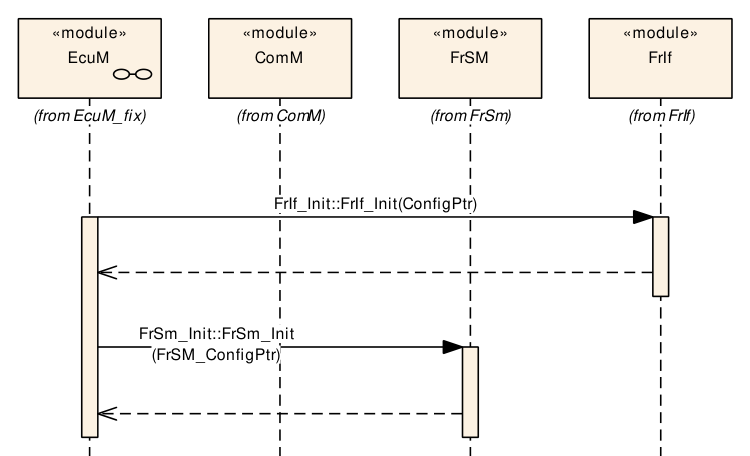

图9.1：初始化（**Figure 9.1: Initialization**）

### 8.2. 单信道唤醒

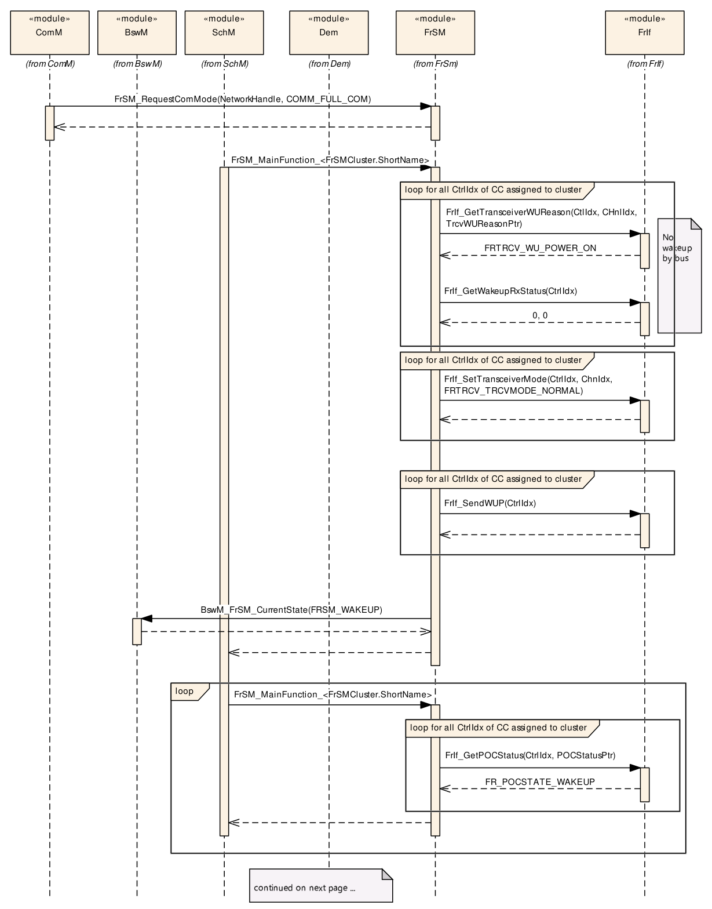

图9.2：（**Figure 9.2: continued on next page**）

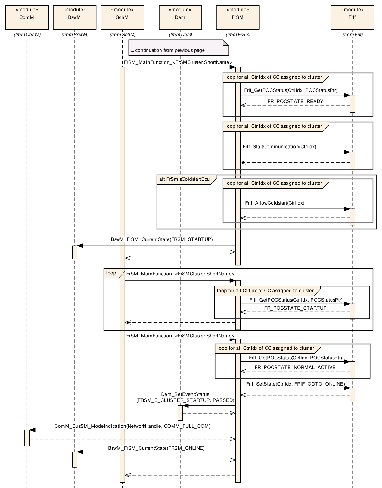

图9.3：对于具有本地唤醒原因的 ECU，从无通信到完全通信的转换（**Figure 9.3: Transition from no communication to full communication for the case of an ECU that has a local wakeup reason**）

### 8.3. 单信道被动启动

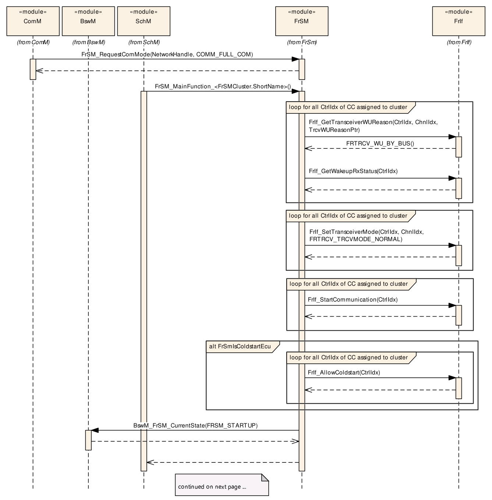

图9.4：（**Figure 9.4: continued on next page**）

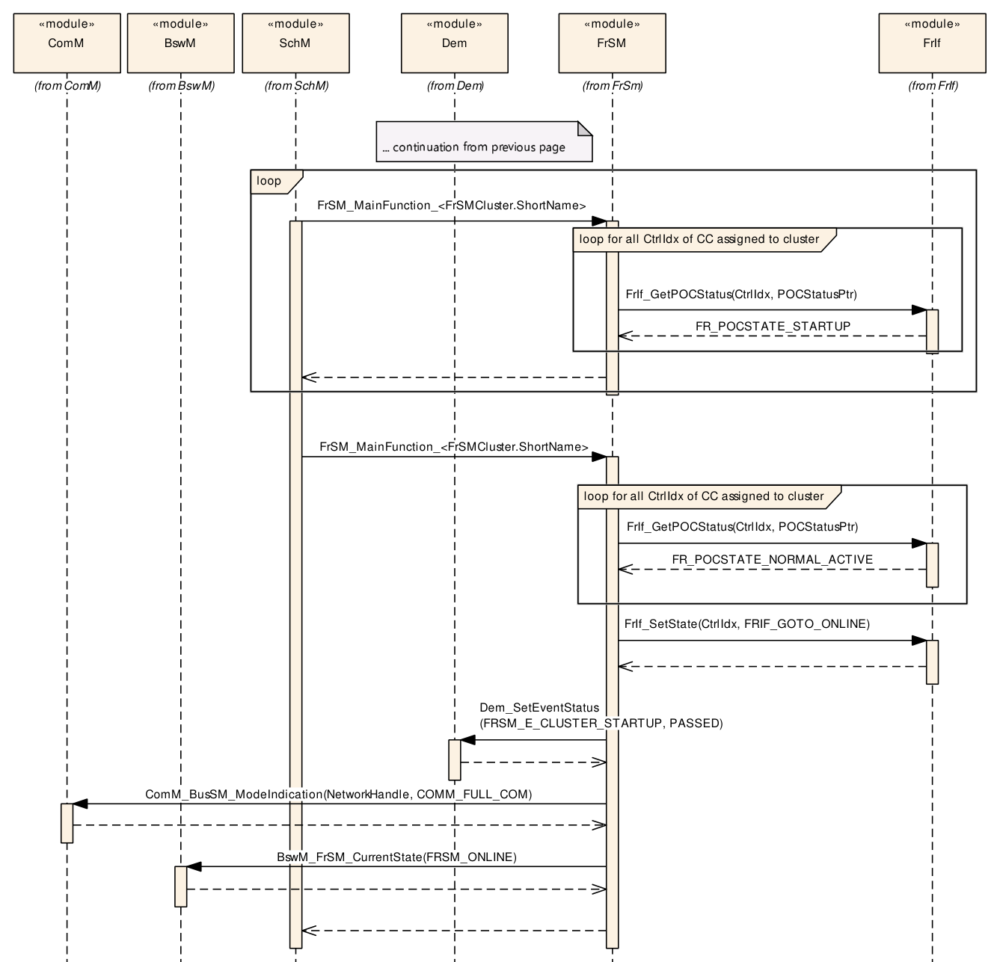

图9.5：对于被总线唤醒的 ECU，从无通信到完全通信的转换（**Figure 9.5: Transition from no communication to full communication for the case of an ECU that has been woken up by bus**）

### 8.4. 双信道唤醒

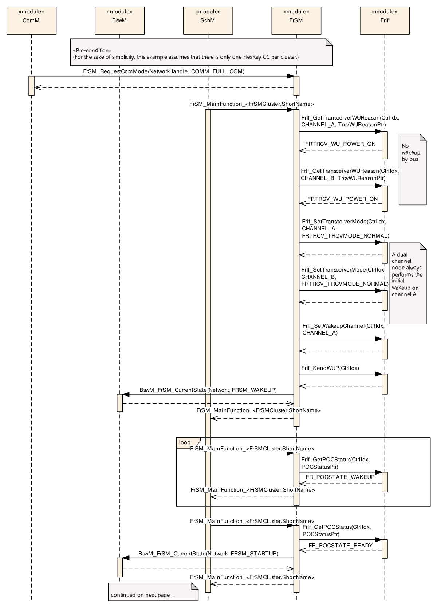

图9.6：（**Figure 9.6: continued on next page**）

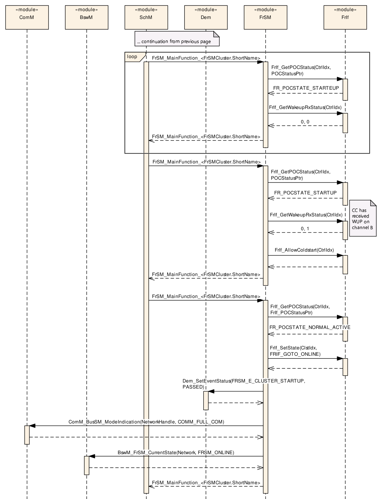

图9.7：对于具有本地唤醒原因的双信道 ECU，从无通信到完全通信的转换（**Figure 9.7: Transition from no communication to full communication for the case of a dual channel ECU with a local wakeup reason**）

### 8.5. 双信道唤醒转发

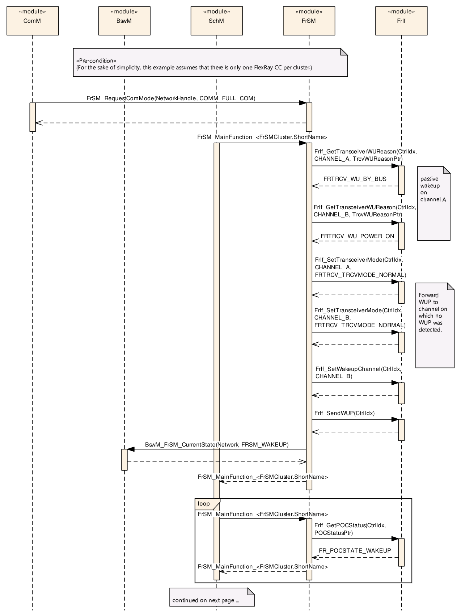

图9.8：（**Figure 9.8: continued on next page**）

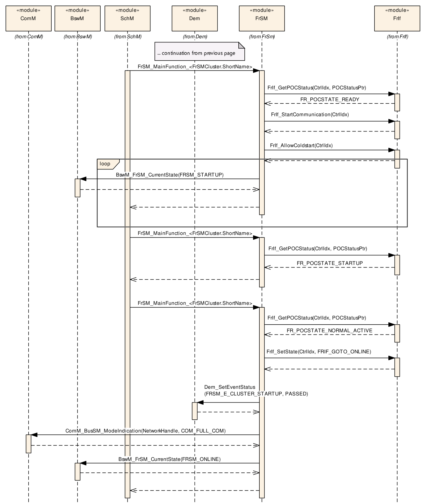

图9.9：对于被总线唤醒的双信道节点，从无通信到完全通信的转换（**Figure 9.9: Transition from no communication to full communication for the case of a dual channel that has been woken up by bus**）

### 8.6. 仅关键时隙模式

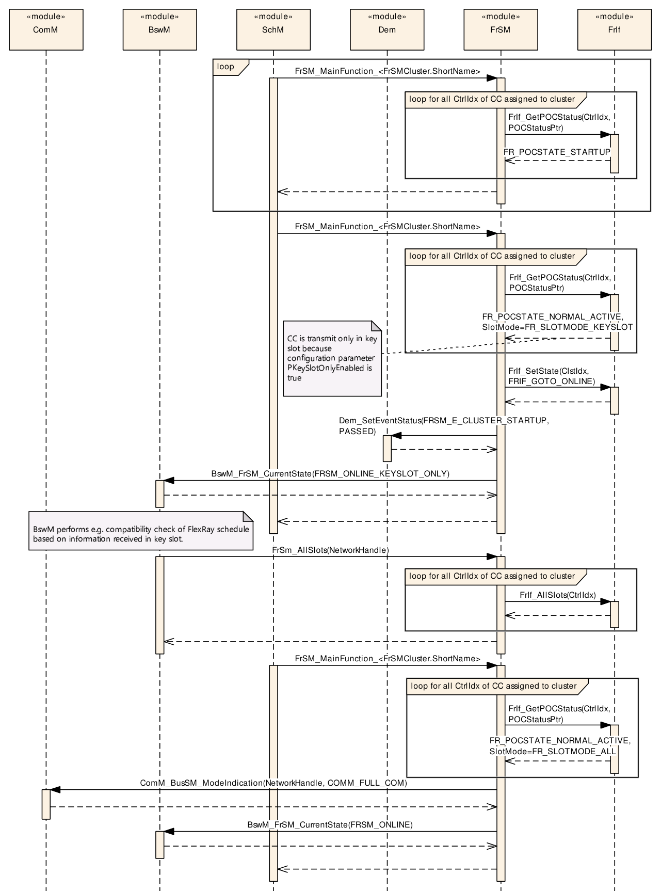

图9.10：启用仅关键时隙模式时的启动（**Figure 9.10: Startup in case of Key Slot Only Mode is Enabled**）

### 8.7. 从完全通信到无通信的转换

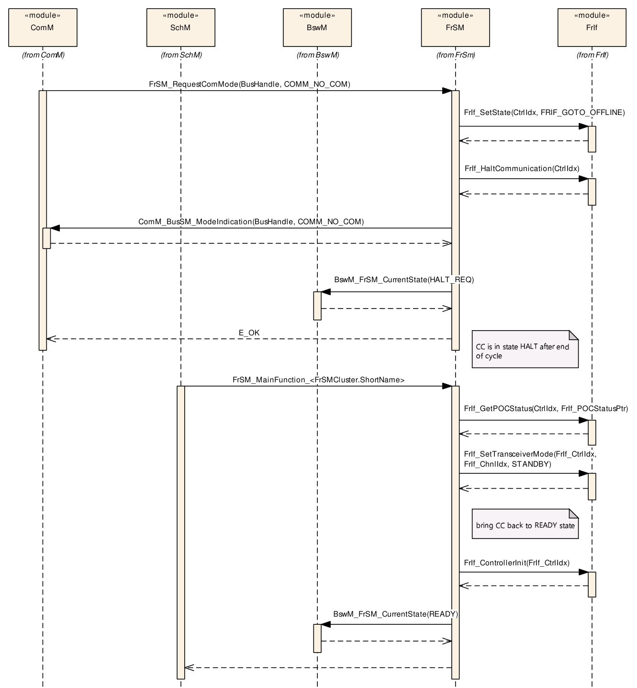

图9.11：从 FullCom 到 NoCom 的转换（**Figure 9.11: Transition from FullCom to NoCom**）

## 9. 配置规范

通常，本章定义配置参数及其到容器的聚类。为便于理解，第 9.1 节描述了基本原理。

第 9.2 节规定了模块 FlexRay 状态管理器的结构（容器）和参数。

第 9.3 节规定了模块 FlexRay 状态管理器的发布信息。

### 9.1. 如何阅读本章

详情请参阅 [\[2\]](#ref-2)（SWS BSW General）中第 10.1 节「配置规范简介（Introduction to configuration specification）」。

### 9.2. 容器和配置参数

以下各节汇总所有配置参数。参数的详细含义见第 6 章和第 7 章。

FrSM 模块应支持基于工具的配置。

配置工具应在系统配置时检查配置参数的一致性。
#### 9.2.1. FrSM

| 项目 | 内容 |
| --- | --- |
| SWS 条目 | [ECUC_FrSM_00174] |
| 容器名称 | FrSM |
| 描述 | FlexRay 状态管理器的配置 |
| 配置参数 | 见下方参数表 |

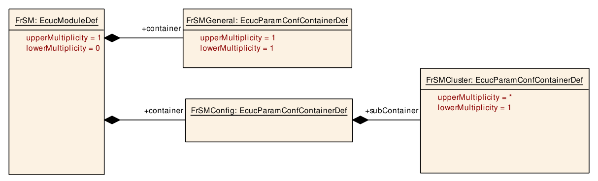

图10.1：FlexRay 状态管理器配置（**Figure 10.1: FlexRay State Manager Configuration**）

| 包含的容器 | 容器名称 | 多重性 |
| --- | --- | --- |
| 包含的容器 | FrSMConfig | 1 |
| 包含的容器 | FrSMGeneral | 1 |

#### 9.2.2. FrSMConfig

| 项目 | 内容 |
| --- | --- |
| SWS 条目 | [ECUC_FrSM_00146] |
| 容器名称 | FrSMConfig |
| 父容器 | FrSM |
| 描述 | 该容器包含 FlexRay 状态管理器的集群特定配置。 |
| 配置参数 | 见下方参数表 |

| 包含的容器 | 容器名称 | 多重性 |
| --- | --- | --- |
| 包含的容器 | FrSMCluster | 1..* |

#### 9.2.3. FrSMGeneral

| 项目 | 内容 |
| --- | --- |
| SWS 条目 | [ECUC_FrSM_00107] |
| 容器名称 | FrSMGeneral |
| 父容器 | FrSM |
| 描述 | 该容器包含 FlexRay 状态管理器的通用配置参数。 |
| 配置参数 | 见下方参数表 |

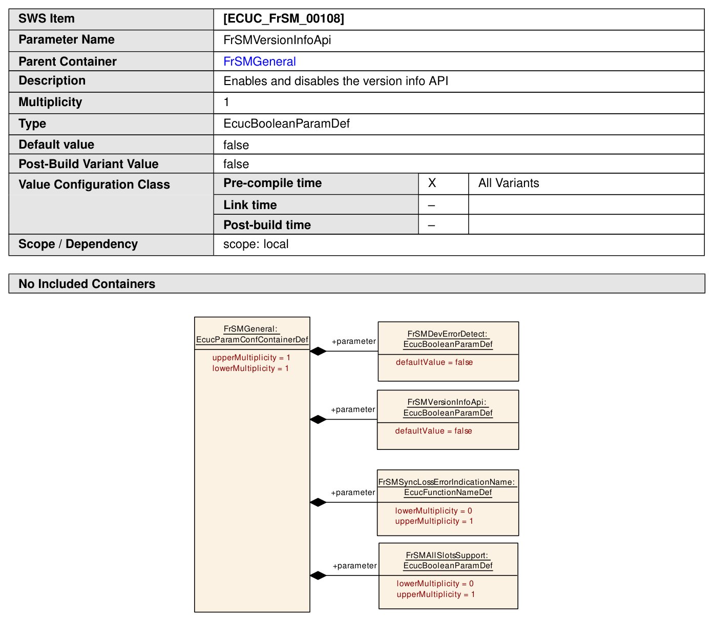

图10.2：FrSMGeneral 容器（**Figure 10.2: FrSMGeneral Container**）

无包含的容器。

| 项目 | 内容 |
| --- | --- |
| SWS 条目 | [ECUC_FrSM_00172] |
| 参数名称 | FrSMAllSlotsSupport |
| 父容器 | FrSMGeneral |
| 描述 | 用于启用/禁用 FrSM 支持的配置参数，即启用/禁用从关键时隙/单时隙模式到全时隙模式的切换。 |
| 多重性 | 0..1 |
| 类型 | EcucBooleanParamDef |
| 默认值 | - |
| Post-Build 变体多重性 | false |
| Post-Build 变体值 | false |
| 值配置类 | Pre-compile time：X（All Variants）；Link time：-；Post-build time：- |
| 多重性配置类 | Pre-compile time：X（All Variants）；Link time：-；Post-build time：- |
| 作用域/依赖 | scope: local |

| 项目 | 内容 |
| --- | --- |
| SWS 条目 | [ECUC_FrSM_00066] |
| 参数名称 | FrSMDevErrorDetect |
| 父容器 | FrSMGeneral |
| 描述 | 打开或关闭开发错误检测和通知。true：启用检测和通知。false：禁用检测和通知。 |
| 多重性 | 1 |
| 类型 | EcucBooleanParamDef |
| 默认值 | false |
| Post-Build 变体值 | false |
| 值配置类 | Pre-compile time：X（All Variants）；Link time：-；Post-build time：- |
| 作用域/依赖 | scope: local |

| 项目 | 内容 |
| --- | --- |
| SWS 条目 | [ECUC_FrSM_00167] |
| 参数名称 | FrSMSyncLossErrorIndicationName |
| 父容器 | FrSMGeneral |
| 描述 | 在失去同步时应调用的 <Cdd>_SyncLossErrorIndication 函数的名称。如果省略该参数，则不进行任何指示。 |
| 多重性 | 0..1 |
| 类型 | EcucFunctionNameDef |
| 默认值 | - |
| 正则表达式 | - |
| Post-Build 变体多重性 | false |
| Post-Build 变体值 | false |
| 值配置类 | Pre-compile time：X（VARIANT-PRE-COMPILE）；Link time：X（VARIANT-LINK-TIME, VARIANT-POST-BUILD）；Post-build time：- |
| 多重性配置类 | Pre-compile time：X（VARIANT-PRE-COMPILE）；Link time：X（VARIANT-LINK-TIME, VARIANT-POST-BUILD）；Post-build time：- |
| 作用域/依赖 | scope: local |

| 项目 | 内容 |
| --- | --- |
| SWS 条目 | [ECUC_FrSM_00108] |
| 参数名称 | FrSMVersionInfoApi |
| 父容器 | FrSMGeneral |
| 描述 | 启用和禁用版本信息 API |
| 多重性 | 1 |
| 类型 | EcucBooleanParamDef |
| 默认值 | false |
| Post-Build 变体值 | false |
| 值配置类 | Pre-compile time：X（All Variants）；Link time：-；Post-build time：- |
| 作用域/依赖 | scope: local |

#### 9.2.4. FrSMCluster

| 项目 | 内容 |
| --- | --- |
| SWS 条目 | [ECUC_FrSM_00067] |
| 容器名称 | FrSMCluster |
| 父容器 | FrSMConfig |
| 描述 | 该容器规定了一个 FlexRay 集群和所有相关数据。一个 FlexRay 集群可以由每个 ECU 多于一个控制器组成。 |
| 配置参数 | 见下方参数表 |

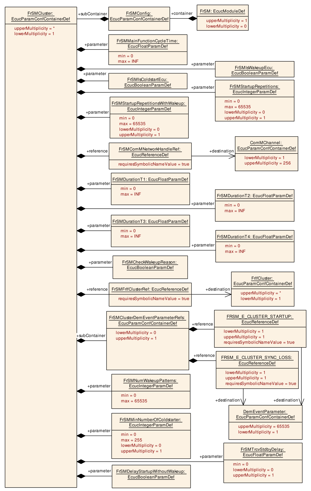

图10.3：FrSMCluster 容器（**Figure 10.3: FrSMCluster Container**）

无包含的容器。

| 项目 | 内容 |
| --- | --- |
| SWS 条目 | [ECUC_FrSM_00001] |
| 参数名称 | FrSMCheckWakeupReason |
| 父容器 | FrSMCluster |
| 描述 | 如果 FrSMCheckWakeupReason 为 true，则 FrSM 将检查唤醒原因，以便在由总线唤醒的情况下跳过唤醒。如果 FrSMCheckWakeupReason 为 false，则 FrSM 将始终尝试执行唤醒。 |
| 多重性 | 1 |
| 类型 | EcucBooleanParamDef |
| 默认值 | - |
| Post-Build 变体值 | true |
| 值配置类 | Pre-compile time：X（VARIANT-PRE-COMPILE）；Link time：X（VARIANT-LINK-TIME）；Post-build time：X（VARIANT-POST-BUILD） |
| 作用域/依赖 | scope: local |

| 项目 | 内容 |
| --- | --- |
| SWS 条目 | [ECUC_FrSM_00166] |
| 参数名称 | FrSMDelayStartupWithoutWakeup |
| 父容器 | FrSMCluster |
| 描述 | 如果为 true，则在无唤醒启动的情况下，应启动定时器 t1，而不是立即调用 FrIf_AllowColdstart。 |
| 多重性 | 1 |
| 类型 | EcucBooleanParamDef |
| 默认值 | - |
| Post-Build 变体值 | true |
| 值配置类 | Pre-compile time：X（VARIANT-PRE-COMPILE）；Link time：X（VARIANT-LINK-TIME）；Post-build time：X（VARIANT-POST-BUILD） |
| 作用域/依赖 | scope: local |

| 项目 | 内容 |
| --- | --- |
| SWS 条目 | [ECUC_FrSM_00102] |
| 参数名称 | FrSMDurationT1 |
| 父容器 | FrSMCluster |
| 描述 | 定时器 t1 的持续时间（单位为秒）。值 0 表示不使用该定时器。 |
| 多重性 | 1 |
| 类型 | EcucFloatParamDef |
| 范围 | [0 .. INF] |
| 默认值 | - |
| Post-Build 变体值 | true |
| 值配置类 | Pre-compile time：X（VARIANT-PRE-COMPILE）；Link time：X（VARIANT-LINK-TIME）；Post-build time：X（VARIANT-POST-BUILD） |
| 作用域/依赖 | scope: local dependency: FrSMMainFunctionCycleTime (As timers are checked during the call of Fr SM_MainFunction, the effective timer duration will always be a multiple of FrSMMain FunctionCycleTime). |

| 项目 | 内容 |
| --- | --- |
| SWS 条目 | [ECUC_FrSM_00089] |
| 参数名称 | FrSMDurationT2 |
| 父容器 | FrSMCluster |
| 描述 | 定时器 t2 的持续时间（单位为秒）。值 0 表示不使用该定时器。该参数的值应大于 FrSMDurationT1 参数的值。 |
| 多重性 | 1 |
| 类型 | EcucFloatParamDef |
| 范围 | [0 .. INF] |
| 默认值 | - |
| Post-Build 变体值 | true |
| 值配置类 | Pre-compile time：X（VARIANT-PRE-COMPILE）；Link time：X（VARIANT-LINK-TIME）；Post-build time：X（VARIANT-POST-BUILD） |
| 作用域/依赖 | scope: local dependency: FrSMMainFunctionCycleTime (As timers are checked during the call of Fr SM_MainFunction, the effective timer duration will always be a multiple of FrSMMain FunctionCycleTime). |

| 项目 | 内容 |
| --- | --- |
| SWS 条目 | [ECUC_FrSM_00162] |
| 参数名称 | FrSMDurationT3 |
| 父容器 | FrSMCluster |
| 描述 | 定时器 t3 的持续时间（单位为秒）。该参数的值应大于 FrSMDurationT1 参数的值。值 0 表示不使用该定时器。仅在不使用 FrNm 时才可能配置值 0。 |
| 多重性 | 1 |
| 类型 | EcucFloatParamDef |
| 范围 | [0 .. INF] |
| 默认值 | - |
| Post-Build 变体值 | true |
| 值配置类 | Pre-compile time：X（VARIANT-PRE-COMPILE）；Link time：X（VARIANT-LINK-TIME）；Post-build time：X（VARIANT-POST-BUILD） |
| 作用域/依赖 | scope: local dependency: FrSMMainFunctionCycleTime (As timers are checked during the call of Fr SM_MainFunction, the effective timer duration will always be a multiple of FrSMMain |

| 项目 | 内容 |
| --- | --- |
| SWS 条目 | [ECUC_FrSM_00173] |
| 参数名称 | FrSMDurationT4 |
| 父容器 | FrSMCluster |
| 描述 | 定时器 t4 确保双信道节点最终会清除其冷启动禁止位并成为主导冷启动节点。 |
| 多重性 | 1 |
| 类型 | EcucFloatParamDef |
| 范围 | [0 .. INF] |
| 默认值 | - |
| Post-Build 变体值 | true |
| 值配置类 | Pre-compile time：X（VARIANT-PRE-COMPILE）；Link time：X（VARIANT-LINK-TIME）；Post-build time：X（VARIANT-POST-BUILD） |
| 作用域/依赖 | scope: local |

| 项目 | 内容 |
| --- | --- |
| SWS 条目 | [ECUC_FrSM_00068] |
| 参数名称 | FrSMIsColdstartEcu |
| 父容器 | FrSMCluster |
| 描述 | True：该 ECU 是该 FlexRay 集群的冷启动节点。False：该 ECU 不是该 FlexRay 集群的冷启动节点。 |
| 多重性 | 1 |
| 类型 | EcucBooleanParamDef |
| 默认值 | - |
| Post-Build 变体值 | true |
| 值配置类 | Pre-compile time：X（VARIANT-PRE-COMPILE）；Link time：X（VARIANT-LINK-TIME）；Post-build time：X（VARIANT-POST-BUILD） |
| 作用域/依赖 | scope: local |

| 项目 | 内容 |
| --- | --- |
| SWS 条目 | [ECUC_FrSM_00109] |
| 参数名称 | FrSMIsWakeupEcu |
| 父容器 | FrSMCluster |
| 描述 | True：FrSM 应为该集群执行唤醒。False：FrSM 绝不为该 FlexRay 集群执行唤醒。 |
| 多重性 | 1 |
| 类型 | EcucBooleanParamDef |
| 默认值 | - |
| Post-Build 变体值 | true |
| 值配置类 | Pre-compile time：X（VARIANT-PRE-COMPILE）；Link time：X（VARIANT-LINK-TIME）；Post-build time：X（VARIANT-POST-BUILD） |
| 作用域/依赖 | scope: local |

| 项目 | 内容 |
| --- | --- |
| SWS 条目 | [ECUC_FrSM_00115] |
| 参数名称 | FrSMMainFunctionCycleTime |
| 父容器 | FrSMCluster |
| 描述 | 该参数以秒为单位定义周期性调用 FrSM 主函数的周期。 |
| 多重性 | 1 |
| 类型 | EcucFloatParamDef |
| 范围 | ]0 .. INF[ |
| 默认值 | - |
| Post-Build 变体值 | false |
| 值配置类 | Pre-compile time：X（VARIANT-PRE-COMPILE）；Link time：X（VARIANT-LINK-TIME, VARIANT-POST-BUILD）；Post-build time：- |
| 作用域/依赖 | scope: local |

| 项目 | 内容 |
| --- | --- |
| SWS 条目 | [ECUC_FrSM_00168] |
| 参数名称 | FrSMMinNumberOfColdstarter |
| 父容器 | FrSMCluster |
| 描述 | 该参数定义不应被低于的冷启动节点数量。如果未配置该参数，则主函数不检查启动帧的数量。 |
| 多重性 | 0..1 |
| 类型 | EcucIntegerParamDef |
| 范围 | 0 .. 255 |
| 默认值 | - |
| Post-Build 变体多重性 | true |
| Post-Build 变体值 | true |
| 值配置类 | Pre-compile time：X（VARIANT-PRE-COMPILE）；Link time：X（VARIANT-LINK-TIME）；Post-build time：X（VARIANT-POST-BUILD） |
| 多重性配置类 | Pre-compile time：X（VARIANT-PRE-COMPILE）；Link time：X（VARIANT-LINK-TIME）；Post-build time：X（VARIANT-POST-BUILD） |
| 作用域/依赖 | scope: local |

| 项目 | 内容 |
| --- | --- |
| SWS 条目 | [ECUC_FrSM_00165] |
| 参数名称 | FrSMNumWakeupPatterns |
| 父容器 | FrSMCluster |
| 描述 | 节点在进入 FRSM_STARTUP 之前可以发送的最大唤醒模式数量。 |
| 多重性 | 1 |
| 类型 | EcucIntegerParamDef |
| 范围 | 0 .. 65535 |
| 默认值 | - |
| Post-Build 变体值 | true |
| 值配置类 | Pre-compile time：X（VARIANT-PRE-COMPILE）；Link time：X（VARIANT-LINK-TIME）；Post-build time：X（VARIANT-POST-BUILD） |
| 作用域/依赖 | scope: local dependency: A value greater than zero is required in case the parameter FrSMIs WakeupEcu is true. |

| 项目 | 内容 |
| --- | --- |
| SWS 条目 | [ECUC_FrSM_00069] |
| 参数名称 | FrSMStartupRepetitions |
| 父容器 | FrSMCluster |
| 描述 | ECU 可以为一个 FlexRay 集群重复启动过程的次数。 |
| 多重性 | 0..1 |
| 类型 | EcucIntegerParamDef |
| 范围 | 0 .. 65535 |
| 默认值 | - |
| Post-Build 变体多重性 | true |
| Post-Build 变体值 | true |
| 值配置类 | Pre-compile time：X（VARIANT-PRE-COMPILE） |
| 多重性配置类 | Pre-compile time：X（VARIANT-PRE-COMPILE）；Link time：X（VARIANT-LINK-TIME）；Post-build time：X（VARIANT-POST-BUILD） |
| 作用域/依赖 | scope: local dependency: This value must be greater or equal to FrSMStartupRepetitionsWith Wakeup |

| 项目 | 内容 |
| --- | --- |
| SWS 条目 | [ECUC_FrSM_00094] |
| 参数名称 | FrSMStartupRepetitionsWithWakeup |
| 父容器 | FrSMCluster |
| 描述 | ECU 可以为一个 FlexRay 集群重复包括唤醒在内的启动过程的次数。 |
| 多重性 | 0..1 |
| 类型 | EcucIntegerParamDef |
| 范围 | 0 .. 65535 |
| 默认值 | - |
| Post-Build 变体多重性 | true |
| Post-Build 变体值 | true |
| 值配置类 | Pre-compile time：X（VARIANT-PRE-COMPILE）；Link time：X（VARIANT-LINK-TIME）；Post-build time：X（VARIANT-POST-BUILD） |
| 多重性配置类 | Pre-compile time：X（VARIANT-PRE-COMPILE）；Link time：X（VARIANT-LINK-TIME）；Post-build time：X（VARIANT-POST-BUILD） |
| 作用域/依赖 | scope: local |

| 项目 | 内容 |
| --- | --- |
| SWS 条目 | [ECUC_FrSM_00170] |
| 参数名称 | FrSMTrcvStdbyDelay |
| 父容器 | FrSMCluster |
| 描述 | 定时器 t_TrcvStdbyDelay 的持续时间（单位为秒）。该参数的粒度应限制为完整的 FlexRay 循环（FrIfGdCycle）。值 0 表示不使用该定时器。 |
| 多重性 | 0..1 |
| 类型 | EcucFloatParamDef |
| 范围 | [0 .. INF] |
| 默认值 | - |
| Post-Build 变体多重性 | true |
| Post-Build 变体值 | true |
| 值配置类 | Pre-compile time：X（VARIANT-PRE-COMPILE）；Link time：X（VARIANT-LINK-TIME）；Post-build time：X（VARIANT-POST-BUILD） |
| 多重性配置类 | Pre-compile time：X（VARIANT-PRE-COMPILE）；Link time：X（VARIANT-LINK-TIME）；Post-build time：X（VARIANT-POST-BUILD） |
| 作用域/依赖 | scope: local dependency: FrSmMainFunctionCycleTime |

| 项目 | 内容 |
| --- | --- |
| SWS 条目 | [ECUC_FrSM_00070] |
| 参数名称 | FrSMComMNetworkHandleRef |
| 父容器 | FrSMCluster |
| 描述 | 对唯一句柄的引用，用于标识某个特定的 FlexRay 网络，对应于 ComM 配置中的网络句柄之一。 |
| 多重性 | 1 |
| 类型 | Symbolic name reference to ComMChannel |
| Post-Build 变体值 | false |
| 值配置类 | Pre-compile time：X（VARIANT-PRE-COMPILE）；Link time：X（VARIANT-LINK-TIME, VARIANT-POST-BUILD）；Post-build time：- |
| 作用域/依赖 | scope: local |

| 项目 | 内容 |
| --- | --- |
| SWS 条目 | [ECUC_FrSM_00116] |
| 参数名称 | FrSMFrIfClusterRef |
| 父容器 | FrSMCluster |
| 描述 | 引用 FlexRay 接口配置中的集群配置。注意，所分配的控制器和收发器在 FrIf 配置中定义，并可以通过该引用访问。 |
| 多重性 | 1 |
| 类型 | Symbolic name reference to FrIfCluster |
| Post-Build 变体值 | true |
| 值配置类 | Pre-compile time：X（VARIANT-PRE-COMPILE）；Link time：X（VARIANT-LINK-TIME, VARIANT-POST-BUILD）；Post-build time：- |
| 作用域/依赖 | scope: local |

#### 9.2.5. FrSMClusterDemEventParameterRefs

| 项目 | 内容 |
| --- | --- |
| SWS 条目 | [ECUC_FrSM_00163] |
| 容器名称 | FrSMClusterDemEventParameterRefs |
| 父容器 | FrSMCluster |
| 描述 | 该容器保存对 DemEventParameter 元素的引用，当发生相应错误时，应使用 API Dem_SetEventStatus 调用这些引用。EventId 取自被引用的 DemEventParameter 的 DemEventId 符号值。标准化错误在该容器中提供，并可以通过供应商特定的错误引用进行扩展。 |
| 配置参数 | 见下方参数表 |

无包含的容器。

| 项目 | 内容 |
| --- | --- |
| SWS 条目 | [ECUC_FrSM_00164] |
| 参数名称 | FRSM_E_CLUSTER_STARTUP |
| 父容器 | FrSMClusterDemEventParameterRefs |
| 描述 | 对 DemEventParameter 的引用，当发生错误「FRSM_E_CLUSTER_STARTUP」时应发出该引用。如果未配置该引用，则该错误应作为 DET 错误报告。 |
| 多重性 | 1 |
| 类型 | Symbolic name reference to DemEventParameter |
| Post-Build 变体值 | false |
| 值配置类 | Pre-compile time：X（VARIANT-PRE-COMPILE）；Link time：X（VARIANT-LINK-TIME, VARIANT-POST-BUILD）；Post-build time：- |
| 作用域/依赖 | scope: local |

| 项目 | 内容 |
| --- | --- |
| SWS 条目 | [ECUC_FrSM_00169] |
| 参数名称 | FRSM_E_CLUSTER_SYNC_LOSS |
| 父容器 | FrSMClusterDemEventParameterRefs |
| 描述 | 对 DemEventParameter 的引用，当发生错误「FRSM_E_CLUSTER_SYNC_LOSS」时应发出该引用。如果未配置该引用，则该错误应作为 DET 错误报告。 |
| 多重性 | 1 |
| 类型 | Symbolic name reference to DemEventParameter |
| Post-Build 变体值 | false |
| 值配置类 | Pre-compile time：X（VARIANT-PRE-COMPILE）；Link time：X（VARIANT-LINK-TIME, VARIANT-POST-BUILD）；Post-build time：- |
| 作用域/依赖 | scope: local |

### 9.3. 发布信息

详情请参阅 [\[2\]](#ref-2)（SWS BSW General）中第 10.3 节「发布信息（Published Information）」。

## B. AUTOSAR 可追溯项变更历史

请注意，本章中的列表还包含已在后续版本中从规范中删除的可追溯项。这些项不会作为超链接出现在文档中。

### B.1. 本文档根据 AUTOSAR 发布版本 R23-11 的可追溯项历史

#### B.1.1. R23-11 中新增的规范项

无。

#### B.1.2. R23-11 中变更的规范项

无。

#### B.1.3. R23-11 中删除的规范项

无。
