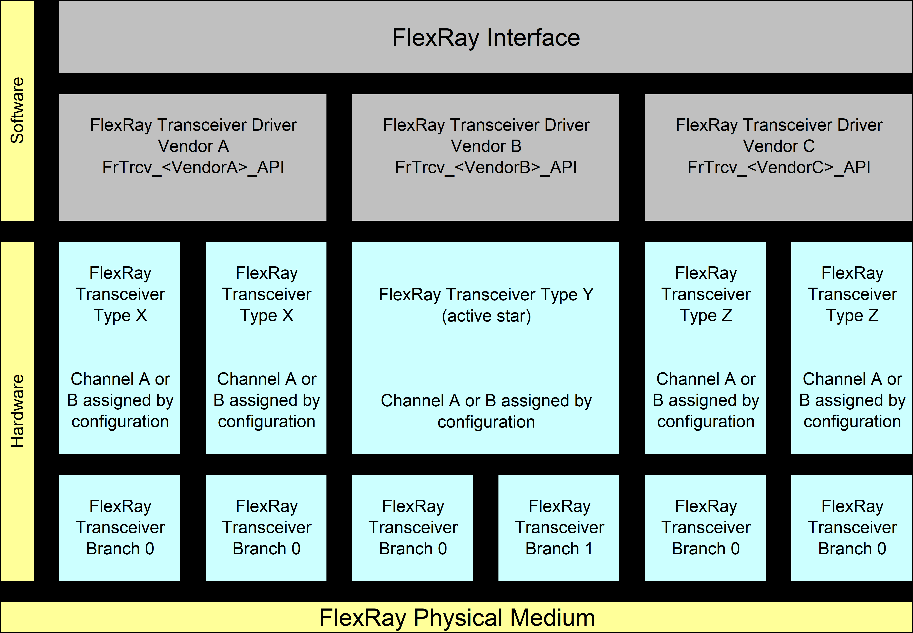
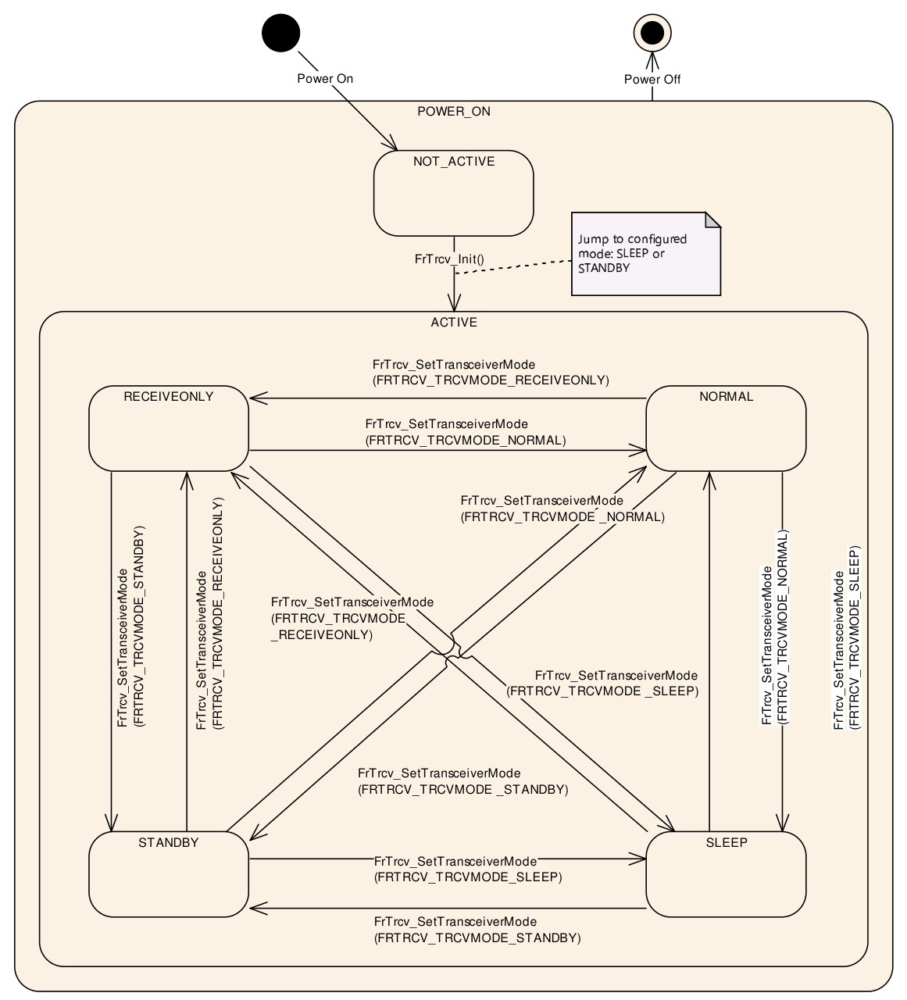
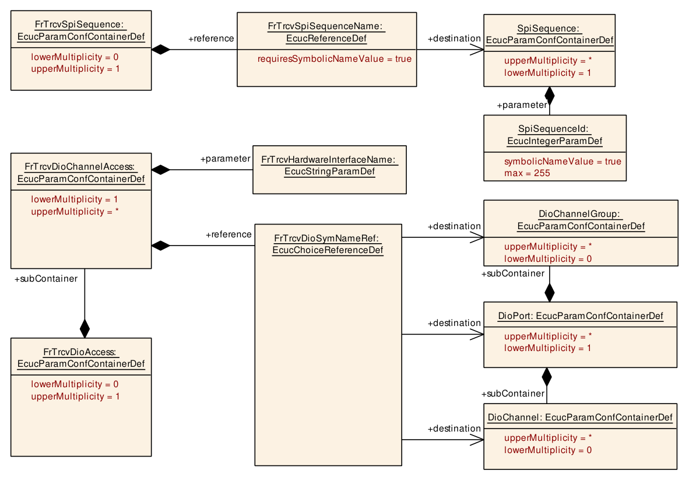
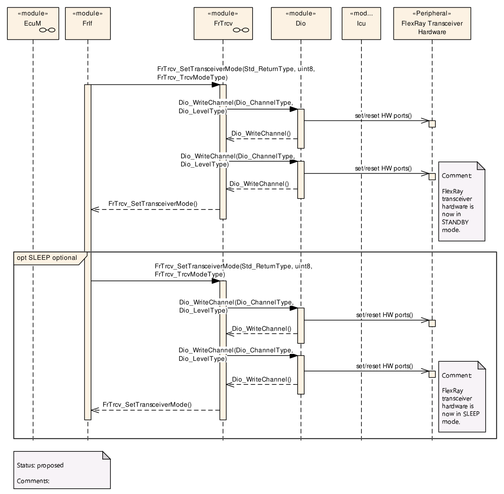
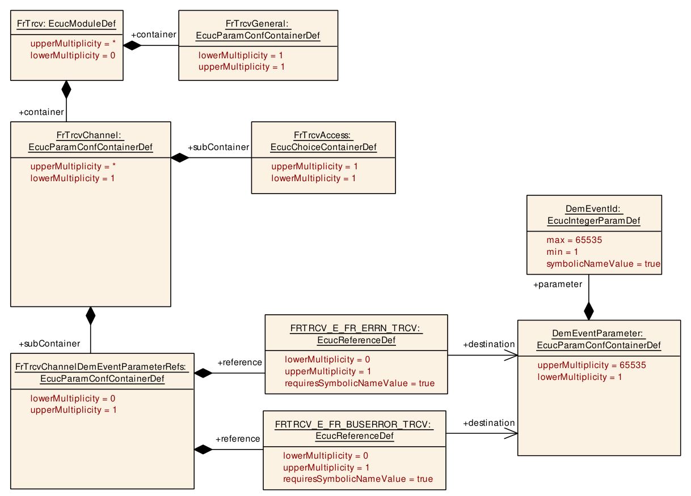
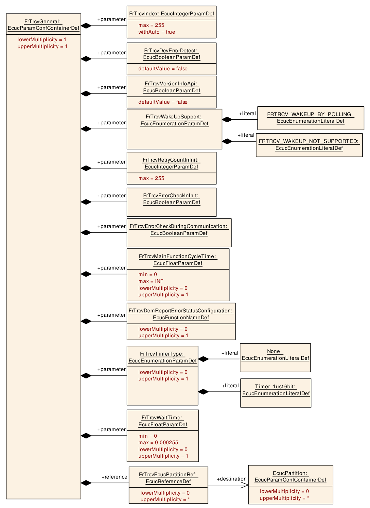
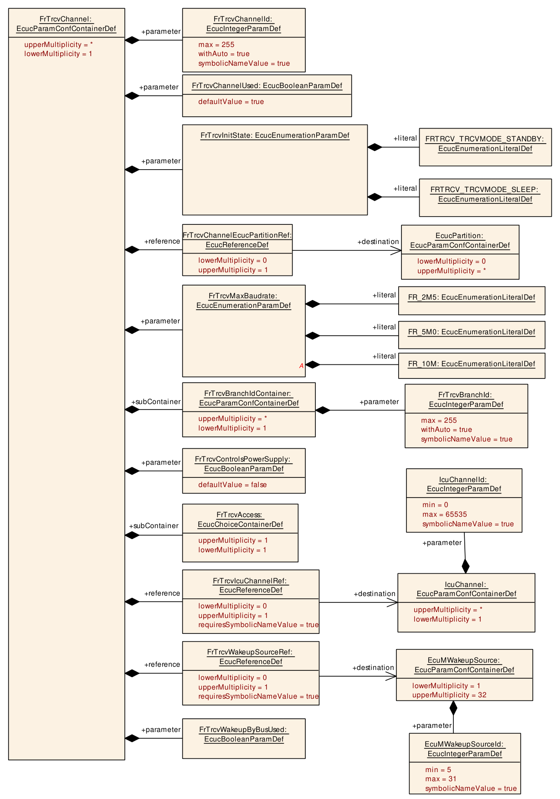
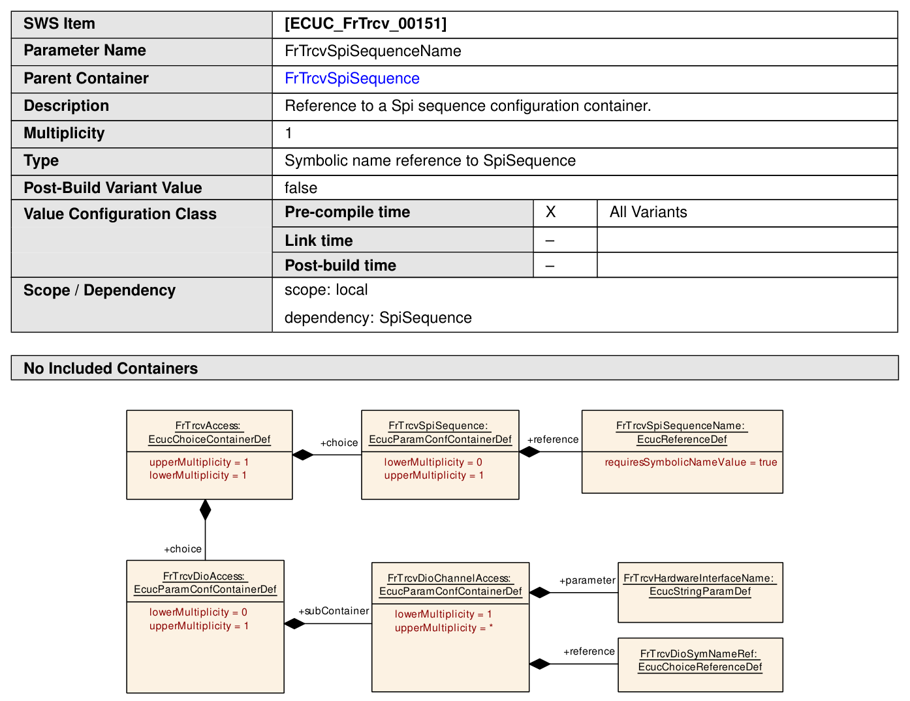

## 1. 简介和功能概述

本规范描述 **AUTOSAR** 基础软件模块 FlexRay 收发器驱动（**FrTrcv**）的功能、**API** 和配置。类型 Z

FlexRay 收发器是一种硬件设备，它主要将微控制器端口的逻辑 1/0 信号转换为符合总线规范的电平、电流和时序。

在汽车环境中，目前 FlexRay 只有一个单一的物理层规范。此外，收发器能够检测电气故障，例如线束断裂、地偏移（容忍一定程度的地偏移）或总线冲突。根据接口的不同，它们通过单个端口引脚以汇总的方式、或通过 **SPI** 以非常详细的方式标记检测到的错误。FlexRay 收发器驱动程序具有经由总线唤醒的能力，其使用是可选的。一些收发器还支持电源控制。未来的市场可能会出现许多不同的唤醒/睡眠和电源概念。



图1.1：FlexRay 协议栈基本结构的描述（**Figure 1.1: Description of the basic structure of the FlexRay Stack**）

一个 FlexRay 接口使用一个或多个来自不同供应商的 FlexRay 收发器驱动程序（FrTrcv 驱动程序供应商 A...C）来访问多个 FlexRay 收发器（FlexRay 收发器类型 X .. Z）。

一个从零开始的索引（FrTrcv\_TrcvIdx）在收发器驱动的上下文中标识收发器。例如，在上图中，FlexRay 收发器类型 Z 的 FlexRay 收发器 A 由索引 0 寻址，FlexRay 收发器 B 由索引 1 寻址。一个从零开始的索引（FrTrcv\_BranchIdx）在该收发器的上下文中标识分支。

### 1.1. FlexRay 收发器驱动的目标

本文档规定了适用于当前和未来 FlexRay 收发器硬件设备的接口和序列模型。FlexRay 收发器驱动程序抽象了 FlexRay 收发器硬件芯片的使用。它为更高层提供了一个独立于硬件的接口。FlexRay 收发器驱动程序通过使用 **MCAL** 层的 **API** 来访问 FlexRay 收发器硬件，从而从 **ECU** 布局中抽象出来。

### 1.2. 明确不涵盖的 FlexRay 收发器功能

FlexRay 收发器驱动程序软件规范支持所有符合 [\[1\]](#ref-1)（FlexRay EPL）的收发器。

### 1.3. 有源星型（Active Stars）

FlexRay 收发器驱动程序支持有源星型（active star）拓扑。主机禁用和使能有源星型的分支。配置按照 [\[1\]](#ref-1)（FlexRay EPL）定义有源星型的时序，并提供分支的拓扑信息。

## 2. 缩略语和简称

下面的词汇表包含与 FlexRay 收发器驱动程序模块相关、且未包含在 [\[2\]](#ref-2)（**AUTOSAR** 术语表）中的缩略语和缩写。

表2.1：本文档范围内使用的缩略语和缩写（**Acronyms and abbreviations used in the scope of this Document**）

**µC**
> 微控制器（**Microcontroller**）

**Active Star (Network)**
> 星型拓扑网络由一个或多个有源中央节点组成，这些节点将其从一个分支上接收到的所有传输重新广播到网络上的所有其他分支。因此，所有外围节点都可以通过向中央节点发送数据并从中央节点接收数据，与其他所有节点通信（如果它们位于另一个分支上）。在检测到某个分支发生故障时，有源星型会将其外围节点与所有其他分支隔离，从而实现故障封闭。

**API**
> 应用编程接口（**Application Programming Interface**）

**AUTOSAR**
> 汽车开放系统架构（**Automotive Open System Architecture**）

**BD**
> 总线驱动程序（**Bus Driver**）

**Branch**
> 有源星型网络拓扑的元素，在物理层共享（即电气连接到）同一个发送器和接收器电路。某个分支发生故障将导致有源星型将其外围节点与所有其他分支隔离，从而实现故障封闭。

**BSW**
> 基础软件（**Basic Software**）

**CC**
> 通信控制器（**Communication Controller**）

**ComM**
> 通信管理器，详情参见 [\[3\]](#ref-3)

**DEM/Dem**
> 诊断事件管理器（**Diagnostic Event Manager**）

**DET/Det**
> 默认错误跟踪器（**Default Error Tracer**）

**DIO/Dio**
> 数字输入输出，**SPAL SW** 模块之一

**EB**
> 外部缓冲（Externally buffered）信道。包含待传输数据的缓冲区位于 **SPI** 处理程序/驱动程序之外。

**ECU**
> 电子控制单元（**Electronic Control Unit**）

**EcuM**
> **ECU** 状态管理器，详情参见 [\[4\]](#ref-4)

**EPL**
> 电气物理层（**Electrical Physical Layer**）

**ERRN**
> 错误输出信号，取反（Negated），即低电平有效

**FlexRay Node**
> 连接到 FlexRay 网络、能够发送和/或接收帧的逻辑实体。

**FrIf**
> FlexRay 接口（**FlexRay Interface**）

**FrTrcv**
> FlexRay 收发器（**FlexRay Transceiver**）

**GPIO**
> 通用输入输出（**General Purpose Input Output**）

**I/O**
> 输入/输出（**Input/Output**）

**IB**
> 内部缓冲（Internally buffered）信道。包含待传输数据的缓冲区位于 **SPI** 处理程序/驱动程序内部。

**ID/Id**
> 标识符（**Identifier**）

**ISR**
> 中断服务程序（**Interrupt Service Routine**）

**MCAL**
> 微控制器抽象层（**Micro controller Abstraction Layer**）

**MCG**
> 模块配置生成器（**Module Configuration Generator**）

**MISRA**
> 汽车工业软件可靠性协会（**Motor Industry Software Reliability Association**）

**n/a**
> 不适用

**OS**
> 操作系统（**Operating System**）

**Port**
> 端口，**SPAL SW** 模块之一

**RAM**
> 随机存取存储器（**Random Access Memory**）

**RxD**
> 接收数据（**Receive Data**）

**RxEN**
> 接收使能（**Receive Enable**）

**SBC**
> 系统基础芯片（**System Basis Chip**）；一种集成了例如 **CAN** 和/或 FlexRay 和/或 **LIN** 收发器、看门狗和电源控制的设备。

**SchM**
> 调度管理器（**Schedule Manager**）

**SPAL**
> 标准外设抽象层（**Standard Peripheral Abstraction Layer**）

**SPI/Spi**
> 串行外设接口（**Serial Peripheral Interface**）。

**SPI/Spi Channel**
> 信道是一种数据交换媒介，其中的数据按相同的标准定义：配置参数、具有相同大小的数据元素的数量以及数据指针（源和目标）或位置。更多细节请参阅 **SPI** 驱动程序规范。

**SPI/Spi Job**
> 作业由具有同一芯片选择的多个信道组成。作业被认为是原子的，因此不能被中断。作业还具有分配的优先级。更多细节请参阅 **SPI** 驱动程序规范。

**SPI/Spi Sequence**
> 序列是要发送的若干连续作业。序列依赖于静态配置。更多细节请参阅 **SPI** 驱动程序规范。

**SRS**
> 软件需求规范（**Software Requirement Specification**）

**SW**
> 软件（**Software**）

**SW-C**
> 软件组件（**Software-Component**）

**SWS**
> 软件规范（**Software Specification**）

**XML**
> 可扩展标记语言（**eXtended Markup Language**）

## 3. 相关文档

### 3.1. 输入文件和相关标准与规范

<a id="ref-1"></a>[1] FlexRay Communications System Protocol Specification V2.1
> http://www.flexray.com/

<a id="ref-2"></a>[2] Glossary
> AUTOSAR_FO_TR_Glossary

<a id="ref-3"></a>[3] Specification of Communication Manager
> AUTOSAR_CP_SWS_COMManager

<a id="ref-4"></a>[4] Specification of ECU State Manager
> AUTOSAR_CP_SWS_ECUStateManager

<a id="ref-5"></a>[5] General Specification of Basic Software Modules
> AUTOSAR_CP_SWS_BSWGeneral

<a id="ref-6"></a>[6] Requirements on FlexRay
> AUTOSAR_CP_SRS_FlexRay

### 3.2. 相关规范

**AUTOSAR** 提供了一份基础软件模块通用规范 [\[5\]](#ref-5)（**SWS BSW General**），该规范同样适用于 FlexRay 收发器驱动程序。

因此，规范 **SWS BSW General** 应被视为 FlexRay 收发器驱动程序的附加且必需的规范。

## 4. 约束和假设

### 4.1. 限制

FlexRay 收发器必须提供映射到 **AUTOSAR** FlexRay 收发器驱动程序所假设的运行模式模型的功能和接口。参见第 [6.1](#61-autosar-flexray-收发器运行模式模型) 节「AUTOSAR FlexRay 收发器运行模式」。

FlexRay 收发器驱动程序应同步地使用底层 **DIO** 驱动程序的 **API**。

FlexRay 收发器驱动程序应在可能的情况下同步地使用底层 **SPI** 驱动程序的 **API**，并在需要时异步使用。

FlexRay 收发器要求 **LEVEL 2**、增强型（同步/异步）**SPI** 处理程序/驱动程序。

FlexRay 收发器驱动程序应在内部处理收发器特定的时序要求。

微控制器与收发器之间的通信经由端口或 **SPI** 或两者执行。如果使用端口，则通过以预定义的序列和给定的时序向端口施加值来进行通信并改变硬件运行模式。这些序列和时序必须在 FlexRay 收发器驱动程序内部处理。

### 4.2. 汽车域的适用性

该驱动程序应适用于所有使用 FlexRay 进行通信的汽车域。

## 5. 对其他模块的依赖

| 模块 | 依赖关系 |
| --- | --- |
| FrIf | FlexRay 接口经由 FlexRay 收发器驱动程序控制 FlexRay 收发器的状态 |
| Det | FlexRay 收发器驱动程序将错误告知默认错误跟踪器 |
| Dem | Dem 从 FlexRay 收发器驱动程序获取生产错误信息。 |
| Dio | Dio 模块用于访问经由端口连接的 FlexRay 收发器硬件。 |
| EcuM | 如果硬件支持，EcuM 从 FlexRay 收发器驱动程序获取唤醒事件信息。 |
| RTE | FlexRay 收发器驱动程序主函数可以由 RTE 调度。 |
| Spi | Spi 模块用于访问经由 **SPI** 连接的 FlexRay 收发器硬件。 |

请注意，尽管本文档的 FlexRay 收发器部分篇幅超过 50 页，但最终它仍归结为在 **RAM** 中设置几个位并通过 **SPI** 传输它们，或者设置几个端口引脚。在不需要后构建时配置的情况下，这可以是非常小的代码（例如内联函数）。

如果上层想要调用任何 FlexRay 收发器特定的 FlexRay **API**，则不需要知道对于特定的通信 FlexRay 收发器它必须调用哪个 FlexRay 收发器驱动程序。只需要一个由配置生成的映射（=知识）！

下面是一个例子：

**上层**：

「将（单个 **ECU** 内）集群 C 的所有收发器设置为状态 NORMAL」

FrIf（拥有集群知识）：集群 C 使用 **CC** Y，它连接到收发器（Trcv）Xa（FlexRay 收发器 A）和 Xb（FlexRay 收发器 B）

「将收发器 Xa 和 Xb 设置为状态 NORMAL」

FrTrcv（拥有收发器驱动程序知识，假设使用不同的驱动程序）：

收发器 Xa 是驱动程序 D1 中的第 1 个设备

收发器 Xb 是驱动程序 D2 中的第 3 个设备

「经由 D1（第 1 个设备）将 Xa 设置为 normal」

「经由 D2（第 3 个设备）将 Xb 设置为 normal」

FlexRay 收发器驱动程序 FrTrcv D1（拥有收发器硬件知识）：

第 1 个设备的 NORMAL 通过将 Dio 信号 S1 设置为 HIGH 并将 DIO 信号 S2 设置为 HIGH 来实现

「DIO 将 S1 和 S2 设置为 HIGH」

**ECU** 抽象层（拥有 **ECU** 布局信息）：

信号 S1 映射到 DIO 信道 C7

信号 S2 映射到 DIO 信道 C8

DIO（拥有端口/引脚知识）配置将 C7 映射到 PORTs.PINn，将 C8 映射到 PORTt.PINm

经由 PORTs.PINn 将 S1 设置为 HIGH（Dio\_WriteChannel(S1, Std\_High);）

经由 PORTt.PINm 将 S2 设置为 HIGH（Dio\_WriteChannel(S2, Std\_High);）

### 5.1. 文件结构

#### 5.1.1. 收发器驱动程序实现的命名约定

FlexRay 收发器驱动程序实现可以支持不同的 FlexRay 收发器硬件。

上述要求应用于命名的方式是：不使用任何 FlexRay 收发器硬件特定的命名扩展。

应按照 [\[5\]](#ref-5)（SRS\_BSW\_00347）中的说明使用以下命名约定：

驱动程序模块应按照以下规则命名（仅用于实现，不用于软件规范）：

首先列出模块名称：&lt;模块缩写&gt;

然后给出 **AUTOSAR** 供应商列表中定义的供应商 Id &lt;供应商 Id&gt;

最后是供应商特定的名称 &lt;供应商特定名称&gt;

所有部分应以下划线「\_」分隔。

该命名扩展适用于模块的以下外部可见元素：

* 文件名
* API 名称

#### 5.1.2. 代码文件结构

FrTrcv 模块由以下代码文件组成：

FrTrcv.c 是通用实现 C 文件。它不包含中断例程。

**预编译时配置**

所有在预编译时配置数据（编译后不再修改）上运行的 **AUTOSAR** 基础软件模块，都应将配置数据分组并导出到配置文件中。

模块特定的配置头文件命名约定：

* &lt;模块名&gt;\_Cfg.c

静态配置与实现解耦。在编译时分离依赖配置的数据进一步提高了灵活性和可读性，并减少了版本管理工作，因为不涉及任何源代码。

**用于预编译时配置参数的独立 C 文件**

存储在内存中的配置参数应放置在独立的 c 文件中（受影响的参数是来自链接时配置的参数以及来自后构建时配置的参数）。

以便能够使用不同的目标文件。

#### 5.1.3. 头文件结构

所有 **AUTOSAR** 基础软件模块应只导入满足模块功能需求所必需的信息（即头文件）。

限制导出的信息：所有 **AUTOSAR** 基础软件模块应只在其相应的头文件中导出其他模块明确需要的信息。

## 6. 功能规格

FlexRay 收发器驱动程序应使用时间服务 Tm\_BusyWait1us16bit 来实现收发器状态变化的等待时间。

### 6.1. AUTOSAR FlexRay 收发器运行模式模型

FlexRay 收发器运行模式在下方的状态图中描述。

该图背后的主要思想是以共同的模型视图支持当前可用的许多 FlexRay 收发器。取决于收发器设备，该模型可能比给定设备所需的状态多一个或两个状态，但这将清楚地使 **ComM** 和 **EcuM** 与所使用的硬件解耦。

FlexRay 收发器驱动程序应在驱动程序初始化期间，根据 FrTrcvInitState 的配置，将每个 FlexRay 收发器设置为 SLEEP 或 STANDBY 模式。



图7.1：FlexRay 收发器运行模式（**Figure 7.1: FlexRay Transceiver operation modes**）

| 状态 | 描述 |
| --- | --- |
| POWER_ON | ECU 完全供电。 |
| NOT_ACTIVE | FlexRay 收发器硬件的状态取决于 **ECU** 硬件和 **SPAL** 驱动程序配置。FlexRay 收发器驱动程序未初始化，因此不活动。 |
| ACTIVE | 已调用函数 [FrTrcv_Init](#731-frtrcv_init)()。这将使 FlexRay 收发器驱动程序进入由配置选择的激活状态。 |
| NORMAL | 取决于 ComM 状态，可以进行完整的总线通信。如果 FlexRay 收发器硬件控制 **ECU** 电源，则 **ECU** 完全供电。FlexRay 收发器驱动程序不再检测任何唤醒信息。 |
| STANDBY | 无法进行通信。如果 FlexRay 收发器硬件控制 **ECU** 电源，则 **ECU** 仍然供电。如果硬件支持，经由总线或本地唤醒事件的唤醒是可能的。 |
| SLEEP | 无法进行通信。取决于处理电源的责任方，**ECU** 可能断电。如果硬件支持，经由总线或本地唤醒事件的唤醒是可能的。 |
| RECEIVEONLY | 与 NORMAL 类似，但只能进行接收。 |

在初始化时，FrTrcv 模块应将其涵盖的所有 FlexRay 收发器切换到 ACTIVE 状态。这是可观察的，参见前文 FrTrcv 初始化的规定。

在 ACTIVE 状态中，每个 FlexRay 收发器可以处于不同的子状态。

对于 FlexRay 收发器而言，只有 NORMAL 和 STANDBY 状态是必需的；所有其他状态都是可选的。

如果某个状态按照 [\[1\]](#ref-1)（FlexRay EPL）是可选的、且收发器和 **ECU** 硬件不支持它（例如 SLEEP 或 RECEIVEONLY），则收发器驱动程序将以一个等价的状态代替（即以 STANDBY 代替 SLEEP；以 NORMAL 代替 RECEIVEONLY），并通过 FrTrcv\_GetTransceiverMode() 函数返回收发器硬件实际支持的状态。

### 6.2. FlexRay 收发器硬件运行模式

FlexRay 收发器硬件可能支持比上面状态图中所示的更多的模式转换。本章解释这些依赖关系和推荐的实现。

#### 6.2.1. 临时的「Go-To-Sleep（进入睡眠）」模式

通常称为「进入睡眠（Go-to-sleep）」的模式是从 NORMAL 切换到（可选的）SLEEP 时的临时模式。FlexRay 收发器驱动程序将这样的临时模式封装在 FlexRay 收发器驱动程序软件状态之一内。此外，FlexRay 收发器驱动程序先从 NORMAL 切换到 STANDBY，然后通过一个额外的（可选的）**API** 调用从 STANDBY 切换到（可选的）SLEEP。

从 NORMAL 到 STANDBY 的转换不受影响，将直接执行。

FlexRay 收发器驱动程序将瞬态或临时模式封装在 FlexRay 收发器驱动程序软件的某个静态可选或必需状态之内。

#### 6.2.2. 「有源星型（Active Star）」模式

如果收发器支持有源星型模式，则不得假定它处于节点模式。

### 6.3. 启用/禁用唤醒通知

FrTrcv 驱动程序应使用 **ICU** 驱动程序提供的以下 **API** 来启用和禁用唤醒事件通知：

* Icu\_EnableNotification
* Icu\_DisableNotification

只有在参数 FrTrcvIcuChannelRef 配置了引用时，FrTrcv 驱动程序才应启用/禁用 **ICU** 信道。

FrTrcv 驱动程序应确保以下内容以避免唤醒事件的丢失：

当收发器转换到待机（Standby）模式（**FRTRCV_STANDBY**）时，应启用 **ICU** 信道。

当收发器转换到正常（Normal）模式（**FRTRCV_NORMAL**）时，应禁用 **ICU** 信道。

### 6.4. 错误分类

文档 [\[5\]](#ref-5)（SWS BSW General）「General Specification of Basic Software Modules」的「错误处理」一节详细描述了基础软件的错误处理。最重要的是，它构成了一个由五种错误类型组成的分类方案，这些错误类型可能发生在 **BSW** 模块中。

基于此，以下各节在相应的小节中规定了特定的错误。

#### 6.4.1. 开发错误

模块 FrTrcv 中开发错误的定义：

| 错误类型 | 相关错误代码 | 错误值 |
| --- | --- | --- |
| 以错误的参数调用 API 服务（FlexRay 收发器索引超出范围） | **FRTRCV_E_FR_INVALID_TRCVIDX** | 0x01 |
| 以错误的参数调用 API 服务（FlexRay 收发器分支索引超出范围） | **FRTRCV_E_FR_INVALID_BRANCHIDX** | 0x02 |
| 在未初始化的情况下使用 API 服务 | **FRTRCV_E_UNINIT** | 0x10 |
| 调用 API 服务时传入空指针作为参数 | **FRTRCV_E_PARAM_POINTER** | 0x15 |
| 无效的配置集选择 | **FRTRCV_E_INIT_FAILED** | 0x17 |

#### 6.4.2. 运行时错误

模块 FrTrcv 中运行时错误的定义：

| 错误类型 | 相关错误代码 | 错误值 |
| --- | --- | --- |
| 在错误的收发器运行模式中调用 API 服务 | **FRTRCV_E_FR_TRCV_NOT_STANDBY** | 0x11 |
| 在错误的收发器运行模式中调用 API 服务 | **FRTRCV_E_FR_TRCV_NOT_NORMAL** | 0x12 |
| 在错误的收发器运行模式中调用 API 服务 | **FRTRCV_E_FR_TRCV_NOT_SLEEP** | 0x13 |
| 在错误的收发器运行模式中调用 API 服务 | **FRTRCV_E_FR_TRCV_NOT_RECEIVEONLY** | 0x14 |
| 与收发器无通信/通信不正确 | **FRTRCV_E_FR_NO_CONTROL_TRCV** | 0x16 |

#### 6.4.3. 瞬态故障

不存在瞬态故障。

#### 6.4.4. 生产错误

不存在生产错误。

#### 6.4.5. 扩展生产错误

##### 6.4.5.1. FRTRCV_E_FR_ERRN_TRCV_&lt;TrcvIdx&gt;

| 项目 | 内容 |
| --- | --- |
| 错误名称 | **[FRTRCV_E_FR_ERRN_TRCV_](#645-扩展生产错误)&lt;TrcvIdx&gt;** |
| 简短描述 | A 类（GPIO）收发器的错误状态，其中 TrcvIdx 是收发器索引。 |
| 详细描述 | A 类（通用输入输出端口控制的）收发器的错误状态，其中 TrcvIdx 是收发器索引。 |
| 检测准则 | Fail：ERRN 引脚为低电平有效 |
| 检测准则 | Pass：ERRN 引脚为高电平无效 |
| 次要参数 | Fail：FlexRay 通信控制器的意外 HALT。Pass：FlexRay 通信控制器的 NORMAL_ACTIVE（例如 FRIF_ONLINE）。在总线短路的情况下，非冷启动 FlexRay 节点将不发送，因此在这种情况下，仅凭来自收发器驱动程序的通过信息不足以确保没有短路。 |
| 所需时间 | ERRN 引脚上低电平信号的持续时间可以短至一微秒。故障检测取决于硬件设计和帧发送，详情参见 [REF]。 |
| 监控频率 | 在 FlexRay 通信控制器意外 HALT 时；在 FlexRay 通信控制器达到 NORMAL_ACTIVE 时 |

##### 6.4.5.2. FRTRCV_E_FR_BUSERROR_TRCV_&lt;TrcvIdx&gt;

| 项目 | 内容 |
| --- | --- |
| 错误名称 | **[FRTRCV_E_FR_BUSERROR_TRCV_](#645-扩展生产错误)&lt;TrcvIdx&gt;** |
| 简短描述 | B 类串行外设接口控制的收发器的错误状态，其中 TrcvIdx 是收发器索引。 |
| 详细描述 | B 类串行外设接口控制的收发器的错误状态，其中 TrcvIdx 是收发器索引。 |
| 检测准则 | Fail：总线错误，即对于按照 [\[1\]](#ref-1)（FlexRay EPL）B 类的收发器，位 1...9 中的任何一位被置位（另见 SWS\_FrTrcv\_00458） |
| 检测准则 | Pass：无总线错误，即对于按照 [\[1\]](#ref-1)（FlexRay EPL）B 类的收发器，位 1...9 全部被清除（另见 SWS\_FrTrcv\_00458） |
| 次要参数 | Fail：FlexRay 通信控制器的意外 HALT。Pass：FlexRay 通信控制器的 NORMAL_ACTIVE（例如 FRIF_ONLINE）。在总线短路的情况下，非冷启动 FlexRay 节点将不发送，因此在这种情况下，仅凭来自收发器驱动程序的通过信息不足以确保没有短路。 |
| 所需时间 | 考虑串行外设接口的流水线延迟和调度。故障检测取决于硬件设计和帧发送，详情参见 [REF]。 |
| 监控频率 | 在 FlexRay 通信控制器意外 HALT 时 |

FlexRay 收发器驱动程序的生产代码错误和开发错误在上面的表格中给出。此列表必须映射到代码中（即对错误通知的相应函数调用必须存在于代码中）。

注意：**DEM** 模块被配置为包含这些符号，并且 **DEM** 的 **MCG** 提供一个包含这些符号的头文件，FrTrcv 模块通过包含 Dem.h 即可使用这些符号。

错误值的命名约定：

所有 **AUTOSAR** 基础软件模块应对所有错误值应用以下命名规则：

错误值应只使用大写字母

命名约定：FRTRCV\_E\_&lt;ERRORNAME&gt;

如果 &lt;ERRORNAME&gt; 由多个单词组成，则应使用下划线分隔

错误表明它属于哪个模块。

**错误检测**

如果硬件支持，FlexRay 收发器驱动程序应检查到收发器的控制通信以及收发器的反应是否正确。

在收发器硬件发生故障的情况下，FlexRay 收发器驱动程序应引发运行时错误 [**FRTRCV_E_FR_NO_CONTROL_TRCV**](#642-运行时错误)。

示例：根据所支持的收发器设备，驱动程序可以检查已执行的控制通信的正确性和收发器的运行模式，以检测有缺陷或故障的收发器硬件和/或损坏的 **SPI** 通信。

该检查只适用于收发器内部或收发器控制通信（端口或 **SPI**）内的错误，即由微控制器故障、软件或收发器设备缺陷引起的错误。

FrTrcv 模块应检查总线错误，并通过执行 Dem\_SetEventStatus（FRTRCV\_E\_FR\_BUSERROR\_TRCV\_&lt;TrcvIdx&gt;, **DEM_EVENT_STATUS_PREFAILED**）将其报告给 **DEM**。

如果未检测到总线错误，模块应执行 Dem\_SetEventStatus（FRTRCV\_E\_FR\_BUSERROR\_TRCV\_&lt;TrcvIdx&gt;, **DEM_EVENT_STATUS_PREPASSED**）。

在上述描述中，&lt;TrcvIdx&gt; 表示收发器索引。

关于主机软件 / **ECU** 控制的说明（派生自 [\[6\]](#ref-6)（SRS FlexRay））：

应用控制器（主机）必须确保在 **CC** 进入其开始侦听信道的某个状态（例如 POC:startup、POC:normal active、POC:normal passive）之前，**BD** 进入 NORMAL（或 RECEIVEONLY）模式。

在 **BD** 由于低电压条件而无法进入 NORMAL（或 RECEIVEONLY）的情况下，该低电压将作为错误向主机发出信号。在这种情况下，主机应强制 **CC** 退回到非侦听状态（例如 POC:default config、POC:config、POC:ready、POC:halt）。

原因在于：只要 **BD** 不处于 NORMAL（或 RECEIVEONLY）模式，就无法通过信号 RxD 和 RxEN 获得关于信道状态的任何信息。

在关闭 **ECU** 时，主机应在将 **CC** 置于不评估 RxD 信号的状态之前，命令 **BD** 进入低功耗模式。这是为了确保 **CC** 不会错过信道上的任何通信元素。请注意，**BD** 在低功耗模式下不一定对流量做出反应。更多信息参见 [PS08]，特别是那些处理唤醒和启动的章节。

**错误通知**

如果配置参数 FrTrcvErrorCheckDuringCommunication 设置为 true，则函数 FrTrcv\_MainFunction 应周期性地将 FlexRay 收发器的错误状态报告给诊断事件管理器。

如果检测到错误（例如 ERRN 引脚的状态为低电平有效），模块应执行 Dem\_SetEventStatus（FRTRCV\_E\_FR\_ERRN\_TRCV\_&lt;TrcvIdx&gt;, **DEM_EVENT_STATUS_PREFAILED**）。

在上述描述中，&lt;TrcvIdx&gt; 表示收发器索引。

如果未检测到错误（例如 ERRN 引脚的状态为高电平无效），模块应执行 Dem\_SetEventStatus（FRTRCV\_E\_FR\_ERRN\_TRCV\_&lt;TrcvIdx&gt;, **DEM_EVENT_STATUS_PREPASSED**）。

在上述描述中，&lt;TrcvIdx&gt; 表示收发器索引。

注意：ERRN 状态可能只在很短的时间内有效。有可能在主函数执行时 ERRN 状态已经消失。在这种情况下，在实际硬件中 ERRN 可以连接到中断引脚。这样，收发器驱动程序将检测 ERRN 状态的任何有效转换。

### 6.5. 驱动程序初始化的前提条件

FrTrcv 模块应使用 **SPI** 和 Dio 的驱动程序来控制 FlexRay 总线收发器硬件。

注意：FrTrcv 模块的环境确保在调用 FrTrcv\_Init 之前，FrTrcv 模块使用的所有必要的 **BSW** 驱动程序都已初始化且可用。

因此，在 FlexRay 总线收发器驱动程序初始化之前，假定这些驱动程序可用并已准备好运行。

FlexRay 总线收发器驱动程序应在初始化时也满足 FlexRay 收发器硬件的时序要求。

FlexRay 收发器驱动程序的初始化应调度在其他 **BSW** 模块（例如 FlexRay 状态管理器）访问其软件服务之前完成。

所使用的底层服务的运行时间应足够短且是同步的，以满足 [\[1\]](#ref-1)（FlexRay EPL）定义的要求以及所使用硬件设备的时序要求。

FlexRay 收发器驱动程序的运行时间应支持 FlexRay 收发器硬件设备在包括低功耗状态（例如睡眠）在内的所有状态中的建立（setup）和保持（hold）时间。

### 6.6. 实例概念

一个 **ECU** 可以包含多个 FlexRay 收发器。这些收发器可以是不同的类型。每种收发器类型由一个专用的 FlexRay 收发器驱动程序处理。

为了方便起见，假定任何 **API** 调用都不是直接执行的，而是通过配置解析为一个（每个驱动程序一个的）函数指针表中从零开始的索引。

这个问题对于 Flexray 接口 FrIf 和 FlexRay 通信控制器已经得到解决。

同一类型的多个 FlexRay 收发器由单个 FlexRay 收发器驱动程序处理。

不需要该单个 FlexRay 收发器驱动程序的多个实例。

FrTrcv 对每个 **CC** 和信道精确地支持一个收发器（即，不允许一个 **ECU** 的两个 **CC** 共享一个 FlexRay 收发器）！

### 6.7. 唤醒支持

从 **EcuM** 的角度来看，FrTrcv 只需要在硬件支持时检测并报告被动唤醒。主动唤醒或上电反正由 **EcuM/ComM** 处理，无需询问 FrTrcv。

#### 6.7.1. 上电：

EcuM 启动，没有任何唤醒源报告被动唤醒。因此 EcuM 执行完整的启动。应用被启动，如果它们请求通信，则由 ComM 执行相应总线的主动唤醒。

#### 6.7.2. 主动唤醒：

EcuM 被唤醒并检查唤醒源。如果是唤醒，唤醒源报告唤醒事件。由于唤醒源（此处为端口引脚或类似物）不是通信网络，EcuM 不会通知 ComM。取而代之，应用被启动，如果它们请求通信，则由 ComM 执行相应网络的启动。

#### 6.7.3. 被动唤醒：

EcuM 被唤醒并检查唤醒源。如果是唤醒，唤醒源报告唤醒事件。由于唤醒源（此次为总线收发器和/或控制器）是通信网络，EcuM 将通知 ComM。ComM 将执行该网络的启动。

因此，只有在被动唤醒的情况下，EcuM 才需要来自 FrTrcv 的唤醒事件。所有其他情况不得报告给 EcuM。

### 6.8. 版本检查

详情请参阅 [\[5\]](#ref-5)（SWS BSW General）中第 5.1.8 节「版本检查（Version Check）」。

### 6.9. 安全事件

该模块不报告安全事件。

## 7. API规范

### 7.1. 导入的类型

本章列出了从以下文件包含的所有类型。

| 模块 | 头文件 | 导入的类型 |
| --- | --- | --- |
| Dem | Rte_Dem_Type.h | Dem_EventIdType |
| Dem | Rte_Dem_Type.h | Dem_EventStatusType |
| Dio | Dio.h | Dio_ChannelGroupType |
| Dio | Dio.h | Dio_ChannelType |
| Dio | Dio.h | Dio_LevelType |
| Dio | Dio.h | Dio_PortLevelType |
| Dio | Dio.h | Dio_PortType |
| EcuM | EcuM.h | EcuM_WakeupSourceType |
| Icu | Icu.h | Icu_ChannelType |
| Spi | Spi.h | Spi_ChannelType |
| Spi | Spi.h | Spi_DataBufferType |
| Spi | Spi.h | Spi_NumberOfDataType |
| Spi | Spi.h | Spi_SequenceType |
| Spi | Spi.h | Spi_StatusType |
| Std | Std_Types.h | Std_ReturnType |
| Std | Std_Types.h | Std_VersionInfoType |

### 7.2. 类型定义

错误值与状态值的分离：所有基础软件模块应严格区分错误信息和状态信息。该要求适用于返回值，也适用于内部变量。

不得经由 **API** 返回开发错误代码：所有 **AUTOSAR** 基础软件模块不得经由 **API** 返回特定的开发错误代码。在检测到开发错误的情况下，该错误应只报告给 **DET**。如果检测到错误的 **API** 函数有返回类型，则它应返回 **E_NOT_OK**。

模块特定的 **API** 返回类型：如果基础软件模块需要模块特定的返回类型，则应使用以下可能性之一：

* 使用 uint8 作为返回值，采用 **Std_Types.h** 中的标准 **E_OK** 值，并使用 #define 定义额外的返回值。
* 使用 typedef enum 定义模块特定的返回值。

提示：在该枚举内不能使用 **E_OK**（因为 **E_OK** 已经在 **Std_Types.h** 和 **OSEK OS** 中被 #define）。

#### 7.2.1. FrTrcv_ConfigType

| 名称 | FrTrcv_ConfigType |
| --- | --- |
| 类别 | 结构体（Structure） |
| 元素 | 实现特定 |
| 描述 | FrTrcv 模块的配置数据结构。 |
| 可通过 | FrTrcv.h 获得 |

#### 7.2.2. FrTrcv_TrcvModeType

| 名称 | FrTrcv_TrcvModeType | | |
| --- | --- | --- | --- |
| 类别 | 枚举 | | |
| 取值 | **FRTRCV_TRCVMODE_NORMAL** | - | 收发器处于 NORMAL 状态 |
| | **FRTRCV_TRCVMODE_STANDBY** | - | 收发器处于 STANDBY 状态 |
| | **FRTRCV_TRCVMODE_SLEEP** | - | 收发器处于 SLEEP 状态 |
| | **FRTRCV_TRCVMODE_RECEIVEONLY** | - | 收发器处于 RECEIVEONLY 状态 |
| 描述 | ACTIVE 状态中的收发器模式。 | | |
| 可通过 | Fr_GeneralTypes.h 获得 | | |

状态值的命名约定：对于在模块外部可见的状态值，适用以下命名规则：

* 状态值应只使用大写字母
* 命名约定：FRTRCV\_&lt;STATUSNAME&gt;

如果 &lt;STATUSNAME&gt; 由多个单词组成，则应使用下划线分隔。

类型定义 FrTrcv\_TrcvModeType 应由一个 FR\_GENERAL\_TYPES define 保护，以便：

* 在不同的 FlexRay 收发器驱动程序之间共享
* 被包含进 FrIf

如果使用了不同的 FlexRay 收发器驱动程序，则源代码树中只需包含该文件的一个实例。

根据 [\[1\]](#ref-1)（FlexRay EPL），至少定义了以下运行模式：

* NORMAL
* STANDBY
* RECEIVEONLY（如果硬件支持）
* SLEEP（如果硬件支持）

注意：根据 [\[1\]](#ref-1)（FlexRay EPL），每个 FlexRay 收发器都必须支持两个必需状态：FrTRCV\_TRCVMODE\_STANDBY 和 FrTRCV\_TRCVMODE\_NORMAL；所有其他状态都是可选的。

#### 7.2.3. FrTrcv_TrcvWUReasonType

类型定义 FrTrcv\_TrcvWUReasonType 应由一个 FR\_GENERAL\_TYPES define 保护，以便：

* 在不同的 FlexRay 收发器驱动程序之间共享
* 被包含进 FrIf

如果使用了不同的 FlexRay 收发器驱动程序，则源代码树中只需包含该文件的一个实例。

| 名称 | FrTrcv_TrcvWUReasonType | | |
| --- | --- | --- | --- |
| 类别 | 枚举 | | |
| 取值 | **FRTRCV_WU_NOT_SUPPORTED** | - | 收发器不支持任何关于唤醒原因的信息。 |
| | **FRTRCV_WU_BY_BUS** | - | 收发器检测到是总线引起了该 ECU 的唤醒。 |
| | **FRTRCV_WU_BY_PIN** | - | 收发器在收发器的某个引脚（而非 FlexRay 总线）上检测到了唤醒事件。 |
| | **FRTRCV_WU_INTERNALLY** | - | 收发器检测到该总线是由该 ECU 经由 [FrTrcv_SetTransceiverMode](#732-frtrcv_settransceivermode)() API 调用唤醒的 |
| | **FRTRCV_WU_RESET** | - | 收发器检测到该「唤醒」是由于 ECU 复位。 |
| | **FRTRCV_WU_POWER_ON** | - | 收发器检测到该「唤醒」是由于上电后的 ECU 复位。 |
| 描述 | 该类型用于详细规定 FR 收发器检测到的唤醒原因。 | | |
| 可通过 | Fr_GeneralTypes.h 获得 | | |

### 7.3. 函数定义

参数内容在模块内应唯一：相同的意图、逻辑内容或语义应只放置在一个参数中（不得存在多个具有相同意图、逻辑内容或语义的参数）。

参数应有一个取值范围：每个参数应有一个有效值列表，或规定最小值和最大值。

规定参数的作用域：参数可以只适用于定义它的模块。在这种情况下，该参数被标记为「local（本地）」。或者，该参数可以与其他模块共享（即导出）。在这种情况下，作用域应列出共享该参数的其他模块的名称。每个参数只应在一个模块中定义一次。所有共享该参数的其他模块不得再次定义该参数，而是应导入该参数。这适用于 C 代码以及 .XML 配置。

列出所需的参数（针对每个参数）：基础软件模块规范必须列出该参数所依赖的、本模块或其他模块的配置参数。依赖关系的例子是：另一个参数的取值影响或使该参数的设置无效。

#### 7.3.1. FrTrcv_Init

**说明**： 该服务初始化 FrTrcv。可通过 **FrTrcv.h** 获得。本服务为同步调用，不可重入。参数 ConfigPtr（in）：指向所选配置集的指针。无返回值。

```C
void FrTrcv_Init (const FrTrcv_ConfigType* ConfigPtr)
```

初始化接口：FlexRay 收发器驱动程序在一个单独的初始化函数中初始化变量和硬件资源。该函数应命名为 FrTrcv\_Init()。

注意：根据 [SWS\_EcuM\_02562]：服务于唤醒源的驱动程序必须在重启块（restart block）中重新初始化。驱动程序重启应重新武装「检测到唤醒（wakeup detected）」回调的触发机制。

FlexRay 收发器驱动程序的初始化序列：FlexRay 收发器驱动程序应支持 **AUTOSAR** 协议栈的配置序列。

为了使 **ECU** 从上电或复位启动，需要固定的驱动程序和管理器初始化序列以达到所需的启动时间，并将 FlexRay 协议栈置于工作状态。该序列本身取决于许多需求，部分取决于 FlexRay 控制器和电源概念。

初始化 FlexRay 收发器驱动程序：FlexRay 收发器驱动程序应提供一个 **API**，在内部初始化驱动程序，然后将所有连接的 FlexRay 收发器置于其预选的运行模式。

* 必须在 **ECU** 的上电/复位序列期间初始化 FlexRay 收发器驱动程序。
* 取决于用于控制收发器的驱动程序（例如 DIO、SPI），在初始化 FlexRay 收发器驱动程序时它们必须已经可用并正在工作。
* 唤醒原因也必须在驱动程序初始化的执行期间被检测并存储。

[**FrTrcv_Init**](#731-frtrcv_init) 函数应将所有收发器置于配置参数 FRTRCV\_INIT\_STATE 定义的状态，即上述 FrTrcv\_TrcvModeType 各取值定义的任何状态。

请注意，在上电与调用 FrTrcv\_Init 之间的时间段内，FlexRay 收发器硬件可能处于不同的状态。这取决于硬件和 **SPAL** 驱动程序配置。

复位之后（例如上电）的初始化序列是 FlexRay 收发器驱动程序的关键阶段。

注意：在调用 FrTrcv\_Init 之前，环境确保 FrTrcv 模块用于访问收发器硬件的所有 **SPAL** 驱动程序都已初始化并可用。

在收发器访问期间发生故障的情况下，应从头重新开始初始化过程。应不断重试，直到重试计数器超过 FrTrcvRetryCountInInit 规定的数量。如果该过程不成功，[**FrTrcv_Init**](#731-frtrcv_init) 函数应引发运行时错误 [**FRTRCV_E_FR_NO_CONTROL_TRCV**](#642-运行时错误)（另见错误检测的规定）。

如果配置参数 FrTrcvErrorCheckInInit 设置为 true，则 [**FrTrcv_Init**](#731-frtrcv_init) 函数应检查 ERRN 的状态以检测硬件故障。如果检测到错误，[**FrTrcv_Init**](#731-frtrcv_init) 应引发生产错误 FRTRCV\_E\_FR\_ERRN\_TRCV\_&lt;TrcvIdx&gt;。

[**FrTrcv_Init**](#731-frtrcv_init) 函数应检查（如果硬件支持）是否由于收发器活动而发生了唤醒，并通过 EcuM\_SetWakeupEvent(event) 将此报告给 **EcuM**。

只有在检测到唤醒事件时，驱动程序才应通过调用 EcuM\_SetWakeupEvent 服务一次来通知 **ECU** 状态管理器。

驱动程序应在初始化期间检测挂起的唤醒事件。

由 **AUTOSAR** 基础软件模块实现的 init() 函数的返回类型应为 void。

驱动程序重启应重新武装「检测到唤醒」回调的触发机制，即如果在配置中相应地设置且硬件支持，则在驱动程序初始化时启用唤醒事件。

FlexRay 收发器驱动程序应支持唤醒 **ISR**（如果硬件支持）。

总线驱动程序上的硬件复位功能：FlexRay 收发器驱动程序应提供一个重新初始化 **BD** 功能的方法。

提示：当硬件层面发生问题时，通过复位硬件很可能消除原因。当 FlexRay 模块检测到可配置数量的错误并已报告给 **DEM** 时，应执行该函数。

如果收发器处于有源星型模式、且一个或多个分支已被禁用，则 FlexRay 收发器驱动程序应在初始化时重新使能所有分支。

#### 7.3.2. FrTrcv_SetTransceiverMode

**说明**： 该服务设置收发器模式。可通过 **FrTrcv.h** 获得。本服务为同步调用，不可重入。参数 FrTrcv_TrcvIdx（in）：该从零开始的索引在收发器驱动的上下文中标识该 **API** 调用所应用到的收发器；FrTrcv_TrcvMode（in）：选择收发器将要转换到的状态（向可选状态的转换可能失败）。返回值：Std_ReturnType，E_OK：如果收发器状态已更改为所请求的模式则返回；E_NOT_OK：如果收发器状态更改失败则返回。先前的状态未被更改。

```C
Std_ReturnType FrTrcv_SetTransceiverMode (uint8 FrTrcv_TrcvIdx, FrTrcv_TrcvModeType FrTrcv_TrcvMode)
```

设置 FlexRay 收发器运行模式：FlexRay 收发器驱动程序应提供一个软件接口来设置特定 FlexRay 收发器设备的运行模式。

每当 [**FrTrcv_SetTransceiverMode**](#732-frtrcv_settransceivermode) 将状态更改为 STANDBY 时，只要硬件支持这样的功能，它就应清除收发器中的错误历史。这一修改与引入一个新 API FrTrcv\_ClearErrorHistory() 并在 FrSm 的序列中添加对该函数的调用具有相同的效果。

对当前模式的模式请求是允许的，即使启用了 **DET** 也不得导致错误。

标准 **API** 返回类型：Std\_ReturnType 通常应与值 **E_OK** 或 **E_NOT_OK** 一起使用。如果这些返回值不够用，可以通过使用最低有效的 6 个位来定义用户特定的值。

[**FrTrcv_SetTransceiverMode**](#732-frtrcv_settransceivermode) 函数应将由 FrTrcv\_TrcvIdx 标识的收发器的内部状态切换到由 FrTrcv\_TrcvMode 指示的状态。

如果请求了 FrTrcv\_TrcvModeType 中未定义的转换，[**FrTrcv_SetTransceiverMode**](#732-frtrcv_settransceivermode) 函数应返回 **E_NOT_OK** 且不更改当前状态。

如果收发器和 **ECU** 硬件不支持某个可选状态，[**FrTrcv_SetTransceiverMode**](#732-frtrcv_settransceivermode) 函数应切换到等价的状态。

如果 FlexRay 收发器和 **ECU** 硬件不支持只接收状态，应使用 FrTRCV\_TRCVMODE\_NORMAL。

如果 FlexRay 收发器和 **ECU** 硬件不支持睡眠状态，应使用 FrTRCV\_TRCVMODE\_STANDBY。

（EcuM2486：驱动程序应提供一个显式的服务来使唤醒源进入睡眠。该服务应将唤醒源置于节能的惰性运行模式，并重新武装唤醒通知机制。）

在收发器访问期间发生故障的情况下，[**FrTrcv_SetTransceiverMode**](#732-frtrcv_settransceivermode) 函数应引发运行时错误 [**FRTRCV_E_FR_NO_CONTROL_TRCV**](#642-运行时错误)（另见错误检测的规定）。

对 FlexRay 收发器驱动程序的 **API** 函数调用应是同步的。

如果启用了模块 FrTrcv 的开发错误检测：如果参数 FrTrcv\_TrcvIdx 不在允许的范围内，[**FrTrcv_SetTransceiverMode**](#732-frtrcv_settransceivermode) 函数应引发开发错误 [**FRTRCV_E_FR_INVALID_TRCVIDX**](#641-开发错误)。

如果模式转换失败（见下文对模式转换失败的定义），[**FrTrcv_SetTransceiverMode**](#732-frtrcv_settransceivermode) 函数应引发以下运行时错误：

* [**FRTRCV_E_FR_TRCV_NOT_STANDBY**](#642-运行时错误)：向 FRTRCV\_TRCVMODE\_STANDBY 的转换失败
* [**FRTRCV_E_FR_TRCV_NOT_NORMAL**](#642-运行时错误)：向 FRTRCV\_TRCVMODE\_NORMAL 的转换失败
* [**FRTRCV_E_FR_TRCV_NOT_SLEEP**](#642-运行时错误)：向 FRTRCV\_TRCVMODE\_SLEEP 的转换失败
* [**FRTRCV_E_FR_TRCV_NOT_RECEIVEONLY**](#642-运行时错误)：向 FRTRCV\_TRCVMODE\_RECEIVEONLY 的转换失败

如果 API 服务 FrTrcv\_GetTransceiverMode() 返回的模式与 API 服务 FrTrcv\_SetTransceiverMode() 请求的模式不匹配，则该模式转换失败。

如果启用了模块 FrTrcv 的开发错误检测：如果收发器尚未初始化，[**FrTrcv_SetTransceiverMode**](#732-frtrcv_settransceivermode) 函数应引发开发错误 [**FRTRCV_E_UNINIT**](#641-开发错误)。

总线驱动程序上的硬件检查功能：FlexRay 收发器驱动程序的初始化函数应检查 **BD** 中的错误状态，以确保硬件正常工作。

该功能确保硬件按预期工作，提高硬件可靠性。

如果收发器处于有源星型模式、且一个或多个分支被禁用，则 FlexRay 收发器驱动程序应避免 API 服务 FrTrcv\_SetTransceiverMode() 重新使能任何分支的副作用。

#### 7.3.3. FrTrcv_GetTransceiverMode

**说明**： 该函数返回收发器的实际状态。可通过 **FrTrcv.h** 获得。本服务为同步调用，可重入。参数 FrTrcv_TrcvIdx（in）：该从零开始的索引在收发器驱动的上下文中标识该 **API** 调用所应用到的收发器；FrTrcv_TrcvModePtr（out）：指向当前收发器状态结构的指针；FlexRay 收发器驱动程序将把收发器状态信息写到那里。返回值：Std_ReturnType，E_OK：如果已提供收发器状态则返回；E_NOT_OK：如果参数超出范围则返回。输出参数保持不变。

```C
Std_ReturnType FrTrcv_GetTransceiverMode (uint8 FrTrcv_TrcvIdx, FrTrcv_TrcvModeType* FrTrcv_TrcvModePtr)
```

[**FrTrcv_GetTransceiverMode**](#733-frtrcv_gettransceivermode) 函数应返回由 FrTrcv\_TrcvIdx 标识的收发器的状态。

在收发器访问期间发生故障的情况下，[**FrTrcv_GetTransceiverMode**](#733-frtrcv_gettransceivermode) 函数应引发运行时错误 [**FRTRCV_E_FR_NO_CONTROL_TRCV**](#642-运行时错误)（另见错误检测的规定）。

关于 FlexRay 收发器驱动程序初始化之后、直到第一次运行模式更改请求之前所提供的状态，参见 FrTrcv\_Init 的规定。

受支持的 FlexRay 收发器的数量及其类型在配置阶段静态设定。

如果启用了模块 FrTrcv 的开发错误检测：如果参数 FrTrcv\_TrcvIdx 超出范围，[**FrTrcv_GetTransceiverMode**](#733-frtrcv_gettransceivermode) 函数应引发开发错误 [**FRTRCV_E_FR_INVALID_TRCVIDX**](#641-开发错误)。

如果启用了模块 FrTrcv 的开发错误检测：如果收发器尚未初始化，[**FrTrcv_GetTransceiverMode**](#733-frtrcv_gettransceivermode) 函数应引发开发错误 [**FRTRCV_E_UNINIT**](#641-开发错误)。

当调用方向 **API** FrTrcv\_GetTransceiverMode 传入空指针作为参数值时，返回值应为 **E_NOT_OK**，并且如果启用了开发错误检测，应向 **DET** 报告开发错误 [**FRTRCV_E_PARAM_POINTER**](#641-开发错误)。

#### 7.3.4. FrTrcv_GetTransceiverWUReason

**说明**： 该函数返回唤醒原因。可通过 **FrTrcv.h** 获得。本服务为同步调用，可重入。参数 FrTrcv_TrcvIdx（in）：该从零开始的索引在收发器驱动的上下文中标识该 **API** 调用所应用到的收发器；FrTrcv_TrcvWUReasonPtr（out）：指向最近一次唤醒源结构的指针，FlexRay 收发器驱动程序将把收发器唤醒原因信息写到那里。返回值：Std_ReturnType，E_OK：如果已提供收发器唤醒源则返回；E_NOT_OK：如果收发器唤醒原因未在 [FrTrcv_TrcvWUReasonType](#723-frtrcv_trcvwureasontype) 中定义则返回。输出参数保持不变。

```C
Std_ReturnType FrTrcv_GetTransceiverWUReason (uint8 FrTrcv_TrcvIdx, FrTrcv_TrcvWUReasonType* FrTrcv_TrcvWUReasonPtr)
```

如果硬件支持，[**FrTrcv_GetTransceiverWUReason**](#734-frtrcv_gettransceiverwureason) 函数应返回由 FrTrcv\_TrcvIdx 标识的 FlexRay 收发器检测到的唤醒原因。

检测和区分可能的唤醒原因的能力在很大程度上取决于 FlexRay 收发器硬件。

在收发器访问期间发生故障的情况下，[**FrTrcv_GetTransceiverWUReason**](#734-frtrcv_gettransceiverwureason) 函数应引发运行时错误 [**FRTRCV_E_FR_NO_CONTROL_TRCV**](#642-运行时错误)（另见错误检测的规定）。

请注意，如果有多于一条总线可用，每条总线可能报告不同的唤醒原因。例如，如果一个 **ECU** 拥有 FlexRay，可能发生由 FlexRay 引起的唤醒，而传入的数据可能引起另一个 FlexRay 总线的内部唤醒。

FlexRay 收发器驱动程序应按照前述 FrTrcv\_TrcvWUReasonType 取值定义的顺序报告唤醒原因。因此，在多个并发事件的情况下，**FRTRCV_WU_BY_BUS** 首先被报告。

FlexRay 总线收发器驱动程序具有「每条总线」的视图，不在内部对更重要原因或顺序进行投票。如果一个收发器控制电源而另一个只是供电或断电，情况可能相同。此时一个可能能够返回「FRTRCV\_WU\_POWER\_ON」，而另一个可能表示例如「FRTRCV\_WU\_RESET」。

如何处理该唤醒信息由 **EcuM** 和 **ComM** 决定。

如果启用了模块 FrTrcv 的开发错误检测：如果参数 FrTrcv\_TrcvIdx 超出范围，[**FrTrcv_GetTransceiverWUReason**](#734-frtrcv_gettransceiverwureason) 函数应引发开发错误 [**FRTRCV_E_FR_INVALID_TRCVIDX**](#641-开发错误)。

如果启用了模块 FrTrcv 的开发错误检测：如果收发器尚未初始化，[**FrTrcv_GetTransceiverWUReason**](#734-frtrcv_gettransceiverwureason) 函数应引发开发错误 [**FRTRCV_E_UNINIT**](#641-开发错误)。

当调用方向 **API** FrTrcv\_GetTransceiverWUReason 传入空指针作为参数值时，如果启用了开发错误检测，应向 **DET** 报告开发错误 [**FRTRCV_E_PARAM_POINTER**](#641-开发错误)。

#### 7.3.5. FrTrcv_GetVersionInfo

**说明**： 该服务返回本模块的版本信息。可通过 **FrTrcv.h** 获得。本服务为同步调用，可重入。参数 versioninfo（out）：指向版本信息结构的指针。无返回值。

```C
void FrTrcv_GetVersionInfo (Std_VersionInfoType* versioninfo)
```

版本标识：FlexRay 收发器驱动程序应支持版本信息 **API**。

[**FrTrcv_GetVersionInfo**](#735-frtrcv_getversioninfo) 函数应返回 FrTrcv 模块的版本信息，而不是 FlexRay 收发器硬件的版本。

当传入空指针作为 FrTrcv\_GetVersionInfo 的参数值时，如果启用了开发错误检测，应向 **DET** 报告开发错误 [**FRTRCV_E_PARAM_POINTER**](#641-开发错误)。

#### 7.3.6. FrTrcv_ClearTransceiverWakeup

**说明**： 该函数清除一个挂起的唤醒事件。可通过 **FrTrcv.h** 获得。本服务为同步调用，不可重入。参数 FrTrcv_TrcvIdx（in）：该从零开始的索引在收发器驱动的上下文中标识该 **API** 调用所应用到的收发器。返回值：Std_ReturnType，E_OK：如果已清除收发器唤醒源则返回；E_NOT_OK：如果参数 FrTrcv_TrcvIdx 超出范围则返回。唤醒状态保持不变。

```C
Std_ReturnType FrTrcv_ClearTransceiverWakeup (uint8 FrTrcv_TrcvIdx)
```

[**FrTrcv_ClearTransceiverWakeup**](#736-frtrcv_cleartransceiverwakeup) 函数应清除由 FrTrcv\_TrcvIdx 标识的收发器上挂起的唤醒事件。

该 **API** 应在上层的控制下清除所有挂起的唤醒事件。即使唤醒通知被禁用，也可以使用它。

为了保持收发器驱动程序的简单性，该 **API** 指所有种类的唤醒。唤醒源的进一步区分需要只有更高软件层才具备的知识，超出了收发器驱动程序的范围。

在收发器访问期间发生故障的情况下，[**FrTrcv_ClearTransceiverWakeup**](#736-frtrcv_cleartransceiverwakeup) 函数应引发运行时错误 [**FRTRCV_E_FR_NO_CONTROL_TRCV**](#642-运行时错误)（另见错误检测的规定）。

如果为模块 FrTrcv 启用了开发错误检测：如果参数 FrTrcv\_TrcvIdx 超出范围，[**FrTrcv_ClearTransceiverWakeup**](#736-frtrcv_cleartransceiverwakeup) 函数应引发开发错误代码 [**FRTRCV_E_FR_INVALID_TRCVIDX**](#641-开发错误)。

如果为模块 FrTrcv 启用了开发错误检测：如果收发器尚未初始化，[**FrTrcv_ClearTransceiverWakeup**](#736-frtrcv_cleartransceiverwakeup) 函数应引发开发错误代码 [**FRTRCV_E_UNINIT**](#641-开发错误)。

#### 7.3.7. FrTrcv_CheckWakeupByTransceiver

**说明**： 可通过 **FrTrcv.h** 获得。本服务为同步调用，可重入。参数 FrTrcv_TrcvIdx（in）：该从零开始的索引在收发器驱动的上下文中标识该 **API** 调用所应用到的收发器。无返回值。

```C
void FrTrcv_CheckWakeupByTransceiver (uint8 FrTrcv_TrcvIdx)
```

如果由 **API** 调用 FrTrcv\_CheckWakeupByTransceiver 触发，驱动程序应向 **ECU** 状态管理器通知唤醒事件。

总线唤醒的通知：FlexRay 收发器驱动程序应支持一个通知，用于向更高层告知由总线引起的唤醒。必须能够用该通知支持 **ECU** 内的多于一条总线。

当收发器检测到由总线引起的唤醒时，FlexRay 收发器驱动程序应调用该通知。

在这种情况下，FlexRay 收发器驱动程序由底层 **SPI** 或 **DIO** 驱动程序的通知获知。该通知在调用者的上下文中执行（可能是中断上下文！）。由于从唤醒检测到必要动作开始之间的延迟对 **ECU** 的启动时间有很大影响，因此该事件应在内部处理，并立即通过该通知传递给下一层。

调用上下文和反应时间取决于底层 **DIO** 或 **SPI** 的调用上下文。在中断的情况下速度非常快，但数据一致性问题必须在所有层中解决。在轮询的情况下数据一致性问题减少，但反应时间可能太慢。

基本原理：支持 FlexRay 收发器设备的总线唤醒。

用例：FlexRay 收发器检测到总线上的唤醒条件，并通过例如端口引脚向微控制器显示这一点。

进一步的处理取决于当前 **ECU** 状态。假定 **ECU** 处于 HALT 状态，端口上的变化可以终止「HALT」语句并让处理器继续其工作。将执行所分配的端口中断，并调用该处理程序。此时，FlexRay 收发器驱动程序将存储唤醒原因，并通过该通知把调用传递给例如 NM，让 NM 决定如何处理该事件。

EcuM2483：驱动程序必须在检测到唤醒事件时通过调用 EcuM\_SetWakeupEvent 服务一次来通知 **ECU** 状态管理器。如果在初始化期间检测到挂起的唤醒事件，则同一服务也应在驱动程序初始化期间被调用。最好从调用者的 callout 或函数桩（function stub）中进行调用，以使驱动程序模块与 **ECU** 状态管理器解耦。

[**FrTrcv_CheckWakeupByTransceiver**](#737-frtrcv_checkwakeupbytransceiver)() 函数应只在源于由 FrTrcv\_TrcvIdx 标识的收发器的有效唤醒的情况下，以 EcuM\_WakeupSourceType 的参数值 ECUM\_WKSOURCE\_FRTRCV\_FR 调用 **API** 服务 EcuM\_SetWakeupEvent。这样，共享中断很容易被解复用：如果不是它们触发了中断，驱动程序直接返回而不做任何事情。

[**FrTrcv_CheckWakeupByTransceiver**](#737-frtrcv_checkwakeupbytransceiver)() 函数应在最后一次调用 EcuM（EcuM\_SetWakeupEvent）之后，清除由 FrTrcv\_TrcvIdx 标识的收发器上挂起的唤醒事件。总线唤醒总是与向睡眠和待机的转换异步发生。在最坏的情况下，唤醒发生在向睡眠转换期间。

如果硬件支持，FlexRay 收发器驱动程序应在 **API** 调用 FrTrcv\_SetTransceiverMode 之后立即检查唤醒事件。

如果不使用总线唤醒，则编译后的代码中无需包含该函数。更多细节参见配置参数 FrTrcvWakeupByBusUsed [ECUC\_FrTrcv\_00350]。

应支持在中断上下文中调用 FrTrcv\_CheckWakeupByTransceiver。提示：这必须按照 [\[5\]](#ref-5)（SRS\_BSW\_00333）进行文档化。

提示：当 **ECU** 处于 SLEEP 状态时，主函数()尚未被调度，但 FlexRay 收发器驱动程序必须在唤醒中断的上下文中识别唤醒原因。

应支持在睡眠模式中由轮询过程调用 FrTrcv\_CheckWakeupByTransceiver。

如果启用了模块 FrTrcv 的开发错误检测：如果参数 FrTrcv\_TrcvIdx 超出范围，[**FrTrcv_CheckWakeupByTransceiver**](#737-frtrcv_checkwakeupbytransceiver) 函数应引发开发错误 [**FRTRCV_E_FR_INVALID_TRCVIDX**](#641-开发错误)。

如果启用了模块 FrTrcv 的开发错误检测：如果 FrTrcv 模块未初始化，[**FrTrcv_CheckWakeupByTransceiver**](#737-frtrcv_checkwakeupbytransceiver) 函数应引发开发错误 [**FRTRCV_E_UNINIT**](#641-开发错误)。

配置「总线唤醒的通知」：FlexRay 收发器驱动程序应支持对一个更高层的通知进行编译时配置，用于「总线唤醒」事件的变更通知。

应支持向一个更高层发送一个总线唤醒事件通知。

如果收发器设备不支持「总线唤醒」，则对于该总线从不调用该通知。

FlexRay 收发器驱动程序与更高层之间的高效耦合。

支持睡眠转换期间的唤醒：FlexRay 收发器驱动程序应支持由总线引起的唤醒恰好在驱动程序执行向待机/睡眠转换的时刻发生的情形。

总线唤醒总是与向睡眠的内部转换异步发生。

在最坏的情况下，唤醒发生在向睡眠转换期间。这种情况必须在设计中覆盖，并针对每个 **ECU** 显式测试。在进入待机/睡眠模式的 **API** 完成之后，驱动程序应立即创建一个由总线引起的唤醒通知。

调用/控制组件（NM 或 **ECU** 状态管理器）必须能够在请求待机/睡眠之后立即处理该唤醒。

安全的唤醒和睡眠处理。

所有具有总线唤醒的总线都受影响。

#### 7.3.8. FrTrcv_GetTransceiverError

**说明**： FlexRay 收发器硬件所支持的、FlexRay EPL [\[5\]](#ref-5) 定义的所有强制错误都可以通过该 **API** 访问：除了物理层错误和 **ECU** 硬件本地错误之外，还提供了一个全局错误标志。可通过 **FrTrcv.h** 获得。本服务为同步调用，不可重入。参数 FrTrcv_TrcvIdx（in）：该从零开始的索引在收发器驱动的上下文中标识该 **API** 调用所应用到的收发器；FrTrcv_BranchIdx（in）：该从零开始的索引标识该 **API** 调用所应用到的（有源星型）收发器的分支；FrTrcv_BusErrorState（out）：指向详细收发器错误状态结构的指针；参数是对变量的引用：如果收发器支持该信息，收发器驱动程序将按照 FrTrcv420 的规定把当前的收发器错误状态信息写到那里。返回值：Std_ReturnType，E_OK：如果已提供收发器错误状态则返回；E_NOT_OK：如果参数 FrTrcv_TrcvIdx 或 FrTrcv_BranchIdx 超出范围、或收发器错误状态不可用则返回。输出参数保持不变。

```C
Std_ReturnType FrTrcv_GetTransceiverError (uint8 FrTrcv_TrcvIdx, uint8 FrTrcv_BranchIdx, uint32* FrTrcv_BusErrorState)
```

在总线驱动程序中检测错误信息：FlexRay 收发器驱动程序应提供一个 **API**，用于检测总线驱动程序中的错误并通知应用层。

FlexRay 模块应提供只有这些模块才能检测到的信息。

FlexRay 收发器驱动程序的强制错误：

| 可用性 | 拓扑 | 描述 | 位 |
| --- | --- | --- | --- |
| 强制 | 全局错误 | 本表中定义的任何强制错误，请参见 SWS\_FrTrcv\_00457、SWS\_FrTrcv\_00458 | 0 |
| 强制 | 在总线上（即 **ECU** 外部）： | 按照 [\[1\]](#ref-1)（FlexRay EPL）的总线线间短路 | 1 |
| 强制 | 在总线上（即 **ECU** 外部）： | 按照 [\[1\]](#ref-1)（FlexRay EPL）的正总线线路对地短路 | 2 |
| 强制 | 在总线上（即 **ECU** 外部）： | 按照 [\[1\]](#ref-1)（FlexRay EPL）的正总线线路对电源短路 | 3 |
| 强制 | 在总线上（即 **ECU** 外部）： | 按照 [\[1\]](#ref-1)（FlexRay EPL）的负总线线路对电源短路 | 4 |
| 强制 | 在总线上（即 **ECU** 外部）： | 按照 [\[1\]](#ref-1)（FlexRay EPL）的负总线线路对地短路 | 5 |
| 强制 | 在总线上（即 **ECU** 外部）： | 按照 [\[1\]](#ref-1)（FlexRay EPL）、无法按照位 1...5 的描述解决的总线故障 | 6 |
| 强制 | 本地错误 | 按照 [\[1\]](#ref-1)（FlexRay EPL）的收发器电源欠压 | 7 |
| 强制 | 本地错误 | 按照 [\[1\]](#ref-1)（FlexRay EPL）的 FlexRay 收发器被永久使能 | 8 |
| 强制 | 本地错误 | 按照 [\[1\]](#ref-1)（FlexRay EPL）的收发器过温 | 9 |

如果硬件支持，FlexRay 收发器驱动程序应支持 [\[1\]](#ref-1)（FlexRay EPL）定义的所有强制错误。

硬件支持的额外收发器错误应附加到上述强制错误表中。

当调用方向 **API** FrTrcv\_GetTransceiverError 传入空指针作为参数值时，返回值应为 **E_NOT_OK**，并且如果启用了开发错误检测，应向 **DET** 报告开发错误 [**FRTRCV_E_PARAM_POINTER**](#641-开发错误)。

FlexRay 收发器驱动程序应针对有源星型收发器按分支标识总线故障。

在收发器不是有源星型设备的情况下，FlexRay 收发器驱动程序应忽略参数 FrTrcv\_BranchIdx。

对于按照 [\[1\]](#ref-1)（FlexRay EPL）A 类的收发器，如果 ERRN 的状态为低电平有效，FlexRay 收发器驱动程序应置位 FrTrcv\_BusErrorState 的位 0。

对于按照 [\[1\]](#ref-1)（FlexRay EPL）B 类的收发器，如果位 1...9 中的任何一位被置位，FlexRay 收发器驱动程序应置位 FrTrcv\_BusErrorState 的位 0。

如果启用了模块 FrTrcv 的开发错误检测：如果 FrTrcv 模块未初始化，[**FrTrcv_GetTransceiverError**](#738-frtrcv_gettransceivererror) 函数应引发开发错误 [**FRTRCV_E_UNINIT**](#641-开发错误)。

如果启用了模块 FrTrcv 的开发错误检测：如果参数 FrTrcv\_TrcvIdx 超出范围，[**FrTrcv_GetTransceiverError**](#738-frtrcv_gettransceivererror) 函数应引发开发错误 [**FRTRCV_E_FR_INVALID_TRCVIDX**](#641-开发错误)。

如果启用了模块 FrTrcv 的开发错误检测：如果参数 FrTrcv\_BranchIdx 超出范围（[ECUC\_FrTrcv\_00357]），[**FrTrcv_GetTransceiverError**](#738-frtrcv_gettransceivererror) 函数应引发开发错误 [**FRTRCV_E_FR_INVALID_BRANCHIDX**](#641-开发错误)。

#### 7.3.9. FrTrcv_DisableTransceiverBranch

FlexRay 收发器驱动程序应禁用有源星型的故障分支。

**说明**： 该函数禁用被寻址（有源星型）收发器上的指定分支。可通过 **FrTrcv.h** 获得。本服务为同步调用，不可重入。参数 FrTrcv_TrcvIdx（in）：该从零开始的索引在收发器驱动的上下文中标识该 **API** 调用所应用到的收发器；FrTrcv_BranchIdx（in）：该从零开始的索引标识该 **API** 调用所应用到的（有源星型）收发器的分支。返回值：Std_ReturnType，E_OK：如果收发器分支已被禁用则返回；E_NOT_OK：如果参数 FrTrcv_TrcvIdx 或 FrTrcv_BranchIdx 超出范围则返回。分支状态保持不变。

```C
Std_ReturnType FrTrcv_DisableTransceiverBranch (uint8 FrTrcv_TrcvIdx, uint8 FrTrcv_BranchIdx)
```

如果启用了模块 FrTrcv 的开发错误检测：如果 FrTrcv 模块未初始化，[**FrTrcv_DisableTransceiverBranch**](#739-frtrcv_disabletransceiverbranch) 函数应引发开发错误 [**FRTRCV_E_UNINIT**](#641-开发错误)。

如果启用了模块 FrTrcv 的开发错误检测：如果参数 FrTrcv\_TrcvIdx 超出范围，[**FrTrcv_DisableTransceiverBranch**](#739-frtrcv_disabletransceiverbranch) 函数应引发开发错误 [**FRTRCV_E_FR_INVALID_TRCVIDX**](#641-开发错误)。

如果启用了模块 FrTrcv 的开发错误检测：如果参数 FrTrcv\_BranchIdx 超出范围（[ECUC\_FrTrcv\_00357]），[**FrTrcv_DisableTransceiverBranch**](#739-frtrcv_disabletransceiverbranch) 函数应引发开发错误 [**FRTRCV_E_FR_INVALID_BRANCHIDX**](#641-开发错误)。

#### 7.3.10. FrTrcv_EnableTransceiverBranch

FlexRay 收发器驱动程序应同步于 FlexRay 总线调度使能有源星型的分支。

**说明**： 该函数使能被寻址（有源星型）收发器上的指定分支。可通过 **FrTrcv.h** 获得。本服务为同步调用，不可重入。参数 FrTrcv_TrcvIdx（in）：该从零开始的索引在收发器驱动的上下文中标识该 **API** 调用所应用到的收发器；FrTrcv_BranchIdx（in）：该从零开始的索引标识该 **API** 调用所应用到的（有源星型）收发器的分支。返回值：Std_ReturnType，E_OK：如果收发器分支已被使能则返回；E_NOT_OK：如果参数 FrTrcv_TrcvIdx 或 FrTrcv_BranchIdx 超出范围则返回。分支状态保持不变。

```C
Std_ReturnType FrTrcv_EnableTransceiverBranch (uint8 FrTrcv_TrcvIdx, uint8 FrTrcv_BranchIdx)
```

如果启用了模块 FrTrcv 的开发错误检测：如果 FrTrcv 模块未初始化，[**FrTrcv_EnableTransceiverBranch**](#7310-frtrcv_enabletransceiverbranch) 函数应引发开发错误 [**FRTRCV_E_UNINIT**](#641-开发错误)。

如果启用了模块 FrTrcv 的开发错误检测：如果参数 FrTrcv\_TrcvIdx 超出范围，[**FrTrcv_EnableTransceiverBranch**](#7310-frtrcv_enabletransceiverbranch) 函数应引发开发错误 [**FRTRCV_E_FR_INVALID_TRCVIDX**](#641-开发错误)。

如果启用了模块 FrTrcv 的开发错误检测：如果参数 FrTrcv\_BranchIdx 超出范围（[ECUC\_FrTrcv\_00357]），[**FrTrcv_EnableTransceiverBranch**](#7310-frtrcv_enabletransceiverbranch) 函数应引发开发错误 [**FRTRCV_E_FR_INVALID_BRANCHIDX**](#641-开发错误)。

### 7.4. 回调通知

没有为其他模块提供的函数。

### 7.5. 调度函数

这些函数由基础软件调度器直接调用。以下函数应没有返回值和参数。所有函数应不可重入。

#### 7.5.1. FrTrcv_MainFunction

**说明**： 可通过 **SchM_FrTrcv.h** 获得。本服务为同步调用，不可重入。无参数，无返回值。

```C
void FrTrcv_MainFunction (void)
```

调度策略的兼容性和文档化：FlexRay 总线收发器驱动程序可以具有周期性作业，例如轮询唤醒事件（如果已配置）。主函数的周期由配置定义。

主处理函数命名约定：FlexRay 收发器驱动程序的主函数应命名为 FrTrcv\_MainFunction。

主处理函数的执行顺序依赖性：FlexRay 收发器驱动程序的主处理函数应独立于 FlexRay 总线调度，即它既可以同步于 FlexRay 总线调度被调度，也可以异步于 FlexRay 总线调度被调度。

[**FrTrcv_MainFunction**](#751-frtrcv_mainfunction) 函数应扫描处于 STANDBY 和 SLEEP 状态的所有总线以查找唤醒事件，并将其存储在内部。

[**FrTrcv_MainFunction**](#751-frtrcv_mainfunction) 函数的实现方式应使其能够在一个基本任务（由 **AUTOSAR RTE** 调度）中运行。

**BSW** 调度器应以参数 FRTRCV\_MAIN\_FUNCTION\_CYCLE\_TIME 配置的周期执行 FrTrcv\_MainFunction。更多细节参见 [ECUC\_FrTrcv\_00343]。

如果没有为 FrTrcv\_MainFunction 配置周期时间（FrTrcvMainFunctionCycleTime 的多重性为 0），则 **BSW** 调度器不执行该函数，且编译后的代码中无需包含该函数。更多细节参见 [ECUC\_FrTrcv\_00343]。

可调度对象的触发条件：**BSW** 模块描述模板应提供对可调度对象的以下触发条件建模的手段：

* 周期性时序（固定的和运行时可选择的）
* 零星事件（Sporadic events）

如果启用了 FrTrcvErrorCheckDuringCommunication，[**FrTrcv_MainFunction**](#751-frtrcv_mainfunction) 应周期性地调用 FrTrcv\_GetTransceiverError() 以检测 **BD** 中的错误信息。

注意：FlexRay 模块应提供只有这些模块才能检测到的信息。

应用在接收到该错误信息时可以采取恢复故障原因的措施，例如复位模块。

### 7.6. 期望接口

本章列出从其他模块要求的所有接口。

#### 7.6.1. 必需接口

注意：本节定义实现模块核心功能所需的全部接口。

| API 函数 | 头文件 | 描述 |
| --- | --- | --- |
| Det_ReportRuntimeError | Det.h | 报告运行时错误的服务。如果配置了 callout，则应调用该 callout。 |

#### 7.6.2. 可选接口

本节定义实现模块可选功能所需的全部接口。

FlexRay 收发器驱动程序使用以下可选接口：

| API 函数 | 头文件 | 描述 |
| --- | --- | --- |
| Dem_SetEventStatus | Dem.h | 由 **SW-C** 或 **BSW** 模块调用，以向 **Dem** 报告监控状态信息。调用 Dem_SetEventStatus 的 **BSW** 模块可以安全地忽略返回值。仅当 ({Dem/DemConfigSet/DemEventParameter/DemEventReportingType} == STANDARD_REPORTING) 时该 **API** 才可用 |
| Det_ReportError | Det.h | 报告开发错误的服务。 |
| Dio_ReadChannel | Dio.h | 返回指定 DIO 信道值的服务。 |
| Dio_ReadChannelGroup | Dio.h | 该服务读取端口相邻位的一个子集。 |
| Dio_ReadPort | Dio.h | 返回该端口所有信道的电平。 |
| Dio_WriteChannel | Dio.h | 设置信道电平的服务。 |
| Dio_WriteChannelGroup | Dio.h | 将端口相邻位的一个子集设置为指定电平的服务。 |
| Dio_WritePort | Dio.h | 设置端口值的服务。 |
| EcuM_SetWakeupEvent | EcuM.h | 设置唤醒事件。 |
| Icu_DisableNotification | Icu.h | 该函数禁用某个信道的通知。 |
| Icu_EnableNotification | Icu.h | 该函数在给定信道上启用通知。 |
| Spi_GetStatus | Spi.h | 该服务返回 SPI 处理程序/驱动程序软件模块的状态。 |
| Spi_ReadIB | Spi.h | 从参数指定的 IB SPI 处理程序/驱动程序信道同步读取一个或多个数据的服务。 |
| Spi_SetupEB | Spi.h | 为指定的 EB SPI 处理程序/驱动程序信道设置缓冲区和数据长度的服务。 |
| Spi_SyncTransmit | Spi.h | 在 **SPI** 总线上发送数据的服务。 |
| Spi_WriteIB | Spi.h | 向参数指定的 IB SPI 处理程序/驱动程序信道写入一个或多个数据的服务。 |
| Tm_BusyWait1us16bit | Tm.h | 通过轮询执行忙等待，并保证最小的等待时间。 |

容器 [FrTrcvChannelDemEventParameterRefs](#924-frtrcvchanneldemeventparameterrefs) [ECUC\_FrTrcv\_00450] 的配置启用向 **DEM** 模块的扩展生产错误报告。

容器 [FrTrcvDioAccess](#927-frtrcvdioaccess) [ECUC\_FrTrcv\_00145] 的配置使 FlexRay 收发器驱动程序能够使用 **DIO** 模块的 **API**。

容器 [FrTrcvSpiSequence](#929-frtrcvspisequence) [ECUC\_FrTrcv\_00144] 的配置使 FlexRay 收发器驱动程序能够使用 **SPI** 模块的 **API**。

注意：根据 FlexRay 收发器硬件，必须支持 **SPI** 或 **DIO** 之一。



图8.1：FlexRay 收发器的 Dio/SPI 配置（**Figure 8.1: Dio/SPI configration of FlexRay Transceiver**）

如果配置了 FRTRCV\_DEV\_ERROR\_DETECT，则 FlexRay 收发器驱动程序使用 **DET** 模块的 **API**。

#### 7.6.3. 可配置接口

本节列出所有目标函数可被配置的接口。目标函数通常是一个回调函数。这类接口的名称不是固定的，因为它们是可配置的。

如果在全局 FlexRay 收发器驱动程序配置中提供了可选的配置参数 FrTrcvDemReportErrorStatusConfiguration，则应调用由该配置参数定义的函数来代替 Dem\_SetEventStatus，且签名相同。

例如，可以配置 FrTrcv\_ReportErrorStatus()，它将被调用以代替 Dem\_SetEventStatus()。

可选功能的可配置性。**ECU** 中不需要的 **BSW** 组件的可选功能应在预编译时可配置（开/关）。

如果配置了使用 [ECUC\_FrTrcv\_00357] 的有源星型分支，则应提供以下额外的 **API**：

* 使能分支的 **API**（SWS\_FrTrcv\_00443）
* 禁用分支的 **API**（SWS\_FrTrcv\_00442）
* 检测分支错误的 **API**（SWS\_FrTrcv\_00419）

### 7.7. 服务接口

未提供服务接口。

## 8. 时序图



图9.1：向待机和睡眠的转换（**Figure 9.1: Transition to standby and sleep**）

注意：这些时序图只是应用示例。它们聚焦于 FlexRay 收发器驱动程序（FrTrcv）、FlexRay 接口（FrIf）和 **BSW** 模块 Dio 之间的交互。根据 FlexRay 收发器硬件的不同，可能需要一次或多次 Dio\_WriteChannels 调用。

关于 FlexRay 收发器唤醒的详情，请参阅 [\[4\]](#ref-4) 第 9 章。

## 9. 配置规范

### 9.1. 如何阅读本章

详情请参阅 [\[5\]](#ref-5)（SWS BSW General）中第 10.1 节「配置规范简介（Introduction to configuration specification）」。

### 9.2. 容器和配置参数

一般配置需求：

以下所有配置都由配置工具提供。配置信息是文件 FrTrcv.h 的一部分。

使用配置工具来生成配置数据以及代码（如果有）。

用于 **AUTOSAR SW-C** 重新配置的数据。

所有基础软件模块应提供一个 **XML** 文件，其中包含软件配置和集成过程所需的元数据。

FlexRay 收发器的配置数据。

配置工具必须检查所提供输入数据的有效性及其在项目上下文中的可用性。

收发器的配置组装在一个容器中。

Flexray 收发器驱动模块应拒绝实现不支持的分区映射配置。



图10.1：FlexRay 收发器配置结构（**Figure 10.1: FlexRay Transceiver configuration structure**）
#### 9.2.1. FrTrcv

| 项目 | 内容 |
| --- | --- |
| SWS 条目 | [ECUC_FrTrcv_00459] |
| 容器名称 | FrTrcv |
| 描述 | FrTrcv（FlexRay 收发器驱动）模块的配置。 |
| 配置参数 | 见下方参数表 |


图10.1：FlexRay 收发器配置结构（**Figure 10.1: FlexRay Transceiver configuration structure**）

| 包含的容器 | 容器名称 | 多重性 |
| --- | --- | --- |
| 包含的容器 | FrTrcvChannel | 1..* |
| 包含的容器 | FrTrcvGeneral | 1 |

#### 9.2.2. FrTrcvGeneral

| 项目 | 内容 |
| --- | --- |
| SWS 条目 | [ECUC_FrTrcv_00055] |
| 容器名称 | FrTrcvGeneral |
| 父容器 | FrTrcv |
| 描述 | 该容器提供 FlexRay 收发器驱动的基本信息。 |
| 配置参数 | 见下方参数表 |



图10.2：FlexRay 收发器 General 配置结构（**Figure 10.2: FlexRay Transceiver General configuration structure**）

无包含的容器。

| 项目 | 内容 |
| --- | --- |
| SWS 条目 | [ECUC_FrTrcv_00455] |
| 参数名称 | FrTrcvDemReportErrorStatusConfiguration |
| 父容器 | FrTrcvGeneral |
| 描述 | 替代 Dem_SetEventStatus 的 C 函数的名称。 |
| 多重性 | 0..1 |
| 类型 | EcucFunctionNameDef |
| 默认值 | - |
| Post-Build 变体多重性 | false |
| Post-Build 变体值 | false |
| 值配置类 | Pre-compile time：X；Link time：-；Post-build time：- |
| 多重性配置类 | Pre-compile time：X；Link time：-；Post-build time：- |
| 作用域/依赖 | scope: local |

| 项目 | 内容 |
| --- | --- |
| SWS 条目 | [ECUC_FrTrcv_00341] |
| 参数名称 | FrTrcvDevErrorDetect |
| 父容器 | FrTrcvGeneral |
| 描述 | 打开或关闭开发错误检测和通知。true：启用检测和通知。false：禁用检测和通知。 |
| 多重性 | 1 |
| 类型 | EcucBooleanParamDef |
| 默认值 | false |
| Post-Build 变体值 | false |
| 值配置类 | Pre-compile time：X（All Variants）；Link time：-；Post-build time：- |
| 作用域/依赖 | scope: local |

| 项目 | 内容 |
| --- | --- |
| SWS 条目 | [ECUC_FrTrcv_00447] |
| 参数名称 | FrTrcvErrorCheckDuringCommunication |
| 父容器 | FrTrcvGeneral |
| 描述 | 启用在通信期间检查收发器状态的功能。 |
| 多重性 | 1 |
| 类型 | EcucBooleanParamDef |
| 默认值 | - |
| Post-Build 变体值 | false |
| 值配置类 | Pre-compile time：X（All Variants）；Link time：-；Post-build time：- |
| 作用域/依赖 | scope: local |

| 项目 | 内容 |
| --- | --- |
| SWS 条目 | [ECUC_FrTrcv_00446] |
| 参数名称 | FrTrcvErrorCheckInInit |
| 父容器 | FrTrcvGeneral |
| 描述 | 启用在 FrTrcv 初始化过程中检查收发器状态的功能。 |
| 多重性 | 1 |
| 类型 | EcucBooleanParamDef |
| 默认值 | - |
| Post-Build 变体值 | false |
| 值配置类 | Pre-compile time：X（All Variants）；Link time：-；Post-build time：- |
| 作用域/依赖 | scope: local |

| 项目 | 内容 |
| --- | --- |
| SWS 条目 | [ECUC_FrTrcv_00268] |
| 参数名称 | FrTrcvIndex |
| 父容器 | FrTrcvGeneral |
| 描述 | 规定该模块实例的 InstanceId。如果只存在一个实例，则其 Id 应为 0。 |
| 多重性 | 1 |
| 类型 | EcucIntegerParamDef |
| 范围 | 0 .. 255 |
| 默认值 | - |
| Post-Build 变体值 | false |
| 值配置类 | Pre-compile time：X（All Variants）；Link time：-；Post-build time：- |
| 作用域/依赖 | scope: local |

| 项目 | 内容 |
| --- | --- |
| SWS 条目 | [ECUC_FrTrcv_00343] |
| 参数名称 | FrTrcvMainFunctionCycleTime |
| 父容器 | FrTrcvGeneral |
| 描述 | 函数 FrTrcvMainFunction 的周期调用时间（单位为秒）。多重性为 0 表示不调用该函数。在这种情况下，编译后的代码中无需包含该函数。 |
| 多重性 | 0..1 |
| 类型 | EcucFloatParamDef |
| 范围 | ]0 .. INF[ |
| 默认值 | - |
| Post-Build 变体值 | false |
| 值配置类 | Pre-compile time：X（All Variants）；Link time：-；Post-build time：- |
| 作用域/依赖 | scope: local |

| 项目 | 内容 |
| --- | --- |
| SWS 条目 | [ECUC_FrTrcv_00445] |
| 参数名称 | FrTrcvRetryCountInInit |
| 父容器 | FrTrcvGeneral |
| 描述 | 规定在 FrTrcv 初始化过程中发生错误时的重试次数。 |
| 多重性 | 1 |
| 类型 | EcucIntegerParamDef |
| 范围 | 0 .. 255 |
| 默认值 | - |
| Post-Build 变体值 | false |
| 值配置类 | Pre-compile time：X（All Variants）；Link time：-；Post-build time：- |
| 作用域/依赖 | scope: local |

| 项目 | 内容 |
| --- | --- |
| SWS 条目 | [ECUC_FrTrcv_00457] |
| 参数名称 | FrTrcvTimerType |
| 父容器 | FrTrcvGeneral |
| 描述 | 时间服务预定义定时器的类型。 |
| 多重性 | 0..1 |
| 类型 | EcucEnumerationParamDef |
| 范围 | None；Timer_1us16bit |
| Post-Build 变体多重性 | false |
| Post-Build 变体值 | false |
| 值配置类 | Pre-compile time：X（All Variants）；Link time：-；Post-build time：- |
| 多重性配置类 | Pre-compile time：X（All Variants）；Link time：-；Post-build time：- |
| 作用域/依赖 | scope: local |

| 项目 | 内容 |
| --- | --- |
| SWS 条目 | [ECUC_FrTrcv_00342] |
| 参数名称 | FrTrcvVersionInfoApi |
| 父容器 | FrTrcvGeneral |
| 描述 | 打开或关闭版本信息 API。如果关闭，编译后的代码中无需包含该函数。 |
| 多重性 | 1 |
| 类型 | EcucBooleanParamDef |
| 默认值 | false |
| Post-Build 变体值 | false |
| 值配置类 | Pre-compile time：X（All Variants）；Link time：-；Post-build time：- |
| 作用域/依赖 | scope: local |

| 项目 | 内容 |
| --- | --- |
| SWS 条目 | [ECUC_FrTrcv_00458] |
| 参数名称 | FrTrcvWaitTime |
| 父容器 | FrTrcvGeneral |
| 描述 | 收发器状态变化的等待时间（单位为秒）。 |
| 多重性 | 0..1 |
| 类型 | EcucFloatParamDef |
| 范围 | [0 .. 2.55E-4] |
| 默认值 | - |
| Post-Build 变体多重性 | false |
| Post-Build 变体值 | false |
| 值配置类 | Pre-compile time：X；Link time：-；Post-build time：- |
| 多重性配置类 | Pre-compile time：X；Link time：-；Post-build time：- |
| 作用域/依赖 | scope: local |

| 项目 | 内容 |
| --- | --- |
| SWS 条目 | [ECUC_FrTrcv_00352] |
| 参数名称 | FrTrcvWakeUpSupport |
| 父容器 | FrTrcvGeneral |
| 描述 | 告知唤醒是通过轮询支持的还是不受支持。如果 FlexRay 收发器硬件不支持唤醒，则该设置必须始终为 NO。只有在通过主函数轮询支持唤醒的情况下，FlexRayTrcv_main 才必须存在于源代码中。在支持唤醒的情况下（通过轮询），每个 FlexRay 收发器信道的唤醒能力可以通过 FrTrcvWakeupByBusUsed 独立地打开或关闭。 |
| 多重性 | 1 |
| 类型 | EcucEnumerationParamDef |
| 范围 | FRTRCV_WAKEUP_BY_ POLLING；FRTRCV_WAKEUP_NOT_ SUPPORTED |
| Post-Build 变体值 | false |
| 值配置类 | Pre-compile time：X（All Variants）；Link time：-；Post-build time：- |
| 作用域/依赖 | scope: local dependency: FrTrcvWakeupByBusUsed |

| 项目 | 内容 |
| --- | --- |
| SWS 条目 | [ECUC_FrTrcv_00472] |
| 参数名称 | FrTrcvEcucPartitionRef |
| 父容器 | FrTrcvGeneral |
| 描述 | 将 FlexRay 收发器驱动映射到零个或多个 ECUC 分区，使该模块的 API 在这些分区中可用。FlexRay 收发器驱动将在每个分区中作为独立实例运行。 |
| 多重性 | 0..* |
| 类型 | Reference to EcucPartition |
| Post-Build 变体多重性 | false |
| Post-Build 变体值 | false |
| 值配置类 | Pre-compile time：X（All Variants）；Link time：-；Post-build time：- |
| 多重性配置类 | Pre-compile time：X（All Variants）；Link time：-；Post-build time：- |
| 作用域/依赖 | scope: ECU |

#### 9.2.3. FrTrcvChannel

| 项目 | 内容 |
| --- | --- |
| SWS 条目 | [ECUC_FrTrcv_00091] |
| 容器名称 | FrTrcvChannel |
| 父容器 | FrTrcv |
| 描述 | 该容器向 FlexRay 收发器驱动提供关于单个 FlexRay 收发器信道的信息。任何 FlexRay 收发器驱动都具有这样的 FlexRay 收发器信道。 |
| 配置参数 | 见下方参数表 |



图10.3：FlexRay 收发器 Channel 配置结构（**Figure 10.3: FlexRay Transceiver Channel configuration structure**）

| 包含的容器 | 容器名称 | 多重性 |
| --- | --- | --- |
| 包含的容器 | FrTrcvChannelDemEventParameterRefs | 0..1 |
| 包含的容器 | FrTrcvBranchIdContainer | 1..* |
| 包含的容器 | FrTrcvAccess | 1 |

| 项目 | 内容 |
| --- | --- |
| SWS 条目 | [ECUC_FrTrcv_00349] |
| 参数名称 | FrTrcvChannelId |
| 父容器 | FrTrcvChannel |
| 描述 | FlexRay 收发器信道的唯一标识符。 |
| 多重性 | 1 |
| 类型 | EcucIntegerParamDef (Symbolic Name generated for this parameter) |
| 范围 | 0 .. 255 |
| 默认值 | - |
| Post-Build 变体值 | false |
| 值配置类 | Pre-compile time：X（All Variants）；Link time：-；Post-build time：- |
| 作用域/依赖 | scope: local |

| 项目 | 内容 |
| --- | --- |
| SWS 条目 | [ECUC_FrTrcv_00355] |
| 参数名称 | FrTrcvChannelUsed |
| 父容器 | FrTrcvChannel |
| 描述 | 是否应使用相应的 FlexRay 收发器信道？ |
| 多重性 | 1 |
| 类型 | EcucBooleanParamDef |
| 默认值 | true |
| Post-Build 变体值 | false |
| 值配置类 | Pre-compile time：X（All Variants）；Link time：-；Post-build time：- |
| 作用域/依赖 | scope: local |

| 项目 | 内容 |
| --- | --- |
| SWS 条目 | [ECUC_FrTrcv_00346] |
| 参数名称 | FrTrcvControlsPowerSupply |
| 父容器 | FrTrcvChannel |
| 描述 | 该 **ECU** 的电源是否由此收发器控制？ |
| 多重性 | 1 |
| 类型 | EcucBooleanParamDef |
| 默认值 | false |
| Post-Build 变体值 | false |
| 值配置类 | Pre-compile time：X（All Variants）；Link time：-；Post-build time：- |
| 作用域/依赖 | scope: local |

| 项目 | 内容 |
| --- | --- |
| SWS 条目 | [ECUC_FrTrcv_00347] |
| 参数名称 | FrTrcvInitState |
| 父容器 | FrTrcvChannel |
| 描述 | 上电后 FlexRay 收发器的状态。实现类型：FrTrcv_TrcvModeType |
| 多重性 | 1 |
| 类型 | EcucEnumerationParamDef |
| 范围 | FRTRCV_TRCVMODE_SLEEP；FRTRCV_TRCVMODE_ STANDBY |
| Post-Build 变体值 | false |
| 值配置类 | Pre-compile time：X（All Variants）；Link time：-；Post-build time：- |
| 作用域/依赖 | scope: local |

| 项目 | 内容 |
| --- | --- |
| SWS 条目 | [ECUC_FrTrcv_00348] |
| 参数名称 | FrTrcvMaxBaudrate |
| 父容器 | FrTrcvChannel |
| 描述 | 收发器硬件类型的最大波特率。仅用于验证目的。该值应由配置工具基于 FRTRCV_HARDWARE_NAME 和关于该硬件类型能力的内部信息进行配置。 |
| 多重性 | 1 |
| 类型 | EcucEnumerationParamDef |
| 范围 | FR_10M；FR_2M5；FR_5M0 |
| Post-Build 变体值 | false |
| 值配置类 | Pre-compile time：X（All Variants）；Link time：-；Post-build time：- |
| 作用域/依赖 | scope: local |

| 项目 | 内容 |
| --- | --- |
| SWS 条目 | [ECUC_FrTrcv_00350] |
| 参数名称 | FrTrcvWakeupByBusUsed |
| 父容器 | FrTrcvChannel |
| 描述 | 是否支持节点唤醒？如果 FlexRay 收发器硬件不支持节点唤醒，则该值始终为 FALSE。如果 FlexRay 收发器硬件支持节点唤醒，则该值为 TRUE 或 FALSE，取决于是否使用它。 |
| 多重性 | 1 |
| 类型 | EcucBooleanParamDef |
| 默认值 | - |
| Post-Build 变体值 | false |
| 值配置类 | Pre-compile time：X（All Variants）；Link time：-；Post-build time：- |
| 作用域/依赖 | scope: local dependency: FRTRCV_WAKEUP_POLLING |

| 项目 | 内容 |
| --- | --- |
| SWS 条目 | [ECUC_FrTrcv_00473] |
| 参数名称 | FrTrcvChannelEcucPartitionRef |
| 父容器 | FrTrcvChannel |
| 描述 | 将单个 FlexRay 收发器信道映射到零个或一个 ECUC 分区。被引用的 ECUC 分区是 FlexRay 收发器驱动所映射到的 ECUC 分区的子集。 |
| 多重性 | 0..1 |
| 类型 | Reference to EcucPartition |
| Post-Build 变体多重性 | false |
| Post-Build 变体值 | false |
| 值配置类 | Pre-compile time：X；Link time：-；Post-build time：- |
| 多重性配置类 | Pre-compile time：X；Link time：-；Post-build time：- |
| 作用域/依赖 | scope: ECU |

| 项目 | 内容 |
| --- | --- |
| SWS 条目 | [ECUC_FrTrcv_00384] |
| 参数名称 | FrTrcvIcuChannelRef |
| 父容器 | FrTrcvChannel |
| 描述 | 对 IcuChannel 的引用，用于启用/禁用唤醒中断。 |
| 多重性 | 0..1 |
| 类型 | Symbolic name reference to IcuChannel |
| Post-Build 变体多重性 | false |
| Post-Build 变体值 | false |
| 值配置类 | Pre-compile time：X；Link time：-；Post-build time：- |
| 多重性配置类 | Pre-compile time：X；Link time：-；Post-build time：- |
| 作用域/依赖 | scope: ECU |

| 项目 | 内容 |
| --- | --- |
| SWS 条目 | [ECUC_FrTrcv_00269] |
| 参数名称 | FrTrcvWakeupSourceRef |
| 父容器 | FrTrcvChannel |
| 描述 | 对 EcuM 配置中某个唤醒源的引用。如果 FrTrcvWakeUpSupport 配置为 FRTRCV_WAKEUP_NOT_SUPPORTED，则不需要 FrTrcvWakeupSourceRef。实现类型：对 EcuM_WakeupSourceType 的引用 |
| 多重性 | 0..1 |
| 类型 | Symbolic name reference to EcuMWakeupSource |
| Post-Build 变体多重性 | false |
| Post-Build 变体值 | false |
| 值配置类 | Pre-compile time：X；Link time：-；Post-build time：- |
| 多重性配置类 | Pre-compile time：X；Link time：-；Post-build time：- |
| 作用域/依赖 | scope: ECU dependency: FrTrcvWakeUpSupport |

#### 9.2.4. FrTrcvChannelDemEventParameterRefs

| 项目 | 内容 |
| --- | --- |
| SWS 条目 | [ECUC_FrTrcv_00450] |
| 容器名称 | FrTrcvChannelDemEventParameterRefs |
| 父容器 | FrTrcvChannel |
| 描述 | 该容器保存对 DemEventParameter 元素的引用，当发生相应错误时，应使用 API Dem_SetEventStatus 调用这些引用。EventId 取自被引用的 DemEventParameter 的 DemEventId 符号值。标准化错误在该容器中提供，并可以通过供应商特定的错误引用进行扩展。 |
| 配置参数 | 见下方参数表 |

无包含的容器。

| 项目 | 内容 |
| --- | --- |
| SWS 条目 | [ECUC_FrTrcv_00453] |
| 参数名称 | FRTRCV_E_FR_BUSERROR_TRCV |
| 父容器 | FrTrcvChannelDemEventParameterRefs |
| 描述 | 对已配置 DEM 事件的引用，用于报告「B 类（SPI）收发器总线错误的错误状态，其中 TrcvIdx 是收发器索引」 |
| 多重性 | 0..1 |
| 类型 | Symbolic name reference to DemEventParameter |
| Post-Build 变体多重性 | false |
| Post-Build 变体值 | false |
| 值配置类 | Pre-compile time：X（All Variants）；Link time：-；Post-build time：- |
| 多重性配置类 | Pre-compile time：X（All Variants）；Link time：-；Post-build time：- |
| 作用域/依赖 | scope: ECU |

| 项目 | 内容 |
| --- | --- |
| SWS 条目 | [ECUC_FrTrcv_00452] |
| 参数名称 | FRTRCV_E_FR_ERRN_TRCV |
| 父容器 | FrTrcvChannelDemEventParameterRefs |
| 描述 | 对已配置 DEM 事件的引用，用于报告「A 类（GPIO）收发器的错误状态」 |
| 多重性 | 0..1 |
| 类型 | Symbolic name reference to DemEventParameter |
| Post-Build 变体多重性 | false |
| Post-Build 变体值 | false |
| 值配置类 | Pre-compile time：X（All Variants）；Link time：-；Post-build time：- |
| 多重性配置类 | Pre-compile time：X（All Variants）；Link time：-；Post-build time：- |
| 作用域/依赖 | scope: ECU dependency: Dem |

#### 9.2.5. FrTrcvBranchIdContainer

| 项目 | 内容 |
| --- | --- |
| SWS 条目 | [ECUC_FrTrcv_00357] |
| 容器名称 | FrTrcvBranchIdContainer |
| 父容器 | FrTrcvChannel |
| 描述 | 每个容器只能定义一个 SymbolicNameValue。因此需要该容器。 |
| 配置参数 | 见下方参数表 |

无包含的容器。

| 项目 | 内容 |
| --- | --- |
| SWS 条目 | [ECUC_FrTrcv_00356] |
| 参数名称 | FrTrcvBranchId |
| 父容器 | FrTrcvBranchIdContainer |
| 描述 | 唯一的分支 ID。它由 **CDD** 和内部使用。 |
| 多重性 | 1 |
| 类型 | EcucIntegerParamDef (Symbolic Name generated for this parameter) |
| 范围 | 0 .. 255 |
| 默认值 | - |
| Post-Build 变体值 | false |
| 值配置类 | Pre-compile time：X（All Variants）；Link time：-；Post-build time：- |
| 作用域/依赖 | scope: local |

#### 9.2.6. FrTrcvAccess

| 项目 | 内容 |
| --- | --- |
| SWS 条目 | [] |
| 容器名称 | FrTrcvAccess |
| 描述 | - |

无包含的容器。

| 容器选项 | 多重性 | 描述 |
| --- | --- | --- |
| FrTrcvDioAccess | 0..1 | 该容器向 FR 收发器驱动提供关于访问端口和端口引脚的信息。如果某个 FR 收发器硬件没有 Dio 接口，则不存在该容器的实例。 |
| FrTrcvSpiSequence | 0..1 | 该容器向 FlexRay 收发器驱动提供关于一个 SPI 序列的信息。 |

#### 9.2.7. FrTrcvDioAccess

| 项目 | 内容 |
| --- | --- |
| SWS 条目 | [ECUC_FrTrcv_00145] |
| 容器名称 | FrTrcvDioAccess |
| 父容器 | FrTrcvAccess |
| 描述 | 该容器向 FR 收发器驱动提供关于访问端口和端口引脚的信息。如果某个 FR 收发器硬件没有 Dio 接口，则不存在该容器的实例。 |
| 配置参数 | 见下方参数表 |



图10.4：FlexRay 收发器 Dio Access 配置结构（**Figure 10.4: FlexRay Transceiver Dio Access configuration structure**）

| 包含的容器 | 容器名称 | 多重性 |
| --- | --- | --- |
| 包含的容器 | FrTrcvDioChannelAccess | 1..* |

#### 9.2.8. FrTrcvDioChannelAccess

| 项目 | 内容 |
| --- | --- |
| SWS 条目 | [ECUC_FrTrcv_00471] |
| 容器名称 | FrTrcvDioChannelAccess |
| 父容器 | FrTrcvDioAccess |
| 描述 | 该容器给出了 FR 收发器硬件引脚名称与 Dio 端口访问信息之间的关系。 |
| 配置参数 | 见下方参数表 |

无包含的容器。

| 项目 | 内容 |
| --- | --- |
| SWS 条目 | [ECUC_FrTrcv_00150] |
| 参数名称 | FrTrcvHardwareInterfaceName |
| 父容器 | FrTrcvDioChannelAccess |
| 描述 | FR 收发器硬件接口名称。它通常是引脚的名称。从 Dio 的角度来看，它是一个端口、单个信道或信道组。根据这一事实，FRTRCV_DIO_PORT_SYMBOLIC_NAME 或 FRTRCV_DIO_CHANNEL_SYMBOLIC_NAME 或 FRTRCV_DIO_CHANNEL_GROUP_SYMBOLIC_NAME 之一应引用一个 Dio 配置。FR 收发器驱动实现描述应针对相应的 FR 收发器硬件列出该名称。 |
| 多重性 | 1 |
| 类型 | EcucStringParamDef |
| 默认值 | - |
| Post-Build 变体值 | false |
| 值配置类 | Pre-compile time：X（All Variants）；Link time：-；Post-build time：- |
| 作用域/依赖 | scope: local |

| 项目 | 内容 |
| --- | --- |
| SWS 条目 | [ECUC_FrTrcv_00149] |
| 参数名称 | FrTrcvDioSymNameRef |
| 父容器 | FrTrcvDioChannelAccess |
| 描述 | 对 DIO 端口、DIO 信道或 DIO 信道组的选择引用。该引用替代了 FrTrcv SWS 中的 FRTRCV_DIO_PORT_SYM_NAME、FRTRCV_DIO_CHANNEL_SYM_NAME 和 FRTRCV_DIO_GROUP_SYM_NAME 引用。 |
| 多重性 | 1 |
| 类型 | Choice reference to [ DioChannel, DioChannelGroup, DioPort ] |
| Post-Build 变体值 | false |
| 值配置类 | Pre-compile time：X（All Variants）；Link time：-；Post-build time：- |
| 作用域/依赖 | scope: local |

#### 9.2.9. FrTrcvSpiSequence

| 项目 | 内容 |
| --- | --- |
| SWS 条目 | [ECUC_FrTrcv_00144] |
| 容器名称 | FrTrcvSpiSequence |
| 父容器 | FrTrcvAccess |
| 描述 | 该容器向 FlexRay 收发器驱动提供关于一个 SPI 序列的信息。FlexRay 收发器驱动使用的一个 SPI 序列由它独占使用。不允许其他驱动程序访问该序列。FlexRay 收发器驱动可以使用一个序列来访问 n 个相同类型的 FlexRay 收发器硬件芯片，也可以使用 n 个序列来访问单个 FlexRay 收发器硬件芯片。如果某个 FlexRay 收发器硬件没有 SPI 接口，则不存在该容器的实例。注意：由于 ChannelID 和 JobID 通过 SPI 配置与 SequenceID 硬关联，如果修改了 SPI 配置（特别是修改了 FrTrcvSpiSequence 所引用的 SPI 序列关联的 ChannelID），则必须重新编译 FrTrcv 以反映最新的更改。 |
| 配置参数 | 见下方参数表 |

无包含的容器。

| 项目 | 内容 |
| --- | --- |
| SWS 条目 | [ECUC_FrTrcv_00151] |
| 参数名称 | FrTrcvSpiSequenceName |
| 父容器 | FrTrcvSpiSequence |
| 描述 | 对某个 SPI 序列配置容器的引用。 |
| 多重性 | 1 |
| 类型 | Symbolic name reference to SpiSequence |
| Post-Build 变体值 | false |
| 值配置类 | Pre-compile time：X（All Variants）；Link time：-；Post-build time：- |
| 作用域/依赖 | scope: local dependency: SpiSequence |

### 9.3. 发布信息

详情请参阅 [\[5\]](#ref-5)（SWS BSW General）中第 10.3 节「发布信息（Published Information）」。

## B. AUTOSAR 可追溯项变更历史

请注意，本章中的列表还包含已在后续版本中从规范中删除的可追溯项。这些项不会作为超链接出现在文档中。

### B.1. 本文档根据 AUTOSAR 发布版本 R23-11 的可追溯项历史

#### B.1.1. R23-11 中新增的规范项

无。

#### B.1.2. R23-11 中变更的规范项

无。

#### B.1.3. R23-11 中删除的规范项

无。
