## 1. 简介和功能概述

本规范描述AUTOSAR基础软件模块I-PDU多路复用器（**I-PDU Multiplexer**，[IpduM](#921-ipdum)）的功能、API和配置。

PDU多路复用是指将一个PDU（协议数据单元）的相同PCI（协议控制信息）用于该PDU的SDU（服务数据单元）的多种不同布局。选择符字段（**selector field**）是多路复用PDU的SDU的一部分。它用于将各多路复用PDU的内容彼此区分开来。

PDU的多路复用目前已知于CAN，但不限于此通信系统。

在发送侧，I-PDU多路复用器模块负责将来自COM的相应I-PDU组合成新的多路复用I-PDU，并将其发送回PDU路由器。在接收侧，它负责解释多路复用I-PDU的内容，并考虑选择符字段的值，向COM提供相应的、分离出来的I-PDU。

## 2. 缩略语

下面的词汇表包含与I-PDU多路复用器模块相关、但未包含在[\[1, AUTOSAR 术语表\]](#ref-1)中的缩略语和缩写。

**COM I-PDU**

> 由COM信号（**COM Signals**）在COM模块中组装而成的I-PDU。

**contained I-PDU**

> 被组装进容器PDU（**Container PDU**）或从中提取出来的I-PDU。

**Container PDU**

> 包含I-PDU和报头的PDU。

**dynamic part**

> 见[\[2\]](#ref-2)。

**instance of an I-PDU**

> 具有一种特定布局和内容的IpduM I-PDU。

**Instances of a Container**

> 同一容器PDU的多个实例。

**IpduM**

> I-PDU多路复用器。

**IpduM I-PDU**

> 由两个COM I-PDU在IpduM模块中组装而成的I-PDU。

**multiplexed I-PDU**

> 见IpduM I-PDU。

**segment**

> 静态部分或动态部分可以由多于一个片段组成。这些片段称为段（**segment**）。另见第[6.2.1](#621-定义和布局)节和图7.1。

**selector field**

> 见[\[2\]](#ref-2)。

**signal**

> 见[\[3\]](#ref-3)。

**signal group**

> 见[\[3\]](#ref-3)。

**static part**

> 见[\[2\]](#ref-2)。

## 3. 相关文档

### 3.1. 输入文件和相关标准与规范

<a id="ref-1"></a>[1] Glossary AUTOSAR\_FO\_TR\_Glossary
<a id="ref-2"></a>[2] Specification of I-PDU Multiplexer AUTOSAR\_CP\_SWS\_IPDUMultiplexer
<a id="ref-3"></a>[3] Specification of Communication AUTOSAR\_CP\_SWS\_COM
<a id="ref-4"></a>[4] General Specification of Basic Software Modules AUTOSAR\_CP\_SWS\_BSWGeneral
<a id="ref-5"></a>[5] Functional safety of electrical/electronic/programmable electronic safety-related systems - Part 1: General requirements (see Functional Safety and IEC 61508)
<a id="ref-6"></a>[6] Layered Software Architecture AUTOSAR\_CP\_EXP\_LayeredSoftwareArchitecture
<a id="ref-7"></a>[7] Specification of RTE Software AUTOSAR\_CP\_SWS\_RTE
<a id="ref-8"></a>[8] Requirements on I-PDU Multiplexer AUTOSAR\_CP\_SRS\_IPDUMultiplexer
<a id="ref-9"></a>[9] Specification of Diagnostic Event Manager AUTOSAR\_CP\_SWS\_DiagnosticEventManager
<a id="ref-10"></a>[10] Specification of PDU Router AUTOSAR\_CP\_SWS\_PDURouter

### 3.2. 相关规范

AUTOSAR提供了基础软件模块的通用规范[\[4, SWS BSW通用规范\]](#ref-4)，该规范同样对I-PDU多路复用器有效。

因此，SWS BSW通用规范应被视为I-PDU多路复用器的附加规范和必备规范。

## 4. 约束和假设

### 4.1. 限制

对于多路复用I-PDU的发送，无法考虑最小延迟时间（**minimum delay time**）的观测。更多细节见[\[3\]](#ref-3)和第6.2.4.1节。

对于静态布局的容器PDU的发送，如果两个或多个被包含PDU各自具有MDT配置，则无法保证最小延迟时间。

### 4.2. 汽车域的适用性

无限制。

### 4.3. 安全相关环境的适用性

本文档是在没有安全案例（**safety case**）和安全计划（**safety plan**）的情况下创建的。因此，在按照[\[5, IEC 61508\]](#ref-5)的要求重复某些过程步骤之后，本文档的直接结果才能用于安全相关系统。

## 5. 对其他模块的依赖

本章列出AUTOSAR [IpduM](#921-ipdum)所使用的来自其他模块的所有特性，以及AUTOSAR [IpduM](#921-ipdum)提供给其他模块的功能。

由于[IpduM](#921-ipdum)模块处理的是由其他模块提供或接收的PDU，因此必须注意各模块之间的共享配置项保持一致。

[IpduM](#921-ipdum)在AUTOSAR的分层架构[\[6\]](#ref-6)中与PDU路由器并排布置；见图5.1。

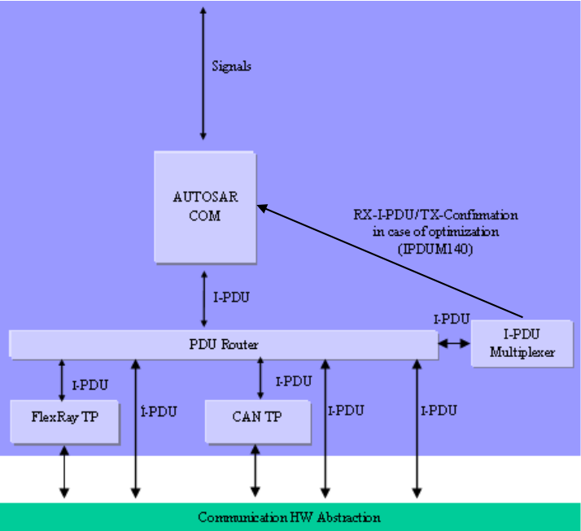

### 5.1. AUTOSAR OS

[IpduM](#921-ipdum)不应直接访问AUTOSAR OS。

### 5.2. RTE（BSW调度器）

RTE包含BSW调度器（**BSW-Scheduler**）（见[\[7\]](#ref-7)）。

[IpduM](#921-ipdum)模块依赖BSW调度器按照IpduMMainRxTimeBase或IpduMMainTxTimeBase中所配置的周期调用[IpduM](#921-ipdum)\_MainFunctionRx和[IpduM](#921-ipdum)\_MainFunctionTx。

### 5.3. PDU路由器

以下总结了[IpduM](#921-ipdum)需要PDU路由器提供的功能（更多细节见第[7.6](#76-期望接口)节）：

- 传入多路复用I-PDU或被包含I-PDU的指示
- 传出I-PDU（容器PDU或多路复用PDU）的发送接口
- 已发出的I-PDU的确认

以下列表总结了[IpduM](#921-ipdum)模块为PDU路由器模块提供的功能：

- 用于传入I-PDU（被解复用）和传入容器PDU（将被拆解）的指示接口
- 用于待多路复用I-PDU和待组装进容器PDU的I-PDU的发送接口
- 已发送I-PDU的确认接口

PDU路由器模块的配置（例如查找表）必须确保：属于多路复用I-PDU、并代表多路复用I-PDU的静态部分或动态部分的I-PDU被路由到[IpduM](#921-ipdum)模块。

PDU路由器模块的配置（例如查找表）必须确保相关I-PDU被路由到[IpduM](#921-ipdum)。这些I-PDU是：

- 属于多路复用I-PDU、并代表多路复用I-PDU的静态部分或动态部分的I-PDU
- 由待解复用的静态部分和动态部分组成的I-PDU
- 待组装进容器PDU的I-PDU
- 待拆解的容器PDU

### 5.4. COM

[IpduM](#921-ipdum)模块的配置依赖于AUTOSAR COM模块的相应配置。对于每个多路复用I-PDU，需要为静态部分和动态部分的每种布局配置不同的I-PDU。关于在COM模块中配置的更多信息，见第[6.1](#61-通用)节，尤其是图7.1。

[IpduM](#921-ipdum)还进一步假定：代表动态部分的COM模块I-PDU中已经包含正确的选择符字段值。另见下文关于选择符字段的要求。

容器PDU/被包含I-PDU的配置不依赖于COM配置。

### 5.5. 文件结构

#### 5.5.1. 代码文件结构

本[IpduM](#921-ipdum) SWS不完整定义代码文件结构。

## 6. 功能规格

### 6.1. 通用

将多个I-PDU多路复用为一个在总线上传输的PDU有两种不同的方法：

I-PDU多路复用是指将从PDU路由器传送到通信硬件抽象层的相同I-PDU ID用于该I-PDU的多种不同布局；另见[\[6\]](#ref-6)。

多PDU到容器映射（**Multiple PDU to Container Mapping**）是指将多个I-PDU收集到一个容器PDU中。该容器PDU随后作为单个（大）I-PDU经由PduR传输。这样可以利用较新总线系统更大的帧长度，在与较小I-PDU长度（通常为8字节）组合的情况下高效使用带宽。

[IpduM](#921-ipdum)的实现应保证没有其他模块依赖于它，并且在不需要时可以构建不带[IpduM](#921-ipdum)模块的系统。

### 6.2. I-PDU多路复用

#### 6.2.1. 定义和布局

多路复用I-PDU由静态部分（**static part**）和动态部分（**dynamic part**）组成，其中静态部分由零个或多个信号或信号组组成。动态部分由选择符字段和一个或多个信号或信号组组成；见图7.1。

I-PDU的动态部分类似于编程语言C中的联合（**union**）。根据I-PDU内选择符字段的值，选择I-PDU的实际布局。

静态部分和动态部分的位置可按I-PDU配置。静态部分和动态部分可以细分为不同的段（**segment**）。

每个多路复用I-PDU只能定义一个选择符字段。选择符字段的值定义了如何解释I-PDU动态部分的内容。选择符字段的长度可在1到16个连续位之间配置，其位置可以通过配置定义（见后文配置章节）。

[IpduM](#921-ipdum)配置的总览见第[9.2](#92-容器与配置参数)节。配置规则见第[9.4](#94-配置规则)节。

PDU的多路复用最初已知于CAN，但不限于此通信系统。[IpduM](#921-ipdum)在AUTOSAR分层架构中与PDU路由器并排、位于接口层（通信硬件抽象）之上，因此该特性可用于PDU路由器能够处理的所有总线系统，例如FlexRay。

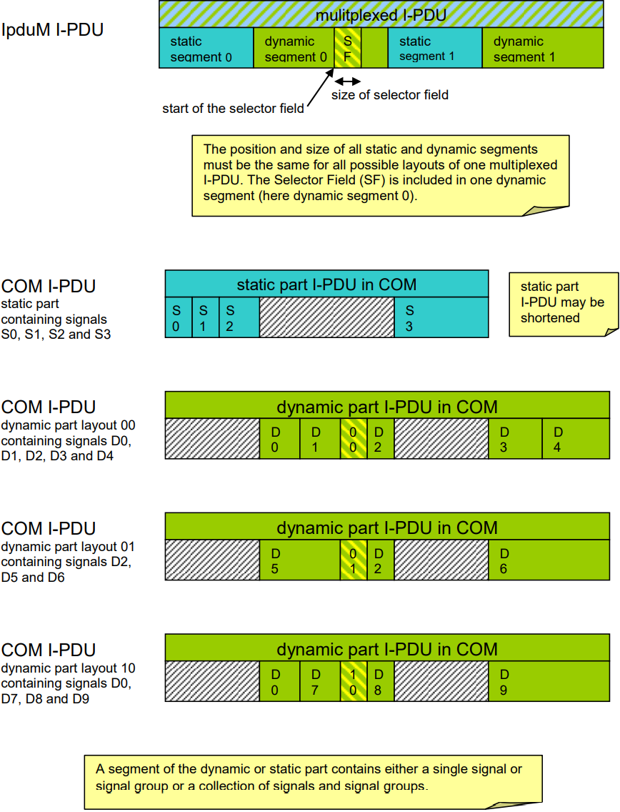

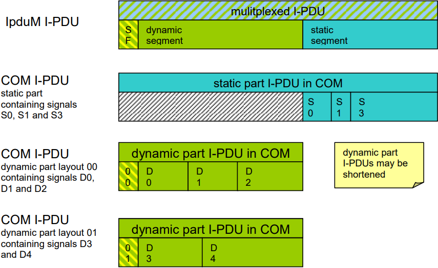

#### 6.2.2. 通用

多路复用[IpduM](#921-ipdum) I-PDU的静态部分有一个COM I-PDU，动态部分的每种布局各有一个COM I-PDU，因此[IpduM](#921-ipdum)最多组合两个COM的I-PDU。

[IpduM](#921-ipdum)模块不应设置选择符字段。

[IpduM](#921-ipdum)模块依赖于COM模块的配置。对于每种动态布局，需要在COM中配置一个I-PDU。此类I-PDU必须已经包含正确的选择符字段值。COM中的选择符字段值可以这样初始化：将它们配置为用初始值初始化、且初始化后从不写入的信号。

[IpduM](#921-ipdum)在解释选择符字段值时应遵循IpduMByteOrder。

关于多路复用I-PDU发送和接收的详细描述见第[6.2.4](#624-发送)节和第[6.2.5](#625-接收)节。

应允许将从[IpduM](#921-ipdum)模块经由PDU路由器模块到COM层的Rx-和Tx-确认路径进行优化，即从[IpduM](#921-ipdum)模块直接调用COM API而不经过PDU路由器。这应通过将已发布参数IpduMRxDirectComInvocation设置为TRUE来指示（见后文配置章节）。

在上述COM调用优化的情况下，[IpduM](#921-ipdum).c需要包含Com.h。

#### 6.2.3. 初始化

[IpduM](#921-ipdum)模块提供一个初始化函数[IpduM](#921-ipdum)\_Init。该函数初始化所有内部全局变量和[IpduM](#921-ipdum) I-PDU的缓冲区。更多细节见第[7.3.1](#731-ipdum_init)节。

[IpduM](#921-ipdum)的环境应在调用[IpduM](#921-ipdum)模块的任何其他函数之前调用[IpduM](#921-ipdum)\_Init。

实现者必须确保：在模块初始化之前调用某个API函数（[IpduM](#921-ipdum)\_MainFunctionTx、[IpduM](#921-ipdum)\_MainFunctionRx和[IpduM](#921-ipdum)\_GetVersionInfo除外）时，开发模式下返回IPDUM\_E\_UNINIT。

对于穿过[IpduM](#921-ipdum)模块的I-PDU数据传输路径，[IpduM](#921-ipdum)模块内分配了一个缓冲区。该缓冲区需要初始化，因为它可能在COM模块完全填充数据之前就被发送。该缓冲区的初始化数据从COM模块配置的初始值派生如下：

1. [IpduM](#921-ipdum)应用已配置的模式IpduMIPduUnusedAreasDefault初始化其内部发送缓冲区。
2. 初始动态部分的初始信号值应按照所引用COM I-PDU（IpduMInitialDynamicPart -&gt; [IpduMTxDynamicPart](#926-ipdumtxdynamicpart) -&gt; IpduMTxDynamicPduRef）的初始值设置。
3. 静态部分的初始信号值应按照所引用COM I-PDU（[IpduMTxStaticPart](#928-ipdumtxstaticpart) -&gt; IpduMTxStaticPduRef）的初始值设置。

选择符字段包含在初始动态部分的一个段内，因此被隐式初始化。

为了优化，缓冲区的初始位模式可以在配置阶段计算出来，然后在运行时复制。

#### 6.2.4. 发送

在COM内部，多路复用I-PDU的静态部分和各动态部分分别有独立的I-PDU。

静态部分和动态部分在COM中作为具有各自I-PDU ID的独立I-PDU处理。

对于多路复用I-PDU，[IpduM](#921-ipdum)应将代表关联静态部分和最后接收的动态部分的相应两个COM I-PDU合并为一个具有新的唯一I-PDU ID的单个[IpduM](#921-ipdum) I-PDU。[IpduM](#921-ipdum)应将这个新的[IpduM](#921-ipdum) I-PDU发送给PDU路由器模块。

另见图5.1。

关于发送触发的细节见第[6.2.4.2](#6242-发送触发)节。

所有控制功能（如COM I-PDU的截止期监视和更新位求值）都不在[IpduM](#921-ipdum)的职责范围内，必须由COM层完成。关于新组合I-PDU时序行为的细节见第[6.2.4.2](#6242-发送触发)节。

##### 6.2.4.1. 发送请求

[IpduM](#921-ipdum)模块提供一个[IpduM](#921-ipdum)\_Transmit函数，使PDU路由器能够发起I-PDU的发送；见第[7.3.3](#733-ipdum_transmit)节。

函数[IpduM](#921-ipdum)\_Transmit应使用相关的静态部分和动态部分组装多路复用I-PDU，并按照第[6.2.4.2](#6242-发送触发)节和后文配置章节中定义的触发条件/模式发送它。

如第[6.2.3](#623-初始化)节所定义，每个输出I-PDU都有一个初始值，这样，如果[IpduM](#921-ipdum)模块在静态部分和动态部分都已从COM发送到[IpduM](#921-ipdum)之前发送某个I-PDU，发送的将是由配置定义的值。

只要尚未接收到该[IpduM](#921-ipdum) I-PDU的发送确认（无论结果如何），对于来自上层、带有属于同一[IpduM](#921-ipdum) I-PDU的COM I-PDU的任何新发送请求，函数[IpduM](#921-ipdum)\_Transmit都应返回E\_NOT_OK。

[IpduM](#921-ipdum)模块在这里依赖于下层已配置的发送配置。

如果多路复用I-PDU仅因动态部分或静态部分的更新而被触发发送，则若非触发部分在两次发送之间被多次更新，该部分可能被覆盖。

##### 6.2.4.2. 发送触发

[IpduM](#921-ipdum)模块通过来自PDU路由器模块的两个独立发送请求（作为两个单独的COM I-PDU）接收多路复用I-PDU的静态部分和动态部分。

[IpduM](#921-ipdum)模块应可配置为因以下触发条件/模式而向PDU路由器发送新多路复用I-PDU的发送请求：

- 接收到静态部分
- 接收到动态部分
- 接收到静态部分或动态部分
- 不因接收到该I-PDU的任何内容而触发发送（IpduMTxTriggerMode None）——用于TriggerTransmit的情况

上文定义的四种触发条件/模式允许通过COM发送的各个I-PDU的发送模式来控制新组装I-PDU的发送模式，另见[\[3\]](#ref-3)。

上文定义的四种触发条件/模式中，并非所有都能保证多路复用I-PDU不同实例的连续发送之间的最小延迟时间，因为如果发送由静态部分和动态部分、或仅由动态部分触发，COM不会顾及最小延迟时间。COM将静态部分和不同动态部分视为互不相关的独立I-PDU。

「不因接收到任何内容而触发发送」这一配置，用于某个I-PDU只因下层的TriggerTransmit而发送的情况。通过API [IpduM](#921-ipdum)\_TriggerTransmit，下层可以触发I-PDU的发送。

如果IpduMTxTriggerMode为None且下层通过[IpduM](#921-ipdum)\_TriggerTransmit触发发送，则需要配置IpduMTxConfirmationPduId，因为在[IpduM](#921-ipdum)\_TriggerTransmit的情况下该ID也用于解析I-PDU（另见后文配置章节）。

##### 6.2.4.3. 部分的即时更新

有时可能不希望[IpduM](#921-ipdum)模块只发送本地存储的部分，因为这些部分可能包含过时的信息（例如更新位）。因此，[IpduM](#921-ipdum)支持按部分配置的即时更新（**just-in-time update**）机制。

如果多路复用I-PDU的发送由一个部分的更新触发，且第二部分的IpduMJitUpdate配置为true，则[IpduM](#921-ipdum)模块应在通过PduR\_IpduMTransmit发出多路复用I-PDU之前，通过PduR\_IpduMTriggerTransmit更新第二部分。

如果通过[IpduM](#921-ipdum)\_TriggerTransmit请求多路复用I-PDU的内容，则[IpduM](#921-ipdum)模块应在返回多路复用I-PDU的内容之前，更新所有IpduMJitUpdate配置为true的部分。

如果[IpduM](#921-ipdum)应即时更新动态部分，则应更新上层发送的最新动态部分；如果之前没有发送过动态部分，则应更新IpduMInitialDynamicPart所引用的动态部分。

如果多路复用I-PDU的发送由一个部分的更新触发，且第二部分的IpduMJitUpdate配置为true，则若通过PduR\_IpduMTriggerTransmit进行的JIT更新请求返回E\_NOT_OK，则不应发送该多路复用I-PDU。

如果通过[IpduM](#921-ipdum)\_TriggerTransmit请求多路复用I-PDU的内容，且任一多路复用部分的IpduMJitUpdate配置为true，则若任一通过PduR\_IpduMTriggerTransmit进行的JIT更新请求返回E\_NOT_OK，[IpduM](#921-ipdum)\_TriggerTransmit应返回E\_NOT_OK。

##### 6.2.4.4. 发送确认

发送确认由PDU路由器按照PDU路由器中I-PDU的配置提供给[IpduM](#921-ipdum)模块。

如果[IpduM](#921-ipdum)接收到特定[IpduM](#921-ipdum) I-PDU的TxConfirmation，它应将该确认转换为相应的COM I-PDU确认，这些COM I-PDU包含在最后发出的多路复用[IpduM](#921-ipdum) I-PDU中。

根据IpduMTxDynamicConfirmation和IpduMTxStaticConfirmation的配置，对于一次发送请求，[IpduM](#921-ipdum)将向COM传递零个、一个或两个确认。提供给上层的确认数量不取决于IpduMTxTriggerMode。

示例：

- 如果相应[IpduMTxRequest](#925-ipdumtxrequest)的IpduMTxDynamicConfirmation和IpduMTxStaticConfirmation均未配置为true，则不生成COM确认。
- 如果IpduMTxStaticConfirmation配置为true而IpduMTxDynamicConfirmation配置为false（或反之），则只生成一个COM确认。
- 如果IpduMTxStaticConfirmation和IpduMTxDynamicConfirmation都配置为true，则生成两个COM确认：一个给代表静态部分的I-PDU，一个给代表动态部分的I-PDU。

在生成两个发送确认的情况下，它们显然是相等的，因为它们派生自同一个IPDUM发送确认。

#### 6.2.5. 接收

通信硬件抽象（CAN接口、LIN接口、FlexRay接口）接收到的每个I-PDU都会被交给PDU路由器。PDU路由器将多路复用I-PDU路由到[IpduM](#921-ipdum)模块。[IpduM](#921-ipdum)模块将多路复用I-PDU的静态部分和动态部分分别路由到它们的目的地。

在配置阶段即已知道哪些传入I-PDU ID对应于配置了静态部分的多路复用I-PDU。要确定是否存在静态部分，只需I-PDU ID即可。

没有任何要求要求处理或通知配置错误的部分。因此，如果接收到的I-PDU包含未在本ECU上配置接收的段，它们将被静默忽略。此外，如果某个I-PDU配置的PduLength为0，它也将被静默忽略，因为无法配置任何有意义的处理。

这种情况可能出现在网关场景中：一个多路复用I-PDU总是被PDU路由器路由到另一总线，但其某个动态部分中包含一个必须传递给应用的信号。在这种情况下，该多路复用PDU也必须被路由到[IpduM](#921-ipdum)。

#### 6.2.6. 元数据处理

本节的要求仅在IpduMMetaDataSupport配置为true时适用。

如果IpduMTxTriggerMode被配置为NONE以外的值，[IpduM](#921-ipdum)应使用触发部分的元数据来发送多路复用I-PDU。

如果IpduMTxTriggerMode被配置为NONE，[IpduM](#921-ipdum)应使用最后更新的部分的元数据来发送多路复用I-PDU。

在接收侧，[IpduM](#921-ipdum)应将接收到的元数据连同所有解复用出的部分一起转发。

### 6.3. 多PDU到容器处理

[IpduM](#921-ipdum)支持将多个I-PDU映射到一个容器PDU。从PduR的角度看，被包含PDU和容器PDU都是普通PDU。容器布局既可以通过在被包含I-PDU前面放置报头来动态定义，也可以不带报头、但为被包含I-PDU定义静态位置来静态定义。

[IpduM](#921-ipdum)依赖于将PduR配置为把映射到容器PDU的发送PDU和接收到的容器PDU转发给[IpduM](#921-ipdum)。

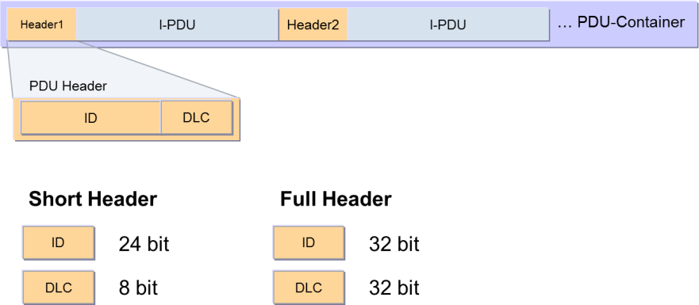

#### 6.3.1. 动态容器布局

在动态容器PDU内部，[IpduM](#921-ipdum)应将被包含I-PDU的报头放置在该被包含I-PDU之前。

另见图7.3。

对于动态容器PDU，没有对被包含I-PDU在容器PDU内位置的配置，因此任意被包含I-PDU的位置由其有效载荷长度（DLC）以及位于其前（先加入）的被包含I-PDU的报头决定。

容器PDU中包含的I-PDU数量受容器PDU最大尺寸（ECUC-PDU的PDULength）限制。

关于容器I-PDU内顺序，可采用以下方式：

- 保持顺序（见后文）：被包含I-PDU在容器PDU内的顺序将被保持。这样，所有被包含I-PDU都按照它们被放入容器PDU的相同顺序被提取。
- 按优先级排序：被包含I-PDU在容器PDU内的顺序基于已配置的优先级。

[IpduM](#921-ipdum)为动态容器PDU支持两种不同的报头尺寸（见IpduMContainerHeaderSize）：

- IPDUM\_HEADERTYPE\_SHORT，24位ID和8位长度
- IPDUM\_HEADERTYPE\_LONG，32位ID和32位长度

报头尺寸通过IpduMContainerHeaderSize按容器PDU配置。因此它对整个容器PDU有效。不支持在同一个容器PDU内混用报头尺寸。

每个I-PDU报头应由ID字段和长度字段组成，字节序由IpduMHeaderByteOrder决定。

在被包含I-PDU的报头和有效载荷放置到动态容器PDU内时应连续、无间隙。

**原理解释：** 这允许通过考虑报头尺寸和有效载荷长度（来自报头的DLC）来迭代遍历容器PDU。

这必须由容器收集算法的实现来保证，因为被包含I-PDU在容器PDU内没有专用的（配置的）位置。

#### 6.3.2. 静态容器布局

为了启用静态容器布局，必须将容器PDU的IpduMContainerHeaderSize配置为IPDUM\_HEADERTYPE\_NONE。

如果IpduMContainerHeaderSize设置为IPDUM\_HEADERTYPE\_NONE，则[IpduM](#921-ipdum)模块应按照被包含I-PDU已配置的IpduMContainedPduOffset将被包含I-PDU静态地放置在容器PDU内。

对于静态容器布局，只支持IpduMContainedTxPduCollectionSemantics设置为IPDUM\_COLLECT\_LAST\_IS\_BEST的被包含I-PDU（见后文配置章节）。

#### 6.3.3. 发送

本节及其子节中的要求适用于动态容器和静态容器的发送。

##### 6.3.3.1. 发送请求

[IpduM](#921-ipdum)按容器PDU从上层收集被包含I-PDU的发送请求。伴随发送请求，[IpduM](#921-ipdum)必须根据配置为相应的被包含I-PDU提供缓冲区：

- 如果容器PDU的IpduMContainedTxPduCollectionSemantics设置为IPDUM\_COLLECT\_QUEUED，则[IpduM](#921-ipdum)在内部存储相应的被包含I-PDU。
- 如果容器PDU的IpduMContainedTxPduCollectionSemantics设置为IPDUM\_COLLECT\_LAST\_IS\_BEST，则[IpduM](#921-ipdum)必须存储发送请求。当容器PDU被发送时，[IpduM](#921-ipdum)根据发送请求从相应上层的I-PDU缓冲区获取被包含I-PDU的数据。

无论采用何种缓冲区策略，如果指示了某个被包含I-PDU的发送请求，本规范使用「被包含I-PDU的发送请求被分配给一个容器PDU」这一说法。

##### 6.3.3.2. 发送触发条件

容器PDU的发送触发条件受多个可配置的发送触发器影响：

- IpduMContainedTxPduTrigger：IPDUM\_TRIGGER\_ALWAYS、IPDUM\_TRIGGER\_NEVER
- IpduMContainerTxFirstContainedPduTrigger
- IpduMContainerTxSendTimeout
- IpduMContainedTxPduSendTimeout
- IpduMContainerTxSizeThreshold
- 超过容器PDU的最大尺寸

当将被包含I-PDU的发送请求分配给尚未被触发的容器PDU时，如果IpduMContainedTxPduTrigger设置为IPDUM\_TRIGGER\_ALWAYS，则应立即触发该容器PDU。

当将被包含I-PDU的发送请求分配给参数IpduMContainerTxFirstContainedPduTrigger设置为TRUE的容器PDU时，该容器PDU应排队等待发送。

**原理解释：** 以这种方式为时间触发的总线请求一次发送。

当将被包含I-PDU的第一个发送请求分配给某个容器PDU，且该容器PDU的IpduMContainerTxSendTimeout或该被包含I-PDU的IpduMContainedTxPduSendTimeout配置为大于零时，[IpduM](#921-ipdum)模块应启动该容器PDU的发送定时器。该定时器应以IpduMContainerTxSendTimeout和IpduMContainedTxPduSendTimeout中较小的非零值初始化。

当被包含I-PDU的发送请求被分配给某个容器PDU时，如果该被包含I-PDU的超时（IpduMContainedTxPduSendTimeout）小于容器PDU的剩余时间，则容器PDU的发送定时器应以该超时值更新。

当上文定义的容器PDU发送定时器到期时，应触发该容器PDU。

**注意：** 如果既没有为容器PDU及其被包含PDU提供IpduMContainedTxPduSendTimeout，也没有提供IpduMContainerTxSendTimeout，则[IpduM](#921-ipdum)模块不会通过容器PDU的发送定时器触发容器PDU（容器PDU没有基于超时的触发）。

当将被包含I-PDU的发送请求分配给尚未被触发的容器PDU时，如果该容器PDU产生的有效载荷大于IpduMContainerTxSizeThreshold，则应触发该容器PDU。

**注意：** 超过容器PDU最大尺寸的发送触发条件在后文配置章节中规定。

##### 6.3.3.3. 容器PDU的组装

请注意，「容器PDU的组装」是描述将容器PDU交付给下层的通用说法。如果使用排队（见第[6.3.3.5](#6335-排队)节），该说法指从内部队列获取容器PDU的一个实例。如果使用last-is-best收集语义（见第[6.3.3.6](#6336-last-is-best收集语义)节），该说法指从相应上层获取数据。

根据评估出的触发条件，容器PDU被触发发送。发送过程取决于配置（IPDUM\_DIRECT或IPDUM\_TRIGGERTRANSMIT）：

- 如果IpduMContainerTxTriggerMode设置为IPDUM\_DIRECT，则当触发条件导致容器PDU的发送时组装容器PDU。
- 如果IpduMContainerTxTriggerMode设置为IPDUM\_TRIGGERTRANSMIT，则当下层通过[IpduM](#921-ipdum)\_TriggerTransmit指示硬件已准备好发送容器PDU时组装容器PDU。

无论容器PDU以何种方式传递到发送硬件缓冲区，容器PDU的触发都会导致一次PduR\_IpduMTransmit调用。

当容器PDU被触发且IpduMContainerTxTriggerMode设置为IPDUM\_DIRECT时，[IpduM](#921-ipdum)应组装容器PDU，并针对发送队列的配置处理发送过程（请参阅后文关于排队的要求）。

当容器PDU被触发且IpduMContainerTxTriggerMode设置为IPDUM\_TRIGGERTRANSMIT时，[IpduM](#921-ipdum)应以SduDataPtr设置为NULL、SduLength按以下前提条件调用PduR\_IpduMTransmit：

- 对于静态容器PDU，SduLength应相对于IpduMPduUpdateBitPosition（见后文配置规则）、IpduMContainedPduOffset（见后文配置规则）以及最后一个被包含IPDU的长度（如果配置了动态PDU长度，见后文配置规则）计算。
- 对于动态容器PDU，SduLength应按照后文的要求计算。

当容器PDU被触发且IpduMContainerTxTriggerMode设置为IPDUM\_TRIGGERTRANSMIT时，[IpduM](#921-ipdum)应在API调用[IpduM](#921-ipdum)\_TriggerTransmit的上下文中组装容器PDU。

**注意：**

- 发送过程必须考虑后文关于等待发送确认的要求。
- IpduMContainerTxTriggerMode设置为IPDUM\_TRIGGERTRANSMIT的容器PDU在[IpduM](#921-ipdum)\_TriggerTransmit的上下文中组装。因此，对于PduR\_IpduMTransmit的调用，[IpduM](#921-ipdum)必须考虑以下几点：
  - SduDataPtr必须设置为NULL，以指示容器尚未组装。
  - SduLength必须设置为相对于当前可用发送请求的长度。这是下层必须考虑的最小请求长度。在随后的相应[IpduM](#921-ipdum)\_TriggerTransmit调用中，下层必须提供等于或大于最小请求长度的可用缓冲区长度。
- IpduMContainerTxTriggerMode设置为IPDUM\_TRIGGERTRANSMIT的容器PDU，即使在调用PduR\_IpduMTransmit之后，发送请求也会被持续收集：
  - 对于IpduMContainedTxPduCollectionSemantics设置为IPDUM\_COLLECT\_QUEUED的被包含I-PDU：被包含I-PDU可以加入容器PDU，直到该容器PDU被取走（见后文）或不超过容器PDU的最大尺寸为止。
  - 对于IpduMContainedTxPduCollectionSemantics设置为IPDUM\_COLLECT\_LAST\_IS\_BEST的被包含I-PDU：在被包含I-PDU加入容器PDU之前（见上文），会考虑发送请求或被包含PDU的更新。
  - 在PduR\_IpduMTransmit调用中计算的容器PDU最小请求SduLength（请求的SduLength）可能不同于在[IpduM](#921-ipdum)\_TriggerTransmit调用中组装容器PDU时计算的SduLength（实际SduLength）：
    - 如果使用IpduMContainedTxPduCollectionSemantics设置为IPDUM\_COLLECT\_QUEUED，实际SduLength可以等于或大于请求的SduLength。
    - 如果使用IpduMContainedTxPduCollectionSemantics设置为IPDUM\_COLLECT\_LAST\_IS\_BEST，实际SduLength可以等于、大于或小于请求的SduLength。如果具有动态PDU长度的被包含I-PDU在调用PduR\_IpduMTransmit之后、在相应的[IpduM](#921-ipdum)\_TriggerTransmit调用之前被更新为更短的长度，则可能出现更短的长度。

##### 6.3.3.4. 发送确认

[IpduM](#921-ipdum)应等待某个容器PDU的发送确认（无论结果如何）之后，才能为该容器PDU的下一个实例调用PduR\_IpduMTransmit。

**注意：** [IpduM](#921-ipdum)模块在这里依赖于下层为该容器PDU配置的发送确认。

如果[IpduM](#921-ipdum)接收到特定容器PDU的发送确认，它应将该确认转换为相应的确认，发送给那些IpduMContainedTxPduConfirmation设置为TRUE、且包含在该特定容器PDU最后一次发送中的被包含I-PDU。如果同一被包含I-PDU在该已发送的特定容器PDU中出现多次，这将导致多个TxConfirmation。

##### 6.3.3.5. 排队

对于IpduMContainedTxPduCollectionSemantics设置为IPDUM\_COLLECT\_QUEUED的被包含I-PDU，可以使用容器PDU的排队（见后文配置规则）。在这种情况下，[IpduM](#921-ipdum)必须保留多于一个的容器PDU实例，除当前实例外最多可存储IpduMContainerQueueSize个实例。当前实例是当前正在向其中添加被包含I-PDU的容器PDU实例。在该实例被排队或复制到下层之后，即根据IpduMContainerTxTriggerMode的配置在TriggerTransmit或Transmit API调用之后，不能再向该实例添加被包含I-PDU。

**注意：** 排队收集语义保证被包含I-PDU的每个实例/值都会出现在总线上。

如果某个PDU容器排队等待发送，且IpduMContainerQueueSize未设置（或设置为1），[IpduM](#921-ipdum)应调用PduR\_IpduMTransmit。

如果某个PDU容器排队等待发送，且IpduMContainerQueueSize大于1，[IpduM](#921-ipdum)应将容器PDU存储在队列中。

如果PduR\_IpduMTransmit返回了E\_NOT\_OK，则在下一次调用[IpduM](#921-ipdum)\_MainFunctionTx期间应重复相同的发送请求，最多重试IpduMMaxTransmitRetries次。该容器PDU实例在此期间排队。

另见后文关于丢弃最老实例的要求。

如果已接收到该容器PDU的发送确认，则[IpduM](#921-ipdum)最迟应在下一次调用[IpduM](#921-ipdum)\_MainFunctionTx期间为该容器PDU的下一个最老实例调用PduR\_IpduMTransmit。

如果IpduMContainerTxTriggerMode设置为IPDUM\_DIRECT，且PduR\_IpduMTransmit为该容器PDU返回E\_OK，则[IpduM](#921-ipdum)应将该实例从队列中移除。

在这种情况下，如果CanIf内部使用了队列，容器PDU的实例可能会丢失，因为较新的实例可能覆盖之前的实例。这种last-is-best行为在这种情况下可能不是所期望的。

如果创建容器PDU的新实例将超过IpduMContainerQueueSize，则应丢弃最老的实例。如果未配置IpduMContainerQueueSize，则应丢弃本地实例。在这两种情况下，都应通过Det\_ReportRuntimeError向[\[9, DET\]](#ref-9)报告IPDUM\_E\_QUEUEOVFL。

如果IpduMContainerTxTriggerMode设置为IPDUM\_TRIGGERTRANSMIT，则当某个容器PDU实例被[IpduM](#921-ipdum)\_TriggerTransmit取走时，应将其从队列中丢弃。

如果IpduMContainerTxTriggerMode设置为IPDUM\_TRIGGERTRANSMIT，[IpduM](#921-ipdum)应保留并提供缓冲的数据，直到它被[IpduM](#921-ipdum)\_TriggerTransmit调用取走为止。

如果IpduMContainerTxTriggerMode设置为IPDUM\_TRIGGERTRANSMIT，[IpduM](#921-ipdum)\_TriggerTransmit应复制队列中最老的容器PDU实例。如果队列为空/不存在，则复制容器PDU的当前实例。如果容器PDU的当前实例也为空/不存在，则[IpduM](#921-ipdum)\_TriggerTransmit返回E\_NOT\_OK。

##### 6.3.3.6. Last-is-Best收集语义

对于IpduMContainedTxPduCollectionSemantics设置为IPDUM\_COLLECT\_LAST\_IS\_BEST的容器PDU，不支持容器PDU的排队（见后文配置规则）。

**注意：** 一旦某个被包含I-PDU被配置为使用last-is-best语义，必须考虑以下几点：

- 该被包含I-PDU的所有实例/值不一定都出现在总线上。如果使用FlexRay总线系统且应用调度与FlexRay周期不同步，这种行为会进一步恶化。这可能影响使用序列计数器的通信（例如E2E保护的通信）。
- 如果例如使用CAN到CAN的路由且路由在接收中断的上下文中执行，则必须考虑扩展的中断运行时间，因为这至少包括接收、PDU的转发和容器PDU的组装。

对于IpduMContainedTxPduCollectionSemantics设置为IPDUM\_COLLECT\_LAST\_IS\_BEST的被包含I-PDU，[IpduM](#921-ipdum)应使用PduR\_IpduMTriggerTransmit在将容器I-PDU传输给下层之前立即从其上层获取PDU数据。

虽然将IpduMContainedTxPduCollectionSemantics IPDUM\_COLLECT\_LAST\_IS\_BEST与IpduMContainerTxTriggerMode IPDUM\_TRIGGERTRANSMIT结合使用看似自然，但它也可以与IPDUM\_DIRECT结合使用。

#### 6.3.4. 动态容器的发送

本章及其子章中的要求是对动态容器发送的补充，不适用于静态容器。

如果容器PDU被组装（见前文），[IpduM](#921-ipdum)应计算容器PDU的总体尺寸。总尺寸由所有被包含I-PDU的有效载荷总和加上相应报头的总长度构成。其结果应为容器PDU的有效载荷尺寸。

如果容器PDU的IpduMContainerTxTriggerMode设置为IPDUM\_DIRECT，且该容器PDU已组装并传递给PduR，则参数PduInfoPtr应在SduDataPtr中包含指向已组装容器PDU的指针，并在SduLength中包含总长度（按照上文）。

如果容器PDU的IpduMContainerTxTriggerMode设置为IPDUM\_TRIGGERTRANSMIT，且该容器PDU已在[IpduM](#921-ipdum)\_TriggerTransmit调用的上下文中组装，则参数PduInfoPtr应在SduLength中以总长度（按照上文）更新。

##### 6.3.4.1. 排队收集语义

如果容器PDU的IpduMContainedTxPduCollectionSemantics设置为IPDUM\_COLLECT\_QUEUED，则被包含I-PDU发送请求的顺序在最终的容器PDU中会被保持。

由于以下要求，[IpduM](#921-ipdum)将确保某个被包含I-PDU的实例（相同PDU-ID）以与传递给[IpduM](#921-ipdum)完全相同的顺序被发送（在其容器PDU内传递给PduR）。

当IpduMContainedTxPduCollectionSemantics设置为IPDUM\_COLLECT\_QUEUED（见后文配置章节）的被包含I-PDU通过[IpduM](#921-ipdum)\_Transmit传递给[IpduM](#921-ipdum)时，即使该被包含I-PDU的前一个实例已经存在于该容器PDU中，[IpduM](#921-ipdum)也应识别关联的容器PDU并将该被包含I-PDU附加到其有效载荷。

这样，一个容器PDU可以包含同一I-PDU的多个实例。产生的行为类似FIFO，以保持被发送I-PDU实例的顺序。因此，接收[IpduM](#921-ipdum)的上层可以实现last-is-best或FIFO语义。

如果某个被包含I-PDU的IpduMContainedTxPduCollectionSemantics设置为IPDUM\_COLLECT\_QUEUED（见后文配置章节）、IpduMContainerTxTriggerMode设置为IPDUM\_DIRECT，且添加该被包含I-PDU将超过容器I-PDU的最大尺寸，则首先应触发容器PDU。该被包含I-PDU应被添加到容器PDU的新实例中。

如果某个被包含I-PDU的IpduMContainedTxPduCollectionSemantics设置为IPDUM\_COLLECT\_QUEUED（见后文配置章节）、IpduMContainerTxTriggerMode设置为IPDUM\_TRIGGERTRANSMIT，且添加该被包含I-PDU将超过容器PDU的最大尺寸，则首先应将容器PDU排队。然后该被包含I-PDU应被添加到容器PDU的新实例中。

##### 6.3.4.2. 触发发送与Last-is-Best语义

对于IpduMContainedTxPduCollectionSemantics设置为IPDUM\_COLLECT\_LAST\_IS\_BEST的被包含I-PDU，[IpduM](#921-ipdum)收集并存储这些被包含I-PDU的发送请求。

如果某个被包含I-PDU的IpduMContainedTxPduCollectionSemantics设置为IPDUM\_COLLECT\_LAST\_IS\_BEST，其发送请求被更新，且所有请求发送的被包含I-PDU的有效载荷总长加上相应报头将超过容器PDU的最大尺寸，则应触发该容器PDU。

**注意：** 如果被包含I-PDU配置了动态尺寸，则已更新I-PDU的总体尺寸可能波动。超过容器PDU的最大尺寸会导致触发容器PDU。如果容器PDU在[IpduM](#921-ipdum)\_TriggerTransmit的上下文中组装，则只要[IpduM](#921-ipdum)\_TriggerTransmit调用仍处于挂起状态，配置了动态长度的被包含I-PDU的长度都可能被更新。这可能导致两种场景：

1. 如果当前长度小于具有动态长度的容器I-PDU的更新后长度，则可能并非所有被包含I-PDU都能被添加到容器PDU的下一次发送中。
2. 如果当前长度大于具有动态长度的容器I-PDU的更新后长度，则最初的触发条件「超过容器PDU的最大尺寸」可能不再成立。

在这两种情况下，容器PDU都会在不超过容器I-PDU最大尺寸的前提下，使用最新的可用被包含I-PDU组装并发送（见后文）。

如果某个被包含I-PDU的IpduMContainedTxPduCollectionSemantics为IPDUM\_COLLECT\_LAST\_IS\_BEST、容器PDU已组装，且某个被包含I-PDU的PduR\_IpduMTriggerTransmit返回E\_NOT\_OK，则[IpduM](#921-ipdum)应静默省略该被包含I-PDU，并继续容器PDU的组装。

**注意：** 关联的容器PDU无论如何都必须在不包含被省略的被包含I-PDU的情况下发送。

###### 6.3.4.2.1. 顺序与重排序

被包含I-PDU发送请求的顺序在最终的容器PDU中要么被保持，要么被重排序：

- 如果被包含I-PDU的优先级（见IpduMContainedTxPduPriorityHandling）被禁用，则[IpduM](#921-ipdum)按照首次传递发送请求的顺序保持被包含I-PDU的顺序。
- 如果被包含I-PDU的优先级（见IpduMContainedTxPduPriorityHandling）被启用，则[IpduM](#921-ipdum)按照已配置的优先级重排序被包含I-PDU的顺序。

当被包含I-PDU的发送请求被分配给某个容器PDU，该被包含I-PDU的IpduMContainedTxPduCollectionSemantics设置为IPDUM\_COLLECT\_LAST\_IS\_BEST且IpduMContainedTxPduPriorityHandling设置为FALSE时，[IpduM](#921-ipdum)应保持发送请求传递给[IpduM](#921-ipdum)的顺序。即，第一个传递的发送请求的被包含I-PDU被放置在容器的开头，依此类推。如果同一被包含I-PDU的发送请求被多次传递，[IpduM](#921-ipdum)应只在其第一次出现所匹配的位置存储一次。

**注意：** 在收集一个容器PDU期间，同一被包含I-Pdu的多次触发，在IpduMContainedTxPduCollectionSemantics设置为IPDUM\_COLLECT\_LAST\_IS\_BEST的情况下，将产生恰好包含该被包含I-PDU一个实例的容器PDU。

当被包含I-PDU的发送请求被分配给某个容器PDU，这些被包含I-PDU的IpduMContainedTxPduCollectionSemantics设置为IPDUM\_COLLECT\_LAST\_IS\_BEST且IpduMContainedTxPduPriorityHandling设置为TRUE时，[IpduM](#921-ipdum)应按照IpduMContainedTxPduPriority收集发送请求（最高优先级在前，依此类推）。具有相同IpduMContainedTxPduPriority的被包含I-PDU的发送请求应按发送请求发生的顺序收集。

如果容器PDU被组装且被包含PDU的IpduMContainedTxPduCollectionSemantics设置为IPDUM\_COLLECT\_LAST\_IS\_BEST，则[IpduM](#921-ipdum)应按照配置以及根据上文产生的顺序，将被包含I-PDU放置在容器I-PDU中。

如果容器PDU被组装，被包含PDU的IpduMContainedTxPduCollectionSemantics设置为IPDUM\_COLLECT\_LAST\_IS\_BEST，且放置某个被包含I-PDU将超过容器PDU的最大尺寸，则[IpduM](#921-ipdum)应结束组装过程，并将剩余的发送请求保留用于下一次发送。

#### 6.3.5. 静态容器的发送

本章及其子章中的要求是对静态容器发送的补充，不适用于动态容器。

对于具有静态容器布局、且IpduMContainerTxTriggerMode设置为IPDUM\_DIRECT的容器PDU，当所有被包含I-PDU都已被上层更新时，[IpduM](#921-ipdum)应触发该容器PDU。

由于静态容器可能包含未被更新的被包含I-PDU，因此在接收侧需要有手段来检测被包含I-PDU的时效性。可以为被包含I-PDU配置更新位，或者配置未使用区域的默认模式。具体配置和配置规则见第[9](#9-配置规范)章。

如果某个被包含I-PDU配置了IpduMPduUpdateBitPosition，则当且仅当该被包含I-PDU被成功更新时，[IpduM](#921-ipdum)才应确保该被包含I-PDU的更新位被置位。

如果某个静态容器配置了IpduMUnusedAreasDefault，则[IpduM](#921-ipdum)应确保在发送容器PDU之前，容器中所有未更新的区域都被设置为IpduMUnusedAreasDefault的值。

这使得[IpduM](#921-ipdum)也能够在静态容器内处理具有动态长度的被包含I-PDU。但是，接收侧的[IpduM](#921-ipdum)无法检测到IpduMUnusedAreasDefault值是SWC还是发送侧的[IpduM](#921-ipdum)设置的。因此，接收到的总是完整的、因此可能被填充过的被包含I-PDU。

必须注意的是，某些总线系统（例如CAN-FD和FlexRay）无法传输任意长度的PDU，并且可能用自己的默认值将发送的I-PDU填充到下一个可能的长度。因此，IpduMUnusedAreasDefault值的配置应与总线特定的填充模式保持一致。

在发送静态容器PDU时，[IpduM](#921-ipdum)应通过省略最后一个已更新PDU和最后一个更新位之后未更新的数据来减小容器PDU的尺寸。

**注意：** 通过减小容器PDU的尺寸并由底层总线应用填充，接收侧可能接收到带有总线填充模式的被包含PDU。如果这是不可接受的，应考虑为被包含PDU使用更新位，或者系统设计者必须以其他方式处理。

#### 6.3.6. 接收

[IpduM](#921-ipdum)处理接收到的容器PDU有两种可能的方式：

- 接受已配置的（accept configured）
- 接受所有（accept all）（仅适用于IPDUM\_HEADERTYPE\_LONG和IPDUM\_HEADERTYPE\_SHORT）

如果IpduMContainerPduProcessing设置为IPDUM\_PROCESSING\_IMMEDIATE，则接收到的容器PDU的处理应在[IpduM](#921-ipdum)\_RxIndication的上下文中执行。否则，它被推迟到下一次调用[IpduM](#921-ipdum)\_MainFunctionRx。所有被推迟的容器PDU应按其接收顺序处理。

如果通过调用[IpduM](#921-ipdum)\_RxIndication接收到容器PDU，则应提取其中的被包含I-PDU。

如果接收到的容器PDU的配置参数IpduMContainerRxAcceptContainedPdu设置为IPDUM\_ACCEPT\_CONFIGURED，则[IpduM](#921-ipdum)应只预期并匹配那些在IpduMContainedRxInContainerPduRef中引用该[IpduMContainerRxPdu](#9217-ipdumcontainerrxpdu)的被包含I-PDU（[IpduMContainedRxPdu](#9218-ipdumcontainedrxpdu)）。

请注意，只要这些[IpduMContainedRxPdu](#9218-ipdumcontainedrxpdu)被分配给不同的[IpduMContainerRxPdu](#9217-ipdumcontainerrxpdu)（通过IpduMContainedRxInContainerPduRef）、且每个[IpduMContainerRxPdu](#9217-ipdumcontainerrxpdu)的IpduMContainerRxAcceptContainedPdu = IPDUM\_ACCEPT\_CONFIGURED，定义多个具有相同IpduMContainedRxPduLongHeaderId / IpduMContainedRxPduShortHeaderId的[IpduMContainedRxPdu](#9218-ipdumcontainedrxpdu)是完全可行的。

对于IpduMContainerRxAcceptContainedPdu = IPDUM\_ACCEPT\_CONFIGURED且IpduMContainerHeaderSize = IPDUM\_HEADERTYPE\_LONG或IPDUM\_HEADERTYPE\_SHORT的[IpduMContainerRxPdu](#9217-ipdumcontainerrxpdu)，适用以下约束：

- 对该特定[IpduMContainerRxPdu](#9217-ipdumcontainerrxpdu)有IpduMContainedRxInContainerPduRef引用的[IpduMContainedRxPdu](#9218-ipdumcontainedrxpdu)，在该[IpduMContainerRxPdu](#9217-ipdumcontainerrxpdu)的上下文中应分别具有唯一的IpduMContainedRxPduLongHeaderId或IpduMContainedRxPduShortHeaderId。

每个被包含I-PDU应通过PduR\_IpduMRxIndication通知给PduR。[IpduM](#921-ipdum)应以与被包含I-PDU位于容器PDU内相同的顺序指示它们。

##### 6.3.6.1. 排队

如果接收到容器PDU且IpduMContainerPduProcessing设置为IPDUM\_PROCESSING\_DEFERRED，则该容器PDU应排队。

如果接收容器PDU的新实例将超过IpduMContainerQueueSize，则应丢弃最老的实例，并通过Det\_ReportRuntimeError向[\[9, DET\]](#ref-9)报告IPDUM\_E\_QUEUEOVFL。

#### 6.3.7. 功态容器的接收

本章及其子章中的要求是对动态容器接收的补充，不适用于静态容器。

对于接收到的容器PDU中、其[IpduMContainerRxPdu](#9217-ipdumcontainerrxpdu)的IpduMContainerRxAcceptContainedPdu = IPDUM\_ACCEPT\_ALL的每个被包含I-PDU，应使用来自PDU报头的ID来识别相应的被包含I-PDU：

- 如果接收到的容器PDU使用长报头或短报头（IpduMContainerHeaderSize分别为IPDUM\_HEADERTYPE\_LONG或IPDUM\_HEADERTYPE\_SHORT），则该ID应分别与未定义IpduMContainedRxInContainerPduRef的[IpduMContainedRxPdu](#9218-ipdumcontainedrxpdu)集合中的IpduMContainedRxPduLongHeaderId或IpduMContainedRxPduShortHeaderId进行比较。

对于IpduMContainerRxAcceptContainedPdu = IPDUM\_ACCEPT\_ALL的接收到的容器PDU，[IpduM](#921-ipdum)应只预期并匹配那些未定义IpduMContainedRxInContainerPduRef的[IpduMContainedRxPdu](#9218-ipdumcontainedrxpdu)。

所有未定义IpduMContainedRxInContainerPduRef、且定义了IpduMContainedRxPduLongHeaderId或IpduMContainedRxPduShortHeaderId的[IpduMContainedRxPdu](#9218-ipdumcontainedrxpdu)，应分别具有唯一的IpduMContainedRxPduLongHeaderId或IpduMContainedRxPduShortHeaderId。

请注意，由于上文的要求，不允许定义多个具有相同IpduMContainedRxPduShortHeaderId / IpduMContainedRxPduLongHeaderId且未分配给[IpduMContainerRxPdu](#9217-ipdumcontainerrxpdu)（未定义IpduMContainedRxInContainerPduRef）的[IpduMContainedRxPdu](#9218-ipdumcontainedrxpdu)。

请注意，两个未分配给[IpduMContainerRxPdu](#9217-ipdumcontainerrxpdu)（未定义IpduMContainedRxInContainerPduRef）的[IpduMContainedRxPdu](#9218-ipdumcontainedrxpdu)定义了相同的报头ID值是完全可行的，只要其中一个[IpduMContainedRxPdu](#9218-ipdumcontainedrxpdu)定义了IpduMContainedRxPduShortHeaderId而另一个定义了IpduMContainedRxPduLongHeaderId。

请注意，由于[IpduMContainedRxPdu](#9218-ipdumcontainedrxpdu)与[IpduMContainerRxPdu](#9217-ipdumcontainerrxpdu)交互有两种方式（在[IpduMContainerRxPdu](#9217-ipdumcontainerrxpdu)处定义的IPDUM\_ACCEPT\_CONFIGURED和IPDUM\_ACCEPT\_ALL），只要满足上述两个约束，存在具有相同IpduMContainedRxPduShortHeaderId / IpduMContainedRxPduLongHeaderId的[IpduMContainedRxPdu](#9218-ipdumcontainedrxpdu)是完全可行的。

如果IpduMContainerRxAcceptContainedPdu = IPDUM\_ACCEPT\_ALL的接收到的IpduMContainerRxPDU的某个被包含I-PDU无法按照上文的要求匹配，则该被包含I-PDU应被静默丢弃。

对于每个被包含I-PDU，其报头中给出的长度应用作相应I-PDU的长度。

在处理接收到的容器PDU时，如果检测到包含ID 0的报头，则应停止对该容器PDU的处理，并忽略剩余的字节。

**原理解释：** 报头ID为0意味着容器PDU已被填充字节填满，不再包含进一步的数据。

上述要求并不意味着在有效载荷的末尾总是必须有一个0。

#### 6.3.8. 静态容器的接收

本章及其子章中的要求是对静态容器接收的补充，不适用于动态容器。

为了让接收侧的[IpduM](#921-ipdum)模块能够确定接收到的静态容器中哪些PDU实际上在发送侧被更新过，可以为每个被包含I-PDU配置额外的更新信息，即容器PDU内的所谓PDU更新位（见后文配置章节）。

如果接收到的被包含I-PDU配置了更新位，则只有当其接收到的更新位被置位时，[IpduM](#921-ipdum)模块才应处理它并将其指示给上层。

上述要求导致：配置了但未置位更新位的被包含I-PDU被静默忽略。

按照上述要求，没有配置更新位的预期被包含I-PDU总是被处理并指示给上层。它们被假定始终有效。

#### 6.3.9. 错误处理

有些总线系统无法为发送的L-PDU设置任意尺寸（例如CanFD）。容器PDU的有效有效载荷长度可以从被包含的报头推导。因此，与容器PDU实际长度的差值可视为填充。

假定底层总线模块的配置确保填充值不会构成有效的报头。

在处理接收到的容器PDU时，如果检测到某个报头的有效载荷长度超过容器剩余的字节数，则应停止对该容器PDU的处理，并忽略剩余的字节。此外，应通过Det\_ReportRuntimeError向[\[9, DET\]](#ref-9)报告IPDUM\_E\_HEADER。

有效载荷长度大于剩余字节数的报头是无效的。在它后面不应再预期任何报头。

如果容器PDU中的剩余字节数小于已配置的IpduMContainerHeaderSize，则应忽略剩余的字节。

在处理IpduMContainerHeaderSize设置为IPDUM\_HEADERTYPE\_NONE的接收到的容器PDU时，[IpduM](#921-ipdum)应忽略那些按照其配置未包含、或未完全包含在接收到的容器PDU中的所有被包含PDU。此类被包含I-PDU不应被指示给上层。如果配置了开发错误检测（IpduMDevErrorDetect），则应通过Det\_ReportError向[\[9, DET\]](#ref-9)报告IPDUM\_E\_CONTAINER。

#### 6.3.10. 元数据处理

本节的要求仅在IpduMMetaDataSupport配置为true时适用。

如果容器PDU支持元数据，则[IpduM](#921-ipdum)在发送容器PDU时应使用最后从被包含I-PDU收集到的元数据。

如果[IpduM](#921-ipdum)接收到带元数据的容器PDU，则[IpduM](#921-ipdum)应将容器PDU的元数据连同所有支持元数据的被包含I-PDU一起转发。

[IpduM](#921-ipdum)不重排元数据。因此，它只支持分配给同一容器PDU、且没有元数据或具有相同元数据类型的被包含I-PDU（见后文配置规则）。

### 6.4. 基硖件分布

为了在不同分区（核）之间提供负载分布，通信栈的不同部分应被分配到不同的分区。这里应支持按网络类型进行分区，即通信栈的FlexRay、CAN和以太网部分应可定位到不同的、相互独立的分区（核）。

为了在支持这种灵活分配的同时减少跨分区通信（以及因此可能阻塞的同步）的量，[IpduM](#921-ipdum)模块中的主执行线程（即各MainFunction）可以拆分为不同的MainFunction（每个分区至少一个）。这样，接收/发送的流程保持在单个网络（因而在单个分区）的范围内，因此不需要特殊的多分区通信和同步原语。

为了管理不同的时序要求，每个MainFunction实例单独定义其时基。

[IpduM](#921-ipdum)容器Pdu应在由该容器Pdu配置参数（即[IpduMContainerRxPdu](#9217-ipdumcontainerrxpdu)和[IpduMContainerTxPdu](#9219-ipdumcontainertxpdu)）所引用的MainFunction内处理。

### 6.5. 错误分类

#### 6.5.1. 开发错误

| 错误类型 | 相关错误码 | 错误值 |
| --- | --- | --- |
| 以错误的参数调用API服务 | IPDUM\_E\_PARAM | 0x10 |
| NULL指针检查 | IPDUM\_E\_PARAM\_POINTER | 0x11 |
| 在未初始化模块的情况下使用API服务（IpduM_MainFunctionTx、IpduM_MainFunctionRx和IpduM_GetVersionInfo除外） | IPDUM\_E\_UNINIT | 0x20 |
| 无效的配置集选择 | IPDUM\_E\_INIT\_FAILED | 0x21 |

#### 6.5.2. 运行时错误

| 错误类型 | 相关错误码 | 错误值 |
| --- | --- | --- |
| 检测到错误的报头 | IPDUM\_E\_HEADER | 0x30 |
| 容器队列溢出 | IPDUM\_E\_QUEUEOVFL | 0x31 |
| 接收到部分或错误的容器 | IPDUM\_E\_CONTAINER | 0x32 |

#### 6.5.3. 瞬态故障

没有瞬态故障。

#### 6.5.4. 生产错误

没有生产错误。

#### 6.5.5. 扩展生产错误

没有扩展生产错误。

## 7. API规范

如果IpduMDevErrorDetect配置为TRUE，则所有[IpduM](#921-ipdum) API都应检查其输入参数，并通过Det\_ReportError向[\[9, DET\]](#ref-9)报告检测到的错误。普通参数报出IPDUM\_E\_PARAM，指针参数报出IPDUM\_E\_PARAM\_POINTER。

### 7.1. 导入的类型

本章列出所有导入的类型及相应的模块。

| 模块 | 头文件 | 导入的类型 |
| --- | --- | --- |
| ComStack_Types | ComStack_Types.h | PduIdType |
| ComStack_Types | ComStack_Types.h | PduInfoType |
| ComStack_Types | ComStack_Types.h | PduLengthType |
| Std | Std_Types.h | Std_ReturnType |
| Std | Std_Types.h | Std_VersionInfoType |

### 7.2. 类型定义

#### 7.2.1. IpduM\_ConfigType

| 项目 | 内容 |
| --- | --- |
| 名称 | IpduM_ConfigType |
| 类别 | 结构体（Structure） |
| 描述 | 这是包含I-PDU多路复用器初始化数据的数据结构的类型。 |
| 可用性 | [IpduM](#921-ipdum).h |

### 7.3. 函数定义

这是提供给上层模块的函数列表。

#### 7.3.1. IpduM\_Init

**说明**：初始化I-PDU多路复用器。在[IpduM](#921-ipdum)被分配到多个分区的配置中（即IpduM_Main Function被映射到分区），[IpduM](#921-ipdum)可以为每个分区提供一个初始化函数。服务ID 0x00；同步；不可重入；输入参数config为实现特定的、带有配置参数的结构；无输入输出参数；无输出参数；无返回值；可通过[IpduM](#921-ipdum).h使用。

```C
void IpduM_Init ( const IpduM_ConfigType* config )
```

函数[IpduM](#921-ipdum)\_Init应初始化所有与模块相关的全局变量。

在正确调用[IpduM](#921-ipdum)\_Init之前，[IpduM](#921-ipdum)的行为是未规定的。

#### 7.3.2. IpduM\_GetVersionInfo

**说明**：该服务返回本模块的版本信息。服务ID 0x01；同步；可重入；无输入参数；无输入输出参数；输出参数versioninfo为存储本模块版本信息的位置的指针；无返回值；可通过[IpduM](#921-ipdum).h使用。

```C
void IpduM_GetVersionInfo ( Std_VersionInfoType* versioninfo )
```

#### 7.3.3. IpduM\_Transmit

**说明**：请求发送一个PDU。服务ID 0x49；同步；对不同PduId可重入，对相同PduId不可重入；输入参数TxPduId为要发送的PDU的标识符；输入参数PduInfoPtr为PDU数据的长度和指针以及指向元数据的指针；无输入输出参数；无输出参数；返回值Std_ReturnType（E_OK：发送请求已被接受；E_NOT_OK：发送请求未被接受）；可通过[IpduM](#921-ipdum).h使用。

```C
Std_ReturnType IpduM_Transmit ( PduIdType TxPduId, const PduInfoType* PduInfoPtr )
```

详细描述见第[6.2.4.1](#6241-发送请求)节。

### 7.4. 回调通知

#### 7.4.1. IpduM\_RxIndication

**说明**：来自下层通信接口模块的已接收PDU指示。服务ID 0x42；同步；对不同PduId可重入，对相同PduId不可重入；输入参数RxPduId为所接收PDU的ID；输入参数PduInfoPtr包含所接收PDU的长度（SduLength）、指向包含该PDU的缓冲区的指针（SduDataPtr）以及与该PDU相关的元数据；无输入输出参数；无输出参数；无返回值；可通过[IpduM](#921-ipdum).h使用。

```C
void IpduM_RxIndication ( PduIdType RxPduId, const PduInfoType* PduInfoPtr )
```

如果从PDU路由器接收到的多路复用SDU中配置了静态部分，则函数[IpduM](#921-ipdum)\_RxIndication将传入的IPDU ID转换为静态部分目的地的正确I-PDU ID，然后经由PDU路由器转发该SDU（见[\[10, SWS PDU Router\]](#ref-10)中的PduR\_IpduMRxIndication）。

当从PDU路由器接收到多路复用I-PDU时，函数[IpduM](#921-ipdum)\_RxIndication使用传入的I-PDU ID和选择符字段找出动态部分目的地的正确I-PDU ID，然后经由PDU路由器转发该I-PDU（见[\[10, SWS PDU Router\]](#ref-10)中的PduR\_IpduMRxIndication）。

当从PDU路由器接收到容器PDU时，函数[IpduM](#921-ipdum)\_RxIndication使用PduR\_IpduMRxIndication经由PDU路由器转发其中的被包含I-PDU（见后文可选接口）。

函数[IpduM](#921-ipdum)\_RxIndication应可在中断上下文中调用，例如从接收中断调用。

#### 7.4.2. IpduM\_TxConfirmation

**说明**：下层通信接口模块确认PDU的发送，或PDU发送失败。服务ID 0x40；同步；对不同PduId可重入，对相同PduId不可重入；输入参数TxPduId为已发送PDU的ID；输入参数result为E_OK：该PDU已发送；E_NOT_OK：该PDU发送失败；无输入输出参数；无输出参数；无返回值；可通过[IpduM](#921-ipdum).h使用。

```C
void IpduM_TxConfirmation ( PduIdType TxPduId, Std_ReturnType result )
```

函数[IpduM](#921-ipdum)\_TxConfirmation应把从PDU路由器接收到的确认转换为发送出的多路复用I-PDU或容器PDU中所包含的I-PDU的确认。

这些确认再次提供给PDU路由器，由其路由到COM。

函数[IpduM](#921-ipdum)\_TxConfirmation应可在中断上下文中调用，例如从发送中断调用。

#### 7.4.3. IpduM\_TriggerTransmit

**说明**：在该API内，上层模块（被调用模块）应检查可用数据是否适合PduInfoPtr->SduLength所报告的缓冲区尺寸。如果适合，它应将其数据复制到PduInfoPtr->SduDataPtr提供的缓冲区中，并在PduInfoPtr->SduLength中更新实际复制数据的长度。服务ID 0x41；同步；对不同PduId可重入，对相同PduId不可重入；输入参数TxPduId为请求发送的SDU的ID；输入输出参数PduInfoPtr包含指向SDU数据应复制到的缓冲区的指针（SduDataPtr）以及SduLength中的可用缓冲区尺寸。返回时，该服务在SduLength中指示已复制SDU数据的长度；无输出参数；返回值Std_ReturnType（E_OK：SDU已复制，SduLength指示已复制的字节数；E_NOT_OK：未复制任何SDU数据。不得使用PduInfoPtr，因为它可能包含NULL指针或指向无效数据）；可通过[IpduM](#921-ipdum).h使用。

```C
Std_ReturnType IpduM_TriggerTransmit ( PduIdType TxPduId, PduInfoType* PduInfoPtr )
```

在函数[IpduM](#921-ipdum)\_TriggerTransmit内，[IpduM](#921-ipdum)应将其I-PDU发送缓冲区的内容复制到PduInfoPtr->SduDataPtr给定的PDU缓冲区，并相应地用已复制数据的长度更新PduInfoPtr->SduLength。

[IpduM](#921-ipdum)在提供数据时应注意数据一致性。

用例：该函数例如由LIN主节点用于发送LIN帧。在这种情况下，触发发送可以由主节点调度表本身或接收到的LIN报头发起。

FlexRay接口也使用该函数来请求在静态部分中发送的PDU（与FlexRay全局时间同步）。

函数[IpduM](#921-ipdum)\_TriggerTransmit应可在中断上下文中调用。

### 7.5. 调度函数

[IpduM](#921-ipdum)模块的许多函数在上层的上下文中（用于发送）和下层的上下文中（用于接收）被同步调用。但是，某些功能被延迟执行。因此，根据相应的功能与发送侧还是接收侧相关联，它们分别在[IpduM](#921-ipdum)\_MainFunctionTx或[IpduM](#921-ipdum)\_MainFunctionRx中执行。

#### 7.5.1. IpduM\_MainFunctionTx

**说明**：该函数执行不在来自PduR的调用内直接处理的发送活动的处理。对于每个已配置的[IpduMMainFunctionTx](#9222-ipdummainfunctiontx)实例，应实现一个IpduM_MainFunctionTx_<shortName>。其中<shortName>是ECU配置中[IpduMMainFunctionTx](#9222-ipdummainfunctiontx)配置容器的短名称。服务ID 0x12；同步；对不同实例可重入，对相同实例不可重入；无输入参数；无输入输出参数；无输出参数；无返回值；可通过IpduM_SchM.h使用。

```C
void IpduM_MainFunctionTx ( void )
```

#### 7.5.2. IpduM\_MainFunctionRx

**说明**：该函数执行不在来自PduR的调用内直接处理的接收活动的处理。对于每个已配置的[IpduMMainFunctionRx](#9221-ipdummainfunctionrx)实例，应实现一个IpduM_MainFunctionRx_<shortName>。其中<shortName>是ECU配置中[IpduMMainFunctionRx](#9221-ipdummainfunctionrx)配置容器的短名称。服务ID 0x11；同步；对不同实例可重入，对相同实例不可重入；无输入参数；无输入输出参数；无输出参数；无返回值；可通过IpduM_SchM.h使用。

```C
void IpduM_MainFunctionRx ( void )
```

### 7.6. 期望接口

本章列出从其他模块所需的所有接口。

#### 7.6.1. 必需接口（Mandatory Interfaces）

本章定义为实现模块核心功能所需的全部接口。

| API函数 | 头文件 | 描述 |
| --- | --- | --- |
| Det_ReportRuntimeError | Det.h | 报告运行时错误的服务。如果已配置callout，则应调用该callout。 |

#### 7.6.2. 可选接口（Optional Interfaces）

本章定义为实现模块可选功能所需的全部接口。

| API函数 | 头文件 | 描述 |
| --- | --- | --- |
| Det_ReportError | Det.h | 报告开发错误的服务。 |
| PduR_IpduMRxIndication | PduR_IpduM.h | 来自下层通信接口模块的已接收PDU指示。 |
| PduR_IpduMTransmit | PduR_IpduM.h | 请求发送一个PDU。 |
| PduR_IpduMTriggerTransmit | PduR_IpduM.h | 在该API内，上层模块（被调用模块）应检查可用数据是否适合PduInfoPtr->SduLength所报告的缓冲区尺寸。如果适合，它应将其数据复制到PduInfoPtr->SduDataPtr提供的缓冲区中，并在PduInfoPtr->SduLength中更新实际复制数据的长度。如果不适合，它返回E_NOT_OK且不更改PduInfoPtr。 |
| PduR_IpduMTxConfirmation | PduR_IpduM.h | 下层通信接口模块确认PDU的发送，或PDU发送失败。 |

#### 7.6.3. 可配置接口（Configurable interfaces）

不适用。

## 8. 时序图

### 8.1. 多路复用I-PDU的发送与发送确认

以下时序图展示了由COM层发起的发送请求。该发送请求针对的I-PDU必须在多路复用I-PDU内发送。在[IpduM](#921-ipdum)模块中配置了该被发送的I-PDU触发多路复用I-PDU的发送。

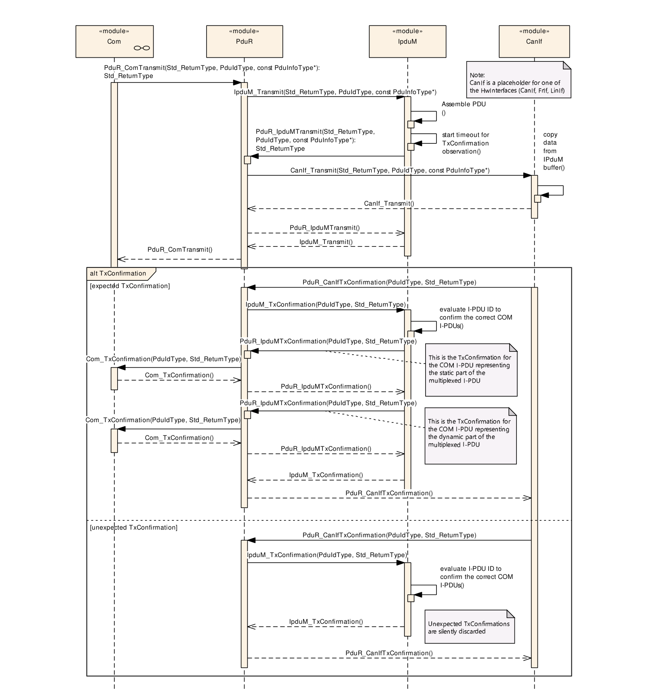

### 8.2. 不带触发的多路复用I-PDU发送

以下时序图展示了由COM层发起的发送请求。由于[IpduM](#921-ipdum)的配置，不会发生针对该[IpduM](#921-ipdum) I-PDU的发送请求。配置见后文配置章节。

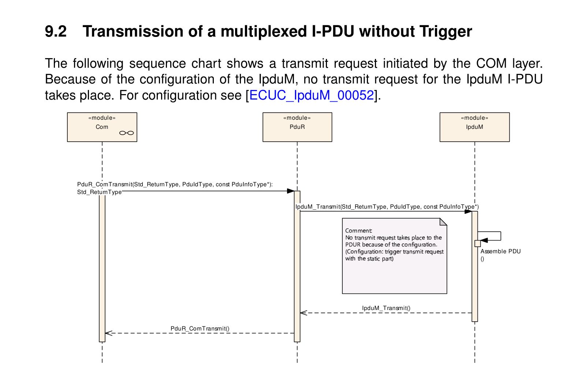

### 8.3. 多路复用I-PDU的接收

以下时序图展示了一次多路复用I-PDU的接收。该I-PDU包含静态部分和动态部分，且两者都被配置为向PDU路由器模块产生RxIndication。

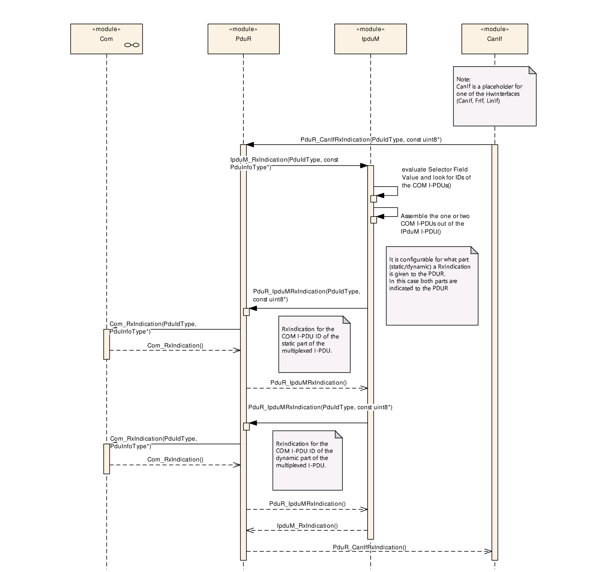

### 8.4. 触发发送

以下时序图展示了来自接口层的触发发送请求。

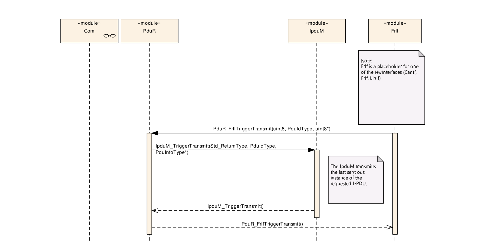

## 9. 配置规范

通常，本章定义配置参数及其到容器中的聚集。为支持本规范，第9.1节描述基本原理。第9.2节规定模块IpduM的结构（容器）和参数。第9.3节规定模块IpduM的发布信息。

### 9.1. 如何阅读本章

详情请参阅SWS\_BSWGeneral的第10.1章「配置规范简介」。

### 9.2. 容器与配置参数

以下各章汇总了所有配置参数。参数的详细含义在第6章和第7章中描述。

### 9.3. 发布信息

#### 9.3.1. IpduMPublishedInformation

见9.2.23节的容器定义与参数表。

### 9.4. 配置规则

#### 9.4.1. 选择符字段

选择符字段所使用的值的数量（即用于区分不同I-PDU布局的值）不必是可能值的整个范围。

示例：3位的选择符字段有2³个可能的选择符字段值；应允许只使用这些值的一个任意子集。所使用的子集不需要连续。

#### 9.4.2. 静态部分和动态部分的放置

所有静态部分和动态部分应配置为在多路复用和解复用的I-PDU中分配完全相同的位。

上述要求确保IpduM不需要移位或交换任何位或字节，而是能够通过掩码和复制操作构造（解）多路复用的I-PDU。IpduM处理字节序问题。

#### 9.4.3. 多PDU到容器映射

IpduM应拒绝将被包含I-PDU的发送属性（见IpduMContainedTxPduCollectionSemantics）互斥地配置的配置，这些被包含I-PDU被分配给同一个容器PDU。

只有被包含I-PDU全部以IPDUM\_COLLECT\_LAST\_IS\_BEST语义分配的容器PDU才能以节省缓冲区的方式实现。

IpduM应拒绝这样的配置：被包含I-PDU的IpduMContainedTxPduCollectionSemantics设置为IPDUM\_COLLECT\_LAST\_IS\_BEST，而相应容器PDU的队列大小大于1。

IpduM应拒绝这样的配置：支持元数据的被包含I-PDU的元数据类型与容器PDU的元数据类型不同。

上述要求意味着：分配给同一容器PDU的多个支持元数据的被包含I-PDU必须具有相同的元数据类型。

对于IpduMContainerHeaderSize设置为IPDUM\_HEADERTYPE\_NONE的容器PDU，所有被包含I-PDU的IpduMContainedTxPduCollectionSemantics均应设置为IPDUM\_COLLECT\_LAST\_IS\_BEST。

对于IpduMContainerHeaderSize设置为IPDUM\_HEADERTYPE\_NONE的容器PDU，所有被包含I-PDU都应配置IpduMContainedPduOffset。

对于IpduMContainerHeaderSize设置为IPDUM\_HEADERTYPE\_NONE且未设置IpduMUnusedAreasDefault的容器PDU，所有被包含I-PDU都应配置更新位。

配置了IpduMPduUpdateBitPosition的被包含I-PDU只应分配给IpduMContainerHeaderSize设置为IPDUM\_HEADERTYPE\_NONE的容器PDU。

对于具有静态容器布局的容器IPdu（即IpduMContainerHeaderSize设置为IPDUM\_HEADERTYPE\_NONE），只有最后一个被包含IPdu（按照IpduMContainedPduOffset）可以具有动态长度。

此约束与Com（见COM规范中的相应约束）和FrIf中的类似约束一致。

所有IpduMPduUpdateBitPosition都应配置为各自未被其他用途占用的位位置。

#### 9.4.4. 优先级

如果至少一个IpduMContainerTxPdu通过IpduMContainedTxInContainerPduRef被至少两个IpduMContainedTxPdu引用，则IpduMContainedTxPduPriorityHandling应设置为TRUE。

**注意：** 如果引用同一个IpduMContainerTxPdu的所有IpduMContainedTxPdu设置了相同的IpduMContainedTxPduPriority，且这适用于所有已配置的IpduMContainedTxPdu，则无法执行优先级排序，因为不存在排序标准。

所有Collection Semantic为IPDUM\_COLLECT\_LAST\_IS\_BEST且IpduMContainedTxPduPriorityHandling设置为TRUE的被包含I-Pdu，都应具有IpduMContainedTxPduPriority。如果任何被包含I-Pdu未定义优先级，则无法进行优先级排序。

## A. 约束和规范项的历史

请注意，本章中的列表还包括在后续版本中已从规范中移除的约束和规范项。这些约束和规范项不会作为超链接出现在文档中。

### A.1. 本文档根据AUTOSAR R23-11版本的约束和规范项历史

#### A.1.1. R23-11中新增的规范项

无。

#### A.1.2. R23-11中变更的规范项

```
[SWS_IpduM_00232] [SWS_IpduM_00235] [SWS_IpduM_00241] [SWS_IpduM_00254]
```

#### A.1.3. R23-11中删除的规范项

无。

#### A.1.4. R23-11中新增的约束

无。

#### A.1.5. R23-11中变更的约束

无。

#### A.1.6. R23-11中删除的约束

无。
#### 9.2.1. IpduM

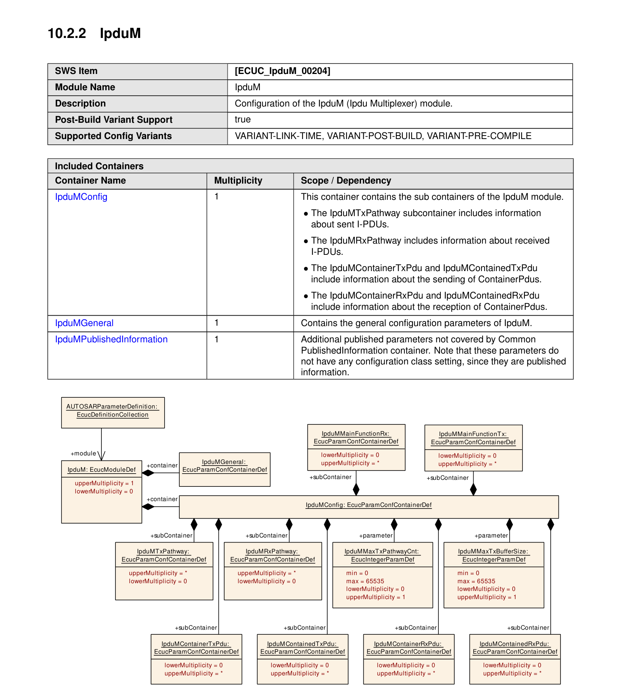

| 项目 | 内容 |
| --- | --- |
| SWS 条目 | [ECUC_IpduM_00204] |
| 容器名称 | IpduM |
| 描述 | IpduM（I-PDU多路复用器）模块的配置。 |
| 配置参数 | 见下方参数表 |

| 包含的容器 | 容器名称 | 多重性 | 作用域/依赖 |
| --- | --- | --- | --- |
| 包含的容器 | IpduMConfig | 1 | 见9.2.2节 |
| 包含的容器 | IpduMGeneral | 1 | 见9.2.3节 |
| 包含的容器 | IpduMPublishedInformation | 1 | 见9.2.23节 |

#### 9.2.2. IpduMConfig

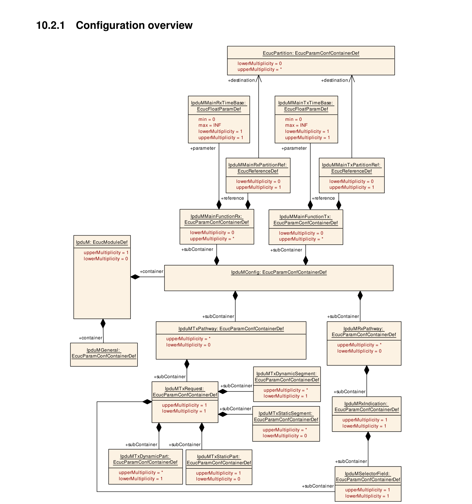

| 项目 | 内容 |
| --- | --- |
| SWS 条目 | [ECUC_IpduM_00059] |
| 容器名称 | IpduMConfig |
| 父容器 | IpduM |
| 描述 | 该容器包含IpduM模块的子容器。• IpduMTxPathway子容器包含与发送I-PDU相关的信息。• IpduMRxPathway包含与接收I-PDU相关的信息。• IpduMContainerTxPdu和IpduMContainedTxPdu包含与容器Pdu发送相关的信息。• IpduMContainerRxPdu和IpduMContainedRxPdu包含与容器Pdu接收相关的信息。 |
| 配置参数 | 见下方参数表 |

| 包含的容器 | 容器名称 | 多重性 | 作用域/依赖 |
| --- | --- | --- | --- |
| 包含的容器 | IpduMContainedRxPdu | 0..* | 见9.2.18节 |
| 包含的容器 | IpduMContainedTxPdu | 0..* | 见9.2.20节 |
| 包含的容器 | IpduMContainerRxPdu | 0..* | 见9.2.17节 |
| 包含的容器 | IpduMContainerTxPdu | 0..* | 见9.2.19节 |
| 包含的容器 | IpduMMainFunctionRx | 0..* | 见9.2.21节 |
| 包含的容器 | IpduMMainFunctionTx | 0..* | 见9.2.22节 |
| 包含的容器 | IpduMRxPathway | 0..* | 见9.2.10节 |
| 包含的容器 | IpduMTxPathway | 0..* | 见9.2.4节 |

| 项目 | 内容 |
| --- | --- |
| SWS 条目 | [ECUC_IpduM_00166] |
| 参数名称 | IpduMMaxTxBufferSize |
| 父容器 | IpduMConfig |
| 描述 | 所有Tx缓冲区的最大总尺寸。仅在使用静态内存分配的Post-Build可加载实现的情况下需要该参数。 |
| 多重性 | 0..1 |
| 类型 | EcucIntegerParamDef |
| 范围 | 0 .. 65535 |
| 默认值 | - |
| Post-Build 变体多重性 | false |
| Post-Build 变体值 | false |
| 值配置类 | Pre-compile time：X（VARIANT-PRE-COMPILE）；Link time：X（VARIANT-LINK-TIME, VARIANT-POST-BUILD）；Post-build time：- |
| 多重性配置类 | Pre-compile time：X（VARIANT-PRE-COMPILE）；Link time：X（VARIANT-LINK-TIME, VARIANT-POST-BUILD）；Post-build time：- |
| 作用域/依赖 | scope: local |

| 项目 | 内容 |
| --- | --- |
| SWS 条目 | [ECUC_IpduM_00165] |
| 参数名称 | IpduMMaxTxPathwayCnt |
| 父容器 | IpduMConfig |
| 描述 | 已发送IPdu的最大数量。仅在使用静态内存分配的Post-Build可加载实现的情况下需要该参数。 |
| 多重性 | 0..1 |
| 类型 | EcucIntegerParamDef |
| 范围 | 0 .. 65535 |
| 默认值 | - |
| Post-Build 变体多重性 | false |
| Post-Build 变体值 | false |
| 值配置类 | Pre-compile time：X（VARIANT-PRE-COMPILE）；Link time：X（VARIANT-LINK-TIME, VARIANT-POST-BUILD）；Post-build time：- |
| 多重性配置类 | Pre-compile time：X（VARIANT-PRE-COMPILE）；Link time：X（VARIANT-LINK-TIME, VARIANT-POST-BUILD） |
| 作用域/依赖 | scope: local |

#### 9.2.3. IpduMGeneral

| 项目 | 内容 |
| --- | --- |
| SWS 条目 | [ECUC_IpduM_00130] |
| 容器名称 | IpduMGeneral |
| 父容器 | IpduM |
| 描述 | 包含IpduM的通用配置参数。 |
| 配置参数 | 见下方参数表 |

无包含的容器。

| 项目 | 内容 |
| --- | --- |
| SWS 条目 | [ECUC_IpduM_00209] |
| 参数名称 | IpduMContainedTxPduPriorityHandling |
| 父容器 | IpduMGeneral |
| 描述 | 该参数为IpduMContainedTxPduCollectionSemantics为IPDUM_LAST_IS_BEST的IpduMContainedTxPdu启用/禁用优先级处理。true：启用；false：禁用。 |
| 多重性 | 0..1 |
| 类型 | EcucBooleanParamDef |
| 默认值 | false |
| Post-Build 变体多重性 | false |
| Post-Build 变体值 | false |
| 值配置类 | Pre-compile time：X（All Variants）；Link time：- |
| 多重性配置类 | Pre-compile time：X（All Variants）；Link time：-；Post-build time：- |
| 作用域/依赖 | scope: ECU |

| 项目 | 内容 |
| --- | --- |
| SWS 条目 | [ECUC_IpduM_00132] |
| 参数名称 | IpduMDevErrorDetect |
| 父容器 | IpduMGeneral |
| 描述 | 开启或关闭开发错误检测与通知（**true**：启用检测与通知；**false**：禁用检测与通知）。 |
| 多重性 | 1 |
| 类型 | EcucBooleanParamDef |
| 默认值 | false |
| Post-Build 变体值 | false |
| 值配置类 | Pre-compile time：X（All Variants）；Link time：-；Post-build time：- |
| 作用域/依赖 | scope: local |

| 项目 | 内容 |
| --- | --- |
| SWS 条目 | [ECUC_IpduM_00197] |
| 参数名称 | IpduMHeaderByteOrder |
| 父容器 | IpduMGeneral |
| 描述 | 该参数定义容器I-PDU内报头的字节序。 |
| 多重性 | 0..1 |
| 类型 | EcucEnumerationParamDef |
| 范围 | IPDUM_BIG_ENDIAN；IPDUM_LITTLE_ENDIAN |
| Post-Build 变体值 | false |
| 值配置类 | Pre-compile time：X（All Variants）；Link time：-；Post-build time：- |
| 作用域/依赖 | scope: local |

| 项目 | 内容 |
| --- | --- |
| SWS 条目 | [ECUC_IpduM_00219] |
| 参数名称 | IpduMMaxTransmitRetries |
| 父容器 | IpduMGeneral |
| 描述 | 在PduR_IPduMTransmit返回E_NOT_OK的情况下发送容器消息的最大重试次数。 |
| 多重性 | 1 |
| 类型 | EcucIntegerParamDef |
| 范围 | 0 .. 65535 |
| 默认值 | 10 |
| Post-Build 变体值 | false |
| 值配置类 | Pre-compile time：X（All Variants）；Link time：-；Post-build time：- |
| 作用域/依赖 | scope: local |

| 项目 | 内容 |
| --- | --- |
| SWS 条目 | [ECUC_IpduM_00205] |
| 参数名称 | IpduMMetaDataSupport |
| 父容器 | IpduMGeneral |
| 描述 | 该参数启用/禁用元数据特性支持。true：启用；false：禁用。 |
| 多重性 | 0..1 |
| 类型 | EcucBooleanParamDef |
| 默认值 | false |
| Post-Build 变体多重性 | false |
| Post-Build 变体值 | false |
| 值配置类 | Pre-compile time：X；Link time：-；Post-build time：- |
| 多重性配置类 | Pre-compile time：X；Link time：-；Post-build time：- |
| 作用域/依赖 | scope: ECU |

| 项目 | 内容 |
| --- | --- |
| SWS 条目 | [ECUC_IpduM_00133] |
| 参数名称 | IpduMStaticPartExists |
| 父容器 | IpduMGeneral |
| 描述 | 用于在IpduM永远不与静态部分一起使用的情况下进行优化。注意：当此参数为false时，其他参数（如IpduMIPduUnusedAreasDefault、IpduMTxStaticPart、IpduMRxStaticPart）不可用。 |
| 多重性 | 1 |
| 类型 | EcucBooleanParamDef |
| 默认值 | - |
| Post-Build 变体值 | false |
| 值配置类 | Pre-compile time：X（All Variants）；Link time：-；Post-build time：- |
| 作用域/依赖 | scope: local |

| 项目 | 内容 |
| --- | --- |
| SWS 条目 | [ECUC_IpduM_00134] |
| 参数名称 | IpduMVersionInfoApi |
| 父容器 | IpduMGeneral |
| 描述 | 激活/停用版本信息API。true：版本信息已激活；false：版本信息已停用。 |
| 多重性 | 1 |
| 类型 | EcucBooleanParamDef |
| 默认值 | false |
| Post-Build 变体值 | false |
| 值配置类 | Pre-compile time：X（All Variants）；Link time：-；Post-build time：- |
| 作用域/依赖 | scope: local |

#### 9.2.4. IpduMTxPathway

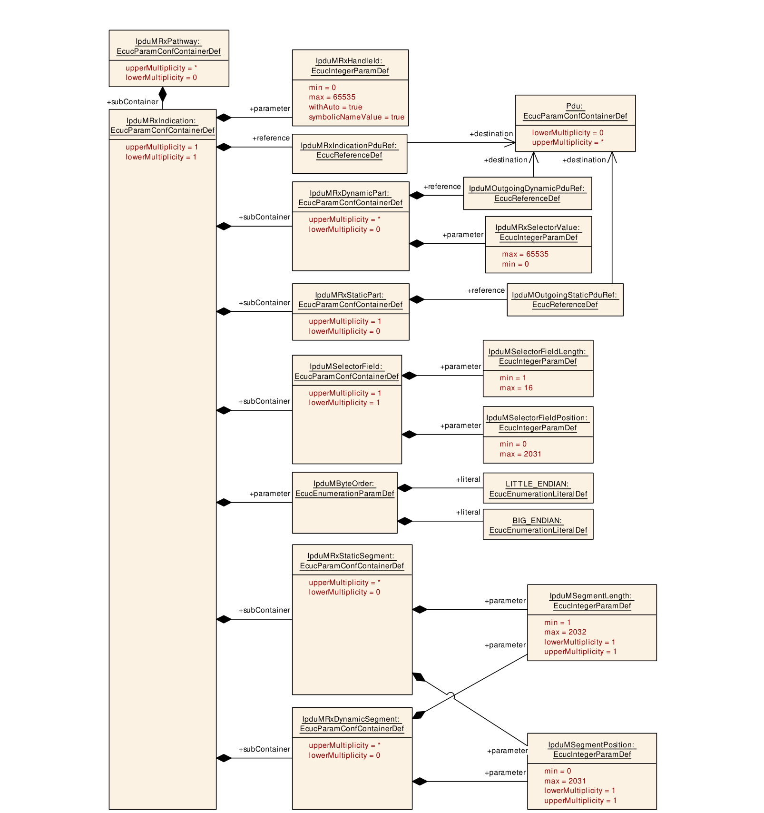

| 项目 | 内容 |
| --- | --- |
| SWS 条目 | [ECUC_IpduM_00070] |
| 容器名称 | IpduMTxPathway |
| 父容器 | IpduMConfig |
| 描述 | 包含IpduM模块发送的I-PDU的配置参数。 |
| 多重性配置类 | Pre-compile time：X（VARIANT-PRE-COMPILE）；Link time：X（VARIANT-LINK-TIME）；Post-build time：X（VARIANT-POST-BUILD） |
| Post-Build 变体多重性 | true |
| 配置参数 | 见下方参数表 |

| 包含的容器 | 容器名称 | 多重性 | 作用域/依赖 |
| --- | --- | --- | --- |
| 包含的容器 | IpduMTxRequest | 0..* | 见9.2.5节 |

#### 9.2.5. IpduMTxRequest

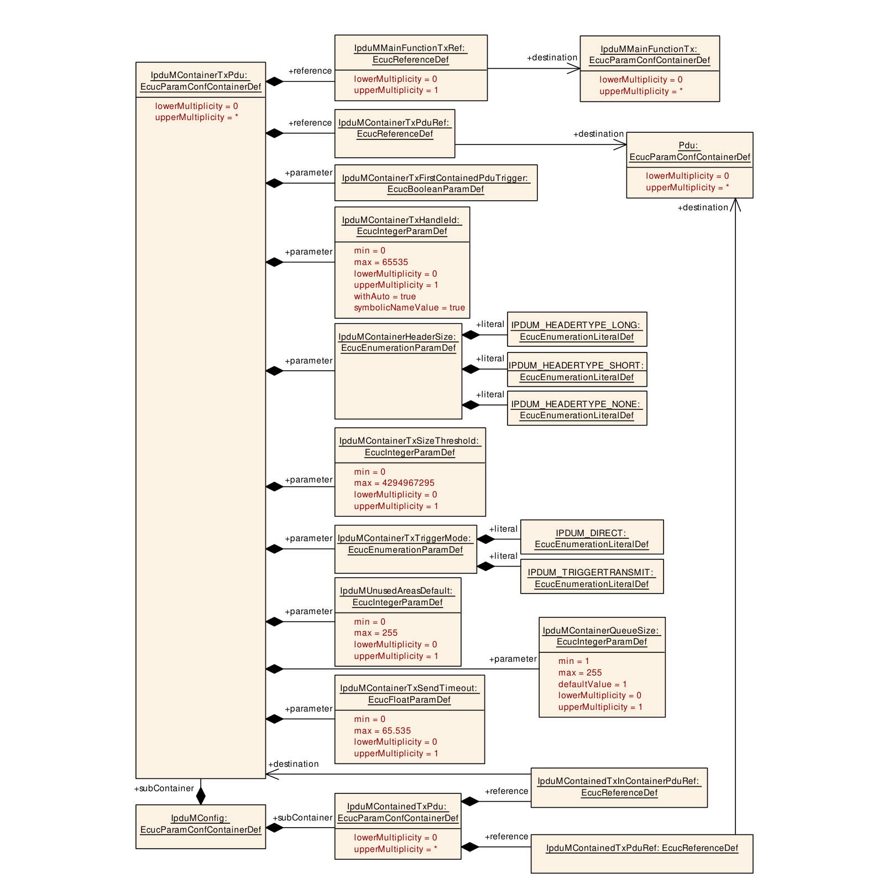

| 项目 | 内容 |
| --- | --- |
| SWS 条目 | [ECUC_IpduM_00052] |
| 容器名称 | IpduMTxRequest |
| 父容器 | IpduMTxPathway |
| 描述 | 该容器用于规定发送请求的配置。每个Tx请求实例将有一个IpduMTxRequest容器。 |
| 配置参数 | 见下方参数表 |

| 包含的容器 | 容器名称 | 多重性 | 作用域/依赖 |
| --- | --- | --- | --- |
| 包含的容器 | IpduMTxDynamicPart | 1 | 见9.2.6节 |
| 包含的容器 | IpduMTxStaticPart | 0..1 | 见9.2.8节 |

| 项目 | 内容 |
| --- | --- |
| SWS 条目 | [ECUC_IpduM_00121] |
| 参数名称 | IpduMIPduUnusedAreasDefault |
| 父容器 | IpduMTxRequest |
| 描述 | IpduM模块用此位模式填充I-PDU的未使用区域。如果省略该属性，未使用区域不会被初始化。 |
| 多重性 | 0..1 |
| 类型 | EcucIntegerParamDef |
| 范围 | 0 .. 255 |
| 默认值 | - |
| Post-Build 变体多重性 | true |
| Post-Build 变体值 | true |
| 值配置类 | Pre-compile time：X（VARIANT-PRE-COMPILE）；Link time：X（VARIANT-LINK-TIME）；Post-build time：X（VARIANT-POST-BUILD） |
| 多重性配置类 | Pre-compile time：X（VARIANT-PRE-COMPILE）；Link time：X（VARIANT-LINK-TIME）；Post-build time：X（VARIANT-POST-BUILD） |
| 作用域/依赖 | scope: local |

| 项目 | 内容 |
| --- | --- |
| SWS 条目 | [ECUC_IpduM_00158] |
| 参数名称 | IpduMTxConfirmationPduId |
| 父容器 | IpduMTxRequest |
| 描述 | PduR用于确认（IpduM_TxConfirmation）和触发发送（IpduM_TriggerTransmit）的句柄ID。 |
| 多重性 | 0..1 |
| 类型 | EcucIntegerParamDef (Symbolic Name generated for this parameter) |
| 范围 | 0 .. 65535 |
| 默认值 | - |
| Post-Build 变体多重性 | false |
| Post-Build 变体值 | false |
| 值配置类 | Pre-compile time：X；Link time：-；Post-build time：- |
| 多重性配置类 | Pre-compile time：X；Link time：-；Post-build time：- |
| 作用域/依赖 | scope: local withAuto = true |

| 项目 | 内容 |
| --- | --- |
| SWS 条目 | [ECUC_IpduM_00125] |
| 参数名称 | IpduMTxTriggerMode |
| 父容器 | IpduMTxRequest |
| 描述 | 选择是立即发送多路复用I-PDU还是在之后的某个时刻发送。 |
| 多重性 | 1 |
| 类型 | EcucEnumerationParamDef |
| 范围 | DYNAMIC_PART_TRIGGER；NONE；STATIC_OR_DYNAMIC_PART_ TRIGGER；STATIC_PART_TRIGGER |
| Post-Build 变体值 | true |
| 值配置类 | Pre-compile time：X（VARIANT-PRE-COMPILE）；Link time：X（VARIANT-LINK-TIME）；Post-build time：X（VARIANT-POST-BUILD） |
| 作用域/依赖 | scope: local |

| 项目 | 内容 |
| --- | --- |
| SWS 条目 | [ECUC_IpduM_00157] |
| 参数名称 | IpduMInitialDynamicPart |
| 父容器 | IpduMTxRequest |
| 描述 | 对应用于初始化此多路复用TX-I-PDU的动态部分的引用。 |
| 多重性 | 1 |
| 类型 | Reference to IpduMTxDynamicPart |
| Post-Build 变体值 | true |
| 值配置类 | Pre-compile time：X（VARIANT-PRE-COMPILE）；Link time：X（VARIANT-LINK-TIME）；Post-build time：X（VARIANT-POST-BUILD） |
| 作用域/依赖 | scope: local |

| 项目 | 内容 |
| --- | --- |
| SWS 条目 | [ECUC_IpduM_00120] |
| 参数名称 | IpduMOutgoingPduRef |
| 父容器 | IpduMTxRequest |
| 描述 | 对此Tx请求输出PDU表示形式的引用。 |
| 多重性 | 1 |
| 类型 | Reference to Pdu |
| Post-Build 变体值 | true |
| 值配置类 | Pre-compile time：X（VARIANT-PRE-COMPILE）；Link time：X（VARIANT-LINK-TIME）；Post-build time：X（VARIANT-POST-BUILD） |
| 作用域/依赖 | scope: ECU |

#### 9.2.6. IpduMTxDynamicPart

| 项目 | 内容 |
| --- | --- |
| SWS 条目 | [ECUC_IpduM_00056] |
| 容器名称 | IpduMTxDynamicPart |
| 父容器 | IpduMTxRequest |
| 描述 | 进入IpduM的Tx请求实例的配置参数。当带有此句柄ID的Tx请求发生时，来自发送请求的数据被放置在动态段中。 |
| 多重性配置类 | Pre-compile time：X（VARIANT-PRE-COMPILE）；Link time：X（VARIANT-LINK-TIME）；Post-build time：X（VARIANT-POST-BUILD） |
| Post-Build 变体多重性 | true |
| 配置参数 | 见下方参数表 |

| 包含的容器 | 容器名称 | 多重性 | 作用域/依赖 |
| --- | --- | --- | --- |
| 包含的容器 | IpduMTxDynamicSegment | 0..* | 见9.2.7节 |

| 项目 | 内容 |
| --- | --- |
| SWS 条目 | [ECUC_IpduM_00163] |
| 参数名称 | IpduMTxDynamicConfirmation |
| 父容器 | IpduMTxDynamicPart |
| 描述 | 发送请求可以由下层确认。如果此参数设置为true，则此发送请求的确认将返回给PduR。 |
| 多重性 | 1 |
| 类型 | EcucBooleanParamDef |
| 默认值 | - |
| Post-Build 变体值 | true |
| 值配置类 | Pre-compile time：X（VARIANT-PRE-COMPILE）；Link time：X（VARIANT-LINK-TIME）；Post-build time：X（VARIANT-POST-BUILD） |
| 作用域/依赖 | scope: local |

| 项目 | 内容 |
| --- | --- |
| SWS 条目 | [ECUC_IpduM_00127] |
| 参数名称 | IpduMTxDynamicHandleId |
| 父容器 | IpduMTxDynamicPart |
| 描述 | 定义一个传入句柄ID。当传入Tx请求的句柄与此ID匹配时，此容器的内容适用于请求。 |
| 多重性 | 1 |
| 类型 | EcucIntegerParamDef (Symbolic Name generated for this parameter) |
| 范围 | 0 .. 65535 |
| 默认值 | - |
| Post-Build 变体值 | false |
| 值配置类 | Pre-compile time：X（All Variants）；Link time：-；Post-build time：- |
| 作用域/依赖 | scope: ECU withAuto = true |

| 项目 | 内容 |
| --- | --- |
| SWS 条目 | [ECUC_IpduM_00126] |
| 参数名称 | IpduMTxDynamicPduRef |
| 父容器 | IpduMTxDynamicPart |
| 描述 | 对ECU配置描述交换文件中要发送的Pdu表示形式的引用。 |
| 多重性 | 1 |
| 类型 | Reference to Pdu |
| Post-Build 变体值 | true |
| 值配置类 | Pre-compile time：X（VARIANT-PRE-COMPILE）；Link time：X（VARIANT-LINK-TIME）；Post-build time：X（VARIANT-POST-BUILD） |
| 作用域/依赖 | scope: ECU |

#### 9.2.7. IpduMTxDynamicSegment

| 项目 | 内容 |
| --- | --- |
| SWS 条目 | [ECUC_IpduM_00168] |
| 容器名称 | IpduMTxDynamicSegment |
| 父容器 | IpduMTxRequest |
| 描述 | 多路复用输出I-Pdu（由IpduMOutgoingPduRef引用）的动态部分可以分离为多个段。该容器定义此动态段的长度和位置。 |
| 多重性配置类 | Pre-compile time：X（VARIANT-PRE-COMPILE）；Link time：X（VARIANT-LINK-TIME）；Post-build time：X（VARIANT-POST-BUILD） |
| Post-Build 变体多重性 | true |
| 配置参数 | 见下方参数表 |

无包含的容器。

#### 9.2.8. IpduMTxStaticPart

| 项目 | 内容 |
| --- | --- |
| SWS 条目 | [ECUC_IpduM_00082] |
| 容器名称 | IpduMTxStaticPart |
| 父容器 | IpduMTxRequest |
| 描述 | 进入IpduM的Tx_Request实例的配置参数。当带有此句柄ID的Tx请求发生时，来自发送请求的数据被放置在静态段中。 |
| 多重性配置类 | Pre-compile time：X（VARIANT-PRE-COMPILE）；Link time：X（VARIANT-LINK-TIME）；Post-build time：X（VARIANT-POST-BUILD） |
| Post-Build 变体多重性 | true |
| 配置参数 | 见下方参数表 |

| 包含的容器 | 容器名称 | 多重性 | 作用域/依赖 |
| --- | --- | --- | --- |
| 包含的容器 | IpduMTxStaticSegment | 0..* | 见9.2.9节 |

| 项目 | 内容 |
| --- | --- |
| SWS 条目 | [ECUC_IpduM_00164] |
| 参数名称 | IpduMTxStaticConfirmation |
| 父容器 | IpduMTxStaticPart |
| 描述 | 发送请求可以由下层确认。如果此参数设置为true，则此发送请求的确认将返回给PduR。 |
| 多重性 | 1 |
| 类型 | EcucBooleanParamDef |
| 默认值 | - |
| Post-Build 变体值 | true |
| 值配置类 | Pre-compile time：X（VARIANT-PRE-COMPILE）；Link time：X（VARIANT-LINK-TIME）；Post-build time：X（VARIANT-POST-BUILD） |
| 作用域/依赖 | scope: local |

| 项目 | 内容 |
| --- | --- |
| SWS 条目 | [ECUC_IpduM_00129] |
| 参数名称 | IpduMTxStaticHandleId |
| 父容器 | IpduMTxStaticPart |
| 描述 | 定义一个传入句柄ID。当传入Tx请求的句柄与此ID匹配时，此容器的内容适用于请求。 |
| 多重性 | 1 |
| 类型 | EcucIntegerParamDef (Symbolic Name generated for this parameter) |
| 范围 | 0 .. 65535 |
| 默认值 | - |
| Post-Build 变体值 | false |
| 值配置类 | Pre-compile time：X（All Variants）；Link time：-；Post-build time：- |
| 作用域/依赖 | scope: ECU |

| 项目 | 内容 |
| --- | --- |
| SWS 条目 | [ECUC_IpduM_00128] |
| 参数名称 | IpduMTxStaticPduRef |
| 父容器 | IpduMTxStaticPart |
| 描述 | 对ECU配置描述交换文件中要发送的Pdu表示形式的引用。 |
| 多重性 | 1 |
| 类型 | Reference to Pdu |
| Post-Build 变体值 | true |
| 值配置类 | Pre-compile time：X（VARIANT-PRE-COMPILE）；Link time：X（VARIANT-LINK-TIME）；Post-build time：X（VARIANT-POST-BUILD） |
| 作用域/依赖 | scope: ECU |

#### 9.2.9. IpduMTxStaticSegment

| 项目 | 内容 |
| --- | --- |
| SWS 条目 | [ECUC_IpduM_00171] |
| 容器名称 | IpduMTxStaticSegment |
| 父容器 | IpduMTxRequest |
| 描述 | 多路复用输出I-Pdu（由IpduMOutgoingPduRef引用）的静态部分可以分离为多个段。该容器定义此静态段的长度和位置。 |
| 多重性配置类 | Pre-compile time：X（VARIANT-PRE-COMPILE）；Link time：X（VARIANT-LINK-TIME）；Post-build time：X（VARIANT-POST-BUILD） |
| Post-Build 变体多重性 | true |
| 配置参数 | 见下方参数表 |

无包含的容器。

#### 9.2.10. IpduMRxPathway

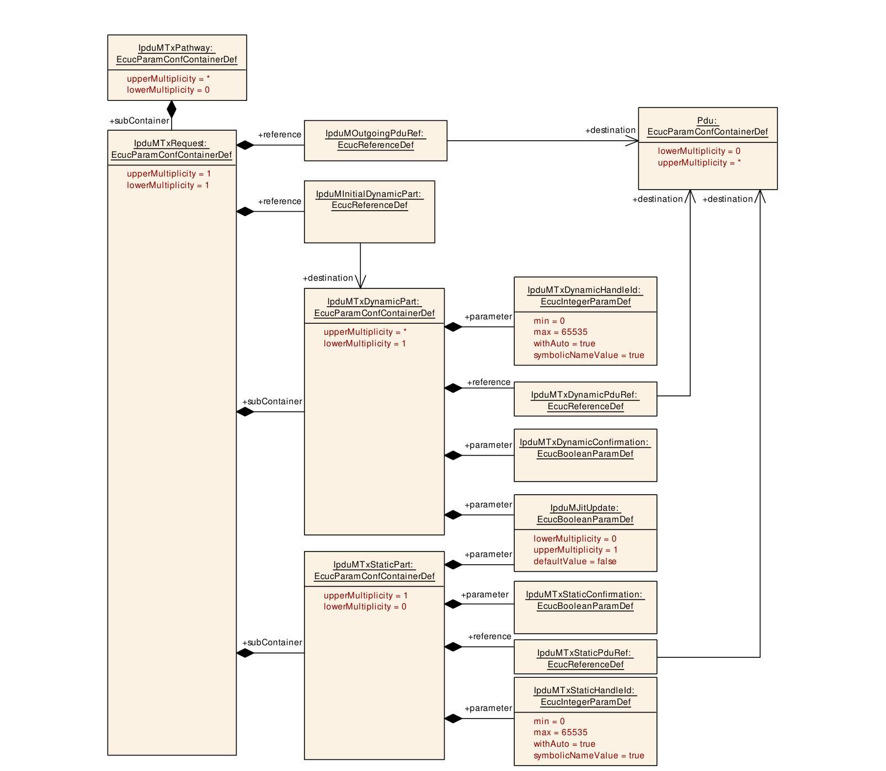

| 项目 | 内容 |
| --- | --- |
| SWS 条目 | [ECUC_IpduM_00071] |
| 容器名称 | IpduMRxPathway |
| 父容器 | IpduMConfig |
| 描述 | 包含IpduM模块接收的I-PDU的配置参数。 |
| 多重性配置类 | Pre-compile time：X（VARIANT-PRE-COMPILE）；Link time：X（VARIANT-LINK-TIME）；Post-build time：X（VARIANT-POST-BUILD） |
| Post-Build 变体多重性 | true |
| 配置参数 | 见下方参数表 |

| 包含的容器 | 容器名称 | 多重性 | 作用域/依赖 |
| --- | --- | --- | --- |
| 包含的容器 | IpduMRxIndication | 0..* | 见9.2.11节 |

#### 9.2.11. IpduMRxIndication

| 项目 | 内容 |
| --- | --- |
| SWS 条目 | [ECUC_IpduM_00047] |
| 容器名称 | IpduMRxIndication |
| 父容器 | IpduMRxPathway |
| 描述 | 包含传入RxIndication调用的配置。 |
| 配置参数 | 见下方参数表 |

| 包含的容器 | 容器名称 | 多重性 | 作用域/依赖 |
| --- | --- | --- | --- |
| 包含的容器 | IpduMRxDynamicPart | 0..* | 见9.2.12节 |
| 包含的容器 | IpduMRxStaticPart | 1 | 见9.2.14节 |

| 项目 | 内容 |
| --- | --- |
| SWS 条目 | [ECUC_IpduM_00109] |
| 参数名称 | IpduMRxHandleId |
| 父容器 | IpduMRxIndication |
| 描述 | 这是传入I-PDU的I-PDU ID。如果传入RxIndication的I-PDU ID与此值匹配，则将按照此容器的配置处理该I-PDU。 |
| 多重性 | 1 |
| 类型 | EcucIntegerParamDef (Symbolic Name generated for this parameter) |
| 范围 | 0 .. 65535 |
| 默认值 | - |
| Post-Build 变体值 | false |
| 值配置类 | Pre-compile time：X（All Variants）；Link time：-；Post-build time：- |
| 作用域/依赖 | scope: ECU |

| 项目 | 内容 |
| --- | --- |
| SWS 条目 | [ECUC_IpduM_00108] |
| 参数名称 | IpduMRxIndicationPduRef |
| 父容器 | IpduMRxIndication |
| 描述 | 对接收到的PDU表示形式的引用。 |
| 多重性 | 1 |
| 类型 | Reference to Pdu |
| Post-Build 变体值 | true |
| 值配置类 | Pre-compile time：X（VARIANT-PRE-COMPILE）；Link time：X（VARIANT-LINK-TIME）；Post-build time：X（VARIANT-POST-BUILD） |
| 作用域/依赖 | scope: ECU |

#### 9.2.12. IpduMRxDynamicPart

| 项目 | 内容 |
| --- | --- |
| SWS 条目 | [ECUC_IpduM_00048] |
| 容器名称 | IpduMRxDynamicPart |
| 父容器 | IpduMRxIndication |
| 描述 | 传入RxIndication调用动态部分的配置。该容器定义动态部分在传入PDU中开始的位置，以及多个传入动态布局的选择符值。 |
| 多重性配置类 | Pre-compile time：X（VARIANT-PRE-COMPILE）；Link time：X（VARIANT-LINK-TIME）；Post-build time：X（VARIANT-POST-BUILD） |
| Post-Build 变体多重性 | true |
| 配置参数 | 见下方参数表 |

| 包含的容器 | 容器名称 | 多重性 | 作用域/依赖 |
| --- | --- | --- | --- |
| 包含的容器 | IpduMRxDynamicSegment | 0..* | 见9.2.13节 |
| 包含的容器 | IpduMSelectorField | 1 | 见9.2.16节 |

| 项目 | 内容 |
| --- | --- |
| SWS 条目 | [ECUC_IpduM_00113] |
| 参数名称 | IpduMRxSelectorValue |
| 父容器 | IpduMRxDynamicPart |
| 描述 | 这是此容器所指向的选择符值。 |
| 多重性 | 1 |
| 类型 | EcucIntegerParamDef |
| 范围 | 0 .. 65535 |
| 默认值 | - |
| Post-Build 变体值 | true |
| 值配置类 | Pre-compile time：X（VARIANT-PRE-COMPILE）；Link time：X（VARIANT-LINK-TIME）；Post-build time：X（VARIANT-POST-BUILD） |
| 作用域/依赖 | scope: local |

| 项目 | 内容 |
| --- | --- |
| SWS 条目 | [ECUC_IpduM_00112] |
| 参数名称 | IpduMOutgoingDynamicPduRef |
| 父容器 | IpduMRxDynamicPart |
| 描述 | 新I-PDU发出时使用此I-PDU ID。对发送的PDU表示形式的引用。 |
| 多重性 | 1 |
| 类型 | Reference to Pdu |
| Post-Build 变体值 | true |
| 值配置类 | Pre-compile time：X（VARIANT-PRE-COMPILE）；Link time：X（VARIANT-LINK-TIME）；Post-build time：X（VARIANT-POST-BUILD） |
| 作用域/依赖 | scope: ECU |

#### 9.2.13. IpduMRxDynamicSegment

| 项目 | 内容 |
| --- | --- |
| SWS 条目 | [ECUC_IpduM_00170] |
| 容器名称 | IpduMRxDynamicSegment |
| 父容器 | IpduMRxIndication |
| 描述 | 多路复用传入I-Pdu（由IpduMRxIndicationPduRef引用）的动态部分可以分离为多个段。该容器定义此动态段的长度和位置。 |
| 多重性配置类 | Pre-compile time：X（VARIANT-PRE-COMPILE）；Link time：X（VARIANT-LINK-TIME）；Post-build time：X（VARIANT-POST-BUILD） |
| Post-Build 变体多重性 | true |
| 配置参数 | 见下方参数表 |

无包含的容器。

#### 9.2.14. IpduMRxStaticPart

| 项目 | 内容 |
| --- | --- |
| SWS 条目 | [ECUC_IpduM_00049] |
| 容器名称 | IpduMRxStaticPart |
| 父容器 | IpduMRxIndication |
| 描述 | 该容器包含传入RxIndication调用静态部分的配置。在接收到匹配的RxIndication时，来自该调用的数据被转发到静态输出PDU。 |
| 多重性配置类 | Pre-compile time：X（VARIANT-PRE-COMPILE）；Link time：X（VARIANT-LINK-TIME）；Post-build time：X（VARIANT-POST-BUILD） |
| Post-Build 变体多重性 | true |
| 配置参数 | 见下方参数表 |

| 包含的容器 | 容器名称 | 多重性 | 作用域/依赖 |
| --- | --- | --- | --- |
| 包含的容器 | IpduMRxStaticSegment | 0..* | 见9.2.15节 |

| 项目 | 内容 |
| --- | --- |
| SWS 条目 | [ECUC_IpduM_00115] |
| 参数名称 | IpduMOutgoingStaticPduRef |
| 父容器 | IpduMRxStaticPart |
| 描述 | 新I-PDU发出时使用此I-PDU ID。对发送的Pdu表示形式的引用。 |
| 多重性 | 1 |
| 类型 | Reference to Pdu |
| Post-Build 变体值 | true |
| 值配置类 | Pre-compile time：X（VARIANT-PRE-COMPILE）；Link time：X（VARIANT-LINK-TIME）；Post-build time：X（VARIANT-POST-BUILD） |
| 作用域/依赖 | scope: ECU |

#### 9.2.15. IpduMRxStaticSegment

| 项目 | 内容 |
| --- | --- |
| SWS 条目 | [ECUC_IpduM_00169] |
| 容器名称 | IpduMRxStaticSegment |
| 父容器 | IpduMRxIndication |
| 描述 | 多路复用传入I-Pdu（由IpduMRxIndicationPduRef引用）的静态部分可以分离为多个段。该容器定义此静态段的长度和位置。 |
| 多重性配置类 | Pre-compile time：X（VARIANT-PRE-COMPILE）；Link time：X（VARIANT-LINK-TIME）；Post-build time：X（VARIANT-POST-BUILD） |
| Post-Build 变体多重性 | true |
| 配置参数 | 见下方参数表 |

无包含的容器。

#### 9.2.16. IpduMSelectorField

| 项目 | 内容 |
| --- | --- |
| SWS 条目 | [ECUC_IpduM_00054] |
| 容器名称 | IpduMSelectorField |
| 父容器 | IpduMRxIndication、IpduMTxRequest |
| 描述 | 包含选择符字段的位置和长度。 |
| 配置参数 | 见下方参数表 |

无包含的容器。

| 项目 | 内容 |
| --- | --- |
| SWS 条目 | [ECUC_IpduM_00160] |
| 参数名称 | IpduMSelectorFieldLength |
| 父容器 | IpduMSelectorField |
| 描述 | 选择符字段的长度（位）。 |
| 多重性 | 1 |
| 类型 | EcucIntegerParamDef |
| 范围 | 1 .. |
| 默认值 | - |
| Post-Build 变体值 | true |
| 值配置类 | Pre-compile time：X（VARIANT-PRE-COMPILE）；Link time：X（VARIANT-LINK-TIME）；Post-build time：X（VARIANT-POST-BUILD） |
| 作用域/依赖 | scope: local |

| 项目 | 内容 |
| --- | --- |
| SWS 条目 | [ECUC_IpduM_00161] |
| 参数名称 | IpduMSelectorFieldPosition |
| 父容器 | IpduMSelectorField |
| 描述 | 选择符字段在多路复用Pdu中的位位置。范围：CAN/LIN I-PDU为0..63，CAN-FD/FlexRay I-PDU为0..511。 |
| 多重性 | 1 |
| 类型 | EcucIntegerParamDef |
| 范围 | 0 .. 2031 |
| 默认值 | - |
| Post-Build 变体值 | true |
| 值配置类 | Pre-compile time：X（VARIANT-PRE-COMPILE）；Link time：X（VARIANT-LINK-TIME）；Post-build time：X（VARIANT-POST-BUILD） |
| 作用域/依赖 | scope: local |

#### 9.2.17. IpduMContainerRxPdu

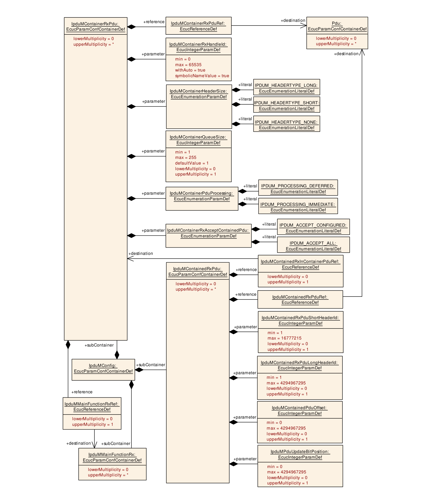

| 项目 | 内容 |
| --- | --- |
| SWS 条目 | [ECUC_IpduM_00188] |
| 容器名称 | IpduMContainerRxPdu |
| 父容器 | IpduMConfig |
| 描述 | 接收方容器Pdu的配置，可收集多个被包含Pdu。 |
| 多重性配置类 | Pre-compile time：X（VARIANT-PRE-COMPILE）；Link time：X（VARIANT-LINK-TIME）；Post-build time：X（VARIANT-POST-BUILD） |
| Post-Build 变体多重性 | true |
| 配置参数 | 见下方参数表 |

| 包含的容器 | 容器名称 | 多重性 | 作用域/依赖 |
| --- | --- | --- | --- |
| 包含的容器 | IpduMContainedRxPdu | 0..* | 见9.2.18节 |

| 项目 | 内容 |
| --- | --- |
| SWS 条目 | [ECUC_IpduM_00184] |
| 参数名称 | IpduMContainerPduProcessing |
| 父容器 | IpduMContainerRxPdu |
| 描述 | 定义此容器Pdu的处理是在调用者的上下文中（IMMEDIATE）完成，还是推迟到MainFunctionRx（DEFERRED）。 |
| 多重性 | 1 |
| 类型 | EcucEnumerationParamDef |
| 范围 | IPDUM_PROCESSING_ DEFERRED；IPDUM_PROCESSING_ IMMEDIATE |
| Post-Build 变体值 | true |
| 值配置类 | Pre-compile time：X（VARIANT-PRE-COMPILE）；Link time：X（VARIANT-LINK-TIME）；Post-build time：X（VARIANT-POST-BUILD） |
| 作用域/依赖 | scope: local |

| 项目 | 内容 |
| --- | --- |
| SWS 条目 | [ECUC_IpduM_00186] |
| 参数名称 | IpduMContainerRxAcceptContainedPdu |
| 父容器 | IpduMContainerRxPdu |
| 描述 | 为接收到的IpduMContainerRxPdu定义，是只接受引用此容器PDU的IpduMContainedRxPdu列表中的被包含PDU，还是接受报头中任何有效的被包含PDU ID。 |
| 多重性 | 1 |
| 类型 | EcucEnumerationParamDef |
| 范围 | IPDUM_ACCEPT_ALL；IPDUM_ACCEPT_CONFIGURED |
| Post-Build 变体值 | true |
| 值配置类 | Pre-compile time：X（VARIANT-PRE-COMPILE）；Link time：X（VARIANT-LINK-TIME）；Post-build time：X（VARIANT-POST-BUILD） |
| 作用域/依赖 | scope: local |

| 项目 | 内容 |
| --- | --- |
| SWS 条目 | [ECUC_IpduM_00187] |
| 参数名称 | IpduMContainerRxHandleId |
| 父容器 | IpduMContainerRxPdu |
| 描述 | PduR用于RxIndication的句柄ID。 |
| 多重性 | 1 |
| 类型 | EcucIntegerParamDef (Symbolic Name generated for this parameter) |
| 范围 | 0 .. 65535 |
| 默认值 | - |
| Post-Build 变体值 | false |
| 值配置类 | Pre-compile time：X（All Variants）；Link time：-；Post-build time：- |
| 作用域/依赖 | scope: ECU |

| 项目 | 内容 |
| --- | --- |
| SWS 条目 | [ECUC_IpduM_00189] |
| 参数名称 | IpduMContainerRxPduRef |
| 父容器 | IpduMContainerRxPdu |
| 描述 | 对代表该容器、用于接收的Pdu的引用。 |
| 多重性 | 1 |
| 类型 | Reference to Pdu |
| Post-Build 变体值 | true |
| 值配置类 | Pre-compile time：X（VARIANT-PRE-COMPILE）；Link time：X（VARIANT-LINK-TIME）；Post-build time：X（VARIANT-POST-BUILD） |
| 作用域/依赖 | scope: ECU |

| 项目 | 内容 |
| --- | --- |
| SWS 条目 | [ECUC_IpduM_00212] |
| 参数名称 | IpduMMainFunctionRxRef |
| 父容器 | IpduMContainerRxPdu |
| 描述 | 对此容器PDU所属的IpduM_MainFunctionRx实例的引用。如果存在多于一个IpduMMainFunctionRx实例，则为必选。 |
| 多重性 | 0..1 |
| 类型 | Reference to IpduMMainFunctionRx |
| Post-Build 变体多重性 | true |
| Post-Build 变体值 | true |
| 值配置类 | Pre-compile time：All Variants；Link time：-；Post-build time：- |
| 多重性配置类 | Pre-compile time：All Variants；Link time：-；Post-build time：- |
| 作用域/依赖 | scope: local |

#### 9.2.18. IpduMContainedRxPdu

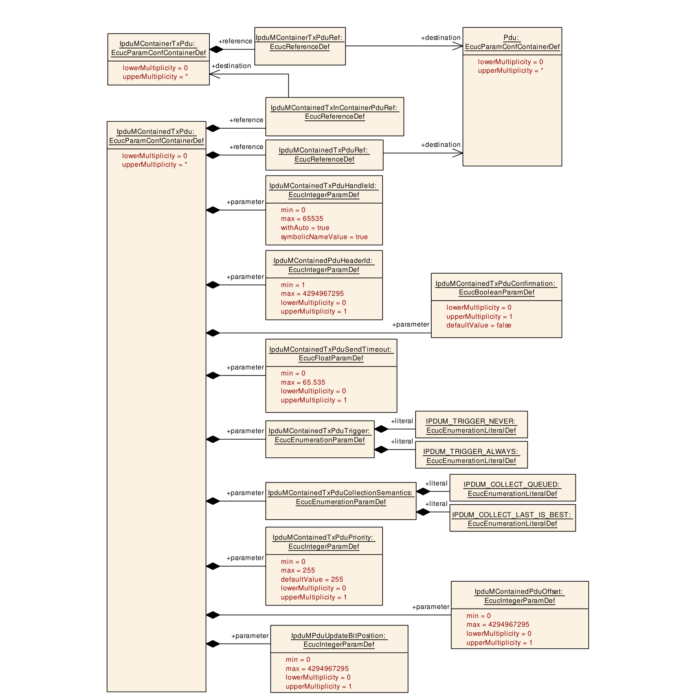

| 项目 | 内容 |
| --- | --- |
| SWS 条目 | [ECUC_IpduM_00174] |
| 容器名称 | IpduMContainedRxPdu |
| 父容器 | IpduMConfig |
| 描述 | 接收到的被包含Pdu的配置。 |
| 多重性配置类 | Pre-compile time：X（VARIANT-PRE-COMPILE）；Link time：X（VARIANT-LINK-TIME）；Post-build time：X（VARIANT-POST-BUILD） |
| Post-Build 变体多重性 | true |
| 配置参数 | 见下方参数表 |

无包含的容器。

| 项目 | 内容 |
| --- | --- |
| SWS 条目 | [ECUC_IpduM_00203] |
| 参数名称 | IpduMContainedRxPduLongHeaderId |
| 父容器 | IpduMContainedRxPdu |
| 描述 | 当此被包含Pdu位于容器Pdu内时，作为容器Pdu一部分的LongHeader Id。 |
| 多重性 | 0..1 |
| 类型 | EcucIntegerParamDef |
| 范围 | 1 .. 4294967295 |
| 默认值 | - |
| Post-Build 变体多重性 | true |
| Post-Build 变体值 | true |
| 值配置类 | Pre-compile time：X（VARIANT-PRE-COMPILE）；Link time：X（VARIANT-LINK-TIME）；Post-build time：X（VARIANT-POST-BUILD） |
| 多重性配置类 | Pre-compile time：X（VARIANT-PRE-COMPILE）；Link time：X（VARIANT-LINK-TIME）；Post-build time：X（VARIANT-POST-BUILD） |
| 作用域/依赖 | scope: local dependency: Only valid if IpduMContainerHeaderSize is set to IPDUM_ |

| 项目 | 内容 |
| --- | --- |
| SWS 条目 | [ECUC_IpduM_00202] |
| 参数名称 | IpduMContainedRxPduShortHeaderId |
| 父容器 | IpduMContainedRxPdu |
| 描述 | 当此被包含Pdu位于容器Pdu内时，作为容器Pdu一部分的ShortHeader Id。 |
| 多重性 | 0..1 |
| 类型 | EcucIntegerParamDef |
| 范围 | 1 .. 16777215 |
| 默认值 | - |
| Post-Build 变体多重性 | true |
| Post-Build 变体值 | true |
| 值配置类 | Pre-compile time：X（VARIANT-PRE-COMPILE）；Link time：X（VARIANT-LINK-TIME）；Post-build time：X（VARIANT-POST-BUILD） |
| 多重性配置类 | Pre-compile time：X（VARIANT-PRE-COMPILE）；Link time：X（VARIANT-LINK-TIME）；Post-build time：X（VARIANT-POST-BUILD） |
| 作用域/依赖 | scope: local dependency: Only valid if IpduMContainerHeaderSize is set to IPDUM_ |

| 项目 | 内容 |
| --- | --- |
| SWS 条目 | [ECUC_IpduM_00173] |
| 参数名称 | IpduMContainedRxInContainerPduRef |
| 父容器 | IpduMContainedRxPdu |
| 描述 | 对此被包含Pdu被接收时所在的容器Pdu的引用。 |
| 多重性 | 0..1 |
| 类型 | Reference to IpduMContainerRxPdu |
| Post-Build 变体多重性 | true |
| Post-Build 变体值 | true |
| 值配置类 | Pre-compile time：X（VARIANT-PRE-COMPILE）；Link time：X（VARIANT-LINK-TIME）；Post-build time：X（VARIANT-POST-BUILD） |
| 多重性配置类 | Pre-compile time：X（VARIANT-PRE-COMPILE）；Link time：X（VARIANT-LINK-TIME）；Post-build time：X（VARIANT-POST-BUILD） |
| 作用域/依赖 | scope: local |

| 项目 | 内容 |
| --- | --- |
| SWS 条目 | [ECUC_IpduM_00175] |
| 参数名称 | IpduMContainedRxPduRef |
| 父容器 | IpduMContainedRxPdu |
| 描述 | 对代表此被包含Pdu、用于接收指示的Pdu的引用。 |
| 多重性 | 1 |
| 类型 | Reference to Pdu |
| Post-Build 变体值 | true |
| 值配置类 | Pre-compile time：X（VARIANT-PRE-COMPILE）；Link time：X（VARIANT-LINK-TIME）；Post-build time：X（VARIANT-POST-BUILD） |
| 作用域/依赖 | scope: ECU |

#### 9.2.19. IpduMContainerTxPdu

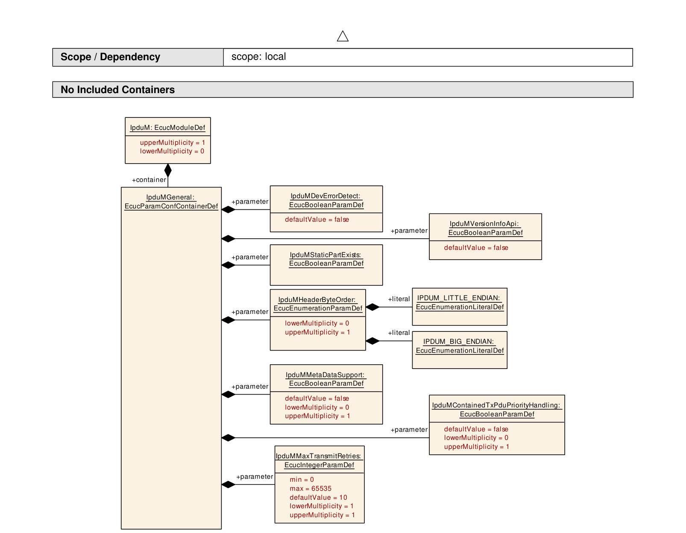

| 项目 | 内容 |
| --- | --- |
| SWS 条目 | [ECUC_IpduM_00192] |
| 容器名称 | IpduMContainerTxPdu |
| 父容器 | IpduMConfig |
| 描述 | 发送的容器Pdu的配置。 |
| 多重性配置类 | Pre-compile time：X（VARIANT-PRE-COMPILE）；Link time：X（VARIANT-LINK-TIME）；Post-build time：X（VARIANT-POST-BUILD） |
| Post-Build 变体多重性 | true |
| 配置参数 | 见下方参数表 |

| 包含的容器 | 容器名称 | 多重性 | 作用域/依赖 |
| --- | --- | --- | --- |
| 包含的容器 | IpduMContainedTxPdu | 0..* | 见9.2.20节 |

| 项目 | 内容 |
| --- | --- |
| SWS 条目 | [ECUC_IpduM_00199] |
| 参数名称 | IpduMContainerTxFirstContainedPduTrigger |
| 父容器 | IpduMContainerTxPdu |
| 描述 | 定义是否应在第一个IpduMContainedTxPdu请求之后立即请求发送此IpduMContainerTxPdu。 |
| 多重性 | 1 |
| 类型 | EcucBooleanParamDef |
| 默认值 | - |
| Post-Build 变体值 | true |
| 值配置类 | Pre-compile time：X（VARIANT-PRE-COMPILE）；Link time：X（VARIANT-LINK-TIME）；Post-build time：X（VARIANT-POST-BUILD） |
| 作用域/依赖 | scope: local |

| 项目 | 内容 |
| --- | --- |
| SWS 条目 | [ECUC_IpduM_00191] |
| 参数名称 | IpduMContainerTxHandleId |
| 父容器 | IpduMContainerTxPdu |
| 描述 | PduR用于容器Pdu的TxConfirmation和TriggerTransmit的句柄ID。 |
| 多重性 | 0..1 |
| 类型 | EcucIntegerParamDef (Symbolic Name generated for this parameter) |
| 范围 | 0 .. 65535 |
| 默认值 | - |
| Post-Build 变体多重性 | false |
| Post-Build 变体值 | false |
| 值配置类 | Pre-compile time：All Variants；Link time：-；Post-build time：- |
| 多重性配置类 | Pre-compile time：All Variants；Link time：-；Post-build time：- |
| 作用域/依赖 | scope: ECU withAuto = true |

| 项目 | 内容 |
| --- | --- |
| SWS 条目 | [ECUC_IpduM_00194] |
| 参数名称 | IpduMContainerTxSendTimeout |
| 父容器 | IpduMContainerTxPdu |
| 描述 | 此超时到期时，触发容器Pdu发送。相应的定时器在第一个被包含PDU请求时启动。 |
| 多重性 | 0..1 |
| 类型 | EcucFloatParamDef |
| 默认值 | - |
| Post-Build 变体多重性 | true |
| Post-Build 变体值 | true |
| 值配置类 | Pre-compile time：X（VARIANT-PRE-COMPILE）；Link time：X（VARIANT-LINK-TIME）；Post-build time：X（VARIANT-POST-BUILD） |
| 多重性配置类 | Pre-compile time：X（VARIANT-PRE-COMPILE）；Link time：X（VARIANT-LINK-TIME）；Post-build time：X（VARIANT-POST-BUILD） |
| 作用域/依赖 | scope: local |

| 项目 | 内容 |
| --- | --- |
| SWS 条目 | [ECUC_IpduM_00195] |
| 参数名称 | IpduMContainerTxSizeThreshold |
| 父容器 | IpduMContainerTxPdu |
| 描述 | 定义以字节为单位的尺寸阈值，超过该阈值时将触发容器Pdu的发送。 |
| 多重性 | 0..1 |
| 类型 | EcucIntegerParamDef |
| 范围 | 0 .. 4294967295 |
| 默认值 | - |
| Post-Build 变体多重性 | true |
| Post-Build 变体值 | true |
| 值配置类 | Pre-compile time：X（VARIANT-PRE-COMPILE）；Link time：X（VARIANT-LINK-TIME）；Post-build time：X（VARIANT-POST-BUILD） |
| 多重性配置类 | Pre-compile time：X（VARIANT-PRE-COMPILE）；Link time：X（VARIANT-LINK-TIME）；Post-build time：X（VARIANT-POST-BUILD） |
| 作用域/依赖 | scope: local dependency: only valid if IpduMContainerHeaderSize is set to IPDUM_ HEADERTYPE_SHORT or IPDUM_HEADERTYPE_LONG |

| 项目 | 内容 |
| --- | --- |
| SWS 条目 | [ECUC_IpduM_00196] |
| 参数名称 | IpduMContainerTxTriggerMode |
| 父容器 | IpduMContainerTxPdu |
| 描述 | 定义此容器Pdu是否通过触发发送获取。 |
| 多重性 | 1 |
| 类型 | EcucEnumerationParamDef |
| 范围 | IPDUM_DIRECT；IPDUM_TRIGGERTRANSMIT |
| Post-Build 变体值 | true |
| 值配置类 | Pre-compile time：X（VARIANT-PRE-COMPILE）；Link time：X（VARIANT-LINK-TIME）；Post-build time：X（VARIANT-POST-BUILD） |
| 作用域/依赖 | scope: local |

| 项目 | 内容 |
| --- | --- |
| SWS 条目 | [ECUC_IpduM_00208] |
| 参数名称 | IpduMUnusedAreasDefault |
| 父容器 | IpduMContainerTxPdu |
| 描述 | IpduM用此字节模式填充容器PDU中未更新的区域。 |
| 多重性 | 0..1 |
| 类型 | EcucIntegerParamDef |
| 范围 | 0 .. 255 |
| 默认值 | - |
| Post-Build 变体多重性 | false |
| Post-Build 变体值 | true |
| 值配置类 | Pre-compile time：X（VARIANT-PRE-COMPILE）；Link time：X（VARIANT-LINK-TIME）；Post-build time：X（VARIANT-POST-BUILD） |
| 作用域/依赖 | scope: ECU |

| 项目 | 内容 |
| --- | --- |
| SWS 条目 | [ECUC_IpduM_00193] |
| 参数名称 | IpduMContainerTxPduRef |
| 父容器 | IpduMContainerTxPdu |
| 描述 | 对代表该容器、用于发送的Pdu的引用。 |
| 多重性 | 1 |
| 类型 | Reference to Pdu |
| Post-Build 变体值 | true |
| 值配置类 | Pre-compile time：X（VARIANT-PRE-COMPILE）；Link time：X（VARIANT-LINK-TIME）；Post-build time：X（VARIANT-POST-BUILD） |
| 作用域/依赖 | scope: ECU |

| 项目 | 内容 |
| --- | --- |
| SWS 条目 | [ECUC_IpduM_00214] |
| 参数名称 | IpduMMainFunctionTxRef |
| 父容器 | IpduMContainerTxPdu |
| 描述 | 对此容器PDU所属的IpduM_MainFunctionTx实例的引用。如果存在多于一个IpduMMainFunctionTx实例，则为必选。 |
| 多重性 | 0..1 |
| 类型 | Reference to IpduMMainFunctionTx |
| Post-Build 变体多重性 | true |
| Post-Build 变体值 | true |
| 值配置类 | Pre-compile time：X；Link time：-；Post-build time：- |
| 多重性配置类 | Pre-compile time：X；Link time：-；Post-build time：- |
| 作用域/依赖 | scope: local |

#### 9.2.20. IpduMContainedTxPdu

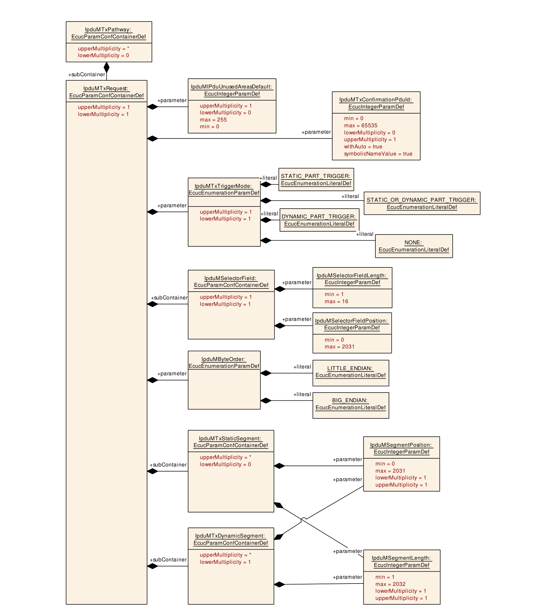

| 项目 | 内容 |
| --- | --- |
| SWS 条目 | [ECUC_IpduM_00177] |
| 容器名称 | IpduMContainedTxPdu |
| 父容器 | IpduMConfig |
| 描述 | 发送方被包含Pdu的配置。 |
| 多重性配置类 | Pre-compile time：X（VARIANT-PRE-COMPILE）；Link time：X（VARIANT-LINK-TIME）；Post-build time：X（VARIANT-POST-BUILD） |
| Post-Build 变体多重性 | true |
| 配置参数 | 见下方参数表 |

无包含的容器。

| 项目 | 内容 |
| --- | --- |
| SWS 条目 | [ECUC_IpduM_00172] |
| 参数名称 | IpduMContainedPduHeaderId |
| 父容器 | IpduMContainedTxPdu |
| 描述 | 当此被包含Pdu位于容器Pdu内时，作为容器Pdu一部分的报头Id。 |
| 多重性 | 0..1 |
| 类型 | EcucIntegerParamDef |
| 范围 | 1 .. 4294967295 |
| 默认值 | - |
| Post-Build 变体值 | true |
| 值配置类 | Pre-compile time：X（VARIANT-PRE-COMPILE）；Link time：X（VARIANT-LINK-TIME）；Post-build time：X（VARIANT-POST-BUILD） |
| 作用域/依赖 | scope: local dependency: only valid if IpduMContainerHeaderSize is set to IPDUM_ HEADERTYPE_SHORT or IPDUM_HEADERTYPE_LONG. |

| 项目 | 内容 |
| --- | --- |
| SWS 条目 | [ECUC_IpduM_00198] |
| 参数名称 | IpduMContainedTxPduCollectionSemantics |
| 父容器 | IpduMContainedTxPdu |
| 描述 | 定义此IpduMContainedTxPdu是使用last-is-best语义还是排队语义收集。 |
| 多重性 | 1 |
| 类型 | EcucEnumerationParamDef |
| 范围 | IPDUM_COLLECT_LAST_IS_ BEST；IPDUM_COLLECT_QUEUED |
| Post-Build 变体值 | true |
| 值配置类 | Pre-compile time：X（VARIANT-PRE-COMPILE）；Link time：X（VARIANT-LINK-TIME）；Post-build time：X（VARIANT-POST-BUILD） |
| 作用域/依赖 | scope: local |

| 项目 | 内容 |
| --- | --- |
| SWS 条目 | [ECUC_IpduM_00178] |
| 参数名称 | IpduMContainedTxPduConfirmation |
| 父容器 | IpduMContainedTxPdu |
| 描述 | 此参数决定是否为此被包含I-PDU提供TxConfirmation。如果设置为true，则一旦包含该被包含I-PDU的容器PDU的发送被下层确认，就会提供TxConfirmation。 |
| 多重性 | 0..1 |
| 类型 | EcucBooleanParamDef |
| 默认值 | false |
| Post-Build 变体多重性 | false |
| Post-Build 变体值 | false |
| 值配置类 | Pre-compile time：X；Link time：-；Post-build time：- |
| 多重性配置类 | Pre-compile time：X；Link time：-；Post-build time：- |
| 作用域/依赖 | scope: local |

| 项目 | 内容 |
| --- | --- |
| SWS 条目 | [ECUC_IpduM_00179] |
| 参数名称 | IpduMContainedTxPduHandleId |
| 父容器 | IpduMContainedTxPdu |
| 描述 | 被包含Pdu的句柄ID。 |
| 多重性 | 1 |
| 类型 | EcucIntegerParamDef |
| 范围 | 0 .. 65535 |
| 默认值 | - |
| Post-Build 变体值 | false |
| 值配置类 | Pre-compile time：X（All Variants） |
| 作用域/依赖 | scope: ECU、withAuto = true |

| 项目 | 内容 |
| --- | --- |
| SWS 条目 | [ECUC_IpduM_00210] |
| 参数名称 | IpduMContainedTxPduPriority |
| 父容器 | IpduMContainedTxPdu |
| 描述 | 定义被包含TxPdu的优先级。255代表最低优先级，0代表最高优先级。 |
| 多重性 | 0..1 |
| 类型 | EcucIntegerParamDef |
| 范围 | 0 .. 255 |
| 默认值 | 255 |
| Post-Build 变体多重性 | true |
| Post-Build 变体值 | true |
| 值配置类 | Pre-compile time：X（VARIANT-PRE-COMPILE）；Link time：X（VARIANT-LINK-TIME）；Post-build time：X（VARIANT-POST-BUILD） |
| 多重性配置类 | Pre-compile time：X（VARIANT-PRE-COMPILE）；Link time：X（VARIANT-LINK-TIME）；Post-build time：X（VARIANT-POST-BUILD） |
| 作用域/依赖 | scope: local dependency: The IpduMContainedTxPduPriority shall only be considered if Ipdu MContainedTxPduPriorityHandling is set to TRUE. |

| 项目 | 内容 |
| --- | --- |
| SWS 条目 | [ECUC_IpduM_00181] |
| 参数名称 | IpduMContainedTxPduSendTimeout |
| 父容器 | IpduMContainedTxPdu |
| 描述 | 定义被包含Pdu特定的发送超时，当此被包含PDU被请求发送时，该超时可以缩短容器Pdu的定时器。 |
| 多重性 | 0..1 |
| 类型 | EcucFloatParamDef |
| 范围 | [0 .. 65.535] |
| 默认值 | - |
| Post-Build 变体多重性 | true |
| Post-Build 变体值 | true |
| 值配置类 | Pre-compile time：X（VARIANT-PRE-COMPILE）；Link time：X（VARIANT-LINK-TIME）；Post-build time：X（VARIANT-POST-BUILD） |
| 多重性配置类 | Pre-compile time：X（VARIANT-PRE-COMPILE）；Link time：X（VARIANT-LINK-TIME）；Post-build time：X（VARIANT-POST-BUILD） |
| 作用域/依赖 | scope: local |

| 项目 | 内容 |
| --- | --- |
| SWS 条目 | [ECUC_IpduM_00182] |
| 参数名称 | IpduMContainedTxPduTrigger |
| 父容器 | IpduMContainedTxPdu |
| 描述 | 定义此Pdu是否触发容器Pdu的发送。 |
| 多重性 | 1 |
| 类型 | EcucEnumerationParamDef |
| 范围 | IPDUM_TRIGGER_ALWAYS；IPDUM_TRIGGER_NEVER |
| Post-Build 变体值 | true |
| 值配置类 | Pre-compile time：X（VARIANT-PRE-COMPILE）；Link time：X（VARIANT-LINK-TIME）；Post-build time：X（VARIANT-POST-BUILD） |
| 作用域/依赖 | scope: local |

| 项目 | 内容 |
| --- | --- |
| SWS 条目 | [ECUC_IpduM_00176] |
| 参数名称 | IpduMContainedTxInContainerPduRef |
| 父容器 | IpduMContainedTxPdu |
| 描述 | 对此被包含Pdu应被收集进的容器Pdu的引用。 |
| 多重性 | 1 |
| 类型 | Reference to IpduMContainerTxPdu |
| Post-Build 变体值 | true |
| 值配置类 | Pre-compile time：X（VARIANT-PRE-COMPILE）；Link time：X（VARIANT-LINK-TIME）；Post-build time：X（VARIANT-POST-BUILD） |
| 作用域/依赖 | scope: local |

| 项目 | 内容 |
| --- | --- |
| SWS 条目 | [ECUC_IpduM_00180] |
| 参数名称 | IpduMContainedTxPduRef |
| 父容器 | IpduMContainedTxPdu |
| 描述 | 对代表此被包含Pdu、用于发送的Pdu的引用。 |
| 多重性 | 1 |
| 类型 | Reference to Pdu |
| Post-Build 变体值 | true |
| 值配置类 | Pre-compile time：X（VARIANT-PRE-COMPILE）；Link time：X（VARIANT-LINK-TIME）；Post-build time：X（VARIANT-POST-BUILD） |
| 作用域/依赖 | scope: ECU |

#### 9.2.21. IpduMMainFunctionRx

| 项目 | 内容 |
| --- | --- |
| SWS 条目 | [ECUC_IpduM_00211] |
| 容器名称 | IpduMMainFunctionRx |
| 父容器 | IpduMConfig |
| 描述 | 在多核分布特性激活的情况下，该容器的每个元素定义一个实例IpduM_MainFunctionRx。 |
| 多重性配置类 | Pre-compile time：X（All Variants）；Link time：-；Post-build time：- |
| Post-Build 变体多重性 | true |
| 配置参数 | 见下方参数表 |

无包含的容器。

| 项目 | 内容 |
| --- | --- |
| SWS 条目 | [ECUC_IpduM_00216] |
| 参数名称 | IpduMMainRxTimeBase |
| 父容器 | IpduMMainFunctionRx |
| 描述 | 对相应实例的IpduM_MainFunctionRx相邻两次调用之间的周期（秒）。此参数可被BSW调度器用作调度主函数的参考。 |
| 多重性 | 1 |
| 类型 | EcucFloatParamDef |
| 范围 | ]0 .. INF[ |
| 默认值 | - |
| Post-Build 变体值 | false |
| 值配置类 | Pre-compile time：X（All Variants）；Link time：-；Post-build time：- |
| 作用域/依赖 | scope: local |

| 项目 | 内容 |
| --- | --- |
| SWS 条目 | [ECUC_IpduM_00215] |
| 参数名称 | IpduMMainRxPartitionRef |
| 父容器 | IpduMMainFunctionRx |
| 描述 | 对相应IpduM_MainFunction实例被分配到的EcucPartition的引用。 |
| 多重性 | 0..1 |
| 类型 | Reference to EcucPartition |
| Post-Build 变体多重性 | false |
| Post-Build 变体值 | false |
| 值配置类 | Pre-compile time：X；Link time：-；Post-build time：- |
| 多重性配置类 | Pre-compile time：X；Link time：-；Post-build time：- |
| 作用域/依赖 | scope: local |

#### 9.2.22. IpduMMainFunctionTx

| 项目 | 内容 |
| --- | --- |
| SWS 条目 | [ECUC_IpduM_00213] |
| 容器名称 | IpduMMainFunctionTx |
| 父容器 | IpduMConfig |
| 描述 | 在多核分布特性激活的情况下，该容器的每个元素定义一个实例IpduM_MainFunctionTx。 |
| 多重性配置类 | Pre-compile time：X（All Variants）；Link time：-；Post-build time：- |
| Post-Build 变体多重性 | true |
| 配置参数 | 见下方参数表 |

无包含的容器。

| 项目 | 内容 |
| --- | --- |
| SWS 条目 | [ECUC_IpduM_00218] |
| 参数名称 | IpduMMainTxTimeBase |
| 父容器 | IpduMMainFunctionTx |
| 描述 | 对IpduM_MainFunctionTx相邻两次调用之间的周期（秒）。此参数可被BSW调度器用作调度主函数的参考。 |
| 多重性 | 1 |
| 类型 | EcucFloatParamDef |
| 范围 | ]0 .. INF[ |
| 默认值 | - |
| Post-Build 变体值 | false |
| 值配置类 | Pre-compile time：X（All Variants）；Link time：-；Post-build time：- |
| 作用域/依赖 | scope: local |

| 项目 | 内容 |
| --- | --- |
| SWS 条目 | [ECUC_IpduM_00217] |
| 参数名称 | IpduMMainTxPartitionRef |
| 父容器 | IpduMMainFunctionTx |
| 描述 | 对相应IpduM_MainFunction实例被分配到的EcucPartition的引用。 |
| 多重性 | 0..1 |
| 类型 | Reference to EcucPartition |
| Post-Build 变体多重性 | false |
| Post-Build 变体值 | false |
| 值配置类 | Pre-compile time：X；Link time：-；Post-build time：- |
| 多重性配置类 | Pre-compile time：X；Link time：-；Post-build time：- |
| 作用域/依赖 | scope: local |

#### 9.2.23. IpduMPublishedInformation

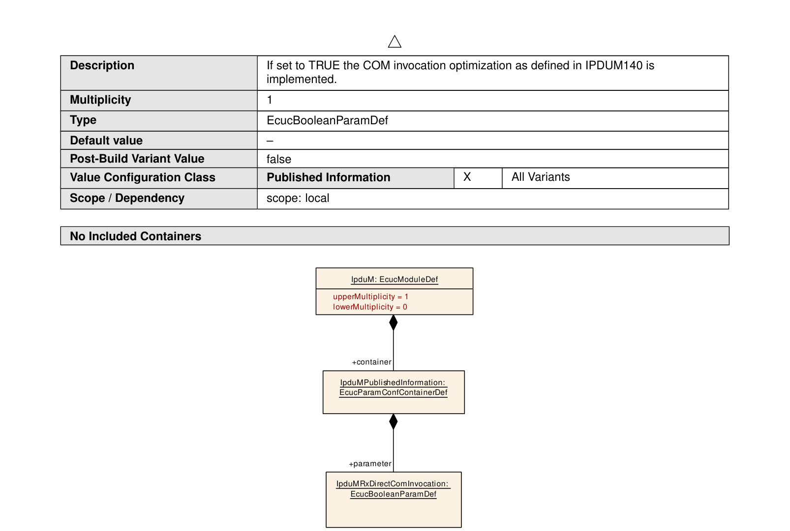

| 项目 | 内容 |
| --- | --- |
| SWS 条目 | [ECUC_IpduM_00141] |
| 容器名称 | IpduMPublishedInformation |
| 父容器 | IpduM |
| 描述 | CommonPublishedInformation容器未涵盖的其他已发布参数。注意这些参数没有任何配置类设置，因为它们是已发布信息。 |
| 配置参数 | 见下方参数表 |

无包含的容器。

| 项目 | 内容 |
| --- | --- |
| SWS 条目 | [ECUC_IpduM_00142] |
| 参数名称 | IpduMRxDirectComInvocation |
| 父容器 | IpduMPublishedInformation |
| 描述 | 如果设置为TRUE，则实现后文功能规格章节中定义的COM调用优化。 |
| 多重性 | 1 |
| 类型 | EcucBooleanParamDef |
| 默认值 | - |
| Post-Build 变体值 | false |
| 值配置类 | Published Information：X（All Variants） |
| 作用域/依赖 | scope: local |
