## 1. 简介和功能概述

本规范描述 AUTOSAR 基础软件模块 **LdCom** 的功能、API 和配置。

在 AUTOSAR 分层架构中，AUTOSAR **LdCom** 模块位于 RTE/SwCluC_LdComProxy 与 **PDU** 路由器（**PDU Router**）之间，参见 [1, EXP LayeredSoftwareArchitecture]。

AUTOSAR **LdCom** 模块提供了一种替代性的交互层（**Interaction Layer**）机制。通过专注于自发的、非周期性的通信，并且不做序列化、过滤和转换，该模块得以在不使用本地缓冲区的情况下高效实现。

主要特性：

* 为其使用者（RTE、SwCluC_LdComProxy）提供面向信号的数据接口
* 将接收到的信号提供给其使用者（RTE、SwCluC_LdComProxy）
* 支持大型和动态长度的数据类型
* 支持 **IF** 和 **TP** 两种通信方式
* 向 **PduR** 提供面向 **PDU** 的数据接口

## 2. 缩略语

下表列出了与 **LdCom** 模块相关、但未包含在 [2, AUTOSAR 术语表] 中的首字母缩略词和缩略语。

**DEM**
> Diagnostic Event Manager —— 诊断事件管理器。

**DET**
> Default Error Tracer —— 默认错误跟踪器。

## 3. 相关文档

### 3.1. 输入文件和相关标准与规范

AUTOSAR 提供了一份关于基础软件模块的通用规范 [3, SWS BSW General]，它同样适用于 **LdCom**。

因此，SWS BSW General 规范应被视为 **LdCom** 的附加且必需的规范。

<a id="ref-1"></a>[1] Layered Software Architecture
> AUTOSAR_CP_EXP_LayeredSoftwareArchitecture

<a id="ref-2"></a>[2] Glossary
> AUTOSAR_FO_TR_Glossary

<a id="ref-3"></a>[3] General Specification of Basic Software Modules
> AUTOSAR_CP_SWS_BSWGeneral

<a id="ref-4"></a>[4] Specification of RTE Software
> AUTOSAR_CP_SWS_RTE

<a id="ref-5"></a>[5] Specification of Software Cluster Connection module
> AUTOSAR_CP_SWS_SoftwareClusterConnection

<a id="ref-6"></a>[6] Specification of PDU Router
> AUTOSAR_CP_SWS_PDURouter

<a id="ref-7"></a>[7] Specification of Default Error Tracer
> AUTOSAR_CP_SWS_DefaultErrorTracer

<a id="ref-8"></a>[8] General Requirements on Basic Software Modules
> AUTOSAR_CP_SRS_BSWGeneral

<a id="ref-9"></a>[9] Requirements on Communication
> AUTOSAR_CP_SRS_COM

<a id="ref-10"></a>[10] System Template
> AUTOSAR_CP_TPS_SystemTemplate

<a id="ref-11"></a>[11] Specification of ECU Configuration
> AUTOSAR_CP_TPS_ECUConfiguration

## 4. 约束和假设

### 4.1. 限制

大数据 COM（Large data COM）以一种非常节省资源的方式支持线性、不透明的按字节数据的通信。其实现方式是跳过所有对于基于事件的非周期性通信并非必需的功能。

大数据 COM 不会对其传输的数据应用任何更改，例如字节序转换。

使用 **Efficient COM** 的前提条件：

* **PDU** 仅包含 1 个 **Signal**，且没有 **ISignalGroup**
* **Signal** 为固定长度或动态长度的字节数组类型
* 传输模式为 triggered 或 triggered without repetition
* 不使用传输模式选择
* 不使用更新位
* 不使用最小延迟时间
* 不使用超时监控
* 不使用字节序转换
* 无 Rx/Tx 过滤
* 无信号失效（**Signal Invalidation**）
* 无 **TP** 扇出（**Fan-out**）

### 4.2. 汽车域的适用性

无限制。

## 5. 对其他模块的依赖

### 5.1. LdCom 的使用者

#### 5.1.1. RTE

对于 RTE 而言，AUTOSAR **LdCom** 模块是发送和接收信号的一种额外手段。在 AUTOSAR 中，RTE 是 **LdCom** 模块之上的更高层。更多信息参见 [4, SWS RTE]。

#### 5.1.2. SwCluC

对于 **SwCluC** 而言，AUTOSAR **LdCom** 模块同样是一种发送和接收信号的额外手段。在 AUTOSAR 中，SwCluC_LdComProxy（**LowProxy**）是（位于 HOST 软件集群中的）**LdCom** 模块之上的更高层，负责将来自 **LdCom** 的回调调用分派到应用软件集群。更多信息参见 [\[5\]](#ref-5)。

### 5.2. PDU 路由器

AUTOSAR **LdCom** 模块会使用 **PDU** 路由器面向上层模块的两组 API，即使用 **TP** 的上层模块 API 和不使用 **TP** 的上层模块 API。这是必需的，因为 **LdCom** 模块要么通过简单的 **L-PDU** 不分段地转发 I-PDU，要么通过 **TP** 分段地转发 I-PDU。

以下总结了 AUTOSAR **LdCom** 模块对下层 **PDU** 路由器的功能需求：

* 指示输入的 I-PDU
* 面向输出 I-PDU 的发送接口，包括 I-PDU 已被通信控制器发出的确认
* 触发接口，使 **PDU** 路由器能够引发 AUTOSAR **LdCom** 模块的一次传输
* **TP** 通信的数据转发

更多信息参见 [6, SWS PDURouter]。

### 5.3. 默认错误跟踪器（DET）

**DET** 提供用于存储开发错误的服务（更多信息参见 [\[7\]](#ref-7)）。

### 5.4. 文件结构

如果启用了 LdComDevErrorDetect，则 **LdCom** 实现应包含 Det.h。

## 6. 功能规格

### 6.1. 初始化

AUTOSAR **LdCom** 模块的初始化函数 [LdCom_Init](#731-ldcom_init) 应初始化所有内部数据。

### 6.2. 反初始化

AUTOSAR **LdCom** 模块应提供 API 函数 [LdCom_DeInit](#732-ldcom_deinit) 用于 AUTOSAR **LdCom** 模块的反初始化。所有反初始化都应在该函数调用内部完成。

### 6.3. 总体

当被其使用者（例如 RTE、SwCluC LdCom Proxy）调用时，**LdCom** 应将 Signal Id（调用中的「id」参数）用作 LdComHandleId（ECUC_LdCom_00005），以在 **LdCom** 配置中查找正确的 [LdComIPdu](#914-ldcomipdu)。通过 LdComPduRef 配置参数（ECUC_LdCom_00010）应推导出 **PduR** 配置中对应的 PDU Id。随后在向 **PduR** 转发该调用时应使用该 PDU Id。

表 6.1 给出了本文档中使用的 API 名称到 ECUC 参数的映射，该 ECUC 参数包含为每个信号配置的实际 API 名称。LdCom 用户回调句柄 Id（LdComUserCbkHandleId）参数标识对应的 Signal/PDU。

表7.1：API 到参数的映射（**API to Parameter mapping**）

| API 名称 | ECUC 参数 |
|---|---|
| &lt;LdComUser_LdComCbkCopyTxData&gt; | LdComUserCallbackName，且 LdComUserCallbackType 设置为 LDCOM_TP_COPY_TX_DATA |
| &lt;LdComUser_LdComCbkTpTxConfirmation&gt; | LdComUserCallbackName，且 LdComUserCallbackType 设置为 LDCOM_TP_COPY_TX_CONFIRMATION |
| &lt;LdComUser_LdComCbkRxIndication&gt; | LdComUserCallbackName，且 LdComUserCallbackType 设置为 LDCOM_TP_COPY_RX_INDICATION |
| &lt;LdComUser_LdComCbkStartOfReception&gt; | LdComUserCallbackName，且 LdComUserCallbackType 设置为 LDCOM_RX_START_OF_RECEPTION |
| &lt;LdComUser_LdComCbkCopyRxData&gt; | LdComUserCallbackName，且 LdComUserCallbackType 设置为 LDCOM_TP_COPY_RX_DATA |
| &lt;LdComUser_LdComCbkTpRxIndication&gt; | LdComUserCallbackName，且 LdComUserCallbackType 设置为 LDCOM_TP_COPY_RX_INDICATION |
| &lt;LdComUser_LdComCbkTriggerTransmit&gt; | LdComUserCallbackName，且 LdComUserCallbackType 设置为 LDCOM_TP_COPY_TX_TRIGGER_TRANSMIT |
| &lt;LdComUser_LdComCbkTxConfirmation&gt; | LdComUserCallbackName，且 LdComUserCallbackType 设置为 LDCOM_TX_CONFIRMATION |

当被其使用者（例如 RTE、SwCluC LdCom Proxy）调用时，**LdCom** 应将 Signal Id（调用中的「id」参数）用作 LdComHandleId（ECUC_LdCom_00005）以在 **LdCom** 配置中查找正确的 [LdComIPdu](#914-ldcomipdu)。通过 LdComPduRef 配置参数（ECUC_LdCom_00010）应推导出 **PduR** 配置中对应的 PDU Id。随后在向 **PduR** 转发该调用时应使用该 PDU Id。

尽管 **LdCom** 用户的概念为支持包括其通知在内的多个使用者提供了很大的灵活性，但仍需考虑一些限制。

一般而言，如果多个写入者之间没有协调，则可能引起竞争条件（race condition）。此外，TriggerTransmit 接口和 **TP** 接口的行为都不支持向同一 IPdu 的多个使用者发送通知。

已发送的 IPdu 应至多由一个 **LdCom** 用户拥有。

尽管如此，同一个或不同软件集群中的多个 **LdCom** 用户读取同一 IPdu 是可能的，但需要遵守 IPdu 的分区分配。

为 IPdu 注册通知的所有 **LdCom** 用户应位于 **LdCom** 模块处理相关 IPdu 所在的 EcucPartition 上。

### 6.4. 发送

传输由 **LdCom** 用户（例如 RTE、SwCluC_LdComProxy）通过调用 [LdCom_Transmit](#734-ldcom_transmit) 发起，或由 **PduR**（TriggerTransmit）发起，而不是由 **LdCom** 自行发起。

#### 6.4.1. IF

当 [LdCom_Transmit](#734-ldcom_transmit) 被调用时，**LdCom** 应通过将 Signal Id 替换为对应的 PDU Id 来调用 PduR_LdComTransmit。

当 [LdCom_TriggerTransmit](#748-ldcom_triggertransmit) 被调用时，**LdCom** 应将传入的 PDU Id 用作句柄 Id（LdComHandleId，ECUC_LdCom_00005），以推导出对应的 &lt;LdComUser_LdComCbkTriggerTransmit&gt; 用户通知回调，并使用相应的 **LdCom** 用户回调句柄 Id 调用它。

只能用 &lt;LdComUser_LdComCbkTriggerTransmit&gt; 通知单个 **LdCom** 用户。

当 [LdCom_TxConfirmation](#747-ldcom_txconfirmation) 被调用时，**LdCom** 应将传入的 PDU Id 用作句柄 Id（LdComHandleId，ECUC_LdCom_00005），以推导出对应的 &lt;LdComUser_LdComCbkTxConfirmation&gt; 用户通知回调，并使用相应的 **LdCom** 用户回调句柄 Id 调用它。

只能用 &lt;LdComUser_LdComCbkTriggerTransmit&gt; 通知单个 **LdCom** 用户。

#### 6.4.2. TP

**LdCom** 应通过将 Signal Id 替换为对应的 PDU Id，把对 [LdCom_Transmit](#734-ldcom_transmit) 的调用传递给 PduR_LdComTransmit。

当 [LdCom_CopyTxData](#741-ldcom_copytxdata) 和 [LdCom_TpTxConfirmation](#742-ldcom_tptxconfirmation) 被调用时，**LdCom** 应将传入的 PDU Id 用作句柄 Id（LdComHandleId，ECUC_LdCom_00005），以推导出对应的 &lt;LdComUser_LdComCbkCopyTxData&gt; 或 &lt;LdComUser_LdComCbkTpTxConfirmation&gt; 用户通知回调，并使用相应的 **LdCom** 用户回调句柄 Id 调用它。

只能用 &lt;LdComUser_LdComCbkCopyTxData&gt; 或 &lt;LdComUser_LdComCbkTpTxConfirmation&gt; 通知单个 **LdCom** 用户。

### 6.5. 接收

#### 6.5.1. IF

当 [LdCom_RxIndication](#746-ldcom_rxindication) 被调用时，**LdCom** 应将传入的 PDU Id 用作句柄 Id（LdComHandleId，ECUC_LdCom_00005），以推导出对应的 &lt;LdComUser_LdComCbkRxIndication&gt; 用户通知回调，并使用相应的 **LdCom** 用户回调句柄 Id 调用它们。

#### 6.5.2. TP

当 [LdCom_StartOfReception](#743-ldcom_startofreception) 被调用时，**LdCom** 应将传入的 PDU Id 用作句柄 Id（LdComHandleId，ECUC_LdCom_00005），以推导出对应的 &lt;LdComUser_LdComCbkStartOfReception&gt; 用户通知回调，并使用相应的 **LdCom** 用户回调句柄 Id 调用它。

只能用 &lt;LdComUser_LdComCbkStartOfReception&gt; 通知单个 **LdCom** 用户。

当 [LdCom_CopyRxData](#744-ldcom_copyrxdata) 被调用时，**LdCom** 应将传入的 PDU Id 用作句柄 Id（LdComHandleId，ECUC_LdCom_00005），以推导出对应的 &lt;LdComUser_LdComCbkCopyRxData&gt; 用户通知回调，并使用相应的 **LdCom** 用户回调句柄 Id 调用它。

只能用 &lt;LdComUser_LdComCbkCopyRxData&gt; 通知单个 **LdCom** 用户。

当 [LdCom_TpRxIndication](#745-ldcom_tprxindication) 被调用时，**LdCom** 应将传入的 PDU Id 用作句柄 Id（LdComHandleId，ECUC_LdCom_00005），以推导出对应的 &lt;LdComUser_LdComCbkTpRxIndication&gt; 用户通知回调，并使用相应的 **LdCom** 用户回调句柄 Id 调用它。

只能用 &lt;LdComUser_LdComCbkTpRxIndication&gt; 通知单个 **LdCom** 用户。

### 6.6. 错误分类

文档 [\[3\]](#ref-3)「基础软件模块通用规范」中的「错误处理」一章详细描述了基础软件的错误处理。其中首先给出了一个由五种错误类型组成的分类方案，这些错误可能发生在 **BSW** 模块中。

基于这一基础，下文按相应的子节规定了具体的错误。

#### 6.6.1. 开发错误

表7.2：开发错误类型（**Development Error Types**）

| 错误类型 | 相关错误代码 | 值 [hex] |
|---|---|---|
| 在以 [LdCom_Init](#731-ldcom_init) 初始化 AUTOSAR **LdCom** 模块之前，或在调用 [LdCom_DeInit](#732-ldcom_deinit) 之后，调用除 [LdCom_GetVersionInfo](#733-ldcom_getversioninfo) 之外的任何其他 API 服务时的错误代码。 | LDCOM_E_UNINIT | 0x02 |
| 使用 NULL 指针调用 API 服务。发生此错误时，除报告该开发错误外，API 服务应立即返回且不执行任何其他操作。 | LDCOM_E_PARAM_POINTER | 0x03 |
| 使用错误的 PDU-ID 调用 API 服务 | LDCOM_E_INVALID_PDU_SDU_ID | 0x04 |
| 使用错误的 Signal-ID 调用 API 服务 | LDCOM_E_INVALID_SIGNAL_ID | 0x05 |
| 无效的配置集选择 | LDCOM_E_INIT_FAILED | 0x06 |

#### 6.6.2. 运行时错误

没有运行时错误。

#### 6.6.3. 瞬态故障

没有瞬态故障。

#### 6.6.4. 生产错误

没有生产错误。

#### 6.6.5. 扩展生产错误

没有扩展生产错误。

## 7. API规范

### 7.1. 导入的类型

本章列出从下列文件中包含的所有类型。

**LdCom**模块的导入数据类型定义

| 模块 | 头文件 | 导入的类型 |
|---|---|---|
| ComStack_Types | ComStack_Types.h | BufReq_ReturnType |
| ComStack_Types | ComStack_Types.h | CbkHandleIdType |
| ComStack_Types | ComStack_Types.h | PduIdType |
| ComStack_Types | ComStack_Types.h | PduInfoType |
| ComStack_Types | ComStack_Types.h | PduLengthType |
| ComStack_Types | ComStack_Types.h | RetryInfoType |
| ComStack_Types | ComStack_Types.h | TpDataStateType |
| Std | Std_Types.h | Std_ReturnType |
| Std | Std_Types.h | Std_VersionInfoType |

### 7.2. 类型定义

#### 7.2.1. LdCom_ConfigType

结构类型。元素为实现特定（implementation specific）：初始化数据结构的内容是实现特定的。该类型包含实现特定的 post-build 配置结构。可通过**LdCom.h**获得。

### 7.3. 函数定义

这是提供给上层模块的函数列表。

注意：本章中的所有函数都需要先进行初始化（[LdCom_Init](#731-ldcom_init)），但以下函数除外：

* [LdCom_Init](#731-ldcom_init)
* [LdCom_GetVersionInfo](#733-ldcom_getversioninfo)

#### 7.3.1. LdCom_Init

**说明**: 此服务初始化 AUTOSAR **LdCom** 模块的内部和外部接口与变量，以进行后续处理。可通过**LdCom.h**获得。本服务为同步调用，不可重入。参数 config（in）：指向 AUTOSAR **LdCom** 模块配置数据的指针。返回值：无。

```C
void LdCom_Init ( const LdCom_ConfigType* config )
```

#### 7.3.2. LdCom_DeInit

**说明**: 调用 LdCom_DeInit 后，AUTOSAR **LdCom** 模块被置于未初始化状态。可通过**LdCom.h**获得。本服务为同步调用，不可重入。参数：无。返回值：无。

```C
void LdCom_DeInit ( void )
```

#### 7.3.3. LdCom_GetVersionInfo

**说明**: 返回本模块的版本信息。可通过**LdCom.h**获得。本服务为同步调用，不可重入。参数 versioninfo（out）：指向存储本模块版本信息的位置的指针。返回值：无。

```C
void LdCom_GetVersionInfo ( Std_VersionInfoType* versioninfo )
```

API LdCom_GetVersionInfo 应由 LdComVersionInfoApi 进行配置。

#### 7.3.4. LdCom_Transmit

**说明**: 请求传输一个信号。可通过**LdCom.h**获得。本服务为同步调用，对不同的 Id 可重入，对相同的 Id 不可重入。参数 Id（in）：待传输信号的标识符。参数 InfoPtr（in）：信号数据的长度和指针，以及指向 MetaData 的指针。返回值：Std_ReturnType，E_OK：发送请求已被接受；E_NOT_OK：发送请求未被接受。

```C
Std_ReturnType LdCom_Transmit ( PduIdType Id, const PduInfoType* InfoPtr )
```

### 7.4. 回调通知

这是提供给其他模块的函数列表。

[LdCom_CopyTxData](#741-ldcom_copytxdata)、[LdCom_TpTxConfirmation](#742-ldcom_tptxconfirmation) 仅在至少一个 [LdComIPdu](#914-ldcomipdu) 将 LdComIPduDirection 配置为 LDCOM_SEND 且将 LdComApiType 配置为 LDCOM_TP 时才可用。

[LdCom_StartOfReception](#743-ldcom_startofreception)、[LdCom_CopyRxData](#744-ldcom_copyrxdata)、[LdCom_TpRxIndication](#745-ldcom_tprxindication) 仅在至少一个 [LdComIPdu](#914-ldcomipdu) 将 LdComIPduDirection 配置为 LDCOM_RECEIVE 且将 LdComApiType 配置为 LDCOM_TP 时才可用。

[LdCom_TxConfirmation](#747-ldcom_txconfirmation) 仅在至少一个 [LdComIPdu](#914-ldcomipdu) 将 LdComIPduDirection 配置为 LDCOM_SEND 且将 LdComApiType 配置为 LDCOM_IF 时才可用。

[LdCom_RxIndication](#746-ldcom_rxindication) 仅在至少一个 [LdComIPdu](#914-ldcomipdu) 将 LdComIPduDirection 配置为 LDCOM_RECEIVE 且将 LdComApiType 配置为 LDCOM_IF 时才可用。

注意：本章中的所有函数都要求 **LdCom** 模块已被正确初始化。

#### 7.4.1. LdCom_CopyTxData

**说明**: 调用此函数以获取 I-PDU 段（N-PDU）的发送数据。除非 retry->TpDataState 为 TP_DATARETRY，否则每次调用此函数都会提供 I-PDU 数据的下一部分；在这种情况下，该函数会从 retry->TxTpDataCnt 指示的、相对当前复制位置的偏移量处开始重新复制数据。剩余数据的大小被写入 availableDataPtr 所指示的位置。可通过**LdCom.h**获得。本服务为同步调用，可重入。参数 id（in）：所传输 I-PDU 的标识。参数 info（in）：提供目标缓冲区（SduDataPtr）和待复制的字节数（SduLength）。如果没有足够的发送数据，上层模块不复制任何数据并返回 BUFREQ_E_BUSY。下层模块可以重试该调用。SduLength 为 0 可用于指示 retry 参数中的状态变化，或查询上层模块中当前可用的数据量；此时 SduDataPtr 可以为 NULL_PTR。参数 retry（in）：该参数用于确认已发送的数据，或在发生传输问题后重新发送数据。如果 retry 参数为 NULL_PTR，表示发送数据在复制后可以立即从缓冲区中移除。否则，retry 参数必须指向一个有效的 RetryInfoType 元素。如果 TpDataState 指示 TP_CONFPENDING，则先前复制的数据必须保留在 TP 缓冲区中，以便用于错误恢复。TP_DATACONF 表示在此调用之前复制的所有数据均已确认，可以从 TP 缓冲区中移除；本次 API 调用复制的数据除外，它们将在稍后被确认。TP_DATARETRY 表示本次 API 调用应复制先前已复制的数据，以便从错误中恢复；此时 TxTpDataCnt 指定相对当前数据复制位置的偏移量（字节）。参数 availableDataPtr（out）：指示上层模块 Tx 缓冲区中剩余的可用字节数。availableDataPtr 可被支持动态载荷长度的 TP 模块（例如 FrIsoTp）用于确定后续 CF 的大小。返回值：BufReq_ReturnType，BUFREQ_OK：数据已按要求完整复制到发送缓冲区；BUFREQ_E_BUSY：由于所需数量的 Tx 数据不可用，请求无法被满足，未复制任何数据，下层模块可以稍后重试该调用；BUFREQ_E_NOT_OK：数据未被复制，请求失败。

```C
BufReq_ReturnType LdCom_CopyTxData ( PduIdType id, const PduInfoType* info, const RetryInfoType* retry, PduLengthType* availableDataPtr )
```

#### 7.4.2. LdCom_TpTxConfirmation

**说明**: 在 I-PDU 已于其网络上发送之后调用此函数，result 指示传输是否成功。可通过**LdCom.h**获得。本服务为同步调用，可重入。参数 id（in）：所传输 I-PDU 的标识。参数 result（in）：E_OK：PDU 已发送；E_NOT_OK：PDU 发送失败。返回值：无。

```C
void LdCom_TpTxConfirmation ( PduIdType id, Std_ReturnType result )
```

#### 7.4.3. LdCom_StartOfReception

**说明**: 在开始接收一个 N-SDU 时调用此函数。N-SDU 可能被分段为多个 N-PDU（FF 及其后的一个或多个 CF），也可能由单个 N-PDU 组成（SF）。当以 TpSduLength 等于 0 调用时，本服务应提供当前可用的最大缓冲区大小。可通过**LdCom.h**获得。本服务为同步调用，可重入。参数 id（in）：I-PDU 的标识。参数 info（in）：指向 PduInfoType 结构的指针，该结构包含传输协议 I-PDU 接收的第一个帧或单帧的载荷数据（不含协议信息）及其载荷长度，以及与该 PDU 相关的 MetaData。如果第一个帧/单帧数据和 MetaData 均不可用，则此参数设置为 NULL_PTR。参数 TpSduLength（in）：待接收 N-SDU 的总长度。参数 bufferSizePtr（out）：接收模块中可用的接收缓冲区。该参数将被传输协议模块用于计算块大小（BS）。返回值：BufReq_ReturnType，BUFREQ_OK：连接已被接受，bufferSizePtr 指示可用的接收缓冲区，接收继续进行；如果没有所请求大小的缓冲区可用，则 bufferSizePtr 应指示接收缓冲区大小为 0；BUFREQ_E_NOT_OK：连接被拒绝，接收中止，bufferSizePtr 保持不变；BUFREQ_E_OVFL：无法提供所需长度的缓冲区，接收中止，bufferSizePtr 保持不变。

```C
BufReq_ReturnType LdCom_StartOfReception ( PduIdType id, const PduInfoType* info, PduLengthType TpSduLength, PduLengthType* bufferSizePtr )
```

#### 7.4.4. LdCom_CopyRxData

**说明**: 调用此函数以将 I-PDU 段（N-PDU）的接收数据提供给上层。每次调用此函数都会提供 I-PDU 数据的下一部分。剩余缓冲区的大小被写入 bufferSizePtr 所指示的位置。可通过**LdCom.h**获得。本服务为同步调用，可重入。参数 id（in）：所接收 I-PDU 的标识。参数 info（in）：提供源缓冲区（SduDataPtr）和待复制的字节数（SduLength）。SduLength 为 0 可用于查询上层模块中当前可用的缓冲区量；此时 SduDataPtr 可以为 NULL_PTR。参数 bufferSizePtr（out）：数据复制后剩余的可用接收缓冲区。返回值：BufReq_ReturnType，BUFREQ_OK：数据复制成功；BUFREQ_E_NOT_OK：由于发生错误，数据未被复制。

```C
BufReq_ReturnType LdCom_CopyRxData ( PduIdType id, const PduInfoType* info, PduLengthType* bufferSizePtr )
```

#### 7.4.5. LdCom_TpRxIndication

**说明**: 在通过 TP API 接收到一个 I-PDU 之后调用此函数，result 指示接收是否成功。可通过**LdCom.h**获得。本服务为同步调用，可重入。参数 id（in）：所接收 I-PDU 的标识。参数 result（in）：E_OK：PDU 已接收；E_NOT_OK：PDU 接收失败。返回值：无。

```C
void LdCom_TpRxIndication ( PduIdType id, Std_ReturnType result )
```

#### 7.4.6. LdCom_RxIndication

**说明**: 来自下层通信接口模块的已接收 PDU 的指示。可通过**LdCom.h**获得。本服务为同步调用，对不同的 PduId 可重入，对相同的 PduId 不可重入。参数 RxPduId（in）：所接收 PDU 的 ID。参数 PduInfoPtr（in）：包含所接收 PDU 的长度（SduLength）、指向包含该 PDU 的缓冲区（SduDataPtr）的指针，以及与该 PDU 相关的 MetaData。返回值：无。

```C
void LdCom_RxIndication ( PduIdType RxPduId, const PduInfoType* PduInfoPtr )
```

#### 7.4.7. LdCom_TxConfirmation

**说明**: 下层通信接口模块确认一个 PDU 的传输，或传输失败。可通过**LdCom.h**获得。本服务为同步调用，对不同的 PduId 可重入，对相同的 PduId 不可重入。参数 TxPduId（in）：已传输 PDU 的 ID。参数 result（in）：E_OK：PDU 已发送；E_NOT_OK：PDU 发送失败。返回值：无。

```C
void LdCom_TxConfirmation ( PduIdType TxPduId, Std_ReturnType result )
```

#### 7.4.8. LdCom_TriggerTransmit

**说明**: 在此 API 内，上层模块（被调用模块）应检查可用数据是否适合 PduInfoPtr->SduLength 报告的缓冲区大小。如果适合，则应将其数据复制到 PduInfoPtr->SduDataPtr 提供的缓冲区中，并更新 PduInfoPtr->SduLength 中实际复制数据的长度。如果不适合，则返回 E_NOT_OK 且不更改 PduInfoPtr。可通过**LdCom.h**获得。本服务为同步调用，对不同的 PduId 可重入，对相同的 PduId 不可重入。参数 TxPduId（in）：请求传输的 SDU 的 ID。参数 PduInfoPtr（inout）：包含指向缓冲区的指针（SduDataPtr，SDU 数据应复制到该缓冲区）以及 SduLength 中的可用缓冲区大小。返回时，本服务将在 SduLength 中指示已复制的 SDU 数据的长度。返回值：Std_ReturnType，E_OK：SDU 已被复制，SduLength 指示已复制的字节数；E_NOT_OK：没有复制任何 SDU 数据，不得使用 PduInfoPtr，因为它可能包含 NULL 指针或指向无效数据。

```C
Std_ReturnType LdCom_TriggerTransmit ( PduIdType TxPduId, PduInfoType* PduInfoPtr )
```

LdCom_TriggerTransmit 仅在至少一个 [LdComIPdu](#914-ldcomipdu) 配置了 LdComTxTriggerTransmit 时才可用。

### 7.5. 调度函数

**LdCom**中没有调度函数。

### 7.6. 期望接口

本章列出 **LdCom** 需要从其他模块获得的所有接口。

#### 7.6.1. 强制接口

**LdCom**没有强制接口。

#### 7.6.2. 可选接口

本节定义实现模块可选功能所需的所有接口。

**LdCom**模块中的可选接口定义

| API 函数 | 头文件 | 描述 |
|---|---|---|
| Det_ReportError | Det.h | 报告开发错误的服务。 |
| PduR_LdComTransmit | PduR_LdCom.h | 请求传输一个 PDU。 |

#### 7.6.3. 可配置接口

在本节中，列出了目标函数可以被配置的所有接口。目标函数通常是回调函数。这类接口的名称不是固定的，因为它们是可配置的。

实际 API 名称的配置可参见第 [6.3](#63-总体) 章中的表 6.1。

##### 7.6.3.1. LdComCbkCopyTxData

**说明**: 调用此函数以获取 I-PDU 段（N-PDU）的发送数据。除非 retry->TpDataState 为 TP_DATARETRY，否则每次调用此函数都会提供 I-PDU 数据的下一部分；在这种情况下，该函数会从 retry->TxTpDataCnt 指示的、相对当前复制位置的偏移量处开始重新复制数据。剩余数据的大小被写入 availableDataPtr 所指示的位置。可通过 LdComUserHeaderInclude 参数指定的头文件获得。本服务为同步调用，对相同的 LdComUserCbkHandleId 不可重入，否则可重入。参数 LdComUserCbkHandleId（in）：与所传输 I-PDU 对应的 **LdCom** 用户回调句柄 Id。参数 info（in）：提供目标缓冲区（SduDataPtr）和待复制的字节数（SduLength）。如果没有足够的发送数据，上层模块不复制任何数据并返回 BUFREQ_E_BUSY。下层模块可以重试该调用。SduLength 为 0 可用于指示 retry 参数中的状态变化，或查询上层模块中当前可用的数据量；此时 SduDataPtr 可以为 NULL_PTR。参数 retry（in）：不由 **LdCom** 及其上层处理。参数 availableDataPtr（out）：指示上层模块 Tx 缓冲区中剩余的可用字节数。availableDataPtr 可被支持动态载荷长度的 TP 模块（例如 FrIsoTp）用于确定后续 CF 的大小。返回值：BufReq_ReturnType，BUFREQ_OK：数据已按要求完整复制到发送缓冲区；BUFREQ_E_BUSY：由于所需数量的 Tx 数据不可用，请求无法被满足，未复制任何数据，下层模块可以稍后重试该调用；BUFREQ_E_NOT_OK：数据未被复制，请求失败。

```C
BufReq_ReturnType <LdComUser_LdComCbkCopyTxData> ( CbkHandleIdType LdComUserCbkHandleId, const PduInfoType* info, const RetryInfoType* retry, PduLengthType* availableDataPtr )
```

##### 7.6.3.2. LdComCbkTpTxConfirmation

**说明**: 在一个信号已通过 TP-API 于其网络上发送之后调用此函数。可通过 LdComUserHeaderInclude 参数指定的头文件获得。本服务为同步调用，对相同的 LdComUserCbkHandleId 不可重入，否则可重入。参数 LdComUserCbkHandleId（in）：与所传输 I-PDU 对应的 **LdCom** 用户回调句柄 Id。参数 result（in）：E_OK——发送成功；E_NOT_OK——发送不成功。返回值：无。

```C
void <LdComUser_LdComCbkTpTxConfirmation> ( CbkHandleIdType LdComUserCbkHandleId, Std_ReturnType result )
```

##### 7.6.3.3. LdComCbkStartOfReception

**说明**: 在开始接收一个 N-SDU 时调用此函数。N-SDU 可能被分段为多个 N-PDU（FF 及其后的一个或多个 CF），也可能由单个 N-PDU 组成（SF）。当以 TpSduLength 等于 0 调用时，本服务应提供当前可用的最大缓冲区大小。可通过 LdComUserHeaderInclude 参数指定的头文件获得。本服务为同步调用，对相同的 LdComUserCbkHandleId 不可重入，否则可重入。参数 LdComUserCbkHandleId（in）：与该 I-PDU 对应的 **LdCom** 用户回调句柄 Id。参数 info（in）：指向 PduInfoType 结构的指针，该结构包含传输协议 I-PDU 接收的第一个帧或单帧的载荷数据（不含协议信息）及其载荷长度，以及与该 PDU 相关的 MetaData。如果第一个帧/单帧数据和 MetaData 均不可用，则此参数设置为 NULL_PTR。参数 TpSduLength（in）：待接收 N-SDU 的总长度。参数 bufferSizePtr（out）：接收模块中可用的接收缓冲区。该参数将被传输协议模块用于计算块大小（BS）。返回值：BufReq_ReturnType，BUFREQ_OK：连接已被接受，bufferSizePtr 指示可用的接收缓冲区，接收继续进行；如果没有所请求大小的缓冲区可用，则 bufferSizePtr 应指示接收缓冲区大小为 0；BUFREQ_E_NOT_OK：连接被拒绝，接收中止，bufferSizePtr 保持不变；BUFREQ_E_OVFL：无法提供所需长度的缓冲区，接收中止，bufferSizePtr 保持不变。

```C
BufReq_ReturnType <LdComUser_LdComCbkStartOfReception> ( CbkHandleIdType LdComUserCbkHandleId, const PduInfoType* info, PduLengthType TpSduLength, PduLengthType* bufferSizePtr )
```

##### 7.6.3.4. LdComCbkCopyRxData

**说明**: 调用此函数以将 I-PDU 段（N-PDU）的接收数据提供给上层。每次调用此函数都会提供 I-PDU 数据的下一部分。剩余数据的大小被写入 bufferSizePtr 所指示的位置。可通过 LdComUserHeaderInclude 参数指定的头文件获得。本服务为同步调用，对相同的 LdComUserCbkHandleId 不可重入，否则可重入。参数 LdComUserCbkHandleId（in）：与所接收 I-PDU 对应的 **LdCom** 用户回调句柄 Id。参数 info（in）：提供源缓冲区（SduDataPtr）和待复制的字节数（SduLength）。SduLength 为 0 可用于查询上层模块中当前可用的缓冲区量；此时 SduDataPtr 可以为 NULL_PTR。参数 bufferSizePtr（out）：数据复制后剩余的可用接收缓冲区。返回值：BufReq_ReturnType，BUFREQ_OK：数据复制成功；BUFREQ_E_NOT_OK：由于发生错误，数据未被复制。

```C
BufReq_ReturnType <LdComUser_LdComCbkCopyRxData> ( CbkHandleIdType LdComUserCbkHandleId, const PduInfoType* info, PduLengthType* bufferSizePtr )
```

##### 7.6.3.5. LdComCbkTpRxIndication

**说明**: 在通过 TP API 接收到一个 I-PDU 之后调用此函数，result 指示接收是否成功。可通过 LdComUserHeaderInclude 参数指定的头文件获得。本服务为同步调用，对相同的 LdComUserCbkHandleId 不可重入，否则可重入。参数 LdComUserCbkHandleId（in）：与所接收 I-PDU 对应的 **LdCom** 用户回调句柄 Id。参数 result（in）：接收结果。返回值：无。

```C
void <LdComUser_LdComCbkTpRxIndication> ( CbkHandleIdType LdComUserCbkHandleId, Std_ReturnType result )
```

##### 7.6.3.6. LdComCbkRxIndication

**说明**: 来自下层通信接口模块的已接收 PDU 的指示。可通过 LdComUserHeaderInclude 参数指定的头文件获得。本服务为异步调用，对相同的 LdComUserCbkHandleId 不可重入，否则可重入。参数 LdComUserCbkHandleId（in）：与所接收 I-PDU 对应的 **LdCom** 用户回调句柄 Id。参数 PduInfoPtr（in）：包含所接收 PDU 的长度（SduLength）、指向包含该 PDU 的缓冲区（SduDataPtr）的指针，以及与该 PDU 相关的 MetaData。返回值：无。

```C
void <LdComUser_LdComCbkRxIndication> ( CbkHandleIdType LdComUserCbkHandleId, const PduInfoType* PduInfoPtr )
```

##### 7.6.3.7. LdComCbkTriggerTransmit

**说明**: 在此 API 内，上层模块（被调用模块）应检查可用数据是否适合 PduInfoPtr->SduLength 报告的缓冲区大小。如果适合，则应将其数据复制到 PduInfoPtr->SduDataPtr 提供的缓冲区中，并更新 PduInfoPtr->SduLength 中实际复制数据的长度。如果不适合，则返回 E_NOT_OK 且不更改 PduInfoPtr。可通过 LdComUserHeaderInclude 参数指定的头文件获得。本服务为同步调用，对相同的 LdComUserCbkHandleId 不可重入，否则可重入。参数 LdComUserCbkHandleId（in）：与请求传输的 SDU 的 ID 对应的 **LdCom** 用户回调句柄 Id。参数 PduInfoPtr（inout）：包含指向缓冲区的指针（SduDataPtr，SDU 数据应复制到该缓冲区）以及 SduLength 中的可用缓冲区大小。返回时，本服务将在 SduLength 中指示已复制的 SDU 数据的长度。返回值：Std_ReturnType，E_OK：SDU 已被复制，SduLength 指示已复制的字节数；E_NOT_OK：没有复制任何 SDU 数据，不得使用 PduInfoPtr，因为它可能包含 NULL 指针或指向无效数据。

```C
Std_ReturnType <LdComUser_LdComCbkTriggerTransmit> ( CbkHandleIdType LdComUserCbkHandleId, PduInfoType* PduInfoPtr )
```

##### 7.6.3.8. LdComCbkTxConfirmation

**说明**: 下层通信接口模块确认一个 PDU 的传输，或传输失败。可通过 LdComUserHeaderInclude 参数指定的头文件获得。本服务为同步调用，对相同的 LdComUserCbkHandleId 不可重入，否则可重入。参数 LdComUserCbkHandleId（in）：与已传输 PDU 对应的 **LdCom** 用户回调句柄 Id。参数 result（in）：E_OK：PDU 已发送；E_NOT_OK：PDU 发送失败。返回值：无。

```C
void <LdComUser_LdComCbkTxConfirmation> ( CbkHandleIdType LdComUserCbkHandleId, Std_ReturnType result )
```

### 7.7. 服务接口

**LdCom**不提供任何服务接口。

## 8. 时序图

本章包含的时序图展示了 **LdCom** 在其使用者（例如 RTE、SwCluC LdCom Proxy）与 **PduR** 之间的交互中所起的作用。

### 8.1. 发送

#### 8.1.1. TP-API

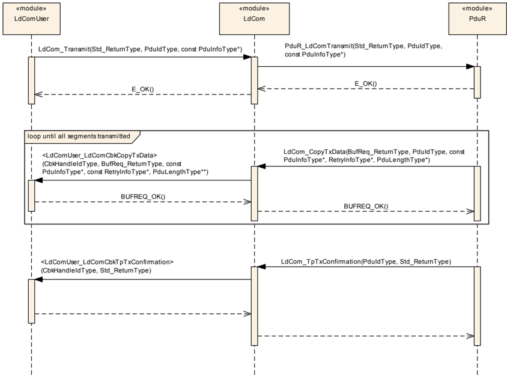

#### 8.1.2. IF-API

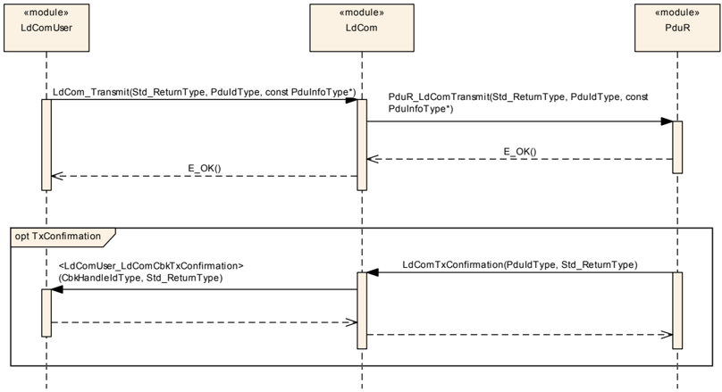

#### 8.1.3. TriggerTransmit

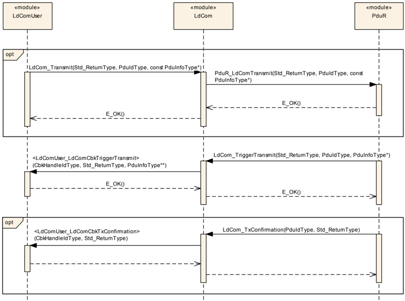

### 8.2. 接收

#### 8.2.1. TP-API

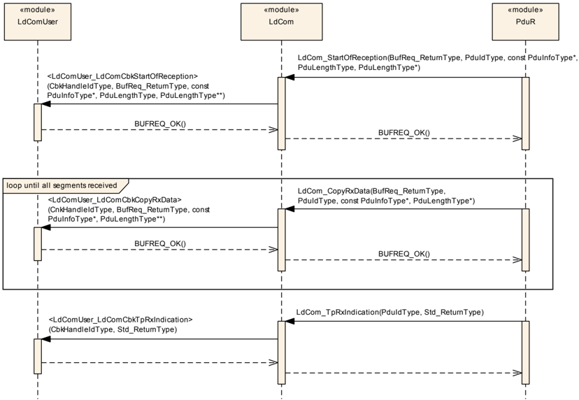

#### 8.2.2. IF-API

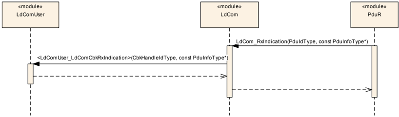

## 9. 配置规范

总体而言，本章定义配置参数及其到**容器**（container）的聚类组织。为支持本规范，第 9.1 章描述基础知识，并规定了应用于参数规范的模板（表）。我们有意将这些内容保留在规范中以保证可理解性。

第 9.1 章规定模块 **LdCom** 的结构（容器）和参数。

第 9.2 章规定模块 **LdCom** 的发布信息。

### 9.1. 容器与配置参数

以下各节汇总所有配置参数。各参数的详细含义见第 6 章和第 7 章。

#### 9.1.1. LdCom

| SWS 条目 | [ECUC_LdCom_00001] |
|---|---|
| 模块名称 | LdCom |
| 描述 | AUTOSAR **LdCom** 模块的配置。 |
| Post-Build 变体支持 | true |
| 支持的配置变体 | VARIANT-LINK-TIME, VARIANT-POST-BUILD, VARIANT-PRE-COMPILE |

| 容器名称 | 多重性 | 作用域/依赖 |
|---|---|---|
| LdComConfig | 1 | 该容器包含 AUTOSAR **LdCom** 模块的配置参数和子容器。 |
| LdComGeneral | 1 | 包含 **LdCom** 模块的通用配置参数。 |

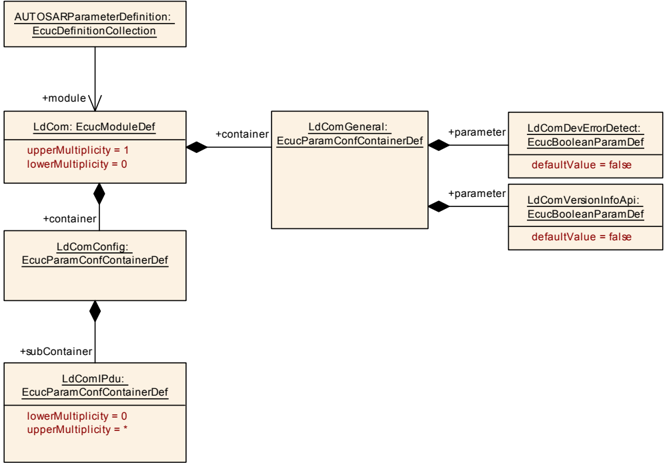

#### 9.1.2. LdComConfig

| SWS 条目 | [ECUC_LdCom_00003] |
|---|---|
| 容器名称 | LdComConfig |
| 父容器 | LdCom |
| 描述 | 该容器包含 AUTOSAR **LdCom** 模块的配置参数和子容器。 |
| 配置参数 | 见下方参数表 |

| 容器名称 | 多重性 | 作用域/依赖 |
|---|---|---|
| LdComIPdu | 0..* | 包含 **LdCom** 内部 **LdCom** 信号（IPdu）的配置参数。 |
| LdComUserModule | 0..* | 包含 **LdCom** 用户模块的配置参数。 |

#### 9.1.3. LdComGeneral

| SWS 条目 | [ECUC_LdCom_00004] |
|---|---|
| 容器名称 | LdComGeneral |
| 父容器 | LdCom |
| 描述 | 包含 **LdCom** 模块的通用配置参数。 |
| 配置参数 | 见下方参数表 |

| SWS 条目 | [ECUC_LdCom_00020] |
|---|---|
| 参数名称 | LdComDevErrorDetect |
| 父容器 | LdComGeneral |
| 描述 | 开启或关闭开发错误检测与通知（true：启用检测与通知；false：禁用检测与通知）。 |
| 多重性 | 1 |
| 类型 | EcucBooleanParamDef |
| 默认值 | false |
| Post-Build 变体值 | false |
| 值配置类 | Pre-compile time：x（All Variants）；Link time：-；Post-build time：- |
| 作用域/依赖 | scope: local |

| SWS 条目 | [ECUC_LdCom_00012] |
|---|---|
| 参数名称 | LdComVersionInfoApi |
| 父容器 | LdComGeneral |
| 描述 | 激活/停用版本信息 API（LdCom_GetVersionInfo）（true：激活版本信息 API；false：停用版本信息 API）。 |
| 多重性 | 1 |
| 类型 | EcucBooleanParamDef |
| 默认值 | false |
| Post-Build 变体值 | false |
| 值配置类 | Pre-compile time：x（All Variants）；Link time：-；Post-build time：- |
| 作用域/依赖 | scope: local |

无包含的容器。

#### 9.1.4. LdComIPdu

| SWS 条目 | [ECUC_LdCom_00006] |
|---|---|
| 容器名称 | LdComIPdu |
| 父容器 | LdComConfig |
| 描述 | 包含 **LdCom** 内部 **LdCom** 信号（IPdu）的配置参数。 |
| Post-Build 变体多重性 | true |
| 多重性配置类 | Pre-compile time：x（VARIANT-PRE-COMPILE）；Link time：x（VARIANT-LINK-TIME）；Post-build time：x（VARIANT-POST-BUILD） |
| 配置参数 | 见下方参数表 |

| SWS 条目 | [ECUC_LdCom_00002] |
|---|---|
| 参数名称 | LdComApiType |
| 父容器 | LdComIPdu |
| 描述 | 定义该 I-PDU 是应不分段发送的普通 I-PDU，还是应通过底层总线的传输协议发送的大型 I-PDU。RTE 使用该设置来调用合适的 API。 |
| 多重性 | 1 |
| 类型 | EcucEnumerationParamDef |
| 范围 | LDCOM_IF：通过接口 API 发送或接收。LDCOM_TP：通过传输协议 API 发送或接收。 |
| Post-Build 变体值 | false |
| 值配置类 | Pre-compile time：x（VARIANT-PRE-COMPILE）；Link time：x（VARIANT-LINK-TIME, VARIANT-POST-BUILD）；Post-build time：- |
| 作用域/依赖 | scope: ECU |

| SWS 条目 | [ECUC_LdCom_00005] |
|---|---|
| 参数名称 | LdComHandleId |
| 父容器 | LdComIPdu |
| 描述 | 这是 **LdCom** 的使用者（例如 RTE）用于调用 **LdCom** 的 ID。会创建一个对应的短名称（shortName），供使用者（例如 RTE）的调用使用。**PduR** 的调用也使用相同的 ID。 |
| 多重性 | 1 |
| 类型 | EcucIntegerParamDef（为此参数生成符号名） |
| 范围 | 0 .. 65535 |
| 默认值 | - |
| Post-Build 变体值 | false |
| 值配置类 | Pre-compile time：x（All Variants）；Link time：-；Post-build time：- |
| 作用域/依赖 | scope: ECU |

| SWS 条目 | [ECUC_LdCom_00007] |
|---|---|
| 参数名称 | LdComIPduDirection |
| 父容器 | LdComIPdu |
| 描述 | 该方向定义该 IPdu 及其贡献的信号应被发送还是接收。 |
| 多重性 | 1 |
| 类型 | EcucEnumerationParamDef |
| 范围 | LDCOM_RECEIVE：-。LDCOM_SEND：-。 |
| Post-Build 变体值 | false |
| 值配置类 | Pre-compile time：x（VARIANT-PRE-COMPILE）；Link time：x（VARIANT-LINK-TIME, VARIANT-POST-BUILD）；Post-build time：- |
| 作用域/依赖 | scope: local |

| SWS 条目 | [ECUC_LdCom_00010] |
|---|---|
| 参数名称 | LdComPduRef |
| 父容器 | LdComIPdu |
| 描述 | 对全局 Pdu 的引用。 |
| 多重性 | 1 |
| 类型 | 对 Pdu 的引用 |
| Post-Build 变体值 | false |
| 值配置类 | Pre-compile time：x（VARIANT-PRE-COMPILE）；Link time：x（VARIANT-LINK-TIME, VARIANT-POST-BUILD）；Post-build time：- |
| 作用域/依赖 | scope: ECU |

| SWS 条目 | [ECUC_LdCom_00011] |
|---|---|
| 参数名称 | LdComSystemTemplateSignalRef |
| 父容器 | LdComIPdu |
| 描述 | 对 ISignalToIPduMapping 的引用，该映射包含对 ISignal（System Template）的引用。 |
| 多重性 | 0..1 |
| 类型 | 对 I-SIGNAL-TO-I-PDU-MAPPING 的外部引用（Foreign reference） |
| Post-Build 变体多重性 | true |
| Post-Build 变体值 | true |
| 多重性配置类 | Pre-compile time：x（VARIANT-PRE-COMPILE）；Link time：x（VARIANT-LINK-TIME）；Post-build time：x（VARIANT-POST-BUILD） |
| 值配置类 | Pre-compile time：x（VARIANT-PRE-COMPILE）；Link time：x（VARIANT-LINK-TIME）；Post-build time：x（VARIANT-POST-BUILD） |
| 作用域/依赖 | scope: ECU |

无包含的容器。（另可参见 [10, TPS SystemTemplate]。）

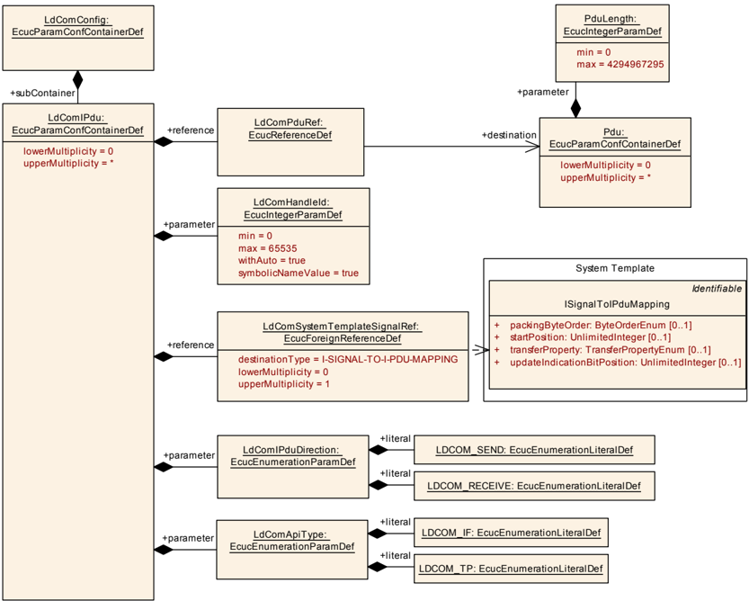

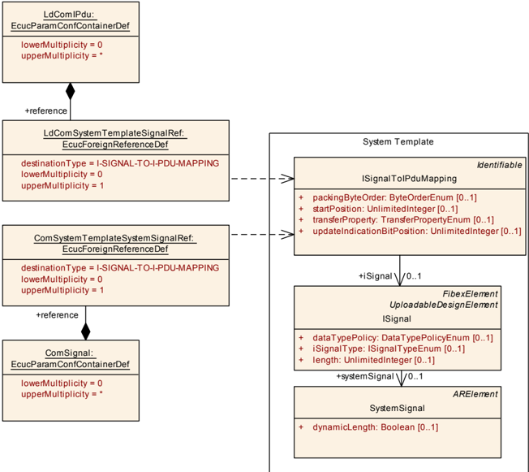

#### 9.1.5. LdComUserModule

| SWS 条目 | [ECUC_LdCom_00029] |
|---|---|
| 容器名称 | LdComUserModule |
| 父容器 | LdComConfig |
| 描述 | 包含 **LdCom** 用户模块的配置参数。 |
| Post-Build 变体多重性 | false |
| 多重性配置类 | Pre-compile time：x（All Variants）；Link time：-；Post-build time：- |
| 配置参数 | 见下方参数表 |

| SWS 条目 | [ECUC_LdCom_00032] |
|---|---|
| 参数名称 | LdComUserModuleCnfRef |
| 父容器 | LdComUserModule |
| 描述 | 对 **LdCom** 用户模块配置的引用。 |
| 多重性 | 1 |
| 类型 | 对 destinationUri LdComUserUriDefSet/LdComUser 的引用 |
| Post-Build 变体多重性 | false |
| Post-Build 变体值 | false |
| 值配置类 | Pre-compile time：x（All Variants）；Link time：-；Post-build time：- |
| 作用域/依赖 | scope: ECU |

无包含的容器。

「软件集群」（**Software Clusters**）这一概念支持将 AUTOSAR 经典平台架构的软件拆分为更小的单元，这对 **LdCom** 模块同样产生影响。事实上，**LdCom** 模块现在可以拥有任意数量的使用者（RTE、**SwCluC** 和 **CDD**），因此它依赖于 URI 引用（URI Reference，参见 [11, Specification of ECU Configuration] 的 URI Reference 一节）的使用，以便在模型中将 **LdCom** 与其使用者链接起来。

为了保证 **LdCom** 模块的配置与其使用者的配置之间的兼容性，LdComUserUriDefSet（见 ECUC_LdCom_00034）定义了所需的参数和容器。这意味着 **LdCom** 的使用者应配置 LdComUserModuleCnf 容器（包括其子容器），该容器保存其发送和接收（通过专用的通知回调）的 **LdCom** IPdu 的配置。

一个 **LdCom** 用户可以跨越一个或多个 ECUC 分区。然而，相应的 **LdCom** 用户如何实现这一点是其实现特定的决策。因此适用两种不同的架构模式：

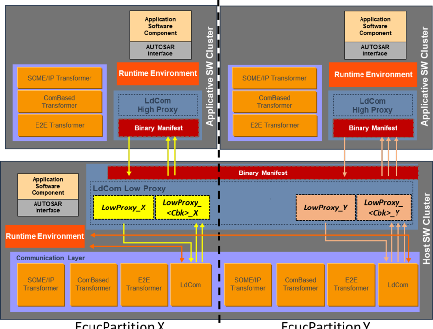

采用这种方式时，**LdCom** 用户模块为每个配置的分区提供专门的实例，**LdCom**（通知回调）的调用应在这些分区上进行。但这要求 **LdCom** 用户提供多个主函数，每个主函数绑定到相关的分区。**LdCom** 用户的通知回调只在单个分区的上下文中被调用。分区上下文的识别可以通过一个简单的「回调函数-分区」查找表完成。

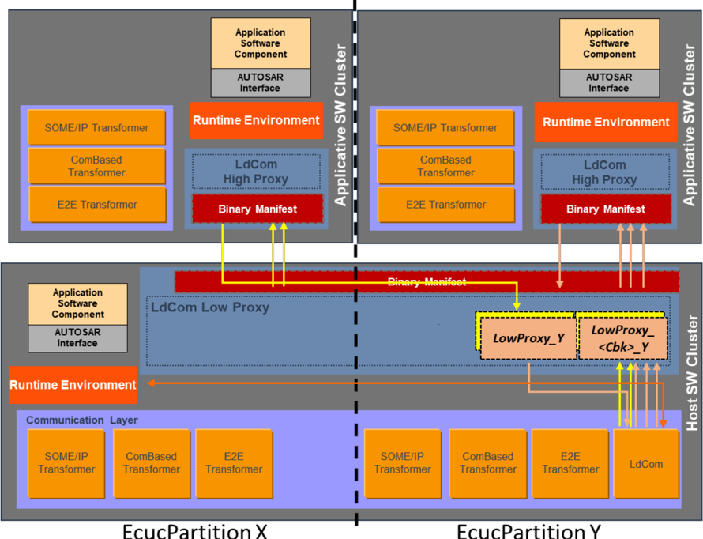

在这种架构模式下，**LdCom** 用户是分区无关的，因此必须提供一组公共的通知回调，这些回调在不同分区的上下文中被调用。此外，对于不同 ECUC 分区上的不同 LdComIPdu，它应提供可重入的通知回调实现。

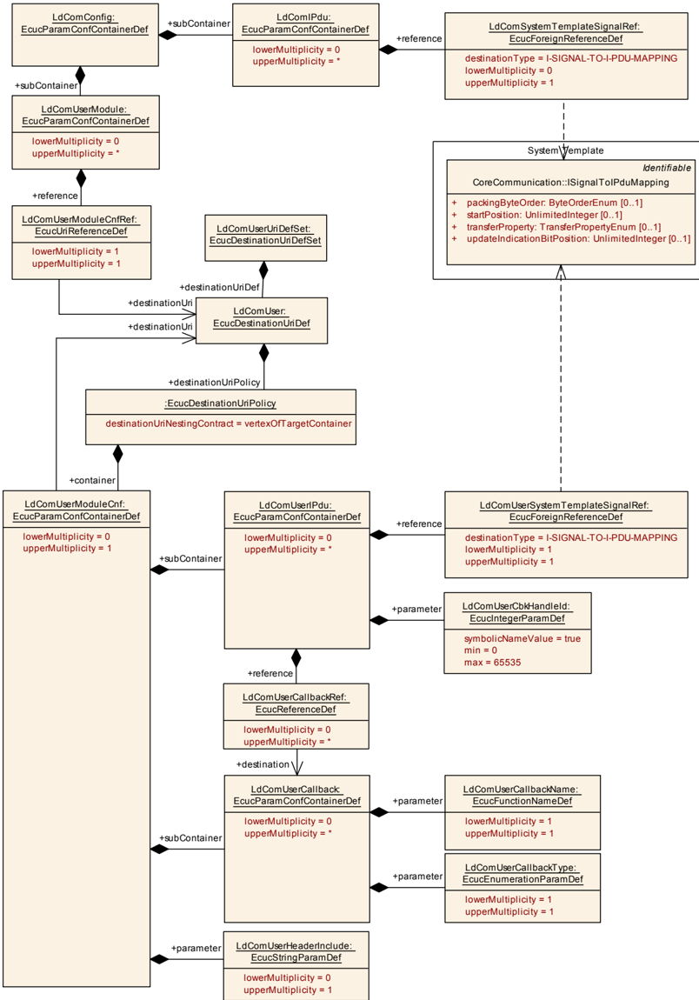

#### 9.1.6. LdComUserUriDefSet

| SWS 条目 | [ECUC_LdCom_00034] |
|---|---|
| EcucDestinationUriDefSet 名称 | LdComUserUriDefSet |
| 描述 | 定义 **LdCom** 模块的 DestinationUriDefs 集合。 |
| 包含的 EcucDestinationUriDefs | 见下方参数表 |

| 名称 | 描述 |
|---|---|
| LdComUser | 定义与 **LdCom** 用户模块相关设置有关的配置容器内容。 |

| SWS 条目 | [ECUC_LdCom_00035] |
|---|---|
| EcucDestinationUriDef 名称 | LdComUser |
| Destination Uri 定义集合 | LdComUserUriDefSet |
| 描述 | 定义与 **LdCom** 用户模块相关设置有关的配置容器内容。 |
| destinationUriNestingContract | vertexOfTargetContainer |
| 配置参数 | 见下方参数表 |

| 容器名称 | 多重性 | 作用域/依赖 |
|---|---|---|
| LdComUserModuleCnf | 0..1 | 包含 **LdCom** 用户模块的配置参数。 |

#### 9.1.7. LdComUserModuleCnf

| SWS 条目 | [ECUC_LdCom_00030] |
|---|---|
| 容器名称 | LdComUserModuleCnf |
| 父容器 | RteLdComUser, SwCluCLdComProxyBaseSocket |
| Destination Uri 定义 | LdComUser |
| 描述 | 包含 **LdCom** 用户模块的配置参数。 |
| Post-Build 变体多重性 | false |
| 多重性配置类 | Pre-compile time：x（All Variants）；Link time：-；Post-build time：- |
| 配置参数 | 见下方参数表 |

| SWS 条目 | [ECUC_LdCom_00027] |
|---|---|
| 参数名称 | LdComUserHeaderInclude |
| 父容器 | LdComUserModuleCnf |
| 描述 | 定义 **LdCom** 用户为已配置回调提供函数声明所在的头文件。 |
| 多重性 | 0..1 |
| 类型 | EcucStringParamDef |
| 默认值 | - |
| 正则表达式 | - |
| Post-Build 变体值 | false |
| 多重性配置类 | Pre-compile time：x（All Variants）；Link time：-；Post-build time：- |
| 值配置类 | Pre-compile time：x（All Variants）；Link time：-；Post-build time：- |
| 作用域/依赖 | scope: local |

| 容器名称 | 多重性 | 作用域/依赖 |
|---|---|---|
| LdComUserCallback | 0..* | 该容器为 **LdCom** IPdu 定义一个 **LdCom** 回调函数。 |
| LdComUserIPdu | 0..* | 包含 **LdCom** 用户模块内部 **LdCom** 信号（LdComIPdu）的配置参数。 |

**注意：**

对于 **SwCluC**，一个 **LdCom** 用户由一个或多个 SwCluCLdComBaseSocket 表示。在 **LdCom** 用户满足以下要求的每个分区中，都需要一个 Base Socket：

* 需要直接访问发起发送请求的 **LdCom** API
* 提供与发送和接收相关的通知回调

实际上，一个 Base Socket 将 **LdCom** 中一组固定的通知回调链接到应用软件集群中特定的 ECUC 分区。由此意味着：

**LdCom** LowProxy 必须通过 LdComUserSystemTemplateSignalRef 将每个 LdComUserIPdu 映射到一个 LdComIPdu。每个 EcucPartition 有一个与 SwCluCLdComBaseSocket 关联的 LdComUserModuleCnf。其效果是每个 EcucPartition 还拥有一个专门的句柄 Id 范围，从而简化了 LdComIPdu 的 Id 唯一配置检查。

* **LdCom** 应在 Base Socket 中配置的 ECUC 分区上，为相关 **LdCom** IPdu 的发送请求提供其 API。（请注意，自底向上的方式——由 **LdCom** 配置在哪些 ECUC 分区上提供哪些 **LdCom** IPdu——也是可行的。）
* **LdCom** High Proxy 应为 RTE 提供兼容的配置结构和内容。它从 **LdCom** 推导其 **LdCom** IPdu 的配置。对于分区分配，**LdCom** High Proxy 会创建「虚拟的」主函数（Rx/Tx）并将 **LdCom** IPdu 映射到它们。这些主函数仅存在于配置中，没有实现。

系统必须在应用软件集群和 Host 软件集群中提供所需的 ECUC 分区。这是系统设计期间必须考虑的一项要求。

#### 9.1.8. LdComUserCallback

| SWS 条目 | [ECUC_LdCom_00022] |
|---|---|
| 容器名称 | LdComUserCallback |
| 父容器 | LdComUserModuleCnf |
| 描述 | 该容器为 **LdCom** IPdu 定义一个 **LdCom** 回调函数。 |
| Post-Build 变体多重性 | true |
| 多重性配置类 | Pre-compile time：x（VARIANT-PRE-COMPILE）；Link time：x（VARIANT-POST-BUILD）；Post-build time：- |
| 配置参数 | 见下方参数表 |

| SWS 条目 | [ECUC_LdCom_00023] |
|---|---|
| 参数名称 | LdComUserCallbackName |
| 父容器 | LdComUserCallback |
| 描述 | 待调用的回调函数的名称。 |
| 多重性 | 1 |
| 类型 | EcucFunctionNameDef |
| 默认值 | - |
| 正则表达式 | - |
| Post-Build 变体多重性 | false |
| Post-Build 变体值 | false |
| 多重性配置类 | Pre-compile time：x（VARIANT-PRE-COMPILE）；Link time：x（VARIANT-POST-BUILD）；Post-build time：- |
| 值配置类 | Pre-compile time：x（VARIANT-PRE-COMPILE）；Link time：x（VARIANT-POST-BUILD）；Post-build time：- |
| 作用域/依赖 | scope: ECU |

| SWS 条目 | [ECUC_LdCom_00025] |
|---|---|
| 参数名称 | LdComUserCallbackType |
| 父容器 | LdComUserCallback |
| 描述 | **LdCom** 回调的类型。 |
| 多重性 | 1 |
| 类型 | EcucEnumerationParamDef |
| 范围 | LDCOM_RX_INDICATION：LdComCbkRxIndication 回调指示来自下层通信接口模块的已接收 PDU。LDCOM_RX_START_OF_RECEPTION：LdComCbkStartOfReception 回调在开始接收一个 N-SDU 时被调用。LDCOM_TP_COPY_RX_DATA：LdComCbkCopyRxData 回调将 I-PDU 段（N-PDU）的接收数据提供给上层。LDCOM_TP_COPY_TX_DATA：LdComCbkCopyTxData 回调获取 I-PDU 段的发送数据。LDCOM_TP_RX_INDICATION：LdComCbkTpRxIndication 回调在通过 TP API 接收到一个 I-PDU 之后被调用。LDCOM_TP_TX_CONFIRMATION：LdComCbkTpTxConfirmation 回调在一个信号已通过 TP-API 于其网络上发送之后被调用。LDCOM_TX_CONFIRMATION：当下层通信接口模块确认一个 PDU 的传输、或传输失败时，调用 LdComCbkTxConfirmation 回调。LDCOM_TX_TRIGGER_TRANSMIT：当下层通信接口模块确认一个 PDU 的传输、或传输失败时，调用 LdComCbkTxConfirmation 回调。 |
| Post-Build 变体多重性 | false |
| Post-Build 变体值 | false |
| 多重性配置类 | Pre-compile time：x（VARIANT-PRE-COMPILE）；Link time：x（VARIANT-POST-BUILD）；Post-build time：- |
| 值配置类 | Pre-compile time：x（VARIANT-PRE-COMPILE）；Link time：x（VARIANT-POST-BUILD）；Post-build time：- |
| 作用域/依赖 | scope: ECU |

无包含的容器。

#### 9.1.9. LdComUserIPdu

| SWS 条目 | [ECUC_LdCom_00028] |
|---|---|
| 容器名称 | LdComUserIPdu |
| 父容器 | LdComUserModuleCnf |
| 描述 | 包含 **LdCom** 用户模块内部 **LdCom** 信号（LdComIPdu）的配置参数。 |
| Post-Build 变体多重性 | true |
| 多重性配置类 | Pre-compile time：x（VARIANT-PRE-COMPILE）；Link time：-；Post-build time：x（VARIANT-POST-BUILD） |
| 配置参数 | 见下方参数表 |

| SWS 条目 | [ECUC_LdCom_00026] |
|---|---|
| 参数名称 | LdComUserCbkHandleId |
| 父容器 | LdComUserIPdu |
| 描述 | 用作 **LdCom** 用户回调句柄 Id 的数值。这是 **LdCom** 用于调用 **LdCom** 用户（Rte、Com Low Proxy 或 **CDD**）回调的 ID，调用时使用 LdComUserCbkHandleId 参数。会创建一个对应的符号名引用，供使用者的调用使用。 |
| 多重性 | 1 |
| 类型 | EcucIntegerParamDef（为此参数生成符号名） |
| 范围 | 0 .. 65535 |
| 默认值 | - |
| Post-Build 变体值 | false |
| 值配置类 | Pre-compile time：x（All Variants）；Link time：-；Post-build time：- |
| 作用域/依赖 | scope: ECU |

| SWS 条目 | [ECUC_LdCom_00024] |
|---|---|
| 参数名称 | LdComUserCallbackRef |
| 父容器 | LdComUserIPdu |
| 描述 | 对该 LdComIPdu 的所有回调的引用。 |
| 多重性 | 0..* |
| 类型 | 对 LdComUserCallback 的引用 |
| Post-Build 变体多重性 | true |
| Post-Build 变体值 | true |
| 多重性配置类 | Pre-compile time：x（VARIANT-PRE-COMPILE）；Link time：-；Post-build time：x（VARIANT-POST-BUILD） |
| 值配置类 | Pre-compile time：x（VARIANT-PRE-COMPILE）；Link time：x（VARIANT-POST-BUILD）；Post-build time：- |
| 作用域/依赖 | scope: ECU |

| SWS 条目 | [ECUC_LdCom_00033] |
|---|---|
| 参数名称 | LdComUserSystemTemplateSignalRef |
| 父容器 | LdComUserIPdu |
| 描述 | 对 ISignalToIPduMapping 的引用，该映射包含对 ISignal（System Template）的引用。 |
| 多重性 | 1 |
| 类型 | 对 I-SIGNAL-TO-I-PDU-MAPPING 的外部引用（Foreign reference） |
| Post-Build 变体多重性 | true |
| Post-Build 变体值 | true |
| 多重性配置类 | Pre-compile time：x（VARIANT-PRE-COMPILE）；Link time：-；Post-build time：x（VARIANT-POST-BUILD） |
| 值配置类 | Pre-compile time：x（VARIANT-PRE-COMPILE）；Link time：-；Post-build time：x（VARIANT-POST-BUILD） |
| 作用域/依赖 | scope: ECU |

无包含的容器。

如果存在一个 LdComUserIPdu，其 LdComIPduDirection 设置为 LDCOM_SEND、LdComApiType 设置为 LDCOM_TP，并且引用了一个 ISignal，则相应的

* &lt;LdComUser_LdComCbkCopyTxData&gt;
* &lt;LdComUser_LdComCbkTpTxConfirmation&gt;

通知回调也应被配置。

如果存在一个 LdComUserIPdu，其 LdComIPduDirection 设置为 LDCOM_RECEIVE、LdComApiType 设置为 LDCOM_TP，则相应的

* &lt;LdComUser_LdComCbkStartOfReception&gt;
* &lt;LdComUser_LdComCbkCopyRxData&gt;
* &lt;LdComUser_LdComCbkTpRxIndication&gt;

通知回调也应被配置。

如果存在一个 LdComUserIPdu，其 LdComIPduDirection 设置为 LDCOM_RECEIVE、LdComApiType 设置为 LDCOM_IF，则相应的

* &lt;LdComUser_LdComCbkRxIndication&gt;

通知回调也应被配置。

### 9.2. 发布信息

有关详细信息，可参见 [3, SWS BSW General] 中的第 10.3 章「Published Information」（发布信息）。

## B. AUTOSAR 可追溯项变更历史

### B.1. 本文档的可追溯项历史（按AUTOSAR R22-11版本）

由于文档迁移，没有变更历史。

### B.2. 本文档的可追溯项历史（按AUTOSAR R23-11版本）

本文档的可追溯项历史（按AUTOSAR R23-11版本）。

#### B.2.1. R23-11中新增的规范项

无

#### B.2.2. R23-11中变更的规范项

```
[SWS_LDCOM_00020] [SWS_LDCOM_00026] [SWS_LDCOM_00027] [SWS_LDCOM_00029] [SWS_LDCOM_00030] [SWS_LDCOM_00033] [SWS_LDCOM_00035] [SWS_LDCOM_00052] [SWS_LDCOM_91001] [SWS_LDCOM_91003] [SWS_LDCOM_91004] [SWS_LDCOM_91007]
```

#### B.2.3. R23-11中删除的规范项

无
