## 1. 简介和功能概述

本文介绍了AUTOSAR基本软件模块LIN接口（**LinIf**）和LIN传输协议（**LinTp**）的功能、API和配置。其中LIN TP属于LIN接口的一部分。

唤醒功能包含在LIN接口（**LIN Interface**），LIN驱动（**LIN Driver**）和LIN收发器驱动（**LIN Transceiver Driver**）中。

本文档基于ISO 17987规范[\[19\]](#ref-19)，同时文档将不会再次描述**ISO 17987**中的LIN功能。

LIN接口模块适用于ISO 17987主节点（**master node**）和从节点（**slave node**），兼容LIN 2.2和LIN 2.1主节点。AUTOSAR中的LIN实现可能和ISO 17987规范有部分出入，但LIN总线上的行为不会发生变化。它的目的是能够让所有现有的LIN节点在AUTOSAR LIN上重用。

LIN接口被设计成硬件独立的。并明确定义了于上层模块（**PDU Router**）和下层模块（**LIN Driver**）模块之间的接口定义。

LIN接口可以处理多个LIN驱动程序。LIN驱动可以支持多个通道。这意味着LIN驱动程序可以处理一个或多个LIN通道。

### 1.1. 体系结构概述

根据分层软件体系结构[\[2\]](#ref-2)，LIN接口位于基础软件体系结构中，如图1所示。本例中，LIN接口连接到两个LIN驱动程序。然而单个的LIN驱动程序是最常见的配置。

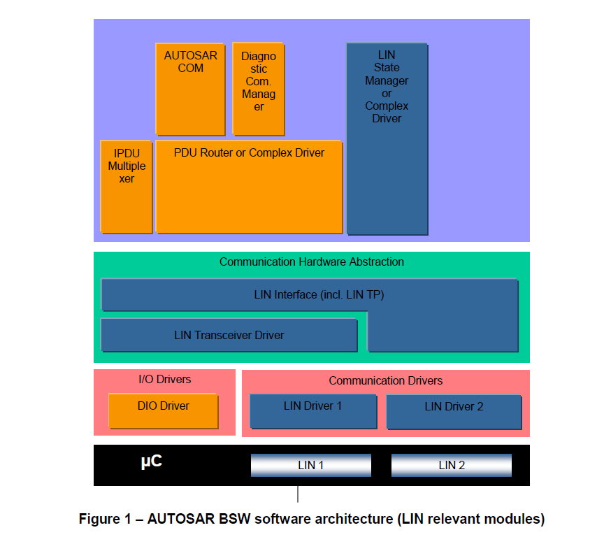

### 1.2. 功能概述

LIN接口模块负责实现**ISO 17987**中定义的LIN功能。包含以下功能:
* 执行ECU连接到的每个LIN总线当前选择的调度表（**schedule**）。
* 作为一个主节点，发送报头，并且发送和接收响应。
* 按上层模块的请求，切换主节点的调度表。
* 接受来自上层模块的帧发送请求，并在适当的LIN帧内发送数据作为响应。
* 在适当的帧内收到相应的响应时，为上层提供帧接收通知。
* 睡眠和唤醒服务。
* 错误处理。
* 诊断传输层服务。
* 从节点配置和识别服务。

## 2. 缩略语

除了 ISO 17987 LIN 规范 [\[1\]](#ref-1) 中的缩略语和缩写之外，本文档中还使用了以下缩略语和缩写。ISO 17987 规范中已定义的一些术语也在此处进行了定义。

### 2.1. 缩略语

**CF**
> LIN TP 中的连续帧（**Consecutive Frame**）。

**FF**
> LIN TP 中的第一帧（**First Frame**）。

**ID**
> 标识符（**Identifier**）。

**LDF**
> LIN 描述文件（**LIN Description File**）。

**LIN TP**（**LinTp**）
> LIN 传输协议（**LIN Transport Protocol**）（LIN 接口的一部分）。

**MRF**
> 主节点请求帧（**Master Request Frame**）。

**NAD**
> 节点地址（**Node Address**）。LIN 中的每个从节点都必须具有唯一的 NAD。

**NC**
> 节点配置（**Node Configuration**）。

**N_As**
> 发送端发送 LIN 帧（任何 N-PDU）的时间（见 ISO 17987-2 [\[5\]](#ref-5)）。

**N_Cr**
> 直到接收到下一个连续帧 N-PDU 的时间（见 ISO 17987-2 [\[5\]](#ref-5)）。

**N_Cs**
> 直到传输下一个连续帧 N-PDU 的时间（见 ISO 17987-2 [\[5\]](#ref-5)）。

**P2**
> 在 LIN 总线上接收到诊断请求的最后一帧与从节点能够提供响应数据之间的时间。

**P2\***
> 从发送响应挂起帧（0x78）到 LIN 从设备能够为响应提供数据之间的时间。

**PID**
> 受保护的 ID（**Protected ID**）。

**RX**
> 接收（**Reception**）。

**SID**
> 服务标识符（**Service Identifier**）（节点配置服务）。

**SF**
> LIN TP 中的单帧（**Single Frame**）。

**SRF**
> 从节点的响应帧（**Slave Response Frame**）。

**SRS**
> 软件需求规范（**Software Requirement Specification**）。

**TX**
> 发送（**Transmission**）。

### 2.2. 术语

**Slot Delay**
> 调度表中帧开始之间的时间。单位是特定集群的时基数。

**Jitter**
> 最长延迟和最短延迟之间的差异（例如，最坏情况执行时间 - 最佳情况执行时间）。

**Maximum frame length**
> 最大帧长度是 ISO 17987-3 [\[6\]](#ref-6) 中定义的 **T_FRAME_MAX**（即标称帧长度加上 40%）。

**Schedule entry is due**
> 这意味着 LIN 接口已到达调度表中的新条目，并且将启动一个帧（接收或发送）。

**Slave-to-slave**
> 从 LIN 主节点的角度来看，LIN 总线上存在 3 种不同方向的帧：主节点发送的响应、主节点接收的响应和一个从节点发送并由另一个从节点接收的响应。**slave-to-slave** 描述的是最后一个。这在 ISO 17987 规范中没有明确描述，但在 ISO 17987-3 中的图 14 中提到：三个无条件帧传输。

**Irrelevant frame**
> 从 LIN 从节点的角度来看，LIN 总线上存在 3 种不同方向的帧：从节点发送的响应、从节点接收的响应和从节点忽略的响应（即主节点与另一个从节点之间或另外两个从节点之间的通信）。这些被忽略的帧在本规范中被称为无关帧（**irrelevant frame**）。这在 ISO 17987 规范中没有明确描述。

**Relevant frame**
> 从 LIN 从节点的角度来看，从节点发送或接收的帧。与无关帧相对。

**Sporadic frame**
> 这是附加到偶发时隙（**Sporadic slot**）的一种无条件帧。

**Sporadic slot**
> 这是偶发帧（**Sporadic frame**）的占位符。将其命名为时隙（**slot**）的原因是它没有 LIN 帧的 ID。

**Tick**
> **Tick** 是处理所有通道上的通信的最小时间实体。

**Bus idle timeout**
> 总线没有活动所持续流逝的时长。

## 3. 相关文档

### 3.1. 输入文件和相关标准与规范

<a id="ref-1"></a>[1] ISO 17987:2016 (all parts), Road vehicles - Local Interconnect Network (LIN)
> https://www.iso.org

<a id="ref-2"></a>[2] LIN Specification Package, Revision 2.2A
> https://lin-cia.org/

<a id="ref-3"></a>[3] LIN Specification Package, Revision 2.1
> https://lin-cia.org/

<a id="ref-4"></a>[4] Layered Software Architecture
> AUTOSAR_CP_EXP_LayeredSoftwareArchitecture

<a id="ref-5"></a>[5] ISO 17987-2:2016 Road vehicles - Local Interconnect Network (LIN) - Part 2: Transport protocol and network layer services
> https://www.iso.org

<a id="ref-6"></a>[6] ISO 17987-3:2016 Road vehicles - Local Interconnect Network (LIN) - Part 3: Protocol specification
> https://www.iso.org

<a id="ref-7"></a>[7] General Specification of Basic Software Modules
> AUTOSAR_CP_SWS_BSWGeneral

<a id="ref-8"></a>[8] J2602-1:2012 LIN Network for Vehicle Applications

<a id="ref-9"></a>[9] Specification of Default Error Tracer
> AUTOSAR_CP_SWS_DefaultErrorTracer

<a id="ref-10"></a>[10] Specification of ECU State Manager
> AUTOSAR_CP_SWS_ECUStateManager

<a id="ref-11"></a>[11] Specification of PDU Router
> AUTOSAR_CP_SWS_PDURouter

<a id="ref-12"></a>[12] Specification of LIN State Manager
> AUTOSAR_CP_SWS_LINStateManager

<a id="ref-13"></a>[13] Specification of Basic Software Mode Manager
> AUTOSAR_CP_SWS_BSWModeManager

<a id="ref-14"></a>[14] Specification of Communication
> AUTOSAR_CP_SWS_COM

<a id="ref-15"></a>[15] Specification of LIN Driver
> AUTOSAR_CP_SWS_LINDriver

<a id="ref-16"></a>[16] Specification of LIN Transceiver Driver
> AUTOSAR_CP_SWS_LINTransceiverDriver

<a id="ref-17"></a>[17] Specification of Bus Mirroring
> AUTOSAR_CP_SWS_BusMirroring

<a id="ref-18"></a>[18] General Requirements on Basic Software Modules
> AUTOSAR_CP_SRS_BSWGeneral

<a id="ref-19"></a>[19] Requirements on LIN
> AUTOSAR_CP_SRS_LIN

<a id="ref-20"></a>[20] ISO/TR 17987-5:2016 Road vehicles - Local Interconnect Network (LIN) - Part 5: Application programmers interface (API)
> https://www.iso.org

### 3.2. 相关规范

**AUTOSAR** 提供了基本软件模块的通用规范 [\[7\]](#ref-7)（**SWS BSW General**），该规范同样适用于 **LIN** 接口。

因此，规范 **SWS BSW General** 应被视为 **LIN** 接口的附加和必需规范。

## 4. 约束和假设

### 4.1. 限制

LIN接口模块可用作LIN集群中的LIN主节点或者LIN从节点。每个ECU中只有一个LIN接口实例。如果底层LIN驱动程序支持多个通道，则LIN接口作用于多个集群。

假设所有连接的LIN总线上的ECU，在它们已经运行时都可以接收到唤醒帧（也就是说LIN ECU以**LINIF_CHANNEL_SLEEP**状态开始）。

LIN 接口模块不支持以下功能：
* ConditionalChangeNAD（SID 0xB3，在LIN 2.1规范中定义；在ISO 17987-3中已过时）
* DataDump（SID 0xB4，在ISO 17987-3 中可选）

**注意：**

在**LIN 2.2A**之前，**ConditionalChangeNAD**的定义没有对否定响应进行定义，并且在**ISO 17987-3**中被设置为过时，没有任何响应行为的定义。 所以**ConditionalChangeNAD**不支持时，在**ISO 17987**和LIN规范中都没有定义响应行为。 然而假定澄清从节点永远都不应该发送否定响应，ISO 17987-3中的**AssignNAD**也适用于**ConditionalChangeNAD**。

对于从节点，LIN接口模块不支持:
* 标识符不等于**0**和**2**的**ReadByIdentifier**（SID 0xB2，ISO 17987-3中强制要求）
* 序列号（在ISO 17987-3第[6.2.2](#622-响应)条中定义）。这意味着没有相应的配置，也没有访问序列号的API
* **AutoAddressingSlave**（SID 0xB8，ISO 17987-3中可选
* 从节点位置检测（**Slave node position detection**）（SID 0xB5，LIN 2.x 规范中可选）

对于主节点，LIN接口模块不支持：
* **ReadByIdentifier**（SID 0xB2，ISO 17987-3 强制要求）

**注意：**

ReadByIdentifier不被视为节点配置。它更多地被视为一种身份识别服务。因此支持ReadByIdentifier服务作为调度表命令是没有意义的。诊断层负责支持ReadByIdentifier的功能。

在一个通道上具有主节点的 ECU 也可以是另一个通道上的从节点。

LIN接口模块不支持保留帧（**Reserved Frame**）的传输（在LIN 2.1规范中定义）

LIN接口模块支持Post-Build Variant，但不直接采用ISO 17987-3第[6.3](#63-无关通信仅从节点)条从节点模型中定义的方式。

如果**LinTpScheduleChangeDiag**设置为**TRUE**，则必须避免同时来自**LinTp**和非LinTp（BswM 或 CDD）的调度表切换请求，以防止诊断连接过早终止。此问题将在会在以后的版本中修复。

### 4.2. 汽车域的适用性

本规范适用于使用 **LIN** 的所有汽车域。

### 4.3. 关于其他 LIN 标准的澄清

J2602 [\[8\]](#ref-8) 和 **LIN** 2.1 [\[3\]](#ref-3) 是 ISO 17987 [\[1\]](#ref-1) 的其他标准形式。这些替代标准是 ISO 17987 的前身，并共享 ISO 17987 的概念。

ISO 17987 节点与 **LIN** [2.1](#21-缩略语) 节点兼容（见 ISO 17987-3，附录 B.2.3）。

**AUTOSAR LinIf** 在上述标准与 ISO 17987 相同的范围内支持它们。

出于历史原因，基于比 ISO 17987 更早的 **LIN** 标准（**LIN** 1.3、**LIN** 2.0、**LIN** [2.1](#21-缩略语) 和 **LIN** 2.2）的现有从节点，在标准与 ISO 17987 相同的范围内受到支持。

## 5. 对其他模块的依赖

为了能够使LIN接口运行，需要连接以下模块：
* 默认错误跟踪器 – DET
* ECU状态管理器 – EcuM
* PDU路由器 – PduR
* LIN状态管理器 – LinSM
* BSW模式管理器 – BswM
* AUTOSAR COM – Com
* LIN 驱动程序 – Lin
* LIN 收发器驱动程序 – LinTrcv

### 5.1. 上层模块

#### 5.1.1. PDU路由器和复杂驱动程序（PDU Router and CDD）

LIN接口连接到PDU路由器或者其他替代模块（例如：复杂驱动程序）以传输和接收帧。这里假设这些模块会负责复制用于接收和发送的帧的数据。在TP的情况下，PDU路由器是唯一上层的模块，它将TP消息缓冲区作为完整消息或分段消息处理。

#### 5.1.2. 总线镜像（Mirroring）

LIN接口还连接到总线镜像模块。如果启用镜像，将报告所有接收和发送的LIN帧的内容。TP消息不会报告给总线镜像模块。

#### 5.1.3. LIN状态管理器（LIN State Manager）

LIN接口连接到LIN状态管理器，LIN状态管理器主要负责整个LIN通讯栈的控制流。所以关于LIN接口，它有以下用途：
1. 对于主节点，状态管理器将调度表请求转发到LIN接口。
2. 状态管理器请求发送唤醒命令。以及对于主节点，请求发送休眠命令。

#### 5.1.4. BSW模式管理器（BSW Mode Manager）

LIN TP作为LIN接口一部分，连接到BSW模式管理器。当上层请求LIN TP操作时，请求更改调度表。

#### 5.1.5. AUTOSAR COM

作为LIN从节点，LIN接口连接到COM，以便更新response_error信号的值。

### 5.2. 下层模块

#### 5.2.1. LIN驱动程序（LIN Driver）

LIN接口依赖于文档AUTOSAR_SWS_LINDriver[\[7\]](#ref-7)中指定的下层LIN驱动程序的服务。

LIN接口假定LIN驱动程序提供以下基本服务：

* 为LIN主节点，传输帧头和响应部分（参见：**Lin_SendFrame**）。假设这个服务还告诉帧的响应的方向（发送、接收或从节点到从节点的通信）。
* 为LIN主节点传输**go-to-sleep**命令（参见：**Lin_GoToSleep**）。
* 将LIN通道设置为状态**LIN_CH_SLEEP**，而不发送**go-to-sleep**命令（参见：**Lin_GoToSleepInternal**）。
* 唤醒命令（**Lin_Wakeup**）的传输。
* 将LIN通道设置为状态**LIN_CH_OPERATIONAL**而不发送唤醒命令（参见：**Lin_WakeupInternal**）。
* 查询LIN主节点的传输状态和接收帧的响应部分（参见：**Lin_GetStatus**）。 包含了以下几种情况：
  * 成功接收/传输（**Successful reception/transmission**）。
  * 没有接收（**No reception**）。
  * 错误的接收/传输（**Erroneous reception/transmission**）：帧错误、位错误、校验和错误。
  * 持续接收（**Ongoing reception**）：至少已接收到一个响应字节，但尚未接收到校验和字节
  * 持续传输（**Ongoing transmission**）。
  * 睡眠中的频道（**Channel In sleep**）（go-to-sleep命令已成功传输）。

对于LIN的从节点，LIN接口假定LIN驱动程序也会另外提供以下基本服务：

* 已接收到帧头的指示（**Indication of a received header**）（参见：[**LinIf_HeaderIndication**](#742-linif_headerindication)）。假设这个服务还告诉帧响应的方向（发送、接收或从节点到从节点的通信）。
* 收到响应的指示（**Indication of a received response**）（参见：[**LinIf_RxIndication**](#743-linif_rxindication)）。
* 已发送响应的确认（参见：[**LinIf_TxConfirmation**](#744-linif_txconfirmation)）。
* 指示检测到的通信错误事件（参见：[**LinIf_LinErrorIndication**](#745-linif_linerrorindication)），并能区分以下几种情况：
  * 报头接收错误（**Error during header reception**）
  * 响应中的帧错误（**Framing error in response**）
  * 校验和错误（**Checksum error**）
  * 响应传输过程中的位错误（**Bit error during response transmission**）
  * 不完整的回应（**Incomplete response**）
  * 没有回应（**No response**）

LIN接口应该使用以上列出的LIN驱动程序提供的接口，而不是直接地使用或者访问相关地LIN硬件。

#### 5.2.2. LIN收发器驱动程序（LIN Transceiver Driver）

LIN接口需要可能需要使用由AUTOSAR_SWS_LINTransceiverDriver[\[12\]](#ref-12)所定义的底层LIN收发器驱动程序的服务。

LIN接口将所有底层LIN收发器驱动程序的以下服务映射到一个唯一接口。
* 独特的LIN收发器驱动程序模式请求和读取服务，用于管理每个底层LIN收发器设备的操作模式。
* 支持LIN收发器唤醒原因的读取服务。
* 启用/禁用/清除每个使用的LIN收发器的唤醒事件状态的模式请求服务。

LIN接口应该使用以上列出的LIN收发器驱动程序提供的接口，而不是直接地使用或者访问相关地LIN硬件。

### 5.3. 文件结构

#### 5.3.1. 头文件结构

本节描述 LIN 接口以及可能的其他模块将要包含的头文件。

LIN 接口应包含它所连接的所有上层 **BSW** 模块定义的包含文件，例如在连接到 **PDU** 路由器的情况下为文件 **PduR_LinIf.h**。

如果启用了 **LIN TP**（配置参数 **LinIfTpSupported**），LIN 接口应包含文件 **PduR_LinTp.h**。

如果配置参数 **LinIfTrcvDriverSupported** 设置为 **TRUE**，LIN 接口应包含文件 **LinTrcv.h**。

LIN 接口应为 **CDD** 的回调声明包含文件 **&lt;CDD_Cbk.h&gt;**。**&lt;CDD_Cbk.h&gt;** 可通过配置参数 **LinIfPublicCddHeaderFile** 配置。

如果启用了总线镜像（配置参数 **LinIfBusMirroringSupported**），LIN 接口应包含头文件 **Mirror.h**。

## 6. 功能规格

本章节不会对**ISO 17987**规范[\[19\]](#ref-19)中已经规定的要求再做额外的说明。只会关注在AUTOSAR中的没有被充分指定或缺失的特定细节。

LIN接口应该支持**ISO 17987**规范中定义的主从行为。上述也就是意味着来自ISO 17987节点和LIN接口节点的通信是相等的。LIN接口应该实现LIN行为，能确保现有的LIN节点可以被重用。

LIN接口应该能够处理一个或多个LIN通道。

### 6.1. 帧传输

LIN接口能支持**ISO 17987**规范中定义的以下帧类型:

* 无条件帧（**Unconditional frame**）
* 事件触发帧（**Event-triggered frame**）
* 零星帧（**Sporadic frame**）
* 诊断帧MRF和SRF（**Diagnostic frames MRF and SRF**）
* 保留帧（**Reserved frames**）

#### 6.1.1. 帧类型

##### 6.1.1.1. 无条件帧

这是LIN集群中使用的普通帧类型。它在总线上的传输严格按照调度表进行。

##### 6.1.1.2. 事件触发帧

事件触发帧用于从节点的偶发传输。这种类型的帧通常用于非时间关键函数中。根据实现的节点类型，主节点和从节点的需求是不同的。

###### 6.1.1.2.1. 主节点中的事件触发帧

由于多个从节点可能会响应一个同一个事件触发的帧报头，所以可能会发生冲突。发送的从节点需要检测到这冲突并退出通信。

如果在事件触发的帧响应中发生冲突，则LIN接口将切换到相应的冲突解决调度表。当检测到冲突后，LIN接口将在当前帧间隙（**Frame Slot**）的末尾切换到给定的冲突解决调度表。冲突解决调度表由LIN接口配置参数**LinIfCollisionResolvingRef**定义给出。

###### 6.1.1.2.2. 从节点中的事件触发帧

上层模块决定了事件触发帧响应何时传输。因此，相关API调用可以用来设置事件触发的帧响应等待（**response pending**）传输。LIN接口应该保持一个标志来保持每个事件触发帧响应的传输状态。分配给事件触发帧的无条件帧响应的第一个数据字节需要被保留给无条件帧的PID。

如果接收到事件触发帧的报头，并处于响应等待的状态，LIN接口将在响应数据的第一个字节发送无条件帧的PID。无条件帧响应的有效载荷将保存在响应数据的紧接着的字节内容中传输。事件触发帧响应一旦成功传输，LIN接口将清除该帧响应的挂起标志。这也适用于响应作为无条件帧成功传输的情况。

##### 6.1.1.3. 零星帧（仅主节点）

零星帧仅适用于LIN的主节点。对于LIN的从节点来说，接收到的零星帧与接收到的无条件帧没有区别。

**ISO 17987**规范定义了零星帧。在这里需要对零星帧进行更精确的定义：

* 零星槽（**Sporadic slot**） : 零星帧的占位符。将它命名为**slot**的原因是它没有LIN帧ID。
* 零星帧（**Sporadic frame**）: 附加在零星槽上的无条件帧。

只有主节点允许发送零星帧。只有零星帧应才能分配到零星槽中。上层模块决定了零星帧的传输。因此必须提供API来设置零星帧的传输等待。LIN接口应对特定传输的零星帧进行标记。

LIN接口需要根据零星帧的优先级在相关的零星槽中传输特定的零星帧。零星帧的优先级是这些零星帧在LDF中被列出的顺序，不适用LDF的优先级机制。分配给同一个调度槽的零星帧的优先级由配置参数**LinIfFramePriority**定义。

##### 6.1.1.4. 诊断帧MRF和SRF

MRF（**Master Request Frame**）和SRF（**Slave Response Frame**）是用于传输**ISO 17987**节点配置服务（**node configuration services**）和TP消息（TP messages）的固定ID的帧。

###### 6.1.1.4.1. 诊断帧MRF和SRF（仅主节点）

如果TP传输正在进行时LIN接口可以发送MRF。当调度表条目到期，数据会被发送。

**注意：**
节点配置机制也使用MRF，但上述需求只在调度表中遇到MRF时适用。节点配置应使用特殊调度条目。

对于从节点的响应帧，主节点只需发送报文头。通常情况，因为主节点不知道从节点在帧的响应部分是否有数据要发送，所以响应帧总是会被发送。唯一例外的情况是，主节点因为没有缓冲区来存储数据，所以希望在TP帧序列期间防止接收这样的响应帧。

当调度表条目到期时，LIN接口需要发送SRF报头。当TP层表示上层模块暂时无法提供接收缓冲区时，需要停止发送SRF报头。

##### 6.1.1.5. 保留帧

参照ISO 17987规范，LIN接口模块不支持保留帧的传输。

### 6.1.2. 帧接收

#### 6.1.2.1. 主节点中的帧接收

LIN主节点负责调度表的调度，启动总线上的所有帧。

以下的内容适用于被主节点调度并等待运输的所有接收到的帧类型。

##### 6.1.2.1.1. 报头

当一个新的帧接收调度表条目到期时，LIN接口应该调用LIN驱动模块（**LIN Driver**）的**Lin_SendFrame**函数。

##### 6.1.2.1.2. 响应

在报头发送后，LIN驱动程序将自动设置为接收状态。

##### 6.1.2.1.3. 状态检查

LIN接口需要最早在最大帧长度，最迟在下一个调度条目到期时，调用函数**Lin_GetStatus**确定LIN驱动模块的状态。

LIN接口模块的实现者需要找到一种有效的方法来确定LIN驱动程序的状态检查。正常的实现是在最大帧长度过去后在每个LinIf_MainFunction_<[LinIfChannel](#934-linifchannel).ShortName>函数调用中检查状态。 在这种情况下，帧传输仍在继续（忙）状态确定应在下一次LinIf_MainFunction_<[LinIfChannel](#934-linifchannel).ShortName> 函数调用中再次检查（如果当前 LinIf_MainFunction_<[LinIfChannel](#934-linifchannel).ShortName> 当然没有开始新帧 ）。

图7.1展示了帧传输如何在总线上发起和确认的示例。

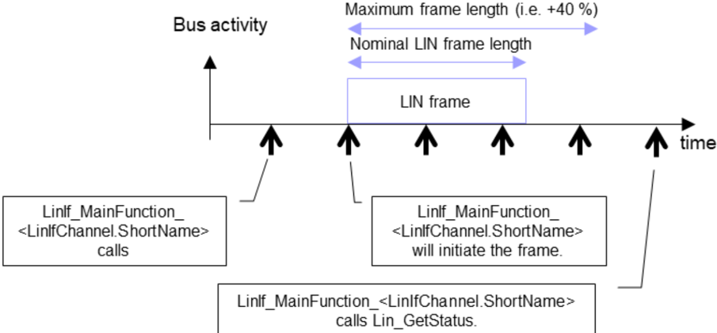

当函数 **Lin_GetStatus** 的状态返回且接收到一帧时，对不同帧类型进行如下解释：

如果全局启用了总线镜像（配置参数 **LinIfBusMirroringSupported**）且已通过对 **LIN** 通道调用 **[LinIf_EnableBusMirroring](#7321-linif_enablebusmirroring)()** 激活，则 LIN 接口应调用 **Mirror_ReportLinFrame()**。

只有当 LIN 接口确定 LIN 驱动模块的状态为 **LIN_RX_OK** 时，LIN 接口才应使用接收到的数据调用 **&lt;User_RxIndication&gt;**。

当 LIN 接口正在接收事件触发帧且 LIN 驱动模块的状态为 **LIN_RX_BUSY** 或 **LIN_RX_ERROR** 时，LIN 接口不应将该状态视为错误。

这被认为可能发生冲突，冲突的处理方式在 [6.1.1.2](#6112-事件触发帧) 小节中描述。如果没有从节点对事件触发帧报头作出应答，则以下内容适用：

当 LIN 接口已接收到事件触发帧并确定 LIN 驱动模块的状态为 **LIN_RX_NO_RESPONSE** 时，LIN 接口不应将该状态视为错误。

当 LIN 接口已确定 LIN 驱动模块的状态为 **LIN_RX_BUSY** 或 **LIN_RX_ERROR** 时，LIN 接口应将所接收的帧视为丢失。因此，LIN 接口应向默认错误跟踪器（**Default Error Tracer**）报告运行时错误码 [**LINIF_E_RESPONSE**](#6112-运行时错误)。

当 LIN 接口已确定 LIN 驱动模块的状态为 **LIN_RX_NO_RESPONSE** 时，LIN 接口应将期望的帧视为丢失。因此，LIN 接口应向默认错误跟踪器报告运行时错误码 [**LINIF_E_RESPONSE**](#6112-运行时错误)。

如果总线上存在干扰，LIN 接口可能在发送报头时遇到问题。ISO 17987 规范 [\[1\]](#ref-1) 在这种情况下的理念是不向上层报告错误。对于已发送的帧，同样的行为也适用。

#### 6.1.2.2. 从节点中的帧接收

本节仅适用于 **LIN** 从节点。

**LIN** 从节点不了解 **LIN** 主节点的调度，它仅对由 **LIN** 驱动程序通过报头指示回调函数 [**LinIf_HeaderIndication**](#742-linif_headerindication) 报告的接收到的 **LIN** 报头作出反应。

本节中的需求适用于从节点接收的所有帧类型。**MRF** 是一个例外：对其仅适用 [6.1.2.2.1](#61221-报头) 段中的报头处理，而响应处理在 [6.8](#68-诊断和节点配置) 小节和 [6.9](#69-诊断---传输协议) 小节中描述。

##### 6.1.2.2.1. 报头

如果对接收到的报头的 **PID** 进行求值且其属于某个已配置的接收帧，则在从回调 [**LinIf_HeaderIndication**](#742-linif_headerindication) 返回之前，LIN 接口应设置 **PduPtr-&gt;Cs** 和 **PduPtr-&gt;Drc**。

##### 6.1.2.2.2. 响应

每次响应接收的完成都会通知 LIN 接口。**LIN** 驱动程序通过响应指示回调函数 [**LinIf_RxIndication**](#743-linif_rxindication) 向 LIN 接口指示成功接收的响应，并通过错误指示回调函数 [**LinIf_LinErrorIndication**](#745-linif_linerrorindication) 指示未成功接收的响应。

如果调用了函数 [**LinIf_RxIndication**](#743-linif_rxindication)，则 LIN 接口应使用接收到的数据和有效载荷长度调用 **&lt;User_RxIndication&gt;**。

如果全局启用了总线镜像（配置参数 **LinIfBusMirroringSupported**）且已通过对 **LIN** 通道调用 **[LinIf_EnableBusMirroring](#7321-linif_enablebusmirroring)()** 激活，则 LIN 接口应调用 **Mirror_ReportLinFrame()**。

如果调用了函数 [**LinIf_LinErrorIndication**](#745-linif_linerrorindication)，则 LIN 接口应将响应视为丢失。因此，LIN 接口应向默认错误跟踪器报告运行时错误码 [**LINIF_E_RESPONSE**](#6112-运行时错误)。

如果所报告的错误类型为 **LIN_ERR_RESP_STOPBIT**、**LIN_ERR_RESP_CHKSUM**、**LIN_ERR_RESP_DATABIT** 或 **LIN_ERR_INC_RESP**，则 LIN 接口应设置 **response_error** 信号（参见 [6.7.1](#671-response_error-信号仅从节点) 小节）。

如果在预期响应接收指示的同时调用了 [**LinIf_HeaderIndication**](#742-linif_headerindication)，则 LIN 接口应将所接收的帧视为丢失。因此，LIN 接口应向默认错误跟踪器报告运行时错误码 [**LINIF_E_RESPONSE**](#6112-运行时错误)。

如果全局启用了总线镜像（配置参数 **LinIfBusMirroringSupported**）且已通过对 **LIN** 通道调用 **[LinIf_EnableBusMirroring](#7321-linif_enablebusmirroring)()** 激活，则 LIN 接口应调用 **Mirror_ReportLinFrame()**。

在调用 **Mirror_ReportLinFrame()** 之前，LIN 接口应将 [**LinIf_LinErrorIndication**](#745-linif_linerrorindication) 报告的错误码转换为 **Lin_StatusType** 的错误码。错误码 **LIN_ERR_RESP_STOPBIT** 应转换为 **LIN_TX_ERROR**…（源文档此处截断）。

理由：**Mirror_ReportLinFrame()** 期望一个 **Lin_StatusType** 参数。

#### 6.1.3. 主节点中的帧发送

本节仅适用于 **LIN** 主节点。

当一个新的调度条目到期时，**LIN** 帧在 **LinIf_MainFunction_&lt;[LinIfChannel](#934-linifchannel).ShortName&gt;** 中被发送。

本节中的需求适用于主节点在调度后且待发送的所有帧类型（例如，已调度的无条件帧始终待发送，已放入零星时隙且未决的零星帧…（源文档此处截断））。

##### 6.1.3.1. 报头和响应

LIN 接口应调用函数 **&lt;User_TriggerTransmit&gt;**，其 **PduInfoPtr** 指针包含数据缓冲区（**SduDataPtr**）和缓冲区长度（**SduLength**），以获取帧的数据部分（数据…（源文档此处截断））。

在获取帧的数据部分之后（当函数 **&lt;User_TriggerTransmit&gt;** 返回 **E_OK** 时），LIN 接口应调用 LIN 驱动模块的函数 **Lin_SendFrame**，为 **LIN** 驱动程序提供…（源文档此处截断）。

当函数 **&lt;User_TriggerTransmit&gt;** 返回 **E_NOT_OK** 时，LIN 接口不应发送为之请求数据的零星帧或无条件帧。

##### 6.1.3.2. 状态检查

如果全局启用了总线镜像（配置参数 **LinIfBusMirroringSupported**）且已通过对 **LIN** 通道调用 **[LinIf_EnableBusMirroring](#7321-linif_enablebusmirroring)()** 激活，则 LIN 接口应调用 **Mirror_ReportLinFrame()**。

如果函数 **Lin_GetStatus** 的返回码为 **LIN_TX_OK**，则 LIN 接口应发出带有结果 **E_OK** 的 **&lt;User_TxConfirmation&gt;** 回调。

如果函数 **Lin_GetStatus** 的返回码为 **LIN_TX_ERROR** 或 **LIN_TX_BUSY**，则 LIN 接口应发出带有结果 **E_NOT_OK** 的 **&lt;User_TxConfirmation&gt;** 回调。

如果函数 **Lin_GetStatus** 的返回码为 **LIN_TX_ERROR** 且尝试发送任何 **LIN** 帧，则 LIN 接口应将已发送的帧视为丢失，并报告运行时错误码 [**LINIF_E_RESPONSE**](#6112-运行时错误)…（源文档此处截断）。

如果恰好在发送新帧之前，函数 **Lin_GetStatus** 的返回码为 **LIN_TX_BUSY**，则 LIN 接口应将旧帧视为丢失，并报告运行时错误码 [**LINIF_E_RESPONSE**](#6112-运行时错误)…（源文档此处截断）。

如果 LIN 接口已成功发送一个零星帧，则它应重置该帧的未决标志（**pending flag**）。

注意：零星帧不应与 **PduR FIFO**（**PduRQueueDepth** &gt; 1）组合使用。

#### 6.1.4. 从节点中的帧发送

本节仅适用于 **LIN** 从节点。

**LIN** 从节点不了解调度，它仅对由 **LIN** 驱动程序通过报头指示回调函数 [**LinIf_HeaderIndication**](#742-linif_headerindication) 报告的接收到的 **LIN** 报头作出反应。

本节中的需求适用于从节点发送的所有帧类型。**SRF** 是一个例外：对其仅适用本节的相关需求（**PduPtr-&gt;Drc** 设置与确认需求），其余处理在 [6.8](#68-诊断和节点配置) 小节和 [6.9](#69-诊断---传输协议) 小节中描述。事件触发帧还有如 [6.1.1.2.2](#61122-从节点中的事件触发帧) 段所述的特殊处理。

##### 6.1.4.1. 报头

如果调用了 [**LinIf_HeaderIndication**](#742-linif_headerindication) 且对 **PID** 求值并将其确定为发送帧，则 LIN 接口应调用函数 **&lt;User_TriggerTransmit&gt;**，并将 **PduPtr-&gt;SduDataPtr** 设置…（源文档此处截断）。

如果帧类型是事件触发帧，另请参见 [6.1.1.2](#6112-事件触发帧) 小节的相关需求。

在获取帧的数据部分之后（当函数 **&lt;User_TriggerTransmit&gt;** 返回 **E_OK**、或 **SRF** 数据由节点配置处理程序或传输协议提供时），在从回调 [**LinIf_HeaderIndication**](#742-linif_headerindication) 返回之前…（源文档此处截断）。

当函数 **&lt;User_TriggerTransmit&gt;** 返回 **E_NOT_OK** 时，LIN 接口应在从回调 [**LinIf_HeaderIndication**](#742-linif_headerindication) 返回之前将 **PduPtr-&gt;Drc** 设置为 **LIN_FRAMERESPONSE_IGNORE**。

理由：避免在总线上发送无效数据。

##### 6.1.4.2. 响应

每次响应发送的完成都会通知 LIN 接口。**LIN** 驱动程序通过响应确认回调函数 [**LinIf_TxConfirmation**](#744-linif_txconfirmation) 向 LIN 接口确认成功发送的响应，并通过错误指示回调…（源文档此处截断）。

如果调用了函数 [**LinIf_TxConfirmation**](#744-linif_txconfirmation)，则 LIN 接口应发出带有结果 **E_OK** 的 **&lt;User_TxConfirmation&gt;** 回调。

如果调用了函数 [**LinIf_TxConfirmation**](#744-linif_txconfirmation) 且已发送的帧包含 **response_error** 信号，则 LIN 接口应清除 **response_error** 信号。

如果帧类型是事件触发帧或无条件帧，另请考虑 [6.1.1.2](#6112-事件触发帧) 小节的相关需求。

如果在预期响应发送确认的同时调用了 [**LinIf_HeaderIndication**](#742-linif_headerindication)，则 LIN 接口应将已发送的帧视为丢失。因此，LIN 接口应报告运行时…（源文档此处截断）。

如果全局启用了总线镜像（配置参数 **LinIfBusMirroringSupported**）且已通过对 **LIN** 通道调用 **[LinIf_EnableBusMirroring](#7321-linif_enablebusmirroring)()** 激活，则 LIN 接口应调用 **Mirror_ReportLinFrame()**。

如果调用了函数 [**LinIf_LinErrorIndication**](#745-linif_linerrorindication)，则 LIN 接口应发出带有结果 **E_NOT_OK** 的 **&lt;User_TxConfirmation&gt;** 回调。

如果调用了函数 [**LinIf_LinErrorIndication**](#745-linif_linerrorindication)，则 LIN 接口应将已发送的帧视为丢失，并向默认错误跟踪器报告运行时错误码 [**LINIF_E_RESPONSE**](#6112-运行时错误)，除非该错误…（源文档此处截断）。

如果 [**LinIf_LinErrorIndication**](#745-linif_linerrorindication) 中报告的错误类型为 **LIN_ERR_RESP_STOPBIT**、**LIN_ERR_RESP_CHKSUM** 或 **LIN_ERR_RESP_DATABIT**，则 LIN 接口应设置 **response_error** 信号（参见 [6.7.1](#671-response_error-信号仅从节点) 小节）。

关于调用 [**LinIf_LinErrorIndication**](#745-linif_linerrorindication) 时向总线镜像模块的报告，参见 [6.1.2.2.2](#61222-响应) 小节中的相关需求。

### 6.2. 从节点到从节点通信（仅主节点）

本节仅适用于 **LIN** 主节点。

帧的第三个方向是从节点到从节点（**Slave-to-slave**）通信。这是一种受支持但不推荐使用的 **LIN** 总线使用方式。它会在从节点之间产生不期望的依赖关系。

#### 6.2.1. 报头

当一个新的从节点到从节点通信的调度条目到期时，LIN 接口应调用 LIN 驱动模块的函数 **Lin_SendFrame**。

#### 6.2.2. 响应

LIN 接口不应参与从节点到从节点通信的响应发送或接收。

#### 6.2.3. 状态检查

LIN 接口不应在从节点到从节点通信响应传输之后检查 LIN 驱动模块的状态。

### 6.3. 无关通信（仅从节点）

本节仅适用于 **LIN** 从节点。

帧响应的第三个方向是无关帧（**irrelevant frame**）的响应。

如果调用了 [**LinIf_HeaderIndication**](#742-linif_headerindication) 且对 **PID** 求值并将其确定为与该从节点无关的帧，则在从回调 [**LinIf_HeaderIndication**](#742-linif_headerindication) 返回之前，LIN 接口应设置…（源文档此处截断）。

**LIN** 驱动程序不会为无关帧调用 [**LinIf_RxIndication**](#743-linif_rxindication) 或 [**LinIf_TxConfirmation**](#744-linif_txconfirmation)。

### 6.4. 调度表（仅主节点）

本节仅适用于 **LIN** 主节点。

调度表（**schedule table**）是运行中的 **LIN** 集群中所有通信的基础。由于 LIN 接口始终作为 **LIN** 主节点运行，因此它必须处理调度表。

每个通道可以有多组独立的调度表。帧开始之间的时间（延迟）是特定集群时基的倍数。

处理两个帧之间的延迟应为配置参数 **LinIfMainFunctionPeriod** 给定周期的倍数。

LIN 接口应为每个通道提供一个预定义的调度表（名为 **NULL_SCHEDULE**）。

调度表 **NULL_SCHEDULE** 应不包含任何条目。

#### 6.4.1. 调度表管理器

调度表管理器未在 ISO 17987 规范 [\[1\]](#ref-1) 中定义。

调度表管理器处理调度表，因此指示帧发送和接收何时发生。

LIN 接口的调度表管理器支持两种类型的调度表：**RUN_CONTINUOUS** 和 **RUN_ONCE**。

支持两种类型调度表的思路是：存在一组定义为 **RUN_CONTINUOUS** 的「常规」调度表，在正常通信中执行。**RUN_ONCE** 调度表用于来自 **LIN** 集群外部的特定请求，例如：

* 启动诊断会话
* 进行 ISO 17987 节点配置
* 轮询事件触发帧或零星帧

执行调度表切换的时间点取决于可选的配置参数 **LinIfScheduleChangeNextTimeBase**。如果 **LinIfScheduleChangeNextTimeBase** 被禁用或不存在，则调度…（源文档此处截断）。

注意：可以进行调度表切换的条件由 [6.4.1](#641-调度表管理器) 小节中的相关需求给出…（译者注：源文档此处以需求编号列表列举切换条件，编号已按规范卫生规则移除）。

**NULL_SCHEDULE** 需要特殊处理。因为应当可以在任何时刻设置该调度表。

如果 LIN 接口的环境正在请求 **NULL_SCHEDULE**（或在初始化或睡眠的情况下被设置），则 LIN 接口的调度表管理器应在下一个可能的时刻切换到 **NULL_SCHEDULE**（即使当前的是 **RUN_ONCE**）。

LIN 接口允许将当前调度表更改为另一个调度表或同一调度表的开头。函数 [**LinIf_ScheduleRequest**](#734-linif_schedulerequest) 将选择要执行的调度表。到新调度表的实际切换…（源文档此处截断）。

如果当前调度是 **RUN_CONTINUOUS**，则 LIN 接口应在下一个可能的时刻（例如在帧时隙的开始处）启动新请求的调度表。

注意：可以再次请求相同的调度表。在这种情况下，该表将重新启动。

LIN 接口应从第一个条目到最后一个条目执行 **RUN_ONCE** 类型的调度表，然后再切换到新的调度表。但是，如果在事件触发帧的响应中发生冲突…（源文档此处截断）。

如果已执行到所请求调度表的切换，则调度表管理器应调用函数 **&lt;User&gt;_ScheduleRequestConfirmation**。

对于零星帧，调度表切换意味着这些帧的状态不受影响。

当调度表被更改时，不应清除零星帧的状态。

如果在 **RUN_ONCE** 调度表之后没有更多的调度请求需要服务，则 LIN 接口应执行最新请求的 **RUN_CONTINUOUS** 类型的调度表。

**RUN_CONTINUOUS** 调度表被 **RUN_ONCE** 类型的表中断后应从何处继续执行，应可通过配置参数 **Lin…**（源文档此处截断）进行配置。

注意：由于函数 [**LinIf_Init**](#731-linif_init) 会设置 **NULL_SCHEDULE**，这意味着始终存在一个最新请求的调度表。

### 6.5. 主函数

**LinIf_MainFunction_&lt;[LinIfChannel](#934-linifchannel).ShortName&gt;** 是 LIN 接口中的中央处理函数。它必须被周期性地调用。

对于 **LIN** 主节点，函数 **LinIf_MainFunction_&lt;[LinIfChannel](#934-linifchannel).ShortName&gt;** 的任务是轮询调度表管理器、发起帧的发送和接收，并与上层和下层交互。

对于 **LIN** 从节点，函数 **LinIf_MainFunction_&lt;[LinIfChannel](#934-linifchannel).ShortName&gt;** 的任务是监督不同的时序。由实现者决定帧处理以及与上层和下层的交互是在该主函数中处理还是在…（源文档此处截断）。

**SchM** 将以配置参数 **LinIfMainFunctionPeriod** 给定的周期调用函数 **LinIf_MainFunction_&lt;[LinIfChannel](#934-linifchannel).ShortName&gt;**。

### 6.6. 网络管理

本节中描述的网络管理基于 ISO 17987 网络管理 [\[5\]](#ref-5)，不应与 **AUTOSAR** 网络管理混淆。

除了唤醒请求和 **go-to-sleep** 命令之外，网络管理还扩展了节点管理（**node management**）。节点管理比 ISO 17987 规范更精确地描述了节点如何运行。

#### 6.6.1. 节点管理

LIN 接口应作为一个状态机运行。连接到 LIN 接口的每个物理通道都在一个子状态机中运行。

##### 6.6.1.1. LIN 接口状态机

LIN 接口应有一个状态机。该状态机如图7.2（主节点）和图7.3（从节点）所示。

LIN 接口状态机应具有状态 **LINIF_UNINIT**。

LIN 接口状态机应具有状态 **LINIF_INIT**。

当 LIN 接口的环境已调用函数 [**LinIf_Init**](#731-linif_init) 时，LIN 接口状态机应从 **LINIF_UNINIT** 迁移到 **LINIF_INIT**。

##### 6.6.1.2. LIN 通道子状态机

状态 **LINIF_INIT** 的子状态机如图7.2（主节点）和图7.3（从节点）所示。

每个 **LIN** 通道应有一个独立的通道状态机。

LIN 通道子状态机应具有状态 **LINIF_CHANNEL_OPERATIONAL**。

注意：在 **LIN** 通道状态 **LINIF_CHANNEL_OPERATIONAL** 下，相应的 **LIN** 通道应已初始化并正常运行。

只有当相应的 **LIN** 通道处于状态 **LINIF_CHANNEL_OPERATIONAL** 时，LIN 接口才应接收/发送 **LIN** 帧报头和响应。

在状态 **LINIF_CHANNEL_OPERATIONAL** 下，LIN 接口应在函数 **LinIf_MainFunction_&lt;[LinIfChannel](#934-linifchannel).ShortName&gt;** 内处理当前选定的调度表。此需求仅适…（源文档此处截断）。

当调用函数 [**LinIf_Init**](#731-linif_init) 时，LIN 接口应从 **LINIF_UNINIT** 迁移到 **LINIF_CHANNEL_SLEEP**，而不发送 **go-to-sleep** 命令。

注意：假定外部从节点在总线不活动 4 秒后最早、10 秒内最迟自动进入总线睡眠模式（如 ISO 17987 规范所规定，参见 ISO 17987-2 [\[5\]](#ref-5) 第 5.4 条）。**AUTOSAR** 从节点初始化…（源文档此处截断）。

LIN 通道子状态机应具有状态 **LINIF_CHANNEL_SLEEP**。

当通过有效调用 [**LinIf_Wakeup**](#736-linif_wakeup) 为相应通道发起唤醒过程时，LIN 接口应从通道状态 **LINIF_CHANNEL_SLEEP** 迁移到 **LINIF_CHANNEL_OPERATIONAL**。

注意：在进入或退出 **LIN** 通道状态 **LINIF_CHANNEL_SLEEP** 时，LIN 接口不应将硬件接口或微控制器设置为新的电源模式。

当通道处于 **LIN** 通道状态 **LINIF_CHANNEL_SLEEP** 时，函数 **LinIf_MainFunction_&lt;[LinIfChannel](#934-linifchannel).ShortName&gt;** 不应为相应的 **LIN** 通道在总线上发起任何通信。

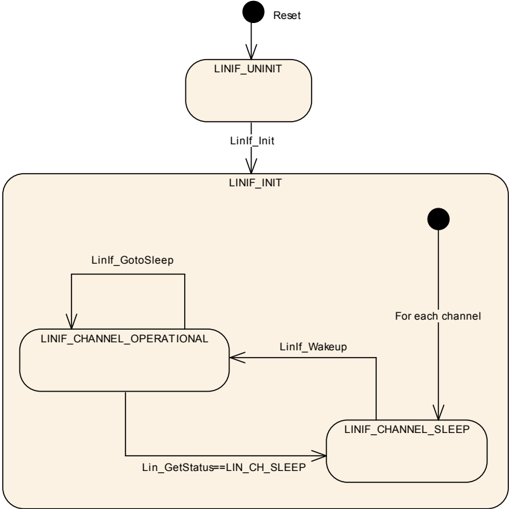

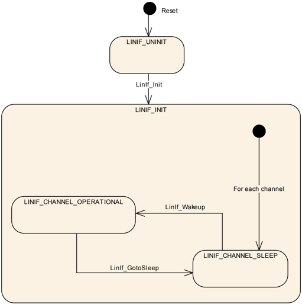

#### 6.6.2. Go to sleep 过程

进入睡眠模式的过程在主节点和从节点之间存在显著差异。

**LIN** 主节点在上层请求时发送 **go-to-sleep** 命令，以将总线上的所有从节点设置为睡眠模式。

**LIN** 从节点通过接收 **go-to-sleep** 命令或检测到总线不活动而进入睡眠模式。

##### 6.6.2.1. 主节点中的 Go to sleep 过程

本节仅适用于 **LIN** 主节点。

函数 [**LinIf_GotoSleep**](#735-linif_gotosleep) 在选定通道/控制器上发起向睡眠模式的迁移。该迁移通过发送一个第一个数据字节等于 0（零）的 **LIN** 诊断主请求帧来执行。这被称为 **go-to-sleep** 命令…（源文档此处截断）。

在处理 **go-to-sleep** 命令且通道不处于状态 **LINIF_CHANNEL_SLEEP** 时，函数 **LinIf_MainFunction_&lt;[LinIfChannel](#934-linifchannel).ShortName&gt;** 应改为调用函数 **Lin_GoToSleep**…（源文档此处截断）。

在处理 **go-to-sleep** 命令且通道处于状态 **LINIF_CHANNEL_SLEEP** 时，函数 **LinIf_MainFunction_&lt;[LinIfChannel](#934-linifchannel).ShortName&gt;** 应在…（源文档此处截断）调用函数 **Lin_GoToSleepInternal**。

理由：这将防止由于发送 **go-to-sleep** 命令而导致所连接的 **LIN** 从节点唤醒。

这意味着函数 **LinIf_MainFunction_&lt;[LinIfChannel](#934-linifchannel).ShortName&gt;** 可以在前一帧结束到下一个调度条目到期之间的时间间隔内调用函数 **Lin_GoToSleep**。这由实现者决定…（源文档此处截断）。

当函数 **Lin_GoToSleep** 或 **Lin_GoToSleepInternal** 被调用时，函数 **LinIf_MainFunction_&lt;[LinIfChannel](#934-linifchannel).ShortName&gt;** 应清除选定通道的唤醒标志（参见 [6.6.3](#663-唤醒过程) 小节的相关需求）。

在处理 **go-to-sleep** 命令时，函数 **LinIf_MainFunction_&lt;[LinIfChannel](#934-linifchannel).ShortName&gt;** 应在睡眠模式帧的延迟之后调用 LIN 驱动模块的函数 **Lin_GetStatus**…（源文档此处截断）。

在处理 **go-to-sleep** 命令时，函数 **LinIf_MainFunction_&lt;[LinIfChannel](#934-linifchannel).ShortName&gt;** 应在睡眠模式帧的延迟之后调用 LIN 驱动模块的函数 **Lin_GetStatus**…（源文档此处截断）。

当 **go-to-sleep** 命令发送成功或函数 **Lin_GoToSleepInternal** 被调用时，LIN 接口应以参数 **TRUE** 调用函数 **&lt;User&gt;_GotoSleepConfirmation**。

当 **go-to-sleep** 命令发送不成功时，LIN 接口应以参数 **FALSE** 调用函数 **&lt;User&gt;_GotoSleepConfirmation**。

在 **go-to-sleep** 命令处理过程中进入 **LINIF_CHANNEL_SLEEP** 状态时，函数 **LinIf_MainFunction_&lt;[LinIfChannel](#934-linifchannel).ShortName&gt;** 应将当前使用的调度表切换为 **NULL_S…**（源文档此处截断）。

##### 6.6.2.2. 从节点中的 Go to sleep 过程

本节仅适用于 **LIN** 从节点。

从节点中有两个不同的事件会发起向睡眠模式的迁移：接收到 **go-to-sleep** 命令和发生总线空闲超时。

###### 6.6.2.2.1. 接收 go-to-sleep 命令

如果调用了函数 [**LinIf_RxIndication**](#743-linif_rxindication) 且接收到的帧是第一个数据字节（**NAD**）等于 0 的 **MRF**，则已接收到 **go-to-sleep** 命令，应执行向睡眠模式的迁移…（源文档此处截断）。

###### 6.6.2.2.2. 总线空闲

LIN 接口应为每个通道提供总线空闲超时观察（配置参数 **LinIfBusIdleTimeoutPeriod**），以检测由总线不活动引起的睡眠模式迁移事件。

LIN 接口应在进入状态 **LINIF_CHANNEL_OPERATIONAL** 时启动总线空闲超时观察。

LIN 接口应在进入状态 **LINIF_CHANNEL_SLEEP** 时停止总线空闲超时观察。

每次调用带有任何错误码的 [**LinIf_HeaderIndication**](#742-linif_headerindication)、[**LinIf_RxIndication**](#743-linif_rxindication)、[**LinIf_TxConfirmation**](#744-linif_txconfirmation) 或 [**LinIf_LinErrorIndication**](#745-linif_linerrorindication) 时，LIN 接口都应重新加载正在运行的总线空闲定时器。

如果发生总线空闲超时，应执行睡眠模式迁移。

###### 6.6.2.2.3. 睡眠模式迁移

在接收到 **go-to-sleep** 命令或发生总线空闲超时的情况下，LIN 接口应调用函数 **&lt;User&gt;_GotoSleepIndication**。

当函数 [**LinIf_GotoSleep**](#735-linif_gotosleep) 被调用时，LIN 接口应直接调用函数 **Lin_GoToSleepInternal**（而不是等待下一次主函数调用）。

理由：**LIN** 驱动程序必须处于 **LIN_CH_SLEEP** 状态才能在总线上接收唤醒帧。

注意：[**LinIf_GotoSleep**](#735-linif_gotosleep) 可能在 **&lt;User&gt;_GotoSleepIndication** 的上下文中被调用。

在调用函数 **Lin_GoToSleepInternal** 之后，LIN 接口应清除选定通道的唤醒标志（参见 [6.6.3](#663-唤醒过程) 小节的相关需求）。

在调用函数 **Lin_GoToSleepInternal** 之后，LIN 接口应以参数 **TRUE** 调用函数 **&lt;User&gt;_GotoSleepConfirmation**。

#### 6.6.3. 唤醒过程

唤醒 **LIN** 通道有多种可能的方式：上层通过 [**LinIf_Wakeup**](#736-linif_wakeup) 调用请求唤醒，或者检测到总线唤醒。如果检测到总线唤醒，当上层进入…（源文档此处截断）时也会调用 [**LinIf_Wakeup**](#736-linif_wakeup)。

##### 6.6.3.1. 主节点中的唤醒过程

本节仅适用于 **LIN** 主节点。

当函数 [**LinIf_Wakeup**](#736-linif_wakeup) 的返回码为 **E_OK** 时，LIN 接口应以参数 **TRUE** 发出函数 **&lt;User&gt;_WakeupConfirmation**。

当函数 [**LinIf_Wakeup**](#736-linif_wakeup) 的返回码为 **E_NOT_OK** 时，LIN 接口应以参数 **FALSE** 发出函数 **&lt;User&gt;_WakeupConfirmation**。

###### 6.6.3.1.1. 主节点中睡眠迁移期间的唤醒

可能发生这样的情况：上层在已请求发送 **go-to-sleep** 命令且该命令尚未决时（从 **go-to-sleep** 请求到该帧的状态检查）请求唤醒。在这种情况下，以下…（源文档此处截断）。

如果请求了 **go-to-sleep** 命令且上层在 **go-to-sleep** 命令执行之前请求唤醒，则 LIN 接口既不应发送未决的 **go-to-sleep** 命令，也不应在总…（源文档此处截断）。

当 LIN 接口在向睡眠迁移期间使用 LIN 驱动模块的函数 **Lin_GetStatus** 检查了 **go-to-sleep** 命令，且该函数的返回码为 **LIN_CH_SLEEP** 时…（源文档此处截断）。

在上述情况下，LIN 接口不应调用函数 **&lt;User&gt;_GotoSleepConfirmation**。

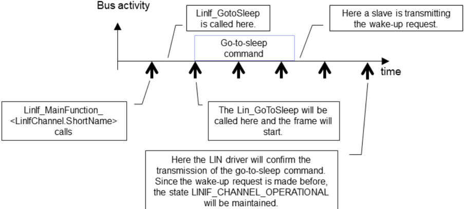

##### 6.6.3.2. 从节点中的唤醒过程

本节仅适用于 **LIN** 从节点。

如果上层在没有先前的总线唤醒的情况下请求唤醒，则唤醒过程通过发送唤醒帧开始，并在主节点开始调度时（即接收到第一个 **LIN** 报头时）完成。

当在 [**LinIf_Wakeup**](#736-linif_wakeup) 以返回码 **E_OK** 被调用之后第一次调用函数 [**LinIf_HeaderIndication**](#742-linif_headerindication) 时，LIN 接口应以参数…（源文档此处截断）发出函数 **&lt;User&gt;_WakeupConfirmation**。

在函数 [**LinIf_Wakeup**](#736-linif_wakeup) 返回码 **E_NOT_OK** 之前，LIN 接口应以参数 **FALSE** 调用函数 **&lt;User&gt;_WakeupConfirmation**。

注意：当 [**LinIf_Wakeup**](#736-linif_wakeup) 返回 **E_OK** 但 **LIN** 主节点随后未开始调度 **LIN** 报头时，总线未被成功唤醒。在这种情况下，不会调用 **&lt;User&gt;_WakeupConfirmation**，从而导致 **LIN** 状态管…（源文档此处截断）中的超时。

###### 6.6.3.2.1. 从节点中睡眠迁移期间的唤醒

本节仅适用于 **LIN** 从节点。

可能发生这样的情况：上层在睡眠模式迁移期间（在 **Lin_GoToSleepInternal** 被调用之后、在进入睡眠模式且函数 **&lt;User&gt;_GotoSleepConfirmation** 被调用之前）请求唤醒。在这种情况下，以下…（源文档此处截断）。

当 LIN 接口已开始睡眠模式迁移且上层在睡眠模式迁移完成之前请求唤醒时，LIN 接口不应调用函数 **&lt;User&gt;_Go…**（源文档此处截断）。

### 6.7. 状态管理

LIN 接口必须能够以与 ISO 17987 规范描述的相同方式报告总线上的通信错误。然而，报告方式有所不同。

在自身节点内部存在一种报告（通过使用 ISO 17987-5 规范 [\[20\]](#ref-20) 中定义的 **API** 调用 **l_ifc_read_status**），它设置 **Error_in_response**（不要与从节点信号 **response_error** 混淆）和 **Success…**（源文档此处截断）。

**Error_in_response** 的设置条件在 LIN 接口中以与 ISO 17987 规范中描述相同的方式设置，但报告方式不同。**Error_in_response** 的处理方式在 [6.1.2.1.3](#61213-状态检查) 小节和 [6.1.3.2](#6132-状态检查) 小节（主节点）以及 [6.1.2.2.2](#61222-响应) 小节和 [6.1.4.2](#6142-响应) 小节（从节点）中描述。

#### 6.7.1. response_error 信号（仅从节点）

本节仅适用于 **LIN** 从节点。

**response_error** 信号是一个单比特标量信号，由每个从节点在其发送的一个无条件帧中向主节点发布。它用于向 **LIN** 集群报告通信状态。

LIN 接口应在每个从节点通道上提供 **response_error** 信号的自主处理。

注意：配置需确保 **LinIf** 是唯一对 **response_error** 信号具有写访问权限的使用者。

LIN 接口应调用函数 **Com_SendSignal** 来更新 **response_error** 信号的值。

设置 **response_error** 信号的条件在 [6.1.2.2.2](#61222-响应) 小节和 [6.1.4.2](#6142-响应) 小节的相关需求中定义。

清除 **response_error** 信号的条件在 [6.1.4.2](#6142-响应) 小节的相关需求中定义。

每当 **response_error** 信号值发生变化时，LIN 接口应以 **response_error** 信号的当前值调用函数 **&lt;User_ResponseErrorSignalChanged&gt;**。

函数 **&lt;User_ResponseErrorSignalChanged&gt;** 的支持是可选的，并在编译前通过配置参数 **LinIfResponseErrorSignalChangedCallout** 启用。

### 6.8. 诊断和节点配置

注意，此处的节点配置是指 ISO 17987 规范 [\[6\]](#ref-6) 中描述的配置，与 **AUTOSAR** 配置无关。

ISO 17987-3 规范中的节点配置是关于配置从节点使其能够在 **LIN** 集群中运行，并使 **LIN** 集群（就所配置的 **NAD** 和帧 ID 而言）免于冲突。

ISO 17987 规范中的诊断传输层和节点配置共享 **MRF** 和 **SRF**。在主节点中这不会成为冲突，因为节点配置使用固定的帧类型。对于从节点，接收到的 **MRF** 和…（源文档此处截断）。

#### 6.8.1. 主节点中的节点配置

本节仅适用于 **LIN** 主节点。

ISO 17987 规范为 **LIN** 主节点指定了两种配置从节点的方式：

* 通过使用 ISO 17987 **API** 并直接在调度表中使用服务。
* 通过使用定义的节点配置 **API**。

这里的思路是将节点配置服务存储在配置中。因此，仅使用调度表方式。

LIN 接口应仅通过直接在调度表中使用服务来进行节点配置（在 ISO 17987 规范中定义）。

##### 6.8.1.1. 节点配置服务

LIN 接口按照 ISO 17987 规范的规定提供节点配置服务。节点配置机制使用与 **LIN TP** 相同的 **LIN** 帧结构。节点配置仅使用单帧（**SF**）进行传输…（源文档此处截断）。

LIN 接口应支持节点配置请求「**Assign Frame ID**」（在 **LIN** 2.0 规范中定义）、「**Assign Frame ID range**」（在 ISO 17987 规范中定义）、「**Unassign Frame ID**」（在…（源文档此处截断）中定义）…（源文档此处截断）。

LIN 接口应支持 **FreeFormat**（在 ISO 17987 规范中定义）。

**FreeFormat** 的响应未在 ISO 17987 规范中定义。因此，无法处理来自从节点的响应。

节点配置请求「**Assign NAD**」（在 ISO 17987-3 规范中定义）的支持应可通过配置参数 **LinIfNcOptionalRequestSupport** 在编译前进行开/关配置。

注意：LIN 接口不支持节点配置请求 **DataDump**，因为 ISO 17987 规范声明 **DataDump** 请求不应用于运行中的集群。

##### 6.8.1.2. 调度表中的节点配置

ISO 17987 规范允许在调度表中进行节点配置。这将应用程序与该功能解耦。因此，可以将该功能存储在配置中。

ISO 17987 规范定义了许多固定的 **MRF**。

LIN 接口应在不与上层交互的情况下处理固定的 **MRF** 条目。

当固定 **MRF** 的发送失败时，LIN 接口不应发送 **SRF** 报头。

可以在节点配置命令之后将一个 **SRF** 放入调度表中。从节点可以按照 ISO 17987 规范的定义应答节点配置命令。

如果 LIN 接口已在节点配置命令之后将一个 **SRF** 放入调度表，且从节点的应答为肯定，则 LIN 接口不应采取任何行动。

根据 ISO 17987 规范，节点配置请求的来自从节点的响应不是可选的。但是，如果 **SRF** 报头被调度在节点配置请求之后，则认为预期会有响应。因此…（源文档此处截断）。

如果 LIN 接口已在节点配置命令之后将一个 **SRF** 放入调度表且没有响应…（源文档此处截断），则 LIN 接口应向默认错误跟踪器报告运行时错误码 [**LINIF_E_NC_NO_RESPONSE**](#6112-运行时错误)。

注意：如果有任何从节点响应（无论其内容如何，例如 **RSID**），LIN 接口将不会报告运行时错误码 [**LINIF_E_NC_NO_RESPONSE**](#6112-运行时错误)。

注意，ISO 17987 规范中没有为节点配置请求定义否定应答。只有 **Read-by-Identifier** 函数支持否定应答。由于 LIN 接口不支持该函数，因此不存在否…（源文档此处截断）。

#### 6.8.2. 从节点中的节点配置

本节仅适用于 **LIN** 从节点。

##### 6.8.2.1. 节点模型

LIN 接口使用 ISO 17987-3 规范中定义的节点模型（**Node Model**），该模型描述了从节点的配置存储位置。

LIN 接口管理从节点当前配置的 **NAD** 和 **PID**。

从节点在复位后应具有有效的配置，以便能够被节点配置服务寻址并能够处理相关帧（**relevant frame**）。

LIN 接口应在函数 [**LinIf_Init**](#731-linif_init) 中从配置数据（配置参数 **LinIfInitialNAD** 和 **LinIfConfiguredNAD**）初始化从节点的初始 **NAD** 和已配置 **NAD**。

注意：初始 **NAD** 是静态配置的，即在运行时不会改变，用于「**Assign NAD**」请求。已配置 **NAD** 在初始化后可能会改变，或者通过「**Assign NAD**」请求、或者由上层改变，用于节点…（源文档此处截断）。

LIN 接口应在函数 [**LinIf_Init**](#731-linif_init) 中从配置数据（配置参数 **LinIfFrameId**）初始化从节点的已配置 **PID**。

注意：节点的当前配置可以由上层使用 [**LinIf_SetConfiguredNAD**](#7314-linif_setconfigurednad) 和 [**LinIf_SetPIDTable**](#7312-linif_setpidtable) 更新（例如使用从非易失性存储器加载的数据），或者由 **LIN** 主节点使用节点配置命令更新。

LIN 接口应提供 **LIN** 产品标识（如 ISO 17987-3 规范所述），其由供应商 **ID**、功能 **ID** 和变体 **ID** 组成（配置参数 **LinIfSupplierId**、**Li…**（源文档此处截断））。

##### 6.8.2.2. 节点配置服务

LIN 接口按照 ISO 17987-3 规范的规定提供节点配置服务。节点配置机制使用与 **LIN TP** 相同的 **LIN** 帧结构。节点配置仅使用单帧（**SF**）进行传输…（源文档此处截断）。

LIN 接口应支持「**Assign NAD**」（**SID** 0xB0，在 ISO 17987-3 规范中定义）。该支持是可选的，并可通过配置参数 **LinIfNcOptio…**（源文档此处截断）在编译前进行开/关配置。

LIN 接口应支持「**Assign Frame ID range**」（**SID** 0xB7，在 ISO 17987-3 规范中定义）。

LIN 接口应支持「**Save Configuration**」（**SID** 0xB6，在 ISO 17987-3 规范中定义）。该支持是可选的，并在编译前通过配置参数 **LinIfSaveConf…**（源文档此处截断）启用。

LIN 接口应支持标识符为 0（**LIN** 产品标识）的「**Read by Identifier**」（**SID** 0xB2，在 ISO 17987-3 规范中定义）。

LIN 接口应支持标识符为 2（位时序测试，**Bit timing test**）的「**Read by Identifier**」（**SID** 0xB2，在 ISO 17987-3 规范中定义）。

注意：**LIN** 接口不直接支持的节点配置服务将通过传输层转发给上层，并可以由集成代码实现。

##### 6.8.2.3. 诊断帧分发器

诊断通信帧（**MRF** 和 **SRF**）由 LIN 接口中的两个诊断使用者共享：

* 节点配置处理程序（**Node Configuration Handler**）
* 传输层（**Transport Layer**）

使用一种优先级机制将接收到的诊断通信帧分发给正确的诊断使用者，其中节点配置的处理优先级高于传输协议。

LIN 接口首先将每个 **MRF** 分发给节点配置处理程序，然后分发给传输协议。注意，ISO 17987-2 第 7.6.4 条（**N_PDU** 的意外到达）适用于两个诊断使用者。

类似地，每个接收到的 **SRF** 报头首先被传递给节点配置处理程序以发送一个未决的响应。如果没有节点配置响应等待发送，则 **SRF** 被转发给传输层。

LIN 接口应对接收到的 **MRF** 的 **NAD**、**PCI** 和 **SID** 进行求值。

如果接收到的 **MRF** 包含寻址自身从节点的有效节点配置请求，则 LIN 接口应接受该节点配置请求，并将该请求通知传输层。

如果接收到的 **MRF** 不包含节点配置请求但寻址自身从节点，则 LIN 接口应将 **MRF** 转发给传输层。

如果接收到的 **MRF** 不寻址自身从节点，则 LIN 接口应将此情况通知节点配置处理程序和传输层。

理由：如果检测到寻址另一个从节点的请求，则任何未决的请求都必须被中止。当然，该请求不会由任何一个诊断使用者处理。

如果接收到 **SRF** 的报头且节点配置命令的响应等待发送，则 **SRF** 的响应应由节点配置处理程序发送。

如果接收到 **SRF** 的报头且没有节点配置命令响应等待发送，则 **SRF** 报头应被转发给传输层。

如果调用了函数 [**LinIf_LinErrorIndication**](#745-linif_linerrorindication) 且预期有 **MRF** 或 **SRF** 响应，则 LIN 接口应将检测到的通信错误通知节点配置处理程序和传输层…（源文档此处截断）。

##### 6.8.2.4. 节点配置处理程序

节点配置处理程序实现评估、处理和响应 LIN 接口所支持的节点配置请求的功能。

「有效节点配置请求」是一个 **NAD** 寻址该从节点（对于「**Assign NAD**」请求为初始或广播/通配 **NAD**，对于其他受支持服务为已配置或广播/通配 **NAD**）、**PCI** 符合 ISO 17987-3 规…（源文档此处截断）的 **MRF**。

LIN 接口应支持节点配置请求中的功能 **ID**、供应商 **ID** 和 **NAD** 的通配符（**wildcard**）（如 ISO 17987-3 规范所定义）。

如果需要为节点配置请求发送肯定响应，LIN 接口应将该响应发送给下一个被调度的 **SRF** 报头。

如果接收到有效的「**Assign NAD**」请求，LIN 接口应以请求的新 **NAD** 更新其已配置 **NAD** 值，并在 **SRF** 报头被…（源文档此处截断）时提供肯定响应。

如果接收到有效的「**Assign Frame ID range**」请求，LIN 接口应以请求的 **PID**（如 ISO 17987-3 规范所定义）更新其 **PID** 配置，并提供肯定响应…（源文档此处截断）。

不得更改标识符为 0x3C 和 0x3D 的帧（**MRF** 和 **SRF**）的 **PID**。

如果接收到有效的「**Save Configuration**」请求，LIN 接口应调用函数 **&lt;User_SaveConfigurationRequest&gt;**。根据此回调函数的返回值，发送肯定响…（源文档此处截断）。

如果接收到标识符为 0 的有效「**Read by Identifier**」请求，LIN 接口应提供要为下一个接收到的 **SRF** 报头发送的肯定响应（如 ISO 17987-3 规范所…（源文档此处截断）。

如果接收到标识符为 2 的有效「**Read by Identifier**」请求，LIN 接口应提供要为下一个接收到的 **SRF** 报头发送的否定响应（如 ISO 17987-3 规范所…（源文档此处截断））。

###### 6.8.2.4.1. 节点配置错误

LIN 接口应为节点配置提供 **N_As** 超时观察（配置参数 **LinIfNasTimeout**），以便在没有接收到 **SRF** 报头时中止未决的响应。

LIN 接口应在接收到有效的节点配置请求之后启动 **N_As** 定时器，并在未决的节点配置响应已成功发送时停止该定时器。

如果发生 **N_As** 超时，LIN 接口应中止未决的节点配置响应。

如果接收到具有未知 **NAD** 的 **MRF**，则 LIN 接口应拒绝该请求并中止未决的节点配置响应。

如果接收到带有功能 **NAD**（0x7E）的节点配置请求，则 LIN 接口应忽略该请求。

如果在节点配置响应未决时接收到带有功能 **NAD**（0x7E）的 **MRF**，则 LIN 接口应忽略该请求。

如果在节点配置响应未决时接收到有效的节点配置请求，则 LIN 接口应中止该节点配置响应并接受新请求。

如果接收到带有无效或未知 **PCI** 类型的节点配置请求，则 LIN 接口应忽略该 **LIN** 帧。

如果节点配置响应未决且接收到新的 **MRF** 并带有响应错误（由 [**LinIf_LinErrorIndication**](#745-linif_linerrorindication) 指示），则 LIN 接口应保留未决的节点配置响应。

### 6.9. 诊断 - 传输协议

在 ISO 17987 规范中，传输协议（**TP**）的实现是可选的。定义了三种类型的诊断：

* 基于信号的诊断（**Signal Based diagnostics**）
* 用户自定义诊断（**User Defined diagnostics**）
* 诊断传输层（**Diagnostic Transport Layer**）

在 LIN 接口中仅支持诊断传输层是相关的（这就是所谓的 **LIN TP**）。基于信号的诊断没有意义，因为此处未定义信号。用户自定义诊断不应被…（源文档此处截断）。

LIN 接口应支持诊断传输层（在 ISO 17987 规范中定义），但不支持其中包含的诊断 **API**，该层代表 **LIN TP**。

**LIN TP** 的支持应可配置开/关，以便在不使用 **LIN TP** 时使 LIN 接口更小。

**LIN TP** 的支持应可通过配置参数 **LinIfTpSupported** 在编译前进行配置。

LIN 接口可能有多个通道（连接到多个 **LIN** 集群）。

LIN 接口应在每个独立通道上支持 **LIN TP** 报文的传输，且它们应彼此独立。

调度表的设计者必须包含主请求帧和从响应帧。否则，**LIN TP** 传输将停滞。

**LIN TP** 用于传输诊断服务请求和响应。功能诊断请求可以与物理请求或响应并行进行。

LIN 接口应在一个通道上同时支持物理（仅半双工）和功能 **TP** 连接，而一次只能有一个物理 **TP** 连接处于活动状态。

#### 6.9.1. 主节点中的调度请求

本节仅适用于 **LIN** 主节点。

如果配置参数 **LinTpScheduleChangeDiag** 为 **TRUE**，则通过调用函数 **BswM_LinTp_RequestMode** 完成到诊断调度或应用调度的调度表更改。

当函数 [**LinTp_Transmit**](#7316-lintp_transmit) 请求发送物理或功能请求时，LIN 接口应通过调用函数 **BswM_LinTp_RequestMode**（参数为…（源文档此处截断））请求将调度表更改为诊断请求调度。

注意：对于功能请求的发送，**P2** 定时器不会重新启动。

当物理请求的发送完成时，LIN 接口应通过调用函数 **BswM_LinTp_RequestMode**（参数为…（源文档此处截断））请求将调度表更改为诊断响应调度。

当物理响应的发送完成时，LIN 接口应通过调用函数 **BswM_LinTp_RequestMode**（参数为 **LINIF_TP_SCHEDULE_APPLICATIVE**…（源文档此处截断））请求将调度表更改为应用调度。

当功能请求的发送完成时，LIN 接口应通过调用函数 **BswM_LinTp_RequestMode**（参数为…（源文档此处截断））请求将调度表更改回之前的调度（应用调度、诊断请求调度或诊断响应调度）。

这确保了被中断的物理 **TP** 报文的发送或接收在此之后得以继续。

如果当 LIN 接口正在等待物理响应或正在接收物理响应时，函数 [**LinTp_Transmit**](#7316-lintp_transmit) 触发了对另一个物理请求的发送，则 LIN 接口应终止…（源文档此处截断）。

#### 6.9.2. 状态机

下图7.5展示了 **LIN TP** 的状态机。

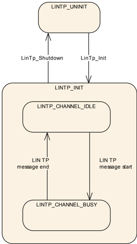

LIN 接口的每个通道应有一个 **LIN TP** 状态机实例，该实例被称为 **LIN TP** 通道状态机。

**LIN TP** 状态机应具有状态 **LINTP_UNINIT**。

复位后，LIN 接口应为所有相应通道将 **LIN TP** 状态设置为 **LINTP_UNINIT**。

**LIN TP** 状态机应具有状态 **LINTP_INIT**。

**LIN TP** 状态机应为每个通道具有状态 **LINTP_INIT** 的子状态机，它们分别跟踪通道的状态。

状态 **LINTP_INIT** 的子状态机应具有状态 **LINTP_CHANNEL_IDLE**。

当 **LIN TP** 状态机被设置为状态 **LINTP_INIT** 时，LIN 接口应将通道的子状态设置为 **LINTP_CHANNEL_IDLE**。

仅当通道处于子状态 **LINTP_CHANNEL_IDLE** 时，LIN 接口才应发起 **TP** 报文的发送。

状态 **LINTP_INIT** 的子状态机应具有状态 **LINTP_CHANNEL_BUSY**。

当 LIN 接口在通道上接收到 **FF** 或 **SF** 且已将其检测为 **TP** 报文（即与配置…（源文档此处截断）不冲突）时，它应将通道的子状态设置为 **LINTP_CHANNEL_BUSY**。

当 LIN 接口已成功终止 **LIN TP** 报文的发送或接收时，它应将通道的子状态设置为 **LINTP_CHANNEL_IDLE**。

当 LIN 接口已检测到该通道上不可恢复的错误时，它应将通道的子状态设置为 **LINTP_CHANNEL_IDLE**。

#### 6.9.3. LIN TP 发送

由于所有帧都必须遵循调度表，**LIN TP** 报文也必须如此。所有 **LIN TP** 报文都使用 **MRF** 和 **SRF** 进行传输。

**LIN** 主节点使用 **MRF** 发送诊断数据，而 **LIN** 从节点使用 **SRF** 的 **LIN** 响应发送诊断数据。

在来自上层的发送请求之后，LIN 接口应为每个…（源文档此处截断）调用函数 **PduR_LinTpCopyTxData**，其 info 指针包含数据缓冲区（**SduDataPtr**）和数据长度（**SduLength**）。

数据长度对于 **FF** 为 5 字节（包括 **SID**），对于 **SF** 最多 6 字节，对于 **CF** 为 6 字节（最后一个 **CF** 的情况下可以更少）。

上层将发送数据复制到 **info** 中。

如果函数 **PduR_LinTpCopyTxData** 返回 **BUFREQ_E_BUSY**，**LIN** 主节点不应发送下一个 **MRF**，**LIN** 从节点不应向下一个 **SRF** 报头发送响应。

如果函数 **PduR_LinTpCopyTxData** 返回 **BUFREQ_E_BUSY**，LIN 接口应通过函数 **PduR_LinTpCopyTxData** 重试复制数据。对于主节点，LIN 接口应重试复制…（源文档此处截断）。

当函数 **PduR_LinTpCopyTxData** 返回 **BUFREQ_OK** 时，**LIN** 主节点应恢复 **MRF** 的发送，**LIN** 从节点应恢复对 **SRF** 报头的响应发送。

当 LIN 接口已成功发送一个 **SF** 或最后一个 **CF** 作为 **MRF**（**LIN** 主节点）或 **SRF** 响应（**LIN** 从节点）时，它应通过调用函数 **PduR_LinTpTxConfirmation**（结果…（源文档此处截断））通知上层。

LIN 接口不支持损坏数据的重传。

调用 **PduR_LinTpCopyTxData** 时，LIN 接口应始终将参数 **retry** 设置为 **NULL**。

#### 6.9.4. LIN TP 发送错误

##### 6.9.4.1. 主节点和从节点通用的发送错误处理

如果函数 **PduR_LinTpCopyTxData** 报告 **BUFREQ_E_NOT_OK**，LIN 接口应中止发送，并通过调用函数 **PduR_LinTpTxConfirmation**（结果为 **E_…**（源文档此处截断））通知上层。

##### 6.9.4.2. 主节点的发送错误处理

本节仅适用于 **LIN** 主节点。

如果 **MRF** 上发生 **LIN** 错误（函数 **Lin_GetStatus** 的返回码为 **LIN_TX_HEADER_ERROR** 或 **LIN_TX_ERROR**），LIN 接口应中止发送，并通过调用…（源文档此处截断）通知上层。

当 LIN 接口已中止发送时，它应通过调用函数 **BswM_LinTp_RequestMode**（参数为 **LINTP_APPLICATIVE_S…**（源文档此处截断））请求将调度表更改为应用调度。

LIN 接口应提供 **N_As** 超时观察（配置参数 **LinTpNas**），以便在…（源文档此处截断）的发送情况下将调度表从诊断调度切换到应用调度。

LIN 接口应在为 **MRF**（**FF** 或 **CF**）调用函数 **Lin_SendFrame** 之后启动 **N_As** 定时器，并在通过调用函数 **Lin_G…**（源文档此处截断）接收到 **MRF** 的 **LIN** 驱动程序状态 **LIN_TX_OK** 之后停止该定时器。

如果发生 **N_As** 超时，LIN 接口应中止发送，并通过调用函数 **BswM_LinTp_RequestMode**（参数为…（源文档此处截断））请求将调度表更改为应用调度。

LIN 接口应提供 **N_Cs** 超时观察（配置参数 **LinTpNcs**），以便在…（源文档此处截断）的发送情况下将调度表从诊断调度切换到应用调度。

LIN 接口应在通过调用函数 **Lin_GetStatus** 接收到 **MRF**（**FF** 或 **CF**（最后一个 **CF** 除外））的 **LIN** 驱动程序状态 **LIN_TX_OK** 之后启动 **N_Cs** 定时器，并在调用函数…（源文档此处截断）之后停止该定时器。

如果发生 **N_Cs** 超时，LIN 接口应中止发送，并通过调用函数 **BswM_LinTp_RequestMode**（参数为…（源文档此处截断））请求将调度表更改为应用调度。

##### 6.9.4.3. 从节点的发送错误处理

本节仅适用于 **LIN** 从节点。

如果 **SRF** 响应上发生 **LIN** 错误（在接收到 **SRF** 报头之后调用了 [**LinIf_LinErrorIndication**](#745-linif_linerrorindication)），LIN 接口应中止发送，并通过调用函数…（源文档此处截断）通知上层。

如果在先前触发的物理请求的发送正在进行时接收到新物理请求（**SF** 或 **FF**）的开始，LIN 接口应中止正在进行的发送。如果 **NAD** 匹配…（源文档此处截断）。

如果在先前触发的物理请求的发送正在进行时接收到功能请求，LIN 接口应忽略该功能请求。

LIN 接口应提供 **N_As** 超时观察（配置参数 **LinTpNas**），以便在没有接收到 **SRF** 报头时中止所请求的发送。

对于 **SF** 或 **FF**，LIN 接口应在函数 [**LinTp_Transmit**](#7316-lintp_transmit) 以返回值 **E_OK** 被调用之后启动 **N_As** 定时器；对于 **CF**，在 **LIN** 驱动程序指示接收到带有…（源文档此处截断）的 **SRF** 报头之后启动。

如果发生 **N_As** 超时，LIN 接口应中止发送，并通过调用函数 **PduR_LinTpTxConfirmation**（结果为 **E_NOT_OK**）通知上层。

LIN 接口应提供 **N_Cs** 超时观察（配置参数 **LinTpNcs**），以便在没有接收到进一步的 **SRF** 报头时中止活动的发送。

注意：ISO 17987-2 规范 [\[5\]](#ref-5) 定义了以下需求：( **N_Cs** + **N_As** ) &lt; 0.9 * **N_Cr** 超时。

LIN 接口应在 **LIN** 驱动程序通过调用回调函数 [**LinIf_TxConfirmation**](#744-linif_txconfirmation) 确认 **SRF** 报头的响应发送之后启动 **N_Cs** 定时器，并在 **LIN** 驱动程序指示…（源文档此处截断）之后停止该定时器。

#### 6.9.5. LIN TP 接收

LIN 接口应随时准备好接收 **TP** 报文。

**LIN** 主节点在一个或多个 **SRF** 中接收来自从节点的 **TP** 报文。**TP** 报文中的第一个 **SRF** 始终是 **FF** 或 **SF**。

**LIN** 从节点在一个或多个 **MRF** 中接收来自主节点的 **TP** 报文。**TP** 报文中的第一个 **MRF** 始终是 **FF** 或 **SF**。

由于 LIN 接口不知道外部节点何时开始 LIN 接口应接收的 **TP** 报文，因此它必须有可能存储 **TP** 报文的一部分。

当 **TP** 报文接收的开始通过 **FF** 或 **SF** 的接收被指示时，LIN 接口应以 info 指针和 **TpSduLength** 调用函数 **PduR_LinTpStartOfReception**。

**info** 是指向包含接收数据（**SduDataPtr**）和数据长度（**SduLength**）的缓冲区的指针。数据长度（包括 **SID**）对于 **FF** 为 5 字节，对于 **SF** 最多 6 字节。**TpSduLength** 是 **Sdu** 的总长度。

输出指针参数为 LIN 接口提供当前可用的接收缓冲区大小。

LIN 接口应将来自发送方 **LIN** 节点的接收到的 **NAD** 转换为上层能理解的 **N-SDU ID**。

在 **TP** 报文（**SF**、**FF** 和 **CF**）的每帧接收之后，LIN 接口应以包含接收数据（**SduDataPtr**）和数据长度（**Sd…**（源文档此处截断））的 info 指针调用函数 **PduR_LinTpCopyRxData**。

输出指针参数为 LIN 接口提供数据复制后的可用接收缓冲区大小。

当 LIN 接口已成功接收到 **TP** 报文的 **SF** 或最后一个 **CF** 时，它应通过调用函数 **BswM_LinTp_RequestMode**（参数为…（源文档此处截断））请求将调度表更改为应用调度。

#### 6.9.6. 接收缓冲区不可用

函数 **PduR_LinTpStartOfReception** 和 **PduR_LinTpCopyRxData** 可能指示所需的缓冲区不可用。

LIN 接口以不同的方式处理这种情况。

##### 6.9.6.1. 主节点和从节点通用的接收缓冲区不可用处理

如果函数 **PduR_LinTpStartOfReception** 返回 **BUFREQ_E_NOT_OK** 或 **BUFREQ_E_OVFL**，LIN 接口应中止接收，不再进一步调用 **PduR**。

如果函数 **PduR_LinTpStartOfReception** 返回 **BUFREQ_OK**，但其可用缓冲区大小小于 **TP** 报文第一帧（**SF** 或 **FF**）中所接收数据所需的大小，则 LIN 接口应中止…（源文档此处截断）。

##### 6.9.6.2. 主节点的接收缓冲区不可用处理

如果函数 **PduR_LinTpCopyRxData** 返回 **BUFREQ_E_NOT_OK**，LIN 接口应通过调用函数 **BswM_LinTp_RequestMode**（参数为…（源文档此处截断））请求将调度表更改为应用调度。

如果函数 **PduR_LinTpCopyRxData** 返回 **BUFREQ_E_NOT_OK**，LIN 接口应中止接收，并通过调用函数 **PduR_LinTpRxIndication**（结果为 **E_NOT_…**（源文档此处截断））通知上层。

如果函数 **PduR_LinTpCopyRxData** 返回 **BUFREQ_OK**，但其可用缓冲区大小小于下一个 **CF** 所需的大小，LIN 接口应暂停为下一个 **SRF**（**CF**）发送 **LIN** 报头…（源文档此处截断）。

在上述情况下，LIN 接口应在下一次处理 **LinIf_MainFunction_&lt;LinIfCha…**（源文档此处截断）期间再次以数据长度（**SduLength**）0（零）调用函数 **PduR_LinTpCopyRxData**。

在上述情况下，当有足够大小的缓冲区可用时，LIN 接口应通过函数 **PduR_LinTpCopyRxData** 复制接收到的数据，并恢复 **LIN** 报头的发送…（源文档此处截断）。

##### 6.9.6.3. 从节点的接收缓冲区不可用处理

如果函数 **PduR_LinTpCopyRxData** 返回 **BUFREQ_OK**，但其可用缓冲区大小小于下一个 **CF** 所需的大小，LIN 接口应以数据长度（**Sd…**（源文档此处截断））调用函数 **PduR_LinTpCopyRxData**。

如果函数 **PduR_LinTpCopyRxData** 返回 **BUFREQ_E_NOT_OK**，LIN 接口应中止接收，并通过调用函数 **PduR_LinTpRxIndication**（结果为 **E_NOT_…**（源文档此处截断））通知上层。

在上述情况下，当有足够大小的缓冲区可用时，LIN 接口应通过函数 **PduR_LinTpCopyRxData** 复制接收到的数据。

在上述情况下，如果当前 **CF** 的数据尚未复制就接收到了下一个 **CF**，则 LIN 接口应中止接收，并通过调用函数 **PduR…**（源文档此处截断）通知上层。

#### 6.9.7. LIN TP 接收错误

##### 6.9.7.1. 主节点和从节点通用的 LIN TP 接收错误

如果接收到不正确的序列号，LIN 接口应停止当前 **LIN TP** 报文的接收。

如果接收到不正确的序列号，LIN 接口应通过调用函数 **PduR_LinTpRxIndication**（结果为 **E_NOT_OK**）向 **PDU** 路由器报告此故障。

如果在非最后一个 **CF** 之后接收到 **FF** 或 **SF**，LIN 接口应停止当前 **LIN TP** 报文的接收。

如果在 **CF** 之后接收到 **FF** 或 **SF**，LIN 接口应通过调用函数 **PduR_LinTpRxIndication**（结果为 **E_NOT_OK**）向 **PDU** 路由器报告此故障。

如果接收到 **CF** 而非 **FF** 或 **SF**，LIN 接口应忽略该 **LIN** 帧。

如果接收到未知的 **PCI** 类型，LIN 接口应忽略该 **LIN** 帧。

如果接收到无效的数据长度（长度为 0（零）或大于 6 的 **SF**、长度小于 7 的 **FF**），LIN 接口应忽略该 **LIN TP** 报文。

##### 6.9.7.2. 主节点的 LIN TP 接收错误

如果在接收 **SRF** 时发生 **LIN** 错误，LIN 接口会检查 **SRF** 的超时，而不通知 **LIN** 错误。如果 **SRF** 的接收成功，LIN 接口会检查接收到的 **SRF** 的内容。

LIN 接口应检测诊断响应的 **NAD**（被寻址 **LIN** 从节点的节点地址）是否与请求的 **NAD** 不同。

如果接收到不正确的 **NAD** 且配置参数 **LinTpDropNotRequestedNad** 为 **TRUE**，则 LIN 接口应停止当前 **LIN TP** 报文的接收。

如果接收到不正确的 **NAD** 且配置参数 **LinTpDropNotRequestedNad** 为 **TRUE**，则 LIN 接口应通过调用函数 **PduR_LinTpRxIndication**（参数为…（源文档此处截断））向 **PDU** 路由器报告此故障。

如果接收到不正确的 **NAD** 且配置参数 **LinTpDropNotRequestedNad** 为 **FALSE**，则 LIN 接口应继续当前 **LIN TP** 报文的接收。

当 LIN 接口检测到…（源文档此处截断）错误时，它应通过调用函数 **BswM_LinTp_RequestMode**（参数为 **LINTP_APPLICATIVE_SCHEDULE**）请求将调度表更改为应用调度。

如果 LIN 接口在另一个 **LIN TP** 接收正在进行时正在接收 **FF** 或 **SF**，则它应开始新的 **LIN TP** 接收。旧报文应被视为丢失。

在 LIN 接口（主节点）遇到永久性错误的情况下（无论是通过上层发出永久性错误信号还是总线指示了错误帧），当主节点发送…（源文档此处截断）时，从节点会继续发送其余的帧。

LIN 接口应提供 **N_Cr** 超时观察（配置参数 **LinTpNcr**），以便在 **SR…**（源文档此处截断）的接收情况下将调度表从诊断调度切换到应用调度。

LIN 接口应在通过调用函数 **Lin_GetStatus** 接收到 **SRF**（**FF** 或 **CF**（最后一个 **CF** 除外））的 **LIN** 驱动程序状态 **LIN_RX_OK** 之后启动 **N_Cr** 定时器，并在接收到 **LIN** 驱动程序状态…（源文档此处截断）之后停止该定时器。

如果发生 **N_Cr** 超时，LIN 接口应中止接收，并通过调用函数 **BswM_LinTp_RequestMode**（参数为…（源文档此处截断））请求将调度表更改为应用调度。

LIN 接口应提供 **P2** 超时观察（配置参数 **LinTpP2Timing**），以便在…（源文档此处截断）的接收情况下将调度表从诊断调度切换到应用调度。

LIN 接口应在为最后一个 **MRF**（**SF** 或 **CF**）调用函数 **Lin_SendFrame** 之后启动 **P2** 定时器，并在通过调用函数…（源文档此处截断）接收到 **SRF**（**SF** 或 **FF**）的 **LIN** 驱动程序状态 **LIN_RX_OK** 之后停止该定时器。

如果在接收已成功启动之后（即对 **PduR_LinTpStartOfReception()** 的调用已发生并返回 **BUFREQ_OK**）发生 **P2** 超时，则 LIN 接口应中止接收…（源文档此处截断）。

如果在接收尚未成功启动之前（即对 **PduR_LinTpStartOfReception()** 的调用未发生或返回了不同于 **BUFREQ_OK** 的值）发生 **P2** 超时，则 LIN 接…（源文档此处截断）。

LIN 接口应提供 **UDS** 响应挂起（**Response Pending**）处理。因此：

1. 包含 **UDS** 响应挂起服务的 **TP** 响应 **PDU** 像任何其他响应 **PDU** 一样被接收并转发给 **PDU** 路由器。
2. 在接收到响应挂起帧之后，**P2** 超时定时器将以 **P2\*** max 的超时时间（配置参数 **LinTpP2Max**）重新加载。

如果接收到的 **UDS** 响应挂起帧多于允许的数量（配置参数 **LinTpMaxNumberOfRespPendingFrames**），则 LIN 接口应中止接收，并通过…（源文档此处截断）请求将调度表更改为应用调度。

##### 6.9.7.3. 从节点的 LIN TP 接收错误

LIN 接口应提供 **N_Cr** 超时观察（配置参数 **LinTpNcr**），以便在没有接收到进一步的 **MRF** 时中止正在进行的接收。

LIN 接口应在 **LIN** 驱动程序通过调用回调函数 [**LinIf_RxIndication**](#743-linif_rxindication) 指示接收到 **MRF**（**FF** 或 **CF**（最后一个 **CF** 除外））之后启动/重新启动 **N_Cr** 定时器，并在…（源文档此处截断）之后停止该定时器。

如果发生 **N_Cr** 超时，LIN 接口应中止接收，并通过调用函数 **PduR_LinTpRxIndication**（结果为 **E_NOT_OK**）通知上层。

如果在一个物理请求的接收正在进行时接收到新的功能请求，LIN 接口应忽略该功能请求。

如果在一个物理请求的接收正在进行时接收到新物理请求（**SF** 或 **FF**）的开始，LIN 接口应停止当前 **LIN TP** 报文的接收（另见 [6.9.7.1](#6971-主节点和从节点通用的-lin-tp-接收错误) 小节的相关需求）。如果…（源文档此处截断）。

### 6.10. 多通道和多驱动程序的处理

通常，LIN 接口只需要一个 **LIN** 驱动程序（支持多个通道）。但是，在极少数情况下，**ECU** 包含不同的 **LIN** 硬件。在这种情况下，会使用多个 **LIN** 驱动程序。

#### 6.10.1. 多通道

LIN 接口的每个通道应具有唯一的内部通道索引，即使 **LIN** 通道位于不同的 **LIN** 驱动程序上也是如此。通道索引派生自 **ComM** 通道（**LinIfComMNetworkHand…**（源文档此处截断））。

**LIN** 通道的 **LIN** 节点类型由选择容器（**choice container**）[**LinIfNodeType**](#935-linifnodetype) 确定。

#### 6.10.2. 多个 LIN 驱动程序

为了能够区分 **LIN** 驱动程序，假定 **LIN** 驱动程序的 **API** 名称使用 **vendorId** 和 **vendorApiInfix** 进行了扩展。

每个通道到 **LIN** 驱动程序的分配应可通过配置参数 **LinIfMultipleDriversSupported** 在编译前进行配置。

**LIN** 驱动程序还应为其所有已发布的参数、变量、类型和文件具有名称扩展。

#### 6.10.3. 多个 LIN 收发器驱动程序

为了能够区分 **LIN** 收发器驱动程序，假定 **LIN** 收发器驱动程序的 **API** 名称使用 **vendorId** 和 **vendorApiInfix** 进行了扩展。

每个通道到 **LIN** 收发器驱动程序的分配应可通过配置参数 **LinIfMultipleTrcvDriverSupported** 在编译前进行配置。

**LIN** 收发器驱动程序还应为其所有已发布的参数、变量、类型和文件具有名称扩展。

### 6.11. 错误分类

#### 6.11.1. 开发错误

| 错误类型 | 相关错误码 | 错误值 |
| --- | --- | --- |
| 在未初始化 LIN 接口的情况下调用API | LINIF_E_UNINIT | 0x00 |
| 初始化失败，例如所选配置集不存在 | LINIF_E_INIT_FAILED | 0x10 |
| 引用的通道不存在（标识符超出范围） | LINIF_E_NONEXISTENT_CHANNEL | 0x20 |
| 使用错误的参数调用API服务 | LINIF_E_PARAMETER | 0x30 |
| 使用无效的指针调用API服务 | LINIF_E_PARAM_POINTER | 0x40 |
| 在通道睡眠状态下进行调度请求 | LINIF_E_SCHEDULE_REQUEST_ERROR | 0x51 |
| 使用 **LIN** 收发器操作模式的无效参数调用API服务 | LINIF_E_TRCV_INV_MODE | 0x53 |
| 引用的收发器状态不是 **NORMAL** | LINIF_E_TRCV_NOT_NORMAL | 0x54 |
| 使用 **WakeupSource** 的无效参数调用API服务 | LINIF_E_PARAM_WAKEUPSOURCE | 0x55 |

注意：该表涵盖了 **LIN** 接口和 **LIN TP** 的错误码。

注意：错误码 **LINIF_E_SCHEDULE_REQUEST_ERROR** 仅由 **LIN** 主节点使用。

#### 6.11.2. 运行时错误

| 错误类型 | 相关错误码 | 错误值 |
| --- | --- | --- |
| 检测到 **LIN** 帧错误 | LINIF_E_RESPONSE | 0x60 |
| 从节点未应答节点配置请求 | LINIF_E_NC_NO_RESPONSE | 0x61 |

注意：该表涵盖了 **LIN** 接口和 **LIN TP** 的错误码。

#### 6.11.3. 瞬态故障

没有瞬态故障。

#### 6.11.4. 生产错误

没有生产错误。

#### 6.11.5. 扩展生产错误

##### 6.11.5.1. LINTP_E_LINTPNAS_TIMEOUT_OCCURRED

| 错误名称 | [LINTP_E_LINTPNAS_TIMEOUT_OCCURRED](#6115-扩展生产错误) |
| --- | --- |
| 简要描述 | 检测到 **N_As** 超时。 |
| 详细描述 | 当检测到 **N_As** 超时时，**LinIf**（**LinTp** 部分）应向 **DEM** 报告 [**LINTP_E_LINTPNAS_TIMEOUT_OCCURRED**](#6115-扩展生产错误) 扩展生产错误。 |
| 检测条件（**Failed**） | **N_As** 定时器到期。 |
| 检测条件（**Passed**） | **[LinTp_Init](#7315-lintp_init)()** 函数调用。 |
| 次要参数 | **FAIL** 和/或 **PASS** 检测处于活动状态的条件：无。 |
| 所需时间 | 不适用 |
| 监控频率 | 事件触发（**on event**） |

##### 6.11.5.2. LINTP_E_LINTPNCS_TIMEOUT_OCCURRED

| 错误名称 | [LINTP_E_LINTPNCS_TIMEOUT_OCCURRED](#6115-扩展生产错误) |
| --- | --- |
| 简要描述 | 检测到 **N_Cs** 超时。 |
| 详细描述 | 当检测到 **N_Cs** 超时时，**LinIf**（**LinTp** 部分）应向 **DEM** 报告 [**LINTP_E_LINTPNCS_TIMEOUT_OCCURRED**](#6115-扩展生产错误) 扩展生产错误。 |
| 检测条件（**Failed**） | **N_Cs** 定时器到期。 |
| 检测条件（**Passed**） | **[LinTp_Init](#7315-lintp_init)()** 函数调用。 |
| 次要参数 | **FAIL** 和/或 **PASS** 检测处于活动状态的条件：无。 |
| 所需时间 | 不适用 |
| 监控频率 | 事件触发（**on event**） |

##### 6.11.5.3. LINTP_E_LINTPNCR_TIMEOUT_OCCURRED

| 错误名称 | [LINTP_E_LINTPNCR_TIMEOUT_OCCURRED](#6115-扩展生产错误) |
| --- | --- |
| 简要描述 | 检测到 **N_Cr** 超时。 |
| 详细描述 | 当检测到 **N_Cr** 超时时，**LinIf**（**LinTp** 部分）应向 **DEM** 报告 [**LINTP_E_LINTPNCR_TIMEOUT_OCCURRED**](#6115-扩展生产错误) 扩展生产错误。 |
| 检测条件（**Failed**） | **N_Cr** 定时器到期。 |
| 检测条件（**Passed**） | **[LinTp_Init](#7315-lintp_init)()** 函数调用。 |
| 次要参数 | **FAIL** 和/或 **PASS** 检测处于活动状态的条件：无。 |
| 所需时间 | 不适用 |
| 监控频率 | 事件触发（**on event**） |

##### 6.11.5.4. LINTP_E_SWAPPED_CONSECUTIVE_FRAMES_RECEIVED

| 错误名称 | [LINTP_E_SWAPPED_CONSECUTIVE_FRAMES_RECEIVED](#6115-扩展生产错误) |
| --- | --- |
| 简要描述 | 接收到了交换的连续帧（**swapped Consecutive Frame**）。 |
| 详细描述 | 当接收到交换的连续帧时，**LinIf**（**LinTp** 部分）应向 **DEM** 报告 [**LINTP_E_SWAPPED_CONSECUTIVE_FRAMES_RECEIVED**](#6115-扩展生产错误) 扩展生产错误。 |
| 检测条件（**Failed**） | 接收到了交换的连续帧。 |
| 检测条件（**Passed**） | **[LinTp_Init](#7315-lintp_init)()** 函数调用。 |
| 次要参数 | **FAIL** 和/或 **PASS** 检测处于活动状态的条件：无。 |
| 所需时间 | 不适用 |
| 监控频率 | 事件触发（**on event**） |

##### 6.11.5.5. LINTP_E_DROPPED_CONSECUTIVE_FRAMES_DETECTED

| 错误名称 | [LINTP_E_DROPPED_CONSECUTIVE_FRAMES_DETECTED](#6115-扩展生产错误) |
| --- | --- |
| 简要描述 | 检测到缺失的连续帧。 |
| 详细描述 | 当检测到缺失的连续帧时，**LinIf**（**LinTp** 部分）应向 **DEM** 报告 [**LINTP_E_DROPPED_CONSECUTIVE_FRAMES_DETECTED**](#6115-扩展生产错误) 扩展生产错误。 |
| 检测条件（**Failed**） | 检测到缺失的连续帧。 |
| 检测条件（**Passed**） | **[LinTp_Init](#7315-lintp_init)()** 函数调用。 |
| 次要参数 | **FAIL** 和/或 **PASS** 检测处于活动状态的条件：无。 |
| 所需时间 | 不适用 |
| 监控频率 | 事件触发（**on event**） |

##### 6.11.5.6. LINIF_E_SCHEDULE_TABLE_SWITCH_REQUEST_NOT_ACCEPTED

| 错误名称 | [LINIF_E_SCHEDULE_TABLE_SWITCH_REQUEST_NOT_ACCEPTED](#6115-扩展生产错误) |
| --- | --- |
| 简要描述 | 调度表切换请求未被接受。 |
| 详细描述 | 当 [**LinIf_ScheduleRequest**](#734-linif_schedulerequest) 返回 **E_NOT_OK** 时，**LinIf** 应向 **DEM** 报告 [**LINIF_E_SCHEDULE_TABLE_SWITCH_REQUEST_NOT_ACCEPTED**](#6115-扩展生产错误) 扩展生产错误。 |
| 检测条件（**Failed**） | [**LinIf_ScheduleRequest**](#734-linif_schedulerequest) 返回 **E_NOT_OK**。 |
| 检测条件（**Passed**） | **[LinTp_Init](#7315-lintp_init)()** 函数调用。 |
| 次要参数 | **FAIL** 和/或 **PASS** 检测处于活动状态的条件：无。 |
| 所需时间 | 不适用 |
| 监控频率 | 事件触发（**on event**） |

## 7. API规范

### 7.1. 导入的类型

在本节中，列出了从以下模块包含的所有类型：

| 模块 | 头文件 | 导入的类型 |
| --- | --- | --- |
| Com | Com.h | Com_SignalIdType |
| ComStack_Types | ComStack_Types.h | BufReq_ReturnType |
| ComStack_Types | ComStack_Types.h | NetworkHandleType |
| ComStack_Types | ComStack_Types.h | PduIdType |
| ComStack_Types | ComStack_Types.h | PduInfoType |
| ComStack_Types | ComStack_Types.h | PduLengthType |
| ComStack_Types | ComStack_Types.h | RetryInfoType |
| ComStack_Types | ComStack_Types.h | TPParameterType |
| ComStack_Types | ComStack_Types.h | TpDataStateType |
| EcuM | EcuM.h | EcuM_WakeupSourceType |
| Lin | Lin_GeneralTypes.h | Lin_FrameCsModelType |
| Lin | Lin_GeneralTypes.h | Lin_FrameDlType |
| Lin | Lin_GeneralTypes.h | Lin_FramePidType |
| Lin | Lin_GeneralTypes.h | Lin_FrameResponseType |
| Lin | Lin_GeneralTypes.h | Lin_PduType |
| Lin | Lin_GeneralTypes.h | Lin_SlaveErrorType |
| Lin | Lin_GeneralTypes.h | Lin_StatusType |
| LinTrcv | Lin_GeneralTypes.h | LinTrcv_TrcvModeType |
| LinTrcv | Lin_GeneralTypes.h | LinTrcv_TrcvWakeupModeType |
| LinTrcv | Lin_GeneralTypes.h | LinTrcv_TrcvWakeupReasonType |
| Std | Std_Types.h | Std_ReturnType |
| Std | Std_Types.h | Std_VersionInfoType |

### 7.2. 类型定义

本节展示 LIN 接口中使用的类型的定义。

#### 7.2.1. LinIf_SchHandleType

此类型仅适用于 **LIN** 主节点。

类型（**Type**），派生自**uint8**。取值范围：**NULL_SCHEDULE**（0x00）；range（1..255）。LIN 接口可选择并遵循的调度表的索引。该值在每个 **LIN** 通道/控制器内是唯一的，但不在每个 **ECU** 内唯一。可通过**LinIf.h**获得。

#### 7.2.2. LinIf_ConfigType

结构类型（**Structure**），元素为实现特定（**implementation specific**），类型为 -。指向该结构实例的指针将用于 LIN 接口的初始化。可通过**LinIf.h**获得。

#### 7.2.3. LinTp_ConfigType

结构类型（**Structure**），元素为实现特定（**implementation specific**），类型为 -。这是 **LIN** 传输协议配置的基本类型。指向该结构实例的指针将用于 **LIN** 传输协议的初始化。可通过**LinIf.h**获得。

#### 7.2.4. LinTp_Mode

此类型仅适用于 **LIN** 主节点。

枚举类型（**Enumeration**）。取值范围：**LINTP_APPLICATIVE_SCHEDULE**：-（选择了应用调度）；**LINTP_DIAG_REQUEST**：-（选择了主请求调度表）；**LINTP_DIAG_RESPONSE**：-（选择了从响应调度表）。此类型表示在诊断会话期间 **LIN TP** 可以请求哪个调度表。可通过**LinIf.h**获得。

### 7.3. 函数定义

这是提供给上层模块的 **API** 调用列表。

#### 7.3.1. LinIf_Init

**说明**: 初始化 **LIN** 接口。本服务为同步调用，不可重入。参数 ConfigPtr（in）：指向 **LIN** 接口配置的指针。该服务无返回值。可通过**LinIf.h**获得。

```C
void LinIf_Init ( const LinIf_ConfigType* ConfigPtr )
```

函数 **LinIf_Init** 应接受一个引用 **LIN** 接口配置描述符的参数。

函数 **LinIf_Init** 应为每个已配置的通道设置调度类型 **NULL_SCHEDULE**。此需求仅适用于 **LIN** 主节点。

#### 7.3.2. LinIf_GetVersionInfo

**说明**: 返回本模块的版本信息。本服务为同步调用，可重入。参数 versioninfo（out）：指向存储本模块版本信息的位置的指针。该服务无返回值。可通过**LinIf.h**获得。

```C
void LinIf_GetVersionInfo ( Std_VersionInfoType* versioninfo )
```

如果启用了开发错误检测且参数 **versioninfo** 的值无效，则函数 **LinIf_GetVersionInfo** 应引发开发错误码 [**LINIF_E_PARAM_POINTER**](#6111-开发错误)。

#### 7.3.3. LinIf_Transmit

**说明**: 请求发送一个 **PDU**。本服务为同步调用，对不同的 **PduId** 可重入，对相同的 **PduId** 不可重入。参数 TxPduId（in）：要发送的 **PDU** 的标识符。参数 PduInfoPtr（in）：**PDU** 数据的长度和指针，以及指向元数据的指针。返回值 **Std_ReturnType**：**E_OK**：发送请求已被接受；**E_NOT_OK**：发送请求未被接受。可通过**LinIf.h**获得。

```C
Std_ReturnType LinIf_Transmit ( PduIdType TxPduId, const PduInfoType* PduInfoPtr )
```

注意：**TxPduId** 是上层使用的 **LIN** 帧标识符（不是 **LIN** 受保护 ID）。此参数用于确定相应的 **LIN** 受保护 ID（**PID**），并隐式确定相应的 **LIN** 驱动程序实例以及相应的 **LIN** 控制器设备。

函数 **LinIf_Transmit** 应指示上层发送由参数 **TxPduId** 指定的帧的请求。

函数 **LinIf_Transmit** 应仅将零星帧（**LIN** 主节点）或事件触发帧（**LIN** 从节点）标记为待发送，并应忽略其他帧类型。

如果 **PDU** 属于非零星帧（**LIN** 主节点）或非事件触发帧（**LIN** 从节点）且 LIN 接口已初始化，则函数 **LinIf_Transmit** 也应返回 **E_OK**。

函数 **LinIf_Transmit** 应容忍在零星帧（**LIN** 主节点）或事件触发帧（**LIN** 从节点）仍然未决时的重复调用。

如果启用了开发错误检测且参数 **PduInfoPtr** 的值无效，则函数 **LinIf_Transmit** 应引发开发错误码 [**LINIF_E_PARAM_POINTER**](#6111-开发错误)。

如果启用了开发错误检测且参数 **TxPduId** 的值无效，则函数 **LinIf_Transmit** 应引发开发错误码 [**LINIF_E_PARAMETER**](#6111-开发错误)。

如果 **LinIf** 的当前调度为 **NULL_SCHEDULE**，则 **LinIf_Transmit()** 应返回 **E_NOT_OK**。此需求仅适用于 **LIN** 主节点。

注意事项：在可以调用此 **API** 服务之前，必须通过调用 [**LinIf_Init**](#731-linif_init) 初始化 **LIN** 接口。

#### 7.3.4. LinIf_ScheduleRequest

服务 **LinIf_ScheduleRequest** 仅适用于 **LIN** 主节点（仅在 **ECU** 拥有任意 **LIN** 主通道时可用）。

**说明**: 请求执行一个调度表。本服务为异步调用，可重入。参数 Channel（in）：通道索引。参数 ScheduleTableIdx（in）：调度表的索引。返回值 **Std_ReturnType**：**E_OK**：调度表请求已被接受；**E_NOT_OK**：由于以下原因之一，调度表切换请求未被接受：* **LIN** 接口尚未初始化…（源文档此处截断）。可通过**LinIf.h**获得。

```C
Std_ReturnType LinIf_ScheduleRequest ( NetworkHandleType Channel, LinIf_SchHandleType ScheduleTableIdx )
```

调度表由 **LIN** 接口配置中的 [**LinIfScheduleTable**](#9313-linifscheduletable) 容器配置。

函数 **LinIf_ScheduleRequest** 应请求调度表管理器执行该调度表。

每个通道可能有多个调度表。每个通道都有一组可在运行时选择的调度表。

如果启用了开发错误检测且给定了无效的 **Channel**，则函数 **LinIf_ScheduleRequest** 应引发开发错误码 [**LINIF_E_NONEXISTENT_CHANNEL**](#6111-开发错误)。

如果启用了开发错误检测且给定了无效的调度表，或者相应的通道处于状态 **LINIF_CHANNEL_SLEEP**，则函数 **LinIf_ScheduleRequest** 应引发开发错误码 [**LINIF_E_SCHEDULE_REQUEST_ERROR**](#6111-开发错误)。

只有当 **LinIf** 模块在至少一个通道上被配置为 **LIN** 主节点时，函数 **LinIf_ScheduleRequest** 才可用。在纯 **LIN** 从节点配置中，此函数不可用。这取决于配置参数 [**LinIfNodeType**](#935-linifnodetype)。

注意事项：在可以调用此 **API** 服务之前，必须通过调用 [**LinIf_Init**](#731-linif_init) 初始化 **LIN** 接口。

#### 7.3.5. LinIf_GotoSleep

**说明**: 在选定通道上发起向睡眠模式的迁移。本服务为异步调用，不可重入。参数 Channel（in）：**LIN** 通道的标识。返回值 **Std_ReturnType**：**E_OK**：进入睡眠的请求已被接受，或睡眠迁移已在进行中，或控制器已处于睡眠状态；**E_NOT_OK**：由于一个或多个…（源文档此处截断）原因，进入睡眠的请求未被接受。可通过**LinIf.h**获得。

```C
Std_ReturnType LinIf_GotoSleep ( NetworkHandleType Channel )
```

函数 **LinIf_GotoSleep** 应在选定的 **Channel** 上发起向睡眠模式的迁移（参见 [6.6.2](#662-go-to-sleep-过程) 小节的相关需求）。

如果启用了开发错误检测且给定了无效的 **Channel**，则函数 **LinIf_GotoSleep** 应引发开发错误码 [**LINIF_E_NONEXISTENT_CHANNEL**](#6111-开发错误)。

如果参数 **Channel** 所引用的通道已经处于睡眠状态，则函数 **LinIf_GotoSleep** 对该通道不应有任何影响。

对于 **LIN** 主节点，函数 **LinIf_GotoSleep** 将启动把集群置入睡眠的过程，而不是立即执行。

对于 **LIN** 从节点，函数 **LinIf_GotoSleep** 在主节点发出睡眠指示后将集群直接置入睡眠。

注意事项：在可以调用此 **API** 服务之前，必须通过调用 [**LinIf_Init**](#731-linif_init) 初始化 **LIN** 接口。

#### 7.3.6. LinIf_Wakeup

**说明**: 发起唤醒过程。本服务为异步调用，可重入。参数 Channel（in）：**LIN** 通道的标识。返回值 **Std_ReturnType**：**E_OK**：唤醒请求已被接受，或控制器不处于睡眠状态；**E_NOT_OK**：由于一个或多个…（源文档此处截断）原因，唤醒请求未被接受。可通过**LinIf.h**获得。

```C
Std_ReturnType LinIf_Wakeup ( NetworkHandleType Channel )
```

当被引用的 **Channel** 不处于睡眠状态时，函数 **LinIf_Wakeup** 不会将该调用转发给 **LIN** 驱动程序。在这种情况下，它将通过返回 **E_OK** 来模拟一次成功的唤醒。

如果 **Channel** 处于通道状态 **LINIF_CHANNEL_SLEEP** 且选定 **Channel** 的唤醒标志未置位，则函数 **LinIf_Wakeup** 应调用 **LIN** 驱动模块的函数 **Lin_Wakeup** 在选定的 **Channel** 上发送唤醒请求。

如果 **Channel** 处于通道状态 **LINIF_CHANNEL_SLEEP** 且选定 **Channel** 的唤醒标志已置位，则函数 **LinIf_Wakeup** 应调用 **LIN** 驱动模块的函数 **Lin_WakeupInternal** 将选定 **Channel** 置为唤醒状态（参见…（源文档此处截断））。

函数 **LinIf_Wakeup** 应清除选定 **Channel** 的唤醒标志。

如果函数 **Lin_Wakeup** 返回 **E_NOT_OK**，则函数 **LinIf_Wakeup** 应返回 **E_NOT_OK** 且不改变唤醒标志的状态。

如果函数 **Lin_WakeupInternal** 返回 **E_NOT_OK**，则函数 **LinIf_Wakeup** 应返回 **E_NOT_OK** 且不改变唤醒标志的状态。

如果启用了开发错误检测且给定了无效的 **Channel**，则函数 **LinIf_Wakeup** 应引发开发错误码 [**LINIF_E_NONEXISTENT_CHANNEL**](#6111-开发错误)。

注意事项：在可以调用此 **API** 服务之前，必须通过调用 [**LinIf_Init**](#731-linif_init) 初始化 **LIN** 接口。

#### 7.3.7. LinIf_SetTrcvMode

**说明**: 将给定的 **LIN** 收发器设置为给定的模式。本服务为同步调用，可重入。参数 Channel（in）：**LIN** 通道的标识。参数 TransceiverMode（in）：请求的模式迁移。返回值 **Std_ReturnType**：**E_OK**：如果收发器状态已更改为所请求的模式，则返回；**E_NOT_OK**：如果收发器状态更改失败或参数…（源文档此处截断），则返回。可通过**LinIf.h**获得。

```C
Std_ReturnType LinIf_SetTrcvMode ( NetworkHandleType Channel, LinTrcv_TrcvModeType TransceiverMode )
```

此服务应为相应的所请求 **LIN** 收发器调用底层函数 **LinTrcv_SetOpMode(LinNetwork, OpMode)**。

此 **API** 应适用于所有 **LIN** 收发器的所有值，无论收发器硬件是否支持这些模式。

**API** **LinIf_SetTrcvMode** 返回 **LinTrcv_SetOpMode** 返回的值。

如果启用了开发错误检测且给定了无效的 **Channel** 值，则函数 **LinIf_SetTrcvMode** 应向默认错误跟踪器报告 [**LINIF_E_NONEXISTENT_CHANNEL**](#6111-开发错误)。

如果启用了开发错误检测且为 **TransceiverMode** 请求了无效的模式，则函数 **LinIf_SetTrcvMode** 应向默认错误跟踪器报告 [**LINIF_E_TRCV_INV_MODE**](#6111-开发错误)。

仅当至少一个 **LIN** 通道使用 **LIN** 收发器驱动程序时才需要函数 **LinIf_SetTrcvMode**。此函数应可通过配置参数 **LinIfTrcvDriverSupported** 在编译前进行开/关配置。

注意事项：在可以调用此 **API** 服务之前，必须通过调用 [**LinIf_Init**](#731-linif_init) 初始化 **LIN** 接口。

#### 7.3.8. LinIf_GetTrcvMode

**说明**: 返回 **LIN** 收发器驱动程序的实际状态。本服务为同步调用，可重入。参数 Channel（in）：**LIN** 通道的标识。参数 TransceiverModePtr（out）：指向将存储输出值的内存位置的指针。返回值 **Std_ReturnType**：**E_OK**：对 **LIN** 收发器驱动程序的 **API** 服务的调用返回了 **E_OK**；**E_NOT_OK**：对 **LIN** 收发器驱动程序的 **API** 服务的调用返回了 **E_NOT_OK** 或控…（源文档此处截断）。可通过**LinIf.h**获得。

```C
Std_ReturnType LinIf_GetTrcvMode ( NetworkHandleType Channel, LinTrcv_TrcvModeType* TransceiverModePtr )
```

此服务应为相应的所请求 **LIN** 收发器调用底层函数 **LinTrcv_GetOpMode(LinNetwork, OpMode)**。

如果启用了开发错误检测且给定了无效的 **Channel** 值，则函数 **LinIf_GetTrcvMode** 应向默认错误跟踪器报告 [**LINIF_E_NONEXISTENT_CHANNEL**](#6111-开发错误)。

如果启用了开发错误检测且参数 **TransceiverModePtr** 的值无效，则函数 **LinIf_GetTrcvMode** 应引发开发错误码 [**LINIF_E_PARAM_POINTER**](#6111-开发错误)。

仅当至少一个 **LIN** 通道使用 **LIN** 收发器驱动程序时才需要函数 **LinIf_GetTrcvMode**。此函数应可通过配置参数 **LinIfTrcvDriverSupported** 在编译前进行开/关配置。

注意事项：在可以调用此 **API** 服务之前，必须通过调用 [**LinIf_Init**](#731-linif_init) 初始化 **LIN** 接口。

#### 7.3.9. LinIf_GetTrcvWakeupReason

**说明**: 返回 **LIN** 收发器驱动程序检测到的唤醒原因。本服务为同步调用，可重入。参数 Channel（in）：**LIN** 通道的标识。参数 TrcvWuReasonPtr（out）：指向将存储输出值的内存位置的指针。返回值 **Std_ReturnType**：**E_OK**：对 **LIN** 收发器驱动程序的 **API** 服务的调用返回了 **E_OK**；**E_NOT_OK**：对 **LIN** 收发器驱动程序的 **API** 服务的调用返回了…（源文档此处截断）。可通过**LinIf.h**获得。

```C
Std_ReturnType LinIf_GetTrcvWakeupReason ( NetworkHandleType Channel, LinTrcv_TrcvWakeupReasonType* TrcvWuReasonPtr )
```

此 **API** 应通过为相应的所请求 **LIN** 收发器调用底层函数 **LinTrcv_GetBusWuReason(LinNetwork, Reason)** 来返回 **LIN** 收发器驱动程序检测到的唤醒原因。

如果启用了开发错误检测且给定了无效的 **Channel** 值，则函数 **LinIf_GetTrcvWakeupReason** 应向默认错误跟踪器报告 [**LINIF_E_NONEXISTENT_CHANNEL**](#6111-开发错误)。

如果启用了开发错误检测且参数 **TrcvWuReasonPtr** 的值无效，则函数 **LinIf_GetTrcvWakeupReason** 应引发开发错误码 [**LINIF_E_PARAM_POINTER**](#6111-开发错误)。

如果启用了开发错误检测且当前模式不是 **LINTRCV_TRCV_MODE_NORMAL**，则函数 **LinIf_GetTrcvWakeupReason** 应向默认错误跟踪器报告 [**LINIF_E_TRCV_NOT_NORMAL**](#6111-开发错误)。

仅当至少一个 **LIN** 通道使用 **LIN** 收发器驱动程序时才需要函数 **LinIf_GetTrcvWakeupReason**。此函数应可通过配置参数 **LinIfTrcvDriverSupported** 在编译前进行开/关配置。

注意事项：

* 在可以调用此 **API** 服务之前，必须通过调用 [**LinIf_Init**](#731-linif_init) 初始化 **LIN** 接口。
* 请注意，如果存在多个网络，每个网络可能报告不同的唤醒原因。此 **API** 具有「每网络（**per network**）」的视角，不会在内部对更重要的原因或顺序进行表决。例如，如果一个收发器控制电源而另一个…（源文档此处截断），情况也是如此。

由 **EcuM** 决定如何处理该唤醒信息。

#### 7.3.10. LinIf_SetTrcvWakeupMode

**说明**: 此 **API** 启用、禁用和清除被寻址网络上唤醒事件的通知。本服务为同步调用，可重入。参数 Channel（in）：**LIN** 通道的标识。参数 LinTrcvWakeupMode（in）：请求的收发器唤醒原因。返回值 **Std_ReturnType**：**E_OK**：对 **LIN** 收发器驱动程序的 **API** 服务的调用返回了 **E_OK**；**E_NOT_OK**：对 **LIN** 收发器驱动程序的 **API** 服务的调用返回了 **E_N…**（源文档此处截断）。可通过**LinIf.h**获得。

```C
Std_ReturnType LinIf_SetTrcvWakeupMode ( NetworkHandleType Channel, LinTrcv_TrcvWakeupModeType LinTrcvWakeupMode )
```

#### 7.3.11. LinIf_GetPIDTable

**说明**: 检索所有已分配的 **PID** 值。顺序与 **LIN** 帧索引一致。本服务为同步调用，可重入。参数 Channel（in）：**LIN** 通道的标识。参数 PidBuffer（inout）：指向现有缓冲区的指针，当前分配的 **PID** 值将复制到该缓冲区。参数 PidBufferLength（inout）：指向所提供缓冲区实际长度的指针。成功返回后，它包含已复制的 **PID** 值的…（源文档此处截断）。返回值 **Std_ReturnType**：**E_OK**：请求已被接受；**E_NOT_OK**：请求未被接受，发生了开发或生产错误。可通过**LinIf.h**获得。

```C
Std_ReturnType LinIf_GetPIDTable ( NetworkHandleType Channel, Lin_FramePidType* PidBuffer, uint8* PidBufferLength )
```

此 **API** 应返回与从节点相关的所有帧的已配置 **PID**。顺序应按照配置参数 **LinIfFrameIndex** 升序排列。**PidBufferLength** 的值应以实际复制的…（源文档此处截断）数量更新。

返回的 **PID** 列表不应包含 **MRF** 和 **SRF** 的 **PID**。

理由：**MRF** 和 **SRF** 始终隐式分配给每个从节点，且其 **PID** 不应被更改（另见 [6.8.2.4](#6824-节点配置处理程序) 小节的相关需求）。

如果缓冲区的长度（由参数 **PidBufferLength** 提供）为 0，则该函数应在参数 **PidBufferLength** 中返回从节点已配置 **PID** 的数量，而不使用 **PID** 更新 **PID** 缓冲区。

如果启用了开发错误检测且给定了无效的 **Channel** 值，则函数 **LinIf_GetPIDTable** 应向默认错误跟踪器报告 [**LINIF_E_NONEXISTENT_CHANNEL**](#6111-开发错误)。

如果启用了开发错误检测且给定了无效的 **PidBuffer** 值，则函数 **LinIf_GetPIDTable** 应引发开发错误码 [**LINIF_E_PARAM_POINTER**](#6111-开发错误)。

如果启用了开发错误检测且给定了无效的 **PidBufferLength** 值，则函数 **LinIf_GetPIDTable** 应引发开发错误码 [**LINIF_E_PARAM_POINTER**](#6111-开发错误)。

如果启用了开发错误检测且缓冲区的长度（由参数 **PidBufferLength** 提供）小于从节点已配置 **PID** 的数量（0 除外，参见上一条缓冲区长度为 0 的需求），则函数 **LinIf_GetPIDTable** 应引发…（源文档此处截断）。

只有当 **LinIf** 模块在至少一个通道上被配置为 **LIN** 从节点时，函数 **LinIf_GetPIDTable** 才可用。在纯 **LIN** 主节点配置中，此函数不可用。这取决于配置参数 **LinIfNodeTyp…**（源文档此处截断）。

#### 7.3.12. LinIf_SetPIDTable

服务 **LinIf_SetPIDTable** 仅适用于 **LIN** 从节点（仅在 **ECU** 拥有任意 **LIN** 从通道时可用）。

**说明**: 设置所有已分配的 **PID** 值。顺序与 **LIN** 帧索引一致。仅适用于 **LIN** 从节点。本服务为同步调用，可重入。参数 Channel（in）：**LIN** 通道的标识。参数 PidBuffer（in）：指向包含要配置的 **PID** 值的缓冲区的指针。参数 PidBufferLength（in）：所提供缓冲区中 **PID** 值的数量。返回值 **Std_ReturnType**：**E_OK**：请求已被接受；**E_NOT_OK**：请求未被接受，发生了开发或生产错误。可通过**LinIf.h**获得。

```C
Std_ReturnType LinIf_SetPIDTable ( NetworkHandleType Channel, Lin_FramePidType* PidBuffer, uint8 PidBufferLength )
```

此 **API** 应以给定的 **PID** 列表更新 **LIN** 接口中内部已配置的 **PID** 列表。

注意：用户负责确保所提供缓冲区中 **PID** 的顺序按照配置参数 **LinIfFrameIndex** 升序排列。

所提供的 **PID** 列表不应包含 **MRF** 和 **SRF** 的 **PID**。

理由：**MRF** 和 **SRF** 始终隐式分配给每个从节点，且其 **PID** 不应被更改（另见 [6.8.2.4](#6824-节点配置处理程序) 小节的相关需求）。

如果启用了开发错误检测且给定了无效的 **Channel** 值，则函数 **LinIf_SetPIDTable** 应向默认错误跟踪器报告 [**LINIF_E_NONEXISTENT_CHANNEL**](#6111-开发错误)。

如果启用了开发错误检测且给定了无效的 **PidBuffer** 值，则函数 **LinIf_SetPIDTable** 应引发开发错误码 [**LINIF_E_PARAM_POINTER**](#6111-开发错误)。

如果启用了开发错误检测且 **PidBufferLength** 的值小于从节点已配置 **PID** 的数量，则函数 **LinIf_SetPIDTable** 应引发开发错误码 [**LINIF_E_PARAMETER**](#6111-开发错误)。

只有当 **LinIf** 模块在至少一个通道上被配置为 **LIN** 从节点时，函数 **LinIf_SetPIDTable** 才可用。在纯 **LIN** 主节点配置中，此函数不可用。这取决于配置参数 **LinIfNodeTyp…**（源文档此处截断）。

#### 7.3.13. LinIf_GetConfiguredNAD

服务 **LinIf_GetConfiguredNAD** 仅适用于 **LIN** 从节点（仅在 **ECU** 拥有任意 **LIN** 从通道时可用）。

**说明**: 报告当前已配置的 **NAD**。本服务为同步调用，可重入。参数 Channel（in）：**LIN** 通道的标识。参数 Nad（out）：从节点的已配置 **NAD**。返回值 **Std_ReturnType**：**E_OK**：请求已被接受；**E_NOT_OK**：请求未被接受，发生了开发或生产错误。可通过**LinIf.h**获得。

```C
Std_ReturnType LinIf_GetConfiguredNAD ( NetworkHandleType Channel, uint8* Nad )
```

此 **API** 应返回从节点的已配置 **NAD**。

如果启用了开发错误检测且给定了无效的 **Channel** 值，则函数 **LinIf_GetConfiguredNAD** 应向默认错误跟踪器报告 [**LINIF_E_NONEXISTENT_CHANNEL**](#6111-开发错误)。

如果启用了开发错误检测且给定了无效的 **Nad** 值，则函数 **LinIf_GetConfiguredNAD** 应引发开发错误码 [**LINIF_E_PARAM_POINTER**](#6111-开发错误)。

只有当 **LinIf** 模块在至少一个通道上被配置为 **LIN** 从节点时，函数 **LinIf_GetConfiguredNAD** 才可用。在纯 **LIN** 主节点配置中，此函数不可用。这取决于配置参数 **LinIfNo…**（源文档此处截断）。

#### 7.3.14. LinIf_SetConfiguredNAD

服务 **LinIf_SetConfiguredNAD** 仅适用于 **LIN** 从节点（仅在 **ECU** 拥有任意 **LIN** 从通道时可用）。

**说明**: 设置当前已配置的 **NAD**。本服务为同步调用，可重入。参数 Channel（in）：**LIN** 通道的标识。参数 Nad（in）：要设置为新的从节点 **NAD** 的已配置 **NAD**。返回值 **Std_ReturnType**：**E_OK**：请求已被接受；**E_NOT_OK**：请求未被接受，发生了开发或生产错误。可通过**LinIf.h**获得。

```C
Std_ReturnType LinIf_SetConfiguredNAD ( NetworkHandleType Channel, uint8 Nad )
```

此 **API** 应更新从节点的已配置 **NAD**。

如果启用了开发错误检测且给定了无效的 **Channel** 值，则函数 **LinIf_SetConfiguredNAD** 应向默认错误跟踪器报告 [**LINIF_E_NONEXISTENT_CHANNEL**](#6111-开发错误)。

如果启用了开发错误检测且为 **Nad** 给定了值 0，则函数 **LinIf_SetConfiguredNAD** 应引发开发错误码 [**LINIF_E_PARAMETER**](#6111-开发错误)。

只有当 **LinIf** 模块在至少一个通道上被配置为 **LIN** 从节点时，函数 **LinIf_SetConfiguredNAD** 才可用。在纯 **LIN** 主节点配置中，此函数不可用。这取决于配置参数 **LinIfNo…**（源文档此处截断）。

#### 7.3.15. LinTp_Init

**说明**: 初始化 **LIN** 传输层。本服务为同步调用，不可重入。参数 ConfigPtr（in）：指向 **LIN** 传输协议配置的指针。该服务无返回值。可通过**LinIf.h**获得。

```C
void LinTp_Init ( const LinTp_ConfigType* ConfigPtr )
```

函数 **LinTp_Init** 的参数 **ConfigPtr** 仅与配置变体 **VARIANT-POST-BUILD** 相关。对于配置变体 **VARIANT-PRE-COMPILE** 和配置变体 **VARIANT-LIN…**（源文档此处截断），应忽略参数 **ConfigPtr**。

LIN 接口的环境应在使用任何其他 **LIN TP** 函数之前调用函数 **LinTp_Init**。

函数 **LinTp_Init** 应为 **LIN TP** 通道状态机的每个已配置通道设置状态 **LINTP_INIT** 和子状态 **LINTP_CHANNEL_IDLE**。

函数 **LinTp_Init** 应可通过配置参数 **LinIfTpSupported** 在编译前进行开/关配置。

#### 7.3.16. LinTp_Transmit

**说明**: 请求发送一个 **PDU**。本服务为同步调用，对不同的 **PduId** 可重入，对相同的 **PduId** 不可重入。参数 TxPduId（in）：要发送的 **PDU** 的标识符。参数 PduInfoPtr（in）：**PDU** 数据的长度和指针，以及指向元数据的指针。返回值 **Std_ReturnType**：**E_OK**：发送请求已被接受；**E_NOT_OK**：发送请求未被接受。可通过**LinIf.h**获得。

```C
Std_ReturnType LinTp_Transmit ( PduIdType TxPduId, const PduInfoType* PduInfoPtr )
```

函数 **LinTp_Transmit** 应准备一个待发送的 **LIN TP** 报文。

LIN 接口的环境应在使用函数 **LinTp_Transmit** 之前调用函数 [**LinIf_Init**](#731-linif_init) 来初始化被引用的通道。

函数 **LinTp_Transmit** 应将被引用通道的子状态设置为 **LINTP_CHANNEL_BUSY**。

函数 **LinTp_Transmit** 应将 **N-SDU ID**（由参数 **TxPduId** 给出）转换为特定通道和从节点的目的 **NAD**。此需求仅适用于 **LIN** 主节点。

当所选通道上当前有一个 **TP** 报文正在进行时，函数 **LinTp_Transmit** 也应接受功能发送请求。此需求仅适用于 **LIN** 主节点。

如果在一个先前触发的物理请求的发送正在进行时触发了对另一个物理请求的发送，LIN 接口应接受新的物理请求并丢弃旧的物理请求。

注意：根据 ISO 17987 规范，功能发送请求应使用 **NAD** 0x7E。

**LIN** 主节点发送功能请求时，LIN 接口应使用 **NAD** 0x7E。

当 **LinTp_Transmit** 成功（返回 **E_OK**）时，LIN 接口应在所需的调度表切换成功完成或失败（例如由于当前正在进行某个其他调度表更改）之后调用 **PduR_LinTpTxConfirmation**。

当相应的 [**LinIf_ScheduleRequest**](#734-linif_schedulerequest) 调用（由 **LinTp_Transmit** 调用引发的 **BswM_LinTp_RequestMode** 所调用，参见 [6.9.1](#691-主节点中的调度请求) 小节的相关需求）返回 **E_NOT_OK** 时，函数 **LinTp_Transmit** 应返回 **E_NOT_OK**…（源文档此处截断）。

如果启用了开发错误检测且参数 **PduInfoPtr** 的值无效，则函数 **LinTp_Transmit** 应引发开发错误码 [**LINIF_E_PARAM_POINTER**](#6111-开发错误)。

如果启用了开发错误检测且参数 **TxPduId** 的值无效，则函数 **LinTp_Transmit** 应引发开发错误码 [**LINIF_E_PARAMETER**](#6111-开发错误)。

函数 **LinTp_Transmit** 应可通过配置参数 **LinIfTpSupported** 在编译前进行开/关配置。

注意事项：在可以调用此 **API** 服务之前，必须通过调用 [**LinIf_Init**](#731-linif_init) 和 [**LinTp_Init**](#7315-lintp_init) 初始化 **LIN** 接口。

#### 7.3.17. LinTp_GetVersionInfo

**说明**: 返回本模块的版本信息。本服务为同步调用，不可重入。参数 versioninfo（out）：指向存储本模块版本信息的位置的指针。该服务无返回值。可通过**LinIf.h**获得。

```C
void LinTp_GetVersionInfo ( Std_VersionInfoType* versioninfo )
```

如果启用了开发错误检测且参数 **versioninfo** 的值无效，则函数 **LinTp_GetVersionInfo** 应引发开发错误码 [**LINIF_E_PARAM_POINTER**](#6111-开发错误)。

#### 7.3.18. LinTp_Shutdown

**说明**: 关闭 **LIN TP**。本服务为同步调用，不可重入。该服务无参数。该服务无返回值。可通过**LinIf.h**获得。

```C
void LinTp_Shutdown ( void )
```

函数 **LinTp_Shutdown** 应关闭 **LIN TP** 的所有未决传输协议连接，并释放 **LIN TP** 的所有资源。

函数 **LinTp_Shutdown** 应影响所有已配置的通道。

函数 **LinTp_Shutdown** 应将所有通道的 **LIN TP** 状态设置为 **LINTP_UNINIT**。

函数 **LinTp_Shutdown** 应可通过配置参数 **LinIfTpSupported** 在编译前进行开/关配置。

注意事项：在可以调用此 **API** 服务之前，必须通过调用 [**LinIf_Init**](#731-linif_init) 和 [**LinTp_Init**](#7315-lintp_init) 初始化 **LIN** 接口。

#### 7.3.19. LinTp_ChangeParameter

**说明**: 请求更改特定的传输协议参数（例如块大小）。本服务为同步调用，不可重入。参数 id（in）：参数更改应影响的 **PDU** 的标识。参数 parameter（in）：要更改的参数的 **ID**。参数 value（in）：参数的新值。返回值 **Std_ReturnType**：**E_OK**：参数更改成功；**E_NOT_OK**：参数更改被拒绝。可通过**LinIf.h**获得。

```C
Std_ReturnType LinTp_ChangeParameter ( PduIdType id, TPParameterType parameter, uint16 value )
```

注意：此函数是用于符合上层规范的空实现。

更改参数请求应始终通过返回 **E_NOT_OK** 被拒绝。

函数 **LinTp_ChangeParameter** 应可通过配置参数 **LinIfTpSupported** 在编译前进行开/关配置。

注意事项：在可以调用此 **API** 服务之前，必须通过调用 [**LinIf_Init**](#731-linif_init) 和 [**LinTp_Init**](#7315-lintp_init) 初始化 **LIN** 接口。

#### 7.3.20. LinIf_CheckWakeup

**说明**: 当 **EcuM** 已被通知某个特定 **LIN** 通道上有唤醒时，将调用此函数。本服务为同步调用，可重入。参数 WakeupSource（in）：发起唤醒事件的源设备：**LIN** 控制器或 **LIN** 收发器。返回值 **Std_ReturnType**：**E_OK**：**API** 执行期间未发生错误；**E_NOT_OK**：**API** 执行期间发生错误或 **WakeupSource** 无效。可通过**LinIf.h**获得。

```C
Std_ReturnType LinIf_CheckWakeup ( EcuM_WakeupSourceType WakeupSource )
```

LIN 接口将通过函数 **LinIf_CheckWakeup** 的参数识别唤醒的来源，从而识别此调用的目标。

函数 **LinIf_CheckWakeup** 应根据给定的参数 **WakeupSource** 发起对函数 **Lin_CheckWakeup** 或 **LinTrcv_CheckWakeup** 的调用。

函数 **LinIf_CheckWakeup** 可以在中断或轮询模式下被调用。

#### 7.3.21. LinIf_EnableBusMirroring

**说明**: 启用或禁用 **LIN** 通道的镜像。本服务为同步调用，可重入。参数 Channel（in）：**LIN** 通道的标识。参数 MirroringActive（in）：**TRUE**：对于在给定通道上接收或发送的每一帧都将调用 **Mirror_ReportLinFrame**；**FALSE**：对于给定通道…（源文档此处截断）不会调用 **Mirror_ReportLinFrame**。返回值 **Std_ReturnType**：**E_OK**：镜像模式已更改；**E_NOT_OK**：错误的 **Channel**，或镜像被全局禁用（参见 **LinIfBusMirroringSupport**）。可通过**LinIf.h**获得。

```C
Std_ReturnType LinIf_EnableBusMirroring ( NetworkHandleType Channel, boolean MirroringActive )
```

如果未启用总线镜像（配置参数 **LinIfBusMirroringSupported**），则 **API** **LinIf_EnableBusMirroring** 可以省略。

### 7.4. 回调通知

这是提供给其他模块的函数列表。

#### 7.4.1. LinIf_WakeupConfirmation

**说明**: 在 CheckWakeup 期间成功检测到唤醒后或总线通电后，**LIN** 驱动程序或 **LIN** 收发器驱动程序将调用此函数以报告唤醒源。本服务为同步调用，可重入。参数 WakeupSource（in）：发起唤醒事件的源设备：**LIN** 控制器或 **LIN** 收发器。该服务无返回值。可通过**LinIf.h**获得。

```C
void LinIf_WakeupConfirmation ( EcuM_WakeupSourceType WakeupSource )
```

函数 **LinIf_WakeupConfirmation** 应根据给定的参数 **WakeupSource** 为通道设置唤醒标志。应为每个通道提供唤醒标志。

如果启用了开发错误检测且参数 **WakeupSource** 的值无效，则函数 **LinIf_WakeupConfirmation** 应引发开发错误码 [**LINIF_E_PARAM_WAKEUPSOURCE**](#6111-开发错误)。

#### 7.4.2. LinIf_HeaderIndication

回调函数 **LinIf_HeaderIndication** 仅适用于 **LIN** 从节点。

**说明**: **LIN** 驱动程序将调用此函数以报告接收到的 **LIN** 报头。此函数仅适用于 **LIN** 从节点（仅在 **ECU** 拥有任意 **LIN** 从通道时可用）。本服务为同步调用，对不同的 **Channel** 可重入，对相同的 **Channel** 不可重入。参数 Channel（in）：**LIN** 通道的标识。参数 PduPtr（inout）：指向 **PDU** 的指针，提供接收到的 **PID** 以及指向 **SDU** 数据缓冲区的指针…（源文档此处截断）。返回值 **Std_ReturnType**：**E_OK**：请求已被接受；**E_NOT_OK**：请求未被接受，发生了开发…（源文档此处截断）。可通过**LinIf.h**获得。

```C
Std_ReturnType LinIf_HeaderIndication ( NetworkHandleType Channel, Lin_PduType* PduPtr )
```

如果启用了开发错误检测且给定了无效的 **Channel** 值，则函数 **LinIf_HeaderIndication** 应向默认错误跟踪器报告 [**LINIF_E_NONEXISTENT_CHANNEL**](#6111-开发错误)。

如果启用了开发错误检测且参数 **PduPtr** 的值无效，则函数 **LinIf_HeaderIndication** 应引发开发错误码 [**LINIF_E_PARAM_POINTER**](#6111-开发错误)。

如果启用了开发错误检测、**PID** 已被求值并判定属于发送帧、且参数 **PduPtr-&gt;SduPtr** 的值无效，则函数 **LinIf_HeaderIndication** 应引发开发错误码 **LINIF_E_P…**（源文档此处截断）。

只有当 **LinIf** 模块在至少一个通道上被配置为 **LIN** 从节点时，函数 **LinIf_HeaderIndication** 才可用。在纯 **LIN** 主节点配置中，此函数不可用。这取决于配置参数 **LinIfNo…**（源文档此处截断）。

#### 7.4.3. LinIf_RxIndication

回调函数 **LinIf_RxIndication** 仅适用于 **LIN** 从节点。

**说明**: **LIN** 驱动程序将调用此函数以报告成功接收的响应，并将接收数据提供给 LIN 接口。此函数仅适用于 **LIN** 从节点（仅在 **ECU** 拥有任意 **LIN** 从通道时可用）。本服务为同步调用，对不同的 **Channel** 可重入，对相同的 **Channel** 不可重入。参数 Channel（in）：**LIN** 通道的标识。参数 Lin_SduPtr（in）：指向…（源文档此处截断）的指针的指针。该服务无返回值。可通过**LinIf.h**获得。

```C
void LinIf_RxIndication ( NetworkHandleType Channel, uint8* Lin_SduPtr )
```

如果之前没有指示过接收帧的报头（不预期接收响应），则函数 **LinIf_RxIndication** 应不作进一步处理直接返回。

理由：应忽略对 **LinIf_RxIndication** 的意外调用。

如果启用了开发错误检测且给定了无效的 **Channel** 值，则函数 **LinIf_RxIndication** 应向默认错误跟踪器报告 [**LINIF_E_NONEXISTENT_CHANNEL**](#6111-开发错误)。

如果启用了开发错误检测且参数 **LinSduPtr** 的值无效，则函数 **LinIf_RxIndication** 应引发开发错误码 [**LINIF_E_PARAM_POINTER**](#6111-开发错误)。

只有当 **LinIf** 模块在至少一个通道上被配置为 **LIN** 从节点时，函数 **LinIf_RxIndication** 才可用。在纯 **LIN** 主节点配置中，此函数不可用。这取决于配置参数 **LinIfNodeTy…**（源文档此处截断）。

#### 7.4.4. LinIf_TxConfirmation

回调函数 **LinIf_TxConfirmation** 仅适用于 **LIN** 从节点。

**说明**: 本服务为同步调用，对不同的 **Channel** 可重入，对相同的 **Channel** 不可重入。参数 Channel（in）：**LIN** 通道的标识。该服务无返回值。可通过**LinIf.h**获得。

```C
void LinIf_TxConfirmation ( NetworkHandleType Channel )
```

#### 7.4.5. LinIf_LinErrorIndication

**说明**: **LIN** 驱动程序将调用此函数以报告在报头或响应处理期间检测到的错误事件。此函数仅适用于 **LIN** 从节点（仅在 **ECU** 拥有任意 **LIN** 从通道时可用）。本服务为同步调用，对不同的 **Channel** 可重入，对相同的 **Channel** 不可重入。参数 Channel（in）：**LIN** 通道的标识。参数 ErrorStatus（in）：检测到的错误的类型。该服务无返回值。可通过**LinIf.h**获得。

```C
void LinIf_LinErrorIndication ( NetworkHandleType Channel, Lin_SlaveErrorType ErrorStatus )
```

如果启用了开发错误检测且给定了无效的 **Channel** 值，则函数 **LinIf_LinErrorIndication** 应向默认错误跟踪器报告 [**LINIF_E_NONEXISTENT_CHANNEL**](#6111-开发错误)。

只有当 **LinIf** 模块在至少一个通道上被配置为 **LIN** 从节点时，函数 **LinIf_LinErrorIndication** 才可用。在纯 **LIN** 主节点配置中，此函数不可用。这取决于配置参数…（源文档此处截断）。

### 7.5. 调度函数

这些函数由基础软件调度器（**Basic Software Scheduler**）直接调用。以下函数应没有返回值和参数。所有函数均应不可重入。

#### 7.5.1. LinIf_MainFunction_&lt;LinIfChannel.ShortName&gt;

**说明**: **LIN** 接口的主处理函数。可通过**SchM_LinIf.h**获得。

```C
void LinIf_MainFunction_<LinIfChannel.ShortName> ( void )
```

设计提示：函数 **LinIf_MainFunction_&lt;[LinIfChannel](#934-linifchannel).ShortName&gt;** 可能会被其他 LIN 接口函数中断。同样被其他函数修改的临界区应受到保护。可能触及相同资源的其他 **LIN** 接口 **API** 调用为…（源文档此处截断）。

函数 **LinIf_MainFunction_&lt;[LinIfChannel](#934-linifchannel).ShortName&gt;** 应在 **LIN** 接口模块的每个 **LIN** 通道上存在一次。

**LinIf** 主函数的每个实例的函数名应为 **LinIf_MainFunction_&lt;[LinIfChannel](#934-linifchannel).ShortName&gt;**，其中 **&lt;[LinIfChannel](#934-linifchannel).ShortName&gt;** 对应相应 **LIN** 通道（[**LinIfChannel**](#934-linifchannel)）的短名称。

函数 **LinIf_MainFunction_&lt;[LinIfChannel](#934-linifchannel).ShortName&gt;** 应按 **LIN** 接口模块的 **LIN** 通道运行。

函数 **LinIf_MainFunction_&lt;[LinIfChannel](#934-linifchannel).ShortName&gt;** 应轮询调度表管理器以确定应传输哪一帧。此需求仅适用于 **LIN** 主节点。

只有函数 **LinIf_MainFunction_&lt;[LinIfChannel](#934-linifchannel).ShortName&gt;** 才应处理帧的传输（发送和接收）。此需求仅适用于 **LIN** 主节点。

### 7.6. 期望接口

在本节中，列出了从其他模块要求的所有接口。

#### 7.6.1. 强制接口

本节定义了实现核心功能所要求的全部接口。

| API 函数 | 头文件 | 描述 |
| --- | --- | --- |
| Det_ReportRuntimeError | Det.h | 报告运行时错误的服务。如果已配置回调（**callout**），则应调用该回调。 |
| Lin_GoToSleepInternal | Lin.h | 将通道状态设置为 **LIN_CH_SLEEP**，启用唤醒检测，并可选地将 **LIN** 硬件单元设置为低功耗运行模式（如果 **HW** 支持）。 |
| Lin_Wakeup | Lin.h | 生成唤醒脉冲并将通道状态设置为 **LIN_CH_OPERATIONAL**。 |
| Lin_WakeupInternal | Lin.h | 将通道状态设置为 **LIN_CH_OPERATIONAL** 而不生成唤醒脉冲。 |

#### 7.6.2. 可选接口

| API 函数 | 头文件 | 描述 |
| --- | --- | --- |
| BswM_LinTp_RequestMode | BswM_LinTp.h | 由 **LinTP** 调用的函数，用于为相应的 **LIN** 通道请求一个模式。[**LinTp_Mode**](#724-lintp_mode) 与应使用的 **LIN** 调度表相关。 |
| Com_SendSignal | Com.h | 服务 **Com_SendSignal** 使用 **SignalDataPtr** 参数所引用的信号更新由 **SignalId** 标识的信号对象。 |
| Det_ReportError | Det.h | 报告开发错误的服务。 |
| Lin_CheckWakeup | Lin.h | 此函数检查被寻址的 **LIN** 通道上是否发生了唤醒。 |
| Lin_GetStatus | Lin.h | 获取 **LIN** 驱动程序的状态。仅由 **LIN** 主节点使用。 |
| Lin_GoToSleep | Lin.h | 该服务指示驱动程序在被寻址的 **LIN** 通道上发送 **go-to-sleep** 命令。仅由 **LIN** 主节点使用。 |
| Lin_SendFrame | Lin.h | 发送 **LIN** 报头和（如有必要的）**LIN** 响应。帧响应的方向（主节点响应、从节点响应、从节点到从节点通信）由 **PduInfoPtr** 提供。仅由 **LIN** 主节点使用。 |
| LinSM_GotoSleepConfirmation | LinSM.h | 当 **go to sleep** 命令在网络上发送成功或未发送成功时，**LinIf** 将调用此回调。 |
| LinSM_GotoSleepIndication | LinSM.h | 当在网络上接收到 **go to sleep** 命令或发生总线空闲超时时，**LinIf** 将调用此回调。 |
| LinSM_ScheduleRequestConfirmation | LinSM.h | 当新请求的调度表激活时，**LinIf** 模块将调用此回调。 |
| LinSM_WakeupConfirmation | LinSM.h | 当唤醒信号命令在网络上发送不成功/成功时，**LinIf** 将调用此回调。 |
| LinTrcv_CheckWakeup | LinTrcv.h | 如果检测到唤醒，则通知调用函数。 |
| LinTrcv_GetBusWuReason | LinTrcv.h | 此 **API** 在参数「Reason」中提供 **LIN** 收发器检测到的唤醒原因。检测和区分可能的唤醒原因的能力在很大程度上取决于 **LIN** 收发器硬件。 |
| LinTrcv_GetOpMode | LinTrcv.h | **API** 检测 **LIN** 收发器驱动程序的实际软件状态。 |
| LinTrcv_SetOpMode | LinTrcv.h | **LIN** 收发器驱动程序的内部状态切换到参数 **OpMode** 中给定的模式。 |
| LinTrcv_SetWakeupMode | LinTrcv.h | 此 **API** 启用、禁用和清除被寻址网络上唤醒事件的通知。 |
| Mirror_ReportLinFrame | Mirror.h | 报告接收或发送的 **LIN** 帧。 |
| PduR_LinIfRxIndication | PduR_LinIf.h | 来自下层通信接口模块的接收 **PDU** 指示。 |
| PduR_LinIfTriggerTransmit | PduR_LinIf.h | 在此 **API** 中，上层模块（被调用模块）应检查可用数据是否适合 **PduInfoPtr-&gt;SduLength** 报告的缓冲区大小。如果适合，则应将其数据复制到 **PduInfoPtr-&gt;SduDataPtr** 提供的缓冲区中…（源文档此处截断） |
| PduR_LinIfTxConfirmation | PduR_LinIf.h | 下层通信接口模块确认 **PDU** 的发送，或 **PDU** 发送失败。 |
| PduR_LinTpCopyRxData | PduR_LinTp.h | 调用此函数以将 **I-PDU** 段（**N-PDU**）的接收数据提供给上层。每次调用此函数都提供 **I-PDU** 数据的下一部分。剩余缓冲区的大小被写入…（源文档此处截断）指示的位置。 |
| PduR_LinTpCopyTxData | PduR_LinTp.h | 调用此函数以获取 **I-PDU** 段（**N-PDU**）的发送数据。每次调用此函数都提供 **I-PDU** 数据的下一部分，除非 **retry-&gt;TpDataState** 为 **TP_DATARETRY**。在这种情况下，该函数重新开始复制数据…（源文档此处截断）。 |
| PduR_LinTpRxIndication | PduR_LinTp.h | 在通过 **TP API** 接收到 **I-PDU** 之后调用，结果指示发送是否成功。 |
| PduR_LinTpStartOfReception | PduR_LinTp.h | 在开始接收 **N-SDU** 时调用此函数。**N-SDU** 可能被分片为多个 **N-PDU**（**FF** 及其后的一个或多个 **CF**），也可能由单个 **N-PDU**（**SF**）组成。该服务应提供当前可用的最大…（源文档此处截断）缓冲区。 |
| PduR_LinTpTxConfirmation | PduR_LinTp.h | 在 **I-PDU** 已在其网络上发送之后调用此函数，结果指示发送是否成功。 |

#### 7.6.3. 可配置接口

##### 7.6.3.1. &lt;User&gt;_ScheduleRequestConfirmation

**说明**: 当调度表更改请求已执行时，**LinIf** 将调用此函数。本服务为同步调用，可重入。参数 channel（in）：**LIN** 通道的标识。参数 ScheduleTableIdx（in）：调度表的索引。该服务无返回值。可通过相应 [**LinIfChannel**](#934-linifchannel) 的配置参数 **LinIfScheduleRequestConfirmationUL** 和 **LinIfPublicCddHeaderFile** 获得。

```C
void <User>_ScheduleRequestConfirmation ( NetworkHandleType channel, LinIf_SchHandleType ScheduleTableIdx )
```

##### 7.6.3.2. &lt;User&gt;_GotoSleepConfirmation

**说明**: 当 **go to sleep** 命令在总线上发送不成功/成功时，**LinIf** 将调用此函数。本服务为同步调用，可重入。参数 channel（in）：**LIN** 通道的标识。参数 success（in）：如果 **goto sleep** 发送成功则为 **true**，否则为 **false**。该服务无返回值。可通过相应 [**LinIfChannel**](#934-linifchannel) 的配置参数 **LinIfGotoSleepConfirmationUL** 和 **LinIfPublicCddHeaderFile** 获得。

```C
void <User>_GotoSleepConfirmation ( NetworkHandleType channel, boolean success )
```

##### 7.6.3.3. &lt;User&gt;_WakeupConfirmation

**说明**: 当唤醒信号命令在总线上发送不成功/成功时，**LinIf** 将调用此函数。本服务为同步调用，可重入。参数 channel（in）：**LIN** 通道的标识。参数 success（in）：如果唤醒发送成功则为 **true**，否则为 **false**。该服务无返回值。可通过相应 [**LinIfChannel**](#934-linifchannel) 的配置参数 **LinIfWakeupConfirmationUL** 和 **LinIfPublicCddHeaderFile** 获得。

```C
void <User>_WakeupConfirmation ( NetworkHandleType channel, boolean success )
```

**&lt;User&gt;_WakeupConfirmation** 的配置：**LIN** 接口模块将调用的 **API** **&lt;User&gt;_WakeupConfirmation** 的名称，应通过参数 **LinIfWakeupConfirmationUL** 为 **LIN** 接口模块进行配置。

##### 7.6.3.4. &lt;User&gt;_GotoSleepIndication

**说明**: 本服务为同步调用，对不同的 **Channel** 可重入。参数 Channel（in）：**LIN** 通道的标识。该服务无返回值。可通过相应 [**LinIfChannel**](#934-linifchannel) 的配置参数 **LinIfGotoSleepIndicationUL** 和 **LinIfPublicCddHeaderFile** 获得。

```C
void <User>_GotoSleepIndication ( NetworkHandleType Channel )
```

##### 7.6.3.5. &lt;User_TriggerTransmit&gt;

**说明**: 在此 **API** 中，上层模块（被调用模块）应检查可用数据是否适合 **PduInfoPtr-&gt;SduLength** 报告的缓冲区大小。如果适合，则应将其数据复制到 **PduInfoPtr-&gt;SduDataPtr** 提供的缓冲区中并更新长度…（源文档此处截断）。可通过 [**LinIfTxPdu**](#9312-liniftxpdu) 的配置参数 **LinIfUserTxUL** 和 **LinIfTxTriggerTransmitUL** 获得。

```C
Std_ReturnType <User_TriggerTransmit> ( PduIdType TxPduId, const PduInfoType* PduInfoPtr )
```

**&lt;User_TriggerTransmit&gt;** 的配置：**LIN** 接口模块将调用的 **API** **&lt;User_TriggerTransmit&gt;** 的名称，应通过参数 **LinIfTxTriggerTransmitUL** 为 **LIN** 接口模块进行配置。

**&lt;User_TriggerTransmit&gt;** 的配置：如果 **LinIfUserTxUL** 设置为 **PDUR**，则 **LinIfTxTriggerTransmitUL** 必须为 **PduR_LinIfTriggerTransmit**。

##### 7.6.3.6. &lt;User_TxConfirmation&gt;

**说明**: 下层通信接口模块确认 **PDU** 的发送，或 **PDU** 发送失败。本服务为同步调用，对不同的 **PduId** 可重入，对相同的 **PduId** 不可重入。参数 TxPduId（in）：已发送的 **PDU** 的 **ID**。参数 result（in）：**E_OK**：**PDU** 已发送；**E_NOT_OK**：**PDU** 发送失败。该服务无返回值。可通过 [**LinIfTxPdu**](#9312-liniftxpdu) 的配置参数 **LinIfUserTxUL** 和 **LinIfTxConfirmationUL** 获得。

```C
void <User_TxConfirmation> ( PduIdType TxPduId, Std_ReturnType result )
```

**&lt;User_TxConfirmation&gt;** 的配置：**LIN** 接口模块将调用的 **API** **&lt;User_TxConfirmation&gt;** 的名称，应通过参数 **LinIfTxConfirmationUL** 为 **LIN** 接口模块进行配置。

**&lt;User_TxConfirmation&gt;** 的配置：如果 **LinIfUserTxUL** 设置为 **PDUR**，则 **LinIfTxConfirmationUL** 必须为 **PduR_LinIfTxConfirmation**。

##### 7.6.3.7. &lt;User_RxIndication&gt;

**说明**: 来自下层通信接口模块的接收 **PDU** 指示。本服务为同步调用，对不同的 **PduId** 可重入，对相同的 **PduId** 不可重入。参数 RxPduId（in）：接收到的 **PDU** 的 **ID**。参数 PduInfoPtr（in）：包含接收到的 **PDU** 的长度（**SduLength**）、指向包含该 **PDU** 的缓冲区（**SduDataPtr**）的指针，以及与该 **PDU** 相关的元数据。该服务无返回值。可通过 [**LinIfRxPdu**](#9311-linifrxpdu) 的配置参数 **LinIfUserRxIndicationUL** 和 **LinIfRxIndicationUL** 获得。

```C
void <User_RxIndication> ( PduIdType RxPduId, const PduInfoType* PduInfoPtr )
```

**&lt;User_RxIndication&gt;** 的配置：**LIN** 接口模块将调用的 **API** **&lt;User_RxIndication&gt;** 的名称，应通过参数 **LinIfRxIndicationUL** 为 **LIN** 接口模块进行配置。

**&lt;User_RxIndication&gt;** 的配置：如果 **LinIfUserRxIndicationUL** 设置为 **PDUR**，则 **LinIfRxIndicationUL** 必须为 **PduR_LinIfRxIndication**。

##### 7.6.3.8. 回调（Callout）定义

###### 7.6.3.8.1. &lt;User_ResponseErrorSignalChanged&gt;

回调函数 **&lt;User_ResponseErrorSignalChanged&gt;** 仅适用于 **LIN** 从节点。

**说明**: 以新值通知 **response_error** 信号的变化。仅适用于 **LIN** 从节点。本服务为同步调用，对不同的 **Channel** 可重入，对相同的 **Channel** 不可重入。参数 Channel（in）：**LIN** 通道的标识。参数 RespErrSigValue（in）：**response_error** 信号的当前值。如果信号设置为 1 则为 **true**，否则为 **false**。仅适用于 **LIN** 从节点。该服务无返回值。可通过**LinIf_Externals.h**获得。

```C
void <User_ResponseErrorSignalChanged> ( NetworkHandleType Channel, boolean RespErrSigValue )
```

此回调是可选的，参见 [6.7.1](#671-response_error-信号仅从节点) 小节的相关需求。

**&lt;User_ResponseErrorSignalChanged&gt;** 的配置：**LIN** 接口模块将调用的 **API** **&lt;User_ResponseErrorSignalChanged&gt;** 的名称，应通过参数 **LinIfResponseErrorSignalChangedCallout** 为 **LIN** 接口模块进行配置。

###### 7.6.3.8.2. &lt;User_SaveConfigurationRequest&gt;

回调函数 **&lt;User_SaveConfigurationRequest&gt;** 仅适用于 **LIN** 从节点。

**说明**: 通知接收到 **SaveConfiguration** 请求。本服务为同步调用，可重入。参数 Channel（in）：**LIN** 通道的标识。返回值 **boolean**：**true**：应发送肯定响应；**false**：不应发送响应。可通过**LinIf_Externals.h**获得。

```C
boolean <User_SaveConfigurationRequest> ( NetworkHandleType Channel )
```

此回调是可选的，取决于是否直接支持 **SaveConfiguration** 节点配置服务（配置参数 **LinIfSaveConfigurationCallout**）。

**&lt;User_SaveConfigurationRequest&gt;** 的配置：**LIN** 接口模块将调用的 **API** **&lt;User_SaveConfigurationRequest&gt;** 的名称，应通过参数 **LinIfSaveConfigurationCallout** 为 **LIN** 接口模块进行配置。

注意：函数 [**LinIf_GetConfiguredNAD**](#7313-linif_getconfigurednad) 和 [**LinIf_GetPIDTable**](#7311-linif_getpidtable) 旨在在接收到 **SaveConfiguration** 请求之后使用，以读取当前的 **LIN** 配置。

## 8. 时序图

本章展示了 **LIN** 通信和 **API** 使用的用例。由于通信是实时的，在 **UML** 动态图中展示实时行为并不容易。建议阅读每个 **UML** 图对应的描述性文本。

为了展示模块在不同用例中的行为，图中有一些本地函数调用，用于展示做了什么以及何时获取信息。并不强制使用这些本地函数。它们在这里只是为了让用例更易于理解。

注意，为了使图更易于阅读和理解，所有参数和返回类型都被省略了。如果需要澄清，会显示参数值或返回值。

### 8.1. 帧发送

#### 8.1.1. 主节点中的帧发送

图9.1中的动态图未显示任何时序信息。时序信息在该图之后的图9.2中描述。

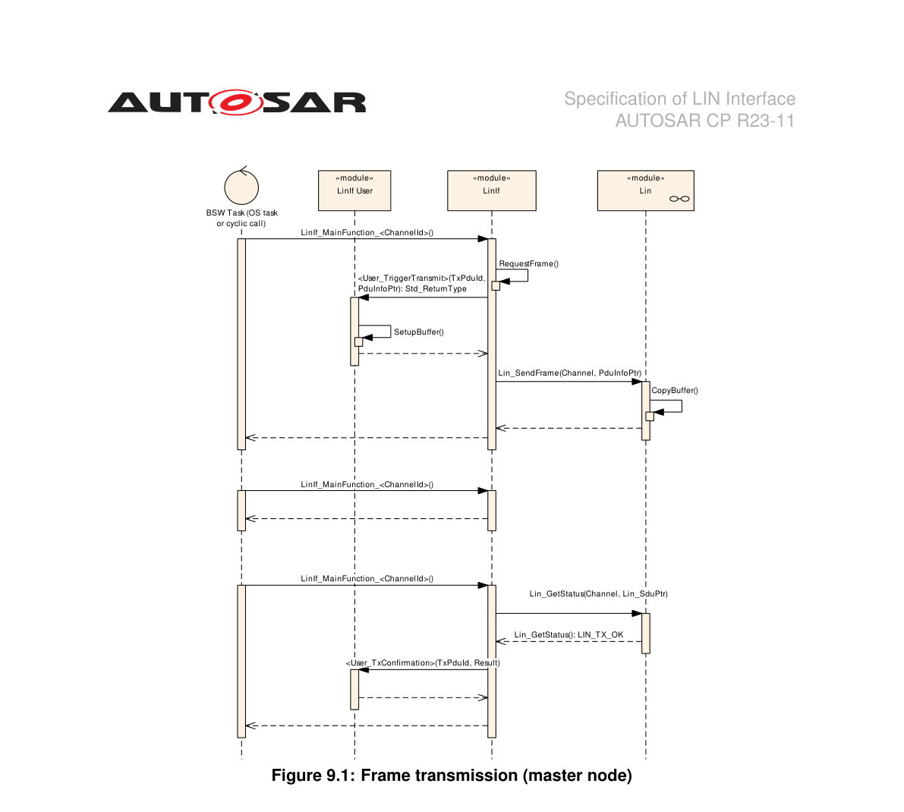

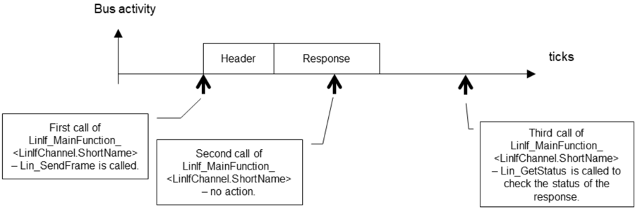

#### 8.1.2. 从节点中的帧发送

本节仅适用于 **LIN** 从节点。

以下用例（图9.3）展示了一个 **LIN** 帧的发送。在 **LIN** 驱动程序指示接收到一个 **LIN** 报头之后，对 **PID** 进行求值（由函数 **EvaluatePID** 展示）。如果确定它属于发送帧，则从上层请求发送响应数据。**PduPtr** 参数的 **SduPtr** 成员所指向的缓冲区可以直接传递，让上层将发送数据复制到所提供的缓冲区中。LIN 接口通过设置 **PduPtr** 的相应成员（由函数 **SetPduPtrValues** 展示）将响应类型通知驱动程序。

**CopyBuffer** 调用用于展示 **SDU** 的复制是在 **LIN** 驱动程序中进行，而不是在 LIN 接口中进行。

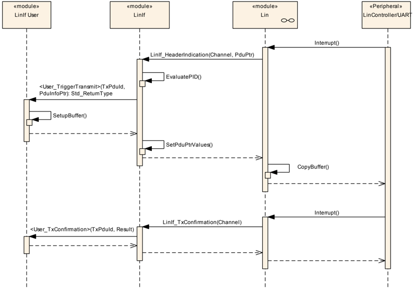

### 8.2. 帧接收

#### 8.2.1. 主节点中的帧接收

本节仅适用于 **LIN** 主节点。

以下用例（图9.4）展示了一个 **LIN** 帧的接收。第一次调用 **LinIf_MainFunction_&lt;[LinIfChannel](#934-linifchannel).ShortName&gt;** 请求发送报头。在第二次调用期间，帧正在发送中。在第三次调用中，帧已结束（此调用在最大帧长度之后进行）。

图中的 **RequestFrame** 调用是对调度表管理器的接口调用。**LinIf_MainFunction_&lt;[LinIfChannel](#934-linifchannel).ShortName&gt;** 获取要发送的帧和到下一帧的延迟。

**AllocateRxBuffer** 调用用于展示所接收帧的存储是在 **LIN** 驱动程序中进行，而不是在 LIN 接口中进行。

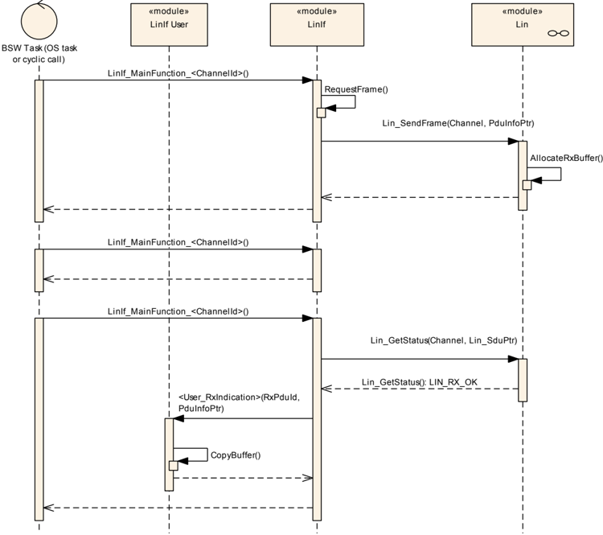

#### 8.2.2. 从节点中的帧接收

本节仅适用于 **LIN** 从节点。

以下用例（图9.5）展示了一个 **LIN** 帧的接收。在 **LIN** 驱动程序指示接收到一个 **LIN** 报头之后，对 **PID** 进行求值（由函数 **EvaluatePID** 展示）。如果确定它属于接收帧，则 LIN 接口通过设置 **PduPtr** 的相应成员（由函数 **SetPduPtrValues** 展示）将响应类型通知驱动程序。

**AllocateRxBuffer** 调用用于展示所接收帧的存储是在 **LIN** 驱动程序中进行，而不是在 LIN 接口中进行。

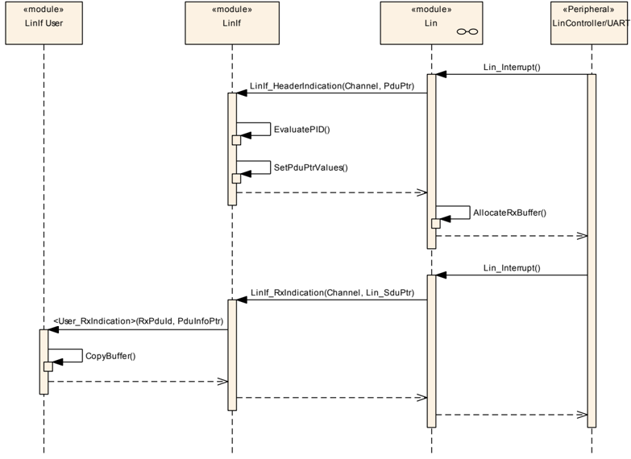

### 8.3. 从节点到从节点 / 无关通信

#### 8.3.1. 主节点中的从节点到从节点通信

本节仅适用于 **LIN** 主节点。

**LIN** 帧的第三个方向是两个从节点相互通信。在这种情况下，主节点（LIN 接口）发送报头，一个从节点发送响应。与发送方向的区别在于主节点不监视帧的响应。因此，只发送帧报头，不再进行进一步的操作（图9.6）。

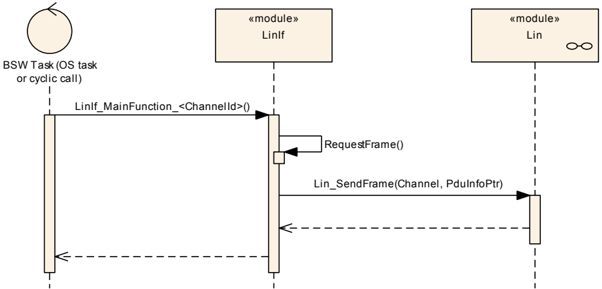

#### 8.3.2. 从节点中的无关通信

本节仅适用于 **LIN** 从节点。

**LIN** 帧的第三个方向是该帧与从节点无关并被忽略。在 **LIN** 驱动程序指示接收到一个 **LIN** 报头之后，对 **PID** 进行求值（由函数 **EvaluatePID** 展示）。如果确定它属于无关帧（**irrelevant frame**），则 LIN 接口通过设置 **PduPtr** 的相应成员（由函数 **SetPduPtrValues** 展示）将响应类型通知驱动程序。不再进行进一步的操作（图9.7）。

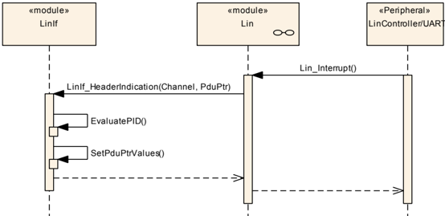

### 8.4. 零星帧（仅主节点）

以下用例（图9.8）展示了上层请求发送一个零星帧（**Sporadic frame**）。实际上，此调用并不发起帧的发送，因为必须遵循调度表。它只是将该帧标记为待发送。

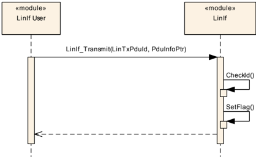

### 8.5. 事件触发帧

#### 8.5.1. 主节点中的事件触发帧

本节仅适用于 **LIN** 主节点。

事件触发帧（**Event-triggered frame**）有三种结果：

* 无应答
* 一个从节点应答
* 两个或更多从节点应答，从而在总线上发生冲突

以下展示了所有三种用例。

##### 8.5.1.1. 无应答

以下用例（图9.9）展示了事件触发帧报头的发送且无响应。

第一次调用 **LinIf_MainFunction_&lt;[LinIfChannel](#934-linifchannel).ShortName&gt;** 请求发送报头。在第二次调用期间，帧正在发送中。在第三次调用中，帧已结束（此调用在最大帧长度之后进行）。

图中的 **RequestFrame** 调用是对调度表管理器的接口调用。**LinIf_MainFunction_&lt;[LinIfChannel](#934-linifchannel).ShortName&gt;** 获取要发送的帧和到下一帧的延迟。

**AllocateRxBuffer** 调用用于展示所接收 **SDU** 的存储是在 **LIN** 驱动程序中进行，而不是在 LIN 接口中进行。

没有从节点对事件触发帧报头作出响应。**LinIf_MainFunction_&lt;[LinIfChannel](#934-linifchannel).ShortName&gt;** 识别这种情况且不采取任何行动，因为这不被视为通信错误。

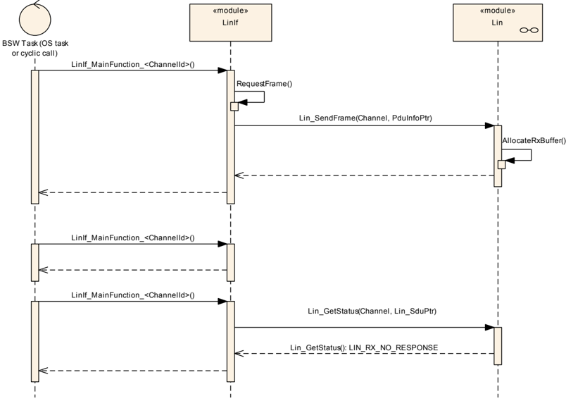

##### 8.5.1.2. 有应答（无冲突）

以下用例（图9.10）展示了事件触发帧报头的发送且有一个从节点作出响应。

第一次调用 **LinIf_MainFunction_&lt;[LinIfChannel](#934-linifchannel).ShortName&gt;** 请求发送报头。在第二次调用期间，帧正在发送中。在第三次调用中，帧已结束（此调用在最大帧长度之后进行）。

图中的 **RequestFrame** 调用是对调度表管理器的接口调用。**LinIf_MainFunction_&lt;[LinIfChannel](#934-linifchannel).ShortName&gt;** 获取要发送的帧和到下一帧的延迟。

**AllocateRxBuffer** 调用用于展示所接收 **SDU** 的存储是在 **LIN** 驱动程序中进行，而不是在 LIN 接口中进行。

**ResolvePid** 调用用于展示第一个数据字段中接收到的 **PID** 被转换为上层能理解的 **PduId**。

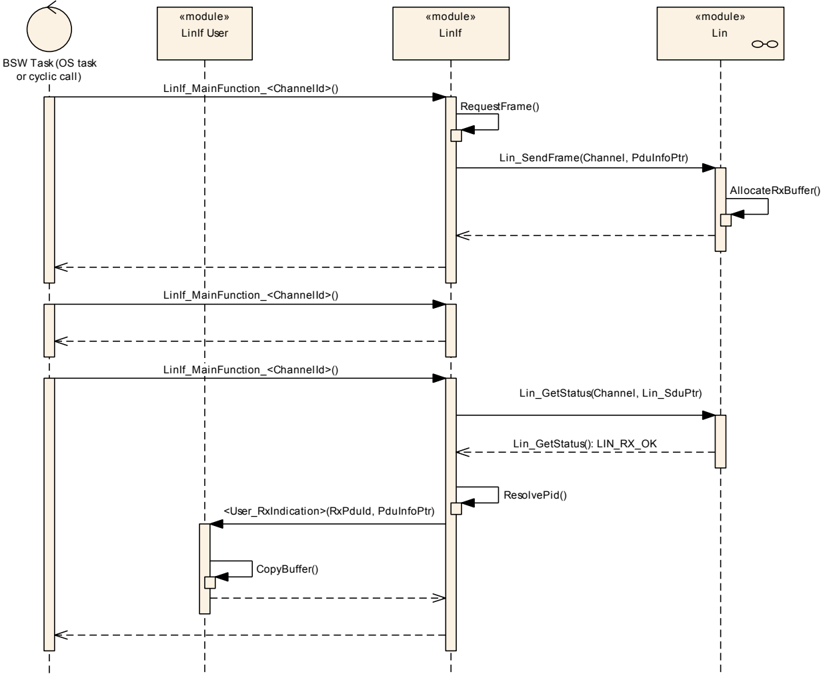

##### 8.5.1.3. 有冲突

以下用例（图9.11）展示了事件触发帧报头的发送且有多个从节点作出响应。这意味着总线上存在冲突。

第一次调用 **LinIf_MainFunction_&lt;[LinIfChannel](#934-linifchannel).ShortName&gt;** 请求发送报头。在第二次调用期间，帧正在发送中。在第三次调用中，帧已结束（此调用在最大帧长度之后进行）。

图中的 **RequestFrame** 调用是对调度表管理器的接口调用。**LinIf_MainFunction_&lt;[LinIfChannel](#934-linifchannel).ShortName&gt;** 获取要发送的帧和到下一帧的延迟。

**AllocateRxBuffer** 调用用于展示所接收 **SDU** 的存储是在 **LIN** 驱动程序中进行，而不是在 LIN 接口中进行。

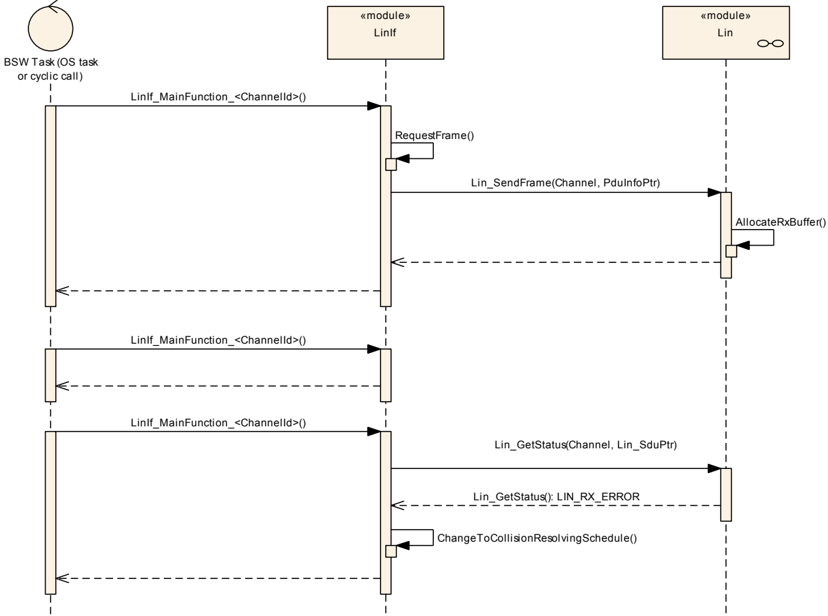

#### 8.5.2. 从节点中的事件触发帧

以下用例（图9.12）展示了上层请求发送一个事件触发帧。它只是将该帧标记为待发送。当接收到事件触发帧的报头且其关联的响应未决时，从上层请求发送…（源文档此处截断）。

**CheckId** 函数用于展示 LIN 接口必须检查从上层传来的帧是什么（将上层的 **ID** 转换为正确的 **PID**）。

**SetFlag** 函数是一个本地函数，用于在 LIN 接口中标记事件触发帧待发送。每个事件触发帧有一个标志。

**CopyPID** 函数用于展示 LIN 接口必须将所请求事件触发帧的 **PID** 复制到有效载荷数据的第一个字节。

**ClearFlag** 函数是一个本地函数，用于在成功发送后清除事件触发帧的未决标志。

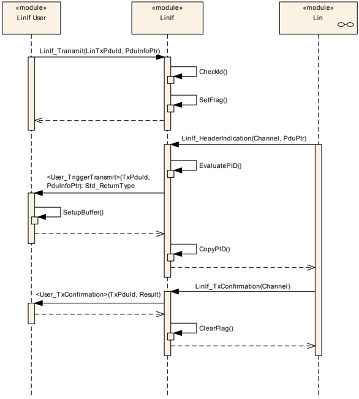

### 8.6. 传输协议报文发送

下图（图9.13）展示了一个 **TP** 报文的发送。图中展示了报文的发起、数据的连续复制和报文的结束。**MRF** / **SRF** 的实际发送未在图中展示，其行为与帧发送相同。

**TP** 报文的开始总是由来自 **PDU** 路由器的发送 **TP** 报文的请求发起。对于 **LIN** 主节点，如果配置参数启用了调度表更改（参见参数 **LinTpScheduleChangeDiag**…（源文档此处截断）），则请求将调度表更改为诊断请求调度。

**TP** 报文在最后一个 **N-PDU**（**SF** 或 **CF**）被发送之后结束。**PDU** 路由器会收到报文发送完成的通知。对于 **LIN** 主节点，如果配置参数启用了调度表更改…（源文档此处截断），则请求将调度表更改为诊断响应调度。

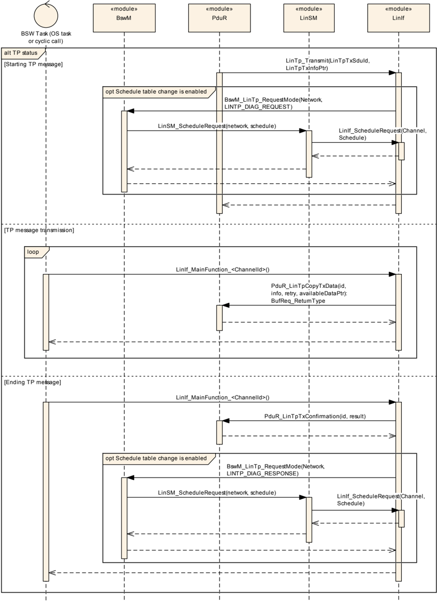

### 8.7. 传输协议报文接收

下图（图9.14）展示了一个 **TP** 报文的接收。图中展示了报文的发起、数据的连续复制和报文的结束。**MRF** / **SRF** 的实际接收未在图中展示，其行为与帧接收相同。

**TP** 报文的开始总是由从 **LIN** 驱动程序接收到 **SF** 或 **FF** 发起。此外，如果在进行中的接收期间接收到 **SF** 或 **FF**，则会发起新的 **TP** 报文接收。传入的数据通过 **API** **PduR_LinTpCopyRxData** 提供给 **PDU** 路由器。

报文的连续接收通过从 **SRF** 复制 **N-SDU** 来完成。

**TP** 报文在最后一个 **N-PDU**（**SF** 或 **CF**）被接收之后结束。**PDU** 路由器会收到完整报文接收的通知。对于 **LIN** 主节点，如果配置参数启用了调度表更改…（源文档此处截断），则请求将调度表更改为应用调度。

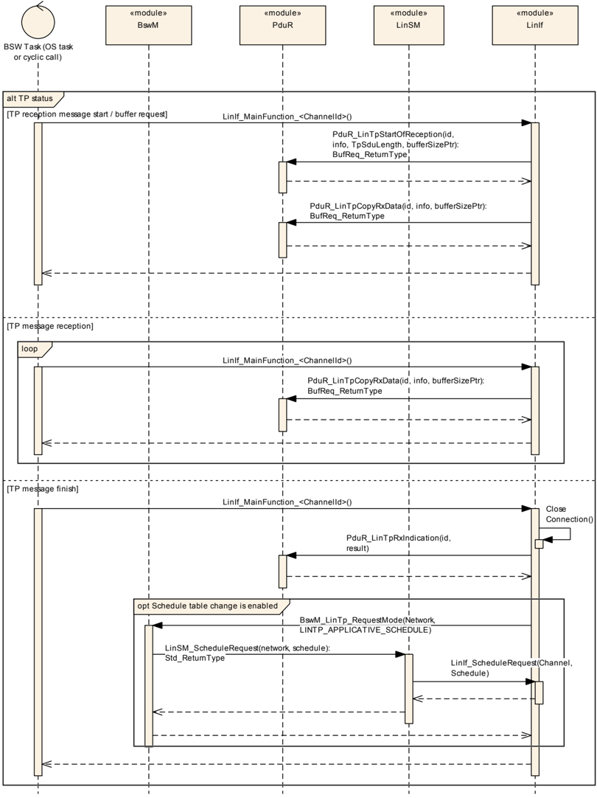

### 8.8. Go to sleep 过程

#### 8.8.1. 主节点中的 Go to sleep 过程

本节仅适用于 **LIN** 主节点。

图9.15中的用例展示了 [**LinIf_GotoSleep**](#735-linif_gotosleep) 命令的执行。

在 [**LinIf_GotoSleep**](#735-linif_gotosleep) 调用之后执行的 **LinIf_MainFunction_&lt;[LinIfChannel](#934-linifchannel).ShortName&gt;** 用于展示 **go-to-sleep** 命令不会立即执行。**go-to-sleep** 命令在下一个调度条目到期时被发送。

注意，即使状态为失败，LIN 接口也会将状态设置为睡眠。

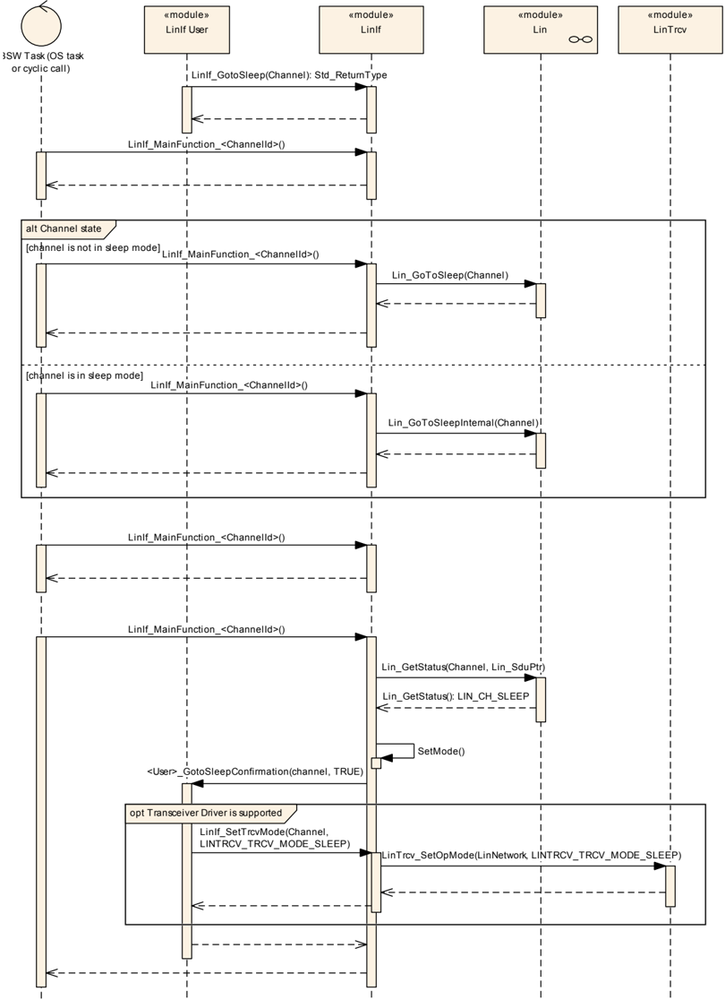

#### 8.8.2. 从节点中的 Go to sleep 过程

本节仅适用于 **LIN** 从节点。

图9.16中的用例展示了睡眠迁移的执行，或由接收到 **go-to-sleep** 命令引起，或由检测到总线空闲状况引起。

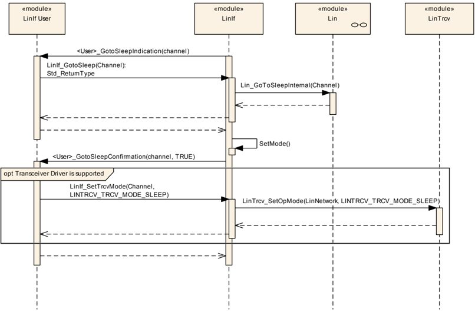

### 8.9. 唤醒请求

唤醒用例在 **AUTOSAR ECU** 状态管理器规范 [\[10\]](#ref-10) 的第 9 章中描述。

### 8.10. 内部唤醒

图9.17中有两个不同的用例：

* 第一个展示上层请求唤醒 **LIN** 集群且集群处于睡眠状态时的情况。
* 第二个展示上层请求唤醒 **LIN** 集群且集群已唤醒时的情况。

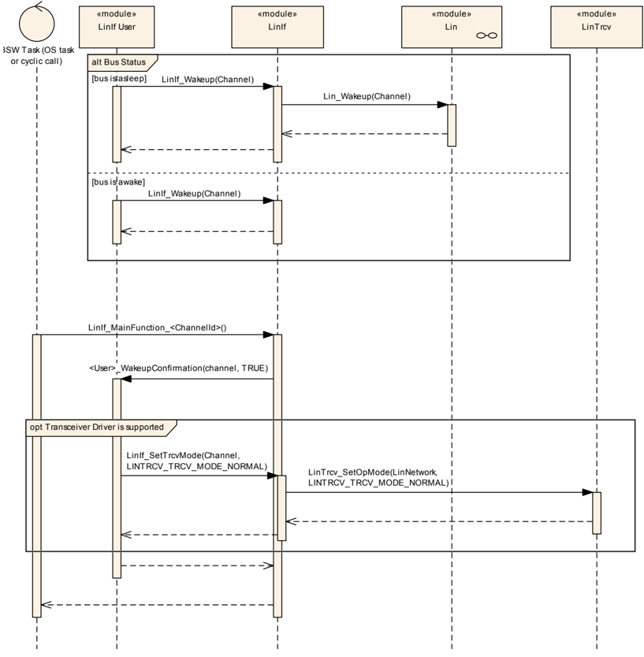

## 9. 配置规范

一般而言，本章定义配置参数及其到容器（**container**）中的聚类。为支持该规范，第 9.1 章描述了基础知识。它还规定了应用于参数规范的一个模板（表）。

### 9.1. 如何阅读本章

详细信息请参阅 **SWS_BSWGeneral** [\[7\]](#ref-7) 的第 10.1 章「配置规范简介」（**Introduction to configuration specification**）。

### 9.2. 容器与配置参数

以下章节汇总了所有配置参数。参数的详细含义在第6章和第7章中描述。

为了支持构建后（**post-build**）时间，**LIN** 接口配置结构 **LinIf** 和 **LIN** 传输层配置结构 **LinTp** 的构造方式应使其在内存中可交换。

示例：**LinIf** 被放置在一个特定的闪存扇区中。该闪存扇区可以在 **ECU** 装车后重新编程。

#### 9.2.1. 配置工具

配置工具将创建一个 **LIN** 接口能理解的配置结构。

ISO 17987 规范的理念是 **LIN** 集群是静态的。因此，在将配置交给 LIN 接口之前，可以检查许多关系和行为。为了避免在 LIN 接口中进行耗时的检查，…（源文档此处截断）。

在生产软件的运行时中，LIN 接口不应对配置进行任何一致性检查。如果启用了开发错误检测，则可以进行此检查。

### 9.3. LinIf 配置

图10.1描绘了 **LIN** 接口配置。

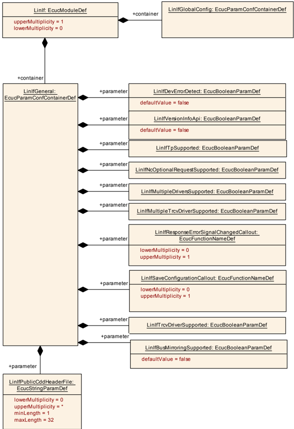

#### 9.3.1. LinIf

| SWS 条目 | [ECUC_LinIf_00370] |
| --- | --- |
| 模块名称 | LinIf |
| 描述 | **LIN** 接口的配置。 |
| 构建后变体支持 | true |
| 支持的配置变体 | VARIANT-LINK-TIME、VARIANT-POST-BUILD、VARIANT-PRE-COMPILE |

**包含的容器**

| 容器名称 | 多重性 | 作用域/依赖 |
| --- | --- | --- |
| LinIfGeneral | 1 | 此容器包含 **LIN** 接口模块的通用参数。 |
| LinIfGlobalConfig | 1 | 此容器包含 **LinIf** 的全局配置参数。 |

#### 9.3.2. LinIfGlobalConfig

| SWS 条目 | [ECUC_LinIf_00020] |
| --- | --- |
| 容器名称 | LinIfGlobalConfig |
| 父容器 | LinIf |
| 描述 | 此容器包含 **LinIf** 的全局配置参数。 |

**包含的容器**

| 容器名称 | 多重性 | 作用域/依赖 |
| --- | --- | --- |
| LinIfChannel | 1..* | 描述 **LinIf** 所连接的每个 **LIN** 通道。 |

#### 9.3.3. LinIfGeneral

| SWS 条目 | [ECUC_LinIf_00019] |
| --- | --- |
| 容器名称 | LinIfGeneral |
| 父容器 | LinIf |
| 描述 | 此容器包含 **LIN** 接口模块的通用参数。 |

| SWS 条目 | [ECUC_LinIf_00657] |
| --- | --- |
| 参数名称 | LinIfBusMirroringSupported |
| 父容器 | LinIfGeneral |
| 描述 | 说明 **LIN** 接口中是否启用了总线镜像。此参数存在的理由是，在不使用总线镜像时减小 **LIN** 接口的规模。 |
| 多重性 | 1 |
| 类型 | EcucBooleanParamDef |
| 默认值 | false |
| 构建后变体值 | false |
| 值配置类 | Pre-compile time：X；Link time：-；Post-build time：- |
| 作用域/依赖 | scope: local |

| SWS 条目 | [ECUC_LinIf_00010] |
| --- | --- |
| 参数名称 | LinIfDevErrorDetect |
| 父容器 | LinIfGeneral |
| 描述 | 打开或关闭开发错误检测和通知。* **true**：检测和通知已启用。* **false**：检测和通知已禁用。 |
| 多重性 | 1 |
| 类型 | EcucBooleanParamDef |
| 默认值 | false |
| 构建后变体值 | false |
| 值配置类 | Pre-compile time：X；Link time：-；Post-build time：- |
| 作用域/依赖 | scope: local |

| SWS 条目 | [ECUC_LinIf_00024] |
| --- | --- |
| 参数名称 | LinIfMultipleDriversSupported |
| 父容器 | LinIfGeneral |
| 描述 | 说明 **LIN** 接口是否支持多个驱动程序。此参数存在的理由是，在不使用多个驱动程序时减小 **LIN** 接口的规模。 |
| 多重性 | 1 |
| 类型 | EcucBooleanParamDef |
| 默认值 | - |
| 构建后变体值 | false |
| 值配置类 | Pre-compile time：X；Link time：-；Post-build time：- |
| 作用域/依赖 | scope: local |

| SWS 条目 | [ECUC_LinIf_00025] |
| --- | --- |
| 参数名称 | LinIfMultipleTrcvDriverSupported |
| 父容器 | LinIfGeneral |
| 描述 | 说明 **LIN** 接口是否支持多个收发器驱动程序。此参数存在的理由是，在不使用多个收发器驱动程序时减小 **LIN** 接口的规模。 |
| 多重性 | 1 |
| 类型 | EcucBooleanParamDef |
| 默认值 | - |
| 构建后变体值 | false |
| 值配置类 | Pre-compile time：X；Link time：-；Post-build time：- |
| 作用域/依赖 | scope: local |

| SWS 条目 | [ECUC_LinIf_00026] |
| --- | --- |
| 参数名称 | LinIfNcOptionalRequestSupported |
| 父容器 | LinIfGeneral |
| 描述 | 说明是否支持节点配置命令 **Assign NAD** 和 **Conditional Change NAD**。 |
| 多重性 | 1 |
| 类型 | EcucBooleanParamDef |
| 默认值 | - |
| 构建后变体值 | false |
| 值配置类 | Pre-compile time：X；Link time：-；Post-build time：- |
| 作用域/依赖 | scope: local 依赖：仅当通道包含 **LinIfMaster** 容器时适用。 |

| SWS 条目 | [ECUC_LinIf_00631] |
| --- | --- |
| 参数名称 | LinIfPublicCddHeaderFile |
| 父容器 | LinIfGeneral |
| 描述 | 定义在 **CDD** 情况下应包含的回调函数头文件。字符范围为 1..32。 |
| 多重性 | 0..* |
| 类型 | EcucStringParamDef |
| 默认值 | - |
| 长度 | 1-32 |
| 正则表达式 | - |
| 构建后变体多重性 | false |
| 构建后变体值 | false |
| 多重性配置类 | Pre-compile time：X；Link time：-；Post-build time：- |
| 值配置类 | Pre-compile time：X；Link time：-；Post-build time：- |
| 作用域/依赖 | scope: ECU |

| SWS 条目 | [ECUC_LinIf_00656] |
| --- | --- |
| 参数名称 | LinIfResponseErrorSignalChangedCallout |
| 父容器 | LinIfGeneral |
| 描述 | 此参数包含在 **response_error** 信号变化之后调用的回调函数的名称。仅适用于 **LIN** 从节点。 |
| 多重性 | 0..1 |
| 类型 | EcucFunctionNameDef |
| 默认值 | - |
| 正则表达式 | - |
| 构建后变体值 | false |
| 值配置类 | Pre-compile time：X；Link time：-；Post-build time：- |
| 作用域/依赖 | scope: local 依赖：仅当至少一个通道包含 **LinIfSlave** 容器时适用。 |

| SWS 条目 | [ECUC_LinIf_00651] |
| --- | --- |
| 参数名称 | LinIfSaveConfigurationCallout |
| 父容器 | LinIfGeneral |
| 描述 | 此参数包含当此从节点处理 **save configuration** 节点配置命令时调用的回调函数的名称。仅当配置了此参数时才支持该服务。仅适用于 **LIN** 从节点。 |
| 多重性 | 0..1 |
| 类型 | EcucFunctionNameDef |
| 默认值 | - |
| 正则表达式 | - |
| 构建后变体值 | false |
| 值配置类 | Pre-compile time：X；Link time：-；Post-build time：- |
| 作用域/依赖 | scope: local 依赖：仅当至少一个通道包含 **LinIfSlave** 容器时适用。 |

| SWS 条目 | [ECUC_LinIf_00045] |
| --- | --- |
| 参数名称 | LinIfTpSupported |
| 父容器 | LinIfGeneral |
| 描述 | 说明 **LIN** 接口中是否包含 **TP**。此参数存在的理由是，在不使用 **TP** 时减小 **LIN** 接口的规模。 |
| 多重性 | 1 |
| 类型 | EcucBooleanParamDef |
| 默认值 | - |
| 构建后变体值 | false |
| 值配置类 | Pre-compile time：X；Link time：-；Post-build time：- |
| 作用域/依赖 | scope: local |

| SWS 条目 | [ECUC_LinIf_00635] |
| --- | --- |
| 参数名称 | LinIfTrcvDriverSupported |
| 父容器 | LinIfGeneral |
| 描述 | 说明 **LIN** 接口中是否包含收发器驱动程序支持。此参数存在的理由是，在不使用收发器驱动程序时减小 **LIN** 接口的规模。 |
| 多重性 | 1 |
| 类型 | EcucBooleanParamDef |
| 默认值 | - |
| 构建后变体值 | false |
| 值配置类 | Pre-compile time：X；Link time：-；Post-build time：- |
| 作用域/依赖 | scope: local |

| SWS 条目 | [ECUC_LinIf_00053] |
| --- | --- |
| 参数名称 | LinIfVersionInfoApi |
| 父容器 | LinIfGeneral |
| 描述 | 打开或关闭 **LinIf_GetVersionInfo** 函数。 |
| 多重性 | 1 |
| 类型 | EcucBooleanParamDef |
| 默认值 | false |
| 构建后变体值 | false |
| 值配置类 | Pre-compile time：X；Link time：-；Post-build time：- |
| 作用域/依赖 | scope: local |

#### 9.3.4. LinIfChannel

| SWS 条目 | [ECUC_LinIf_00364] |
| --- | --- |
| 容器名称 | LinIfChannel |
| 父容器 | LinIfGlobalConfig |
| 描述 | 描述 **LinIf** 所连接的每个 **LIN** 通道。 |
| 构建后变体多重性 | false |
| 多重性配置类 | Pre-compile time：X（VARIANT-PRE-COMPILE、VARIANT-LINK-TIME、VARIANT-POST-BUILD）；Link time：-；Post-build time：- |

| SWS 条目 | [ECUC_LinIf_00655] |
| --- | --- |
| 参数名称 | LinIfBusIdleTimeoutPeriod |
| 父容器 | LinIfChannel |
| 描述 | 总线空闲超时（秒）。根据 **LIN** 协议规范，总线空闲超时周期应在 [4, 10] 秒范围内。 |
| 多重性 | 1 |
| 类型 | EcucFloatParamDef |
| 取值范围 | [0.1 .. INF] |
| 默认值 | 4 |
| 构建后变体值 | true |
| 值配置类 | Pre-compile time：X（VARIANT-PRE-COMPILE）；Link time：X（VARIANT-LINK-TIME）；Post-build time：X（VARIANT-POST-BUILD） |
| 作用域/依赖 | scope: local |

| SWS 条目 | [ECUC_LinIf_00601] |
| --- | --- |
| 参数名称 | LinIfGotoSleepConfirmationUL |
| 父容器 | LinIfChannel |
| 描述 | 此参数定义 **goto-sleep** 命令的确认应发送到的上层（**UL**）模块。 |
| 多重性 | 1 |
| 类型 | EcucEnumerationParamDef |
| 取值范围 | **CDD**：复杂驱动程序；**LIN_SM**：**LIN** 状态管理器 |
| 构建后变体值 | true |
| 值配置类 | Pre-compile time：X（VARIANT-PRE-COMPILE）；Link time：X（VARIANT-LINK-TIME、VARIANT-POST-BUILD）；Post-build time：- |
| 作用域/依赖 | scope: ECU |

| SWS 条目 | [ECUC_LinIf_00652] |
| --- | --- |
| 参数名称 | LinIfGotoSleepIndicationUL |
| 父容器 | LinIfChannel |
| 描述 | 此参数定义 **goto-sleep** 命令的指示应发送到的上层（**UL**）模块。仅由 **LIN** 从节点使用，主节点忽略。 |
| 多重性 | 0..1 |
| 类型 | EcucEnumerationParamDef |
| 取值范围 | **CDD**：复杂驱动程序；**LIN_SM**：**LIN** 状态管理器 |
| 构建后变体值 | true |
| 值配置类 | Pre-compile time：X（VARIANT-PRE-COMPILE）；Link time：X（VARIANT-LINK-TIME、VARIANT-POST-BUILD）；Post-build time：- |
| 作用域/依赖 | scope: ECU 依赖：仅当通道包含 **LinIfSlave** 容器时适用。 |

| SWS 条目 | [ECUC_LinIf_00639] |
| --- | --- |
| 参数名称 | LinIfMainFunctionPeriod |
| 父容器 | LinIfChannel |
| 描述 | 以秒为单位定义每个通道调用主函数的时间间隔。 |
| 多重性 | 1 |
| 类型 | EcucFloatParamDef |
| 取值范围 | ]0 .. INF[ |
| 默认值 | - |
| 构建后变体值 | false |
| 值配置类 | Pre-compile time：X（VARIANT-PRE-COMPILE）；Link time：X（VARIANT-LINK-TIME、VARIANT-POST-BUILD）；Post-build time：- |
| 作用域/依赖 | scope: local |

| SWS 条目 | [ECUC_LinIf_00636] |
| --- | --- |
| 参数名称 | LinIfMaxFrameCnt |
| 父容器 | LinIfChannel |
| 描述 | 帧的最大数量。仅在使用静态内存分配的构建后可加载实现的情况下才需要此参数。 |
| 多重性 | 0..1 |
| 类型 | EcucIntegerParamDef |
| 取值范围 | 0 .. 65535 |
| 默认值 | - |
| 构建后变体多重性 | false |
| 构建后变体值 | false |
| 多重性配置类 | Pre-compile time：X（VARIANT-PRE-COMPILE）；Link time：X（VARIANT-LINK-TIME、VARIANT-POST-BUILD）；Post-build time：- |
| 值配置类 | Pre-compile time：X（VARIANT-PRE-COMPILE）；Link time：X（VARIANT-LINK-TIME、VARIANT-POST-BUILD）；Post-build time：- |
| 作用域/依赖 | scope: local |

| SWS 条目 | [ECUC_LinIf_00640] |
| --- | --- |
| 参数名称 | LinIfScheduleChangeNextTimeBase |
| 父容器 | LinIfChannel |
| 描述 | 启用/禁用在状态检查之后的下一个时基开始处切换到新的调度表。**True**：**LinIf** 在下一次主函数中选择新的调度表。仅适用于 **LIN** 主节点。 |
| 多重性 | 0..1 |
| 类型 | EcucBooleanParamDef |
| 默认值 | - |
| 构建后变体多重性 | false |
| 构建后变体值 | true |
| 值配置类 | Pre-compile time：X（VARIANT-PRE-COMPILE）；Link time：X（VARIANT-LINK-TIME）；Post-build time：X（VARIANT-POST-BUILD） |
| 作用域/依赖 | scope: local 依赖：仅当通道包含 **LinIfMaster** 容器时适用。 |

| SWS 条目 | [ECUC_LinIf_00600] |
| --- | --- |
| 参数名称 | LinIfScheduleRequestConfirmationUL |
| 父容器 | LinIfChannel |
| 描述 | 此参数定义成功执行的调度表更改的确认应发送到的上层（**UL**）模块。仅适用于 **LIN** 主节点。 |
| 多重性 | 0..1 |
| 类型 | EcucEnumerationParamDef |
| 取值范围 | **CDD**：复杂驱动程序；**LIN_SM**：**LIN** 状态管理器 |
| 构建后变体值 | true |
| 值配置类 | Pre-compile time：X（VARIANT-PRE-COMPILE）；Link time：X（VARIANT-LINK-TIME、VARIANT-POST-BUILD）；Post-build time：- |
| 作用域/依赖 | scope: ECU 依赖：仅当通道包含 **LinIfMaster** 容器时适用。 |

| SWS 条目 | [ECUC_LinIf_00602] |
| --- | --- |
| 参数名称 | LinIfWakeupConfirmationUL |
| 父容器 | LinIfChannel |
| 描述 | 此参数定义唤醒的确认应发送到的上层（**UL**）模块。 |
| 多重性 | 1 |
| 类型 | EcucEnumerationParamDef |
| 取值范围 | **CDD**：复杂驱动程序；**LIN_SM**：**LIN** 状态管理器 |
| 构建后变体值 | true |
| 值配置类 | Pre-compile time：X（VARIANT-PRE-COMPILE）；Link time：X（VARIANT-LINK-TIME、VARIANT-POST-BUILD）；Post-build time：- |
| 作用域/依赖 | scope: ECU |

| SWS 条目 | [ECUC_LinIf_00637] |
| --- | --- |
| 参数名称 | LinIfCddRef |
| 父容器 | LinIfChannel |
| 描述 | 对 **CDD** 模块描述的引用。仅当 **LinIfWakeupConfirmationUL**、**LinIfScheduleRequestConfirmationUL**、**LinIfGotoSleepConfirmationUL** 和/或 **LinIfGotoSleepIndicationUL** 设置为 **CDD** 时才需要此参数。 |
| 多重性 | 0..1 |
| 类型 | 对 ECUC-MODULE-CONFIGURATION-VALUES 的外部引用 |
| 构建后变体多重性 | false |
| 构建后变体值 | false |
| 多重性配置类 | Pre-compile time：X；Link time：-；Post-build time：- |
| 值配置类 | Pre-compile time：X；Link time：-；Post-build time：- |
| 作用域/依赖 | scope: local |

| SWS 条目 | [ECUC_LinIf_00003] |
| --- | --- |
| 参数名称 | LinIfChannelRef |
| 父容器 | LinIfChannel |
| 描述 | 对 **LIN** 驱动程序中通道定义的引用。 |
| 多重性 | 1 |
| 类型 | 对 LinChannel 的符号名引用 |
| 构建后变体值 | false |
| 值配置类 | Pre-compile time：X（VARIANT-PRE-COMPILE）；Link time：X（VARIANT-LINK-TIME、VARIANT-POST-BUILD）；Post-build time：- |
| 作用域/依赖 | scope: ECU |

| SWS 条目 | [ECUC_LinIf_00626] |
| --- | --- |
| 参数名称 | LinIfComMNetworkHandleRef |
| 父容器 | LinIfChannel |
| 描述 | 标识一个 **LIN** 网络的唯一句柄。对为 **ComM** 配置的网络句柄之一的引用。 |
| 多重性 | 1 |
| 类型 | 对 ComMChannel 的符号名引用 |
| 构建后变体值 | false |
| 值配置类 | Pre-compile time：X（VARIANT-PRE-COMPILE）；Link time：X（VARIANT-LINK-TIME、VARIANT-POST-BUILD）；Post-build time：- |
| 作用域/依赖 | scope: local |

**包含的容器**

| 容器名称 | 多重性 | 作用域/依赖 |
| --- | --- | --- |
| LinIfFrame | 0..* | 所有类型 **LIN** 帧的通用容器。 |
| LinIfNodeType | 1 | 此容器定义此通道的 **LIN** 节点类型。 |
| LinIfScheduleTable | 0..* | 描述一个调度表。每个 **LinIfChannel** 可以有多个调度表。每个调度表只能连接到一个通道。**LIN** 主节点必需。**LinIfScheduleTable** 容器的 **SHORT-NAME** 表示该调度表的符号名称。 |
| LinIfTransceiverDrvConfig | 0..1 | 此容器包含每个底层 **LIN** 收发器驱动程序的配置参数。 |

#### 9.3.5. LinIfNodeType

| SWS 条目 | [ECUC_LinIf_00654] |
| --- | --- |
| 选择容器名称 | LinIfNodeType |
| 父容器 | LinIfChannel |
| 描述 | 此容器定义此通道的 **LIN** 节点类型。 |

**容器选项**

| 容器名称 | 多重性 | 作用域/依赖 |
| --- | --- | --- |
| LinIfMaster | 0..1 | 每个主节点只能连接到一个物理通道。这可以与 **LDF** 文件中的 **Node** 参数相比较。 |
| LinIfSlave | 0..1 | 描述仅与 **LIN** 从节点相关的所有参数。 |

#### 9.3.6. LinIfFrame

| SWS 条目 | [ECUC_LinIf_00367] |
| --- | --- |
| 容器名称 | LinIfFrame |
| 父容器 | LinIfChannel |
| 描述 | 所有类型 **LIN** 帧的通用容器。 |
| 构建后变体多重性 | true |
| 多重性配置类 | Pre-compile time：X（VARIANT-PRE-COMPILE）；Link time：X（VARIANT-LINK-TIME）；Post-build time：X（VARIANT-POST-BUILD） |

| SWS 条目 | [ECUC_LinIf_00005] |
| --- | --- |
| 参数名称 | LinIfChecksumType |
| 父容器 | LinIfFrame |
| 描述 | 帧所使用的校验和类型。此参数是可选的，因为对于零星帧不应设置它。 |
| 多重性 | 0..1 |
| 类型 | EcucEnumerationParamDef |
| 取值范围 | **CLASSIC**：Classic；**ENHANCED**：Enhanced |
| 构建后变体值 | true |
| 值配置类 | Pre-compile time：X（VARIANT-PRE-COMPILE）；Link time：X（VARIANT-LINK-TIME）；Post-build time：X（VARIANT-POST-BUILD） |
| 作用域/依赖 | scope: local |

| SWS 条目 | [ECUC_LinIf_00638] |
| --- | --- |
| 参数名称 | LinIfFrameId |
| 父容器 | LinIfFrame |
| 描述 | **LIN** 帧的 **ID**。包括奇偶校验在内的受保护 **ID**（**Protected ID**）由生成工具计算。 |
| 多重性 | 0..1 |
| 类型 | EcucIntegerParamDef |
| 取值范围 | 0 .. 63 |
| 默认值 | - |
| 构建后变体多重性 | true |
| 构建后变体值 | true |
| 多重性配置类 | Pre-compile time：X（VARIANT-PRE-COMPILE）；Link time：X（VARIANT-LINK-TIME）；Post-build time：X（VARIANT-POST-BUILD） |
| 值配置类 | Pre-compile time：X（VARIANT-PRE-COMPILE）；Link time：X（VARIANT-LINK-TIME）；Post-build time：X（VARIANT-POST-BUILD） |
| 作用域/依赖 | scope: local |

| SWS 条目 | [ECUC_LinIf_00653] |
| --- | --- |
| 参数名称 | LinIfFrameIndex |
| 父容器 | LinIfFrame |
| 描述 | 帧的 **PID** 索引。此索引用于 **AssignFrameIdentifierRange** 节点配置服务中，以标识应为其分配新 **PID** 的帧。它对应于从节点的 **LDF** / **NCF** 的节点属性节中可配置帧列表里的帧顺序。仅与 **LIN** 从节点相关。 |
| 多重性 | 0..1 |
| 类型 | EcucIntegerParamDef |
| 取值范围 | 0 .. 63 |
| 默认值 | - |
| 构建后变体多重性 | true |
| 构建后变体值 | true |
| 多重性配置类 | Pre-compile time：X（VARIANT-PRE-COMPILE）；Link time：X（VARIANT-LINK-TIME）；Post-build time：X（VARIANT-POST-BUILD） |
| 值配置类 | Pre-compile time：X（VARIANT-PRE-COMPILE）；Link time：X（VARIANT-LINK-TIME）；Post-build time：X（VARIANT-POST-BUILD） |
| 作用域/依赖 | scope: local 依赖：仅当通道包含 **LinIfSlave** 容器时适用。 |

| SWS 条目 | [ECUC_LinIf_00017] |
| --- | --- |
| 参数名称 | LinIfFrameType |
| 父容器 | LinIfFrame |
| 描述 | 此参数定义帧的类型（例如零星帧）。对于主节点，允许所有帧类型。零星时隙（**sporadic slot**）可由一组充当替代帧（**substitution frame**）的无条件帧使用。对于从节点，仅允许以下类型：**UNCONDITIONAL**、**MRF**、**SRF**、**EVENT_TRIGGERED**。事件触发时隙可由一组充当替代帧的无条件帧使用。 |
| 多重性 | 1 |
| 类型 | EcucEnumerationParamDef |
| 取值范围 | **ASSIGN**：**AssignFrameId**；**ASSIGN_FRAME_ID_RANGE**：**AssignFrameIdRange**；**ASSIGN_NAD**：**AssignNAD**；**CONDITIONAL**：**Conditional Change NAD**；**EVENT_TRIGGERED**：事件触发帧；**FREE**：**FreeFormat**；**MRF**：**Master Request Frame**；**SAVE_CONFIGURATION**：**SaveConfiguration**；**SPORADIC**：零星时隙（**Sporadic slot**）；**SRF**：**Slave Response Frame**；**UNASSIGN**：**UnassignFrameId**；**UNCONDITIONAL**：无条件帧 |
| 构建后变体值 | true |
| 值配置类 | Pre-compile time：X（VARIANT-PRE-COMPILE）；Link time：X（VARIANT-LINK-TIME）；Post-build time：X（VARIANT-POST-BUILD） |
| 作用域/依赖 | scope: local |

**包含的容器**

| 容器名称 | 多重性 | 作用域/依赖 |
| --- | --- | --- |
| LinIfFixedFrameSdu | 0..1 | 如果这是一个固定帧，则为 **SDU**（响应）。此容器表示一个 8 字节数组。字节顺序应为 **MSB** 在前。仅适用于 **LIN** 主节点。 |
| LinIfPduDirection | 0..1 | 帧的方向。 |
| LinIfSubstitutionFrames | 0..* | 可在零星帧时隙（主节点）中发送的零星帧列表，或可在事件触发帧时隙（从节点）中发送的无条件帧列表。 |

#### 9.3.7. LinIfFixedFrameSdu

| SWS 条目 | [ECUC_LinIf_00012] |
| --- | --- |
| 容器名称 | LinIfFixedFrameSdu |
| 父容器 | LinIfFrame |
| 描述 | 如果这是一个固定帧，则为 **SDU**（响应）。此容器表示一个 8 字节数组。字节顺序应为 **MSB** 在前。仅适用于 **LIN** 主节点。 |

**包含的容器**

| 容器名称 | 多重性 | 作用域/依赖 |
| --- | --- | --- |
| LinIfFixedFrameSduByte | 8 | 此容器表示 8 字节数组中的一个字节。 |

#### 9.3.8. LinIfFixedFrameSduByte

| SWS 条目 | [ECUC_LinIf_00013] |
| --- | --- |
| 容器名称 | LinIfFixedFrameSduByte |
| 父容器 | LinIfFixedFrameSdu |
| 描述 | 此容器表示 8 字节数组中的一个字节。 |

| SWS 条目 | [ECUC_LinIf_00014] |
| --- | --- |
| 参数名称 | LinIfFixedFrameSduBytePos |
| 父容器 | LinIfFixedFrameSduByte |
| 描述 | **SDU**（响应）8 字节数组中字节的索引。 |
| 多重性 | 1 |
| 类型 | EcucIntegerParamDef |
| 取值范围 | 0 .. 7 |
| 默认值 | - |
| 构建后变体值 | true |
| 值配置类 | Pre-compile time：X（VARIANT-PRE-COMPILE）；Link time：X（VARIANT-LINK-TIME）；Post-build time：X（VARIANT-POST-BUILD） |
| 作用域/依赖 | scope: local |

| SWS 条目 | [ECUC_LinIf_00015] |
| --- | --- |
| 参数名称 | LinIfFixedFrameSduByteVal |
| 父容器 | LinIfFixedFrameSduByte |
| 描述 | **SDU**（响应）8 字节数组中的字节值。 |
| 多重性 | 1 |
| 类型 | EcucIntegerParamDef |
| 取值范围 | 0 .. 255 |
| 默认值 | - |
| 构建后变体值 | true |
| 值配置类 | Pre-compile time：X（VARIANT-PRE-COMPILE）；Link time：X（VARIANT-LINK-TIME）；Post-build time：X（VARIANT-POST-BUILD） |
| 作用域/依赖 | scope: local |

#### 9.3.9. LinIfPduDirection

| SWS 条目 | [ECUC_LinIf_00027] |
| --- | --- |
| 选择容器名称 | LinIfPduDirection |
| 父容器 | LinIfFrame |
| 描述 | 帧的方向。 |

**容器选项**

| 容器名称 | 多重性 | 作用域/依赖 |
| --- | --- | --- |
| LinIfInternalPdu | 0..1 | 表示诊断帧或配置帧：无报文 **ID**（无 **PduId**）。仅适用于 **LIN** 主节点。 |
| LinIfRxPdu | 0..1 | 表示接收的 **PDU**/帧。 |
| LinIfSlaveToSlavePdu | 0..1 | 表示从节点到从节点的 **PDU**/帧。主节点只发送报头但不接收响应。仅与主节点相关。 |
| LinIfTxPdu | 0..1 | 表示发送的 **PDU**/帧。 |

#### 9.3.10. LinIfSubstitutionFrames

| SWS 条目 | [ECUC_LinIf_00042] |
| --- | --- |
| 容器名称 | LinIfSubstitutionFrames |
| 父容器 | LinIfFrame |
| 描述 | 可在零星帧时隙（主节点）中发送的零星帧列表，或可在事件触发帧时隙（从节点）中发送的无条件帧列表。 |

| SWS 条目 | [ECUC_LinIf_00513] |
| --- | --- |
| 参数名称 | LinIfFramePriority |
| 父容器 | LinIfSubstitutionFrames |
| 描述 | 主节点中零星帧或从节点中事件触发帧的优先级。 |
| 多重性 | 1 |
| 类型 | EcucIntegerParamDef |
| 取值范围 | 0 .. 255 |
| 默认值 | - |
| 构建后变体值 | true |
| 值配置类 | Pre-compile time：X（VARIANT-PRE-COMPILE）；Link time：X（VARIANT-LINK-TIME）；Post-build time：X（VARIANT-POST-BUILD） |
| 作用域/依赖 | scope: local |

| SWS 条目 | [ECUC_LinIf_00041] |
| --- | --- |
| 参数名称 | LinIfSubstitutionFrameRef |
| 父容器 | LinIfSubstitutionFrames |
| 描述 | 对在主节点中用作零星帧或在从节点中用作事件触发帧的无条件帧的引用。 |
| 多重性 | 1 |
| 类型 | 对 LinIfFrame 的引用 |
| 构建后变体值 | true |
| 值配置类 | Pre-compile time：X（VARIANT-PRE-COMPILE）；Link time：X（VARIANT-LINK-TIME）；Post-build time：X（VARIANT-POST-BUILD） |
| 作用域/依赖 | scope: local |

#### 9.3.11. LinIfRxPdu

| SWS 条目 | [ECUC_LinIf_00035] |
| --- | --- |
| 容器名称 | LinIfRxPdu |
| 父容器 | LinIfPduDirection |
| 描述 | 表示接收的 **PDU**/帧。 |

| SWS 条目 | [ECUC_LinIf_00055] |
| --- | --- |
| 参数名称 | LinIfRxIndicationUL |
| 父容器 | LinIfRxPdu |
| 描述 | 此参数定义 **&lt;User_RxIndication&gt;** 的名称。此参数取决于参数 **LinIfUserRxIndicationUL**。如果 **LinIfUserRxIndicationUL** 等于 **PDUR**，则 **&lt;User_RxIndication&gt;** 的名称是固定的。如果 **LinIfUserRxIndicationUL** 等于 **CDD**，则 **&lt;User_RxIndication&gt;** 的名称是可选的。 |
| 多重性 | 0..1 |
| 类型 | EcucFunctionNameDef |
| 默认值 | - |
| 正则表达式 | - |
| 构建后变体多重性 | true |
| 构建后变体值 | true |
| 多重性配置类 | Pre-compile time：X（VARIANT-PRE-COMPILE）；Link time：X（VARIANT-LINK-TIME、VARIANT-POST-BUILD）；Post-build time：- |
| 值配置类 | Pre-compile time：X（VARIANT-PRE-COMPILE）；Link time：X（VARIANT-LINK-TIME、VARIANT-POST-BUILD）；Post-build time：- |
| 作用域/依赖 | scope: ECU |

| SWS 条目 | [ECUC_LinIf_00610] |
| --- | --- |
| 参数名称 | LinIfUserRxIndicationUL |
| 父容器 | LinIfRxPdu |
| 描述 | 此参数定义成功接收的 **LinIfRxPdu** 的指示应通过 **&lt;User_RxIndication&gt;** 路由到的上层（**UL**）模块。 |
| 多重性 | 1 |
| 类型 | EcucEnumerationParamDef |
| 取值范围 | **CDD**：复杂驱动程序；**PDUR**：**PDU** 路由器 |
| 构建后变体值 | true |
| 值配置类 | Pre-compile time：X（VARIANT-PRE-COMPILE）；Link time：X（VARIANT-LINK-TIME、VARIANT-POST-BUILD）；Post-build time：- |
| 作用域/依赖 | scope: ECU |

| SWS 条目 | [ECUC_LinIf_00036] |
| --- | --- |
| 参数名称 | LinIfRxPduRef |
| 父容器 | LinIfRxPdu |
| 描述 | 对在此帧中接收的 **PDU** 的引用。 |
| 多重性 | 1 |
| 类型 | 对 Pdu 的引用 |
| 构建后变体值 | true |
| 值配置类 | Pre-compile time：X（VARIANT-PRE-COMPILE）；Link time：X（VARIANT-LINK-TIME）；Post-build time：X（VARIANT-POST-BUILD） |
| 作用域/依赖 | scope: ECU |

#### 9.3.12. LinIfTxPdu

| SWS 条目 | [ECUC_LinIf_00049] |
| --- | --- |
| 容器名称 | LinIfTxPdu |
| 父容器 | LinIfPduDirection |
| 描述 | 表示发送的 **PDU**/帧。 |

| SWS 条目 | [ECUC_LinIf_00054] |
| --- | --- |
| 参数名称 | LinIfTxConfirmationUL |
| 父容器 | LinIfTxPdu |
| 描述 | 此参数定义 **&lt;User_TxConfirmation&gt;** 的名称。此参数取决于参数 **LinIfUserTxUL**。如果 **LinIfUserTxUL** 等于 **PDUR**，则 **&lt;User_TxConfirmation&gt;** 的名称是固定的。如果 **LinIfUserTxUL** 等于 **CDD**，则 **&lt;User_TxConfirmation&gt;** 的名称是可选的。 |
| 多重性 | 0..1 |
| 类型 | EcucFunctionNameDef |
| 默认值 | - |
| 正则表达式 | - |
| 构建后变体多重性 | true |
| 构建后变体值 | true |
| 多重性配置类 | Pre-compile time：X（VARIANT-PRE-COMPILE）；Link time：X（VARIANT-LINK-TIME、VARIANT-POST-BUILD）；Post-build time：- |
| 值配置类 | Pre-compile time：X（VARIANT-PRE-COMPILE）；Link time：X（VARIANT-LINK-TIME、VARIANT-POST-BUILD）；Post-build time：- |
| 作用域/依赖 | scope: ECU |

| SWS 条目 | [ECUC_LinIf_00050] |
| --- | --- |
| 参数名称 | LinIfTxPduId |
| 父容器 | LinIfTxPdu |
| 描述 | 上层使用的 **PDU** 标识符。 |
| 多重性 | 1 |
| 类型 | EcucIntegerParamDef（为此参数生成符号名称） |
| 取值范围 | 0 .. 65535 |
| 默认值 | - |
| 构建后变体值 | false |
| 值配置类 | Pre-compile time：X；Link time：-；Post-build time：- |
| 作用域/依赖 | scope: local |

| SWS 条目 | [ECUC_LinIf_00628] |
| --- | --- |
| 参数名称 | LinIfTxTriggerTransmitUL |
| 父容器 | LinIfTxPdu |
| 描述 | 此参数定义 **&lt;User_TriggerTransmit&gt;** 的名称。此参数取决于参数 **LinIfUserTxUL**。如果 **LinIfUserTxUL** 等于 **PDUR**，则 **&lt;User_TriggerTransmit&gt;** 的名称是固定的。如果 **LinIfUserTxUL** 等于 **CDD**，则 **&lt;User_TriggerTransmit&gt;** 的名称是可选的。 |
| 多重性 | 0..1 |
| 类型 | EcucFunctionNameDef |
| 默认值 | - |
| 正则表达式 | - |
| 构建后变体多重性 | true |
| 构建后变体值 | true |
| 多重性配置类 | Pre-compile time：X（VARIANT-PRE-COMPILE）；Link time：X（VARIANT-LINK-TIME、VARIANT-POST-BUILD）；Post-build time：- |
| 值配置类 | Pre-compile time：X（VARIANT-PRE-COMPILE）；Link time：X（VARIANT-LINK-TIME、VARIANT-POST-BUILD）；Post-build time：- |
| 作用域/依赖 | scope: ECU |

| SWS 条目 | [ECUC_LinIf_00609] |
| --- | --- |
| 参数名称 | LinIfUserTxUL |
| 父容器 | LinIfTxPdu |
| 描述 | 此参数定义发送的 **LinTxPdu** 的触发（通过 **&lt;User_TriggerTransmit&gt;**）或成功发送的 **LinTxPdu** 的确认（通过 **&lt;User_TxConfirmation&gt;**）应路由到的上层（**UL**）模块。 |
| 多重性 | 1 |
| 类型 | EcucEnumerationParamDef |
| 取值范围 | **CDD**：复杂驱动程序；**PDUR**：**PDU** 路由器 |
| 构建后变体值 | true |
| 值配置类 | Pre-compile time：X（VARIANT-PRE-COMPILE）；Link time：X（VARIANT-LINK-TIME、VARIANT-POST-BUILD）；Post-build time：- |
| 作用域/依赖 | scope: ECU |

| SWS 条目 | [ECUC_LinIf_00051] |
| --- | --- |
| 参数名称 | LinIfTxPduRef |
| 父容器 | LinIfTxPdu |
| 描述 | 对在此帧中发送的 **PDU** 的引用。 |
| 多重性 | 1 |
| 类型 | 对 Pdu 的引用 |
| 构建后变体值 | true |
| 值配置类 | Pre-compile time：X（VARIANT-PRE-COMPILE）；Link time：X（VARIANT-LINK-TIME）；Post-build time：X（VARIANT-POST-BUILD） |
| 作用域/依赖 | scope: ECU |

#### 9.3.13. LinIfScheduleTable

| SWS 条目 | [ECUC_LinIf_00365] |
| --- | --- |
| 容器名称 | LinIfScheduleTable |
| 父容器 | LinIfChannel |
| 描述 | 描述一个调度表。每个 **LinIfChannel** 可以有多个调度表。每个调度表只能连接到一个通道。**LIN** 主节点必需。**LinIfScheduleTable** 容器的 **SHORT-NAME** 表示该调度表的符号名称。 |
| 构建后变体多重性 | true |
| 多重性配置类 | Pre-compile time：X（VARIANT-PRE-COMPILE）；Link time：X（VARIANT-LINK-TIME）；Post-build time：X（VARIANT-POST-BUILD） |

| SWS 条目 | [ECUC_LinIf_00033] |
| --- | --- |
| 参数名称 | LinIfResumePosition |
| 父容器 | LinIfScheduleTable |
| 描述 | 定义 **RUN_CONTINUOUS** 调度表被 **RUN_ONCE** 表中断后应从何处继续执行。 |
| 多重性 | 1 |
| 类型 | EcucEnumerationParamDef |
| 取值范围 | **CONTINUE_AT_IT_POINT**：从中断处继续调度表。**START_FROM_BEGINNING**：从头开始调度表。 |
| 构建后变体值 | true |
| 值配置类 | Pre-compile time：X（VARIANT-PRE-COMPILE）；Link time：X（VARIANT-LINK-TIME）；Post-build time：X（VARIANT-POST-BUILD） |
| 作用域/依赖 | scope: local |

| SWS 条目 | [ECUC_LinIf_00034] |
| --- | --- |
| 参数名称 | LinIfRunMode |
| 父容器 | LinIfScheduleTable |
| 描述 | 调度表可以以两种不同的模式执行。 |
| 多重性 | 1 |
| 类型 | EcucEnumerationParamDef |
| 取值范围 | **RUN_CONTINUOUS**：-；**RUN_ONCE**：- |
| 构建后变体值 | true |
| 值配置类 | Pre-compile time：X（VARIANT-PRE-COMPILE）；Link time：X（VARIANT-LINK-TIME）；Post-build time：X（VARIANT-POST-BUILD） |
| 作用域/依赖 | scope: local |

| SWS 条目 | [ECUC_LinIf_00037] |
| --- | --- |
| 参数名称 | LinIfScheduleTableIndex |
| 父容器 | LinIfScheduleTable |
| 描述 | 这是上层用来标识调度的唯一索引。注意，每个通道的 **NULL_SCHEDULE** 的索引必须为 0。 |
| 多重性 | 1 |
| 类型 | EcucIntegerParamDef（为此参数生成符号名称） |
| 取值范围 | 0 .. 255 |
| 默认值 | - |
| 构建后变体值 | false |
| 值配置类 | Pre-compile time：X；Link time：-；Post-build time：- |
| 作用域/依赖 | scope: local |

**包含的容器**

| 容器名称 | 多重性 | 作用域/依赖 |
| --- | --- | --- |
| LinIfEntry | 0..* | 描述调度表中的一个条目（也称为帧时隙，**Frame Slot**）。 |

#### 9.3.14. LinIfEntry

| SWS 条目 | [ECUC_LinIf_00366] |
| --- | --- |
| 容器名称 | LinIfEntry |
| 父容器 | LinIfScheduleTable |
| 描述 | 描述调度表中的一个条目（也称为帧时隙，**Frame Slot**）。 |
| 构建后变体多重性 | true |
| 多重性配置类 | Pre-compile time：X（VARIANT-PRE-COMPILE）；Link time：X（VARIANT-LINK-TIME）；Post-build time：X（VARIANT-POST-BUILD） |

| SWS 条目 | [ECUC_LinIf_00009] |
| --- | --- |
| 参数名称 | LinIfDelay |
| 父容器 | LinIfEntry |
| 描述 | 到调度表中下一个条目的延迟（秒）。 |
| 多重性 | 1 |
| 类型 | EcucFloatParamDef |
| 取值范围 | [0 .. 0.255] |
| 默认值 | - |
| 构建后变体值 | true |
| 值配置类 | Pre-compile time：X（VARIANT-PRE-COMPILE）；Link time：X（VARIANT-LINK-TIME）；Post-build time：X（VARIANT-POST-BUILD） |
| 作用域/依赖 | scope: local |

| SWS 条目 | [ECUC_LinIf_00011] |
| --- | --- |
| 参数名称 | LinIfEntryIndex |
| 父容器 | LinIfEntry |
| 描述 | 帧条目在调度表中的位置。调度表中的第一个条目索引为 0。 |
| 多重性 | 1 |
| 类型 | EcucIntegerParamDef |
| 取值范围 | 0 .. 255 |
| 默认值 | - |
| 构建后变体值 | true |
| 值配置类 | Pre-compile time：X（VARIANT-PRE-COMPILE）；Link time：X（VARIANT-LINK-TIME）；Post-build time：X（VARIANT-POST-BUILD） |
| 作用域/依赖 | scope: local |

| SWS 条目 | [ECUC_LinIf_00007] |
| --- | --- |
| 参数名称 | LinIfCollisionResolvingRef |
| 父容器 | LinIfEntry |
| 描述 | 对解决冲突的调度表的引用。仅当被引用的帧是事件触发帧时才使用此参数。 |
| 多重性 | 0..1 |
| 类型 | 对 LinIfScheduleTable 的引用 |
| 构建后变体值 | true |
| 值配置类 | Pre-compile time：X（VARIANT-PRE-COMPILE）；Link time：X（VARIANT-LINK-TIME）；Post-build time：X（VARIANT-POST-BUILD） |
| 作用域/依赖 | scope: local |

| SWS 条目 | [ECUC_LinIf_00016] |
| --- | --- |
| 参数名称 | LinIfFrameRef |
| 父容器 | LinIfEntry |
| 描述 | 对属于此调度表条目的帧的引用。 |
| 多重性 | 1 |
| 类型 | 对 LinIfFrame 的引用 |
| 构建后变体值 | true |
| 值配置类 | Pre-compile time：X（VARIANT-PRE-COMPILE）；Link time：X（VARIANT-LINK-TIME）；Post-build time：X（VARIANT-POST-BUILD） |
| 作用域/依赖 | scope: local |

#### 9.3.15. LinIfMaster

| SWS 条目 | [ECUC_LinIf_00512] |
| --- | --- |
| 容器名称 | LinIfMaster |
| 父容器 | LinIfNodeType |
| 描述 | 每个主节点只能连接到一个物理通道。这可以与 **LDF** 文件中的 **Node** 参数相比较。 |

| SWS 条目 | [ECUC_LinIf_00629] |
| --- | --- |
| 参数名称 | LinIfJitter |
| 父容器 | LinIfMaster |
| 描述 | 抖动（**jitter**）指定从基准 **tick** 到报头发送开始点的最大和最小延迟之间的差异（秒）。 |
| 多重性 | 1 |
| 类型 | EcucFloatParamDef |
| 取值范围 | [0 .. 0.255] |
| 默认值 | - |
| 构建后变体值 | false |
| 值配置类 | Pre-compile time：X；Link time：-；Post-build time：- |
| 作用域/依赖 | scope: local |

#### 9.3.16. LinIfSlave

| SWS 条目 | [ECUC_LinIf_00649] |
| --- | --- |
| 容器名称 | LinIfSlave |
| 父容器 | LinIfNodeType |
| 描述 | 描述仅与 **LIN** 从节点相关的所有参数。 |

| SWS 条目 | [ECUC_LinIf_00647] |
| --- | --- |
| 参数名称 | LinIfLinProtocolVersion |
| 父容器 | LinIfSlave |
| 描述 | 定义从节点的 **LIN** 协议版本。此信息与 **LIN** 一致性测试的执行相关。 |
| 多重性 | 1 |
| 类型 | EcucEnumerationParamDef |
| 取值范围 | **ISO17987**：ISO 17987（第一版）；**LIN13**：LIN 1.3；**LIN20**：LIN 2.0；**LIN21**：LIN 2.1；**LIN22**：LIN 2.2 |
| 构建后变体值 | false |
| 值配置类 | Pre-compile time：X；Link time：-；Post-build time：- |
| 作用域/依赖 | scope: local |

| SWS 条目 | [ECUC_LinIf_00648] |
| --- | --- |
| 参数名称 | LinIfResponseErrorSignal |
| 父容器 | LinIfSlave |
| 描述 | 对 **response_error** 信号的引用。对于所有 **LIN** 2.x 和 ISO **LIN** 从节点是必需的，对于 **LIN** 1.3 从节点不相关。 |
| 多重性 | 0..1 |
| 类型 | 对 ComSignal 的符号名引用 |
| 构建后变体值 | false |
| 值配置类 | Pre-compile time：X（VARIANT-PRE-COMPILE）；Link time：X（VARIANT-LINK-TIME、VARIANT-POST-BUILD）；Post-build time：- |
| 作用域/依赖 | scope: ECU |

**包含的容器**

| 容器名称 | 多重性 | 作用域/依赖 |
| --- | --- | --- |
| LinIfNodeConfigurationIdentification | 0..1 | 此容器对于所有 **LIN** 2.x 和 ISO17987 **LIN** 从节点是必需的，对于 **LIN** 1.3 从节点和所有主节点被忽略。 |

#### 9.3.17. LinIfNodeConfigurationIdentification

| SWS 条目 | [ECUC_LinIf_00650] |
| --- | --- |
| 容器名称 | LinIfNodeConfigurationIdentification |
| 父容器 | LinIfSlave |
| 描述 | 此容器对于所有 **LIN** 2.x 和 ISO17987 **LIN** 从节点是必需的，对于 **LIN** 1.3 从节点和所有主节点被忽略。 |

| SWS 条目 | [ECUC_LinIf_00643] |
| --- | --- |
| 参数名称 | LinIfConfiguredNAD |
| 父容器 | LinIfNodeConfigurationIdentification |
| 描述 | 从节点已配置的 **NAD**。 |
| 多重性 | 1 |
| 类型 | EcucIntegerParamDef |
| 取值范围 | 1 .. 125 |
| 默认值 | - |
| 构建后变体值 | true |
| 值配置类 | Pre-compile time：X（VARIANT-PRE-COMPILE）；Link time：X（VARIANT-LINK-TIME）；Post-build time：X（VARIANT-POST-BUILD） |
| 作用域/依赖 | scope: local |

| SWS 条目 | [ECUC_LinIf_00646] |
| --- | --- |
| 参数名称 | LinIfFunctionId |
| 父容器 | LinIfNodeConfigurationIdentification |
| 描述 | **LIN** 功能 **ID**。 |
| 多重性 | 1 |
| 类型 | EcucIntegerParamDef |
| 取值范围 | 0 .. 65535 |
| 默认值 | - |
| 构建后变体值 | true |
| 值配置类 | Pre-compile time：X（VARIANT-PRE-COMPILE）；Link time：X（VARIANT-LINK-TIME）；Post-build time：X（VARIANT-POST-BUILD） |
| 作用域/依赖 | scope: local |

| SWS 条目 | [ECUC_LinIf_00642] |
| --- | --- |
| 参数名称 | LinIfInitialNAD |
| 父容器 | LinIfNodeConfigurationIdentification |
| 描述 | 从节点的初始 **NAD**。 |
| 多重性 | 1 |
| 类型 | EcucIntegerParamDef |
| 取值范围 | 1 .. 125 |
| 默认值 | - |
| 构建后变体值 | true |
| 值配置类 | Pre-compile time：X（VARIANT-PRE-COMPILE）；Link time：X（VARIANT-LINK-TIME）；Post-build time：X（VARIANT-POST-BUILD） |
| 作用域/依赖 | scope: local |

| SWS 条目 | [ECUC_LinIf_00644] |
| --- | --- |
| 参数名称 | LinIfNasTimeout |
| 父容器 | LinIfNodeConfigurationIdentification |
| 描述 | **N_As** 超时（秒）。 |
| 多重性 | 1 |
| 类型 | EcucFloatParamDef |
| 取值范围 | [0 .. 1] |
| 默认值 | - |
| 构建后变体值 | true |
| 值配置类 | Pre-compile time：X（VARIANT-PRE-COMPILE）；Link time：X（VARIANT-LINK-TIME）；Post-build time：X（VARIANT-POST-BUILD） |
| 作用域/依赖 | scope: local |

| SWS 条目 | [ECUC_LinIf_00645] |
| --- | --- |
| 参数名称 | LinIfSupplierId |
| 父容器 | LinIfNodeConfigurationIdentification |
| 描述 | **LIN** 联盟或 ISO **LIN** 供应商 **ID**。 |
| 多重性 | 1 |
| 类型 | EcucIntegerParamDef |
| 取值范围 | 0 .. 32767 |
| 默认值 | - |
| 构建后变体值 | true |
| 值配置类 | Pre-compile time：X（VARIANT-PRE-COMPILE）；Link time：X（VARIANT-LINK-TIME）；Post-build time：X（VARIANT-POST-BUILD） |
| 作用域/依赖 | scope: local |

| SWS 条目 | [ECUC_LinIf_00641] |
| --- | --- |
| 参数名称 | LinIfVariantId |
| 父容器 | LinIfNodeConfigurationIdentification |
| 描述 | **LIN** 变体 **ID**。 |
| 多重性 | 1 |
| 类型 | EcucIntegerParamDef |
| 取值范围 | 0 .. 255 |
| 默认值 | - |
| 构建后变体值 | true |
| 值配置类 | Pre-compile time：X（VARIANT-PRE-COMPILE）；Link time：X（VARIANT-LINK-TIME）；Post-build time：X（VARIANT-POST-BUILD） |
| 作用域/依赖 | scope: local |

#### 9.3.18. LinIfSlaveToSlavePdu

| SWS 条目 | [ECUC_LinIf_00040] |
| --- | --- |
| 容器名称 | LinIfSlaveToSlavePdu |
| 父容器 | LinIfPduDirection |
| 描述 | 表示从节点到从节点的 **PDU**/帧。主节点只发送报头但不接收响应。仅与主节点相关。 |

#### 9.3.19. LinIfInternalPdu

| SWS 条目 | [ECUC_LinIf_00021] |
| --- | --- |
| 容器名称 | LinIfInternalPdu |
| 父容器 | LinIfPduDirection |
| 描述 | 表示诊断帧或配置帧：无报文 **ID**（无 **PduId**）。仅适用于 **LIN** 主节点。 |

#### 9.3.20. LinIfTransceiverDrvConfig

| SWS 条目 | [ECUC_LinIf_00046] |
| --- | --- |
| 容器名称 | LinIfTransceiverDrvConfig |
| 父容器 | LinIfChannel |
| 描述 | 此容器包含每个底层 **LIN** 收发器驱动程序的配置参数。 |

| SWS 条目 | [ECUC_LinIf_00047] |
| --- | --- |
| 参数名称 | LinIfTrcvIdRef |
| 父容器 | LinIfTransceiverDrvConfig |
| 描述 | **LIN** 接口应服务的底层 **LIN** 收发器的逻辑句柄。 |
| 多重性 | 1 |
| 类型 | 对 LinTrcvChannel 的符号名引用 |
| 构建后变体值 | false |
| 值配置类 | Pre-compile time：X（VARIANT-PRE-COMPILE）；Link time：X（VARIANT-LINK-TIME、VARIANT-POST-BUILD）；Post-build time：- |
| 作用域/依赖 | scope: ECU |

### 9.4. LIN 传输层配置

图10.9展示了 **LIN** 传输协议配置的概貌。

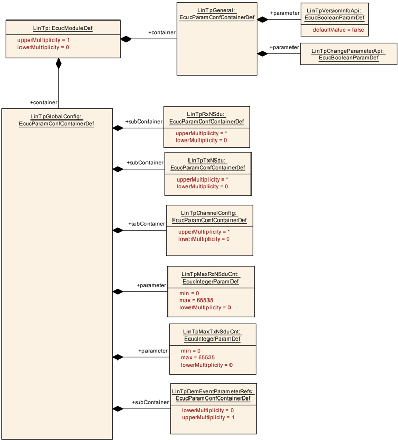

#### 9.4.1. LinTp

| SWS 条目 | [ECUC_LinTp_00425] |
| --- | --- |
| 模块名称 | LinTp |
| 描述 | **LIN** 传输协议的配置。 |
| 构建后变体支持 | true |
| 支持的配置变体 | VARIANT-LINK-TIME、VARIANT-POST-BUILD、VARIANT-PRE-COMPILE |

**包含的容器**

| 容器名称 | 多重性 | 作用域/依赖 |
| --- | --- | --- |
| LinTpGeneral | 1 | 包含所有 **LIN** 传输协议通用参数的容器。 |
| LinTpGlobalConfig | 1 | 此容器包含 **LinTp** 的全局配置参数。 |

#### 9.4.2. LinTpGeneral

| SWS 条目 | [ECUC_LinTp_00617] |
| --- | --- |
| 容器名称 | LinTpGeneral |
| 父容器 | LinTp |
| 描述 | 包含所有 **LIN** 传输协议通用参数的容器。 |

| SWS 条目 | [ECUC_LinTp_00638] |
| --- | --- |
| 参数名称 | LinTpChangeParameterApi |
| 父容器 | LinTpGeneral |
| 描述 | 此参数若设置为 **true**，则为本模块启用 **LinTp_ChangeParameter API**。 |
| 多重性 | 1 |
| 类型 | EcucBooleanParamDef |
| 默认值 | - |
| 构建后变体值 | false |
| 值配置类 | Pre-compile time：X；Link time：-；Post-build time：- |
| 作用域/依赖 | scope: local |

| SWS 条目 | [ECUC_LinTp_00068] |
| --- | --- |
| 参数名称 | LinTpVersionInfoApi |
| 父容器 | LinTpGeneral |
| 描述 | 打开或关闭 **LinTp_GetVersionInfo** 函数。 |
| 多重性 | 1 |
| 类型 | EcucBooleanParamDef |
| 默认值 | false |
| 构建后变体值 | false |
| 值配置类 | Pre-compile time：X；Link time：-；Post-build time：- |
| 作用域/依赖 | scope: local |

#### 9.4.3. LinTpGlobalConfig

| SWS 条目 | [ECUC_LinTp_00056] |
| --- | --- |
| 容器名称 | LinTpGlobalConfig |
| 父容器 | LinTp |
| 描述 | 此容器包含 **LinTp** 的全局配置参数。 |

| SWS 条目 | [ECUC_LinTp_00635] |
| --- | --- |
| 参数名称 | LinTpMaxRxNSduCnt |
| 父容器 | LinTpGlobalConfig |
| 描述 | **NSDU** 的最大数量。仅在使用静态内存分配的构建后可加载实现的情况下才需要此参数。 |
| 多重性 | 0..1 |
| 类型 | EcucIntegerParamDef |
| 取值范围 | 0 .. 65535 |
| 默认值 | - |
| 构建后变体值 | false |
| 值配置类 | Pre-compile time：X（VARIANT-PRE-COMPILE）；Link time：X（VARIANT-LINK-TIME、VARIANT-POST-BUILD）；Post-build time：- |
| 作用域/依赖 | scope: local |

| SWS 条目 | [ECUC_LinTp_00636] |
| --- | --- |
| 参数名称 | LinTpMaxTxNSduCnt |
| 父容器 | LinTpGlobalConfig |
| 描述 | **NSDU** 的最大数量。仅在使用静态内存分配的构建后可加载实现的情况下才需要此参数。 |
| 多重性 | 0..1 |
| 类型 | EcucIntegerParamDef |
| 取值范围 | 0 .. 65535 |
| 默认值 | - |
| 构建后变体值 | false |
| 值配置类 | Pre-compile time：X（VARIANT-PRE-COMPILE）；Link time：X（VARIANT-LINK-TIME、VARIANT-POST-BUILD）；Post-build time：- |
| 作用域/依赖 | scope: local |

**包含的容器**

| 容器名称 | 多重性 | 作用域/依赖 |
| --- | --- | --- |
| LinTpChannelConfig | 0..* | 此容器包含 **LinTp** 的通道特定配置参数。 |
| LinTpDemEventParameterRefs | 0..1 | 用于引用 **DemEventParameter** 元素的容器，在相应错误发生时需通过 **Dem_SetEventStatus** API 调用这些元素。事件 ID 取自所引用 **DemEventParameter** 的 **DemEventId** 符号值。此处提供标准化错误，并可通过供应商特定错误引用进行扩展。 |
| LinTpRxNSdu | 0..* | 该节点所连接的任意通道上，每个接收的 **N-SDU** 对应一个此容器。此 **N-SDU** 生成 **LIN_NAD_8** 类型的元数据项。 |
| LinTpTxNSdu | 0..* | 该节点所连接的任意通道上，每个发送的 **N-SDU** 对应一个此容器。此 **N-SDU** 消耗 **LIN_NAD_8** 类型的元数据项。 |

#### 9.4.4. LinTpChannelConfig

| SWS 条目 | [ECUC_LinTp_00071] |
| --- | --- |
| 容器名称 | LinTpChannelConfig |
| 父容器 | LinTpGlobalConfig |
| 描述 | 此容器包含 **LinTp** 的通道特定配置参数。 |
| 构建后变体多重性 | true |
| 多重性配置类 | Pre-compile time：X（VARIANT-PRE-COMPILE）；Link time：X（VARIANT-LINK-TIME）；Post-build time：X（VARIANT-POST-BUILD） |

| SWS 条目 | [ECUC_LinTp_00072] |
| --- | --- |
| 参数名称 | LinTpDropNotRequestedNad |
| 父容器 | LinTpChannelConfig |
| 描述 | 配置是否丢弃未被请求的 **LIN** 从节点的 **TP** 帧。**TRUE**：丢弃未被请求的 **LIN** 从节点的 **TP** 帧；**FALSE**：保留未被请求的 **LIN** 从节点的 **TP** 帧。仅由 **LIN** 主节点使用，从节点忽略。 |
| 多重性 | 1 |
| 类型 | EcucBooleanParamDef |
| 默认值 | true |
| 构建后变体值 | true |
| 值配置类 | Pre-compile time：X（VARIANT-PRE-COMPILE）；Link time：X（VARIANT-LINK-TIME）；Post-build time：X（VARIANT-POST-BUILD） |
| 作用域/依赖 | scope: local |

| SWS 条目 | [ECUC_LinTp_00624] |
| --- | --- |
| 参数名称 | LinTpMaxNumberOfRespPendingFrames |
| 父容器 | LinTpChannelConfig |
| 描述 | 配置允许的响应挂起帧的最大数量。仅由 **LIN** 主节点使用，从节点忽略。 |
| 多重性 | 1 |
| 类型 | EcucIntegerParamDef |
| 取值范围 | 0 .. 65535 |
| 默认值 | - |
| 构建后变体值 | true |
| 值配置类 | Pre-compile time：X（VARIANT-PRE-COMPILE）；Link time：X（VARIANT-LINK-TIME）；Post-build time：X（VARIANT-POST-BUILD） |
| 作用域/依赖 | scope: local |

| SWS 条目 | [ECUC_LinTp_00622] |
| --- | --- |
| 参数名称 | LinTpP2Max |
| 父容器 | LinTpChannelConfig |
| 描述 | 预期响应挂起帧时的 **P2\*** max 超时（秒）。注意，**LinTpP2Max** 的最小值应大于或等于 **LinTpP2Timing** 的值。仅由 **LIN** 主节点使用，从节点忽略。 |
| 多重性 | 1 |
| 类型 | EcucFloatParamDef |
| 取值范围 | [0.05 .. 10] |
| 默认值 | - |
| 构建后变体值 | true |
| 值配置类 | Pre-compile time：X（VARIANT-PRE-COMPILE）；Link time：X（VARIANT-LINK-TIME）；Post-build time：X（VARIANT-POST-BUILD） |
| 作用域/依赖 | scope: local |

| SWS 条目 | [ECUC_LinTp_00625] |
| --- | --- |
| 参数名称 | LinTpP2Timing |
| 父容器 | LinTpChannelConfig |
| 描述 | 以秒为单位定义 **P2max** 超时观察参数。仅由 **LIN** 主节点使用，从节点忽略。 |
| 多重性 | 1 |
| 类型 | EcucFloatParamDef |
| 取值范围 | [0.05 .. 1] |
| 默认值 | - |
| 构建后变体值 | true |
| 值配置类 | Pre-compile time：X（VARIANT-PRE-COMPILE）；Link time：X（VARIANT-LINK-TIME）；Post-build time：X（VARIANT-POST-BUILD） |
| 作用域/依赖 | scope: local |

| SWS 条目 | [ECUC_LinTp_00070] |
| --- | --- |
| 参数名称 | LinTpScheduleChangeDiag |
| 父容器 | LinTpChannelConfig |
| 描述 | 启用或禁用到诊断请求/响应调度的 **BswM_LinTp_RequestMode()** 调用。**false**：不调用 **BswM**；**true**：调用 **BswM**。仅由 **LIN** 主节点使用，从节点忽略。 |
| 多重性 | 1 |
| 类型 | EcucBooleanParamDef |
| 默认值 | false |
| 构建后变体值 | true |
| 值配置类 | Pre-compile time：X（VARIANT-PRE-COMPILE）；Link time：X（VARIANT-LINK-TIME）；Post-build time：X（VARIANT-POST-BUILD） |
| 作用域/依赖 | scope: local |

| SWS 条目 | [ECUC_LinTp_00073] |
| --- | --- |
| 参数名称 | LinTpChannelRef |
| 父容器 | LinTpChannelConfig |
| 描述 | 此 **LinTp** 通道所属通道的索引。 |
| 多重性 | 1 |
| 类型 | 对 ComMChannel 的符号名引用 |
| 构建后变体值 | true |
| 值配置类 | Pre-compile time：X（VARIANT-PRE-COMPILE）；Link time：X（VARIANT-LINK-TIME）；Post-build time：X（VARIANT-POST-BUILD） |
| 作用域/依赖 | scope: local |

#### 9.4.5. LinTpDemEventParameterRefs

| SWS 条目 | [ECUC_LinTp_00639] |
| --- | --- |
| 容器名称 | LinTpDemEventParameterRefs |
| 父容器 | LinTpGlobalConfig |
| 描述 | 用于引用 **DemEventParameter** 元素的容器，在相应错误发生时需通过 **Dem_SetEventStatus** API 调用这些元素。事件 ID 取自所引用 **DemEventParameter** 的 **DemEventId** 符号值。此处提供标准化错误，并可通过供应商特定错误引用进行扩展。 |
| 构建后变体多重性 | false |
| 多重性配置类 | Pre-compile time：X；Link time：-；Post-build time：- |

| SWS 条目 | [ECUC_LinTp_00645] |
| --- | --- |
| 参数名称 | LINIF_E_SCHEDULE_TABLE_SWITCH_REQUEST_NOT_ACCEPTED |
| 父容器 | LinTpDemEventParameterRefs |
| 描述 | 对 **DemEventParameter** 元素的引用，在发生 **LINIF_E_SCHEDULE_TABLE_SWITCH_REQUEST_NOT_ACCEPTED** 错误时需通过 **Dem_SetEventStatus** API 调用该元素。事件 ID 取自所引用 **DemEventParameter** 的 **DemEventId** 符号值。 |
| 多重性 | 0..1 |
| 类型 | 对 DemEventParameter 的符号名引用 |
| 构建后变体多重性 | false |
| 构建后变体值 | false |
| 多重性配置类 | Pre-compile time：X；Link time：-；Post-build time：- |
| 值配置类 | Pre-compile time：X；Link time：-；Post-build time：- |
| 作用域/依赖 | scope: ECU |

| SWS 条目 | [ECUC_LinTp_00644] |
| --- | --- |
| 参数名称 | LINTP_E_DROPPED_CONSECUTIVE_FRAMES_DETECTED |
| 父容器 | LinTpDemEventParameterRefs |
| 描述 | 对 **DemEventParameter** 元素的引用，在发生 **LINTP_E_DROPPED_CONSECUTIVE_FRAMES_DETECTED** 错误时需通过 **Dem_SetEventStatus** API 调用该元素。事件 ID 取自所引用 **DemEventParameter** 的 **DemEventId** 符号值。 |
| 多重性 | 0..1 |
| 类型 | 对 DemEventParameter 的符号名引用 |
| 构建后变体多重性 | false |
| 构建后变体值 | false |
| 多重性配置类 | Pre-compile time：X；Link time：-；Post-build time：- |
| 值配置类 | Pre-compile time：X；Link time：-；Post-build time：- |
| 作用域/依赖 | scope: ECU |

| SWS 条目 | [ECUC_LinTp_00640] |
| --- | --- |
| 参数名称 | LINTP_E_LINTPNAS_TIMEOUT_OCCURRED |
| 父容器 | LinTpDemEventParameterRefs |
| 描述 | 对 **DemEventParameter** 元素的引用，在发生 **LINTP_E_LINTPNAS_TIMEOUT_OCCURRED** 错误时需通过 **Dem_SetEventStatus** API 调用该元素。事件 ID 取自所引用 **DemEventParameter** 的 **DemEventId** 符号值。 |
| 多重性 | 0..1 |
| 类型 | 对 DemEventParameter 的符号名引用 |
| 构建后变体多重性 | false |
| 构建后变体值 | false |
| 多重性配置类 | Pre-compile time：X；Link time：-；Post-build time：- |
| 值配置类 | Pre-compile time：X；Link time：-；Post-build time：- |
| 作用域/依赖 | scope: ECU |

| SWS 条目 | [ECUC_LinTp_00642] |
| --- | --- |
| 参数名称 | LINTP_E_LINTPNCR_TIMEOUT_OCCURRED |
| 父容器 | LinTpDemEventParameterRefs |
| 描述 | 对 **DemEventParameter** 元素的引用，在发生 **LINTP_E_LINTPNCR_TIMEOUT_OCCURRED** 错误时需通过 **Dem_SetEventStatus** API 调用该元素。事件 ID 取自所引用 **DemEventParameter** 的 **DemEventId** 符号值。 |
| 多重性 | 0..1 |
| 类型 | 对 DemEventParameter 的符号名引用 |
| 构建后变体多重性 | false |
| 构建后变体值 | false |
| 多重性配置类 | Pre-compile time：X；Link time：-；Post-build time：- |
| 值配置类 | Pre-compile time：X；Link time：-；Post-build time：- |
| 作用域/依赖 | scope: ECU |

| SWS 条目 | [ECUC_LinTp_00641] |
| --- | --- |
| 参数名称 | LINTP_E_LINTPNCS_TIMEOUT_OCCURRED |
| 父容器 | LinTpDemEventParameterRefs |
| 描述 | 对 **DemEventParameter** 元素的引用，在发生 **LINTP_E_LINTPNCS_TIMEOUT_OCCURRED** 错误时需通过 **Dem_SetEventStatus** API 调用该元素。事件 ID 取自所引用 **DemEventParameter** 的 **DemEventId** 符号值。 |
| 多重性 | 0..1 |
| 类型 | 对 DemEventParameter 的符号名引用 |
| 构建后变体多重性 | false |
| 构建后变体值 | false |
| 多重性配置类 | Pre-compile time：X；Link time：-；Post-build time：- |
| 值配置类 | Pre-compile time：X；Link time：-；Post-build time：- |
| 作用域/依赖 | scope: ECU |

| SWS 条目 | [ECUC_LinTp_00643] |
| --- | --- |
| 参数名称 | LINTP_E_SWAPPED_CONSECUTIVE_FRAMES_RECEIVED |
| 父容器 | LinTpDemEventParameterRefs |
| 描述 | 对 **DemEventParameter** 元素的引用，在发生 **LINTP_E_SWAPPED_CONSECUTIVE_FRAMES_RECEIVED** 错误时需通过 **Dem_SetEventStatus** API 调用该元素。事件 ID 取自所引用 **DemEventParameter** 的 **DemEventId** 符号值。 |
| 多重性 | 0..1 |
| 类型 | 对 DemEventParameter 的符号名引用 |
| 构建后变体多重性 | false |
| 构建后变体值 | false |
| 多重性配置类 | Pre-compile time：X；Link time：-；Post-build time：- |
| 值配置类 | Pre-compile time：X；Link time：-；Post-build time：- |
| 作用域/依赖 | scope: ECU |

#### 9.4.6. LinTpRxNSdu

| SWS 条目 | [ECUC_LinTp_00428] |
| --- | --- |
| 容器名称 | LinTpRxNSdu |
| 父容器 | LinTpGlobalConfig |
| 描述 | 该节点所连接的任意通道上，每个接收的 **N-SDU** 对应一个此容器。此 **N-SDU** 生成 **LIN_NAD_8** 类型的元数据项。 |
| 构建后变体多重性 | true |
| 多重性配置类 | Pre-compile time：X（VARIANT-PRE-COMPILE）；Link time：X（VARIANT-LINK-TIME）；Post-build time：X（VARIANT-POST-BUILD） |

| SWS 条目 | [ECUC_LinTp_00632] |
| --- | --- |
| 参数名称 | LinTpNcr |
| 父容器 | LinTpRxNSdu |
| 描述 | **N_Cr** 超时的值（秒）。**N_Cr** 是直到接收到下一个连续帧 **N_PDU** 的时间。 |
| 多重性 | 0..1 |
| 类型 | EcucFloatParamDef |
| 取值范围 | [0 .. 1] |
| 默认值 | - |
| 构建后变体多重性 | true |
| 构建后变体值 | true |
| 多重性配置类 | Pre-compile time：X（VARIANT-PRE-COMPILE）；Link time：X（VARIANT-LINK-TIME）；Post-build time：X（VARIANT-POST-BUILD） |
| 值配置类 | Pre-compile time：X（VARIANT-PRE-COMPILE）；Link time：X（VARIANT-LINK-TIME）；Post-build time：X（VARIANT-POST-BUILD） |
| 作用域/依赖 | scope: local |

| SWS 条目 | [ECUC_LinTp_00061] |
| --- | --- |
| 参数名称 | LinTpRxNSduId |
| 父容器 | LinTpRxNSdu |
| 描述 | 传输协议报文的标识符。上层将使用此 **ID** 调用 **LinTp_ChangeParameter**。 |
| 多重性 | 1 |
| 类型 | EcucIntegerParamDef（为此参数生成符号名称） |
| 取值范围 | 0 .. 65535 |
| 默认值 | - |
| 构建后变体值 | false |
| 值配置类 | Pre-compile time：X；Link time：-；Post-build time：- |
| 作用域/依赖 | scope: local |

| SWS 条目 | [ECUC_LinTp_00062] |
| --- | --- |
| 参数名称 | LinTpRxNSduNad |
| 父容器 | LinTpRxNSdu |
| 描述 | 在 **LIN** 上传输的 **N-SDU** 使用特定从节点的 **NAD** 进行标识。 |
| 多重性 | 1 |
| 类型 | EcucIntegerParamDef |
| 取值范围 | 0 .. 255 |
| 默认值 | - |
| 构建后变体值 | true |
| 值配置类 | Pre-compile time：X（VARIANT-PRE-COMPILE）；Link time：X（VARIANT-LINK-TIME）；Post-build time：X（VARIANT-POST-BUILD） |
| 作用域/依赖 | scope: local |

| SWS 条目 | [ECUC_LinTp_00060] |
| --- | --- |
| 参数名称 | LinTpRxNSduChannelRef |
| 父容器 | LinTpRxNSdu |
| 描述 | 此 **N-SDU** 所属通道的索引。 |
| 多重性 | 1 |
| 类型 | 对 ComMChannel 的符号名引用 |
| 构建后变体值 | false |
| 值配置类 | Pre-compile time：X（VARIANT-PRE-COMPILE）；Link time：X（VARIANT-LINK-TIME、VARIANT-POST-BUILD）；Post-build time：- |
| 作用域/依赖 | scope: local |

| SWS 条目 | [ECUC_LinTp_00063] |
| --- | --- |
| 参数名称 | LinTpRxNSduPduRef |
| 父容器 | LinTpRxNSdu |
| 描述 | 对全局 **PDU** 的引用。 |
| 多重性 | 1 |
| 类型 | 对 Pdu 的引用 |
| 构建后变体值 | true |
| 值配置类 | Pre-compile time：X（VARIANT-PRE-COMPILE）；Link time：X（VARIANT-LINK-TIME）；Post-build time：X（VARIANT-POST-BUILD） |
| 作用域/依赖 | scope: ECU |

#### 9.4.7. LinTpTxNSdu

| SWS 条目 | [ECUC_LinTp_00511] |
| --- | --- |
| 容器名称 | LinTpTxNSdu |
| 父容器 | LinTpGlobalConfig |
| 描述 | 该节点所连接的任意通道上，每个发送的 **N-SDU** 对应一个此容器。此 **N-SDU** 消耗 **LIN_NAD_8** 类型的元数据项。 |
| 构建后变体多重性 | true |
| 多重性配置类 | Pre-compile time：X（VARIANT-PRE-COMPILE）；Link time：X（VARIANT-LINK-TIME）；Post-build time：X（VARIANT-POST-BUILD） |

| SWS 条目 | [ECUC_LinTp_00637] |
| --- | --- |
| 参数名称 | LinTpMaxBufReq |
| 父容器 | LinTpTxNSdu |
| 描述 | 此参数定义 **LinTp** 应向上层请求发送缓冲区的最大次数。它还用于在没有活动定时器时限制 **PduR_LinTpCopyTxData** 的重试次数。 |
| 多重性 | 1 |
| 类型 | EcucIntegerParamDef |
| 取值范围 | 0 .. 255 |
| 默认值 | - |
| 构建后变体值 | true |
| 值配置类 | Pre-compile time：X（VARIANT-PRE-COMPILE）；Link time：X（VARIANT-LINK-TIME）；Post-build time：X（VARIANT-POST-BUILD） |
| 作用域/依赖 | scope: local |

| SWS 条目 | [ECUC_LinTp_00633] |
| --- | --- |
| 参数名称 | LinTpNas |
| 父容器 | LinTpTxNSdu |
| 描述 | **N_As** 超时的值（秒）。**N_As** 是发送方发送 **LIN** 帧（任何 **N_PDU**）的时间。 |
| 多重性 | 1 |
| 类型 | EcucFloatParamDef |
| 取值范围 | [0 .. 1] |
| 默认值 | - |
| 构建后变体值 | true |
| 值配置类 | Pre-compile time：X（VARIANT-PRE-COMPILE）；Link time：X（VARIANT-LINK-TIME）；Post-build time：X（VARIANT-POST-BUILD） |
| 作用域/依赖 | scope: local |

| SWS 条目 | [ECUC_LinTp_00634] |
| --- | --- |
| 参数名称 | LinTpNcs |
| 父容器 | LinTpTxNSdu |
| 描述 | **N_Cs** 性能需求的值（秒）。**N_Cs** 是从 **CF N-PDU** 的发送请求到下一个 **CF N-PDU** 的发送请求之间所经过的时间。 |
| 多重性 | 0..1 |
| 类型 | EcucFloatParamDef |
| 取值范围 | [0 .. INF] |
| 默认值 | - |
| 构建后变体多重性 | true |
| 构建后变体值 | true |
| 多重性配置类 | Pre-compile time：X（VARIANT-PRE-COMPILE）；Link time：X（VARIANT-LINK-TIME）；Post-build time：X（VARIANT-POST-BUILD） |
| 值配置类 | Pre-compile time：X（VARIANT-PRE-COMPILE）；Link time：X（VARIANT-LINK-TIME）；Post-build time：X（VARIANT-POST-BUILD） |
| 作用域/依赖 | scope: local |

| SWS 条目 | [ECUC_LinTp_00065] |
| --- | --- |
| 参数名称 | LinTpTxNSduId |
| 父容器 | LinTpTxNSdu |
| 描述 | 传输协议报文的标识符。此 **ID** 是与上层通信所使用的 **ID**。 |
| 多重性 | 1 |
| 类型 | EcucIntegerParamDef（为此参数生成符号名称） |
| 取值范围 | 0 .. 65535 |
| 默认值 | - |
| 构建后变体值 | false |
| 值配置类 | Pre-compile time：X；Link time：-；Post-build time：- |
| 作用域/依赖 | scope: local |

| SWS 条目 | [ECUC_LinTp_00066] |
| --- | --- |
| 参数名称 | LinTpTxNSduNad |
| 父容器 | LinTpTxNSdu |
| 描述 | 在 **LIN** 上传输的 **N-SDU** 使用特定从节点的 **NAD** 进行标识。 |
| 多重性 | 1 |
| 类型 | EcucIntegerParamDef |
| 取值范围 | 0 .. 255 |
| 默认值 | - |
| 构建后变体值 | true |
| 值配置类 | Pre-compile time：X（VARIANT-PRE-COMPILE）；Link time：X（VARIANT-LINK-TIME）；Post-build time：X（VARIANT-POST-BUILD） |
| 作用域/依赖 | scope: local |

| SWS 条目 | [ECUC_LinTp_00064] |
| --- | --- |
| 参数名称 | LinTpTxNSduChannelRef |
| 父容器 | LinTpTxNSdu |
| 描述 | 此 **N-SDU** 所属通道的索引。 |
| 多重性 | 1 |
| 类型 | 对 ComMChannel 的符号名引用 |
| 构建后变体值 | false |
| 值配置类 | Pre-compile time：X（VARIANT-PRE-COMPILE）；Link time：X（VARIANT-LINK-TIME、VARIANT-POST-BUILD）；Post-build time：- |
| 作用域/依赖 | scope: local |

| SWS 条目 | [ECUC_LinTp_00067] |
| --- | --- |
| 参数名称 | LinTpTxNSduPduRef |
| 父容器 | LinTpTxNSdu |
| 描述 | 对全局 **PDU** 的引用。 |
| 多重性 | 1 |
| 类型 | 对 Pdu 的引用 |
| 构建后变体值 | true |
| 值配置类 | Pre-compile time：X（VARIANT-PRE-COMPILE）；Link time：X（VARIANT-LINK-TIME）；Post-build time：X（VARIANT-POST-BUILD） |
| 作用域/依赖 | scope: ECU |

### 9.5. 发布信息

详细信息请参阅 **SWS_BSWGeneral** [\[7\]](#ref-7) 的第 10.3 章「发布信息」（**Published Information**）。

## B. AUTOSAR 可追溯项变更历史

请注意，本章中的列表还包括在后续版本中已从规范中移除的可追溯项。这些条目在文档中不作为超链接出现。

### B.1. 本文档按 AUTOSAR 发布版本 R23-11 的可追溯项历史

源文档的此小节没有包含任何内容（变更历史表缺失）。
