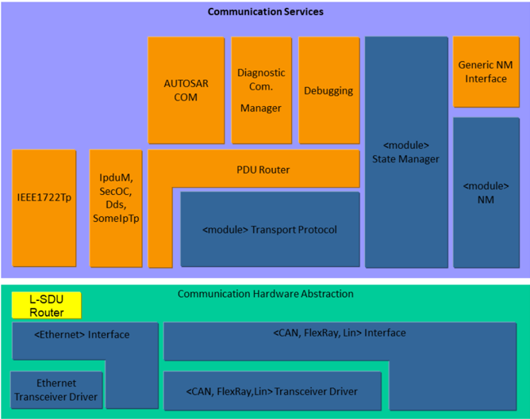
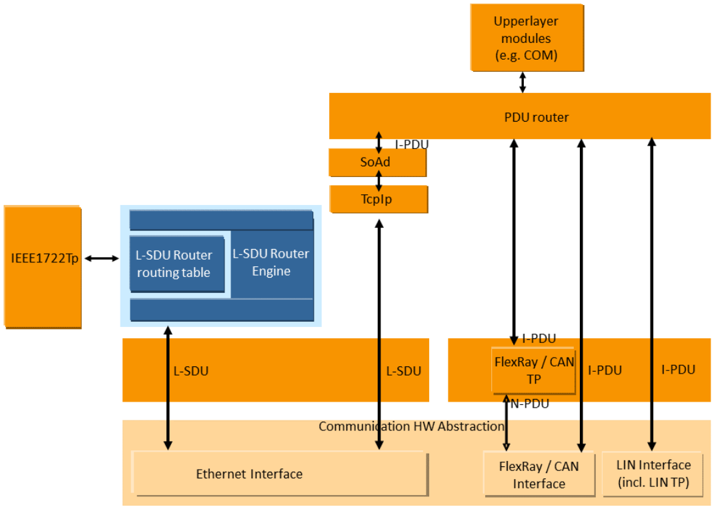
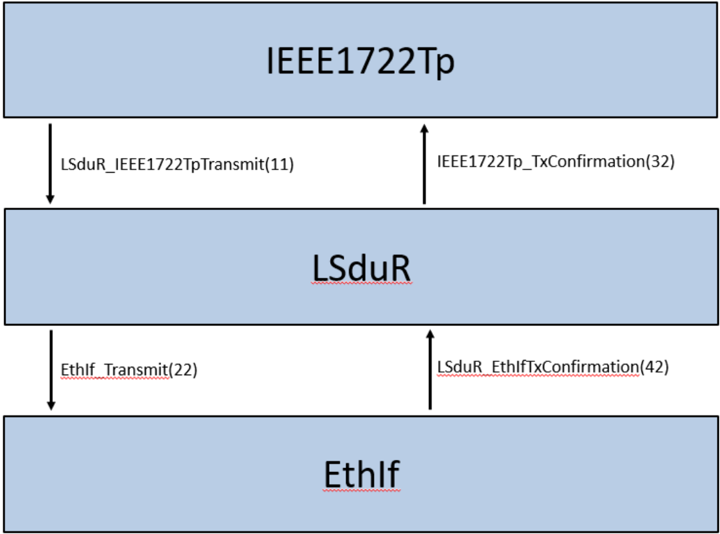
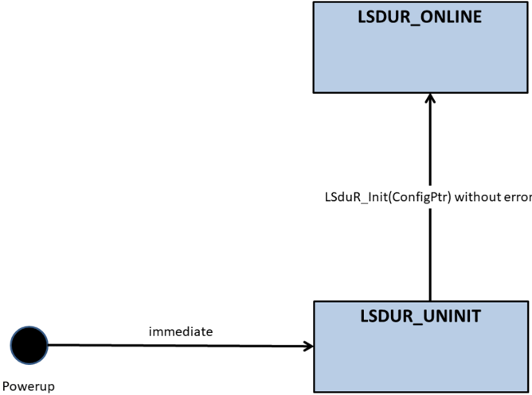
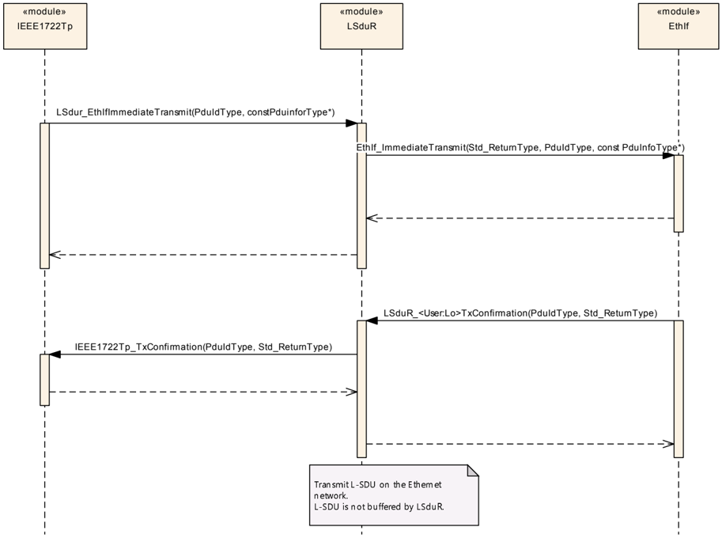
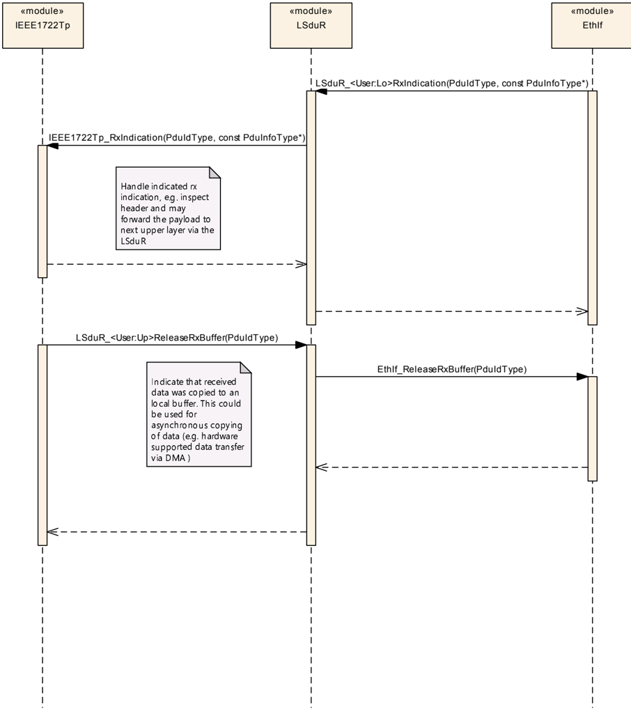
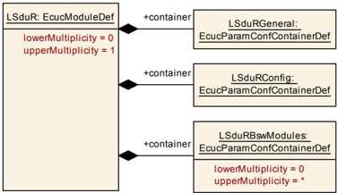
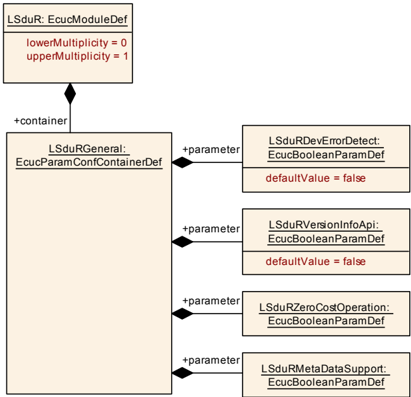
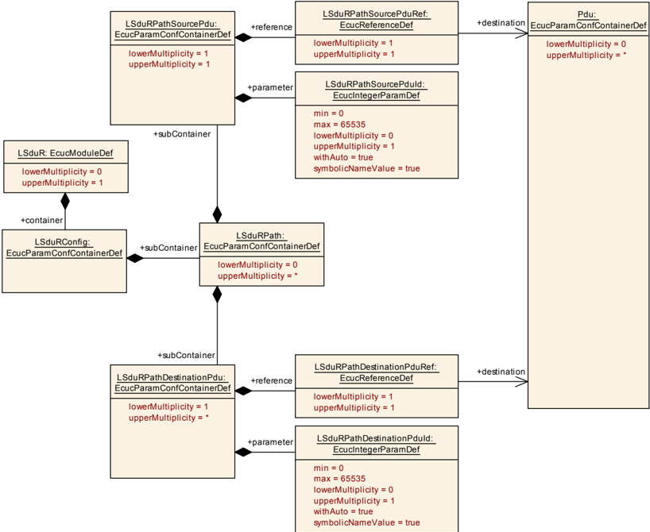
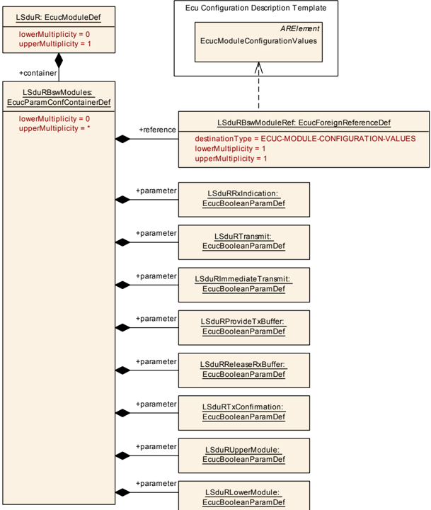

## 1. 简介和功能概述

本规范描述 AUTOSAR 基础软件模块 **L-SDU Router** 的功能、API 和配置。L-SDU Router 模块使用以下模块类型提供路由 L-SDU（Link Layer Service Data Unit，链路层服务数据单元）的服务：

* 使用 &lt;Provider:Up&gt; 或 &lt;Provider:Lo&gt; API 的通信接口模块，例如 **EthIf**、**IEEE1722Tp**；

L-SDU 的路由基于静态定义的 L-SDU 标识符执行。因此，运行期间不会动态路由任何 L-SDU，例如不依赖于其载荷。

相关模块的位置可以是「上层」（例如 **IEEE1722Tp**）和/或「下层」（例如 **EthIf**）。

**注意：**

* R23-11：L-SDU Router 充当以太网接口（**Ethernet Interface**）与 **IEEE1722Tp** 模块之间的直通（pass-through）模块。
* R23-11 之后：L-SDU Router 将被扩展为所有通信接口模块的强制上层，以及所有直接链接模块（**PduR**、&lt;Bus&gt;Nm、&lt;Bus&gt;Tp、&lt;Bus&gt;TSyn、XCPon&lt;Bus&gt;）的强制下层。L-SDU Router 将被扩展以提供与 PDU Router 类似的网关功能。

L-SDU Router 模块基于一种接口化模块的通用方法。被接口的模块在 L-SDU Router 模块配置中进行配置。

### 1.1. AUTOSAR 架构

L-SDU Router 充当以太网接口与 **IEEE1722Tp** 模块之间的直通模块（参见 [\[1\]](#ref-1)）。

注意：R23-11 之后，L-SDU Router 模块将被扩展为 AUTOSAR 通信结构中位于通信硬件抽象层与通信服务层之间的中央模块。

图 1.1 给出了 AUTOSAR 通信结构的总览。



### 1.2. L-SDU Router 模块功能总览

详细的 L-SDU Router 模块结构如图 1.2 所示。



L-SDU Router 模块主要由两部分组成：

* **L-SDU Router 路由路径**：静态路由路径，描述每个待路由 L-SDU 的路由属性。路由路径可以（如果支持的话）在 ECU 编程状态下以 post-build 可加载（post-build loadable）的方式更新，或者在初始化 L-SDU Router 时以 post-build 可选（post-build selectable）的方式选择（见第 9.1.1 章）。
* **L-SDU Router 引擎**：根据 L-SDU Router 路由路径执行路由动作的实际代码。L-SDU Router 引擎必须处理：
  * 将 L-SDU 从源路由到目标，
  * 将源 L-SDU ID 转换为目标 L-SDU ID（例如 LSduR_IEEE1722Tp_RxIndication 转换为 IEEE1722Tp_RxIndication）。

### 1.3. L-SDU 处理

L-SDU 通过静态 L-SDU ID 标识。L-SDU Router 模块使用静态配置表中的 L-SDU ID 确定 L-SDU 的目标。L-SDU 用于 L-SDU Router 模块正上方模块之间的数据交换，例如 **IEEE1722Tp** 模块。L-SDU Router 模块的路由操作不修改 L-SDU，它只是将 L-SDU 转发给目标模块。

L-SDU ID 在实现该 API 的配置中设置。这使得每个接收 L-SDU ID 的模块都能高效地实现查找表（例如 L-SDU Router 模块的配置包含 LSduR_EthIfTxConfirmation 的 L-SDU ID，而 **EthIf** 模块的配置包含 EthIf_Transmit 的 L-SDU ID）。

以下列表总结了 LSduR 的路由能力：

1. L-SDU 转发
   * 从上层传输
     * 通信接口
       * 将 L-SDU 以单播（1:1）方式从本地模块发送到通信接口模块。
   * 接收至上层
     * 通信接口
       * 将 L-SDU 以单播（1:1）方式从通信接口模块发送到本地模块。

## 2. 缩略语

下表列出了与 **LSduR** 模块相关、但未包含在 [2, AUTOSAR 术语表] 中的首字母缩略词和缩略语。

**PDU**
> Protocol Data Unit —— 协议数据单元。

**I-PDU**
> Interaction Layer PDU —— 交互层 PDU。一个 I-PDU 由数据（缓冲区）、长度和 I-PDU ID 组成。

**I-PDU ID**
> I-PDU Identifier —— I-PDU 标识符。

**L-PDU**
> Data Link Layer PDU —— 数据链路层 PDU。一个或多个 I-PDU 被打包进一个 L-PDU。L-PDU 是总线特定的，例如以太网帧。

**L-PDU ID**
> L-PDU Identifier —— L-PDU 标识符。

**SDU**
> Service Data Unit —— 服务数据单元。

**L-SDU**
> Data link layer service data unit —— 链路层服务数据单元。一个 L-SDU 由数据（缓冲区）、长度、L-SDU ID 以及可能经由元数据（meta data）传输的 L-PDU 特定信息组成。

**L-SDU ID**
> L-SDU identifier —— L-SDU 标识符。

**L-SDU Router**
> 在模块之间传输 L-SDU 的模块。L-SDU Router 模块可用于内部路由目的。

**Upper Layer Modules（Up）**
> 位于 L-SDU Router 之上的模块。该层通常包括 **IEEE1722Tp**。

**Lower Layer Modules（Lo）**
> 位于 L-SDU Router 之下的模块。该层包括以太网通信接口模块。

**&lt;SrcLo&gt;**
> 作为 L-SDU 源的下层通信接口模块。SrcLo 始终只有一个。

**&lt;DstLo&gt;**
> 作为 L-SDU 目标的下层通信接口模块。DstLo 可以是一对多。

**&lt;Lo&gt;**
> 下层通信接口模块。

**&lt;Up&gt;**
> 上层通信接口模块。

## 3. 相关文档

### 3.1. 输入文件和相关标准与规范

<a id="ref-1"></a>[1] Layered Software Architecture
> AUTOSAR_CP_EXP_LayeredSoftwareArchitecture

<a id="ref-2"></a>[2] Glossary
> AUTOSAR_FO_TR_Glossary

<a id="ref-3"></a>[3] General Specification of Basic Software Modules
> AUTOSAR_CP_SWS_BSWGeneral

<a id="ref-4"></a>[4] General Requirements on Basic Software Modules
> AUTOSAR_CP_SRS_BSWGeneral

<a id="ref-5"></a>[5] Requirements on Gateway
> AUTOSAR_CP_SRS_Gateway

<a id="ref-6"></a>[6] Specification of IEEE1722 Transport Protocol Module
> AUTOSAR_CP_SWS_IEEE1722TransportLayer

<a id="ref-7"></a>[7] List of Basic Software Modules
> AUTOSAR_CP_TR_BSWModuleList

<a id="ref-8"></a>[8] Specification of ECU Configuration
> AUTOSAR_CP_TPS_ECUConfiguration

### 3.2. 相关规范

AUTOSAR 提供了一份关于基础软件模块的通用规范 [3, SWS BSW General]，它同样适用于 **LSduR**。

因此，SWS BSW General 规范应被视为 **LSduR** 的附加且必需的规范。

## 4. 约束和假设

### 4.1. 限制

L-SDU Router 模块不具备以下机制：

* 信号提取或转换，
* 数据完整性检查（如校验和），
* 更改或修改 L-SDU，
* 任何依赖 L-SDU 载荷的路由决策。

#### 4.1.1. 支持功能的限制

在 R23-11 中，L-SDU Router 被视为 **IEEE1722Tp** 与 **EthIf** 之间的直通模块：

* 网关功能不包含在 L-SDU Router 中
* L-SDU Router 只与 **IEEE1722Tp** 和 **EthIf** 交互

### 4.2. 汽车域的适用性

R23-11：L-SDU Router 用于所有需要通过 **IEEE1722Tp** 模块进行通信的 ECU。

R23-11 之后：L-SDU Router 用于所有需要通信的 ECU。

## 5. 对其他模块的依赖

L-SDU Router 模块依赖于所使用的通信硬件抽象层模块和通信服务层模块的 API 与能力。L-SDU Router 模块所需的基本 API 函数如下：

通信接口模块：

* &lt;Lo&gt;_Transmit（例如 EthIf_Transmit）

处理来自通信接口模块的 I-PDU 的上层模块：

* &lt;Up&gt;_RxIndication（例如 IEEE1722Tp_RxIndication）
* &lt;Up&gt;_TxConfirmation（例如 IEEE1722Tp_TxConfirmation）

### 5.1. 文件结构

#### 5.1.1. 代码文件结构

有关详细信息，可参见 [3, SWS_BSWGeneral] 中的第 5.1.6 章「Code file structure」（代码文件结构）。

本规范没有完整定义代码文件结构。然而，为了允许与其他模块集成，需要以下结构。

#### 5.1.2. 头文件结构

L-SDU Router 模块应在独立的头文件中提供由不同模块使用的函数。

示例：如果使用了 **EthIf**，则 L-SDU Router 模块应提供 LSduR_EthIf.h。

L-SDU Router 实现应包含 Det.h。

所有 L-SDU Router 头文件应包含软件版本号和规范版本号。

这种结构允许将平台、编译器和实现特定的定义与声明同通用定义分离，以及将源代码与配置分离。

### 5.2. 版本检查

有关详细信息，可参见 [3, SWS_BSWGeneral] 中的第 5.1.8 章「Version Check」（版本检查）。

## 6. 功能规格

L-SDU Router 模块是一个 L-SDU 传输单元，位于以太网接口模块（下层模块）之上、**IEEE1722Tp** 模块（上层模块）之下，参见图 1.1。

除 L-SDU Router 模块外，还有支持 IEEE1722 流相关通信的 **IEEE1722Tp** 模块 [\[6\]](#ref-6)。**IEEE1722Tp** 模块是上层模块，它通过调用 L-SDU Router 模块的 Transmit 来请求传输。L-SDU Router 模块通过调用 **IEEE1722Tp** 模块的 RxIndication 转发数据接收，或通过调用其 TxConfirmation 指示传输确认。

从 ECU 的角度看，L-SDU Router 模块可以执行两类不同的操作：

* **PDU 接收至本地模块**：从一个下层模块接收 L-SDU 并将其转发给一个或多个上层模块，
* **来自本地模块的 PDU 传输**：根据一个上层模块的请求，将 L-SDU 传输到一个下层模块，

当 LSduR 报告开发错误、运行时错误或瞬态故障时，它在调用 **Default Error Tracer** 模块时应使用调用者模块的 moduleId 作为实例 Id。

例如：当在 LSduR_EthIfRxIndication 期间检测到错误时，应调用 Det_ReportError(51（LSduR 的模块 ID）, 65（EthIf 的 ModuleId，用作 InstanceId）, 0x42, [LSDUR_E_PDU_INSTANCES_LOST](#672-运行时错误))。

**注意：**标准化的模块 ID 见基础软件模块列表文档 [\[7\]](#ref-7)。参数 LSduRBswModuleRef 标识所使用的模块。利用该信息可以在 BswModuleDescription.moduleId 中检索到 moduleId。

### 6.1. L-SDU 处理

L-SDU Router 模块应以一致的方式将 L-SDU 不加修改地从源模块传输到目标模块。

L-SDU 由 L-SDU ID 和/或符号名（即 PDU 容器的 Symbolic NameValue，[8, Specification of ECU Configuration]）标识。对于 post-build，L-SDU ID 是必需的，因为 L-SDU 必须在 L-SDU Router 模块编译后被标识。如果 L-SDU Router 模块是预编译的（即源代码形式），则可以使用符号名，参见 [8, Specification of ECU Configuration]。

每个处理 L-SDU 并提供 L-SDU API 的 **BSW** 模块必须包含一个 L-SDU ID 列表 [\[8\]](#ref-8)。这意味着每个被调用的模块都有一个标识 PDU 的查找表。

示例：**IEEE1722Tp** 模块调用 LSduR_IEEE1722TpTransmit（此处 L-SDU Router 模块配置包含该 L-SDU ID），L-SDU Router 模块将调用 EthIf_Transmit（此处 **EthIf** 模块配置包含该 L-SDU ID），**EthIf** 将调用 LSduR_EthIfTxConfirmation（此处 L-SDU Router 模块配置包含该 L-SDU ID），L-SDU Router 模块将调用 IEEE1722Tp_TxConfirmation（此处 **IEEE1722Tp** 模块配置包含该 L-SDU ID）。该示例在下图 7.1 中说明（仅显示作为参数的 L-SDU ID）：



L-SDU Router 模块应通过「源模块 L-SDU ID（位于 L-SDU Router 配置中）」与「目标 L-SDU ID（位于被调用的目标模块配置中）」的组合唯一地标识一条路由路径。

L-SDU Router 模块应为 Transmit 路径以及 TxConfirmation/RxIndication 路径都将 L-SDU ID 转换为目标模块。

示例：**IEEE1722Tp** 模块向 **EthIf** 传输一个 L-SDU。LSduR_IEEE1722TpTransmit 被调用。L-SDU Router 模块将把源 L-SDU ID（L-SDU Router 模块配置）转换为 **EthIf** 的一个 L-SDU ID（EthIf 模块配置）。从 **IEEE1722Tp** 模块接收到的 PduInfoType 值不加更改地复制给 **EthIf** 模块。

示例：**EthIf** 模块将使用一个 L-SDU ID 调用 LSduR_EthIfTxConfirmation，并根据传输是否成功，附带结果 E_OK（传输成功）或 E_NOT_OK（传输不成功）。然后 L-SDU Router 模块将转换该 L-SDU ID，并使用转换后的 L-SDU ID 和接收到的结果，通过 IEEE1722Tp_TxConfirmation 将调用转发给 **IEEE1722Tp**。

L-PDU Router 模块应仅按照配置中给出的路由路径路由 L-SDU。

LSduR 生成器（校验）应拒绝由一条路由路径连接不同 MetaDataType 的 L-SDU 的配置。

#### 6.1.1. L-SDU 接收至上层模块

L-SDU Router 模块的接收操作要么由下层模块（通信接口）的 RxIndication（LSduR_&lt;User:Lo&gt;RxIndication）终结，要么（如果已配置）在下层模块的 RxIndication 被调用之后，由接收上层模块（例如 IEEE1722 应用）调用 ReleaseRxBuffer（LSduR_&lt;User:Up&gt;ReleaseRxBuffer）终结。

RxIndication 函数由下层发起，或者是在轮询通信驱动程序之后的周期性函数的上下文中，或者是在中断的上下文中。

ReleaseRxBuffer 函数由上层发起，或者是在 RxIndication 的上下文中，或者是在 RxIndication 被调用之后的周期性函数的上下文中。

##### 6.1.1.1. 通信接口

源通信接口模块通过调用 LSduR_&lt;User:Lo&gt;RxIndication 指示一个已接收的 L-SDU。该 L-SDU 可以具有由路由路径配置的多个本地目标模块。

L-SDU Router 模块应为从通信接口模块接收并路由到一个或多个上层模块的 L-SDU 提供 1:n 路由。

示例：一个 L-SDU 在 **EthIf** 上被接收并转发给 **IEEE1722Tp**。

L-SDU Router 模块应在 LSduR_&lt;User:Lo&gt;RxIndication 被调用时，为每个目标上层模块调用 &lt;Up&gt;_RxIndication。

如果本地模块接收到的 L-SDU 被直接转发，L-SDU Router 不应检查该 L-SDU 的长度。

由于 L-SDU Router 模块不会缓冲该 L-SDU，它不必拒绝比配置更长/更短的 L-SDU。

在单播（1:1）接收的情况下，当上层源模块调用 LSduR_&lt;User:Up&gt;ReleaseRxBuffer 时，L-SDU Router 应调用相应通信接口模块的 &lt;Lo&gt;_ReleaseRxBuffer。

在多播（1:n，n&gt;1）接收的情况下，当已收到相应上层模块的最后一次 LSduR_&lt;User:Up&gt;ReleaseRxBuffer 调用时，L-SDU Router 应调用相应通信接口模块的 &lt;Lo&gt;_ReleaseRxBuffer。

#### 6.1.2. 来自上层模块的 L-SDU 传输

下层目标模块的传输操作始终是异步的。这意味着在 I-PDU 已由 L-SDU Router 模块传递给下层目标之后，传输服务请求立即返回。如果 L-SDU Router 模块在 L-SDU 传输成功或失败后通过 LSduR_&lt;User:Lo&gt;TxConfirmation（通信接口）收到下层目标模块的通知，L-PDU Router 模块将通过 &lt;Up&gt;_TxConfirmation（通信接口）把该确认转发给上层模块。

L-SDU Router 模块的传输操作由来自上层源模块的 L-SDU Transmit 请求触发，L-SDU Router 将该请求转发给下层目标。

在上层源模块进行 L-SDU 传输的情况下，L-SDU 不应缓冲在 L-SDU Router 模块中。

##### 6.1.2.1. 通信接口

L-SDU 可以通过四种方式在通信接口上传输：

1. 直接数据提供——上层模块调用 LSduR_&lt;User:Up&gt;Transmit 函数，L-SDU Router 模块将该调用转发给 &lt;Lo&gt;_Transmit，数据由下层通信接口模块在调用中复制。
2. 直接数据提供——上层模块调用 LSduR_&lt;User:Up&gt;ImmediateTransmit 函数，L-SDU Router 模块将该调用转发给 &lt;Lo&gt;_ImmediateTransmit，数据由下层通信接口模块在调用中复制。
3. 触发传输提供——下层通信接口模块通过使用 LSduR_&lt;User:Lo&gt;TriggerTransmit 请求传输一个 L-SDU，L-SDU Router 模块将该调用转发给 &lt;Up&gt;_TriggerTransmit，数据由上层模块复制到目标的缓冲区中。
4. 触发传输提供——上层模块调用 LSduR_&lt;User:Up&gt;Transmit 函数，L-SDU Router 模块将该调用转发给 &lt;Lo&gt;_Transmit，数据不被下层模块（通信接口模块）复制。数据稍后将由下层使用 LSduR_&lt;User:Lo&gt;TriggerTransmit 请求。

L-SDU 传输的确认对于直接数据提供和触发传输提供是相同的：

当通信接口模块调用 LSduR_&lt;User:Lo&gt;TxConfirmation 时，L-SDU Router 应调用上层模块中的 &lt;Up&gt;_TxConfirmation，并将传输结果从下层模块转发给上层模块。

如果 L-SDU 由上层模块传输，L-SDU Router 模块不应检查该 L-SDU 的长度。

当上层源模块调用 LSduR_&lt;User:Up&gt;Transmit 时，L-SDU Router 应为每个通信接口目标模块调用 &lt;Lo&gt;_Transmit。

如果是单播（1:1），&lt;Lo&gt;_Transmit 调用的返回值应转发给上层源模块。

当上层源模块调用 LSduR_&lt;User:Up&gt;ImmediateTransmit 时，L-SDU Router 应为每个通信接口目标模块调用 &lt;Lo&gt;_ImmediateTransmit。

如果是单播（1:1），&lt;Lo&gt;_ImmediateTransmit 调用的返回值应转发给上层源模块。

###### 6.1.2.1.1. 触发传输数据提供

必须告知上层模块是否必须复位更新位（update-bits）。

L-SDU Router 模块应将通信接口下层模块的 LSduR_&lt;User:Lo&gt;TriggerTransmit 请求通过调用 &lt;Up&gt;_TriggerTransmit 转发给上层模块。

L-SDU Router 模块应将 &lt;Up&gt;_TriggerTransmit 的返回值复制给下层模块。

###### 6.1.2.1.2. 错误处理

对于通过通信接口模块使用单播或多播时发生的错误，不做特定的错误处理。返回值中的错误被转发给上层源模块。

### 6.2. 零成本运行

零成本运行（Zero cost operation）是一种优化，可在源模块和目标模块都是单一的且以源代码形式存在时进行（其中一个模块必须以源代码形式存在，否则 L-SDU Router 必须为函数调用创建胶水代码）。例如，在一个带有 **IEEE1722Tp** 模块和单个以太网的 ECU 上，LSduR_IEEE1722Transmit 可以直接调用 EthIf_Transmit，而 L-SDU Router 模块内部没有任何逻辑。L-SDU Router 成为一个宏层。

只有当路由路径属于配置类 PreCompile 时，才可能进行此优化。

如果 LSduRZeroCostOperation 设置为 true 且所有路由路径都属于配置类 Pre-Compile，则 L-SDU Router 上方或下方的模块可以直接相互调用，而无需使用 LSduR 模块函数。

如果 LSduRZeroCostOperation 设置为 true 且至少有一个路由路径不属于配置类 Pre-Compile，则 L-SDU Router 模块配置生成器应报告错误。

### 6.3. 状态管理

L-SDU Router 模块的状态机如图 7.2 所示。



L-SDU Router 模块中应只存在状态机的一个实例。

L-SDU Router 模块应由两个状态组成，即 [LSduR_StateType](#723-lsdur_statetype) 中定义的 LSDUR_UNINIT 和 LSDUR_ONLINE。

在上电（即调用 [LSduR_Init](#7311-lsdur_init) 函数之前）后，L-SDU Router 模块应处于 LSDUR_UNINIT 状态。

当 L-SDU Router 已通过函数 [LSduR_Init](#7311-lsdur_init) 成功初始化时，L-SDU Router 模块应切换到 LSDUR_ONLINE 状态。

L-SDU Router 模块只有处于在线状态 LSDUR_ONLINE 时，才应根据 L-SDU Router 路由表执行 L-SDU 的路由。

L-SDU Router 模块处于未初始化状态 LSDUR_UNINIT 时不应执行任何路由。

如果 L-SDU Router 模块尚未初始化（状态 LSDUR_UNINIT），则在启用 LSduRDevErrorDetect 的情况下，除 [LSduR_Init](#7311-lsdur_init) 和 [LSduR_GetVersionInfo](#7312-lsdur_getversioninfo) 之外的所有函数在被调用时都应通过 DET 报告错误 [LSDUR_E_UNINIT](#671-开发错误)。

### 6.4. 复杂驱动交互

除 AUTOSAR **IEEE1722Tp** 模块外，复杂驱动（**CDD**）也可以作为 LSduR 的上层或下层模块。

一个 **CDD** 对于 LSduR 是上层模块还是下层模块，可通过 [LSduRBswModules](#925-lsdurbswmodules) 配置的 LSduRUpperModule 或 LSduRLowerModule 配置参数进行配置。

一个 **CDD** 可以需要通信接口 API，具体取决于 [LSduRBswModules](#925-lsdurbswmodules) 配置的 LSduRCommunicationInterface 配置参数（例如 LSduRTransmit）。LSduR 为 **CDD** 交互提供的 API 函数包含由 apiServicePrefix 配置参数指定的 **CDD** 的服务前缀，见下文。

LSduR 为每个上层 **CDD** 提供唯一的传输函数 LSduR_&lt;Cdd&gt;Transmit。当 LSduR 的一个调出函数（callout）被下层模块针对一个由上层 **CDD** 发送或接收的 L-SDU 调用时，LSduR 会调用该 **CDD** 的相应目标函数。

对于需要通信接口 API 的下层 **CDD**，LSduR 提供一组唯一的通信接口 API 函数 LSduR_&lt;Cdd&gt;RxIndication，以及（如果已配置）LSduR_&lt;Cdd&gt;TxConfirmation 和 LSduR_&lt;Cdd&gt;TriggerTransmit，见第 [7.3.3](#733-用于与下层通信接口模块交互的可配置接口定义) 章。

当 LSduR 的一个 API 函数被上层模块针对一个由下层 **CDD** 发送或接收的 L-SDU 调用时，LSduR 会调用该 **CDD** 的相应目标函数。

为了确定一个 L-SDU 是由 **CDD** 发送还是接收，LSduR 必须检查 EcuC 模块中对 PDU 列表的引用的来源：

* 如果一条路由路径的源 L-SDU 引用了 PDU 列表中同样被一个上层 **CDD** 引用的 PDU，则该 L-SDU 由该 **CDD** 发送。
* 如果一条路由路径的目标 L-SDU 引用了 PDU 列表中同样被一个上层 **CDD** 引用的 PDU，则该 L-SDU 由该 **CDD** 接收。
* 如果一条路由路径的源 L-SDU 引用了 PDU 列表中同样被一个下层 **CDD** 引用的 PDU，则该 L-SDU 从该 **CDD** 接收。
* 如果一条路由路径的目标 L-SDU 引用了 PDU 列表中同样被一个下层 **CDD** 引用的 PDU，则该 L-SDU 经由该 **CDD** 发送。

LSduR 应使用 **CDD** 的供应商特定模块定义（EcucModuleDef 元素）的 apiServicePrefix 属性来替换 GenericComServices API 中的 &lt;Lo&gt; 和 &lt;Up&gt; 标签。**CDD** 的供应商特定模块定义可通过配置参数 LSduRBswModuleRef 间接访问，该参数引用 **CDD** 的具体配置的顶层元素（即 EcucModuleConfigurationValues 元素），而该元素引用 **CDD** 的供应商特定模块定义（EcucModuleDef 元素）。

### 6.5. 安全事件

本模块不报告安全事件。

### 6.6. API 参数检查

如果启用了开发错误检测，且一个 PDU 标识符不在指定范围内、同时该 PDU 标识符被配置为由 L-SDU Router 模块使用，则在启用 LSduRDevErrorDetect 的情况下，L-SDU Router 模块应向 DET 模块报告错误 [LSDUR_E_PDU_ID_INVALID](#671-开发错误)。

### 6.7. 错误分类

文档 [3, SWS BSW General]「基础软件模块通用规范」中的「错误处理」一章详细描述了基础软件的错误处理。其中首先给出了一个由五种错误类型组成的分类方案，这些错误可能发生在 **BSW** 模块中。

基于这一基础，下文按相应的子节规定了具体的错误。

#### 6.7.1. 开发错误

| 错误类型 | 相关错误代码 | 错误值 |
|---|---|---|
| 无效的配置指针 | LSDUR_E_INIT_FAILED | 0x00 |
| 在未进行模块初始化的情况下使用 API 服务（[LSduR_GetVersionInfo](#7312-lsdur_getversioninfo) 除外），或在 LSDUR_UNINIT 以外的任何状态下调用 [LSduR_Init](#7311-lsdur_init) | LSDUR_E_UNINIT | 0x01 |
| 无效的 PDU 标识符 | LSDUR_E_PDU_ID_INVALID | 0x02 |
| 传递了 NULL 指针作为参数 | LSDUR_E_PARAM_POINTER | 0x03 |

#### 6.7.2. 运行时错误

| 错误类型 | 相关错误代码 | 错误值 |
|---|---|---|
| 丢失一个 PDU 实例（网关操作中的缓冲区溢出） | LSDUR_E_PDU_INSTANCES_LOST | 0x04 |

#### 6.7.3. 瞬态故障

LSduR 模块没有定义瞬态故障。

#### 6.7.4. 生产错误

IEEE1722Tp 模块没有定义生产错误。

#### 6.7.5. 扩展生产错误

LSduR 模块没有定义扩展生产错误。

## 7. API规范

### 7.1. 导入的类型

本章列出从下列文件中包含的所有类型。

表7.1：模块 **LSduR** 导入的数据类型（**Definition of imported datatypes of module LSduR**）

| 模块 | 头文件 | 导入的类型 |
|---|---|---|
| ComStack_Types | ComStack_Types.h | PduIdType |
| ComStack_Types | ComStack_Types.h | PduInfoType |
| ComStack_Types | ComStack_Types.h | PduLengthType |
| Std | Std_Types.h | Std_ReturnType |
| Std | Std_Types.h | Std_VersionInfoType |

### 7.2. 类型定义

#### 7.2.1. LSduR_PBConfigType

post-build 时配置实现两个功能：

* post-build 可选（post-build selectable），ECU 中存在多个配置，在 L-SDU Router 模块初始化时选择其中一个
* post-build 可加载（post-build loadable），ECU 中存在一个配置。该配置可以在编译后重新编程

原则上，不限制可选与可加载的混合使用。通常，post-build 可加载配置位于其自己的 flash 扇区中，可以在不影响其他模块/应用的情况下重新编程。

结构类型。元素为实现特定（Implementation specific）。包含 L-SDU Router 的 post-build 时配置数据的数据结构。可通过**LSduR.h**获得。

类型 LSduR_PBConfigType 是一个外部数据结构，包含 L-SDU Router 模块的 post-build 时配置数据，应在 LSduR_PBcfg.c 中实现。

**注意：**见第 [5.1](#51-文件结构) 章。

#### 7.2.2. LSduR_PBConfigIdType

该类型由 [LSduR_GetConfigurationId](#7313-lsdur_getconfigurationid) API 返回。

类型，派生自 uint16。当前用于路由 L-SDU 的 post-build 配置的标识。一个 ECU 可以包含多个配置（post-build 可选），每个配置都有唯一的 Id。可通过**LSduR.h**获得。

#### 7.2.3. LSduR_StateType

该类型由 [LSduR_GetConfigurationId](#7313-lsdur_getconfigurationid) API 返回。

枚举类型。L-SDU Router 的状态。可通过**LSduR.h**获得。

* **LSDUR_UNINIT**：L-SDU Router 未初始化。
* **LSDUR_ONLINE**：L-SDU Router 初始化成功。

### 7.3. 函数定义

#### 7.3.1. L-SDU Router 提供的通用函数

##### 7.3.1.1. LSduR_Init

**说明**: 初始化 L-SDU Router。可通过**LSduR.h**获得。本服务为同步调用，不可重入。参数 ConfigPtr（in）：指向 post-build 配置的指针。返回值：无。

```C
void LSduR_Init ( const LSduR_PBConfigType* ConfigPtr )
```

集成提示：为避免调用未初始化的 PDU Router 模块的问题，必须在被接口的模块之前初始化 PDU Router 模块。

**注意：**NULL 指针检查在文档 [3, SWS BSW General] 中规定。

##### 7.3.1.2. LSduR_GetVersionInfo

**说明**: 返回本模块的版本信息。可通过**LSduR.h**获得。本服务为同步调用，可重入。参数 versionInfo（out）：指向存储本模块版本信息的位置的指针。返回值：无。

```C
void LSduR_GetVersionInfo ( Std_VersionInfoType* versionInfo )
```

##### 7.3.1.3. LSduR_GetConfigurationId

**说明**: 返回 L-SDU Router 的 post-build 时配置的唯一标识符。可通过**LSduR.h**获得。本服务为同步调用，可重入。参数：无。返回值：[LSduR_PBConfigIdType](#722-lsdur_pbconfigidtype)，post-build 时配置的标识符。

```C
LSduR_PBConfigIdType LSduR_GetConfigurationId ( void )
```

函数 LSduR_GetConfigurationId 应返回 L-SDU Router 模块 post-build 时配置的唯一标识符。

#### 7.3.2. 用于与上层模块交互的可配置接口定义

##### 7.3.2.1. LSduR_&lt;User:Up&gt;Transmit

**说明**: 请求传输一个 PDU。可通过**LSduR_&lt;module&gt;.h**获得。本服务为同步调用，对不同的 PduId 可重入，对相同的 PduId 不可重入。参数 TxPduId（in）：待传输 PDU 的标识符。参数 PduInfoPtr（in）：PDU 数据的长度和指针，以及指向 MetaData 的指针。返回值：Std_ReturnType，E_OK：发送请求已被接受；E_NOT_OK：发送请求未被接受。

```C
Std_ReturnType LSduR_<User:Up>Transmit ( PduIdType TxPduId, const PduInfoType* PduInfoPtr )
```

##### 7.3.2.2. LSduR_&lt;User:Up&gt;ImmediateTransmit

**说明**: 为立即传输（immediate transmit）请求传输一个 PDU。可通过**LSduR_&lt;module&gt;.h**获得。本服务为同步调用，对不同的 PduId 可重入，对相同的 PduId 不可重入。参数 TxPduId（in）：待传输 PDU 的标识符。参数 PduInfoPtr（in）：PDU 数据的长度和指针，以及指向 MetaData 的指针。返回值：Std_ReturnType，E_OK：发送请求已被接受；E_NOT_OK：发送请求未被接受。

```C
Std_ReturnType LSduR_<User:Up>ImmediateTransmit ( PduIdType TxPduId, const PduInfoType* PduInfoPtr )
```

##### 7.3.2.3. LSduR_&lt;User:Up&gt;ReleaseRxBuffer

**说明**: 来自上层的、释放下层接收缓冲区的指示。可通过**LSduR_&lt;module&gt;.h**获得。本服务为同步调用，对不同的 PduId 可重入，对相同的 PduId 不可重入。参数 RxPduId（in）：所接收 PDU 的标识符。返回值：无。

```C
void LSduR_<User:Up>ReleaseRxBuffer ( PduIdType RxPduId )
```

#### 7.3.3. 用于与下层通信接口模块交互的可配置接口定义

由于 API 描述现在采用通用方法，下层 API 函数的 serviceId 也是通用的。为了区分多个下层，LSduR 将下层模块的 moduleId 用作本节所列 API 发起的 Det 调用中的 instanceId 参数。

##### 7.3.3.1. LSduR_&lt;User:Lo&gt;RxIndication

**说明**: 在通过 TP API 接收到一个 I-PDU 之后调用此函数，result 指示接收是否成功。可通过**LSduR_&lt;module&gt;.h**获得。本服务为同步调用，可重入。参数 id（in）：所接收 I-PDU 的标识。参数 result（in）：E_OK：PDU 已接收；E_NOT_OK：PDU 接收失败。返回值：无。

```C
void LSduR_<User:Lo>RxIndication ( PduIdType id, Std_ReturnType result )
```

##### 7.3.3.2. LSduR_&lt;User:Lo&gt;TxConfirmation

**说明**: 下层通信接口模块确认一个 PDU 的传输，或传输失败。可通过**LSduR_&lt;module&gt;.h**获得。本服务为同步调用，对不同的 PduId 可重入，对相同的 PduId 不可重入。参数 TxPduId（in）：已传输 PDU 的 ID。参数 result（in）：E_OK：PDU 已发送；E_NOT_OK：PDU 发送失败。返回值：无。

```C
void LSduR_<User:Lo>TxConfirmation ( PduIdType TxPduId, Std_ReturnType result )
```

##### 7.3.3.3. LSduR_&lt;User:Lo&gt;TriggerTransmit

**说明**: 在此 API 内，上层模块（被调用模块）应检查可用数据是否适合 PduInfoPtr->SduLength 报告的缓冲区大小。如果适合，则应将其数据复制到 PduInfoPtr->SduDataPtr 提供的缓冲区中，并更新 PduInfoPtr->SduLength 中实际复制数据的长度。如果不适合，则返回 E_NOT_OK 且不更改 PduInfoPtr。可通过**LSduR_&lt;module&gt;.h**获得。本服务为同步调用，对不同的 PduId 可重入，对相同的 PduId 不可重入。参数 TxPduId（in）：请求传输的 SDU 的 ID。参数 PduInfoPtr（inout）：包含指向缓冲区的指针（SduDataPtr，SDU 数据应复制到该缓冲区）以及 SduLength 中的可用缓冲区大小。返回时，本服务将在 SduLength 中指示已复制的 SDU 数据的长度。返回值：Std_ReturnType，E_OK：SDU 已被复制，SduLength 指示已复制的字节数；E_NOT_OK：没有复制任何 SDU 数据，不得使用 PduInfoPtr，因为它可能包含 NULL 指针或指向无效数据。

```C
Std_ReturnType LSduR_<User:Lo>TriggerTransmit ( PduIdType TxPduId, PduInfoType* PduInfoPtr )
```

### 7.4. 回调通知

**LSduR**中没有定义回调通知。

### 7.5. 调度函数

由于 L-SDU Router 的任何操作都由相邻的通信模块触发，L-SDU Router 不需要调度函数。

### 7.6. 期望接口

本章列出 **LSduR** 需要从其他模块获得的所有接口。

L-SDU Router 模块被建模为一个可以与不同上层和下层模块接口的通用模块。对该通用方法建模的方式是使用一个名为 GenericComServices 的虚拟模块。该虚拟模块包含一组 L-SDU Router 将在上层或下层模块中调用的 API。这些 API 是通用的，它们包含标签 &lt;Lo&gt; 和 &lt;Up&gt;，该标签会被替换为被接口的模块。标签由 [LSduRBswModules](#925-lsdurbswmodules) 容器中的配置使用 LSduRBswModuleRef 引用参数设置。

#### 7.6.1. 强制接口

L-SDU Router 不需要强制接口。所需的 API 函数取决于配置。

表7.2：模块 **LSduR** 中的强制接口（**Definition of mandatory interfaces in module LSduR**）

| API 函数 | 头文件 | 描述 |
|---|---|---|
| Det_ReportRuntimeError | Det.h | 报告运行时错误的服务。如果已配置调出函数，则应调用该调出函数。 |

#### 7.6.2. 可选接口

本节定义实现模块可选功能所需的所有接口。

表7.3：模块 **LSduR** 中的可选接口（**Definition of optional interfaces in module LSduR**）

| API 函数 | 头文件 | 描述 |
|---|---|---|
| &lt;Provider:Lo&gt;_Transmit | - | 请求传输一个 PDU。 |
| &lt;Provider:Up&gt;_RxIndication | - | 来自下层通信接口模块的已接收 PDU 的指示。 |
| &lt;Provider:Up&gt;_TriggerTransmit | - | 在此 API 内，上层模块（被调用模块）应检查可用数据是否适合 PduInfoPtr->SduLength 报告的缓冲区大小。如果适合，则应将其数据复制到 PduInfoPtr->SduDataPtr 提供的缓冲区中，并更新 PduInfoPtr->SduLength 中实际复制数据的长度。如果不适合，则返回 E_NOT_OK 且不更改 PduInfoPtr。 |
| &lt;Provider:Up&gt;_TxConfirmation | - | 下层通信接口模块确认一个 PDU 的传输，或传输失败。 |

### 7.7. 服务接口

**LSduR**没有定义服务接口。

## 8. 时序图

本章的目标是帮助理解 PDU Router。为此，使用展示不同通信场景的时序图。请注意，这些时序图并非穷尽性的，仅用于支持功能规格（第 [7](#7-api规范) 章→本文第 [6](#6-功能规格) 章）和 API 规格（第 [8](#8-时序图) 章→本文第 [7](#7-api规范) 章）。

时序图的重点是 L-SDU Router，因此不展示其他模块之间的交互（例如接口与其驱动程序之间的交互）。

**注意：**本章的图展示的是特定用例，并不反映 L-SDU Router 模块实现的需求。

### 8.1. L-SDU 传输



### 8.2. L-SDU 接收



## 9. 配置规范

总体而言，本章定义配置参数及其到**容器**（container）的聚类组织。为支持本规范，第 9.1 章描述基础知识，并规定了应用于参数规范的模板（表）。我们有意将这些内容保留在规范中以保证可理解性。

第 9.2 章规定模块 **LSduR** 的结构（容器）和参数。

第 9.3 章规定模块 **LSduR** 的发布信息。

有关详细信息，可参见 SWS_BSWGeneral 中的第 10.1 章「Introduction to configuration specification」（配置规范简介）。

### 9.1. 变体

如果支持该变体，L-SDU Router 模块应在 post-build 时支持路由配置（即 L-SDU Router 路由表）的更新。

并不总是希望支持路由表的 post-build 更新。因此，路由表的 post-build 更新仅在 L-SDU Router 模块的 post-build 变体中支持，进一步说明见第 9.1 章。

post-build 有两种形式：可选（Selectable）和可加载（Loadable），在 L-SDU Router 模块中使用其中任何一种、甚至它们的组合都没有限制。

如果支持 post-build 变体，则只有当 L-SDU Router 模块未初始化时才允许更新路由表。

备注：执行路由表更新的过程不受限制。最有可能的做法是由引导加载程序（bootloader）——一个可在重启后加载以更新 ECU 的独立程序——对保存该表的内存段进行重刷写。

L-SDU Router 模块的 post-build 时配置应可通过唯一配置标识符 LSduRConfigurationId 进行标识。

备注：该唯一配置标识符不是用于选择 L-SDU Router 模块的多个 post-build 配置集之一，而是用于唯一标识当前 L-SDU Router 模块的 post-build 配置，例如用于诊断，或在运行时检查相关通信模块的 post-build 配置是否匹配。该配置标识符可通过 API LSduR_GetConfigurationId 读取，见第 7.3.1.3 章。

### 9.2. 容器与配置参数

以下各节汇总所有配置参数。各参数的详细含义见第 6 章和第 7 章。

#### 9.2.1. LSduR



| SWS 条目 | [ECUC_LSduR_00001] |
|---|---|
| 模块名称 | LSduR |
| 描述 | LSduR 模块的配置。 |
| Post-Build 变体支持 | true |
| 支持的配置变体 | VARIANT-LINK-TIME, VARIANT-POST-BUILD, VARIANT-PRE-COMPILE |

| 容器名称 | 多重性 | 作用域/依赖 |
|---|---|---|
| LSduRBswModules | 0..* | 每个容器描述 L-SDU Router 应接口的一个特定 **BSW** 模块（上层/**CDD**/下层/**IEEE1722Tp**）。将它作为独立配置容器而不是隐含在路由路径中的原因是：能够正确配置 **CDD**，并在 post-build 场景中即使没有到/来自该模块的路由也强制使用这些模块（未来的配置可能包含这些模块）。 |
| LSduRConfig | 1 | 该容器包含 AUTOSAR LSduR 模块的配置参数和子容器。 |
| LSduRGeneral | 1 | 指定 LSduR 的通用配置参数。 |

#### 9.2.2. LSduRGeneral



| SWS 条目 | [ECUC_LSduR_00002] |
|---|---|
| 容器名称 | LSduRGeneral |
| 父容器 | LSduR |
| 描述 | 指定 LSduR 的通用配置参数。 |
| 配置参数 | 见下方参数表 |

| SWS 条目 | [ECUC_LSduR_00003] |
|---|---|
| 参数名称 | LSduRDevErrorDetect |
| 父容器 | LSduRGeneral |
| 描述 | 开启或关闭开发错误检测与通知（true：启用检测与通知；false：禁用检测与通知）。 |
| 多重性 | 1 |
| 类型 | EcucBooleanParamDef |
| 默认值 | false |
| Post-Build 变体值 | false |
| 值配置类 | Pre-compile time：x（All Variants）；Link time：-；Post-build time：- |
| 作用域/依赖 | scope: local |

| SWS 条目 | [ECUC_LSduR_00014] |
|---|---|
| 参数名称 | LSduRMetaDataSupport |
| 父容器 | LSduRGeneral |
| 描述 | 启用对 MetaData 处理的支持。MetaData 由全局 PDU 定义所引用的 MetaDataType 定义。该特性可用于高效转发帧属性（例如 EtherType），此时 MetaData 包含 EtherType。 |
| 多重性 | 1 |
| 类型 | EcucBooleanParamDef |
| 默认值 | - |
| Post-Build 变体值 | false |
| 值配置类 | Pre-compile time：x（All Variants）；Link time：-；Post-build time：- |
| 作用域/依赖 | scope: local |

| SWS 条目 | [ECUC_LSduR_00004] |
|---|---|
| 参数名称 | LSduRVersionInfoApi |
| 父容器 | LSduRGeneral |
| 描述 | 如果为 true，则 LSduR_GetVersionInfo API 可用。 |
| 多重性 | 1 |
| 类型 | EcucBooleanParamDef |
| 默认值 | false |
| Post-Build 变体值 | false |
| 值配置类 | Pre-compile time：x（All Variants）；Link time：-；Post-build time：- |
| 作用域/依赖 | scope: local |

| SWS 条目 | [ECUC_LSduR_00013] |
|---|---|
| 参数名称 | LSduRZeroCostOperation |
| 父容器 | LSduRGeneral |
| 描述 | 如果设置了该参数，则在无法满足零成本运行时，LSduR 配置生成器将报告错误。该参数应被视为对配置生成器的输入要求。 |
| 多重性 | 1 |
| 类型 | EcucBooleanParamDef |
| 默认值 | - |
| Post-Build 变体值 | false |
| 值配置类 | Pre-compile time：x（All Variants）；Link time：-；Post-build time：- |
| 作用域/依赖 | scope: local |

无包含的容器。

#### 9.2.3. LSduRConfig



| SWS 条目 | [ECUC_LSduR_00005] |
|---|---|
| 容器名称 | LSduRConfig |
| 父容器 | LSduR |
| 描述 | 该容器包含 AUTOSAR LSduR 模块的配置参数和子容器。 |
| 配置参数 | 见下方参数表 |

| 容器名称 | 多重性 | 作用域/依赖 |
|---|---|---|
| LSduRPath | 0..* | 该容器为一条路由路径（1:1 或 1:n）定义一个源 Pdu 到 1 个或 n 个目标 Pdu。 |

#### 9.2.4. LSduRPath

| SWS 条目 | [ECUC_LSduR_00006] |
|---|---|
| 容器名称 | LSduRPath |
| 父容器 | LSduRConfig |
| 描述 | 该容器为一条路由路径（1:1 或 1:n）定义一个源 Pdu 到 1 个或 n 个目标 Pdu。 |
| Post-Build 变体多重性 | true |
| 多重性配置类 | Pre-compile time：x（VARIANT-PRE-COMPILE）；Link time：x（VARIANT-LINK-TIME）；Post-build time：x（VARIANT-POST-BUILD） |
| 配置参数 | 见下方参数表 |

| 容器名称 | 多重性 | 作用域/依赖 |
|---|---|---|
| LSduRPathDestinationPdu | 1..* | 该容器定义表示路由路径的一个或多个目标的 EcuC Pdu。 |
| LSduRPathSourcePdu | 1 | 该容器定义表示路由路径源的 EcuC Pdu。 |

| SWS 条目 | [ECUC_LSduR_00007] |
|---|---|
| 容器名称 | LSduRPathSourcePdu |
| 父容器 | LSduRPath |
| 描述 | 该容器定义表示路由路径源的 EcuC Pdu。 |
| 配置参数 | 见下方参数表 |

| SWS 条目 | [ECUC_LSduR_00009] |
|---|---|
| 参数名称 | LSduRPathSourcePduId |
| 父容器 | LSduRPathSourcePdu |
| 描述 | 定义表示路由路径源的句柄 Pdu Id（Handle Pdu Id）。 |
| 多重性 | 0..1 |
| 类型 | EcucIntegerParamDef（为此参数生成符号名） |
| 范围 | 0 .. 65535 |
| 默认值 | - |
| Post-Build 变体多重性 | false |
| Post-Build 变体值 | true |
| 多重性配置类 | Pre-compile time：x（All Variants）；Link time：-；Post-build time：- |
| 值配置类 | Pre-compile time：x（VARIANT-PRE-COMPILE）；Link time：x（VARIANT-LINK-TIME）；Post-build time：x（VARIANT-POST-BUILD） |
| 作用域/依赖 | scope: ECU（withAuto = true） |

| SWS 条目 | [ECUC_LSduR_00008] |
|---|---|
| 参数名称 | LSduRPathSourcePduRef |
| 父容器 | LSduRPathSourcePdu |
| 描述 | 对表示路由路径源的 EcuC Pdu 的引用。 |
| 多重性 | 1 |
| 类型 | 对 Pdu 的引用 |
| Post-Build 变体值 | true |
| 值配置类 | Pre-compile time：x（VARIANT-PRE-COMPILE）；Link time：x（VARIANT-LINK-TIME）；Post-build time：x（VARIANT-POST-BUILD） |
| 作用域/依赖 | scope: ECU |

无包含的容器。

| SWS 条目 | [ECUC_LSduR_00010] |
|---|---|
| 容器名称 | LSduRPathDestinationPdu |
| 父容器 | LSduRPath |
| 描述 | 该容器定义表示路由路径的一个或多个目标的 EcuC Pdu。 |
| Post-Build 变体多重性 | true |
| 多重性配置类 | Pre-compile time：x（VARIANT-PRE-COMPILE）；Link time：x（VARIANT-LINK-TIME）；Post-build time：x（VARIANT-POST-BUILD） |
| 配置参数 | 见下方参数表 |

| SWS 条目 | [ECUC_LSduR_00012] |
|---|---|
| 参数名称 | LSduRPathDestinationPduId |
| 父容器 | LSduRPathDestinationPdu |
| 描述 | 定义表示路由路径目标的句柄 Pdu Id（Handle Pdu Id）。 |
| 多重性 | 0..1 |
| 类型 | EcucIntegerParamDef（为此参数生成符号名） |
| 范围 | 0 .. 65535 |
| 默认值 | - |
| Post-Build 变体多重性 | false |
| Post-Build 变体值 | true |
| 多重性配置类 | Pre-compile time：x（All Variants）；Link time：-；Post-build time：- |
| 值配置类 | Pre-compile time：x（VARIANT-PRE-COMPILE）；Link time：x（VARIANT-LINK-TIME）；Post-build time：x（VARIANT-POST-BUILD） |
| 作用域/依赖 | scope: ECU（withAuto = true） |

| SWS 条目 | [ECUC_LSduR_00011] |
|---|---|
| 参数名称 | LSduRPathDestinationPduRef |
| 父容器 | LSduRPathDestinationPdu |
| 描述 | 对表示路由路径一个目标的 EcuC Pdu 的引用。 |
| 多重性 | 1 |
| 类型 | 对 Pdu 的引用 |
| Post-Build 变体值 | true |
| 值配置类 | Pre-compile time：x（VARIANT-PRE-COMPILE）；Link time：x（VARIANT-LINK-TIME）；Post-build time：x（VARIANT-POST-BUILD） |
| 作用域/依赖 | scope: ECU |

无包含的容器。

#### 9.2.5. LSduRBswModules



| SWS 条目 | [ECUC_LSduR_00015] |
|---|---|
| 容器名称 | LSduRBswModules |
| 父容器 | LSduR |
| 描述 | 每个容器描述 L-SDU Router 应接口的一个特定 **BSW** 模块（上层/**CDD**/下层/**IEEE1722Tp**）。将它作为独立配置容器而不是隐含在路由路径中的原因是：能够正确配置 **CDD**，并在 post-build 场景中即使没有到/来自该模块的路由也强制使用这些模块（未来的配置可能包含这些模块）。 |
| Post-Build 变体多重性 | false |
| 多重性配置类 | Pre-compile time：x（VARIANT-PRE-COMPILE, VARIANT-POST-BUILD）；Link time：-；Post-build time：- |
| 配置参数 | 见下方参数表 |

| SWS 条目 | [ECUC_LSduR_00018] |
|---|---|
| 参数名称 | LSduRImmediateTransmit |
| 父容器 | LSduRBswModules |
| 描述 | 指定 **BSW** 模块是否支持（IF）ImmediateTransmit API。值为 true 表示支持该 API。 |
| 多重性 | 1 |
| 类型 | EcucBooleanParamDef |
| 默认值 | - |
| Post-Build 变体值 | false |
| 值配置类 | Pre-compile time：x（All Variants）；Link time：-；Post-build time：- |
| 作用域/依赖 | scope: ECU |

| SWS 条目 | [ECUC_LSduR_00024] |
|---|---|
| 参数名称 | LSduRLowerModule |
| 父容器 | LSduRBswModules |
| 描述 | LSduRLowerModule 决定谁调用 API、谁实现 API。例如，如果引用了 **EthIf** 模块，则 L-SDU Router 模块将实现 LSduR_EthIfRxIndication API，并且 L-SDU Router 模块将调用 EthIf_Transmit API。其他 API 当然也被覆盖。一个上层模块也可以是下层模块（例如 **IEEE1722Tp** 模块）。 |
| 多重性 | 1 |
| 类型 | EcucBooleanParamDef |
| 默认值 | - |
| Post-Build 变体值 | false |
| 值配置类 | Pre-compile time：x（All Variants）；Link time：-；Post-build time：- |
| 作用域/依赖 | scope: ECU |

| SWS 条目 | [ECUC_LSduR_00019] |
|---|---|
| 参数名称 | LSduRProvideTxBuffer |
| 父容器 | LSduRBswModules |
| 描述 | 指定 **BSW** 模块是否支持（IF）ProvideTxBuffer API。值为 true 表示支持该 API。 |
| 多重性 | 1 |
| 类型 | EcucBooleanParamDef |
| 默认值 | - |
| Post-Build 变体值 | false |
| 值配置类 | Pre-compile time：x（All Variants）；Link time：-；Post-build time：- |
| 作用域/依赖 | scope: ECU |

| SWS 条目 | [ECUC_LSduR_00020] |
|---|---|
| 参数名称 | LSduRReleaseRxBuffer |
| 父容器 | LSduRBswModules |
| 描述 | 指定 **BSW** 模块是否支持 ReleaseRxBuffer API。值为 true 表示支持该 API。 |
| 多重性 | 1 |
| 类型 | EcucBooleanParamDef |
| 默认值 | - |
| Post-Build 变体值 | false |
| 值配置类 | Pre-compile time：x（All Variants）；Link time：-；Post-build time：- |
| 作用域/依赖 | scope: ECU |

| SWS 条目 | [ECUC_LSduR_00016] |
|---|---|
| 参数名称 | LSduRRxIndication |
| 父容器 | LSduRBswModules |
| 描述 | 指定 **BSW** 模块是否支持 RxIndication API。值为 true 表示支持该 API。 |
| 多重性 | 1 |
| 类型 | EcucBooleanParamDef |
| 默认值 | - |
| Post-Build 变体值 | false |
| 值配置类 | Pre-compile time：x（All Variants）；Link time：-；Post-build time：- |
| 作用域/依赖 | scope: ECU |

| SWS 条目 | [ECUC_LSduR_00017] |
|---|---|
| 参数名称 | LSduRTransmit |
| 父容器 | LSduRBswModules |
| 描述 | 指定 **BSW** 模块是否支持（IF）Transmit API。值为 true 表示支持该 API。 |
| 多重性 | 1 |
| 类型 | EcucBooleanParamDef |
| 默认值 | - |
| Post-Build 变体值 | false |
| 值配置类 | Pre-compile time：x（All Variants）；Link time：-；Post-build time：- |
| 作用域/依赖 | scope: ECU |

| SWS 条目 | [ECUC_LSduR_00021] |
|---|---|
| 参数名称 | LSduRTxConfirmation |
| 父容器 | LSduRBswModules |
| 描述 | 指定 **BSW** 模块是否支持 TxConfirmation API。值为 true 表示支持该 API。 |
| 多重性 | 1 |
| 类型 | EcucBooleanParamDef |
| 默认值 | - |
| Post-Build 变体值 | false |
| 值配置类 | Pre-compile time：x（All Variants）；Link time：-；Post-build time：- |
| 作用域/依赖 | scope: ECU |

| SWS 条目 | [ECUC_LSduR_00023] |
|---|---|
| 参数名称 | LSduRUpperModule |
| 父容器 | LSduRBswModules |
| 描述 | LSduRUpperModule 决定谁调用 API、谁实现 API。例如，如果引用了 **IEEE1722Tp** 模块，则 L-SDU Router 模块将实现 LSduR_Transmit API，并且 L-SDU Router 模块将调用 IEEE1722_RxIndication API。其他 API 当然也被覆盖。一个上层模块也可以是下层模块（例如 **IEEE1722Tp** 模块）。 |
| 多重性 | 1 |
| 类型 | EcucBooleanParamDef |
| 默认值 | - |
| Post-Build 变体值 | false |
| 值配置类 | Pre-compile time：x（All Variants）；Link time：-；Post-build time：- |
| 作用域/依赖 | scope: ECU |

| SWS 条目 | [ECUC_LSduR_00022] |
|---|---|
| 参数名称 | LSduRBswModuleRef |
| 父容器 | LSduRBswModules |
| 描述 | 这是对一个 **BSW** 模块配置的引用（即不是 ECUC 参数定义模板）。例如，可能存在多个 **EthIf** 配置，而该引用选择其中一个。 |
| 多重性 | 1 |
| 类型 | 对 ECUC-MODULE-CONFIGURATION-VALUES 的外部引用（Foreign reference） |
| Post-Build 变体值 | false |
| 值配置类 | Pre-compile time：x（All Variants）；Link time：-；Post-build time：- |
| 作用域/依赖 | scope: ECU |

无包含的容器。

### 9.3. 发布信息

有关详细信息，可参见 SWS_BSWGeneral 中的第 10.3 章「Published Information」（发布信息）。

## B. AUTOSAR 可追溯项变更历史

请注意，本章中的列表还包括已在后续版本中从规范中移除的约束和规范项。这些约束和规范项不会在文档中显示为超链接。

### B.1. 本文档的可追溯项历史（按AUTOSAR R23-11版本）

#### B.1.1. R23-11中新增的规范项

```
[CP_SWS_LSduR_00001] [CP_SWS_LSduR_00002] [CP_SWS_LSduR_00003] [CP_SWS_LSduR_00004] [CP_SWS_LSduR_00005] [CP_SWS_LSduR_00006] [CP_SWS_LSduR_00007] [CP_SWS_LSduR_00008] [CP_SWS_LSduR_00009] [CP_SWS_LSduR_00010] [CP_SWS_LSduR_00011] [CP_SWS_LSduR_00012] [CP_SWS_LSduR_00013] [CP_SWS_LSduR_00014] [CP_SWS_LSduR_00015] [CP_SWS_LSduR_00016] [CP_SWS_LSduR_00017] [CP_SWS_LSduR_00018] [CP_SWS_LSduR_00019] [CP_SWS_LSduR_00020] [CP_SWS_LSduR_00021] [CP_SWS_LSduR_00022] [CP_SWS_LSduR_00023] [CP_SWS_LSduR_00024] [CP_SWS_LSduR_00025] [CP_SWS_LSduR_00026] [CP_SWS_LSduR_00027] [CP_SWS_LSduR_00028] [CP_SWS_LSduR_00029] [CP_SWS_LSduR_00030] [CP_SWS_LSduR_00031] [CP_SWS_LSduR_00032] [CP_SWS_LSduR_00033] [CP_SWS_LSduR_00034] [CP_SWS_LSduR_00035] [CP_SWS_LSduR_00036] [CP_SWS_LSduR_00037] [CP_SWS_LSduR_00038] [CP_SWS_LSduR_00039] [CP_SWS_LSduR_91001] [CP_SWS_LSduR_91002] [CP_SWS_LSduR_91003] [CP_SWS_LSduR_91004] [CP_SWS_LSduR_91005] [CP_SWS_LSduR_91006] [CP_SWS_LSduR_91007] [CP_SWS_LSduR_91008] [CP_SWS_LSduR_91009] [CP_SWS_LSduR_91010] [CP_SWS_LSduR_91011] [CP_SWS_LSduR_91012] [CP_SWS_LSduR_91013] [CP_SWS_LSduR_91014] [CP_SWS_LSduR_91015] [CP_SWS_LSduR_91016] [CP_SWS_LSduR_91017] [SWS_LSduR_NA]
```

#### B.1.2. R23-11中变更的规范项

无

#### B.1.3. R23-11中删除的规范项

无
