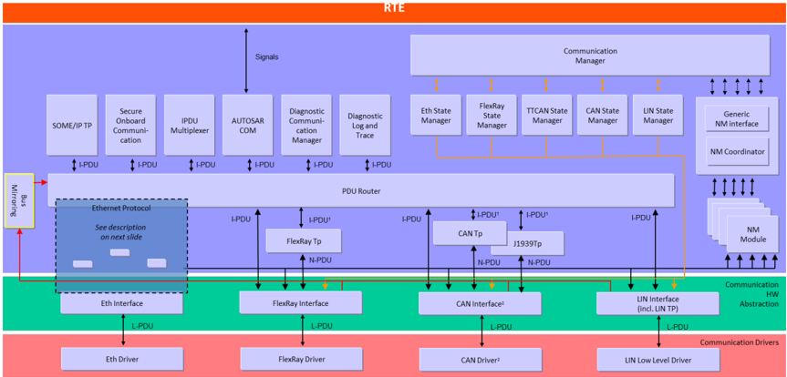
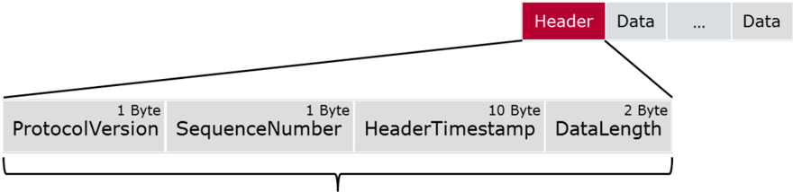
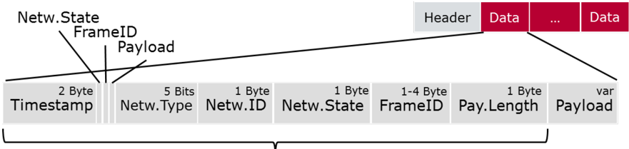
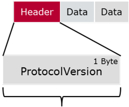
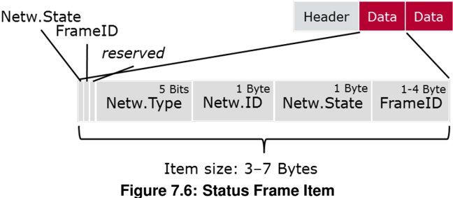

## 已知限制

本文档中的时序图和其他图尚未在BSW UML模型中建模，因此第9章仍然为空。

## 1. 简介和功能概述

本文档说明了AUTOSAR基本软件模块总线镜像（**Bus Mirroring**）的功能、API和配置。

总线镜像模块的目的是将内部总线的流量和状态复制到外部总线，这样连接到外部总线的测试设备（**tester**）就可以监控内部总线以进行调试。

通信流量的监控可以通过测试设备向中间ECU（**Intermediate ECUs**，如网关、子总线控制器）发送诊断命令进行配置。使用诊断协议可以确保在未通过安全检查的情况下无法启用镜像功能。

在本文档中，术语总线（**Bus**）和网络（**Network**）视为同义词。在大多数AUTOSAR规范中更倾向于使用术语网络（**Network**），因此在引用API参数、配置或协议布局（**protocol layout**）时使用它。另一方面，该模块被称为总线镜像（**Bus Mirroring**），因此在考虑镜像方向时使用术语总线（**Bus**），例如源总线（**source bus**）或目的总线（**destination bus**）。

## 2. 缩略语

目前，总线镜像模块没有定义任何在[1, AUTOSAR 术语表]中未定义的缩略语、缩写或术语。

## 3. 相关文档

### 3.1. 输入文件和相关标准与规范

- [1] AUTOSAR 术语表 AUTOSAR_FO_TR_Glossary
- [2] 基本软件模块通用规范 AUTOSAR_CP_SWS_BSWGeneral
- [3] 总线镜像的需求 AUTOSAR_CP_SRS_BusMirroring
- [4] 基本软件模块的通用需求 AUTOSAR_CP_SRS_BSWGeneral

### 3.2. 相关规范

AUTOSAR提供了基本软件模块的通用规范[2, SWS BSW General]，它对总线镜像模块同样有效。

因此，SWS BSW General规范应被视为总线镜像模块的附加且必需的规范。

## 4. 约束和假设

### 4.1. 限制

总线镜像模块不能用于影响配置为源总线（**source bus**）的总线上的流量。为了确保这一点并避免消息环回（**loop-back of messages**）导致总线过载，生成工具应确保没有总线同时作为源总线和目的总线连接到总线镜像模块（见第[6.1](#61-概述)节）。

总线镜像模块通过专用（服务）API由诊断控制应用程序（**diagnostic control application**）控制。控制功能通过特殊的诊断服务提供给诊断仪（**tester**），这些诊断服务由**DCM**处理，并由诊断控制应用程序实现。**DCM**提供了必要的安全性，以排除总线镜像的意外激活。总线镜像模块不提供其他控制接口，也不接收目的总线上的控制消息。

一般来说，总线镜像模块不支持源总线的帧大小或附加信息超过目的总线所能承载的情况，例如CAN XL到CAN-FD、CAN-FD到CAN、CAN到LIN、FlexRay到CAN、以太网到CAN，或以太网到FlexRay。总线镜像模块不会切分（**fragment**）被镜像的帧。

总线镜像模块只镜像总线接口模块实际接收或发送的流量。对于CAN来说，这意味着除了发送的帧之外，只有那些通过硬件过滤器的数据帧会被镜像，而远程帧和错误帧不会被镜像。对于LIN，LIN主节点（**master**）不会镜像从节点（**slave**）到从节点（**slave**）的通信。对于FlexRay，只有发送的帧以及已分配接收缓冲区（可能是FIFO）的接收帧才会被镜像。

从FlexRay源总线进行镜像的另一个限制涉及所报告的时间戳和周期。为FlexRay帧报告的**Timestamp**包含对应作业列表条目被执行的时间。实际发送时间必须根据所报告**FrameID**中包含的slot ID计算得出。所报告**FrameID**中包含的周期仅对接收帧和在静态段中发送的帧是准确的。对于在动态段中发送的帧，所报告的周期可能不准确，因为帧可能无法在预期的周期内发送，此时它会被推迟到下一个合适的周期。

总线镜像模块不应对接收到的序列化帧进行重新序列化，因为这将消耗过多资源。相反，序列化的PDU应直接路由到目的总线。

总线镜像模块也不支持从以太网转发到以太网。这个用例已经被AUTOSAR以太网交换机驱动程序的端口镜像（**Port Mirroring**）特性所覆盖。

### 4.2. 汽车域的适用性

总线镜像模块可用于所有带有外部CAN和/或以太网连接器（如诊断连接器）的车辆。

## 5. 对其他模块的依赖

总线镜像（**Bus Mirroring**）模块的接口关联到CAN接口（**CanIf**）、LIN接口（**LinIf**）、FlexRay接口（**FrIf**）、PDU路由器（**PduR**）、默认错误跟踪器（**DET**）以及诊断应用程序（**diagnostic application**），后者通过AUTOSAR运行时环境（**RTE**）访问总线镜像模块的服务端口API，或通过总线镜像模块的复杂驱动程序（**CDD**）API访问。

总线镜像模块包含**CanIf**、**LinIf**、**FrIf**、**PduR**、**DET**、**StbM**和**RTE**的头文件。

### 5.1. 文件结构

本节说明总线镜像模块的文件结构。

#### 5.1.1. 代码文件结构

详情请参阅[2, SWS BSW General]第5.1.6节「代码文件结构」（**Code file structure**）。

#### 5.1.2. 头文件结构

除了[2, SWS BSW General]第5.1.7节「头文件结构」（**Header file structure**）中定义的文件之外，总线镜像模块还需要包含下文定义的文件。

如果至少配置了一个[**MirrorSourceNetworkCan**](#816-mirrorsourcenetworkcan)，总线镜像模块应包含头文件CanIf.h。

如果至少配置了一个[**MirrorSourceNetworkLin**](#8112-mirrorsourcenetworklin)，总线镜像模块应包含头文件LinIf.h。

如果至少配置了一个[**MirrorSourceNetworkFlexRay**](#8117-mirrorsourcenetworkflexray)，总线镜像模块应包含头文件FrIf.h。

如果至少配置了一个[**MirrorDestNetworkFlexRay**](#8121-mirrordestnetworkflexray)、[**MirrorDestNetworkCanXL**](#8122-mirrordestnetworkcanxl)、[**MirrorDestNetworkIp**](#8123-mirrordestnetworkip)或[**MirrorDestNetworkCdd**](#8124-mirrordestnetworkcdd)，总线镜像模块应包含头文件StbM.h。

## 6. 功能规格

### 6.1. 概述

总线镜像模块的任务是收集来自几个源总线（**source bus**）的帧，然后将这些帧转发到目的总线（**destination bus**）。转发是严格单向的，以避免消息循环（**message loops**）并防止入侵场景（**intrusion scenarios**）。

生成工具应确保没有**ComMChannel**同时被[**MirrorSourceNetwork**](#815-mirrorsourcenetwork)和[**MirrorDestNetwork**](#8119-mirrordestnetwork)引用。

下图显示了总线镜像如何集成到AUTOSAR BSW通信堆栈中：



总线镜像模块支持以下镜像场景：

- CAN和LIN ⇒ CAN
- CAN、CAN-FD和LIN ⇒ CAN-FD
- CAN、CAN-FD、LIN和FlexRay ⇒ FlexRay
- CAN、CAN-FD、LIN和FlexRay ⇒ CAN XL
- CAN、CAN-FD、LIN和FlexRay ⇒ IP
- CAN、CAN-FD、LIN和FlexRay ⇒ 专有总线（CDD）

为了避免目的总线过载，对每个源总线上接收到的消息进行过滤。过滤器可以为每个总线单独配置，或者通过配置（见[**MirrorSourceCanFilter**](#817-mirrorsourcecanfilter)、[**MirrorSourceLinFilter**](#8113-mirrorsourcelinfilter)和[**MirrorSourceFlexRayFilter**](#8118-mirrorsourceflexrayfilter)），或者在运行时（见第[7](#7-api规范)章）。

镜像到CAN（-FD）总线的LIN和CAN（-FD）帧直接以相同的数据发送。对于CAN（-FD），CAN ID被保留，但可以重新映射以避免目的总线上的ID冲突。而LIN PID总是需要映射到合适的CAN ID。为了避免ID冲突，镜像帧可以使用扩展CAN ID（**extended CAN ID**）的范围。

当帧被镜像到FlexRay总线、CAN XL总线、IP总线（以太网）或作为CDD连接的专有总线时，源帧将使用第[6.4.2](#642-镜像协议)节中规定的协议被封装到一个更大的帧中。当路由到FlexRay总线时，只有那些足够小、能够装入减去协议开销之后的目的FlexRay帧的FlexRay帧才能被路由。

### 6.2. 模块处理

本节包含总线镜像模块辅助功能的描述。

#### 6.2.1. 初始化

总线镜像模块通过[**Mirror_Init**](#7411-mirror_init)初始化，通过[**Mirror_DeInit**](#7412-mirror_deinit)去初始化。除了[**Mirror_GetVersionInfo**](#7413-mirror_getversioninfo)和[**Mirror_Init**](#7411-mirror_init)之外，总线镜像模块的API函数只能在模块正确初始化之后调用。

调用[**Mirror_Init**](#7411-mirror_init)将初始化所有内部变量，并将总线镜像模块置为已初始化状态。

调用[**Mirror_DeInit**](#7412-mirror_deinit)将把总线镜像模块置回未初始化状态。

如果通过**MirrorDevErrorDetect**启用了开发错误报告，则在未初始化状态下调用[**Mirror_Init**](#7411-mirror_init)或[**Mirror_GetVersionInfo**](#7413-mirror_getversioninfo)以外的任何API时，总线镜像模块应以错误码[**MIRROR_E_UNINIT**](#661-开发错误)调用**Det_ReportError**。

当在已初始化状态下调用[**Mirror_Init**](#7411-mirror_init)时，总线镜像模块不应重新初始化其内部变量。如果启用了开发错误报告（见**MirrorDevErrorDetect**），它应以错误码[**MIRROR_E_REINIT**](#661-开发错误)调用**Det_ReportError**。

#### 6.2.2. 与时间相关的功能

为了能够测量时间，总线镜像模块通过[**Mirror_MainFunction**](#761-mirror_mainfunction)被周期性地触发。

总线镜像模块应将[**Mirror_MainFunction**](#761-mirror_mainfunction)用于与时间相关的用途。

#### 6.2.3. 激活源总线的选择

初始化后，总线镜像模块应处于非活动状态。没有源总线被启用。

要启动总线镜像模块，必须激活一个已配置的源总线（见[**MirrorSourceNetwork**](#815-mirrorsourcenetwork)）。这将开始收集来自该源总线的帧和状态信息。

当使用[**Mirror_StartSourceNetwork**](#7436-mirror_startsourcenetwork)启用一个源总线时，应开始从该总线获取帧和状态信息，并且该源总线的状态应被重置，以便在第一次更新之后立即上报。

当使用[**Mirror_StopSourceNetwork**](#7437-mirror_stopsourcenetwork)禁用一个源总线时，应停止从该总线获取帧和状态信息。已收集的帧仍应被发送到目的总线。

要停止镜像，应用程序可以随时调用[**Mirror_Offline**](#7432-mirror_offline)。

当[**Mirror_Offline**](#7432-mirror_offline)被调用时，所有源总线应被停用，目的总线应被重置为**MirrorInitialDestNetworkRef**，所有静态配置的过滤器应被禁用，所有其他过滤器应被移除。任何仍在等待发送的镜像帧将被丢弃。

当目的网络被更改时（见第[6.2.4](#624-目的总线的切换)节），源总线也会被禁用。

#### 6.2.4. 目的总线的切换

初始化后，**MirrorInitialDestNetworkRef**所引用的目的总线（[**MirrorDestNetwork**](#8119-mirrordestnetwork)）被选中。

在镜像开始之前（见第[6.2.3](#623-激活源总线的选择)节），目的帧和状态信息不会被发送。

当使用[**Mirror_SwitchDestNetwork**](#7434-mirror_switchdestnetwork)更改目的总线时，所有源总线应被禁用，所有静态配置的过滤器应被禁用，所有其他过滤器应被移除。仍在等待发送的镜像帧将被丢弃。

这确保了发送到目的总线的信息选择必须针对该总线类型专门进行。否则，切换到不同的目的总线很容易使该总线过载，尤其当它是另一条内部总线时。

镜像停止时，目的总线被重置（见第[6.2.3](#623-激活源总线的选择)节）。

#### 6.2.5. 控制帧的过滤

帧过滤器可以静态配置（见[**MirrorSourceCanFilter**](#817-mirrorsourcecanfilter)、[**MirrorSourceLinFilter**](#8113-mirrorsourcelinfilter)和[**MirrorSourceFlexRayFilter**](#8118-mirrorsourceflexrayfilter)），也可以在运行时为每个源总线动态添加。

初始化后，总线镜像模块的所有静态配置的过滤器都被禁用，并且没有动态过滤器可用。

静态配置的过滤器可以使用[**Mirror_SetStaticFilterState**](#7422-mirror_setstaticfilterstate)显式地激活和停用。动态过滤器可以在运行时使用总线特定的**Mirror_Add…Filter**服务之一（例如[**Mirror_AddCanMaskFilter**](#7424-mirror_addcanmaskfilter)）添加，并可通过使用**Mirror_Add…Filter**服务返回的过滤器ID调用[**Mirror_RemoveFilter**](#7428-mirror_removefilter)来移除。当镜像停止时（见第[6.2.3](#623-激活源总线的选择)节）或目的网络被更改时（见第[6.2.4](#624-目的总线的切换)节），过滤器也会被停用/移除。

当过滤器处于活动状态时（静态配置并通过[**Mirror_SetStaticFilterState**](#7422-mirror_setstaticfilterstate)激活，或使用总线特定的**Mirror_Add…Filter**服务之一动态添加），对应源总线上所有匹配该过滤器的帧都应被镜像。

这意味着只要没有过滤器处于活动状态，源总线就不会有任何帧被镜像。

当静态配置的过滤器被[**Mirror_SetStaticFilterState**](#7422-mirror_setstaticfilterstate)停用，或动态添加的过滤器被[**Mirror_RemoveFilter**](#7428-mirror_removefilter)移除时，在停用/移除之前已被接受的帧仍应被镜像到目的总线。

### 6.3. 访问源总线

总线镜像模块支持CAN、LIN和FlexRay作为源总线。为了获取这些总线的帧和状态信息，总线镜像模块与相应的总线接口模块交互。上报的帧在被镜像到目的总线之前会被过滤。

总线镜像模块只应在[**MirrorSourceNetwork**](#815-mirrorsourcenetwork)所引用的**ComMChannel**被分配到的同一分区内调用CAN、LIN和FlexRay接口模块的接口。

#### 6.3.1. 访问CAN

总线镜像模块通过CAN接口模块（**CanIf**）访问CAN总线。在总线镜像模块启动CAN总线的镜像后，CAN接口模块将接收和发送的CAN帧上报给总线镜像模块。CAN总线状态由[**Mirror_MainFunction**](#761-mirror_mainfunction)周期性地轮询。

##### 6.3.1.1. CAN源总线激活

初始化后，CAN接口模块不会向总线镜像模块上报任何帧。

当调用[**Mirror_StartSourceNetwork**](#7436-mirror_startsourcenetwork)来启动CAN源总线时，总线镜像模块应以**MirroringActive**设置为TRUE调用**CanIf_EnableBusMirroring**，以开始从相应CAN控制器上报接收和发送的CAN帧。

[**Mirror_StartSourceNetwork**](#7436-mirror_startsourcenetwork)接收**ComMChannelId**作为network参数，而**CanIf_EnableBusMirroring**期望**CanIfCtrlId**作为ControllerId参数。二者之间的转换可以在生成时通过ECU配置中从**ComMChannelId**到**CanIfCtrlId**的引用来确定。

当调用[**Mirror_StopSourceNetwork**](#7437-mirror_stopsourcenetwork)来停止CAN源总线时，总线镜像模块应以**MirroringActive**设置为FALSE调用**CanIf_EnableBusMirroring**，以停止从相应CAN控制器上报接收和发送的CAN帧。

##### 6.3.1.2. CAN帧采集

CAN接口模块通过调用[**Mirror_ReportCanFrame**](#751-mirror_reportcanframe)上报接收和发送的CAN帧。接收帧从接收中断或任务中上报，而发送帧从发送确认中断或任务中上报。

总线镜像模块应采用适当的机制，允许从**MirrorComMNetworkHandleRef**所引用的**ComMChannel**被分配到的分区中调用[**Mirror_ReportCanFrame**](#751-mirror_reportcanframe)，例如通过在该分区中提供一个卫星（**satellite**）。

对于上报的每个CAN帧，CAN接口模块提供关于接收CAN控制器、CAN ID、CAN ID类型（扩展或标准）、CAN帧类型（CAN-FD或CAN 2.0）以及帧的长度和实际有效载荷的信息。

当调用[**Mirror_ReportCanFrame**](#751-mirror_reportcanframe)上报接收或发送的CAN帧时，总线镜像模块应将包含实际CAN ID、ID类型和帧类型的canId与对应源总线的所有活动的静态配置过滤器和动态添加的过滤器进行匹配。如果CAN帧至少匹配一个过滤器，则它被总线镜像模块接受。

当镜像到FlexRay、IP或专有目的总线时，源总线由网络ID（**network ID**）标识，但[**Mirror_ReportCanFrame**](#751-mirror_reportcanframe)上报的是controllerId。二者之间的转换可以在生成时通过ECU配置中经由**MirrorComMNetworkHandleRef**从**CanIfCtrlId**到**MirrorNetworkId**的引用来确定。

##### 6.3.1.3. CAN帧过滤器

静态配置为[**MirrorSourceCanFilterMask**](#819-mirrorsourcecanfiltermask)的CAN掩码过滤器匹配上报的canId，条件是该canId经**MirrorSourceCanFilterCanIdMask**掩码后等于**MirrorSourceCanFilterCanIdCode**。

通过调用[**Mirror_AddCanMaskFilter**](#7424-mirror_addcanmaskfilter)动态添加的CAN掩码过滤器匹配上报的canId，条件是该canId经mask掩码后等于id。

静态配置为[**MirrorSourceCanFilterRange**](#818-mirrorsourcecanfilterrange)的CAN范围过滤器匹配上报的canId，条件是该canId的值大于等于**MirrorSourceCanFilterLower**且小于等于**MirrorSourceCanFilterUpper**。

通过调用[**Mirror_AddCanRangeFilter**](#7423-mirror_addcanrangefilter)动态添加的CAN范围过滤器匹配上报的canId，条件是该canId的值大于等于lowerId且小于等于upperId。

##### 6.3.1.4. CAN状态采集

总线镜像模块应通过从[**Mirror_MainFunction**](#761-mirror_mainfunction)周期性地调用**CanIf_GetControllerMode**和**CanIf_GetTrcvMode**来轮询每个活动的CAN源总线状态。如果返回的ControllerModePtr为**CAN_CS_STARTED**且返回的TransceiverModePtr为**CANTRCV_TRCVMODE_NORMAL**，则上报的CAN源总线状态应置为在线（**online**），否则置为离线（**offline**）。如果总线在线，总线镜像模块应调用**CanIf_GetControllerErrorState**，如果返回的ErrorStatePtr为**CAN_ERRORSTATE_PASSIVE**或**CAN_ERRORSTATE_BUSOFF**，则上报的CAN源总线状态应分别置为错误被动（**error passive**）或总线关闭（**bus-off**）。此外，如果总线在线，总线镜像模块还应调用**CanIf_GetControllerTxErrorCounter**，并将返回的TxErrorCounterPtr累加到上报的CAN源总线状态中。

API **CanIf_GetControllerMode**和**CanIf_GetControllerErrorState**期望ControllerId参数，**CanIf_GetTrcvMode**期望TransceiverId参数，但向输出总线报告状态需要网络ID。二者之间的转换可以在生成时通过ECU配置中经由**MirrorComMNetworkHandleRef**分别从**CanIfCtrlId**和**CanTrcvChannelId**到**MirrorNetworkId**的引用来确定。

#### 6.3.2. 访问LIN

总线镜像模块通过LIN接口模块（**LinIf**）访问LIN总线。在总线镜像模块启动LIN总线的镜像后，LIN接口模块将接收和发送的LIN帧上报给总线镜像模块。LIN总线状态一部分随LIN帧一起上报，一部分由[**Mirror_MainFunction**](#761-mirror_mainfunction)周期性地轮询。

##### 6.3.2.1. LIN源总线激活

初始化后，LIN接口模块不会向总线镜像模块上报任何帧。

当调用[**Mirror_StartSourceNetwork**](#7436-mirror_startsourcenetwork)来启动LIN源总线时，总线镜像模块应以**MirroringActive**设置为TRUE调用**LinIf_EnableBusMirroring**，以开始从该总线上报接收和发送的LIN帧。

当调用[**Mirror_StopSourceNetwork**](#7437-mirror_stopsourcenetwork)来停止LIN源总线时，总线镜像模块应以**MirroringActive**设置为FALSE调用**LinIf_EnableBusMirroring**，以停止从该总线上报接收和发送的LIN帧。

##### 6.3.2.2. LIN帧采集

LIN接口模块通过调用[**Mirror_ReportLinFrame**](#752-mirror_reportlinframe)上报接收和发送的LIN帧。接收和发送帧由LIN调度表处理在执行了相应的状态检查之后上报。

总线镜像模块应采用适当的机制，允许从**MirrorComMNetworkHandleRef**所引用的**ComMChannel**被分配到的分区中调用[**Mirror_ReportLinFrame**](#752-mirror_reportlinframe)，例如通过在该分区中提供一个卫星（**satellite**）。

对于上报的每个LIN帧，LIN接口模块提供关于接收总线、受保护ID（**PID**）、帧的长度和实际有效载荷以及接收或发送状态的信息。

当调用[**Mirror_ReportLinFrame**](#752-mirror_reportlinframe)上报接收或发送的LIN帧时，总线镜像模块应从上报的pid中提取帧ID，并将其与对应源总线的所有活动的静态配置过滤器和动态添加的过滤器进行匹配。如果LIN帧至少匹配一个过滤器，则它被总线镜像模块接受。

LIN帧的帧ID通过从PID中去掉两个最高有效位来计算。

##### 6.3.2.3. LIN帧过滤器

静态配置为[**MirrorSourceLinFilterMask**](#8115-mirrorsourcelinfiltermask)的LIN掩码过滤器匹配上报的帧ID，条件是该ID经**MirrorSourceLinFilterLinIdMask**掩码后等于**MirrorSourceLinFilterLinIdCode**。

通过调用[**Mirror_AddLinMaskFilter**](#7426-mirror_addlinmaskfilter)动态添加的LIN掩码过滤器匹配上报的帧ID，条件是该ID经mask掩码后等于id。

静态配置为[**MirrorSourceLinFilterRange**](#8114-mirrorsourcelinfilterrange)的LIN范围过滤器匹配上报的帧ID，条件是该ID的值大于等于**MirrorSourceLinFilterLower**且小于等于**MirrorSourceLinFilterUpper**。

通过调用[**Mirror_AddLinRangeFilter**](#7425-mirror_addlinrangefilter)动态添加的LIN范围过滤器匹配上报的帧ID，条件是该ID的值大于等于lowerId且小于等于upperId。

##### 6.3.2.4. LIN状态采集

总线镜像模块应评估[**Mirror_ReportLinFrame**](#752-mirror_reportlinframe)上报的状态。如果状态为**LIN_TX_HEADER_ERROR**、**LIN_TX_ERROR**、**LIN_RX_ERROR**或**LIN_RX_NO_RESPONSE**，则上报的LIN源总线状态应分别置为报头发送错误（**header transmission error**）、发送错误（**transmission error**）、接收错误（**reception error**）或无响应（**no response**）。

总线镜像模块应通过从[**Mirror_MainFunction**](#761-mirror_mainfunction)周期性地调用**LinIf_GetTrcvMode**来轮询每个活动的LIN源总线状态。如果返回的TransceiverModePtr为**LINTRCV_TRCV_MODE_NORMAL**，则上报的LIN源总线状态应置为在线（**online**），否则置为离线（**offline**）。

#### 6.3.3. 访问FlexRay

总线镜像模块通过FlexRay接口模块（**FrIf**）访问FlexRay总线。在总线镜像模块启动FlexRay总线的镜像后，FlexRay接口模块将接收和发送的FlexRay帧上报给总线镜像模块。FlexRay总线状态由[**Mirror_MainFunction**](#761-mirror_mainfunction)周期性地轮询。一个FlexRay源总线对应一个FlexRay集群（**cluster**），该集群可以连接多个控制器。

##### 6.3.3.1. FlexRay源总线激活

初始化后，FlexRay接口模块不会向总线镜像模块上报任何帧。

当调用[**Mirror_StartSourceNetwork**](#7436-mirror_startsourcenetwork)来启动FlexRay源总线时，总线镜像模块应以**FrIf_MirroringActive**设置为TRUE调用**FrIf_EnableBusMirroring**，以开始从相应FlexRay集群上报接收和发送的FlexRay帧。

[**Mirror_StartSourceNetwork**](#7436-mirror_startsourcenetwork)接收**ComMChannelId**作为network参数，而**FrIf_EnableBusMirroring**期望**FrIfClstIdx**作为FrIf_ClstIdx参数。二者之间的转换可以在生成时通过ECU配置中从**ComMChannelId**到相关**FrIfClstIdx**的引用来确定。

当调用[**Mirror_StopSourceNetwork**](#7437-mirror_stopsourcenetwork)来停止FlexRay源总线时，总线镜像模块应以**FrIf_MirroringActive**设置为FALSE调用**FrIf_EnableBusMirroring**，以停止从相应FlexRay集群上报接收和发送的FlexRay帧。

##### 6.3.3.2. FlexRay帧采集

FlexRay接口模块通过调用[**Mirror_ReportFlexRayFrame**](#753-mirror_reportflexrayframe)上报接收和发送的FlexRay帧。接收和发送帧由FlexRay接口的作业列表执行函数或发送函数上报。

总线镜像模块应采用适当的机制，允许从**MirrorComMNetworkHandleRef**所引用的**ComMChannel**被分配到的分区中调用[**Mirror_ReportFlexRayFrame**](#753-mirror_reportflexrayframe)，例如通过在该分区中提供一个卫星（**satellite**）。

对于上报的每个FlexRay帧，FlexRay接口模块提供关于接收FlexRay控制器、slot ID和周期、帧的长度和实际有效载荷以及发送冲突（**transmission conflicts**）的信息。

当调用[**Mirror_ReportFlexRayFrame**](#753-mirror_reportflexrayframe)上报接收或发送的FlexRay帧（txConflict上报为FALSE）时，总线镜像模块应将slotId和cycle与对应源总线的所有活动的静态配置过滤器和动态添加的过滤器进行匹配。如果FlexRay帧至少匹配一个过滤器，则它被总线镜像模块接受。

在目的总线上，源总线由网络ID标识，但[**Mirror_ReportFlexRayFrame**](#753-mirror_reportflexrayframe)上报的是controllerId。二者之间的转换可以在生成时通过ECU配置中经由**MirrorComMNetworkHandleRef**从**FrIfCtrlIdx**到**MirrorNetworkId**的引用来确定。

##### 6.3.3.3. FlexRay帧过滤器

静态配置为[**MirrorSourceFlexRayFilter**](#8118-mirrorsourceflexrayfilter)的FlexRay过滤器匹配上报的slotId和cycle，条件是slotId大于等于**MirrorSourceFlexRayFilterLowerSlot**且小于等于**MirrorSourceFlexRayFilterUpperSlot**，并且cycle对**MirrorSourceFlexRayFilterCycleRepetition**取模的结果大于等于**MirrorSourceFlexRayFilterLowerBaseCycle**且小于等于**MirrorSourceFlexRayFilterUpperBaseCycle**。

通过调用[**Mirror_AddFlexRayFilter**](#7427-mirror_addflexrayfilter)动态添加的FlexRay过滤器匹配上报的slotId和cycle，条件是slotId大于等于lowerSlotId且小于等于upperSlotId，并且cycle对cycleRepetition取模的结果大于等于lowerBaseCycle且小于等于upperBaseCycle。

##### 6.3.3.4. FlexRay状态采集

当调用[**Mirror_ReportFlexRayFrame**](#753-mirror_reportflexrayframe)上报发送冲突（txConflict上报为TRUE）时，总线镜像模块应将slotId和cycle与所有活动的静态配置过滤器和动态添加的过滤器进行匹配。如果至少匹配一个过滤器，则该帧对应的上报FlexRay源总线状态应置为发送冲突（**transmission conflict**）。

回调[**Mirror_ReportFlexRayFrame**](#753-mirror_reportflexrayframe)上报的是controllerId，而API **FrIf_GetPOCStatus**期望FrIf_CtrlIdx参数，但向输出总线报告状态需要网络ID。二者之间的转换可以在生成时通过ECU配置中经由**MirrorComMNetworkHandleRef**从**FrIfCtrlIdx**到**MirrorNetworkId**的引用来确定。

当调用[**Mirror_ReportFlexRayChannelStatus**](#754-mirror_reportflexraychannelstatus)上报FlexRay通道状态时，总线镜像模块应将上报的状态与之前上报的状态进行比较。如果状态在第1位（vSS!SyntaxError）、第2位（vSS!ContentError）和/或第4位（vSS!Bviolation）上有所不同，总线镜像模块应相应地更新上报的FlexRay源总线状态。

回调[**Mirror_ReportFlexRayChannelStatus**](#754-mirror_reportflexraychannelstatus)上报的是clusterId，而API **FrIf_GetState**期望FrIf_ClstIdx参数，但向输出总线报告状态需要网络ID。二者之间的转换可以在生成时通过ECU配置中经由**MirrorComMNetworkHandleRef**从**FrIfClstIdx**到**MirrorNetworkId**的引用来确定。

总线镜像模块应通过从[**Mirror_MainFunction**](#761-mirror_mainfunction)周期性地调用**FrIf_GetState**来轮询每个活动的FlexRay源总线状态。如果返回的FrIf_StatePtr为**FRIF_STATE_ONLINE**，则上报的FlexRay源总线状态应置为在线（**online**），否则置为离线（**offline**）。如果总线在线，总线镜像模块还应为连接到该FlexRay集群的每个控制器调用**FrIf_GetPOCStatus**。如果所有控制器的Fr_POCStateType均为**FR_POCSTATE_NORMAL_ACTIVE**，则上报的源总线状态应为同步且正常激活；如果至少一个控制器的Fr_POCStateType为**FR_POCSTATE_NORMAL_PASSIVE**，则上报的源总线状态应为同步但未正常激活；如果至少一个控制器的Fr_POCStateType处于任何其他状态，则上报的源总线状态应为既不同步也非正常激活。

### 6.4. 镜像到FlexRay、IP和CDD

当镜像到FlexRay目的总线、CAN XL目的总线、IP目的总线（如以太网）或作为CDD连接的专有网络时，总线镜像模块应用一种协议将几个较小的帧打包成目的总线的一个大帧。

本章的第一部分（第[6.4.1](#641-目的帧的处理)节）定义了总线镜像模块如何使用镜像协议将源帧放置到目的帧上，以及如何在发送目的帧之前进行排队。

第二部分（第[6.4.2](#642-镜像协议)节）展示该协议的精确布局以及协议中各字段的含义和用法。

#### 6.4.1. 目的帧的处理

本节描述如何处理第[6.4.2](#642-镜像协议)节中定义的镜像协议。

##### 6.4.1.1. 创建

当总线镜像模块被初始化，或当调用[**Mirror_SwitchDestNetwork**](#7434-mirror_switchdestnetwork)激活FlexRay（[**MirrorDestNetworkFlexRay**](#8121-mirrordestnetworkflexray)）、CAN XL（[**MirrorDestNetworkCanXL**](#8122-mirrordestnetworkcanxl)）、IP（[**MirrorDestNetworkIp**](#8123-mirrordestnetworkip)）或专有（[**MirrorDestNetworkCdd**](#8124-mirrordestnetworkcdd)）目的总线时，总线镜像模块应激活一个新的目的帧缓冲区，并将SequenceNumber重置为0。

当第一个数据项被添加到一个空的目的帧缓冲区时（如上文所述），总线镜像模块应首先按照第[6.4.2.1](#6421-头布局)节定义的布局将报头写入该缓冲区。

ProtocolVersion字段应设置为1，SequenceNumber应设置为上一个目的帧的SequenceNumber加1后的值，HeaderTimestamp应填充**StbM_GetCurrentTime**返回的信息，DataLength字段应设置为0。

如果配置了可选配置参数**MirrorDestTransmissionDeadline**，总线镜像模块应启动发送超时定时器。

当按照第[6.3.1.2](#6312-can帧采集)节、第[6.3.2.2](#6322-lin帧采集)节或第[6.3.3.2](#6332-flexray帧采集)节所述接收到源帧时，总线镜像模块应创建一个新的数据项，并按第[6.4.2.2](#6422-数据项布局)节定义的布局将其放置到当前活动目的帧缓冲区的末尾，并将新数据项的大小累加到报头字段DataLength中。

新数据项的Timestamp字段应设置为报头中包含的时间戳与通过**StbM_GetCurrentTime**获取的当前时间之差（以10 µs的倍数表示），FrameIDAvailable和PayloadAvailable位应设置为1，NetworkType、NetworkID、FrameID、PayloadLength和Payload字段应根据接收到的源帧进行设置。

如果上报的源总线状态自上一次发送源帧以来发生了变化，NetworkStateAvailable位应设置为1，NetworkState字段应设置为上报的源总线状态。否则，NetworkStateAvailable位应设置为0，且NetworkState字段应省略。

当按照第[6.3.3.4](#6334-flexray状态采集)节所述上报了新的FlexRay发送冲突时，总线镜像模块应创建一个新的数据项，并按第[6.4.2.2](#6422-数据项布局)节定义的布局将其放置到当前活动目的帧缓冲区的末尾，并将新数据项的大小累加到报头字段DataLength中。

数据项的Timestamp字段应设置为报头中包含的时间戳与通过**StbM_GetCurrentTime**获取的当前时间之差（以10 µs的倍数表示），FrameIDAvailable和NetworkStateAvailable位应设置为1，NetworkType、NetworkID和FrameID字段应根据上报的发送冲突进行设置。NetworkState字段应设置为上报的源总线状态。

PayloadAvailable位应设置为0，PayloadLength和Payload字段应省略。

每个上报的FlexRay发送冲突都会使其之前的一个FlexRay帧失效。被失效的FlexRay帧可能位于与相应发送冲突不同的另一个目的帧中。

当上报的源总线状态发生变化，并且在一个主函数周期内没有从同一源总线接收到源帧时，总线镜像模块应创建一个新的数据项，并按第[6.4.2.2](#6422-数据项布局)节定义的布局将其放置到当前活动目的帧缓冲区的末尾，并将新数据项的大小累加到报头字段DataLength中。

数据项的Timestamp字段应设置为报头中包含的时间戳与通过**StbM_GetCurrentTime**获取的当前时间之差（以10 µs的倍数表示）。NetworkStateAvailable位应设置为1，NetworkType和NetworkID字段应根据上报的源总线进行设置，NetworkState字段应设置为上报的源总线状态。

根据当前上报的源总线状态，FrameIDAvailable应设置为1或0。在前一种情况下，FrameID应根据上报的源总线进行设置；在后一种情况下，FrameID应省略。

PayloadAvailable位应设置为0，PayloadLength和Payload字段应省略。

第[6.4.2.2.7](#64227-networkstate)节列出了可以在NetworkState字段中上报的错误码，并描述了提供FrameID的必要性。

##### 6.4.1.2. 队列

当一个数据项不适合当前活动目的帧缓冲区的剩余空间时，总线镜像模块应将该缓冲区放入队列并激活一个新的目的帧缓冲区。然后该数据项应被放置到新缓冲区中。

当一个数据项的相对时间戳超过655.35 ms时，总线镜像模块应将当前活动的目的帧缓冲区放入队列并激活一个新的目的帧缓冲区。然后该数据项应被放置到新缓冲区中。

如果配置了可选配置参数**MirrorDestTransmissionDeadline**并且发送超时到期，总线镜像模块应将当前活动的目的帧缓冲区放入队列并激活一个新的目的帧缓冲区。

序列化目的帧队列的大小由配置参数**MirrorDestQueueSize**决定，队列元素的大小由**MirrorDestPduRef**所引用Pdu的PduLength决定。

如果由于队列已满而无法将目的帧放入队列，总线镜像模块应丢弃该目的帧，报告运行时错误[**MIRROR_E_QUEUE_OVERRUN**](#662-运行时错误)，并将当前活动目的帧缓冲区中创建的下一个数据项的NetworkState的Frames Lost位设置为1。

##### 6.4.1.3. 发送

为了发起已排队序列化目的帧的发送，总线镜像模块应调用**PduR_MirrorTransmit**，其中PduInfoPtr->MetaDataPtr设置为NULL_PTR，PduInfoPtr->SduLength设置为目的帧实际写入的部分。如果启用了**MirrorDestPduUsesTriggerTransmit**，PduInfoPtr->SduDataPtr应设置为NULL_PTR，否则设置为已排队目的帧的已使用部分。

PduInfoPtr->SduDataPtr的NULL_PTR确保目的总线接口模块（**FrIf**、**CanIf**、**SoAd**或CDD）通过[**Mirror_TriggerTransmit**](#756-mirror_triggertransmit)获取目的帧。

如果**PduR_MirrorTransmit**返回E_NOT_OK，总线镜像模块应立即从队列中移除该目的帧，报告运行时错误[**MIRROR_E_TRANSMIT_FAILED**](#662-运行时错误)，并将当前活动目的帧缓冲区中创建的下一个数据项的NetworkState的Frames Lost位设置为1。

总线镜像模块应从[**Mirror_MainFunction**](#761-mirror_mainfunction)和[**Mirror_TxConfirmation**](#755-mirror_txconfirmation)回调发起已排队序列化目的帧的发送。

这确保了已排队的目的帧尽可能快地被发送。

为了在FlexRay目的总线上实现合适的吞吐量，[**MirrorDestNetworkFlexRay**](#8121-mirrordestnetworkflexray)可以包含一组[**MirrorDestPdu**](#8125-mirrordestpdu)。

如果为[**MirrorDestNetworkFlexRay**](#8121-mirrordestnetworkflexray)配置了一组[**MirrorDestPdu**](#8125-mirrordestpdu)，总线镜像模块应以任意顺序使用该组中的PDU。

数据项的SequenceNumber和Timestamp将确保测试设备能够对它们正确排序。

在活动的目的通道为[**MirrorDestNetworkCanXL**](#8122-mirrordestnetworkcanxl)、[**MirrorDestNetworkIp**](#8123-mirrordestnetworkip)或[**MirrorDestNetworkCdd**](#8124-mirrordestnetworkcdd)的情况下，在上一个目的帧通过调用[**Mirror_TxConfirmation**](#755-mirror_txconfirmation)被确认之前，总线镜像模块不应发送下一个序列化目的帧。

在活动的目的通道为[**MirrorDestNetworkFlexRay**](#8121-mirrordestnetworkflexray)的情况下，在上一次使用同一[**MirrorDestPdu**](#8125-mirrordestpdu)的发送通过调用[**Mirror_TxConfirmation**](#755-mirror_txconfirmation)被确认之前，总线镜像模块不应使用相同的[**MirrorDestPdu**](#8125-mirrordestpdu)发送下一个序列化目的帧。

当为序列化目的帧调用[**Mirror_TriggerTransmit**](#756-mirror_triggertransmit)时，Mirror模块应将已排队目的帧的已使用部分复制到PduInfoPtr->SduDataPtr，并相应地更新PduInfoPtr->SduLength。

如果[**Mirror_TriggerTransmit**](#756-mirror_triggertransmit)提供的PduInfoPtr->SduLength对于当前发送的序列化目的帧来说太小，总线镜像模块应从队列中移除该目的帧，报告运行时错误[**MIRROR_E_TRANSMIT_FAILED**](#662-运行时错误)，将当前活动序列化目的帧缓冲区中创建的下一个数据项的NetworkState的Frames Lost位设置为1，并返回E_NOT_OK以停止本次发送。

当调用[**Mirror_TxConfirmation**](#755-mirror_txconfirmation)上报序列化目的帧的发送成功或失败时，总线镜像模块应从队列中移除该目的帧。

如果[**Mirror_TxConfirmation**](#755-mirror_txconfirmation)上报序列化目的帧发送失败（result为E_NOT_OK），总线镜像模块应报告运行时错误[**MIRROR_E_TRANSMIT_FAILED**](#662-运行时错误)，并将当前活动目的帧缓冲区中创建的下一个数据项的NetworkState的Frames Lost位设置为1。

#### 6.4.2. 镜像协议

总线镜像模块对IP、FlexRay和专有目的总线应用的协议如图所示（此例中为以太网目的总线）：


该协议由一个报头（见第[6.4.2.1](#6421-头布局)节）和随后的若干数据项（见第[6.4.2.2](#6422-数据项布局)节）组成。

在本节的表格和描述中，字节编号按字节在目的总线上发送的相同顺序递增，从0开始。位编号递减，字节的最高有效位为第7位，最低有效位为第0位。

##### 6.4.2.1. 头布局

每个目的帧都以一个报头开始，如下图所示：



总线镜像目的帧的报头应按此顺序包含以下字段：

1. ProtocolVersion
2. SequenceNumber
3. HeaderTimestamp
4. DataLength

报头的各字段在以下小节中详细描述。

###### 6.4.2.1.1. ProtocolVersion

ProtocolVersion应指示报头和数据项的布局。本节当前定义的布局由ProtocolVersion 1标识。范围[2..127]保留给AUTOSAR定义协议的未来扩展，范围[128..255]可供客户特定协议使用。

协议版本允许测试设备工具正确解释协议，并支持协议的不同布局。

ProtocolVersion字段的宽度应为8位。

###### 6.4.2.1.2. SequenceNumber

SequenceNumber应随每个目的帧的发送而递增。在初始化之后或使用[**Mirror_SwitchDestNetwork**](#7434-mirror_switchdestnetwork)切换目的总线之后，它应从0开始。

序列号允许测试设备工具识别丢失的目的帧。

SequenceNumber字段的宽度应为8位。

这意味着SequenceNumber在达到255后将回绕到0。测试设备必须应对这种行为，并仍然正确地对帧进行排序。

###### 6.4.2.1.3. HeaderTimestamp

HeaderTimestamp应反映开始将数据项收集到目的帧中的时间。该时间应表示为自1970年1月1日以来的绝对秒数和纳秒数。

HeaderTimestamp字段的总宽度应为10字节，其中秒占高48位，纳秒占低32位。HeaderTimestamp字段的两个元素都应按网络字节顺序编码（MSB在前）。

表7.1展示了HeaderTimestamp的布局。

表7.1：HeaderTimestamp的布局（**Layout of HeaderTimestamp**）

| HeaderTimestamp | HeaderTimestamp | HeaderTimestamp | HeaderTimestamp | HeaderTimestamp | HeaderTimestamp | HeaderTimestamp | HeaderTimestamp | HeaderTimestamp | HeaderTimestamp |
| --- | --- | --- | --- | --- | --- | --- | --- | --- | --- |
| Byte 0 | Byte 1 | Byte 2 | Byte 3 | Byte 4 | Byte 5 | Byte 6 | Byte 7 | Byte 8 | Byte 9 |
| 秒（48位，MSB在前） | 秒（48位，MSB在前） | 秒（48位，MSB在前） | 秒（48位，MSB在前） | 秒（48位，MSB在前） | 秒（48位，MSB在前） | 纳秒（32位，MSB在前） | 纳秒（32位，MSB在前） | 纳秒（32位，MSB在前） | 纳秒（32位，MSB在前） |

###### 6.4.2.1.4. DataLength

DataLength应给出报头之后的字节数。它是目的帧中所有数据项长度之和。

DataLength字段的宽度应为16位。它应按网络字节顺序编码（MSB在前）。

##### 6.4.2.2. 数据项布局

每个源帧被放置在一个数据项中，如下图所示：



总线镜像目的帧的数据项应按此顺序包含以下字段：

1. Timestamp
2. NetworkStateAvailable
3. FrameIDAvailable
4. PayloadAvailable
5. NetworkType
6. NetworkID
7. NetworkState（可选）
8. FrameID（可选）
9. PayloadLength（可选）
10. Payload（可选）

数据项的各字段在以下小节中详细描述。

###### 6.4.2.2.1. Timestamp

Timestamp应反映源帧接收相对于HeaderTimestamp的时间偏移，即自开始将数据项收集到目的帧以来经过的时间。它应以10 µs的倍数表示。

Timestamp字段的宽度应为16位。它应按网络字节顺序编码（MSB在前）。

###### 6.4.2.2.2. NetworkStateAvailable

NetworkStateAvailable应指示数据项中是否存在NetworkState字段。如果NetworkStateAvailable为1，则该字段应存在。如果为0，则该字段应省略。

NetworkStateAvailable字段的宽度应为1位。

###### 6.4.2.2.3. FrameIDAvailable

FrameIDAvailable应指示数据项中是否存在FrameID字段。如果FrameIDAvailable为1，则该字段应存在。如果为0，则该字段应省略。

FrameIDAvailable字段的宽度应为1位。

###### 6.4.2.2.4. PayloadAvailable

PayloadAvailable应指示数据项中是否存在PayloadLength和Payload字段。如果PayloadAvailable为1，则这些字段应存在。如果为0，则这些字段应省略。

PayloadAvailable字段的宽度应为1位。

###### 6.4.2.2.5. NetworkType

NetworkType应指示源总线的类型。

NetworkType字段的宽度应为5位，可能的值定义如下表所示。范围[5..15]保留给AUTOSAR定义协议的未来扩展，范围[16..31]可供客户特定总线类型使用。

表7.2：NetworkType的取值（**Values of NetworkType**）

| Network Type | Numerical |
| --- | --- |
| Invalid | 0 |
| CAN | 1 |
| LIN | 2 |
| FlexRay | 3 |
| Ethernet | 4 |

###### 6.4.2.2.6. NetworkID

NetworkID应唯一地标识某一**NetworkType**的总线，即相同的NetworkID可以出现在不同的**NetworkType**上，但不能出现在相同的**NetworkType**上。

NetworkID字段的宽度应为8位。

###### 6.4.2.2.7. NetworkState

NetworkState应提供关于源总线状态的信息。它只在源总线状态自上次上报以来发生变化时存在，其存在由NetworkStateAvailable指示。

NetworkState字段的宽度应为8位，其布局是总线特定的，并针对每种总线分别定义为**NetworkStateCAN**、**NetworkStateLIN**和**NetworkStateFlexRay**。

NetworkState的第7位（最高有效位）应始终包含Frames Lost状态。这是一个与同一数据项中上报的源帧无关的偶发错误（**sporadic error**），但不应在单独的数据项中上报。当一个或多个通过过滤器的源帧因目的总线队列已满或发送失败而丢失后，Frames Lost状态应置为1一次，之后应重新置为0。

NetworkState的第6位应始终包含Bus Online状态。这是一个与同一数据项中上报的源帧无关的连续状态，也可以在FrameIDAvailable和PayloadAvailable字段均设置为0的数据项中上报。当源总线在线（即控制器和收发器都能够通信）时，Bus Online状态应置为1，否则置为0。

###### NetworkStateCAN

CAN总线的NetworkState布局如表7.3所示。

表7.3：CAN NetworkState的布局（**Layout of CAN NetworkState**）

| NetworkState | NetworkState | NetworkState | NetworkState | NetworkState | NetworkState | NetworkState | NetworkState |
| --- | --- | --- | --- | --- | --- | --- | --- |
| Bit 7 | Bit 6 | Bit 5 | Bit 4 | Bit 3 | Bit 2 | Bit 1 | Bit 0 |
| Frames Lost | Bus Online | Error-Passive | Bus-Off | Tx错误计数器除以8 | Tx错误计数器除以8 | Tx错误计数器除以8 | Tx错误计数器除以8 |

NetworkStateCAN的第5位应包含Error-Passive状态。这是一个与同一数据项中上报的源帧无关的连续状态，也可以在FrameIDAvailable和PayloadAvailable字段均设置为0的数据项中上报。

当CAN控制器处于Error-Passive状态时，Error-Passive状态应置为1；当它处于Error-Active或Bus-Off状态时，应置为0。

NetworkStateCAN的第4位应包含Bus-Off状态。这是一个与同一数据项中上报的源帧无关的连续状态，也可以在FrameIDAvailable和PayloadAvailable字段均设置为0的数据项中上报。

当CAN控制器处于Bus-Off状态时，Bus-Off状态应置为1；当它处于Error-Active或Error-Passive状态时，应置为0。

NetworkStateCAN的第3-0位应包含CAN控制器的发送（Tx）错误计数器除以8的结果。这是一个与同一数据项中上报的源帧无关的连续状态，也可以在FrameIDAvailable和PayloadAvailable字段均设置为0的数据项中上报。

###### NetworkStateLIN

LIN总线的NetworkState布局如表7.4所示。

表7.4：LIN NetworkState的布局（**Layout of LIN NetworkState**）

| NetworkState | NetworkState | NetworkState | NetworkState | NetworkState | NetworkState | NetworkState | NetworkState |
| --- | --- | --- | --- | --- | --- | --- | --- |
| Bit 7 | Bit 6 | Bit 5 | Bit 4 | Bit 3 | Bit 2 | Bit 1 | Bit 0 |
| Frames Lost | Bus Online | reserved | reserved | Header Tx Error | Tx Error | Rx Error | Rx No Response |

NetworkStateLIN的第5位和第4位目前保留。它们应始终设置为0。

NetworkStateLIN的第3位应包含Header Tx Error状态。这是一个与同一数据项中上报的源帧相关的错误。

当LIN控制器在LIN报头发送期间检测到错误时，Header Tx Error状态应置为1，否则应置为0。

NetworkStateLIN的第2位应包含Tx Error状态。这是一个与同一数据项中上报的源帧相关的错误。

当LIN控制器在LIN帧发送期间检测到错误时，Tx Error状态应置为1，否则应置为0。

NetworkStateLIN的第1位应包含Rx Error状态。这是一个与同一数据项中上报的源帧相关的错误。

当LIN控制器在LIN帧接收期间检测到错误时，Rx Error状态应置为1，否则应置为0。

NetworkStateLIN的第0位应包含Rx No Response状态。这是一个与同一数据项中上报的源帧相关的错误。

当LIN控制器在发送LIN报头之后没有接收到预期的LIN帧时，Rx No Response状态应置为1，否则应置为0。

###### NetworkStateFlexRay

FlexRay总线的NetworkState布局如表7.5所示。

表7.5：FlexRay NetworkState的布局（**Layout of FlexRay NetworkState**）

| NetworkState | NetworkState | NetworkState | NetworkState | NetworkState | NetworkState | NetworkState | NetworkState |
| --- | --- | --- | --- | --- | --- | --- | --- |
| Bit 7 | Bit 6 | Bit 5 | Bit 4 | Bit 3 | Bit 2 | Bit 1 | Bit 0 |
| Frames Lost | Bus Online | Bus Synchronous | Normal Active | Syntax Error | Content Error | Boundary Violation | Tx Conflict |

NetworkStateFlexRay的第5位应包含Bus Synchronous状态。这是一个与同一数据项中上报的源帧无关的连续状态，也可以在FrameIDAvailable和PayloadAvailable字段均设置为0的数据项中上报。

当连接到该总线的所有FlexRay控制器都与网络时间同步时，Bus Synchronous状态应置为1，否则应置为0。

NetworkStateFlexRay的第4位应包含Normal Active状态。这是一个与同一数据项中上报的源帧无关的连续状态，也可以在FrameIDAvailable和PayloadAvailable字段均设置为0的数据项中上报。

当连接到该总线的所有FlexRay控制器都同步且处于正常激活状态时，Normal Active状态应置为1，否则应置为0。

NetworkStateFlexRay的第3位应包含Syntax Error状态。这是FlexRay通道的聚合错误标志，与**FrameID**的通道分配相关，但与同一数据项中上报的源帧及其FrameID无关。它也可以在PayloadAvailable字段设置为0、FrameIDAvailable设置为1且FrameID的slot有效标志设置为0的数据项中上报。

在FlexRay控制器检测到语法错误之后，Syntax Error状态应置为1一次，否则应置为0。

NetworkStateFlexRay的第2位应包含Content Error状态。这是FlexRay通道的聚合错误标志，与**FrameID**的通道分配相关，但与同一数据项中上报的源帧及其FrameID无关。它也可以在PayloadAvailable字段设置为0、FrameIDAvailable设置为1且FrameID的slot有效标志设置为0的数据项中上报。

在FlexRay控制器检测到内容错误之后，Content Error状态应置为1一次，否则应置为0。

NetworkStateFlexRay的第1位应包含Boundary Violation状态。这是FlexRay通道的聚合错误标志，与**FrameID**的通道分配相关，但与同一数据项中上报的源帧及其FrameID无关。它也可以在PayloadAvailable字段设置为0、FrameIDAvailable设置为1且FrameID的slot有效标志设置为0的数据项中上报。

在FlexRay控制器检测到边界违例之后，Boundary Violation状态应置为1一次，否则应置为0。

NetworkStateFlexRay的第0位应包含Tx Conflict状态。这是一个与以相同**FrameID**上报的前一个源帧相关的错误，并且总是在FrameIDAvailable字段设置为1且PayloadAvailable字段设置为0的数据项中上报。

当FlexRay控制器检测到发送冲突时，Tx Conflict状态应置为1，否则应置为0。

###### 6.4.2.2.8. FrameID

FrameID应提供源帧的标识。该标识对于由**NetworkType**和**NetworkID**标识的一个源总线应是唯一的。上报源总线状态变化时FrameID可以省略，其存在由FrameIDAvailable指示。

FrameID字段的宽度和布局是总线特定的，并针对每种总线分别定义为**FrameIDCAN**、**FrameIDLIN**和**FrameIDFlexRay**。

###### FrameIDCAN

CAN总线的FrameID布局如表7.6所示。

表7.6：CAN FrameID的布局（**Layout of CAN FrameID**）

| FrameID | FrameID | FrameID | FrameID | FrameID | FrameID | FrameID |
| --- | --- | --- | --- | --- | --- | --- |
| Byte 0 | Byte 0 | Byte 0 | Byte 0 | Byte 1 | Byte 2 | Byte 3 |
| Bit 7 | Bit 6 | Bit 5 | Bits 4..0 |  |  |  |
| Ext.ID / Std.ID | FD / 2.0 | res. | CAN ID（位28..24） | CAN ID（位23..16） | CAN ID（位15..8） | CAN ID（位7..0） |

FrameIDCAN的布局对应于[**Mirror_ReportCanFrame**](#751-mirror_reportcanframe)提供的Can_IdType。

FrameIDCAN字段的宽度应为4字节。

对于扩展CAN ID，FrameIDCAN字节0的第7位应设置为1；对于标准CAN ID，应设置为0。

对于CANFD帧，FrameIDCAN字节0的第6位应设置为1；对于CAN 2.0帧，应设置为0。

FrameIDCAN字节0的第5位目前保留。它应始终设置为0。

FrameIDCAN字节0的第4-0位以及字节1-3应包含所上报CAN帧的CAN ID，按网络字节顺序（MSB在前）。

###### FrameIDLIN

LIN总线的FrameID布局如表7.7所示。

表7.7：LIN FrameID的布局（**Layout of LIN FrameID**）

| FrameID |
| --- |
| Byte 0 |
| LIN PID |

FrameIDLIN字段的宽度应为1字节。

FrameIDLIN的字节0应包含所上报LIN帧的LIN PID。

###### FrameIDFlexRay

FlexRay总线的FrameID布局如表7.8所示。

表7.8：FlexRay FrameID的布局（**Layout of FlexRay FrameID**）

| FrameID | FrameID | FrameID | FrameID | FrameID | FrameID | FrameID |
| --- | --- | --- | --- | --- | --- | --- |
| Byte 0 | Byte 0 | Byte 0 | Byte 0 | Byte 0 | Byte 1 | Byte 2 |
| Bit 7 | Bit 6 | Bit 5..4 | Bit 3 | Bits 2..0 |  |  |
| Channel B | Channel A | reserved | Slot Valid | Slot ID（位10..8） | Slot ID（位7..0） | Cycle |

FrameIDFlexRay字段的宽度应为3字节。

FrameIDFlexRay字节0的第7-6位应包含所上报FlexRay帧的通道分配。如果所上报的FlexRay帧在FlexRay控制器的通道B上可用，第7位应设置为1，否则应设置为0。如果所上报的FlexRay帧在FlexRay控制器的通道A上可用，第6位应设置为1，否则应设置为0。所上报的FlexRay帧要么独占地分配给通道A或B，要么同时分配给两个通道。

该通道分配的布局对应于[**Mirror_ReportFlexRayFrame**](#753-mirror_reportflexrayframe)上报的Fr_ChannelType。

FrameIDFlexRay字节0的第5-4位目前保留。它们应始终设置为0。

FrameIDFlexRay字节0的第3位应包含一个标志，指示所上报的slot ID和周期是否有效（标志为1）或未使用（标志为0）。只有当独立于源帧或发送冲突上报FlexRay通道的聚合错误时，它才应设置为0。否则它应始终设置为1。

FrameIDFlexRay字节0的第2-0位和字节1应包含所上报FlexRay帧的slot ID，按网络字节顺序（MSB在前）。

FrameIDFlexRay的字节2应包含所上报FlexRay帧被发送或接收所在的周期。

请注意：对于接收帧和在静态段中发送的帧，周期始终是可靠的。对于在动态段中发送的帧，实际周期无法提前得知，因为帧可能不会在计划的周期内发送。

###### 6.4.2.2.9. PayloadLength

PayloadLength应提供源帧有效载荷的长度。上报源总线状态变化时它可以省略，其存在由PayloadAvailable指示。

PayloadLength字段的宽度应为8位。

###### 6.4.2.2.10. Payload

Payload应提供源帧的实际有效载荷。上报源总线状态变化时它可以省略，其存在由PayloadAvailable指示。

Payload字段的宽度应对应于上报的源帧。LIN和CAN 2.0的最大值为8字节，CAN-FD为64字节，FlexRay为254字节。

### 6.5. 镜像到CAN

当镜像到CAN目的总线时，总线镜像模块将接收到的CAN和LIN帧直接发送到目的总线，但可能会更改CAN ID以避免与目的总线上常规消息的冲突。

本章定义了总线镜像模块如何转换CAN ID并对源帧进行排队，以及如何创建状态帧并排队，然后在目的总线上发送它们。

#### 6.5.1. 源帧的处理

本节描述如何处理和发送按照第[6.3.1.2](#6312-can帧采集)节和第[6.3.2.2](#6322-lin帧采集)节所述从CAN总线和LIN总线接收的源帧。

##### 6.5.1.1. ID映射

通常，CAN源帧可以在目的总线上不做更改地发送，而LIN源帧的PID必须映射到一个CAN ID范围。

但有时很难找到一段连续的未使用CAN ID来映射LIN PID，或者相同的CAN ID也已被通常在目的CAN总线上发送的帧使用。

在这些情况下，某些CAN ID和LIN PID必须重新映射到特殊的CAN ID。

###### 6.5.1.1.1. CAN上的ID映射

如果CAN源帧的canId与某个[**MirrorSourceCanSingleIdMapping**](#8110-mirrorsourcecansingleidmapping)的**MirrorSourceCanSingleIdMappingSourceCanId**匹配，则目的帧应以该映射的**MirrorSourceCanSingleIdMappingDestCanId**发送。

如果CAN源帧的canId经某个[**MirrorSourceCanMaskBasedIdMapping**](#8111-mirrorsourcecanmaskbasedidmapping)的**MirrorSourceCanMaskBasedIdMappingSourceCanIdMask**掩码后与该映射的**MirrorSourceCanMaskBasedIdMappingSourceCanIdCode**匹配，则CAN目的帧应以掩码后的canId加上该映射的**MirrorSourceCanMaskBasedIdMappingDestBaseId**发送。

如果CAN源帧的canId既不匹配任何[**MirrorSourceCanSingleIdMapping**](#8110-mirrorsourcecansingleidmapping)也不匹配任何[**MirrorSourceCanMaskBasedIdMapping**](#8111-mirrorsourcecanmaskbasedidmapping)，则CAN目的帧应以原始canId发送，即相同的CAN ID、ID类型（扩展或标准）和帧类型（CAN-FD或CAN 2.0）。

###### 6.5.1.1.2. LIN上的ID映射

如果从LIN源帧的pid中提取的帧ID与某个[**MirrorSourceLinToCanIdMapping**](#8116-mirrorsourcelintocanidmapping)的**MirrorSourceLinToCanIdMappingLinId**匹配，则CAN目的帧应以该映射的**MirrorSourceLinToCanIdMappingCanId**发送。

如果从LIN源帧的pid中提取的帧ID不匹配任何[**MirrorSourceLinToCanIdMapping**](#8116-mirrorsourcelintocanidmapping)，则CAN目的帧应以该LIN帧ID加上**MirrorSourceLinToCanBaseId**发送。

##### 6.5.1.2. 排队

总线镜像模块应将所有CAN目的帧放入队列。

CAN目的帧队列的大小由配置参数**MirrorDestQueueSize**决定，队列元素的大小由**MirrorDestPduRef**所引用Pdu的PduLength决定。

如果由于队列已满而无法将目的帧放入队列，总线镜像模块应丢弃该目的帧，报告运行时错误[**MIRROR_E_QUEUE_OVERRUN**](#662-运行时错误)，并将下一个状态帧NetworkState的Frames Lost位设置为1。

状态帧的处理在第[6.5.2](#652-状态帧的创建)节中定义。

##### 6.5.1.3. 发送

为了能够在任意类型（CAN 2.0 / CAN-FD）的CAN帧中发送任意类型（扩展/标准）的任意CAN ID，总线镜像模块使用带MetaData和开放CanIdMask的[**MirrorDestPdu**](#8125-mirrordestpdu)（见第[8.2.1](#821-can目的总线)节）。

为了发起已排队CAN目的帧的发送，总线镜像模块应调用**PduR_MirrorTransmit**，其中PduInfoPtr->MetaDataPtr设置为包含目的帧CAN ID的MetaData，PduInfoPtr->SduLength设置为目的帧的长度。如果启用了**MirrorDestPduUsesTriggerTransmit**，PduInfoPtr->SduDataPtr应设置为NULL_PTR，否则设置为源帧的有效载荷。

PduInfoPtr->SduDataPtr的NULL_PTR确保目的总线接口模块（**CanIf**）通过[**Mirror_TriggerTransmit**](#756-mirror_triggertransmit)获取目的帧。

如果**PduR_MirrorTransmit**返回E_NOT_OK，总线镜像模块应立即从队列中移除该目的帧，报告运行时错误[**MIRROR_E_TRANSMIT_FAILED**](#662-运行时错误)，并将下一个状态帧NetworkState的Frames Lost位设置为1。

总线镜像模块应从[**Mirror_MainFunction**](#761-mirror_mainfunction)和[**Mirror_TxConfirmation**](#755-mirror_txconfirmation)回调发起已排队CAN目的帧的发送。

这确保了已排队的目的帧尽可能快地被发送。

在上一个目的帧通过调用[**Mirror_TxConfirmation**](#755-mirror_txconfirmation)被确认之前，总线镜像模块不应发送下一个CAN目的帧。

当为CAN目的帧调用[**Mirror_TriggerTransmit**](#756-mirror_triggertransmit)时，Mirror模块应将源帧的有效载荷复制到PduInfoPtr->SduDataPtr，并相应地更新PduInfoPtr->SduLength。

在CAN总线上，[**Mirror_TriggerTransmit**](#756-mirror_triggertransmit)不可能提供对目的帧来说太小的PduInfoPtr->SduLength，因为目的帧按配置在CAN 2.0下大小为8字节、在CAN-FD下为64字节，而**CanIf**始终提供硬件缓冲区大小，同样在CAN 2.0下为8字节、在CAN-FD下为64字节。

当调用[**Mirror_TxConfirmation**](#755-mirror_txconfirmation)上报CAN目的帧的发送成功或失败时，总线镜像模块应从队列中移除该目的帧。

如果[**Mirror_TxConfirmation**](#755-mirror_txconfirmation)上报CAN目的帧发送失败（result为E_NOT_OK），总线镜像模块应报告运行时错误[**MIRROR_E_TRANSMIT_FAILED**](#662-运行时错误)，并将下一个状态帧NetworkState的Frames Lost位设置为1。

#### 6.5.2. 状态帧的创建

如果配置了**MirrorStatusCanId**，并且当一个或多个源总线状态发生变化时，总线镜像模块应分配一个新的状态帧缓冲区，并按照第[6.5.3.1](#6531-状态头布局)节定义的布局写入报头。

SHProtocolVersion字段应设置为1。

如果配置了**MirrorStatusCanId**，总线镜像模块应为每个上报状态发生变化的源总线创建一个新的状态项，并按照第[6.5.3.2](#6532-状态项布局)节定义的布局将其放置到当前活动状态帧缓冲区的末尾。

字段SINetworkType和SINetworkID应根据上报的源总线进行设置，SINetworkState字段应设置为上报的源总线状态。

根据当前上报的源总线状态，SIFrameIDAvailable应设置为1或0。在前一种情况下，SIFrameID应根据上报的源总线进行设置；在后一种情况下，SIFrameID应省略。

第[6.4.2.2.7](#64227-networkstate)节列出了可以在SINetworkState字段中上报的错误码，并描述了提供SIFrameID的必要性。

当一个状态项不适合当前活动状态帧缓冲区的剩余空间时，总线镜像模块应将该缓冲区以**MirrorStatusCanId**中配置的CAN ID放入队列，并激活一个新的状态帧缓冲区。

当已为所有上报状态发生变化的源总线写入状态项后，总线镜像模块应将当前活动的状态帧缓冲区以**MirrorStatusCanId**中配置的CAN ID放入队列。

#### 6.5.3. 状态协议

总线镜像模块为在CAN上发送状态帧而应用的协议由一个报头（见第[6.5.3.1](#6531-状态头布局)节）和随后的若干数据项（见第[6.5.3.2](#6532-状态项布局)节）组成。

在本节的表格和描述中，字节编号按字节在目的总线上发送的相同顺序递增，从0开始。位编号递减，字节的最高有效位为第7位，最低有效位为第0位。

##### 6.5.3.1. 状态头布局

每个状态帧都以一个报头开始，如下图所示：



总线镜像状态帧的报头应包含SHProtocolVersion。

###### 6.5.3.1.1. SHProtocolVersion

SHProtocolVersion应与序列化目的帧的ProtocolVersion相同。

ProtocolVersion定义在第[6.4.2.1.1](#64211-protocolversion)节中。

##### 6.5.3.2. 状态项布局

每个源总线状态被放置在一个状态项中，如下图所示：



总线镜像状态帧的状态项应按此顺序包含以下字段：

1. SINetworkStateAvailable
2. SIFrameIDAvailable
3. reserved
4. SINetworkType
5. SINetworkID
6. SINetworkState
7. SIFrameID（可选）

状态项字节0的第5位目前保留，应始终设置为0。

状态项的各字段在以下小节中详细描述。

###### 6.5.3.2.1. SINetworkStateAvailable

SINetworkStateAvailable的布局和语义应与序列化数据项中使用的NetworkStateAvailable相同。它应始终设置为1。

NetworkStateAvailable定义在第[6.4.2.2.2](#64222-networkstateavailable)节中。总线镜像状态帧的接收者可以使用SINetworkStateAvailable来检查状态项是否有效：如果该位为0，则帧的剩余部分可以忽略，它很可能只是填充（另见第[8.2.1](#821-can目的总线)节）。

###### 6.5.3.2.2. SIFrameIDAvailable

SIFrameIDAvailable的布局和语义应与序列化数据项中使用的FrameIDAvailable相同。

FrameIDAvailable定义在第[6.4.2.2.3](#64223-frameidavailable)节中。

###### 6.5.3.2.3. SINetworkType

SINetworkType的布局和语义应与序列化数据项中使用的NetworkType相同。

SINetworkType定义在第[6.4.2.2.5](#64225-networktype)节中。

###### 6.5.3.2.4. SINetworkID

SINetworkID的布局和语义应与序列化数据项中使用的NetworkID相同。

NetworkID定义在第[6.4.2.2.6](#64226-networkid)节中。

###### 6.5.3.2.5. SINetworkState

SINetworkState的布局和语义应与序列化数据项中使用的NetworkState相同。

NetworkState定义在第[6.4.2.2.7](#64227-networkstate)节中。

###### 6.5.3.2.6. SIFrameID

SIFrameID的布局和语义应与序列化数据项中使用的FrameID相同。

FrameID定义在第[6.4.2.2.8](#64228-frameid)节中。

### 6.6. 错误分类

《基本软件模块通用规范》[2]的第7.2节「错误处理」详细描述了基本软件的错误处理。首先，它构成了一个由五种错误类型组成的分类方案，这些错误可能发生在BSW模块中。

在此基础上，本节在下方各小节中规定了具体的错误。

#### 6.6.1. 开发错误

**Mirror**模块开发错误的定义：

| 错误类型 | 相关错误代码 | 错误值 |
| --- | --- | --- |
| 在模块未初始化时调用了API | MIRROR_E_UNINIT | 0x01 |
| 初始化API被调用了两次 | MIRROR_E_REINIT | 0x02 |
| 调用[**Mirror_Init**](#7411-mirror_init)时配置指针无效 | MIRROR_E_INIT_FAILED | 0x03 |
| 调用API服务时传入NULL指针 | MIRROR_E_PARAM_POINTER | 0x10 |
| 调用API服务时传入错误的ID | MIRROR_E_INVALID_PDU_SDU_ID | 0x11 |
| 调用API服务时传入错误的网络句柄 | MIRROR_E_INVALID_NETWORK_ID | 0x12 |

#### 6.6.2. 运行时错误

**Mirror**模块运行时错误的定义：

| 错误类型 | 相关错误代码 | 错误值 |
| --- | --- | --- |
| 消息无法存入队列 | MIRROR_E_QUEUE_OVERRUN | 0x40 |
| 消息无法发送 | MIRROR_E_TRANSMIT_FAILED | 0x41 |

#### 6.6.3. 瞬态故障

总线镜像模块没有定义瞬态故障。

#### 6.6.4. 生产错误

总线镜像模块没有定义生产错误。

#### 6.6.5. 扩展生产错误

总线镜像模块没有定义扩展生产错误。

## 7. API规范

### 7.1. API参数检查

当NULL_PTR不被接受作为服务或回调函数的参数时，总线镜像模块报告开发错误[**MIRROR_E_PARAM_POINTER**](#661-开发错误)。确切的行为在AUTOSAR_SWS_BSWGeneral [2]的相应需求中规定。

如果通过**MirrorDevErrorDetect**启用了开发错误检测，总线镜像模块应将回调函数[**Mirror_TxConfirmation**](#755-mirror_txconfirmation)和[**Mirror_TriggerTransmit**](#756-mirror_triggertransmit)的TxPduId与**MirrorDestPduId**进行检查，并在调用提供了未知ID时报告开发错误[**MIRROR_E_INVALID_PDU_SDU_ID**](#661-开发错误)。

如果通过**MirrorDevErrorDetect**启用了开发错误检测，总线镜像模块应将其服务函数的NetworkHandleType参数与经由**MirrorComMNetworkHandleRef**引用的ComMChannelId进行检查，并在调用提供了未知网络句柄时报告开发错误[**MIRROR_E_INVALID_NETWORK_ID**](#661-开发错误)。

### 7.2. 导入的类型

在本章中，列出了总线镜像模块使用的所有类型及其定义模块：

| 模块 | 头文件 | 导入的类型 |
| --- | --- | --- |
| Can | Can_GeneralTypes.h | Can_ControllerStateType |
| Can | Can_GeneralTypes.h | Can_ErrorStateType |
| Can | Can_GeneralTypes.h | Can_IdType |
| CanTrcv | Can_GeneralTypes.h | CanTrcv_TrcvModeType |
| ComStack_Types | ComStack_Types.h | NetworkHandleType |
| ComStack_Types | ComStack_Types.h | PduIdType |
| ComStack_Types | ComStack_Types.h | PduInfoType |
| ComStack_Types | ComStack_Types.h | PduLengthType |
| Fr | Fr_GeneralTypes.h | Fr_ChannelType |
| Fr | Fr_GeneralTypes.h | Fr_ErrorModeType |
| Fr | Fr_GeneralTypes.h | Fr_POCStateType |
| Fr | Fr_GeneralTypes.h | Fr_POCStatusType |
| Fr | Fr_GeneralTypes.h | Fr_SlotModeType |
| Fr | Fr_GeneralTypes.h | Fr_StartupStateType |
| Fr | Fr_GeneralTypes.h | Fr_WakeupStatusType |
| FrIf | FrIf.h | FrIf_StateType |
| Lin | Lin_GeneralTypes.h | Lin_FramePidType |
| Lin | Lin_GeneralTypes.h | Lin_StatusType |
| LinTrcv | Lin_GeneralTypes.h | LinTrcv_TrcvModeType |
| StbM | Rte_StbM_Type.h | StbM_SynchronizedTimeBaseType |
| StbM | Rte_StbM_Type.h | StbM_TimeBaseStatusType |
| StbM | Rte_StbM_Type.h | StbM_TimeStampType |
| StbM | Rte_StbM_Type.h | StbM_TimeTupleType |
| StbM | Rte_StbM_Type.h | StbM_UserDataType |
| StbM | StbM.h | StbM_VirtualLocalTimeType |
| Std | Std_Types.h | Std_ReturnType |
| Std | Std_Types.h | Std_VersionInfoType |

### 7.3. 类型定义

#### 7.3.1. Mirror_ConfigType

| 名称 | Mirror_ConfigType |
| --- | --- |
| 类型（Kind） | Structure（结构体） |
| 元素 | 实现特定。 |
| 元素 | 类型 - |
| 元素 | 注释 - |
| 描述 | 这是总线镜像模块配置的基础类型。指向该结构体实例的指针将用于总线镜像模块的初始化。该结构体的内容定义于第[8](#8-配置规范)章「配置规范」。 |
| 可通过 | Mirror.h |

#### 7.3.2. MIRROR_INVALID_NETWORK

| 名称 | MIRROR_INVALID_NETWORK |
| --- | --- |
| 范围 | MIRROR_INVALID_NETWORK（0xFF）：无效的网络ID。 |
| 描述 | 该类型表示**NetworkHandleType**的一个特殊值，代表一个无效的网络句柄。 |
| 可通过 | Mirror.h |

### 7.4. 函数定义

这是提供给上层模块的函数列表。

#### 7.4.1. 通用函数（Generic Functions）

##### 7.4.1.1. Mirror_Init

**说明**:

```C
void Mirror_Init ( const Mirror_ConfigType* configPtr )
```

| 服务名 | Mirror_Init |
| --- | --- |
| 服务ID[hex] | 0x01 |
| 同步/异步 | 同步 |
| 可重入 | 不可重入 |
| 参数（in） | configPtr |
| | 指向所选配置结构的指针。 |
| 参数（inout） | 无 |
| 参数（out） | 无 |
| 返回值 | 无 |
| 说明 | 该函数初始化总线镜像模块。在**Mirror**被分配到多个分区的配置中（即[**Mirror_MainFunction**](#761-mirror_mainfunction)被映射到多个分区），**Mirror**可以为每个分区提供一个初始化函数。 |
| 可通过 | Mirror.h |

##### 7.4.1.2. Mirror_DeInit

**说明**:

```C
void Mirror_DeInit ( void )
```

| 服务名 | Mirror_DeInit |
| --- | --- |
| 服务ID[hex] | 0x02 |
| 同步/异步 | 同步 |
| 可重入 | 不可重入 |
| 参数（in） | 无 |
| 参数（inout） | 无 |
| 参数（out） | 无 |
| 返回值 | 无 |
| 说明 | 该函数将总线镜像模块重置为未初始化状态。 |
| 可通过 | Mirror.h |

##### 7.4.1.3. Mirror_GetVersionInfo

**说明**:

```C
void Mirror_GetVersionInfo ( Std_VersionInfoType* versionInfo )
```

| 服务名 | Mirror_GetVersionInfo |
| --- | --- |
| 服务ID[hex] | 0x03 |
| 同步/异步 | 同步 |
| 可重入 | 可重入 |
| 参数（in） | 无 |
| 参数（inout） | 无 |
| 参数（out） | versionInfo |
| | 指向存储该模块版本信息位置的指针。 |
| 返回值 | 无 |
| 说明 | 返回该模块的版本信息。 |
| 可通过 | Mirror.h |

#### 7.4.2. 过滤器处理（Filter Handling）

##### 7.4.2.1. Mirror_GetStaticFilterState

**说明**:

```C
Std_ReturnType Mirror_GetStaticFilterState ( NetworkHandleType network, uint8 filterId, boolean* isActive )
```

| 服务名 | Mirror_GetStaticFilterState |
| --- | --- |
| 服务ID[hex] | 0x23 |
| 同步/异步 | 同步 |
| 可重入 | 可重入 |
| 参数（in） | network |
| | 对应于过滤器所附着源总线的**ComM**通道。 |
| | filterId |
| | 过滤器的ID。 |
| 参数（inout） | 无 |
| 参数（out） | isActive |
| | 指向存储当前过滤器状态位置的指针。 |
| 返回值 | Std_ReturnType |
| | E_OK：过滤器状态已复制到isActive。E_NOT_OK：调用函数时传入了无效参数。 |
| 说明 | 返回预配置过滤器的状态。 |
| 可通过 | Mirror.h |

##### 7.4.2.2. Mirror_SetStaticFilterState

**说明**:

```C
Std_ReturnType Mirror_SetStaticFilterState ( NetworkHandleType network, uint8 filterId, boolean isActive )
```

| 服务名 | Mirror_SetStaticFilterState |
| --- | --- |
| 服务ID[hex] | 0x14 |
| 同步/异步 | 同步 |
| 可重入 | 不同的网络可重入；相同的网络不可重入 |
| 参数（in） | network |
| | 对应于过滤器所附着源总线的**ComM**通道。 |
| | filterId |
| | 过滤器的ID。 |
| | isActive |
| | TRUE：激活过滤器；FALSE：停用过滤器。 |
| 参数（inout） | 无 |
| 参数（out） | 无 |
| 返回值 | Std_ReturnType |
| | E_OK：过滤器状态已根据isActive更新。E_NOT_OK：调用函数时传入了无效参数。 |
| 说明 | 设置预配置过滤器的状态。 |
| 可通过 | Mirror.h |

##### 7.4.2.3. Mirror_AddCanRangeFilter

**说明**:

```C
Std_ReturnType Mirror_AddCanRangeFilter ( NetworkHandleType network, uint8* filterId, Can_IdType lowerId, Can_IdType upperId )
```

| 服务名 | Mirror_AddCanRangeFilter |
| --- | --- |
| 服务ID[hex] | 0x15 |
| 同步/异步 | 同步 |
| 可重入 | 不同的网络可重入；相同的网络不可重入 |
| 参数（in） | network |
| | 对应于过滤器应附着的CAN总线的**ComM**通道。 |
| | lowerId |
| | 范围的下限CAN ID。 |
| | upperId |
| | 范围的上限CAN ID。 |
| 参数（inout） | 无 |
| 参数（out） | filterId |
| | 新创建过滤器的ID。 |
| 返回值 | Std_ReturnType |
| | E_OK：新过滤器已创建。E_NOT_OK：由于参数无效或给定网络上没有空闲过滤器，过滤器创建失败。 |
| 说明 | 创建一个CAN ID范围过滤器。 |
| 可通过 | Mirror.h |

##### 7.4.2.4. Mirror_AddCanMaskFilter

**说明**:

```C
Std_ReturnType Mirror_AddCanMaskFilter ( NetworkHandleType network, uint8* filterId, Can_IdType id, Can_IdType mask )
```

| 服务名 | Mirror_AddCanMaskFilter |
| --- | --- |
| 服务ID[hex] | 0x16 |
| 同步/异步 | 同步 |
| 可重入 | 不同的网络可重入；相同的网络不可重入 |
| 参数（in） | network |
| | 对应于过滤器应附着的CAN总线的**ComM**通道。 |
| | id |
| | 用于匹配接收或发送CAN ID的CAN ID。 |
| | mask |
| | 定义id中与实际CAN ID比较时相关位的掩码。 |
| 参数（inout） | 无 |
| 参数（out） | filterId |
| | 新创建过滤器的ID。 |
| 返回值 | Std_ReturnType |
| | E_OK：新过滤器已创建。E_NOT_OK：由于参数无效或给定网络上没有空闲过滤器，过滤器创建失败。 |
| 说明 | 创建一个CAN ID掩码过滤器。 |
| 可通过 | Mirror.h |

##### 7.4.2.5. Mirror_AddLinRangeFilter

**说明**:

```C
Std_ReturnType Mirror_AddLinRangeFilter ( NetworkHandleType network, uint8* filterId, uint8 lowerId, uint8 upperId )
```

| 服务名 | Mirror_AddLinRangeFilter |
| --- | --- |
| 服务ID[hex] | 0x17 |
| 同步/异步 | 同步 |
| 可重入 | 不同的网络可重入；相同的网络不可重入 |
| 参数（in） | network |
| | 对应于过滤器应附着的LIN总线的**ComM**通道。 |
| | lowerId |
| | 范围的下限帧ID。 |
| | upperId |
| | 范围的上限帧ID。 |
| 参数（inout） | 无 |
| 参数（out） | filterId |
| | 新创建过滤器的ID。 |
| 返回值 | Std_ReturnType |
| | E_OK：新过滤器已创建。E_NOT_OK：由于参数无效或给定网络上没有空闲过滤器，过滤器创建失败。 |
| 说明 | 创建一个LIN帧ID范围过滤器。 |
| 可通过 | Mirror.h |

##### 7.4.2.6. Mirror_AddLinMaskFilter

**说明**:

```C
Std_ReturnType Mirror_AddLinMaskFilter ( NetworkHandleType network, uint8* filterId, uint8 id, uint8 mask )
```

| 服务名 | Mirror_AddLinMaskFilter |
| --- | --- |
| 服务ID[hex] | 0x18 |
| 同步/异步 | 同步 |
| 可重入 | 不同的网络可重入；相同的网络不可重入 |
| 参数（in） | network |
| | 对应于过滤器应附着的LIN总线的**ComM**通道。 |
| | id |
| | 用于匹配接收或发送帧ID的帧ID。 |
| | mask |
| | 定义id中与实际帧ID比较时相关位的掩码。 |
| 参数（inout） | 无 |
| 参数（out） | filterId |
| | 新创建过滤器的ID。 |
| 返回值 | Std_ReturnType |
| | E_OK：新过滤器已创建。E_NOT_OK：由于参数无效或给定网络上没有空闲过滤器，过滤器创建失败。 |
| 说明 | 创建一个LIN帧ID掩码过滤器。 |
| 可通过 | Mirror.h |

##### 7.4.2.7. Mirror_AddFlexRayFilter

**说明**:

```C
Std_ReturnType Mirror_AddFlexRayFilter ( NetworkHandleType network, uint8* filterId, uint16 lowerSlotId, uint16 upperSlotId, uint8 lowerBaseCycle, uint8 upperBaseCycle, uint8 cycleRepetition, Fr_ChannelType frChannel )
```

| 服务名 | Mirror_AddFlexRayFilter |
| --- | --- |
| 服务ID[hex] | 0x19 |
| 同步/异步 | 同步 |
| 可重入 | 不同的网络可重入；相同的网络不可重入 |
| 参数（in） | network |
| | 对应于过滤器应附着的FlexRay总线的**ComM**通道。 |
| | lowerSlotId |
| | slot ID范围的下限slot ID。 |
| | upperSlotId |
| | slot ID范围的上限slot ID。 |
| | lowerBaseCycle |
| | 周期范围的下限基础周期。 |
| | upperBaseCycle |
| | 周期范围的上限基础周期。 |
| | cycleRepetition |
| | 所选周期的重复模式（2^n）。 |
| | frChannel |
| | FlexRay通道分配。 |
| 参数（inout） | 无 |
| 参数（out） | filterId |
| | 新创建过滤器的ID。 |
| 返回值 | Std_ReturnType |
| | E_OK：新过滤器已创建。E_NOT_OK：由于参数无效或给定网络上没有空闲过滤器，过滤器创建失败。 |
| 说明 | 创建一个FlexRay过滤器。 |
| 可通过 | Mirror.h |

##### 7.4.2.8. Mirror_RemoveFilter

**说明**:

```C
Std_ReturnType Mirror_RemoveFilter ( NetworkHandleType network, uint8 filterId )
```

| 服务名 | Mirror_RemoveFilter |
| --- | --- |
| 服务ID[hex] | 0x1a |
| 同步/异步 | 同步 |
| 可重入 | 不同的网络可重入；相同的网络不可重入 |
| 参数（in） | network |
| | 对应于过滤器所附着源总线的**ComM**通道。 |
| | filterId |
| | 过滤器的ID。 |
| 参数（inout） | 无 |
| 参数（out） | 无 |
| 返回值 | Std_ReturnType |
| | E_OK：过滤器已被移除。E_NOT_OK：调用函数时传入了无效参数。 |
| 说明 | 移除一个在运行时添加的CAN、LIN或FlexRay过滤器。 |
| 可通过 | Mirror.h |

#### 7.4.3. 状态处理（State Handling）

##### 7.4.3.1. Mirror_IsMirrorActive

**说明**:

```C
boolean Mirror_IsMirrorActive ( void )
```

| 服务名 | Mirror_IsMirrorActive |
| --- | --- |
| 服务ID[hex] | 0x20 |
| 同步/异步 | 同步 |
| 可重入 | 可重入 |
| 参数（in） | 无 |
| 参数（inout） | 无 |
| 参数（out） | 无 |
| 返回值 | boolean |
| | TRUE：总线镜像模块处于活动状态；FALSE：总线镜像模块处于非活动状态。 |
| 说明 | 返回全局镜像状态。 |
| 可通过 | Mirror.h |

##### 7.4.3.2. Mirror_Offline

**说明**:

```C
void Mirror_Offline ( void )
```

| 服务名 | Mirror_Offline |
| --- | --- |
| 服务ID[hex] | 0x13 |
| 同步/异步 | 同步 |
| 可重入 | 不可重入 |
| 参数（in） | 无 |
| 参数（inout） | 无 |
| 参数（out） | 无 |
| 返回值 | 无 |
| 说明 | 完全禁用所有镜像活动。源总线被重置为禁用状态，已排队的消息被清除，目的总线被重置为默认目的总线。预配置的过滤器被禁用，运行时添加的过滤器被移除。 |
| 可通过 | Mirror.h |

##### 7.4.3.3. Mirror_GetDestNetwork

**说明**:

```C
NetworkHandleType Mirror_GetDestNetwork ( void )
```

| 服务名 | Mirror_GetDestNetwork |
| --- | --- |
| 服务ID[hex] | 0x21 |
| 同步/异步 | 同步 |
| 可重入 | 可重入 |
| 参数（in） | 无 |
| 参数（inout） | 无 |
| 参数（out） | 无 |
| 返回值 | NetworkHandleType |
| | 对应于当前活动目的网络的**ComM**通道。 |
| 说明 | 返回当前选定的目的总线。 |
| 可通过 | Mirror.h |

##### 7.4.3.4. Mirror_SwitchDestNetwork

**说明**:

```C
Std_ReturnType Mirror_SwitchDestNetwork ( NetworkHandleType network )
```

| 服务名 | Mirror_SwitchDestNetwork |
| --- | --- |
| 服务ID[hex] | 0x12 |
| 同步/异步 | 同步 |
| 可重入 | 不可重入 |
| 参数（in） | network |
| | 对应于要启用的目的总线的**ComM**通道。 |
| 参数（inout） | 无 |
| 参数（out） | 无 |
| 返回值 | Std_ReturnType |
| | E_OK：目的总线已被更改。E_NOT_OK：调用函数时传入了无效参数。 |
| 说明 | 将目的总线更改为给定的**ComM**通道。先前活动的目的总线和所有源总线被禁用。 |
| 可通过 | Mirror.h |

##### 7.4.3.5. Mirror_IsSourceNetworkStarted

**说明**:

```C
boolean Mirror_IsSourceNetworkStarted ( NetworkHandleType network )
```

| 服务名 | Mirror_IsSourceNetworkStarted |
| --- | --- |
| 服务ID[hex] | 0x22 |
| 同步/异步 | 同步 |
| 可重入 | 可重入 |
| 参数（in） | network |
| | 对应于要检查的源总线的**ComM**通道。 |
| 参数（inout） | 无 |
| 参数（out） | 无 |
| 返回值 | boolean |
| | TRUE：源总线处于活动状态；FALSE：源总线处于非活动状态。 |
| 说明 | 返回源总线（**source bus**）的状态。 |
| 可通过 | Mirror.h |

##### 7.4.3.6. Mirror_StartSourceNetwork

**说明**:

```C
Std_ReturnType Mirror_StartSourceNetwork ( NetworkHandleType network )
```

| 服务名 | Mirror_StartSourceNetwork |
| --- | --- |
| 服务ID[hex] | 0x10 |
| 同步/异步 | 同步 |
| 可重入 | 不同的网络可重入；相同的网络不可重入 |
| 参数（in） | network |
| | 对应于要启动的源总线的**ComM**通道。 |
| 参数（inout） | 无 |
| 参数（out） | 无 |
| 返回值 | Std_ReturnType |
| | E_OK：源总线已被激活。E_NOT_OK：调用函数时传入了无效参数。 |
| 说明 | 激活一个源总线（**source bus**）。 |
| 可通过 | Mirror.h |

##### 7.4.3.7. Mirror_StopSourceNetwork

**说明**:

```C
Std_ReturnType Mirror_StopSourceNetwork ( NetworkHandleType network )
```

| 服务名 | Mirror_StopSourceNetwork |
| --- | --- |
| 服务ID[hex] | 0x11 |
| 同步/异步 | 同步 |
| 可重入 | 不同的网络可重入；相同的网络不可重入 |
| 参数（in） | network |
| | 对应于要停止的源总线的**ComM**通道。 |
| 参数（inout） | 无 |
| 参数（out） | 无 |
| 返回值 | Std_ReturnType |
| | E_OK：源总线已被停用。E_NOT_OK：调用函数时传入了无效参数。 |
| 说明 | 停用一个源总线（**source bus**）。 |
| 可通过 | Mirror.h |

#### 7.4.4. 支持函数（Support Functions）

##### 7.4.4.1. Mirror_GetNetworkType

**说明**:

```C
Mirror_NetworkType Mirror_GetNetworkType ( NetworkHandleType network )
```

| 服务名 | Mirror_GetNetworkType |
| --- | --- |
| 服务ID[hex] | 0x24 |
| 同步/异步 | 同步 |
| 可重入 | 可重入 |
| 参数（in） | network |
| | 对应于配置为源总线或目的总线之一的**ComM**通道。 |
| 参数（inout） | 无 |
| 参数（out） | 无 |
| 返回值 | [Mirror_NetworkType](#7811-mirror_networktype) |
| | 由network标识的总线的网络类型；如果该总线未配置给**Mirror**，则为**MIRROR_NT_INVALID**。 |
| 说明 | 返回给定网络的网络类型。 |
| 可通过 | Mirror.h |

##### 7.4.4.2. Mirror_GetNetworkId

**说明**:

```C
uint8 Mirror_GetNetworkId ( NetworkHandleType network )
```

| 服务名 | Mirror_GetNetworkId |
| --- | --- |
| 服务ID[hex] | 0x25 |
| 同步/异步 | 同步 |
| 可重入 | 可重入 |
| 参数（in） | network |
| | 对应于配置为源总线或目的总线之一的**ComM**通道。 |
| 参数（inout） | 无 |
| 参数（out） | 无 |
| 返回值 | uint8 |
| | 由network标识的总线的网络ID；如果该总线未配置给**Mirror**，则为0xFF。 |
| 说明 | 返回给定网络的网络ID。 |
| 可通过 | Mirror.h |

##### 7.4.4.3. Mirror_GetNetworkHandle

**说明**:

```C
NetworkHandleType Mirror_GetNetworkHandle ( Mirror_NetworkType networkType, uint8 networkId )
```

| 服务名 | Mirror_GetNetworkHandle |
| --- | --- |
| 服务ID[hex] | 0x26 |
| 同步/异步 | 同步 |
| 可重入 | 可重入 |
| 参数（in） | networkType |
| | 要标识的总线的网络类型。 |
| | networkId |
| | 要标识的总线的网络ID。 |
| 参数（inout） | 无 |
| 参数（out） | 无 |
| 返回值 | NetworkHandleType |
| | 对应于由给定网络类型和网络ID标识的总线的**ComM**通道；如果没有已配置的网络对应给定的networkType和networkId组合，则为[**MIRROR_INVALID_NETWORK**](#732-mirror_invalid_network)。 |
| 说明 | 返回由给定网络类型和网络ID标识的总线的网络句柄（**ComMChannel**），或[**MIRROR_INVALID_NETWORK**](#732-mirror_invalid_network)。 |
| 可通过 | Mirror.h |

### 7.5. 回调通知

这是提供给其他模块的函数列表。

#### 7.5.1. Mirror_ReportCanFrame

**说明**:

```C
void Mirror_ReportCanFrame ( uint8 controllerId, Can_IdType canId, uint8 length, const uint8* payload )
```

| 服务名 | Mirror_ReportCanFrame |
| --- | --- |
| 服务ID[hex] | 0x50 |
| 同步/异步 | 同步 |
| 可重入 | 不同的controllerId可重入；相同的controllerId不可重入 |
| 参数（in） | controllerId |
| | 接收或发送该帧的CAN控制器的ID。 |
| | canId |
| | CAN帧的CAN ID。 |
| | length |
| | CAN帧的长度。 |
| | payload |
| | CAN帧的内容。 |
| 参数（inout） | 无 |
| 参数（out） | 无 |
| 返回值 | 无 |
| 说明 | 上报一个接收或发送的CAN帧。所有通过硬件验收过滤器的接收CAN帧都会被上报，与软件过滤器配置无关。发送CAN帧在发送被确认时上报。 |
| 可通过 | Mirror.h |

#### 7.5.2. Mirror_ReportLinFrame

**说明**:

```C
void Mirror_ReportLinFrame ( NetworkHandleType network, Lin_FramePidType pid, const PduInfoType* pdu, Lin_StatusType status )
```

| 服务名 | Mirror_ReportLinFrame |
| --- | --- |
| 服务ID[hex] | 0x51 |
| 同步/异步 | 同步 |
| 可重入 | 不同的网络可重入；相同的网络不可重入 |
| 参数（in） | network |
| | 与接收或发送该帧的LIN通道相关联的**ComM**通道。 |
| | pid |
| | LIN帧的受保护ID（**PID**）。 |
| | pdu |
| | LIN帧的内容。 |
| | status |
| | 通过LIN驱动程序进行帧访问的Rx/Tx状态。 |
| 参数（inout） | 无 |
| 参数（out） | 无 |
| 返回值 | 无 |
| 说明 | 上报一个接收或发送的LIN帧。 |
| 可通过 | Mirror.h |

#### 7.5.3. Mirror_ReportFlexRayFrame

**说明**:

```C
void Mirror_ReportFlexRayFrame ( uint8 controllerId, uint16 slotId, uint8 cycle, Fr_ChannelType frChannel, const PduInfoType* frame, boolean txConflict )
```

| 服务名 | Mirror_ReportFlexRayFrame |
| --- | --- |
| 服务ID[hex] | 0x52 |
| 同步/异步 | 同步 |
| 可重入 | 不同的controllerId可重入；相同的controllerId不可重入 |
| 参数（in） | controllerId |
| | 接收/发送该帧的FlexRay控制器。 |
| | slotId |
| | 接收/发送帧所在的slot的ID。 |
| | cycle |
| | 接收/发送所在的周期。 |
| | frChannel |
| | 接收/发送所在的FlexRay通道。 |
| | frame |
| | FlexRay帧的内容；当上报txConflict时为NULL。 |
| | txConflict |
| | 检测到发送冲突时为TRUE，否则为FALSE。 |
| 参数（inout） | 无 |
| 参数（out） | 无 |
| 返回值 | 无 |
| 说明 | 上报一个接收或发送的FlexRay帧或发送冲突（**Tx conflict**）。 |
| 可通过 | Mirror.h |

#### 7.5.4. Mirror_ReportFlexRayChannelStatus

**说明**:

```C
void Mirror_ReportFlexRayChannelStatus ( uint8 clusterId, uint16 channelAStatus, uint16 channelBStatus )
```

| 服务名 | Mirror_ReportFlexRayChannelStatus |
| --- | --- |
| 服务ID[hex] | 0x53 |
| 同步/异步 | 同步 |
| 可重入 | 不同的clusterId可重入；相同的clusterId不可重入 |
| 参数（in） | clusterId |
| | 上报状态的FlexRay集群。 |
| | channelAStatus |
| | FlexRay通道A的状态。 |
| | channelBStatus |
| | FlexRay通道B的状态。 |
| 参数（inout） | 无 |
| 参数（out） | 无 |
| 返回值 | 无 |
| 说明 | 上报集群FlexRay通道A和B的聚合通道状态。状态按照SWS_Fr_00558的规定编码。 |
| 可通过 | Mirror.h |

#### 7.5.5. Mirror_TxConfirmation

**说明**:

```C
void Mirror_TxConfirmation ( PduIdType TxPduId, Std_ReturnType result )
```

| 服务名 | Mirror_TxConfirmation |
| --- | --- |
| 服务ID[hex] | 0x40 |
| 同步/异步 | 同步 |
| 可重入 | 不同的PduId可重入；相同的PduId不可重入 |
| 参数（in） | TxPduId |
| | 已发送的PDU的ID。 |
| | result |
| | E_OK：PDU已发送；E_NOT_OK：PDU发送失败。 |
| 参数（inout） | 无 |
| 参数（out） | 无 |
| 返回值 | 无 |
| 说明 | 下层通信接口模块确认PDU的发送，或PDU发送失败。 |
| 可通过 | Mirror.h |

#### 7.5.6. Mirror_TriggerTransmit

**说明**:

```C
Std_ReturnType Mirror_TriggerTransmit ( PduIdType TxPduId, PduInfoType* PduInfoPtr )
```

| 服务名 | Mirror_TriggerTransmit |
| --- | --- |
| 服务ID[hex] | 0x41 |
| 同步/异步 | 同步 |
| 可重入 | 不同的PduId可重入；相同的PduId不可重入 |
| 参数（in） | TxPduId |
| | 请求发送的SDU的ID。 |
| 参数（inout） | PduInfoPtr |
| | 包含指向缓冲区的指针（SduDataPtr，SDU数据应复制到该缓冲区）以及SduLength中的可用缓冲区大小。返回时，服务将在SduLength中指示已复制的SDU数据的长度。 |
| 参数（out） | 无 |
| 返回值 | Std_ReturnType |
| | E_OK：SDU已复制，SduLength指示已复制的字节数。E_NOT_OK：没有SDU数据被复制。不得使用PduInfoPtr，因为它可能包含NULL指针或指向无效数据。 |
| 说明 | 在此API中，上层模块（被调用模块）应检查可用数据是否适合PduInfoPtr->SduLength报告的缓冲区大小。如果适合，它应将其数据复制到PduInfoPtr->SduDataPtr提供的缓冲区中，并在PduInfoPtr->SduLength中更新实际复制数据的长度。如果不适合，它返回E_NOT_OK且不更改PduInfoPtr。 |
| 可通过 | Mirror.h |

### 7.6. 调度函数

该函数由基本软件调度器（**SchM**）直接调用。

#### 7.6.1. Mirror_MainFunction

**说明**:

```C
void Mirror_MainFunction ( void )
```

| 服务名 | Mirror_MainFunction |
| --- | --- |
| 服务ID[hex] | 0x04 |
| 说明 | 总线镜像模块的主函数。用于调度目的和超时监控。对于每个配置的[**MirrorMainFunction**](#813-mirrormainfunction)实例，应实现一个**Mirror_MainFunction_&lt;shortName&gt;**。其中&lt;shortName&gt;是ECU配置中[**MirrorMainFunction**](#813-mirrormainfunction)配置容器的短名称（**short name**）。 |
| 可通过 | SchM_Mirror.h |

### 7.7. 期望接口

在本节中，列出了从其他模块需要的所有接口。

#### 7.7.1. 必需接口（Mandatory Interfaces）

本节定义了实现模块核心功能所需的全部接口。

| API函数 | 头文件 | 描述 |
| --- | --- | --- |
| PduR_MirrorTransmit | PduR_Mirror.h | 请求传输一个PDU。 |

#### 7.7.2. 可选接口（Optional Interfaces）

本节定义了实现模块可选功能所需的全部接口。

| API函数 | 头文件 | 描述 |
| --- | --- | --- |
| CanIf_EnableBusMirroring | CanIf.h | 为CAN控制器启用或禁用镜像。 |
| CanIf_GetControllerErrorState | CanIf.h | 该服务调用相应的CAN驱动程序服务以获取CAN控制器的错误状态。 |
| CanIf_GetControllerMode | CanIf.h | 该服务调用相应的CAN驱动程序服务以获取CAN控制器的当前状态。 |
| CanIf_GetControllerTxErrorCounter | CanIf.h | 该服务调用相应的CAN驱动程序服务以获取CAN控制器的Tx错误计数器。 |
| CanIf_GetTrcvMode | CanIf.h | 该函数调用**CanTrcv_GetOpMode**并用**CanTrcv**提供的OpMode值更新参数TransceiverModePtr。 |
| Det_ReportError | Det.h | 报告开发错误的服务。 |
| FrIf_EnableBusMirroring | FrIf.h | 为连接到所寻址FlexRay集群的所有FlexRay控制器启用或禁用镜像。 |
| FrIf_GetPOCStatus | FrIf.h | 封装FlexRay驱动程序API函数**Fr_GetPOCStatus()**。 |
| FrIf_GetState | FrIf.h | 获取当前FrIf状态。 |
| LinIf_EnableBusMirroring | LinIf.h | 为LIN通道启用或禁用镜像。 |
| LinIf_GetTrcvMode | LinIf.h | 返回LIN收发器驱动程序的实际状态。 |
| StbM_GetCurrentTime | StbM.h | 返回一个时间元组（本地时间、全局时间和时间基状态）以及用户数据详情。注意：应在锁定中断的情况下/在独占区（**Exclusive Area**）内调用此API，以防止中断（即避免在函数调用返回时时间戳已过时的风险）。 |

### 7.8. 服务接口

#### 7.8.1. 实现数据类型（Implementation Data Types）

##### 7.8.1.1. Mirror_NetworkType

| 名称 | Mirror_NetworkType |
| --- | --- |
| 类型（Kind） | Type |
| 派生自 | uint8 |
| 范围 | MIRROR_NT_INVALID（0x00）：无效网络；MIRROR_NT_CAN（0x01）：CAN网络；MIRROR_NT_LIN（0x02）：LIN网络；MIRROR_NT_FLEXRAY（0x03）：FlexRay网络；MIRROR_NT_ETHERNET（0x04）：以太网网络；MIRROR_NT_PROPRIETARY（0x05）：专有网络；MIRROR_NT_CAN_XL（0x06）：CAN XL网络 |
| 描述 | 该类型表示总线镜像模块支持作为源总线或目的总线的总线类型。当函数无法返回有效类型时，使用无效类型作为返回值。 |
| 变体（Variation） | - |
| 可通过 | Rte_Mirror_Type.h |

#### 7.8.2. 客户端-服务器接口（Client-Server Interfaces）

##### 7.8.2.1. MirrorControl

| 名称 | MirrorControl |
| --- | --- |
| 注释 | 提供对总线镜像模块控制功能的访问。 |
| IsService | true |
| 变体（Variation） | - |
| 可能的错误 | 0：E_OK，操作成功；1：E_NOT_OK，操作失败 |

**AddCanMaskFilter**操作：

| 属性 | 值 |
| --- | --- |
| 操作（Operation） | AddCanMaskFilter |
| 注释 | 创建一个CAN ID掩码过滤器。 |
| 映射的API | [Mirror_AddCanMaskFilter](#7424-mirror_addcanmaskfilter) |
| 变体（Variation） | - |
| 参数 network | 类型：NetworkHandleType；方向：IN；注释：对应于过滤器应附着的CAN总线的**ComM**通道。 |
| 参数 filterId | 类型：uint8*；方向：OUT；注释：新创建过滤器的ID。 |
| 参数 id | 类型：Can_IdType；方向：IN；注释：用于匹配接收或发送CAN ID的CAN ID。 |
| 参数 mask | 类型：Can_IdType；方向：IN；注释：定义id中与实际CAN ID比较时相关位的掩码。 |
| 可能的错误 | E_OK、E_NOT_OK |

**AddCanRangeFilter**操作：

| 属性 | 值 |
| --- | --- |
| 操作（Operation） | AddCanRangeFilter |
| 注释 | 创建一个CAN ID范围过滤器。 |
| 映射的API | [Mirror_AddCanRangeFilter](#7423-mirror_addcanrangefilter) |
| 变体（Variation） | - |
| 参数 network | 类型：NetworkHandleType；方向：IN；注释：对应于过滤器应附着的CAN总线的**ComM**通道。 |
| 参数 filterId | 类型：uint8*；方向：OUT；注释：新创建过滤器的ID。 |
| 参数 lowerId | 类型：Can_IdType；方向：IN；注释：范围的下限CAN ID。 |
| 参数 upperId | 类型：Can_IdType；方向：IN；注释：范围的上限CAN ID。 |
| 可能的错误 | E_OK、E_NOT_OK |

**AddFlexRayFilter**操作：

| 属性 | 值 |
| --- | --- |
| 操作（Operation） | AddFlexRayFilter |
| 注释 | 创建一个FlexRay过滤器。 |
| 映射的API | [Mirror_AddFlexRayFilter](#7427-mirror_addflexrayfilter) |
| 变体（Variation） | - |
| 参数 network | 类型：NetworkHandleType；方向：IN；注释：对应于过滤器应附着的FlexRay总线的**ComM**通道。 |
| 参数 filterId | 类型：uint8*；方向：OUT；注释：新创建过滤器的ID。 |
| 参数 lowerSlotId | 类型：uint16；方向：IN；注释：slot ID范围的下限slot ID。 |
| 参数 upperSlotId | 类型：uint16；方向：IN；注释：slot ID范围的上限slot ID。 |
| 参数 lowerBaseCycle | 类型：uint8；方向：IN；注释：周期范围的下限基础周期。 |
| 参数 upperBaseCycle | 类型：uint8；方向：IN；注释：周期范围的上限基础周期。 |
| 参数 cycleRepetition | 类型：uint8；方向：IN；注释：所选周期的重复模式（2^n）。 |
| 参数 frChannel | 类型：Fr_ChannelType；方向：IN；注释：FlexRay通道分配。 |
| 可能的错误 | E_OK、E_NOT_OK |

**AddLinMaskFilter**操作：

| 属性 | 值 |
| --- | --- |
| 操作（Operation） | AddLinMaskFilter |
| 注释 | 创建一个LIN帧ID掩码过滤器。 |
| 映射的API | [Mirror_AddLinMaskFilter](#7426-mirror_addlinmaskfilter) |
| 变体（Variation） | - |
| 参数 network | 类型：NetworkHandleType；方向：IN；注释：对应于过滤器应附着的LIN总线的**ComM**通道。 |
| 参数 filterId | 类型：uint8*；方向：OUT；注释：新创建过滤器的ID。 |
| 参数 id | 类型：uint8；方向：IN；注释：用于匹配接收或发送帧ID的帧ID。 |
| 参数 mask | 类型：uint8；方向：IN；注释：定义id中与实际帧ID比较时相关位的掩码。 |
| 可能的错误 | E_OK、E_NOT_OK |

**AddLinRangeFilter**操作：

| 属性 | 值 |
| --- | --- |
| 操作（Operation） | AddLinRangeFilter |
| 注释 | 创建一个LIN帧ID范围过滤器。 |
| 映射的API | [Mirror_AddLinRangeFilter](#7425-mirror_addlinrangefilter) |
| 变体（Variation） | - |
| 参数 network | 类型：NetworkHandleType；方向：IN；注释：对应于过滤器应附着的LIN总线的**ComM**通道。 |
| 参数 filterId | 类型：uint8*；方向：OUT；注释：新创建过滤器的ID。 |
| 参数 lowerId | 类型：uint8；方向：IN；注释：范围的下限帧ID。 |
| 参数 upperId | 类型：uint8；方向：IN；注释：范围的上限帧ID。 |
| 可能的错误 | E_OK、E_NOT_OK |

**GetDestNetwork**操作：

| 属性 | 值 |
| --- | --- |
| 操作（Operation） | GetDestNetwork |
| 注释 | 返回当前选定的目的总线。 |
| 映射的API | [Mirror_GetDestNetwork](#7433-mirror_getdestnetwork) |
| 变体（Variation） | - |
| 参数 network | 类型：NetworkHandleType；方向：OUT；注释：对应于当前活动目的网络的**ComM**通道。 |
| 可能的错误 | E_OK |

**GetNetworkHandle**操作：

| 属性 | 值 |
| --- | --- |
| 操作（Operation） | GetNetworkHandle |
| 注释 | 返回由给定网络类型和网络ID标识的总线的网络句柄（**ComMChannel**）。 |
| 映射的API | [Mirror_GetNetworkHandle](#7443-mirror_getnetworkhandle) |
| 变体（Variation） | - |
| 参数 networkType | 类型：[Mirror_NetworkType](#7811-mirror_networktype)；方向：IN；注释：要标识的总线的网络类型。 |
| 参数 networkId | 类型：uint8；方向：IN；注释：要标识的总线的网络ID。 |
| 参数 network | 类型：NetworkHandleType；方向：OUT；注释：对应于由给定网络类型和网络ID标识的总线的**ComM**通道。 |
| 可能的错误 | E_OK、E_NOT_OK |

**GetNetworkId**操作：

| 属性 | 值 |
| --- | --- |
| 操作（Operation） | GetNetworkId |
| 注释 | 返回给定网络的网络ID。 |
| 映射的API | [Mirror_GetNetworkId](#7442-mirror_getnetworkid) |
| 变体（Variation） | - |
| 参数 network | 类型：NetworkHandleType；方向：IN；注释：对应于配置为源总线或目的总线之一的**ComM**通道。 |
| 参数 networkId | 类型：uint8；方向：OUT；注释：由network标识的总线的网络ID。 |
| 可能的错误 | E_OK、E_NOT_OK |

**GetNetworkType**操作：

| 属性 | 值 |
| --- | --- |
| 操作（Operation） | GetNetworkType |
| 注释 | 返回给定网络的网络类型。 |
| 映射的API | [Mirror_GetNetworkType](#7441-mirror_getnetworktype) |
| 变体（Variation） | - |
| 参数 network | 类型：NetworkHandleType；方向：IN；注释：对应于配置为源总线或目的总线之一的**ComM**通道。 |
| 参数 networkType | 类型：[Mirror_NetworkType](#7811-mirror_networktype)；方向：OUT；注释：由network标识的总线的网络类型。 |
| 可能的错误 | E_OK、E_NOT_OK |

**GetStaticFilterState**操作：

| 属性 | 值 |
| --- | --- |
| 操作（Operation） | GetStaticFilterState |
| 注释 | 返回预配置过滤器的状态。 |
| 映射的API | [Mirror_GetStaticFilterState](#7421-mirror_getstaticfilterstate) |
| 变体（Variation） | - |
| 参数 network | 类型：NetworkHandleType；方向：IN；注释：对应于过滤器所附着源总线的**ComM**通道。 |
| 参数 filterId | 类型：uint8；方向：IN；注释：过滤器的ID。 |
| 参数 isActive | 类型：boolean*；方向：OUT；注释：指向存储当前过滤器状态位置的指针。 |
| 可能的错误 | E_OK、E_NOT_OK |

**IsMirrorActive**操作：

| 属性 | 值 |
| --- | --- |
| 操作（Operation） | IsMirrorActive |
| 注释 | 返回全局镜像状态。 |
| 映射的API | [Mirror_IsMirrorActive](#7431-mirror_ismirroractive) |
| 变体（Variation） | - |
| 参数 mirrorActive | 类型：boolean；方向：OUT；注释：全局镜像状态。 |
| 可能的错误 | E_OK |

**IsSourceNetworkStarted**操作：

| 属性 | 值 |
| --- | --- |
| 操作（Operation） | IsSourceNetworkStarted |
| 注释 | 返回源总线（**source bus**）的状态。 |
| 映射的API | [Mirror_IsSourceNetworkStarted](#7435-mirror_issourcenetworkstarted) |
| 变体（Variation） | - |
| 参数 network | 类型：NetworkHandleType；方向：IN；注释：对应于要检查的源总线的**ComM**通道。 |
| 参数 sourceNetworkStarted | 类型：boolean；方向：OUT；注释：源总线（**source bus**）的状态。TRUE：源总线处于活动状态；FALSE：源总线处于非活动状态。 |
| 可能的错误 | E_OK |

**Offline**操作：

| 属性 | 值 |
| --- | --- |
| 操作（Operation） | Offline |
| 注释 | 完全禁用所有镜像活动。源总线被重置为禁用状态，已排队的消息被清除，目的总线被重置为默认目的总线。预配置的过滤器被禁用，运行时添加的过滤器被移除。 |
| 映射的API | [Mirror_Offline](#7432-mirror_offline) |
| 变体（Variation） | - |
| 可能的错误 | E_OK |

**RemoveFilter**操作：

| 属性 | 值 |
| --- | --- |
| 操作（Operation） | RemoveFilter |
| 注释 | 移除一个在运行时添加的CAN、LIN或FlexRay过滤器。 |
| 映射的API | [Mirror_RemoveFilter](#7428-mirror_removefilter) |
| 变体（Variation） | - |
| 参数 network | 类型：NetworkHandleType；方向：IN；注释：对应于过滤器所附着源总线的**ComM**通道。 |
| 参数 filterId | 类型：uint8；方向：IN；注释：过滤器的ID。 |
| 可能的错误 | E_OK、E_NOT_OK |

**SetStaticFilterState**操作：

| 属性 | 值 |
| --- | --- |
| 操作（Operation） | SetStaticFilterState |
| 注释 | 设置预配置过滤器的状态。 |
| 映射的API | [Mirror_SetStaticFilterState](#7422-mirror_setstaticfilterstate) |
| 变体（Variation） | - |
| 参数 network | 类型：NetworkHandleType；方向：IN；注释：对应于过滤器所附着源总线的**ComM**通道。 |
| 参数 filderId | 类型：uint8；方向：IN；注释：过滤器的ID。 |
| 参数 isActive | 类型：boolean；方向：IN；注释：TRUE：激活过滤器；FALSE：停用过滤器。 |
| 可能的错误 | E_OK、E_NOT_OK |

**StartSourceNetwork**操作：

| 属性 | 值 |
| --- | --- |
| 操作（Operation） | StartSourceNetwork |
| 注释 | 激活一个源总线（**source bus**）。 |
| 映射的API | [Mirror_StartSourceNetwork](#7436-mirror_startsourcenetwork) |
| 变体（Variation） | - |
| 参数 network | 类型：NetworkHandleType；方向：IN；注释：对应于要启动的源总线的**ComM**通道。 |
| 可能的错误 | E_OK、E_NOT_OK |

**StopSourceNetwork**操作：

| 属性 | 值 |
| --- | --- |
| 操作（Operation） | StopSourceNetwork |
| 注释 | 停用一个源总线（**source bus**）。 |
| 映射的API | [Mirror_StopSourceNetwork](#7437-mirror_stopsourcenetwork) |
| 变体（Variation） | - |
| 参数 network | 类型：NetworkHandleType；方向：IN；注释：对应于要停止的源总线的**ComM**通道。 |
| 可能的错误 | E_OK、E_NOT_OK |

**SwitchDestNetwork**操作：

| 属性 | 值 |
| --- | --- |
| 操作（Operation） | SwitchDestNetwork |
| 注释 | 将目的总线更改为给定的**ComM**通道。先前活动的目的总线和所有源总线被禁用。 |
| 映射的API | [Mirror_SwitchDestNetwork](#7434-mirror_switchdestnetwork) |
| 变体（Variation） | - |
| 参数 network | 类型：NetworkHandleType；方向：IN；注释：对应于要启用的目的总线的**ComM**通道。 |
| 可能的错误 | E_OK、E_NOT_OK |

#### 7.8.3. 提供的端口（Provided Ports）

##### 7.8.3.1. MirrorControl

| 名称 | [MirrorControl](#7821-mirrorcontrol) |
| --- | --- |
| 类型（Kind） | ProvidedPort，接口[MirrorControl](#7821-mirrorcontrol) |
| 描述 | 接口[MirrorControl](#7821-mirrorcontrol)的提供端口（**provided port**）。 |
| 变体（Variation） | - |

## 8. 配置规范

一般来说，本章定义配置参数及其到容器的聚类组织。关于容器和参数定义的一般信息，请参阅[2, SWS BSW General]第10.1节「配置规范简介」（**Introduction to configuration specification**）。

第8.1节规定总线镜像模块的结构（容器）和参数。

第8.2节列出总线镜像模块配置的约束。

第8.3节规定总线镜像模块的发布信息。

### 8.1. 容器与配置参数

以下各节汇总了总线镜像模块的所有配置参数。参数的详细含义描述于第6章和第7章。

#### 8.1.1. Mirror

| SWS 条目 | [ECUC_Mirror_00001] |
| --- | --- |
| 模块名称 | Mirror |
| 描述 | 总线镜像模块的配置。 |
| Post-Build 变体支持 | true |
| 支持的配置变体 | VARIANT-LINK-TIME, VARIANT-POST-BUILD, VARIANT-PRE-COMPILE |

| 包含的容器 | 容器名称 | 多重性 | 作用域/依赖 |
| --- | --- | --- | --- |
| 包含的容器 | MirrorConfigSet | 1 | 包含总线镜像模块的配置参数和子容器。 |
| 包含的容器 | MirrorGeneral | 1 | 包含模块的通用配置参数。 |

#### 8.1.2. MirrorGeneral

| SWS 条目 | [ECUC_Mirror_00002] |
| --- | --- |
| 容器名称 | MirrorGeneral |
| 父容器 | Mirror |
| 描述 | 包含模块的通用配置参数。 |
| 配置参数 | 见下方参数表 |

| SWS 条目 | [ECUC_Mirror_00003] |
| --- | --- |
| 参数名称 | MirrorDevErrorDetect |
| 父容器 | MirrorGeneral |
| 描述 | 开启或关闭开发错误检测与通知（true：启用检测与通知；false：禁用检测与通知）。 |
| 多重性 | 1 |
| 类型 | EcucBooleanParamDef |
| 默认值 | false |
| Post-Build 变体值 | false |
| 值配置类 | Pre-compile time：X（All Variants）；Link time：-；Post-build time：- |
| 作用域/依赖 | scope: local |

| SWS 条目 | [ECUC_Mirror_00005] |
| --- | --- |
| 参数名称 | MirrorVersionInfoApi |
| 父容器 | MirrorGeneral |
| 描述 | 用于启用版本信息API支持的预处理器开关。 |
| 多重性 | 1 |
| 类型 | EcucBooleanParamDef |
| 默认值 | false |
| Post-Build 变体值 | false |
| 值配置类 | Pre-compile time：X（All Variants）；Link time：-；Post-build time：- |
| 作用域/依赖 | scope: local |

| SWS 条目 | [ECUC_Mirror_00067] |
| --- | --- |
| 参数名称 | MirrorEcucPartitionRef |
| 父容器 | MirrorGeneral |
| 描述 | 对总线镜像模块所分配到的**EcucPartition**的引用。 |
| 多重性 | 0..1 |
| 类型 | 引用EcucPartition（Reference to EcucPartition） |
| Post-Build 变体多重性 | false |
| Post-Build 变体值 | false |
| 多重性配置类 | Pre-compile time：All Variants；Link time：-；Post-build time：- |
| 值配置类 | Pre-compile time：All Variants；Link time：-；Post-build time：- |
| 作用域/依赖 | scope: local |

| SWS 条目 | [ECUC_Mirror_00065] |
| --- | --- |
| 参数名称 | MirrorStbRef |
| 父容器 | MirrorGeneral |
| 描述 | 对用于获取镜像协议中所用时间戳的**StbM**时间基的引用。如果所有目的总线都是CAN，则不需要此引用。 |
| 多重性 | 0..1 |
| 类型 | 对**StbMSynchronizedTimeBase**的符号名引用 |
| Post-Build 变体值 | false |
| 值配置类 | Pre-compile time：X（All Variants）；Link time：-；Post-build time：- |
| 作用域/依赖 | scope: local |

| 包含的容器 | 容器名称 | 多重性 | 作用域/依赖 |
| --- | --- | --- | --- |
| 包含的容器 | MirrorMainFunction | 1..* | 该容器的每个元素定义一个**Mirror_MainFunction**实例。 |

#### 8.1.3. MirrorMainFunction

| SWS 条目 | [ECUC_Mirror_00068] |
| --- | --- |
| 容器名称 | MirrorMainFunction |
| 父容器 | MirrorGeneral |
| 描述 | 该容器的每个元素定义一个**Mirror_MainFunction**实例。 |
| Post-Build 变体多重性 | false |
| 多重性配置类 | Pre-compile time：X（All Variants）；Link time：-；Post-build time：- |
| 配置参数 | 见下方参数表 |

| SWS 条目 | [ECUC_Mirror_00070] |
| --- | --- |
| 参数名称 | MirrorMainFunctionPeriod |
| 父容器 | MirrorMainFunction |
| 描述 | 相应**Mirror_MainFunction**实例的执行周期（秒）。 |
| 多重性 | 1 |
| 类型 | EcucFloatParamDef |
| 范围 | ]0 .. INF[ |
| 默认值 | 0.05 |
| Post-Build 变体值 | false |
| 值配置类 | Pre-compile time：X（All Variants）；Link time：-；Post-build time：- |
| 作用域/依赖 | scope: local |

| SWS 条目 | [ECUC_Mirror_00069] |
| --- | --- |
| 参数名称 | MirrorMainPartitionRef |
| 父容器 | MirrorMainFunction |
| 描述 | 对相应**Mirror_MainFunction**实例所分配到的**EcucPartition**的引用。 |
| 多重性 | 1 |
| 类型 | 引用EcucPartition（Reference to EcucPartition） |
| Post-Build 变体值 | false |
| 值配置类 | Pre-compile time：X（All Variants）；Link time：-；Post-build time：- |
| 作用域/依赖 | scope: local |

无包含的容器。

#### 8.1.4. MirrorConfigSet

| SWS 条目 | [ECUC_Mirror_00008] |
| --- | --- |
| 容器名称 | MirrorConfigSet |
| 父容器 | Mirror |
| 描述 | 包含总线镜像模块的配置参数和子容器。 |
| 配置参数 | 见下方参数表 |

| SWS 条目 | [ECUC_Mirror_00007] |
| --- | --- |
| 参数名称 | MirrorInitialDestNetworkRef |
| 父容器 | MirrorConfigSet |
| 描述 | 对总线镜像模块初始化之后被选中的目的总线的引用。 |
| 多重性 | 1 |
| 类型 | 引用MirrorDestNetwork（Reference to MirrorDestNetwork） |
| Post-Build 变体值 | true |
| 值配置类 | Pre-compile time：X（VARIANT-PRE-COMPILE）；Link time：X（VARIANT-LINK-TIME）；Post-build time：X（VARIANT-POST-BUILD） |
| 作用域/依赖 | scope: local |

| 包含的容器 | 容器名称 | 多重性 | 作用域/依赖 |
| --- | --- | --- | --- |
| 包含的容器 | MirrorDestNetwork | 1..* | 总线镜像模块向其发送帧的目的总线。 |
| 包含的容器 | MirrorSourceNetwork | 1..* | 总线镜像模块从其接收帧的源总线。 |

#### 8.1.5. MirrorSourceNetwork

| SWS 条目 | [ECUC_Mirror_00009] |
| --- | --- |
| 选择容器名称（Choice Container Name） | MirrorSourceNetwork |
| 父容器 | MirrorConfigSet |
| 描述 | 总线镜像模块从其接收帧的源总线。 |
| Post-Build 变体多重性 | true |
| 多重性配置类 | Pre-compile time：X（VARIANT-PRE-COMPILE）；Link time：X（VARIANT-LINK-TIME）；Post-build time：X（VARIANT-POST-BUILD） |

| 容器选择 | 容器名称 | 多重性 | 作用域/依赖 |
| --- | --- | --- | --- |
| 容器选择 | MirrorSourceNetworkCan | 0..1 | 表示CAN网络的源总线。 |
| 容器选择 | MirrorSourceNetworkFlexRay | 0..1 | 表示FlexRay网络的源总线。 |
| 容器选择 | MirrorSourceNetworkLin | 0..1 | 表示LIN网络的源总线。 |

#### 8.1.6. MirrorSourceNetworkCan

| SWS 条目 | [ECUC_Mirror_00010] |
| --- | --- |
| 容器名称 | MirrorSourceNetworkCan |
| 父容器 | MirrorSourceNetwork |
| 描述 | 表示CAN网络的源总线。 |
| Post-Build 变体多重性 | true |
| 多重性配置类 | Pre-compile time：X（VARIANT-PRE-COMPILE）；Link time：X（VARIANT-LINK-TIME）；Post-build time：X（VARIANT-POST-BUILD） |
| 配置参数 | 见下方参数表 |

| SWS 条目 | [ECUC_Mirror_00012] |
| --- | --- |
| 参数名称 | MirrorNetworkId |
| 父容器 | MirrorSourceNetworkCan |
| 描述 | 总线的网络ID。 |
| 多重性 | 1 |
| 类型 | EcucIntegerParamDef（为此参数生成符号名） |
| 范围 | 0 .. 255 |
| 默认值 | - |
| Post-Build 变体值 | true |
| 值配置类 | Pre-compile time：X（VARIANT-PRE-COMPILE）；Link time：X（VARIANT-LINK-TIME）；Post-build time：X（VARIANT-POST-BUILD） |
| 作用域/依赖 | scope: ECU |

| SWS 条目 | [ECUC_Mirror_00013] |
| --- | --- |
| 参数名称 | MirrorSourceMaxDynamicFilters |
| 父容器 | MirrorSourceNetworkCan |
| 描述 | 可以使用**Mirror_AddXxxFilter()**动态添加的过滤器的最大数量。 |
| 多重性 | 1 |
| 类型 | EcucIntegerParamDef |
| 范围 | 0 .. 255 |
| 默认值 | 5 |
| Post-Build 变体值 | false |
| 值配置类 | Pre-compile time：X（VARIANT-PRE-COMPILE）；Link time：X（VARIANT-LINK-TIME, VARIANT-POST-BUILD）；Post-build time：- |
| 作用域/依赖 | scope: local |

| SWS 条目 | [ECUC_Mirror_00064] |
| --- | --- |
| 参数名称 | MirrorComMNetworkHandleRef |
| 父容器 | MirrorSourceNetworkCan |
| 描述 | 对表示该总线的**ComMChannel**的引用。 |
| 多重性 | 1 |
| 类型 | 对**ComMChannel**的符号名引用 |
| Post-Build 变体值 | false |
| 值配置类 | Pre-compile time：X（VARIANT-PRE-COMPILE）；Link time：X（VARIANT-LINK-TIME）；Post-build time：X（VARIANT-POST-BUILD） |
| 作用域/依赖 | scope: local |

| 包含的容器 | 容器名称 | 多重性 | 作用域/依赖 |
| --- | --- | --- | --- |
| 包含的容器 | MirrorSourceCanFilter | 0..255 | CAN帧的预配置过滤器。 |
| 包含的容器 | MirrorSourceCanMaskBasedIdMapping | 0..* | 重新映射一组CAN ID的规则。 |
| 包含的容器 | MirrorSourceCanSingleIdMapping | 0..* | 重新映射单个CAN ID的规则。 |

#### 8.1.7. MirrorSourceCanFilter

| SWS 条目 | [ECUC_Mirror_00014] |
| --- | --- |
| 选择容器名称（Choice Container Name） | MirrorSourceCanFilter |
| 父容器 | MirrorSourceNetworkCan |
| 描述 | CAN帧的预配置过滤器。 |
| Post-Build 变体多重性 | true |
| 多重性配置类 | Pre-compile time：X（VARIANT-PRE-COMPILE）；Link time：X（VARIANT-LINK-TIME）；Post-build time：X（VARIANT-POST-BUILD） |

| 容器选择 | 容器名称 | 多重性 | 作用域/依赖 |
| --- | --- | --- | --- |
| 容器选择 | MirrorSourceCanFilterMask | 0..1 | CAN帧的预配置基于掩码的过滤器。 |
| 容器选择 | MirrorSourceCanFilterRange | 0..1 | CAN帧的预配置范围过滤器。 |

#### 8.1.8. MirrorSourceCanFilterRange

| SWS 条目 | [ECUC_Mirror_00015] |
| --- | --- |
| 容器名称 | MirrorSourceCanFilterRange |
| 父容器 | MirrorSourceCanFilter |
| 描述 | CAN帧的预配置范围过滤器。 |
| Post-Build 变体多重性 | true |
| 多重性配置类 | Pre-compile time：X（VARIANT-PRE-COMPILE）；Link time：X（VARIANT-LINK-TIME）；Post-build time：X（VARIANT-POST-BUILD） |
| 配置参数 | 见下方参数表 |

| SWS 条目 | [ECUC_Mirror_00018] |
| --- | --- |
| 参数名称 | MirrorSourceCanFilterId |
| 父容器 | MirrorSourceCanFilterRange |
| 描述 | 预配置CAN过滤器的唯一标识符。 |
| 多重性 | 1 |
| 类型 | EcucIntegerParamDef（为此参数生成符号名） |
| 范围 | 0 .. 255 |
| 默认值 | - |
| Post-Build 变体值 | true |
| 值配置类 | Pre-compile time：X（VARIANT-PRE-COMPILE）；Link time：X（VARIANT-LINK-TIME）；Post-build time：X（VARIANT-POST-BUILD） |
| 作用域/依赖 | scope: ECU |

| SWS 条目 | [ECUC_Mirror_00016] |
| --- | --- |
| 参数名称 | MirrorSourceCanFilterLower |
| 父容器 | MirrorSourceCanFilterRange |
| 描述 | 过滤器接受的最低CAN ID。 |
| 多重性 | 1 |
| 类型 | EcucIntegerParamDef |
| 范围 | 0 .. 4294967295 |
| 默认值 | - |
| Post-Build 变体值 | true |
| 值配置类 | Pre-compile time：X（VARIANT-PRE-COMPILE）；Link time：X（VARIANT-LINK-TIME）；Post-build time：X（VARIANT-POST-BUILD） |
| 作用域/依赖 | scope: local |

| SWS 条目 | [ECUC_Mirror_00017] |
| --- | --- |
| 参数名称 | MirrorSourceCanFilterUpper |
| 父容器 | MirrorSourceCanFilterRange |
| 描述 | 过滤器接受的最高CAN ID。 |
| 多重性 | 1 |
| 类型 | EcucIntegerParamDef |
| 范围 | 0 .. 4294967295 |
| 默认值 | - |
| Post-Build 变体值 | true |
| 值配置类 | Pre-compile time：X（VARIANT-PRE-COMPILE）；Link time：X（VARIANT-LINK-TIME）；Post-build time：X（VARIANT-POST-BUILD） |
| 作用域/依赖 | scope: local |

无包含的容器。

#### 8.1.9. MirrorSourceCanFilterMask

| SWS 条目 | [ECUC_Mirror_00019] |
| --- | --- |
| 容器名称 | MirrorSourceCanFilterMask |
| 父容器 | MirrorSourceCanFilter |
| 描述 | CAN帧的预配置基于掩码的过滤器。 |
| Post-Build 变体多重性 | true |
| 多重性配置类 | Pre-compile time：X（VARIANT-PRE-COMPILE）；Link time：X（VARIANT-LINK-TIME）；Post-build time：X（VARIANT-POST-BUILD） |
| 配置参数 | 见下方参数表 |

| SWS 条目 | [ECUC_Mirror_00020] |
| --- | --- |
| 参数名称 | MirrorSourceCanFilterCanIdCode |
| 父容器 | MirrorSourceCanFilterMask |
| 描述 | 用于匹配掩码后CAN ID的值。 |
| 多重性 | 1 |
| 类型 | EcucIntegerParamDef |
| 范围 | 0 .. 4294967295 |
| 默认值 | - |
| Post-Build 变体值 | true |
| 值配置类 | Pre-compile time：X（VARIANT-PRE-COMPILE）；Link time：X（VARIANT-LINK-TIME）；Post-build time：X（VARIANT-POST-BUILD） |
| 作用域/依赖 | scope: local |

| SWS 条目 | [ECUC_Mirror_00021] |
| --- | --- |
| 参数名称 | MirrorSourceCanFilterCanIdMask |
| 父容器 | MirrorSourceCanFilterMask |
| 描述 | 在比较之前应用于CAN ID的掩码。 |
| 多重性 | 1 |
| 类型 | EcucIntegerParamDef |
| 范围 | 0 .. 4294967295 |
| 默认值 | - |
| Post-Build 变体值 | true |
| 值配置类 | Pre-compile time：X（VARIANT-PRE-COMPILE）；Link time：X（VARIANT-LINK-TIME）；Post-build time：X（VARIANT-POST-BUILD） |
| 作用域/依赖 | scope: local |

| SWS 条目 | [ECUC_Mirror_00018] |
| --- | --- |
| 参数名称 | MirrorSourceCanFilterId |
| 父容器 | MirrorSourceCanFilterMask |
| 描述 | 预配置CAN过滤器的唯一标识符。 |
| 多重性 | 1 |
| 类型 | EcucIntegerParamDef（为此参数生成符号名） |
| 范围 | 0 .. 255 |
| 默认值 | - |
| Post-Build 变体值 | true |
| 值配置类 | Pre-compile time：X（VARIANT-PRE-COMPILE）；Link time：X（VARIANT-LINK-TIME）；Post-build time：X（VARIANT-POST-BUILD） |
| 作用域/依赖 | scope: ECU |

无包含的容器。

#### 8.1.10. MirrorSourceCanSingleIdMapping

| SWS 条目 | [ECUC_Mirror_00022] |
| --- | --- |
| 容器名称 | MirrorSourceCanSingleIdMapping |
| 父容器 | MirrorSourceNetworkCan |
| 描述 | 重新映射单个CAN ID的规则。 |
| Post-Build 变体多重性 | true |
| 多重性配置类 | Pre-compile time：X（VARIANT-PRE-COMPILE）；Link time：X（VARIANT-LINK-TIME）；Post-build time：X（VARIANT-POST-BUILD） |
| 配置参数 | 见下方参数表 |

| SWS 条目 | [ECUC_Mirror_00024] |
| --- | --- |
| 参数名称 | MirrorSourceCanSingleIdMappingDestCanId |
| 父容器 | MirrorSourceCanSingleIdMapping |
| 描述 | 映射后的CAN ID。 |
| 多重性 | 1 |
| 类型 | EcucIntegerParamDef |
| 范围 | 0 .. 4294967295 |
| 默认值 | - |
| Post-Build 变体值 | true |
| 值配置类 | Pre-compile time：X（VARIANT-PRE-COMPILE）；Link time：X（VARIANT-LINK-TIME）；Post-build time：X（VARIANT-POST-BUILD） |
| 作用域/依赖 | scope: local |

| SWS 条目 | [ECUC_Mirror_00023] |
| --- | --- |
| 参数名称 | MirrorSourceCanSingleIdMappingSourceCanId |
| 父容器 | MirrorSourceCanSingleIdMapping |
| 描述 | 原始CAN ID。 |
| 多重性 | 1 |
| 类型 | EcucIntegerParamDef |
| 范围 | 0 .. 4294967295 |
| 默认值 | - |
| Post-Build 变体值 | true |
| 值配置类 | Pre-compile time：X（VARIANT-PRE-COMPILE）；Link time：X（VARIANT-LINK-TIME）；Post-build time：X（VARIANT-POST-BUILD） |
| 作用域/依赖 | scope: local |

无包含的容器。

#### 8.1.11. MirrorSourceCanMaskBasedIdMapping

| SWS 条目 | [ECUC_Mirror_00025] |
| --- | --- |
| 容器名称 | MirrorSourceCanMaskBasedIdMapping |
| 父容器 | MirrorSourceNetworkCan |
| 描述 | 重新映射一组CAN ID的规则。 |
| Post-Build 变体多重性 | true |
| 多重性配置类 | Pre-compile time：X（VARIANT-PRE-COMPILE）；Link time：X（VARIANT-LINK-TIME）；Post-build time：X（VARIANT-POST-BUILD） |
| 配置参数 | 见下方参数表 |

| SWS 条目 | [ECUC_Mirror_00028] |
| --- | --- |
| 参数名称 | MirrorSourceCanMaskBasedIdMappingDestBaseId |
| 父容器 | MirrorSourceCanMaskBasedIdMapping |
| 描述 | 与原始CAN ID被掩码的部分合并以形成映射后CAN ID的基础ID。 |
| 多重性 | 1 |
| 类型 | EcucIntegerParamDef |
| 范围 | 0 .. 4294967295 |
| 默认值 | - |
| Post-Build 变体值 | true |
| 值配置类 | Pre-compile time：X（VARIANT-PRE-COMPILE）；Link time：X（VARIANT-LINK-TIME）；Post-build time：X（VARIANT-POST-BUILD） |
| 作用域/依赖 | scope: local |

| SWS 条目 | [ECUC_Mirror_00026] |
| --- | --- |
| 参数名称 | MirrorSourceCanMaskBasedIdMappingSourceCanIdCode |
| 父容器 | MirrorSourceCanMaskBasedIdMapping |
| 描述 | 用于匹配掩码后原始CAN ID的值。 |
| 多重性 | 1 |
| 类型 | EcucIntegerParamDef |
| 范围 | 0 .. 4294967295 |
| 默认值 | - |
| Post-Build 变体值 | true |
| 值配置类 | Pre-compile time：X（VARIANT-PRE-COMPILE）；Link time：X（VARIANT-LINK-TIME）；Post-build time：X（VARIANT-POST-BUILD） |
| 作用域/依赖 | scope: local |

| SWS 条目 | [ECUC_Mirror_00027] |
| --- | --- |
| 参数名称 | MirrorSourceCanMaskBasedIdMappingSourceCanIdMask |
| 父容器 | MirrorSourceCanMaskBasedIdMapping |
| 描述 | 在比较之前应用于原始CAN ID的掩码。 |
| 多重性 | 1 |
| 类型 | EcucIntegerParamDef |
| 范围 | 0 .. 4294967295 |
| 默认值 | - |
| Post-Build 变体值 | true |
| 值配置类 | Pre-compile time：X（VARIANT-PRE-COMPILE）；Link time：X（VARIANT-LINK-TIME）；Post-build time：X（VARIANT-POST-BUILD） |
| 作用域/依赖 | scope: local |

无包含的容器。

#### 8.1.12. MirrorSourceNetworkLin

| SWS 条目 | [ECUC_Mirror_00029] |
| --- | --- |
| 容器名称 | MirrorSourceNetworkLin |
| 父容器 | MirrorSourceNetwork |
| 描述 | 表示LIN网络的源总线。 |
| Post-Build 变体多重性 | true |
| 多重性配置类 | Pre-compile time：X（VARIANT-PRE-COMPILE）；Link time：X（VARIANT-LINK-TIME）；Post-build time：X（VARIANT-POST-BUILD） |
| 配置参数 | 见下方参数表 |

| SWS 条目 | [ECUC_Mirror_00012] |
| --- | --- |
| 参数名称 | MirrorNetworkId |
| 父容器 | MirrorSourceNetworkLin |
| 描述 | 总线的网络ID。 |
| 多重性 | 1 |
| 类型 | EcucIntegerParamDef（为此参数生成符号名） |
| 范围 | 0 .. 255 |
| 默认值 | - |
| Post-Build 变体值 | true |
| 值配置类 | Pre-compile time：X（VARIANT-PRE-COMPILE）；Link time：X（VARIANT-LINK-TIME）；Post-build time：X（VARIANT-POST-BUILD） |
| 作用域/依赖 | scope: ECU |

| SWS 条目 | [ECUC_Mirror_00041] |
| --- | --- |
| 参数名称 | MirrorSourceLinToCanBaseId |
| 父容器 | MirrorSourceNetworkLin |
| 描述 | 与LIN帧ID合并以形成CAN ID的基础ID。 |
| 多重性 | 1 |
| 类型 | EcucIntegerParamDef |
| 范围 | 0 .. 4294967295 |
| 默认值 | - |
| Post-Build 变体值 | true |
| 值配置类 | Pre-compile time：X（VARIANT-PRE-COMPILE）；Link time：X（VARIANT-LINK-TIME）；Post-build time：X（VARIANT-POST-BUILD） |
| 作用域/依赖 | scope: local |

| SWS 条目 | [ECUC_Mirror_00013] |
| --- | --- |
| 参数名称 | MirrorSourceMaxDynamicFilters |
| 父容器 | MirrorSourceNetworkLin |
| 描述 | 可以使用**Mirror_AddXxxFilter()**动态添加的过滤器的最大数量。 |
| 多重性 | 1 |
| 类型 | EcucIntegerParamDef |
| 范围 | 0 .. 255 |
| 默认值 | 5 |
| Post-Build 变体值 | false |
| 值配置类 | Pre-compile time：X（VARIANT-PRE-COMPILE）；Link time：X（VARIANT-LINK-TIME, VARIANT-POST-BUILD）；Post-build time：- |
| 作用域/依赖 | scope: local |

| SWS 条目 | [ECUC_Mirror_00064] |
| --- | --- |
| 参数名称 | MirrorComMNetworkHandleRef |
| 父容器 | MirrorSourceNetworkLin |
| 描述 | 对表示该总线的**ComMChannel**的引用。 |
| 多重性 | 1 |
| 类型 | 对**ComMChannel**的符号名引用 |
| Post-Build 变体值 | false |
| 值配置类 | Pre-compile time：X（VARIANT-PRE-COMPILE）；Link time：X（VARIANT-LINK-TIME）；Post-build time：X（VARIANT-POST-BUILD） |
| 作用域/依赖 | scope: local |

| 包含的容器 | 容器名称 | 多重性 | 作用域/依赖 |
| --- | --- | --- | --- |
| 包含的容器 | MirrorSourceLinFilter | 0..255 | LIN帧的预配置过滤器。 |
| 包含的容器 | MirrorSourceLinToCanIdMapping | 0..* | 将LIN帧ID映射到特殊CAN ID的规则。 |

#### 8.1.13. MirrorSourceLinFilter

| SWS 条目 | [ECUC_Mirror_00030] |
| --- | --- |
| 选择容器名称（Choice Container Name） | MirrorSourceLinFilter |
| 父容器 | MirrorSourceNetworkLin |
| 描述 | LIN帧的预配置过滤器。 |
| Post-Build 变体多重性 | true |
| 多重性配置类 | Pre-compile time：X（VARIANT-PRE-COMPILE）；Link time：X（VARIANT-LINK-TIME）；Post-build time：X（VARIANT-POST-BUILD） |

| 容器选择 | 容器名称 | 多重性 | 作用域/依赖 |
| --- | --- | --- | --- |
| 容器选择 | MirrorSourceLinFilterMask | 0..1 | LIN帧的预配置基于掩码的过滤器。 |
| 容器选择 | MirrorSourceLinFilterRange | 0..1 | LIN帧的预配置范围过滤器。 |

#### 8.1.14. MirrorSourceLinFilterRange

| SWS 条目 | [ECUC_Mirror_00031] |
| --- | --- |
| 容器名称 | MirrorSourceLinFilterRange |
| 父容器 | MirrorSourceLinFilter |
| 描述 | LIN帧的预配置范围过滤器。 |
| Post-Build 变体多重性 | true |
| 多重性配置类 | Pre-compile time：X（VARIANT-PRE-COMPILE）；Link time：X（VARIANT-LINK-TIME）；Post-build time：X（VARIANT-POST-BUILD） |
| 配置参数 | 见下方参数表 |

| SWS 条目 | [ECUC_Mirror_00034] |
| --- | --- |
| 参数名称 | MirrorSourceLinFilterId |
| 父容器 | MirrorSourceLinFilterRange |
| 描述 | 预配置LIN过滤器的唯一标识符。 |
| 多重性 | 1 |
| 类型 | EcucIntegerParamDef（为此参数生成符号名） |
| 范围 | 0 .. 255 |
| 默认值 | - |
| Post-Build 变体值 | true |
| 值配置类 | Pre-compile time：X（VARIANT-PRE-COMPILE）；Link time：X（VARIANT-LINK-TIME）；Post-build time：X（VARIANT-POST-BUILD） |
| 作用域/依赖 | scope: ECU |

| SWS 条目 | [ECUC_Mirror_00032] |
| --- | --- |
| 参数名称 | MirrorSourceLinFilterLower |
| 父容器 | MirrorSourceLinFilterRange |
| 描述 | 过滤器接受的最低帧ID。 |
| 多重性 | 1 |
| 类型 | EcucIntegerParamDef |
| 范围 | 0 .. 63 |
| 默认值 | - |
| Post-Build 变体值 | true |
| 值配置类 | Pre-compile time：X（VARIANT-PRE-COMPILE）；Link time：X（VARIANT-LINK-TIME）；Post-build time：X（VARIANT-POST-BUILD） |
| 作用域/依赖 | scope: local |

| SWS 条目 | [ECUC_Mirror_00033] |
| --- | --- |
| 参数名称 | MirrorSourceLinFilterUpper |
| 父容器 | MirrorSourceLinFilterRange |
| 描述 | 过滤器接受的最高帧ID。 |
| 多重性 | 1 |
| 类型 | EcucIntegerParamDef |
| 范围 | 0 .. 63 |
| 默认值 | - |
| Post-Build 变体值 | true |
| 值配置类 | Pre-compile time：X（VARIANT-PRE-COMPILE）；Link time：X（VARIANT-LINK-TIME）；Post-build time：X（VARIANT-POST-BUILD） |
| 作用域/依赖 | scope: local |

无包含的容器。

#### 8.1.15. MirrorSourceLinFilterMask

| SWS 条目 | [ECUC_Mirror_00035] |
| --- | --- |
| 容器名称 | MirrorSourceLinFilterMask |
| 父容器 | MirrorSourceLinFilter |
| 描述 | LIN帧的预配置基于掩码的过滤器。 |
| Post-Build 变体多重性 | true |
| 多重性配置类 | Pre-compile time：X（VARIANT-PRE-COMPILE）；Link time：X（VARIANT-LINK-TIME）；Post-build time：X（VARIANT-POST-BUILD） |
| 配置参数 | 见下方参数表 |

| SWS 条目 | [ECUC_Mirror_00034] |
| --- | --- |
| 参数名称 | MirrorSourceLinFilterId |
| 父容器 | MirrorSourceLinFilterMask |
| 描述 | 预配置LIN过滤器的唯一标识符。 |
| 多重性 | 1 |
| 类型 | EcucIntegerParamDef（为此参数生成符号名） |
| 范围 | 0 .. 255 |
| 默认值 | - |
| Post-Build 变体值 | true |
| 值配置类 | Pre-compile time：X（VARIANT-PRE-COMPILE）；Link time：X（VARIANT-LINK-TIME）；Post-build time：X（VARIANT-POST-BUILD） |
| 作用域/依赖 | scope: ECU |

| SWS 条目 | [ECUC_Mirror_00036] |
| --- | --- |
| 参数名称 | MirrorSourceLinFilterLinIdCode |
| 父容器 | MirrorSourceLinFilterMask |
| 描述 | 源文档此处截断（**Value to**） |
| 多重性 | 1 |
| 类型 | EcucIntegerParamDef |
| 范围 | 0 .. 63 |
| 默认值 | - |
| Post-Build 变体值 | true |
| 值配置类 | Pre-compile time：X（VARIANT-PRE-COMPILE）；Link time：X（VARIANT-LINK-TIME）；Post-build time：X（VARIANT-POST-BUILD） |
| 作用域/依赖 | scope: local |

| SWS 条目 | [ECUC_Mirror_00037] |
| --- | --- |
| 参数名称 | MirrorSourceLinFilterLinIdMask |
| 父容器 | MirrorSourceLinFilterMask |
| 描述 | 在比较之前应用于帧ID的掩码。 |
| 多重性 | 1 |
| 类型 | EcucIntegerParamDef |
| 范围 | 0 .. 63 |
| 默认值 | - |
| Post-Build 变体值 | true |
| 值配置类 | Pre-compile time：X（VARIANT-PRE-COMPILE）；Link time：X（VARIANT-LINK-TIME）；Post-build time：X（VARIANT-POST-BUILD） |
| 作用域/依赖 | scope: local |

无包含的容器。

#### 8.1.16. MirrorSourceLinToCanIdMapping

| SWS 条目 | [ECUC_Mirror_00038] |
| --- | --- |
| 容器名称 | MirrorSourceLinToCanIdMapping |
| 父容器 | MirrorSourceNetworkLin |
| 描述 | 将LIN帧ID映射到特殊CAN ID的规则。 |
| Post-Build 变体多重性 | true |
| 多重性配置类 | Pre-compile time：X（VARIANT-PRE-COMPILE）；Link time：X（VARIANT-LINK-TIME）；Post-build time：X（VARIANT-POST-BUILD） |
| 配置参数 | 见下方参数表 |

| SWS 条目 | [ECUC_Mirror_00040] |
| --- | --- |
| 参数名称 | MirrorSourceLinToCanIdMappingCanId |
| 父容器 | MirrorSourceLinToCanIdMapping |
| 描述 | 位于范围映射之外的CAN ID。 |
| 多重性 | 1 |
| 类型 | EcucIntegerParamDef |
| 范围 | 0 .. 4294967295 |
| 默认值 | - |
| Post-Build 变体值 | true |
| 值配置类 | Pre-compile time：X（VARIANT-PRE-COMPILE）；Link time：X（VARIANT-LINK-TIME）；Post-build time：X（VARIANT-POST-BUILD） |
| 作用域/依赖 | scope: local |

| SWS 条目 | [ECUC_Mirror_00039] |
| --- | --- |
| 参数名称 | MirrorSourceLinToCanIdMappingLinId |
| 父容器 | MirrorSourceLinToCanIdMapping |
| 描述 | 从范围映射中排除的帧ID。 |
| 多重性 | 1 |
| 类型 | EcucIntegerParamDef |
| 范围 | 0 .. 63 |
| 默认值 | - |
| Post-Build 变体值 | true |
| 值配置类 | Pre-compile time：X（VARIANT-PRE-COMPILE）；Link time：X（VARIANT-LINK-TIME）；Post-build time：X（VARIANT-POST-BUILD） |
| 作用域/依赖 | scope: local |

无包含的容器。

#### 8.1.17. MirrorSourceNetworkFlexRay

| SWS 条目 | [ECUC_Mirror_00042] |
| --- | --- |
| 容器名称 | MirrorSourceNetworkFlexRay |
| 父容器 | MirrorSourceNetwork |
| 描述 | 表示FlexRay网络的源总线。 |
| Post-Build 变体多重性 | true |
| 多重性配置类 | Pre-compile time：X（VARIANT-PRE-COMPILE）；Link time：X（VARIANT-LINK-TIME）；Post-build time：X（VARIANT-POST-BUILD） |
| 配置参数 | 见下方参数表 |

| SWS 条目 | [ECUC_Mirror_00012] |
| --- | --- |
| 参数名称 | MirrorNetworkId |
| 父容器 | MirrorSourceNetworkFlexRay |
| 描述 | 总线的网络ID。 |
| 多重性 | 1 |
| 类型 | EcucIntegerParamDef（为此参数生成符号名） |
| 范围 | 0 .. 255 |
| 默认值 | - |
| Post-Build 变体值 | true |
| 值配置类 | Pre-compile time：X（VARIANT-PRE-COMPILE）；Link time：X（VARIANT-LINK-TIME）；Post-build time：X（VARIANT-POST-BUILD） |
| 作用域/依赖 | scope: ECU |

| SWS 条目 | [ECUC_Mirror_00013] |
| --- | --- |
| 参数名称 | MirrorSourceMaxDynamicFilters |
| 父容器 | MirrorSourceNetworkFlexRay |
| 描述 | 可以使用**Mirror_AddXxxFilter()**动态添加的过滤器的最大数量。 |
| 多重性 | 1 |
| 类型 | EcucIntegerParamDef |
| 范围 | 0 .. 255 |
| 默认值 | 5 |
| Post-Build 变体值 | false |
| 值配置类 | Pre-compile time：X（VARIANT-PRE-COMPILE）；Link time：X（VARIANT-LINK-TIME, VARIANT-POST-BUILD）；Post-build time：- |
| 作用域/依赖 | scope: local |

| SWS 条目 | [ECUC_Mirror_00064] |
| --- | --- |
| 参数名称 | MirrorComMNetworkHandleRef |
| 父容器 | MirrorSourceNetworkFlexRay |
| 描述 | 对表示该总线的**ComMChannel**的引用。 |
| 多重性 | 1 |
| 类型 | 对**ComMChannel**的符号名引用 |
| Post-Build 变体值 | false |
| 值配置类 | Pre-compile time：X（VARIANT-PRE-COMPILE）；Link time：X（VARIANT-LINK-TIME）；Post-build time：X（VARIANT-POST-BUILD） |
| 作用域/依赖 | scope: local |

| 包含的容器 | 容器名称 | 多重性 | 作用域/依赖 |
| --- | --- | --- | --- |
| 包含的容器 | MirrorSourceFlexRayFilter | 0..255 | FlexRay帧的预配置过滤器。 |

#### 8.1.18. MirrorSourceFlexRayFilter

| SWS 条目 | [ECUC_Mirror_00043] |
| --- | --- |
| 容器名称 | MirrorSourceFlexRayFilter |
| 父容器 | MirrorSourceNetworkFlexRay |
| 描述 | FlexRay帧的预配置过滤器。 |
| Post-Build 变体多重性 | true |
| 多重性配置类 | Pre-compile time：X（VARIANT-PRE-COMPILE）；Link time：X（VARIANT-LINK-TIME）；Post-build time：X（VARIANT-POST-BUILD） |
| 配置参数 | 见下方参数表 |

| SWS 条目 | [ECUC_Mirror_00049] |
| --- | --- |
| 参数名称 | MirrorSourceFlexRayFilterChannelAssignment |
| 父容器 | MirrorSourceFlexRayFilter |
| 描述 | 过滤器接受的FlexRay通道。 |
| 多重性 | 1 |
| 类型 | EcucEnumerationParamDef |
| 范围 | MIRROR_FR_CHANNEL_A：仅FlexRay通道A；MIRROR_FR_CHANNEL_AB：FlexRay通道A和B；MIRROR_FR_CHANNEL_B：仅FlexRay通道B |
| Post-Build 变体值 | true |
| 值配置类 | Pre-compile time：X（VARIANT-PRE-COMPILE）；Link time：X（VARIANT-LINK-TIME）；Post-build time：X（VARIANT-POST-BUILD） |
| 作用域/依赖 | scope: local |

| SWS 条目 | [ECUC_Mirror_00048] |
| --- | --- |
| 参数名称 | MirrorSourceFlexRayFilterCycleRepetition |
| 父容器 | MirrorSourceFlexRayFilter |
| 描述 | 被接受周期的周期重复。 |
| 多重性 | 1 |
| 类型 | EcucIntegerParamDef |
| 范围 | 1 .. 64 |
| 默认值 | - |
| Post-Build 变体值 | true |
| 值配置类 | Pre-compile time：X（VARIANT-PRE-COMPILE）；Link time：X（VARIANT-LINK-TIME）；Post-build time：X（VARIANT-POST-BUILD） |
| 作用域/依赖 | scope: local |

| SWS 条目 | [ECUC_Mirror_00050] |
| --- | --- |
| 参数名称 | MirrorSourceFlexRayFilterId |
| 父容器 | MirrorSourceFlexRayFilter |
| 描述 | 预配置FlexRay过滤器的唯一标识符。 |
| 多重性 | 1 |
| 类型 | EcucIntegerParamDef（为此参数生成符号名） |
| 范围 | 0 .. 255 |
| 默认值 | - |
| Post-Build 变体值 | true |
| 值配置类 | Pre-compile time：X（VARIANT-PRE-COMPILE）；Link time：X（VARIANT-LINK-TIME）；Post-build time：X（VARIANT-POST-BUILD） |
| 作用域/依赖 | scope: ECU |

| SWS 条目 | [ECUC_Mirror_00046] |
| --- | --- |
| 参数名称 | MirrorSourceFlexRayFilterLowerBaseCycle |
| 父容器 | MirrorSourceFlexRayFilter |
| 描述 | 过滤器接受的最低基础周期编号。 |
| 多重性 | 1 |
| 类型 | EcucIntegerParamDef |
| 范围 | 0 .. 63 |
| 默认值 | - |
| Post-Build 变体值 | true |
| 值配置类 | Pre-compile time：X（VARIANT-PRE-COMPILE）；Link time：X（VARIANT-LINK-TIME）；Post-build time：X（VARIANT-POST-BUILD） |
| 作用域/依赖 | scope: local |

| SWS 条目 | [ECUC_Mirror_00044] |
| --- | --- |
| 参数名称 | MirrorSourceFlexRayFilterLowerSlot |
| 父容器 | MirrorSourceFlexRayFilter |
| 描述 | 过滤器接受的最低slot ID。 |
| 多重性 | 1 |
| 类型 | EcucIntegerParamDef |
| 范围 | 1 .. 2047 |
| 默认值 | - |
| Post-Build 变体值 | true |
| 值配置类 | Pre-compile time：X（VARIANT-PRE-COMPILE）；Link time：X（VARIANT-LINK-TIME）；Post-build time：X（VARIANT-POST-BUILD） |
| 作用域/依赖 | scope: local |

| SWS 条目 | [ECUC_Mirror_00047] |
| --- | --- |
| 参数名称 | MirrorSourceFlexRayFilterUpperBaseCycle |
| 父容器 | MirrorSourceFlexRayFilter |
| 描述 | 过滤器接受的最高基础周期编号。 |
| 多重性 | 1 |
| 类型 | EcucIntegerParamDef |
| 范围 | 0 .. 63 |
| 默认值 | - |
| Post-Build 变体值 | true |
| 值配置类 | Pre-compile time：X（VARIANT-PRE-COMPILE）；Link time：X（VARIANT-LINK-TIME）；Post-build time：X（VARIANT-POST-BUILD） |
| 作用域/依赖 | scope: local |

| SWS 条目 | [ECUC_Mirror_00045] |
| --- | --- |
| 参数名称 | MirrorSourceFlexRayFilterUpperSlot |
| 父容器 | MirrorSourceFlexRayFilter |
| 描述 | 源文档此处截断（**Highest slot**） |
| 多重性 | 1 |
| 类型 | EcucIntegerParamDef |
| 范围 | 1 .. 2047 |
| 默认值 | - |
| Post-Build 变体值 | true |
| 值配置类 | Pre-compile time：X（VARIANT-PRE-COMPILE）；Link time：X（VARIANT-LINK-TIME）；Post-build time：X（VARIANT-POST-BUILD） |
| 作用域/依赖 | scope: local |

无包含的容器。

#### 8.1.19. MirrorDestNetwork

| SWS 条目 | [ECUC_Mirror_00051] |
| --- | --- |
| 选择容器名称（Choice Container Name） | MirrorDestNetwork |
| 父容器 | MirrorConfigSet |
| 描述 | 总线镜像模块向其发送帧的目的总线。 |
| Post-Build 变体多重性 | true |
| 多重性配置类 | Pre-compile time：X（VARIANT-PRE-COMPILE）；Link time：X（VARIANT-LINK-TIME）；Post-build time：X（VARIANT-POST-BUILD） |

| 容器选择 | 容器名称 | 多重性 | 作用域/依赖 |
| --- | --- | --- | --- |
| 容器选择 | MirrorDestNetworkCan | 0..1 | 表示CAN网络的目的总线。 |
| 容器选择 | MirrorDestNetworkCanXL | 0..1 | 表示CAN XL网络的目的总线。 |
| 容器选择 | MirrorDestNetworkCdd | 0..1 | 表示用户自定义网络的目的总线。 |
| 容器选择 | MirrorDestNetworkFlexRay | 0..1 | 表示FlexRay网络的目的总线。 |
| 容器选择 | MirrorDestNetworkIp | 0..1 | 表示IP网络的目的总线。 |

#### 8.1.20. MirrorDestNetworkCan

| SWS 条目 | [ECUC_Mirror_00052] |
| --- | --- |
| 容器名称 | MirrorDestNetworkCan |
| 父容器 | MirrorDestNetwork |
| 描述 | 表示CAN网络的目的总线。 |
| Post-Build 变体多重性 | true |
| 多重性配置类 | Pre-compile time：X（VARIANT-PRE-COMPILE）；Link time：X（VARIANT-LINK-TIME）；Post-build time：X（VARIANT-POST-BUILD） |
| 配置参数 | 见下方参数表 |

| SWS 条目 | [ECUC_Mirror_00054] |
| --- | --- |
| 参数名称 | MirrorDestQueueSize |
| 父容器 | MirrorDestNetworkCan |
| 描述 | 目的总线输出队列中可以存储的帧数。 |
| 多重性 | 1 |
| 类型 | EcucIntegerParamDef |
| 范围 | 1 .. 65535 |
| 默认值 | 20 |
| Post-Build 变体值 | false |
| 值配置类 | Pre-compile time：X（VARIANT-PRE-COMPILE）；Link time：X（VARIANT-LINK-TIME, VARIANT-POST-BUILD）；Post-build time：- |
| 作用域/依赖 | scope: local |

| SWS 条目 | [ECUC_Mirror_00012] |
| --- | --- |
| 参数名称 | MirrorNetworkId |
| 父容器 | MirrorDestNetworkCan |
| 描述 | 总线的网络ID。 |
| 多重性 | 1 |
| 类型 | EcucIntegerParamDef（为此参数生成符号名） |
| 范围 | 0 .. 255 |
| 默认值 | - |
| Post-Build 变体值 | true |
| 值配置类 | Pre-compile time：X（VARIANT-PRE-COMPILE）；Link time：X（VARIANT-LINK-TIME）；Post-build time：X（VARIANT-POST-BUILD） |
| 作用域/依赖 | scope: ECU |

| SWS 条目 | [ECUC_Mirror_00061] |
| --- | --- |
| 参数名称 | MirrorStatusCanId |
| 父容器 | MirrorDestNetworkCan |
| 描述 | CAN状态帧的CAN ID。如果进行了配置，将在CAN目的总线上发送一个包含 源文档此处截断 |
| 多重性 | 0..1 |
| 类型 | EcucIntegerParamDef |
| 范围 | 0 .. 4294967295 |
| 默认值 | - |
| Post-Build 变体值 | true |
| 值配置类 | Pre-compile time：X（VARIANT-PRE-COMPILE）；Link time：X（VARIANT-LINK-TIME）；Post-build time：X（VARIANT-POST-BUILD） |
| 作用域/依赖 | scope: local |

| SWS 条目 | [ECUC_Mirror_00064] |
| --- | --- |
| 参数名称 | MirrorComMNetworkHandleRef |
| 父容器 | MirrorDestNetworkCan |
| 描述 | 对表示该总线的**ComMChannel**的引用。 |
| 多重性 | 1 |
| 类型 | 对**ComMChannel**的符号名引用 |
| Post-Build 变体值 | false |
| 值配置类 | Pre-compile time：X（VARIANT-PRE-COMPILE）；Link time：X（VARIANT-LINK-TIME）；Post-build time：X（VARIANT-POST-BUILD） |
| 作用域/依赖 | scope: local |

| 包含的容器 | 容器名称 | 多重性 | 作用域/依赖 |
| --- | --- | --- | --- |
| 包含的容器 | MirrorDestPdu | 1 | 用于在目的总线上发送被镜像帧的I-PDU。 |

#### 8.1.21. MirrorDestNetworkFlexRay

| SWS 条目 | [ECUC_Mirror_00058] |
| --- | --- |
| 容器名称 | MirrorDestNetworkFlexRay |
| 父容器 | MirrorDestNetwork |
| 描述 | 表示FlexRay网络的目的总线。 |
| Post-Build 变体多重性 | true |
| 多重性配置类 | Pre-compile time：X（VARIANT-PRE-COMPILE）；Link time：X（VARIANT-LINK-TIME）；Post-build time：X（VARIANT-POST-BUILD） |
| 配置参数 | 见下方参数表 |

| SWS 条目 | [ECUC_Mirror_00054] |
| --- | --- |
| 参数名称 | MirrorDestQueueSize |
| 父容器 | MirrorDestNetworkFlexRay |
| 描述 | 目的总线输出队列中可以存储的帧数。 |
| 多重性 | 1 |
| 类型 | EcucIntegerParamDef |
| 范围 | 1 .. 65535 |
| 默认值 | 20 |
| Post-Build 变体值 | false |
| 值配置类 | Pre-compile time：X（VARIANT-PRE-COMPILE）；Link time：X（VARIANT-LINK-TIME, VARIANT-POST-BUILD）；Post-build time：- |
| 作用域/依赖 | scope: local |

| SWS 条目 | [ECUC_Mirror_00059] |
| --- | --- |
| 参数名称 | MirrorDestTransmissionDeadline |
| 父容器 | MirrorDestNetworkFlexRay |
| 描述 | 以秒为单位的时间：在此时间之后，停止将源帧收集到目的帧中，并且该帧最迟会被发送。如果省略，只有在目的帧已满或时间戳溢出时才发送目的帧。 |
| 多重性 | 0..1 |
| 类型 | EcucFloatParamDef |
| 范围 | [0.001 .. 0.655] |
| 默认值 | 0.1 |
| Post-Build 变体值 | true |
| 值配置类 | Pre-compile time：X（VARIANT-PRE-COMPILE）；Link time：X（VARIANT-LINK-TIME）；Post-build time：X（VARIANT-POST-BUILD） |
| 作用域/依赖 | scope: local |

| SWS 条目 | [ECUC_Mirror_00012] |
| --- | --- |
| 参数名称 | MirrorNetworkId |
| 父容器 | MirrorDestNetworkFlexRay |
| 描述 | 总线的网络ID。 |
| 多重性 | 1 |
| 类型 | EcucIntegerParamDef（为此参数生成符号名） |
| 范围 | 0 .. 255 |
| 默认值 | - |
| Post-Build 变体值 | true |
| 值配置类 | Pre-compile time：X（VARIANT-PRE-COMPILE）；Link time：X（VARIANT-LINK-TIME）；Post-build time：X（VARIANT-POST-BUILD） |
| 作用域/依赖 | scope: ECU |

| SWS 条目 | [ECUC_Mirror_00064] |
| --- | --- |
| 参数名称 | MirrorComMNetworkHandleRef |
| 父容器 | MirrorDestNetworkFlexRay |
| 描述 | 对表示该总线的**ComMChannel**的引用。 |
| 多重性 | 1 |
| 类型 | 对**ComMChannel**的符号名引用 |
| Post-Build 变体值 | false |
| 值配置类 | Pre-compile time：X（VARIANT-PRE-COMPILE）；Link time：X（VARIANT-LINK-TIME）；Post-build time：X（VARIANT-POST-BUILD） |
| 作用域/依赖 | scope: local |

| 包含的容器 | 容器名称 | 多重性 | 作用域/依赖 |
| --- | --- | --- | --- |
| 包含的容器 | MirrorDestPduFlexRay | 1..* | 用于在目的总线上发送被镜像帧的I-PDU。对于FlexRay，可以配置任意数量的I-PDU。 |

#### 8.1.22. MirrorDestNetworkCanXL

| SWS 条目 | [ECUC_Mirror_00071] |
| --- | --- |
| 容器名称 | MirrorDestNetworkCanXL |
| 父容器 | MirrorDestNetwork |
| 描述 | 表示CAN XL网络的目的总线。 |
| Post-Build 变体多重性 | true |
| 多重性配置类 | Pre-compile time：X（VARIANT-PRE-COMPILE）；Link time：X（VARIANT-LINK-TIME）；Post-build time：X（VARIANT-POST-BUILD） |
| 配置参数 | 见下方参数表 |

| SWS 条目 | [ECUC_Mirror_00054] |
| --- | --- |
| 参数名称 | MirrorDestQueueSize |
| 父容器 | MirrorDestNetworkCanXL |
| 描述 | 目的总线输出队列中可以存储的帧数。 |
| 多重性 | 1 |
| 类型 | EcucIntegerParamDef |
| 范围 | 1 .. 65535 |
| 默认值 | 20 |
| Post-Build 变体值 | false |
| 值配置类 | Pre-compile time：X（VARIANT-PRE-COMPILE）；Link time：X（VARIANT-LINK-TIME, VARIANT-POST-BUILD）；Post-build time：- |
| 作用域/依赖 | scope: local |

| SWS 条目 | [ECUC_Mirror_00059] |
| --- | --- |
| 参数名称 | MirrorDestTransmissionDeadline |
| 父容器 | MirrorDestNetworkCanXL |
| 描述 | 以秒为单位的时间：在此时间之后，停止将源帧收集到目的帧中，并且该帧最迟会被发送。如果省略，只有在目的帧已满或时间戳在655.35 ms后溢出时才发送目的帧。 |
| 多重性 | 0..1 |
| 类型 | EcucFloatParamDef |
| 范围 | [0.001 .. 0.655] |
| 默认值 | 0.1 |
| Post-Build 变体值 | true |
| 值配置类 | Pre-compile time：X（VARIANT-PRE-COMPILE）；Link time：X（VARIANT-LINK-TIME）；Post-build time：X（VARIANT-POST-BUILD） |
| 作用域/依赖 | scope: local |

| SWS 条目 | [ECUC_Mirror_00012] |
| --- | --- |
| 参数名称 | MirrorNetworkId |
| 父容器 | MirrorDestNetworkCanXL |
| 描述 | 总线的网络ID。 |
| 多重性 | 1 |
| 类型 | EcucIntegerParamDef（为此参数生成符号名） |
| 范围 | 0 .. 255 |
| 默认值 | - |
| Post-Build 变体值 | true |
| 值配置类 | Pre-compile time：X（VARIANT-PRE-COMPILE）；Link time：X（VARIANT-LINK-TIME）；Post-build time：X（VARIANT-POST-BUILD） |
| 作用域/依赖 | scope: ECU |

| SWS 条目 | [ECUC_Mirror_00064] |
| --- | --- |
| 参数名称 | MirrorComMNetworkHandleRef |
| 父容器 | MirrorDestNetworkCanXL |
| 描述 | 对表示该总线的**ComMChannel**的引用。 |
| 多重性 | 1 |
| 类型 | 对**ComMChannel**的符号名引用 |
| Post-Build 变体值 | false |
| 值配置类 | Pre-compile time：X（VARIANT-PRE-COMPILE）；Link time：X（VARIANT-LINK-TIME）；Post-build time：X（VARIANT-POST-BUILD） |
| 作用域/依赖 | scope: local |

| 包含的容器 | 容器名称 | 多重性 | 作用域/依赖 |
| --- | --- | --- | --- |
| 包含的容器 | MirrorDestPdu | 1 | 用于在目的总线上发送被镜像帧的I-PDU。 |

#### 8.1.23. MirrorDestNetworkIp

| SWS 条目 | [ECUC_Mirror_00060] |
| --- | --- |
| 容器名称 | MirrorDestNetworkIp |
| 父容器 | MirrorDestNetwork |
| 描述 | 表示IP网络的目的总线。 |
| Post-Build 变体多重性 | true |
| 多重性配置类 | Pre-compile time：X（VARIANT-PRE-COMPILE）；Link time：X（VARIANT-LINK-TIME）；Post-build time：X（VARIANT-POST-BUILD） |
| 配置参数 | 见下方参数表 |

| SWS 条目 | [ECUC_Mirror_00054] |
| --- | --- |
| 参数名称 | MirrorDestQueueSize |
| 父容器 | MirrorDestNetworkIp |
| 描述 | 目的总线输出队列中可以存储的帧数。 |
| 多重性 | 1 |
| 类型 | EcucIntegerParamDef |
| 范围 | 1 .. 65535 |
| 默认值 | 20 |
| Post-Build 变体值 | false |
| 值配置类 | Pre-compile time：X（VARIANT-PRE-COMPILE）；Link time：X（VARIANT-LINK-TIME, VARIANT-POST-BUILD）；Post-build time：- |
| 作用域/依赖 | scope: local |

| SWS 条目 | [ECUC_Mirror_00059] |
| --- | --- |
| 参数名称 | MirrorDestTransmissionDeadline |
| 父容器 | MirrorDestNetworkIp |
| 描述 | 以秒为单位的时间：在此时间之后，停止将源帧收集到目的帧中，并且该帧最迟会被发送。如果省略，只有在目的帧已满或时间戳在655.35 ms后溢出时才发送目的帧。 |
| 多重性 | 0..1 |
| 类型 | EcucFloatParamDef |
| 范围 | [0.001 .. 0.655] |
| 默认值 | 0.1 |
| Post-Build 变体值 | true |
| 值配置类 | Pre-compile time：X（VARIANT-PRE-COMPILE）；Link time：X（VARIANT-LINK-TIME）；Post-build time：X（VARIANT-POST-BUILD） |
| 作用域/依赖 | scope: local |

| SWS 条目 | [ECUC_Mirror_00012] |
| --- | --- |
| 参数名称 | MirrorNetworkId |
| 父容器 | MirrorDestNetworkIp |
| 描述 | 总线的网络ID。 |
| 多重性 | 1 |
| 类型 | EcucIntegerParamDef（为此参数生成符号名） |
| 范围 | 0 .. 255 |
| 默认值 | - |
| Post-Build 变体值 | true |
| 值配置类 | Pre-compile time：X（VARIANT-PRE-COMPILE）；Link time：X（VARIANT-LINK-TIME）；Post-build time：X（VARIANT-POST-BUILD） |
| 作用域/依赖 | scope: ECU |

| SWS 条目 | [ECUC_Mirror_00064] |
| --- | --- |
| 参数名称 | MirrorComMNetworkHandleRef |
| 父容器 | MirrorDestNetworkIp |
| 描述 | 对表示该总线的**ComMChannel**的引用。 |
| 多重性 | 1 |
| 类型 | 对**ComMChannel**的符号名引用 |
| Post-Build 变体值 | false |
| 值配置类 | Pre-compile time：X（VARIANT-PRE-COMPILE）；Link time：X（VARIANT-LINK-TIME）；Post-build time：X（VARIANT-POST-BUILD） |
| 作用域/依赖 | scope: local |

| 包含的容器 | 容器名称 | 多重性 | 作用域/依赖 |
| --- | --- | --- | --- |
| 包含的容器 | MirrorDestPdu | 1 | 用于在目的总线上发送被镜像帧的I-PDU。 |

#### 8.1.24. MirrorDestNetworkCdd

| SWS 条目 | [ECUC_Mirror_00062] |
| --- | --- |
| 容器名称 | MirrorDestNetworkCdd |
| 父容器 | MirrorDestNetwork |
| 描述 | 表示用户自定义网络的目的总线。 |
| Post-Build 变体多重性 | true |
| 多重性配置类 | Pre-compile time：X（VARIANT-PRE-COMPILE）；Link time：X（VARIANT-LINK-TIME）；Post-build time：X（VARIANT-POST-BUILD） |
| 配置参数 | 见下方参数表 |

| SWS 条目 | [ECUC_Mirror_00054] |
| --- | --- |
| 参数名称 | MirrorDestQueueSize |
| 父容器 | MirrorDestNetworkCdd |
| 描述 | 目的总线输出队列中可以存储的帧数。 |
| 多重性 | 1 |
| 类型 | EcucIntegerParamDef |
| 范围 | 1 .. 65535 |
| 默认值 | 20 |
| Post-Build 变体值 | false |
| 值配置类 | Pre-compile time：X（VARIANT-PRE-COMPILE）；Link time：X（VARIANT-LINK-TIME, VARIANT-POST-BUILD）；Post-build time：- |
| 作用域/依赖 | scope: local |

| SWS 条目 | [ECUC_Mirror_00059] |
| --- | --- |
| 参数名称 | MirrorDestTransmissionDeadline |
| 父容器 | MirrorDestNetworkCdd |
| 描述 | 以秒为单位的时间：在此时间之后，停止将源帧收集到目的帧中，并且该帧最迟会被发送。如果省略，只有在目的帧已满或时间戳在655.35 ms后溢出时才发送目的帧。 |
| 多重性 | 0..1 |
| 类型 | EcucFloatParamDef |
| 范围 | [0.001 .. 0.655] |
| 默认值 | 0.1 |
| Post-Build 变体值 | true |
| 值配置类 | Pre-compile time：X（VARIANT-PRE-COMPILE）；Link time：X（VARIANT-LINK-TIME）；Post-build time：X（VARIANT-POST-BUILD） |
| 作用域/依赖 | scope: local |

| SWS 条目 | [ECUC_Mirror_00012] |
| --- | --- |
| 参数名称 | MirrorNetworkId |
| 父容器 | MirrorDestNetworkCdd |
| 描述 | 总线的网络ID。 |
| 多重性 | 1 |
| 类型 | EcucIntegerParamDef（为此参数生成符号名） |
| 范围 | 0 .. 255 |
| 默认值 | - |
| Post-Build 变体值 | true |
| 值配置类 | Pre-compile time：X（VARIANT-PRE-COMPILE）；Link time：X（VARIANT-LINK-TIME）；Post-build time：X（VARIANT-POST-BUILD） |
| 作用域/依赖 | scope: ECU |

| SWS 条目 | [ECUC_Mirror_00064] |
| --- | --- |
| 参数名称 | MirrorComMNetworkHandleRef |
| 父容器 | MirrorDestNetworkCdd |
| 描述 | 对表示该总线的**ComMChannel**的引用。 |
| 多重性 | 1 |
| 类型 | 对**ComMChannel**的符号名引用 |
| Post-Build 变体值 | false |
| 值配置类 | Pre-compile time：X（VARIANT-PRE-COMPILE）；Link time：X（VARIANT-LINK-TIME）；Post-build time：X（VARIANT-POST-BUILD） |
| 作用域/依赖 | scope: local |

| 包含的容器 | 容器名称 | 多重性 | 作用域/依赖 |
| --- | --- | --- | --- |
| 包含的容器 | MirrorDestPdu | 1 | 用于在目的总线上发送被镜像帧的I-PDU。 |

#### 8.1.25. MirrorDestPdu

| SWS 条目 | [ECUC_Mirror_00055] |
| --- | --- |
| 容器名称 | MirrorDestPdu |
| 父容器 | MirrorDestNetworkCan, MirrorDestNetworkCanXL, MirrorDestNetworkCdd, MirrorDestNetworkIp |
| 描述 | 用于在目的总线上发送被镜像帧的I-PDU。 |
| Post-Build 变体多重性 | true |
| 多重性配置类 | Pre-compile time：X（VARIANT-PRE-COMPILE）；Link time：X（VARIANT-LINK-TIME）；Post-build time：X（VARIANT-POST-BUILD） |
| 配置参数 | 见下方参数表 |

| SWS 条目 | [ECUC_Mirror_00057] |
| --- | --- |
| 参数名称 | MirrorDestPduId |
| 父容器 | MirrorDestPdu |
| 描述 | 用于来自**PduR**的TxConfirmation的I-PDU标识符。 |
| 多重性 | 1 |
| 类型 | EcucIntegerParamDef（为此参数生成符号名） |
| 范围 | 0 .. 65535 |
| 默认值 | - |
| Post-Build 变体值 | false |
| 值配置类 | Pre-compile time：X（All Variants）；Link time：-；Post-build time：- |
| 作用域/依赖 | scope: ECU |

| SWS 条目 | [ECUC_Mirror_00063] |
| --- | --- |
| 参数名称 | MirrorDestPduUsesTriggerTransmit |
| 父容器 | MirrorDestPdu |
| 描述 | 切换经由TriggerTransmit的发送（true：I-PDU使用TriggerTransmit发送；false：I-PDU通过Transmit调用直接发送）。 |
| 多重性 | 1 |
| 类型 | EcucBooleanParamDef |
| 默认值 | - |
| Post-Build 变体值 | true |
| 值配置类 | Pre-compile time：X（VARIANT-PRE-COMPILE）；Link time：X（VARIANT-LINK-TIME）；Post-build time：X（VARIANT-POST-BUILD） |
| 作用域/依赖 | scope: local |

| SWS 条目 | [ECUC_Mirror_00056] |
| --- | --- |
| 参数名称 | MirrorDestPduRef |
| 父容器 | MirrorDestPdu |
| 描述 | 对表示该I-PDU的Pdu对象的引用。 |
| 多重性 | 1 |
| 类型 | 引用Pdu（Reference to Pdu） |
| Post-Build 变体值 | false |
| 值配置类 | Pre-compile time：X（VARIANT-PRE-COMPILE）；Link time：X（VARIANT-LINK-TIME, VARIANT-POST-BUILD）；Post-build time：- |
| 作用域/依赖 | scope: local |

无包含的容器。

#### 8.1.26. MirrorDestPduFlexRay

| SWS 条目 | [ECUC_Mirror_00066] |
| --- | --- |
| 容器名称 | MirrorDestPduFlexRay |
| 父容器 | MirrorDestNetworkFlexRay |
| 描述 | 用于在目的总线上发送被镜像帧的I-PDU。对于FlexRay，可以配置任意数量的I-PDU。 |
| Post-Build 变体多重性 | true |
| 多重性配置类 | Pre-compile time：X（VARIANT-PRE-COMPILE）；Link time：X（VARIANT-LINK-TIME）；Post-build time：X（VARIANT-POST-BUILD） |
| 配置参数 | 见下方参数表 |

| SWS 条目 | [ECUC_Mirror_00057] |
| --- | --- |
| 参数名称 | MirrorDestPduId |
| 父容器 | MirrorDestPduFlexRay |
| 描述 | 用于来自**PduR**的TxConfirmation的I-PDU标识符。 |
| 多重性 | 1 |
| 类型 | EcucIntegerParamDef（为此参数生成符号名） |
| 范围 | 0 .. 65535 |
| 默认值 | - |
| Post-Build 变体值 | false |
| 值配置类 | Pre-compile time：X（All Variants）；Link time：-；Post-build time：- |
| 作用域/依赖 | scope: ECU |

| SWS 条目 | [ECUC_Mirror_00063] |
| --- | --- |
| 参数名称 | MirrorDestPduUsesTriggerTransmit |
| 父容器 | MirrorDestPduFlexRay |
| 描述 | 切换经由TriggerTransmit的发送（true：I-PDU使用TriggerTransmit发送；false：I-PDU通过Transmit调用直接发送）。 |
| 多重性 | 1 |
| 类型 | EcucBooleanParamDef |
| 默认值 | - |
| Post-Build 变体值 | true |
| 值配置类 | Pre-compile time：X（VARIANT-PRE-COMPILE）；Link time：X（VARIANT-LINK-TIME）；Post-build time：X（VARIANT-POST-BUILD） |
| 作用域/依赖 | scope: local |

| SWS 条目 | [ECUC_Mirror_00056] |
| --- | --- |
| 参数名称 | MirrorDestPduRef |
| 父容器 | MirrorDestPduFlexRay |
| 描述 | 对表示该I-PDU的Pdu对象的引用。 |
| 多重性 | 1 |
| 类型 | 引用Pdu（Reference to Pdu） |
| Post-Build 变体值 | false |
| 值配置类 | Pre-compile time：X（VARIANT-PRE-COMPILE）；Link time：X（VARIANT-LINK-TIME, VARIANT-POST-BUILD）；Post-build time：- |
| 作用域/依赖 | scope: local |

无包含的容器。

### 8.2. 配置约束

本节列出所支持目的总线的**MirrorDestPdu**的配置约束。

#### 8.2.1. CAN目的总线

**MirrorDestNetworkCan**的**MirrorDestPdu**需要一个**MetaDataItemType**为**CAN_ID_32**的**MetaDataItem**。相应**CanIfTxPduCfg**的**CanIfTxPduCanIdMask**应为0。

通过这种方式，总线镜像模块可以以任意CAN ID发送CAN目的帧。

对于CAN-FD目的总线，用于发送**MirrorDestPduRef**所引用PDU的**CanFdPaddingValue**应设置为0，以确保如果CAN状态项的**NetworkStateAvailable**未被总线镜像模块写入而是位于状态帧的填充区域内时，该值为0。

#### 8.2.2. FlexRay目的总线

为了避免填充，用于FlexRay目的总线的**MirrorDestPdu**应放置在动态帧上。

对于包含被**MirrorDestNetworkFlexRay**的**MirrorDestPdu**所引用**FrIfTxPdu**的所有**FrIfFrameStructure**，**FrIfAllowDynamicLSduLength**应设置为true。

根据FlexRay接口规范（AUTOSAR_SWS_FrIf）的规定，具有动态长度的FlexRay PDU必须放置在FlexRay帧的末尾，或者必须是帧内唯一的PDU。

#### 8.2.3. 序列化帧的镜像

原则上，当一台具有总线镜像功能的ECU接收到序列化帧时，最好将其合并到总线镜像模块创建的序列化消息流中。但正如第4.1节所述，这意味着总线镜像模块必须先对接收到的消息进行反序列化，然后再对消息的元素重新序列化，这在运行时方面相当复杂且开销很大，并且需要扩展的配置，因为镜像无法将序列化帧与其他可能被偶然解释为序列化帧的帧区分开来。

请注意，这种场景只能发生在FlexRay源总线上，因为IP/以太网和专有网络不能配置为源总线。

如果**MirrorSourceFlexRayFilter**接受了序列化帧，它们将作为一个单独的帧被打包进序列化目的帧中，从而导致嵌套序列化。为了避免这种嵌套序列化，应通过相应地设置FlexRay帧过滤器来避免序列化帧被总线镜像模块接受。

所配置的**MirrorSourceFlexRayFilter**应配置为不包含在源总线上发送的序列化帧。

相反，应配置使用**PduR**对序列化帧进行直接路由，从而产生额外的PDU，这些PDU可以在目的总线上携带序列化帧。

### 8.3. 发布信息

详情请参阅[2, SWS BSW General]第10.3节「发布信息」（**Published Information**）。

## B. 约束和规格项的历史

请注意，本章中的列表还包括在后续版本中已从规范中移除的约束和规格项。这些约束和规格项不会作为超链接出现在文档中。

### B.1. 本文档根据AUTOSAR Release 4.4.0的约束和规格项历史

#### B.1.1. 4.4.0中新增的规格项

```
[SWS_Mirror_00001] [SWS_Mirror_00002] [SWS_Mirror_00003] [SWS_Mirror_00004] [SWS_Mirror_00005] [SWS_Mirror_00006] [SWS_Mirror_00007] [SWS_Mirror_00008] [SWS_Mirror_00009] [SWS_Mirror_00011] [SWS_Mirror_00012] [SWS_Mirror_00013] [SWS_Mirror_00014] [SWS_Mirror_00015] [SWS_Mirror_00016] [SWS_Mirror_00017] [SWS_Mirror_00018] [SWS_Mirror_00019] [SWS_Mirror_00020] [SWS_Mirror_00021] [SWS_Mirror_00022] [SWS_Mirror_00023] [SWS_Mirror_00024] [SWS_Mirror_00025] [SWS_Mirror_00026] [SWS_Mirror_00027] [SWS_Mirror_00028] [SWS_Mirror_00029] [SWS_Mirror_00030] [SWS_Mirror_00031] [SWS_Mirror_00032] [SWS_Mirror_00033] [SWS_Mirror_00034] [SWS_Mirror_00035] [SWS_Mirror_00036] [SWS_Mirror_00037] [SWS_Mirror_00038] [SWS_Mirror_00039] [SWS_Mirror_00040] [SWS_Mirror_00041] [SWS_Mirror_00042] [SWS_Mirror_00043] [SWS_Mirror_00044] [SWS_Mirror_00045] [SWS_Mirror_00046] [SWS_Mirror_00047] [SWS_Mirror_00048] [SWS_Mirror_00049] [SWS_Mirror_00050] [SWS_Mirror_00051] [SWS_Mirror_00052] [SWS_Mirror_00053] [SWS_Mirror_00054] [SWS_Mirror_00055] [SWS_Mirror_00056] [SWS_Mirror_00057] [SWS_Mirror_00058] [SWS_Mirror_00059] [SWS_Mirror_00060] [SWS_Mirror_00061] [SWS_Mirror_00062] [SWS_Mirror_00063] [SWS_Mirror_00064] [SWS_Mirror_00065] [SWS_Mirror_00066] [SWS_Mirror_00067] [SWS_Mirror_00068] [SWS_Mirror_00069] [SWS_Mirror_00070] [SWS_Mirror_00071] [SWS_Mirror_00072] [SWS_Mirror_00073] [SWS_Mirror_00074] [SWS_Mirror_00075] [SWS_Mirror_00076] [SWS_Mirror_00077] [SWS_Mirror_00078] [SWS_Mirror_00079] [SWS_Mirror_00080] [SWS_Mirror_00081] [SWS_Mirror_00082] [SWS_Mirror_00083] [SWS_Mirror_00084] [SWS_Mirror_00085] [SWS_Mirror_00086] [SWS_Mirror_00087] [SWS_Mirror_00088] [SWS_Mirror_00089] [SWS_Mirror_00090] [SWS_Mirror_00091] [SWS_Mirror_00092] [SWS_Mirror_00093] [SWS_Mirror_00094] [SWS_Mirror_00095] [SWS_Mirror_00096] [SWS_Mirror_00097] [SWS_Mirror_00098] [SWS_Mirror_00099] [SWS_Mirror_00100] [SWS_Mirror_00101] [SWS_Mirror_00102] [SWS_Mirror_00103] [SWS_Mirror_00104] [SWS_Mirror_00105] [SWS_Mirror_00106] [SWS_Mirror_00107] [SWS_Mirror_00108] [SWS_Mirror_00109] [SWS_Mirror_00110] [SWS_Mirror_00111] [SWS_Mirror_00112] [SWS_Mirror_00113] [SWS_Mirror_00114] [SWS_Mirror_00115] [SWS_Mirror_00116] [SWS_Mirror_00117] [SWS_Mirror_00118] [SWS_Mirror_00119] [SWS_Mirror_00120] [SWS_Mirror_00121] [SWS_Mirror_00122] [SWS_Mirror_00123] [SWS_Mirror_00124] [SWS_Mirror_00125] [SWS_Mirror_00126] [SWS_Mirror_00127] [SWS_Mirror_00128] [SWS_Mirror_00129] [SWS_Mirror_00131] [SWS_Mirror_00132] [SWS_Mirror_00133] [SWS_Mirror_00134] [SWS_Mirror_00135] [SWS_Mirror_00136] [SWS_Mirror_00137] [SWS_Mirror_00138] [SWS_Mirror_00142] [SWS_Mirror_00143] [SWS_Mirror_00144] [SWS_Mirror_00146] [SWS_Mirror_00147] [SWS_Mirror_00149] [SWS_Mirror_00150] [SWS_Mirror_00151] [SWS_Mirror_00152] [SWS_Mirror_00153] [SWS_Mirror_00154] [SWS_Mirror_00155] [SWS_Mirror_00156] [SWS_Mirror_00157] [SWS_Mirror_00158] [SWS_Mirror_00159] [SWS_Mirror_00160] [SWS_Mirror_00161] [SWS_Mirror_00165] [SWS_Mirror_01000] [SWS_Mirror_01002] [SWS_Mirror_01003] [SWS_Mirror_01004] [SWS_Mirror_01005] [SWS_Mirror_01006] [SWS_Mirror_01007] [SWS_Mirror_01008] [SWS_Mirror_01009] [SWS_Mirror_01010] [SWS_Mirror_01011] [SWS_Mirror_01012] [SWS_Mirror_01013] [SWS_Mirror_01014] [SWS_Mirror_01015] [SWS_Mirror_01016] [SWS_Mirror_01017] [SWS_Mirror_01018] [SWS_Mirror_01019] [SWS_Mirror_01020] [SWS_Mirror_01021] [SWS_Mirror_01022] [SWS_Mirror_01023] [SWS_Mirror_01024] [SWS_Mirror_01025] [SWS_Mirror_01026] [SWS_Mirror_01027] [SWS_Mirror_01028] [SWS_Mirror_01029] [SWS_Mirror_01030] [SWS_Mirror_01031] [SWS_Mirror_01033] [SWS_Mirror_01100] [SWS_Mirror_01101] [SWS_Mirror_01102] [SWS_Mirror_CONSTR_00001] [SWS_Mirror_CONSTR_00002] [SWS_Mirror_CONSTR_00003] [SWS_Mirror_CONSTR_00004]
```

#### B.1.2. 4.4.0中变更的规格项

无

#### B.1.3. 4.4.0中删除的规格项

无

### B.2. 本文档根据AUTOSAR Release R19-11的约束和规格项历史

#### B.2.1. R19-11中新增的规格项

```
[SWS_Mirror_00166] [SWS_Mirror_00167] [SWS_Mirror_00168] [SWS_Mirror_00169]
```

#### B.2.2. R19-11中变更的规格项

```
[SWS_Mirror_00047] [SWS_Mirror_00097] [SWS_Mirror_00098] [SWS_Mirror_00099] [SWS_Mirror_00100] [SWS_Mirror_00101] [SWS_Mirror_00102] [SWS_Mirror_00103] [SWS_Mirror_00104] [SWS_Mirror_00105] [SWS_Mirror_00106] [SWS_Mirror_00107] [SWS_Mirror_00108] [SWS_Mirror_00124] [SWS_Mirror_00127] [SWS_Mirror_00128] [SWS_Mirror_00129] [SWS_Mirror_00131] [SWS_Mirror_00133] [SWS_Mirror_00134] [SWS_Mirror_00135] [SWS_Mirror_00136] [SWS_Mirror_00149] [SWS_Mirror_00159]
```

#### B.2.3. R19-11中删除的规格项

无

### B.3. 本文档根据AUTOSAR Release R20-11的约束和规格项历史

#### B.3.1. R20-11中新增的规格项

无

#### B.3.2. R20-11中变更的规格项

```
[SWS_Mirror_00022] [SWS_Mirror_00030] [SWS_Mirror_00114] [SWS_Mirror_00115] [SWS_Mirror_00116] [SWS_Mirror_00118]
```

#### B.3.3. R20-11中删除的规格项

无

### B.4. 本文档根据AUTOSAR Release R21-11的约束和规格项历史

#### B.4.1. R21-11中新增的规格项

无

#### B.4.2. R21-11中变更的规格项

无

#### B.4.3. R21-11中删除的规格项

无

### B.5. 本文档根据AUTOSAR Release R22-11的约束和规格项历史

#### B.5.1. R22-11中新增的规格项

```
[SWS_Mirror_NA]
```

#### B.5.2. R22-11中变更的规格项

```
[SWS_Mirror_00043] [SWS_Mirror_00052] [SWS_Mirror_00147] [SWS_Mirror_01000] [SWS_Mirror_01033] [SWS_Mirror_01100]
```

#### B.5.3. R22-11中删除的规格项

无

### B.6. 本文档根据AUTOSAR Release R23-11的约束和规格项历史

#### B.6.1. R23-11中新增的规格项

```
[SWS_Mirror_00170]
```

#### B.6.2. R23-11中变更的规格项

```
[SWS_Mirror_00061] [SWS_Mirror_00074] [SWS_Mirror_01000]
```

#### B.6.3. R23-11中删除的规格项

无

#### B.6.4. R23-11中新增的约束

无

#### B.6.5. R23-11中变更的约束

无

#### B.6.6. R23-11中删除的约束

无
