## 1. 简介和功能概述

本文档描述网络管理接口模块的概念、接口和配置。

网络管理接口是AUTOSAR通信管理器（**ComM**）与AUTOSAR总线特定网络管理模块（例如CAN网络管理和FlexRay网络管理）之间的适配层。这也称为基础功能（**Basic functionality**）。

此外，本文档还描述了以下可选特性：

- 连接到同一（协调器）ECU、运行AUTOSAR NM的多个网络之间的互操作性，其中「互操作性」意味着这些网络可以被同步置为睡眠。这也称为NM协调器功能（**NM Coordinator functionality**）。
- 部分网络集群（**PNC**）处理，包括PNC定时器的处理和同步PNC关闭请求的处理。如果启用了部分网络（**Partial Network**），AUTOSAR NM聚合所有内部PNC请求（由ComM通知）、所有外部PNC请求（由&lt;Bus&gt;Nm通知），并管理每个被通知PNC的PNC定时器。此外，如果使用同步PNC关闭功能，AUTOSAR NM收集所有同步PNC关闭请求（由ComM通知）并控制PNC关闭处理。为发送PN关闭消息，AUTOSAR NM指示&lt;Bus&gt;Nm获取聚合的PN关闭请求。在接收到PN关闭消息时，AUTOSAR NM充当&lt;Bus&gt;Nm与ComM之间的接口层。它将来自&lt;Bus&gt;Nm的请求转发给ComM。PNC定时器的处理和同步PNC关闭请求的处理也称为部分网络功能（**Partial Network functionality**）。

NM协调器功能和部分网络功能的支持是可选的。网络管理接口实现可以只支持基础功能，或支持以下组合之一：

- 基硉功能和NM协调器功能。
- 基硉功能和部分网络功能。

网络管理接口被构造为支持遵循针对总线特定NM模块的固定需求集合的通用下层模块。这将允许第三方为OEM特定或传统NM协议（例如直接OSEK NM）提供支持。

## 2. 缩略语

下面的词汇表包含与网络管理接口模块相关的、未包含在[\[1, AUTOSAR 术语表\]](#ref-1)中的缩略语、缩写和术语。

**CanIf**

> CAN接口模块。

**CanNm**

> CAN网络管理模块。

**CC**

> 通信控制器（**Communication controller**）。

**ComM**

> 通信管理器模块。

**EcuM**

> ECU状态管理器模块。

**DEM**

> 诊断事件管理器模块。

**Nm**

> 通用网络管理接口模块，本规范全文中用它作为该模块的缩写。

**NM**

> 网络管理（**Network Management**）。

**OEM**

> 原始设备制造商（**Original Equipment Manufacturer**）。

**CBV**

> NM消息中的控制位向量（**Control Bit Vector**）。

**PNC**

> 部分网络集群（**Partial network cluster**）。

**Bus-Sleep Mode**

> 所有互连的通信控制器均处于睡眠模式的网络模式。

**NM-Channel**

> 与NM集群相关联的逻辑通道。

**NM-Cluster**

> 使用NM算法协调的NM节点的集合。

**NM-Coordinator**

> Nm的一项功能，它允许对多个NM通道的网络睡眠进行协调。

**NM-Message**

> 为NM算法的目的而交换的信息包。

**NM-Timeout**

> NM算法中引发向总线睡眠模式（**Bus-Sleep Mode**）转换的超时。

**NM User Data**

> 附在总线上发送的每条NM消息上的补充性应用特定数据。

**Node Identifier**

> 为NM算法的目的而交换的节点地址信息。

**Node Identifier List**

> NM算法所识别的节点标识符列表。

**Bus**

> NM节点/ECU所连接到的物理通信介质。

**network**

> 连接到同一总线的所有NM节点/ECU的实体。

**channel**

> NM节点/ECU所连接到的逻辑总线。

**Coordinated shutdown**

> 以两个或多个总线的关闭恰好同时完成的方式关闭它们。

**Coordination algorithm**

> 在所有条件都满足的情况下发起协调关闭。

**PNC bit vector**

> 在NM帧中表示部分网络信息。

**PNC bit vector length**

> 以字节表示部分网络信息的长度。

**PNC bit**

> 在部分网络信息范围（**Partial Network Info Range**）中表示某个特定部分网络的一个位。

**PN filter mask**

> 由每通道的配置容器NmPnFilterMaskByte定义的过滤掩码字节向量，用于为PNC定时器处理过滤相关的PNC请求。

**Top-level PNC coordinator**

> 一个ECU，对在其所有已分配通道上被主动协调的那些PNC充当顶层PNC协调器。该ECU启用了PNC网关功能。如果没有网络中的其他ECU请求这些PNC且同步PNC关闭已启用，顶层PNC协调器会为这些PNC触发一次同步PNC关闭。注意：对于不同的PNC，可以有不同的顶层PNC协调器。但对于同一个PNC只支持一个顶层协调器。

**Intermediate PNC coordinator**

> 一个ECU，对在至少一个通道上被被动协调的那些PNC充当中间PNC协调器。该ECU启用了PNC网关功能。如果启用了同步PNC关闭，中间PNC协调器将被被动协调的PNC的同步PNC关闭转发到主动协调的通道。

**PNC leaf node**

> PNC叶节点是既不充当顶层PNC协调器也不充当中间PNC协调器的ECU。它在网络中充当没有PNC网关的ECU，并将PN关闭消息作为普通NM消息处理。

**PN shutdown message**

> 顶层PNC协调器发送PN关闭消息以在PN拓扑上指示一次同步PNC关闭。PN关闭消息是一条控制位向量中PNSR位置位、且所有被指示为同步关闭的PNC均置为「1」的NM消息。接收到PN关闭消息的中间PNC协调器必须在受影响的通道上将该PNC位向量作为PN关闭消息转发。注意：中间PNC协调器必须尽快转发所接收PN关闭消息的PNC位向量，以确保受影响的PNC在PN拓扑上近乎同步地关闭。

## 3. 相关文档

### 3.1. 输入文件

<a id="ref-1"></a>[1] Glossary AUTOSAR\_FO\_TR\_Glossary
<a id="ref-2"></a>[2] General Specification of Basic Software Modules AUTOSAR\_CP\_SWS\_BSWGeneral
<a id="ref-3"></a>[3] Specification of CAN Network Management AUTOSAR\_CP\_SWS\_CANNetworkManagement
<a id="ref-4"></a>[4] Specification of FlexRay Network Management AUTOSAR\_CP\_SWS\_FlexRayNetworkManagement
<a id="ref-5"></a>[5] Specification of UDP Network Management AUTOSAR\_CP\_SWS\_UDPNetworkManagement
<a id="ref-6"></a>[6] Specification of Network Management for SAE J1939 AUTOSAR\_CP\_SWS\_SAEJ1939NetworkManagement
<a id="ref-7"></a>[7] General Requirements on Basic Software Modules AUTOSAR\_CP\_SRS\_BSWGeneral
<a id="ref-8"></a>[8] Requirements on AUTOSAR Network Management AUTOSAR\_FO\_RS\_NetworkManagement
<a id="ref-9"></a>[9] Guide to Mode Management AUTOSAR\_CP\_EXP\_ModeManagementGuide
<a id="ref-10"></a>[10] Specification of Communication Manager AUTOSAR\_CP\_SWS\_COMManager
<a id="ref-11"></a>[11] Guide to BSW Distribution AUTOSAR\_CP\_EXP\_BSWDistributionGuide

### 3.2. 相关规范

AUTOSAR提供了基础软件模块的通用规范[\[2, SWS BSW通用规范\]](#ref-2)，该规范同样对通用网络管理接口有效。

因此，SWS BSW通用规范应被视为通用网络管理接口的附加规范和必备规范。

## 4. 约束和假设

### 4.1. 限制

1. 通用网络管理接口只能应用于支持广播通信和「总线睡眠模式」的通信系统。
2. 对于所有NM集群，通用网络管理接口层只有一个实例。该实例管理所有使用NM的通道。
3. 通用网络管理接口应只包含不同总线特定NM层的通用模式、定义和返回值。
4. 通用网络管理接口应只包含不同总线特定NM层的通用模式、定义和返回值。
5. 如果10BASE-T1S与PLCA介质访问结合使用，则不支持NM协调器功能。

   **注意：** 因此，配置参数NmCoordinatorSupportEnabled应设置为false。

6. NM协调功能与部分网络功能的组合（反之亦然）不受支持。

图4.1显示了AUTOSAR NM协议栈的典型示例。

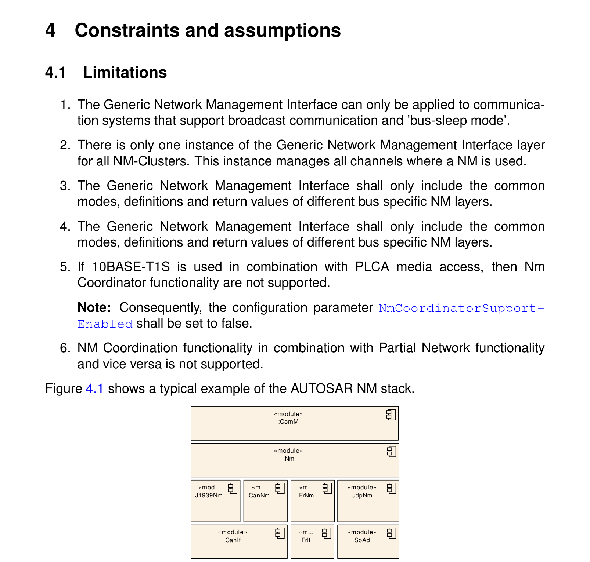

### 4.2. 当前版本的特定限制

以下限制反映了尚未实现或尚未达成一致、但可能会在未来的版本中添加的期望功能：

- 不支持备份协调器ECU（容错）。

另外，自AUTOSAR 4.0版本起，本规范已完全移除对OSEK NM的显式支持。仍然可以通过扩展CanNm或在&lt;Bus&gt;Nm层级引入复杂驱动程序（**CDD**）作为通用BusNm来支持OSEK NM。通过CDD支持OSEK NM不受AUTOSAR规定。

### 4.3. 汽车域的适用性

AUTOSAR NM接口是通用的并提供灵活的配置；它与底层通信系统无关，在上述限制条件下可以应用于任何汽车域。

## 5. 对其他模块的依赖

图5.1显示了AUTOSAR BSW中提供给其他模块和从其他模块所需的接口。

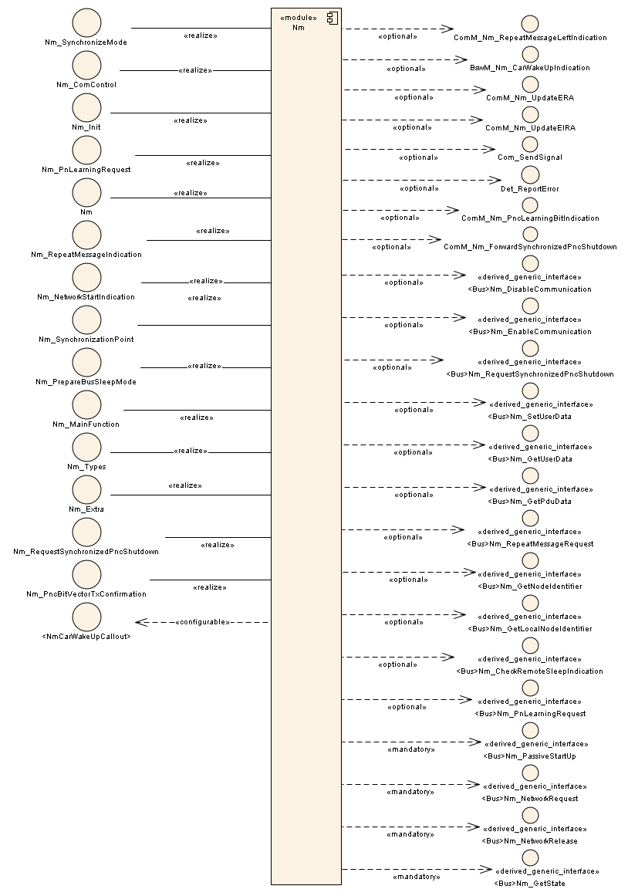

### 5.1. 与其他模块的接口

#### 5.1.1. ComM、CanNm、J1939Nm、FrNm、UdpNm、通用总线特定NM层和CDD

通用网络管理接口模块（Nm）向通信管理器（ComM）提供服务，并使用总线特定网络管理模块的服务：

- CAN网络管理（[\[3, CanNm\]](#ref-3)）
- FlexRay网络管理（[\[4, FrNm\]](#ref-4)）
- 以太网网络管理（[\[5, UdpNm\]](#ref-5)）。
- J1939网络管理（[\[6, J1939Nm\]](#ref-6)）。

对于像LIN总线这样不需要在总线上提供网络管理信息的总线，总线类型（**Bus-Type**）可以配置为「本地Nm」（local Nm）。关于回调，Nm向总线特定网络管理模块提供通知回调，并调用ComM提供的通知回调。

除上述官方AUTOSAR NM模块之外，Nm还支持通用总线特定NM层（&lt;Bus&gt;Nm）。任何实现了所需提供接口并使用Nm所提供回调函数的组件都可以用作总线特定NM。关于通用总线特定NM的前提条件见第[6.5](#65-总线特定网络管理模块的前提条件)节。

**原理解释：** Nm被规定为通过将通用下层模块作为复杂驱动程序添加来支持通用总线特定NM层。因此，Nm不显式使用官方AUTOSAR总线NM模块（CanNm、FrNm和UdpNm）的服务，而是使用通用&lt;Bus&gt;Nm的服务。AUTOSAR总线NM之所以得到显式支持，是因为它们实现了&lt;Bus&gt;Nm的接口。

可选的车辆唤醒（**CarWakeUp**）功能需要一个协调基础软件模式管理的复杂驱动程序。

#### 5.1.2. 错误处理模块

Nm按照后文关于开发错误定义的要求向默认错误跟踪器报告开发错误。

#### 5.1.3. BSW调度器

在NM协调器功能的情况下，根据配置，Nm将需要其主调度函数的周期性调用，以便评估和检测定时器何时到期。

### 5.2. 文件结构

#### 5.2.1. 代码文件结构

代码文件结构不应在本规范内完整定义。在此应当指出，代码文件结构应包含以下命名的文件。

#### 5.2.2. 头文件结构

Nm接口模块应包含以下头文件：

- Std\_Types.h（用于AUTOSAR标准类型）。注意：Platform\_Types.h（用于平台特定类型）通过AUTOSAR标准类型间接包含。
- ComM\_Nm.h（用于通信管理器回调函数）
- BswM\_Nm.h（如果BswM用于CarWakeup功能）

Nm接口应可选地包含默认错误跟踪器的头文件（取决于预处理器开关NmDevErrorDetect，见后文配置章节）。

- Det.h，用于默认错误跟踪器的服务。

## 6. 功能规格

NM接口功能由三部分组成：

- 与总线特定NM模块一起、在ECU上运行AUTOSAR NM所需的基础功能。
- 网关ECU用于同步关闭一个或多个总线的NM协调器功能。
- 部分网络功能分为2个子部分：
  - PNC请求的处理（过滤、聚合和监视）由部分网络的任何成员ECU使用。
  - PNC定时器的处理由部分网络的任何成员ECU使用。
  - 同步PNC关闭功能由以顶层PNC协调器或中间PNC协调器角色、跨越PN拓扑同步关闭特定PNC的PNC网关ECU使用。

### 6.1. 基硉功能

通用网络管理接口模块（Nm）应在总线特定网络管理模块（如CanNm、J1939Nm、FrNm和UdpNm）与通信管理器模块（ComM）之间充当与总线无关的适配层。

**注意：** Nm不提供本文档所规定之外的接口函数。Nm将向ComM提供一个接口，该接口不包含关于底层总线类型的特定知识，但足以完成必要的网络管理功能。Nm所处理的算法是与总线无关的。

**注意：** 还要求其他服务层模块只通过Nm访问网络管理功能，并且不存在到总线特定NM函数的旁路。

Nm应将来自ComM的通用函数调用转换为总线特定NM层的总线特定函数。

Nm应将总线特定NM层调用的回调函数转换为到ComM的通用回调。

Nm的基础功能可以完全或部分地使用宏来实现。

### 6.2. NM协调器功能

NM协调器功能是Nm的一项功能，它使用协调算法来协调ECU所连接的全部总线、或一个或多个独立总线子集上的NM关闭。

根据配置，协调算法可以被配置为达到不同级别的关闭同步。

使用NM并主动执行NM协调器功能的ECU通常被称为NM协调器（**NM Coordinator**）。但是，在本规范中，当在需求中使用该术语时，它与NM协调器功能同义。

**注意：** 考虑到某些总线类型对网络（**Network**）、通道（**Channel**）、集群（**Cluster**）等术语有不同的命名。

如果配置了NM协调器功能，则应配置配置参数NmCycletimeMainFunction（见后文关于调度函数的要求）。

**注意：** NM协调器可以使用它来计算内部定时器的超时状态。

#### 6.2.1. NM协调器功能的适用性

协调算法应能够处理多个受协调总线连接到一个NM协调器的拓扑。

NM协调器应支持连接到同一NM集群的两个或多个NM协调器。

NM协调器应能够协调运行官方AUTOSAR总线特定NM的总线，以及实现所需功能、回调和接口的所有其他通用总线NM。

**注意：** 所需的功能、回调和接口在第[6.5.2](#652-nm协调器功能的前提条件)小节中规定。不需要对J1939Nm的协调器支持，因为J1939Nm不支持关闭处理。

NM接口配置应提供参数NmCoordinatorSupportEnabled，以定义是否存在NM协调器功能的支持。

可以配置多个应独立协调的NM协调集群。

每个总线应属于零个或一个NM协调集群。

**原理解释：** 配置参数NmCoordClusterIndex用于规定总线属于哪个协调集群。如果某个通道未定义该参数，则相应的总线不属于NM协调集群。

只应对协调集群中当前处于唤醒状态的网络协调关闭。已经处于「总线睡眠模式」的网络仍应被监视，但不被协调。

**原理解释：** NM协调器不要求协调集群中的所有总线都处于唤醒状态（即使用协调集群的子集或部分网络）即可执行协调关闭。它始终监视关闭发起条件，当这些条件满足时，它对协调集群中所有当前唤醒的总线执行协调关闭。

**注意：** 为受协调的总线提供同步唤醒不在Nm的职责范围内。如果一个通道发生唤醒，由应用（即车辆模式管理）负责唤醒所需的或全部通道。

#### 6.2.2. 保持受协调总线处于唤醒状态

只要实现NM协调器的节点在协调集群的至少一个总线上尚未准备好睡眠（即它已主动请求了网络），NM协调器应确保在该协调集群中所有当前活动的总线上请求网络。

只要协调集群中至少有一个总线尚未准备好睡眠（即因为协调器以外的另一个节点正在请求该总线），NM协调器仍应确保在该协调集群中所有当前活动的总线上请求网络，即使本地ECU本身在该协调集群的所有总线上都已准备好睡眠。

**原理解释：** 总线特定NM通过调用回调Nm\_RemoteSleepIndication和Nm\_RemoteSleepCancellation向Nm指示总线是否准备好睡眠。本地ECU使用API函数Nm\_NetworkRelease和Nm\_NetworkRequest指示它是否已在某个网络上准备好睡眠。

**原理解释：** Nm通过调用总线特定NM函数&lt;Bus&gt;Nm\_NetworkRequest在总线上请求网络。

由于所有AUTOSAR总线特定NM都基于这样一个原则：只要一个AUTOSAR节点保持网络被请求，它就能使总线保持唤醒，因此NM协调器将通过为总线特定NM请求网络来使协调集群的所有总线保持唤醒。

上述两个要求可以总结如下：只要至少一个节点（包括实现NM协调器的节点）使协调集群中的任何总线保持唤醒，NM协调器就应使该协调集群的所有总线保持唤醒。

如果协调集群的某个总线的参数NmChannelSleepMaster设置为TRUE，则NM协调器应始终将该总线视为准备好睡眠，并且在开始该网络的关闭之前不应等待来自该总线的Nm\_RemoteSleepIndication调用。

**原理解释：** 应为所有这样的总线特定NM设置该属性：该总线的睡眠可以完全由本地节点决定，并且该总线的其他节点不能反对该决定。这种网络的一个例子是LIN，本地AUTOSAR ECU将始终是LIN总线主节点，并且始终可以单独决定网络何时应进入睡眠。

#### 6.2.3. 受协调总线的关闭

可达到的同步级别取决于配置。见第[6.2.5](#625-关闭定时器的计算)小节，图7.1给出了协调算法的总览。如第[6.2.1](#621-nm协调器功能的适用性)节所述，协调算法和协调关闭应按NM协调集群独立应用。

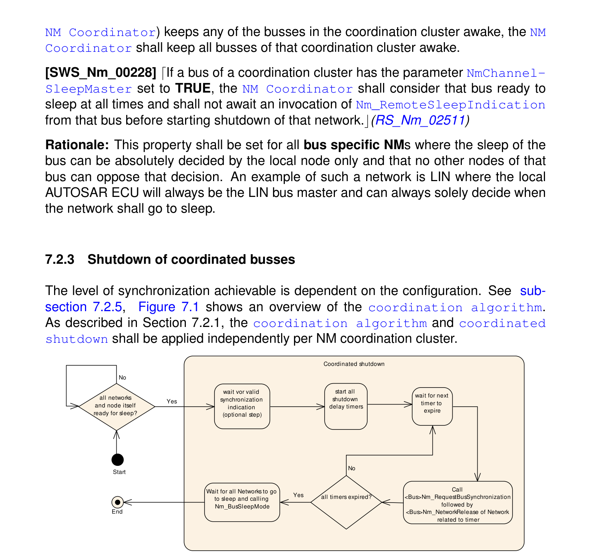

**注意：** 对协调算法执行的动作的发生位置没有限制。这既可以由Nm主函数（Nm\_MainFunction）完成，也可以由模块指示/回调完成。

当协调集群的所有网络都已准备好睡眠或已经处于「总线睡眠模式」时，NM协调器应在所有唤醒的网络上开始协调关闭。NM协调器应持续评估是否可以开始协调关闭。

**原理解释：** 关闭条件的评估也可以在主函数之外的其他API调用中完成。此时评估可以分段，只检查受这些API调用影响的特定条件，因此不必在每个主处理周期和每次API调用中重新评估所有条件。

如果协调集群中任何总线的配置参数NmSynchronizingNetwork为TRUE，则协调关闭应被延迟，直到作为该协调集群同步网络配置的网络调用了Nm\_SynchronizationPoint。

如果协调器在受协调网络上检测到模式变更为NM\_MODE\_SYNCHRONIZE、NM\_MODE\_PREPARE\_BUS\_SLEEP或NM\_MODE\_BUS\_SLEEP，且该网络所属的协调集群尚未开始关闭过程，且ComM没有对该通道的内部网络模式请求，则协调器应将该网络视为远程睡眠，并应为该网络调用&lt;Bus&gt;Nm\_NetworkRelease。如果此外该网络的配置参数NmSynchronizingNetwork为TRUE，则协调器不应在该网络上等待Nm\_SynchronizationPoint。

**原理解释：** 如果NM协调集群中的一个或多个网络是周期性的（如FlexRay），如果算法与其中一个包含的周期性网络同步，将达到更高级别的同步关闭。如果如此配置，则在同步网络调用Nm\_SynchronizationPoint之前，不会启动所有受协调网络的关闭定时器。

**原理解释：** 尽管每个NM协调集群只应将一个网络配置为指示同步点，但这将允许NM协调器功能过滤掉除源自被配置为各协调集群同步网络的网络之外的所有同步指示。

如果尚未满足开始协调关闭的所有条件，或者协调关闭已经开始（但未被中止），对Nm\_SynchronizationPoint的调用应被忽略。

**原理解释：** 在某些情况下，非同步网络可能需要更长时间才能进入睡眠。如果发生这种情况，协调关闭将基于一次同步指示开始，但由于同步网络不会被直接释放，它会继续调用（若干次）更多的同步指示，这些指示可以被安全地忽略。

如果协调集群中所有当前唤醒的总线的配置参数NmSynchronizingNetwork均为FALSE，则定时器应在所有关闭条件满足后启动，而不等待对Nm\_SynchronizationPoint()的调用。（另见上文关于同步网络的要求。）

当协调关闭开始时，应为协调集群中每个当前唤醒的通道激活一个关闭延迟定时器。每个定时器应设置为NmGlobalCoordinatorTime。如果[NmBusType](#943-nmbustype)未设置为NM\_BUSNM\_LOCALNM，则还应减去特定通道的关闭时间TSHUTDOWN\_CHANNEL。

如果NmGlobalCoordinatorTime为零，则所有通道的关闭延迟定时器也应为零。

**注意：** TSHUTDOWN\_CHANNEL可以按照第[6.2.5](#625-关闭定时器的计算)小节所述计算，或使用以下公式：

CanNm：Ready Sleep Time + Prepare BusSleep Time

FrNm：Ready Sleep Time，例如：(FrNmReadySleepCnt+1) * FrNmRepetitionCycle * 「一个FlexRay周期的时长」

GenericNm：NmGenericBusNmShutdownTime

当某个网络的关闭定时器到期时，如果Nm\_BusNmType未设置为NM\_BUSNM\_LOCALNM，Nm应通过先调用&lt;Bus&gt;Nm\_RequestBusSynchronization、再调用&lt;Bus&gt;Nm\_NetworkRelease来释放该网络。如果BusNmType设置为NM\_BUSNM\_LOCALNM，Nm应通过调用ComM\_Nm\_BusSleepMode将关闭告知ComM。

**注意：** 在AUTOSAR Classic Platform中，CanNm\_PassiveStartUp、J1939Nm\_PassiveStartUp、FrNm\_PassiveStartUp和UdpNm\_PassiveStartUp已被规定为对应于&lt;Bus&gt;Nm\_PassiveStartUp的预定义接口。

Nm应跟踪所有已释放但尚未报告「总线睡眠模式」的网络。如果关闭被中止，这些网络仍应被视为活动网络。

**注意：** 见第[6.3.3](#633-协调关闭的中止)小节。

定义：当所有网络都已被释放且所有网络都处于「总线睡眠模式」时，协调关闭即告完成。

#### 6.2.4. 嵌套子总线的协调

为支持嵌套子总线的协调，需要将Nm协调器配置为构建一个协调层级。最顶层的NM协调器在每个协调集群中只有主动协调的通道（NmActiveCoordinator == TRUE）。该NM协调器必须为所有其他协调器发起协调关闭。嵌套的NM协调器从其被动配置的通道（NmActiveCoordinator == FALSE）接收其关闭指示信息，并通过其主动协调的通道（NmActiveCoordinator == TRUE）将该信息提供给后续的NM协调器。

图7.2将以示例说明这一点。

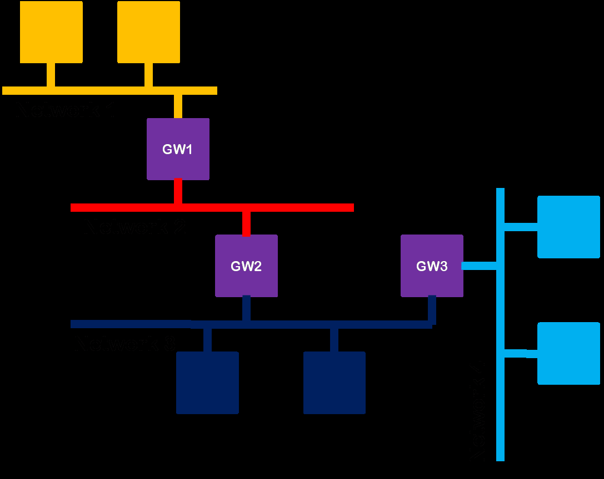

图7.2所示的示例拓扑具有以下协调方式。GW 1将到网络1和网络2的通道配置为主动协调通道。GW 2将网络2连接配置为被动协调通道，但在网络3上为主动协调通道。GW 3则需要在网络3上配置为被动协调通道，但对其到网络4的连接为主动协调通道。

如果NmCoordinatorSyncSupport参数设置为TRUE，则应提供协调嵌套子总线的功能。

**注意：** 本章内的所有要求对「每个NM协调集群」均有效（见上文关于多个协调集群的要求）。

NmActiveCoordinator参数指示NM协调器在该通道上是以主动方式

（主动协调通道）[NmActiveCoordinator = TRUE]

还是以被动方式

（被动协调通道）[NmActiveCoordinator = FALSE]行事。

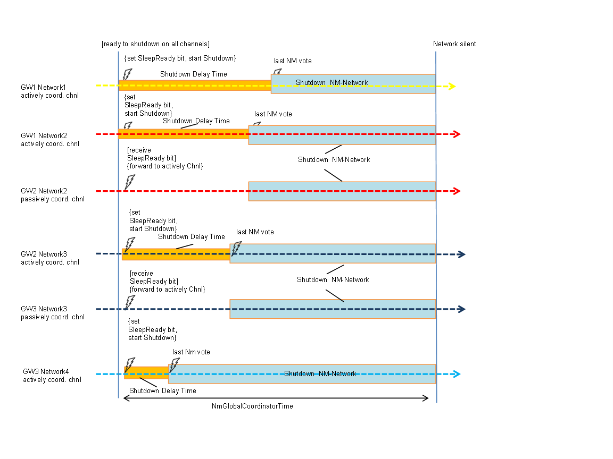

在其被动协调通道上，NM协调器应只在节点有待处理的网络管理请求、或由该NM协调器主动协调的某个所连接网络尚未准备好睡眠时，才发送NM消息。

**原理解释：** 这防止了两个NM协调器在同一通道上、当它们都准备好睡眠时仍发送NM消息从而使总线保持唤醒。没有这种机制，将无法检测是否至少还有另一个节点处于活动状态。

NM协调器应通过&lt;Bus&gt;Nm\_SetSleepReadyBit在其主动协调的通道上将NM消息中的NM协调器睡眠就绪（**NMcoordinatorSleepReady**）位置为1：

如果

NM协调集群的所有节点都准备好睡眠（RemoteSleepIndication）

且

如果启用了NmSynchronizingNetwork，已在相应通道上接收到Nm\_SynchronizationPoint()调用

且

如果该NM协调集群的所有通道都配置为NmActiveCoordinator == TRUE。且

如果[NmBusType](#943-nmbustype)未配置为NM\_BUSNM\_LOCALNM。

**注意：** 协调器位在CBV中的位置见相应的&lt;Bus&gt;Nm规范。

**注意：** 这适用于最顶层的协调器（没有被动协调通道）。

**原理解释：** 包含被动协调通道的节点不需要同步点，因为它们已经由其主动协调器的睡眠就绪位同步。

**注意：** 包含被动协调通道的节点将按照后文关于睡眠就绪位转发的要求设置该位。

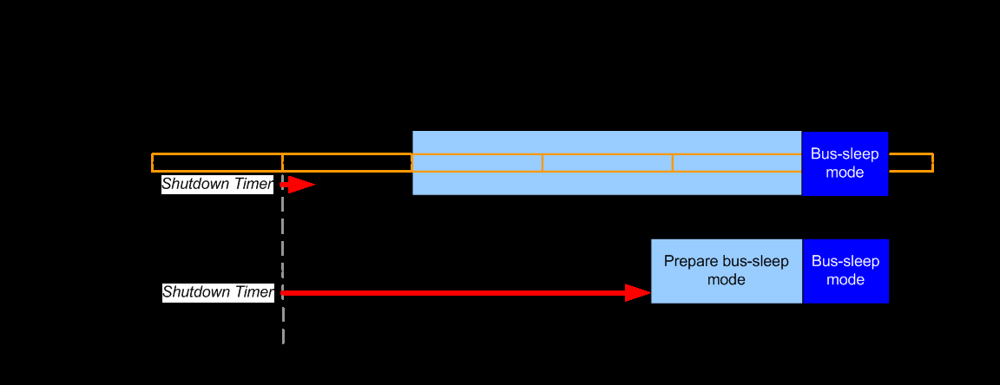

如果在被动协调通道上接收到Nm\_CoordReadyToSleepIndication，Nm协调器应通过API调用&lt;Bus&gt;Nm\_SetSleepReadyBit在所有主动协调的通道上将NMCoordinatorSleepReady位置为SET（1）。

如果在被动协调通道上接收到Nm\_CoordReadyToSleepCancellation，Nm协调器应通过API调用&lt;Bus&gt;Nm\_SetSleepReadyBit在所有主动协调的通道上将NMCoordinatorSleepReady位置为UNSET（0）。

**注意：** 在其被动协调通道上，NM协调器绝不会（通过&lt;Bus&gt;Nm函数调用）设置睡眠就绪位，而是将接收到的睡眠就绪位状态变化转发到其主动协调的通道。

**注意：** 在其主动协调通道上，NM协调器不会预期Nm\_CoordReadyToSleepIndication和Nm\_CoordReadyToSleepCancellation的调用。

NM协调器应在睡眠就绪位被请求为SET状态后开始协调关闭。

NmGlobalCoordinatorTime应至少设置为关闭所有受协调网络所需的最大时间。

**注意：** 这包括所有嵌套连接。（例如见图7.3。）

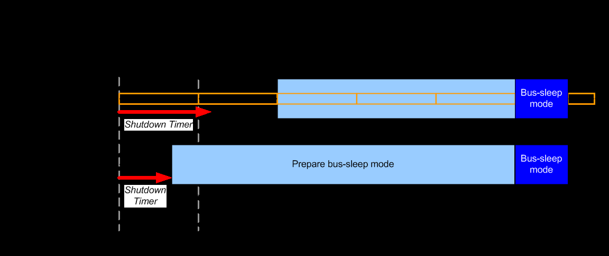

如果协调关闭因任何原因被中止，NM协调器应通过API调用&lt;Bus&gt;Nm\_SetSleepReadyBit在所有主动协调的通道上将NMCoordinatorSleepReady位置为UNSET（0）。

**注意：** 关于被中止的关闭的细节见第[6.3.3](#633-协调关闭的中止)小节。

#### 6.2.5. 关闭定时器的计算

协调算法相当灵活，因为可达到的同步级别取决于开关和定时器的配置。根据要同步的目标事件或时间点，应以不同的方式进行配置。本章包含关于如何达到三种不同同步级别的指南。由配置决定是遵循这些指南，还是通过选择自己的特定配置来实现单独的同步顺序。因此，本节不包含任何要求，只有建议。

请注意，绝对同步是永远无法实现的。决定同步精确性的抖动因素包括Nm的处理周期、定时器的精确性以及非确定性总线的总线负载。正确配置后，下文描述的用例将在考虑这些因素的情况下给出可达到的最佳同步。

NM协调器的先前版本曾为协调器算法提供了将协调关闭的开始延迟「若干轮次」的可能。该特定延迟已被移除，但通过增大所有关闭定时器（配置参数NmGlobalCoordinatorTime）仍可以获得类似的行为。当使用周期性网络（如FlexRay）时，如果应将该增大的延迟时间量化到这些网络的同步指示周期，则必须特别小心。

#### 6.2.6. 同步用例1——同步命令

本用例侧重于如何同步不同网络被释放的时间点。

这将实现所有网络最快的总关闭，但缺点是各网络不会同时进入「总线睡眠模式」。

**原理解释：** 本用例的一个例子是：只要任何CAN节点请求其中一个网络，多个CAN网络就应保持唤醒；但当所有节点都准备好睡眠时，不同网络是否同时进入「总线睡眠模式」并不重要。

由于本用例不考虑网络的任何周期性行为，所有网络的同步参数NmSynchronizingNetwork都应设置为FALSE，并且不应将任何总线特定NM配置为调用Nm\_SynchronizationPoint回调。

为了实现尽可能快的关闭，关闭定时器参数NmGlobalCoordinatorTime需要设置为0.0。

#### 6.2.7. 同步用例2——同步发起

本用例是用例1的扩展，但此处考虑了如下事实：对于某些网络，释放网络的请求只会在特定的时间点被处理。本用例将像用例1那样命令同时关闭，但会等待到适合同步网络的时间点。

**原理解释：** 本用例的一个例子是：一个FlexRay网络和多个CAN网络，其中应最大化所有网络处于活动状态的时间，但仍应尽可能快地将网络置为睡眠。

由于本用例应考虑所选网络的周期性行为，其中一个网络的同步参数NmSynchronizingNetwork应设置为TRUE，而其他网络的该参数应设置为FALSE。同步网络的总线特定NM还应被配置为在适合发起关闭的时间点调用Nm\_SynchronizationPoint回调。

为了实现尽可能快的关闭，关闭定时器参数NmGlobalCoordinatorTime需要设置为0.0。

#### 6.2.8. 同步用例3——同步网络睡眠

本用例将侧重于同步不同网络进入「总线睡眠模式」的时间点。它将等待来自同步网络的指示，然后基于时序值延迟所有网络的网络释放，使从「网络模式」（或「准备总线睡眠模式」）到「总线睡眠模式」的转换尽可能同步。

**原理解释：** 本用例的一个例子是：一个FlexRay网络和多个CAN网络应同时停止通信。

由于本用例应考虑所选网络的周期性行为，网络中——最好是周期性的那个——的一个网络的同步参数NmSynchronizingNetwork应设置为TRUE，而其他网络的该参数应设置为FALSE。同步网络的总线特定NM还应被配置为在适合发起关闭的时间点调用Nm\_SynchronizationPoint回调。

为了计算每个网络的关闭定时器TSHUTDOWN\_CHANNEL，必须获得每个网络时序行为的特定知识。

对于所有网络，必须计算TSHUTDOWN\_CHANNEL，这是该网络进入「总线睡眠模式」所需的最短时间。对于非周期性网络（如CAN），该时间应从网络被释放的时间点起测量，直到它进入「总线睡眠模式」。对于周期性网络（如FlexRay），该时间还应包括从网络被释放之前作出的同步指示开始的完整范围。对于Generic BusNm，该时间由配置参数NmGenericBusShutdownTime给出。

对于同步网络，必须确定TSYNCHRONIZATION\_INDICATION。这是该总线特定NM对Nm\_SynchronizationPoint的任意两次连续调用之间的时间。

NmGlobalCoordinatorTime应为协调算法所需的总时间。这包括嵌套子总线的关闭时间。首先将NmGlobalCoordinatorTime设置为与同步网络的TSHUTDOWN\_CHANNEL相同的值。如果任何其他网络的TSHUTDOWN\_CHANNEL大于NmGlobalCoordinatorTime，则反复用TSYNCHRONIZATION\_INDICATION扩展NmGlobalCoordinatorTime，直到NmGlobalCoordinatorTime等于或大于任何TSHUTDOWN\_CHANNEL。

每个网络的关闭延迟定时器应计算为该网络的NmGlobalCoordinatorTime - TSHUTDOWN\_CHANNEL。

对于周期性网络，该参数随后必须稍微增大，以确保网络释放将发生在两个同步指示之间、略在Nm\_SynchronizationPoint（曾经/将要）被调用之后。延长定时器的时间量取决于总线特定NM的实现和配置，但应远小于TSYNCHRONIZATION\_INDICATION。

##### 6.2.8.1. 示例

在第一种情况（图7.4）中，同步网络拥有最大的TSHUTDOWN\_CHANNEL，因此它等于NmGlobalCoordinatorTime。对于同步网络，关闭延迟定时器将为NmGlobalCoordinatorTime - TSHUTDOWN\_CHANNEL，即零，但随后会加上少量时间，以确保Nm将等待在两个同步点之间释放网络。

对于非周期性网络，关闭延迟定时器简单地就是NmGlobalCoordinatorTime - TSHUTDOWN\_CHANNEL。


在第二种情况（图7.5）中，非周期性网络需要很长时间才能关闭，因此它拥有最大的TSHUTDOWN\_CHANNEL。此时NmGlobalCoordinatorTime是这样得到的：取同步网络的（略短的）TSHUTDOWN\_CHANNEL，并对该值加上一次TSYNCHRONIZATION\_INDICATION。

对于同步网络，关闭定时器将为NmGlobalCoordinatorTime - TSHUTDOWN\_CHANNEL，并加上少量时间以确保Nm将等待在两个同步点之间释放网络。对于非周期性网络，关闭定时器简单地就是NmGlobalCoordinatorTime - TSHUTDOWN\_CHANNEL。


### 6.3. 唤醒和协调关闭的中止

Nm不负责节点或网络的正常唤醒，这将由通信管理器（ComM）完成。

#### 6.3.1. 外部网络唤醒

对于基础功能和NM协调功能，Nm将把来自网络的唤醒指示（由总线特定NM调用回调Nm\_NetworkStartIndication指示）通过调用ComM\_Nm\_NetworkStartIndication()转发给ComM。然后ComM将调用Nm\_PassiveStartUp，Nm会将其转发给总线特定NM的相应接口。

对处于总线睡眠的通道的唤醒事件处理（与收发器和控制器状态相关）将由EcuM和ComM处理。Nm不参与其中。如上所述，取决于唤醒验证和相应的通信需求，Nm将从ComM获得网络请求。

如果ComM对属于受协调网络集群的网络调用了Nm\_PassiveStartUp()，则Nm协调器功能应将此调用视为ComM已调用了Nm\_NetworkRequest()。如果BusNmType未设置为NM\_BUSNM\_LOCALNM，Nm应向下层转发一次&lt;Bus&gt;Nm\_NetworkRequest调用，相应地，该网络应被计为由NM协调器所请求。

**注意：** 换言之：对属于受协调网络集群的网络的Nm\_PassiveStartUp调用应被「翻译」为/按Nm\_NetworkRequest调用处理。

#### 6.3.2. 协调唤醒

根据配置，ComM可以基于来自一个网络的指示启动多个网络。建议将ComM配置为：如果一个网络指示网络启动，则自动启动NM协调集群的所有网络，但这并非总是必要。由于网络的唤醒不在Nm的职责范围内，这与是否使用NM协调功能无关。

#### 6.3.3. 协调关闭的中止

如果NM协调功能已激活且协调关闭已在一个NM协调集群上发起，则根据协调算法的配置，每个包含的总线实际被释放之前可能需要时间。如果受协调总线上的任何节点在所有网络被释放之前改变其状态并开始请求网络，协调算法中可能出现竞态条件。这可能以四种方式发生：

1. 尚未被释放且仍处于「网络模式」的网络上的节点再次开始请求网络。这将被总线特定NM检测到，后者将通过调用Nm\_RemoteSleepCancellation通知Nm。
2. 已经被释放、已指示「准备总线睡眠模式」但尚未指示「总线睡眠模式」的网络上的节点再次开始请求网络。这将被总线特定NM检测到，后者将自动把状态变更为「网络模式」并通过调用Nm\_NetworkMode通知Nm。
3. ComM请求NM协调集群中任何网络的网络。
4. 主动协调该网络的协调器发送了清除「睡眠就绪位」的Nm消息。这将被总线特定NM检测到（仅在被动协调通道上），并通过调用Nm\_CoordReadyToSleepCancellation转发给NM。

通用做法是中止关闭并重新开始请求网络。但是，已经进入「总线睡眠模式」的网络不应被自动唤醒；这必须由ComM显式请求。

如果该NM协调集群中的任何网络：

- 指示Nm\_RemoteSleepCancellation，或
- 指示Nm\_NetworkMode，或
- 指示Nm\_CoordReadyToSleepCancellation
- 或ComM以Nm\_NetworkRequest或Nm\_PassiveStartUp请求其中一个网络，

则协调关闭应被中止。

**注意：** Nm\_NetworkStartIndication不是中止协调关闭的触发条件，因为这由上层处理。

如果协调关闭被中止，对于所有已指示「总线睡眠」的网络，NM协调器应调用ComM\_Nm\_RestartIndication。

**原理解释：** 由于Nm不能自行决定唤醒网络，这必须像（外部）唤醒情况一样由ComM决定。

如果协调关闭被中止，对于所有尚未指示「总线睡眠」的网络，若BusNmType未设置为NM\_BUSNM\_LOCALNM，NM协调器应向&lt;Bus&gt;Nm请求网络。如果BusNmType设置为NM\_BUSNM\_LOCALNM，Nm应通过调用ComM\_Nm\_NetworkMode将网络启动告知ComM。

如果协调算法已被中止，则应重新评估保护协调关闭发起的所有条件。

**原理解释：** 当协调关闭被中止时，多数情况下该NM协调集群中现在存在一些不再指示可以网络睡眠的网络，因此NM协调器必须使所有当前非睡眠网络保持唤醒。也可能存在所有条件都没有变化的情况，这只会导致协调关闭的重新发起。

如果协调关闭已被中止且Nm在&lt;Bus&gt;Nm\_NetworkRequest上收到E\_NOT\_OK，则在重新评估发起协调关闭的条件时，该网络不应被视为唤醒状态。

**原理解释：** 任何在被中止的协调关闭期间需要被重新请求的&lt;Bus&gt;Nm之前都已被ComM和Nm释放。&lt;Bus&gt;Nm有责任（通过Nm）告知ComM网络确实已被释放，因此即使Nm\_NetworkRequest上的错误响应从未直接到达ComM，ComM也将掌握网络状态。

如果协调关闭已被发起且Nm在&lt;Bus&gt;Nm\_NetworkRelease上收到E\_NOT\_OK，则应立即中止关闭。对于所有尚未进入「总线睡眠模式」的网络，Nm应请求这些网络。这包括对&lt;Bus&gt;Nm\_NetworkRelease指示错误的那个网络。一旦完成，就可以重新评估发起协调关闭的条件。这也适用于未主动参与当前协调关闭的网络。

**原理解释：** 如果一个网络无法被释放，应立即再次请求它，以同步Nm中NM协调器与&lt;Bus&gt;Nm之间的状态。只要&lt;Bus&gt;Nm的问题持续存在，协调关闭最终会再次发起。&lt;Bus&gt;Nm有责任将任何问题直接报告给DEM和/或默认错误跟踪器，因此NM协调器只需尝试释放网络直到成功。

### 6.4. 部分网络功能

关于部分网络集群功能的总览可参见文档《模式管理指南》[\[9\]](#ref-9)。

#### 6.4.1. PNC位向量过滤算法

PNC位向量过滤算法的意图是包含所有与ECU的PNC处理相关的PNC请求，并排除所有与ECU不相关的已接收PNC请求。此外，过滤算法用于限定相关的PNC请求以供发送。被限定为相关的PNC请求会（重新）启动相应的PNC定时器。

为了区分与ECU相关的PNC请求和不相关的PNC请求，Nm会评估由&lt;Bus&gt;Nm接收的PNC位向量（被动PNC请求，由网络中另一个ECU远程发起），并评估由ComM发送的PNC位向量（主动请求，由本地应用发起）。PNC位向量的每一位表示一个PNC。

PNC是静态配置的。一个PNC表示ECU对特定部分网络集群（PNC）的参与。

PNC位向量过滤算法应在Nm\_PncBitVectorRxIndication的上下文中评估给定PNC位向量的字节。

**注意：** 如果&lt;Bus&gt;NmAllNmMessagesKeepAwake被启用，即使没有收到相关的PNC请求，ECU仍可能保持唤醒。

如果调用了Nm\_PncBitVectorRxIndication、NmPnEiraCalcEnabled或NmPnEraCalcEnabled设置为TRUE、且在给定的PNC位向量中检测到至少一个PNC位作为相关PNC请求，则OUT参数RelevantPncRequestDetectedPtr应设置为TRUE。否则RelevantPncRequestDetectedPtr的值应设置为FALSE。

**注意：** RelevantPncRequestDetectedPtr的值由调用方&lt;Bus&gt;Nm使用，以限定所接收的NM PDU是否应被纳入进一步的Rx指示处理。

示例：给定的PNC位向量长度为2字节（NmPncBitVectorLength）：

表7.1：PNC位向量示例（**Example of PNC bit vector**）

| 字节0 | 字节1 |
| --- | --- |
| PNC位向量 | PNC位向量 |
| 0x12 | 0x8E |

对于本例，将定义两个[NmPnFilterMaskByte](#942-nmpnfiltermaskbyte)，例如：

- NmPnFilterMaskByteIndex = 0，NmPnFilterMaskByteValue = 0x01
- NmPnFilterMaskByteIndex = 1，NmPnFilterMaskByteValue = 0x97

过滤算法的动作和结果为：

表7.2：PN过滤算法示例（**Example PN Filter Algorithm**）

| 过滤掩码值（字节） | 与接收的PNC位向量比较 | 结果 |
| --- | --- | --- |
| 0x01（字节0） | 0x12（NM PDU字节4） | 0x00（无相关PNC请求） |
| 0x97（字节1） | 0x8E（NM PDU字节5） | 0x86（相关PNC请求） |

由于有一个字节包含相关信息，布尔参数RelevantPncRequestDetectedPtr的值被设置为TRUE。

所有配置的[NmPnFilterMaskByte](#942-nmpnfiltermaskbyte)的长度应与相应NM通道的NmPncBitVectorLength具有相同的长度（以字节为单位）。如果配置的[NmPnFilterMaskByte](#942-nmpnfiltermaskbyte)的长度与相应NM通道配置的NmPncBitVectorLength不同，配置工具应将该配置判定为无效（错误）。

#### 6.4.2. PNC请求的聚合

##### 6.4.2.1. 内部和外部部分网络集群的聚合

如果NmPnEiraCalcEnabled设置为TRUE，则Nm应提供在所有NmPnEnabled设置为TRUE的NM通道上合并存储外部和内部请求PNC的可能性。初始化时，EIRA中所有PNC的值应设置为0（PNC已释放）。

如果

- NmPnEiraCalcEnabled为TRUE
- 且通过Nm\_PncBitVectorRxIndication（&lt;NM通道&gt;、&lt;外部PNC请求的PNC位向量&gt;）或Nm\_ForwardSynchronizedPncShutdown（&lt;NM通道&gt;、&lt;被指示为同步关闭的PNC的PNC位向量&gt;）接收到PNC位向量
- 且该消息中请求了PNC（位被置1）
- 且所请求的PNC在所配置的PN过滤掩码中被置1

则Nm应为这些PNC存储请求信息（值1），即「PNC被请求」。

如果

- NmPnEiraCalcEnabled设置为TRUE
- 且通过Nm\_PncBitVectorTxIndication（&lt;NM通道&gt;、&lt;提供聚合内部PNC请求的未过滤PNC位向量的缓冲区&gt;）指示一次PNC位向量的发送
- 且给定NM通道上没有待处理的同步PNC关闭请求
- 且存储的未过滤PNC位向量中请求了PNC（位被置1）
- 且存储的内部PNC请求的未过滤PNC位向量中所请求的PNC在所配置的PN过滤掩码中被置1

则Nm应为这些PNC存储请求信息（值1），即「PNC被请求」。

如果NmPnEiraCalcEnabled为TRUE，调用Nm\_PncBitVectorTxIndication（&lt;NM通道&gt;、PncBitVectorPtr&lt;提供未过滤PNC位向量的缓冲区&gt;）且给定NM通道上没有待处理的同步PNC关闭请求，则Nm应将给定NM通道的内部PNC请求的未过滤PNC位向量复制到PncBitVectorPtr所指示的缓冲区。

如果

- NmPnEiraCalcEnabled设置为TRUE
- 且给定NM通道上存在待处理的同步PNC关闭请求
- 且通过Nm\_PncBitVectorTxIndication（&lt;NM通道&gt;、&lt;提供聚合同步PNC请求的PNC位向量的缓冲区&gt;）指示一次PNC位向量的发送
- 且PNC位向量中请求了PNC进行同步PNC关闭（位被置1）
- 且PNC位向量中的聚合同步PNC请求在所配置的PN过滤掩码中被置1

则Nm应为这些PNC存储请求信息（值1），即「PNC被请求」。

如果NmPnEiraCalcEnabled设置为TRUE，调用Nm\_PncBitVectorTxIndication（NetworkHandle &lt;NM通道&gt;、PncBitVectorPtr &lt;提供聚合同步PNC请求位向量的缓冲区&gt;）且给定NM通道上存在待处理的同步PNC关闭请求，则Nm应按如下方式设置PncBitVectorPtr所指示的缓冲区：

- 将与给定NM通道被请求进行同步PNC关闭的PNC相关的所有位置1
- 将所有其他位清0

**注意：** Nm模块必须聚合所有被指示进行同步PNC关闭的PNC，并将pncId转换为字节数组（PNC位向量）。PNC位向量的每一位（PNC位）表示一个特定的PNC。PNC位在PNC位向量中的byteIndex和bitindex可确定如下：

- byteIndex = (PncId div 8)
- bitIndex = (PncId mod 8)

对于所有NmPartialNetworkSupportEnabled设置为TRUE的已配置NM通道，Nm应提供在所有NmPnEnabled设置为TRUE的NM通道上合并存储外部和内部请求PNC的可能性。初始化时，EIRA中所有PNC的值应设置为0（PNC已释放）。

如果调用了Nm\_UpdateIRA（&lt;NM通道&gt;、&lt;聚合内部PNC请求的PncBitVector&gt;），Nm应按给定NM通道存储接收到的未过滤PncBitVector。因此，Nm模块应按照所配置的长度（见NmPncBitVectorLength）复制给定NM通道的字节数。

**注意：** Nm存储未过滤的内部PNC请求，以支持即使在PNC未分配给该通道的情况下也能在特定通道上请求PNC的可能性。

如果NmPnEiraCalcEnabled为TRUE，则Nm应提供在Nm\_MainFunction的上下文中监视每个相关PNC的可能性。该监视应考虑PNC状态，即该PNC是否仍在至少一个相关NM通道上被外部或内部请求。

**注意：** 这意味着在多个相连物理通道上处理一个PNC只需要一个定时器。例如：处理具有6个物理通道和8个部分网络集群的网关的请求只需要8个EIRA复位定时器。这是可能的，因为PNC相关PDU组的切换是ECU全局的，与物理通道无关。

如果NmPnEiraCalcEnabled为TRUE，且每次一个PNC被存储为「PNC被请求」（见上文），则在Nm\_MainFunction的上下文中应按照NmPnResetTime重新启动对该PNC的监视。

**注意：** NmPnResetTime必须配置为大于&lt;Bus&gt;NmMsgCycleTime的值。如果NmPnResetTime配置为小于&lt;Bus&gt;NmMsgCycleTime的值且只有一个ECU请求该PNC，则EIRA中的请求状态会来回翻转，因为在请求ECU能够在下一条NM消息中发送PNC位向量之前请求状态就被复位了。

**注意：** NmPnResetTime必须配置为小于&lt;Bus&gt;NmTimeoutTime的值，以避免定时器在&lt;Bus&gt;Nm已经变更为预期禁用应用通信的状态（例如变更为Prepare Bus Sleep（UdpNm、CanNm）或Bus Sleep（FrNm））之后才到期。

如果NmPnEiraCalcEnabled为TRUE且一个PNC在NmPnResetTime内未被再次请求，则在Nm\_MainFunction的上下文中应将该PNC的相应存储值设置为PNC已释放（值0）。

如果NmPnEiraCalcEnabled为TRUE且一个PNC的存储值被设置为PNC被请求或回到PNC已释放（见上文），则Nm应通过调用ComM\_Nm\_UpdateEIRA(&lt;EIRA的PncBitVector&gt;)将EIRA的变化状态转发给ComM。

**注意：** 如果接收到PN关闭消息（PNSR被置1），不需要特殊处理，因为相应的PNC状态机需要保持在COMM\_PNC\_READY\_SLEEP。只有ERA PDU以不同的方式处理（见下文关于PN关闭消息接收的要求）。

##### 6.4.2.2. 外部部分网络集群的聚合

如果NmPnEraCalcEnabled为TRUE，则Nm应提供按通道存储相关外部PNC请求的可能性。初始化时，所有PNC的值应设置为0（PNC已释放）。

如果

- NmPnEraCalcEnabled为TRUE
- 且通过Nm\_PncBitVectorRxIndication（&lt;NM通道&gt;、&lt;外部PNC请求的PncBitVector&gt;）接收到PNC位向量
- 且该消息中请求了PNC（位被置1）
- 且所请求的PNC在所配置的PN过滤掩码中被置1

则Nm应为这些PNC按给定通道存储PNC请求信息（值1），即「PNC被请求」。

如果NmPnEraCalcEnabled为TRUE，则Nm应提供在Nm\_MainFunction的上下文中按通道监视每个相关PNC的可能性。该监视应考虑PNC状态，即该PNC是否仍在相应的NM通道上被外部请求。

**注意：** 这意味着在多个物理通道上处理一个PNC需要单独的定时器。例如：处理一个具有6个物理通道和8个部分网络集群的PNC网关的外部PNC请求需要48个ERA PNC复位定时器。不可能像EIRA PNC定时器那样合并PNC复位定时器，因为外部PNC请求不得被镜像回接收到PNC请求的总线/网络。因此，需要检测作为PNC请求源的物理通道。

如果NmPnEraCalcEnabled为TRUE，则每次一个PNC被存储为「PNC被请求」（见上文），在Nm\_MainFunction的上下文中应按照NmPnResetTime重新启动对该PNC的监视。

**注意：** NmPnResetTime必须配置为大于&lt;Bus&gt;NmMsgCycleTime的值。如果NmPnResetTime配置为小于&lt;Bus&gt;NmMsgCycleTime的值且只有一个ECU请求该PNC，则EIRA中的请求状态会来回翻转，因为请求状态在请求ECU能够在下一条NM消息中发送PNC位向量之前就被复位了。

**注意：** NmPnResetTime必须配置为小于&lt;Bus&gt;NmTimeoutTime的值，以避免定时器在&lt;Bus&gt;Nm已经变更为预期禁用应用通信的状态（例如变更为Prepare Bus Sleep（UdpNm、CanNm）或Bus Sleep（FrNm））之后才到期。

如果NmPnEraCalcEnabled为TRUE且一个PNC在NmPnResetTime内未被再次请求，则应将该PN的相应存储值设置为PNC已释放（值0）。

如果NmPnEraCalcEnabled为TRUE且一个PNC的存储值被设置为PNC被请求或回到PNC已释放（见上文），则Nm应通过调用ComM\_Nm\_UpdateERA(&lt;ComMChannel&gt;、&lt;ERA的PncBitVector&gt;)将受影响NM通道的ERA变化状态转发给ComM。

如果NmPnEiraCalcEnabled为TRUE且NmPnEraCalcEnabled为TRUE，则EIRA和ERA信息的PNC状态信息必须分别存储（比较前文两处关于EIRA/ERA存储的要求）。

#### 6.4.3. EIRA / ERA状态与PNC复位定时器处理

ERA和EIRA的PNC复位定时器在Nm\_Mainfunction的上下文中处理。PNC复位定时器用于PNC请求的监视。基于当前可用的PNC请求和相应PNC复位定时器的当前状态，必须执行特定的动作（例如重启PNC定时器、将被请求的PNC设置为PNC已释放）。

如果NmPartialNetworkSupportEnabled设置为TRUE，则所有PNC复位定时器在初始化时应被停止。

如果NmPartialNetworkSupportEnabled设置为TRUE，则结合PNC复位定时器对PNC状态的评估应至少考虑以下顺序：

- 更新PNC复位定时器
- 评估PNC状态
- 基于PNC复位定时器和PNC请求的当前状态执行动作

PNC请求的监视和PNC复位定时器的处理保持为实现特定的。以下小节展示了一个示例，说明EIRA / ERA的评估和PNC复位定时器如何在Nm的主函数中被处理。描述这一点是为了支持对Nm中PNC处理整体机制的理解。

示例：以下示例基于以下假设：

- 每个PNC复位定时器有3种状态（stopped、elapsed、running）
- 如果PNC复位定时器被启动，则该定时器被装载NmPnResetTime
- 运行中的PNC复位定时器在主函数的每次调用中递减，直到达到值「0」
- PNC网关功能已启用：
  - 每通道存在一个作为PNC位向量的ERA
  - 存在一个作为PNC位向量的EIRA

初始化时PNC复位定时器处于「stopped」状态，EIRA / ERA PNC位向量被设置为值「0」（PNC已释放）。如果接收到值为「1」的相关PNC（通过PN过滤掩码的PNC）（例如上文的要求），则PNC复位定时器被启动。在每次主函数调用中，所有PNC定时器首先被递减。随后结合相应PNC复位定时器的状态评估当前PNC请求。基于评估结果执行特定动作。作为最后一步，EIRA / ERA PNC位向量被擦除（置为「0」）。这需要在下一次主函数调用之前刷新PNC请求的当前状态，并检测从「PNC被请求」到「PNC已释放」的变化及反向变化。（请注意：如果接收到带有相关PNC请求的PNC位向量或发送了带有相关PNC请求的PNC位向量，EIRA总是被更新。如果接收到相应通道的带有相关PNC请求的PNC位向量，ERA总是被更新。）基于本示例，EIRA和ERA用于存储两次主函数调用之间的PNC请求快照。在每次主函数调用中，EIRA / ERA存储中的PNC请求被传递到PNC复位定时器和/或作为变化传递给ComM。

表7.3展示了该示例的评估细节。「EIRA / ERA PNC状态」和「PNC复位定时器状态」列为评估的输入，「评估结果」列为评估的输出。输出描述了必须执行的动作。

表7.3：EIRA / ERA PNC状态与PNC复位定时器状态组合处理的示例（**Example for EIRA / ERA PNC state handling in combination with PNC reset timer state**）

| EIRA / ERA PNC状态 | PNC复位定时器状态 | 评估结果 |
| --- | --- | --- |
| PNC被请求 | Stopped | 启动PNC复位定时器，将PNC复位定时器状态置为「running」并就PNC状态变化通知ComM |
| PNC被请求 | Elapsed | 重启PNC复位定时器，将PNC复位定时器状态置为「running」并就PNC状态变化通知ComM |
| PNC被请求 | Running | 重启PNC复位定时器 |
| PNC已释放 | Stopped | 不做任何事 |
| PNC已释放 | Elapsed | 将PNC复位定时器置为「stopped」并就PNC状态变化通知ComM |
| PNC已释放 | Running | 不做任何事（请注意：PNC复位定时器的时间在主函数的第一个动作中已经被递减） |

#### 6.4.4. 同步PNC关闭功能

同步PNC关闭是由ComM、Nm和&lt;Bus&gt;Nm协作的功能，用于确保在整个PN拓扑上几乎在同一时间点同步地关闭PNC。同步PNC关闭由以顶层PNC协调器或中间PNC协调器角色、且启用了PNC网关的ECU处理。如果以顶层PNC协调器角色的ECU的ComM检测到某个PNC被释放，ComM按ComMChannel和ComMPnc通过调用Nm\_RequestSynchronizedPncShutdown请求一次同步PNC关闭。Nm模块存储所有请求并在Nm\_Mainfunction的上下文中处理它们。Nm模块就已激活的PNC关闭过程指示受影响的&lt;Bus&gt;Nm。&lt;Bus&gt;Nm调用Nm模块，按给定NM通道提供聚合的同步PNC关闭请求作为PNC位向量。&lt;Bus&gt;Nm使用所提供的PNC位向量组装一条NM-PDU作为PN关闭消息，并在相应的NM通道上发送该NM消息。如果以中间PNC协调器角色的ECU接收到PN关闭消息，&lt;Bus&gt;Nm从接收到的PN关闭消息中提取PNC位向量，并通过调用回调函数Nm\_ForwardSynchronizedPncShutdown转发该信息。该回调函数将通过调用ComM\_Nm\_ForwardSynchronizedPncShutdown立即将该指示转发给ComM。ComM将立即请求对所有主动PNC协调（由PNC网关协调）的ComMChannel进行同步PNC关闭。同步PNC关闭的请求按NM通道转发给Nm模块，并按上一小节所述的相同方式处理。

如果PNC叶节点接收到顶层PNC协调器的Nm帧，则它将像普通NM消息一样处理该帧（更新本地PNC位向量并复位PN复位时间）。

如果NmPartialNetworkSupportEnabled设置为TRUE，则PNC关闭处理在初始化时应被视为已停用。

如果调用了函数Nm\_RequestSynchronizedPncShutdown、NmSynchronizedPncShutdownEnabled设置为TRUE且给定NM通道的NmStandardBusType设置为NM\_BUSNM\_LOCALNM以外的类型，则Nm模块应按给定NM通道（NetworkHandle）存储给定的PNC（PncId），作为同步PNC关闭的待处理请求。

如果通过回调函数Nm\_ForwardSynchronizedPncShutdown指示接收到PN关闭消息，则Nm应停止对给定PNC位向量中被指示进行PNC关闭（PNC位置为「1」）的那些PNC（见上文关于ERA监视的要求）的外部PNC请求的ERA相关监视，将被指示NM通道的ERA中相应ERA位设置为「0」，并通过调用ComM\_Nm\_ForwardSynchronizedPncShutdown(&lt;ComMChannel&gt;、&lt;PncBitVector&gt;)将指示连同相应的ComMChannel转发给ComM。

**注意：**

- 接收到的PN关闭消息的PNC位向量应用于为同步关闭释放PNC。显式清除被指示NM通道的受影响ERA位，停止被指示NM通道的被指示PNC的ERA监视，并将同步PNC关闭的指示传递给ComM模块。同步PNC关闭必须尽快处理。因此，ComM模块被立即通知。
- 停止ERA相关监视不应导致调用ComM\_UpdateERA。ComM在ComM\_Nm\_ForwardSynchronizedPncShutdown的上下文中确保ComM内部ERA位的正确处理。这应支持同步PNC关闭的PNC状态机的无歧义处理。

如果配置了NmPnShutdownMessageRetransmissionDuration且调用了Nm\_RequestSynchronizedPncShutdown（见上文），则应在所有受影响的NM通道上以NmPnShutdownMessageRetransmissionDuration启动相应的PN关闭消息重传定时器。

如果NmSynchronizedPncShutdownEnabled设置为TRUE、存在待处理的同步PNC关闭请求且PNC关闭处理已被停用，则Nm应通过调用&lt;Bus&gt;Nm\_ActivateTxPnShutdownMsg激活PNC关闭处理。

如果NmSynchronizedPncShutdownEnabled设置为TRUE、没有待处理的同步PNC关闭请求且PNC关闭处理已被激活，则Nm应通过调用&lt;Bus&gt;Nm\_DeactivateTxPnShutdownMsg停用PNC关闭处理。

如果NmSynchronizedPncShutdownEnabled设置为TRUE、PNC关闭处理已被激活（见上文）且Nm\_PncBitVectorTxConfirmation以E\_OK被调用，则Nm模块应将给定PNC位向量（PNC位置「1」）所指示的、存储为给定NM通道同步PNC关闭待处理请求的那些PNC ID视为已完成，并将其从存储中移除。此外，如果配置了NmPnShutdownMessageRetransmissionDuration，则Nm模块应取消受影响NM通道的PN关闭消息重传定时器。

**注意：**

- 在正在进行的PNC关闭过程期间，Nm必须确保不丢失新的同步PNC关闭请求（通过Nm\_RequestSynchronizedPncShutdown指示）。
- 只要Nm\_PncBitVectorTxConfirmation以E\_NOT\_OK被调用或PN关闭消息的重传定时器仍在运行，&lt;Bus&gt;Nm就必须将NM-PDU的重传作为PN关闭消息处理。

如果NmSynchronizedPncShutdownEnabled设置为TRUE且Nm模块已存储PNC ID作为同步PNC关闭的待处理请求，则Nm应从存储中移除那些再次被外部或内部请求的PNC ID：

- Nm应通过调用Nm\_PncBitVectorRxIndication接收PNC位向量时检查是否接收到外部请求的PNC。
- Nm应通过调用Nm\_UpdateIRA更新PNC位向量时检查是否存在内部PNC请求。

如果NmSynchronizedPncShutdownEnabled设置为TRUE、未配置NmPnShutdownMessageRetransmissionDuration、该NM通道相应的&lt;Bus&gt;Nm模块已通过调用Nm\_PncBitVectorTxIndication指示发送请求、且Nm\_PncBitVectorTxConfirmation以结果E\_NOT\_OK被调用（给定PNC位向量的发送失败），则Nm应移除存储为相应NM通道同步PNC关闭待处理请求的PNC ID，并向DET报告运行时错误NM\_E\_TRANSMISSION\_OF\_PN\_SHUTDOWN\_MESSAGE\_FAILED。

如果NmSynchronizedPncShutdownEnabled设置为TRUE且PN关闭消息的重传定时器（见NmPnShutdownMessageRetransmissionDuration）到期，则Nm应从存储中移除相应NM通道的同步PNC关闭待处理请求，并向DET报告运行时错误NM\_E\_TRANSMISSION\_OF\_PN\_SHUTDOWN\_MESSAGE\_FAILED。

**注意：** 如果配置了PN关闭消息的重传定时器且NM消息未能成功发送（Nm\_PncBitVectorTxConfirmation以结果E\_NOT\_OK被调用），则PNC关闭过程的持续时间会继续。在最坏的情况下，PN关闭过程会与以后一个&lt;Bus&gt;NmMsgCycleTime发送的推迟的NM消息同时发生。但无论何种情况，如果在PN复位时间（EIRA）内发送NM消息的能力未恢复，PNC将不会同步关闭，这可能导致应用层上的超时错误。

### 6.5. 总线特定网络管理模块的前提条件

本章概述用于基础功能、NM协调功能和同步PNC关闭功能的API调用，以及这两种功能下总线特定NM的预期行为相关信息。

关于启用/禁用API的接口和配置参数的具体要求，请参阅第[7](#7-api规范)章。

#### 6.5.1. 基硉功能的前提条件

对于基础功能，Nm仅充当ComM与总线特定NM之间的转发层。

上层发出的所有API调用都应转发到下层相应的API调用。下层调用的Nm的所有回调都应转发到上层相应的回调。

基础功能向ComM提供以下API调用：

- Nm\_NetworkRequest
- Nm\_NetworkRelease
- Nm\_PassiveStartUp

**注意：** 这意味着总线特定NM提供相应的函数&lt;Bus&gt;Nm\_NetworkRequest、&lt;Bus&gt;Nm\_NetworkRelease和&lt;Bus&gt;Nm\_PassiveStartUp。

基础功能向ComM转发以下API回调：

- Nm\_NetworkStartIndication
- Nm\_NetworkMode
- Nm\_BusSleepMode
- Nm\_PrepareBusSleepMode

**注意：** 这意味着ComM提供相应的回调函数ComM\_Nm\_NetworkStartIndication、ComM\_Nm\_NetworkMode、ComM\_Nm\_BusSleepMode和ComM\_Nm\_PrepareBusSleepMode。

Nm向上层提供若干ComM不使用的API调用。这些调用是为NM协议栈的OEM特定扩展提供的，任何AUTOSAR模块都不需要它们。它们应被转发到总线特定NM提供的相应API调用。

基础功能向上层的任何OEM扩展提供以下API调用：

- Nm\_DisableCommunication
- Nm\_EnableCommunication
- Nm\_SetUserData
- Nm\_GetUserData
- Nm\_GetPduData
- Nm\_RepeatMessageRequest
- Nm\_GetNodeIdentifier
- Nm\_GetLocalNodeIdentifier
- Nm\_CheckRemoteSleepIndication
- Nm\_GetState

**注意：** 这意味着总线特定NM可选地提供相应的函数。

#### 6.5.2. NM协调器功能的前提条件

协调算法使用总线特定NM的以下接口：

- &lt;Bus&gt;Nm\_NetworkRequest
- &lt;Bus&gt;Nm\_NetworkRelease
- &lt;Bus&gt;Nm\_RequestBusSynchronization
- &lt;Bus&gt;Nm\_CheckRemoteSleepIndication

**注意：** 所有被配置为NM协调器功能的受协调集群一部分的NM网络，其对应的Bus NM必须被配置为能够主动发送NM消息（例如CANNM\_PASSIVE\_MODE\_ENABLED = false）。由于这一配置限制，Nm模块的协调器功能所使用的所有&lt;Bus&gt;Nm必须提供API &lt;Bus&gt;Nm\_NetworkRequest。

**注意：** 任何将一个网络纳入受协调网络集群、而相应的&lt;Bus&gt;Nm被配置为被动的配置都是无效的。

**注意：** &lt;Bus&gt;Nm\_RequestBusSynchronization由Nm在&lt;Bus&gt;Nm\_NetworkRelease之前立即调用，以允许非同步网络在网络被释放之前同步。对于某些网络，此调用没有意义。总线特定NM仍应提供此接口以支持NM协调器功能的通用性，但可以选择提供空实现。

**原理解释：** &lt;Bus&gt;Nm\_CheckRemoteSleepIndication从未在协调算法中被显式提及。它的使用取决于实现。

协调算法要求总线特定NM能够调用Nm的以下回调：

- Nm\_NetworkStartIndication
- Nm\_NetworkMode
- Nm\_BusSleepMode
- Nm\_PrepareBusSleepMode
- Nm\_SynchronizeMode
- Nm\_RemoteSleepIndication
- Nm\_RemoteSleepCancellation
- Nm\_SynchronizationPoint

**注意：** Nm\_NetworkStartIndication、Nm\_NetworkMode、Nm\_BusSleepMode和Nm\_PrepareBusSleepMode被协调算法用于跟踪不同网络的状态并处理被中止的关闭（见第[6.3.3](#633-协调关闭的中止)节）。

**注意：** Nm\_RemoteSleepIndication和Nm\_RemoteSleepCancellation被协调算法用于确定发起协调关闭的所有条件何时满足。当总线特定NM检测到网络上所有其他节点（自身除外）都准备好进入「总线睡眠模式」时，将调用该指示。某些实现还会使用API调用&lt;Bus&gt;Nm\_CheckRemoteSleepIndication。

**注意：** 被纳入协调集群的总线特定NM必须监视其总线，以识别网络上所有其他节点何时准备好睡眠。发生这种情况时，总线特定NM应调用Nm的回调Nm\_RemoteSleepIndication。

**注意：** 在被纳入协调集群的总线特定NM向Nm发出网络上所有其他节点都准备好睡眠的信号之后（见上文），它必须继续监视其总线，以识别是否有任何节点再次开始请求网络，即总线不再准备好睡眠。发生这种情况时，总线特定NM应调用Nm的回调Nm\_RemoteSleepCancellation。

**注意：** 远程睡眠指示和取消功能在相应的总线特定NM中进一步规定。

**原理解释：** 总线特定NM应调用Nm\_SynchronizationPoint，以向协调算法告知发起协调关闭的合适时间点。对于周期性网络，这通常在周期边界。对于非周期性网络，这必须通过其他方式定义。每个NM协调集群都可以被配置为使用或不使用同步指示（见上文），如果使用，协调算法会过滤指示，只对被配置为同步网络的网络的指示采取行动。

**注意：** 关于&lt;Bus&gt;Nm的实现请注意：当没有其他节点请求网络时，周期性网络会反复调用Nm\_SynchronizationPoint。调用通常在总线特定NM协议中NM投票将发生变化的边界处进行。

假定在这两个Nm\_SynchronizationPoint之间进行的任何&lt;Bus&gt;Nm\_ReleaseNetwork调用都将在下一个Nm\_SynchronizationPoint（本来）会被调用的同一时间点被处理。

**原理解释：** 同步指示应在Nm\_RemoteSleepIndication被通知时开始，并持续到网络被释放（&lt;Bus&gt;Nm\_NetworkRelease）或Nm\_RemoteSleepCancellation被调用为止。

**注意：** 对于协调FlexRay通道A + B的用例，如果NM集群内没有其他网络，即NM协调器只包含一个NM通道，则需要将该[NmChannelConfig](#941-nmchannelconfig)的NmActiveCoordinator设置为TRUE并将NmChannelSleepMaster设置为FALSE，以允许该通道协调自身。注意：只有当该网络与同一协调集群中的其他网络在一起时，「NmSynchronizingNetwork」的值才相关。

#### 6.5.3. 部分网络功能的前提条件

##### 6.5.3.1. PNC请求聚合的前提条件

PNC请求的聚合要求总线特定NM能够调用Nm的以下回调函数：

- Nm\_PncBitVectorRxIndication
- Nm\_PncBitVectorTxIndication

PNC请求聚合功能提供以下API，供ComM调用：

- Nm\_UpdateIRA

##### 6.5.3.2. 同步PNC关闭功能的前提条件

同步PNC关闭功能使用总线特定NM的以下接口：

- &lt;Bus&gt;Nm\_RequestSynchronizedPncShutdown

同步PNC关闭功能要求总线特定NM能够调用Nm的以下回调：

- Nm\_ForwardSynchronizedPncShutdown

同步PNC关闭功能提供以下API，供ComM调用：

- Nm\_RequestSynchronizedPncShutdown

#### 6.5.4. 总线特定网络的全局参数配置

Nm的配置包含调节对总线特定NM中可选特性支持的参数。由于对于NM协调器功能不使用的特性而言，Nm只是一个直通接口层，在Nm的配置中启用这些特性，在很多情况下只会启用控制API函数的直通和来自总线特定层的回调指示。

为NM定义的许多参数仅用作所有总线特定NM模块全局配置的来源。总线特定NM的相应参数从这些参数派生。

### 6.6. NM\_BUSNM\_LOCALNM

如果BusNmType为NM\_BUSNM\_LOCALNM且ComM请求Nm\_PassiveStartUp或Nm\_NetworkRequest，则Nm应通过调用ComM\_Nm\_NetworkMode将网络启动告知ComM。

**原理解释：** 被协调的NM\_BUSNM\_LOCALNM类型的总线没有网络管理消息，而是（例如通过LIN那样的主-从概念）同步的。这些总线类型总是在ComM请求时直接启动，但关闭将由协调器算法完成。

### 6.7. 多核分布

作为处理不同网络类型的核心模块，在通信栈被分布的情况下，Nm的交互会跨越分区，因此应提供所需的多核特性，以确保干净的架构并使依赖网络的集群不含多分区（多核）附加物。

Nm模块应应用适当的机制，以允许从其主函数之外的其他分区调用其API，例如通过提供Nm卫星（**satellite**）。

Nm应只在相应的&lt;Bus&gt;Nm模块被分配到的分区内与&lt;Bus&gt;Nm交互（即调用&lt;Bus&gt;Nm API）。

Nm内核应被分配到与ComM内核相同的分区，以保持这两个模块之间的交互在分区内进行。

**注意：** 尽管基础软件（尤其是通信栈）分布在多个分区上，ComM [\[10\]](#ref-10)和Nm主节点（**Master**）应驻留在同一分区，以保持这两个模块之间的模式接口简单（更多信息见[\[11, Guide to BSW Distribution\]](#ref-11)中的Master/Satellite方法一章）。

### 6.8. 附加功能

#### 6.8.1. Nm\_CarWakeUpIndication

如果&lt;Bus&gt;Nm调用了Nm\_CarWakeUpIndication且定义了[NmCarWakeUpCallout](#7631-nmcarwakeupcallout)，则NM接口应以nmNetworkHandle为参数调用由[NmCarWakeUpCallout](#7631-nmcarwakeupcallout)定义的callout函数。

如果&lt;Bus&gt;Nm调用了Nm\_CarWakeUpIndication且未定义[NmCarWakeUpCallout](#7631-nmcarwakeupcallout)，则NM接口应以nmNetworkHandle为参数调用函数BswM\_Nm\_CarWakeUpIndication。

**注意：** 由[NmCarWakeUpCallout](#7631-nmcarwakeupcallout)调用的应用负责管理车辆唤醒（**CWU**）请求，并通过在其自己的Nm消息中设置CWU位将请求分布到其他Nm通道。如果该请求未在特定时间内重复，该应用将丢弃CWU请求。

**注意：** 该callout按照SWS\_BSW\_00039和SWS\_BSW\_00135的规定声明。

#### 6.8.2. Nm\_StateChangeNotification

如果NmStateReportEnabled设置为TRUE且NmStateReportSignalRef已配置，当出现后文规定的NM状态之一的状态转换时，Nm\_StateChangeNotification应以NmStateReportSignalRef所引用的信号、按照后文表格中的值调用Com\_SendSignal(uint8, Com\_SignalIdType, const void*)。

**注意：** 发送的信号在Com中必须至少是一个6位信号，并且应是NM消息的一部分。

当调用Nm\_StateChangeNotification以报告Nm状态的变化时，Nm应以所报告的当前状态调用BswM\_Nm\_StateChangeNotification()。

表7.4：网络管理状态（**Network Management States**）

| 位 | 值 | 名称 | 描述 |
| --- | --- | --- | --- |
| 0 | 1 | NM_RM_BSM | NM处于RepeatMessage状态（从BusSleepMode转换而来） |
| 1 | 2 | NM_RM_PBSM | NM处于RepeatMessage状态（从PrepareBusSleepMode转换而来） |
| 2 | 4 | NM_NO_RM | NM处于NormalOperation状态（从RepeatMessage转换而来） |
| 3 | 8 | NM_NO_RS | NM处于NormalOperation状态（从ReadySleep转换而来） |
| 4 | 16 | NM_RM_RS | NM处于RepeatMessage状态（从ReadySleep转换而来） |
| 5 | 32 | NM_RM_NO | NM处于RepeatMessage状态（从NormalOperation转换而来） |

如果NmDynamicPncToChannelMappingEnabled设置为TRUE且调用了Nm\_StateChangeNotification，则当nmPreviousState被设置为NM\_STATE\_REPEAT\_MESSAGE且nmCurrentState不同于NM\_STATE\_REPEAT\_MESSAGE时，应调用ComM\_Nm\_RepeatMessageLeftIndication()。

### 6.9. 错误分类

文档[\[2, SWS\_BSW通用规范\]](#ref-2)的「错误处理」一节详细描述了基础软件的错误处理。它首先构成了一个分类方案，包含BSW模块中可能出现的五种错误类型。

在此基础上，以下各小节规定了按相应小节排列的特定错误。

#### 6.9.1. 开发错误

| 错误类型 | 相关错误码 | 错误值 |
| --- | --- | --- |
| 在Nm接口初始化之前使用API服务 | NM\_E\_UNINIT | 0x00 |
| 以错误的参数（但非NULL指针）调用API服务 | NM\_E\_INVALID\_CHANNEL | 0x01 |
| 以NULL指针调用API服务 | NM\_E\_PARAM\_POINTER | 0x02 |

#### 6.9.2. 运行时错误

| 错误类型 | 相关错误码 | 错误值 |
| --- | --- | --- |
| PN关闭消息的重传定时器已到期，因为PN关闭消息未能在所配置的重传持续时间内于网络上发送。 | NM\_E\_TRANSMISSION\_OF\_PN\_SHUTDOWN\_MESSAGE\_FAILED | 0x10 |

#### 6.9.3. 瞬态故障

没有瞬态故障。

#### 6.9.4. 生产错误

没有生产错误。

#### 6.9.5. 扩展生产错误

没有扩展生产错误。

## 7. API规范

### 7.1. 导入的类型

本章列出从以下模块导入的所有类型：

| 模块 | 头文件 | 导入的类型 |
| --- | --- | --- |
| Com | Com.h | Com_SignalIdType |
| ComStack_Types | ComStack_Types.h | NetworkHandleType |
|  | ComStack_Types.h | PNCHandleType |
| Std | Std_Types.h | Std_ReturnType |
|  | Std_Types.h | Std_VersionInfoType |

### 7.2. 类型定义

#### 7.2.1. Nm\_ModeType

| 项目 | 内容 |
| --- | --- |
| 名称 | Nm_ModeType |
| 类别 | 枚举（Enumeration） |
| 范围 | NM_MODE_BUS_SLEEP：总线睡眠模式；NM_MODE_PREPARE_BUS_SLEEP：准备总线睡眠模式；NM_MODE_SYNCHRONIZE：同步模式；NM_MODE_NETWORK：网络模式 |
| 描述 | 网络管理的运行模式。 |
| 可用性 | NmStack_types.h |

#### 7.2.2. Nm\_StateType

| 项目 | 内容 |
| --- | --- |
| 名称 | Nm_StateType |
| 类别 | 枚举（Enumeration） |
| 范围 | NM_STATE_UNINIT（0x00）：未初始化状态；NM_STATE_BUS_SLEEP（0x01）：总线睡眠状态；NM_STATE_PREPARE_BUS_SLEEP（0x02）：准备总线睡眠状态；NM_STATE_READY_SLEEP（0x03）：准备睡眠状态；NM_STATE_NORMAL_OPERATION（0x04）：正常运行状态；NM_STATE_REPEAT_MESSAGE（0x05）：重复消息状态；NM_STATE_SYNCHRONIZE（0x06）：同步状态；NM_STATE_OFFLINE（0x07）：离线状态 |
| 描述 | 网络管理状态机的状态。 |
| 可用性 | NmStack_types.h |

#### 7.2.3. Nm\_BusNmType

| 项目 | 内容 |
| --- | --- |
| 名称 | Nm_BusNmType |
| 类别 | 枚举（Enumeration） |
| 范围 | NM_BUSNM_CANNM：CAN NM类型；NM_BUSNM_FRNM：FR NM类型；NM_BUSNM_UDPNM：UDP NM类型；NM_BUSNM_GENERICNM：通用NM类型；NM_BUSNM_UNDEF：NM类型未定义；应定义为FFh；NM_BUSNM_J1939NM：SAE J1939 NM类型（地址声明）；NM_BUSNM_LOCALNM：本地NM类型 |
| 描述 | BusNm类型。 |
| 可用性 | NmStack_types.h |

#### 7.2.4. Nm\_ConfigType

| 项目 | 内容 |
| --- | --- |
| 名称 | Nm_ConfigType |
| 类别 | 结构体（Structure） |
| 元素 | 实现特定（类型：-；说明：-） |
| 描述 | Nm模块的配置数据结构。 |
| 可用性 | Nm.h |

### 7.3. 函数定义

#### 7.3.1. NM接口提供的标准服务

##### 7.3.1.1. Nm\_Init

**说明**：初始化NM接口。服务ID 0x00；同步；不可重入；输入参数ConfigPtr指向所选配置集的指针；无输入输出参数；无输出参数；无返回值；可通过Nm.h使用。

```C
void Nm_Init ( const Nm_ConfigType* ConfigPtr )
```

**注意：** Nm\_Init的注意事项：该服务函数必须在相应总线接口初始化之后调用。

配置指针ConfigPtr应始终为NULL\_PTR值。

**注意：** 配置指针ConfigPtr目前未被使用，因此应设置为NULL\_PTR值。

##### 7.3.1.2. Nm\_PassiveStartUp

**说明**：在[NmBusType](#943-nmbustype)未设置为NM_BUSNM_LOCALNM的情况下，该函数调用&lt;Bus&gt;Nm_PassiveStartUp函数（例如通道配置为CAN时调用CanNm_PassiveStartUp函数）。服务ID 0x01；异步；对同一NetworkHandle不可重入，否则可重入；输入参数NetworkHandle为NM通道的标识；无输入输出参数；无输出参数；返回值Std_ReturnType（E_OK：无错误；E_NOT_OK：网络管理的被动启动失败、NetworkHandle不存在（仅开发阶段）、模块尚未初始化（仅开发阶段））；可通过Nm.h使用。

```C
Std_ReturnType Nm_PassiveStartUp ( NetworkHandleType NetworkHandle )
```

**注意：** Nm\_PassiveStartUp的注意事项：&lt;Bus&gt;Nm和Nm本身已被正确初始化。

如果预处理器开关NmDevErrorDetect设置为TRUE，当参数NetworkHandle不是已配置的网络句柄时，函数Nm\_PassiveStartUp应报出错误NM\_E\_INVALID\_CHANNEL。

##### 7.3.1.3. Nm\_NetworkRequest

**说明**：在[NmBusType](#943-nmbustype)未设置为NM_BUSNM_LOCALNM的情况下，该函数调用&lt;Bus&gt;Nm_NetworkRequest（例如通道配置为CAN时调用CanNm_NetworkRequest函数）。服务ID 0x02；异步；对同一NetworkHandle不可重入，否则可重入；输入参数NetworkHandle为NM通道的标识；无输入输出参数；无输出参数；返回值Std_ReturnType（E_OK：无错误；E_NOT_OK：请求总线通信失败、NetworkHandle不存在（仅开发阶段）、模块尚未初始化（仅开发阶段））；可通过Nm.h使用。

```C
Std_ReturnType Nm_NetworkRequest ( NetworkHandleType NetworkHandle )
```

**注意：** Nm\_NetworkRequest的注意事项：&lt;Bus&gt;Nm和Nm本身已被正确初始化。

如果以NmPassiveModeEnabled设置为TRUE的网络句柄调用Nm\_NetworkRequest，它不应执行任何功能并以E\_NOT\_OK返回。如果NmDevErrorDetect设置为TRUE，则在这种情况下应报出错误NM\_E\_INVALID\_CHANNEL。

如果预处理器开关NmDevErrorDetect设置为TRUE，当参数NetworkHandle不是已配置的网络句柄时，函数Nm\_NetworkRequest应报出错误NM\_E\_INVALID\_CHANNEL。

##### 7.3.1.4. Nm\_NetworkRelease

**说明**：在[NmBusType](#943-nmbustype)未设置为NM_BUSNM_LOCALNM的情况下，该函数调用&lt;Bus&gt;Nm_NetworkRelease总线特定函数（例如通道配置为CAN时调用CanNm_NetworkRelease函数）。服务ID 0x03；异步；对同一NetworkHandle不可重入，否则可重入；输入参数NetworkHandle为NM通道的标识；无输入输出参数；无输出参数；返回值Std_ReturnType（E_OK：无错误；E_NOT_OK：释放总线通信失败、NetworkHandle不存在（仅开发阶段）、模块尚未初始化（仅开发阶段））；可通过Nm.h使用。

```C
Std_ReturnType Nm_NetworkRelease ( NetworkHandleType NetworkHandle )
```

**注意：** Nm\_NetworkRelease的注意事项：&lt;Bus&gt;Nm和Nm本身已被正确初始化。

如果以NmPassiveModeEnabled设置为TRUE的网络句柄调用Nm\_NetworkRelease，它不应执行任何功能并以E\_NOT\_OK返回。如果NmDevErrorDetect设置为TRUE，则在这种情况下应报出错误NM\_E\_INVALID\_CHANNEL。

如果预处理器开关NmDevErrorDetect设置为TRUE，当参数NetworkHandle不是已配置的网络句柄时，函数Nm\_NetworkRelease应报出错误NM\_E\_INVALID\_CHANNEL。

#### 7.3.2. NM接口提供的通信控制服务

以下服务由NM接口提供，用于允许诊断通信管理器（**DCM**）控制NM消息的发送。

**注意：** 为正确运行协调算法，必须确保在ECU关闭之前NM PDU发送能力是启用的。如果在NM PDU发送能力被禁用时调用了&lt;Bus&gt;Nm\_NetworkRelease，ECU将在NM PDU发送能力重新启用之后关闭。因此，在竞态条件的情况下（例如在启用通信之前不久离开诊断会话）或通信控制使用不当时，ECU也可能关闭。

##### 7.3.2.1. Nm\_DisableCommunication

**说明**：禁用NM PDU发送能力。为此，在[NmBusType](#943-nmbustype)未设置为NM_BUSNM_LOCALNM的情况下应调用&lt;Bus&gt;Nm_DisableCommunication（例如通道配置为CAN时调用CanNm_DisableCommunication函数）。服务ID 0x04；异步；对同一NetworkHandle不可重入，否则可重入；输入参数NetworkHandle为NM通道的标识；无输入输出参数；无输出参数；返回值Std_ReturnType（E_OK：无错误；E_NOT_OK：禁用NM PDU发送能力失败、NetworkHandle不存在（仅开发阶段）、模块尚未初始化（仅开发阶段））；可通过Nm.h使用。

```C
Std_ReturnType Nm_DisableCommunication ( NetworkHandleType NetworkHandle )
```

**注意：** Nm\_DisableCommunication的注意事项：&lt;Bus&gt;Nm和Nm本身已被正确初始化。

Nm\_DisableCommunication的配置：只有当NmComControlEnabled设置为TRUE时此函数才可用。

如果以NmPassiveModeEnabled设置为TRUE的网络句柄调用Nm\_DisableCommunication，它不应执行任何功能并以E\_NOT\_OK返回。如果NmDevErrorDetect设置为TRUE，则在这种情况下应报出错误NM\_E\_INVALID\_CHANNEL。

如果预处理器开关NmDevErrorDetect设置为TRUE，当参数NetworkHandle不是已配置的网络句柄时，函数Nm\_DisableCommunication应报出错误NM\_E\_INVALID\_CHANNEL。

##### 7.3.2.2. Nm\_EnableCommunication

**说明**：启用NM PDU发送能力。为此，在[NmBusType](#943-nmbustype)未设置为NM_BUSNM_LOCALNM的情况下应调用&lt;Bus&gt;Nm_EnableCommunication（例如通道配置为CAN时调用CanNm_EnableCommunication函数）。服务ID 0x05；异步；对同一NetworkHandle不可重入，否则可重入；输入参数NetworkHandle为NM通道的标识；无输入输出参数；无输出参数；返回值Std_ReturnType（E_OK：无错误；E_NOT_OK：启用NM PDU发送能力失败、NetworkHandle不存在（仅开发阶段）、模块尚未初始化（仅开发阶段））；可通过Nm.h使用。

```C
Std_ReturnType Nm_EnableCommunication ( NetworkHandleType NetworkHandle )
```

**注意：** Nm\_EnableCommunication的注意事项：&lt;Bus&gt;Nm和Nm本身已被正确初始化。

Nm\_EnableCommunication的配置：只有当NmComControlEnabled设置为TRUE时此函数才可用。

如果以NmPassiveModeEnabled设置为TRUE的网络句柄调用Nm\_EnableCommunication，它不应执行任何功能并以E\_NOT\_OK返回。如果NmDevErrorDetect设置为TRUE，则在这种情况下应报出错误NM\_E\_INVALID\_CHANNEL。

如果预处理器开关NmDevErrorDetect设置为TRUE，当参数NetworkHandle不是已配置的网络句柄时，函数Nm\_EnableCommunication应报出错误NM\_E\_INVALID\_CHANNEL。

#### 7.3.3. NM接口提供的部分网络服务

##### 7.3.3.1. Nm\_RequestSynchronizedPncShutdown

**说明**：该函数按给定NM通道存储对由PncId给定的特定PNC的同步PNC关闭请求。同步PNC关闭过程的处理主要在Nm_Mainfunction的上下文中完成。仅当NmStandardBusType未设置为NM_BUSNM_LOCALNM时函数调用才有效。服务ID 0x24；同步；对同一NetworkHandle不可重入，否则可重入；输入参数NetworkHandle为NM通道的标识；输入参数PncId为在PNC网络拓扑上被请求进行同步关闭的Pnc的标识；无输入输出参数；无输出参数；返回值Std_ReturnType（E_OK：无错误；E_NOT_OK：同步PNC关闭请求失败，例如NetworkHandle不存在（仅开发阶段）、模块尚未初始化（仅开发阶段））；可通过Nm.h使用。

```C
Std_ReturnType Nm_RequestSynchronizedPncShutdown ( NetworkHandleType NetworkHandle, PNCHandleType PncId )
```

如果预处理器开关NmDevErrorDetect设置为TRUE，当参数NetworkHandle不是已配置的网络句柄时，函数Nm\_RequestSynchronizedPncShutdown应报出错误NM\_E\_INVALID\_CHANNEL。

##### 7.3.3.2. Nm\_UpdateIRA

**说明**：ComM对内部PNC请求的指示。这用于聚合内部PNC请求。服务ID 0x26；同步；对同一NetworkHandle不可重入，否则可重入；输入参数NetworkHandle为NM通道的标识；输入参数PncBitVectorPtr为所有内部请求PNC（IRA）的PNC位均置「1」的位向量的指针；无输入输出参数；无输出参数；无返回值；可通过Nm.h使用。

```C
void Nm_UpdateIRA ( NetworkHandleType NetworkHandle, const uint8* PncBitVectorPtr )
```

#### 7.3.4. NM接口提供的附加服务

以下服务由NM接口提供，用于NM协议栈的OEM特定扩展，任何AUTOSAR模块都不需要它们。

##### 7.3.4.1. Nm\_SetUserData

**说明**：为接下来在总线上发送的NM消息设置用户数据。为此，在[NmBusType](#943-nmbustype)未设置为NM_BUSNM_LOCALNM的情况下应调用&lt;Bus&gt;Nm_SetUserData（例如通道配置为CAN时调用CanNm_SetUserData函数）。服务ID 0x06；同步；对同一NetworkHandle不可重入，否则可重入；输入参数NetworkHandle为NM通道的标识；输入参数nmUserDataPtr为下一条发送的NM消息的用户数据；无输入输出参数；无输出参数；返回值Std_ReturnType（E_OK：无错误；E_NOT_OK：设置用户数据失败、NetworkHandle不存在（仅开发阶段）、模块尚未初始化（仅开发阶段））；可通过Nm.h使用。

```C
Std_ReturnType Nm_SetUserData ( NetworkHandleType NetworkHandle, const uint8* nmUserDataPtr )
```

**注意：** Nm\_SetUserData的注意事项：&lt;Bus&gt;Nm和Nm本身已被正确初始化。

Nm\_SetUserData的配置：只有当NmUserDataEnabled设置为TRUE时此函数才可用。

如果以NmPassiveModeEnabled设置为TRUE的网络句柄调用Nm\_SetUserData，它不应执行任何功能并以E\_NOT\_OK返回。如果NmDevErrorDetect设置为TRUE，则在这种情况下应报出错误NM\_E\_INVALID\_CHANNEL。

Nm\_SetUserData的配置：如果NmComUserDataSupport为TRUE，API Nm\_SetUserData应不可用。

如果预处理器开关NmDevErrorDetect设置为TRUE，当参数NetworkHandle不是已配置的网络句柄时，函数Nm\_SetUserData应报出错误NM\_E\_INVALID\_CHANNEL。

##### 7.3.4.2. Nm\_GetUserData

**说明**：从最后成功接收的NM消息中获取用户数据。为此，在[NmBusType](#943-nmbustype)未设置为NM_BUSNM_LOCALNM的情况下应调用&lt;Bus&gt;Nm_GetUserData（例如通道配置为CAN时调用CanNm_GetUserData函数）。服务ID 0x07；同步；可重入；输入参数NetworkHandle为NM通道的标识；无输入输出参数；输出参数nmUserDataPtr为将最后成功接收的NM消息中的用户数据复制到的位置的指针；返回值Std_ReturnType（E_OK：无错误；E_NOT_OK：获取用户数据失败、NetworkHandle不存在（仅开发阶段）、模块尚未初始化（仅开发阶段））；可通过Nm.h使用。

```C
Std_ReturnType Nm_GetUserData ( NetworkHandleType NetworkHandle, uint8* nmUserDataPtr )
```

**注意：** Nm\_GetUserData的注意事项：&lt;Bus&gt;Nm和Nm本身已被正确初始化。

Nm\_GetUserData的配置：只有当NmUserDataEnabled设置为TRUE时此函数才可用。

如果预处理器开关NmDevErrorDetect设置为TRUE，当参数NetworkHandle不是已配置的网络句柄时，函数Nm\_GetUserData应报出错误NM\_E\_INVALID\_CHANNEL。

##### 7.3.4.3. Nm\_GetPduData

**说明**：从最近接收的NM消息中获取完整的PDU数据。为此，在[NmBusType](#943-nmbustype)未设置为NM_BUSNM_LOCALNM的情况下应调用&lt;Bus Nm&gt;_GetPduData（例如通道配置为CAN时调用CanNm_GetPduData函数）。服务ID 0x08；同步；可重入；输入参数NetworkHandle为NM通道的标识；无输入输出参数；输出参数nmPduData为NM PDU应复制到的位置的指针；返回值Std_ReturnType（E_OK：无错误；E_NOT_OK：获取NM PDU数据失败、NetworkHandle不存在（仅开发阶段）、模块尚未初始化（仅开发阶段））；可通过Nm.h使用。

```C
Std_ReturnType Nm_GetPduData ( NetworkHandleType NetworkHandle, uint8* nmPduData )
```

**注意：** Nm\_GetPduData的注意事项：&lt;Bus&gt;Nm和Nm本身已被正确初始化。

如果预处理器开关NmDevErrorDetect设置为TRUE，当参数NetworkHandle不是已配置的网络句柄时，函数Nm\_GetPduData应报出错误NM\_E\_INVALID\_CHANNEL。

##### 7.3.4.4. Nm\_RepeatMessageRequest

**说明**：为接下来在总线上发送的NM消息设置重复消息请求位。为此，在[NmBusType](#943-nmbustype)未设置为NM_BUSNM_LOCALNM的情况下应调用&lt;Bus&gt;Nm_RepeatMessageRequest（例如通道配置为CAN时调用CanNm_RepeatMessageRequest函数）。这将强制总线上的所有节点发送NM消息，使它们能够被检测到。服务ID 0x09；异步；对同一NetworkHandle不可重入，否则可重入；输入参数NetworkHandle为NM通道的标识；无输入输出参数；无输出参数；返回值Std_ReturnType（E_OK：无错误；E_NOT_OK：设置重复消息请求位失败、NetworkHandle不存在（仅开发阶段）、模块尚未初始化（仅开发阶段））；可通过Nm.h使用。

```C
Std_ReturnType Nm_RepeatMessageRequest ( NetworkHandleType NetworkHandle )
```

**注意：** Nm\_RepeatMessageRequest的注意事项：&lt;Bus&gt;Nm和Nm本身已被正确初始化。

如果以NmPassiveModeEnabled设置为TRUE的网络句柄调用Nm\_RepeatMessageRequest，它不应执行任何功能并以E\_NOT\_OK返回。如果NmDevErrorDetect设置为TRUE，则在这种情况下应报出错误NM\_E\_INVALID\_CHANNEL。

如果预处理器开关NmDevErrorDetect设置为TRUE，当参数NetworkHandle不是已配置的网络句柄时，函数Nm\_RepeatMessageRequest应报出错误NM\_E\_INVALID\_CHANNEL。

##### 7.3.4.5. Nm\_GetNodeIdentifier

**说明**：从最后成功接收的NM消息中获取节点标识符。在[NmBusType](#943-nmbustype)未设置为NM_BUSNM_LOCALNM的情况下应调用函数&lt;Bus&gt;Nm_GetNodeIdentifier（例如通道配置为CAN时调用CanNm_GetNodeIdentifier函数）。服务ID 0x0a；同步；对同一NetworkHandle不可重入，否则可重入；输入参数NetworkHandle为NM通道的标识；无输入输出参数；输出参数nmNodeIdPtr为将最后成功接收的NM消息中的节点标识符复制到的位置的指针；返回值Std_ReturnType（E_OK：无错误；E_NOT_OK：从最后接收的NM消息获取节点标识符失败、NetworkHandle不存在（仅开发阶段）、模块尚未初始化（仅开发阶段））；可通过Nm.h使用。

```C
Std_ReturnType Nm_GetNodeIdentifier ( NetworkHandleType NetworkHandle, uint8* nmNodeIdPtr )
```

**注意：** Nm\_GetNodeIdentifier的注意事项：&lt;Bus&gt;Nm和Nm本身已被正确初始化。

如果预处理器开关NmDevErrorDetect设置为TRUE，当参数NetworkHandle不是已配置的网络句柄时，函数Nm\_GetNodeIdentifier应报出错误NM\_E\_INVALID\_CHANNEL。

##### 7.3.4.6. Nm\_GetLocalNodeIdentifier

**说明**：获取为本地节点配置的节点标识符。为此，在[NmBusType](#943-nmbustype)未设置为NM_BUSNM_LOCALNM的情况下应调用&lt;Bus&gt;Nm_GetLocalNodeIdentifier（例如通道配置为CAN时调用CanNm_GetLocalNodeIdentifier函数）。服务ID 0x0b；同步；对同一NetworkHandle不可重入，否则可重入；输入参数NetworkHandle为NM通道的标识；无输入输出参数；输出参数nmNodeIdPtr为本地节点的节点标识符应复制到的位置的指针；返回值Std_ReturnType（E_OK：无错误；E_NOT_OK：获取本地节点的节点标识符失败、NetworkHandle不存在（仅开发阶段）、模块尚未初始化（仅开发阶段））；可通过Nm.h使用。

```C
Std_ReturnType Nm_GetLocalNodeIdentifier ( NetworkHandleType NetworkHandle, uint8* nmNodeIdPtr )
```

**注意：** Nm\_GetLocalNodeIdentifier的注意事项：&lt;Bus&gt;Nm和Nm本身已被正确初始化。

如果预处理器开关NmDevErrorDetect设置为TRUE，当参数NetworkHandle不是已配置的网络句柄时，函数Nm\_GetLocalNodeIdentifier应报出错误NM\_E\_INVALID\_CHANNEL。

##### 7.3.4.7. Nm\_CheckRemoteSleepIndication

**说明**：检查是否发生了远程睡眠指示。为此，在[NmBusType](#943-nmbustype)未设置为NM_BUSNM_LOCALNM的情况下应调用&lt;Bus&gt;Nm_CheckRemoteSleepIndication（例如通道配置为CAN时调用CanNm_CheckRemoteSleepIndication函数）。服务ID 0x0d；同步；对同一NetworkHandle不可重入，否则可重入；输入参数nmNetworkHandle为NM通道的标识；无输入输出参数；输出参数nmRemoteSleepIndPtr为远程睡眠指示检查结果应复制到的位置的指针；返回值Std_ReturnType（E_OK：无错误；E_NOT_OK：检查远程睡眠指示位失败、NetworkHandle不存在（仅开发阶段）、模块尚未初始化（仅开发阶段））；可通过Nm.h使用。

```C
Std_ReturnType Nm_CheckRemoteSleepIndication ( NetworkHandleType nmNetworkHandle, boolean* nmRemoteSleepIndPtr )
```

**注意：** Nm\_CheckRemoteSleepIndication的注意事项：&lt;Bus&gt;Nm和Nm本身已被正确初始化。

如果以NmPassiveModeEnabled设置为TRUE的网络句柄调用Nm\_CheckRemoteSleepIndication，它不应执行任何功能并以E\_NOT\_OK返回。如果NmDevErrorDetect设置为TRUE，则在这种情况下应报出错误NM\_E\_INVALID\_CHANNEL。

Nm\_CheckRemoteSleepIndication的配置：只有当NmRemoteSleepIndEnabled设置为TRUE时此函数才可用。

如果预处理器开关NmDevErrorDetect设置为TRUE，当参数nmNetworkHandle不是已配置的网络句柄时，函数Nm\_CheckRemoteSleepIndication应报出错误NM\_E\_INVALID\_CHANNEL。

##### 7.3.4.8. Nm\_GetState

**说明**：返回网络管理的状态。在[NmBusType](#943-nmbustype)未设置为NM_BUSNM_LOCALNM的情况下应调用函数&lt;Bus&gt;Nm_GetState（例如通道配置为CAN时调用CanNm_GetState函数）。服务ID 0x0e；同步；可重入；输入参数nmNetworkHandle为NM通道的标识；无输入输出参数；输出参数nmStatePtr为网络管理状态应复制到的位置的指针；输出参数nmModePtr为网络管理模式应复制到的位置的指针；返回值Std_ReturnType（E_OK：无错误；E_NOT_OK：获取NM状态失败、NetworkHandle不存在（仅开发阶段）、模块尚未初始化（仅开发阶段））；可通过Nm.h使用。

```C
Std_ReturnType Nm_GetState ( NetworkHandleType nmNetworkHandle, Nm_StateType* nmStatePtr, Nm_ModeType* nmModePtr )
```

**注意：** Nm\_GetState的注意事项：&lt;Bus&gt;Nm和Nm本身已被正确初始化。

如果预处理器开关NmDevErrorDetect设置为TRUE，当参数nmNetworkHandle不是已配置的网络句柄时，函数Nm\_GetState应报出错误NM\_E\_INVALID\_CHANNEL。

##### 7.3.4.9. Nm\_GetVersionInfo

**说明**：该服务返回本模块的版本信息。服务ID 0x0f；同步；可重入；无输入参数；无输入输出参数；输出参数nmVerInfoPtr为存储本模块版本信息的位置的指针；无返回值；可通过Nm.h使用。

```C
void Nm_GetVersionInfo ( Std_VersionInfoType* nmVerInfoPtr )
```

##### 7.3.4.10. Nm\_PnLearningRequest

**说明**：为接下来在总线上发送的NM消息设置重复消息请求位和部分网络学习位。为此应调用&lt;Bus&gt;Nm_PnLearningRequest（例如通道配置为CAN时调用CanNm_PnLearningRequest函数）。这将强制所有节点进入PNC学习阶段并重新进入重复消息状态。可选的动态PNC到通道映射特性需要此功能。服务ID 0x22；异步；对同一NetworkHandle不可重入，否则可重入；输入参数NetworkHandle为NM通道的标识；无输入输出参数；无输出参数；返回值Std_ReturnType（E_OK：无错误；E_NOT_OK：PN学习请求失败或未为该networkHandle配置）；可通过Nm.h使用。

```C
Std_ReturnType Nm_PnLearningRequest ( NetworkHandleType NetworkHandle )
```

**注意：** Nm\_PnLearningRequest的注意事项：&lt;Bus&gt;Nm和Nm本身已被正确初始化。

Nm\_PnLearningRequest应只在NmDynamicPncToChannelMappingSupport设置为TRUE时可用。

如果以NmDynamicPncToChannelMappingEnabled设置为FALSE的总线系统的网络句柄调用Nm\_PnLearningRequest，Nm不应执行任何功能并以E\_NOT\_OK返回。如果NmDevErrorDetect设置为TRUE，则在这种情况下应报出错误NM\_E\_INVALID\_CHANNEL。

如果预处理器开关NmDevErrorDetect设置为TRUE，当参数NetworkHandle不是已配置的网络句柄时，函数Nm\_PnLearningRequest应报出错误NM\_E\_INVALID\_CHANNEL。

### 7.4. 回调通知

回调通知由下层的总线特定网络管理模块调用。对于Nm的基础功能（第[6.1](#61-基硉功能)节），回调应被转发到上层的ComM。对于Nm的NM协调器功能（第[6.2](#62-nm协调器功能)节），回调将提供用于控制NM协调器和可选的动态PNC到通道映射特性的指示。

Nm的所有回调应假定它们既可以在任务上下文中运行，也可以在中断上下文中运行。

#### 7.4.1. 标准回调通知

##### 7.4.1.1. Nm\_NetworkStartIndication

**说明**：在总线睡眠模式下接收到NM消息的通知，表明网络中的某些节点已经进入了网络模式。服务ID 0x11；异步；可重入；输入参数nmNetworkHandle为NM通道的标识；无输入输出参数；无输出参数；无返回值；可通过Nm.h使用。

```C
void Nm_NetworkStartIndication ( NetworkHandleType nmNetworkHandle )
```

通过回调函数Nm\_NetworkStartIndication的指示：应通过调用ComM\_Nm\_NetworkStartIndication转发给ComM。

##### 7.4.1.2. Nm\_NetworkMode

**说明**：网络管理已进入网络模式的通知。服务ID 0x12；异步；可重入；输入参数nmNetworkHandle为NM通道的标识；无输入输出参数；无输出参数；无返回值；可通过Nm.h使用。

```C
void Nm_NetworkMode ( NetworkHandleType nmNetworkHandle )
```

通过回调函数Nm\_NetworkMode的指示：应通过调用ComM\_Nm\_NetworkMode转发给ComM。

##### 7.4.1.3. Nm\_BusSleepMode

**说明**：网络管理已进入总线睡眠模式的通知。服务ID 0x14；异步；可重入；输入参数nmNetworkHandle为NM通道的标识；无输入输出参数；无输出参数；无返回值；可通过Nm.h使用。

```C
void Nm_BusSleepMode ( NetworkHandleType nmNetworkHandle )
```

通过回调函数Nm\_BusSleepMode的指示：应通过调用ComM\_Nm\_BusSleepMode转发给ComM。

##### 7.4.1.4. Nm\_PrepareBusSleepMode

**说明**：网络管理已进入准备总线睡眠模式的通知。服务ID 0x13；异步；可重入；输入参数nmNetworkHandle为NM通道的标识；无输入输出参数；无输出参数；无返回值；可通过Nm.h使用。

```C
void Nm_PrepareBusSleepMode ( NetworkHandleType nmNetworkHandle )
```

通过回调函数Nm\_PrepareBusSleepMode的指示：应通过调用ComM\_Nm\_PrepareBusSleepMode转发给ComM。

##### 7.4.1.5. NM\_SynchronizeMode

**说明**：网络管理已进入同步模式的通知。服务ID 0x21；异步；可重入但对同一通道不可；输入参数nmNetworkHandle为NM通道的标识；无输入输出参数；无输出参数；无返回值；可通过Nm.h使用。

```C
void Nm_SynchronizeMode ( NetworkHandleType nmNetworkHandle )
```

##### 7.4.1.6. Nm\_RemoteSleepIndication

**说明**：网络管理已检测到网络上所有其他节点都准备好进入总线睡眠模式的通知。服务ID 0x17；异步；可重入；输入参数nmNetworkHandle为NM通道的标识；无输入输出参数；无输出参数；无返回值；可通过Nm.h使用。

```C
void Nm_RemoteSleepIndication ( NetworkHandleType nmNetworkHandle )
```

Nm\_RemoteSleepIndication的配置：只有当NmRemoteSleepIndEnabled设置为TRUE时此函数才可用。

网络上所有其他节点都准备好进入总线睡眠模式的通知只在NM协调器的内部目的下才需要。

**注意：** 当NM协调器功能被禁用时，Nm\_RemoteSleepIndication可以是一个空函数。

##### 7.4.1.7. Nm\_RemoteSleepCancellation

**说明**：网络管理已检测到网络上并非所有其他节点仍准备好进入总线睡眠模式的通知。服务ID 0x18；异步；可重入；输入参数nmNetworkHandle为NM通道的标识；无输入输出参数；无输出参数；无返回值；可通过Nm.h使用。

```C
void Nm_RemoteSleepCancellation ( NetworkHandleType nmNetworkHandle )
```

Nm\_RemoteSleepCancellation的配置：只有当NmRemoteSleepIndEnabled设置为TRUE时此函数才可用。

网络上并非所有其他节点仍准备好进入总线睡眠模式的通知只在NM协调器的内部目的下才需要。

**注意：** 当NM协调器功能被禁用时，Nm\_RemoteSleepCancellation可以是一个空函数。

##### 7.4.1.8. Nm\_SynchronizationPoint

**说明**：向NM协调器功能发出的通知：这是一个适合发起协调关闭的时间点。服务ID 0x19；异步；可重入；输入参数nmNetworkHandle为NM通道的标识；无输入输出参数；无输出参数；无返回值；可通过Nm.h使用。

```C
void Nm_SynchronizationPoint ( NetworkHandleType nmNetworkHandle )
```

这是一个适合发起协调关闭的时间点的通知，只在NM协调器的内部目的下才需要。

##### 7.4.1.9. Nm\_CoordReadyToSleepIndication

**说明**：当控制位向量中的NM协调器睡眠就绪位被置位时设置一个指示。服务ID 0x1e；同步；不可重入；输入参数nmChannelHandle为NM通道的标识；无输入输出参数；无输出参数；无返回值；可通过Nm.h使用。

```C
void Nm_CoordReadyToSleepIndication ( NetworkHandleType nmChannelHandle )
```

Nm\_CoordReadyToSleepIndication的配置：可选。如果NmCoordinatorSyncSupport设置为TRUE，Nm应提供API Nm\_CoordReadyToSleepIndication。

##### 7.4.1.10. Nm\_CoordReadyToSleepCancellation

**说明**：当控制位向量中的NM协调器睡眠就绪位被复位为0时取消一个指示。服务ID 0x1f；同步；不可重入；输入参数nmChannelHandle为NM通道的标识；无输入输出参数；无输出参数；无返回值；可通过Nm.h使用。

```C
void Nm_CoordReadyToSleepCancellation ( NetworkHandleType nmChannelHandle )
```

Nm\_CoordReadyToSleepCancellation的配置：可选。如果NmCoordinatorSyncSupport设置为TRUE，Nm应提供API Nm\_CoordReadyToSleepCancellation。

##### 7.4.1.11. Nm\_ForwardSynchronizedPncShutdown

**说明**：网络管理已在特定NM通道上接收到PN关闭消息的通知。这用于确保在整个PN拓扑上近乎同步的PNC关闭。服务ID 0x28；同步；对同一NetworkHandle不可重入，否则可重入；输入参数NetworkHandle为NM通道的标识；输入参数PncBitVectorPtr为所有被指示进行同步PNC关闭、其PNC位置「1」的位向量的指针；无输入输出参数；无输出参数；无返回值；可通过Nm.h使用。

```C
void Nm_ForwardSynchronizedPncShutdown ( NetworkHandleType NetworkHandle, const uint8* PncBitVectorPtr )
```

##### 7.4.1.12. Nm\_PncBitVectorRxIndication

**说明**：总线特定网络管理已在特定NM通道上接收到包含PNC位向量的NM消息的指示。这用于聚合外部PNC请求。该函数评估给定的PNC位向量中是否存在相关PNC请求（PNC位置「1」）。如果存在相关PNC请求（PNC位通过PNC位向量过滤器），则RelevantPncRequestDetectedPtr指向一个置为TRUE的布尔值，否则指向置为FALSE的布尔值。RelevantPncRequestDetectedPtr由被调用方&lt;Bus&gt;Nm模块评估，以限定对接收到的NM-PDU的进一步处理。服务ID 0x25；同步；对同一NetworkHandle不可重入，否则可重入；输入参数NetworkHandle为NM通道的标识；输入参数PncBitVectorPtr为所有外部请求PNC的PNC位置「1」的位向量的指针；无输入输出参数；输出参数RelevantPncRequestDetectedPtr为指示给定PncBitVector中是否存在相关PNC请求的布尔变量的指针；无返回值；可通过Nm.h使用。

```C
void Nm_PncBitVectorRxIndication ( NetworkHandleType NetworkHandle, const uint8* PncBitVectorPtr, boolean* RelevantPncRequestDetectedPtr )
```

##### 7.4.1.13. Nm\_PncBitVectorTxIndication

**说明**：&lt;Bus&gt;Nm调用的函数，请求聚合的内部PNC请求以在Nm消息中发送。服务ID 0x27；同步；对同一NetworkHandle不可重入，否则可重入；输入参数NetworkHandle为NM通道的标识；无输入输出参数；输出参数PncBitVectorPtr为所有内部请求PNC的PNC位置「1」的位向量的指针；无返回值；可通过Nm.h使用。

```C
void Nm_PncBitVectorTxIndication ( NetworkHandleType NetworkHandle, uint8* PncBitVectorPtr )
```

##### 7.4.1.14. Nm\_PncBitVectorTxConfirmation

**说明**：&lt;Bus&gt;Nm调用的函数，用于确认给定NM通道上给定PNC位向量的发送状态。服务ID 0x29；同步；对同一NetworkHandle不可重入，否则可重入；输入参数NetworkHandle为NM通道的标识；输入参数PncBitVectorPtr为被纳入发送考虑的PNC位向量的指针；输入参数result为E_OK：PNC位向量已发送；E_NOT_OK：PNC位向量的发送失败；无输入输出参数；无输出参数；无返回值；可通过Nm.h使用。

```C
void Nm_PncBitVectorTxConfirmation ( NetworkHandleType NetworkHandle, const uint8* PncBitVectorPtr, Std_ReturnType result )
```

#### 7.4.2. 附加回调通知

以下回调通知由NM接口为总线特定NM组件的OEM特定扩展提供，任何AUTOSAR模块都不需要它们。在基础功能和NM协调器功能的上下文中，它们没有特定用途。

##### 7.4.2.1. Nm\_PduRxIndication

**说明**：已接收到NM消息的通知。服务ID 0x15；异步；可重入；输入参数nmNetworkHandle为NM通道的标识；无输入输出参数；无输出参数；无返回值；可通过Nm.h使用。

```C
void Nm_PduRxIndication ( NetworkHandleType nmNetworkHandle )
```

已接收到NM消息的通知只在NM协调器的OEM特定扩展下才需要。

Nm\_PduRxIndication的配置：只有当NmPduRxIndicationEnabled设置为TRUE时此函数才可用。

##### 7.4.2.2. Nm\_StateChangeNotification

**说明**：下层&lt;Bus&gt;Nm的状态已变化的通知。服务ID 0x16；异步；可重入；输入参数nmNetworkHandle为NM通道的标识；输入参数nmPreviousState为NM通道的前一状态；输入参数nmCurrentState为NM通道的当前（新）状态；无输入输出参数；无输出参数；无返回值；可通过Nm.h使用。

```C
void Nm_StateChangeNotification ( NetworkHandleType nmNetworkHandle, Nm_StateType nmPreviousState, Nm_StateType nmCurrentState )
```

总线特定NM状态已变化的通知只对OEM特定扩展和可选的动态PNC到通道映射特性才需要。

Nm\_StateChangeNotification的配置：只有当NmStateChangeIndEnabled设置为TRUE时此函数才可用。

##### 7.4.2.3. Nm\_RepeatMessageIndication

**说明**：指示已接收到置位了重复消息请求位的NM消息的服务。节点检测和动态PNC到通道映射特性需要此服务。服务ID 0x1a；异步；可重入；输入参数nmNetworkHandle为NM通道的标识；输入参数pnLearningBitSet为TRUE表示同时也接收到部分网络学习位，否则为FALSE；无输入输出参数；无输出参数；无返回值；可通过Nm.h使用。

```C
void Nm_RepeatMessageIndication ( NetworkHandleType nmNetworkHandle, boolean pnLearningBitSet )
```

已接收到置位了重复消息位的NM消息的通知只对OEM特定扩展和可选的动态PNC到通道映射特性才需要。

如果以pnLearningBitSet设置为TRUE调用Nm\_RepeatMessageIndication，且为所提供的nmNetworkHandle将NmDynamicPncToChannelMappingEnabled设置为TRUE，则Nm应以相应的网络句柄调用ComM\_Nm\_PncLearningBitIndication。

##### 7.4.2.4. Nm\_TxTimeoutException

**说明**：指示发送NM消息的尝试失败的服务。服务ID 0x1b；异步；可重入；输入参数nmNetworkHandle为NM通道的标识；无输入输出参数；无输出参数；无返回值；可通过Nm.h使用。

```C
void Nm_TxTimeoutException ( NetworkHandleType nmNetworkHandle )
```

发送NM消息的尝试失败的通知只对Nm的OEM特定扩展才需要。

##### 7.4.2.5. Nm\_CarWakeUpIndication

**说明**：由&lt;Bus&gt;Nm调用以指示接收到CWU请求的函数。服务ID 0x1d；同步；可重入；输入参数nmChannelHandle为NM通道的标识；无输入输出参数；无输出参数；无返回值；可通过Nm.h使用。

```C
void Nm_CarWakeUpIndication ( NetworkHandleType nmChannelHandle )
```

Nm\_CarWakeUpIndication的配置：可选。如果NmCarWakeUpRxEnabled为TRUE，Nm应提供API Nm\_CarWakeUpIndication。

### 7.5. 调度函数

由于基础功能（第[6.1](#61-基硉功能)节）不包含任何需要在上层或下层调用的范围之外被调用的逻辑，主函数只需实现NM协调器功能（第[6.2](#62-nm协调器功能)节）。

调度的主函数应只包含与NM协调器功能相关的逻辑。

如果在Nm被初始化之前调用了主函数，主函数应立即返回而不报出错误。

**原理解释：** 如果NM协调器功能未被使用和/或被禁用，调用主函数不应导致错误，但不应执行任何操作。

#### 7.5.1. Nm\_MainFunction

**说明**：该函数实现NM接口中需要固定周期调度的过程。服务ID 0x10；可通过SchM_Nm.h使用。

```C
void Nm_MainFunction ( void )
```

如果NmCoordinatorSupportEnabled设置为TRUE，则Nm\_MainFunction API应可用。

### 7.6. 期望接口

本章列出从其他模块所需的所有接口。

#### 7.6.1. 必需接口（Mandatory Interfaces）

本章列出从其他模块所需的所有接口。

| API函数 | 头文件 | 描述 |
| --- | --- | --- |
| &lt;Bus&gt;Nm_GetState | - | 返回网络管理的状态和模式。 |
| &lt;Bus&gt;Nm_NetworkRelease | - | 释放网络，因为ECU不必在总线上通信。 |
| &lt;Bus&gt;Nm_NetworkRequest | - | 请求网络，因为ECU需要在总线上通信。 |
| &lt;Bus&gt;Nm_PassiveStartUp | - | NM的被动启动。它触发从总线睡眠模式到网络模式的转换而不请求网络。 |
| ComM_Nm_BusSleepMode | ComM_Nm.h | 网络管理已进入总线睡眠模式的通知。该回调函数应执行硬件和收发器到总线睡眠模式的转换。 |
| ComM_Nm_NetworkMode | ComM_Nm.h | 网络管理已进入网络模式的通知。 |
| ComM_Nm_NetworkStartIndication | ComM_Nm.h | 在总线睡眠模式下接收到NM消息的指示，表明网络中的某些节点已经进入了网络模式。 |
| ComM_Nm_PrepareBusSleepMode | ComM_Nm.h | 网络管理已进入准备总线睡眠模式的通知。可重入性：可重入（但对同一NM通道不可） |
| ComM_Nm_RestartIndication | ComM_Nm.h | 如果NmIf已开始关闭受协调的总线，且并非所有受协调的总线都已指示总线睡眠状态，且在至少一个受协调总线上NM被重启，则NM接口应以已指示总线睡眠状态的通道的nmNetworkHandle调用回调函数ComM_Nm_RestartIndication。 |

#### 7.6.2. 可选接口（Optional Interfaces）

本章定义为实现模块可选功能所需的全部接口。

| API函数 | 头文件 | 描述 |
| --- | --- | --- |
| &lt;Bus&gt;Nm_ActivateTxPnShutdownMsg | - | NM指示在给定NM通道上激活PN关闭消息的发送。这将导致发送PNSR位置1的NM-PDU（PN关闭消息）。 |
| &lt;Bus&gt;Nm_CheckRemoteSleepIndication | - | 检查是否发生了远程睡眠指示。 |
| &lt;Bus&gt;Nm_DeactivateTxPnShutdownMsg | - | NM指示在给定NM通道上停用PN关闭消息的发送。这将导致发送PNSR位置0的普通NM-PDU。 |
| &lt;Bus&gt;Nm_DisableCommunication | - | 禁用NM PDU发送能力。 |
| &lt;Bus&gt;Nm_EnableCommunication | - | 启用NM PDU发送能力。 |
| &lt;Bus&gt;Nm_GetLocalNodeIdentifier | - | 获取为本地节点配置的节点标识符。 |
| &lt;Bus&gt;Nm_GetNodeIdentifier | - | 从最后成功接收的NM消息中获取节点标识符。 |
| &lt;Bus&gt;Nm_GetPduData | - | NM PDU应复制到的位置的指针。 |
| &lt;Bus&gt;Nm_GetUserData | - | 从最后成功接收的NM消息中获取用户数据。 |
| &lt;Bus&gt;Nm_PnLearningRequest | - | - |
| &lt;Bus&gt;Nm_RepeatMessageRequest | - | 请求在总线上发送下一条重复消息请求。 |
| &lt;Bus&gt;Nm_RequestBusSynchronization | - | 请求总线同步。 |
| &lt;Bus&gt;Nm_RequestSynchronizedPncShutdown | - | - |
| &lt;Bus&gt;Nm_SetSleepReadyBit | - | 设置控制位向量中的NM协调器睡眠就绪位。 |
| &lt;Bus&gt;Nm_SetUserData | - | 为接下来在总线上发送的NM消息设置用户数据。 |
| BswM_Nm_CarWakeUpIndication | BswM_Nm.h | 由Nm调用以指示车辆唤醒的函数。 |
| Com_SendSignal | Com.h | 服务Com_SendSignal以SignalDataPtr参数所引用的信号更新由SignalId标识的信号对象。 |
| ComM_Nm_ForwardSynchronizedPncShutdown | ComM_Nm.h | 如果以中间PNC协调器角色的ECU通过&lt;Bus&gt;Nm接收到PN关闭消息，则通过ComM_Nm_ForwardSynchronizedPncShutdown立即向ComM指示，转发由PncBitVectorPtr给定的受影响PNC的同步PNC关闭请求。因此，ComM将立即释放受影响的PNC状态机，并将PNC位向量转发到受影响的ComM通道和相应的NM通道。注意：这支持从顶层PNC协调器到从属PNC节点、跨越PN拓扑的近乎同步的PNC关闭。 |
| ComM_Nm_PncLearningBitIndication | ComM_Nm.h | 指示已接收到置位了PNC学习位的NM消息的服务。 |
| ComM_Nm_RepeatMessageLeftIndication | ComM_Nm.h | 所有&lt;Bus&gt;Nm的状态已离开RepeatMessage的通知。该接口由可选的动态PNC到通道映射特性用于指示学习阶段结束。 |
| ComM_Nm_UpdateEIRA | ComM_Nm.h | 由Nm调用的、指示当前聚合的外部/内部PNC请求的函数。 |
| ComM_Nm_UpdateERA | ComM_Nm.h | 由Nm调用的、指示当前按通道的外部PNC请求的函数。 |
| Det_ReportError | Det.h | 报告开发错误的服务。 |

#### 7.6.3. 可配置接口（Configurable Interfaces）

在本章中，列出了目标函数可配置的所有接口。目标函数通常是一个回调函数。此类接口的名称不是固定的，因为它们是可配置的。

##### 7.6.3.1. NmCarWakeUpCallout

**说明**：由Nm_CarWakeUpIndication()调用的callout函数。服务ID 0x20；异步；不可重入；输入参数nmNetworkHandle为NM通道的标识；无输入输出参数；无输出参数；无返回值；可通过Nm_Externals.h使用。

```C
void <NmCarWakeUpCallout> ( NetworkHandleType nmNetworkHandle )
```

### 7.7. 版本检查

详情请参阅[\[2, SWS\_BSWGeneral\]](#ref-2)的第5.1.8章「版本检查」。

## 8. 时序图

### 8.1. 基硉功能

Nm基础功能的角色是在ComM与总线特定NM模块之间充当函数的分发器。因此，不提供时序图。

### 8.2. NM协调器功能的功能序列

图9.1展示了NM协调器功能的网络关闭时序图。

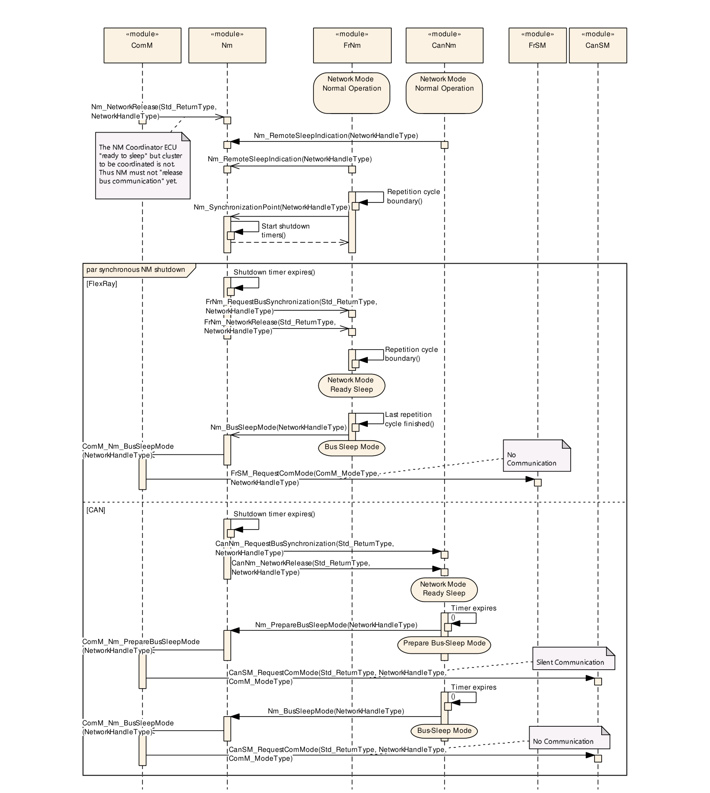

### 8.3. 部分网络功能的时序

以下时序图以Nm与CanIf模块之间的交互为例。如果使用FlexRay通信栈，必须考虑以下偏差：

- FrNm没有类似CanNmAllNmMessagesKeepAwake的ECUC参数
- FrNm需要检查在FrIf中配置的NM PDU的ECUC参数FrIfImmediate
- 如果使用FrNm，NM Pdu始终通过FrNm\_TriggerTransmit获取。没有类似CanIfTxPduTriggerTransmit的ECUC参数

如果使用以太网通信栈，必须考虑以下偏差：

- UdpNm模块与SoAd交互（而不是与EthIf）。因此UdpNm必须调用SoAd\_IfTransmit来触发NM PDU的发送。SoAd必须调用UdpNm\_SoAdIfRxIndication来指示NM PDU的接收
- UdpNm需要检查SoAd的ECUC参数SoAdBswModules/SoAdIfTriggerTransmit，以确定NM PDU是否通过调用UdpNm\_SoAdIfTriggerTransmit获取

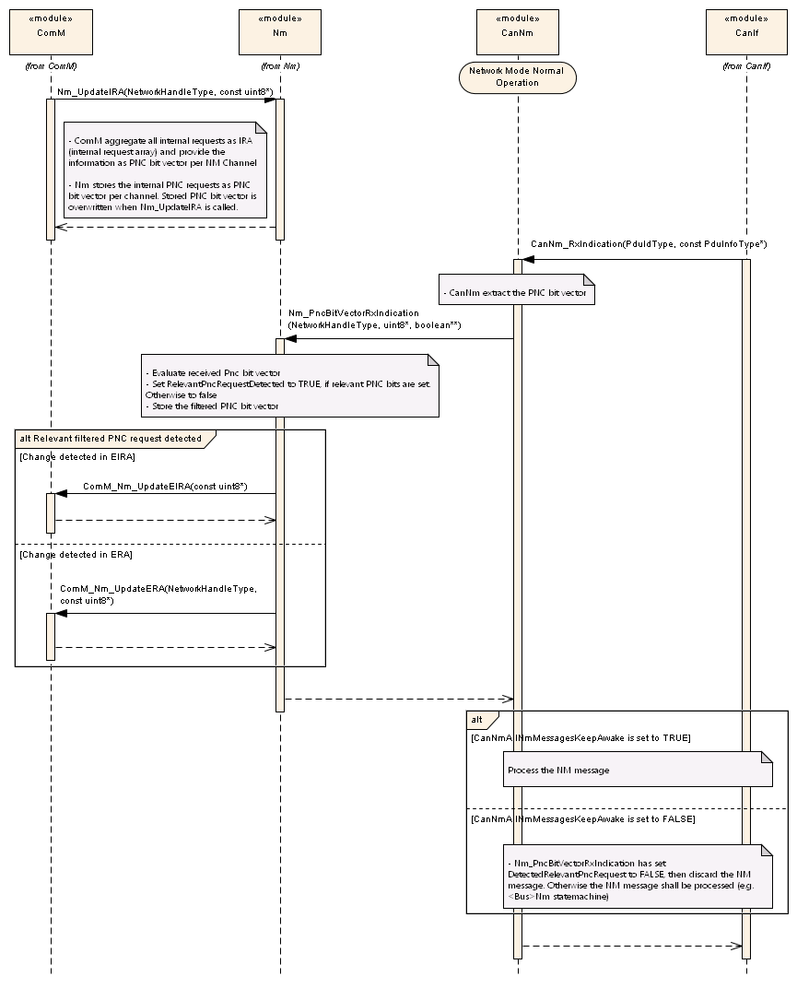

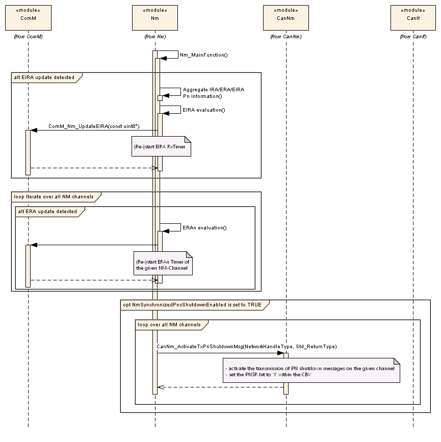

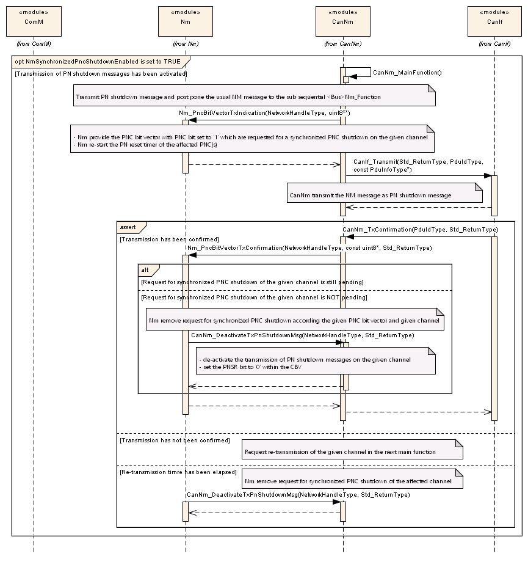

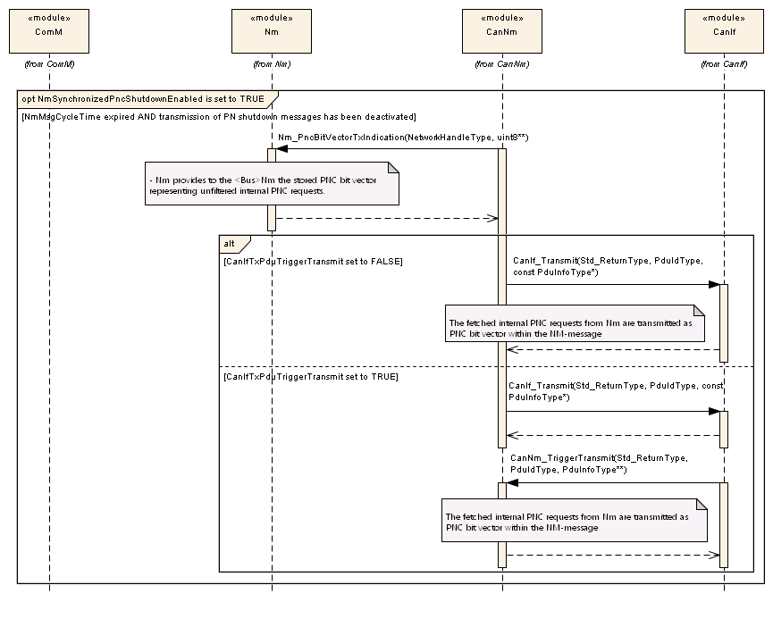

## 9. 配置规范

以下章节包含用于确定通用网络管理接口的功能单元的所有配置参数和开关的表。配置参数的默认值以粗体表示。

通常，本章定义配置参数及其到容器中的聚集。第9.1节描述基本原理。第9.2节、第9.3节和第9.4节规定Nm的结构（容器）和参数。第9.5节规定Nm的发布信息。


### 9.1. 如何阅读本章

详情请参阅[\[2, SWS\_BSWGeneral的第10.1章「配置规范简介」\]](#ref-2)。

### 9.2. 配置参数

以下各章汇总Nm的所有配置参数。大多数参数的详细含义在第6章和第7章中描述。请注意，Nm的行为和配置与所使用的不同总线特定NM模块的行为和配置密切相关。

#### 9.2.1. Nm

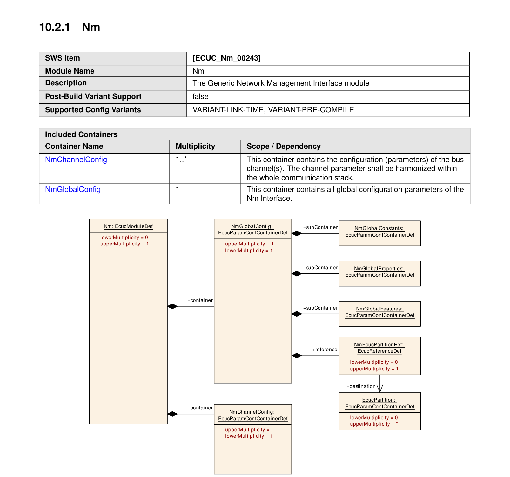

| 项目 | 内容 |
| --- | --- |
| SWS 条目 | [ECUC_Nm_00243] |
| 模块名称 | Nm |
| 描述 | 通用网络管理接口模块。 |
| Post-Build 变体支持 | false |
| 支持的配置变体 | VARIANT-LINK-TIME、VARIANT-PRE-COMPILE |

| 包含的容器 | 容器名称 | 多重性 | 作用域/依赖 |
| --- | --- | --- | --- |
| 包含的容器 | NmChannelConfig | 1..* | 该容器包含总线通道的配置（参数）。通道参数应在整个通信栈内协调一致。 |
| 包含的容器 | NmGlobalConfig | 1 | 该容器包含Nm接口的所有全局配置参数。 |

### 9.3. 全局配置参数

#### 9.3.1. NmGlobalConfig

| 项目 | 内容 |
| --- | --- |
| SWS 条目 | [ECUC_Nm_00196] |
| 容器名称 | NmGlobalConfig |
| 父容器 | Nm |
| 描述 | 该容器包含Nm接口的所有全局配置参数。 |
| 配置参数 | 见下方参数表 |

| 项目 | 内容 |
| --- | --- |
| SWS 条目 | [ECUC_Nm_00245] |
| 参数名称 | NmEcucPartitionRef |
| 父容器 | NmGlobalConfig |
| 描述 | 对Nm模块被分配到的EcucPartition的引用。 |
| 多重性 | 0..1 |
| 类型 | 对EcucPartition的引用 |
| Post-Build 变体多重性 | false |
| Post-Build 变体值 | false |
| 多重性配置类 | Pre-compile time：X；Link time：-；Post-build time：- |
| 值配置类 | Pre-compile time：X；Link time：-；Post-build time：- |
| 作用域/依赖 | scope: local |

| 包含的容器 | 容器名称 | 多重性 | 作用域/依赖 |
| --- | --- | --- | --- |
| 包含的容器 | NmGlobalConstants | 1 | - |
| 包含的容器 | NmGlobalFeatures | 1 | - |
| 包含的容器 | NmGlobalProperties | 1 | - |

#### 9.3.2. NmGlobalConstants

| 项目 | 内容 |
| --- | --- |
| SWS 条目 | [ECUC_Nm_00198] |
| 容器名称 | NmGlobalConstants |
| 父容器 | NmGlobalConfig |
| 描述 | - |
| 配置参数 | 见下方参数表 |

| 项目 | 内容 |
| --- | --- |
| SWS 条目 | [ECUC_Nm_00201] |
| 参数名称 | NmNumberOfChannels |
| 父容器 | NmGlobalConstants |
| 描述 | 一个ECU内允许的NM通道数量。 |
| 多重性 | 1 |
| 类型 | EcucIntegerParamDef |
| 茖围 | 1 .. 255 |
| 默认值 | - |
| Post-Build 变体值 | false |
| 值配置类 | Pre-compile time：X（All Variants）；Link time：-；Post-build time：- |
| 作用域/依赖 | scope: local |

无包含的容器。

#### 9.3.3. NmGlobalProperties

| 项目 | 内容 |
| --- | --- |
| SWS 条目 | [ECUC_Nm_00199] |
| 容器名称 | NmGlobalProperties |
| 父容器 | NmGlobalConfig |
| 描述 | - |
| 配置参数 | 见下方参数表 |

| 项目 | 内容 |
| --- | --- |
| SWS 条目 | [ECUC_Nm_00205] |
| 参数名称 | NmCycletimeMainFunction |
| 父容器 | NmGlobalProperties |
| 描述 | NM接口的Main Function相邻两次调用之间的周期（秒）。 |
| 多重性 | 0..1 |
| 类型 | EcucFloatParamDef |
| 茖围 | ]0 .. INF[ |
| 默认值 | - |
| Post-Build 变体多重性 | false |
| Post-Build 变体值 | false |
| 多重性配置类 | Pre-compile time：X（VARIANT-PRE-COMPILE）；Link time：X（VARIANT-LINK-TIME）；Post-build time：- |
| 值配置类 | Pre-compile time：X（VARIANT-PRE-COMPILE）；Link time：X（VARIANT-LINK-TIME）；Post-build time：- |
| 作用域/依赖 | scope: local；依赖：如果NmCoordinatorSupportEnabled设置为TRUE，则应配置NmCycletimeMainFunction。 |

| 项目 | 内容 |
| --- | --- |
| SWS 条目 | [ECUC_Nm_00203] |
| 参数名称 | NmDevErrorDetect |
| 父容器 | NmGlobalProperties |
| 描述 | 开启或关闭开发错误检测与通知（**true**：启用检测与通知；**false**：禁用检测与通知）。 |
| 多重性 | 1 |
| 类型 | EcucBooleanParamDef |
| 默认值 | false |
| Post-Build 变体值 | false |
| 值配置类 | Pre-compile time：X（All Variants）；Link time：-；Post-build time：- |
| 作用域/依赖 | scope: local |

| 项目 | 内容 |
| --- | --- |
| SWS 条目 | [ECUC_Nm_00252] |
| 参数名称 | NmPncBitVectorOffset |
| 父容器 | NmGlobalProperties |
| 描述 | 用于配置PNC位向量（包含PNC请求，由相应的&lt;Bus&gt;Nm在NM PDU内发送）的字节偏移的参数。 |
| 多重性 | 0..1 |
| 类型 | EcucIntegerParamDef |
| 茖围 | 0 .. 63 |
| 默认值 | 0 |
| 值配置类 | Pre-compile time：X（VARIANT-PRE-COMPILE）；Link time：X（VARIANT-LINK-TIME）；Post-build time：- |
| 作用域/依赖 | scope: ECU；依赖：仅当NmPartialNetworkSupportEnabled设置为TRUE时该参数才有效。NmPncBitVectorOffset == &lt;Bus&gt;Nm系统字节数，或NmPncBitVectorOffset + NmPncBitVectorLength == NM PduLength。 |

| 项目 | 内容 |
| --- | --- |
| SWS 条目 | [ECUC_Nm_00251] |
| 参数名称 | NmPnEiraCalcEnabled |
| 父容器 | NmGlobalProperties |
| 描述 | 规定NmIf是否计算内部和外部请求（EIRA）的PNC请求信息。true：计算PN请求；false：不计算PN请求。注意：PNC协调器（NmPnEraCalcEnabled设置为TRUE）必须始终将NmPnEiraCalcEnabled设置为TRUE。 |
| 多重性 | 0..1 |
| 类型 | EcucBooleanParamDef |
| 默认值 | false |
| 多重性配置类 | Pre-compile time：X（VARIANT-PRE-COMPILE）；Link time：X（VARIANT-LINK-TIME）；Post-build time：- |
| 值配置类 | Pre-compile time：X（VARIANT-PRE-COMPILE）；Link time：X（VARIANT-LINK-TIME）；Post-build time：- |
| 作用域/依赖 | scope: local；依赖：只有当NmPartialNetworkSupportEnabled设置为TRUE时该参数才能设置为TRUE。如果NmPnEraCalcEnabled设置为TRUE，则该参数应设置为TRUE。 |

| 项目 | 内容 |
| --- | --- |
| SWS 条目 | [ECUC_Nm_00250] |
| 参数名称 | NmPnResetTime |
| 父容器 | NmGlobalProperties |
| 描述 | 规定复位时间的运行时长（秒）。该复位时间对EIRA和ERA中PNC请求的复位有效。该值对每个通道应相同，因此它是一个全局配置参数。 |
| 多重性 | 0..1 |
| 类型 | EcucFloatParamDef |
| 茖围 | [0.001 .. 65535] |
| 默认值 | - |
| 多重性配置类 | Pre-compile time：X（VARIANT-PRE-COMPILE）；Link time：X（VARIANT-LINK-TIME）；Post-build time：- |
| 值配置类 | Pre-compile time：X（VARIANT-PRE-COMPILE）；Link time：X（VARIANT-LINK-TIME）；Post-build time：- |
| 作用域/依赖 | scope: local |

| 项目 | 内容 |
| --- | --- |
| SWS 条目 | [ECUC_Nm_91004] |
| 参数名称 | NmPnShutdownMessageRetransmissionDuration |
| 父容器 | NmGlobalProperties |
| 描述 | 规定PN关闭消息重传阶段的持续时长（秒）。只要PN关闭消息未能成功发送且重传定时器仍在运行，就应按受影响的NM通道执行重传。该值应为NmMainFunctionPeriod的整数倍。 |
| 多重性 | 0..1 |
| 类型 | EcucFloatParamDef |
| 茖围 | [0.001 .. 65.535] |
| 默认值 | - |
| Post-Build 变体多重性 | false |
| Post-Build 变体值 | false |
| 作用域/依赖 | scope: local |

| 项目 | 内容 |
| --- | --- |
| SWS 条目 | [ECUC_Nm_00202] |
| 参数名称 | NmVersionInfoApi |
| 父容器 | NmGlobalProperties |
| 描述 | 用于启用版本信息API支持的预处理器开关。 |
| 多重性 | 1 |
| 类型 | EcucBooleanParamDef |
| 默认值 | false |
| Post-Build 变体值 | false |
| 值配置类 | Pre-compile time：X（All Variants）；Link time：-；Post-build time：- |
| 作用域/依赖 | scope: local |

#### 9.3.4. NmGlobalFeatures

| 项目 | 内容 |
| --- | --- |
| SWS 条目 | [ECUC_Nm_00247] |
| 容器名称 | NmGlobalFeatures |
| 父容器 | NmGlobalConfig |
| 描述 | - |
| 配置参数 | 见下方参数表 |

| 项目 | 内容 |
| --- | --- |
| SWS 条目 | [ECUC_Nm_00206] |
| 参数名称 | NmBusSynchronizationEnabled |
| 父容器 | NmGlobalFeatures |
| 描述 | 用于启用&lt;Bus&gt;Nm的总线同步支持的预处理器开关。只有NM协调器节点才需要此特性。 |
| 多重性 | 1 |
| 类型 | EcucBooleanParamDef |
| 默认值 | - |
| Post-Build 变体值 | false |
| 值配置类 | Pre-compile time：X（All Variants）；Link time：-；Post-build time：- |
| 作用域/依赖 | scope: local |

| 项目 | 内容 |
| --- | --- |
| SWS 条目 | [ECUC_Nm_00290] |
| 参数名称 | NmCarWakeUpCallout |
| 父容器 | NmGlobalFeatures |
| 描述 | 调用Nm_CarWakeUpIndication()时应调用的callout函数的名称。如果未配置该参数，Nm将调用BswM_Nm_CarWakeUpIndication。 |
| 多重性 | 0..1 |
| 类型 | EcucFunctionNameDef |
| 默认值 | - |
| Post-Build 变体多重性 | false |
| Post-Build 变体值 | false |
| 作用域/依赖 | scope: local |

| 项目 | 内容 |
| --- | --- |
| SWS 条目 | [ECUC_Nm_00289] |
| 参数名称 | NmCarWakeUpRxEnabled |
| 父容器 | NmGlobalFeatures |
| 描述 | 启用或禁用CWU检测。FALSE：不支持CarWakeUp；TRUE：支持CarWakeUp。 |
| 多重性 | 1 |
| 类型 | EcucBooleanParamDef |
| 默认值 | false |
| Post-Build 变体值 | false |
| 值配置类 | Pre-compile time：X（VARIANT-PRE-COMPILE）；Link time：X（VARIANT-LINK-TIME）；Post-build time：- |
| 作用域/依赖 | scope: local |

| 项目 | 内容 |
| --- | --- |
| SWS 条目 | [ECUC_Nm_00204] |
| 参数名称 | NmComControlEnabled |
| 父容器 | NmGlobalFeatures |
| 描述 | 用于启用通信控制（**Communication Control**）支持的预处理器开关。 |
| 多重性 | 1 |
| 类型 | EcucBooleanParamDef |
| 默认值 | false |
| Post-Build 变体值 | false |
| 值配置类 | Pre-compile time：X（All Variants）；Link time：-；Post-build time：- |
| 作用域/依赖 | scope: local |

| 项目 | 内容 |
| --- | --- |
| SWS 条目 | [ECUC_Nm_00208] |
| 参数名称 | NmCoordinatorSupportEnabled |
| 父容器 | NmGlobalFeatures |
| 描述 | 用于启用NM协调器（**NM Coordinator**）支持的预处理器开关。 |
| 多重性 | 1 |
| 类型 | EcucBooleanParamDef |
| 默认值 | false |
| Post-Build 变体值 | false |
| 值配置类 | Pre-compile time：X（All Variants）；Link time：-；Post-build time：- |
| 作用域/依赖 | scope: local |

| 项目 | 内容 |
| --- | --- |
| SWS 条目 | [ECUC_Nm_00249] |
| 参数名称 | NmCoordinatorSyncSupport |
| 父容器 | NmGlobalFeatures |
| 描述 | 启用/禁用协调器同步支持。 |
| 多重性 | 1 |
| 类型 | EcucBooleanParamDef |
| 默认值 | - |
| Post-Build 变体值 | false |
| 值配置类 | Pre-compile time：X（VARIANT-PRE-COMPILE）；Link time：X（VARIANT-LINK-TIME）；Post-build time：- |
| 作用域/依赖 | scope: local |

| 项目 | 内容 |
| --- | --- |
| SWS 条目 | [ECUC_Nm_00269] |
| 参数名称 | NmDynamicPncToChannelMappingSupport |
| 父容器 | NmGlobalFeatures |
| 描述 | 启用动态PNC到通道映射处理的预编译开关。False：禁用动态PNC到通道映射；True：启用动态PNC到通道映射。 |
| 多重性 | 1 |
| 类型 | EcucBooleanParamDef |
| 默认值 | false |
| Post-Build 变体值 | false |
| 值配置类 | Pre-compile time：X（VARIANT-PRE-COMPILE）；Link time：X（VARIANT-LINK-TIME）；Post-build time：- |
| 作用域/依赖 | scope: local |

| 项目 | 内容 |
| --- | --- |
| SWS 条目 | [ECUC_Nm_00210] |
| 参数名称 | NmGlobalCoordinatorTime |
| 父容器 | NmGlobalFeatures |
| 描述 | 该参数定义所连接且受协调的NM集群的最大关闭时间。注意：这包括所有通道在协调集群内同步其关闭所需的所有嵌套时间。 |
| 多重性 | 0..1 |
| 类型 | EcucFloatParamDef |
| 茖围 | [0 .. 65.535] |
| 默认值 | - |
| Post-Build 变体值 | false |
| 值配置类 | Pre-compile time：X（VARIANT-PRE-COMPILE）；Link time：X（VARIANT-LINK-TIME）；Post-build time：- |
| 作用域/依赖 | scope: local |

| 项目 | 内容 |
| --- | --- |
| SWS 条目 | [ECUC_Nm_00246] |
| 参数名称 | NmPartialNetworkSupportEnabled |
| 父容器 | NmGlobalFeatures |
| 描述 | 用于启用Nm部分网络（**Partial Network**）支持的预处理器开关。 |
| 多重性 | 1 |
| 类型 | EcucBooleanParamDef |
| 默认值 | false |
| Post-Build 变体值 | false |
| 值配置类 | Pre-compile time：X（All Variants）；Link time：-；Post-build time：- |
| 作用域/依赖 | scope: local |

| 项目 | 内容 |
| --- | --- |
| SWS 条目 | [ECUC_Nm_00216] |
| 参数名称 | NmPduRxIndicationEnabled |
| 父容器 | NmGlobalFeatures |
| 描述 | 用于启用PDU Rx Indication的预处理器开关。 |
| 多重性 | 1 |
| 类型 | EcucBooleanParamDef |
| 默认值 | false |
| Post-Build 变体值 | false |
| 值配置类 | Pre-compile time：X（All Variants）；Link time：-；Post-build time：- |
| 作用域/依赖 | scope: local |

| 项目 | 内容 |
| --- | --- |
| SWS 条目 | [ECUC_Nm_00209] |
| 参数名称 | NmRemoteSleepIndEnabled |
| 父容器 | NmGlobalFeatures |
| 描述 | 用于启用远程睡眠指示（**Remote Sleep Indication**）支持的预处理器开关。网关或NM协调器节点需要此特性。 |
| 多重性 | 1 |
| 类型 | EcucBooleanParamDef |
| 默认值 | false |
| Post-Build 变体值 | false |
| 值配置类 | Pre-compile time：X（All Variants）；Link time：-；Post-build time：- |
| 作用域/依赖 | scope: local |

| 项目 | 内容 |
| --- | --- |
| SWS 条目 | [ECUC_Nm_00215] |
| 参数名称 | NmStateChangeIndEnabled |
| 父容器 | NmGlobalFeatures |
| 描述 | 用于启用网络管理状态变化通知的预处理器开关。 |
| 多重性 | 1 |
| 类型 | EcucBooleanParamDef |
| 默认值 | false |
| Post-Build 变体值 | false |
| 值配置类 | Pre-compile time：X（All Variants）；Link time：-；Post-build time：- |
| 作用域/依赖 | scope: local |

| 项目 | 内容 |
| --- | --- |
| SWS 条目 | [ECUC_Nm_00268] |
| 参数名称 | NmSynchronizedPncShutdownEnabled |
| 父容器 | NmGlobalFeatures |
| 描述 | 启用或禁用同步PNC关闭支持。FALSE：禁用同步PNC关闭；TRUE：启用同步PNC关闭。 |
| 多重性 | 0..1 |
| 类型 | EcucBooleanParamDef |
| 默认值 | false |
| 多重性配置类 | Pre-compile time：X（VARIANT-PRE-COMPILE）；Link time：X（VARIANT-LINK-TIME）；Post-build time：- |
| 值配置类 | Pre-compile time：X（VARIANT-PRE-COMPILE）；Link time：X（VARIANT-LINK-TIME）；Post-build time：- |
| 作用域/依赖 | scope: local |

| 项目 | 内容 |
| --- | --- |
| SWS 条目 | [ECUC_Nm_00217] |
| 参数名称 | NmUserDataEnabled |
| 父容器 | NmGlobalFeatures |
| 描述 | 用于启用用户数据（**User Data**）支持的预处理器开关。 |
| 多重性 | 1 |
| 类型 | EcucBooleanParamDef |
| 默认值 | false |
| Post-Build 变体值 | false |
| 值配置类 | Pre-compile time：X（All Variants）；Link time：-；Post-build time：- |
| 作用域/依赖 | scope: local |

### 9.4. 通道配置参数

#### 9.4.1. NmChannelConfig

| 项目 | 内容 |
| --- | --- |
| SWS 条目 | [ECUC_Nm_00244] |
| 容器名称 | NmChannelConfig |
| 父容器 | Nm |
| 描述 | 该容器包含总线通道的配置（参数）。通道参数应在整个通信栈内协调一致。 |
| 多重性 | 1..* |
| 配置参数 | 见下方参数表 |

| 项目 | 内容 |
| --- | --- |
| SWS 条目 | [ECUC_Nm_00212] |
| 参数名称 | NmActiveCoordinator |
| 父容器 | NmChannelConfig |
| 描述 | 该参数指示属于Nm协调集群的NM通道是被主动协调（NmActiveCoordinator = TRUE）还是被被动协调（NmActiveCoordinator = FALSE）。 |
| 多重性 | 0..1 |
| 类型 | EcucBooleanParamDef |
| 默认值 | - |
| Post-Build 变体多重性 | false |
| Post-Build 变体值 | false |
| 多重性配置类 | Pre-compile time：X（VARIANT-PRE-COMPILE）；Link time：X（VARIANT-LINK-TIME）；Post-build time：- |
| 值配置类 | Pre-compile time：X（VARIANT-PRE-COMPILE）；Link time：X（VARIANT-LINK-TIME）；Post-build time：- |
| 作用域/依赖 | scope: local |

| 项目 | 内容 |
| --- | --- |
| SWS 条目 | [ECUC_Nm_00231] |
| 参数名称 | NmChannelSleepMaster |
| 父容器 | NmChannelConfig |
| 描述 | 应设置该参数以指示该网络的睡眠是否可以完全由本地节点决定且其他节点不能反对该决定。如果该参数设置为TRUE，Nm应假定该通道始终准备好睡眠，且代表该通道的&lt;Bus&gt;Nm不会调用Nm_RemoteSleepIndication或Nm_RemoteSleepCancellation。如果该参数设置为FALSE，Nm不应假定网络已准备好睡眠，直到对Nm_RemoteSleepCancellation进行了调用。 |
| 多重性 | 1 |
| 类型 | EcucBooleanParamDef |
| 默认值 | - |
| Post-Build 变体值 | false |
| 值配置类 | Pre-compile time：X（VARIANT-PRE-COMPILE）；Link time：X（VARIANT-LINK-TIME）；Post-build time：- |
| 作用域/依赖 | scope: local |

| 项目 | 内容 |
| --- | --- |
| SWS 条目 | [ECUC_Nm_00285] |
| 参数名称 | NmComUserDataSupport |
| 父容器 | NmChannelConfig |
| 描述 | 该参数指示在NM通道上用户数据是通过Com信号访问还是通过SetUserData API访问。 |
| 多重性 | 0..1 |
| 类型 | EcucBooleanParamDef |
| 默认值 | false |
| Post-Build 变体多重性 | false |
| Post-Build 变体值 | false |
| 多重性配置类 | Pre-compile time：X（VARIANT-PRE-COMPILE）；Link time：X（VARIANT-LINK-TIME）；Post-build time：- |
| 值配置类 | Pre-compile time：X（VARIANT-PRE-COMPILE）；Link time：X（VARIANT-LINK-TIME）；Post-build time：- |
| 作用域/依赖 | scope: local |

| 项目 | 内容 |
| --- | --- |
| SWS 条目 | [ECUC_Nm_00213] |
| 参数名称 | NmCoordClusterIndex |
| 父容器 | NmChannelConfig |
| 描述 | 如果某个通道未定义该参数，则相应的总线不属于NM协调集群。 |
| 多重性 | 0..1 |
| 类型 | EcucIntegerParamDef |
| 茖围 | 0 .. 255 |
| 默认值 | - |
| Post-Build 变体多重性 | false |
| Post-Build 变体值 | false |
| 多重性配置类 | Pre-compile time：X（VARIANT-PRE-COMPILE）；Link time：X（VARIANT-LINK-TIME）；Post-build time：- |
| 值配置类 | Pre-compile time：X（VARIANT-PRE-COMPILE）；Link time：X（VARIANT-LINK-TIME）；Post-build time：- |
| 作用域/依赖 | scope: local |

| 项目 | 内容 |
| --- | --- |
| SWS 条目 | [ECUC_Nm_00262] |
| 参数名称 | NmDynamicPncToChannelMappingEnabled |
| 父容器 | NmChannelConfig |
| 描述 | 启用动态PNC到通道映射特性的通道特定参数。False：禁用动态PNC到通道映射；True：启用动态PNC到通道映射。 |
| 多重性 | 0..1 |
| 类型 | EcucBooleanParamDef |
| 默认值 | false |
| Post-Build 变体值 | false |
| 值配置类 | Pre-compile time：X（VARIANT-PRE-COMPILE）；Link time：X（VARIANT-LINK-TIME）；Post-build time：- |
| 作用域/依赖 | scope: local |

| 项目 | 内容 |
| --- | --- |
| SWS 条目 | [ECUC_Nm_00211] |
| 参数名称 | NmPassiveModeEnabled |
| 父容器 | NmChannelConfig |
| 描述 | 该参数指示NM通道是主动的（例如可以请求通信并使总线保持唤醒）还是被动的（例如只能被其他ECU唤醒并保持唤醒）。 |
| 多重性 | 1 |
| 类型 | EcucBooleanParamDef |
| 默认值 | - |
| Post-Build 变体值 | false |
| 值配置类 | Pre-compile time：X（All Variants）；Link time：-；Post-build time：- |
| 作用域/依赖 | scope: local |

| 项目 | 内容 |
| --- | --- |
| SWS 条目 | [ECUC_Nm_00260] |
| 参数名称 | NmPncBitVectorLength |
| 父容器 | NmChannelConfig |
| 描述 | 用于配置PNC位请求信息长度（字节）的参数，该信息由相应的&lt;Bus&gt;Nm在NM PDU内发送。 |
| 多重性 | 1 |
| 类型 | EcucIntegerParamDef |
| 茖围 | 0 .. 63 |
| 默认值 | 0 |
| Post-Build 变体值 | false |
| 值配置类 | Pre-compile time：X（VARIANT-PRE-COMPILE）；Link time：X（VARIANT-LINK-TIME）；Post-build time：- |
| 作用域/依赖 | scope: local |

| 项目 | 内容 |
| --- | --- |
| SWS 条目 | [ECUC_Nm_00259] |
| 参数名称 | NmPnEnabled |
| 父容器 | NmChannelConfig |
| 描述 | 如果该参数为true，则该NM通道支持部分网络（**Partial Networking**）。 |
| 多重性 | 0..1 |
| 类型 | EcucBooleanParamDef |
| 默认值 | false |
| 多重性配置类 | Pre-compile time：X（VARIANT-PRE-COMPILE）；Link time：X（VARIANT-LINK-TIME）；Post-build time：- |
| 值配置类 | Pre-compile time：X（VARIANT-PRE-COMPILE）；Link time：X（VARIANT-LINK-TIME）；Post-build time：- |
| 作用域/依赖 | scope: local |

| 项目 | 内容 |
| --- | --- |
| SWS 条目 | [ECUC_Nm_00261] |
| 参数名称 | NmPnEraCalcEnabled |
| 父容器 | NmChannelConfig |
| 描述 | 规定NmIf是否计算外部请求（ERA）的PN请求信息。 |
| 多重性 | 0..1 |
| 类型 | EcucBooleanParamDef |
| 默认值 | false |
| 多重性配置类 | Pre-compile time：X（VARIANT-PRE-COMPILE）；Link time：X（VARIANT-LINK-TIME）；Post-build time：- |
| 值配置类 | Pre-compile time：X（VARIANT-PRE-COMPILE）；Link time：X（VARIANT-LINK-TIME）；Post-build time：- |
| 作用域/依赖 | scope: local |

| 项目 | 内容 |
| --- | --- |
| SWS 条目 | [ECUC_Nm_00267] |
| 参数名称 | NmStateReportEnabled |
| 父容器 | NmChannelConfig |
| 描述 | 规定是否应为相应的网络设置NMS。false：不设置NMS；true：设置NMS。 |
| 多重性 | 1 |
| 类型 | EcucBooleanParamDef |
| 默认值 | - |
| Post-Build 变体值 | false |
| 值配置类 | Pre-compile time：X（All Variants）；Link time：-；Post-build time：- |
| 作用域/依赖 | scope: local |

| 项目 | 内容 |
| --- | --- |
| SWS 条目 | [ECUC_Nm_00214] |
| 参数名称 | NmSynchronizingNetwork |
| 父容器 | NmChannelConfig |
| 描述 | 如果该参数为true，则该网络是其所属NM协调集群的同步网络。预期该网络按固定间隔调用Nm_SynchronizationPoint()。 |
| 多重性 | 1 |
| 类型 | EcucBooleanParamDef |
| 默认值 | - |
| Post-Build 变体值 | false |
| 值配置类 | Pre-compile time：X（VARIANT-PRE-COMPILE）；Link time：X（VARIANT-LINK-TIME）；Post-build time：- |
| 作用域/依赖 | scope: local |

| 项目 | 内容 |
| --- | --- |
| SWS 条目 | [ECUC_Nm_00248] |
| 参数名称 | NmComMChannelRef |
| 父容器 | NmChannelConfig |
| 描述 | 对相应ComM通道的引用。 |
| 多重性 | 1 |
| 类型 | 对ComMChannel的符号名称引用 |
| Post-Build 变体值 | false |
| 值配置类 | Pre-compile time：X（VARIANT-PRE-COMPILE）；Link time：X（VARIANT-LINK-TIME）；Post-build time：- |
| 作用域/依赖 | scope: local |

| 项目 | 内容 |
| --- | --- |
| SWS 条目 | [ECUC_Nm_00266] |
| 参数名称 | NmStateReportSignalRef |
| 父容器 | NmChannelConfig |
| 描述 | 对信号的引用，用于通过调用Com_SendSignal为相应通道设置NMS。 |
| 多重性 | 0..1 |
| 类型 | 对ComSignal的符号名称引用 |
| Post-Build 变体多重性 | false |
| Post-Build 变体值 | false |
| 多重性配置类 | Pre-compile time：X（VARIANT-PRE-COMPILE）；Link time：X（VARIANT-LINK-TIME）；Post-build time：- |
| 值配置类 | Pre-compile time：X（VARIANT-PRE-COMPILE）；Link time：X（VARIANT-LINK-TIME）；Post-build time：- |
| 作用域/依赖 | scope: local；依赖：信号必须在COM中配置。仅在NmStateReportEnabled == true时可用 |

| 包含的容器 | 容器名称 | 多重性 | 作用域/依赖 |
| --- | --- | --- | --- |
| 包含的容器 | NmBusType | 1 | - |
| 包含的容器 | NmPnFilterMaskByte | 0..63 | PNC位向量过滤器的信息。 |

#### 9.4.2. NmPnFilterMaskByte

| 项目 | 内容 |
| --- | --- |
| SWS 条目 | [ECUC_Nm_00255] |
| 容器名称 | NmPnFilterMaskByte |
| 父容器 | NmChannelConfig |
| 描述 | PNC位向量过滤器的信息。 |
| 多重性配置类 | Pre-compile time：X（VARIANT-PRE-COMPILE）；Link time：X（VARIANT-LINK-TIME）；Post-build time：- |
| 配置参数 | 见下方参数表 |

| 项目 | 内容 |
| --- | --- |
| SWS 条目 | [ECUC_Nm_00256] |
| 参数名称 | NmPnFilterMaskByteIndex |
| 父容器 | NmPnFilterMaskByte |
| 描述 | 过滤掩码字节的索引。规定过滤掩码字节数组中的位置。 |
| 多重性 | 1 |
| 类型 | EcucIntegerParamDef |
| 茖围 | 0 .. 62 |
| 默认值 | - |
| 值配置类 | Pre-compile time：X（VARIANT-PRE-COMPILE）；Link time：X（VARIANT-LINK-TIME）；Post-build time：- |
| 作用域/依赖 | scope: local；依赖：仅当NmPartialNetworkSupportEnabled设置为TRUE时该参数才有效，NmPnFilterMaskByteIndex < NmPncBitVectorLength。 |

| 项目 | 内容 |
| --- | --- |
| SWS 条目 | [ECUC_Nm_00257] |
| 参数名称 | NmPnFilterMaskByteValue |
| 父容器 | NmPnFilterMaskByte |
| 描述 | 用于配置过滤掩码字节的参数。 |
| 多重性 | 1 |
| 类型 | EcucIntegerParamDef |
| 茖围 | 0 .. 255 |
| 默认值 | 0 |
| 值配置类 | Pre-compile time：X（VARIANT-PRE-COMPILE）；Link time：X（VARIANT-LINK-TIME）；Post-build time：- |
| 作用域/依赖 | scope: local；依赖：仅当NmPartialNetworkSupportEnabled设置为TRUE时该参数才有效。 |

无包含的容器。

#### 9.4.3. NmBusType

| 项目 | 内容 |
| --- | --- |
| SWS 条目 | [ECUC_Nm_00218] |
| 选择容器名称 | NmBusType |
| 父容器 | NmChannelConfig |
| 描述 | - |

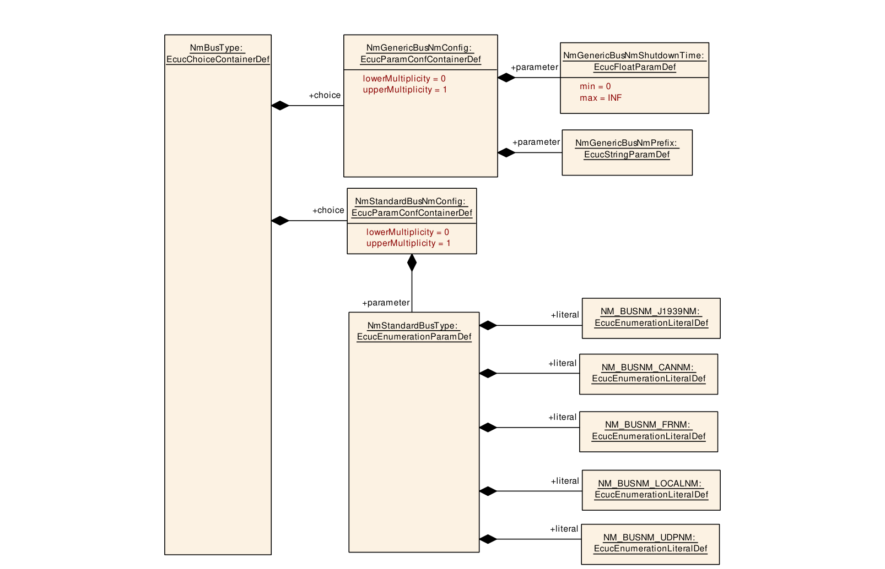

| 容器选择 | 容器名称 | 多重性 | 作用域/依赖 |
| --- | --- | --- | --- |
| 容器选择 | NmGenericBusNmConfig | 0..1 | 见9.4.4节 |
| 容器选择 | NmStandardBusNmConfig | 0..1 | 见9.4.5节 |

#### 9.4.4. NmGenericBusNmConfig

| 项目 | 内容 |
| --- | --- |
| SWS 条目 | [ECUC_Nm_00225] |
| 容器名称 | NmGenericBusNmConfig |
| 父容器 | NmBusType |
| 描述 | - |
| 配置参数 | 见下方参数表 |

| 项目 | 内容 |
| --- | --- |
| SWS 条目 | [ECUC_Nm_00219] |
| 参数名称 | NmGenericBusNmPrefix |
| 父容器 | NmGenericBusNmConfig |
| 描述 | 标识通用&lt;Bus&gt;Nm的前缀。它用于确定Nm为&lt;Bus&gt;Nm所提供接口要调用的API名称。该字符串将用作API调用名称中「_」字符之前的模块前缀。 |
| 多重性 | 1 |
| 类型 | EcucStringParamDef |
| 默认值 | - |
| 正则表达式 | - |
| Post-Build 变体值 | false |
| 值配置类 | Pre-compile time：X（VARIANT-PRE-COMPILE）；Link time：X（VARIANT-LINK-TIME）；Post-build time：- |
| 作用域/依赖 | scope: local |

| 项目 | 内容 |
| --- | --- |
| SWS 条目 | [ECUC_Nm_00239] |
| 参数名称 | NmGenericBusNmShutdownTime |
| 父容器 | NmGenericBusNmConfig |
| 描述 | 该参数应用于计算关闭延迟时间。 |
| 多重性 | 1 |
| 类型 | EcucFloatParamDef |
| 茖围 | [0 .. INF] |
| 默认值 | - |
| Post-Build 变体值 | false |
| 值配置类 | Pre-compile time：X（VARIANT-PRE-COMPILE）；Link time：X（VARIANT-LINK-TIME）；Post-build time：- |
| 作用域/依赖 | scope: local |

无包含的容器。

#### 9.4.5. NmStandardBusNmConfig

| 项目 | 内容 |
| --- | --- |
| SWS 条目 | [ECUC_Nm_00226] |
| 容器名称 | NmStandardBusNmConfig |
| 父容器 | NmBusType |
| 描述 | - |
| 配置参数 | 见下方参数表 |

| 项目 | 内容 |
| --- | --- |
| SWS 条目 | [ECUC_Nm_00220] |
| 参数名称 | NmStandardBusType |
| 父容器 | NmStandardBusNmConfig |
| 描述 | 标识标准AUTOSAR &lt;Bus&gt;Nm的通道总线类型，并用于确定Nm要为&lt;Bus&gt;Nm调用哪组API调用。注意：以太网（UdpNm）不支持被动模式。 |
| 多重性 | 1 |
| 类型 | EcucEnumerationParamDef |
| 茖围 | NM_BUSNM_CANNM、NM_BUSNM_FRNM、NM_BUSNM_J1939NM、NM_BUSNM_LOCALNM、NM_BUSNM_UDPNM |
| Post-Build 变体值 | false |
| 值配置类 | Pre-compile time：X（VARIANT-PRE-COMPILE）；Link time：X（VARIANT-LINK-TIME）；Post-build time：- |
| 作用域/依赖 | scope: local；依赖：只有当相应通道的NmCoordClusterIndex已定义（即该通道被协调）时，才允许将值配置为NM_BUSNM_LOCALNM。 |

无包含的容器。

### 9.5. 发布信息

详情请参阅[\[2, SWS\_BSWGeneral的第10.3章「发布信息」\]](#ref-2)。

## B. AUTOSAR 可追溯项变更历史

### B.1. 本文档根据AUTOSAR R22-11版本的可追溯项历史

#### B.1.1. R22-11中新增的规范项

```
[SWS_Nm_00521] [SWS_Nm_00523] [SWS_Nm_00524] [SWS_Nm_00525] [SWS_Nm_00527]
[SWS_Nm_00529] [SWS_Nm_00530] [SWS_Nm_00532] [SWS_Nm_00533] [SWS_Nm_00534]
[SWS_Nm_00535] [SWS_Nm_00536] [SWS_Nm_00537] [SWS_Nm_91010] [SWS_Nm_91011]
[SWS_Nm_NA_00999]
```

#### B.1.2. R22-11中变更的规范项

```
[SWS_Nm_00030] [SWS_Nm_00031] [SWS_Nm_00032] [SWS_Nm_00033] [SWS_Nm_00034]
[SWS_Nm_00035] [SWS_Nm_00036] [SWS_Nm_00037] [SWS_Nm_00038] [SWS_Nm_00039]
[SWS_Nm_00040] [SWS_Nm_00042] [SWS_Nm_00043] [SWS_Nm_00044] [SWS_Nm_00046]
[SWS_Nm_00112] [SWS_Nm_00114] [SWS_Nm_00117] [SWS_Nm_00118] [SWS_Nm_00119]
[SWS_Nm_00154] [SWS_Nm_00156] [SWS_Nm_00159] [SWS_Nm_00162] [SWS_Nm_00166]
[SWS_Nm_00176] [SWS_Nm_00183] [SWS_Nm_00192] [SWS_Nm_00193] [SWS_Nm_00194]
[SWS_Nm_00230] [SWS_Nm_00232] [SWS_Nm_00234] [SWS_Nm_00235] [SWS_Nm_00236]
[SWS_Nm_00245] [SWS_Nm_00250] [SWS_Nm_00254] [SWS_Nm_00259] [SWS_Nm_00261]
[SWS_Nm_00267] [SWS_Nm_00271] [SWS_Nm_00272] [SWS_Nm_00274] [SWS_Nm_00275]
[SWS_Nm_00276] [SWS_Nm_00282] [SWS_Nm_00291] [SWS_Nm_00293] [SWS_Nm_00302]
[SWS_Nm_00305] [SWS_Nm_00308] [SWS_Nm_00310] [SWS_Nm_00311] [SWS_Nm_00312]
[SWS_Nm_00313] [SWS_Nm_00317] [SWS_Nm_00318] [SWS_Nm_00319] [SWS_Nm_00320]
[SWS_Nm_00321] [SWS_Nm_00322] [SWS_Nm_00323] [SWS_Nm_00324] [SWS_Nm_00325]
[SWS_Nm_00326] [SWS_Nm_00327] [SWS_Nm_00328] [SWS_Nm_00329] [SWS_Nm_00330]
[SWS_Nm_00331] [SWS_Nm_00501] [SWS_Nm_00502] [SWS_Nm_00503] [SWS_Nm_00504]
[SWS_Nm_00505] [SWS_Nm_00508] [SWS_Nm_91002] [SWS_Nm_91003] [SWS_Nm_91005]
[SWS_Nm_91006] [SWS_Nm_91007] [SWS_Nm_91008] [SWS_Nm_91009]
[SWS_Nm_CONSTR_00001]
```

#### B.1.3. R22-11中删除的规范项

```
[SWS_Nm_00314] [SWS_Nm_00332] [SWS_Nm_00506] [SWS_Nm_00507] [SWS_Nm_00999]
```

#### B.1.4. R22-11中新增的约束

无。

#### B.1.5. R22-11中变更的约束

无。

#### B.1.6. R22-11中删除的约束

无。

### B.2. 本文档根据AUTOSAR R23-11版本的可追溯项历史

#### B.2.1. R23-11中新增的规范项

```
[SWS_Nm_00509]
```

#### B.2.2. R23-11中变更的规范项

```
[SWS_Nm_00312] [SWS_Nm_91003] [SWS_Nm_91005]
```

#### B.2.3. R23-11中删除的规范项

```
[SWS_Nm_00310] [SWS_Nm_00311]
```

#### B.2.4. R23-11中新增的约束

无。

#### B.2.5. R23-11中变更的约束

无。

#### B.2.6. R23-11中删除的约束

无。
