## 1. 简介和功能概述

本文介绍了**AUTOSAR PDU 路由器模块** (**PduR**) 模块的功能和**API**。

**PDU**路由器模块（PDU Router）使用以下模块为**I-PDU**交互层协议数据单元（**Interaction Layer Protocol Data Units**）提供路由服务：

* 通信接口模块（**Communication interface modules**）：使用 \<Provider:Up\> 或 \<Provider:Lo\> API。例如：**Com**、**IPduM**、**LinIf**、**CanIf**、**CanNm**、**FrIf**和**FrNm**等模块。
* 传输协议模块（**Transport Protocol modules**）：使用 \<Provider:UpTp\> 或 \<Provider:LoTp\> API.例如：**J1939Tp**、**LinTp**、**CanTp**、**FrTp**、**Com**和**Dcm**等模块。

**I-PDU**路由的执行是基于静态定义的**I-PDU**标识符。不支持在运行时I-PDU的动态路由。例如：依据I-PDU的有效载荷。

相关联的模块可以是向上的（**upper**），例如：**Dlt**、**Dcm**、**Com**和**IpduM**等，也可以是向下的（**lower**），如：**CanIf**、**FrIf**、**LinTp**、**IpduM**、**CanNm**、**FrNm**等。

**注意：** 
因为**IpduM**有两个不同的角色，所以它既被归为上层模块，也可属于下层模块，例如：作为下层模块，**Com**模块和**IpduM**模块之间的通信；作为上层模块：**IpduM**模块和下层通信接口模块（**communication interface module**）之间的通信。

**PDU**路由器模块使用了基于接口模块的通用方法。相连接的模块是在**PDU**路由器模块配置中进行配置。前面段落中列出的模块只是一个示例，并非详尽的列表。**PDU**路由器可以通过轻松配置，以支持其他上层和下层模块。这种方法还允许将CDD复杂设备驱动程序 (**Complex Device Driver**) 集成为**PDU**路由器的上层或下层模块。

PDU路由器模块的用户列表并不固定。下面列出了最常见的上层和下层对组合：

* 诊断通信管理器 (**Dcm**) 和传输协议模块（**Transport Protocol modules**）。
* **Com**和通信接口模块（**Communication Interface modules**）、传输协议模块（**Transport Protocol modules**）或者**I-PDU**多路复用器（**I-PDU Multiplexer**）
* I-PDU多路复用器（**I-PDU Multiplexer**）和通信接口模块（**Communication Interface modules**）。

### 1.1. AUTOSAR 架构

PDU路由器模块是**AUTOSAR**通信结构[\[1\]](#ref-1)中的核心模块。图**1.1**概述了**AUTOSAR**通信结构。

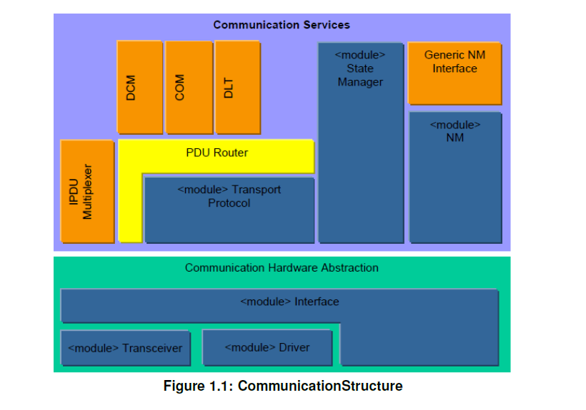

### 1.2. PDU路由器模块功能概述

PDU路由器模块是AUTOSAR基础软件（**BSW**）的一部分，并且在每个**AUTOSAR ECU**中必须被实例化。

详细的PDU路由器模块结构如图**1.2**所示。

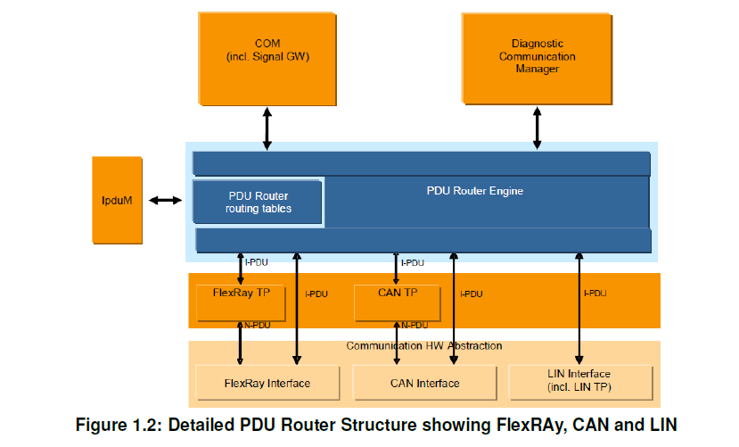

PDU Router模块主要由两部分组成：

**PDU路由器路由路径：**

描述每个需被路由的**I-PDU**的路由属性的静态路由路径。

路由路径可以（如果支持）更新:

* 可在ECU 的编程状态下**Post-build**加载。
* 在初始化PDU路由器时，通过**Post-build**进行Variant的选择。

**PDU路由器引擎：**

根据**PDU**路由器路由路径执行路由操作的实际代码。

PDU 路由器引擎必须处理：
* 将**I-PDU**从源路由到目的地。
* 将源**I-PDU ID**转换为目标**I-PDU ID**。例如：**PduR_Com Transmit**到**CanIf_Transmit**，**PduR_CanIfTxConfirmation**到**ComTxConfirmation**。

### 1.3. I-PDU处理

**I-PDU**通过静态的**I-PDU ID**标识。PDU路由器模块通过使用静态配置表中的**I-PDU ID**来确定**I-PDU**的目的地。**I-PDU**可用于与**PDU**路由器模块上方的模块进行直接的数据交换，例如：**Com**模块和**Dcm**模块。PDU路由器模块的路由操作不会修改**I-PDU**的内容，它只是将**I-PDU**转发到目的地的模块。在**TP**网关的情况下，可以在接收到完整的**I-PDU**之前，将**I-PDU**开始转发到目的地，，也被称作为实时网关（**on-the-fly gatewaying**）功能。

在配置中设置**I-PDU ID**同样用于实现的**API**中。这将允许在每个接收**I-PDU ID**的模块中，有效地实现查找表（**look-up tables**）功能。例如：PDU路由器模块的配置包含PduR_CanIfTxConfirmation的**I-PDU ID**，而**CanIf**模块的配置包含**CanIf_Transmit**的**I-PDU ID**。

以下列表总结了**PduR**的路由功能：

1. I-PDU转发（**I-PDU Forwarding**）
   1. 上层发送（**Transmission from upper layer**）
      1. 通讯接口（**Communication Interface**）
        * 单播 (1:1)：一个**I-PDU**从一个本地模块到一个通信接口模块。
        * 组播 (1:n)：一个**I-PDU**从一个本地模块到多个通信接口模块。
      2. 传输协议（**Transport Protocol**）
        * 单播 (1:1)：一个**I-PDU**从一个本地模块到一个传输协议模块（单帧和多帧）。
        * 组播 (1:n)：一个**I-PDU**从一个本地模块到多个传输协议模块（单帧和多帧）。
   2. 上层接收（**Reception to upper layer**）
      1. 通讯接口（**Communication Interface**）
        * 单播 (1:1)：一个**I-PDU**从一个通信接口模块到一个本地模块。
        * 组播 (1:n)：一个**I-PDU**从一个通信接口模块到多个本地模块。
        * 扇入 (n:1)：一个**I-PDU**从多个通信接口模块到一个本地模块。
      2. 传输协议（**Transport Protocol**）
        * 单播 (1:1)：一个**I-PDU**从一个传输协议模块到一个本地模块（单帧和多帧）。
        * 组播 (1:n)：一个**I-PDU**从一个传输协议模块到多个本地模块（单帧和多帧）。
2. I-PDU网关（I-PDU Gatewaying）
   1. 通讯接口（**Communication Interface**）
      * 网关 (1:1)：一个**I-PDU**从一个通信接口模块到一个使用last-is-best/FIFO/无缓冲区的通信接口模块。
      * 网关 (1:n)：一个**I-PDU**从一个通信接口模块到多个使用last-is-best/FIFO/无缓冲区的通信接口模块。
      * 网关 (n:1)：一个**I-PDU**从多个通信接口模块到一个使用last-is-best/FIFO/无缓冲区的通信接口模块，但一次只能启用一个源。
   2. 传输协议（**Transport Protocol**）
      * 网关 (1:1)：一个**I-PDU**从一个传输协议模块到一个使用缓冲区的传输协议模块。
      * 网关 (1:n)：一个**I-PDU**从一个传输协议模块到多个使用缓冲区的传输协议模块。
      * 网关 (n:1)：一个**I-PDU**从多个传输协议模块到一个使用缓冲区的传输协议模块，但一次只能启用一个源。
3. 组合**I-PDU**网关和**I-PDU**转发
   1. 通讯接口（**Communication Interface**）
      * 一个**I-PDU**可以被一个或多个上层模块接收，同时通过网关连接到一个或多个使用last-is-best/FIFO/无缓冲区的通信接口。 
   2. 传输协议（**Transport Protocol**）
      * 一个**I-PDU**（仅支持单帧）可以被一个或多个上层模块接收，同时通过网关连接到一个或多个使用缓冲区的传输协议模块。 

## 2. 缩略语

### 2.1. 术语

**上层模块(Up)（Upper Layer Modules）**
> PDU路由器模块的上方模块。该层通常包括**Com**和诊断通信管理器 (**Dcm**)。

**下层模块(Lo)（Lower Layer Modules）**
> PDU路由器模块的下方模块。该层可能包括**CAN**、**LIN**、**FlexRay**、以太网通信接口模块和相应的**TP**模块。

**PDU路由器（PDU Router）**
> 将**I-PDU**从一个模块传输到另一个模块的模块。PDU路由器模块可用于网关操作和内部路由目的。

**即时网关（on-the-fly gatewaying）**
> 网关的能力。两个TP 模块之间的路由，其中在接收到所有数据之前（达到指定阈值时）开始转发数据。如果在两个接口之间传输大量数据，则希望能够在从源网络接收所有数据之前在目标网络上开始传输。这样可以节省内存和时间。

**多播操作（multicast operation）**
> 将PDU同时传输到一组接收者，即：1:n路由。

**数据提供（data provision）**
> 向接口模块提供数据。(a)直接数据提供：需传输的数据直接在传输请求时提供。目标通信接口可能以两种方式运行：直接复制数据或将复制推迟到触发传输。(b)触发传输数据提供：需传输的数据不是在传输请求时提供，而是由通信接口模块通过回调函数获取。

**最后最好（last-is-best——缓冲**
> 最新值覆盖最后一个值的缓冲策略。

**先进先出（FIFO）缓冲**
> 缓冲区概念，采用先进先出策略。

### 2.2. 缩写

**I-PDU ID**
> **I-PDU**标识符

**I-PDU**
> 交互层**PDU**。 一个**I-PDU**由数据（缓冲区）、长度和**I-PDU ID**组成。PDU路由器将主要I-PDU进行路由，但即时网关（**on-the-fly gatewaying**）除外。

**N-PDU** 
> 网络层**PDU**。由传输协议模块用来对**I-PDU**进行分段。

**L-PDU** 
> 数据链路层 PDU。 一个或多个 I-PDU 被打包到一个 L-PDU 中。 L-PDU 是特定于总线的，例如 CAN 帧。

**SF** 
> 单帧，传输协议术语。

**FF** 
> 第一帧，传输协议术语。

**CF** 
> 连续帧，传输协议术语。

**PDU** 
> 协议数据单元.

**BSW** 
> 基础软件.

**\<SrcLo\>** 
> 下层通信接口模块，作为**I-PDU**的来源。**SrcLo**始终只有一个。

\<DstLo\> 
> 下层通信接口模块，作为**I-PDU**的目的地。**DstLo**可以是一对多的。

\<SrcLoTp\> 
> 下层传输协议模块，作为**I-PDU**的来源。**SrcLoTp**始终只有一个。

\<DstLoTp\> 
> 下层传输协议模块，作为**I-PDU**的目的地。**DstLoTp**可以是一对多的。

\<Lo\> 
> 下层通信接口模块。

\<Up\> 
> 上层通信接口和/或传输协议模块。

\<LoTp\> 
> 下层传输协议模块。

\<module\> 
> 任何类型的软件模块 <...>.

## 3. 相关文档

### 3.1. 输入文件和相关标准与规范

<a id="ref-1"></a>[1] Layered Software Architecture
> AUTOSAR_EXP_LayeredSoftwareArchitecture

<a id="ref-2"></a>[2] General Specification of Basic Software Modules
> AUTOSAR_SWS_BSWGeneral

<a id="ref-3"></a>[3] Requirements on Gateway
> AUTOSAR_SRS_Gateway

<a id="ref-4"></a>[4] Specification of I-PDU Multiplexer
> AUTOSAR_SWS_IPDUMultiplexer

<a id="ref-5"></a>[5] List of Basic Software Modules
> AUTOSAR_TR_BSWModuleList

<a id="ref-6"></a>[6] Specification of ECU Configuration
> AUTOSAR_TPS_ECUConfiguration

<a id="ref-7"></a>[7] Specification of Communication Stack Types
> AUTOSAR_SWS_CommunicationStackTypes

<a id="ref-8"></a>[8] Guide to BSW Distribution
> AUTOSAR_EXP_BSWDistributionGuide

### 3.2. 相关规范

AUTOSAR提供了基础软件模块的通用规范[\[2\]](#ref-2)，它也适用于**PDU**路由器。因此，规范**SWS BSW General**应被视为**PDU**路由器的附加和必需规范。

## 4. 约束和假设

### 4.1. 限制

**PDU**路由器模块不具备：

* 信号提取或转换的机制。
* 数据完整性检查机制，如：校验和。
* 更改或修改**I-PDU**。
* 做出任何**PDU**有效载荷相关的路由决策。
* 支持TP模块和通信接口模块之间的路由，反之亦然，
* 通过速率转换支持通信接口模块之间的**I-PDU**路由。但此功能可以与上层模块合作以获得支持，例如：**Com**模块。

### 4.2. 受支持功能的限制

**PDU**路由器模块支持从本地模块（例如：**Com**模块）传送到多个目的地的**I-PDU**扇出。如果将**I-PDU**传输到多个目的地（扇出 1：n；n>1），因为上层模块不知道有多少个目的地，则存在一些限制：

* 如果至少一个目标低层报告**E_OK**，则**PDU**路由器需向发出传输请求的上层模块报告**E_OK**。
* 当**PDU**路由器在接收到来自目标低层的最后一个发送确认（**TxConfirmation**）时，此时需向上层模块也发送一个发送确认（**TxConfirmation**）。
* PDU路由器仅在所有目标低层都返回**E_OK**时，才向上层模块请求的**CancelTransmit**返回**E_OK**。

如果**I-PDU**扇出由**PDU**路由器执行，这将也会对**Com**作为上层模块产生进一步的影响：

* 更新位（**Update bits**）将不起作用。
* 通信接口模块的**TxConfirmation**会在最后一个目的地确认发送后，通知本地模块的方式。这意味着会按最后一个**TxConfirmation**进行最后期限监控（**deadline monitoring**）。（即：所有**I-PDU**是否成功传输没有区别）。
* **I-PDU Group**的启动和停止会影响所有目的地。

**注意：**

因为上诉限制与**PduR**模块提供的功能无关，所以上述限制并未定义为需求。但是使用**PduR**模块的意味着会影响到这些功能。

如果**I-PDU**扇入由**PDU**路由器执行，更新位（**update bits**）和**I-PDU**序列计数器将无法与**Com**模块一起使用。

### 4.3. 适用于汽车领域

**PDU**路由器可用于所有需要进行通信的**ECU**。

因为**PDU**路由器模块未指定用于**MOST**通信网络。 所以多媒体（**multimedia**）和远程信息处理（**telematic**）汽车领域的适用性可能会受到限制。

## 5. 对其他模块的依赖

PDU路由器模块依赖于使用的通信硬件抽象层模块（**communication hardware abstraction layer modules**）和通信服务层模块（**communication service layer modules**）的API接口和能力。

基本上**PDU**路由器模块所需的API函数是：

### 5.1. 通讯接口模块

* \<Lo\>_Transmit。例如: CanIf_Transmit、FrIf_Transmit、LinIf_Transmit。
* \<Lo\>_CancelTransmit。例如: FrIf_CancelTransmit。

### 5.2. 传输协议模块：

* \<LoTp\>_Transmit。例如 CanTp_Transmit、FrTp_Transmit、LinTp_Transmit。
* \<LoTp\>_CancelTransmit。例如：CanTp_CancelTransmit、FrTp_CancelTransmit。
* \<LoTp\>_CancelReceive。例如：CanTp_CancelReceive、FrTp_CancelReceive。

### 5.3. 使用传输协议模块的上层模块：

* \<Up\>_StartOfReception。例如：Dcm_StartOfReception。
* \<Up\>_CopyRxData。例如：Dcm_CopyRxData。
* \<Up\>_CopyTxData。例如：Dcm_CopyTxData。
* \<Up\>_TpRxIndication。例如：Dcm_TpRxIndication。
* \<Up\>_TpTxConfirmation。例如：Dcm_TpTxConfirmation。

### 5.4. 处理来自通信接口模块的 I-PDU 的上层模块：
* \<Up\>_RxIndication。例如：Com_RxIndication。
* \<Up\>_TxConfirmation。例如：Com_TxConfirmation。
* \<Up\>_TriggerTransmit。例如：Com_TriggerTransmit。

### 5.5. 文件结构

#### 5.5.1. 代码文件结构

详细信息请参见[\[2\]](#ref-2)的第5.1.6章“代码文件结构（**Code file structure**）”。

本规范未完整定义代码文件结构。但为了允许与其他模块集成，需要以下结构。

#### 5.5.2. 头文件结构

**PDU**路由器模块需为不同模块所使用的函数提供独立的头文件。

**示例：**如果使用**CanIf**、**CanTp** 和**FrIf**，则**PDU**路由器模块需提供**PduR_CanIf.h**、**PduR_CanTp.h** 和**PduR_FrIf.h**。

**PDU**路由器的实现需包含**Det.h**。

所有**PDU**路由器头文件需包含软件版本号和规范版本号。

该结构允许将平台、编译器和实现相关的定义与声明同通用定义分离，也允许源代码与配置分离。

### 5.6. 版本检查

详细信息请参见[\[2\]](#ref-2)的第5.1.8章“版本检查（**Version Check**）”。

## 6. 功能规格

**PDU**路由器模块是一个**I-PDU**的传输单元（**transfer unit**），模块位于通信接口和传输协议模块（下层模块）之上，**Com**和**Dcm**（上层模块）之下，具体可参见图1.1。

除了**PDU**路由器模块之外，还有**I-PDU**多路复用器 (**IpduM**) 模块[\[4\]](#ref-4)，**IpduM**提供了多路复用的**I-PDU**的支持。

当满足以下情况时，**IpduM**需被视为一个上层模块：

* 当**IpduM**调用**PDU**路由器模块以传输（**Transmit**）多路复用的I-PDU。
* 当**IpduM**模块被**PDU**路由器模块调用，为了对多路复用的I-PDU进行**RxIndication**或**TxConfirmation**，或者通过**TriggerTransmit**提供数据时。

当满足以下情况时，**IpduM**需被视为一个下层模块：

* 当**IpduM**调用**PDU**路由器模块将**TxConfirmation**或**RxIndication**转发到上层，例如：Com模块。
* 当**IpduM**被**PDU**路由器模块调用以更新属于多路复用**I-PDU**的**I-PDU**时。

从**ECU**的角度来看，**PDU**路由器模块可以执行三类不同的操作：

1. **PDU**接收到本地模块：从下层模块接收**I-PDU**并将它们转发给一个或多个上层模块。
2. 从本地模块传输**PDU**：根据上层模块的请求，将**I-PDU**传输到一个或多个下层模块。
3. PDU网关：
   1. 从通信接口模块接收**I-PDU**，并立即通过相同或其他通信接口模块发送**I-PDU**。
   2. 从传输协议模块接收**I-PDU**，并通过相同或其他传输协议模块发送**I-PDU**。

**PDU**接收和**PDU**网关的组合是被允许的。例如：**Com**模块接收**I-PDU**的同时，**I-PDU**通过网关连接到另一个较低层模块。

当**PDU**路由器模块检测到任何开发、运行时或瞬时错误时，**PDU**路由器模块需在调用**DET**模块时，使用调用模块的**moduleId**作为**instanceId**。

**注意：**

标准化模块**ID**可在基础软件模块列表文档[\[5\]](#ref-5)中找到。参数**PduRBswModuleRef**标识所使用的模块。使用此信息，可以在**BswModuleDescription.moduleId**中获得**moduleId**。

### 6.1. I-PDU 处理

**PDU**路由器模块应以一致的方式，将不加修改的**I-PDU**从源模块（**source module**）传输到目标模块（**destination module**）。

**I-PDU**可以通过**I-PDU ID**或者符号名称（即：I-PDU 容器的 SymbolicNameValue[\[6\]](#ref-6)）来标识。对于**Post-Build**，因为**I-PDU**必须在编译**PDU**路由器模块之后被识别 ，所以**I-PDU ID**也是必须的。如果**PDU**路由器模块是预编译的（即：在源代码中），则可以使用符号名称，具体请参阅文档[\[6\]](#ref-6)。

每个处理**I-PDU**并为**I-PDU**提供**API**的BSW模块，都必须包含一个**I-PDU ID**列表[\[6\]](#ref-6)。这意味着每个被调用模块都包含一个查找表（**look-up table**）来标识I-PDU。

**示例：**

如下图 7.1 所示，（仅显示**I-PDU ID**作为参数）：

1. **Com**模块调用**PduR_ComTransmit**，使用了**PDU**路由器模块配置中包含了**I-PDU ID**作为参数。
2. **PDU**路由器模块将调用**CanIf_Transmit**，使用了**CanIf**模块配置中包含**I-PDU ID**作为参数。
3. **CanIf**模块将调用**PduR_CanIfTxConfirmation**，使用了**PDU**路由器模块配置中包含**I-PDU ID**作为参数。
4. **PDU**路由器模块将调用**Com_TxConfirmation**，使用了**Com**模块配置中包含**I-PDU ID**作为参数。

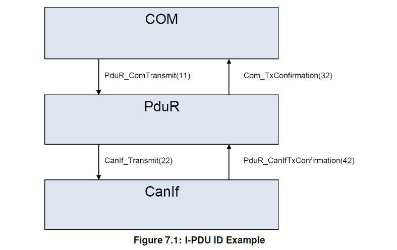

**PDU**路由器模块需通过源模块**I-PDU ID**（位于**PDU**路由器配置中）和目标**I-PDU ID**（位于被调用的目标模块配置中）的组合来唯一标识路由路径。

**PDU**路由器模块需将**I-PDU ID**转换为传输路径和**TxConfirmation**/**RxIndication**路径的目标模块的**I-PDU ID**。

**示例1：** 

**Com**模块向**CanIf**和**LinIf**发送**I-PDU**。**PduR_Com Transmit**会被调用。**PDU**路由器模块会将源**I-PDU ID**（PDU路由器模块配置）转换为一个用于**LinIf**（LinIf模块配置）的**I-PDU ID**和一个用于**CanIf**（CanIf模块配置）的**I-PDU ID**。从**Com**模块接收到的**PduInfoType**值被复制到**CanIf**和**LinIf**模块而不做任何更改。

**示例2：**

**LinIf**将使用**I-PDU ID**调用**PduR_LinIfTxConfirmation**，并根据传输的成功，返回**E_OK**（成功传输）或**E_NOT_OK**（未成功传输）。然后**PDU**路由器模块将转换此**I-PDU ID**并使用**Com_TxConfirmation**将调用转发给**Com**以及转换后的**I-PDU ID**和接收到的结果。

**PDU**路由器模块需仅根据配置中给出的路由路径来对**I-PDU**进行路由。

**PduR**生成器（验证）需拒绝通过路由路径连接具有不同**MetaDataTypes**的**IPDU**的配置。

#### 6.1.1. 缓冲概念

**PDU**路由器模块需能够缓冲**I-PDU**。当设置了相关的**PduRQueueDepth**时，此路由路径需能缓冲**I-PDU**。到目前为止，**I-PDU**缓冲仅适用于网关I-PDU 和从多个通信接口模块到本地模块的扇入接收。 在以下情况下，缓冲是强制性的：

* 具有触发发送数据提供（**trigger transmit data provision**）的通信接口网关目标，
* **TP**网关。

下文将“**FIFO**”或“**FIFO** 队列”作为**PduR** 的**I-PDU** 缓冲区的同义词使用。以下小节说明了缓冲区的类型、其配置可能性以及与路由路径的关系。

##### 6.1.1.1. 缓冲区类型

缓冲区可由[**PduRBuffer**](#9212-pdurbuffer) 容器定义。从路由路径的分配角度来看，缓冲区分为两种类型：未被任何[**PduRRoutingPath**](#927-pdurroutingpath) 引用的[**PduRBuffer**](#9212-pdurbuffer) 称为**全局缓冲区（global buffer）**，至少被一个[**PduRRoutingPath**](#927-pdurroutingpath) 引用的缓冲区称为**专用缓冲区（dedicated buffer）**。全局缓冲区可被任何[**PduRRoutingPath**](#927-pdurroutingpath) 占用，而专用缓冲区只能被通过**PduRDestBufferRef** 引用它的那些[**PduRRoutingPath**](#927-pdurroutingpath) 占用。

设置专用缓冲区的主要原因是：功能诊断请求，尤其是**OBD** 请求，具有非常高的优先级，不得因为内存不足而触发的缓冲区分配策略而被延迟。

当**I-PDU** 需要被缓冲，且所需大小不大于至少一个空闲专用缓冲区（由**PduRDestBufferRef** 引用的[**PduRBuffer**](#9212-pdurbuffer)）所配置的**PduRPduMaxLength** 时，**PduR** 需在遵守**PduRQueueDepth** 的前提下使用该专用缓冲区。

当**I-PDU** 需要被缓冲，且所需大小大于所有空闲专用缓冲区（由**PduRDestBufferRef** 引用的[**PduRBuffer**](#9212-pdurbuffer)）所配置的**PduRPduMaxLength** 时，**PduR** 需在遵守**PduRQueueDepth** 的前提下，动态分配一个大小合适的全局缓冲区（即未被任何**PduRDestBufferRef** 引用的[**PduRBuffer**](#9212-pdurbuffer)）。

##### 6.1.1.2. 缓冲策略

缓冲策略的类型由**PduRQueueDepth** 配置参数的值决定。该参数指定一条路由路径可同时占用的[**PduRBuffer**](#9212-pdurbuffer) 的最大数量：[**PduRBuffer**](#9212-pdurbuffer) 可以取自专用缓冲区，也可以来自全局缓冲区（关于缓冲区类型请参见 [6.1.1.1](#6111-缓冲区类型) 节）。由于一个[**PduRBuffer**](#9212-pdurbuffer) 可以容纳零个或一个**I-PDU**，因此**PduRQueueDepth** 隐含地规定了路由路径可以缓冲的**I-PDU** 的数量。

如果**PduRQueueDepth** 的值大于 1，则可使用**FIFO** 队列缓冲。**FIFO** 具有状态，且这些状态可能在不同上下文中调用各种**PduR API** 时发生变化。例如：一次**PduR_&lt;SrcLo&gt;RxIndication** 调用可能被一次**PduR_&lt;DstLo&gt;TxConfirmation** 调用所中断。因此，需要对这些并发调用进行保护。

如果**PduRQueueDepth** 配置为大于 1 的值，则**I-PDU** 缓冲区需具有先进先出（**FIFO**）的行为。

在**FIFO** 缓冲的情况下，当一个新的**I-PDU** 需要被缓冲，且**FIFO** 队列非空时，新**I-PDU** 需被复制为最新的条目。

在多播路由的情况下，**PduRQueueDepth** 和**PduRDestBufferRef** 可以分别独立配置。这意味着多播各目标的缓冲区相互独立。

##### 6.1.1.3. 缓冲区共享

在配置层面，一个[**PduRBuffer**](#9212-pdurbuffer) 可以被多个**PduRDestBufferRef** 引用。这样的[**PduRBuffer**](#9212-pdurbuffer) 可以被引用它的任一[**PduRRoutingPath**](#927-pdurroutingpath) 作为专用缓冲区占用，但在运行时，在某一特定时刻，它只能被一个[**PduRRoutingPath**](#927-pdurroutingpath) 占用。

#### 6.1.2. 到上层模块的 I-PDU 接收

**PDU**路由器模块的接收操作总是以下层模块（通信接口模块或传输协议模块）发出的**RxIndication**（**PduR_&lt;User:Lo&gt;RxIndication** 或**PduR_&lt;User:LoTp&gt;RxIndication**）作为结束。**RxIndication** 函数源自下层，其上下文要么是在轮询通信驱动之后的周期函数中，要么是在中断中。

##### 6.1.2.1. 通信接口

源通信接口模块通过调用**PduR_&lt;User:Lo&gt;RxIndication** 来指示接收到一个**I-PDU**。该**I-PDU** 可以由路由路径配置多个本地目标模块。

**PDU**路由器模块需为从通信接口模块接收到并路由到一个或多个上层模块的**I-PDU** 提供 1:n 路由。

**示例：**一个**I-PDU** 在**CanIf** 上被接收并转发给**Com**。

**注意：**一个**I-PDU** 可能同时被一个或多个上层模块接收，并被网关到一个或多个通信接口目标，请参见 [6.1.4](#614-i-pdu-网关) 节。

当调用**PduR_&lt;User:Lo&gt;RxIndication** 时，**PDU**路由器模块需为每个目标上层模块调用**&lt;Up&gt;_RxIndication**。

如果本地模块接收到的**I-PDU** 被直接转发，**PDU**路由器不得检查该**I-PDU** 的长度。

由于**PDU**路由器模块不会缓冲此**I-PDU**，因此它不必拒绝长于或短于所配置长度的**I-PDU**。

**PDU**路由器模块需为从多个通信接口模块接收到一个上层模块的**I-PDU** 提供 n:1 路由。

**PDU**路由器模块需可选地支持在从多个通信接口模块到一个上层模块的 n:1 路由情况下使用接收**FIFO**。

**注意：**如果用户无法排除在某个 n:1 路由点上出现并发请求的可能性，则需要**FIFO** 来串行化并发的接收请求。

如果对未配置**FIFO** 的 n:1 路由点调用**PduR_&lt;User:Lo&gt;RxIndication**，且最近一次请求的**&lt;Up&gt;_RxIndication** 调用尚未返回，则**PDU**路由器需立即返回而不调用**&lt;Up&gt;_RxIndication**，并向**DET**模块报告[**PDUR_E_PDU_INSTANCES_LOST**](#68-错误分类)。

如果对已配置**FIFO** 的 n:1 路由点调用**PduR_&lt;User:Lo&gt;RxIndication**，且最近一次请求的**&lt;Up&gt;_RxIndication** 调用尚未返回，则**PDU**路由器需缓冲该**I-PDU**。

在以来自**FIFO** 缓冲区的**I-PDU** 调用**&lt;DstUp&gt;_RxIndication** 并返回之后，该**I-PDU** 需从**FIFO** 中移除，并且如果还有下一个**FIFO** 条目，则需将其提供给上层。

##### 6.1.2.2. 传输协议

通过传输协议接收**I-PDU** 的标准用例是每条路由路径只配置一个上层模块。

在存在多个软件集群（**Software Cluster**）的情况下，该**I-PDU** 也可能被多个上层模块接收。

**示例：**从**CanTp** 模块（位于主机软件集群中）接收到一个功能寻址请求，并将其路由到两个**Dcm** 模块实例（位于与主机软件集群同一分区的不同应用软件集群中）。

如果源和目标位于不同分区，则需考虑 [6.10](#610-多核分布) 节中描述的跨分区路由原则。

###### 6.1.2.2.1. 来自源传输协议模块的 I-PDU 的 1:1 路由

在传输协议模块的情况下，**PDU**路由器模块首先在接收到首帧（**FF**）或单帧（**SF**）时收到接收开始通知。该调用需通过调用**&lt;Up&gt;_StartOfReception** 转发给相关的上层模块。每个段（**N-PDU**）的有效载荷需在随后的**&lt;Up&gt;_CopyRxData** 调用中复制到上层目标模块中。在接收到最后一个**N-PDU** 之后，传输协议模块将向**PDU**路由器模块指示完整的**I-PDU** 已被接收，**PDU**路由器模块需通过调用**&lt;Up&gt;_TpRxIndication** 将该指示转发给相关的上层模块。

**PDU**路由器模块需为从源传输协议模块接收到并路由到一个上层目标模块的**I-PDU** 提供 1:1 路由。

**示例：**从**CanTp** 模块接收到一个功能寻址请求（位于一个**SF** 中），并将其路由到**Dcm** 模块。

当源传输协议模块通过**PduR_&lt;User:LoTp&gt;StartOfReception** 指示某个仅有上层目标的**PDU** 的接收开始时，**PDU**路由器模块需通过调用**&lt;Up&gt;_StartOfReception** 将该请求转发给该上层目标模块。

**PDU**路由器需将**&lt;Up&gt;_StartOfReception** 的返回值转发给源传输协议模块。

当源传输协议模块通过**PduR_&lt;User:LoTp&gt;CopyRxData** 请求**PDU**路由器模块复制接收到的数据时，**PDU**路由器模块需通过调用**&lt;Up&gt;_CopyRxData** 将该请求转发给上层目标模块。

当源传输协议模块调用**PduR_&lt;User:LoTp&gt;RxIndication** 指示完整**I-PDU** 的接收时，**PDU**路由器模块需通过调用**&lt;Up&gt;_TpRxIndication** 将该指示转发给上层目标模块。

如果源传输协议模块通过**PduR_&lt;User:LoTp&gt;RxIndication** 报告了一个错误，则**PDU**路由器模块不得执行除将**RxIndication** 转发给上层模块之外的任何错误处理。

###### 6.1.2.2.2. 来自源传输协议模块的 I-PDU 的 1:n 转发

**PDU**路由器模块需为从源传输协议模块接收到并路由到多个上层目标模块的**I-PDU** 提供 1:n 转发。

如果该**I-PDU** 被多个本地上层模块接收，则向这些上层的转发处理方式与直接传输协议网关类似。**PduR** 在通过**PduRDestBufferRef** 配置的专用缓冲区（[**PduRBuffer**](#9212-pdurbuffer)）中缓冲 1:n 转发的**PDU**，并在**RxIndication** 的上下文中通知上层。

当**PduR** 从下层收到成功的**RxIndication** 时，该模块需为每个配置的上层目标发起一个接收会话：将按此顺序调用**&lt;UpTp&gt;_StartOfReception**、**&lt;UpTp&gt;_CopyRxData** 和**&lt;UpTp&gt;_RxIndication**。

在存在多个本地目标的情况下，**PduR** 需为每个目标单独执行错误处理。

其他目标不应受到某一个目标上层模块错误的影响。

当**&lt;Provider:UpTp&gt;_StartOfReception** 对具有多个本地目标的多播返回错误时，**PduR** 需停止相应的上层接收，且不再与该上层进行进一步交互。

当**&lt;Provider:UpTp&gt;_StartOfReception** 返回**BUFREQ_OK**，但可用缓冲区太小而无法接收整条消息时，**PduR** 需为相应的上层模块调用**&lt;Provider:UpTp&gt;_TpRxIndication**，且结果参数为**E_NOT_OK**。

当**&lt;Provider:UpTp&gt;_CopyRxData** 返回错误时，**PduR** 需为相应的上层模块调用**&lt;Provider:UpTp&gt;_TpRxIndication**，且结果参数为**E_NOT_OK**。

###### 6.1.2.2.3. 处理未知长度的 I-PDU

**PduR** 能够使用**TP API** 处理未知长度的**I-PDU**（即流式数据）。未知长度由**TpSduLength = 0** 来指示。

在本地接收的情形下，当以**TpSduLength = 0** 调用**PduR_&lt;User:LoTp&gt;StartOfReception** 时，**PduR** 需以**TpSduLength = 0** 调用**&lt;Up&gt;_StartOfReception**。

#### 6.1.3. 来自上层模块的 I-PDU 传输

下层目标模块的发送操作总是异步的。这意味着，一旦**I-PDU** 被**PDU**路由器模块传递给下层目标，发送服务请求就立即返回。如果在**I-PDU** 发送成功或失败之后，**PDU**路由器模块通过**PduR_&lt;User:Lo&gt;TxConfirmation**（通信接口）或**PduR_&lt;User:LoTp&gt;TxConfirmation**（传输协议）收到下层目标模块的通知，则**PDU**路由器模块将通过**&lt;Up&gt;_TxConfirmation**（通信接口）或**&lt;Up&gt;_TpTxConfirmation**（传输协议）将该确认转发给上层模块。

**PDU**路由器模块的发送操作由上层源模块的**PDU**发送请求触发，**PDU**路由器将该请求转发给下层目标。

在上层源模块进行**PDU**发送的情况下，**I-PDU** 不得在**PDU**路由器模块中被缓冲。

##### 6.1.3.1. 多播

多播特性被单独列为一节，因为使用该特性存在一些问题，如 [4.2](#42-受支持功能的限制) 节所述。

由**PDU**路由器模块直接处理的进一步需求如下：

如果所提供的**I-PDU ID** 表示一组**PDU**（多播发送请求），且至少有一个被转发的发送请求成功返回，则函数**PduR_&lt;User:Up&gt;Transmit** 需返回**E_OK**。

请注意，返回**E_OK** 的通信接口将直接或通过触发发送来发送其数据。

其他传输协议模块可能返回**E_NOT_OK**，因此这些模块将不会调用**PduR_&lt;User:LoTp&gt;CopyTxData**。由于上层源模块已被通知至少有一次发送成功，因此至少有一个传输协议模块将调用**PduR_&lt;User:LoTp&gt;CopyTxData**。

如果在一个发送请求（1:n，n&gt;1）中存在多于一个下层目标模块，则所有这些模块必须要么是通信接口模块，要么是传输协议模块，不得混合。

**示例：**上述需求基本上意味着**Com**模块不能在同一时刻通过**PduR_ComTransmit** 请求向**CanTp** 和**CanIf** 模块发送。

在多播（1:n，n&gt;1）通信接口发送的情况下，当收到来自支持发送确认的通信接口模块的最后一个发送确认时，**PDU**路由器需调用上层模块的发送确认**API**。

**注意：**即使并非所有目标都提供**TxConfirmation**，上述需求仍然有效。

**实现提示：**当源模块请求发送且**PduR** 将进行多播（1:n，n&gt;1）时，请求中的所有**I-PDU** 以及多播将具有不同的**I-PDU ID**。因此**PduR** 必须记住来自该发送请求的**I-PDU ID**，以便能够正确地确认该发送。

##### 6.1.3.2. 通信接口

**I-PDU** 可以通过三种方式在通信接口上发送：

1. 直接数据提供（**Direct data provision**）：上层模块调用**PduR_&lt;User:Up&gt;Transmit** 函数，**PDU**路由器模块将该调用转发给**&lt;Lo&gt;_Transmit**，数据在该调用中由下层通信接口模块复制。
2. 直接数据提供：下层通信接口模块通过使用**PduR_&lt;User:Lo&gt;TriggerTransmit** 请求发送一个**I-PDU**，**PDU**路由器模块将该调用转发给**&lt;Up&gt;_TriggerTransmit**，数据由上层模块复制到目标的缓冲区中。
3. 上层模块调用**PduR_&lt;User:Up&gt;Transmit** 函数，**PDU**路由器模块将该调用转发给**&lt;Lo&gt;_Transmit**，而下层模块（通信接口模块）不复制数据。数据稍后将由下层通过**PduR_&lt;User:Lo&gt;TriggerTransmit** 请求。

对于直接数据提供和触发发送数据提供，**I-PDU** 发送的确认方式是相同的：

当通信接口模块调用**PduR_&lt;User:Lo&gt;TxConfirmation** 时，**PDU**路由器需在上层模块中调用**&lt;Up&gt;_TxConfirmation**，并将发送结果从下层转发给上层模块。

如果**I-PDU** 由上层模块发送，**PDU**路由器模块不得检查该**I-PDU** 的长度。

当上层源模块调用**PduR_&lt;User:Up&gt;Transmit** 时，**PDU**路由器需为每个通信接口目标模块调用**&lt;Lo&gt;_Transmit**。

如果是单播（1:1），则**&lt;Lo&gt;_Transmit** 调用的返回值需被转发给上层源模块。

###### 6.1.3.2.1. 触发发送数据提供

必须通知上层模块是否需要复位更新位（**update-bits**）。

**PDU**路由器模块需将下层通信接口模块发出的**PduR_&lt;User:Lo&gt;TriggerTransmit** 请求通过调用**&lt;Up&gt;_TriggerTransmit** 转发给上层模块。

**PDU**路由器模块需将来自**&lt;Up&gt;_TriggerTransmit** 的返回值复制给下层模块。

###### 6.1.3.2.2. 错误处理

对于通过通信接口模块进行单播或多播时发生的错误，不执行特定的错误处理。返回值中的错误被转发给上层源模块。

##### 6.1.3.3. 传输协议

使用传输协议发送**I-PDU** 有两种形式：单播和多播。单播（1:1）发送由一个上层源模块和一个下层传输协议目标模块组成。多播（1:n，n&gt;1）发送由多于一个下层传输协议目标模块组成。**PDU**路由器模块不会检查该发送请求包含的是单个**N-PDU**（**SF**）还是多个**N-PDU**（**FF**、**CF** 等）。

**I-PDU** 发送的发起由上层源模块发出**PduR_&lt;User:Up&gt;Transmit** 请求来完成。**PduR** 将根据路由路径，使用**&lt;Lo&gt;_Transmit** 将该请求转发给一个或多个下层传输协议目标模块。请注意，**&lt;Lo&gt;_Transmit** 可能包含数据，也可能不包含数据。

目标模块将通过调用**PduR_&lt;User:LoTp&gt;CopyTxData** 来请求数据。数据的重传（如果传输协议支持）通过**RetryInfoType** 参数完成。在结束发送时，目标模块调用**PduR_&lt;User:LoTp&gt;TxConfirmation**，该调用被转发给上层源模块。

多播**TP** 发送的描述见 [6.1.3.3.1](#61331-多播发送) 节。

当上层模块调用**PduR_&lt;User:Up&gt;Transmit** 时，**PDU**路由器模块需为每个传输协议目标模块调用**&lt;LoTp&gt;_Transmit**。

当传输协议目标模块调用**PduR_&lt;User:LoTp&gt;CopyTxData** 时，**PDU**路由器模块需在上层源模块中调用**&lt;Up&gt;_CopyTxData**。

来自**&lt;Up&gt;_CopyTxData** 的返回值需被转发给调用方的下层传输协议目标模块。

在单播的情况下，**PDU**路由器模块需将来自下层传输协议目标模块的确认**PduR_&lt;User:LoTp&gt;TxConfirmation** 通过**&lt;Up&gt;_TpTxConfirmation** 转发给上层源模块。

在单播的情况下，且在调用**&lt;Lo&gt;_Transmit** 之后，**PDU**路由器模块需以相同的返回值返回给上层源模块所调用的**PduR_&lt;User:Up&gt;Transmit**。

###### 6.1.3.3.1. 多播发送

本小节包含使用传输协议模块发送**I-PDU** 的多播发送的特定需求。

由于 1:n，n&gt;1 的路由是在**PDU**路由器模块中完成的，因此**PDU**路由器模块必须多次向上层源模块请求相同的数据。此外，多播的确认也必须被特殊处理。

由于上层需多次复制相同的数据，**PDU**路由器将使用**RetryInfoPtr** [\[7\]](#ref-7) 来多次查询相同的数据。**RetryInfoPtr** 包含一个称为**TpDataState** 的状态类型。

因此，传输协议目标不将**TpDataState** 设置为**TP_DATARETRY**。

当以设置为**TP_DATARETRY** 的**TpDataState** 调用**PduR_&lt;User:LoTp&gt;CopyTxData**，且该路由路径属于多播**TP** 发送类型时，**PduR** 需返回**E_NOT_OK**。

**N-PDU** 的多播发送以锁步（**lock-step**）模式执行，其中最慢的目标决定发送速率。多播多帧发送背后的用例是**J1939Tp BAM** 消息的广播（诸如**DM1** 或**CommandedAddress** 之类的消息长度超过 8 字节，需要广播到多个目标）。

当针对某个目标（该目标此前已获取的数据多于上层缓冲区当前读取索引所指向的位置）的多播**TP** 发送会话调用**PduR_&lt;User:LoTp&gt;CopyTxData** 时，**PduR** 需返回**BUFREQ_E_BUSY**。

**实现提示：**在这种情况下，**PduR** 必须为每个目标记住到目前为止已发送了多少字节，并持续跟踪。

对于新的多播**TP** 发送会话，第一个目标的**PduR_&lt;User:LoTp&gt;CopyTxData** 请求需以设置为**TP_CONFPENDING** 的**TpDataState** 转发。

对于同一多播**TP** 发送会话的所有后续**PduR_&lt;User:LoTp&gt;CopyTxData** 调用，**PduR** 需将**TpDataState** 覆盖为**TP_DATARETRY**，并调整**TxTpDataCnt**，以从与该目标相关的上一次发送点开始，向上层源缓冲区请求待发送的数据。

**注意：****TxTpDataCnt** 是“相对于当前位置的偏移量”，请参见通信栈类型规范[\[7\]](#ref-7)。

在所有传输协议都已接收到其数据之后，**PDU**路由器模块可以向上层模块确认数据。

在多播发送的情况下，**PDU**路由器模块需在收到来自下层传输协议模块的最后一个**PduR_&lt;User:LoTp&gt;TxConfirmation** 之后，使用**&lt;Up&gt;_TpTxConfirmation** 调用上层模块。如果至少有一个**PduR_&lt;User:LoTp&gt;TxConfirmation** 报告了**E_OK**，则结果参数需为**E_OK**。

###### 6.1.3.3.2. 错误处理

**PDU**路由器模块不会对所发生的错误采取特定动作，错误将通过返回值转发给上层源模块。适当的错误处理是上层模块的职责。

###### 6.1.3.3.3. 处理未知长度的 I-PDU

**PduR** 能够使用**TP API** 处理未知长度的**I-PDU**（即流式数据）。未知长度由**TpSduLength = 0** 来指示。

在本地发送的情形下，当以**PduInfoType.SduLength = 0** 调用**PduR_&lt;User:Up&gt;Transmit** 且该**I-PDU** 被路由到某个**TP** 模块时，**PduR** 需以**PduInfoType.SduLength = 0** 调用**&lt;LoTp&gt;_Transmit** 到所有目标**TP** 模块。

#### 6.1.4. I-PDU 网关

**PDU**路由器模块支持将**I-PDU** 从源总线网关到目标总线，方式如下：1:1、1:n、n:1，但不支持 n:m。此外，还可以将网关的**I-PDU** 转发给上层模块。再者，可以配置多个源并同时启用一个目标集合，以实现扇入网关。与本地模块的发送和接收的不同之处在于，**PDU**路由器模块必须同时是接收方和发送方，并且在某些情况下还为**I-PDU** 提供缓冲。

网关需求被有意单独列出，以便在不需要网关时能够高效地实现**PDU**路由器模块。如果**PDU**路由器模块允许**I-PDU** 网关，则这些需求被视为附加需求，而不取代先前的需求。

以下列表概述了**I-PDU** 网关的特性：

* **I-PDU** 可以从一个或多个通信接口模块的源网关到一个（1:1 或 n:1）目标；或者从单个通信接口模块的源网关到通信接口模块的多个目标（1:n **I-PDU** 网关）。
* **PDU**路由器模块可以为每个目标独立设置缓冲类型（即，如果**I-PDU** 多于一个，则为**FIFO**）。
* 一个**I-PDU** 可以在被网关到 n 个通信接口目标的同时被上层模块的目标接收。
* 使用**TP** 传输的**I-PDU** 可以从单个或多个源网关到一个**TP** 模块目标，或从单个源网关到多个**TP** 模块目标，范围如下：
  * 单帧和多帧都可以被网关到多于一个**TP** 模块目标，同时被转发到一个或多个本地模块目标（例如：**Dcm**）。
  * 多帧可以以“即时网关（**on-the-fly gatewaying**）”方式网关到一个目标，这意味着在开始向目标**TP** 模块发送之前无需接收完整的**I-PDU**。
* **TP** 网关的**I-PDU** 必须被缓冲，并且缓冲深度必须可配置。单帧的“最后即最佳（**last-is-best**）”行为不适用。

这意味着**PDU**路由器模块需将从某个下层模块（源网络）接收到的**I-PDU** 转发到由所提供的**I-PDU ID** 标识的下层模块（目标网络）。

请注意，在本节中，“**Src**”和“**Dst**”用于可配置的**API**。这只是为了明确哪个调用属于源模块、哪个属于目标模块。

一个**I-PDU** 只能在通信接口模块之间网关，或在传输协议模块之间网关，不能混合。

**示例：**从**FrIf** 接收到的**I-PDU** 不得被网关到**CanTp**。

在网关的情况下，需能够以 n:1 的方式网关**I-PDU**。

如果使用 n:1 网关，**PduR** 需确保传入**I-PDU** 的顺序在目标处得以保持。

**注意：**不支持将转发与 n:1 网关组合使用。

在网关的情况下，如果包含**MetaData** 且需要缓冲，**PduR** 需除**I-PDU** 之外还缓冲**MetaData**。

##### 6.1.4.1. 通信接口

一个**I-PDU** 可以被配置为在一个通信接口模块上接收并网关到通信接口模块的 n 个目标（包括本地模块），即 1:n 网关；或者在一个或多个通信接口模块上接收，并网关到一个下层通信接口模块，即 n:1 网关。并行的源请求需使用**FIFO** 串行化：所有**I-PDU** 需按顺序放入同一个公共**FIFO** 中。对于网关，还可以为每个下层通信接口目标模块配置一个缓冲区（但本地模块除外）。

适用于通信接口类型网关的一般需求如下：

**PDU**路由器模块需支持**I-PDU** 在源通信接口模块与一个或多个通信接口目标模块的目标之间进行路由（1:n 网关）。

**PDU**路由器模块需支持**I-PDU** 在通信接口模块之间进行立即发送的路由（不由**PDU**路由器进行速率生成）。

不支持在具有不同周期或速率的通信接口模块之间进行**I-PDU** 路由（速率转换），这可以通过**Com**模块使用信号网关来完成。在这种情况下，**I-PDU** 必须被路由到**Com**模块。

根据通信接口目标模块的不同，**I-PDU** 网关有两种形式。所使用的形式由配置控制：

* 直接数据提供：目标**I-PDU** 的**PduRDestPduDataProvision** 被配置为**PDUR_DIRECT**。当调用**&lt;DstLo&gt;_Transmit** 时，**&lt;DstLo&gt;** 模块复制数据，**PDU**路由器不再缓冲已发送的**I-PDU**。
* 触发发送数据提供：目标**I-PDU** 的**PduRDestPduDataProvision** 被配置为**PDUR_TRIGGERTRANSMIT**。当调用**&lt;DstLo&gt;_Transmit** 时，**&lt;DstLo&gt;** 模块不复制数据，**PDU**路由器模块需缓冲该**I-PDU** 并等待**&lt;DstLo&gt;** 模块发出**PduR_&lt;DstLo&gt;TriggerTransmit** 调用。

###### 6.1.4.1.1. 缓冲网关

请注意，对于**PduRDestPduDataProvision** 为**PDUR_DIRECT** 类型的通信接口网关目标，缓冲不是强制性的。请参见 [6.1.1.2](#6112-缓冲策略) 节。

将被网关的**I-PDU** 可能具有不同的长度。因此：

在**I-PDU** 被缓冲在**PDU**路由器模块中的情况下：**PDU**路由器模块需将**I-PDU** 的数据复制到以下值中的最小值：

* 接收到的数据长度（所接收**I-PDU** 的**PduLength**），
* 目标**I-PDU** 的配置长度。在这种情况下，所接收**I-PDU** 的其余部分需被丢弃。

**注意：**上述需求提供了在调用**PduR_&lt;DstLo&gt;TriggerTransmit** 时避免缓冲区溢出的可能性。专用缓冲区的长度不得大于目标**I-PDU** 的长度。

如果使用带**FIFO** 的直接数据提供：当**I-PDU** 从**PduR** 缓冲区发送到目标模块时，**PduR** 需将复制到缓冲区的字节数作为**SduLength** 传递。

如果使用带**FIFO** 的直接数据提供：当调用**PduR_&lt;SrcLo&gt;RxIndication** 且同一**PDU** 的上一次发送尚未通过**PduR_&lt;DstLo&gt;TxConfirmation** 得到确认时，**PduR** 需将新数据入队到**FIFO** 中。

如果使用带**FIFO** 的直接数据提供：当调用**PduR_&lt;SrcLo&gt;RxIndication** 且**FIFO** 队列为空、且同一**PDU** 没有未完成的确认时，需直接调用**&lt;DstLo&gt;_Transmit**。**FIFO** 保持为空。

如果使用带**FIFO** 的直接数据提供：当调用**PduR_&lt;DstLo&gt;TxConfirmation** 且**FIFO** 队列非空时，需以**FIFO** 中最旧的**I-PDU** 调用**&lt;DstLo&gt;_Transmit**。发送之后，该**I-PDU** 需被移除。

如果使用带**FIFO** 的触发发送数据提供：当调用**PduR_&lt;SrcLo&gt;RxIndication** 且**FIFO** 队列为空时，所接收的**I-PDU** 需入队到**FIFO** 中，并调用**&lt;DstLo&gt;_Transmit**。

如果使用带**FIFO** 的触发发送数据提供：当目标通信接口模块通过**PduR_&lt;DstLo&gt;TriggerTransmit** 请求**I-PDU** 缓冲区且**FIFO** 为空时，需使用返回值**E_NOT_OK**。

请注意，对于**I-PDU** 的网关，**PduR_&lt;DstLo&gt;TxConfirmation** 并不重要（直接数据提供的**I-PDU** 的**FIFO** 除外）。

如果通信接口目标模块通过**PduR_&lt;DstLo&gt;TxConfirmation** 确认**I-PDU** 的发送（成功或失败），且该目标不是带**FIFO** 缓冲的直接数据提供**PDU**，则**PDU**路由器模块不得执行任何动作。

如果使用带**FIFO** 的触发发送数据提供：当调用**PduR_&lt;DstLo&gt;TriggerTransmit** 以将**I-PDU** 从**PduR** 缓冲区复制到目标模块时，**PduR** 需检查下层所提供的缓冲区大小（**SduLength**）。如果缓冲区对于所存储的**PDU** 数据太小，**PduR** 需返回**E_NOT_OK**，并且不再进一步处理该**TriggerTransmit** 调用。

**注意：**不按上述需求处理**TriggerTransmit** 调用意味着该**PDU** 不得从**PduR** 缓冲区中移除。

如果使用带**FIFO** 的触发发送数据提供：当调用**PduR_&lt;DstLo&gt;TriggerTransmit** 并依据上述需求将返回**E_OK** 时，需复制并随后移除最旧的**FIFO** 条目。如果之后**FIFO** 队列非空，需以**FIFO** 中最旧的**I-PDU** 调用**&lt;DstLo&gt;_Transmit**。

**注意：**在目标模块为**FrIf** 的情况下，该**PDU** 的**FrIfCounterLimit** 需配置为大于 1，因为新的发送将在计数器递减之前被调用。对于**LinIf** 没有此类约束，但不支持将**FIFO** 队列路由用于偶发帧（**sporadic frame**）。

如果使用带“最后即最佳”缓冲（**PduRQueueDepth** 设置为 1）的触发发送数据提供：**PDU**路由器需缓冲最新的**I-PDU**。

之所以必须为触发发送数据提供存储数据，是因为通信接口目标可能按照某个调度来发送**I-PDU**。此时，通信接口将调用**PduR_&lt;DstLo&gt;TriggerTransmit**，而不会先有**&lt;DstLo&gt;_Transmit** 调用。

###### 6.1.4.1.2. 立即网关

立即网关意味着**I-PDU** 必须在**PduR** 无任何缓冲机制的情况下被网关。这只能通过具有目标直接数据提供类型的通信接口网关来实现。

将被网关的**I-PDU** 可能具有不同的长度。因此：

在**I-PDU** 在**PDU**路由器中无缓冲地网关的情况下，**PDU**路由器需将**I-PDU** 的长度传递为以下值中的最小值：

* 接收到的数据长度（所接收**I-PDU** 的**PduLength**），
* 或目标**I-PDU** 的配置数据长度（[**PduRDestPdu**](#928-pdurdestpdu) 的**PduLength**）。

##### 6.1.4.2. 传输协议

一个**I-PDU** 可以被配置为在一个传输协议模块上接收并网关到 n 个下层传输协议模块，即 1:n 网关；或者在一个或 n 个传输协议模块上接收，并网关到一个下层传输协议模块，即扇入（n:1）网关。并行的源请求需使用**FIFO** 串行化：所有**I-PDU** 需按顺序放入同一个公共**FIFO** 中。

传输协议**I-PDU** 的网关可以以完整**I-PDU** 的直接方式执行（构成该**I-PDU** 的完整**N-PDU** 集合在发送之前已被接收），也可以以分片**I-PDU** 的路由即时（**on-the-fly**）方式执行，即在发送之前已接收到配置数量的字节（**PduRTpThreshold**）。

如果配置了 n:1 网关，即时路由仅对第一个**SDU** 有效。然而，如果即时路由与扇入网关组合使用，且在运行时有来自多个源的并行网关请求，则只有第一个可以即时网关，其余的将在前一个源的网关完成之后进行直接网关。

一般而言，**PDU**路由器仅网关有效载荷，而不会感知**SF**、**FF**、**CF**、**PCI** 等传输协议细节。但**PduR** 还需支持带**MetaData** 的**I-PDU** 网关，该**MetaData** 使用全局**PDU** 的**MetaDataType** 配置。这类**I-PDU** 在接口路由或转发时无需特殊处理，但对于**TP** 路由，附加信息必须被单独转发。以下需求对直接网关和即时网关都适用：

由**PduR_&lt;SrcLoTp&gt;StartOfReception** 提供的**I-PDU** 的**MetaData** 需被存储，并随该**I-PDU** 一起提供给**&lt;DstLoTp&gt;_Transmit**。

在传输协议模块上，一个**I-PDU** 可以在多个**N-PDU**（**FF** 和**CF**）中传输，也可以在单个**N-PDU**（**SF**）中传输。一个用例是：在多个**N-PDU** 中传输的**I-PDU** 不是多播的（即物理寻址），而在单个**N-PDU** 中传输的**I-PDU** 可能是多播的（即功能寻址）。另一个用例是将多帧消息多播到一个本地接收者和多个网关目标。

**示例：**在**CAN** 上接收到一个**SF**，并需在两条**LIN** 总线上发送。所接收的**SF** 最多可携带 6 字节数据，但**LIN** 上的**SF** 最多只能携带 5 字节数据。因此，如果网关到两条**LIN** 总线，**CAN** 上的**SF** 被限制为 5 字节数据。

请注意，通过传输协议模块传输的**I-PDU** 也可以逐帧直接通过通信接口网关（即直接网关**N-PDU**）。这在此处不需要**PDU**路由器模块的特殊处理，可以通过通信接口模块进行网关，请参见 [6.1.4.1](#6141-通信接口) 节。然而，这要求源总线和目标总线具有完全相同的**N-PDU** 打包方式（例如：从**CAN** 到**CAN**）。

在**PduR_&lt;SrcLoTp&gt;StartOfReception** 时，**PduR** 需从[**PduRBuffer**](#9212-pdurbuffer) 中（为每个目标）分配足够的缓冲区。

**PduR** 需在接收到**PduRTpThreshold** 或完整的**I-PDU**（调用**PduR_&lt;DstLoTp&gt;RxIndication**）时，开始在目标传输协议上的发送。

如果对相同路由路径调用另一次**PduR_&lt;SrcLoTp&gt;StartOfReception**，则**PduR** 需将该**I-PDU** 实例入队到**FIFO** 中。

当从传输协议目标模块收到**PduR_&lt;DstLoTp&gt;TxConfirmation** 时，如果**FIFO** 非空，**PduR** 需开始下一个**I-PDU** 的发送。

如果**FIFO** 队列中已经包含至少一个条目，则所接收的消息需被存储在**FIFO** 中，并且一旦该**FIFO** 队列条目到了应发送的时候（即当该消息位于**FIFO** 队首时），需调用**&lt;DstLoTp&gt;_Transmit**。

**注意：**使用**FIFO** 进行即时网关的效果是，它将是一种更快的**TP** 消息网关方式。显然，如果**FIFO** 非空，则该消息必须被存储，而不能被转发到目标**TP**。

如果调用**PduR_&lt;DstLoTp&gt;CopyTxData** 且状态为**TP_DATACONF**，则**PDU**路由器可以释放已复制的数据。

当**PDU**路由器模块收到**PduR_&lt;DstLoTp&gt;TxConfirmation** 时，**PDU**路由器需释放该目标的**I-PDU** 缓冲区。

如果传输协议模块以零长度（**PduInfoType.SduLength = 0**）调用**PduR_&lt;DstLoTp&gt;CopyTxData** 或**PduR_&lt;SrcLoTp&gt;CopyRxData**，则**PDU**路由器模块需分别返回当前可用缓冲区的大小或当前可用数据的大小。

对于**TP** 网关场景，**PduR_&lt;DstLoTp&gt;CopyTxData** 的**availableDataPtr** 需指示**PduR**（网关）**TP** 缓冲区中剩余的可用字节数。

###### 6.1.4.2.1. 直接网关

如果结果为**E_OK**，则需在**PduR_&lt;SrcLoTp&gt;RxIndication** 内对每个传输协议模块的目标调用**&lt;DstLoTp&gt;_Transmit**。

对于单帧发送，如果以**TpDataState** 为**TP_CONFPENDING** 或**TP_DATACONF**、或**RetryInfoType** 指针为**NULL** 调用**PduR_&lt;DstLoTp&gt;CopyTxData**，则**PDU**路由器需复制**SduLength** 字节的数据。如果可用数据不足，**PDU**路由器需返回**BUFREQ_E_BUSY** 且不复制任何数据。

对于单帧发送，如果以**TpDataState** 为**TP_DATARETRY** 调用**PduR_&lt;DstLoTp&gt;CopyTxData**，则**PDU**路由器需将当前位置回退**TxTpDataCnt** 字节，并复制**SduLength** 字节的数据。如果**PDU**路由器无法按请求回退位置，则需返回**BUFREQ_E_NOT_OK**，且不改变当前位置、不复制任何数据。如果在复位当前位置之后可用数据不足以复制，**PDU**路由器需返回**BUFREQ_E_BUSY** 且不复制任何数据。

对于多帧发送，如果以**TpDataState** 为**TP_CONFPENDING** 或**TP_DATACONF**、或**RetryInfoType** 指针为**NULL** 调用**PduR_&lt;DstLoTp&gt;CopyTxData**，则**PDU**路由器需复制**SduLength** 字节的数据。只有来自最后一个目标模块的调用才会推进缓冲区位置。

如果可用数据不足，或并非所有其他目标传输协议模块都已为上一帧调用**PduR_&lt;DstLoTp&gt;CopyTxData**，则**PDU**路由器需返回**BUFREQ_E_BUSY** 且不复制任何数据。

对于多帧发送，如果以**TpDataState** 为**TP_DATARETRY** 调用**PduR_&lt;DstLoTp&gt;CopyTxData**，则**PDU**路由器需返回**BUFREQ_E_NOT_OK** 且不复制任何数据。

###### 6.1.4.2.2. 即时网关

在即时网关中，当达到特定阈值（由**PduRTpThreshold** 配置）时，**PDU**路由器模块将开始向传输协议目标模块发送。

使用即时网关时，只允许一个传输协议模块目标。

一旦针对特定目标达到**PduRTpThreshold**，**PDU**路由器模块就需通过调用**&lt;DstLoTp&gt;_Transmit** 开始向该目标的**TP** 发送。

如果通过**PduR_&lt;SrcLoTp&gt;StartOfReception** 启动**TP** 发送，且**PduRTpThreshold = 0**，则**PDU**路由器模块需直接调用**&lt;DstLoTp&gt;_Transmit**。

如果在**PduR_&lt;SrcLoTp&gt;RxIndication** 中结果值为**E_OK**，即使尚未达到**PduRTpThreshold**，**PDU**路由器模块也需通过调用**&lt;DstLoTp&gt;_Transmit** 开始向该目标的**TP** 发送。

如果使用即时网关，**PDU**路由器不得支持已发送数据的重传：

如果以**TpDataState** 为**TP_DATACONF** 调用**PduR_&lt;DstLoTp&gt;CopyTxData**，或**RetryInfoType** 指针为**NULL**，则**PDU**路由器需复制**SduLength** 字节的数据。

在网关情况下，且以**TpSduLength = 0** 调用**PduR_&lt;SrcLo&gt;StartOfReception** 时，仅支持即时网关。

##### 6.1.4.3. 转发到上层

如果该**I-PDU** 被网关（直接传输协议网关）到一个或多个传输协议模块的目标，则该**I-PDU** 也可以被本地上层模块接收。然而，不支持将转发与 n:1 网关组合使用。

在存在多个软件集群的情况下，该**I-PDU** 也可能被多个上层模块接收。由于此类场景的相关性仅限于集群软件架构中多个**Dcm** 实例的功能寻址，因此仅对直接网关支持该场景的约束并不构成问题，因为可以预期**I-PDU** 的大小是有限的。

实现可以选择（通过**DET**）报告上层接收未成功。在这种情况下，不应中止向下层的网关。

直接网关的上层接收规定如下：

在网关的情况下，当**PduR** 从下层收到成功的**RxIndication** 时，该模块需为配置的上层目标发起一个接收会话：将按此顺序调用**&lt;UpTp&gt;_StartOfReception**、**&lt;UpTp&gt;_CopyRxData** 和**&lt;UpTp&gt;_RxIndication**。

在转发到多个上层的情况下，该模块需为每个配置的上层目标发起一个接收会话。

当**&lt;UpTp&gt;_StartOfReception** 对具有已配置本地目标的多播**TP** 网关返回错误时，**PduR** 需停止上层接收，且不再与该上层进行进一步交互。

当**&lt;UpTp&gt;_StartOfReception** 返回**BUFREQ_OK**，但可用缓冲区太小而无法接收整条消息时，**PduR** 需调用**&lt;UpTp&gt;_RxIndication**，且结果参数为**E_NOT_OK**。

当**&lt;UpTp&gt;_CopyRxData** 返回错误时，**PduR** 需调用**&lt;UpTp&gt;_RxIndication**，且结果参数为**E_NOT_OK**。

##### 6.1.4.4. 错误处理

如果以来自**FIFO** 缓冲区的**I-PDU** 调用**&lt;DstLo/DstLoTp&gt;_Transmit()** 并返回**E_NOT_OK**，则该**I-PDU** 需从**FIFO** 中移除，并发送下一个**FIFO** 条目（如果存在）。

当**&lt;DstLo/DstLoTp&gt;_Transmit()** 对使用**FIFO** 的路由路径返回**E_NOT_OK** 时，**PDU**路由器需向**DET**模块报告[**PDUR_E_PDU_INSTANCES_LOST**](#68-错误分类)。

###### 6.1.4.4.1. 通信接口

如果接口模块拒绝了属于网关操作的发送请求，**PDU**路由器模块不得对该**I-PDU** 实例执行任何错误处理。

如果通信接口目标模块在调用**&lt;DstLo&gt;_Transmit** 之后返回**E_NOT_OK**，**PDU**路由器模块不得重试发送。

此处目标因某种原因返回了**E_NOT_OK**，也将报告该错误。**PDU**路由器模块除了丢弃该**I-PDU** 之外别无他法。

如果**FIFO** 已满且调用新的**PduR_&lt;SrcLo&gt;RxIndication**，则**FIFO** 需被刷新。

**注意：**这意味着在**PduRQueueDepth** 配置为 1 且**PduRDestPduDataProvision** 配置为**PDUR_TRIGGERTRANSMIT** 的情况下，新的**I-PDU** 将总是在下一次**PduR_&lt;SrcLo&gt;TriggerTransmit** 调用中被复制。这是一种“最后即最佳缓冲（**last-is-best buffering**）”行为。

如果**FIFO** 被刷新，则由**PduR_&lt;SrcLo&gt;RxIndication** 递送的新**I-PDU** 需被当作**FIFO** 为空来处理。

导致**FIFO** 刷新的新**I-PDU** 将被服务，而不会被丢弃。

如果**FIFO** 被刷新，**PDU**路由器需向**DET**模块报告[**PDUR_E_PDU_INSTANCES_LOST**](#68-错误分类)。

在**IF** 之间进行网关的情况下，当一个目标失败（**Transmit** 返回**E_NOT_OK**）时，其他目标需继续。

###### 6.1.4.4.2. 传输协议

对使用传输协议模块网关的**I-PDU** 的错误处理很简单：**PDU**路由器模块不做任何事，而是依赖传输协议模块正确处理通信错误。

如果在为接收网关的**TP PDU** 而调用**PduR_&lt;SrcLoTp&gt;StartOfReception** 期间无法分配任何缓冲区，则**PduR** 需立即停止对该**I-PDU** 的进一步处理，并返回**BUFREQ_E_OVFL**。

如果调用**PduR_&lt;SrcLoTp&gt;CopyRxData** 且所提供的数据无法存储到缓冲区中，则需返回**BUFREQ_E_NOT_OK**，并停止该**I-PDU** 网关的执行。

如果**PduR_&lt;SrcLoTp&gt;RxIndication** 中的结果值不是**E_OK**，则**PDU**路由器需立即停止对该**I-PDU** 的进一步处理。

**注意：**在**PduR_&lt;SrcLo&gt;StartOfReception** 失败之后，**PDU**路由器不应期望收到**PduR_&lt;SrcLoTp&gt;RxIndication**。在**&lt;LoTp&gt;_Transmit** 失败之后，**PDU**路由器不应期望收到**PduR_&lt;DstLoTp&gt;TxConfirmation**。

在**TP** 之间进行网关的情况下，当一个目标失败（**Transmit** 返回**E_NOT_OK** 或以错误调用**TpTxConfirmation**）时，其他目标需继续。

在**TP** 之间进行网关的情况下，当所有目标都失败时，接收侧需通过为当前**CopyRxData** 或**StartOfReception** 调用返回**BUFREQ_E_NOT_OK** 而停止。

#### 6.2. 取消发送

上层模块可以请求取消一个**I-PDU**（由通信接口模块或传输协议模块传输）。**PDU**路由器模块将该请求转发给一个目标模块（单播）或多个目标模块（多播）。

**PduR_&lt;Up&gt;CancelTransmit** 用于取消通信接口**I-PDU**，以及在转发的情况下取消传输协议**I-PDU**。

取消发送是可选的，并按模块在配置中启用，请参见**PduRCancelTransmit** 配置参数。

在转发的情况下，上层模块请求取消一个**I-PDU**，**PDU**路由器将根据路由路径将该请求转发给一个或多个目标模块。

在网关的情况下，**PDU**路由器可以可选地在连接被停止时取消发送，例如基于路由路径源侧的否定返回值或否定的**PduR_&lt;SrcLoTp&gt;RxIndication**。

**注意：**这可能发生在**TP** 即时网关期间，或禁用某个路由路径组时。

如果所请求**I-PDU** 的路由路径被禁用，则**PduR_&lt;Up&gt;CancelTransmit** 需直接返回**E_NOT_OK**，且不执行任何其他动作。

以下需求描述了调用**PduR_&lt;Up&gt;CancelTransmit** 时**PDU**路由器模块中的行为：

通信接口模块**PduR_&lt;Up&gt;CancelTransmit** 且单目标：**PDU**路由器模块需为该**I-PDU** 的目标模块调用**&lt;Lo&gt;_CancelTransmit**。

通信接口模块**PduR_&lt;Up&gt;CancelTransmit** 且多目标：**PDU**路由器模块需为该**I-PDU** 的每个目标模块调用**&lt;Lo&gt;_CancelTransmit**。

传输协议模块**PduR_&lt;Up&gt;CancelTransmit** 且单目标：**PDU**路由器模块需为该**I-PDU** 的目标模块调用**&lt;LoTp&gt;_CancelTransmit**。

传输协议模块**PduR_&lt;Up&gt;CancelTransmit** 且多目标：**PDU**路由器模块需为该**I-PDU** 的每个目标模块调用**&lt;LoTp&gt;_CancelTransmit**。

以下需求描述了**PDU**路由器模块在收到**&lt;Lo&gt;_CancelTransmit** 或**&lt;LoTp&gt;_CancelTransmit** 的返回值时的行为：

对于单个目标，**PDU**路由器模块需向调用的上层模块返回相同的返回值。

对于多个目标，如果所有目标模块都返回**E_OK**，则需向调用的上层返回**E_OK**；否则需返回**E_NOT_OK**。

#### 6.3. 取消接收

上层模块可以请求取消一个在传输协议模块上传输的**I-PDU**。**PDU**路由器模块将通过**PduR_&lt;Up&gt;CancelReceive** 收到请求。取消请求的确认通过**&lt;LoTp&gt;_CancelReceive** 的返回值完成，该返回值作为**PduR_&lt;Up&gt;CancelReceive** 的返回值被转发给上层模块。

如果所请求**I-PDU** 的路由路径被禁用，则**PduR_&lt;Up&gt;CancelReceive** 需直接返回**E_NOT_OK**，且不执行任何其他动作。

在接收侧，**I-PDU** ID 的流向是从下层到上层模块。而此处的流向是从上层到下层模块，因为该 ID 属于一个已经（部分）接收、且其接收需被取消的**I-PDU**。

调用中所提供的**I-PDU** ID 是**Rx I-PDU ID**，因此**PDU**路由器模块需能够正确地识别该**I-PDU**。

当调用**PduR_&lt;Up&gt;CancelReceive** 时，**PDU**路由器模块需为该**I-PDU** 的传输协议目标模块调用**&lt;LoTp&gt;_CancelReceive**。

**&lt;LoTp&gt;_CancelReceive** 的返回值需被转发给上层模块。

在网关的情况下，**PDU**路由器可以可选地在连接被停止时取消接收，例如在路由路径目标侧的否定返回值或否定的**PduR_&lt;DstLoTp&gt;TxConfirmation** 之后。

**注意：**这可能发生在**TP** 即时网关期间，或禁用某个路由路径组时。

#### 6.4. 零成本操作

零成本操作（**Zero cost operation**）是一种优化，可能在源模块和目标模块均为单个且位于源代码中时采用（其中一个模块必须位于源代码中，否则**PDU**路由器必须为函数调用生成胶合代码（**glue-code**））。例如，一个带有**Com**模块和单条**CAN** 总线的**ECU**，**PduR_ComTransmit** 可以不在**PduR** 模块内部执行任何逻辑而直接调用**CanIf_Transmit**。此时**PDU**路由器成为一个宏层（**macro layer**）。

这种优化仅在路由路径属于**PreCompile** 配置类时才有可能。

如果**PduRZeroCostOperation** 设置为 true 且所有路由路径都属于**Pre-Compile** 配置类，则**PDU**路由器直接上方或下方的模块可以相互直接调用，而不使用**PduR** 模块函数。

如果**PduRZeroCostOperation** 设置为 true 且至少有一条路由路径不属于**Pre-Compile** 配置类，则**PDU**路由器模块配置生成器需报告错误。

#### 6.5. 状态管理

**PDU**路由器模块的状态机如图 7.2 所示。

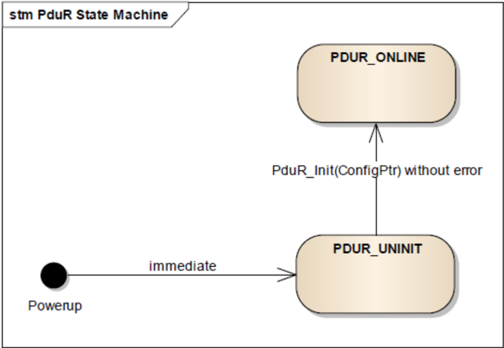

**PDU**路由器模块中只能存在状态机的一个实例。

**PDU**路由器模块需由[**PduR_StateType**](#724-pdur_statetype) 中定义的**PDUR_UNINIT** 和**PDUR_ONLINE** 两个状态组成。

**PDU**路由器模块在**PDU**路由器模块上电之后（即调用[**PduR_Init**](#7311-pdur_init) 函数之前）需处于**PDUR_UNINIT** 状态。

当**PDU**路由器通过函数[**PduR_Init**](#7311-pdur_init) 成功初始化之后，**PDU**路由器模块需切换到**PDUR_ONLINE** 状态。

**PDU**路由器模块需仅在其处于在线状态**PDUR_ONLINE** 时，才根据**PDU**路由器路由表执行**PDU** 的路由。

**PDU**路由器模块在其处于未初始化状态**PDUR_UNINIT** 时不得执行任何路由。

**PDU**路由器模块需在[**PduR_Init**](#7311-pdur_init) 函数中释放所有缓冲区。

函数[**PduR_Init**](#7311-pdur_init) 需将所有配置的默认值初始化到**PDU** 发送缓冲区。

如果**PDU**路由器模块尚未初始化（处于**PDUR_UNINIT** 状态），则除[**PduR_Init**](#7311-pdur_init) 和[**PduR_GetVersionInfo**](#7312-pdur_getversioninfo) 之外的所有函数在被调用时，需在**PduRDevErrorDetect** 启用的情况下通过**DET**报告错误[**PDUR_E_UNINIT**](#68-错误分类)。

#### 6.6. 路由路径组

路由路径组（**routing path group**）是一组可在运行时被禁用和启用的路由路径。这允许启用/禁用与某个网络或某类**PDU** 相关的一组路由路径。

路由路径组的启用和禁用通常由**BswM** 模块使用。

##### 6.6.1. PduRRoutingPathGroup 定义

对于[**PduRRoutingPathGroup**](#925-pdurroutingpathgroup)，适用以下规则：

1. 一个[**PduRRoutingPath**](#927-pdurroutingpath) 可以属于任何[**PduRRoutingPathGroup**](#925-pdurroutingpathgroup)。
2. 如果一个[**PduRRoutingPath**](#927-pdurroutingpath) 属于某个已启用的[**PduRRoutingPathGroup**](#925-pdurroutingpathgroup)，则它需被启用（见下文）。如果一个[**PduRRoutingPath**](#927-pdurroutingpath) 不属于任何[**PduRRoutingPathGroup**](#925-pdurroutingpathgroup)，则该[**PduRRoutingPath**](#927-pdurroutingpath) 始终被启用。

在下列任一条件下，[**PduRRoutingPath**](#927-pdurroutingpath) 需被启用：

* 它引用的至少一个[**PduRRoutingPathGroup**](#925-pdurroutingpathgroup) 被启用，
* 该[**PduRRoutingPath**](#927-pdurroutingpath) 完全没有引用任何[**PduRRoutingPathGroup**](#925-pdurroutingpathgroup)。

##### 6.6.2. PduRRoutingPathGroup 的初始化

如果某个[**PduRRoutingPath**](#927-pdurroutingpath) 所引用的所有[**PduRRoutingPathGroup**](#925-pdurroutingpathgroup) 都被禁用，则该[**PduRRoutingPath**](#927-pdurroutingpath) 需被禁用。

在**PDU**路由器模块初始化之后，所有**PduRIsEnabledAtInit** 设置为 TRUE 的[**PduRRoutingPathGroup**](#925-pdurroutingpathgroup) 需被启用。

所有**PduRIsEnabledAtInit** 设置为 FALSE 的[**PduRRoutingPathGroup**](#925-pdurroutingpathgroup) 需被禁用。

##### 6.6.3. PduRRoutingPathGroup 的切换

如果某个[**PduRRoutingPathGroup**](#925-pdurroutingpathgroup) 通过[**PduR_DisableRouting**](#7315-pdur_disablerouting) 被禁用，则**PDU**路由器模块需重新评估所有引用该受影响[**PduRRoutingPathGroup**](#925-pdurroutingpathgroup) 的[**PduRRoutingPath**](#927-pdurroutingpath)。

如果某个[**PduRRoutingPathGroup**](#925-pdurroutingpathgroup) 通过[**PduR_EnableRouting**](#7314-pdur_enablerouting) 被启用，则**PDU**路由器模块需重新评估所有引用该受影响[**PduRRoutingPathGroup**](#925-pdurroutingpathgroup) 的[**PduRRoutingPath**](#927-pdurroutingpath)。

如果在任何**API** 中使用了与已禁用路由路径相关联的**I-PDU ID**，则需（在可能的情况下）返回**E_NOT_OK**，且不执行任何其他动作。

**I-PDU** 路由路径组的启用需是立即生效的。

**示例：**随后的一次**PduR_&lt;Up&gt;Transmit** 调用将直接服务该**I-PDU**。

如果某个路由路径组被禁用（通过[**PduR_DisableRouting**](#7315-pdur_disablerouting) 调用），则**PduR** 需对属于该路由路径组的以下函数直接返回：

* **PduR_&lt;User:Up&gt;Transmit**，
* **PduR_&lt;User:Lo&gt;RxIndication**，
* **PduR_&lt;User:Lo&gt;TriggerTransmit**，
* **PduR_&lt;User:LoTp&gt;StartOfReception**，
* **PduR_&lt;User:LoTp&gt;CopyRxData**，
* **PduR_&lt;User:LoTp&gt;CopyTxData**。

如果该函数具有**Std_ReturnType**，则需返回**E_NOT_OK**。如果函数具有**BufReq_ReturnType**，则需返回**BUFREQ_E_NOT_OK**。

**注意：**这不影响**PduR_&lt;User:LoTp&gt;RxIndication**。

当与单个缓冲区（**PduRQueueDepth == 1**）相关联的路由路径被停止时，如果调用[**PduR_DisableRouting**](#7315-pdur_disablerouting) 时**initialize** 参数为 true，则相应的缓冲区需被设置为默认值；否则需保留当前值。

当与**FIFO**（**PduRQueueDepth &gt; 1**）相关联的路由路径被停止时，相应的**FIFO** 需被刷新，并且如果启用了**DET** 报告，**PduR** 需向**DET**报告[**PDUR_E_PDU_INSTANCES_LOST**](#68-错误分类)。

**示例：**如果执行了一次网关操作，**PDU**路由器模块已缓冲了一个**I-PDU** 并正在等待目标通信模块调用触发发送，则该缓冲区被清除，并向目标通信接口返回缓冲区不可用。

#### 6.7. 复杂驱动交互

除**AUTOSAR Com** 和**Dcm** 模块之外，复杂驱动（**CDD**）也可以作为**PduR** 的上层或下层模块。

**CDD** 对于**PduR** 是上层模块还是下层模块，可以通过[**PduRBswModules**](#923-pdurbswmodules) 配置的**PduRUpperModule** 或**PduRLowerModule** 配置参数来配置。

**CDD** 可以同时需要通信接口**API** 或传输协议**API**，具体取决于[**PduRBswModules**](#923-pdurbswmodules) 配置的**PduRCommunicationInterface** 和**PduRTransportProtocol** 配置参数。**PduR** 为**CDD** 交互提供的**API** 函数包含**CDD** 的服务前缀，该前缀由**apiServicePrefix** 配置参数指定。

**PduR** 为每个上层**CDD** 提供唯一的发送函数**PduR_&lt;Cdd&gt;Transmit**。当下层模块为某个由上层**CDD** 发送或接收的**PDU** 调用**PduR** 的回调函数时，**PduR** 调用**CDD** 相应的目标函数。

对于需要通信接口**API** 的下层**CDD**，**PduR** 提供一组唯一的通信接口**API** 函数：**PduR_&lt;Cdd&gt;RxIndication**，以及（如果已配置）**PduR_&lt;Cdd&gt;TxConfirmation** 和**PduR_&lt;Cdd&gt;TriggerTransmit**，请参见 [7.3.3](#733-与下层通信接口模块交互的可配置接口定义) 节。

对于需要传输协议**API** 的下层**CDD**，**PduR** 提供一组唯一的传输协议**API** 函数：**PduR_&lt;Cdd&gt;CopyRxData**、**PduR_&lt;Cdd&gt;CopyTxData**、**PduR_&lt;Cdd&gt;RxIndication**、**PduR_&lt;Cdd&gt;StartOfReception** 和**PduR_&lt;Cdd&gt;TxConfirmation**，请参见 [7.3.4](#734-与下层传输协议模块交互的可配置接口定义) 节。

当上层模块为某个由下层**CDD** 发送或接收的**PDU** 调用**PduR** 的**API** 函数时，**PduR** 调用**CDD** 相应的目标函数。

为确定某个**PDU** 是由**CDD** 发送还是接收，**PduR** 必须检查**EcuC** 模块中**PDU** 列表引用的来源：

* 如果路由路径的源**PDU** 引用了**PDU** 列表中的某个**PDU**，且该**PDU** 也被某个上层**CDD** 引用，则该**PDU** 由该**CDD** 发送。
* 如果路由路径的目标**PDU** 引用了**PDU** 列表中的某个**PDU**，且该**PDU** 也被某个上层**CDD** 引用，则该**PDU** 由该**CDD** 接收。
* 如果路由路径的源**PDU** 引用了**PDU** 列表中的某个**PDU**，且该**PDU** 也被某个下层**CDD** 引用，则该**PDU** 是从该**CDD** 接收的。
* 如果路由路径的目标**PDU** 引用了**PDU** 列表中的某个**PDU**，且该**PDU** 也被某个下层**CDD** 引用，则该**PDU** 通过该**CDD** 发送。

**PduR** 需使用**CDD** 供应商特定模块定义（**EcucModuleDef** 元素）的**apiServicePrefix** 属性来替换**GenericComServices API** 的**&lt;Lo&gt;**、**&lt;Up&gt;** 和**&lt;LoTp&gt;** 标记。**CDD** 的供应商特定模块定义可以通过配置参数**PduRBswModuleRef** 间接访问，该参数引用**CDD** 具体配置的顶层元素（即**EcucModuleConfigurationValues** 元素），而该元素引用**CDD** 的供应商特定模块定义（**EcucModuleDef** 元素）。

#### 6.8. 错误分类

详细信息请参见 [2, SWS BSW General] 的第 [7.2](#72-类型定义) 章“错误分类（**Error classification**）”。

请注意，**PduR** 不报告生产错误（**production errors**）。

##### 6.8.1. 开发错误

表7.1：**PduR** 模块的开发错误定义

| 错误类型 | 相关错误码 | 错误值 |
| --- | --- | --- |
| 无效的配置指针 | [PDUR_E_INIT_FAILED](#68-错误分类) | 0x00 |
| 在模块未初始化的情况下使用 API 服务（`[PduR_GetVersionInfo](#7312-pdur_getversioninfo)` 除外），或在 **PDUR_UNINIT** 之外的状态调用 `[PduR_Init](#7311-pdur_init)` | [PDUR_E_UNINIT](#68-错误分类) | 0x01 |
| 无效的 PDU 标识符 | [PDUR_E_PDU_ID_INVALID](#68-错误分类) | 0x02 |
| 传递给 `[PduR_EnableRouting](#7314-pdur_enablerouting)` 或 `[PduR_DisableRouting](#7315-pdur_disablerouting)` 函数的路由表无效 | [PDUR_E_ROUTING_PATH_GROUP_ID_INVALID](#68-错误分类) | 0x08 |
| 传入了空指针作为参数 | [PDUR_E_PARAM_POINTER](#68-错误分类) | 0x09 |

##### 6.8.2. 运行时错误

表7.2：**PduR** 模块的运行时错误定义

| 错误类型 | 相关错误码 | 错误值 |
| --- | --- | --- |
| 在网关操作的情况下，**TP** 模块拒绝了具有有效 PDU 标识符的发送请求 | [PDUR_E_TP_GW_TX_REQ_REJECTED](#68-错误分类) | 0x03 |
| PDU 实例丢失（网关操作中的缓冲区超限） | [PDUR_E_PDU_INSTANCES_LOST](#68-错误分类) | 0x0a |

##### 6.8.4. 生产错误

表7.3：**PduR** 的生产错误定义

| 项 | 内容 |
| --- | --- |
| 错误名称（Error Name） | [PDUR_E_ROUTING_PATH_BUFFER_OVERFLOW](#68-错误分类) |
| 简要描述（Short Description） | 当 `[PduRBuffer](#9212-pdurbuffer)` 的整体占用情况发生变化时，**PDU**路由器需向**Dem**报告生产错误 `PDUR_ROUTING_PATH_BUFFER_OVERFLOW`。 |
| 检测准则（Detection Criteria） | FAIL——每个 `PduRTxBuffer` 均被占用；PASS——至少有一个 `PduRTxBuffer` 可用 |
| 次要参数（Secondary Parameters） | FAIL 和/或 PASS 检测处于激活状态的条件：无 |
| 所需时间（Time Required） | 不适用。（**PDU**路由器中没有超时监控） |
| 监控频率（Monitor Frequency） | 当调用与 `[PduRRoutingPath](#927-pdurroutingpath)` 相关的**PduR API** 时 |

#### 6.9. API 参数检查

如果启用了开发错误检测，某个**PDU** 标识符不在指定范围内，且该**PDU** 标识符被配置为由**PDU**路由器模块使用，则在**PduRDevErrorDetect** 启用的情况下，**PDU**路由器模块需向**DET**模块报告错误[**PDUR_E_PDU_ID_INVALID**](#68-错误分类)。

#### 6.10. 多核分布

**PduR** 模块分布到所有分区上，并作为任何跨分区（跨核）路由路径的中央跨分区调度器，主要用于网关和多播用例。

有关分布原则的进一步说明，请参见 [8, Guide to BSW Distribution] 中的“通信栈分布（**ComStack Distribution**）”一章。

**PDU**路由器模块配置生成器需检查所有路由路径实例中每个源/目标**I-PDU** 的分区分配。

如果存在针对相应模块的**EcucPduDedicatedPartition** 容器（由**EcucPduDedicatedPartitionBswModuleRef** 引用），则**PDU**路由器模块配置生成器需采用该专用分区引用。

在不存在针对相应模块的模块专用分区引用（**EcucPduDedicatedPartition**）的情况下，**PDU**路由器模块配置生成器需采用**I-PDU** 的默认分区引用。

如果所连接的两个**I-PDU**（源和目标）被分配到同一分区，则**PDU**路由器模块配置生成器需将该路由路径作为分区内通信处理。

如果所连接的源和目标**I-PDU** 被分配到不同分区，则**PDU**路由器模块配置生成器需将该路由路径作为跨分区通信处理。

在上层和/或下层位于不同分区的配置中，**PduR** 可以为每个**ECUC** 分区提供一个初始化函数。

**PDU**路由器需仅接受那些所包含的[**PduRRoutingPath**](#927-pdurroutingpath) 的所有目标**I-PDU** 都被分配到同一分区的[**PduRRoutingPathGroup**](#925-pdurroutingpathgroup)。

##### 6.10.1. 分区内路由路径

即使存在位于不同分区的上层和/或下层，分区内通信的行为也不应被改变。

对于从上层模块进行**TriggerTransmit** 发送的路由路径，**PDU**路由器需仅接受分区内的路由。

##### 6.10.2. 跨分区路由路径

本章描述**PduR** 应如何处理跨分区路由路径。这意味着目标**PDU** 被映射到与相应源**Pdu** 不同的**ECUC** 分区。

**PduR** 需在数据和调用上下文方面执行实际的跨分区通信。

**注意：**[8, Guide to BSW Distribution] 在其“多核系统中的 BSW 分布（**BSW Distribution in Multi-Core Systems**）”一章中描述了在多核环境中解决上下文切换（**context switch**）的方法。

###### 6.10.2.1. 上层模块交互

对于跨分区路由路径，函数**PduR_&lt;User:Up&gt;Transmit** 的返回值需反映**PduR** 本身是否接受了该发送请求。

对于跨分区路由路径，函数**PduR_&lt;User:Up&gt;Transmit** 的调用需仅执行分配到同一**ECUC** 分区的代码。**PduR** 不得在**PduR_&lt;User:Up&gt;Transmit** 的调用上下文中调用**&lt;Provider:Lo&gt;_Transmit**。**PduR** 需在**&lt;Provider:Lo&gt;** 模块的**ECUC** 分区上下文中调用**&lt;Provider:Lo&gt;_Transmit**（实际上是由**PduRDestPduRef** 的**EcucPduDefaultPartitionRef** 或**EcucPduDedicatedPartitionRef** 所定义的**ECUC** 分区）。

对于跨分区路由路径，函数**PduR_&lt;User:Up&gt;CancelTransmit** 的返回值需反映**PduR** 本身是否接受了该发送取消请求。

对于跨分区路由路径，函数**PduR_&lt;User:Up&gt;CancelTransmit** 的调用需仅执行分配到同一**ECUC** 分区的代码。**PduR** 不得在**PduR_&lt;User:Up&gt;CancelTransmit** 的调用上下文中调用**&lt;Provider:Lo/LoTp&gt;_CancelTransmit**。**PduR** 需在**&lt;Provider:Lo/LoTp&gt;** 模块的**ECUC** 分区上下文中调用**&lt;Provider:Lo/LoTp&gt;_CancelTransmit**（实际上是由**PduRDestPduRef** 的**EcucPduDefaultPartitionRef** 或**EcucPduDedicatedPartitionRef** 所定义的**ECUC** 分区上下文）。

对于跨分区路由路径，函数**PduR_&lt;User:Up&gt;CancelReceive** 的返回值需反映**PduR** 本身是否接受了该接收取消请求。

对于跨分区路由路径，函数**PduR_&lt;User:Up&gt;CancelReceive** 的调用需仅执行分配到同一**ECUC** 分区的代码。**PduR** 不得在**PduR_&lt;User:Up&gt;CancelReceive** 的调用上下文中调用**&lt;Provider:LoTp&gt;_CancelReceive**。**PduR** 需在**&lt;Provider:LoTp&gt;** 模块的**ECUC** 分区上下文中调用**&lt;Provider:LoTp&gt;_CancelReceive**（实际上是由**PduRSrcPduRef** 的**EcucPduDefaultPartitionRef** 或**EcucPduDedicatedPartitionRef** 所定义的**ECUC** 分区上下文）。

###### 6.10.2.2. 下层通信接口模块交互

对于跨分区路由路径，函数**PduR_&lt;User:Lo&gt;RxIndication** 的调用需仅执行分配到同一**ECUC** 分区的代码。**PduR** 不得在**PduR_&lt;User:Lo&gt;RxIndication** 的调用上下文中调用**&lt;Provider:Up&gt;_RxIndication**。**PduR** 需在**&lt;Provider:Up&gt;** 模块的**ECUC** 分区上下文中调用**&lt;Provider:Up&gt;_RxIndication**（实际上是由**PduRSrcPduRef** 的**EcucPduDefaultPartitionRef** 或**EcucPduDedicatedPartitionRef** 所定义的**ECUC** 分区上下文）。

对于跨分区路由路径，函数**PduR_&lt;User:Lo&gt;TxConfirmation** 的调用需仅执行分配到同一**ECUC** 分区的代码。**PduR** 不得在**PduR_&lt;User:Lo&gt;TxConfirmation** 的调用上下文中调用**&lt;Provider:Up&gt;_TxConfirmation**。**PduR** 需在**&lt;Provider:Up&gt;** 模块的**ECUC** 分区上下文中调用**&lt;Provider:Up&gt;_TxConfirmation**（实际上是由**PduRSrcPduRef** 的**EcucPduDefaultPartitionRef** 或**EcucPduDedicatedPartitionRef** 所定义的**ECUC** 分区上下文）。

###### 6.10.2.3. 下层传输协议模块交互

对于跨分区路由路径，函数**PduR_&lt;User:LoTp&gt;CopyRxData** 的调用需仅执行分配到同一**ECUC** 分区的代码。**PduR** 不得在**PduR_&lt;User:LoTp&gt;CopyRxData** 的调用上下文中调用**&lt;Provider:UpTp&gt;_CopyRxData**。**PduR** 需在**&lt;Provider:UpTp&gt;** 模块的**ECUC** 分区上下文中调用**&lt;Provider:UpTp&gt;_CopyRxData**（实际上是由**PduRDestPduRef** 的**EcucPduDefaultPartitionRef** 或**EcucPduDedicatedPartitionRef** 所定义的**ECUC** 分区上下文）。

对于跨分区路由路径，函数**PduR_&lt;User:LoTp&gt;CopyRxData** 的返回值需反映**PduR** 的状态，而不是**Provider:UpTp** 的状态。

对于跨分区路由路径，函数**PduR_&lt;User:LoTp&gt;RxIndication** 的调用需仅执行分配到同一**ECUC** 分区的代码。**PduR** 不得在**PduR_&lt;User:LoTp&gt;RxIndication** 的调用上下文中调用**&lt;Provider:UpTp&gt;_RxIndication**。**PduR** 需在**&lt;Provider:UpTp&gt;** 模块的**ECUC** 分区上下文中调用**&lt;Provider:UpTp&gt;_RxIndication**（实际上是由**PduRDestPduRef** 的**EcucPduDefaultPartitionRef** 或**EcucPduDedicatedPartitionRef** 所定义的**ECUC** 分区上下文）。

对于跨分区路由路径，函数**PduR_&lt;User:LoTp&gt;StartOfReception** 的调用需仅执行分配到同一**ECUC** 分区的代码。**PduR** 不得在**PduR_&lt;User:LoTp&gt;StartOfReception** 的调用上下文中调用**&lt;Provider:UpTp&gt;_StartOfReception**。**PduR** 需在**&lt;Provider:UpTp&gt;** 模块的**ECUC** 分区上下文中调用**&lt;Provider:UpTp&gt;_StartOfReception**（实际上是由**PduRDestPduRef** 的**EcucPduDefaultPartitionRef** 或**EcucPduDedicatedPartitionRef** 所定义的**ECUC** 分区上下文）。

对于跨分区路由路径，函数**PduR_&lt;User:LoTp&gt;StartOfReception** 的返回值需反映**PduR** 的状态，而不是**Provider:UpTp** 的状态。

对于跨分区路由路径，函数**PduR_&lt;User:LoTp&gt;CopyTxData** 的调用需仅执行分配到同一**ECUC** 分区的代码。**PduR** 不得在**PduR_&lt;User:LoTp&gt;CopyTxData** 的调用上下文中调用**&lt;Provider:UpTp&gt;_CopyTxData**。**PduR** 需在**&lt;Provider:UpTp&gt;** 模块的**ECUC** 分区上下文中调用**&lt;Provider:UpTp&gt;_CopyTxData**（实际上是由**PduRSrcPduRef** 的**EcucPduDefaultPartitionRef** 或**EcucPduDedicatedPartitionRef** 所定义的**ECUC** 分区上下文）。

对于跨分区路由路径，函数**PduR_&lt;User:LoTp&gt;CopyTxData** 的返回值需反映**PduR** 的状态，而不是**Provider:UpTp** 的状态。

对于跨分区路由路径，函数**PduR_&lt;User:LoTp&gt;TxConfirmation** 的调用需仅执行分配到同一**ECUC** 分区的代码。**PduR** 不得在**PduR_&lt;User:LoTp&gt;TxConfirmation** 的调用上下文中调用**&lt;Provider:UpTp&gt;_TxConfirmation**。**PduR** 需在**&lt;Provider:UpTp&gt;** 模块的**ECUC** 分区上下文中调用**&lt;Provider:UpTp&gt;_TxConfirmation**（实际上是由**PduRSrcPduRef** 的**EcucPduDefaultPartitionRef** 或**EcucPduDedicatedPartitionRef** 所定义的**ECUC** 分区上下文）。

对于跨分区的传输协议模块交互，**PduR** 需作为**&lt;User:Lo/UpTp&gt;** 与**&lt;Provider:Lo/UpTp&gt;** 路由路径之间的中继，并通过中间缓冲解耦调用上下文。

**注意：**源总线上的接收行为取决于**PduR** 的配置（**PduRTpThreshold** / **PduRSourcePduBlockSize**）。

**PduR** 需将跨分区的传输协议模块交互视为网关路由。

**注意：**上层和/或下层传输协议层位于不同分区的配置，将影响时序（延迟），并可能影响总线上的行为（在**&lt;User:Lo/UpTp&gt;** 未准备好接收的情况下**Rx** 发送的延迟中止）。如果无法容忍这一点，则所有参与的模块必须映射到同一分区。

###### 6.10.2.4. 通信接口网关

对于跨分区路由路径，以下函数的调用需仅执行分配到同一**ECUC** 分区的代码：

* **PduR_&lt;SrcLo&gt;RxIndication**，
* **PduR_&lt;DstLo&gt;TriggerTransmit**，
* **PduR_&lt;DstLo&gt;TxConfirmation**。

**PduR** 不得在**PduR_&lt;SrcLo&gt;RxIndication** 的调用上下文中调用**&lt;DstLo&gt;_Transmit**。**PduR** 需在**&lt;DstLo&gt;** 模块的**ECUC** 分区上下文中调用**&lt;DstLo&gt;_Transmit**（实际上是由**PduRDestPduRef** 的**EcucPduDefaultPartitionRef** 或**EcucPduDedicatedPartitionRef** 所定义的**ECUC** 分区上下文）。

###### 6.10.2.5. 传输协议网关

对于跨分区路由路径，以下函数的调用需仅执行分配到同一**ECUC** 分区的代码：

* **PduR_&lt;SrcLoTp&gt;StartOfReception**，
* **PduR_&lt;SrcLoTp&gt;CopyRxData**，
* **PduR_&lt;DstLoTp&gt;CopyTxData**，
* **PduR_&lt;SrcLoTp&gt;RxIndication**，
* **PduR_&lt;DstLoTp&gt;TxConfirmation**。

**PduR** 不得在**PduR_&lt;SrcLoTp&gt;CopyRxData**、**PduR_&lt;DstLoTp&gt;TxConfirmation** 的调用上下文中调用**&lt;DstLoTp&gt;_Transmit**。**PduR** 需在**&lt;DstLoTp&gt;** 模块的**ECUC** 分区上下文中调用**&lt;DstLoTp&gt;_Transmit**（实际上是由**PduRDestPduRef** 的**EcucPduDefaultPartitionRef** 或**EcucPduDedicatedPartitionRef** 所定义的**ECUC** 分区上下文）。

对于跨分区路由路径，**PduR** 需允许以下**API** 对从不同**ECUC** 分区并发调用：

* **PduR_&lt;SrcLoTp&gt;CopyRxData** 与**PduR_&lt;DstLoTp&gt;CopyTxData**，
* **PduR_&lt;SrcLoTp&gt;RxIndication** 与**PduR_&lt;DstLoTp&gt;CopyTxData**，
* **PduR_&lt;SrcLoTp&gt;CopyRxData** 与**PduR_&lt;DstLoTp&gt;TxConfirmation**，
* **PduR_&lt;SrcLoTp&gt;RxIndication** 与**PduR_&lt;DstLoTp&gt;TxConfirmation**。

## 7. API规范

以下段落规定了**PDU**路由器模块的**API**。

### 7.1. 导入的类型

本章列出了从以下模块导入的所有类型。

| 模块 | 头文件 | 导入的类型 |
| --- | --- | --- |
| ComStack_Types | ComStack_Types.h | BufReq_ReturnType |
| ComStack_Types | ComStack_Types.h | PduIdType |
| ComStack_Types | ComStack_Types.h | PduInfoType |
| ComStack_Types | ComStack_Types.h | PduLengthType |
| ComStack_Types | ComStack_Types.h | RetryInfoType |
| ComStack_Types | ComStack_Types.h | TpDataStateType |
| Std | Std_Types.h | Std_ReturnType |
| Std | Std_Types.h | Std_VersionInfoType |

### 7.2. 类型定义

#### 7.2.1. PduR_PBConfigType

构建后（**post-build**）配置承担两种功能：

* 构建后可选择（**Post-build selectable**）：**ECU** 中驻留多于一个配置，并在**PDU**路由器模块初始化时选择其中一个；
* 构建后可加载（**Post-build loadable**）：**ECU** 中驻留一个配置，该配置可在编译期之后被重新编程。

基本上不存在将可选与可加载混用的限制。通常构建后可加载配置位于其自己的闪存扇区中，因此可以在不影响其他模块/应用的情况下重新编程。

**说明**: 包含**PDU**路由器构建后配置数据的数据结构。可通过**PduR.h**获得。

```C
typedef struct PduR_PBConfigType {
  ...
} PduR_PBConfigType;
```

类型**PduR_PBConfigType**是一个外部数据结构，包含**PDU**路由器模块的构建后配置数据，其实现在**PduR_PBcfg.c**中（请参见 [5.5.1](#551-代码文件结构) 节和 [6.9](#69-api-参数检查) 节）。

#### 7.2.2. PduR_PBConfigIdType

该类型由[**PduR_GetConfigurationId**](#7313-pdur_getconfigurationid) API 返回。

**说明**: 当前用于路由**I-PDU** 的构建后配置的标识。一个**ECU** 可以包含多个配置（构建后可选择），每个配置具有唯一的 ID。派生自**uint16**。可通过**PduR.h**获得。

```C
typedef uint16 PduR_PBConfigIdType;
```

#### 7.2.3. PduR_RoutingPathGroupIdType

路由路径组 ID 用于标识一组特定的路由路径。由于一个[**PduRRoutingPath**](#927-pdurroutingpath) 连接一个源**I-PDU** 和一个目标**I-PDU**，因此可以按网络或按**PDU** 类型启用/禁用路由。

**说明**: 路由表（**Routing Table**）的标识。派生自**uint16**。可通过**PduR.h**获得。

```C
typedef uint16 PduR_RoutingPathGroupIdType;
```

#### 7.2.4. PduR_StateType

**说明**: **PDU**路由器模块的状态。可通过**PduR.h**获得。

| 取值 | 说明 |
| --- | --- |
| PDUR_UNINIT | **PDU**路由器未初始化 |
| PDUR_ONLINE | **PDU**路由器已成功初始化 |

```C
typedef enum {
  PDUR_UNINIT,
  PDUR_ONLINE
} PduR_StateType;
```

### 7.3. 函数定义

#### 7.3.1. PDU 路由器提供的通用函数

##### 7.3.1.1. PduR_Init

**说明**: 初始化**PDU**路由器。本服务为同步调用，不可重入。参数 ConfigPtr（in）：指向构建后配置的指针。该服务无返回值。可通过**PduR.h**获得。

```C
void PduR_Init ( const PduR_PBConfigType* ConfigPtr )
```

集成说明：为避免以未初始化状态调用**PDU**路由器模块所导致的问题，**PDU**路由器模块必须在所连接的模块之前完成初始化。

初始化之后，所有**I-PDU** 路由组需按照启动时使能的配置参数被使能。

**注意：**空指针检查在 [2, SWS BSW General] 中规定。

##### 7.3.1.2. PduR_GetVersionInfo

**说明**: 返回本模块的版本信息。本服务为同步调用，可重入。参数 versionInfo（out）：指向用于存放本模块版本信息的位置的指针。该服务无返回值。可通过**PduR.h**获得。

```C
void PduR_GetVersionInfo ( Std_VersionInfoType* versionInfo )
```

##### 7.3.1.3. PduR_GetConfigurationId

**说明**: 返回**PDU**路由器构建后配置的唯一标识符。本服务为同步调用，可重入。返回值 [PduR_PBConfigIdType](#722-pdur_pbconfigidtype)：构建后配置的标识符。可通过**PduR.h**获得。

```C
PduR_PBConfigIdType PduR_GetConfigurationId ( void )
```

函数**PduR_GetConfigurationId**需返回**PDU**路由器模块构建后配置的唯一标识符。

##### 7.3.1.4. PduR_EnableRouting

**说明**: 使能一个路由路径组。本服务为同步调用，可重入。参数 id（in）：路由路径组的标识，路由路径组在**PDU**路由器配置中定义。该服务无返回值。可通过**PduR.h**获得。

```C
void PduR_EnableRouting ( PduR_RoutingPathGroupIdType id )
```

如果路由路径组 ID 不存在，则**PDU**路由器模块需不作任何动作直接返回。

如果路由路径组 ID 不存在且**PduRDevErrorDetect** 已启用，则**PDU**路由器模块需报告[**PDUR_E_ROUTING_PATH_GROUP_ID_INVALID**](#68-错误分类)。

如果路由路径组存在且该路由路径组已处于使能状态，则**PDU**路由器模块需不作任何动作直接返回。

##### 7.3.1.5. PduR_DisableRouting

**说明**: 禁用一个路由路径组。本服务为同步调用，可重入。参数 id（in）：路由路径组的标识，路由路径组在**PDU**路由器配置中定义；参数 initialize（in）：true 表示将单缓冲区初始化为默认值，false 表示保留单缓冲区的当前值。该服务无返回值。可通过**PduR.h**获得。

```C
void PduR_DisableRouting ( PduR_RoutingPathGroupIdType id, boolean initialize )
```

如果路由路径组 ID 不存在，则**PDU**路由器模块需不作任何动作直接返回。

如果路由路径组 ID 不存在且**PduRDevErrorDetect** 已启用，则**PDU**路由器模块需报告[**PDUR_E_ROUTING_PATH_GROUP_ID_INVALID**](#68-错误分类)。

如果路由路径组存在且该路由路径组已处于禁用状态，则**PDU**路由器模块需不作任何动作直接返回。

#### 7.3.2. 与上层模块交互的可配置接口定义

由于**API** 描述现在采用通用方式，上层**API** 函数的**serviceId** 也是通用的。为了区分多个上层，**PduR** 在本节所列**API** 发起的**Det** 调用中，使用上层模块的**moduleId** 作为**instanceId** 参数。

##### 7.3.2.1. PduR_&lt;User:Up&gt;Transmit

**说明**: 请求发送一个**PDU**。本服务为同步调用，对不同**PduId** 可重入，对同一**PduId** 不可重入。参数 TxPduId（in）：待发送**PDU** 的标识符；参数 PduInfoPtr（in）：**PDU** 数据的长度与指针，以及**MetaData** 的指针。返回值 Std_ReturnType：**E_OK** 表示发送请求已被接受，**E_NOT_OK** 表示发送请求未被接受。可通过**PduR_&lt;module&gt;.h**获得。

```C
Std_ReturnType PduR_<User:Up>Transmit ( PduIdType TxPduId, const PduInfoType* PduInfoPtr )
```

##### 7.3.2.2. PduR_&lt;User:Up&gt;CancelTransmit

**说明**: 请求取消下层通信模块中正在进行的**PDU** 发送。本服务为同步调用，对不同**PduId** 可重入，对同一**PduId** 不可重入。参数 TxPduId（in）：待取消**PDU** 的标识。返回值 Std_ReturnType：**E_OK** 表示目标模块已成功执行取消，**E_NOT_OK** 表示取消被目标模块拒绝。可通过**PduR_&lt;module&gt;.h**获得。

```C
Std_ReturnType PduR_<User:Up>CancelTransmit ( PduIdType TxPduId )
```

##### 7.3.2.3. PduR_&lt;User:Up&gt;CancelReceive

**说明**: 请求取消下层传输协议模块中正在进行的**PDU** 接收。本服务为同步调用，不可重入。参数 RxPduId（in）：待取消**PDU** 的标识。返回值 Std_ReturnType：**E_OK** 表示目标模块已成功执行取消，**E_NOT_OK** 表示取消被目标模块拒绝。可通过**PduR_&lt;module&gt;.h**获得。

```C
Std_ReturnType PduR_<User:Up>CancelReceive ( PduIdType RxPduId )
```

#### 7.3.3. 与下层通信接口模块交互的可配置接口定义

由于**API** 描述现在采用通用方式，下层**API** 函数的**serviceId** 也是通用的。为了区分多个下层，**PduR** 在本节所列**API** 发起的**Det** 调用中，使用下层模块的**moduleId** 作为**instanceId** 参数。

##### 7.3.3.1. PduR_&lt;User:Lo&gt;RxIndication

**说明**: 从下层通信接口模块指示接收到一个**PDU**。本服务为同步调用，对不同**PduId** 可重入，对同一**PduId** 不可重入。参数 RxPduId（in）：所接收**PDU** 的 ID；参数 PduInfoPtr（in）：包含所接收**PDU** 的长度（**SduLength**）、指向包含该**PDU** 的缓冲区（**SduDataPtr**）的指针，以及与该**PDU** 相关的**MetaData**。该服务无返回值。可通过**PduR_&lt;module&gt;.h**获得。

```C
void PduR_<User:Lo>RxIndication ( PduIdType RxPduId, const PduInfoType* PduInfoPtr )
```

##### 7.3.3.2. PduR_&lt;User:Lo&gt;TxConfirmation

**说明**: 下层通信接口模块确认一个**PDU** 的发送，或确认**PDU** 发送失败。本服务为同步调用，对不同**PduId** 可重入，对同一**PduId** 不可重入。参数 TxPduId（in）：已发送**PDU** 的 ID；参数 result（in）：**E_OK** 表示**PDU** 已发送，**E_NOT_OK** 表示**PDU** 发送失败。该服务无返回值。可通过**PduR_&lt;module&gt;.h**获得。

```C
void PduR_<User:Lo>TxConfirmation ( PduIdType TxPduId, Std_ReturnType result )
```

##### 7.3.3.3. PduR_&lt;User:Lo&gt;TriggerTransmit

**说明**: 上层模块（被调用的模块）需检查可用数据是否适合**PduInfoPtr-&gt;SduLength** 所报告的缓冲区大小。如果适合，则需将其数据复制到**PduInfoPtr-&gt;SduDataPtr** 提供的缓冲区，并在**PduInfoPtr-&gt;SduLength** 中更新实际复制的数据长度；如果不适合，则需返回**E_NOT_OK** 且不改变**PduInfoPtr**。本服务为同步调用，对不同**PduId** 可重入，对同一**PduId** 不可重入。参数 TxPduId（in）：被请求发送的**SDU** 的 ID；参数 PduInfoPtr（inout）：包含指向待复制**SDU** 数据的缓冲区（**SduDataPtr**）的指针，以及**SduLength** 中的可用缓冲区大小，返回时该服务在**SduLength** 中指示所复制**SDU** 数据的长度。返回值 Std_ReturnType：**E_OK** 表示**SDU** 已被复制且**SduLength** 指示所复制的字节数，**E_NOT_OK** 表示未复制任何**SDU** 数据，此时不得使用**PduInfoPtr**，因为它可能包含空指针或指向无效数据。可通过**PduR_&lt;module&gt;.h**获得。

```C
Std_ReturnType PduR_<User:Lo>TriggerTransmit ( PduIdType TxPduId, PduInfoType* PduInfoPtr )
```

#### 7.3.4. 与下层传输协议模块交互的可配置接口定义

由于**API** 描述现在采用通用方式，下层传输协议**API** 函数的**serviceId** 也是通用的。为了区分多个下层，**PduR** 在本节所列**API** 发起的**Det** 调用中，使用下层模块的**moduleId** 作为**instanceId** 参数。

##### 7.3.4.1. PduR_&lt;User:LoTp&gt;CopyRxData

**说明**: 调用此函数以向上层提供**I-PDU** 段（**N-PDU**）的已接收数据。每次调用此函数都提供**I-PDU** 数据的下一部分。剩余缓冲区的大小被写入**bufferSizePtr** 所指示的位置。本服务为同步调用，可重入。参数 id（in）：所接收**I-PDU** 的标识；参数 info（in）：提供源缓冲区（**SduDataPtr**）和待复制的字节数（**SduLength**），**SduLength** 为 0 可用于查询上层模块中当前可用的缓冲区大小，此时**SduDataPtr** 可以为**NULL_PTR**；参数 bufferSizePtr（out）：数据复制完成后的可用接收缓冲区。返回值 BufReq_ReturnType：**BUFREQ_OK** 表示数据复制成功，**BUFREQ_E_NOT_OK** 表示因发生错误而未复制数据。可通过**PduR_&lt;module&gt;.h**获得。

```C
BufReq_ReturnType PduR_<User:LoTp>CopyRxData ( PduIdType id, const PduInfoType* info, PduLengthType* bufferSizePtr )
```

##### 7.3.4.2. PduR_&lt;User:LoTp&gt;RxIndication

**说明**: 在通过**TP API** 接收到一个**I-PDU** 之后调用，结果指示发送是否成功。本服务为同步调用，可重入。参数 id（in）：所接收**I-PDU** 的标识；参数 result（in）：**E_OK** 表示**PDU** 已接收，**E_NOT_OK** 表示**PDU** 接收失败。该服务无返回值。可通过**PduR_&lt;module&gt;.h**获得。

```C
void PduR_<User:LoTp>RxIndication ( PduIdType id, Std_ReturnType result )
```

##### 7.3.4.3. PduR_&lt;User:LoTp&gt;StartOfReception

**说明**: 在开始接收一个**N-SDU** 时调用此函数。该**N-SDU** 可能被分片为多个**N-PDU**（**FF** 及一个或多个后续**CF**），也可能由单个**N-PDU**（**SF**）组成。当以等于 0 的**TpSduLength** 调用时，该服务需提供当前可用的最大缓冲区大小。本服务为同步调用，可重入。参数 id（in）：**I-PDU** 的标识；参数 info（in）：指向**PduInfoType** 结构的指针，包含传输协议**I-PDU** 接收的首帧或单帧的有效载荷数据（不含协议信息）和有效载荷长度，以及与该**PDU** 相关的**MetaData**，如果既无首帧/单帧数据也无**MetaData**，则该参数被设置为**NULL_PTR**；参数 TpSduLength（in）：待接收**N-SDU** 的总长度；参数 bufferSizePtr（out）：接收模块中的可用接收缓冲区，该参数将用于计算传输协议模块中的块大小（**BS**）。返回值 BufReq_ReturnType：**BUFREQ_OK** 表示连接已被接受，**bufferSizePtr** 指示可用接收缓冲区，接收继续；如果不存在所需大小的缓冲区，则需通过**bufferSizePtr** 指示接收缓冲区大小为 0。**BUFREQ_E_NOT_OK** 表示连接已被拒绝，接收中止，**bufferSizePtr** 保持不变。**BUFREQ_E_OVFL** 表示无法提供所需长度的缓冲区，接收中止，**bufferSizePtr** 保持不变。可通过**PduR_&lt;module&gt;.h**获得。

```C
BufReq_ReturnType PduR_<User:LoTp>StartOfReception ( PduIdType id, const PduInfoType* info, PduLengthType TpSduLength, PduLengthType* bufferSizePtr )
```

##### 7.3.4.4. PduR_&lt;User:LoTp&gt;CopyTxData

**说明**: 调用此函数以获取**I-PDU** 段（**N-PDU**）的待发送数据。每次调用此函数都提供**I-PDU** 数据的下一部分，除非 **retry-&gt;TpDataState** 为 **TP_DATARETRY**，此时该函数从**retry-&gt;TxTpDataCnt** 所指示的、相对当前位置的偏移处重新开始复制数据。剩余数据的大小被写入**availableDataPtr** 所指示的位置。本服务为同步调用，可重入。参数 id（in）：所发送**I-PDU** 的标识；参数 info（in）：提供目标缓冲区（**SduDataPtr**）和待复制的字节数（**SduLength**），如果可用的发送数据不足，则上层模块不复制任何数据并返回**BUFREQ_E_BUSY**，下层模块可以重试该调用；**SduLength** 为 0 可用于指示**retry** 参数中的状态变化，或查询上层模块中当前可用的数据量，此时**SduDataPtr** 可以为**NULL_PTR**；参数 retry（in）：该参数用于确认已发送的数据，或在发送出现问题之后重传数据。如果**retry** 参数为**NULL_PTR**，表示数据复制之后可以立即从缓冲区中移除。否则，**retry** 参数必须指向有效的**RetryInfoType** 元素：如果**TpDataState** 为**TP_CONFPENDING**，则先前复制的数据必须保留在**TP** 缓冲区中以供错误恢复使用；**TP_DATACONF** 表示本次调用之前复制的所有数据均已被确认并可从**TP** 缓冲区中移除，本次**API** 调用所复制的数据不在此列，将在之后被确认；**TP_DATARETRY** 表示本次**API** 调用需复制先前已复制的数据，以便从错误中恢复，此时**TxTpDataCnt** 指定相对当前数据复制位置的字节偏移。参数 availableDataPtr（out）：指示上层模块**Tx** 缓冲区中剩余的可用字节数，**availableDataPtr** 可供支持动态有效载荷长度的**TP** 模块（例如**FrIsoTp**）用来确定后续**CF** 的大小。返回值 BufReq_ReturnType：**BUFREQ_OK** 表示数据已按请求完全复制到发送缓冲区；**BUFREQ_E_BUSY** 表示由于所需的**Tx** 数据量不可用而无法满足请求，下层模块可以稍后重试该调用，未复制任何数据；**BUFREQ_E_NOT_OK** 表示未复制数据，请求失败。可通过**PduR_&lt;module&gt;.h**获得。

```C
BufReq_ReturnType PduR_<User:LoTp>CopyTxData ( PduIdType id, const PduInfoType* info, const RetryInfoType* retry, PduLengthType* availableDataPtr )
```

##### 7.3.4.5. PduR_&lt;User:LoTp&gt;TxConfirmation

**说明**: 在**I-PDU** 已在其网络上发送之后调用此函数，结果指示发送是否成功。本服务为同步调用，可重入。参数 id（in）：所发送**I-PDU** 的标识；参数 result（in）：**E_OK** 表示**PDU** 已发送，**E_NOT_OK** 表示**PDU** 发送失败。该服务无返回值。可通过**PduR_&lt;module&gt;.h**获得。

```C
void PduR_<User:LoTp>TxConfirmation ( PduIdType id, Std_ReturnType result )
```

### 7.4. 调度函数

由于**PDU**路由器的任何操作都由相邻的通信模块触发，因此**PDU**路由器不需要调度函数。

### 7.5. 期望接口

本章列出了从其他模块所需的全部接口。

**PDU**路由器模块被建模为一个可与不同上层和下层模块对接的通用模块。建模该通用方式所采用的方法是设置一个名为**GenericComServices** 的虚拟模块。该虚拟模块包含一组**API**，**PDU**路由器将在上层或下层模块中调用这些**API**。这些**API** 以通用方式包含标签**&lt;Lo&gt;**、**&lt;Up&gt;** 和**&lt;LoTp&gt;**，这些标签被替换为对接的模块。该标签由[**PduRBswModules**](#923-pdurbswmodules) 容器中使用**PduRBswModuleRef** 引用参数的配置来设置。

#### 7.5.1. 必需接口

**PDU**路由器不需要必需接口。所需的**API** 函数取决于配置。

| API 函数 | 头文件 | 说明 |
| --- | --- | --- |
| Det_ReportRuntimeError | Det.h | 用于报告运行时错误的服务。如果已配置回调（callout），则需调用该回调。 |

#### 7.5.2. 可选接口

本章定义了为满足模块可选功能所需的全部接口。

| API 函数 | 头文件 | 说明 |
| --- | --- | --- |
| &lt;Provider:Lo&gt;_CancelTransmit | - | 请求取消下层通信模块中正在进行的**PDU** 发送。 |
| &lt;Provider:Lo&gt;_Transmit | - | 请求发送一个**PDU**。 |
| &lt;Provider:LoTp&gt;_CancelReceive | - | 请求取消下层传输协议模块中正在进行的**PDU** 接收。 |
| &lt;Provider:LoTp&gt;_CancelTransmit | - | 请求取消下层通信模块中正在进行的**PDU** 发送。 |
| &lt;Provider:LoTp&gt;_Transmit | - | 请求发送一个**PDU**。 |
| &lt;Provider:Up&gt;_RxIndication | - | 从下层通信接口模块指示接收到一个**PDU**。 |
| &lt;Provider:Up&gt;_TriggerTransmit | - | 在该**API** 中，上层模块（被调用的模块）需检查可用数据是否适合**PduInfoPtr-&gt;SduLength** 所报告的缓冲区大小。如果适合，则需将其数据复制到**PduInfoPtr-&gt;SduDataPtr** 提供的缓冲区，并在**PduInfoPtr-&gt;SduLength** 中更新实际复制的数据长度；如果不适合，则需返回**E_NOT_OK** 且不改变**PduInfoPtr**。 |
| &lt;Provider:Up&gt;_TxConfirmation | - | 下层通信接口模块确认一个**PDU** 的发送，或确认**PDU** 发送失败。 |
| &lt;Provider:UpTp&gt;_CopyRxData | - | 调用此函数以向上层提供**I-PDU** 段（**N-PDU**）的已接收数据。每次调用此函数都提供**I-PDU** 数据的下一部分。剩余缓冲区的大小被写入**bufferSizePtr** 所指示的位置。 |
| &lt;Provider:UpTp&gt;_CopyTxData | - | 调用此函数以获取**I-PDU** 段（**N-PDU**）的待发送数据。每次调用此函数都提供**I-PDU** 数据的下一部分，除非 **retry-&gt;TpDataState** 为 **TP_DATARETRY**，此时该函数从**retry-&gt;TxTpDataCnt** 所指示的、相对当前位置的偏移处重新开始复制数据。剩余数据的大小被写入**availableDataPtr** 所指示的位置。 |
| &lt;Provider:UpTp&gt;_StartOfReception | - | 在开始接收一个**N-SDU** 时调用此函数。该**N-SDU** 可能被分片为多个**N-PDU**（**FF** 及一个或多个后续**CF**），也可能由单个**N-PDU**（**SF**）组成。当以等于 0 的**TpSduLength** 调用时，该服务需提供当前可用的最大缓冲区大小。 |
| &lt;Provider:UpTp&gt;_TpRxIndication | - | 在通过**TP API** 接收到一个**I-PDU** 之后调用，结果指示发送是否成功。 |
| &lt;Provider:UpTp&gt;_TpTxConfirmation | - | 在**I-PDU** 已在其网络上发送之后调用此函数，结果指示发送是否成功。 |
| Det_ReportError | Det.h | 用于报告开发错误的服务。 |

## 8. 时序图

本章的目标是使**PDU**路由器的理解更加容易。为此使用了展示不同通信场景的时序图。请注意，这些时序图并不详尽，仅用于辅助功能规格（第[7](#7-api规范)章）和**API**规范（第[8](#8-时序图)章）。

时序图的重点在于**PDU**路由器，因此不展示其他模块之间的交互（例如接口与其驱动之间的交互）。

**注意：****I-PDU**多路复用器（**IpduM**）的时序图见[\[4\]](#ref-4)。取决于交互场景，**IpduM** 必须被视为**PDU**路由器的上层或下层模块。

**注意：**本章中的图用于展示特定的用例，它们不是对**PDU**路由器模块实现的强制需求。

### 8.1. I-PDU 接收

从通信接口模块或传输协议模块接收到**I-PDU** 并转发到**COM**模块。

请注意，**PDU**路由器并不是通信接口模块和**I-PDU** 的唯一客户。**NM** 和**TP** 模块等其他模块直接从通信接口模块接收**PDU**。

#### 8.1.1. CanIf 模块的 I-PDU 接收

下图展示了从**CanIf** 模块到**COM**模块的**I-PDU** 接收。

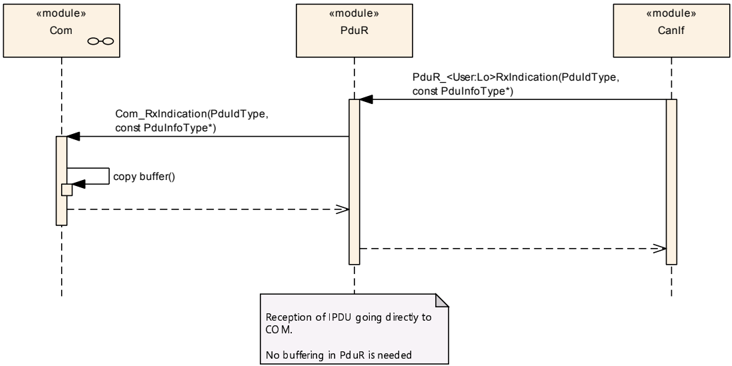

#### 8.1.2. FrIf 模块的 I-PDU 接收

下图展示了从**FrIf** 模块到**COM**模块的**I-PDU** 接收。

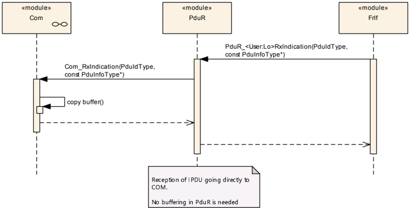

#### 8.1.3. LinIf 模块的 I-PDU 接收

下图展示了从**LinIf** 模块到**COM**模块的**I-PDU** 接收。

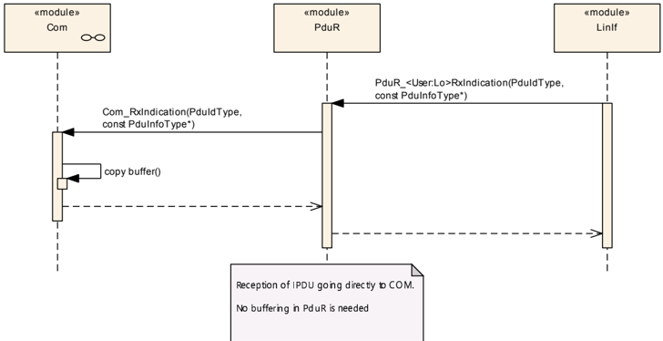

#### 8.1.4. CanTp 模块的 I-PDU 接收

下图展示了从**CanTp** 模块到**DCM**模块的**I-PDU** 接收。该接收使用传输协议**API** 完成。

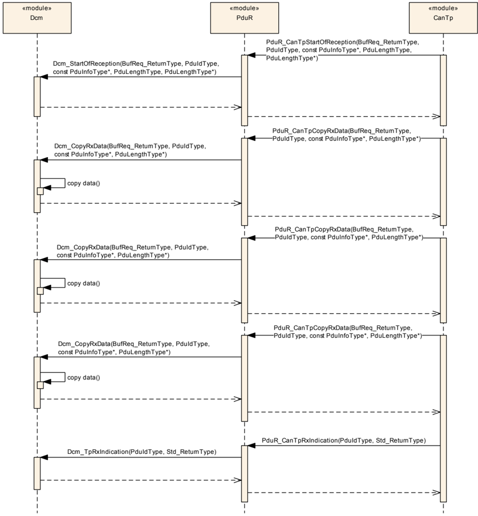

### 8.2. I-PDU 发送

从**COM**模块发送**I-PDU** 到通信接口模块或传输协议模块。

#### 8.2.1. CanIf 模块的 I-PDU 发送

下图展示了从**COM**模块到**CanIf** 模块的**I-PDU** 发送。

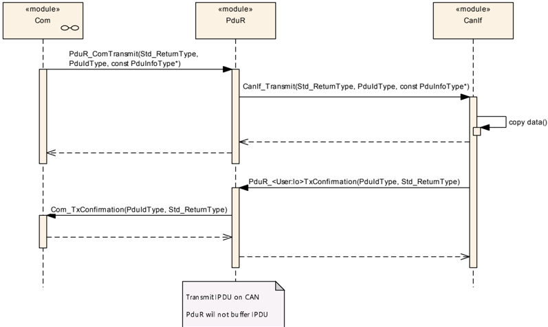

#### 8.2.2. FrIf 模块的 I-PDU 发送

下图展示了从**COM**模块到**FrIf** 模块、使用触发发送（**trigger transmit**）的**I-PDU** 发送。

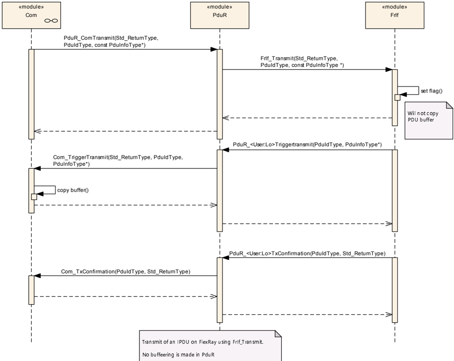

#### 8.2.3. LinIf 模块的 I-PDU 发送

下图展示了从**COM**模块到**LinIf** 模块、使用发送及后续触发发送函数的**I-PDU** 发送。此处**I-PDU** 是一个**LIN** 偶发帧（**sporadic frame**）。

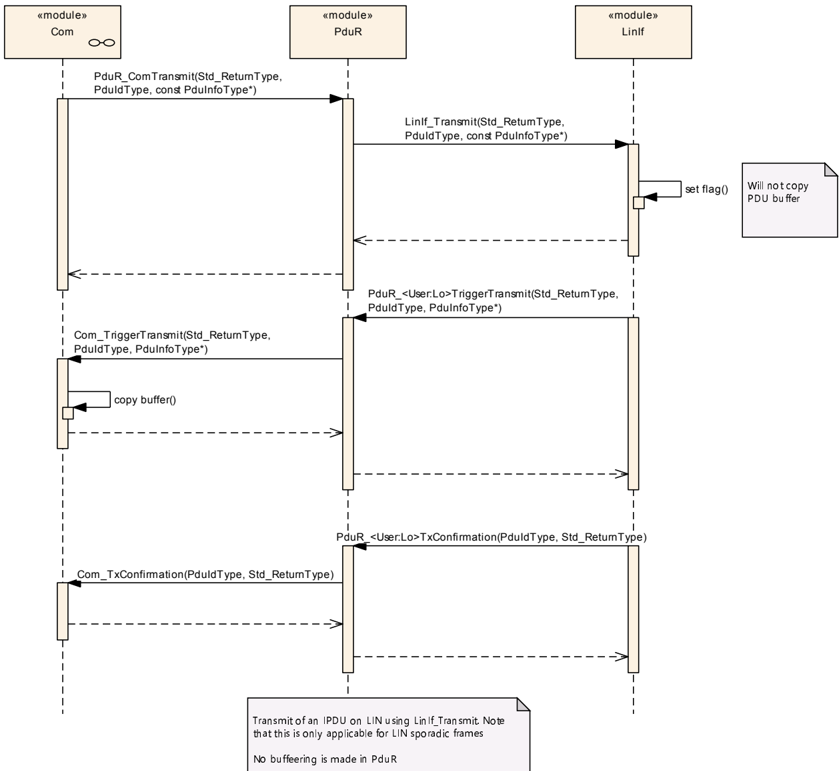

下图展示了从**COM**模块到**LinIf** 模块、使用触发发送的**I-PDU** 发送。此处**I-PDU** 是除**LIN** 偶发帧之外的所有其他类型。

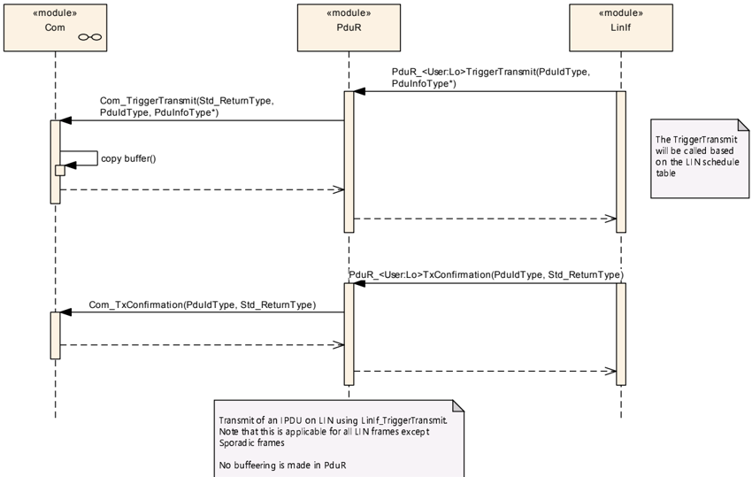

#### 8.2.4. CanTp 模块的 I-PDU 发送

下图展示了从**DCM**模块到**CanTp** 模块、使用传输协议**API** 的**I-PDU** 发送。

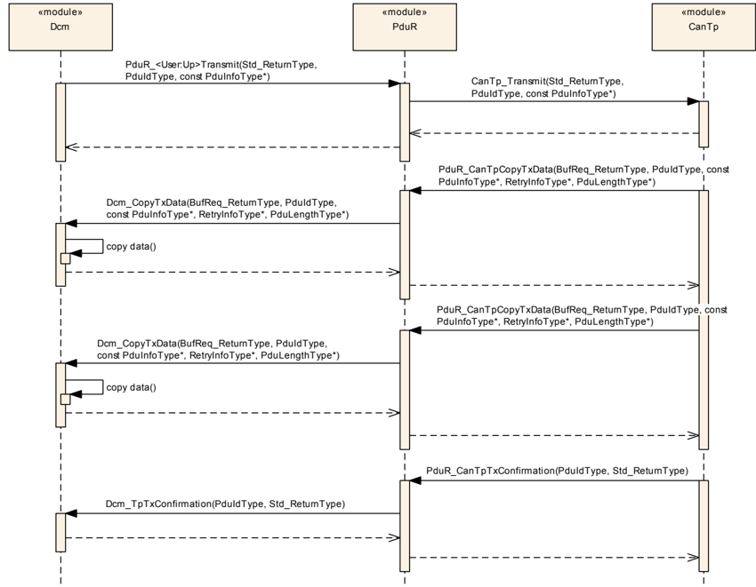

#### 8.2.5. 传输协议模块上的多播 I-PDU 发送

下图展示了从**DCM**模块到**CanTp**、**FrTp** 和**LinTp**（**LinIf** 包含传输协议模块）模块、使用传输协议**API** 的**I-PDU** 发送。

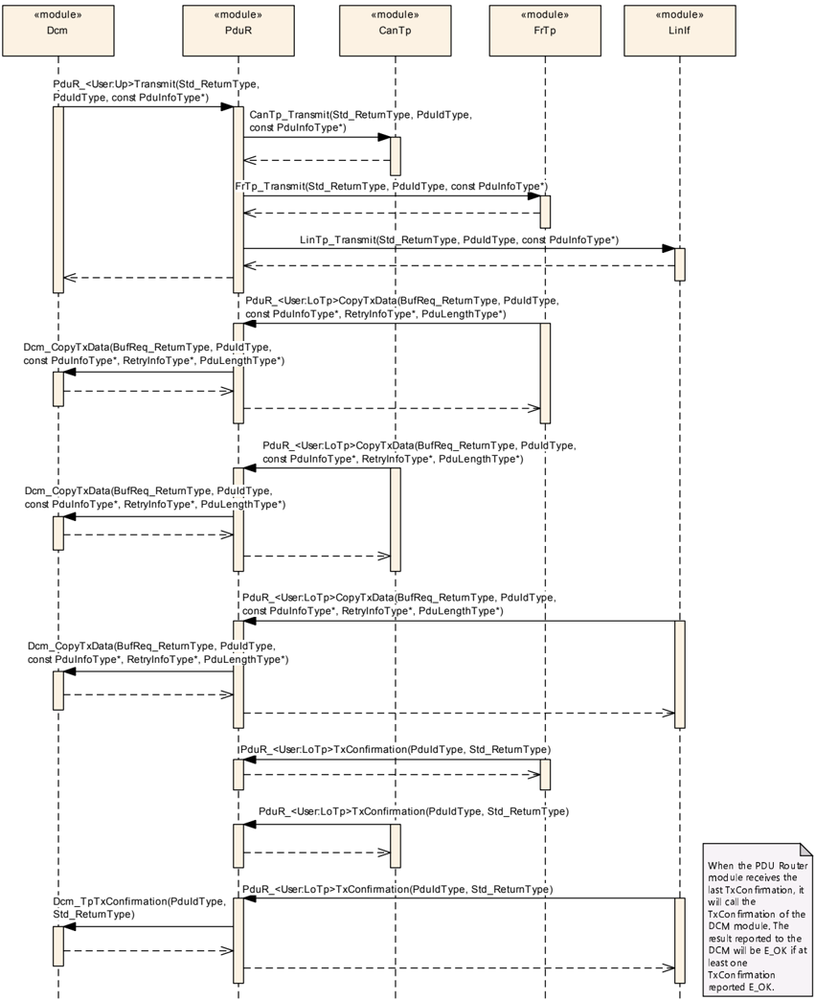

### 8.3. I-PDU 网关

以下用例展示了**PDU**路由器模块将如何网关**I-PDU**。

#### 8.3.1. 两个 CanIf 之间的网关

下图展示了**I-PDU** 如何在两个**CAN** 网络（**CAN1** 和**CAN2**）之间使用**CanIf** 进行网关。

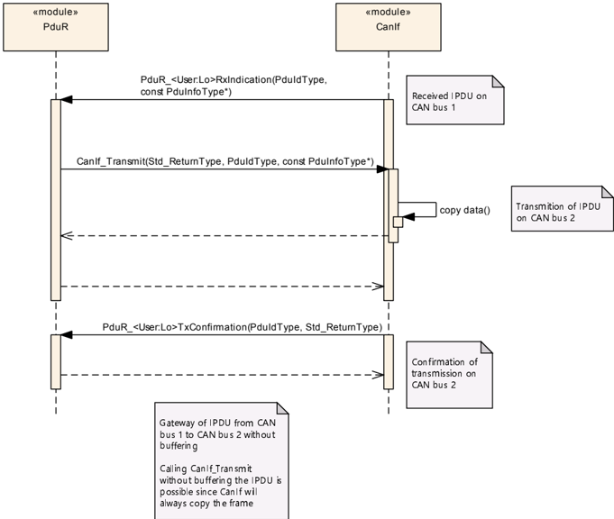

#### 8.3.2. 从 CAN 到 FlexRay 的网关

下图展示了**I-PDU** 如何在**CAN** 与**FlexRay** 之间使用触发发送（带缓冲和不带缓冲）进行网关。

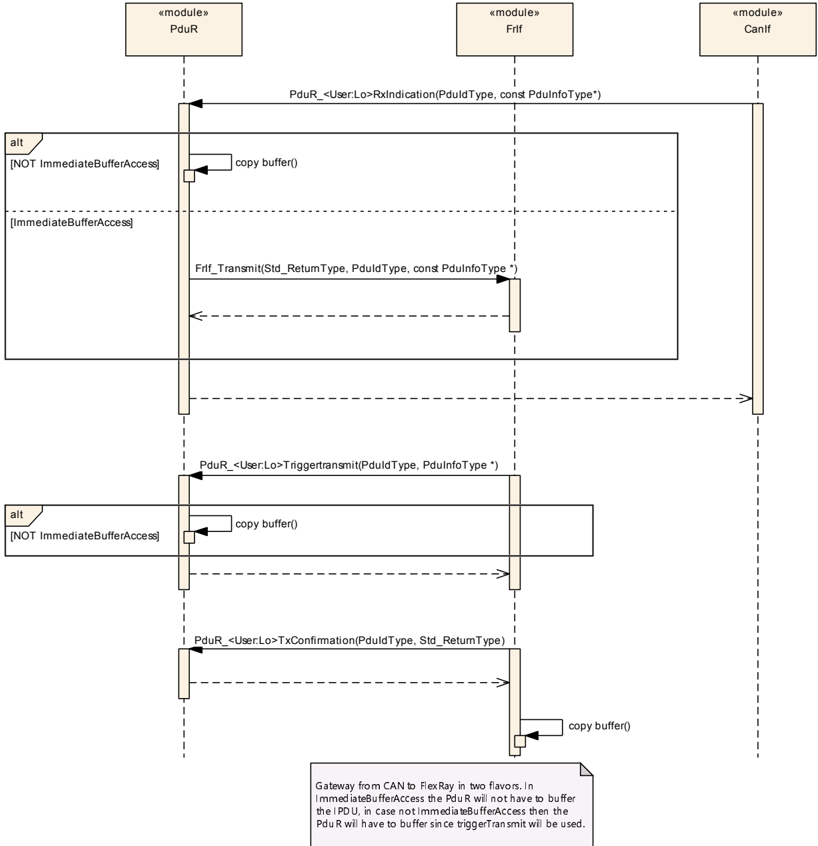

#### 8.3.3. 从 CAN 到 LIN 的网关

下图展示了**I-PDU** 如何从**CAN** 网关到**LIN**，使用触发发送（**LIN** 偶发帧和所有其他**LIN** 帧类型）。

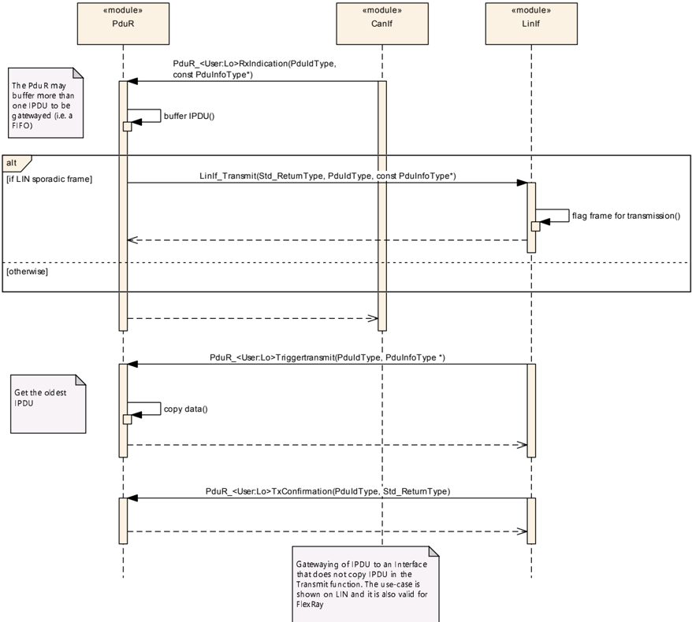

#### 8.3.4. 从 CAN 到 CAN 的网关并由 COM 模块接收

下图展示了**I-PDU** 如何从**CAN1** 网关到**CAN2**，同时也被**COM**模块本地接收。

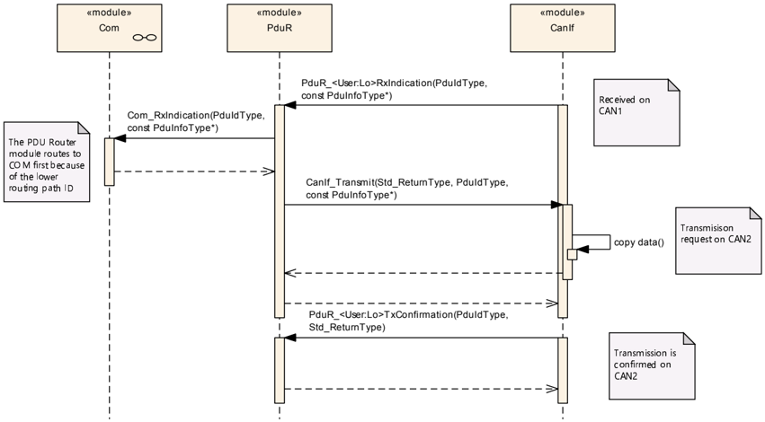

#### 8.3.5. 单播网关 TP I-PDU

下图展示了传输协议（多**N-PDU**）**I-PDU** 如何在两个**CAN** 网络之间进行即时（**On-The-Fly**）网关。

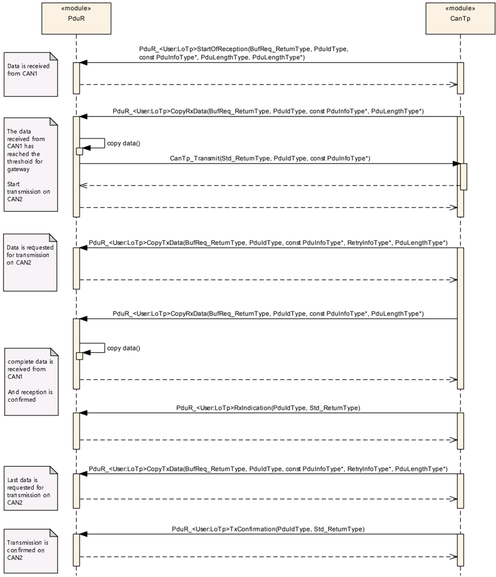

#### 8.3.6. 多播网关 TP I-PDU 并转发到上层

下图展示了传输协议（多**N-PDU**）**I-PDU** 从**J1939Tp** 到**CAN** 和**LIN** 的直接多播网关，并转发到**DCM**。

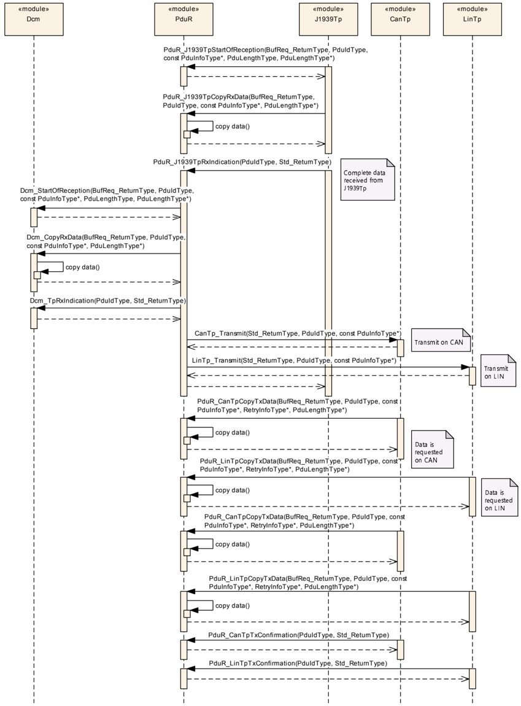

#### 8.3.7. 单帧 TP I-PDU 网关并转发到上层

下图展示了传输协议**I-PDU**（包含在一个**SF** 中）从**CAN1** 到**CAN2** 的直接网关，并转发到**DCM**。

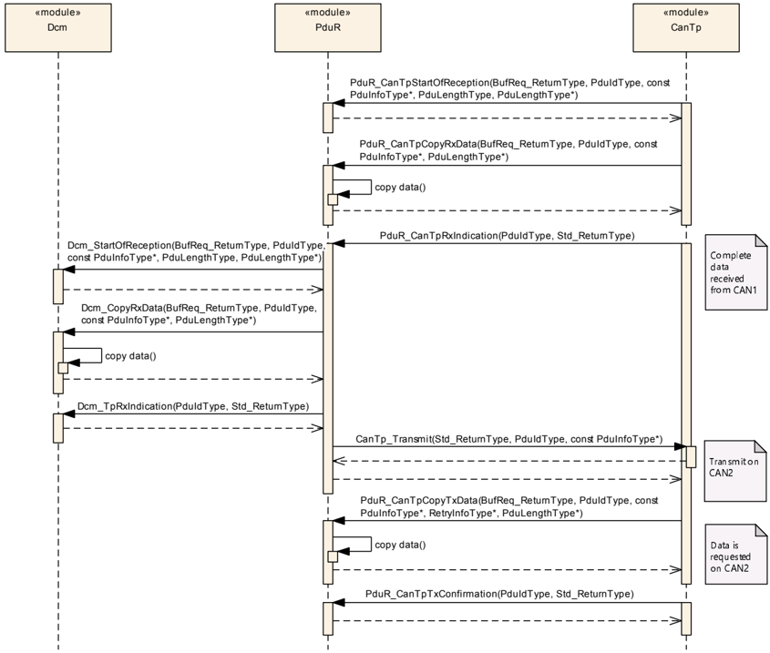

该**I-PDU** 必须在**PDU**路由器中被缓冲，因为**DCM**模块并不知道它将被网关到**CAN2**。此类网关由配置控制，无法由**DCM** 处理。

#### 8.3.8. 网关 J1939Tp 的广播公告消息

下图展示了广播**TP** 协议（例如**J1939Tp** 的**BAM**）的路由如何以直接网关方式进行。

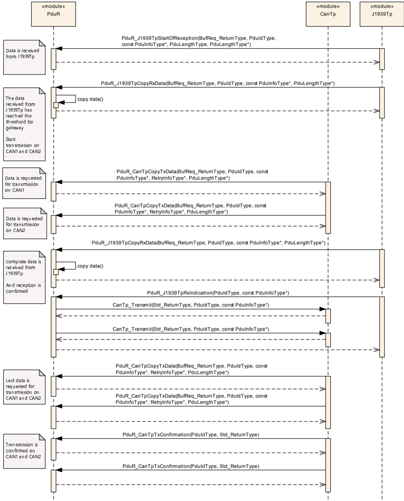

## 9. 配置规范

总体而言，本章定义了配置参数及其在容器中的聚类组织。为支持本规范，9.1 节描述了基础知识。它还规定了用于参数规范的模板（表格）。我们有意保留 9.1 节以保证可理解性。9.2 节规定了模块**PDU**路由器的结构（容器）和参数，9.3 节规定了模块**PDU**路由器的发布信息。

ECU 配置规范中的配置描述是标准化的。在 ECUC 中明确定义了各参数如何组织在容器中。以容器方式组织的主要原因是：

* 该模块有哪些配置参数？
* 这些参数定义在何处（哪个容器/结构）？
* 这些参数如何被配置（预编译（**pre-compile**）、链接时（**link-time**）、构建后（**post-build**））？
* 参数之间是否存在依赖关系（例如，若参数 A 为真，则参数 B 是否必须存在）？

各章均以该章节中参数及其参数的简要描述开头。随后以表格形式给出参数的详细描述。所描述的配置参数取自 ECUC 参数定义。该表格包含以下列：

* 参数条目在配置规范中的编号/标识符
* 参数名称
* 参数所属的容器
* 参数的描述
* 多重性（**multiplicity**）
* 参数类型（**type**）
* 取值范围（**range**）
* 默认值（**default value**）
* Post-Build 变体值（**variability**）
* 值配置类（**value configuration class**）
* 作用域/依赖（**scope**/**dependency**）

此外还规定了参数必须在 ECU 配置描述中以何种方式定义。

### 9.1. 如何阅读本章

详细信息请参见[\[2\]](#ref-2)的第10.1章“配置规范简介（**Introduction to configuration specification**）”。

#### 9.1.1. 变体

如果支持该变体，则**PDU**路由器模块需支持在构建后（**post build-time**）更新路由配置（即**PDU**路由器路由表）。

对路由表的构建后更新的支持并非总是期望的。因此，路由表的构建后更新仅在**PDU**路由器的构建后变体中受支持，进一步参见 9.1.1 节。

构建后有可选（**Selectable**）和可加载（**Loadable**）两种形式，在**PDU**路由器模块中使用其中任何一种、甚至组合使用都没有限制。

如果支持构建后变体，则只能在**PDU**路由器模块未初始化时更新路由表。

**备注：**更新路由表的过程不受限制。最可能的情况是由引导加载程序（**bootloader**）重新烧写保存该表的存储段——引导加载程序是一个独立的程序，可在重启后被加载以更新**ECU**。

**PDU**路由器模块的构建后配置需能通过唯一的配置标识符**PduRConfigurationId** 来识别。

**备注：**该唯一配置标识符不用于在**PDU**路由器模块的多个构建后配置集之间进行选择，而是用于唯一地标识当前的**PDU**路由器模块构建后配置，例如用于诊断，或在运行时检查相关通信模块的构建后配置是否匹配。该配置标识符可通过**API PduR_GetConfigurationId** 读取，参见 7.3.1.3 节。

### 9.2. 容器与配置参数

以下章节汇总了所有配置参数。参数的详细含义在第6章和第7章中描述。顶层**PDU**路由器配置容器**PduR** 的概览如图10.1所示。

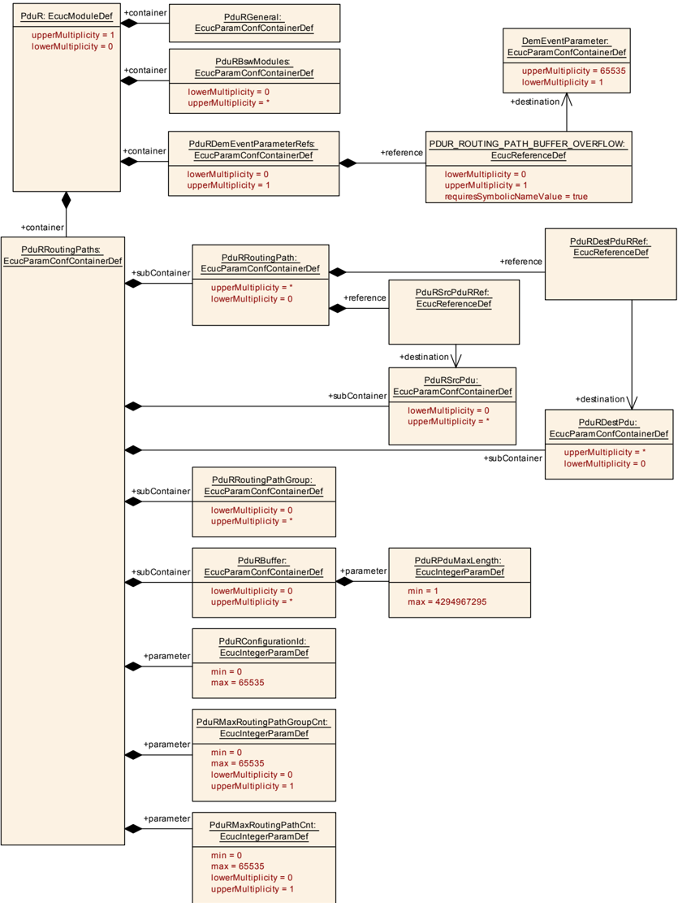

#### 9.2.1. PduR

| SWS 条目 | [ECUC_PduR_00293] |
| --- | --- |
| 容器名称 | PduR |
| 描述 | **PduR**（**PDU**路由器）模块的配置。 |

**包含的容器**

| 容器名称 | 多重性 | 描述 |
| --- | --- | --- |
| PduRBswModules | 0..* | 每个容器描述**PDU**路由器需对接的特定 BSW 模块（上层/**CDD**/下层/**IpduM**）。 |
| PduRDemEventParameterRefs | 0..1 | 用于引用**DemEventParameter** 元素的容器，在相应错误发生时需通过**Dem_SetEventStatus** API 调用这些元素。 |
| PduRGeneral | 1 | 包含**PDU**路由器通用配置参数。 |
| PduRRoutingPaths | 1 | 表示一张路由路径表。 |

#### 9.2.2. PduRDemEventParameterRefs

| SWS 条目 | [ECUC_PduR_00365] |
| --- | --- |
| 容器名称 | PduRDemEventParameterRefs |
| 父容器 | PduR |
| 描述 | 用于引用**DemEventParameter** 元素的容器，在相应错误发生时需通过**Dem_SetEventStatus** API 调用这些元素。事件 ID 取自所引用**DemEventParameter** 的**DemEventId** 符号值。此处提供标准化错误，并可通过供应商特定错误引用进行扩展。 |

| SWS 条目 | [ECUC_PduR_00366] |
| --- | --- |
| 参数名称 | PDUR_ROUTING_PATH_BUFFER_OVERFLOW |
| 父容器 | PduRDemEventParameterRefs |
| 描述 | 对**DemEventParameter** 元素的引用，在发生**PDUR_ROUTING_PATH_BUFFER_OVERFLOW** 错误时需通过**Dem_SetEventStatus** API 调用该元素。事件 ID 取自所引用**DemEventParameter** 的**DemEventId** 符号值。 |
| 多重性 | 0..1 |
| 类型 | 对 DemEventParameter 的符号名引用 |
| Post-Build 变体值 | false |
| 值配置类 | Pre-compile time：X；Link time：-；Post-build time：- |
| 作用域/依赖 | scope: ECU |

#### 9.2.3. PduRBswModules

| SWS 条目 | [ECUC_PduR_00295] |
| --- | --- |
| 容器名称 | PduRBswModules |
| 父容器 | PduR |
| 描述 | 每个容器描述**PDU**路由器需对接的特定 BSW 模块（上层/**CDD**/下层/**IpduM**）。将其作为独立配置容器、而不从路由路径中隐式推导的原因是：能够正确配置**CDD**，并强制某个模块即使在没有任何到/来自该模块的路由时也存在于构建后场景中（未来的配置可能包含这些模块）。 |

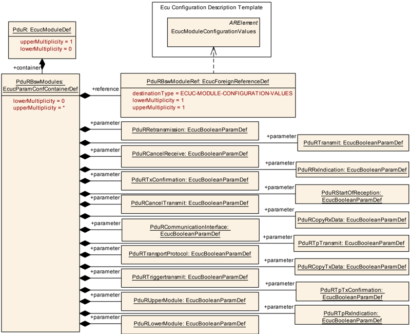

| SWS 条目 | [ECUC_PduR_00340] |
| --- | --- |
| 参数名称 | PduRCancelReceive |
| 父容器 | PduRBswModules |
| 描述 | 指定传输协议模块是否支持**CancelReceive** API。值为 true 表示支持该 API。 |
| 多重性 | 1 |
| 类型 | EcucBooleanParamDef |
| 默认值 | - |
| Post-Build 变体值 | false |
| 值配置类 | Pre-compile time：X（All Variants）；Link time：-；Post-build time：- |
| 作用域/依赖 | scope: local |

| SWS 条目 | [ECUC_PduR_00297] |
| --- | --- |
| 参数名称 | PduRCancelTransmit |
| 父容器 | PduRBswModules |
| 描述 | 指定 BSW 模块是否支持**CancelTransmit** API。值为 true 表示支持该 API。 |
| 多重性 | 1 |
| 类型 | EcucBooleanParamDef |
| 默认值 | - |
| Post-Build 变体值 | false |
| 值配置类 | Pre-compile time：X（All Variants）；Link time：-；Post-build time：- |
| 作用域/依赖 | scope: local |

| SWS 条目 | [ECUC_PduR_00298] |
| --- | --- |
| 参数名称 | PduRCommunicationInterface |
| 父容器 | PduRBswModules |
| 描述 | 指定 BSW 模块是否支持通信接口 API。值为 true 表示支持这些 API。一个模块可以同时具有通信接口 API 和传输协议 API。 |
| 多重性 | 1 |
| 类型 | EcucBooleanParamDef |
| 默认值 | - |
| Post-Build 变体值 | false |
| 值配置类 | Pre-compile time：X（All Variants）；Link time：-；Post-build time：- |
| 作用域/依赖 | scope: local |

| SWS 条目 | [ECUC_PduR_00360] |
| --- | --- |
| 参数名称 | PduRCopyRxData |
| 父容器 | PduRBswModules |
| 描述 | 指定传输协议模块是否支持**CopyRxData** API。值为 true 表示支持该 API。 |
| 多重性 | 1 |
| 类型 | EcucBooleanParamDef |
| 默认值 | - |
| Post-Build 变体值 | false |
| 值配置类 | Pre-compile time：X（All Variants）；Link time：-；Post-build time：- |
| 作用域/依赖 | scope: ECU |

| SWS 条目 | [ECUC_PduR_00362] |
| --- | --- |
| 参数名称 | PduRCopyTxData |
| 父容器 | PduRBswModules |
| 描述 | 指定传输协议模块是否支持**CopyTxData** API。值为 true 表示支持该 API。 |
| 多重性 | 1 |
| 类型 | EcucBooleanParamDef |
| 默认值 | - |
| Post-Build 变体值 | false |
| 值配置类 | Pre-compile time：X（All Variants）；Link time：-；Post-build time：- |
| 作用域/依赖 | scope: ECU |

| SWS 条目 | [ECUC_PduR_00307] |
| --- | --- |
| 参数名称 | PduRLowerModule |
| 父容器 | PduRBswModules |
| 描述 | **PduRLowerModule** 决定由谁调用 API、由谁实现 API。例如，如果引用了**CanIf** 模块，则**PDU**路由器模块需实现**PduR_CanIfRxIndication** API，并由**PDU**路由器模块调用**CanIf_Transmit** API。当然还覆盖其他 API。一个上层模块也可以同时是下层模块（例如**IpduM** 模块）。 |
| 多重性 | 1 |
| 类型 | EcucBooleanParamDef |
| 默认值 | - |
| Post-Build 变体值 | false |
| 值配置类 | Pre-compile time：X（All Variants）；Link time：-；Post-build time：- |
| 作用域/依赖 | scope: local |

| SWS 条目 | [ECUC_PduR_00332] |
| --- | --- |
| 参数名称 | PduRRetransmission |
| 父容器 | PduRBswModules |
| 描述 | 若设为 true，表示目标传输协议模块将使用重传特性。即使目标传输协议模块支持重传，也可以将该参数设为 false 以不使用该特性。该参数仅对传输协议模块和网关操作有效。对于来自本地上层模块的发送，该模块将…… |
| 多重性 | 1 |
| 类型 | EcucBooleanParamDef |
| 默认值 | - |
| Post-Build 变体值 | false |
| 值配置类 | Pre-compile time：X（All Variants）；Link time：-；Post-build time：- |
| 作用域/依赖 | scope: local |

| SWS 条目 | [ECUC_PduR_00358] |
| --- | --- |
| 参数名称 | PduRRxIndication |
| 父容器 | PduRBswModules |
| 描述 | 指定 BSW 模块是否支持**RxIndication** API。值为 true 表示支持该 API。 |
| 多重性 | 1 |
| 类型 | EcucBooleanParamDef |
| 默认值 | - |
| Post-Build 变体值 | false |
| 值配置类 | Pre-compile time：X（All Variants）；Link time：-；Post-build time：- |
| 作用域/依赖 | scope: ECU |

| SWS 条目 | [ECUC_PduR_00359] |
| --- | --- |
| 参数名称 | PduRStartOfReception |
| 父容器 | PduRBswModules |
| 描述 | 指定传输协议模块是否支持**StartOfReception** API。值为 true 表示支持该 API。 |
| 多重性 | 1 |
| 类型 | EcucBooleanParamDef |
| 默认值 | - |
| Post-Build 变体值 | false |
| 值配置类 | Pre-compile time：X（All Variants）；Link time：-；Post-build time：- |
| 作用域/依赖 | scope: ECU |

| SWS 条目 | [ECUC_PduR_00364] |
| --- | --- |
| 参数名称 | PduRTpRxIndication |
| 父容器 | PduRBswModules |
| 描述 | 指定传输协议模块是否支持**TpRxIndication** API。值为 true 表示支持该 API。 |
| 多重性 | 1 |
| 类型 | EcucBooleanParamDef |
| 默认值 | - |
| Post-Build 变体值 | false |
| 值配置类 | Pre-compile time：X（All Variants）；Link time：-；Post-build time：- |
| 作用域/依赖 | scope: ECU |

| SWS 条目 | [ECUC_PduR_00361] |
| --- | --- |
| 参数名称 | PduRTpTransmit |
| 父容器 | PduRBswModules |
| 描述 | 指定 BSW 模块是否支持**TP Transmit** API。值为 true 表示支持该 API。 |
| 多重性 | 1 |
| 类型 | EcucBooleanParamDef |
| 默认值 | - |
| Post-Build 变体值 | false |
| 值配置类 | Pre-compile time：X（All Variants）；Link time：-；Post-build time：- |
| 作用域/依赖 | scope: ECU |

| SWS 条目 | [ECUC_PduR_00363] |
| --- | --- |
| 参数名称 | PduRTpTxConfirmation |
| 父容器 | PduRBswModules |
| 描述 | 指定传输协议模块是否支持**TpTxConfirmation** API。值为 true 表示支持该 API。 |
| 多重性 | 1 |
| 类型 | EcucBooleanParamDef |
| 默认值 | - |
| Post-Build 变体值 | false |
| 值配置类 | Pre-compile time：X（All Variants）；Link time：-；Post-build time：- |
| 作用域/依赖 | scope: ECU |

| SWS 条目 | [ECUC_PduR_00357] |
| --- | --- |
| 参数名称 | PduRTransmit |
| 父容器 | PduRBswModules |
| 描述 | 指定 BSW 模块是否支持（**IF**）**Transmit** API。值为 true 表示支持该 API。 |
| 多重性 | 1 |
| 类型 | EcucBooleanParamDef |
| 默认值 | - |
| Post-Build 变体值 | false |
| 值配置类 | Pre-compile time：X（All Variants）；Link time：-；Post-build time：- |
| 作用域/依赖 | scope: ECU |

| SWS 条目 | [ECUC_PduR_00312] |
| --- | --- |
| 参数名称 | PduRTransportProtocol |
| 父容器 | PduRBswModules |
| 描述 | **PDU**路由器模块需使用为传输协议接口指定的 API 参数。 |
| 多重性 | 1 |
| 类型 | EcucBooleanParamDef |
| 默认值 | - |
| Post-Build 变体值 | false |
| 值配置类 | Pre-compile time：X（All Variants）；Link time：-；Post-build time：- |
| 作用域/依赖 | scope: local |

| SWS 条目 | [ECUC_PduR_00313] |
| --- | --- |
| 参数名称 | PduRTriggertransmit |
| 父容器 | PduRBswModules |
| 描述 | 指定 BSW 模块是否支持**TriggerTransmit** API。值为 true 表示该 BSW 模块支持可被下层模块调用的**TriggerTransmit** 接口，同时也能够调用上层模块的**TriggerTransmit** 接口。值为 false 表示该 BSW 模块不支持可被下层模块调用的**TriggerTransmit** 接口，同时…… |
| 多重性 | 1 |
| 类型 | EcucBooleanParamDef |
| 默认值 | - |
| Post-Build 变体值 | false |
| 值配置类 | Pre-compile time：X（All Variants）；Link time：-；Post-build time：- |
| 作用域/依赖 | scope: local |

| SWS 条目 | [ECUC_PduR_00314] |
| --- | --- |
| 参数名称 | PduRTxConfirmation |
| 父容器 | PduRBswModules |
| 描述 | 指定 BSW 模块是否支持**TxConfirmation** API。值为 true 表示支持该 API。 |
| 多重性 | 1 |
| 类型 | EcucBooleanParamDef |
| 默认值 | - |
| Post-Build 变体值 | false |
| 值配置类 | Pre-compile time：X（All Variants）；Link time：-；Post-build time：- |
| 作用域/依赖 | scope: local |

| SWS 条目 | [ECUC_PduR_00338] |
| --- | --- |
| 参数名称 | PduRUpperModule |
| 父容器 | PduRBswModules |
| 描述 | **PduRUpperModule** 决定由谁调用 API、由谁实现 API。例如，如果引用了**COM**模块，则**PDU**路由器模块需实现**PduR_Transmit** API，并由**PDU**路由器模块调用**Com_RxIndication** API。当然还覆盖其他 API。一个上层模块也可以同时是下层模块（例如**IpduM** 模块）。 |
| 多重性 | 1 |
| 类型 | EcucBooleanParamDef |
| 默认值 | - |
| Post-Build 变体值 | false |
| 值配置类 | Pre-compile time：X（All Variants）；Link time：-；Post-build time：- |
| 作用域/依赖 | scope: local |

| SWS 条目 | [ECUC_PduR_00294] |
| --- | --- |
| 参数名称 | PduRBswModuleRef |
| 父容器 | PduRBswModules |
| 描述 | 对某个 BSW 模块配置（即**ECUC** 参数定义模板）的引用。例如，**LinIf** 可能存在多个配置，该引用选择其中之一。 |
| 多重性 | 1 |
| 类型 | 对外部 ECUC-MODULE-CONFIGURATION-VALUES 的引用 |
| Post-Build 变体值 | false |
| 值配置类 | Pre-compile time：X（All Variants）；Link time：-；Post-build time：- |
| 作用域/依赖 | scope: local |

#### 9.2.4. PduRGeneral

| SWS 条目 | [ECUC_PduR_00305] |
| --- | --- |
| 容器名称 | PduRGeneral |
| 父容器 | PduR |
| 描述 | 该容器是**PduR** 的子容器，规定了**PDU**路由器的通用配置参数。 |

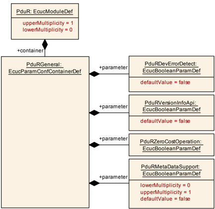

| SWS 条目 | [ECUC_PduR_00302] |
| --- | --- |
| 参数名称 | PduRDevErrorDetect |
| 父容器 | PduRGeneral |
| 描述 | 打开或关闭开发错误检测与通知。• true：启用检测与通知。• false：禁用检测与通知。 |
| 多重性 | 1 |
| 类型 | EcucBooleanParamDef |
| 默认值 | false |
| Post-Build 变体值 | false |
| 值配置类 | Pre-compile time：X（All Variants）；Link time：-；Post-build time：- |
| 作用域/依赖 | scope: local |

| SWS 条目 | [ECUC_PduR_00347] |
| --- | --- |
| 参数名称 | PduRMetaDataSupport |
| 父容器 | PduRGeneral |
| 描述 | 启用对**MetaData** 处理的支持。**MetaData** 由全局**PDU** 定义中所引用的**MetaDataType** 定义。该特性可用于基于地址的高效路由，以及**MetaData** 中包含**CAN** ID 的通用**CAN**-**CAN** 路由。 |
| 多重性 | 0..1 |
| 类型 | EcucBooleanParamDef |
| 默认值 | false |
| Post-Build 变体值 | false |
| 值配置类 | Pre-compile time：X；Link time：-；Post-build time：- |
| 作用域/依赖 | scope: local |

| SWS 条目 | [ECUC_PduR_00316] |
| --- | --- |
| 参数名称 | PduRVersionInfoApi |
| 父容器 | PduRGeneral |
| 描述 | 若为 true，则**PduR_GetVersionInfo** API 可用。 |
| 多重性 | 1 |
| 类型 | EcucBooleanParamDef |
| 默认值 | false |
| Post-Build 变体值 | false |
| 值配置类 | Pre-compile time：X（All Variants）；Link time：-；Post-build time：- |
| 作用域/依赖 | scope: local |

| SWS 条目 | [ECUC_PduR_00317] |
| --- | --- |
| 参数名称 | PduRZeroCostOperation |
| 父容器 | PduRGeneral |
| 描述 | 若设置，当无法满足零成本操作时，**PduR** 配置生成器需报告错误。该参数应被视为配置生成器的一项输入需求。 |
| 多重性 | 1 |
| 类型 | EcucBooleanParamDef |
| 默认值 | - |
| Post-Build 变体值 | false |
| 值配置类 | Pre-compile time：X（All Variants）；Link time：-；Post-build time：- |
| 作用域/依赖 | scope: local |

#### 9.2.5. PduRRoutingPathGroup

| SWS 条目 | [ECUC_PduR_00308] |
| --- | --- |
| 容器名称 | PduRRoutingPathGroup |
| 父容器 | PduRRoutingPaths |
| 描述 | 该容器对路由路径进行分组。通过该分组，可以切换与某个网络或某类**PDU** 相关的所有路由。**PduRRoutingPaths** 将一个源与一个目标相连接。路由路径组的启用和禁用通过**PduR** API 完成。 |

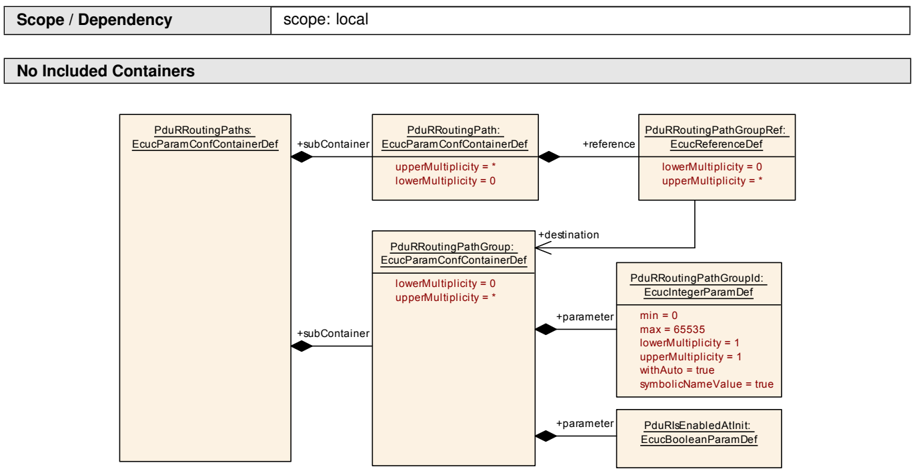

| SWS 条目 | [ECUC_PduR_00329] |
| --- | --- |
| 参数名称 | PduRIsEnabledAtInit |
| 父容器 | PduRRoutingPathGroup |
| 描述 | 若设为 true，则该路由路径组将在**PDU**路由器模块初始化之后（即在**PduR_Init** 函数中）被启用。 |
| 多重性 | 1 |
| 类型 | EcucBooleanParamDef |
| 默认值 | - |
| Post-Build 变体值 | true |
| 值配置类 | Pre-compile time：X（VARIANT-PRE-COMPILE）；Link time：-；Post-build time：- |
| 作用域/依赖 | scope: local |

| SWS 条目 | [ECUC_PduR_00309] |
| --- | --- |
| 参数名称 | PduRRoutingPathGroupId |
| 父容器 | PduRRoutingPathGroup |
| 描述 | 路由组的标识。该标识将由**PDU**路由器模块 API 中的禁用/启用 API 使用。 |
| 多重性 | 1 |
| 类型 | EcucIntegerParamDef（为该参数生成符号名） |
| 取值范围 | 0 .. 65535 |
| 默认值 | - |
| Post-Build 变体值 | false |
| 值配置类 | Pre-compile time：X（All Variants）；Link time：-；Post-build time：- |
| 作用域/依赖 | scope: ECU |

#### 9.2.6. PduRRoutingPaths

| SWS 条目 | [ECUC_PduR_00310] |
| --- | --- |
| 容器名称 | PduRRoutingPaths |
| 父容器 | PduR |
| 描述 | 表示一张路由路径表。该路由表允许多个配置，用于在同一配置中创建多张路由表。这主要用于构建后（例如构建后可选择），但也可用于预编译和链接时以实现变体处理。 |

**包含的容器**

| 容器名称 | 多重性 | 描述 |
| --- | --- | --- |
| PduRBuffer | 0..* | 规定用于通过通信接口或传输协议网关的缓冲区、传输协议 1:n 接收，或通信接口模块的扇入接收路由所使用的缓冲区。 |
| PduRDestPdu | 0..* | 该容器是**PduRRoutingPath** 的子容器，规定待路由**PDU** 的一个目标。 |
| PduRRoutingPath | 0..* | 该容器是**PduRRoutingTable** 的子容器，规定某个**PDU** 的路由路径。 |
| PduRRoutingPathGroup | 0..* | 该容器对路由路径进行分组。通过该分组，可以切换与某个网络或某类**PDU** 相关的所有路由。 |
| PduRSrcPdu | 0..* | 该容器是**PduRRoutingPath** 的子容器，规定待路由**PDU** 的源。 |

| SWS 条目 | [ECUC_PduR_00327] |
| --- | --- |
| 参数名称 | PduRConfigurationId |
| 父容器 | PduRRoutingPaths |
| 描述 | **PduR** 配置的标识。该标识可通过**PduR** API 读取。 |
| 多重性 | 1 |
| 类型 | EcucIntegerParamDef |
| 取值范围 | 0 .. 65535 |
| 默认值 | - |
| Post-Build 变体值 | true |
| 值配置类 | Pre-compile time：X（VARIANT-PRE-COMPILE）；Link time：-；Post-build time：X（VARIANT-POST-BUILD） |
| 作用域/依赖 | scope: local |

| SWS 条目 | [ECUC_PduR_00350] |
| --- | --- |
| 参数名称 | PduRMaxRoutingPathCnt |
| 父容器 | PduRRoutingPaths |
| 描述 | 所有路由表中**RoutingPath** 的最大数量。仅在使用静态内存分配的构建后可加载实现中需要该参数。 |
| 多重性 | 0..1 |
| 类型 | EcucIntegerParamDef |
| 取值范围 | 0 .. 65535 |
| 默认值 | - |
| Post-Build 变体值 | false |
| 值配置类 | Pre-compile time：X；Link time：-；Post-build time：- |
| 作用域/依赖 | scope: local |

| SWS 条目 | [ECUC_PduR_00348] |
| --- | --- |
| 参数名称 | PduRMaxRoutingPathGroupCnt |
| 父容器 | PduRRoutingPaths |
| 描述 | **RoutingPathGroup** 的最大数量。仅在使用静态内存分配的构建后可加载实现中需要该参数。 |
| 多重性 | 0..1 |
| 类型 | EcucIntegerParamDef |
| 取值范围 | 0 .. 65535 |
| 默认值 | - |
| Post-Build 变体值 | false |
| 值配置类 | Pre-compile time：X（All Variants）；Link time：-；Post-build time：- |
| 作用域/依赖 | scope: local |

#### 9.2.7. PduRRoutingPath

| SWS 条目 | [ECUC_PduR_00248] |
| --- | --- |
| 容器名称 | PduRRoutingPath |
| 父容器 | PduRRoutingPaths |
| 描述 | 该容器是**PduRRoutingTable** 的子容器，规定某个**PDU** 的路由路径。 |

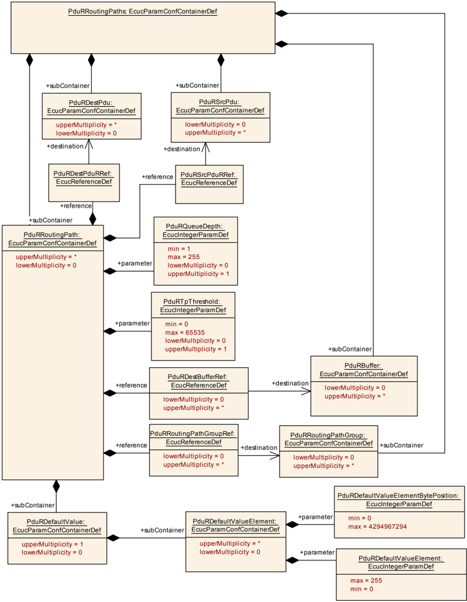

**包含的容器**

| 容器名称 | 多重性 | 描述 |
| --- | --- | --- |
| PduRDefaultValue | 0..* | 规定**I-PDU** 的默认值。仅在网关操作且至少一个由**PduRDestPdu** 指定的**PDU** 使用**TriggerTransmit** 数据提供时需要。 |

| SWS 条目 | [ECUC_PduR_00356] |
| --- | --- |
| 参数名称 | PduRQueueDepth |
| 父容器 | PduRRoutingPath |
| 描述 | 该参数定义此路由路径的队列深度。 |
| 多重性 | 0..1 |
| 类型 | EcucIntegerParamDef |
| 取值范围 | 1 .. 255 |
| 默认值 | - |
| Post-Build 变体值 | true |
| 值配置类 | Pre-compile time：X（VARIANT-PRE-COMPILE）；Link time：-；Post-build time：X（VARIANT-POST-BUILD） |
| 作用域/依赖 | scope: local |

| SWS 条目 | [ECUC_PduR_00320] |
| --- | --- |
| 参数名称 | PduRTpThreshold |
| 父容器 | PduRRoutingPath |
| 描述 | 该参数仅与**TP** 路由相关。配置后，它启用即时路由，并定义在目标总线上的发送可以开始之前必须已接收的字节数。省略时，强制执行直接**TP** 路由。**PduR** 需确保为该路由路径分配的缓冲区至少与阈值同样大。 |
| 多重性 | 0..1 |
| 类型 | EcucIntegerParamDef |
| 取值范围 | 0 .. 65535 |
| 默认值 | - |
| Post-Build 变体值 | true |
| 值配置类 | Pre-compile time：X（VARIANT-PRE-COMPILE）；Link time：-；Post-build time：X（VARIANT-POST-BUILD） |
| 作用域/依赖 | scope: local |

| SWS 条目 | [ECUC_PduR_00304] |
| --- | --- |
| 参数名称 | PduRDestBufferRef |
| 父容器 | PduRRoutingPath |
| 描述 | 对**PduR** 中某个缓冲区的引用。该缓冲区是通信接口网关、传输协议网关，或通信接口模块扇入接收路由所必需的。 |
| 多重性 | 0..* |
| 类型 | 对 PduRBuffer 的引用 |
| Post-Build 变体值 | true |
| 值配置类 | Pre-compile time：X（VARIANT-PRE-COMPILE）；Link time：-；Post-build time：X（VARIANT-POST-BUILD） |
| 作用域/依赖 | scope: local |

| SWS 条目 | [ECUC_PduR_00354] |
| --- | --- |
| 参数名称 | PduRDestPduRRef |
| 父容器 | PduRRoutingPath |
| 描述 | - |
| 多重性 | 1 |
| 类型 | 对 PduRDestPdu 的引用 |
| Post-Build 变体值 | true |
| 值配置类 | Pre-compile time：X（VARIANT-PRE-COMPILE）；Link time：-；Post-build time：X（VARIANT-POST-BUILD） |

| SWS 条目 | [ECUC_PduR_00352] |
| --- | --- |
| 参数名称 | PduRRoutingPathGroupRef |
| 父容器 | PduRRoutingPath |
| 描述 | 对路由路径的引用。 |
| 多重性 | 0..* |
| 类型 | 对 PduRRoutingPathGroup 的引用 |
| Post-Build 变体值 | true |
| 值配置类 | Pre-compile time：X（VARIANT-PRE-COMPILE）；Link time：-；Post-build time：X（VARIANT-POST-BUILD） |
| 作用域/依赖 | scope: local |

| SWS 条目 | [ECUC_PduR_00353] |
| --- | --- |
| 参数名称 | PduRSrcPduRRef |
| 父容器 | PduRRoutingPath |
| 描述 | - |
| 多重性 | 1 |
| 类型 | 对 PduRSrcPdu 的引用 |
| Post-Build 变体值 | true |
| 值配置类 | Pre-compile time：X（VARIANT-PRE-COMPILE）；Link time：-；Post-build time：X（VARIANT-POST-BUILD） |

#### 9.2.8. PduRDestPdu

| SWS 条目 | [ECUC_PduR_00249] |
| --- | --- |
| 容器名称 | PduRDestPdu |
| 父容器 | PduRRoutingPaths |
| 描述 | 该容器是**PduRRoutingPath** 的子容器，规定待路由**PDU** 的一个目标。 |

| SWS 条目 | [ECUC_PduR_00289] |
| --- | --- |
| 参数名称 | PduRDestPduDataProvision |
| 父容器 | PduRDestPdu |
| 描述 | 规定数据的提供方式：直接提供（作为**Transmit** 调用的一部分），或通过**Trigger Transmit** 回调函数提供。仅对非**TP** 网关**I-PDU** 需要。 |
| 多重性 | 0..1 |
| 类型 | EcucEnumerationParamDef |
| 取值范围 | PDUR_DIRECT、PDUR_TRIGGERTRANSMIT |
| Post-Build 变体值 | true |
| 值配置类 | Pre-compile time：X（VARIANT-PRE-COMPILE）；Link time：-；Post-build time：X（VARIANT-POST-BUILD） |
| 作用域/依赖 | scope: local；dependency: 在**PDUR_TRIGGERTRANSMIT** 情况下，需要参数**PduRDestBufferRef**。 |

| SWS 条目 | [ECUC_PduR_00322] |
| --- | --- |
| 参数名称 | PduRDestPduHandleId |
| 父容器 | PduRDestPdu |
| 描述 | 由**PDU**路由器分配的**PDU** 标识符。供通信接口和传输协议模块用于确认（**PduR_&lt;Lo&gt;TxConfirmation**）和触发发送（**PduR_&lt;Lo&gt;TriggerTransmit**）。 |
| 多重性 | 0..1 |
| 类型 | EcucIntegerParamDef（为该参数生成符号名） |
| 默认值 | - |
| Post-Build 变体值 | false |
| 值配置类 | Pre-compile time：X（All Variants）；Link time：-；Post-build time：- |
| 作用域/依赖 | scope: ECU withAuto = true |

| SWS 条目 | [ECUC_PduR_00339] |
| --- | --- |
| 参数名称 | PduRTransmissionConfirmation |
| 父容器 | PduRDestPdu |
| 描述 | 该参数仅用于通信接口。传输协议模块将总是调用**TxConfirmation** 函数。若设置，则目标通信接口模块将调用**TxConfirmation**。然而由于错误，**TxConfirmation** 可能不被调用，因此**PduR** 不得阻塞等待**TxConfirmation** 被调用。该参数的一个背景是：使**PduR** 能够知道所有模块何时已确认一次多播操作。 |
| 多重性 | 1 |
| 类型 | EcucBooleanParamDef |
| 默认值 | - |
| Post-Build 变体值 | false |
| 值配置类 | Pre-compile time：X；Link time：-；Post-build time：- |
| 作用域/依赖 | scope: local |

| SWS 条目 | [ECUC_PduR_00291] |
| --- | --- |
| 参数名称 | PduRDestPduRef |
| 父容器 | PduRDestPdu |
| 描述 | 目标**PDU** 引用；对唯一**PDU** 标识符的引用，**PDU**路由器在调用目标模块的相关函数时需使用该标识符，而不用源**PDU** ID。 |
| 多重性 | 1 |
| 类型 | 对 Pdu 的引用 |
| Post-Build 变体值 | true |
| 值配置类 | Pre-compile time：X（VARIANT-PRE-COMPILE）；Link time：-；Post-build time：X（VARIANT-POST-BUILD） |
| 作用域/依赖 | scope: local |

#### 9.2.9. PduRSrcPdu

| SWS 条目 | [ECUC_PduR_00288] |
| --- | --- |
| 容器名称 | PduRSrcPdu |
| 父容器 | PduRRoutingPaths |
| 描述 | 该容器是**PduRRoutingPath** 的子容器，规定待路由**PDU** 的源。 |

| SWS 条目 | [ECUC_PduR_00355] |
| --- | --- |
| 参数名称 | PduRSourcePduBlockSize |
| 父容器 | PduRSrcPdu |
| 描述 | 接收传输协议层为继续接收所需的最小缓冲区空间。 |
| 多重性 | 0..1 |
| 类型 | EcucIntegerParamDef |
| 取值范围 | 1 .. 4294967295 |
| 默认值 | - |
| Post-Build 变体值 | true |
| 值配置类 | Pre-compile time：-；Link time：-；Post-build time：- |
| 作用域/依赖 | scope: local |

| SWS 条目 | [ECUC_PduR_00311] |
| --- | --- |
| 参数名称 | PduRSourcePduHandleId |
| 父容器 | PduRSrcPdu |
| 描述 | 由**PDU**路由器分配的**PDU** 标识符。 |
| 多重性 | 1 |
| 类型 | EcucIntegerParamDef（为该参数生成符号名） |
| 取值范围 | 0 .. 65535 |
| 默认值 | - |
| Post-Build 变体值 | false |
| 值配置类 | Pre-compile time：X（All Variants）；Link time：-；Post-build time：- |
| 作用域/依赖 | scope: ECU |

| SWS 条目 | [ECUC_PduR_00351] |
| --- | --- |
| 参数名称 | PduRSrcPduUpTxConf |
| 父容器 | PduRSrcPdu |
| 描述 | 当启用时，**TxConfirmation** 将被转发到上层。前提条件：下层和上层都支持**TxConfirmation**。 |
| 多重性 | 1 |
| 类型 | EcucBooleanParamDef |
| 默认值 | true |
| Post-Build 变体值 | true |
| 值配置类 | Pre-compile time：X（VARIANT-PRE-COMPILE）；Link time：-；Post-build time：X（VARIANT-POST-BUILD） |
| 作用域/依赖 | scope: ECU |

| SWS 条目 | [ECUC_PduR_00318] |
| --- | --- |
| 参数名称 | PduRSrcPduRef |
| 父容器 | PduRSrcPdu |
| 描述 | 源**PDU** 引用；对唯一**PDU** 标识符的引用，该标识符需用于所请求的**PDU**路由器操作。 |
| 多重性 | 1 |
| 类型 | 对 Pdu 的引用 |
| Post-Build 变体值 | true |
| 值配置类 | Pre-compile time：X（VARIANT-PRE-COMPILE）；Link time：-；Post-build time：X（VARIANT-POST-BUILD） |
| 作用域/依赖 | scope: local |

#### 9.2.10. PduRDefaultValue

| SWS 条目 | [ECUC_PduR_00299] |
| --- | --- |
| 容器名称 | PduRDefaultValue |
| 父容器 | PduRRoutingPath |
| 描述 | 规定**I-PDU** 的默认值。仅在网关操作且至少一个由**PduRDestPdu** 指定的**PDU** 使用**TriggerTransmit** 数据提供时需要。以**IntegerParamDef** 数组的形式表示。 |

**包含的容器**

| 容器名称 | 多重性 | 描述 |
| --- | --- | --- |
| PduRDefaultValueElement | 0..* | 每个值元素由该元素及其在数组中的位置表示。 |

#### 9.2.11. PduRDefaultValueElement

| SWS 条目 | [ECUC_PduR_00300] |
| --- | --- |
| 容器名称 | PduRDefaultValueElement |
| 父容器 | PduRDefaultValue |
| 描述 | 每个值元素由该元素及其在数组中的位置表示。 |

| SWS 条目 | [ECUC_PduR_00290] |
| --- | --- |
| 参数名称 | PduRDefaultValueElement |
| 父容器 | PduRDefaultValueElement |
| 描述 | 默认值由若干元素组成。每个元素为一个字节长，元素数量由**SduLength** 指定。该参数在容器中的位置由参数**PduRDefaultValueElementBytePosition** 指定。 |
| 多重性 | 1 |
| 类型 | EcucIntegerParamDef |
| 取值范围 | 0 .. 255 |
| 默认值 | - |
| Post-Build 变体值 | true |
| 值配置类 | Pre-compile time：X（VARIANT-PRE-COMPILE）；Link time：-；Post-build time：X（VARIANT-POST-BUILD） |
| 作用域/依赖 | scope: local |

| SWS 条目 | [ECUC_PduR_00292] |
| --- | --- |
| 参数名称 | PduRDefaultValueElementBytePosition |
| 父容器 | PduRDefaultValueElement |
| 描述 | 该参数指定该元素在默认值中的字节位置。 |
| 多重性 | 1 |
| 类型 | EcucIntegerParamDef |
| 取值范围 | 0 .. 4294967294 |
| 默认值 | - |
| Post-Build 变体值 | true |
| 值配置类 | Pre-compile time：X（VARIANT-PRE-COMPILE）；Link time：-；Post-build time：X（VARIANT-POST-BUILD） |
| 作用域/依赖 | scope: local |

#### 9.2.12. PduRBuffer

| SWS 条目 | [ECUC_PduR_00336] |
| --- | --- |
| 容器名称 | PduRBuffer |
| 父容器 | PduRRoutingPaths |
| 描述 | 规定用于通过通信接口或传输协议网关的缓冲区、传输协议 1:n 接收，或通信接口模块的扇入接收路由所使用的缓冲区。 |

| SWS 条目 | [ECUC_PduR_00324] |
| --- | --- |
| 参数名称 | PduRPduMaxLength |
| 父容器 | PduRBuffer |
| 描述 | **PDU** 缓冲区的长度，单位为字节。该参数限制被缓冲的路由**PDU** 的大小。 |
| 多重性 | 1 |
| 类型 | EcucIntegerParamDef |
| 取值范围 | 1 .. 4294967295 |
| 默认值 | - |
| Post-Build 变体值 | false |
| 值配置类 | Pre-compile time：X（All Variants）；Link time：-；Post-build time：- |
| 作用域/依赖 | scope: local；dependency: 当该缓冲区用于**TP** 路由路径或 1:n 接收时，**PduRPduMaxLength** 必须足够大，以容纳源网络中可能的最大单帧。 |

### 9.3. 发布信息

详细信息请参见[\[2\]](#ref-2)的第10.3章“发布信息（**Published Information**）”。

## 10. PDU 路由器模块设计说明

本章收集了一组描述本文档特性的说明。

### 10.1. 配置参数注意事项

第9章中列出的配置参数包含对参数本身的限制，但没有设置影响多个参数的限制。本节旨在列出其中一些限制，以便更好地理解配置参数，同时也为**PDU**路由器模块提供更简单的配置生成器。

网关（通信接口和传输协议）所需的缓冲区在配置中按目标分别规定。由于无法规定特定的流量整形，因此假定最坏情况，即所有**I-PDU** 同时被网关。可以通过扩展配置参数来实现更高效的缓冲区使用。

### 10.2. 通用接口概念

**PDU**路由器模块所提供和使用的 API 不与特定总线绑定。第7章中的 API 名称具有通用部分（**&lt;Up&gt;**、**&lt;Lo&gt;** 等），该部分将被替换为使用或实现该 API 的模块名称。

识别名称的方式是使用对**ECUC** 描述的引用，参见图10.2。短名（**short-name**）将在所引用的**ECUC** 描述中使用。

**PduRBswModules** 容器包含描述 BSW 模块所支持功能（是通信接口、传输层、上层、下层等）的参数。

如果下层模块同时支持**TP** 和**IF**，则需在函数名中直接于函数名前添加**Tp** 和**If** 中缀，例如**&lt;Lo&gt;_[Tp]Transmit**、**PduR_&lt;Lo&gt;[If]TxConfirmation**。

BSW 模块的通用接口配置与**I-PDU** 之间的连接，通过**ECUC** 模块中的路由路径和**I-PDU** 配置建立。


### 10.3. 路由表示例结构

本章展示路由表的示例结构，这些路由表包含每个**I-PDU** 的属性。本章并不规定**PDU**路由器的内部实现，而是作为示例以更好地理解 API 和**I-PDU**。

这些示例不考虑**IpduM**。

**注意：**本章绝非推荐的实现方式。本章更注重可理解性，而不是优化的实现。

#### 10.3.1. 通过通信接口模块的单播与多播发送

**PduR_ComTransmit** 用于**Com** 所发送**I-PDU** 时使用的路由表：

| id | TargetFctPtr | TargetPduId | Description |
| --- | --- | --- | --- |
| 0 | CanIf_Tansmit | 0 | 在**CanIf** 上发送 |
| 1 | FrIf_Transmit | 0 | 在**FrIf** 上发送 |
| 2 | CanIf_Tansmit | 1 | 在**CanIf** 上发送 |
| 3 | CanIf_Transmit、CanIf_Transmit | 0、2 | 使用**CanIf** 在两条**CAN** 总线上多播 |
| 4 | LinIf_Transmit、CanIf_Transmit | 2、3 | 使用**CanIf** 和**LinIf** 多播。请注意，对**LinIf** 而言这是一个偶发帧（稍后将是一次**TriggerTransmit** 调用）。 |

前三个条目表示**Com** 经由**CanIf** 或**FrIf** 的正常**PDU** 发送操作，其余两个条目分别与**Com** 模块向两条不同**CAN** 总线的多播**I-PDU** 发送、以及**Com** 模块向**LinIf** 和**CanIf** 的多播发送相关。对于后者，使用了**PDU**路由器的内部函数（**MultiIf_Transmit**）和一张附加路由表。

目标模块将使用所配置的**I-PDU** ID 确认该**I-PDU** 的发送，该 ID 可能与**&lt;User:Lo&gt;_Transmit** 调用中的 ID 不同。

#### 10.3.2. 通过通信接口模块的接收与网关

**PduR_&lt;User:Lo&gt;RxIndication** 用于接收来自下层通信接口的**I-PDU** 时使用的路由表：

| id | TargetFctPtr1 | TargetPduId | Description |
| --- | --- | --- | --- |
| 0 | Com_RxIndication | 0 | 路由到**Com**模块 |
| 1 | Com_RxIndication、CanIf_Transmit | 0、1 | 路由到**Com** 并网关到**CanIf** |
| 2 | CanIf_Transmit、LIN | 1、2 | 网关到**CanIf** 和**LinIf**。在**LinIf** 情况下，**LinIf** 稍后将调用**Trigger Transmit**。**PDU**路由器不会调用**LinIf_Transmit**。 |

### 10.4. 配置生成器

**PDU**路由器配置生成器将以包含**PDU**路由器配置的**ECU** 配置描述 **XML** 文件作为输入，并生成包含该配置的 .c 和 .h 文件。

配置生成器的目标之一是使生成器能够生成高效的**PDU**路由器模块实现。由于**PDU**路由器模块处于中心位置，因此最终可执行文件（含配置）必须尽可能高效：

**PDU**路由器模块生成器需能够根据特性是否被使用而将其优化掉。至少需考虑以下特性：

* 传输协议
* 通信接口
* 网关
* **FIFO** 队列处理

生成器所做工作的一部分是查找所有路由路径，并生成正确的查找表和要使用的正确 API。以下是生成器如何处理路由路径的一些示例。

#### 10.4.1. CanIf 与 Com 路由路径示例

这是一个示例，展示由**CanIf** 模块接收并由**Com** 模块转发的**I-PDU** 是如何被处理的。

图11.1展示了**CanIf**、**Com** 和**PDU**路由器的配置。**PDU**路由器具有一条路由路径，其源**I-PDU** 为**PduRSrcPduRef**，目标**I-PDU** 为**PduRDestPduRef**。沿**I-PDU PduRSrcPduRef** 追踪可发现，**CanIf** 的**PduIdRef** 在**ECUC** 中指向同一个**I-PDU**。沿**PduRDestPduRef** 追踪可发现，**Com** 的**PduIdRef** 在**ECUC** 中指向同一个**I-PDU**。

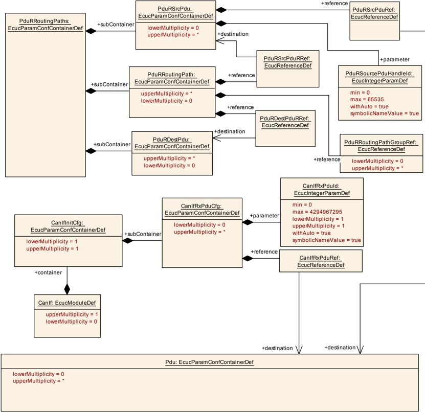

图11.1：**PDU**路由器、**CanIf** 和**Com** 配置示例

**CanIfCanRxPduId** 给出源**I-PDU** 的**I-PDU** ID，**ComIPdu** 的**HandleId** 给出目标**I-PDU** 的**I-PDU** ID。

**CanIf** 模块和**Com** 模块的短名（以及该**I-PDU** 通过通信接口模块传输这一事实）将生成要使用的路由表和 API：

| id | Source | TargetPduId | Destination |
| --- | --- | --- | --- |
| 12 | PduR_CanIfRxIndication | 13 | Com_RxIndication |

```C
/* PduR_CanIf.h */
void PduR_CanIfRxIndication(PduIdType RxPduId, const PduInfoType* PduInfoPtr);
```

如果启用了**PduRZeroCostOperation**，且**CanIf** 模块仅（通过**PDU**路由器模块）转发到**Com** 模块，则**PduR** 生成器可以优化生成的代码（如果使用源代码）：

```C
#define PduR_CanIfRxIndication Com_RxIndication
```

### 10.5. 构建后注意事项

本节描述了使用**PDU**路由器构建后变体时的一些重要行为。它不包含需求，只包含需要考虑的重要问题。

如果向**ECU** 下载新的构建后配置，**NVRAM** 和**RAM** 的内存大小可能会增长。必须在设计阶段进行估算以允许这种增长，从而不覆盖其他区域（在**RAM** 的情况下）或越过存储边界。

无法在**PduR** 模块配置中配置内存的限制/位置等，因为这属于实现特定的内容，且实现起来相对困难（预编译和链接时实际上并不需要）。建议**PduR** 模块生成器的实现在需要时以特定内存约束来扩展配置。

## B. AUTOSAR 可追溯项变更历史

请注意，本章中的列表还包含在后续版本中已从规范中移除的可追溯项。这些条目不会在文档中显示为超链接。

### B.1. 根据 AUTOSAR R22-11 的本文档可追溯项历史

#### B.1.1. R22-11 中新增的规范条目

表 B.1：R22-11 中新增的规范条目

```text
SWS_PduR_00921
SWS_PduR_CONSTR_00920
SWS_PduR_NA_00777
```

#### B.1.2. R22-11 中变更的规范条目

表 B.2：R22-11 中变更的规范条目

```text
SWS_PDUR_00816
SWS_PduR_00100
SWS_PduR_00333
SWS_PduR_00334
SWS_PduR_00338
SWS_PduR_00341
SWS_PduR_00362
SWS_PduR_00365
SWS_PduR_00369
SWS_PduR_00375
SWS_PduR_00381
SWS_PduR_00406
SWS_PduR_00424
SWS_PduR_00507
SWS_PduR_00512
SWS_PduR_00518
SWS_PduR_00615
SWS_PduR_00617
SWS_PduR_00654
SWS_PduR_00742
SWS_PduR_00743
SWS_PduR_00767
SWS_PduR_00769
SWS_PduR_00771
SWS_PduR_00824
SWS_PduR_91001
```

#### B.1.3. R22-11 中删除的规范条目

表 B.3：R22-11 中删除的规范条目

```text
SWS_PduR_00777
SWS_PduR_00827
```

#### B.1.4. R22-11 中新增的约束

无。

#### B.1.5. R22-11 中变更的约束

无。

#### B.1.6. R22-11 中删除的约束

无。

### B.2. 根据 AUTOSAR 发布版本 R23-11 的本文档可追溯项历史

#### B.2.1. R23-11 中新增的规范条目

无。

#### B.2.2. R23-11 中变更的规范条目

表 B.4：R23-11 中变更的规范条目

```text
SWS_PduR_00913
SWS_PduR_00914
SWS_PduR_00915
SWS_PduR_91001
```

**说明**：`SWS_PduR_91001` 的标题为“**PduR** 模块中必需接口的定义”。

#### B.2.3. R23-11 中删除的规范条目

无。

#### B.2.4. R23-11 中新增的约束

无。

#### B.2.5. R23-11 中变更的约束

无。

#### B.2.6. R23-11 中删除的约束

无。
