## 1. 简介和功能概述

本文介绍了AUTOSAR安全板载通信模块（**SecOC**）软件规范。它基于 AUTOSAR SecOC[5]，并规定了应如何实现 AUTOSAR SecOC SRS 中的需求。它描述了**AUTOSAR SecOC**模块的基本安全特性、功能和API。

**SecOC**模块旨在为PDU级别的关键数据提供资源高效和可行的认证机制。认证机制应该与当前的AUTOSAR通信系统无缝集成。对资源消耗的影响应该尽可能小，以便将保护作为遗留系统的附加组件。该规范基于这样一个假设，主要使用对称的身份（**symmetric authentication approach**）验证方法和消息身份验证码（**message authentication codes**）。它们用比非对称方法小得多的密钥实现了相同的安全级别，并且可以在软件和硬件中紧凑而高效地实现。同时本规范提供了必要的抽象级别，因此对称方法（**symmetric approaches**）和非对称身份验证（**asymmetric authentication approaches**）方法都是可以使用。

**SecOC**模块集成在**AUTOSAR PduR**级别。图中显示了**SecOC**模块集成为Autosar通信堆栈的一部分。

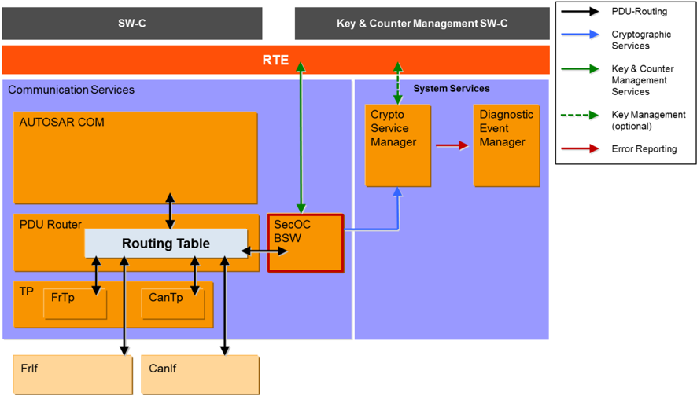

在该配置中，**PduR**负责将进出安全相关的**I-PDU**路由到**SecOC**模块。然后**SecOC**模块添加或处理安全相关信息，并将结果以**I-PDU**的形式传播回**PduR**。PduR负责进一步路由**I-PDU**。此外**SecOC**模块利用**CSM**提供的加密服务与**Rte**交互以允许密钥（**Key**）和计数器（**Counter**）管理。**SecOC**模块需要支持**PduR**支持的各种通信模式和原则，特别是组播通信（**Multicast communications**）、传输协议（**Transport Protocols**）和PduR网关（**PduR Gateway**）。以下各节提供了 **SecOC** 接口、功能和配置的详细规范。

## 2. 定义和缩略语

### 2.1. 缩略语

**CSM**（**Crypto Service Manager**）
> AUTOSAR 加密服务管理模块

**SecOC**（**Secure Onboard Communication**）
> 安全板载通信

**MAC**（**Message Authentication Code**）
> 消息身份验证代码

**FV**（**Freshness Value**）
> 新鲜度值

**FM**（**Freshness Manager**）
> 新鲜度管理器

### 2.2. 定义

本文档使用 [14] 中关于数据完整性（**data integrity**）、认证（**authentication**）、实体认证（**entity authentication**）、数据来源（**data origin**）、消息认证（**message authentication**）和事务认证（**transaction authentication**）的定义：

**Authentic I-PDU**（可信 I-PDU）
> 可信 I-PDU 是一个任意的 AUTOSAR I-PDU，其内容在通过网络传输期间借助受保护的 I-PDU（**Secured I-PDU**）得到保护。受保护的内容包括完整的 I-PDU 或 I-PDU 的一部分。

**Authentication**（认证）
> 认证是与识别相关的一项服务。该功能既适用于实体本身，也适用于信息。进入通信的两个参与方应相互识别。通过信道传递的信息应就其来源、来源日期、数据内容、发送时间等进行认证。因此，密码学的这一方面通常细分为两大类：实体认证（**entity authentication**）和数据来源认证（**data origin authentication**）。数据来源认证隐含地提供了数据完整性（因为如果消息被修改，则来源已改变）。

**Authentication Information**（认证信息）
> 认证信息由新鲜度值（**Freshness Value**，或其一部分）和验证器（**Authenticator**，或其一部分）组成。认证信息是 **SecOC** 为实现受保护的 I-PDU 而添加的附加信息。

**Authenticator**（验证器）
> 验证器是用于提供消息认证的数据。通常，术语消息验证码（**Message Authentication Code**，**MAC**）用于对称方法，而术语签名或数字签名（**Signature** 或 **Digital Signature**）指的是具有不同属性和约束的非对称方法。

**Data integrity**（数据完整性）
> 数据完整性是指数据自被合法来源创建、传输或存储以来未被以未经授权的方式更改的属性。为确保数据完整性，应具备检测未经授权方数据操纵的能力。数据操纵包括插入、删除和替换等。

**Data origin authentication**（数据来源认证）
> 数据来源认证是一种认证类型，其中一方被证实为在过去某个（通常未指定的）时间创建的特定数据的（原始）来源。根据定义，数据来源认证包含数据完整性。

**Distinction unilateral/ bilateral authentication**（单向/双向认证的区分）
> 在单向认证（**unilateral authentication**）中，一方证明其身份。请求方甚至未被认证到可证明其有权请求认证的程度。在双向认证（**bilateral authentication**）中，请求方也至少被认证（见下文）以证明其请求的权限。基于上述双向认证，存在一种高效且更安全的双向端点认证方式。除了最初由接收方（在第一条消息中）请求的认证（在第二条消息中）之外，发送方也请求一次认证。接收方发送第三条消息，提供发送方所请求的认证。这仅需要三条消息（相比之下，两条单向消息需要四条）。

**Entity authentication**（实体认证）
> 实体认证是这样一种过程：一方（通过获取佐证证据）确信协议中涉及的第二方的身份，并且该第二方确实参与了协议（即，在获取证据时或紧邻其之前处于活动状态）。
> **注意：** 实体认证意味着证明存在性和操作就绪性。

**Message authentication**（消息认证）
> 消息认证是与数据来源认证类似使用的术语。它提供关于原始消息来源的数据来源认证（以及数据完整性，但不提供唯一性）。

**Secured I-PDU**（受保护的 I-PDU）
> 受保护的 I-PDU 是一个 AUTOSAR I-PDU，它包含可信 I-PDU 的负载并附加了额外的认证信息。

**Transaction authentication**（事务认证）
> 事务认证表示消息认证，额外提供数据的唯一性和时效性（从而防止不可检测的消息重放）。

## 3. 相关文档

### 3.1. 输入文件和相关标准与规范

- [1] AUTOSAR Layered Software Architecture AUTOSAR\_CP\_EXP\_LayeredSoftwareArchitecture.pdf
- [2] AUTOSAR General Requirements on Basic Software Modules AUTOSAR\_CP\_SRS\_BSWGeneral.pdf
- [3] AUTOSAR General Specification for Basic Software Modules AUTOSAR\_CP\_SWS\_BSWGeneral.pdf
- [4] Specification of Communication AUTOSAR\_CP\_SWS\_COM - Specification of Communication
- [5] AUTOSAR SecOC Software Requirements Specification AUTOSAR\_CP\_SRS\_SecureOnboardCommunication.pdf
- [6] Specification of I-PDU Multiplexer AUTOSAR\_CP\_SWS\_I-PDUMultiplexer.pdf
- [7] Specification of PDU Router AUTOSAR\_CP\_SWS\_PduRouter.pdf
- [8] Specification of Crypt Service Manager AUTOSAR\_CP\_SWS\_CryptoServiceManager.pdf
- [9] System Template, https://svn3.autosar.org/repos2/work/24\_Sources/branches/R4.0/TPS\_SystemTe mplate\_063/AUTOSAR\_TPS\_SystemTemplate.pdf
- [10] Software Component Template, https://svn3.autosar.org/repos2/work/24\_Sources/branches/R4.0/TPS\_SoftwareC omponentTemplate\_062/AUTOSAR\_TPS\_SoftwareComponentTemplate.pdf
- [11] Koscher et al: Experimental Security Analysis of a Modern Automobile, 2010 IEEE Symposium on Security and Privacy
- [12] Checkoway et al: Comprehensive Experimental Analyses of Automotive Attack Surfaces, USENIX Security 2011
- [13] Auguste Kerckhoffs, 'La cryptographie militaire', Journal des sciences militaires, vol. IX, pp. 5-38, Jan. 1883, pp. 161-191, Feb. 1883.
- [14] A. J. Menezes, P. C. van Oorschot, and S. A. Vanstone. Handbook of Applied Cryptography. CRC Press, 1996.
- [15] Danny Dolev and Andrew C. Yao: On the security of public key protocols, In Foundations of Computer Science, SFCS 1981
- [16] M. Dworkin: Recommendation for Block Cipher Modes of Operation: The CMAC Mode for Authentication, U.S. Department of Commerce, Information Technology Laboratory (ITL), National Institute of Standards and Technology (NIST), Gaithersburg, MD, USA, NIST Special Publication 800-38B, 2005

### 3.2. 相关标准和规范

- [17] IEC 7498-1 The Basic Model, IEC Norm, 1994
- [18] National Institute of Standards and Technology (NIST): FIPS-180-4, Secure Hash Standard (SHS), March 2012, available electronically at http://csrc.nist.gov/publications/fips/fips180-4/fips-180-4.pdf
- [19] FIPS Pub 197: Advanced Encryption Standard (AES), U.S. Department of Commerce, Information Technology Laboratory (ITL), National Institute of Standards and Technology (NIST), Gaithersburg, MD, USA, Federal Information Processing Standards Publication, 2001, electronically available at http://csrc.nist.gov/publications/fips/fips197/fips-197.pdf

### 3.3. 相关规范

AUTOSAR 提供了基础软件通用规范（SWS BSW General）[3]，该规范同样适用于 **SecOC** 模块。

因此，SWS BSW General 规范 [3] 应被视为 AUTOSAR **SecOC** 模块的附加需求集。

## 4. 约束和假设

本文档适用于 AUTOSAR R4.3 版本。

### 4.1. 汽车域的适用性

**SecOC** 模块用于所有需要安全通信的 ECU。

**SecOC** 模块还没有被指定与 **MOST** 和 **LIN** 通信网络一起工作。由于 **MOST** 没有得到特别的支持，它对多媒体和车载通信领域的适用性可能会受到限制。

### 4.2. SomeIpTp 约束

**SecOC**模块只能用于保护整个**SomeIpTp**消息，不能用于保护某个**SomeIpTp**消息的单个片段。

在数据传输时以下模块顺序是被允许:
**SecOC -> PduR -> SomeIpTp**

但以下模块顺序是不被允许的:
**SomeIpTp -> PduR -> SecOC**

**SecOC**不能用来保护**SomeIpTp**单个消息段的主要原因如下:
> **SomeIpTp**需要调用**SomeIpTp_TriggerTransmit**来创建**SomIpTp**头。**SecOC**不支持上层通过**TriggerTransmit**方式提供数据。

## 5. 对其他模块的依赖

本章列出了 AUTOSAR **SecOC** 模块所使用的其他模块的所有特性，以及 AUTOSAR **SecOC** 模块向其他模块提供的功能。由于 **SecOC** 模块处理的是由其他模块提供或接收的 I-PDU，因此应注意使各模块之间的共享配置项保持一致。

### 5.1. PduR

**SecOC**模块依赖于**PduR**的API和功能。提供了**PDU Router**所需的上下两层API（**upper and lower layer API**）功能，即:
* 通信接口（**Communication Interface**）模块的API。
* 传输协议（**Transport Protocol**）模块的API。
* 使用传输协议（**Transport Protocol**）模块的上层模块的API。
* 处理通信接口（**Communication Interface**）模块发出的I-PDU的上层模块的API。

为了将安全处理的结果提供给**PduR**, **SecOC**模块需要**PduR**相关的API功能。

### 5.2. CSM

**SecOC**模块依赖于由**CSM**模块在AUTOSAR中提供的加密算法。**SecOC**模块需要API函数来生成和验证加密签名（**Cryptographic Signatures**）或消息验证码（**Message Authentication Codes**），即
* MAC生成接口（**Csm_MacGenerate**）。
* MAC验证接口（**Csm_MacVerify**）。
* 签名生成接口（**Csm_SignatureGenerate**）。
* 签名验证接口（**Csm_SignatureVerify**）。

### 5.3. RTE

**SecOC**模块提供了具有管理功能的API。这个API包含以下作为服务接口提供给RTE调用。
* **SecOC_VerificationStatus**
* [**SecOC_VerifyStatusOverride**](#739-secoc_verifystatusoverride).
* **SecOC_VerificationStatusIndication**

这些 API 函数在第 [7](#7-api规范) 章中有更详细的规范。

**Rte**包括**BSW-Scheduler**。**SecOC**模块依赖于**BSW-scheduler**在**SecOCMainFunctionPeriodRx**和**SecOCMainFunctionPeriodTx**中周期配置来调用函数[**SecOC_MainFunctionRx**](#761-secoc_mainfunctionrx)和[**SecOC_MainFunctionTx**](#762-secoc_mainfunctiontx)函数。

## 6. 功能规格

为了保护车辆系统的正确和安全功能，敏感数据的认证和完整性保护是必要的，这可以确保接收到的数据来自正确的ECU，具有正确的值。

**SecOC**模块的目标是在**PDU**级别上实现资源高效和实用的敏感数据认证机制。规范中提出的方法通常支持使用对称和非对称方法来保护真实性和完整性。这两种方法的目标大致相同，在概念上有很大的相似之处，但由于底层基元的技术属性不同，也存在一些差异。此外常用的身份验证器的术语是不同的。通常术语消息验证码（**Message Authentication Code, MAC**）用于对称方法，而术语签名或数字签名（**signature or digital signature**）指的是具有不同属性和约束的非对称方法。

为了便于描述和提高可读性，采用以下方式：后续章节详细描述了使用对称机制的技术方案，此处也使用对称基元的常用术语。在非对称方法的情况下需要进行的适配，单独给出在 [6.1.4](#614-非对称方法情况下的适配) 节中。

### 6.1. 安全解决方案规格说明

本文中描述的SecOC模块提供了必要的功能，用于验证整车架构中ECU之间基于PDU的通信的真实性（**authenticity**）和新鲜度（**freshness**）。该方法需要发送的ECU和接收的ECU都实现**SecOC**模块。集成了的两个**SecOC**模块，提供发送端和接收端上、下两层**PduR**接口。两边的**SecOC**模块通常与**PduR**模块交互。

为了提供消息的新鲜度，发送和接收端的**SecOC**模块为每个唯一可识别的受保护的I-PDU（即每个安全通信链路），从外部的freshness Manager获取新鲜度。

在发送端，**SecOC**模块通过在发出的可信**I-PDU**上添加认证信息，创建一个受保护**I-PDU**。验证信息包括验证器（例如：消息验证码MAC）和可选的新鲜度值（**Freshness Value**）。无论在安全**I-PDU**负载中是否包含新鲜度值，在生成验证器时都需要考虑新鲜度值。当使用新鲜度计数器而不是时间戳时，在向接收方提供认证信息之前，新鲜度管理器需要对新鲜度计数器增1。

在接收端，**SecOC**模块通过验证发送端**SecOC**模块附加的认证信息来检测可信**I-PDU**的新鲜度和真实性。为了验证真实的**I-PDU**的真实性和新鲜度，提供给接收方的**Secured I-PDU**应该与发送方的**Secured I-PDU**相同，接收方的安全**I-PDU**应该知道发送方在创建验证器时使用的新鲜度值。

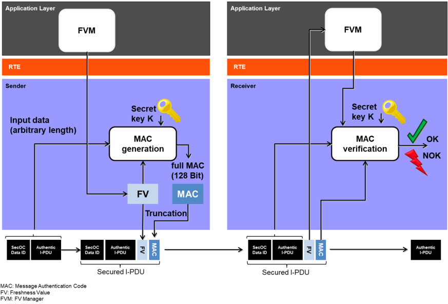

SecOC模块的主要目的是实现本规范中描述的安全功能。

#### 6.1.1. 安全解决方案的基本实体

##### 6.1.1.1. 可信I-PDU和受保护的I-PDU

可信I-PDU（**Authentic I-PDU**）指的是需要保护的AUTOSAR I-PDU，以防止未经授权的操作和重放攻击。

受保护的I-PDU（**Secured I-PDU**）的负载由可信I-PDU（**Authentic I-PDU**）和验证器（如：**消息验证码MAC**）组成。受保护的I-PDU的有效负载可以选择地是否包含新鲜度值来用于创建验证器（如：MAC）的。受保护的I-PDU中内容的结构顺序符合如图。

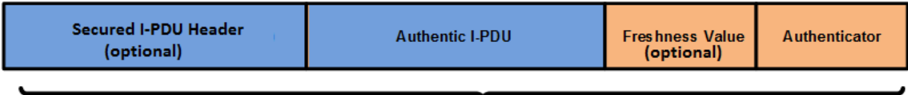

在受保护的**I-PDU**中，可信的**I-PDU**的长度、新鲜度值和验证器可能会因为受保护的I-PDU唯一不确定性而不同。

验证器（**Authenticator**）是指通过使用密钥（**Key**）、受保护的I-PDU的数据标识符（**Data Identifier**）、可信负载（**Authentic Payload**）和新鲜度值（**Freshness Value**）而生成的唯一认证数据字符串。验证器提供了一个高度的可信度，即可信I-PDU中的数据是由合法源生成的，并在其预期的时间提供给接收ECU。

根据用于生成验证器的认证算法（参数：**SecOCTxAuthServiceConfigRef**或**SecOCRxAuthServiceConfigRef**），可能会截断由验证算法生成的最终结果（例如，在MAC的情况下）。当消息有效负载的长度受到限制并且没有足够的空间包含完整的验证器（**Authenticator**）时，可能需要截断。

安全认证I-PDU中包含的验证器长度（参数：**SecOCAuthInfoTruncLength**）与唯一可识别的安全认证I-PDU相关。通过提供每个受保护的I-PDU的MAC截断长度的细粒度配置，可以在整个系统中提供灵活性（例如：两个独立的、唯一的受保护的I-PDU的负载中可能包含不同的验证器长度）。

如果截断是可能的，验证器应该只被截断到由验证算法生成的结果验证器的最重要的位。下图显示了基于参数**SecOCFreshnessValueTruncLength**和**SecOCAuthInfoTruncLength**的验证器和新鲜度值的截断示例。

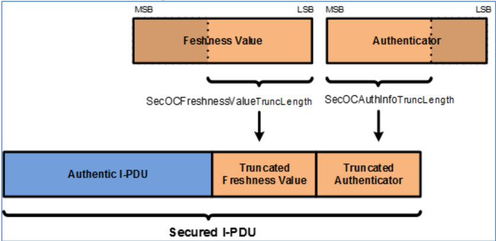

**注意：** 对于静态参与者嵌入的资源约束用例，我们建议使用消息认证码（**Message Authentication Codes**）作为认证的基础。（例如：基于AES [19] 的CMAC [16]，具有足够的密钥长度）。

**注意：** 在使用MAC的情况下，可以只传输和比较部分MAC，这被称为MAC截断。然而这导致了较低的安全级别，至少能对单个MAC的伪造。虽然我们建议始终使用至少128位的密钥长度，但MAC截断可能是有益的。当然每个用例的MAC的实际长度必须谨慎选择。作为一些指导，我们参考 [16] 的附录 A。一般认为，64位及以上的MAC大小可以提供足够的保护，防止NIST的猜测攻击。根据用例，不同的MAC大小可能是合适的，但这需要安全专家的仔细判断。

所有直接或间接传输到通信链路另一侧的所有 **SecOC** 数据（例如新鲜度值、验证器、数据标识符、SecOC 消息链接数据，……）应以大数据字节序（**Big Endian byte order**）编码，以便每个 **SecOC** 模块以相同的方式解释这些数据。

受保护的 I-PDU 头（**Secured I-PDU Header**）应指示可信 I-PDU 的长度（以字节为单位）。该头的长度应可通过参数 **SecOCAuthPduHeaderLength** 配置。

**注意：** **SecOC** 支持将认证数据放在单独消息（受保护的 PDU 集合）中与受保护的 I-PDU 头组合使用。**SecOC** 也覆盖动态长度的可信 I-PDU。

##### 6.1.1.2. 验证器涵盖的数据

验证器（Authenticator）计算的数据由受保护的I-PDU的数据标识符（参数：**SecOCDataId**）、可信I-PDU数据和完整的新鲜值（**Complete Freshness Value**）组成。它们分别连接在一起，组成传递到身份验证器生成/验证的身份验证算法的bit array里。

DataToAuthenticator = 数据标识符（**Data Identifier**） | 可信I-PDU的安全部分 （**Secured part of the Authentic I-PDU**）| 完整的新鲜值（**Complete Freshness Value**）

**注意:** 符合“|”表示连接。

##### 6.1.1.3. 新鲜度值

每个受保护的I-PDU至少配置一个新鲜度值（**Freshness Value**）。新鲜度值是一种单调计数器，用于保证保护I-PDU的新鲜度。这种单调计数器可以通过称为新鲜度计数器（**Freshness Counter**）的单个消息计数器来实现，也可以通过称为新鲜度时间戳（**Freshness Timestamp**）的时间戳值来实现。新鲜度值来自于一个新鲜度管理器（**Freshness Manager**）。

如果参数 **SecOCFreshnessValueTruncLength** 配置为小于实际新鲜度值的长度，则 **SecOC** 应在受保护的 I-PDU 中只包含新鲜度值的最低有效位，直到 **SecOCFreshnessValueTruncLength**。

如果参数 **SecOCFreshnessValueTruncLength** 配置为 0，则新鲜度值不应包含在受保护的 I-PDU 中。

**注意：** 认证消息负载中包含的完整新鲜度值的位数越大，就会导致接收端与发送端新鲜度值保持同步的窗口越大，而无需执行同步策略。

**注意：** 当在经过身份验证的消息有效负载中包含部分新鲜度值时，新鲜度值被称为两部分：最高有效位（**the most significant bits**）和最低有效位（**the least significant bits**）。包含在受保护的I-PDU负载中的计数器部分被称为新鲜度值的最低有效位，计数器的其余部分被称为新鲜度值的最有效位。

如果 **SecOCUseAuthDataFreshness** 设置为 **TRUE**，**SecOC** 应使用可信 I-PDU 的一部分作为新鲜度。在这种情况下，**SecOCAuthDataFreshnessStartPosition** 确定新鲜度在可信 I-PDU 中的起始位置（以位为单位），**SecOCAuthDataFreshnessLen** 确定其长度（以位为单位）。

**注意：** 这允许重用负载中已有的新鲜度值，这些值保证在一个新鲜度时间戳的有效期内是唯一的，例如一个4位E2E计数器。在这种情况下，SecOC不需要生成任何额外的计数器值。

**例子**：

如果 **SecOCUseAuthDataFreshness** 设置为 **TRUE**，**SecOCAuthDataFreshnessStartPosition** 设置为 '11'，**SecOCAuthDataFreshnessLen** 设置为 '4'，则将提取 PDU 的以下部分：

| PDU 的字节索引 | 0 | 1 | … |
| --- | --- | --- | --- |
| 起始位编号方案 | 7 6 5 4 3 2 1 0 | 15 14 13 12 11 10 9 8 | … |

对于 PDU 'AB CD'（十六进制），可信数据新鲜度应为 '1101'（二进制）。

新鲜度管理器（**Freshness Manager**）以字节数组的形式在接口函数中提供或接收新鲜度信息。新鲜度总是与数组中第一个字节的MSB对齐。第15位是第2字节的MSB，以此类推。新鲜度数组中未使用的位必须设置为0。相关的长度信息必须以位为单位给出。

**例子**：

10位新鲜度“001101011”（二进制）可以位于2字节数组中。应的值为:“35 80”（十六进制），长度为10。

##### 6.1.1.4. 新鲜度值构造

如果对于PDU配置为**SecOCQueryFreshnessValue = CFUNC**和**SecOCProvideTxTruncatedFreshnessValue = TRUE**，每当为相应的PDU构造**DataToAuthenticator**时，**SecOC**会调用接口函数[**SecOC_GetTxFreshnessTruncData**](#754-secoc_gettxfreshnesstruncdata)来获取TX消息的当前新鲜度。

如果对于PDU配置为**SecOCQueryFreshnessValue = CFUNC**和**SecOCProvideTxTruncatedFreshnessValue = FALSE**，每当为相应的PDU构造**DataToAuthenticator**时，**SecOC**会调用接口函数[**SecOC_GetTxFreshness**](#753-secoc_gettxfreshness)来获取TX消息的当前新鲜度。

如果对于PDU配置为**SecOCQueryFreshnessValue = RTE**和**SecOCProvideTxTruncatedFreshnessValue = TRUE**时，每当为相应的PDU构造**DataToAuthenticator**时，**SecOC**会调用服务操作**FreshnessManagement_GetTxFreshnessTruncData**来获取TX消息的当前新鲜度。

如果对于PDU配置为**SecOCQueryFreshnessValue = RTE**和**SecOCProvideTxTruncatedFreshnessValue = FALSE**，则每当为相应的PDU构造**DataToAuthenticator**时，**SecOC**会调用服务操作**FreshnessManagement_GetTxFreshness**来获取TX消息的当前新鲜度。

对于排队到 **SecOC** 的每个传输请求，应维护一个认证构建计数器（**authentication build counter**）。

在对受保护的 I-PDU 的传输请求进行初始处理时，**SecOC** 应将认证构建计数器设置为 0。

如果新鲜度函数查询（例如 [**SecOC_GetTxFreshness**](#753-secoc_gettxfreshness)()）返回 **E_BUSY**，或验证器计算（例如 **Csm_MacGenerate**()）返回 **E_BUSY**、**QUEUE_FULL** 或任何其他可恢复错误，则应递增认证构建计数器。

**注意：** 返回值 **E_NOT_OK** 不被视为可恢复错误。

如果认证构建失败且认证构建计数器尚未达到配置值 **SecOCAuthenticationBuildAttempts**，则应在下一次调用 Tx 主函数时重试新鲜度尝试和验证器计算。

如果认证构建计数器已达到配置值 **SecOCAuthenticationBuildAttempts**，或者新鲜度函数查询返回 **E_NOT_OK**，或者验证器计算返回了不可恢复的错误（例如返回 **E_NOT_OK** 或 **KEY_FAILURE**），则在由服务 **SecOC_SendDefaultAuthenticationInformation** 使能发送 **SecOCDefaultAuthenticationInformationPattern** 的情况下，**SecOC** 模块应使用 **SecOCDefaultAuthenticationInformationPattern** 填充新鲜度值和验证器的所有字节来构建认证信息。如果未使能发送 **SecOCDefaultAuthenticationInformationPattern**，则 **SecOC** 模块应从其内部缓冲区中移除可信 I-PDU 并取消传输请求。

**例子**：

SecOCFreshnessValueTxLength = 4bits

SecOCAuthInfoTxLength = 20 bits

SecOCDefaultAuthenticatorValue = 0xA5

受保护的 PDU 中生成的默认认证信息为 0x05（截断的新鲜度值）| 0xA5 0xA5 0xA0（截断的验证器）。'|' 表示连接。

如果对于PDU配置为**SecOCQueryFreshnessValue = CFUNC**和**SecOCProvideTxTruncatedFreshnessValue = TRUE**，**SecOC** 调用名为 [**SecOC_GetTxFreshnessTruncData**](#754-secoc_gettxfreshnesstruncdata) 的函数，以获取 TX 消息的当前新鲜度。

如果对于PDU配置为**SecOCQueryFreshnessValue = CFUNC**和**SecOCProvideTxTruncatedFreshnessValue = FALSE**，**SecOC** 调用名为 [**SecOC_GetTxFreshness**](#753-secoc_gettxfreshness) 的函数，以获取 TX 消息的当前新鲜度。

如果对于PDU配置为**SecOCQueryFreshnessValue = CFUNC**，**SecOC** 调用具有第 7.3.14 节所述签名的函数，以指示受保护的 I-PDU 已成功发起传输。

**注意：** 并不意图在消息出现在总线上之后调用此函数。在成功向 PduR 发出传输请求后调用此函数被认为更安全。

如果对于PDU配置，**SecOCQueryFreshnessValue = RTE**，**SecOC**通过调用业务操作**FreshnessManagement_SPduTxConfirmation**，表示受保护的I-PDU已成功发起传输。

对于 **SecOC** 内每个已处理的受保护 I-PDU，应维护认证构建计数器和认证验证尝试计数器（**authentication verify attempt counter**）。

在初始处理收到的受保护 I-PDU 时，认证构建计数器和认证验证尝试计数器应设置为 0。

如果新鲜度函数查询（例如 [**SecOC_GetRxFreshness**](#751-secoc_getrxfreshness)()）返回 **E_BUSY**，则应递增认证构建计数器，且不应执行任何认证验证尝试。

如果验证器验证（例如 **Csm_MacVerify**()）返回 **E_BUSY**、**QUEUE_FULL** 或任何其他可恢复错误，则应递增认证构建计数器。

**注意：** 返回值 **E_NOT_OK** 不被视为可恢复错误。

如果认证构建尝试失败且认证构建计数器尚未达到配置值 **SecOCAuthenticationBuildAttempts**，则应在下一次调用 Rx 主函数时重试新鲜度尝试和验证器验证。

如果验证器验证可成功执行但验证失败（例如 MAC 验证失败或密钥无效），则应递增认证验证尝试计数器，并将认证构建计数器设置为 0。

**注意：** 重置认证构建计数器应防止尽管仍有可能进行认证验证尝试而过早丢弃认证过程。

如果认证构建计数器已达到配置值 **SecOCAuthenticationBuildAttempts**，**SecOC** 模块应从其内部缓冲区中移除可信 I-PDU 并丢弃收到的消息。**VerificationResultType** 应设置为 **SECOC_AUTHENTICATIONBUILDFAILURE**。

如果新鲜度函数查询返回 **E_NOT_OK**，**SecOC** 模块应从其内部缓冲区中移除可信 I-PDU 并丢弃收到的消息。**VerificationResultType** 应设置为 **SECOC_FRESHNESSFAILURE**。

如果认证验证尝试计数器已达到配置值 **SecOCAuthenticationVerifyAttempts**，或验证器验证返回了不可恢复的错误（例如返回 **E_NOT_OK** 或 **KEY_FAILURE**），**SecOC** 模块应从其内部缓冲区中移除可信 I-PDU 并丢弃收到的消息。**VerificationResultType** 应设置为 **SECOC_VERIFICATIONFAILURE**。

如果使用 [**SecOC_VerifyStatusOverride**](#739-secoc_verifystatusoverride)，则验证结果和 I-PDU 根据 **overrideStatus** 的值处理。

**注意：** [8.4](#84-新鲜度处理) 中的时序图说明了该行为。

如果验证器验证成功，**VerificationResultType** 应设置为 **SECOC_VERIFICATIONSUCCESS**。

新鲜度管理应使用验证状态回调函数获取受保护 I-PDU 的验证结果。该通知可作为示例用于同步额外的新鲜度尝试，或用于计数器递增。

**注意：** **SecOC** 允许覆盖状态。因此，如果新鲜度管理依赖状态回调，同时又使用状态覆盖功能，必须小心。这可能导致新鲜度管理中的冲突，并可能产生错误的新鲜度值。

如果对于PDU配置，**SecOCQueryFreshnessValue = RTE**, **SecOCUseAuthDataFreshness = TRUE**，且已完全接收到受保护的PDU，**SecOC**则调用RTE服务**FreshnessManagement_GetRxFreshnessAuthData**查询当前的新鲜度。接收到的一部分PDU数据，将根据**SecOCAuthDataFreshnessStartPosition**和**SecOCAuthDataFreshnessLen**配置做为参数传递给该服务操作。

如果对于PDU配置，**SecOCQueryFreshnessValue = RTE** 且 **SecOCUseAuthDataFreshness = FALSE**，且已完全收到受保护的 PDU，**SecOC** 则调用 Rte 服务 **FreshnessManagement_GetRxFreshness** 查询当前的新鲜度。

如果对于PDU配置，**SecOCQueryFreshnessValue = CFUNC**, **SecOCUseAuthDataFreshness = TRUE**，且已完全收到受保护的PDU，**SecOC**则调用接口函数[**SecOC_GetRxFreshnessAuthData**](#752-secoc_getrxfreshnessauthdata)查询当前的新鲜度。接收到的一部分PDU数据，将根据**SecOCAuthDataFreshnessStartPosition**和**SecOCAuthDataFreshnessLen**配置做为参数传递给给该函数。

如果对于PDU配置，**SecOCQueryFreshnessValue = CFUNC** 且 **SecOCUseAuthDataFreshness = FALSE**，且已完全收到受保护的 PDU，**SecOC** 则调用接口函数 [**SecOC_GetRxFreshness**](#751-secoc_getrxfreshness) 查询当前的新鲜度。

如果 Rx 新鲜度请求函数返回 **E_NOT_OK**，则认为可信 I-PDU 的验证失败，且该 PDU 的认证重试计数器应递增。如果认证尝试次数已达到 **SecOCAuthenticationVerifyAttempts**，则 **SecOC** 模块应从其内部缓冲区中移除可信 I-PDU。故障 [**SECOC_E_FRESHNESS_FAILURE**](#692-运行时错误) 应报告给 DET 模块。

如果对于PDU配置为**SecOCQueryFreshnessValue = CFUNC**和**SecOCUseAuthDataFreshness = TRUE**，**SecOC** 查询名为 [**SecOC_GetRxFreshnessAuthData**](#752-secoc_getrxfreshnessauthdata) 的函数，以获取 RX 消息的当前新鲜度。

如果对于PDU配置为**SecOCQueryFreshnessValue = CFUNC**和**SecOCUseAuthDataFreshness = FALSE**，**SecOC** 查询名为 [**SecOC_GetRxFreshness**](#751-secoc_getrxfreshness) 的函数，以获取 RX 消息的当前新鲜度。

#### 6.1.2. I-PDU的认证

受保护的I-PDU（**Secured I-PDU**）的创建和可信I-PDU（**Authentic I-PDU**）的认证包括以下6个步骤:
1. 受保护的I-PDU的准备 （**Prepare Secured I-PDU**）
2. 验证器数据的构建 （**Construct Data for Authenticator**）
3. 验证器的生成 （**Generate Authenticator**）
4. 受保护的I-PDU的构建 （**Construct Secured I-PDU**）
5. 新鲜计数器的累加 (**Increment Freshness Counter**)
6. 受保护的I-PDU的广播发送（**Broadcast Secured I-PDU**）

**SecOC**模块在准备受保护的I-PDU过程中，**SecOC**应分配必要的缓冲区来保存认证过程的中间和最终结果。**SecOC**模块需要构造**DataToAuthenticator**，即用于计算验证器的数据。**DataToAuthenticator**由16位的Data Id（参数：**SecOCDataId**）的完整表示、可信I-PDU（**Authentic I-PDU**）的安全部分和SecOCFreshnessValueID对应的完整新鲜度值，按照给定的顺序连接而成。同时Data Id和新鲜度值（**Freshness Value**）应以大端字节顺序（**Big Endian byte order**）进行编码。

**SecOC**模块应通过将**DataToAuthenticator**、**DataToAuthenticator**的长度，传递到**SecOCTxAuthServiceConfigRef**对应的认证算法中来生成验证器（**Authenticator**）。

**SecOC**模块应将根据**SecOCAuthInfoTruncLength**的定义把验证器结果截短为指定的比特数。

**SecOC**模块应通过添加受保护的 I-PDU 头（可选）、新鲜度值（可选）和验证器到可信I-PDU，来构造受保护的I-PDU。

受保护的 I-PDU 的方案（包括内容在受保护的 I-PDU 中的结构化顺序）应符合以下规定：

SecuredPDU = SecuredIPDUHeader (optional) | AuthenticIPDU | FreshnessValue [SecOCFreshnessValueTruncLength] (optional) | Authenticator [SecOCAuthInfoTruncLength]

**注意：** 作为受保护的 I-PDU 一部分包含的新鲜度计数器和验证器，可以按针对受保护的 I-PDU 标识符的配置进行截断。此外，新鲜度值可以是可信 I-PDU 的一部分（参见第 [6.1.1.3](#6113-新鲜度值) 节）。

#### 6.1.3. I-PDU的验证

受保护的I-PDU的验证包括以下6个步骤：
1. 解析可信I-PDU、新鲜度值和验证器（**Parse Authentic I-PDU, Freshness Value and Authenticator**）
1. 从新鲜度管理器获得新鲜度值（**Get Freshness Value from Freshness Manager**）
1. 构建认证数据（**Construct Data to Authentication**）
1. 验证鉴权信息（**Verify Authentication Information**）
1. 发送确认书给新鲜度经理（**Send Confirmation to Freshness Manager**）
1. 将可信的I-PDU传递给上层（**Pass Authentic I-PDU to upper layer**）

如果使用 [**SecOCRxSecuredPduCollection**](#9211-secocrxsecuredpducollection)，则 **SecOC** 在收到组成受保护的 I-PDU 的可信 I-PDU 和加密 I-PDU 两者之前，不应执行任何验证。只有在两者都收到之后，**SecOC** 才应尝试验证所得的受保护的 I-PDU。如果使用 [**SecOC_VerifyStatusOverride**](#739-secoc_verifystatusoverride)，则验证结果和 I-PDU 根据 **overrideStatus** 的值处理。

**注意：** 这适用于 **SecOC** 从 PduR 收到受保护的 I-PDU 的所有情况，如上述在使用 [**SecOCRxSecuredPduCollection**](#9211-secocrxsecuredpducollection) 时以部分形式发生的情况。为避免重复和混乱，本文档中不再作进一步区分。

如果使用 [**SecOCRxSecuredPduCollection**](#9211-secocrxsecuredpducollection)，则 **SecOC** 在收到并缓冲了具有匹配消息链接器值（**Message Linker Values**）的可信 I-PDU 和加密 I-PDU 之前，不应尝试验证受保护的 I-PDU。如果使用 [**SecOC_VerifyStatusOverride**](#739-secoc_verifystatusoverride)，则验证结果和 I-PDU 根据 **overrideStatus** 的值处理。

**注意：** 如果 [**SecOCUseMessageLink**](#9221-secocusemessagelink) 的多重性为 0，这意味着 **SecOCMessageLinkLen** 为 0，且消息链接器值始终匹配。

在收到一个受保护的I-PDU后，**SecOC**模块将解析可信的I-PDU、新鲜度值和验证器。

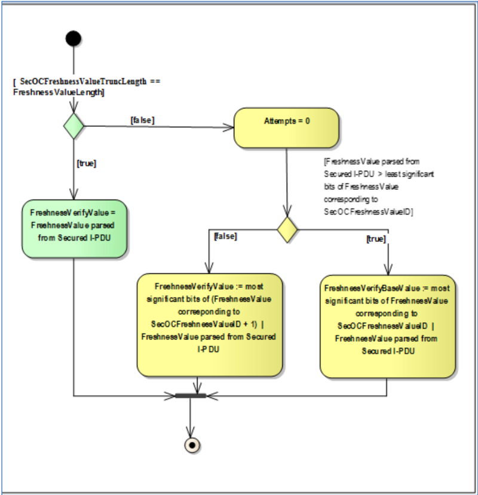

**SecOC**模块应构造用于在接收端计算验证器的数据（**DataToAuthenticator**）。该数据由**SecOCDataId** | **AuthenticIPDU** | **FreshnessVerifyValue**组成。

**SecOC**模块应通过将**DataToAuthenticator**、**DataToAuthenticator**的长度、从受保护的I-PDU解析出的验证器和**SecOCAuthInfoTruncLength**，都传递到与**SecOCRxAuthServiceConfigRef**对应的认证算法中来验证验证器。

验证过程按 [8.2](#82-传入-pdu-的验证) 章所述重复进行。

如果使用[**SecOC_VerifyStatusOverride**](#739-secoc_verifystatusoverride)，则根据**overrideStatus**的值处理验证结果和I-PDU。

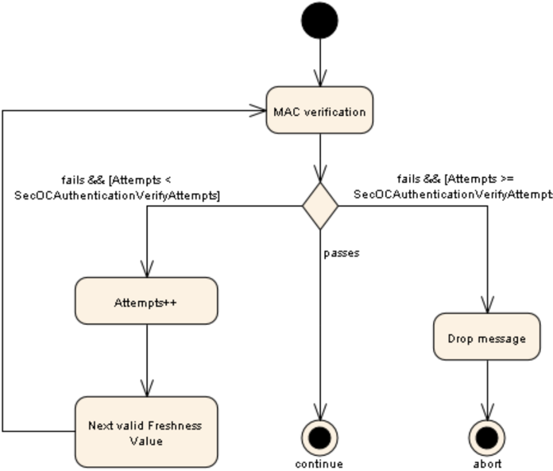

**SecOC** 模块应按如下方式报告相应受保护 Rx-PDU 的验证状态：

如果 **[SecOCRxPduProcessing](#927-secocrxpduprocessing)/SecOCVerificationStatusPropagationMode** 设置为 **BOTH** 或 **FAILURE_ONLY**，则应根据当前配置，通过 call out 函数 [**SecOC_VerificationStatusCallout**](#7731-secoc_verificationstatuscallout) 和 **SecOC_VerificationStatus** 接口来提供验证状态。如果此项配置设置为 **NONE**，则不提供报告。

**注意：** 如果新鲜度管理器需要受保护的 PDU 是否验证成功状态，例如为了同步时间或计数器，则应从 **SecOC** 提供的 [**VerificationStatus**](#7843-verificationstatus) 服务中获取该状态。

**SecOC** 模块应按如下方式报告相应受保护 Rx-PDU 的验证状态：

如果 **[SecOCRxPduProcessing](#927-secocrxpduprocessing)/SecOCClientServerVerificationStatusPropagationMode** 设置为 **BOTH** 或 **FAILURE_ONLY**，则应根据当前配置，通过服务接口 **SecOC_VerificationStatusIndication** 来提供验证状态。如果此项配置设置为 **NONE**，则不提供报告。

如果配置项 **[SecOCGeneral](#922-secocgeneral)/SecOCPropagateOnlyFinalVerificationStatus** 设置为 **TRUE**，则只应报告最终状态。如果此项设置为 **FALSE**，则应根据上面的规定报告每一个单独的验证状态（最后的以及所有之前的失败）。

##### 6.1.3.1. I-PDU的成功验证

如果受保护的I-PDU验证成功或设置了状态覆盖，则**SecOC**模块需要通过PduR的下层接口（**the lower layer interfaces**），将可信I-PDU传递给上层通信模块（**the upper layer communication layer**）。

#### 6.1.4. 非对称方法情况下的适配

尽管本文档始终使用对称密码学的术语和概念，**SecOC** 模块仍可配置为同时使用对称和非对称密码算法。在使用数字签名而非全文所述 MAC 方法的非对称方案情况下，必须进行一些适配：

1. 不使用发送方与（所有）接收方之间的共享密钥，而是使用由公钥和私钥组成的密钥对。私钥（**secret** 或 **private key**）由发送方用于生成签名，相应的公钥由（所有）接收方用于验证签名。私钥必须不能从公钥切实可行地计算得出，且接收方不应能够获取它。
2. 为了验证消息，接收方需要访问完整的签名／签名生成算法的输出。因此，如 MAC 情况中所建议的对签名进行截断是不可能的。参数 **SecOCAuthInfoTruncLength** 必须设置为签名的完整长度。
3. 签名验证使用的算法与签名生成不同。因此，与上述在接收方侧“重建”MAC 并将其与收到的（截断）MAC 进行比较不同，接收方／验证方执行验证算法，以 **DataToAuthenticator**（包括完整计数器）和签名作为输入，并获得一个布尔值作为输出，以确定验证是通过还是失败。

### 6.2. 与 PduR 的关系

**SecOC** 模块在 AUTOSAR 的分层架构中布置在 **PDU-Router** 旁边；参见下图。

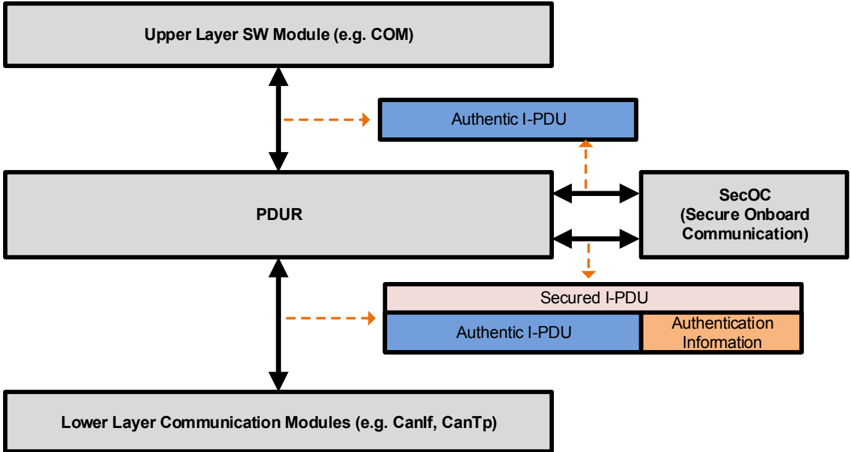

**SecOC** 模块的实现应确保没有其他模块依赖于它，并且在不需要时可以构建一个不包含 **SecOC** 模块的系统。

**SecOC** 应确保在可信 PDU 中接收到的 **MetaData** 在相应的受保护 PDU 中原样存在，反之亦然。

### 6.3. 初始化

**SecOC** 模块提供初始化函数（[**SecOC_Init**](#731-secoc_init)），如第 [7.3.1](#731-secoc_init) 节所定义。该函数初始化所有内部全局变量以及用于存储 **SecOC** I-PDU 和所有中间结果的缓冲区。**SecOC** 的运行环境应在调用 **SecOC** 模块的任何其他函数（[**SecOC_GetVersionInfo**](#733-secoc_getversioninfo) 除外）之前调用 [**SecOC_Init**](#731-secoc_init)。实现者必须确保在开发模式下，如果在模块初始化之前调用了 API 函数，则返回 [**SECOC_E_UNINIT**](#691-开发错误)。

对于经由 **SecOC** 模块的 I-PDU 数据传输路径，在 **SecOC** 模块内部会分配一个缓冲区。该缓冲区需要被初始化，因为它可能会在上层或下层通信模块完全填充数据之前就被发送。

[**SecOC_Init**](#731-secoc_init) 应初始化 **SecOC** I-PDU 的所有内部全局变量和缓冲区。

AUTOSAR **SecOC** 模块应使用由配置参数 **SecOCTxPduUnusedAreasDefault**（ECUC_SecOC_00101）确定的值（例如 0xFF）填充所传输的受保护 PDU 或所传输的加密 PDU 中未使用的区域。

### 6.4. 传出 PDU 的认证

术语认证（**authentication**）描述的是通过向可信 I-PDU 添加认证信息来创建受保护的 I-PDU。该过程在第 [6.1.2](#612-i-pdu的认证) 节中以一般方式描述。本节针对与 **PduR** 模块集成所产生的需求，考虑不同的总线接口和传输协议，对一般描述进行细化。通常，与 **PduR** 模块的交互以及可信 I-PDU 的认证按以下方案组织：

1. 对于每个可信 I-PDU 的传输请求，上层通信模块应通过 **PduR_&lt;Up&gt;Transmit** 调用 **PduR** 模块。
1. **PduR** 将该请求路由到 **SecOC** 模块，并调用 **SecOC_[If|Tp]Transmit**。
1. **SecOC** 模块将可信 I-PDU 复制到自己的内存中并返回。
1. 在其主函数的下一次调度调用期间，**SecOC** 模块通过计算认证信息创建受保护的 I-PDU，并通过 **PduR** 模块通知相应的下层模块来发起受保护的 I-PDU 的传输。
1. 此后，**SecOC** 模块承担上层通信模块的角色，从而为所有下层请求提供服务，以提供受保护的 I-PDU 的信息或复制其数据。
1. 最后，将受保护的 I-PDU 传输成功或失败的确认作为可信 I-PDU 传输成功或失败的确认，提供给上层通信模块。

**注意：** 对于每个可信 I-PDU，上层通信模块的配置方式应使其像通常发起直接传输请求那样调用 **PduR** 模块。在这种情况下，上层通过 **SecOC** 模块与 **TriggerTransmit** 和 TP 行为解耦。

为了发起可信 I-PDU 的传输，上层模块总是（并且与用于具体传输的总线接口无关）通过 **PduR_&lt;Up&gt;Transmit** 调用 **PduR** 模块。**PduR** 将该请求路由到 **SecOC** 模块，以便 **SecOC** 模块立即访问上层通信模块缓冲区中的可信 I-PDU。

**SecOC** 模块应在开始传输相应的受保护的 I-PDU 之前，将完整的可信 I-PDU 复制到其内部存储器中。

**注意：** 这意味着上层 PDU 接口与下层 PDU 接口的 IF/TP 配置之间不存在依赖关系。

如果使用了 [**SecOCTxSecuredPduCollection**](#9218-secoctxsecuredpducollection)，则 **SecOC** 应将受保护的 I-PDU 作为两条消息传输：原始的可信 I-PDU 和单独的加密 I-PDU。加密 I-PDU 应包含受保护的 I-PDU 的所有认证信息，以便可信 I-PDU 和加密 I-PDU 包含重建受保护的 I-PDU 所需的所有信息。

**注意：** 这适用于 **SecOC** 向 **PduR** 传输受保护的 I-PDU 的所有情况。为避免重复和混乱，本文档中不再作进一步区分。

**SecOC** 应在同一个主函数周期内传输可信 I-PDU 及其相应的加密 I-PDU。

如果使用了 [**SecOCTxSecuredPduCollection**](#9218-secoctxsecuredpducollection)，则 **SecOC** 应在加密 I-PDU 内重复可信 I-PDU 的一部分作为消息链接器（**Message Linker**），且加密 I-PDU 应构造为：

Cryptographic I-PDU = Authentication Data | Message Linker

**注意：** 符号“|”表示连接。

如果使用了 [**SecOCUseMessageLink**](#9221-secocusemessagelink)，则 **SecOC** 应使用可信 I-PDU 内位于比特位置 **SecOCMessageLinkPos**、长度为 **SecOCMessageLinkLen** 位的值作为消息链接器。

如果使用了 [**SecOCTxSecuredPduCollection**](#9218-secoctxsecuredpducollection)，则当可信 I-PDU 和加密 I-PDU 的 [**SecOC_TxConfirmation**](#743-secoc_txconfirmation) 均被调用时，**SecOC** 应将 **TxConfirmation** 转发给上层。仅当两次 **TxConfirmation** 调用的结果参数均为 **E_OK** 时，上层 **TxConfirmation** 调用的结果参数才应为 **E_OK**；否则结果参数应为 **E_NOT_OK**。

**SecOC** 模块应根据 SWS_SecOC_00031 中描述的过程，提供足够的缓冲区容量来存储传入的可信 I-PDU、传出的受保护的 I-PDU 以及认证过程的所有中间数据。

**SecOC** 模块应为可信 I-PDU 和受保护的 I-PDU 提供单独的缓冲区。

来自上层通信模块的任何传输请求都应覆盖包含可信 I-PDU 的缓冲区，而不影响相应受保护的 I-PDU 的缓冲区。

因此，上层对可信 I-PDU 的更新可以在不影响与下层通信模块正在进行的受保护的 I-PDU 传输活动的情况下得到处理。

对于 **SecOCAuthPduHeaderLength** 大于 0 的 Tx 受保护的 I-PDU，**SecOC** 模块应将包含可信 I-PDU 长度的受保护的 I-PDU 头添加到受保护的 I-PDU 中，以处理动态可信 I-PDU。

**注意：** 该头的主要作用是，在具有动态长度可信 I-PDU 的受保护的 I-PDU 中指示新鲜度值和验证器的位置。此外，某些无法选择任意长度 L-PDU 的总线（例如 CAN FD 和 FlexRay）需要该头，因为在 **SecOC** 处理之后，下层模块（例如 CanIf 和 FrIf）可能会添加总线特定的填充字节，从而使新鲜度值和验证器的位置并不总是位于受保护的 I-PDU 的末尾（此时含填充的 L-PDU 为：Secured I-PDU = Secured I-PDU Header | Authentic I-PDU | Freshness Value | Authenticator | Bus-specific padding）。

#### 6.4.1. 直接传输过程中的认证

对于使用允许即席传输（**ad-hoc transmission**）的总线接口（例如 CanIf）传输可信 I-PDU 的情况，**PDU Router** 模块会触发 **SecOC** 模块对可信 I-PDU 的传输操作。在这种情况下，**SecOC** 模块通过分配内部缓冲区容量并将可信 I-PDU 复制到本地缓冲区位置，为基于可信 I-PDU 创建受保护的 I-PDU 做准备。之后它从 **SecOC_[If|Tp]Transmit** 返回。

**SecOC** 模块应分配内部缓冲区容量，以将可信 I-PDU 和认证信息存储在连续的内存位置中。

受保护的 I-PDU 的实际创建在调度主函数的下一次后续调用中处理。这包括根据 SWS_SecOC_00031 计算认证信息，并将认证信息（即验证器和可能被截断的新鲜度值）连续添加到紧接可信 I-PDU 之后的缓冲区位置。此后，**SecOC** 模块通过在 **PduR** 调用 **PduR_SecOCTransmit**，触发将受保护的 I-PDU 传输到目的下层模块。

对于使用允许即席传输的总线接口（例如 CanIf）传输可信 I-PDU 的情况，**SecOC** 模块应在调度主函数中按照 SWS_SecOC_00031 规定的总体方法计算验证器。

对于使用允许即席通信的总线接口（例如 CanIf）传输可信 I-PDU 的情况，**SecOC** 模块应在调度主函数中创建受保护的 I-PDU。

**SecOC** 模块应通过触发 **PduR_SecOCTransmit**，为传输到目的下层模块提供完整的受保护的 I-PDU。

如果 **PDU Router** 模块通过调用 **SecOC_[If|Tp]TxConfirmation** 通知 **SecOC** 模块，目的下层模块已确认受保护的 I-PDU 的传输或在传输过程中报告了错误，则 **SecOC** 模块应通过调用 **PduR_SecOC[If|Tp]TxConfirmation**，将相应可信 I-PDU 的接收结果传递给上层模块。

对于使用允许即席通信的总线接口（例如 CanIf）传输可信 I-PDU 的情况，如果针对受保护的 I-PDU 调用了 [**SecOC_TxConfirmation**](#743-secoc_txconfirmation)，则 **SecOC** 模块应释放包含受保护的 I-PDU 的缓冲区。

#### 6.4.2. 触发传输过程中的认证

对于使用允许触发传输（**triggered transmission**）的总线接口（例如 FrIf）传输可信 I-PDU 的情况，上层的配置方式应使其像通常发起直接传输那样调用 **PduR** 模块。因此，上层模块通过 **PduR_&lt;Up&gt;Transmit** 提供所需的缓冲区信息，从而立即提供对可信 I-PDU 的访问。**PduR** 通过调用 [**SecOC_IfTransmit**](#734-secoc_iftransmit) 将该传输请求转发给 **SecOC** 模块。在 **SecOC** 能够通过触发传输接口向下层提供数据之前，至少需要一次先前对 [**SecOC_IfTransmit**](#734-secoc_iftransmit) 的调用。如果在调用了 [**SecOC_TriggerTransmit**](#745-secoc_triggertransmit) 时无法提供数据，则返回 **E_NOT_OK**。

**注意：** 仅在由上层通过事先显式调用 **PduR_&lt;Up&gt;Transmit** 发起传输时，才支持触发传输的认证。不应使用 **AlwaysTransmit** 模式下的触发传输。

反过来，**SecOC** 模块分配足够的缓冲区容量来存储可信 I-PDU、受保护的 I-PDU 以及认证过程的所有中间数据。**SecOC** 模块将可信 I-PDU 复制到自己的缓冲区并返回。

受保护的 I-PDU 的实际创建在调度主函数的下一次后续调用中处理。这包括根据 SWS_SecOC_00031 计算认证信息，并将认证信息（即验证器和可能被截断的新鲜度值）连续添加到紧接可信 I-PDU 之后的缓冲区位置。此后，**SecOC** 模块通过在 **PduR** 调用 **PduR_SecOCTransmit**，触发将受保护的 I-PDU 传输到目的下层模块。

对于使用允许触发传输的总线接口（例如 FrIf）传输可信 I-PDU 的情况，**SecOC** 模块应在调度主函数中按照 SWS_SecOC_00031 规定的总体方法计算验证器。

对于使用允许触发传输的总线接口（例如 FrIf）传输可信 I-PDU 的情况，**SecOC** 模块应在调度主函数中创建受保护的 I-PDU。

接下来，**SecOC** 模块作为来自下层模块的后续传输请求的数据提供者。因此，**SecOC** 模块持有完整的受保护的 I-PDU，并充当上层模块。上层模块不再期望任何要求将可信 I-PDU 复制到下层模块的进一步回调。

对于使用允许触发传输的总线接口（例如 FrIf）传输可信 I-PDU 的情况，**SecOC** 模块应通过在 **PduR** 触发 **PduR_SecOCTransmit** 来指示对完整受保护的 I-PDU 的传输请求。**PduR** 负责进一步处理该请求并通知相应的下层模块。

当目的下层模块准备好传输受保护的 I-PDU 时，它会调用 **PduR_&lt;Lo&gt;TriggerTransmit**。**PduR** 将该请求转发给 **SecOC** 模块，**SecOC** 模块将完整的受保护的 I-PDU 复制到下层。之后它返回。

**注意：** **SecOC** 模块不得将触发传输调用转发给上层，而是自己承担上层的角色，将完整的受保护的 I-PDU 复制到下层。

当 **PduR** 模块调用 [**SecOC_TriggerTransmit**](#745-secoc_triggertransmit) 时，**SecOC** 模块应将受保护的 I-PDU 复制到下层目的模块。

当 **PduR** 模块调用 [**SecOC_TriggerTransmit**](#745-secoc_triggertransmit) 且 **SecOC** 模块无法向下层提供受保护的 I-PDU（没有可用的受保护的 I-PDU）时，**SecOC** 模块应以 **E_NOT_OK** 返回该调用。

最后，当下层通过 **PduR_&lt;Lo&gt;TxConfirmation** 确认受保护的 I-PDU 的处理（结果可以为正，如果 PDU 已成功发送；或为负，如果无法传输），该确认通过调用 [**SecOC_TxConfirmation**](#743-secoc_txconfirmation) 转发给 **SecOC** 模块。反过来，**SecOC** 模块将可信 I-PDU 的传输过程结果传递给 **PduR** 模块，以便 **PduR** 模块可以通过 **&lt;Up&gt;_TxConfirmation** 将结果转发给作为原始 I-PDU 来源的上层模块（参见 SWS_SecOC_00063）。

在触发传输过程中，上层模块和下层模块的更新速率可能不同。因此，下层模块可能会在上层尚未更新可信 I-PDU 的情况下请求受保护的 I-PDU 的新传输。在这种情况下，**SecOC** 模块通过更新后的受保护的 I-PDU 支持可信 I-PDU 的重复传输。因此，它必须保留可信 I-PDU，直到受保护的 I-PDU 已发送并通过 [**SecOC_TxConfirmation**](#743-secoc_txconfirmation) 确认其传输。在这种情况下，**SecOC** 模块将现有的可信 I-PDU 视为新的，并在随后调用 [**SecOC_MainFunctionTx**](#762-secoc_mainfunctiontx) 时对其重新认证。

对于使用允许触发传输的总线接口（例如 FrIf）传输可信 I-PDU 且受保护的 I-PDU 的传输已通过 [**SecOC_TxConfirmation**](#743-secoc_txconfirmation) 确认（成功发送）的情况，**SecOC** 模块应释放包含认证信息的缓冲区，并保留包含可信 I-PDU 的缓冲区。如果参数 **SecOCReAuthenticateAfterTriggerTransmit** 设置为 true，则可信 I-PDU 应被视为由上层设置，从而应在随后调用 [**SecOC_MainFunctionTx**](#762-secoc_mainfunctiontx) 时进行新的认证过程。否则不需要对可信 I-PDU 重新认证。

#### 6.4.3. 传输协议传输过程中的认证

对于使用传输协议传输（例如 CanTp、FrTp）传输可信 I-PDU 的情况，**PDU Router** 模块触发 **SecOC** 模块对可信 I-PDU 的传输操作。在这种情况下，**SecOC** 模块通过分配内部缓冲区容量并将可信 I-PDU 复制到本地缓冲区位置，为基于可信 I-PDU 创建受保护的 I-PDU 做准备。之后它从 **SecOC_[If|Tp]Transmit** 返回。

受保护的 I-PDU 的实际创建在调度主函数的下一次后续调用中处理。这包括根据 SWS_SecOC_00031 计算认证信息，并将认证信息（即验证器和可能被截断的新鲜度值）连续添加到紧接可信 I-PDU 之后的缓冲区位置。

如果 **SecOCPduType** 配置为 **SECOC_TPPDU**，则函数 [**SecOC_TpTransmit**](#735-secoc_tptransmit) 应触发可信 I-PDU 的传输操作。

在 **SecOCPduType** 配置为 **SECOC_TPPDU** 的传输操作被触发之后，**SecOC** 应通过调用 **PduR_SecOCTpCopyTxData** 指示上层将 I-PDU 的下一部分复制到本地 **SecOC** 缓冲区。

**注意：** 对 **PduR_SecOCTpCopyTxData** 的调用可能发生在 [**SecOC_TpTransmit**](#735-secoc_tptransmit) 的上下文中。

对于使用传输协议传输可信 I-PDU 的情况，**SecOC** 模块应在调度主函数中按照 SWS_SecOC_00031 规定的总体方法计算验证器。在 **SecOCPduType** 配置为 **SECOC_TPPDU** 的情况下，新鲜度值应尽可能晚地获取，即在该消息部分即将发送到总线时恰好获取。

**注意：** 延迟获取新鲜度值是为了在 TP 传输耗时较长的情况下获得最新的值。

对于使用传输协议传输可信 I-PDU 的情况，**SecOC** 模块应在调度主函数中创建受保护的 I-PDU。

此后，**SecOC** 模块通过在 **PduR** 调用 **PduR_SecOCTpStartOfReception**，触发将受保护的 I-PDU 传输到目的下层模块。从而它通知下层模块其对受保护的 I-PDU 的传输请求。

对于使用传输协议传输可信 I-PDU 的情况，**SecOC** 模块应通过在 **PduR** 触发 **PduR_SecOCTransmit** 来指示对完整受保护的 I-PDU 的传输请求。**PduR** 负责进一步处理该请求并通知相应的下层模块。

接下来，**SecOC** 模块作为来自下层模块的后续传输请求的数据提供者。因此，**SecOC** 模块持有完整的受保护的 I-PDU，并充当上层模块。上层模块不再期望任何要求将可信 I-PDU 复制到下层模块的进一步回调。

当 **PduR** 通过 [**SecOC_CopyTxData**](#747-secoc_copytxdata) 迭代轮询 **SecOC** 模块，以有效地将受保护的 I-PDU 传输到下层模块时，**SecOC** 模块将受保护的 I-PDU 的 N-PDU 复制到下层传输协议模块。

对于使用传输协议传输可信 I-PDU 的情况，**SecOC** 模块应将 [**SecOC_CopyTxData**](#747-secoc_copytxdata) 所寻址的 N-PDU 复制到传输协议模块的缓冲区中。每次复制过程之后，它从 [**SecOC_CopyTxData**](#747-secoc_copytxdata) 返回。

最后，当下层通过 **PduR_&lt;Lo&gt;TxConfirmation** 确认受保护的 I-PDU 的处理（结果可以为正，如果 PDU 已成功发送；或为负，如果无法传输），结果被转发给 **SecOC** 模块，**SecOC** 模块反过来确认可信 I-PDU 的处理，以便 **PduR** 模块可以通过 **&lt;Up&gt;_TxConfirmation** 将结果转发给上层。

对于使用传输协议传输可信 I-PDU 的情况，当下层通过调用 [**SecOC_TpTxConfirmation**](#744-secoc_tptxconfirmation) 确认受保护的 I-PDU 的传输或发出错误信号时，**SecOC** 模块应转而传递可信 I-PDU 的接收结果：如果 **SecOCPduType** 配置为 **SECOC_IFPDU**，则通过 **PduR_SecOCIfTxConfirmation**；如果 **SecOCPduType** 配置为 **SECOC_TPPDU**，则通过 **PduR_SecOCTpTxConfirmation**。

对于使用传输协议传输可信 I-PDU 的情况，**SecOC** 模块应仅在针对受保护的 I-PDU 调用了 [**SecOC_TpTxConfirmation**](#744-secoc_tptxconfirmation) 时才释放包含受保护的 I-PDU 的缓冲区。

#### 6.4.4. 传输的错误处理和取消

如果上层模块通过调用 **SecOC_[If|Tp]CancelTransmit** 请求取消正在进行的可信 I-PDU 的传输，则 **SecOC** 模块应立即通知下层传输协议模块取消正在进行的受保护的 I-PDU 的传输，停止与可信 I-PDU 相关的所有内部动作，并释放所有相关的缓冲区。

当 **PduR_SecOCTransmit** 返回除 **E_OK** 之外的任何值时，**SecOC** 应从下一次主函数开始重试失败的传输，最多重试 **SecOCMaxTransmitRetries** 次。

如果下层传输协议模块在使用 [**SecOC_TpTxConfirmation**](#744-secoc_tptxconfirmation) 传输受保护的 I-PDU 期间通过返回值 **E_NOT_OK** 报告错误，则 **SecOC** 模块不得执行除跳过向上一层模块确认相应可信 I-PDU 的传输请求之外的任何错误处理。

如果 **CSM** 模块在可信 I-PDU 的认证期间报告可恢复错误（例如 **E_BUSY**、**QUEUE_FULL**），**SecOC** 模块不应向下层提供受保护的 I-PDU。它应保留该可信 I-PDU（如果未被同一类型的传入可信 I-PDU 覆盖），以便在调度主函数的下一次调用时开始认证，直到该可信 I-PDU 的额外认证尝试次数达到其限制。

如果某个可信 I-PDU 的尝试次数已达到限制 **SecOCAuthenticationBuildAttempts**（该参数定义新鲜度管理器提供的最大新鲜度值数量），**SecOC** 模块应向 DET 模块报告 [**SECOC_E_CRYPTO_FAILURE**](#691-开发错误)。

如果 **SecOC** 模块在可信 I-PDU 的传输期间由于任意内部错误而无法服务于任何上层或下层请求，则应以 **E_NOT_OK** 返回该请求。

如果上层模块通过调用 [**SecOC_TpCancelReceive**](#738-secoc_tpcancelreceive) 请求取消正在进行的可信 I-PDU 的接收，则 **SecOC** 模块应立即通知下层传输协议模块取消正在进行的受保护的 I-PDU 的接收，停止与可信 I-PDU 相关的所有内部动作，并释放所有相关的缓冲区。

如果上层传输协议模块在对 **PduR_SecOCTpCopyTxData** 的调用中报告 **BUFREQ_E_BUSY**，则 **SecOC** 应在其调度主函数的下一次后续调用中重试该调用。

如果上层传输协议模块在对 **PduR_SecOCTpCopyTxData** 的调用中报告 **BUFREQ_E_NOT_OK**，则 **SecOC** 应立即通过以 **E_NOT_OK** 结果调用 **PduR_SecOCTpTxConfirmation** 中止传输，停止与可信 I-PDU 相关的所有内部动作，并释放所有相关的缓冲区。

### 6.5. 输入 PDU 的验证

术语验证（**verification**）描述的是将受保护的 I-PDU 中包含的认证信息与基于本地数据标识符、本地新鲜度值以及受保护的 I-PDU 中包含的可信 I-PDU 计算出的认证信息进行比较的过程。

验证传入的受保护的 I-PDU 的过程在第 [6.1.3](#613-i-pdu的验证) 节中以一般方式描述。本节针对与 **PduR** 模块集成所产生的需求，考虑不同的总线接口和传输协议，对一般描述进行细化。与 **PduR** 模块的整体交互以及受保护的 I-PDU 的验证按以下方案组织：

1. 对于来自下层总线接口或传输协议模块的每个传入受保护的 I-PDU 的指示，**SecOC** 模块承担上层通信模块的角色，从而为接收完整的受保护的 I-PDU 所需的所有下层请求提供服务。
1. **SecOC** 模块将受保护的 I-PDU 复制到自己的内存中。
1. 此后，当完整的受保护的 I-PDU 可用时，并在其主函数的下一次调度调用期间，**SecOC** 模块根据 SWS_SecOC_00040 验证受保护的 I-PDU 的内容。
1. 如果验证失败且参数 **SecOCIgnoreVerificationResult** 配置为 **FALSE**，则 **SecOC** 模块丢弃受保护的 I-PDU。
1. 如果验证成功，或验证失败但参数 **SecOCIgnoreVerificationResult** 配置为 **TRUE**，则 **SecOC** 模块承担下层通信模块的角色，并为可信 I-PDU 调用 **PduR_SecOC[If|Tp]RxIndication**。
1. **SecOC** 根据 SWS_SecOC_00048 报告验证结果。

因此，**SecOC** 将上层模块与下层模块之间的交互解耦。**SecOC** 模块管理与下层模块的交互，直到它将完整的受保护的 I-PDU 复制到自己的缓冲区。它这样做时不影响上层模块。此后，它验证受保护的 I-PDU 的内容，并根据验证结果发起可信 I-PDU 到上层通信模块的传输。

在 **SecOCReceptionOverflowStrategy** 设置为 **REPLACE** 的情况下，如果已发起对相同 Pdu Identifier 的受保护的 I-PDU 的接收，**SecOC** 模块应释放与该受保护的 I-PDU 相关的所有缓冲区。

在 **SecOCReceptionOverflowStrategy** 设置为 **REJECT** 且 **SecOC** 当前正忙于同一受保护的 I-PDU 的情况下，**SecOC** 模块应忽略任何后续对 [**SecOC_RxIndication**](#741-secoc_rxindication) 的调用，并对任何后续对 [**SecOC_StartOfReception**](#748-secoc_startofreception) 的调用返回 **BUFREQ_E_NOT_OK**。

**SecOC** 应为传入的受保护的 I-PDU、加密 I-PDU 以及由此产生的可信 I-PDU 提供单独的缓冲区。

**注意：** 因此，下层对受保护的 I-PDU 的更新可以在不影响正在向上一层通信模块交付可信 I-PDU 的情况下得到处理。

在 **SecOCReceptionOverflowStrategy** 设置为 **QUEUE** 且 **SecOC** 当前正忙于同一受保护的 I-PDU 的情况下，**SecOC** 模块应额外接收受保护的 I-PDU，并将它们排队，以便在当前处理的受保护的 I-PDU 完成之后进行后续处理。如果达到由 **SecOCReceptionQueueSize** 给定的限制，则应拒绝任何进一步的接收。

对于在相应的 [**SecOCRxSecuredPduLayer**](#928-secocrxsecuredpdulayer) 中存在 [**SecOCRxSecuredPduCollection**](#9211-secocrxsecuredpducollection) 的每个受保护的 I-PDU，**SecOC** 应只缓冲其最近接收到的可信 I-PDU 和加密 I-PDU。如果某个缓冲区已被先前的 I-PDU 填充，则先前的 I-PDU 被覆盖。

**注意：** 可信 I-PDU 及其相应的加密 I-PDU 必须连续接收，但它们的顺序无关紧要。这例如可以通过依赖于底层总线系统的优先级处理来实现。

**SecOC** 应在收到相应的可信 I-PDU 和加密 I-PDU 两者之后立即构造受保护的 I-PDU。如果使用了 [**SecOC_VerifyStatusOverride**](#739-secoc_verifystatusoverride)，则验证结果和 I-PDU 根据 **overrideStatus** 的值处理。

如果随后对由此产生的受保护的 I-PDU 的验证成功，则 **SecOC** 应清除可信 I-PDU 和加密 I-PDU 两者的缓冲区。

对于 **SecOCAuthPduHeaderLength** = 0 或未配置且 **SecOCDynamicRuntimeLengthHandling** 设置为 **FALSE** 的受保护的 Rx I-PDU，**SecOC** 模块应使用相应全局 PDU 的配置长度来提取可信 I-PDU。

对于 **SecOCAuthPduHeaderLength** = 0 或未配置且 **SecOCDynamicRuntimeLengthHandling** 设置为 **TRUE** 的受保护的 Rx I-PDU，**SecOC** 模块应使用下层提供的长度来提取可信 I-PDU。

对于 **SecOCAuthPduHeaderLength** 大于 0 的受保护的 Rx I-PDU，**SecOC** 模块应使用受保护的 I-PDU 头中在运行时提供的长度来提取可信 I-PDU。

#### 6.5.1. 总线接口接收期间的验证

当通过下层总线接口（例如 CanIf、FrIf）接收到受保护的 I-PDU 时，**PduR** 模块会针对每个传入的受保护的 I-PDU 调用 [**SecOC_RxIndication**](#741-secoc_rxindication) 来通知 **SecOC** 模块。在处理 [**SecOC_RxIndication**](#741-secoc_rxindication) 期间，**SecOC** 模块将可信 I-PDU 复制到自己的缓冲区。

在通过下层总线接口接收静态长度（受保护的／可信的／加密的）I-PDU（即 **SecOCDynamicRuntimeLengthHandling** 设置为 **FALSE**）且已调用 [**SecOC_RxIndication**](#741-secoc_rxindication) 的情况下，如果接收到的长度小于配置的长度，**SecOC** 模块应静默丢弃该 I-PDU。

**注意：** 静态 PDU 通常会以配置的长度发送，因此接收长度与配置长度之间的不匹配被视为错误场景。此外，由于静态 PDU 不包含头长度信息，在长度较短并结合填充字节的情况下可能导致错误。

在通过下层总线接口接收（受保护的／可信的／加密的）I-PDU 且已调用 [**SecOC_RxIndication**](#741-secoc_rxindication) 的情况下，**SecOC** 模块应根据接收长度与该 I-PDU 配置长度中的最小值，将该 I-PDU 复制到相应的缓冲区。复制后的长度应用于所有后续的接收处理。

**注意：** 仅复制配置长度与实际传递长度中的最小值，可确保缓冲区不会被覆盖，并丢弃非预期数据（可能是由于填充而添加的）。对于来自 TP 的接收，此限制不需要，因为 TP 确保传递有效的长度值。对于长度短于配置值的动态长度 PDU，仅复制所提供的长度。

对于动态长度 PDU，TPS_SYST_02189 也确保可用的可靠长度信息。

此后，传入受保护的 I-PDU 的实际验证在调度主函数的下一次调用期间发起。**SecOC** 模块从受保护的 I-PDU 中提取可信 I-PDU 和认证信息。**SecOC** 模块根据 SWS_SecOC_00040 验证可信 I-PDU 的真实性和新鲜度。如果验证成功，**SecOC** 通过为可信 I-PDU 调用 **PduR_SecOC[If|Tp]RxIndication** 来指示可信 I-PDU 的接收。如果验证失败，**SecOC** 丢弃该 PDU，并且不调用 **PduR_SecOC[If|Tp]RxIndication**。

在接收通过下层总线接口收到的受保护的 I-PDU 期间，**SecOC** 模块应根据 SWS_SecOC_00040 中规定的总体方法验证验证器。验证应在调度主函数中处理。

在接收通过下层总线接口收到的受保护的 I-PDU 期间，如果验证最终成功，则 **SecOC** 模块应调用 **PduR_SecOC[If|Tp]RxIndication**，引用受保护的 I-PDU 中包含的可信 I-PDU。

在接收通过下层总线接口收到的受保护的 I-PDU 期间，如果验证失败且 **SecOCIgnoreVerificationResult** 配置为 **TRUE**，则 **SecOC** 模块应调用 **PduR_SecOC[If|Tp]RxIndication**，引用受保护的 I-PDU 中包含的可信 I-PDU。

**注意：** 如果验证最终失败，**SecOC** 模块不会为受保护的 I-PDU 中包含的可信 I-PDU 调用 **PduR_SecOC[If|Tp]RxIndication**。

#### 6.5.2. 传输协议接收期间的验证

当通过下层传输协议接口（例如 CanTp、FrTp）接收到受保护的 I-PDU 时，**PduR** 模块会调用 [**SecOC_StartOfReception**](#748-secoc_startofreception)，通知 **SecOC** 模块相应受保护的 I-PDU 的接收过程将开始。

在通过下层传输协议接口接收受保护的 I-PDU 且调用了 [**SecOC_StartOfReception**](#748-secoc_startofreception) 的情况下，**SecOC** 模块应提供缓冲区容量以存储完整的受保护的 I-PDU。此外，在 **SecOCPduType** 配置为 **SECOC_TPPDU** 的情况下，应通过调用 **PduR_SecOCTpStartOfReception** 转发该 [**SecOC_StartOfReception**](#748-secoc_startofreception) 调用。

**注意：** 如果上层不接受接收，**SecOC** 也不应接受接收。

当下层迭代地指示构成受保护的 I-PDU 的各个 N-PDU 的接收（即调用 [**SecOC_CopyRxData**](#746-secoc_copyrxdata)）时，**SecOC** 模块将这些 N-PDU 复制到自己的缓冲区。

在通过下层传输协议接口接收受保护的 I-PDU 且调用 [**SecOC_CopyRxData**](#746-secoc_copyrxdata) 的情况下，**SecOC** 模块应将 [**SecOC_CopyRxData**](#746-secoc_copyrxdata) 所寻址的 N-PDU 复制到自己的缓冲区中。最后，它从 [**SecOC_CopyRxData**](#746-secoc_copyrxdata) 返回。

最后，当下层通过 [**SecOC_TpRxIndication**](#742-secoc_tprxindication) 确认受保护的 I-PDU 的完整接收，从而使完整的受保护的 I-PDU 在 **SecOC** 模块的缓冲区中可用于进一步处理时，**SecOC** 模块在其主函数的下一次调度调用期间开始根据第 [6.1.3](#613-i-pdu的验证) 节验证认证信息。

在通过下层传输协议接口接收受保护的 I-PDU 且调用了 [**SecOC_TpRxIndication**](#742-secoc_tprxindication) 的情况下，**SecOC** 模块应在不做任何进一步处理的情况下返回 [**SecOC_TpRxIndication**](#742-secoc_tprxindication)。

在通过下层传输协议接口接收受保护的 I-PDU 且已调用 [**SecOC_TpRxIndication**](#742-secoc_tprxindication) 的情况下，**SecOC** 模块应根据第 [6.1.3](#613-i-pdu的验证) 节描述的过程验证受保护的 I-PDU 的内容。

在接收通过下层传输协议接口收到的受保护的 I-PDU 期间，如果验证最终成功，则在 **SecOCPduType** 配置为 **SECOC_IFPDU** 的情况下，**SecOC** 模块应调用 **PduR_SecOCIfRxIndication**，引用受保护的 I-PDU 中包含的可信 I-PDU。

在 **SecOCPduType** 配置为 **SECOC_TPPDU** 的情况下，**SecOC** 应事先将所有数据转发给上层：首先调用 **PduR_SecOCTpCopyRxData**，随后调用 **PduR_SecOCTpRxIndication**，引用受保护的 I-PDU 中包含的可信 I-PDU。

在接收通过下层传输协议接口收到的受保护的 I-PDU 期间，如果验证失败且 **SecOCIgnoreVerificationResult** 配置为 **TRUE**，则在 **SecOCPduType** 配置为 **SECOC_IFPDU** 的情况下，**SecOC** 模块应调用 **PduR_SecOCIfRxIndication**，引用受保护的 I-PDU 中包含的可信 I-PDU。

在 **SecOCPduType** 配置为 **SECOC_TPPDU** 的情况下，**SecOC** 应事先将所有数据转发给上层：首先调用 **PduR_SecOCTpCopyRxData**，随后调用 **PduR_SecOCTpRxIndication**，引用受保护的 I-PDU 中包含的可信 I-PDU。

在 **SecOC** 释放与受保护的 I-PDU 相关的缓冲区且 **SecOCPduType** 配置为 **SECOC_TPPDU** 的情况下，**SecOC** 应取消上层的接收（负面的 **PduR_SecOCTpRxIndication**）。

**SecOC** 模块应在以下任一情况下释放与某个受保护的 I-PDU 相关的所有缓冲区：

1. 它已通过 **PduR_SecOCIfRxIndication** 或 **PduR_SecOCTpRxIndication** 将相应的已认证 I-PDU 传递给 **PduR**；
1. 对某个受保护的 I-PDU 的验证最终失败；
1. 某个受保护的 I-PDU 的传输已被上层或下层取消。

**SecOC** 模块应在开始复制相应可信 I-PDU 之前，将完整的受保护的 I-PDU 接收到其内部存储器中。

#### 6.5.3. 在 SecOC 处跳过受保护 I-PDU 的认证

对于 **SecOCSecuredRxPduVerification** = false 的 Rx 受保护的 I-PDU，**SecOC** 模块应在不进行认证的情况下提取可信 I-PDU。

#### 6.5.4. 接收的错误处理和丢弃

如果下层传输协议模块在通过 [**SecOC_TpRxIndication**](#742-secoc_tprxindication) 接收受保护的 I-PDU 期间通过返回除 **E_OK** 之外的值报告错误，则 **SecOC** 模块应丢弃该受保护的 I-PDU并释放所有相应的缓冲区。

如果 **CSM** 模块在受保护的 I-PDU 的验证期间报告错误（验证尝试返回 **E_NOT_OK**），**SecOC** 模块不应提供可信 I-PDU。它应保留该受保护的 I-PDU（如果未被同一类型的传入受保护的 I-PDU 覆盖），并在调度主函数的下一次调用时开始验证。

如果 **SecOC** 已接收到可信 I-PDU 和加密 PDU 两者，且由此产生的受保护的 I-PDU 的验证失败，则可信 I-PDU 和加密 I-PDU 两者都应保持缓冲，并且每当接收到其中任何一个的新数据时都应重新尝试验证。

**注意：** 本项以及上述需求确保：即使可信 I-PDU 或加密 I-PDU 之一在传输中丢失，一旦连续接收到可信 I-PDU 及其相应的加密 I-PDU，**SecOC** 仍将按预期工作。

如果 **SecOC** 模块在接收受保护的 I-PDU 期间由于任意内部错误而无法服务于任何上层或下层请求，则应以 **E_NOT_OK** 返回该请求。

对于 **SecOCAuthPduHeaderLength** 大于 0 且头中可信 I-PDU 的长度长于可信 I-PDU 的配置长度（在动态长度 I-PDU（包含动态长度信号）的情况下，该值表示最大数据长度）的 Rx 受保护的 I-PDU，**SecOC** 模块应丢弃该 I-PDU。在这种情况下，对于 [**SecOC_StartOfReception**](#748-secoc_startofreception) 应返回 **BUFREQ_E_NOT_OK**（参见 [SWS_COMTYPE_00012]）。

**注意：** [**SecOC_RxIndication**](#741-secoc_rxindication) 没有返回值。

对于 **SecOCAuthPduHeaderLength** 大于 0 的 Rx 受保护的 I-PDU，**SecOC** 模块应处理 Rx 受保护的 I-PDU 的受保护的 I-PDU 头、可信 I-PDU（按头中指定的长度）、新鲜度值和验证器。受保护的 I-PDU 中的其余字节应被丢弃。

**注意：** 对于没有受保护的 I-PDU 头部分且来自会添加填充的总线（CAN FD 和 FlexRay）的静态 PDU（例如 **SecOCDynamicRuntimeLengthHandling** 设置为 **FALSE**），应使用配置的 **SduLength** 来确定新鲜度值／MAC 的位置。

如果上层传输协议模块在对 **PduR_SecOCTpCopyRxData** 的调用中报告 **BUFREQ_E_NOT_OK**，则 **SecOC** 应立即通过以 **E_NOT_OK** 结果调用 **PduR_SecOCTpRxIndication** 中止接收，停止与受保护的 I-PDU 相关的所有内部动作，并释放所有相关的缓冲区。

### 6.6. 网关功能

**SecOC** 模块支持对从一个源总线路由到一个或多个目的总线的 I-PDU 进行认证和验证。这使得可以实现用于实现具有不同安全区域或属性的网络的重新认证网关（**re-authentication gateways**）。支持所需网关功能所需的动作可以简单地从第 [6.4](#64-传出-pdu-的认证) 节和第 [6.5](#65-输入-pdu-的验证) 节中的认证和验证场景推导出来。对给定 I-PDU 的每个认证或验证过程需要单独配置。该功能包括：

* 传出 I-PDU 的认证；
* 传入 I-PDU 的验证；
* 重新认证网关，即当 I-PDU 被路由到另一个下层模块时，将传入 I-PDU 的验证与其立即重新认证相结合。

**注意：** **SecOC** 不支持“飞车网关”（**Gatewaying-on-the-fly**）。

### 6.7. 多核分布

为了在不同分区之间提供负载分布，加密栈（**Crypto-Stack**）的不同部分应分配给不同的分区。在此应当支持基于加密实例（**crypto instance**）进行这种分区，即加密驱动实例应可定位到不同的独立分区上。

为了支持这种灵活的分配，**SecOC** 模块中的主执行线程（即相应的主函数）可以被拆分为不同的主函数（每个分区至少一个）。这样，流经加密栈的流程保持在单个分区的范围内，因此不需要特殊的多分区能力手段。

**SecOC** 与 **PduR** 之间的分区间通信由 **PduR** 管理。为了管理不同的时序要求，每个主函数实例单独定义其时基。

**SecOCTxPduProcessings** 应在主函数内处理，该主函数通过 **SecOCTxPduMainFunctionRef**（参见 ECUC_SecOC_00111）引用。

### 6.8. 安全事件

如果已为 **SecOC** 模块启用安全事件报告（**SecOCEnableSecurityEventReporting** = true），则相应的安全事件应通过 AUTOSAR_SWS_BSWGeneral 中定义的接口报告给 **IdsM**。

下表列出了为 **SecOC** 标准化的安全事件及其触发条件。

| 名称 | 描述 | ID |
| --- | --- | --- |
| SEV_SECOC_MAC_VERIFICATION_FAILED | 对所接收 PDU 的 MAC 验证失败。 | 44 |
| SEV_SECOC_FRESHNESS_NOT_AVAILABLE | 从 FvM 获取新鲜度值失败。 | 45 |

下表描述了应为相应安全事件报告的上下文数据：

| 安全事件 | 上下文数据 |
| --- | --- |
| SEV_SECOC_MAC_VERIFICATION_FAILED | Context Data（2 字节）DataId（2 字节） |

### 6.9. 错误分类

#### 6.9.1. 开发错误

| 错误类型 | 相关错误代码 | 错误值 |
| --- | --- | --- |
| 使用 NULL 指针调用了 API 服务 | SECOC_E_PARAM_POINTER | 0x01 |
| 未初始化模块即使用 API 服务 | SECOC_E_UNINIT | 0x02 |
| 无效的 I-PDU 标识符 | SECOC_E_INVALID_PDU_SDU_ID | 0x03 |
| 加密服务失败 | SECOC_E_CRYPTO_FAILURE | 0x04 |
| SecOC 初始化失败 | SECOC_E_INIT_FAILED | 0x07 |

#### 6.9.2. 运行时错误

| 错误类型 | 相关错误代码 | 错误值 |
| --- | --- | --- |
| 新鲜度管理器中没有可用的新鲜度值 | SECOC_E_FRESHNESS_FAILURE | 0x08 |

#### 6.9.3. 瞬态故障

不存在瞬态故障。

#### 6.9.4. 生产错误

不存在生产错误。

#### 6.9.5. 扩展生产错误

不存在扩展生产错误。

### 6.10. 安全配置文件

#### 6.10.1. Pdu 内的受保护区域

如果存在参数 **SecOCSecuredTxPduOffset** 或 **SecOCSecuredRxPduOffset**，则所应用的安全配置文件应只考虑从配置偏移量开始的字节。

如果存在参数 **SecOCSecuredTxPduLength** 或 **SecOCSecuredRxPduLength**，则所应用的安全配置文件应只考虑配置的长度。

如果 **SecOCSecuredTxPduLength** 与 **SecOCSecuredTxPduOffset** 的配置值之和长于提供给 [**SecOC_IfTransmit**](#734-secoc_iftransmit) 或 [**SecOC_TpTransmit**](#735-secoc_tptransmit) 的 **PduInfoPtr-&gt;SduLength**，则应丢弃该 Pdu 并返回 **E_NOT_OK**。

如果 **SecOCSecuredRxPduLength** 与 **SecOCSecuredRxPduOffset** 的配置值之和长于接收到的 Pdu 长度本身，则应丢弃该 Pdu。

#### 6.10.2. 安全配置文件概述

**安全板载通信**模块的规范允许多种配置，以决定使用哪些加密算法和模式进行 MAC 计算，以及如何对 MAC 和新鲜度值（如适用）进行截断。安全配置文件为与**安全板载通信**配置相关的一组配置参数子集提供了一致的取值集合。

每个安全配置文件应为认证算法（**CryptoServicePrimitive** 中的参数 **algorithmFamily**、**algorithmMode** 和 **algorithmSecondaryFamily**）、新鲜度值长度（如适用，参数 **SecOCFreshnessValueLength**）、截断的新鲜度值长度（参数 **SecOCFreshnessValueTruncLength**）、截断的 MAC 长度（参数 **SecOCAuthInfoTruncLength**）提供配置值，并提供配置文件描述。

安全配置文件应由系统模板（**System Template**）中的以下强制参数定义：

+ **algorithmFamily**: String [0..1]
+ **algorithmMode**: String [0..1]
+ **algorithmSecondaryFamily**: String [0..1]
+ **authInfoTxLength**: PositiveInteger
+ **freshnessValueLength**: PositiveInteger
+ **freshnessValueTruncLength**: PositiveInteger

#### 6.10.3. SecOC 配置文件 1（或 24Bit-CMAC-8Bit-FV）

使用基于 AES-128 并根据 NIST SP 800-38B 的 CMAC 算法计算 MAC，使用新鲜度值的最低有效 8 位作为截断的新鲜度值，并使用 MAC 的最高有效 24 位作为截断的 MAC。

| 参数 | 配置值 |
| --- | --- |
| MAC 算法（参数 **algorithmFamily**） | CRYPTO_ALGOFAM_AES |
| MAC 算法模式（参数 **algorithmMode**） | CRYPTO_ALGOMODE_CMAC |
| 附加的算法族配置（参数 **algorithmSecondaryFamily**，本配置文件中未使用） | CRYPTO_ALGOFAM_NOT_SET |
| 新鲜度值长度（参数 **SecOCFreshnessValueLength**） | 未指定 |
| 截断的新鲜度值长度（参数 **SecOCFreshnessValueTruncLength**） | 8 位 |
| 截断的 MAC 长度（参数 **SecOCAuthInfoTruncLength**） | 24 位 |

#### 6.10.4. SecOC 配置文件 2（或 24Bit-CMAC-No-FV）

使用基于 AES-128 并根据 NIST SP 800-38B 的 CMAC 算法计算 MAC，完全不使用任何新鲜度值，并使用 MAC 的最高有效 24 位作为截断的 MAC。

仅当没有建立同步的新鲜度值时，才应使用该配置文件。对特定总线没有限制。

| 参数 | 配置值 |
| --- | --- |
| MAC 算法（参数 **algorithmFamily**） | CRYPTO_ALGOFAM_AES |
| MAC 算法模式（参数 **algorithmMode**） | CRYPTO_ALGOMODE_CMAC |
| 附加的算法族配置（参数 **algorithmSecondaryFamily**，本配置文件中未使用） | CRYPTO_ALGOFAM_NOT_SET |
| 新鲜度值长度（参数 **SecOCFreshnessValueLength**） | 0 |
| 截断的新鲜度值长度（参数 **SecOCFreshnessValueTruncLength**） | 0 位 |
| 截断的 MAC 长度（参数 **SecOCAuthInfoTruncLength**） | 24 位 |

#### 6.10.5. SecOC 配置文件 3（或 JASPAR）

该配置文件描述了以主从同步（**Master-Slave Synchronization**）方法使用 JasPar 计数器型新鲜度值的一种配置和用法。

它使用基于 AES-128 并根据 NIST SP 800-38B 附录 A 的 CMAC 算法计算 MAC。使用新鲜度值的最低有效 4 位作为截断的新鲜度值，并使用 MAC 的最高有效 28 位作为截断的 MAC。

提供给 **SecOC** 的新鲜度值应按照 [UC_SecOC_00202] 中所述的方式构造。该配置文件应用于 CAN。

| 参数 | 配置值 |
| --- | --- |
| MAC 算法（参数 **algorithmFamily**） | CRYPTO_ALGOFAM_AES |
| MAC 算法模式（参数 **algorithmMode**） | CRYPTO_ALGOMODE_CMAC |
| 附加的算法族配置（参数 **algorithmSecondaryFamily**，本配置文件中未使用） | CRYPTO_ALGOFAM_NOT_SET |
| 新鲜度值长度（参数 **SecOCFreshnessValueLength**） | 64 位 |
| 截断的新鲜度值长度（参数 **SecOCFreshnessValueTruncLength**） | 4 位 |
| 截断的 MAC 长度（参数 **SecOCAuthInfoTruncLength**） | 28 位 |

## 7. API规范

### 7.1. 导入的类型

在本章中，列出了从以下模块导入的所有类型。

| 模块 | 头文件 | 导入的类型 |
| --- | --- | --- |
| ComStack_Types | ComStack_Types.h | BufReq_ReturnType, PduIdType, PduInfoType, PduLengthType, RetryInfoType, TpDataStateType |
| Csm | Rte_Csm_Type.h | Crypto_OperationModeType, Crypto_VerifyResultType |
| IdsM | IdsM_Types.h | IdsM_SecurityEventIdType |
| Std | Std_Types.h | Std_ReturnType, Std_VersionInfoType |

### 7.2. 类型定义

#### 7.2.1. SecOC_ConfigType

**说明**: SecOC模块的配置数据结构。配置数据的特定内容。元素为实现特定的。可通过**SecOC.h**获得。

```C
SecOC_ConfigType
```

#### 7.2.2. SecOC_StateType

**说明**: SecOC模块的状态。枚举类型：**SECOC_UNINIT** 表示 SecOC 模块未初始化；**SECOC_INIT** 表示 SecOC 模块已初始化。可通过**SecOC.h**获得。

```C
SecOC_StateType
```

### 7.3. 函数定义

#### 7.3.1. SecOC_Init

**说明**: 初始化 **SecOC** 模块。成功的初始化会进入 **SECOC_INIT** 状态。在将 **SecOC** 分配到多个分区的配置中（即 **SecOC** 主函数被映射到多个分区时），**SecOC** 可以每个分区提供一个初始化函数。是提供单个 **SecOC_Init**() 函数还是每个分区各提供一个，取决于具体实现。如果给定的实现为每个分区提供一个 **SecOC_Init**() 函数，则由实现自行设计命名模式，以避免各个 **SecOC_Init**() 函数之间发生名称冲突（例如，通过添加包含 **EcucPartition** 短名称的后缀）。本服务为同步调用，不可重入。参数 config（in）：指向所选配置结构的指针。该服务无返回值。可通过**SecOC.h**获得。

```C
void SecOC_Init ( const SecOC_ConfigType* config )
```

#### 7.3.2. SecOC_DeInit

**说明**: 本服务停止安全板载通信。所有被缓冲的 I-PDU 都会被移除，如果需要，必须在再次调用 [**SecOC_Init**](#731-secoc_init) 之后重新获取。通过调用 **SecOC_DeInit**，AUTOSAR **SecOC** 模块被置为未初始化状态（**SECOC_UNINIT**）。本服务为同步调用，不可重入。该服务无参数、无返回值。可通过**SecOC.h**获得。

```C
void SecOC_DeInit ( void )
```

在 **SecOC_DeInit** 中，模块应清空所有内部全局变量以及 **SecOC** I-PDU 的缓冲区。

#### 7.3.3. SecOC_GetVersionInfo

**说明**: 返回本模块的版本信息。本服务为同步调用，可重入。参数 versioninfo（out）：指向存放本模块版本信息的位置的指针。该服务无返回值。可通过**SecOC.h**获得。

```C
void SecOC_GetVersionInfo ( Std_VersionInfoType* versioninfo )
```

#### 7.3.4. SecOC_IfTransmit

**说明**: 请求发送一个 **PDU**。详细描述参见 [6.4](#64-传出-pdu-的认证)。本服务为同步调用，对于不同的 **PduId** 可重入，对于同一 **PduId** 不可重入。参数 TxPduId（in）：待发送 **PDU** 的标识。参数 PduInfoPtr（in）：**PDU** 数据的长度与指针，以及元数据的指针。返回值 [Std_ReturnType](#71-导入的类型)：**E_OK** 表示发送请求已被接受；**E_NOT_OK** 表示发送请求未被接受。可通过**SecOC.h**获得。

```C
Std_ReturnType SecOC_IfTransmit ( PduIdType TxPduId, const PduInfoType* PduInfoPtr )
```

#### 7.3.5. SecOC_TpTransmit

**说明**: 请求发送一个 **PDU**。详细描述参见 [6.4](#64-传出-pdu-的认证)。本服务为同步调用，对于不同的 **PduId** 可重入，对于同一 **PduId** 不可重入。参数 TxPduId（in）：待发送 **PDU** 的标识。参数 PduInfoPtr（in）：**PDU** 数据的长度与指针，以及元数据的指针。返回值 [Std_ReturnType](#71-导入的类型)：**E_OK** 表示发送请求已被接受；**E_NOT_OK** 表示发送请求未被接受。可通过**SecOC.h**获得。

```C
Std_ReturnType SecOC_TpTransmit ( PduIdType TxPduId, const PduInfoType* PduInfoPtr )
```

#### 7.3.6. SecOC_IfCancelTransmit

**说明**: 请求取消下层通信模块中正在进行的某个 **PDU** 的传输。本服务为同步调用，对于不同的 **PduId** 可重入，对于同一 **PduId** 不可重入。参数 TxPduId（in）：待取消 **PDU** 的标识。返回值 [Std_ReturnType](#71-导入的类型)：**E_OK** 表示目的模块已成功执行取消；**E_NOT_OK** 表示取消请求被目的模块拒绝。可通过**SecOC.h**获得。

```C
Std_ReturnType SecOC_IfCancelTransmit ( PduIdType TxPduId )
```

#### 7.3.7. SecOC_TpCancelTransmit

**说明**: 请求取消下层通信模块中正在进行的某个 **PDU** 的传输。本服务为同步调用，对于不同的 **PduId** 可重入，对于同一 **PduId** 不可重入。参数 TxPduId（in）：待取消 **PDU** 的标识。返回值 [Std_ReturnType](#71-导入的类型)：**E_OK** 表示目的模块已成功执行取消；**E_NOT_OK** 表示取消请求被目的模块拒绝。可通过**SecOC.h**获得。

```C
Std_ReturnType SecOC_TpCancelTransmit ( PduIdType TxPduId )
```

#### 7.3.8. SecOC_TpCancelReceive

**说明**: 请求取消下层传输协议模块中正在进行的某个 **PDU** 的接收。本服务为同步调用，不可重入。参数 RxPduId（in）：待取消 **PDU** 的标识。返回值 [Std_ReturnType](#71-导入的类型)：**E_OK** 表示目的模块已成功执行取消；**E_NOT_OK** 表示取消请求被目的模块拒绝。可通过**SecOC.h**获得。

```C
Std_ReturnType SecOC_TpCancelReceive ( PduIdType RxPduId )
```

#### 7.3.9. SecOC_VerifyStatusOverride

**说明**: 本服务提供了强制 **SecOC** 特定行为的能力：接受或丢弃一个 I-PDU，可以执行验证器验证，也可以不执行，或者独立于验证器验证结果，并为 [**SecOC_VerificationResultType**](#7852-secoc_verificationresulttype) 强制一个特定结果，以便在应用中实现额外的故障处理。仅当 **SecOCEnableForcedPassOverride** 设置为 **TRUE** 时，才允许使用 **SECOC_OVERRIDE_PASS_UNTIL_NOTICE**、**SECOC_OVERRIDE_SKIP_UNTIL_LIMIT**、**SECOC_OVERRIDE_PASS_UNTIL_LIMIT** 或 **SECOC_OVERRIDE_SKIP_UNTIL_NOTICE** 选项。本服务为同步调用，对相同的 **FreshnessValueID** 不可重入，对不同的 FreshnessValueID 可重入。参数 ValueID（in）：如果 **SecOCOverrideStatusWithDataId** 配置为 **FALSE**，则 ValueID 是用于根据覆盖状态控制所有关联的受保护 I-PDU 验证行为的新鲜度值 ID；如果 **SecOCOverrideStatusWithDataId** 配置为 **TRUE**，则 ValueID 是应由 overrideStatus 控制的受保护 I-PDU 的 DataID。参数 overrideStatus（in）：定义是否执行验证、I-PDU 是否被传递，以及覆盖的有效时长。参数 numberOfMessagesToOverride（in）：当使用特定的认证验证计数器时，需要覆盖的连续验证次数。仅当 OverrideStatus 为 **SECOC_OVERRIDE_DROP_UNTIL_LIMIT**、**SECOC_OVERRIDE_SKIP_UNTIL_LIMIT** 或 **SECOC_OVERRIDE_PASS_UNTIL_LIMIT** 时才会考虑此参数。返回值 [Std_ReturnType](#71-导入的类型)：**E_OK** 表示请求成功；**E_NOT_OK** 表示请求失败。可通过**SecOC.h**获得。

```C
Std_ReturnType SecOC_VerifyStatusOverride ( uint16 ValueID, SecOC_OverrideStatusType overrideStatus, uint8 numberOfMessagesToOverride )
```

#### 7.3.10. 可选接口

本章定义了实现该模块可选功能所需的所有外部接口。

**SecOC_SendDefaultAuthenticationInformation**

**说明**: 本服务提供了向下层发送未认证 PDU 的能力（例如：认证构建计数器已达到配置值 **SecOCAuthenticationBuildAttempts**、新鲜度函数查询返回 **E_NOT_OK**，或验证器计算返回不可恢复错误（如返回 **E_NOT_OK** 或 **KEY_FAILURE**）的情形）。本服务是可选的（仅当配置了 **SecOCDefaultAuthenticationInformationPattern** 时该服务才可用）。如果该服务不可用，或者服务可用但对给定的 FreshnessValueID 以 **sendDefaultAuthenticationInformation = FALSE** 调用，则在认证信息构建失败的情况下，**SecOC** 模块应从其内部缓冲区中移除可信 I-PDU 并取消传输请求。如果服务可用且对给定的 FreshnessValueID 以 **sendDefaultAuthenticationInformation = TRUE** 调用，则 **SecOC** 将使用 **SecOCDefaultAuthenticationInformationPattern** 作为认证信息，并且不会取消传输请求。本服务为同步调用，对相同的 **FreshnessValueID** 不可重入，对不同的 FreshnessValueID 可重入。参数 FreshnessValueID（in）：应对其启用发送 **SecOCDefaultAuthenticationInformationPattern** 的新鲜度值的 ID。参数 sendDefaultAuthenticationInformation（in）：**FALSE** 表示对给定的 FreshnessValueID 禁用发送 **SecOCDefaultAuthenticationInformationPattern**；**TRUE** 表示对给定的 FreshnessValueID 启用发送 **SecOCDefaultAuthenticationInformationPattern**。返回值 [Std_ReturnType](#71-导入的类型)：**E_OK** 表示请求成功；**E_NOT_OK** 表示请求失败。可通过**SecOC.h**获得。

```C
Std_ReturnType SecOC_SendDefaultAuthenticationInformation ( uint16 FreshnessValueID, boolean sendDefaultAuthenticationInformation )
```

### 7.4. 回调通知

#### 7.4.1. SecOC_RxIndication

**说明**: 指示从下层通信接口模块接收到一个 **PDU**。本服务为同步调用，对于不同的 **PduId** 可重入，对于同一 **PduId** 不可重入。参数 RxPduId（in）：所接收 **PDU** 的 ID。参数 PduInfoPtr（in）：包含所接收 **PDU** 的长度（**SduLength**）、指向包含该 **PDU** 的缓冲区指针（**SduDataPtr**），以及与该 **PDU** 相关的元数据。该服务无返回值。可通过**SecOC.h**获得。

```C
void SecOC_RxIndication ( PduIdType RxPduId, const PduInfoType* PduInfoPtr )
```

#### 7.4.2. SecOC_TpRxIndication

**说明**: 在通过 TP API 接收到一个 I-PDU 之后被调用，结果参数指示传输是否成功。本服务为同步调用，可重入。参数 id（in）：所接收 I-PDU 的标识。参数 result（in）：**E_OK** 表示已接收到该 PDU；**E_NOT_OK** 表示该 PDU 接收失败。该服务无返回值。可通过**SecOC.h**获得。

```C
void SecOC_TpRxIndication ( PduIdType id, Std_ReturnType result )
```

#### 7.4.3. SecOC_TxConfirmation

**说明**: 下层通信接口模块确认一个 **PDU** 的传输成功或传输失败。本服务为同步调用，对于不同的 **PduId** 可重入，对于同一 **PduId** 不可重入。参数 TxPduId（in）：已传输 **PDU** 的 ID。参数 result（in）：**E_OK** 表示该 PDU 已被传输；**E_NOT_OK** 表示该 PDU 传输失败。该服务无返回值。可通过**SecOC.h**获得。

```C
void SecOC_TxConfirmation ( PduIdType TxPduId, Std_ReturnType result )
```

#### 7.4.4. SecOC_TpTxConfirmation

**说明**: 在 I-PDU 已在其网络上传输之后被调用，结果参数指示传输是否成功。本服务为同步调用，可重入。参数 id（in）：已传输 I-PDU 的标识。参数 result（in）：**E_OK** 表示该 PDU 已被传输；**E_NOT_OK** 表示该 PDU 传输失败。该服务无返回值。可通过**SecOC.h**获得。

```C
void SecOC_TpTxConfirmation ( PduIdType id, Std_ReturnType result )
```

#### 7.4.5. SecOC_TriggerTransmit

**说明**: 应将数据复制到 **PduInfoPtr-&gt;SduDataPtr** 提供的缓冲区中，并更新 **PduInfoPtr-&gt;SduLength**。本服务为同步调用，对于不同的 **PduId** 可重入，对于同一 **PduId** 不可重入。参数 TxPduId（in）：请求传输的 **SDU** 的 ID。参数 PduInfoPtr（inout）：包含一个缓冲区指针（**SduDataPtr**），SDU 数据应复制到该缓冲区，**SduLength** 为可用缓冲区大小。返回时，服务将在 **SduLength** 中指示已复制的 SDU 数据长度。返回值 [Std_ReturnType](#71-导入的类型)：**E_OK** 表示 SDU 已被复制，**SduLength** 指示复制的字节数；**E_NOT_OK** 表示没有 SDU 数据被复制，**PduInfoPtr** 不得再使用，因为它可能包含 **NULL** 指针或指向无效数据。可通过**SecOC.h**获得。

```C
Std_ReturnType SecOC_TriggerTransmit ( PduIdType TxPduId, PduInfoType* PduInfoPtr )
```

#### 7.4.6. SecOC_CopyRxData

**说明**: 调用本函数以向本模块提供 I-PDU 段（**N-PDU**）的接收数据。每次调用本函数都会提供 I-PDU 数据的下一部分。剩余缓冲区的大小被写入 bufferSizePtr 指示的位置。本服务为同步调用，可重入。参数 id（in）：所接收 I-PDU 的标识。参数 info（in）：提供源缓冲区（**SduDataPtr**）和要复制的字节数（**SduLength**）。**SduLength** 为 0 可用于查询本模块当前可用缓冲区的大小，此时 SduDataPtr 可以为 **NULL** 指针。参数 bufferSizePtr（out）：数据复制完成后的可用接收缓冲区。返回值 [BufReq_ReturnType](#71-导入的类型)：**BUFREQ_OK** 表示数据复制成功；**BUFREQ_E_NOT_OK** 表示由于发生错误，数据未被复制。可通过**SecOC.h**获得。

```C
BufReq_ReturnType SecOC_CopyRxData ( PduIdType id, const PduInfoType* info, PduLengthType* bufferSizePtr )
```

#### 7.4.7. SecOC_CopyTxData

**说明**: 本函数用于获取 I-PDU 段（**N-PDU**）的发送数据。除非 retry-&gt;TpDataState 为 **TP_DATARETRY**（此时函数从 retry-&gt;TxTpDataCnt 指示的距当前位置的偏移处开始重新复制数据，剩余数据的大小被写入 availableDataPtr 指示的位置），否则每次调用本函数都会提供 I-PDU 数据的下一部分。本服务为同步调用，可重入。参数 id（in）：已发送 I-PDU 的标识。参数 info（in）：提供目的缓冲区（**SduDataPtr**）和要复制的字节数（**SduLength**）。如果没有足够的发送数据，本模块不复制任何数据并返回 **BUFREQ_E_BUSY**，下层模块可以重试调用。**SduLength** 为 0 可用于指示 retry 参数中的状态变化或查询本模块当前可用数据量，此时 SduDataPtr 可以为 **NULL** 指针。参数 retry（in）：该参数用于确认已发送的数据，或在传输问题后重新传输数据。如果 retry 参数为 **NULL** 指针，则表示发送数据在复制后可以立即从缓冲区中移除。否则，retry 参数必须指向一个有效的 RetryInfoType 元素。如果 TpDataState 为 **TP_CONFPENDING**，则先前复制的数据必须保留在 TP 缓冲区中以供错误恢复使用。**TP_DATACONF** 表示此前复制的所有数据已确认，可以从 TP 缓冲区中移除；本次 API 调用复制的数据除外，它们将在之后确认。**TP_DATARETRY** 表示本次 API 调用应复制先前已复制的数据，以便从错误中恢复；此时 TxTpDataCnt 以字节为单位指定距当前数据复制位置的偏移。参数 availableDataPtr（out）：指示本模块发送缓冲区中剩余的可用字节数。availableDataPtr 可被支持动态载荷长度（例如 **FrIsoTp**）的 TP 模块用于确定后续 CF 的大小。返回值 [BufReq_ReturnType](#71-导入的类型)：**BUFREQ_OK** 表示数据已按要求完整复制到发送缓冲区；**BUFREQ_E_BUSY** 表示由于所需数量的发送数据尚不可用，请求无法满足，下层模块可以稍后重试，此时没有数据被复制；**BUFREQ_E_NOT_OK** 表示数据未被复制，请求失败。可通过**SecOC.h**获得。

```C
BufReq_ReturnType SecOC_CopyTxData ( PduIdType id, const PduInfoType* info, const RetryInfoType* retry, PduLengthType* availableDataPtr )
```

#### 7.4.8. SecOC_StartOfReception

**说明**: 在开始接收一个被分段为多个 N-PDU（FF 带一个或多个后续 CF）或由单个 N-PDU（SF）组成的 N-SDU 时调用本函数。本服务为同步调用，可重入。参数 id（in）：I-PDU 的标识。参数 info（in）：指向 PduInfoType 结构的指针，其中包含传输协议 I-PDU 接收的首帧或单帧的载荷数据（不含协议信息）和载荷长度，以及与该 PDU 相关的元数据。如果既没有首帧/单帧数据也没有元数据，则该参数设置为 **NULL** 指针。参数 TpSduLength（in）：待接收 N-SDU 的总长度。参数 bufferSizePtr（out）：接收模块中的可用接收缓冲区。该参数将用于在传输协议模块中计算块大小（**BS**）。返回值 [BufReq_ReturnType](#71-导入的类型)：**BUFREQ_OK** 表示连接已被接受，bufferSizePtr 指示可用的接收缓冲区，接收继续进行；如果没有所请求大小的缓冲区可用，则 bufferSizePtr 指示的接收缓冲区大小为 0。**BUFREQ_E_NOT_OK** 表示连接被拒绝，接收中止，bufferSizePtr 保持不变。**BUFREQ_E_OVFL** 表示无法提供所需长度的缓冲区，接收中止，bufferSizePtr 保持不变。可通过**SecOC.h**获得。

```C
BufReq_ReturnType SecOC_StartOfReception ( PduIdType id, const PduInfoType* info, PduLengthType TpSduLength, PduLengthType* bufferSizePtr )
```

如果调用 **SecOC_StartOfReception** 时 TpSduLength 等于 0，**SecOC** 模块应返回 **BUFREQ_E_NOT_OK**，并且不应采取任何进一步的动作。

#### 7.4.9. CSM 回调接口

如果 **SecOC** 模块异步使用 **Csm** 模块来计算或验证验证器，**SecOC** 应为每个 **CsmJob** 提供适当的回调函数，以获得关于异步作业结果的通知。

**注意：** CSM 作业可以同步或异步运行，这取决于其配置。对于异步作业，需要一个回调以便在操作完成时获得通知。本回调未在本文档中定义。它们是供应商特定的，应按 [SWS_Csm_00971] 的文档在 CSM 中进行相应配置。

### 7.5. 回调（Callout）定义

Callout 是在 ECU 集成期间必须添加到 **SecOC** 中的代码片段。大多数 Callout 的内容是手工编写的代码。

#### 7.5.1. SecOC_GetRxFreshness

**说明**: **SecOC** 使用本接口获取当前的新鲜度值。本服务为同步调用，可重入。参数 SecOCFreshnessValueID（in）：保存新鲜度值的标识。参数 SecOCTruncatedFreshnessValue（in）：保存在受保护的 I-PDU 中包含的被截断的新鲜度值。参数 SecOCTruncatedFreshnessValueLength（in）：保存被截断的新鲜度值的位长。参数 SecOCAuthVerifyAttempts（in）：保存自上次接收以来此 PDU 的认证验证尝试次数。首次尝试时该值为 0，每次验证尝试失败后递增。参数 SecOCFreshnessValue（out）：保存用于计算验证器的新鲜度值。参数 SecOCFreshnessValueLength（inout）：保存新鲜度值的位长。返回值 [Std_ReturnType](#71-导入的类型)：**E_OK** 表示请求成功；**E_NOT_OK** 表示请求失败，由于新鲜度的一般性故障或此 FreshnessValueId 的原因而无法提供新鲜度值；**E_BUSY** 表示暂时无法提供新鲜度信息。可通过**SecOC.h**获得。

```C
Std_ReturnType SecOC_GetRxFreshness ( uint16 SecOCFreshnessValueID, const uint8* SecOCTruncatedFreshnessValue, uint32 SecOCTruncatedFreshnessValueLength, uint16 SecOCAuthVerifyAttempts, uint8* SecOCFreshnessValue, uint32* SecOCFreshnessValueLength )
```

#### 7.5.2. SecOC_GetRxFreshnessAuthData

**说明**: **SecOC** 使用本接口获取当前的新鲜度值。本服务为同步调用，可重入。参数 SecOCFreshnessValueID（in）：保存新鲜度值的标识。参数 SecOCTruncatedFreshnessValue（in）：保存在受保护的 I-PDU 中包含的被截断的新鲜度值。参数 SecOCTruncatedFreshnessValueLength（in）：保存被截断的新鲜度值的位长。参数 SecOCAuthDataFreshnessValue（in）：该参数保存所接收的、尚未通过认证的 PDU 的一部分。该参数是可选的（参见说明）。参数 SecOCAuthDataFreshnessValueLength（in）：这是以位为单位的长度值，保存来自可信 PDU 的新鲜度。该参数是可选的（参见说明）。参数 SecOCAuthVerifyAttempts（in）：保存自上次接收以来此 PDU 的认证验证尝试次数。首次尝试时该值为 0，每次验证尝试失败后递增。参数 SecOCFreshnessValue（out）：保存用于计算验证器的新鲜度值。参数 SecOCFreshnessValueLength（inout）：保存新鲜度值的位长。返回值 [Std_ReturnType](#71-导入的类型)：**E_OK** 表示请求成功；**E_NOT_OK** 表示请求失败，由于新鲜度的一般性故障或此 FreshnessValueId 的原因而无法提供新鲜度值；**E_BUSY** 表示暂时无法提供新鲜度信息。可通过**SecOC.h**获得。

```C
Std_ReturnType SecOC_GetRxFreshnessAuthData ( uint16 SecOCFreshnessValueID, const uint8* SecOCTruncatedFreshnessValue, uint32 SecOCTruncatedFreshnessValueLength, const uint8* SecOCAuthDataFreshnessValue, uint16 SecOCAuthDataFreshnessValueLength, uint16 SecOCAuthVerifyAttempts, uint8* SecOCFreshnessValue, uint32* SecOCFreshnessValueLength )
```

#### 7.5.3. SecOC_GetTxFreshness

**说明**: 本 API 以大端格式返回新鲜度值，数组（**SecOCFreshnessValue**）中第一个字节为最高有效位。本服务为同步调用，可重入。参数 SecOCFreshnessValueID（in）：保存新鲜度值的标识。参数 SecOCFreshnessValue（out）：保存当前的新鲜度值。参数 SecOCFreshnessValueLength（inout）：保存所提供新鲜度的位长。返回值 [Std_ReturnType](#71-导入的类型)：**E_OK** 表示请求成功；**E_NOT_OK** 表示请求失败，由于新鲜度的一般性故障或此 FreshnessValueId 的原因而无法提供新鲜度值；**E_BUSY** 表示暂时无法提供新鲜度信息。可通过**SecOC.h**获得。

```C
Std_ReturnType SecOC_GetTxFreshness ( uint16 SecOCFreshnessValueID, uint8* SecOCFreshnessValue, uint32* SecOCFreshnessValueLength )
```

#### 7.5.4. SecOC_GetTxFreshnessTruncData

**说明**: **SecOC** 使用本接口获取当前的新鲜度值。该接口函数还提供要在受保护的 I-PDU 中传输的被截断的新鲜度。本服务为同步调用，可重入。参数 SecOCFreshnessValueID（in）：保存新鲜度值的标识。参数 SecOCFreshnessValue（out）：保存当前的新鲜度值。参数 SecOCFreshnessValueLength（inout）：保存所提供新鲜度的位长。参数 SecOCTruncatedFreshnessValue（out）：保存应包含到受保护的 I-PDU 中的被截断的新鲜度。该参数是可选的。参数 SecOCTruncatedFreshnessValueLength（inout）：提供为此新鲜度配置的被截断的新鲜度长度。如果配置的长度与提供的长度相同，函数可以在需要时调整该值，也可以保持不变。返回值 [Std_ReturnType](#71-导入的类型)：**E_OK** 表示请求成功；**E_NOT_OK** 表示请求失败，由于新鲜度的一般性故障或此 FreshnessValueId 的原因而无法提供新鲜度值；**E_BUSY** 表示暂时无法提供新鲜度信息。可通过**SecOC.h**获得。

```C
Std_ReturnType SecOC_GetTxFreshnessTruncData ( uint16 SecOCFreshnessValueID, uint8* SecOCFreshnessValue, uint32* SecOCFreshnessValueLength, uint8* SecOCTruncatedFreshnessValue, uint32* SecOCTruncatedFreshnessValueLength )
```

#### 7.5.5. SecOC_SPduTxConfirmation

**说明**: **SecOC** 使用本接口指示受保护的 I-PDU 已发起传输。本服务为同步调用，可重入。参数 SecOCFreshnessValueID（in）：保存新鲜度值的标识。该服务无返回值。可通过**SecOC.h**获得。

```C
void SecOC_SPduTxConfirmation ( uint16 SecOCFreshnessValueID )
```

### 7.6. 调度函数

#### 7.6.1. SecOC_MainFunctionRx

**说明**: 本函数执行 **SecOC** 模块 Rx 路径的认证与验证处理。每个配置的 [**SecOCMainFunctionRx**](#924-secocmainfunctionrx) 实例都应实现一个 **SecOC_MainFunctionRx_&lt;shortName&gt;**，其中 &lt;shortName&gt; 是 ECU 配置中 [**SecOCMainFunctionRx**](#924-secocmainfunctionrx) 配置容器的短名称。服务 ID：0x06。该服务无参数、无返回值。可通过**SchM_SecOC.h**获得。

```C
void SecOC_MainFunctionRx ( void )
```

如果之前未通过调用 [**SecOC_Init**](#731-secoc_init) 初始化 **SecOC** 模块，则调用 **SecOC_MainFunctionRx** 应直接返回。

**SecOC_MainFunctionRx** 的周期时间由参数 **SecOCMainFunctionPeriodRx** 配置。

如果 **SecOC_MainFunctionRx** 被调度，**SecOC** 应首先检查是否有新的待验证的受保护的 I-PDU。如果有，**SecOC** 模块应在同一次主函数调用中依次处理每个被识别为新的 I-PDU 的验证。

对于每个新验证成功的受保护的 I-PDU，**SecOC** 模块应立即通过为可信 I-PDU 调用 **PduR_SecOC[If|Tp]RxIndication** 将其传递给上层通信模块。

#### 7.6.2. SecOC_MainFunctionTx

**说明**: 本函数执行 **SecOC** 模块 Tx 路径的认证与验证处理。每个配置的 [**SecOCMainFunctionTx**](#925-secocmainfunctiontx) 实例都应实现一个 **SecOC_MainFunctionTx_&lt;shortName&gt;**，其中 &lt;shortName&gt; 是 ECU 配置中 [**SecOCMainFunctionTx**](#925-secocmainfunctiontx) 配置容器的短名称。服务 ID：0x03。该服务无参数、无返回值。可通过**SchM_SecOC.h**获得。

```C
void SecOC_MainFunctionTx ( void )
```

如果之前未通过调用 [**SecOC_Init**](#731-secoc_init) 初始化 **SecOC** 模块，则调用 **SecOC_MainFunctionTx** 应直接返回。

**SecOC_MainFunctionTx** 的周期时间由参数 **SecOCMainFunctionPeriodTx** 配置。

如果 **SecOC_MainFunctionTx** 被调度，**SecOC** 应首先检查是否有新的待认证的可信 I-PDU。如果有，**SecOC** 模块应在同一次主函数调用中依次处理每个被识别为新的 I-PDU 的认证。

对于每个新完成认证的可信 I-PDU，**SecOC** 模块应立即通过调用 **PduR** 触发受保护的 I-PDU 在下层模块的传输。

### 7.7. 期望接口

#### 7.7.1. 必需接口

本章定义了实现该模块核心功能所需的所有外部接口。

| API函数 | 头文件 | 说明 |
| --- | --- | --- |
| Det_ReportRuntimeError | Det.h | 报告运行时错误的服务。如果已配置 Callout，则应调用该 Callout。 |
| PduR_SecOC_CancelTransmit | PduR_SecOC.h | 请求取消下层通信模块中正在进行的某个 PDU 的传输。 |
| PduR_SecOCIfRxIndication | PduR_SecOC.h | 指示从下层通信接口模块接收到一个 PDU。 |
| PduR_SecOCIfTxConfirmation | PduR_SecOC.h | 下层通信接口模块确认一个 PDU 的传输成功或传输失败。 |
| PduR_SecOCTransmit | PduR_SecOC.h | 请求发送一个 PDU。 |

#### 7.7.2. 可选接口

本章定义了实现该模块可选功能所需的所有外部接口。

| API函数 | 头文件 | 说明 |
| --- | --- | --- |
| Csm_MacGenerate | Csm.h | 使用给定的数据执行 MAC 生成，并将 MAC 存储在 MAC 指针指向的内存位置。 |
| Csm_MacVerify | Csm.h | 通过比较 MAC 是否由给定数据生成来验证给定的 MAC。 |
| Csm_SignatureGenerate | Csm.h | 使用给定的数据执行签名计算，并将签名存储在结果指针指向的内存位置。 |
| Csm_SignatureVerify | Csm.h | 通过比较签名是否由给定数据生成来验证给定的签名。 |
| Det_ReportError | Det.h | 报告开发错误的服务。 |
| IdsM_SetSecurityEvent | IdsM.h | 此 API 是向 **IdsM** 报告安全事件的应用接口。 |
| IdsM_SetSecurityEventWithContextData | IdsM.h | 此 API 是向 **IdsM** 报告带有上下文数据的安全事件的应用接口。 |
| PduR_SecOCCancelReceive | PduR_SecOC.h | 请求取消下层传输协议模块中正在进行的某个 PDU 的接收。 |
| PduR_SecOCTpCopyRxData | PduR_SecOC.h | 调用本函数以向上层提供 I-PDU 段（**N-PDU**）的接收数据。每次调用本函数都会提供 I-PDU 数据的下一部分。剩余缓冲区的大小被写入 bufferSizePtr 指示的位置。 |
| PduR_SecOCTpCopyTxData | PduR_SecOC.h | 调用本函数以获取 I-PDU 段（**N-PDU**）的发送数据。除非 retry-&gt;TpDataState 为 **TP_DATARETRY**（此时函数从 retry-&gt;TxTpDataCnt 指示的距当前位置的偏移处开始重新复制数据，剩余数据的大小被写入 availableDataPtr 指示的位置），否则每次调用本函数都会提供 I-PDU 数据的下一部分。 |
| PduR_SecOCTpRxIndication | PduR_SecOC.h | 在通过 TP API 接收到一个 I-PDU 之后被调用，结果参数指示传输是否成功。 |
| PduR_SecOCTpStartOfReception | PduR_SecOC.h | 在开始接收一个 N-SDU 时调用本函数。N-SDU 可能被分段为多个 N-PDU（FF 带一个或多个后续 CF），也可能由单个 N-PDU（SF）组成。当以 TpSduLength 等于 0 调用时，该服务应提供当前可用的最大缓冲区大小。 |
| PduR_SecOCTpTxConfirmation | PduR_SecOC.h | 在 I-PDU 已在其网络上传输之后被调用，结果参数指示传输是否成功。 |

#### 7.7.3. 可配置接口

##### 7.7.3.1. SecOC_VerificationStatusCallout

如果通过 **SecOCVerificationStatusCallout**（参见 ECUC_SecOC_00004）进行了配置，**SecOC** 模块应调用一个 Callout 函数，将最近接收到的受保护的 I-PDU 的验证状态通知其他模块。

**说明**: 本服务用于将 **SecOC** 模块每次验证尝试的状态传播给其他模块。本服务可配置为：仅向各模块传播 "失败" 的验证状态；向各模块传播 "成功" 和 "失败" 的验证状态；或不传播任何验证状态。本服务为同步调用，对相同的 **FreshnessValueID** 不可重入，对不同的 FreshnessValueID 可重入。参数 verificationStatus（in）：将某次针对特定新鲜度值和数据 ID 的验证尝试的状态捆绑在一起的数据结构。该服务无返回值。可通过**SecOC_Externals.h**获得。

```C
void SecOC_VerificationStatusCallout ( SecOC_VerificationStatusType verificationStatus )
```

**注意：** 参数 freshnessValueID 允许唯一地标识作为验证尝试对象的受保护的 I-PDU。由于每个受保护的 I-PDU 至少有一个、但可能有两个相关联的新鲜度值 ID（即受保护的 I-PDU 可能有一个次级新鲜度值 ID），**SecOC_VerificationStatusCallout** 能够指示验证是针对哪个新鲜度值进行的。

**注意：** 任何被配置为通过 **SecOC_VerificationStatusCallout** 接收通知的模块，都必须实现一个符合上述签名的目标函数。上面列出的目标函数名称并非固定不变，可以通过参数 **SecOCVerificationStatusCallout** 进行配置。

##### 7.7.3.2. SecOC_VerifyStatus

**说明**: 本服务提供了向应用通知 **SecOC** 模块对所接收 PDU 的验证尝试结果的能力。本服务为同步调用，对相同的 **FreshnessValueID** 不可重入，对不同的 FreshnessValueID 可重入。参数 verificationStatus（in）：verificationStatus 是一个结构，提供验证状态的详细信息，以及验证针对哪个 DataId 和 FreshnessValueId 进行。该服务无返回值。可通过**SecOC_Externals.h**获得。

```C
void SecOC_VerifyStatus ( SecOC_VerificationStatusType verificationStatus )
```

### 7.8. 服务接口

本章定义 **SecOC** 服务（&lt;MA&gt;）的 AUTOSAR 接口。

本节中的定义被解释为位于 ARPackage **AUTOSAR/Services/&lt;MA&gt;** 中。

#### 7.8.1. 概述

本章是对 **SecOC** 模块规范的补充。规范的其余部分定义了相应基础软件模块的行为和 C 接口，而本章则以 SWC 模板的形式正式规定相应的 AUTOSAR 服务。这里描述的接口将在 VFB 上可见，并用于在应用软件和 **SecOC** 模块之间生成 Rte。

#### 7.8.2. 发送者-接收者接口

##### 7.8.2.1. VerificationStatus 服务

| 名称 | [VerificationStatus](#7843-verificationstatus) |
| --- | --- |
| 说明 | 本服务实现了将认证尝试的状态从 **SecOC** 模块传播到应用层的机制。本服务可配置为：仅传播 "失败" 的验证状态；同时传播 "成功" 和 "失败" 的验证状态；或不传播任何验证状态。 |
| IsService | true |
| 变体 | -- |
| 数据元素 | verificationStatus，类型 [SecOC_VerificationStatusType](#7853-secoc_verificationstatustype)，变体 -- |

**注意：** SecOC_VerificationStatus 服务用于将 **SecOC** 模块每次验证尝试的状态传播给任意数量的应用软件组件。它可以用于持续监控验证失败的次数，从而能够搭建一个安全管理/入侵检测系统，检测攻击洪水并采取适当的动态对抗措施。

**SecOC** 应为 **SecOC_VerificationStatus** 服务接口定义一个提供端口（**provide port**），并按参数 **SecOCVerificationStatusPropagationMode** 的配置调用生成的 Rte 函数。该发送者-接收者接口应定义为标准接口。

#### 7.8.3. 客户端-服务器接口

##### 7.8.3.1. VerificationStatusConfiguration 服务

| 名称 | [VerifyStatusConfiguration](#7844-verifystatusconfiguration) |
| --- | --- |
| 说明 | **SecOC** 的验证状态配置服务。 |
| IsService | true |
| 可能的错误 | 0: **E_OK**（操作成功）, 1: **E_NOT_OK**（操作失败） |

| 操作 | VerifyStatusOverride |
| --- | --- |
| 说明 | 本服务为 I-PDU 提供带有验证器验证结果的验证，允许使用选项 **SECOC_OVERRIDE_PASS_UNTIL_NOTICE**、**UNTIL_LIMIT**、**SKIP_UNTIL_NOTICE**。 |
| 映射到 API | [SecOC_VerifyStatusOverride](#739-secoc_verifystatusoverride) |
| 变体 | -- |
| 参数 | ValueId，类型 uint16，方向 IN：应用覆盖的 Value ID 的标识。如果配置选项 **SecOCOverrideStatusWithDataId** 设置为 **TRUE**，则该值应提供受保护 I-PDU 的 DataID；如果 **SecOCOverrideStatusWithDataId** 设置为 **FALSE**，则该参数应提供新鲜度值 ID。 |
| 参数 | overrideStatus，类型 [SecOC_OverrideStatusType](#7854-secoc_overridestatustype)，方向 IN：定义是否执行验证、I-PDU 是否被传递，以及覆盖的有效时长。 |
| 参数 | numberOfMessagesToOverride，类型 uint8，方向 IN：当使用特定的认证验证计数器时，需要覆盖的连续验证次数。仅当 OverrideStatus 为 **SECOC_OVERRIDE_DROP_UNTIL_LIMIT**、**SECOC_OVERRIDE_SKIP_UNTIL_LIMIT** 或 **SECOC_OVERRIDE_PASS_UNTIL_LIMIT** 时才会考虑此参数。 |
| 可能的错误 | E_OK, E_NOT_OK |

##### 7.8.3.2. FreshnessManagement

| 名称 | FreshnessManagement |
| --- | --- |
| 说明 | **SecOC** 的新鲜度管理。 |
| 可能的错误 | 0: **E_OK**（操作成功）, 1: **E_NOT_OK**（操作失败）, 2: **E_BUSY**（操作暂时失败，当前无法提供新鲜度值） |

| 操作 | GetRxFreshness |
| --- | --- |
| 说明 | **SecOC** 使用该接口获取当前的新鲜度值。如果配置了该操作，它还提供可信 PDU 数据的一部分。 |
| 映射到 API | [SecOC_GetRxFreshness](#751-secoc_getrxfreshness) |
| 变体 | ({ecuc(SecOC/[SecOCRxPduProcessing](#927-secocrxpduprocessing)/SecOCUseAuthDataFreshness)} == FALSE) |
| 参数 | freshnessValueId，类型 uint16，方向 IN：新鲜度的标识。 |
| 参数 | truncatedFreshnessValue，类型 [SecOC_FreshnessArrayType](#7851-secoc_freshnessarraytype)，方向 IN：来自所接收受保护 I-PDU 的被截断的新鲜度值。 |
| 参数 | truncatedFreshnessValueLength，类型 uint32，方向 IN：被截断的新鲜度值的位长。 |
| 参数 | authVerifyAttempts，类型 uint16，方向 IN：当前 PDU 的认证验证尝试次数。 |
| 参数 | freshnessValue，类型 [SecOC_FreshnessArrayType](#7851-secoc_freshnessarraytype)，方向 OUT：此 PDU 的新鲜度值。 |
| 参数 | freshnessValueLength，类型 uint32，方向 INOUT：新鲜度值的位长。 |
| 可能的错误 | E_OK, E_NOT_OK, E_BUSY |

| 操作 | GetRxFreshnessAuthData |
| --- | --- |
| 说明 | **SecOC** 使用该接口获取当前的新鲜度值。如果配置了该操作，它还提供可信 PDU 数据的一部分。 |
| 映射到 API | [SecOC_GetRxFreshnessAuthData](#752-secoc_getrxfreshnessauthdata) |
| 变体 | ({ecuc(SecOC/[SecOCRxPduProcessing](#927-secocrxpduprocessing)/SecOCUseAuthDataFreshness)} == TRUE) |
| 参数 | freshnessValueId，类型 uint16，方向 IN：新鲜度的标识。 |
| 参数 | truncatedFreshnessValue，类型 [SecOC_FreshnessArrayType](#7851-secoc_freshnessarraytype)，方向 IN：来自所接收受保护 I-PDU 的被截断的新鲜度值。 |
| 参数 | truncatedFreshnessValueLength，类型 uint32，方向 IN：被截断的新鲜度值的位长。 |
| 参数 | authenticDataFreshnessValue，类型 [SecOC_FreshnessArrayType](#7851-secoc_freshnessarraytype)，方向 IN：可信数据中被选作新鲜度的部分。 |
| 参数 | authenticDataFreshnessValueLength，类型 uint16，方向 IN：可信数据部分的位长。 |
| 参数 | authVerifyAttempts，类型 uint16，方向 IN：此 PDU 的认证验证尝试次数。 |
| 参数 | freshnessValue，类型 [SecOC_FreshnessArrayType](#7851-secoc_freshnessarraytype)，方向 OUT：此 PDU 的新鲜度值。 |
| 参数 | freshnessValueLength，类型 uint32，方向 INOUT：新鲜度值的位长。 |
| 可能的错误 | E_OK, E_NOT_OK, E_BUSY |

| 操作 | GetTxFreshness |
| --- | --- |
| 说明 | 从数组（**SecOCFreshnessValue**）中第一个字节的最高有效位开始以大端格式返回新鲜度值。 |
| 映射到 API | [SecOC_GetTxFreshness](#753-secoc_gettxfreshness) |
| 变体 | ({ecuc(SecOC/[SecOCTxPduProcessing](#9214-secoctxpduprocessing)/SecOCProvideTxTruncatedFreshnessValue)} == FALSE) |
| 参数 | freshnessValueId，类型 uint16，方向 IN：新鲜度的标识。 |
| 参数 | freshnessValue，类型 [SecOC_FreshnessArrayType](#7851-secoc_freshnessarraytype)，方向 OUT：新鲜度值。 |
| 参数 | freshnessValueLength，类型 uint32，方向 INOUT：新鲜度值的位长。 |
| 可能的错误 | E_OK, E_NOT_OK, E_BUSY |

| 操作 | GetTxFreshnessTruncData |
| --- | --- |
| 说明 | **SecOC** 使用该操作获取与 freshnessValueId 对应的新鲜度。该操作提供新鲜度，以及应放入受保护 I-PDU 的被截断的新鲜度。 |
| 映射到 API | [SecOC_GetTxFreshnessTruncData](#754-secoc_gettxfreshnesstruncdata) |
| 变体 | ({ecuc(SecOC/[SecOCTxPduProcessing](#9214-secoctxpduprocessing)/SecOCProvideTxTruncatedFreshnessValue)} == TRUE) |
| 参数 | freshnessValueId，类型 uint16，方向 IN：新鲜度的标识。 |
| 参数 | freshnessValue，类型 [SecOC_FreshnessArrayType](#7851-secoc_freshnessarraytype)，方向 OUT：新鲜度值。 |
| 参数 | freshnessValueLength，类型 uint32，方向 INOUT：新鲜度值的位长。 |
| 参数 | truncatedFreshnessValue，类型 [SecOC_FreshnessArrayType](#7851-secoc_freshnessarraytype)，方向 OUT：必须放入受保护 I-PDU 的被截断的新鲜度值。 |
| 参数 | truncatedFreshnessValueLength，类型 uint32，方向 INOUT：被截断的新鲜度的位长。 |
| 可能的错误 | E_OK, E_NOT_OK, E_BUSY |

| 操作 | SPduTxConfirmation |
| --- | --- |
| 说明 | **SecOC** 使用该操作指示受保护的 I-PDU 已发起传输。 |
| 映射到 API | [SecOC_SPduTxConfirmation](#755-secoc_spdutxconfirmation) |
| 变体 | -- |
| 参数 | freshnessValueId，类型 uint16，方向 IN：新鲜度的标识。 |
| 可能的错误 | E_OK |

##### 7.8.3.3. 发送默认认证信息配置服务

| 名称 | [SendDefaultAuthenticationInformation](#7842-senddefaultauthenticationinformation) |
| --- | --- |
| 可能的错误 | 0: **E_OK**（操作成功）, 1: **E_NOT_OK**（操作失败） |

| 操作 | [SendDefaultAuthenticationInformation](#7842-senddefaultauthenticationinformation) |
| --- | --- |
| 说明 | 本服务提供了向下层发送未认证 PDU 的能力（例如：认证构建计数器已达到配置值 **SecOCAuthenticationBuildAttempts**、新鲜度函数查询返回 **E_NOT_OK**，或验证器计算返回不可恢复错误（如返回 **E_NOT_OK** 或 **KEY_FAILURE**）的情形）。本服务是可选的（仅当配置了 **SecOCDefaultAuthenticationInformationPattern** 时该服务才可用）。如果该服务不可用，或者服务可用但对给定的 FreshnessValueID 以 **sendDefaultAuthenticationInformation = FALSE** 调用，则在认证信息构建失败的情况下，**SecOC** 模块应从其内部缓冲区中移除可信 I-PDU 并取消传输请求。如果服务可用且对给定的 FreshnessValueID 以 **sendDefaultAuthenticationInformation = TRUE** 调用，则 **SecOC** 将使用 **SecOCDefaultAuthenticationInformationPattern** 作为认证信息，并且不会取消传输请求。 |
| 映射到 API | SecOC_SendDefaultAuthenticationInformation |
| 变体 | ({ecuc(SecOC/[SecOCRxPduProcessing](#927-secocrxpduprocessing)/SecOCUseAuthDataFreshness)} == FALSE) |
| 参数 | FreshnessValueID，类型 uint16，方向 IN：应对其启用发送 **SecOCDefaultAuthenticationInformationPattern** 的新鲜度值的 ID。 |
| 参数 | sendDefaultAuthenticationInformation，类型 boolean，方向 IN：**FALSE** 表示对给定的 FreshnessValueID 禁用发送 **SecOCDefaultAuthenticationInformationPattern**；**TRUE** 表示对给定的 FreshnessValueID 启用发送 **SecOCDefaultAuthenticationInformationPattern**。 |
| 可能的错误 | E_OK, E_NOT_OK |

##### 7.8.3.4. VerificationStatusIndication 服务

| 名称 | VerificationStatusIndication |
| --- | --- |
| 说明 | 本服务实现了一种通知服务，用于将 **SecOC** 模块的一次认证尝试的状态通过 Rte 传播给 SW-C。本服务可配置为：仅向应用层传播 "失败" 的验证状态；同时向应用层传播 "成功" 和 "失败" 的验证状态；或不向应用层传播任何验证状态。 |
| IsService | true |
| 变体 | -- |
| 可能的错误 | 0: **E_OK**（操作成功）, 1: **E_NOT_OK**（操作失败） |

| 操作 | VerifyStatus |
| --- | --- |
| 说明 | 本服务提供了向应用通知 **SecOC** 模块对所接收 PDU 的验证尝试结果的能力。 |
| 映射到 API | [SecOC_VerifyStatus](#7732-secoc_verifystatus) |
| 变体 | -- |
| 参数 | verificationStatus，类型 [SecOC_VerificationStatusType](#7853-secoc_verificationstatustype)，方向 IN：verificationStatus 是一个结构，提供验证状态的详细信息，以及验证针对哪个 DataId 和 FreshnessValueId 进行。 |
| 可能的错误 | E_OK, E_NOT_OK |

**注意：** SecOC_VerificationStatusIndication 服务用于将受保护 PDU 的验证尝试状态从 **SecOC** 模块传播到应用软件组件。它可以用于持续监控验证失败的次数，从而能够搭建一个安全管理/入侵检测系统，检测攻击洪水并采取适当的动态对抗措施。

#### 7.8.4. 端口

##### 7.8.4.1. FreshnessManagement

| 名称 | [FreshnessManagement](#7832-freshnessmanagement) |
| --- | --- |
| 端口类型 | RequiredPort |
| 接口 | [FreshnessManagement](#7832-freshnessmanagement) |
| 描述 | 用于为 **SecOC** 提供新鲜度的端口。 |
| 变体 | ({ecuc(SecOC/[SecOCGeneral](#922-secocgeneral)/SecOCQueryFreshnessValue)} == RTE) |

##### 7.8.4.2. SendDefaultAuthenticationInformation

| 名称 | SendDefaultAuthenticationInformation |
| --- | --- |
| 端口类型 | ProvidedPort |
| 接口 | SendDefaultAuthenticationInformation |
| 描述 | -- |
| 变体 | ({ecuc(SecOC/[SecOCGeneral](#922-secocgeneral)/SecOCDefaultAuthenticationInformationPattern.value != NULL)}) |

##### 7.8.4.3. VerificationStatus

| 名称 | VerificationStatus |
| --- | --- |
| 端口类型 | ProvidedPort |
| 接口 | VerificationStatus |
| 描述 | -- |
| 变体 | -- |

##### 7.8.4.4. VerifyStatusConfiguration

| 名称 | VerifyStatusConfiguration |
| --- | --- |
| 端口类型 | ProvidedPort |
| 接口 | VerifyStatusConfiguration |
| 描述 | -- |
| 变体 | -- |

##### 7.8.4.5. VerificationStatusNotification

| 名称 | VerificationStatusNotification |
| --- | --- |
| 端口类型 | RequiredPort |
| 接口 | VerificationStatusIndication |
| 描述 | 用于客户端-服务器接口的验证状态通知的端口定义。 |
| 变体 | -- |

**注意：** 验证状态只提供一个端口。因此，只有一个 SW-C 能够通过该客户端-服务器接口接收并处理该状态。

#### 7.8.5. 实现数据类型

##### 7.8.5.1. SecOC_FreshnessArrayType

| 名称 | SecOC_FreshnessArrayType |
| --- | --- |
| 类型类别 | Array |
| 元素类型 | uint8 |
| 大小 | SECOC_MAX_FRESHNESS_SIZE 个元素 |
| 描述 | -- |
| 变体 | -- |
| 可通过 | Rte_SecOC_Type.h 获得 |

##### 7.8.5.2. SecOC_VerificationResultType

| 名称 | SecOC_VerificationResultType |
| --- | --- |
| 类型类别 | Type |
| 派生自 | uint8 |
| 描述 | 用于指示验证结果的枚举。 |
| 变体 | -- |
| 可通过 | Rte_SecOC_Type.h 获得 |

| 取值 | 值 | 描述 |
| --- | --- | --- |
| SECOC_VERIFICATIONSUCCESS | 0x00 | 验证成功 |
| SECOC_VERIFICATIONFAILURE | 0x01 | 验证不成功 |
| SECOC_FRESHNESSFAILURE | 0x02 | 由于新鲜度值错误导致验证不成功 |
| SECOC_AUTHENTICATIONBUILDFAILURE | 0x03 | 由于认证码构建错误导致验证不成功 |
| SECOC_NO_VERIFICATION | 0x04 | 验证已被跳过，数据按 "原样" 提供给上层（仅在使用 [SecOC_VerifyStatusOverride](#739-secoc_verifystatusoverride) 时可能） |
| SECOC_VERIFICATIONFAILURE_OVERWRITTEN | 0x05 | 验证失败，但由于此 PDU 的覆盖状态，I-PDU 被传递给了上层（仅在使用 [SecOC_VerifyStatusOverride](#739-secoc_verifystatusoverride) 时可能） |

##### 7.8.5.3. SecOC_VerificationStatusType

| 名称 | SecOC_VerificationStatusType |
| --- | --- |
| 类型类别 | Structure |
| 描述 | 将针对特定新鲜度值和数据 ID 的验证尝试状态捆绑在一起的数据结构。 |
| 变体 | -- |
| 可通过 | Rte_SecOC_Type.h 获得 |

| 元素 | 类型 | 描述 |
| --- | --- | --- |
| freshnessValueID | uint16 | 产生该验证状态的新鲜度值的标识 |
| verificationStatus | [SecOC_VerificationResultType](#7852-secoc_verificationresulttype) | 验证尝试的结果：**SECOC_VERIFICATIONSUCCESS** 表示验证成功；**SECOC_VERIFICATIONFAILURE** 表示验证不成功；**SECOC_FRESHNESSFAILURE** 表示由于新鲜度值错误导致验证不成功；**SECOC_AUTHENTICATIONBUILDFAILURE** 表示由于认证码构建错误导致验证不成功；**SECOC_NO_VERIFICATION** 表示未对该 I-PDU 执行验证尝试，且 I-PDU 按 "原样" 传递给了上层；**SECOC_VERIFICATIONFAILURE_OVERWRITTEN** 表示验证失败，但由于此 PDU 的覆盖状态，I-PDU 被传递给了上层 |
| secOCDataId | uint16 | SecOCDataId 的数据 ID |

##### 7.8.5.4. SecOC_OverrideStatusType

| 名称 | SecOC_OverrideStatusType |
| --- | --- |
| 类型类别 | Type |
| 派生自 | uint8 |
| 描述 | 定义覆盖验证状态的各种可能性。 |
| 变体 | -- |
| 可通过 | Rte_SecOC_Type.h 获得 |

| 取值 | 值 | 描述 |
| --- | --- | --- |
| SECOC_OVERRIDE_DROP_UNTIL_NOTICE | 0x00 | 直到再次收到通知前，不执行验证器验证（不调用 CSM），I-PDU 被丢弃，验证结果被设置为 **SECOC_NO_VERIFICATION** |
| SECOC_OVERRIDE_DROP_UNTIL_LIMIT | 0x01 | 在达到 NumberOfMessagesToOverride 之前，不执行验证器验证（不调用 CSM），I-PDU 被丢弃，验证结果被设置为 **SECOC_NO_VERIFICATION** |
| SECOC_OVERRIDE_CANCEL | 0x02 | 取消 VerifyStatus 的覆盖 |
| SECOC_OVERRIDE_PASS_UNTIL_NOTICE | 0x40 | 直到再次收到通知前，执行验证器验证，无论验证结果如何 I-PDU 都被发送给上层；验证失败时验证结果被设置为 **SECOC_VERIFICATIONFAILURE_OVERWRITTEN** |
| SECOC_OVERRIDE_SKIP_UNTIL_LIMIT | 0x41 | 在达到 NumberOfMessagesToOverride 之前，不执行验证器验证，I-PDU 被发送给上层，验证结果被设置为 **SECOC_NO_VERIFICATION**。如果配置了 [SecOCRxSecuredPduCollection](#9211-secocrxsecuredpducollection)，**SecOC** 应在不等待 [SecOCRxCryptographicPdu](#9212-secocrxcryptographicpdu) 的情况下处理 [SecOCRxAuthenticPdu](#9213-secocrxauthenticpdu) |
| SECOC_OVERRIDE_PASS_UNTIL_LIMIT | 0x42 | 在达到 NumberOfMessagesToOverride 之前，执行验证器验证，无论验证结果如何 I-PDU 都被发送给上层；验证失败时验证结果被设置为 **SECOC_VERIFICATIONFAILURE_OVERWRITTEN** |
| SECOC_OVERRIDE_SKIP_UNTIL_NOTICE | 0x43 | 直到再次收到通知前，不执行验证器验证，I-PDU 被发送给上层，验证结果被设置为 **SECOC_NO_VERIFICATION**。如果配置了 [SecOCRxSecuredPduCollection](#9211-secocrxsecuredpducollection)，**SecOC** 应在不等待 [SecOCRxCryptographicPdu](#9212-secocrxcryptographicpdu) 的情况下处理 [SecOCRxAuthenticPdu](#9213-secocrxauthenticpdu) |

## 8. 时序图

以下各节中的时序图展示了 **SecOC** 模块、**PduR** 以及上层和下层通信模块之间的交互。这些时序仅作为示例，用以表达 **SecOC** 模块在认证和验证中所服务的不同种类的交互。

**注意：** 示例中只展示了与特定总线接口（例如 **FrIf**）、传输协议模块（例如 **CanTp**）或上层通信模块（例如 **COM**）的交互。不过，这些示例对其他总线接口、传输协议模块和上层通信模块同样有效。

### 8.1. 传出 PDU 的认证

#### 8.1.1. 直接传输过程中的认证

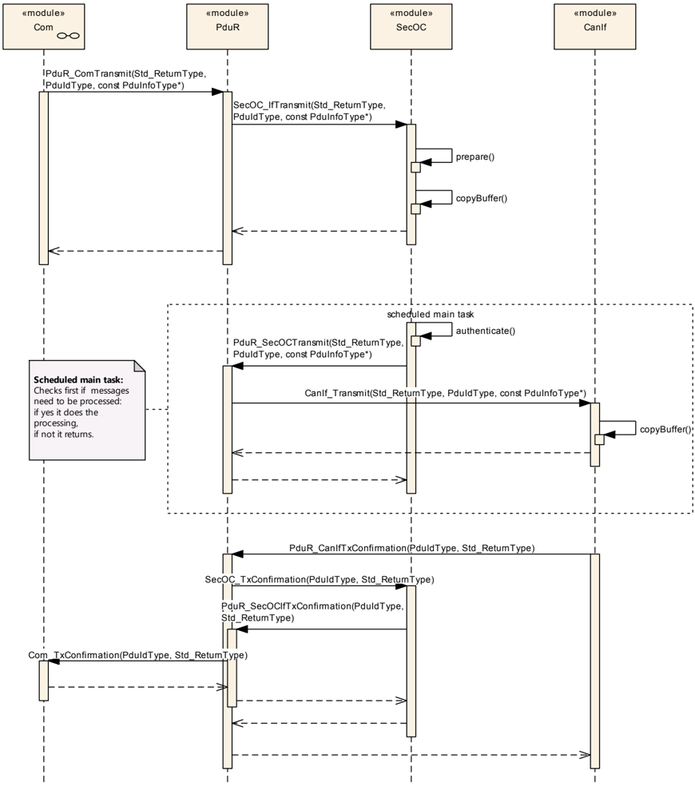

#### 8.1.2. 触发传输过程中的认证

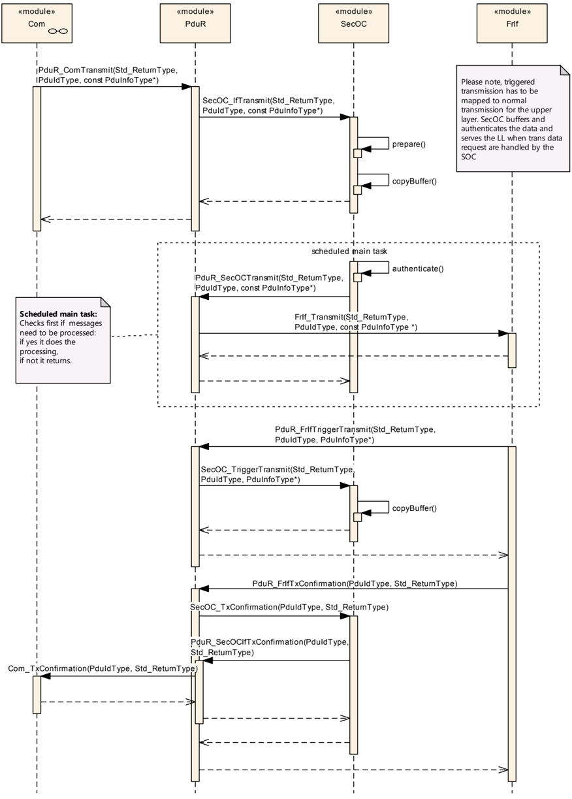

#### 8.1.3. 传输协议传输过程中的认证

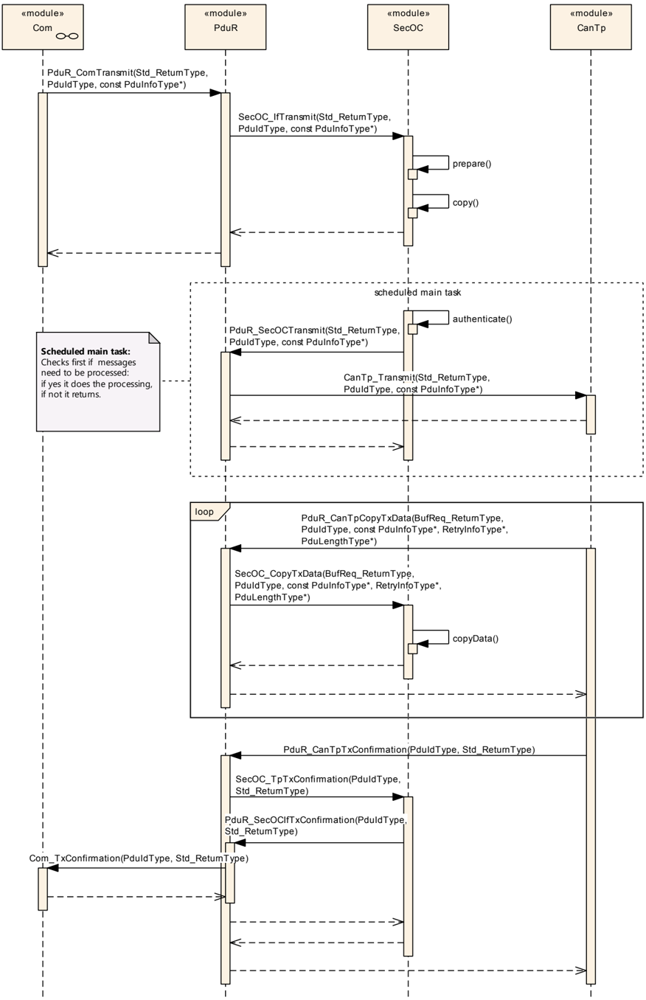

#### 8.1.4. 上层传输协议的认证

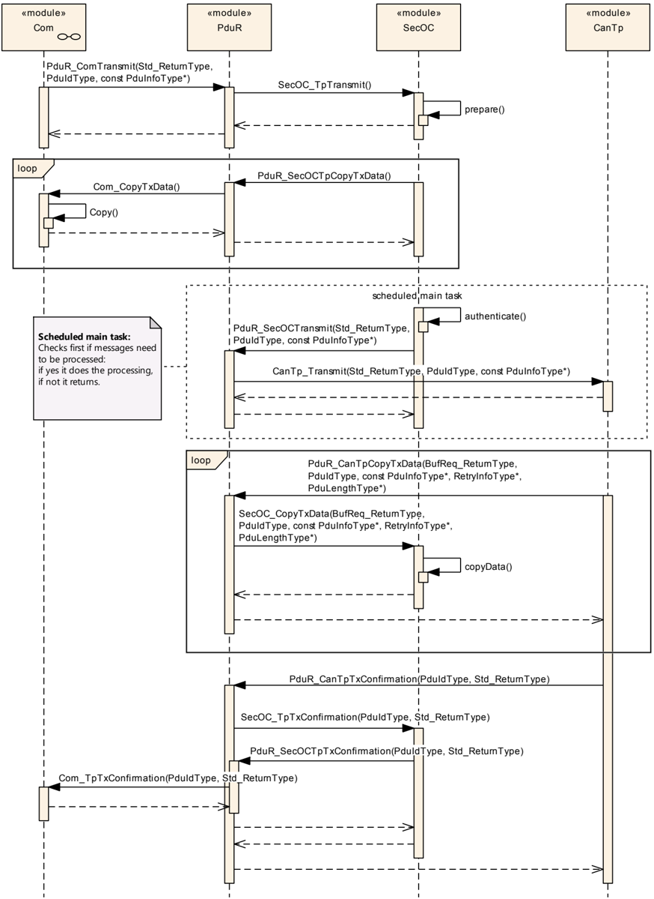

### 8.2. 传入 PDU 的验证

#### 8.2.1. 直接接收期间的验证

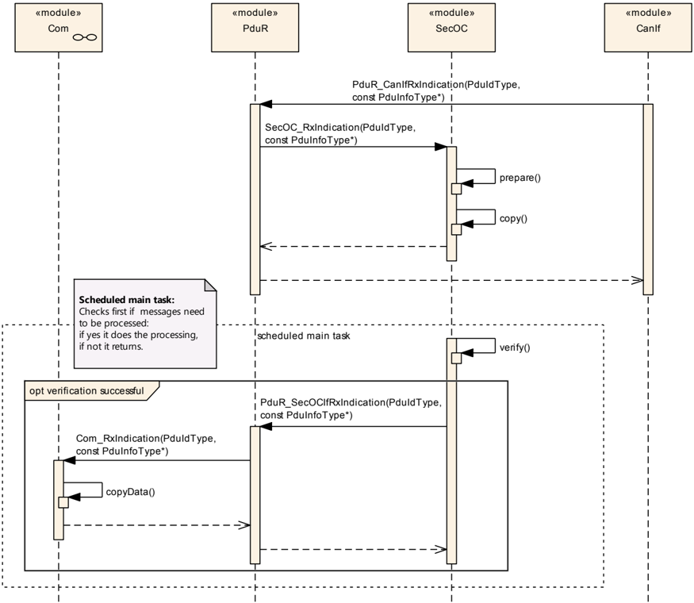

#### 8.2.2. 传输协议接收期间的验证

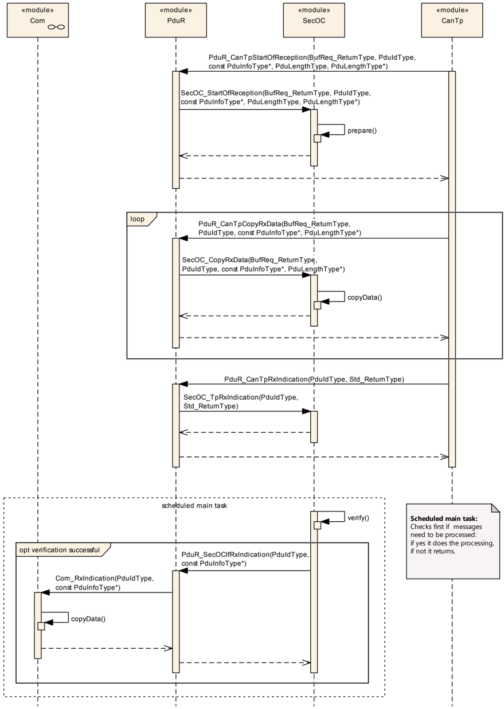

#### 8.2.3. 上层传输协议的验证

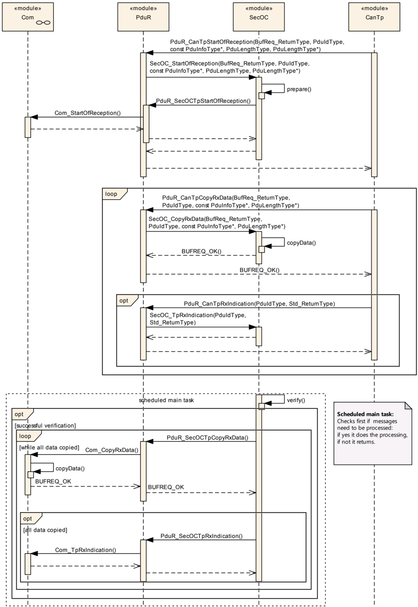

### 8.3. 重新认证网关

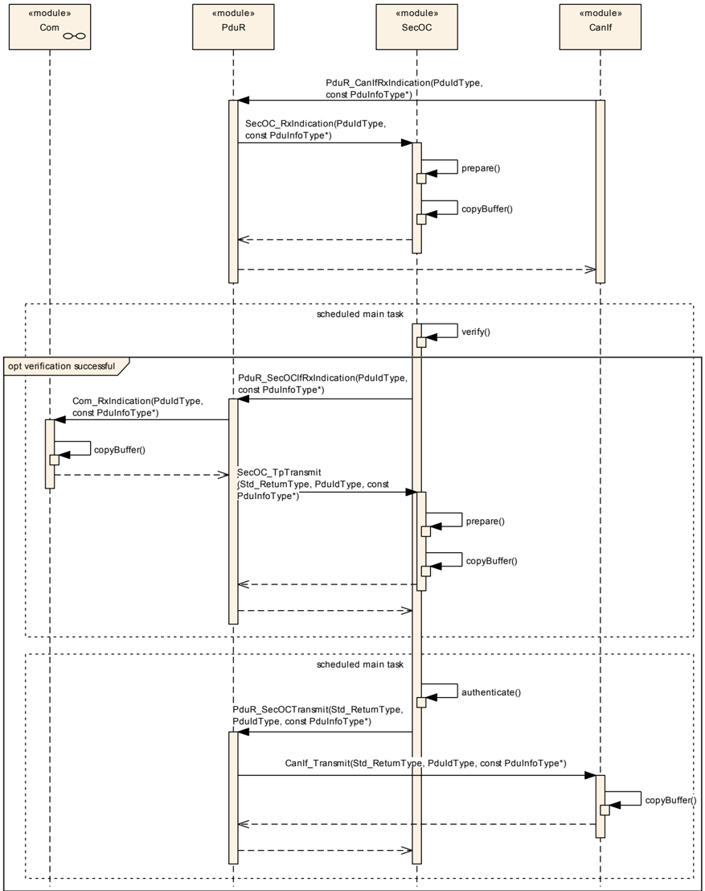

### 8.4. 新鲜度处理

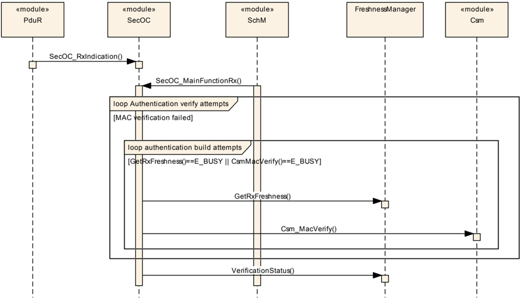

## 9. 配置规范

### 9.1. 概述

以下各章汇总了所有配置参数。参数的详细含义将在下面的章节中介绍。

有关 AUTOSAR **SecOC** 模块配置的概览，请参见：

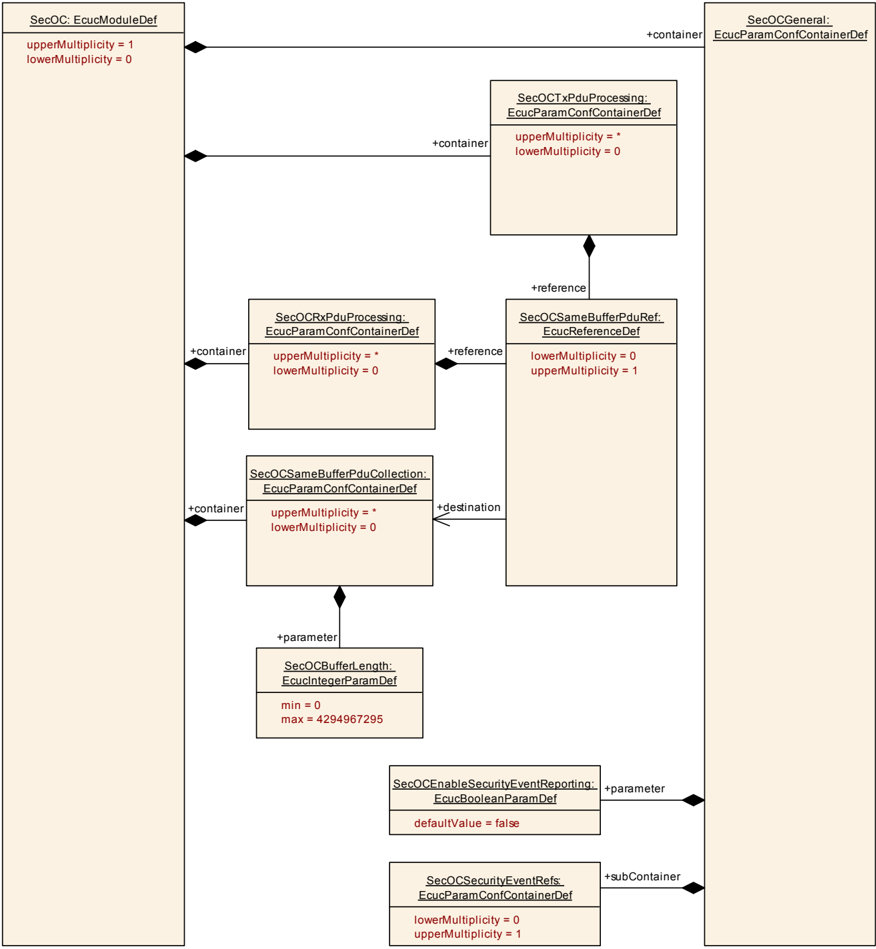

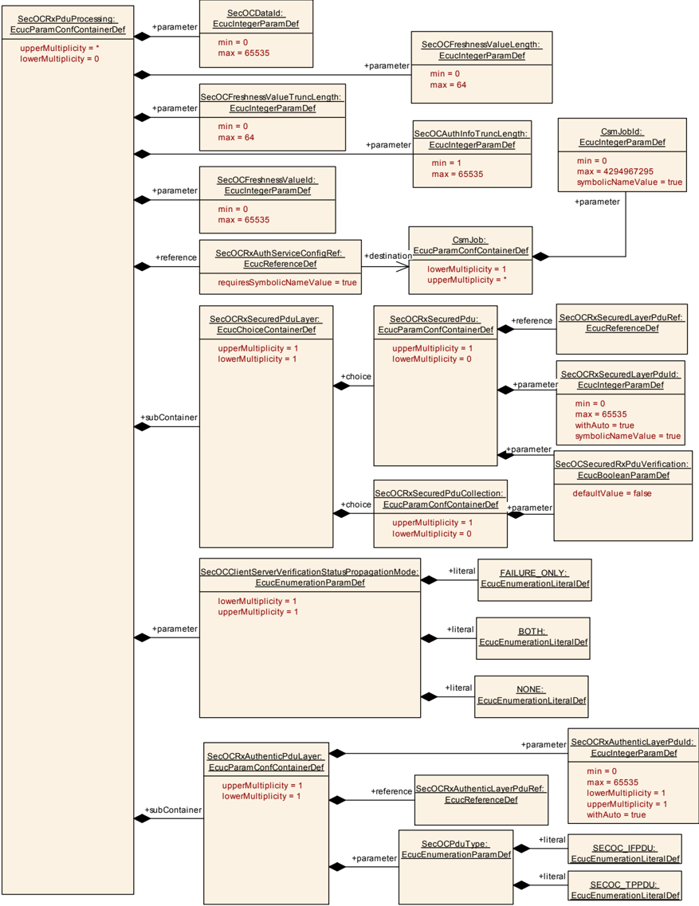

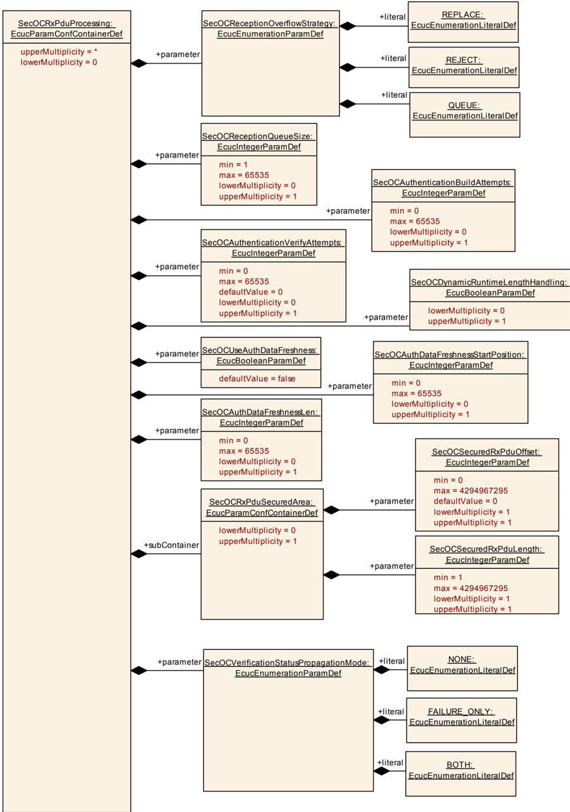

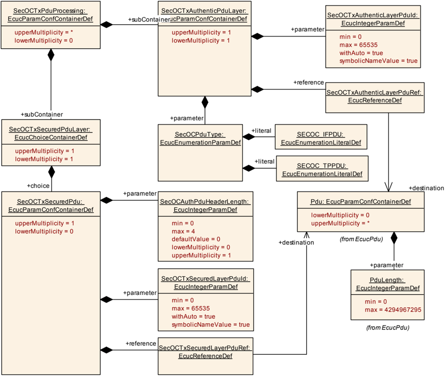

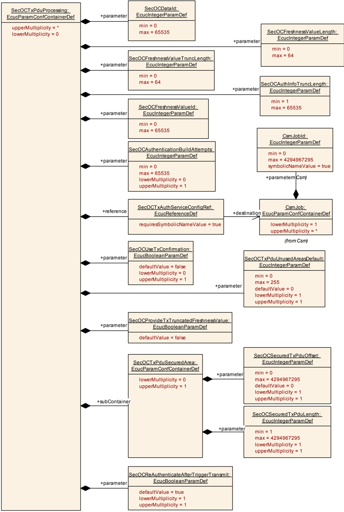

### 9.2. 容器和配置参数

#### 9.2.1. SecOC

| SWS 条目 | [ECUC_SecOC_00001] |
| --- | --- |
| 模块名称 | SecOC |
| 描述 | **SecOC**（**SecureOnboardCommunication**）模块的配置。 |
| Post-Build 变体支持 | true |
| 支持的配置变体 | VARIANT-LINK-TIME, VARIANT-POST-BUILD, VARIANT-PRE-COMPILE |

**包含的容器**

| 容器名称 | 多重性 | 作用域/依赖 |
| --- | --- | --- |
| SecOCGeneral | 1 | 包含 **SecOC** 模块的通用配置参数。 |
| SecOCMainFunctionRx | 0..* | 该容器的每个元素定义一个 **SecOC_MainFunctionRx** 实例。 |
| SecOCMainFunctionTx | 0..* | 该容器的每个元素定义一个 **SecOC_MainFunctionTx** 实例。 |
| SecOCRxPduProcessing | 0..* | 包含用于配置待 **SecOC** 模块验证的 **RxPdu** 的参数。 |
| SecOCSameBufferPduCollection | 0..* | 可由一组 **Pdu** 使用的 **SecOC** 缓冲区配置。 |
| SecOCTxPduProcessing | 0..* | 包含用于配置待 **SecOC** 模块保护的 **TxPdu** 的参数。 |

#### 9.2.2. SecOCGeneral

| SWS 条目 | [ECUC_SecOC_00002] |
| --- | --- |
| 容器名称 | SecOCGeneral |
| 父容器 | SecOC |
| 描述 | 包含 **SecOC** 模块的通用配置参数。 |

**配置参数**

| SWS 条目 | [ECUC_SecOC_00098] |
| --- | --- |
| 参数名称 | SecOCDefaultAuthenticationInformationPattern |
| 父容器 | SecOCGeneral |
| 描述 | 该参数描述当认证构建计数器已达到配置值 **SecOCAuthenticationBuildAttempts**、或新鲜度函数查询返回 **E_NOT_OK**、或验证器计算返回不可恢复错误（如返回 **E_NOT_OK** 或 **KEY_FAILURE**）时 **SecOC** 的行为。如果未配置该参数，**SecOC** 模块应从其内部缓冲区中移除可信 I-PDU 并取消传输请求；如果配置了该参数，**SecOC** 在构建认证信息时将对新鲜度值和验证器的每个字节都使用该值，并且不会取消传输请求。 |
| 多重性 | 0..1 |
| 类型 | EcucIntegerParamDef |
| 取值范围 | 0 .. 255 |
| 默认值 | - |
| Post-Build 变体多重性 | false |
| Post-Build 变体值 | false |
| 多重性配置类 | Pre-compile time：X（All Variants）；Link time：-；Post-build time：- |
| 值配置类 | Pre-compile time：X（All Variants）；Link time：-；Post-build time：- |
| 作用域/依赖 | scope: local |

| SWS 条目 | [ECUC_SecOC_00007] |
| --- | --- |
| 参数名称 | SecOCDevErrorDetect |
| 父容器 | SecOCGeneral |
| 描述 | true：启用检测；false：禁用检测与通知。 |
| 多重性 | 1 |
| 类型 | EcucBooleanParamDef |
| 默认值 | false |
| Post-Build 变体值 | false |
| 值配置类 | Pre-compile time：X（All Variants）；Link time：-；Post-build time：- |
| 作用域/依赖 | scope: local |

| SWS 条目 | [ECUC_SecOC_00051] |
| --- | --- |
| 参数名称 | SecOCEnableForcedPassOverride |
| 父容器 | SecOCGeneral |
| 描述 | 当该配置选项设置为 **TRUE** 时，将启用函数 **SecOC_VerifyStatusOverride** 中独立于验证结果向上层发送 I-PDU 的功能。 |
| 多重性 | 1 |
| 类型 | EcucBooleanParamDef |
| 默认值 | false |
| Post-Build 变体值 | false |
| 值配置类 | Pre-compile time：X（All Variants）；Link time：-；Post-build time：- |
| 作用域/依赖 | scope: local |

| SWS 条目 | [ECUC_SecOC_00114] |
| --- | --- |
| 参数名称 | SecOCEnableSecurityEventReporting |
| 父容器 | SecOCGeneral |
| 描述 | 切换是否向 **IdsM** 报告安全事件：true：启用报告；false：禁用报告。标签：atp.Status=draft。 |
| 多重性 | 1 |
| 类型 | EcucBooleanParamDef |
| 默认值 | false |
| Post-Build 变体值 | false |
| 值配置类 | Pre-compile time：X（All Variants）；Link time：-；Post-build time：- |
| 作用域/依赖 | scope: ECU |

| SWS 条目 | [ECUC_SecOC_00052] |
| --- | --- |
| 参数名称 | SecOCIgnoreVerificationResult |
| 父容器 | SecOCGeneral |
| 描述 | 如果配置为 **TRUE**，则无论验证结果如何，**SecOC** 都会接受并向上层传递该可信 I-PDU。 |
| 多重性 | 1 |
| 类型 | EcucBooleanParamDef |
| 默认值 | false |
| Post-Build 变体值 | false |
| 值配置类 | Pre-compile time：X（All Variants）；Link time：-；Post-build time：- |
| 作用域/依赖 | scope: local |

| SWS 条目 | [ECUC_SecOC_00047] |
| --- | --- |
| 参数名称 | SecOCMaxAlignScalarType |
| 父容器 | SecOCGeneral |
| 描述 | 在给定平台上具有最大对齐限制的标量类型。该类型例如可以是 uint8、uint16 或 uint32。 |
| 多重性 | 1 |
| 类型 | EcucStringParamDef |
| 默认值 | - |
| 正则表达式 | - |
| Post-Build 变体值 | false |
| 值配置类 | Pre-compile time：X（All Variants）；Link time：-；Post-build time：- |
| 作用域/依赖 | scope: local |

| SWS 条目 | [ECUC_SecOC_00119] |
| --- | --- |
| 参数名称 | SecOCMaxTransmitRetries |
| 父容器 | SecOCGeneral |
| 描述 | 当 **PduR_SecOCTransmit** 返回 **E_NOT_OK** 时，发送受保护 I-PDU 的最大重试次数。 |
| 多重性 | 1 |
| 类型 | EcucIntegerParamDef |
| 取值范围 | 0 .. 255 |
| 默认值 | 10 |
| Post-Build 变体值 | false |
| 值配置类 | Pre-compile time：X（All Variants）；Link time：-；Post-build time：- |
| 作用域/依赖 | scope: local |

| SWS 条目 | [ECUC_SecOC_00099] |
| --- | --- |
| 参数名称 | SecOCOverrideStatusWithDataId |
| 父容器 | SecOCGeneral |
| 描述 | true：函数 **SecOC_VerifyStatusOverride** 接受 **SecOCDataId** 作为控制参数。 |
| 多重性 | 0..1 |
| 类型 | EcucBooleanParamDef |
| 默认值 | false |
| Post-Build 变体值 | false |
| 值配置类 | Pre-compile time：X（All Variants）；Link time：-；Post-build time：- |
| 作用域/依赖 | scope: local |

| SWS 条目 | [ECUC_SecOC_00112] |
| --- | --- |
| 参数名称 | SecOCPropagateOnlyFinalVerificationStatus |
| 父容器 | SecOCGeneral |
| 描述 | 该参数用于指定验证状态是仅在最终确定验证状态之后（**TRUE**）报告，还是在每次验证尝试时（**FALSE**）报告。 |
| 多重性 | 1 |
| 类型 | EcucBooleanParamDef |
| 默认值 | false |
| Post-Build 变体值 | false |
| 值配置类 | Pre-compile time：X（All Variants）；Link time：-；Post-build time：- |
| 作用域/依赖 | scope: local |

| SWS 条目 | [ECUC_SecOC_00078] |
| --- | --- |
| 参数名称 | SecOCQueryFreshnessValue |
| 父容器 | SecOCGeneral |
| 描述 | 该参数指定新鲜度值应通过 C 函数（**CDD**）还是软件组件（**SW-C**）确定。 |
| 多重性 | 1 |
| 类型 | EcucEnumerationParamDef |
| 取值范围 | CFUNC：**SecOC** 对每个待处理的 PDU 使用 C 函数 API 查询新鲜度；RTE：**SecOC** 对每个待处理的 PDU 使用 Rte 服务端口 **FreshnessManagement** 查询新鲜度 |
| 默认值 | CFUNC |
| Post-Build 变体值 | false |
| 值配置类 | Pre-compile time：X（All Variants）；Link time：-；Post-build time：- |

| SWS 条目 | [ECUC_SecOC_00004] |
| --- | --- |
| 参数名称 | SecOCVerificationStatusCallout |
| 父容器 | SecOCGeneral |
| 描述 | 在验证尝试时应调用的客户特定 Callout 例程的入口地址。 |
| 多重性 | 0..* |
| 类型 | EcucFunctionNameDef |
| 默认值 | - |
| 正则表达式 | - |
| Post-Build 变体多重性 | false |
| Post-Build 变体值 | false |
| 多重性配置类 | Pre-compile time：X（All Variants）；Link time：-；Post-build time：- |
| 值配置类 | Pre-compile time：X（All Variants）；Link time：-；Post-build time：- |
| 作用域/依赖 | scope: local |

| SWS 条目 | [ECUC_SecOC_00003] |
| --- | --- |
| 参数名称 | SecOCVersionInfoApi |
| 父容器 | SecOCGeneral |
| 描述 | 如果为 true，则 **SecOC_GetVersionInfo** API 可用。 |
| 多重性 | 1 |
| 类型 | EcucBooleanParamDef |
| 默认值 | false |
| Post-Build 变体值 | false |
| 值配置类 | Pre-compile time：X（All Variants）；Link time：-；Post-build time：- |
| 作用域/依赖 | scope: local |

**包含的容器**

| 容器名称 | 多重性 | 作用域/依赖 |
| --- | --- | --- |
| SecOCSecurityEventRefs | 0..1 | 用于引用 **IdsMEvent** 元素的容器，这些元素代表 **SecOC** 模块在发生相应安全相关事件时应向 **IdsM** 报告的安全事件（且当 **SecOCEnableSecurityEventReporting** 设置为 "true" 时）。该容器中的标准化安全事件可以通过供应商特定的安全事件进行扩展。标签：atp.Status=draft。 |

#### 9.2.3. SecOCSecurityEventRefs

| SWS 条目 | [ECUC_SecOC_00115] |
| --- | --- |
| 容器名称 | SecOCSecurityEventRefs |
| 父容器 | SecOCGeneral |
| 描述 | 用于引用 **IdsMEvent** 元素的容器，这些元素代表 **SecOC** 模块在发生相应安全相关事件时应向 **IdsM** 报告的安全事件（且当 **SecOCEnableSecurityEventReporting** 设置为 "true" 时）。该容器中的标准化安全事件可以通过供应商特定的安全事件进行扩展。标签：atp.Status=draft。 |
| 多重性配置类 | Pre-compile time：X（All Variants）；Link time：-；Post-build time：- |

**配置参数**

| SWS 条目 | [ECUC_SecOC_00117] |
| --- | --- |
| 参数名称 | SEV_SECOC_FRESHNESS_NOT_AVAILABLE |
| 父容器 | SecOCSecurityEventRefs |
| 描述 | 从 FvM 获取新鲜度值失败。标签：atp.Status=draft。 |
| 多重性 | 0..1 |
| 类型 | Symbolic name reference to IdsMEvent |
| Post-Build 变体多重性 | false |
| Post-Build 变体值 | false |
| 多重性配置类 | Pre-compile time：X（All Variants）；Link time：-；Post-build time：- |
| 值配置类 | Pre-compile time：X（All Variants）；Link time：-；Post-build time：- |
| 作用域/依赖 | scope: local |

| SWS 条目 | [ECUC_SecOC_00116] |
| --- | --- |
| 参数名称 | SEV_SECOC_MAC_VERIFICATION_FAILED |
| 父容器 | SecOCSecurityEventRefs |
| 描述 | 所接收 PDU 的 MAC 验证失败。标签：atp.Status=draft。 |
| 多重性 | 0..1 |
| 类型 | Symbolic name reference to IdsMEvent |
| Post-Build 变体多重性 | false |
| Post-Build 变体值 | false |
| 多重性配置类 | Pre-compile time：X（All Variants）；Link time：-；Post-build time：- |
| 值配置类 | Pre-compile time：X（All Variants）；Link time：-；Post-build time：- |
| 作用域/依赖 | scope: local |

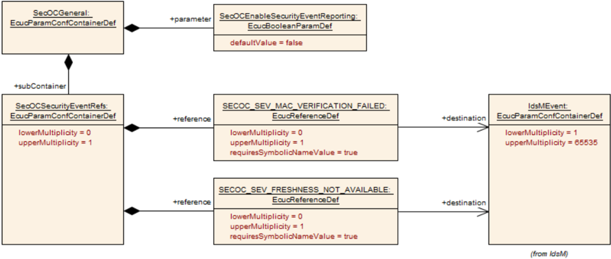

#### 9.2.4. SecOCMainFunctionRx

| SWS 条目 | [ECUC_SecOC_00104] |
| --- | --- |
| 容器名称 | SecOCMainFunctionRx |
| 父容器 | SecOC |
| 描述 | 该容器的每个元素定义一个 **SecOC_MainFunctionRx** 实例。 |

**配置参数**

| SWS 条目 | [ECUC_SecOC_00106] |
| --- | --- |
| 参数名称 | SecOCMainFunctionPeriodRx |
| 父容器 | SecOCMainFunctionRx |
| 描述 | 用于配置 Rx 路径相应 **MainFunction** 实例的执行周期（以秒为单位的小数）。 |
| 多重性 | 1 |
| 类型 | EcucFloatParamDef |
| 取值范围 | ]0 .. INF[ |
| 默认值 | - |
| 值配置类 | Pre-compile time：X（All Variants）；Link time：-；Post-build time：- |
| 作用域/依赖 | scope: local |

| SWS 条目 | [ECUC_SecOC_00107] |
| --- | --- |
| 参数名称 | SecOCMainFunctionRxPartitionRef |
| 父容器 | SecOCMainFunctionRx |
| 描述 | 对 **EcucPartition** 的引用，相应的 **SecOC_MainFunction** 实例被分配到该分区。 |
| 多重性 | 1 |
| 类型 | Reference to EcucPartition |
| 值配置类 | Pre-compile time：X（All Variants）；Link time：-；Post-build time：- |
| 作用域/依赖 | scope: local |

#### 9.2.5. SecOCMainFunctionTx

| SWS 条目 | [ECUC_SecOC_00105] |
| --- | --- |
| 容器名称 | SecOCMainFunctionTx |
| 父容器 | SecOC |
| 描述 | 该容器的每个元素定义一个 **SecOC_MainFunctionTx** 实例。 |

**配置参数**

| SWS 条目 | [ECUC_SecOC_00108] |
| --- | --- |
| 参数名称 | SecOCMainFunctionPeriodTx |
| 父容器 | SecOCMainFunctionTx |
| 描述 | 用于配置 Tx 路径相应 **MainFunction** 实例的执行周期（以秒为单位的小数）。 |
| 多重性 | 1 |
| 类型 | EcucFloatParamDef |
| 取值范围 | ]0 .. INF[ |
| 默认值 | - |
| 值配置类 | Pre-compile time：X（All Variants）；Link time：-；Post-build time：- |
| 作用域/依赖 | scope: local |

| SWS 条目 | [ECUC_SecOC_00109] |
| --- | --- |
| 参数名称 | SecOCMainFunctionTxPartitionRef |
| 父容器 | SecOCMainFunctionTx |
| 描述 | 对 **EcucPartition** 的引用，相应的 **SecOC_MainFunction** 实例被分配到该分区。 |
| 多重性 | 1 |
| 类型 | Reference to EcucPartition |
| 值配置类 | Pre-compile time：X（All Variants）；Link time：-；Post-build time：- |
| 作用域/依赖 | scope: local |

#### 9.2.6. SecOCSameBufferPduCollection

| SWS 条目 | [ECUC_SecOC_00009] |
| --- | --- |
| 容器名称 | SecOCSameBufferPduCollection |
| 父容器 | SecOC |
| 描述 | 可由一组 **Pdu** 使用的 **SecOC** 缓冲区配置。 |
| Post-Build 变体多重性 | false |
| 多重性配置类 | Pre-compile time：X（All Variants）；Link time：-；Post-build time：- |

**配置参数**

| SWS 条目 | [ECUC_SecOC_00008] |
| --- | --- |
| 参数名称 | SecOCBufferLength |
| 父容器 | SecOCSameBufferPduCollection |
| 描述 | 该参数定义 **SecOC** 模块所使用的缓冲区大小（以字节为单位）。 |
| 多重性 | 1 |
| 类型 | EcucIntegerParamDef |
| 取值范围 | 0 .. 4294967295 |
| 默认值 | - |
| Post-Build 变体值 | false |
| 值配置类 | Pre-compile time：X（All Variants）；Link time：-；Post-build time：- |
| 作用域/依赖 | scope: local |

#### 9.2.7. SecOCRxPduProcessing

| SWS 条目 | [ECUC_SecOC_00011] |
| --- | --- |
| 容器名称 | SecOCRxPduProcessing |
| 父容器 | SecOC |
| 描述 | 包含用于配置待 **SecOC** 模块验证的 **RxPdu** 的参数。 |

**配置参数**

| SWS 条目 | [ECUC_SecOC_00082] |
| --- | --- |
| 参数名称 | SecOCAuthDataFreshnessLen |
| 父容器 | SecOCRxPduProcessing |
| 描述 | 外部可信 PDU 数据的位长（uint16）。 |
| 多重性 | 0..1 |
| 类型 | EcucIntegerParamDef |
| 取值范围 | 0 .. 65535 |
| 默认值 | - |
| Post-Build 变体值 | false |
| 值配置类 | Pre-compile time：X（All Variants）；Link time：-；Post-build time：- |
| 作用域/依赖 | scope: ECU |

| SWS 条目 | [ECUC_SecOC_00081] |
| --- | --- |
| 参数名称 | SecOCAuthDataFreshnessStartPosition |
| 父容器 | SecOCRxPduProcessing |
| 描述 | 该值确定可信数据应传递给新鲜度 SWC 的起始位位置（uint16）。位计数方式遵循 TPS_SYST_01068，位排序方式遵循 TPS_SYST_01069。 |
| 多重性 | 0..1 |
| 类型 | EcucIntegerParamDef |
| 取值范围 | 0 .. 65535 |
| 默认值 | - |
| Post-Build 变体值 | false |
| 值配置类 | Pre-compile time：X（All Variants）；Link time：-；Post-build time：- |
| 作用域/依赖 | scope: ECU |

| SWS 条目 | [ECUC_SecOC_00079] |
| --- | --- |
| 参数名称 | SecOCAuthenticationBuildAttempts |
| 父容器 | SecOCRxPduProcessing |
| 描述 | 该参数指定认证构建尝试的次数。 |
| 多重性 | 0..1 |
| 类型 | EcucIntegerParamDef |
| 取值范围 | 0 .. 65535 |
| 默认值 | - |
| Post-Build 变体值 | false |
| 值配置类 | Pre-compile time：X（All Variants）；Link time：-；Post-build time：- |
| 作用域/依赖 | scope: local |

| SWS 条目 | [ECUC_SecOC_00080] |
| --- | --- |
| 参数名称 | SecOCAuthenticationVerifyAttempts |
| 父容器 | SecOCRxPduProcessing |
| 描述 | 该参数指定在给定受保护的 I-PDU 的认证信息验证过程中应执行的认证验证次数。如果设置为 0，则只执行一次认证尝试。 |
| 多重性 | 0..1 |
| 类型 | EcucIntegerParamDef |
| 取值范围 | 0 .. 65535 |
| 默认值 | 0 |
| Post-Build 变体值 | false |
| 值配置类 | Pre-compile time：X（All Variants）；Link time：-；Post-build time：- |
| 作用域/依赖 | scope: local |

| SWS 条目 | [ECUC_SecOC_00095] |
| --- | --- |
| 参数名称 | SecOCAuthInfoTruncLength |
| 父容器 | SecOCRxPduProcessing |
| 描述 | 该参数定义包含在受保护的 I-PDU 负载中的认证码的位长。 |
| 多重性 | 1 |
| 类型 | EcucIntegerParamDef |
| 取值范围 | 1 .. 65535 |
| 默认值 | - |
| Post-Build 变体值 | true |
| 值配置类 | Pre-compile time：X（VARIANT-PRE-COMPILE）；Link time：X（VARIANT-LINK-TIME）；Post-build time：X（VARIANT-POST-BUILD） |
| 作用域/依赖 | scope: local |

| SWS 条目 | [ECUC_SecOC_00113] |
| --- | --- |
| 参数名称 | SecOCClientServerVerificationStatusPropagationMode |
| 父容器 | SecOCRxPduProcessing |
| 描述 | 该参数用于确定通过客户端/服务器接口向 SW-C 传播验证状态的方式。取值：**BOTH**：同时向 SW-C 传播 "成功" 和 "失败" 的认证状态；**FAILURE_ONLY**：只向 SW-C 传播 "失败" 的认证状态；**NONE**：不向 SW-C 提供该 PDU 的认证状态。 |
| 多重性 | 1 |
| 类型 | EcucEnumerationParamDef |
| 默认值 | - |
| Post-Build 变体值 | true |
| 值配置类 | Pre-compile time：X（VARIANT-PRE-COMPILE）；Link time：X（VARIANT-LINK-TIME）；Post-build time：X（VARIANT-POST-BUILD） |
| 作用域/依赖 | scope: local |

| SWS 条目 | [ECUC_SecOC_00014] |
| --- | --- |
| 参数名称 | SecOCDataId |
| 父容器 | SecOCRxPduProcessing |
| 描述 | 该参数为受保护的 I-PDU 定义一个唯一的数字标识符。 |
| 多重性 | 1 |
| 类型 | EcucIntegerParamDef |
| 取值范围 | 0 .. 65535 |
| 默认值 | - |
| Post-Build 变体值 | true |
| 值配置类 | Pre-compile time：X（VARIANT-PRE-COMPILE）；Link time：X（VARIANT-LINK-TIME）；Post-build time：X（VARIANT-POST-BUILD） |
| 作用域/依赖 | scope: local |

| SWS 条目 | [ECUC_SecOC_00118] |
| --- | --- |
| 参数名称 | SecOCDynamicRuntimeLengthHandling |
| 父容器 | SecOCRxPduProcessing |
| 描述 | 定义处理该接收 Pdu 时的长度信息是取自配置，还是取自运行时实际提供的长度信息。true：受保护 I-PDU 的长度信息取自运行时实际提供的长度信息。false：受保护 I-PDU 的长度信息取自该 Pdu 的参数 **PduLength**。 |
| 多重性 | 0..1 |
| 类型 | EcucBooleanParamDef |
| 默认值 | - |
| Post-Build 变体多重性 | false |
| Post-Build 变体值 | false |
| 多重性配置类 | Pre-compile time：X（All Variants）；Link time：-；Post-build time：- |
| 值配置类 | Pre-compile time：X（All Variants）；Link time：-；Post-build time：- |
| 作用域/依赖 | scope: local |

| SWS 条目 | [ECUC_SecOC_00021] |
| --- | --- |
| 参数名称 | SecOCFreshnessValueId |
| 父容器 | SecOCRxPduProcessing |
| 描述 | 该参数定义新鲜度值的 Id。该值可以是一个普通计数器或一个时间值。 |
| 多重性 | 1 |
| 类型 | EcucIntegerParamDef |
| 取值范围 | 0 .. 65535 |
| 默认值 | - |
| Post-Build 变体值 | true |
| 值配置类 | Pre-compile time：X（VARIANT-PRE-COMPILE）；Link time：X（VARIANT-LINK-TIME）；Post-build time：X（VARIANT-POST-BUILD） |
| 作用域/依赖 | scope: local |

| SWS 条目 | [ECUC_SecOC_00015] |
| --- | --- |
| 参数名称 | SecOCFreshnessValueLength |
| 父容器 | SecOCRxPduProcessing |
| 描述 | 该参数定义新鲜度值的完整位长。只要密钥不改变，该计数器就不应溢出。计数器的长度应根据相应密钥的预期寿命和计数器的使用频率来确定。 |
| 多重性 | 1 |
| 类型 | EcucIntegerParamDef |
| 取值范围 | 0 .. 64 |
| 默认值 | - |
| Post-Build 变体值 | true |
| 值配置类 | Pre-compile time：X（VARIANT-PRE-COMPILE）；Link time：X（VARIANT-LINK-TIME）；Post-build time：X（VARIANT-POST-BUILD） |
| 作用域/依赖 | scope: local |

| SWS 条目 | [ECUC_SecOC_00094] |
| --- | --- |
| 参数名称 | SecOCFreshnessValueTruncLength |
| 父容器 | SecOCRxPduProcessing |
| 描述 | 该参数定义包含在受保护的 I-PDU 负载中的新鲜度值的位长。该长度针对完整新鲜度计数器的最低有效位。如果该参数为 0，则受保护的 I-PDU 中不包含新鲜度值。 |
| 多重性 | 1 |
| 类型 | EcucIntegerParamDef |
| 取值范围 | 0 .. 64 |
| 默认值 | - |
| Post-Build 变体值 | true |
| 值配置类 | Pre-compile time：X（VARIANT-PRE-COMPILE）；Link time：X（VARIANT-LINK-TIME）；Post-build time：X（VARIANT-POST-BUILD） |
| 作用域/依赖 | scope: local，dependency: SecOCFreshnessCounterTxLength &lt;= SecOCFreshnessCounter Length |

| SWS 条目 | [ECUC_SecOC_00076] |
| --- | --- |
| 参数名称 | SecOCReceptionOverflowStrategy |
| 父容器 | SecOCRxPduProcessing |
| 描述 | 该参数定义接收 PDU 的溢出策略。取值：**QUEUE**：后续接收的消息被排队，仅在当前正在处理的受保护的 I-PDU 完成之后进行处理；**REJECT**：后续接收的消息被丢弃；**REPLACE**：后续接收的消息取代当前正在处理的受保护的 I-PDU。 |
| 多重性 | 1 |
| 类型 | EcucEnumerationParamDef |
| 默认值 | - |
| Post-Build 变体值 | false |
| 值配置类 | Pre-compile time：X（All Variants）；Link time：-；Post-build time：- |
| 作用域/依赖 | scope: local |

| SWS 条目 | [ECUC_SecOC_00077] |
| --- | --- |
| 参数名称 | SecOCReceptionQueueSize |
| 父容器 | SecOCRxPduProcessing |
| 描述 | 当接收 PDU 的溢出策略设置为 **QUEUE** 时，该参数定义队列的大小。 |
| 多重性 | 0..1 |
| 类型 | EcucIntegerParamDef |
| 取值范围 | 1 .. 65535 |
| 默认值 | - |
| Post-Build 变体值 | false |
| 值配置类 | Pre-compile time：X（All Variants）；Link time：-；Post-build time：- |
| 作用域/依赖 | scope: local |

| SWS 条目 | [ECUC_SecOC_00083] |
| --- | --- |
| 参数名称 | SecOCUseAuthDataFreshness |
| 父容器 | SecOCRxPduProcessing |
| 描述 | 该布尔值指示是否将可信 PDU 的一部分作为新鲜度。如果设置为 **TRUE**，则必须设置 **SecOCAuthDataFreshnessLen** 和 **SecOCAuthDataFreshnessStartPosition** 的值，以指定用于验证和生成新鲜度值的 SWC 所使用的可信数据部分的位位置和长度。 |
| 多重性 | 1 |
| 类型 | EcucBooleanParamDef |
| 默认值 | false |
| Post-Build 变体值 | false |
| 值配置类 | Pre-compile time：X（All Variants）；Link time：-；Post-build time：- |
| 作用域/依赖 | scope: ECU |

| SWS 条目 | [ECUC_SecOC_00046] |
| --- | --- |
| 参数名称 | SecOCVerificationStatusPropagationMode |
| 父容器 | SecOCRxPduProcessing |
| 描述 | 该参数用于描述从 **SecOC** 模块到 SWC 的每次验证尝试状态的传播方式。取值：**BOTH**：同时向 SWC 传播 "成功" 和 "失败" 的认证状态；**FAILURE_ONLY**：只向 SWC 传播 "失败" 的认证状态；**NONE**：不向 SWC 传播认证状态。 |
| 多重性 | 1 |
| 类型 | EcucEnumerationParamDef |
| 默认值 | - |
| Post-Build 变体值 | true |
| 值配置类 | Pre-compile time：X（VARIANT-PRE-COMPILE）；Link time：X（VARIANT-LINK-TIME）；Post-build time：X（VARIANT-POST-BUILD） |
| 作用域/依赖 | scope: local |

| SWS 条目 | [ECUC_SecOC_00048] |
| --- | --- |
| 参数名称 | SecOCRxAuthServiceConfigRef |
| 父容器 | SecOCRxPduProcessing |
| 描述 | 该引用用于定义认证时应调用哪个加密服务函数。如果使用动态长度的 PDU（例如 CanTP 或动态长度 PDU），则必须选择不易受扩展攻击的 MAC 算法（例如 CMAC/HMAC）。 |
| 多重性 | 1 |
| 类型 | Symbolic name reference to CsmJob |
| Post-Build 变体值 | false |

| SWS 条目 | [ECUC_SecOC_00110] |
| --- | --- |
| 参数名称 | SecOCRxPduMainFunctionRef |
| 父容器 | SecOCRxPduProcessing |
| 描述 | 对该 PDU 所属的 **SecOC_MainFunctionRx** 的引用。如果定义了多个主函数，则该参数为必填。 |
| 多重性 | 0..1 |
| 类型 | Reference to SecOCMainFunctionRx |
| 多重性配置类 | Pre-compile time：X（All Variants）；Link time：-；Post-build time：- |
| 值配置类 | Pre-compile time：X（All Variants）；Link time：-；Post-build time：- |
| 作用域/依赖 | scope: local |

| SWS 条目 | [ECUC_SecOC_00010] |
| --- | --- |
| 参数名称 | SecOCSameBufferPduRef |
| 父容器 | SecOCRxPduProcessing |
| 描述 | 该引用用于收集使用相同 **SecOC** 缓冲区的 Pdu。 |
| 多重性 | 0..1 |
| 类型 | Reference to SecOCSameBufferPduCollection |
| Post-Build 变体多重性 | false |
| Post-Build 变体值 | false |
| 多重性配置类 | Pre-compile time：X（All Variants）；Link time：-；Post-build time：- |
| 值配置类 | Pre-compile time：X（All Variants）；Link time：-；Post-build time：- |
| 作用域/依赖 | scope: local |

**包含的容器**

| 容器名称 | 多重性 | 作用域/依赖 |
| --- | --- | --- |
| SecOCRxAuthenticPduLayer | 1 | 该容器指定 **SecOC** 模块在 MAC 验证完成之后向 **PduR** 发送的 Pdu。 |
| SecOCRxPduSecuredArea | 0..1 | 该容器指定可信 I-Pdu 中的一个区域，该区域将作为验证器验证算法的输入。如果配置中不存在该容器，则完整的可信 I-Pdu 将作为验证器验证算法的输入。 |
| SecOCRxSecuredPduLayer | 1 | 该容器指定 **SecOC** 模块从 **PduR** 接收的 Pdu。针对该 Pdu 提供 MAC 验证。 |

#### 9.2.8. SecOCRxSecuredPduLayer

| SWS 条目 | [ECUC_SecOC_00041] |
| --- | --- |
| 选择容器名称 | SecOCRxSecuredPduLayer |
| 父容器 | SecOCRxPduProcessing |
| 描述 | 该容器指定 **SecOC** 模块从 **PduR** 接收的 Pdu。针对该 Pdu 提供 MAC 验证。 |

**容器选择**

| 容器名称 | 多重性 | 作用域/依赖 |
| --- | --- | --- |
| SecOCRxSecuredPdu | 0..1 | 该容器指定 **SecOC** 模块从 **PduR** 接收的 Pdu。针对该 Pdu 提供 MAC 验证。 |
| SecOCRxSecuredPduCollection | 0..1 | 该容器指定 **SecOC** 模块从 **PduR** 接收的两个 Pdu 以及二者之间的消息链接。SecOCRxAuthenticPdu 包含原始的可信 I-PDU（即受保护的数据），SecOCRxCryptographicPdu 包含验证器（即实际的认证信息）。 |

#### 9.2.9. SecOCRxSecuredPdu

| SWS 条目 | [ECUC_SecOC_00069] |
| --- | --- |
| 容器名称 | SecOCRxSecuredPdu |
| 父容器 | SecOCRxSecuredPduLayer |
| 描述 | 该容器指定 **SecOC** 模块从 **PduR** 接收的 Pdu。针对该 Pdu 提供 MAC 验证。 |

**配置参数**

| SWS 条目 | [ECUC_SecOC_00093] |
| --- | --- |
| 参数名称 | SecOCAuthPduHeaderLength |
| 父容器 | SecOCRxSecuredPdu |
| 描述 | 该参数指示受保护的 I-PDU 中受保护的 I-PDU 头的长度（以字节为单位）。长度为 0 表示 PDU 中没有头。 |
| 多重性 | 0..1 |
| 类型 | EcucIntegerParamDef |
| 取值范围 | 0 .. 4 |
| 默认值 | 0 |
| Post-Build 变体值 | false |
| 值配置类 | Pre-compile time：X（All Variants）；Link time：-；Post-build time：- |
| 作用域/依赖 | scope: local |

| SWS 条目 | [ECUC_SecOC_00043] |
| --- | --- |
| 参数名称 | SecOCRxSecuredLayerPduId |
| 父容器 | SecOCRxSecuredPdu |
| 描述 | 由 **SecOC** 模块分配的 PDU 标识符。由 **PduR** 用于 **SecOC_[If&#124;Tp]RxIndication**。 |
| 多重性 | 1 |
| 类型 | EcucIntegerParamDef（会为该参数生成符号名） |
| 取值范围 | 0 .. 65535 |
| 默认值 | - |
| Post-Build 变体值 | false |
| 值配置类 | Pre-compile time：X（All Variants）；Link time：-；Post-build time：- |
| 作用域/依赖 | scope: local withAuto = true |

| SWS 条目 | [ECUC_SecOC_00092] |
| --- | --- |
| 参数名称 | SecOCSecuredRxPduVerification |
| 父容器 | SecOCRxSecuredPdu |
| 描述 | 该参数定义是否对该受保护的 I-PDU 执行签名认证或 MAC 验证。如果设置为 false，**SecOC** 模块将在不进行验证的情况下从受保护的 I-PDU 中提取可信 I-PDU。 |
| 多重性 | 1 |
| 类型 | EcucBooleanParamDef |
| 默认值 | false |
| Post-Build 变体值 | true |
| 值配置类 | Pre-compile time：X（All Variants）；Link time：-；Post-build time：- |
| 作用域/依赖 | scope: local |

| SWS 条目 | [ECUC_SecOC_00042] |
| --- | --- |
| 参数名称 | SecOCRxSecuredLayerPduRef |
| 父容器 | SecOCRxSecuredPdu |
| 描述 | 对全局 Pdu 的引用。 |
| 多重性 | 1 |
| 类型 | Reference to Pdu |
| Post-Build 变体值 | true |
| 值配置类 | Pre-compile time：X（VARIANT-PRE-COMPILE）；Link time：X（VARIANT-LINK-TIME）；Post-build time：X（VARIANT-POST-BUILD） |
| 作用域/依赖 | scope: local |

#### 9.2.10. SecOCRxAuthenticPduLayer

| SWS 条目 | [ECUC_SecOC_00044] |
| --- | --- |
| 容器名称 | SecOCRxAuthenticPduLayer |
| 父容器 | SecOCRxPduProcessing |
| 描述 | 该容器指定 **SecOC** 模块在 MAC 验证完成之后向 **PduR** 发送的 Pdu。 |

**配置参数**

| SWS 条目 | [ECUC_SecOC_00075] |
| --- | --- |
| 参数名称 | SecOCPduType |
| 父容器 | SecOCRxAuthenticPduLayer |
| 描述 | 该参数定义与 **PduR** 通信所使用的 API 类型。取值：**SECOC_IFPDU**：使用 SECOC_IFPDU API 接口通信；**SECOC_TPPDU**：使用 SECOC_TPPDU Transport API 通信。 |
| 多重性 | 1 |
| 类型 | EcucEnumerationParamDef |
| 默认值 | - |
| Post-Build 变体值 | false |
| 值配置类 | Pre-compile time：X（All Variants）；Link time：-；Post-build time：- |
| 作用域/依赖 | scope: local |

| SWS 条目 | [ECUC_SecOC_00102] |
| --- | --- |
| 参数名称 | SecOCRxAuthenticLayerPduId |
| 父容器 | SecOCRxAuthenticPduLayer |
| 描述 | 由 **SecOC** 模块分配的 PDU 标识符。由 **PduR** 用于 **SecOC_TpCancelReceive**。 |
| 多重性 | 1 |
| 类型 | EcucIntegerParamDef |
| 取值范围 | 0 .. 65535 |
| 默认值 | - |
| 值配置类 | Pre-compile time：X（All Variants）；Link time：-；Post-build time：- |
| 作用域/依赖 | scope: local withAuto = true |

| SWS 条目 | [ECUC_SecOC_00045] |
| --- | --- |
| 参数名称 | SecOCRxAuthenticLayerPduRef |
| 父容器 | SecOCRxAuthenticPduLayer |
| 描述 | 对全局 Pdu 的引用。 |
| 多重性 | 1 |
| 类型 | Reference to Pdu |
| Post-Build 变体值 | true |
| 值配置类 | Pre-compile time：X（VARIANT-PRE-COMPILE）；Link time：X（VARIANT-LINK-TIME）；Post-build time：X（VARIANT-POST-BUILD） |
| 作用域/依赖 | scope: local |

#### 9.2.11. SecOCRxSecuredPduCollection

| SWS 条目 | [ECUC_SecOC_00067] |
| --- | --- |
| 容器名称 | SecOCRxSecuredPduCollection |
| 父容器 | SecOCRxSecuredPduLayer |
| 描述 | 该容器指定 **SecOC** 模块从 **PduR** 接收的两个 Pdu 以及二者之间的消息链接。SecOCRxAuthenticPdu 包含原始的可信 I-PDU（即受保护的数据），SecOCRxCryptographicPdu 包含验证器（即实际的认证信息）。 |

**配置参数**

| SWS 条目 | [ECUC_SecOC_00092] |
| --- | --- |
| 参数名称 | SecOCSecuredRxPduVerification |
| 父容器 | SecOCRxSecuredPduCollection |
| 描述 | 该参数定义是否对该受保护的 I-PDU 执行签名认证或 MAC 验证。如果设置为 false，**SecOC** 模块将在不进行验证的情况下从受保护的 I-PDU 中提取可信 I-PDU。 |
| 多重性 | 1 |
| 类型 | EcucBooleanParamDef |
| 默认值 | false |
| Post-Build 变体值 | true |
| 值配置类 | Pre-compile time：X（All Variants）；Link time：-；Post-build time：- |
| 作用域/依赖 | scope: local |

**包含的容器**

| 容器名称 | 多重性 | 作用域/依赖 |
| --- | --- | --- |
| SecOCRxAuthenticPdu | 1 | 该容器指定 **SecOC** 模块从 **PduR** 接收的、包含受保护的 I-PDU 头和可信 I-PDU 的 PDU。 |
| SecOCRxCryptographicPdu | 1 | 该容器指定 **SecOC** 模块从 **PduR** 接收的加密 Pdu。 |
| SecOCUseMessageLink | 0..1 | **SecOC** 通过在加密 I-PDU 中重复可信 I-PDU 的特定部分（消息链接器）来将可信 I-PDU 和加密 I-PDU 关联在一起。 |

**约束**

如果 **SecOCReceptionOverflowStrategy** 设置为 **QUEUE**，则在同一个已配置的 SecOCRxPduProcessing 内，SecOCRxSecuredPduCollection 的多重性必须为 0（[SWS_SecOC_CONSTR_00265]）。

#### 9.2.12. SecOCRxCryptographicPdu

| SWS 条目 | [ECUC_SecOC_00064] |
| --- | --- |
| 容器名称 | SecOCRxCryptographicPdu |
| 父容器 | SecOCRxSecuredPduCollection |
| 描述 | 该容器指定 **SecOC** 模块从 **PduR** 接收的加密 Pdu。 |

**配置参数**

| SWS 条目 | [ECUC_SecOC_00065] |
| --- | --- |
| 参数名称 | SecOCRxCryptographicPduId |
| 父容器 | SecOCRxCryptographicPdu |
| 描述 | 由 **SecOC** 模块分配的加密 I-PDU 的 PDU 标识符。由 **PduR** 用于 **SecOC_IfRxIndication**。 |
| 多重性 | 1 |
| 类型 | EcucIntegerParamDef（会为该参数生成符号名） |
| 取值范围 | 0 .. 65535 |
| 默认值 | - |
| Post-Build 变体值 | false |
| 值配置类 | Pre-compile time：X（All Variants）；Link time：-；Post-build time：- |
| 作用域/依赖 | scope: local withAuto = true |

| SWS 条目 | [ECUC_SecOC_00066] |
| --- | --- |
| 参数名称 | SecOCRxCryptographicPduRef |
| 父容器 | SecOCRxCryptographicPdu |
| 描述 | 对全局 Pdu 的引用。 |
| 多重性 | 1 |
| 类型 | Reference to Pdu |
| Post-Build 变体值 | true |
| 值配置类 | Pre-compile time：X（VARIANT-PRE-COMPILE）；Link time：X（VARIANT-LINK-TIME）；Post-build time：X（VARIANT-POST-BUILD） |
| 作用域/依赖 | scope: local |

#### 9.2.13. SecOCRxAuthenticPdu

| SWS 条目 | [ECUC_SecOC_00061] |
| --- | --- |
| 容器名称 | SecOCRxAuthenticPdu |
| 父容器 | SecOCRxSecuredPduCollection |
| 描述 | 该容器指定 **SecOC** 模块从 **PduR** 接收的、包含受保护的 I-PDU 头和可信 I-PDU 的 PDU。 |

**配置参数**

| SWS 条目 | [ECUC_SecOC_00093] |
| --- | --- |
| 参数名称 | SecOCAuthPduHeaderLength |
| 父容器 | SecOCRxAuthenticPdu |
| 描述 | 该参数指示受保护的 I-PDU 中受保护的 I-PDU 头的长度（以字节为单位）。长度为 0 表示 PDU 中没有头。 |
| 多重性 | 0..1 |
| 类型 | EcucIntegerParamDef |
| 取值范围 | 0 .. 4 |
| 默认值 | 0 |
| Post-Build 变体值 | false |
| 值配置类 | Pre-compile time：X（All Variants）；Link time：-；Post-build time：- |
| 作用域/依赖 | scope: local |

| SWS 条目 | [ECUC_SecOC_00062] |
| --- | --- |
| 参数名称 | SecOCRxAuthenticPduId |
| 父容器 | SecOCRxAuthenticPdu |
| 描述 | 由 **SecOC** 模块分配的 PDU 标识符。由 **PduR** 用于 **SecOC_IfRxIndication**。 |
| 多重性 | 1 |
| 类型 | EcucIntegerParamDef（会为该参数生成符号名） |
| 取值范围 | 0 .. 65535 |
| 默认值 | - |
| Post-Build 变体值 | false |
| 值配置类 | Pre-compile time：X（All Variants）；Link time：-；Post-build time：- |
| 作用域/依赖 | scope: local withAuto = true |

| SWS 条目 | [ECUC_SecOC_00063] |
| --- | --- |
| 参数名称 | SecOCRxAuthenticPduRef |
| 父容器 | SecOCRxAuthenticPdu |
| 描述 | 对全局 Pdu 的引用。 |
| 多重性 | 1 |
| 类型 | Reference to Pdu |
| Post-Build 变体值 | true |
| 值配置类 | Pre-compile time：X（VARIANT-PRE-COMPILE）；Link time：X（VARIANT-LINK-TIME）；Post-build time：X（VARIANT-POST-BUILD） |
| 作用域/依赖 | scope: local |

#### 9.2.14. SecOCTxPduProcessing

| SWS 条目 | [ECUC_SecOC_00012] |
| --- | --- |
| 容器名称 | SecOCTxPduProcessing |
| 父容器 | SecOC |
| 描述 | 包含用于配置待 **SecOC** 模块保护的 **TxPdu** 的参数。 |

**配置参数**

| SWS 条目 | [ECUC_SecOC_00079] |
| --- | --- |
| 参数名称 | SecOCAuthenticationBuildAttempts |
| 父容器 | SecOCTxPduProcessing |
| 描述 | 该参数指定认证构建尝试的次数。 |
| 多重性 | 0..1 |
| 类型 | EcucIntegerParamDef |
| 取值范围 | 0 .. 65535 |
| 默认值 | - |
| Post-Build 变体值 | false |
| 值配置类 | Pre-compile time：X（All Variants）；Link time：-；Post-build time：- |
| 作用域/依赖 | scope: local |

| SWS 条目 | [ECUC_SecOC_00095] |
| --- | --- |
| 参数名称 | SecOCAuthInfoTruncLength |
| 父容器 | SecOCTxPduProcessing |
| 描述 | 该参数定义包含在受保护的 I-PDU 负载中的认证码的位长。 |
| 多重性 | 1 |
| 类型 | EcucIntegerParamDef |
| 取值范围 | 1 .. 65535 |
| 默认值 | - |
| Post-Build 变体值 | true |
| 值配置类 | Pre-compile time：X（VARIANT-PRE-COMPILE）；Link time：X（VARIANT-LINK-TIME）；Post-build time：X（VARIANT-POST-BUILD） |
| 作用域/依赖 | scope: local |

| SWS 条目 | [ECUC_SecOC_00014] |
| --- | --- |
| 参数名称 | SecOCDataId |
| 父容器 | SecOCTxPduProcessing |
| 描述 | 该参数为受保护的 PDU 定义一个唯一的数字标识符。 |
| 多重性 | 1 |
| 类型 | EcucIntegerParamDef |
| 取值范围 | 0 .. 65535 |
| 默认值 | - |
| Post-Build 变体值 | true |
| 值配置类 | Pre-compile time：X（VARIANT-PRE-COMPILE）；Link time：X（VARIANT-LINK-TIME）；Post-build time：X（VARIANT-POST-BUILD） |
| 作用域/依赖 | scope: local |

| SWS 条目 | [ECUC_SecOC_00021] |
| --- | --- |
| 参数名称 | SecOCFreshnessValueId |
| 父容器 | SecOCTxPduProcessing |
| 描述 | 该参数定义新鲜度值的 Id。该值可以是一个普通计数器或一个时间值。 |
| 多重性 | 1 |
| 类型 | EcucIntegerParamDef |
| 取值范围 | 0 .. 65535 |
| 默认值 | - |
| Post-Build 变体值 | true |
| 值配置类 | Pre-compile time：X（VARIANT-PRE-COMPILE）；Link time：X（VARIANT-LINK-TIME）；Post-build time：X（VARIANT-POST-BUILD） |
| 作用域/依赖 | scope: local |

| SWS 条目 | [ECUC_SecOC_00015] |
| --- | --- |
| 参数名称 | SecOCFreshnessValueLength |
| 父容器 | SecOCTxPduProcessing |
| 描述 | 该参数定义新鲜度值的完整位长。只要密钥不改变，该计数器就不应溢出。计数器的长度应根据相应密钥的预期寿命和计数器的使用频率来确定。 |
| 多重性 | 1 |
| 类型 | EcucIntegerParamDef |
| 取值范围 | 0 .. 64 |
| 默认值 | - |
| Post-Build 变体值 | true |
| 值配置类 | Pre-compile time：X（VARIANT-PRE-COMPILE）；Link time：X（VARIANT-LINK-TIME）；Post-build time：X（VARIANT-POST-BUILD） |
| 作用域/依赖 | scope: local |

| SWS 条目 | [ECUC_SecOC_00094] |
| --- | --- |
| 参数名称 | SecOCFreshnessValueTruncLength |
| 父容器 | SecOCTxPduProcessing |
| 描述 | 该参数定义包含在受保护的 I-PDU 负载中的新鲜度值的位长。该长度针对完整新鲜度计数器的最低有效位。如果该参数为 0，则受保护的 I-PDU 中不包含新鲜度值。 |
| 多重性 | 1 |
| 类型 | EcucIntegerParamDef |
| 取值范围 | 0 .. 64 |
| 默认值 | - |
| Post-Build 变体值 | true |
| 值配置类 | Pre-compile time：X（VARIANT-PRE-COMPILE）；Link time：X（VARIANT-LINK-TIME）；Post-build time：X（VARIANT-POST-BUILD） |
| 作用域/依赖 | scope: local，dependency: SecOCFreshnessCounterTxLength &lt;= SecOCFreshnessCounter Length |

| SWS 条目 | [ECUC_SecOC_00084] |
| --- | --- |
| 参数名称 | SecOCProvideTxTruncatedFreshnessValue |
| 父容器 | SecOCTxPduProcessing |
| 描述 | 该参数指定 Tx 查询新鲜度函数是否提供被截断的新鲜度信息，而不是由 **SecOC** 生成。在这种情况下，**SecOC** 应将该数据添加到可信 PDU 中，而不是截断新鲜度值。 |
| 多重性 | 1 |
| 类型 | EcucBooleanParamDef |
| 默认值 | false |
| Post-Build 变体值 | false |
| 值配置类 | Pre-compile time：X（All Variants）；Link time：-；Post-build time：- |
| 作用域/依赖 | scope: local |

| SWS 条目 | [ECUC_SecOC_00103] |
| --- | --- |
| 参数名称 | SecOCReAuthenticateAfterTriggerTransmit |
| 父容器 | SecOCTxPduProcessing |
| 描述 | 该参数指定是否在成功传输一个触发传输并被确认的 PDU 之后更新其认证信息。TRUE 表示应在触发传输之后更新认证信息。FALSE 表示不应在触发传输之后更新认证信息。注意：仅当上层的 Transmit 频率与 **SecOC_TriggerTransmit** 的频率相同或更高时，才应将该参数设置为 FALSE。 |
| 多重性 | 1 |
| 类型 | EcucBooleanParamDef |
| 默认值 | true |
| Post-Build 变体值 | true |
| 值配置类 | Pre-compile time：X（VARIANT-PRE-COMPILE）；Link time：X（VARIANT-LINK-TIME）；Post-build time：X（VARIANT-POST-BUILD） |
| 作用域/依赖 | scope: local |

| SWS 条目 | [ECUC_SecOC_00101] |
| --- | --- |
| 参数名称 | SecOCTxPduUnusedAreasDefault |
| 父容器 | SecOCTxPduProcessing |
| 描述 | AUTOSAR **SecOC** 模块用该字节模式填充所传输的受保护 Pdu 或所传输的加密 Pdu 中未使用的区域。为避免未定义行为，该属性为必填。 |
| 多重性 | 1 |
| 类型 | EcucIntegerParamDef |
| 取值范围 | 0 .. 255 |
| 默认值 | 0 |
| Post-Build 变体值 | false |
| 值配置类 | Pre-compile time：X（VARIANT-PRE-COMPILE）；Link time：X（VARIANT-LINK-TIME, VARIANT-POST-BUILD）；Post-build time：- |
| 作用域/依赖 | scope: local |

| SWS 条目 | [ECUC_SecOC_00085] |
| --- | --- |
| 参数名称 | SecOCUseTxConfirmation |
| 父容器 | SecOCTxPduProcessing |
| 描述 | 一个布尔值，指示是否应对该 PDU 调用函数 **SecOC_SPduTxConfirmation**。 |
| 多重性 | 0..1 |
| 类型 | EcucBooleanParamDef |
| 默认值 | false |
| Post-Build 变体值 | false |
| 值配置类 | Pre-compile time：X（All Variants）；Link time：-；Post-build time：- |
| 作用域/依赖 | scope: local |

| SWS 条目 | [ECUC_SecOC_00010] |
| --- | --- |
| 参数名称 | SecOCSameBufferPduRef |
| 父容器 | SecOCTxPduProcessing |
| 描述 | 该引用用于收集使用相同 **SecOC** 缓冲区的 Pdu。 |
| 多重性 | 0..1 |
| 类型 | Reference to SecOCSameBufferPduCollection |
| Post-Build 变体多重性 | false |
| Post-Build 变体值 | false |
| 多重性配置类 | Pre-compile time：X（All Variants）；Link time：-；Post-build time：- |
| 值配置类 | Pre-compile time：X（All Variants）；Link time：-；Post-build time：- |
| 作用域/依赖 | scope: local |

| SWS 条目 | [ECUC_SecOC_00013] |
| --- | --- |
| 参数名称 | SecOCTxAuthServiceConfigRef |
| 父容器 | SecOCTxPduProcessing |
| 描述 | 该引用用于定义认证时应调用哪个加密服务函数。如果使用动态长度的 PDU（例如 CanTP 或动态长度 PDU），则必须选择不易受扩展攻击的 MAC 算法（例如 CMAC/HMAC）。 |
| 多重性 | 1 |
| 类型 | Symbolic name reference to CsmJob |
| Post-Build 变体值 | false |

| SWS 条目 | [ECUC_SecOC_00111] |
| --- | --- |
| 参数名称 | SecOCTxPduMainFunctionRef |
| 父容器 | SecOCTxPduProcessing |
| 描述 | 对该 PDU 所属的 **SecOC_MainFunctionTx** 的引用。如果定义了多个主函数，则该参数为必填。 |
| 多重性 | 0..1 |
| 类型 | Reference to SecOCMainFunctionTx |
| 多重性配置类 | Pre-compile time：X（All Variants）；Link time：-；Post-build time：- |
| 值配置类 | Pre-compile time：X（All Variants）；Link time：-；Post-build time：- |
| 作用域/依赖 | scope: local |

**包含的容器**

| 容器名称 | 多重性 | 作用域/依赖 |
| --- | --- | --- |
| SecOCTxAuthenticPduLayer | 1 | 该容器指定 **SecOC** 模块从 **PduR** 接收的 Pdu。针对该 Pdu 提供 MAC 生成。 |
| SecOCTxPduSecuredArea | 0..1 | 该容器指定可信 I-Pdu 中的一个区域，该区域将作为验证器生成算法的输入。如果配置中不存在该容器，则完整的可信 I-Pdu 将作为验证器生成算法的输入。 |
| SecOCTxSecuredPduLayer | 1 | 该容器指定 **SecOC** 模块在 MAC 生成完成之后向 **PduR** 发送的 Pdu。 |

#### 9.2.15. SecOCTxAuthenticPduLayer

| SWS 条目 | [ECUC_SecOC_00023] |
| --- | --- |
| 容器名称 | SecOCTxAuthenticPduLayer |
| 父容器 | SecOCTxPduProcessing |
| 描述 | 该容器指定 **SecOC** 模块从 **PduR** 接收的 Pdu。针对该 Pdu 提供 MAC 生成。 |

**配置参数**

| SWS 条目 | [ECUC_SecOC_00075] |
| --- | --- |
| 参数名称 | SecOCPduType |
| 父容器 | SecOCTxAuthenticPduLayer |
| 描述 | 该参数定义与 **PduR** 通信所使用的 API 类型。取值：**SECOC_IFPDU**：使用 SECOC_IFPDU API 接口通信；**SECOC_TPPDU**：使用 SECOC_TPPDU Transport API 通信。 |
| 多重性 | 1 |
| 类型 | EcucEnumerationParamDef |
| 默认值 | - |
| Post-Build 变体值 | false |
| 值配置类 | Pre-compile time：X（All Variants）；Link time：-；Post-build time：- |
| 作用域/依赖 | scope: local |

| SWS 条目 | [ECUC_SecOC_00026] |
| --- | --- |
| 参数名称 | SecOCTxAuthenticLayerPduId |
| 父容器 | SecOCTxAuthenticPduLayer |
| 描述 | 由 **SecOC** 模块分配的 PDU 标识符。由 **PduR** 用于 **SecOC_[If&#124;Tp]Transmit**。 |
| 多重性 | 1 |
| 类型 | EcucIntegerParamDef（会为该参数生成符号名） |
| 取值范围 | 0 .. 65535 |
| 默认值 | - |
| Post-Build 变体值 | false |
| 值配置类 | Pre-compile time：X（All Variants）；Link time：-；Post-build time：- |
| 作用域/依赖 | scope: local withAuto = true |

| SWS 条目 | [ECUC_SecOC_00025] |
| --- | --- |
| 参数名称 | SecOCTxAuthenticLayerPduRef |
| 父容器 | SecOCTxAuthenticPduLayer |
| 描述 | 对全局 Pdu 的引用。 |
| 多重性 | 1 |
| 类型 | Reference to Pdu |
| Post-Build 变体值 | true |
| 值配置类 | Pre-compile time：X（VARIANT-PRE-COMPILE）；Link time：X（VARIANT-LINK-TIME）；Post-build time：X（VARIANT-POST-BUILD） |
| 作用域/依赖 | scope: local |

#### 9.2.16. SecOCTxSecuredPduLayer

| SWS 条目 | [ECUC_SecOC_00024] |
| --- | --- |
| 选择容器名称 | SecOCTxSecuredPduLayer |
| 父容器 | SecOCTxPduProcessing |
| 描述 | 该容器指定 **SecOC** 模块在 MAC 生成完成之后向 **PduR** 发送的 Pdu。 |

**容器选择**

| 容器名称 | 多重性 | 作用域/依赖 |
| --- | --- | --- |
| SecOCTxSecuredPdu | 0..1 | 该容器指定 **SecOC** 模块在 MAC 生成完成之后向 **PduR** 发送的一个 Pdu。该 Pdu 包含加密信息。 |
| SecOCTxSecuredPduCollection | 0..1 | 该容器指定 **SecOC** 模块在 MAC 生成完成之后向 **PduR** 发送的 Pdu。会向 **PduR** 发送两个独立的 Pdu：可信 I-PDU 和加密 I-PDU。 |

#### 9.2.17. SecOCTxSecuredPdu

| SWS 条目 | [ECUC_SecOC_00070] |
| --- | --- |
| 容器名称 | SecOCTxSecuredPdu |
| 父容器 | SecOCTxSecuredPduLayer |
| 描述 | 该容器指定 **SecOC** 模块在 MAC 生成完成之后向 **PduR** 发送的一个 Pdu。该 Pdu 包含加密信息。 |

**配置参数**

| SWS 条目 | [ECUC_SecOC_00093] |
| --- | --- |
| 参数名称 | SecOCAuthPduHeaderLength |
| 父容器 | SecOCTxSecuredPdu |
| 描述 | 该参数指示受保护的 I-PDU 中受保护的 I-PDU 头的长度（以字节为单位）。长度为 0 表示 PDU 中没有头。 |
| 多重性 | 0..1 |
| 类型 | EcucIntegerParamDef |
| 取值范围 | 0 .. 4 |
| 默认值 | 0 |
| Post-Build 变体值 | false |
| 值配置类 | Pre-compile time：X（All Variants）；Link time：-；Post-build time：- |
| 作用域/依赖 | scope: local |

| SWS 条目 | [ECUC_SecOC_00028] |
| --- | --- |
| 参数名称 | SecOCTxSecuredLayerPduId |
| 父容器 | SecOCTxSecuredPdu |
| 描述 | 由 **SecOC** 模块分配的 PDU 标识符。由 **PduR** 用于确认（**SecOC_[If&#124;Tp]TxConfirmation**）和 **TriggerTransmit**。 |
| 多重性 | 1 |
| 类型 | EcucIntegerParamDef（会为该参数生成符号名） |
| 取值范围 | 0 .. 65535 |
| 默认值 | - |
| Post-Build 变体值 | false |
| 值配置类 | Pre-compile time：X（All Variants）；Link time：-；Post-build time：- |
| 作用域/依赖 | scope: local withAuto = true |

| SWS 条目 | [ECUC_SecOC_00027] |
| --- | --- |
| 参数名称 | SecOCTxSecuredLayerPduRef |
| 父容器 | SecOCTxSecuredPdu |
| 描述 | 对全局 Pdu 的引用。 |
| 多重性 | 1 |
| 类型 | Reference to Pdu |
| Post-Build 变体值 | true |
| 值配置类 | Pre-compile time：X（VARIANT-PRE-COMPILE）；Link time：X（VARIANT-LINK-TIME）；Post-build time：X（VARIANT-POST-BUILD） |
| 作用域/依赖 | scope: local |

#### 9.2.18. SecOCTxSecuredPduCollection

| SWS 条目 | [ECUC_SecOC_00071] |
| --- | --- |
| 容器名称 | SecOCTxSecuredPduCollection |
| 父容器 | SecOCTxSecuredPduLayer |
| 描述 | 该容器指定 **SecOC** 模块在 MAC 生成完成之后向 **PduR** 发送的 Pdu。会向 **PduR** 发送两个独立的 Pdu：可信 I-PDU 和加密 I-PDU。 |

**包含的容器**

| 容器名称 | 多重性 | 作用域/依赖 |
| --- | --- | --- |
| SecOCTxAuthenticPdu | 1 | 该容器指定 **SecOC** 模块向 **PduR** 发送的、包含受保护的 I-PDU 头和可信 I-PDU 的 PDU。 |
| SecOCTxCryptographicPdu | 1 | 该容器指定 **SecOC** 模块在 MAC 生成完成之后向 **PduR** 发送的加密 Pdu。 |
| SecOCUseMessageLink | 0..1 | **SecOC** 通过在加密 I-PDU 中重复可信 I-PDU 的特定部分（消息链接器）来将可信 I-PDU 和加密 I-PDU 关联在一起。 |

#### 9.2.19. SecOCTxAuthenticPdu

| SWS 条目 | [ECUC_SecOC_00072] |
| --- | --- |
| 容器名称 | SecOCTxAuthenticPdu |
| 父容器 | SecOCTxSecuredPduCollection |
| 描述 | 该容器指定 **SecOC** 模块向 **PduR** 发送的、包含受保护的 I-PDU 头和可信 I-PDU 的 PDU。 |

**配置参数**

| SWS 条目 | [ECUC_SecOC_00093] |
| --- | --- |
| 参数名称 | SecOCAuthPduHeaderLength |
| 父容器 | SecOCTxAuthenticPdu |
| 描述 | 该参数指示受保护的 I-PDU 中受保护的 I-PDU 头的长度（以字节为单位）。长度为 0 表示 PDU 中没有头。 |
| 多重性 | 0..1 |
| 类型 | EcucIntegerParamDef |
| 取值范围 | 0 .. 4 |
| 默认值 | 0 |
| Post-Build 变体值 | false |
| 值配置类 | Pre-compile time：X（All Variants）；Link time：-；Post-build time：- |
| 作用域/依赖 | scope: local |

| SWS 条目 | [ECUC_SecOC_00055] |
| --- | --- |
| 参数名称 | SecOCTxAuthenticPduId |
| 父容器 | SecOCTxAuthenticPdu |
| 描述 | 由 **SecOC** 模块分配的可信 I-PDU 的 PDU 标识符。由 **PduR** 用于确认（**SecOC_IfTxConfirmation**）和 **TriggerTransmit**。 |
| 多重性 | 1 |
| 类型 | EcucIntegerParamDef（会为该参数生成符号名） |
| 取值范围 | 0 .. 65535 |
| 默认值 | - |
| Post-Build 变体值 | false |
| 值配置类 | Pre-compile time：X（All Variants）；Link time：-；Post-build time：- |
| 作用域/依赖 | scope: local withAuto = true |

| SWS 条目 | [ECUC_SecOC_00056] |
| --- | --- |
| 参数名称 | SecOCTxAuthenticPduRef |
| 父容器 | SecOCTxAuthenticPdu |
| 描述 | 对全局 Pdu 的引用。 |
| 多重性 | 1 |
| 类型 | Reference to Pdu |
| Post-Build 变体值 | true |
| 值配置类 | Pre-compile time：X（VARIANT-PRE-COMPILE）；Link time：X（VARIANT-LINK-TIME）；Post-build time：X（VARIANT-POST-BUILD） |
| 作用域/依赖 | scope: local |

#### 9.2.20. SecOCTxCryptographicPdu

| SWS 条目 | [ECUC_SecOC_00073] |
| --- | --- |
| 容器名称 | SecOCTxCryptographicPdu |
| 父容器 | SecOCTxSecuredPduCollection |
| 描述 | 该容器指定 **SecOC** 模块在 MAC 生成完成之后向 **PduR** 发送的加密 Pdu。 |

**配置参数**

| SWS 条目 | [ECUC_SecOC_00057] |
| --- | --- |
| 参数名称 | SecOCTxCryptographicPduId |
| 父容器 | SecOCTxCryptographicPdu |
| 描述 | 由 **SecOC** 模块分配的加密 I-PDU 的 PDU 标识符。由 **PduR** 用于确认（**SecOC_IfTxConfirmation**）和 **TriggerTransmit**。 |
| 多重性 | 1 |
| 类型 | EcucIntegerParamDef（会为该参数生成符号名） |
| 取值范围 | 0 .. 65535 |
| 默认值 | - |
| Post-Build 变体值 | false |
| 值配置类 | Pre-compile time：X（All Variants）；Link time：-；Post-build time：- |
| 作用域/依赖 | scope: local withAuto = true |

| SWS 条目 | [ECUC_SecOC_00058] |
| --- | --- |
| 参数名称 | SecOCTxCryptographicPduRef |
| 父容器 | SecOCTxCryptographicPdu |
| 描述 | 对全局 Pdu 的引用。 |
| 多重性 | 1 |
| 类型 | Reference to Pdu |
| Post-Build 变体值 | true |
| 值配置类 | Pre-compile time：X（VARIANT-PRE-COMPILE）；Link time：X（VARIANT-LINK-TIME）；Post-build time：X（VARIANT-POST-BUILD） |
| 作用域/依赖 | scope: local |

#### 9.2.21. SecOCUseMessageLink

| SWS 条目 | [ECUC_SecOC_00074] |
| --- | --- |
| 容器名称 | SecOCUseMessageLink |
| 父容器 | SecOCRxSecuredPduCollection, SecOCTxSecuredPduCollection |
| 描述 | **SecOC** 通过在加密 I-PDU 中重复可信 I-PDU 的特定部分（消息链接器）来将可信 I-PDU 和加密 I-PDU 关联在一起。 |

**配置参数**

| SWS 条目 | [ECUC_SecOC_00060] |
| --- | --- |
| 参数名称 | SecOCMessageLinkLen |
| 父容器 | SecOCUseMessageLink |
| 描述 | 可信 I-PDU 内消息链接器的位长。 |
| 多重性 | 1 |
| 类型 | EcucIntegerParamDef |
| 取值范围 | 0 .. 65535 |
| 默认值 | - |
| Post-Build 变体值 | false |
| 值配置类 | Pre-compile time：X（All Variants）；Link time：-；Post-build time：- |
| 作用域/依赖 | scope: local |

| SWS 条目 | [ECUC_SecOC_00059] |
| --- | --- |
| 参数名称 | SecOCMessageLinkPos |
| 父容器 | SecOCUseMessageLink |
| 描述 | 可信 I-PDU 内消息链接器的位位置。位计数方式遵循 TPS_SYST_01068，位排序方式遵循 TPS_SYST_01069。 |
| 多重性 | 1 |
| 类型 | EcucIntegerParamDef |
| 取值范围 | 0 .. 65535 |
| 默认值 | - |
| Post-Build 变体值 | false |
| 值配置类 | Pre-compile time：X（All Variants）；Link time：-；Post-build time：- |
| 作用域/依赖 | scope: local |

#### 9.2.22. SecOCTxPduSecuredArea

| SWS 条目 | [ECUC_SecOC_00086] |
| --- | --- |
| 容器名称 | SecOCTxPduSecuredArea |
| 父容器 | SecOCTxPduProcessing |
| 描述 | 该容器指定可信 I-Pdu 中的一个区域，该区域将作为验证器生成算法的输入。如果配置中不存在该容器，则完整的可信 I-Pdu 将作为验证器生成算法的输入。 |

**配置参数**

| SWS 条目 | [ECUC_SecOC_00088] |
| --- | --- |
| 参数名称 | SecOCSecuredTxPduLength |
| 父容器 | SecOCTxPduSecuredArea |
| 描述 | 该参数定义 Pdu 中应被保护区域的长度（以字节为单位）。 |
| 多重性 | 1 |
| 类型 | EcucIntegerParamDef |
| 取值范围 | 1 .. 4294967295 |
| 默认值 | - |
| Post-Build 变体值 | true |
| 值配置类 | Pre-compile time：X（VARIANT-PRE-COMPILE）；Link time：X（VARIANT-LINK-TIME）；Post-build time：X（VARIANT-POST-BUILD） |
| 作用域/依赖 | scope: local |

| SWS 条目 | [ECUC_SecOC_00087] |
| --- | --- |
| 参数名称 | SecOCSecuredTxPduOffset |
| 父容器 | SecOCTxPduSecuredArea |
| 描述 | 该参数定义 Pdu 中应被保护区域的起始位置（以字节为单位的偏移）。 |
| 多重性 | 1 |
| 类型 | EcucIntegerParamDef |
| 取值范围 | 0 .. 4294967295 |
| 默认值 | 0 |
| Post-Build 变体值 | true |
| 值配置类 | Pre-compile time：X（VARIANT-PRE-COMPILE）；Link time：X（VARIANT-LINK-TIME）；Post-build time：X（VARIANT-POST-BUILD） |
| 作用域/依赖 | scope: local |

#### 9.2.23. SecOCRxPduSecuredArea

| SWS 条目 | [ECUC_SecOC_00089] |
| --- | --- |
| 容器名称 | SecOCRxPduSecuredArea |
| 父容器 | SecOCRxPduProcessing |
| 描述 | 该容器指定可信 I-Pdu 中的一个区域，该区域将作为验证器验证算法的输入。如果配置中不存在该容器，则完整的可信 I-Pdu 将作为验证器验证算法的输入。 |

**配置参数**

| SWS 条目 | [ECUC_SecOC_00091] |
| --- | --- |
| 参数名称 | SecOCSecuredRxPduLength |
| 父容器 | SecOCRxPduSecuredArea |
| 描述 | 该参数定义 Pdu 中被保护区域的长度（以字节为单位）。 |
| 多重性 | 1 |
| 类型 | EcucIntegerParamDef |
| 取值范围 | 1 .. 4294967295 |
| 默认值 | - |
| Post-Build 变体值 | true |
| 值配置类 | Pre-compile time：X（VARIANT-PRE-COMPILE）；Link time：X（VARIANT-LINK-TIME）；Post-build time：X（VARIANT-POST-BUILD） |
| 作用域/依赖 | scope: local |

| SWS 条目 | [ECUC_SecOC_00090] |
| --- | --- |
| 参数名称 | SecOCSecuredRxPduOffset |
| 父容器 | SecOCRxPduSecuredArea |
| 描述 | 该参数定义被保护 Pdu 的起始位置（以字节为单位的偏移）。 |
| 多重性 | 1 |
| 类型 | EcucIntegerParamDef |
| 取值范围 | 0 .. 4294967295 |
| 默认值 | 0 |
| Post-Build 变体值 | true |
| 值配置类 | Pre-compile time：X（VARIANT-PRE-COMPILE）；Link time：X（VARIANT-LINK-TIME）；Post-build time：X（VARIANT-POST-BUILD） |
| 作用域/依赖 | scope: local |

### 9.3. 发布信息

相关详情，请参阅 SWS_BSWGeneral 的第 10.3 章 "Published Information"。

## 10. SW-C 新鲜度值管理器开发的应用提示

### 10.1. 新鲜度值构建概述

新鲜度值由 SW-C 或 CDD 提供给 **SecOC**。SecOC 规范提供了所需的接口，用于在发送或接收受保护的 I-PDU 时请求新鲜度值，以及传播发送或接收成功或失败信息所需的接口。跨 ECU 构建和同步新鲜度值有多种方式。

本章规定四个用例（UC_SecOC_00200、UC_SecOC_00201、UC_SecOC_00202、UC_SecOC_00203），描述构建新鲜度值的不同方式。

### 10.2. 基于单个新鲜度计数器的新鲜度值

**[UC_SecOC_00200]** 软件组件新鲜度值管理器（FVM）应向 **SecOC** 提供新鲜度值（FV）。

FV 的构建基于通过独立消息计数器实现的新鲜度计数器。

FVM 应为每个配置的新鲜度值 ID（参数 SecOCFreshnessValueId 和 SecOCSecondaryFreshnessValueId）提供一个新鲜度计数器。

**构造**

当使用新鲜度计数器而非时间戳时，在接收侧向 SecOC 提供认证信息之前，新鲜度计数器会先递增。

为确保新鲜度，通信信道两端的新鲜度计数器应同步递增。

对于每条希望被接收方识别为独立 incoming 消息的发出消息，都必须递增新鲜度计数器。在接收侧，每条收到消息（含计数器更新）的 MAC 验证应恰好执行一次。

仅当 SecOC 已通过调用 **PduR** 进行进一步路由而启动受保护的 I-PDU 的传输时，FVM 才应将与 SecOCFreshnessValueID 对应的新鲜度计数器加 1（CNT++）。

如果受保护的 I-PDU 的传输在此之前已被取消，FVM 不应递增与 SecOCFreshnessValueID 对应的新鲜度计数器。

请注意，当使用新鲜度计数器作为 FV 时，FVM 可允许使用第二新鲜度值。

**I-PDU 的验证**

FVM 模块应构造新鲜度验证值（Freshness Verify Value，即用于验证的新鲜度值）并将其提供给 SecOC。当完整的新鲜度值在受保护的 I-PDU 中传输时，需要验证所构造的 FreshnessVerifyValue 是否大于最后存储的新鲜度值。如果不大于最后存储的新鲜度值，FVM 应停止验证并丢弃该受保护的 I-PDU。

否则，认证验证计数器（Authentication Verify Counter）的构造按以下伪代码定义：

```c
If (SecOCFreshnessValueTruncLength = FreshnessValueLength) {
  FreshnessVerifyValue = FreshnessValue parsed from Secured I-PDU;
} Else {
  If (FreshnessValue parsed from Secured I-PDU >
      least significant bits of FreshnessValue corresponding to SecOCFreshnessValueID) {
    Attempts = 0;
    FreshnessVerifyValue = most significant bits of FreshnessValue corresponding to SecOCFreshnessValueID |
                           FreshnessValue parsed from Secured I-PDU;
  } Else {
    Attempts = 0;
    FreshnessVerifyValue = most significant bits of FreshnessValue corresponding to SecOCFreshnessValueID + 1 |
                           FreshnessValue parsed from payload;
  }
}
```

### 10.3. 基于单个新鲜度时间戳的新鲜度值

**[UC_SecOC_00201]** 软件组件新鲜度值管理器（FVM）应向 **SecOC** 提供新鲜度值（FV）。

FV 的构建基于通过时间戳实现的新鲜度计数器。

**全局时间值的来源**

全局同步时间可用作新鲜度时间戳的基础。该全局同步时间在发送方和所有接收方处具有相同的值，因此其值可用作新鲜度值，其优点是：它不必在受保护的 PDU 本身中传输，也不必为每个发送方和接收方单独传输。

**全局时间值的分辨率与精度**

FVM 必须考虑所用全局时间值的分辨率和精度。

请注意，当使用新鲜度时间戳作为 FV 时，FVM 可允许使用接受窗口（Acceptance Window）机制。

**I-PDU 的验证**

SecOC 模块应构造新鲜度验证值（即用于验证的新鲜度值）并将其提供给 SecOC。在完整新鲜度值传输的情况下，需要验证所构造的 FreshnessVerifyValue 是否位于 SecOCRxAcceptanceWindow 定义的接受窗口内。如果不在该窗口内，SecOC 模块应停止验证并丢弃该受保护的 I-PDU。

否则，认证验证值（Authentication Verify Value）的构造按以下伪代码定义：

```c
If (SecOCFreshnessValueTruncLength = FreshnessValueLength) {
  FreshnessVerifyValue = FreshnessValue parsed from Secured I-PDU;
} Else {
  If ((most significant bits of FreshnessValue corresponding to SecOCFreshnessValueID |
       FreshnessValue parsed from Secured I-PDU) <
      (max(0: (most significant bits of FreshnessValue corresponding to SecOCFreshnessValueID |
               least significant bits of FreshnessValue corresponding to SecOCFreshnessValueID) -
           SecOCRxAcceptanceWindow))) {
    Attempts = 0;
    FreshnessVerifyBaseValue = most significant bits of FreshnessValue corresponding to SecOCFreshnessValueID + 1;
  } Else {
    Attempts = 0;
    FreshnessVerifyBaseValue = most significant bits of FreshnessValue corresponding to SecOCFreshnessValueID;
  }
  FreshnessVerifyValue = FreshnessVerifyUpperValue = FreshnessVerifyLowerValue =
    FreshnessVerifyBaseValue | FreshnessValue parsed from Secured I-PDU;
}
```

### 10.4. 基于多个新鲜度计数器的新鲜度值（前提：截断的新鲜度值）

**[UC_SecOC_00202]** 由解耦的计数器构建新鲜度值。

新鲜度值管理器（FVM）（SW-C 或 CDD）向 **SecOC** 提供新鲜度值（FV）。在新鲜度值被截断的前提下，FVM 支持 FV 的主从同步机制。

下图展示了 FV 管理主节点 ECU 与从节点（发送方/接收方）ECU 之间的关系。

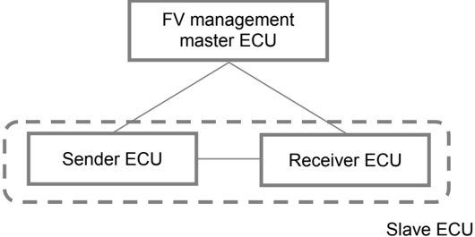

**表：FvMaster 关系（发送方/接收方 ECU）**

| 实体 | 描述 |
| --- | --- |
| 发送方 ECU（Sender） | 向接收方 ECU 发送受保护的 I-PDU。从 FV 管理主节点 ECU 接收同步消息（TripResetSyncMsg），并构造发送受保护的 I-PDU 所需的新鲜度值。 |
| 接收方 ECU（Receiver） | 接收受保护的 I-PDU。从 FV 管理主节点 ECU 接收同步消息（TripResetSyncMsg），并构造验证所收到的受保护的 I-PDU 所需的新鲜度值。 |
| FV 管理主节点 ECU（FvMaster） | 向所有发送方和接收方 ECU 发送同步消息（TripResetSyncMsg）。 |

FVM 应具有主节点同步功能和从节点传输同步功能。这使得可以实现以下两种 FV 管理主节点方式。

1. **单一 FV 管理主节点方式**

在此配置中，系统只有一个 FV 管理主节点 ECU。系统配置和实体列表分别见图"FvMaster 关系（发送方/接收方 ECU）"和上表。

2. **多 FV 管理主节点方式**

在此配置中，系统为相同数量的发送方 ECU 配备多个 FV 管理主节点 ECU。这意味着发送方 ECU 兼任其管理的受保护的 I-PDU 的 FV 管理主节点实体 ECU。多 FV 管理主节点方式的系统配置和实体列表如下。

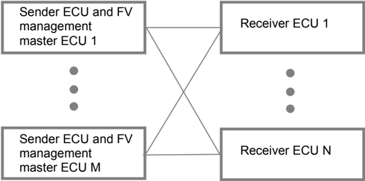

**表：多 FV 管理主节点方式的实体列表**

| 实体 | 描述 |
| --- | --- |
| 发送方 ECU 和 FV 管理主节点 ECU（Sender&FvMaster） | 向接收方 ECU 发送受保护的 I-PDU。向接收方 ECU 发送同步消息（TripResetSyncMsg）。 |
| 接收方 ECU（Receiver） | 接收受保护的 I-PDU。接收同步消息（TripResetSyncMsg）。 |

**注意：**

接收方 ECU 从其想要获取受保护的 I-PDU 的发送方 ECU 接收同步消息。如果它从多个发送方 ECU 接收消息，则它会从多个发送方 ECU 接收同步消息。

#### 10.4.1. 新鲜度值的定义

##### 10.4.1.1. 新鲜度值的结构

软件组件 FVM 向 SecOC 提供由独立计数器按以下结构构造的 FV：

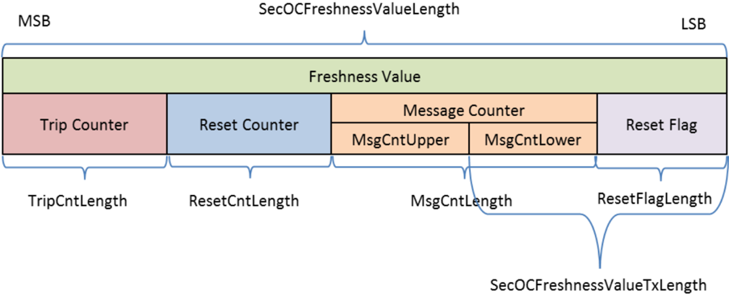

**表：新鲜度值的结构**

| 数据 | 描述 |
| --- | --- |
| 行程计数器（TripCnt） | 该计数器由 FV 管理主节点 ECU 以行程为单位递增。在单一 FV 管理主节点方式下，FV 管理主节点 ECU 将新的 TripCnt 作为同步消息（TripResetSyncMsg）发送给发送方 ECU 和接收方 ECU，所有发送方和接收方 ECU 都维护该值。在多 FV 管理主节点方式下，发送方 ECU 将新的 TripCnt 作为同步消息发送给接收方 ECU，接收方 ECU 维护该值。 |
| 复位计数器（ResetCnt） | 该计数器由 FV 管理主节点 ECU 按 ResetCycle 配置的周期递增。在单一 FV 管理主节点方式下，FV 管理主节点 ECU 将新的 ResetCnt 作为同步消息（TripResetSyncMsg）发送给发送方 ECU 和接收方 ECU，所有发送方和接收方 ECU 都维护该值。在多 FV 管理主节点方式下，发送方 ECU 将新的 ResetCnt 作为同步消息发送给接收方 ECU，接收方 ECU 维护该值。 |
| 消息计数器（MsgCnt） | 该计数器由发送方 ECU 随每条消息的发送而递增，由发送方 ECU 为每条安全消息分别管理。"MsgCntLower" 指消息计数器传输的截断新鲜度值中所包含的范围（SecOCFreshnessValueTxLength 之内）。"MsgCntUpper" 指消息计数器传输的截断新鲜度值中未包含的范围（SecOCFreshnessValueTxLength 之外）。 |
| 复位标志（ResetFlag） | 该标志与复位计数器同步更新。它是复位计数器低端的 ResetFlagLength（位）值。 |

**表：FVM 变量缩写**

| 缩写 | 描述 |
| --- | --- |
| ResetCycle | 复位计数器递增周期 |
| TripCntLength | 行程计数器的全长（位） |
| ResetCntLength | 复位计数器的全长（位） |
| MsgCntLength | 消息计数器的全长（位） |
| ResetFlagLength | 复位标志的长度（位） |
| ClearAcceptanceWindow | 行程计数器达到最大值时计数器初始化的允许范围。在 FV 主节点与从节点之间于行程计数器上限附近发生计数器失步等错误情况下，该窗口参数可作为一种鲁棒性措施有效地恢复该状态。要进一步了解其机制，参见 10.4.1.2 节。 |

##### 10.4.1.2. 用于构建新鲜度值的计数器规定

**表：用于构建新鲜度值的计数器行为**

| 计数器 | 递增条件 | 初始化条件 | 初始值 | 计数器长度 |
| --- | --- | --- | --- | --- |
| 行程计数器（TripCnt） | - FV 管理主节点 ECU 启动时<br>- 唤醒时<br>- 复位时<br>- 电源状态变化时："IG-OFF ⇒ IG-ON"，加 1 | 递增条件在行程计数器最大值处发生 | FV 管理主节点 ECU：1<br>从节点 ECU：0 | TripCntLength<br>最大 24 位 |
| 复位计数器（ResetCnt） | 以固定时间间隔（ResetCycle）加 1 | 行程计数器被递增或初始化 | FV 管理主节点 ECU：1<br>从节点 ECU：0 | ResetCntLength<br>最大 24 位 |
| 消息计数器（MsgCnt） | 每次消息发送加 1 | 复位计数器被递增或初始化 | 从节点 ECU：0 | MsgCntLength<br>最大 48 位 |

**注意：** 新鲜度值的长度（SecOCFreshnessValueLength）不能超过 64 位，因此三个计数器（行程计数器、复位计数器、消息计数器）和复位标志的长度必须各自选取，以满足其总长度不超过 64 位的要求。

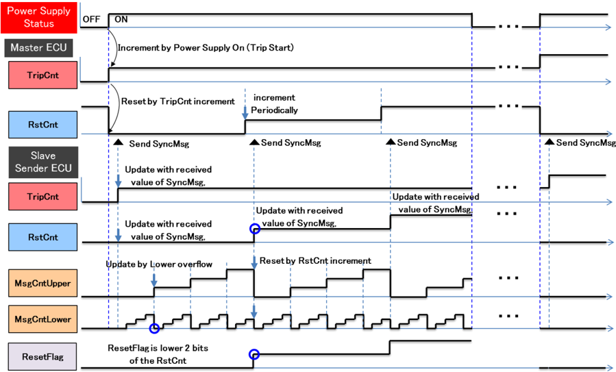

**注意：**

上图为 "ResetFlagLength 为 2 位且 MsgCntLower 为 2 位" 的情况下的示例。设计计数器值时须注意使其永不达到最大值，以防止重放（replay）等攻击。

如果构成新鲜度值的各计数器达到其最大值，则采取以下措施。此外，从节点 ECU 将消息计数器值已达最大值的情况通知上层模块。

[理由] 即使构成新鲜度值的某个计数器达到最大值，可能仍希望继续通信。

[理由] 当任一计数器达到最大值时，将无法再检测重放攻击。

**1. FV 管理主节点 ECU**

- 在行程计数器最大值处：当在行程计数器最大值处发生行程计数器的递增条件时，行程计数器和复位计数器返回其初始值。即使行程计数器返回初始值之后，同步消息仍会继续发送。
- 在复位计数器最大值处：当在复位计数器最大值处发生复位计数器的递增条件时，复位计数器固定在最大值。即使在复位计数器最大值处，同步消息仍会发送。尽管 FV 已溢出、需要通知上层应用或诊断系统，但仍存在某些希望在受限情况下继续与其他 ECU 通信的用例。为了与从节点 ECU 同步，FV 主节点将计数器值固定在上限以等待从节点 ECU 侧的重新同步，因此主节点 ECU 会周期性地尝试发送带有固定 RstCnt 的 TripResetSyncMsg，直到重新同步成功。

**2. 从节点 ECU**

- 在行程计数器最大值处：如果下面的条件 1 和条件 2 同时成立，则接收同步消息并执行认证器验证。如果验证结果为 OK，则用收到的行程计数器和复位计数器值更新行程计数器和复位计数器的最新值。此外，各计数器的先前发送值和先前接收值返回初始值。

**条件 1：**

'行程计数器最大值' - 'ClearAcceptanceWindow' ≤ '从节点 ECU 维护的行程计数器最新值' ≤ '行程计数器最大值'

**条件 2：**

'行程计数器初始值' ≤ '同步消息中的行程计数器值' ≤ '行程计数器初始值' + 'ClearAcceptanceWindow'

[理由] 这是为了提供一个允许范围（ClearAcceptanceWindow），以考虑到 FV 管理主节点 ECU 与从节点 ECU 的行程计数器在最大值附近相互偏离的情况。条件 2 中的行程计数器初始值指 FV 管理主节点 ECU 的初始值。

- 在复位计数器最大值处：发送方 ECU 通过将消息计数器固定为最大值来生成认证器；接收方 ECU 通过将消息计数器覆盖写为最大值来验证认证器。
- 在消息计数器最大值处：发送方 ECU 通过将消息计数器固定为最大值来生成认证器；接收方 ECU 通过将消息计数器覆盖写为最大值来验证认证器。

#### 10.4.2. 同步消息格式

FV 管理主节点 ECU 和从节点 ECU 处理符合以下格式的同步消息。

**注意：**

用于同步行程计数器与复位计数器的消息由 FV 管理主节点 ECU 发送给从节点 ECU。宜对行程计数器和复位计数器使用同一消息。

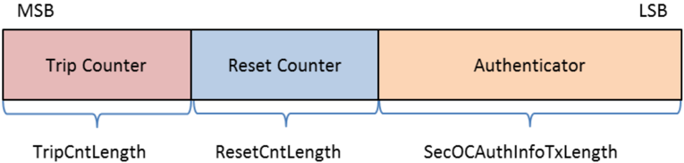

#### 10.4.3. FV 管理主节点的处理

##### 10.4.3.1. 初始化处理

FV 管理主节点 ECU 在 ECU 启动、唤醒或 ECU 复位时执行以下处理。

- 获取存储在非易失性存储器中的行程计数器值。首次启动时将行程计数器设为初始值。
- 将复位计数器设为初始值。

当无法从非易失性存储器中读取行程计数器值时，在下一次行程计数器更新之前，可以使用任意失效安全值（failsafe value）作为行程计数器和复位计数器。

当行程计数器递增时，FV 管理主节点 ECU 将递增后的值存储到非易失性存储器中。作为可选项，为防止恶意篡改，宜使用 RAM 缓冲将行程计数器存储在安全 flash 中。但是，不应将失效安全值存储到非易失性存储器中。

**注意：**

即使行程计数器从最大值变为初始值（见 10.4.1.2 节），也将其视为一次递增并存储到非易失性存储器中。

##### 10.4.3.2. 同步消息的发送

FV 管理主节点 ECU 将其管理的行程计数器和复位计数器周期性地（每隔 ResetCycle）发送给从节点 ECU。但是，如果可以在启动时发送，则立即发送。

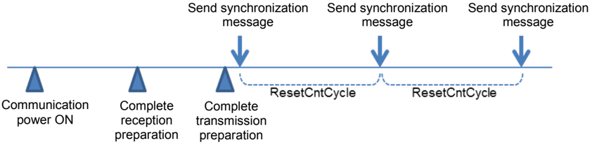

#### 10.4.4. 从节点 ECU 的处理

软件组件新鲜度值管理器 [FVM] 应实现并存储以下计数器设计值：

**表：计数器设计值**

| 设计值 | 描述 | 更新条件 |
| --- | --- | --- |
| 行程计数器（TripCnt） | 从 FV 管理主节点 ECU 成功接收的最新行程计数器值。 | 成功接收 TripResetSyncMsg |
| 复位计数器（ResetCnt） | 从 FV 管理主节点 ECU 成功接收的最新复位计数器值。 | 成功接收 TripResetSyncMsg |
| 新鲜度值（FV） | 为每条待保护的消息维护的新鲜度值。FV 的结构按照图"FreshnessValue 的结构"。发送消息：在受保护的 I-PDU 发送之前（当 SecOC 请求提供 FV 时），保存上一条受保护的 I-PDU 发送时所用的值；发送之后（当 SecOC 发送受保护的 I-PDU 的传输通知时），用提供给 SecOC 用于发送的值进行更新。接收消息：在受保护的 I-PDU 接收之前（当 SecOC 请求提供 FV 时），保存上一条受保护的 I-PDU 接收验证时所用的值；接收之后（当 SecOC 发送 MAC 验证成功通知时），用提供给 SecOC 用于接收的值进行更新。 | SecOC 的受保护的 I-PDU 传输开始通知，或 SecOC 的 MAC 验证成功通知 |

**说明：**

- 最新行程计数器或复位计数器指从 FV 管理主节点 ECU 接收的值。
- 先前行程计数器、复位计数器、消息计数器和复位标志指用于上一次认证生成或验证的各个新鲜度值。
- 接收的复位标志或消息计数器指按照 SecOC 的描述用于构建认证信息的截断新鲜度值。

下图为由 FV 管理主节点 ECU 提供并由 FVM 存储的行程计数器和复位计数器。


为每条受保护的 I-PDU 提供给 SecOC 的新鲜度值由行程计数器、复位计数器、消息计数器、复位标志组成。

**表：每条安全消息的新鲜度值**

| 行程计数器 [TripCntPdu] 先前值 | 复位计数器 [ResetCntPdu] 先前值 | 消息计数器 [MsgCnt] 先前值 | 复位标志 [ResetFlag] 先前值 |
| --- | --- | --- | --- |
| 新鲜度值 [FV]：针对每条安全消息，保存上一条受保护的 I-PDU 发送或接收时所用的值。 | 同左 | 同左 | 同左 |

##### 10.4.4.1. 初始化处理

从节点 ECU 在 ECU 启动、唤醒或 ECU 复位时执行以下处理。

- 获取存储在非易失性存储器中的行程计数器值，然后将其设为最新值。首次启动时，或无法从非易失性存储器中读取行程计数器值时，将行程计数器的初始值设为其最新值。
- 将复位计数器的最新值设为初始值。
- 将所有先前发送值和先前接收值设为初始值。

**注意：**

行程计数器的最新值已保存在非易失性存储器中。易失性存储器中的最新值和先前值都基于非易失性存储器中的行程计数器进行初始化。此处，先前值对发送方 ECU 而言指先前发送值，对接收方 ECU 而言指先前接收值。

##### 10.4.4.2. 同步消息的接收

当接收到同步消息时，从节点 ECU 执行以下处理以完成同步过程。

1. SecOC 从 FVM 获取用于验证的新鲜度值。由于假定同步消息（TripResetSyncMsg）中的行程计数器值和复位计数器值以全长发送和接收，FVM 按照 [UC_SecOC_00200] 中所述的方法比较新鲜度值，并构造用于验证的新鲜度值。
2. SecOC 构造认证数据，其构成为 "消息 ID &#124; 新鲜度值"。
3. SecOC 验证认证器并将验证结果通知 FVM。如果验证结果为 OK，FVM 将收到的行程计数器值和复位计数器值更新为最新值。SecOC 还将收到的行程计数器值和复位计数器值通知应用。

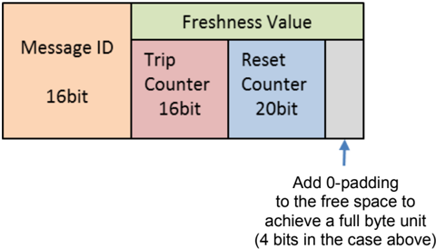

4. 如果验证结果失败（NG），SecOC 不执行重新验证，而是通知应用并丢弃接收的消息。

**注意：**

当行程计数器递增时，应用将递增后的值存储到非易失性存储器中。宜安全地存储该值。但是，不应将失效安全值存储到非易失性存储器中。即使行程计数器从最大值变为初始值（见 10.4.1.2 节），也将其视为一次递增并存储到非易失性存储器中。

##### 10.4.4.3. 用于发送的新鲜度值的构造

当 SecOC 请求获取用于发送的新鲜度值时，FVM 按下表构造用于发送的新鲜度值。

**表：用于发送的新鲜度值（FV）的构造**

| 行程计数器 &#124; 复位计数器比较 (*1) | 行程计数器 | 复位计数器 | 消息计数器 | 复位标志 |
| --- | --- | --- | --- | --- |
| 最新值 = 先前发送值 | 先前发送值 | 先前发送值 | 先前发送值 +1 | 复位计数器（先前发送值）低端的 ResetFlagLength（位）值 |
| 最新值 ≠ 先前发送值 | 最新值 | 最新值 | 初始值 +1 | 复位计数器（最新值）低端的 ResetFlagLength（位）值 |

当 SecOC 发送传输开始通知时，FVM 将构造的用于发送的新鲜度值（行程计数器、复位计数器、消息计数器）保存为先前发送值。

##### 10.4.4.4. 用于验证的新鲜度值的构造

当 SecOC 请求获取用于验证的新鲜度值时，FVM 基于以下三个比较结果按下表构造用于验证的新鲜度值。

1. 复位标志比较（见后文"复位标志比较方法"图）
2. 行程计数器和复位计数器比较
3. 消息计数器（低位）比较

**表：用于验证的新鲜度值（FV）的构造**

| 构造格式 | (1) 复位标志比较 | (2) 行程计数器 &#124; 复位计数器比较 | (3) 消息计数器（低位）比较 (*3) | 行程计数器 | 复位计数器 | 消息计数器（高位）(*1) | 消息计数器（低位）(*2) |
| --- | --- | --- | --- | --- | --- | --- | --- |
| 格式 1 | 最新值 = 接收值 | 最新值 = 先前接收值 | 先前接收值 &lt; 接收值（无进位） | 先前接收值 | 先前接收值 | 先前接收值 | 接收值 |
| 格式 2 | 最新值 = 接收值 | 最新值 = 先前接收值 | 先前接收值 &gt;= 接收值（有进位） | 先前接收值 | 先前接收值 | 先前接收值+1 | 接收值 |
| 格式 3 | 最新值 = 接收值 | 最新值 &gt; 先前接收值 | - | 最新值 | 最新值 | 0 | 接收值 |
| 格式 1 | 最新值-1 = 接收值 | 最新值-1 = 先前接收值 | 先前接收值 &lt; 接收值（无进位） | 先前接收值 | 先前接收值 | 先前接收值 | 接收值 |
| 格式 2 | 最新值-1 = 接收值 | 最新值-1 = 先前接收值 | 先前接收值 &gt;= 接收值（有进位） | 先前接收值 | 先前接收值 | 先前接收值+1 | 接收值 |
| 格式 3 | 最新值-1 = 接收值 | 最新值-1 &gt; 先前接收值 | - | 最新值 | 最新值-1 | 0 | 接收值 |
| 格式 1 | 最新值+1 = 接收值 | 最新值+1 = 先前接收值 | 先前接收值 &lt; 接收值（无进位） | 先前接收值 | 先前接收值 | 先前接收值 | 接收值 |
| 格式 2 | 最新值+1 = 接收值 | 最新值+1 = 先前接收值 | 先前接收值 &gt;= 接收值（有进位） | 先前接收值 | 先前接收值 | 先前接收值+1 | 接收值 |
| 格式 3 | 最新值+1 = 接收值 | 最新值+1 &gt; 先前接收值 | - | 最新值 | 最新值+1 | 0 | 接收值 |
| 格式 1 | 最新值-2 = 接收值 | 最新值-2 = 先前接收值 | 先前接收值 &lt; 接收值（无进位） | 先前接收值 | 先前接收值 | 先前接收值 | 接收值 |
| 格式 2 | 最新值-2 = 接收值 | 最新值-2 = 先前接收值 | 先前接收值 &gt;= 接收值（有进位） | 先前接收值 | 先前接收值 | 先前接收值+1 | 接收值 |
| 格式 3 | 最新值-2 = 接收值 | 最新值-2 &gt; 先前接收值 | - | 最新值 | 最新值-2 | 0 | 接收值 |
| 格式 1 | 最新值+2 = 接收值 | 最新值+2 = 先前接收值 | 先前接收值 &lt; 接收值（无进位） | 先前接收值 | 先前接收值 | 先前接收值 | 接收值 |
| 格式 2 | 最新值+2 = 接收值 | 最新值+2 = 先前接收值 | 先前接收值 &gt;= 接收值（有进位） | 先前接收值 | 先前接收值 | 先前接收值+1 | 接收值 |
| 格式 3 | 最新值+2 = 接收值 | 最新值+2 &gt; 先前接收值 | - | 最新值 | 最新值+2 | 0 | 接收值 |

- (*1) "消息计数器（高位）"指消息计数器的新鲜度值中未包含在传输用新鲜度值内的范围。
- (*2) "消息计数器（低位）"指消息计数器的新鲜度值中包含在传输用新鲜度值内的范围。
- (*3) 将"消息计数器（低位）"的先前接收值与接收值进行比较，判断是否产生了进位。

构造用于验证的新鲜度值的流程以及复位标志比较方法如下。

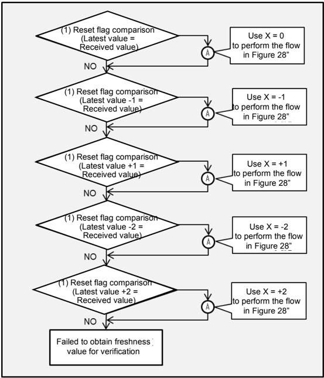

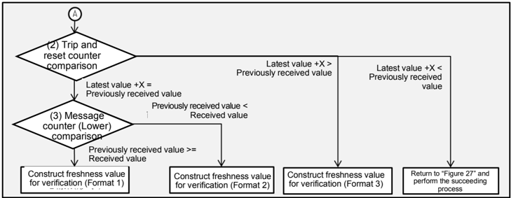

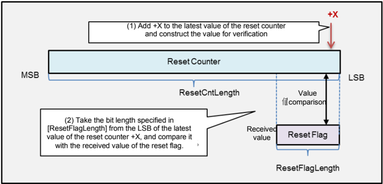

SecOC 使用获得的用于验证的新鲜度值构造认证数据并执行认证器验证。如果验证结果失败（NG），SecOC 会重新构造用于验证的新鲜度值并执行重新验证。

关于用于验证的新鲜度值的构造方法，见"用于验证的新鲜度值的构造顺序"两图。当 SecOC 发送验证结果通知（验证 = OK）时，FVM 将构造的用于验证的新鲜度值保存为先前接收值。

### 10.5. 基于多个新鲜度计数器的新鲜度值（前提：完整的新鲜度值）

**[UC_SecOC_00203]** 由解耦的计数器构建新鲜度值。

新鲜度值管理器（FVM）（SW-C 或 CDD）向 **SecOC** 提供新鲜度值（FV）。在完整新鲜度值的前提下，FVM 支持 FV 的主从同步机制。

发送方 ECU（和 FV 管理主节点 ECU）与接收方 ECU 之间的关系与图"多 FV 管理主节点方式的系统配置"相同。

**表：多 FV 管理主节点方式的实体列表**

| 实体 | 描述 |
| --- | --- |
| 发送方 ECU 和 FV 管理主节点 ECU | 向接收方 ECU 发送受保护的 I-PDU。 |
| 接收方 ECU | 接收受保护的 I-PDU。 |

系统为相同数量的发送方 ECU 配备多个 FV 管理主节点 ECU。这意味着发送方 ECU 兼任其管理的受保护的 I-PDU 的 FV 管理主节点实体 ECU。

**注意：**

与 10.4 节相比，由于完整的新鲜度值被发送和接收，因此不需要同步消息。

#### 10.5.1. 新鲜度值的定义

##### 10.5.1.1. 新鲜度值的结构

软件组件 FVM 向 SecOC 提供由独立计数器按以下结构构造的 FV：

**注意：**

与 10.4 节相比，不需要复位计数器和复位标志，因为它们是针对由新鲜度值截断导致的发送方 ECU 与接收方 ECU 之间新鲜度值差异的措施。

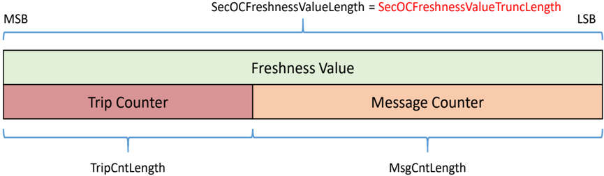

**表：新鲜度值的结构**

| 数据 | 描述 |
| --- | --- |
| 行程计数器 | 该计数器由作为 FV 管理主节点 ECU 的发送方 ECU 以行程为单位递增。由作为 FV 管理主节点 ECU 的发送方 ECU 管理，并为每个发送方 ECU 分别设置。 |
| 消息计数器 | 该计数器由发送方 ECU 随每条消息的发送而递增，由发送方 ECU 为每条安全消息分别管理。 |

**表：FVM 变量缩写**

| 缩写 | 描述 |
| --- | --- |
| TripCntLength | 行程计数器的全长（位） |
| MsgCntLength | 消息计数器的全长（位） |
| ClearAcceptanceWindow | 行程计数器达到最大值时计数器初始化的允许范围。在发送方 ECU 与接收方 ECU 之间于行程计数器上限附近发生计数器失步等错误情况下，该窗口参数可作为一种鲁棒性措施有效地恢复该状态。要进一步了解其机制，参见 10.5.1.2 节。 |

##### 10.5.1.2. 用于构建新鲜度值的计数器规定

**表：用于构建新鲜度值的计数器行为**

| 计数器 | 递增条件 | 初始化条件 | 初始值 | 计数器长度 |
| --- | --- | --- | --- | --- |
| 行程计数器 | - 发送方 ECU 启动时<br>- 唤醒时<br>- 复位时<br>- 电源状态变化时："IG-OFF ⇒ IG-ON"，加 1 | 递增条件在行程计数器最大值处发生 | 发送方 ECU：1<br>接收方 ECU：0 | TripCntLength<br>最大 24 位 |
| 消息计数器 | 每次消息发送加 1 | 行程计数器被递增或初始化 | 发送方 ECU：0<br>接收方 ECU：0 | MsgCntLength<br>最大 48 位 |

**注意：** 新鲜度值的长度（SecOCFreshnessValueLength）不能超过 64 位，因此两个计数器（行程计数器、消息计数器）的长度必须各自选取，以满足其总长度不超过 64 位的要求。

如果构成新鲜度值的各计数器达到其最大值，则采取以下措施。

[理由]

- 即使构成新鲜度值的某个计数器达到最大值，可能仍希望继续通信。
- 当任一计数器达到最大值时，将无法再检测重放攻击。

**1. 发送方 ECU**

- 在行程计数器最大值处：当行程计数器已达最大值时，向应用通知计数器值已达最大值。此外，当行程计数器的递增条件满足时，行程计数器返回其初始值。即使行程计数器返回初始值之后，仍会发送受保护的 I-PDU。
- 在消息计数器最大值处：当消息计数器已达最大值时，向应用通知计数器值已达最大值。此外，消息计数器固定在最大值并生成 MAC。即使消息计数器已达最大值之后，仍会发送受保护的 I-PDU。

**2. 接收方 ECU**

- 在行程计数器最大值处：当行程计数器已达最大值时，向应用通知计数器值已达最大值。此外，如果满足下面的条件 1 和条件 2，则在收到受保护的 I-PDU 时跳过新鲜度值的验证（见 10.5.3.2 节）。

**条件 1：**

'行程计数器最大值' - 'ClearAcceptanceWindow' ≤ '接收方 ECU 接收并存储的对应 SecOCFreshnessValueID 的行程计数器（先前接收值）' ≤ '行程计数器最大值'

**条件 2：**

'行程计数器初始值' ≤ '受保护的 I-PDU 中的行程计数器值' ≤ '行程计数器初始值' + 'ClearAcceptanceWindow'

[理由] 这是为了提供一个允许范围（ClearAcceptanceWindow），以考虑到发送方 ECU 与接收方 ECU 的行程计数器在最大值附近相互偏离的情况。条件 2 中的行程计数器初始值指发送方 ECU 的初始值。

- 在消息计数器最大值处：当消息计数器已达最大值时，向应用通知计数器值已达最大值。此外，消息计数器被覆盖写为最大值并验证 MAC。

#### 10.5.2. 发送方 ECU 和 FV 管理主节点 ECU 的处理

发送方 ECU 和 FV 管理主节点 ECU 上的软件组件 FVM 实现并存储以下计数器设计值：

**表：计数器设计值**

| 设计值 | 描述 | 更新条件 |
| --- | --- | --- |
| 行程计数器（最新值） | 每次初始化处理时递增的最新行程计数器值。 | 初始化处理 |
| 新鲜度值（先前发送值） | 为每条待保护的消息维护的新鲜度值。FV 的结构按照图"FreshnessValue 的结构"。发送消息：在受保护的 I-PDU 发送之前（当 SecOC 请求提供 FV 时），保存上一条受保护的 I-PDU 发送时所用的值；发送之后（当 SecOC 发送受保护的 I-PDU 的传输通知时），用提供给 SecOC 用于发送的值进行更新。 | SecOC 的受保护的 I-PDU 传输开始通知 |

##### 10.5.2.1. 初始化处理

发送方 ECU 在 ECU 启动、唤醒或 ECU 复位时执行以下处理。

- 检索存储在非易失性存储器中的行程计数器，并将其设为最新值。首次启动时，行程计数器的最新值设为初始值。
- 将所有先前发送值设为初始值。

当无法从非易失性存储器中读取行程计数器值时，在下一次行程计数器更新之前，可以使用任意失效安全值作为行程计数器。

当行程计数器递增时，发送方 ECU 将递增后的值存储到非易失性存储器中。作为可选项，为防止恶意篡改，宜使用 RAM 缓冲将行程计数器存储在安全 flash 中。但是，不宜将失效安全值存储到非易失性存储器中。

**注意：**

与 10.4 节相比，由于发送方 ECU 兼任 FV 管理主节点 ECU，因此由发送方 ECU 自身管理行程计数器。

即使行程计数器从最大值变为初始值（见 10.5.1.2 节），也将其视为一次递增并存储到非易失性存储器中。

##### 10.5.2.2. 用于发送的新鲜度值的构造

当 SecOC 请求获取用于发送的新鲜度值时，FVM 按下表构造用于发送的新鲜度值。

**表：用于发送的新鲜度值（FV）的构造**

| 行程计数器比较 | 行程计数器 | 消息计数器 |
| --- | --- | --- |
| 最新值 = 先前发送值 | 先前发送值 | 先前发送值 +1 |
| 最新值 ≠ 先前发送值 | 最新值 | 初始值 +1 |

当 SecOC 发送传输开始通知时，FVM 将构造的用于发送的新鲜度值（行程计数器、消息计数器）保存为先前发送值。

#### 10.5.3. 接收方 ECU 的处理

接收方 ECU 上的软件组件 FVM 实现并存储以下计数器设计值：

**表：计数器设计值**

| 设计值 | 描述 | 更新条件 |
| --- | --- | --- |
| 新鲜度值（先前接收值） | 为每条待保护的消息维护的新鲜度值。FV 的结构按照图"FreshnessValue 的结构"。接收消息：在受保护的 I-PDU 接收之前（当 SecOC 请求提供 FV 时），保存上一条受保护的 I-PDU 接收验证时所用的值；接收之后（当 SecOC 发送 MAC 验证成功通知时），用提供给 SecOC 用于接收的值进行更新。 | SecOC 的 MAC 验证成功通知 |

##### 10.5.3.1. 初始化处理

接收方 ECU 在 ECU 启动、唤醒或 ECU 复位时执行以下处理。

- 检索存储在非易失性存储器中的行程计数器，并将其设为对应行程计数器（先前接收值）中获得的值。如果未将行程计数器存储到非易失性存储器中，则行程计数器（先前接收值）设为初始值。
- 首次启动时或无法从非易失性存储器中读取行程计数器时，行程计数器（先前接收值）设为初始值。
- 将所有消息计数器（先前接收值）设为初始值。
- 如果使用先前接收新鲜度值列表，则将上述先前接收值视为参考值，并按照 10.5.3.3 节设置容差值。

##### 10.5.3.2. I-PDU 的验证

FVM 构造用于验证的新鲜度值，并按照 [UC_SecOC_00200] 中所述的方法比较新鲜度值，因为完整的新鲜度值（行程计数器和消息计数器）被发送和接收。

如果在使用以太网通信等情况下存在多条通信路径，消息帧可能乱序到达。可以使用下述替代方法来防止因乱序而丢弃消息。

到目前为止存储的新鲜度值包含在先前接收新鲜度值列表中。参考值指到目前为止存储的新鲜度值中的最大值。容差值指考虑到乱序而允许新鲜度值减小的值。详情参见 10.5.3.3 节。

**步骤 1：**

接收方 ECU 将其存储的先前接收新鲜度值列表的参考值和容差值与待验证的受保护的 I-PDU 的新鲜度值（接收值）进行比较，并根据比较结果执行以下操作。

- 当 "参考值 &lt; 接收值" 时，新鲜度值验证成功。
- 当 "容差值 ≤ 接收值 ≤ 参考值" 时，进入步骤 2。
- 当 "接收值 &lt; 容差值" 时，新鲜度值验证失败。接收方 ECU 停止验证并丢弃该受保护的 I-PDU。

**步骤 2：**

接收方 ECU 将其存储的先前接收新鲜度值列表与待验证的受保护的 I-PDU 的新鲜度值（接收值）进行比较，并根据比较结果执行以下操作。

- 当在先前接收新鲜度值列表中未找到接收值时，新鲜度值验证成功。
- 当在先前接收新鲜度值列表中找到接收值时，新鲜度值验证失败。接收方 ECU 停止验证并丢弃该受保护的 I-PDU。

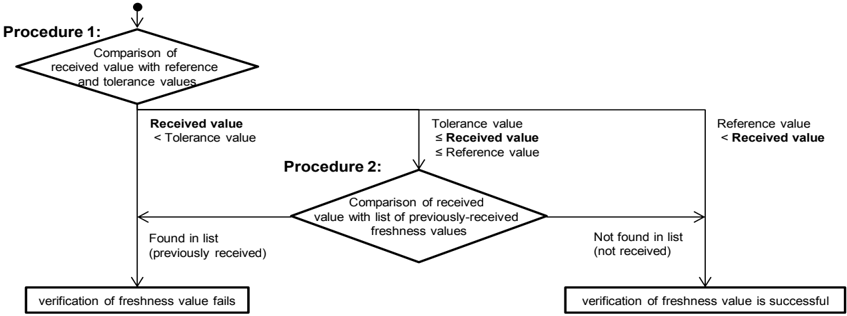

##### 10.5.3.3. I-PDU 的成功验证

当 SecOC 发送验证结果通知（验证成功）时，接收方 ECU 将构造的用于验证的新鲜度值保存为先前接收值。

在使用防止乱序丢弃的替代方法的情况下，参照以下规定。先前接收新鲜度值列表有两种方式。

**规定 1：**

当 SecOC 发送验证结果通知（验证成功）时，接收方 ECU 存储用于 MAC 验证的新鲜度值（行程计数器和消息计数器），并更新与 SecOCFreshnessValueID 对应的先前接收新鲜度值列表。

到目前为止存储的新鲜度值按从最大值起计数，最多 ReceivedFreshnessValueListSize 个，包含在先前接收新鲜度值列表中。在先前接收新鲜度值列表的值中，最大值用作参考值，最小值用作容差值。先前接收新鲜度值列表不存储重复的新鲜度值。

**规定 2：**

当 SecOC 发送验证结果通知（验证成功）时，接收方 ECU 存储用于 MAC 验证的新鲜度值（行程计数器和消息计数器），并更新与 SecOCFreshnessValueID 对应的先前接收新鲜度值列表。

到目前为止存储的新鲜度值中，大于等于容差值且小于等于参考值的新鲜度值包含在先前接收新鲜度值列表中。在到目前为止存储的新鲜度值中，最大值用作参考值，"参考值 - FreshnessValueToleranceWindow" 用作容差值。先前接收新鲜度值列表不存储重复的新鲜度值。

**注意：**

FreshnessValueToleranceWindow 是允许新鲜度值减小的参数，其取值范围为 0 到 255。原则上，出现相同新鲜度值时，在"新鲜度值比较"中按错误消息处理；但当消息计数处于最大值时，可能出现处理相同新鲜度值的情况。

**注意：**

当行程计数器递增时，应用可将递增后的值存储到非易失性存储器中。宜安全地存储该值。但是，不宜将失效安全值存储到非易失性存储器中。

即使行程计数器从最大值变为初始值（见 10.5.1.2 节），也将其视为一次递增并存储到非易失性存储器中。

## B. AUTOSAR 可追溯项变更历史

### B.1. 本文档按 AUTOSAR 发布版本 R23-11 的可追溯项历史

源文档中没有包含可追溯项变更历史附录，因此本节无内容可列。
