## 1. 简介和功能概述

AUTOSAR服务发现（**Service Discovery**）模块提供了侦测（**detect**）和提供（**offer**）车辆网络内可用服务（即：功能实体）的功能。为此，它使用了**IP**多播和所谓的**SOME/IP-SD**消息。

服务发现模块（**Sd**）位于AUTOSAR BSW模式管理器模块（**BswM**）和AUTOSAR套接字适配器模块（**SoAd**）之间。

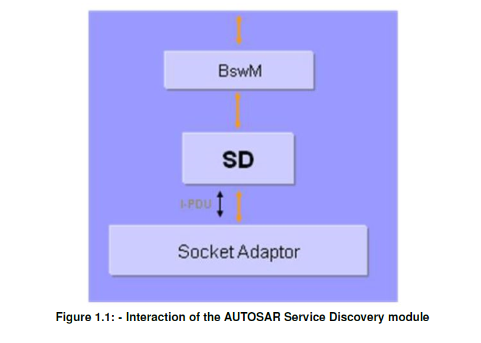

## 2. 缩略语、缩写和定义

下面的词汇表包含与服务发现模块相关、但未包含在[1, AUTOSAR 术语表]中的缩略语、缩写和定义。

### 2.1. 缩略语和缩写

**BswM**

> 基础软件管理器（**Basis software manager**）。

**ECU**

> 电子控制单元（**Electronic Control Unit**）。

**DEM**

> 诊断事件管理器（**Diagnostic Event Manager**）。

**DET**

> 默认错误跟踪器（**Default Error Tracer**）。

**SD**

> 服务发现（**Service Discovery**）。

**Sd**

> AUTOSAR中的服务发现模块（**Service Discovery Module in AUTOSAR**）。

**SoAd**

> 套接字适配器（**Socket Adaptor**）。

**SOME/IP**

> 可扩展的面向服务的基于IP的中间件（**Scalable service-Oriented MiddlwarE over IP**）。

**SOME/IP-SD**

> SOME/IP服务发现（**SOME/IP Service Discovery**）。

### 2.2. 术语

**Service**

> 提供一个接口的功能实体。

**Service Instance**

> 服务（**Service**）的单个实例。

**Offer**

> 提供一个服务实例（**Service Instance**）的消息条目。

**Stop Offer**

> 停止提供一个服务实例的消息。

**Find**

> 用于查找一个服务实例的消息条目。

**Event**

> 由实现一个服务实例的ECU发送给使用该服务实例的ECU的消息。

**Eventgroup**

> 一个或多个事件的逻辑分组。一个事件组（**Eventgroup**）是服务的一部分。

**Server Service**

> 提供一个服务。

**Client Service**

> 消费一个服务。

**Server**

> 承载服务器服务（**ServerServices**）的ECU。

**Client**

> 承载客户端服务（**ClientServices**）的ECU。

**Endpoint Option**

> 端点选项（**Endpoint Options**）用于通告一个单播地址和端口的元组。

**Multicast Option**

> 多播选项（**Multicast Options**）用于通告一个多播地址和端口的元组。

**Unicast event**

> 由承载[**SdServerService**](#9217-sdserverservice)的ECU发送到单播端点的事件。该单播端点由已在Endpoint Option（见「Consumed Eventgroup unicast endpoint」）中引用的、订阅了该[SdServerService](#9217-sdserverservice)的特定[SdClientService](#927-sdclientservice)提供。

**Multicast event**

> 由承载[**SdServerService**](#9217-sdserverservice)的ECU发送到多播端点的事件。该多播端点可以由[SdServerService](#9217-sdserverservice)（见「Eventhandler multicast endpoint」）和[SdClientService](#927-sdclientservice)（见「Consumed Eventgroup multicast endpoint」）提供。

**Eventhandler multicast endpoint**

> 描述按**EventHandler**为[**SdServerService**](#9217-sdserverservice)预配置的多播地址和端口元组的术语。如果订阅的、具有不同端点信息的客户端数量已达到阈值，则服务器将相应的事件发送到该预配置的多播地址和端口。Eventhandler多播端点经由**SubscribeEventgroupAck**条目所引用的Multicast option通告。

**Consumed Eventgroup unicast endpoint**

> 描述按**Consumed Eventgroup**为[**SdClientService**](#927-sdclientservice)预配置的单播地址和端口元组的术语。以该单播地址和端口订阅的[SdClientService](#927-sdclientservice)向SdServer指示应将相应的事件发送到哪个端点。Consumed Eventgroup单播端点经由**SubscribeEventgroup**或**StopSubscribeEventgroup**条目所引用的Endpoint option通告。

**Consumed Eventgroup multicast endpoint**

> 描述按**Consumed Eventgroup**为[**SdClientService**](#927-sdclientservice)预配置的多播地址和端口元组的术语。以该多播地址和端口订阅的[SdClientService](#927-sdclientservice)向SdServer指示应将相应的事件发送到哪个端点。Consumed Eventgroup多播端点经由**SubscribeEventgroup**或**StopSubscribeEventgroup**条目所引用的Multicast option通告。

**Eventhandler multicast connection**

> 描述当[**SdServerService**](#9217-sdserverservice)经由已配置的Eventhandler多播端点提供多播事件时，已建立的套接字连接的使用情况的术语。

**Consumed Eventgroup unicast connection**

> 描述当[**SdClientService**](#927-sdclientservice)经由Consumed Eventgroup单播端点接收事件时，已建立的套接字连接的使用情况的术语。

**Consumed Eventgroup multicast connection**

> 描述当[**SdClientService**](#927-sdclientservice)经由Consumed Eventgroup多播端点接收事件时，已建立的套接字连接的使用情况的术语。

## 3. 相关文档

### 3.1. 输入文件和相关标准与规范

- [1] AUTOSAR 术语表 AUTOSAR_FO_TR_Glossary
- [2] 基本软件模块通用规范 AUTOSAR_CP_SWS_BSWGeneral
- [3] 基本软件模块的通用需求 AUTOSAR_CP_SRS_BSWGeneral
- [4] 分层软件架构 AUTOSAR_CP_EXP_LayeredSoftwareArchitecture
- [5] SOME/IP服务发现协议的需求 AUTOSAR_FO_RS_SOMEIPServiceDiscoveryProtocol
- [6] SOME/IP服务发现协议规范 AUTOSAR_FO_PRS_SOMEIPServiceDiscoveryProtocol
- [7] 基础软件模式管理器规范 AUTOSAR_CP_SWS_BSWModeManager
- [8] 套接字适配器规范 AUTOSAR_CP_SWS_SocketAdaptor

### 3.2. 相关规范

AUTOSAR提供了基本软件模块的通用规范[2, SWS BSW General]，它对服务发现同样有效。

因此，规范SWS BSW General应被视为服务发现的附加且必需的规范。

[2, SWS BSW General] [3, SRS General] [4, EXP Layered Software Architecture] [5, RS SOME/IP Service Discovery Protocol] [6, PRS SOME/IP Service Discovery Protocol] [7, SWS Basic Software Mode Manager] [8, SWS Socket Adaptor]

## 4. 约束和假设

### 4.1. 限制

尽管AUTOSAR SD能够针对Service ID、Instance ID、Major Version和Minor Version响应通配符请求（**ANY**），但本模块只能针对Minor Version发送通配符find。

本文档尚未包含到SRS Ethernet的追溯链接，因此追溯表为空。

负载均衡选项（**Load Balancing Option**，Priority字段和Weight字段）可以为Offer Service配置。但是，客户端不评估这些字段。

本规范不支持将SOME/IP条目选项的Discardable标志设置为1，也不支持对收到Discardable标志设置为1的（未知/不支持的）选项作出反应（见PRS_SOMEIPSD_00273、PRS_SOMEIPSD_00275、PRS_SOMEIPSD_00276、PRS_SOMEIPSD_00544）。

本规范不支持在所发送SOME/IP-SD消息的任何SOME/IP-SD条目中包含IPv4/IPv6 SD端点选项（见PRS_SOMEIPSD_00547 - PRS_SOMEIPSD_00552、PRS_SOMEIPSD_00554 - PRS_SOMEIPSD_00559、PRS_SOMEIPSD_00650、PRS_SOMEIPSD_00651、PRS_SOMEIPSD_00654）。

SOME/IP-ACL的内容将是允许的通信伙伴的IP地址，因此在使用经由DHCP的动态IP的情况下该特性不适用。

### 4.2. 与Adaptive Platform通信的限制

关于SOME/IP服务发现协议规范和系统模板中描述的SOME/IP SD功能，适用以下限制：

- 配置选项（见PRS_SOMEIPSD_00276 - PRS_SOMEIPSD_00287）

从CP侧接收的能力记录（**capability records**）不会在AP侧评估。

### 4.3. 汽车域的适用性

不适用。

## 5. 对其他模块的依赖

### 5.1. AUTOSAR BSW调度器

BSW调度器调用服务发现模块的主函数，这是服务发现周期性过程所必需的。

### 5.2. AUTOSAR BSW模式管理器

**BswM**模块提供通用模式请求与服务请求之间的链接。

### 5.3. AUTOSAR套接字适配器

套接字适配器（**Socket Adaptor**）在以太网堆栈和服务发现模块之间传递服务请求。

服务发现模块应能够激活和停用进出TCP/IP套接字的PDU路由，并触发事件的初始传输（**triggered transmit**）。

**SoAd**的套接字连接表（**Socket Connection Table**）需要预配置，以接收其他ECU的服务发现模块发送的单播和多播消息。由于ECU可能连接到多个（虚拟）网络，因此可能存在多个服务发现实例，它们可能具有多个套接字连接表条目。每个（虚拟）接口的单播Rx、多播Rx和Tx PduID三元组需要在SoAd中配置，并为服务发现模块所知。

此外，服务发现模块更新套接字连接（**SoAdSocketConnection**）中的端点信息（IP地址和端口号），这些信息是服务发现模块从接收到的服务发现消息中提取的。

出于稳健性的原因，这些UDP套接字应仅用于SD消息，并且选项**SoAdSocketUdpStrictHeaderLenCheckEnabled**应开启。

### 5.4. AUTOSAR默认错误跟踪器

为了能够报告开发错误，服务发现模块必须能够访问默认错误跟踪器（**Default Error Tracer**）的错误钩子（**error hook**）。

### 5.5. AUTOSAR诊断事件管理器

为了能够报告生产错误，服务发现模块必须能够访问诊断事件管理器（**Diagnostic Event Manager**）。

### 5.6. AUTOSAR非易失性存储器

为了保存更新后的ACL（访问控制列表，**Access Control List**），服务发现模块应能够访问非易失性存储器**NVM**。

### 5.7. 文件结构

#### 5.7.1. 代码文件结构

代码文件结构不应完全在本规范内定义。在此应指出，代码文件结构应包括以下命名的文件：

- Sd_Lcfg.c——用于链接期可配置参数，以及
- Sd_PBcfg.c——用于Post-Build期可配置参数。

这些文件应包含所有链接期和Post-Build期可配置的参数。

#### 5.7.2. 头文件结构

模块应包含Dem.h文件。通过该包含，报告错误所需的API以及所需的事件ID符号也被包含进来。

如果配置了ACL检查，模块应包含头文件NvM.h。

## 6. 功能规格

### 6.1. 背景与理由

服务发现模块的主要任务是管理车辆内通信中称为服务（**services**）的功能实体的可用性，以及控制事件消息的发送行为。这使得可以只向需要这些事件消息的接收者发送事件消息（**Publish/Subscribe**）。本文描述的解决方案也称为SOME/IP-SD（Scalable service-Oriented MiddlewarE over IP - Service Discovery）。

通过服务发现，不同的ECU可以提供服务实例并查找车辆网络内可用的服务实例。ECU可以停止提供它之前提供的服务实例。之后针对该服务实例的find将保持无人应答。服务实例是由其服务接口定义的服务的单个实现。在AUTOSAR上下文中，find是用于标识可用服务实例及其位置的操作。

除了服务实例的状态之外，服务发现还能够控制称为事件（**events**）的特殊消息的发送。这些事件被分组到事件组（**Eventgroups**）中，服务发现可以以Publish/Subscribe的方式打开/关闭这些事件组；从而打开/关闭该事件组事件的发送和接收。

对于本文档的其余部分，适用第[2](#2-缩略语缩写和定义)章中列出的定义。

图7.1展示了服务与事件组之间的交互。在抽象层面上，服务可以包含零到多个事件组。但是，在构建整个系统时，该信息必须以不同的角色（客户端和服务器）配置到不同的ECU中。在实例化服务及其所包含的事件组时，将从服务与事件组实例化**ServerServices**与**ClientServices**以及**EventHandlers**与**ConsumedEventgroups**。

本地ECU需要处理两种不同的服务：

- 服务器服务（**Server Services**）——本地ECU向车辆的其余部分提供服务器服务实例（即位于本地），并且可以被视为该服务实例的服务器。
- 客户端服务（**Client Services**）——本地ECU可以使用车辆内另一个ECU提供的服务器服务实例，并且可以被视为该服务实例的客户端。

对于服务器服务，本地ECU的服务发现模块必须（服务器角色）：

- 当本地服务可用时提供该服务；即提供该服务的SWC已就绪，并且该服务在ECU的当前状态下可用。
- 当该服务不再可用时，收回本地服务的提供（**stop offer**）。
- 应答和响应其他ECU的find。

对于客户端服务，本地ECU的服务发现模块必须（客户端角色）：

- 根据配置侦听offer和find，并将此信息存储在易失性存储器中。
- 侦听stop offer，并根据配置将此信息存储在易失性存储器中。
- 根据当前ECU及其SWC的状态发送find。

服务发现也可用于管理Publish/Subscribe关系。在基于服务发现的Publish/Subscribe用例中，一个ECU（带有**ConsumedEventgroup**的Publish/Subscribe客户端）有兴趣从另一个ECU（带有**EventHandler**的Publish/Subscribe服务器）接收（订阅）一些数据。

虽然Subscribe在SD消息中是显式定义的，但Publish基于服务实例自身的可用性（**OfferService**条目）。基于所提供的服务实例，Publish/Subscribe客户端可以通过**SubscribeEventgroup**条目进行订阅。Publish/Subscribe服务器现在将使用该订阅将Publish/Subscribe客户端注册为某些信息的利益相关方（由订阅指定），并在某个事件或超时之后开始向Publish/Subscribe客户端发送该信息。

作为优化，SD支持使用多播消息向多个客户端发送事件消息，而不是每个客户端一条单播消息。请注意，必须区分可以在服务器侧预配置的多播端点和可以在客户端侧预配置的多播端点：

1. 如果[**SdServerService**](#9217-sdserverservice)按**EventHandler**具有预配置的多播地址和端口，则当订阅的、具有不同端点信息的[**SdClientService**](#927-sdclientservice)数量已达到阈值（**SdEventHandlerMulticastThreshold**）时，[SdServerService](#9217-sdserverservice)切换到该多播地址和端口（所谓的「Eventhandler multicast endpoint」）。
2. 如果[**SdClientService**](#927-sdclientservice)以一个多播地址和端口（所谓的「Consumed Eventgroup multicast endpoint」）订阅，则[SdServerService](#9217-sdserverservice)在收到订阅后将其事件发送到该Consumed Eventgroup多播端点（多播地址和端口）。

图7.1：服务与事件组的概览（**Overview of Services and Eventgroups**）

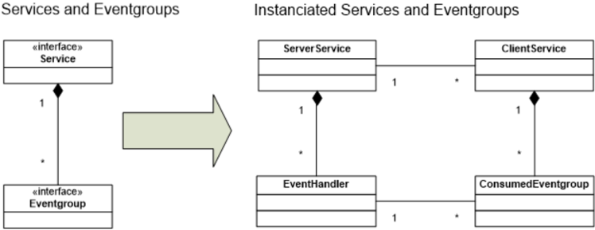

### 6.2. 需求

#### 6.2.1. 通用需求

应可以将服务发现模块配置为可选的AUTOSAR BSW模块。配置请参阅系统模板（**SystemTemplate**）。

服务发现应实现一个主函数，该主函数应根据配置参数**SdMainFunctionPeriod**周期性地调用。

服务发现模块应存储经由BswM通过调用以下API提供的服务模式请求（**ServiceModeRequest**）：

- 如果[**SdServerService**](#9217-sdserverservice)和[**SdClientService**](#927-sdclientservice)分别没有引用[**SdServiceGroup**](#925-sdservicegroup)，则分别为**[Sd_ServerServiceSetState](#733-sd_serverservicesetstate)()**和**[Sd_ClientServiceSetState](#734-sd_clientservicesetstate)()**
- 如果[**SdServerService**](#9217-sdserverservice)和[**SdClientService**](#927-sdclientservice)分别引用了[**SdServiceGroup**](#925-sdservicegroup)，则为[**Sd_ServiceGroupStart**](#738-sd_servicegroupstart)和[**Sd_ServiceGroupStop**](#739-sd_servicegroupstop)
- 如果[**SdClientService**](#927-sdclientservice)请求了专用的事件组，则为**[Sd_ConsumedEventGroupSetState](#735-sd_consumedeventgroupsetstate)()**（注意：此API调用与[SdClientService](#927-sdclientservice)是否引用[SdServiceGroup](#925-sdservicegroup)无关）
- **Sd_EventHandlerSetState()**目前不存在，因为该状态由服务发现直接从服务器服务的状态推导得出。

注意：

基于与SWC的交互，BswM模块可以请求以下模式：

服务器SWC经由**[Sd_ServerServiceSetState](#733-sd_serverservicesetstate)()**或分别经由**[Sd_ServiceGroupStart](#738-sd_servicegroupstart)()**和**[Sd_ServiceGroupStop](#739-sd_servicegroupstop)()**：

- **SD_SERVER_SERVICE_DOWN**
- **SD_SERVER_SERVICE_AVAILABLE**

客户端SWC经由**[Sd_ClientServiceSetState](#734-sd_clientservicesetstate)()**或分别经由**[Sd_ServiceGroupStart](#738-sd_servicegroupstart)()**和**[Sd_ServiceGroupStop](#739-sd_servicegroupstop)()**：

- **SD_CLIENT_SERVICE_RELEASED**
- **SD_CLIENT_SERVICE_REQUESTED**

客户端SWC经由**[Sd_ConsumedEventGroupSetState](#735-sd_consumedeventgroupsetstate)()**：

- **SD_CONSUMED_EVENTGROUP_RELEASED**
- **SD_CONSUMED_EVENTGROUP_REQUESTED**

「SD_SERVER_SERVICE_DOWN」意味着提供该服务实例的本地SWC尚未准备好通信。

「SD_SERVER_SERVICE_AVAILABLE」意味着提供该服务实例的本地SWC已准备好通信。

「SD_CLIENT_SERVICE_RELEASED」意味着使用该服务实例的本地SWC不需要与该服务实例通信。

「SD_CLIENT_SERVICE_REQUESTED」意味着使用该服务的本地SWC已准备好与该服务实例通信并且需要该服务实例。

「SD_CONSUMED_EVENTGROUP_RELEASED」意味着使用该Consumed Eventgroup的本地SWC不需要该Consumed Eventgroup的事件。

「SD_CONSUMED_EVENTGROUP_REQUESTED」意味着使用该Consumed Eventgroup的本地SWC需要该Consumed Eventgroup的事件。

以下**CurrentState**应可用于分别经由**BswM_Sd_ClientServiceCurrentState()**、**BswM_Sd_ConsumedEventGroupCurrentState()**和**BswM_Sd_EventHandlerCurrentState()**向BswM模块报告：

- **SD_CLIENT_SERVICE_DOWN**
- **SD_CLIENT_SERVICE_AVAILABLE**
- **SD_CONSUMED_EVENTGROUP_DOWN**
- **SD_CONSUMED_EVENTGROUP_AVAILABLE**
- **SD_EVENT_HANDLER_RELEASED**
- **SD_EVENT_HANDLER_REQUESTED**

注意：

「SD_CLIENT_SERVICE_DOWN」告知本地SWC该服务实例不可用。

「SD_CLIENT_SERVICE_AVAILABLE」告知本地SWC该服务实例可用。

「SD_CONSUMED_EVENTGROUP_DOWN」告知本地SWC该Consumed Eventgroup当前未被订阅。

「SD_CONSUMED_EVENTGROUP_AVAILABLE」告知本地SWC该Consumed Eventgroup当前已被订阅（即正在接收事件）。

「SD_EVENT_HANDLER_RELEASED」告知本地SWC当前没有客户端订阅该事件组。

「SD_EVENT_HANDLER_REQUESTED」告知本地SWC当前至少有一个客户端订阅了该事件组。

每个已配置的服务器服务实例应具有ECU范围内唯一的**SdServerServiceHandleId**。

每个已配置的客户端服务实例应具有ECU范围内唯一的**SdClientServiceHandleId**。

每个已配置的Consumed Event Group应具有ECU范围内唯一的**SdConsumedEventGroupHandleId**。

每个已配置的Event Handler应具有ECU范围内唯一的**SdEventHandlerHandleId**。

针对SWS_Sd_00011、\_00437、\_00438和\_00439的注意：

上述需求定义的ID用于在Sd与BswM之间的控制API中标识服务实例和事件组。

这对于拥有相同Service ID和/或相同Service Instance ID的实例或事件组同样有效。

#### 6.2.2. 以太网通信

每个服务发现配置实例（见配置容器[**SdInstance**](#926-sdinstance)）应具有至少一个TxPdu ID、一个用于单播的RxPdu ID和一个用于多播的RxPdu ID（分别见配置参数[**SdInstanceTxPdu**](#9215-sdinstancetxpdu)、[**SdInstanceUnicastRxPdu**](#9216-sdinstanceunicastrxpdu)和[**SdInstanceMulticastRxPdu**](#9214-sdinstancemulticastrxpdu)）。

对于不同的链路，应配置单独的服务发现实例容器。

注意：此处的链路也包括使用以太网VLAN的不同虚拟链路。

一个SD实例只支持单一地址族（**Address Family**，即IPv4或IPv6）。该地址族应通过[**SdInstanceTxPdu**](#9215-sdinstancetxpdu)、[**SdInstanceUnicastRxPdu**](#9216-sdinstanceunicastrxpdu)和[**SdInstanceMulticastRxPdu**](#9214-sdinstancemulticastrxpdu)的SoAd配置（本地地址）获知。

在SD模块初始化期间，应对与[**SdInstanceTxPdu**](#9215-sdinstancetxpdu)、[**SdInstanceUnicastRxPdu**](#9216-sdinstanceunicastrxpdu)和[**SdInstanceMulticastRxPdu**](#9214-sdinstancemulticastrxpdu)关联的所有套接字连接调用API **SoAd_OpenSoCon()**。

注意：SoAd模块需要在SD模块初始化之前完成初始化。

注意：

实现者必须通过验证服务发现和套接字适配器的源代码和配置，保证**SoAd_SetUniqueRemoteAddr()**、**SoAd_GetLocalAddr()**和**SoAd_SetRemoteAddr()**永远不会返回错误。**SoAd_SetUniqueRemoteAddr()**、**SoAd_GetLocalAddr()**和**SoAd_SetRemoteAddr()**的失败是无法恢复的。

#### 6.2.3. 状态处理

服务发现模块应分别存储所有静态配置的服务实例和事件组的状态。

在通过调用API **[Sd_Init](#731-sd_init)()**完成服务发现模块的初始化之后，所有已配置的服务器服务实例应处于状态「SD_SERVER_SERVICE_DOWN」，除非某个服务器服务实例的**SdServerServiceAutoAvailable**设置为true，此时其状态应设置为「SD_SERVER_SERVICE_AVAILABLE」。

注意：**SdServerServiceAutoAvailable**设置为true只允许用于没有引用[**SdServiceGroup**](#925-sdservicegroup)的服务器服务。

在通过调用API **[Sd_Init](#731-sd_init)()**完成服务发现模块的初始化之后，所有已配置的客户端服务实例应处于状态「SD_CLIENT_SERVICE_RELEASED」，除非某个客户端服务实例的**SdClientServiceAutoRequired**设置为true，此时其状态应设置为「SD_CLIENT_SERVICE_REQUESTED」。

注意：**SdClientServiceAutoRequired**设置为true只允许用于没有引用[**SdServiceGroup**](#925-sdservicegroup)的客户端服务。

在通过调用API **[Sd_Init](#731-sd_init)()**完成服务发现模块的初始化之后，所有已配置的事件组应处于状态「SD_CONSUMED_EVENTGROUP_RELEASED」，除非某个Consumed Eventgroup的「**SdConsumedEventGroupAutoRequired**」设置为true，此时一旦关联的客户端服务实例被请求，其状态就应设置为「SD_CONSUMED_EVENTGROUP_REQUESTED」。

服务发现模块应存储服务器和客户端服务实例所引用的所有IP地址分配状态。

如果在客户端服务实例仍处于释放状态（**SD_CLIENT_SERVICE_RELEASED**）时以**SD_CONSUMED_EVENTGROUP_REQUESTED**调用[**Sd_ConsumedEventGroupSetState**](#735-sd_consumedeventgroupsetstate)，则应返回**E_NOT_OK**。

如果一个[**SdClientService**](#927-sdclientservice)被设置为**SD_CLIENT_SERVICE_RELEASED**（通过**[Sd_ClientServiceSetState](#734-sd_clientservicesetstate)()**或**[Sd_ServiceGroupStop](#739-sd_servicegroupstop)()**），而它的事件组中有一个或多个仍处于请求状态（**SD_CONSUMED_EVENTGROUP_REQUESTED**），则服务发现应将其解释为与这些事件组先被以**SD_CONSUMED_EVENTGROUP_RELEASED**调用的情形相同。

#### 6.2.4. 与套接字适配器的交互

服务发现模块应能够使用API **SoAd_EnableRouting()**、**SoAd_DisableRouting()**、**SoAd_EnableSpecificRouting()**和**SoAd_DisableSpecificRouting()**在SoAd模块内为服务器和客户端服务实例启用/禁用路由组。

服务发现模块应能够使用API **SoAd_IfSpecificRoutingGroupTransmit()**触发初始事件的发送。

服务发现模块应能够按服务实例/事件组引用路由组。参见以下配置参数：

- **SdClientServiceActivationRef**（位于[SdConsumedMethods](#9211-sdconsumedmethods)中）
- **SdConsumedEventGroupMulticastActivationRef**
- **SdConsumedEventGroupTcpActivationRef**
- **SdConsumedEventGroupUdpActivationRef**
- **SdServerServiceActivationRef**（位于[SdProvidedMethods](#9222-sdprovidedmethods)中）
- **SdEventActivationRef**（位于[SdEventHandlerMulticast](#9219-sdeventhandlermulticast)中）
- **SdEventActivationRef**（位于[SdEventHandlerTcp](#9220-sdeventhandlertcp)中）
- **SdEventTriggeringRef**（位于[SdEventHandlerTcp](#9220-sdeventhandlertcp)中）
- **SdEventActivationRef**（位于[SdEventHandlerUdp](#9221-sdeventhandlerudp)中）
- **SdEventTriggeringRef**（位于[SdEventHandlerUdp](#9221-sdeventhandlerudp)中）

服务发现模块应能够按服务实例/事件组引用套接字连接和套接字连接组。参见以下配置参数：

- **SdClientServiceTcpRef**（服务实例和事件组）
- **SdClientServiceUdpRef**（服务实例和事件组）
- **SdConsumedEventGroupMulticastGroupRef**（事件组）
- **SdServerServiceTcpRef**（服务实例和事件组）
- **SdServerServiceUdpRef**（服务实例和事件组）
- **SdMulticastEventSoConRef**（位于[SdEventHandlerMulticast](#9219-sdeventhandlermulticast)中，事件组）

只有已分配IP地址时（即：已以当前状态TCPIP_IPADDR_STATE_ASSIGNED调用过**[Sd_LocalIpAddrAssignmentChg](#736-sd_localipaddrassignmentchg)()**），服务发现模块才应调用**SoAd_IfTransmit()**。

如果**SoAd_IfTransmit()**返回**E_NOT_OK**，则忽略。

如果满足以下所有条件，则应使用**SoAd_ReleaseRemoteAddr()**将每个通配符套接字连接重置回通配符：

- 该套接字连接的远程地址已由SD设置。
- 该套接字连接不再被某个**ClientService**使用，即：没有收到Offer、收到了Stop Offer或TTL已过期。
- 该套接字连接不再被某个**Eventhandler**使用，即：客户端已退订所有使用该套接字连接的事件组。如果因为达到了**SdEventHandlerMulticastThreshold**而禁用路由，则不应重置该套接字连接。

注意：该需求不适用于用于服务发现的套接字连接。

#### 6.2.5. 订阅事件组的重试处理

订阅事件组重试机制是**ClientServices**的可选特性。它可以用于在某些SOME/IP-SD消息丢失（如**SubscribeEventGroupAck**）且周期offer之间的间隔过大而无法快速恢复的情况下加快恢复，或在两个周期offer之间的某个时刻请求了事件组的情况下加快订阅。订阅事件组重试机制的时序行为可以按**ClientService**配置，并且必须与相应**ServerService**的时序行为匹配（见TPS SysT constr_5095）。对于TLL（**SdServerTimerTTL**）设置为0xFFFFFF、且主阶段中周期offer之间的间隔（**SdServerTimerOfferCyclicDelay**）设置为0的服务器服务，可以将订阅事件组重试设置为0xFF（见TPS SysT constr_5096）。这意味着只要该事件组被设置为**SD_CONSUMED_EVENTGROUP_REQUESTED**且未收到**SubscribeEventGroupAck**，就重试对该事件组的订阅。

订阅事件组重试处理只应针对满足以下条件的服务器服务的事件组进行处理：

- **SdSubscribeEventgroupRetryMax**大于0，
- 并且仅在**SdSubscribeEventgroupRetryEnable**设置为TRUE时。

如果**SdSubscribeEventgroupRetryEnable**设置为TRUE且**SdSubscribeEventgroupRetryMax**设置为大于0的值，则每当某个Consumed Eventgroup迁移到**SD_CONSUMED_EVENTGROUP_REQUESTED**状态时，应执行以下动作：

- 启动相应的客户端服务订阅重试延迟定时器并将其设置为**SdSubscribeEventgroupRetryDelay**（如果该定时器尚未运行）；
- 事件组订阅重试计数器初始化为1。

如果客户端服务订阅重试延迟定时器到期，且某个已配置事件组的订阅重试次数（**SdSubscribeEventgroupRetryMax**）尚未超限，则应重新初始化客户端服务订阅重试延迟定时器，并通过发送**StopSubscribeEventgroup/SubscribeEventgroup**组合重新触发该事件组的订阅，并递增重试计数器。如果订阅重试次数（**SdSubscribeEventgroupRetryMax**）超限，则服务发现模块应引发运行时错误「[**SD_E_COUNT_OF_RETRY_SUBSCRIPTION_EXCEEDED**](#6112-运行时错误)」。

对于所请求事件组的订阅重试，在以下条件下应停止：

- 如果针对所请求的事件组收到了**SubscribeEventGroupAck**或**SubscribeEventGroupNack**。
- 如果重试次数超过了所请求事件组的**SdEventgroupSubscribeRetryMax**。
- 如果所请求的事件组被设置为「**SD_CONSUMED_EVENTGROUP_RELEASED**」。

如果**SdSubscribeEventgroupRetryEnable**设置为TRUE且**SdSubscribeEventgroupRetryMax**设置为0xFF，则只要满足以下所有条件，订阅重试就应继续：

- 相应的事件组被设置为「**SD_CONSUMED_EVENTGROUP_REQUESTED**」；
- 未收到**SubscribeEventGroupAck**或**SubscribeEventGroupNack**。

如果按照SWS_Sd_00738，某个**ClientService**所有事件组的重试已结束，则应取消该客户端服务订阅重试延迟定时器。

当客户端在下一条**OfferService**被接收之前没有收到初始事件时，它应停止请求该事件组（即触发**StopSubscribeEventgroup**），并在收到下一条**OfferService**时恢复请求该事件组（即触发**SubscribeEventgroup**）。

该过程可以在应用层触发，并且在功能上对应于丢失**SubscribeEventgroupAck**之后的**StopSubscribeEventgroup/SubscribeEventgroup**组合。这可能意味着向SD模块通知每个Field的初始事件的接收，或采用其他适当的手段。

如果应用无法实现前两段所述的过程，则应将重试机制外包给**BswM**，通过一条在检测到安全关联已建立时触发重发初始事件（经由触发**StopSubscribeEventgroup/SubscribeEventgroup** SD消息）的规则，以至少提高基于安全关联的通信的稳健性。

由于安全关联的建立是异步的，BswM规则（**BswMModeRequestSource/BswMTimer**）因此应将发送**StopSubscribeEventgroup/SubscribeEventgroup**延迟一段适当的时间，以允许通信双方完成安全关联的建立。

如果**Subscribe Eventgroup Ack**条目在下一条**Subscribe Eventgroup**条目发送之前没有到达（见PRS_SOMEIPSD_00463），或客户端在下一条**OfferService**被接收之前没有收到初始事件，则在当前连接正在建立或已经建立的情况下，这不应导致重建安全关联连接。

对于使用安全关联传输的事件，客户端必须确保在发送**SubscribeEventgroup**条目之前安全关联已建立且已准备好接收消息（见SWS_Sd_00761）。而服务器必须确保在发送**SubscribeEventgroupAck**条目之前安全关联已建立且能够发送消息（见SWS_Sd_00760）。

如果收到需要安全关联的**SubscribeEventgroup**条目而安全关联尚未建立，则该条目应以**SubscribeEventgroupNack**条目应答（见SWS_Sd_00760）。

### 6.3. 消息格式

大多数需求在PRS [5.1.2 SomeIp SD message format]中处理，本章只定义与Classic Platform相关的部分。

注意：所有服务发现消息都采用网络字节序（即大端字节序），见PRS_SOMEIPSD_00853。SOME/IP报头字段已由[PRS_SOMEIP_00368]保证这一点，而SOME/IP有效载荷需要根据[PRS_SOMEIP_00369]进行配置。

图7.2：服务发现消息格式的概览（**Overview of the Service Discovery message format**）

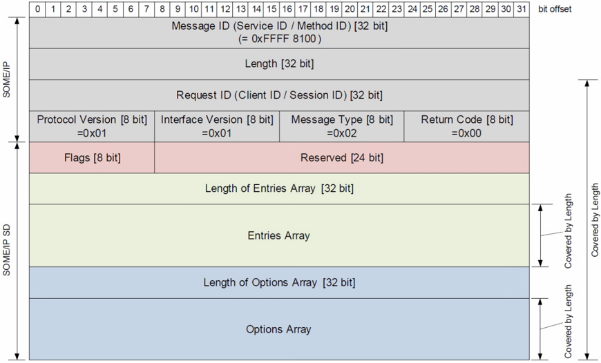

#### 6.3.1. Request ID

本章描述与Request ID字段相关的需求。Request ID由Client ID和Session ID组成。Client ID不用于服务发现，而Session ID用于检测车辆内其他服务发现实例的重启或重新启动，以修复服务发现模块的本地状态。

服务发现模块初始化之后，本地ECU发送的消息的Session ID应为0x0001。

针对SWS_Sd_00034的注意：这意味着第一条发送出去的SD消息的Session ID设置为0x0001。根据PRS_SOMEIPSD_00160，服务发现模块必须按通信伙伴处理会话ID。因此，发送到多播端点的第一条SD消息以及发送到任何单播端点的第一条SD消息的Session ID都设置为0x0001。

#### 6.3.2. Protocol Version字段

Protocol Version字段用于描述SOME/IP的当前版本。

#### 6.3.3. Interface Version字段

Interface Version字段用于描述SOME/IP服务的当前版本；即SOME/IP-SD自身的当前版本。

#### 6.3.4. Message Type字段

Message Type字段用于区分SOME/IP消息的类型。SOME/IP-SD只使用事件消息；因此，它始终使用相同的类型。

#### 6.3.5. Return Code字段

Return Code用于指示请求是否已被成功处理。这不适用于SOME/IP-SD；因此，返回码将被静态设置为0x00。

#### 6.3.6. Flags字段

SOME/IP-SD报头以Flags字段开始。它用于指示全局的服务发现信息，目前包括最后一次重启的状态以及接收单播消息的能力。

如果服务器或客户端通过评估通信伙伴发送的所接收SOME/IP-SD消息的Session ID和Reboot Flag检测到重启，则受影响的通信伙伴的本地状态应过期，并应执行以下动作：

- 如果客户端检测到服务器的重启且客户端正在使用该服务器的服务，则客户端应将此次重启按收到StopOffer条目处理（更多细节另见SWS_Sd_00367）。此外：
- -如果该服务配置了**SdClientServiceTcpRef**，则活动的客户端应通过以参数「abort」设置为TRUE调用**SoAd_CloseSoCon()**关闭相应的TCP连接。
- -该Offer条目应根据SWS_Sd_00721处理。
- -如果服务器检测到客户端的重启且客户端正在使用该服务器的服务，则服务器应将此次重启按收到StopSubscribeEventgroup条目处理（更多细节另见SWS_Sd_00345）。此外：
- -* 如果该服务配置了**SdServerServiceTcpRef**，则活动的服务器应通过以参数「abort」设置为TRUE调用**SoAd_CloseSoCon()**关闭相应的TCP连接，并通过调用**SoAd_OpenSoCon()**重新建立TCP连接。
- -* 之后应根据SWS_Sd_00343或SWS_Sd_00344处理该消息。

注意：以参数「abort」设置为TRUE调用**SoAd_CloseSoCon()**将通过发送RST标志（reset标志）置位的TCP包立即终止TcpIp连接。

#### 6.3.7. Reserved字段

该Reserved字段目前未使用，留空以供SOME/IP-SD协议的进一步增强使用。

#### 6.3.8. Entries Array

当SOME/IP-SD查找或提供服务实例或处理订阅时，这是通过所谓的条目（**entries**）完成的，条目在SOME/IP-SD消息的条目数组中传输（见图7.2）。

存在两种类型的条目：用于服务的Type 1条目和用于事件组的Type 2条目。

关于**Entry Format Type 1**的更多细节，见[6, PRS SOME/IP Service Discovery Protocol]第4.1.2.3章「Entry Format」。

Type 1条目应具有以下布局：

图7.3：Type 1条目（服务条目）的布局（**Layout of Type 1 Entries**）

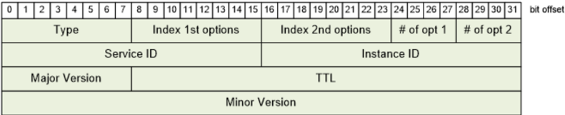

Type 1条目格式布局的Service ID字段应承载服务的Service ID，根据是服务器条目还是客户端条目，分别使用参数**SdServerServiceID**和**SdClientServiceID**静态配置。另见[[ECUC_SD_00009]]和[[ECUC_SD_00020]]。

Type 1条目格式布局的Instance ID字段应承载服务的Instance ID，根据是服务器条目还是客户端条目，分别使用参数**SdServerServiceInstanceID**和**SdClientServiceInstanceID**静态配置。另见[[ECUC_SD_00011]]和[[ECUC_SD_00022]]。

Type 1条目格式布局的Major Version字段应承载**SdServerServiceMajorVersion**和**SdClientServiceMajorVersion**，取决于它是服务器条目还是客户端条目。另见[[ECUC_SD_00068]]和[[ECUC_SD_00070]]。

Type 1条目格式布局的TTL字段定义条目对服务器的生命周期（秒），使用参数**SdServerTimerTTL**和**SdClientTimerTTL**配置，Stop条目除外，其TTL为0。另见[[ECUC_SD_00037]]和[[ECUC_SD_00075]]。

注意：对于客户端，TTL值不用于Type 1条目，服务器服务应忽略它。

Type 1条目格式布局的Minor Version字段应承载**SdServerServiceMinorVersion**和**SdClientServiceMinorVersion**。另见[[ECUC_SD_00069]]和[[ECUC_SD_00071]]。

Type 2条目格式应用于事件组。

关于**Entry Format Type 2**的更多细节，见[6, PRS SOME/IP Service Discovery Protocol]第4.1.2.3章「Entry Format」。

图7.4：Type 2条目（事件组条目）的布局（**Layout of Type 2 Entries**）

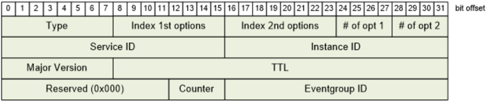

Type 2条目格式布局的Service ID字段应承载事件组所属服务的Service ID，根据是服务器条目还是客户端条目，分别使用参数**SdServerServiceID**和**SdClientServiceID**静态配置。另见[[ECUC_SD_00009]]和[[ECUC_SD_00020]]。

Type 2条目格式布局的Instance ID字段应承载事件组所属服务的Instance ID，根据是服务器条目还是客户端条目，分别使用参数**SdServerServiceInstanceID**和**SdClientServiceInstanceID**静态配置。另见[[ECUC_SD_00011]]和[[ECUC_SD_00022]]。

Type 2条目格式布局的Major Version字段应承载**SdServerServiceMajorVersion**和**SdClientServiceMajorVersion**，取决于它是服务器条目还是客户端条目。另见[[ECUC_SD_00068]]和[[ECUC_SD_00070]]。

Type 2条目格式布局的TTL字段定义条目的生命周期（秒），使用参数**SdServerTimerTTL**和**SdClientTimerTTL**配置，Stop条目和Nack条目使用TTL 0除外。另见[[ECUC_SD_00037]]和[[ECUC_SD_00075]]。

Type 2条目格式布局的Eventgroup ID字段应承载事件组的ID，使用参数**SdConsumedEventGroupID**配置。另见[[ECUC_SD_00057]]。

Type 2条目（事件组条目）不得使用「任意值」作为Service ID（即0xFFFF）、Instance ID（即0xFFFF）、Eventgroup ID（即0xFFFF）和/或Major Version（即0xFF）。

#### 6.3.9. Options Array

Option数组是服务发现消息的最后一部分（见图7.2）。options数组中的选项携带附加信息。

关于**Configuration Option**的更多细节，见[6, PRS SOME/IP Service Discovery Protocol]第4.1.2.4章「Options Format」。

Configuration Option传输服务发现消息中条目的附加属性。可以使用Configuration Option传输0到n个配置项。这些配置项可以包括例如主机名或服务的名称。

图7.5：Configuration Option（**Configuration Option**）

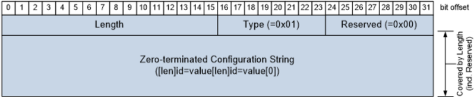

Configuration String应根据[**SdServerCapabilityRecord**](#9223-sdservercapabilityrecord)和[**SdClientCapabilityRecord**](#929-sdclientcapabilityrecord)按如下方式构造（ID为0xFFFE的服务的事件组应包含该服务的CapabilityRecord）：

- 对于每一对**SdServerCapabilityRecordKey**/ **SdServerCapabilityRecordValue**或**SdClientServiceCapabilityRecordKey**/ **SdClientServiceCapabilityRecordValue**：
- -由key、「=」和value的串联构造一个config\_item\_string。
- -该config\_item\_string的长度以uint8形式写入配置字符串。
- -将config\_item\_string追加到配置字符串。
- 在末尾追加一个0x00的uint8。这意味着后面没有更多的config\_item\_string。

Configuration Option示例：

图7.6：Configuration Option示例（**Example for Configuration Option**）

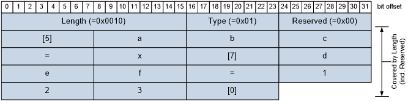

**SdServerCapabilityRecordValue**和**SdClientServiceCapabilityRecordValue**允许为空。

这意味着在「=」之后跟随的是下一个长度uint8或「0」。

收到不带「=」符号的config\_item\_string应被解释为存在key但没有value。

应支持在单个配置选项中存在多个具有相同key的config\_item\_string。

如果存在**SdInstanceHostname**，则应向Configuration Option添加一个key为「hostname」、value设置为该配置项字符串的条目。

#### 6.3.9.2. IPv4 Endpoint Option

本章描述IPv4端点选项（**IPv4 Endpoint Option**）的字段和值，它传输单播IP地址、第4层协议（如UDP或TCP）和端口号；即与服务通信所需的信息。

当接收到提供服务并携带IPv4 Endpoint Option的服务发现消息时，接收该消息的ECU可以通过更新套接字连接来为使用该服务动态配置套接字适配器。

图7.7：IPv4 Endpoint Option格式（**IPv4 Endpoint Option format**）

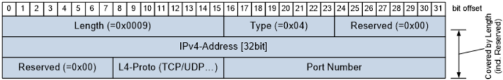

这些端口也应用于事件和通知事件（**notification events**）：

- 使用UDP时，服务器使用通告的端口作为源端口。
- 使用TCP时，客户端应通过调用**SoAd_GetSoConMode()**检查套接字连接的状态。调用此API必须在专用套接字连接上提供**SOAD_SOCON_ONLINE**状态。

此外，如果选择了安全端口，则需要在发送订阅之前建立安全关联。否则，事件和通知事件既不能通过安全端口发送也不能接收。

#### 6.3.9.3. IPv6 Endpoint Option

本章描述IPv6端点选项（**IPv6 Endpoint Option**）的字段和值，它与IPv4 Endpoint Option相同，只是传输IPv6地址而不是IPv4地址。

图7.8：IPv6 Endpoint Option格式（**IPv6 Endpoint Option format**）

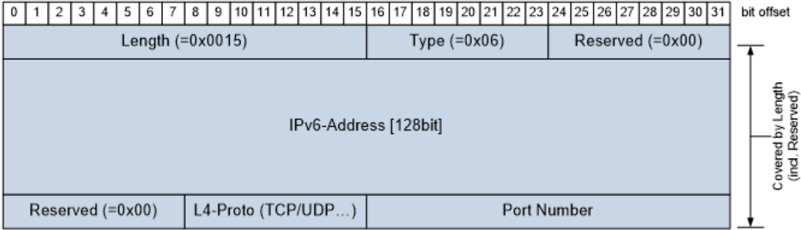

这些端口也应用于事件和通知事件：

- 使用UDP时，服务器使用通告的端口作为源端口。
- 使用TCP时，客户端应通过调用**SoAd_GetSoConMode()**检查套接字连接的状态。调用此API必须在专用套接字连接上提供**SOAD_SOCON_ONLINE**状态。

此外，如果选择了安全端口，则需要在发送订阅之前建立安全关联。否则，事件和通知事件既不能通过安全端口发送也不能接收。

#### 6.3.9.4. IPv4 Multicast Option

IPv4多播选项（**IPv4 Multicast Option**）要么由[**SdServerService**](#9217-sdserverservice)用于通告其已配置的Eventhandler多播端点，要么由[**SdClientService**](#927-sdclientservice)用于通告其已配置的Consumed Eventgroup多播端点：

- 如果它被用作Eventhandler多播端点，则[SdServerService](#9217-sdserverservice)通告IPv4多播地址、传输层协议（ISO/OSI第4层）和端口号，多播事件和多播通知事件将被发送到那里。
- 如果它被用作Consumed Eventgroup多播端点，则[SdClientService](#927-sdclientservice)指示IPv4多播地址、传输层协议（ISO/OSI第4层）和端口号，SdClient期望在那里接收事件。

作为传输层协议，只支持UDP。

图7.9：IPv4 Multicast Option格式（**IPv4 Multicast Option format**）


#### 6.3.9.5. IPv6 Multicast Option

IPv6多播选项（**IPv6 Multicast Option**）要么由[**SdServerService**](#9217-sdserverservice)用于通告其已配置的Eventhandler多播端点，要么由[**SdClientService**](#927-sdclientservice)用于通告其已配置的Consumed Eventgroup多播端点：

- 如果它被用作Eventhandler多播端点，则[SdServerService](#9217-sdserverservice)通告IPv6多播地址、传输层协议（ISO/OSI第4层）和端口号，多播事件和多播通知事件将被发送到那里。
- 如果它被用作Consumed Eventgroup多播端点，则[SdClientService](#927-sdclientservice)指示IPv6多播地址、传输层协议（ISO/OSI第4层）和端口号，SdClient期望在那里接收事件。

作为传输层协议，只支持UDP。

图7.10：IPv6 Multicast Option格式（**IPv6 Multicast Option format**）

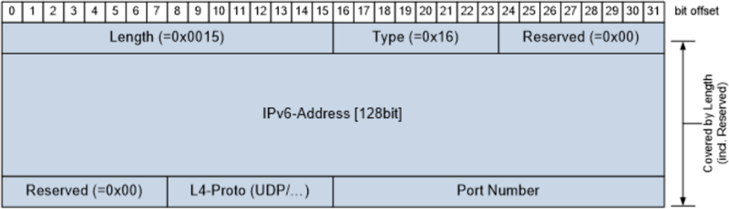

#### 6.3.9.6. IPv4 SD Endpoint Option

IPv4 SD端点选项（**IPv4 SD Endpoint Option**）传输发送方SD实现的端点（即IP地址和端口）。这用于在无法使用IP地址和/或端口号的情况下标识SOME/IP-SD实例。

图7.11：IPv4 SD Endpoint Option（**IPv4 SD Endpoint Option**）

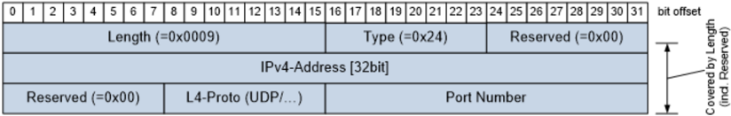

SOME/IP-SD实现应支持IPv4服务发现端点选项

PRS_SOMEIPSD_00547、PRS_SOMEIPSD_00650、PRS_SOMEIPSD_00651、PRS_SOMEIPSD_00548、PRS_SOMEIPSD_00549、PRS_SOMEIPSD_00550、PRS_SOMEIPSD_00551、PRS_SOMEIPSD_00552、PRS_SOMEIPSD_00856、PRS_SOMEIPSD_00857、PRS_SOMEIPSD_00854。

注意：SD Endpoint Options的发送目前不在AUTOSAR的范围之内。

#### 6.3.9.7. IPv6 SD Endpoint Option

IPv6 SD端点选项（**IPv6 SD Endpoint Option**）传输发送方SD实现的端点（即IP地址和端口）。这用于在无法使用IP地址和/或端口号的情况下标识SOME/IP-SD实例。

图7.12：IPv6 SD Endpoint Option（**IPv6 SD Endpoint Option**）


SOME/IP-SD实现应支持IPv6服务发现端点选项

PRS_SOMEIPSD_00554、PRS_SOMEIPSD_00654、PRS_SOMEIPSD_00555、PRS_SOMEIPSD_00556、PRS_SOMEIPSD_00557、PRS_SOMEIPSD_00558、PRS_SOMEIPSD_00559、PRS_SOMEIPSD_00837、PRS_SOMEIPSD_00859、PRS_SOMEIPSD_00860、PRS_SOMEIPSD_00855。

注意：SD Endpoint Options的发送目前不在AUTOSAR的范围之内。

#### 6.3.9.8. 缺失、冗余和冲突选项的处理

本节描述所接收选项的错误处理。

注意：若干种条目类型与不同的选项类型组合使用：

- Offer和StopOffer条目使用IPv4或IPv6 Endpoint Option。Endpoint Option的内容（IP地址、端口和L4协议）经由**SdServerServiceTcpRef**和**SdServerServiceUdpRef**标识。
- Subscribe和StopSubscribe条目使用IPv4或IPv6 Endpoint Option（如果相应的Client Service引用**SdClientServiceTcpRef**或**SdClientServiceUdpRef**）。
- Subscribe和StopSubscribe条目使用IPv4或IPv6 Multicast Option（如果相应的Client Service引用**SdClientServiceMulticastRef**）。
- SubscribeEventGroupAck条目使用IPv4或IPv6 Multicast Option。Endpoint Option的内容（多播IP地址和端口）经由**SdMulticastEventSoConRef**标识。

关于缺失、冗余和冲突选项处理的更多细节，见[6, PRS SOME/IP Service Discovery Protocol] 4.1.4.6「Error Handling」。

如果SubscribeEventgroup条目引用了两个或更多相互冲突的选项，或选项类型未知，则该SubscribeEventgroup条目应以**SubscribeEventgroupNack**应答。

注意：

对于服务端点选项（Service Endpoints Options），见**SdClientServiceTcpRef**和**SdClientServiceUdpRef**。对于事件组端点选项，见[**SdEventHandlerUdp**](#9221-sdeventhandlerudp)/[SdEventHandlerTcp](#9220-sdeventhandlertcp)/[SdEventHandlerMulticast](#9219-sdeventhandlermulticast)处的**SdEventActivationRef**。

另见PRS_SOMEIPSD_00231和PRS_SOMEIPSD_00361。

#### 6.3.9.9. 选项的安全考虑

为了检查端点在拓扑上是否正确，应使用[ECUC_SD_00128]的值来确定应比较多少个前导位以检查一个IP地址是否可被视为本地地址。如果不存在，则应使用为该IP地址本地配置的子网掩码（**netmask**）的值。

#### 6.3.9.10. 条目引用选项

本章描述条目如何引用两个选项运行段（**option runs**），每个运行段包含零到十五个选项，以便引用附加信息。

注意：条目支持两个选项运行段，以允许不同的条目引用相同的选项。如果只有一个选项运行段，在不同条目拥有不同Configuration Option的同时共享Endpoint Option将无法高效工作。

注意：图7.13展示了一个SD消息示例，其中有一个条目引用了第一个运行段中的两个选项：

图7.13：条目引用选项的示例（**Example with Entries referencing Options**）

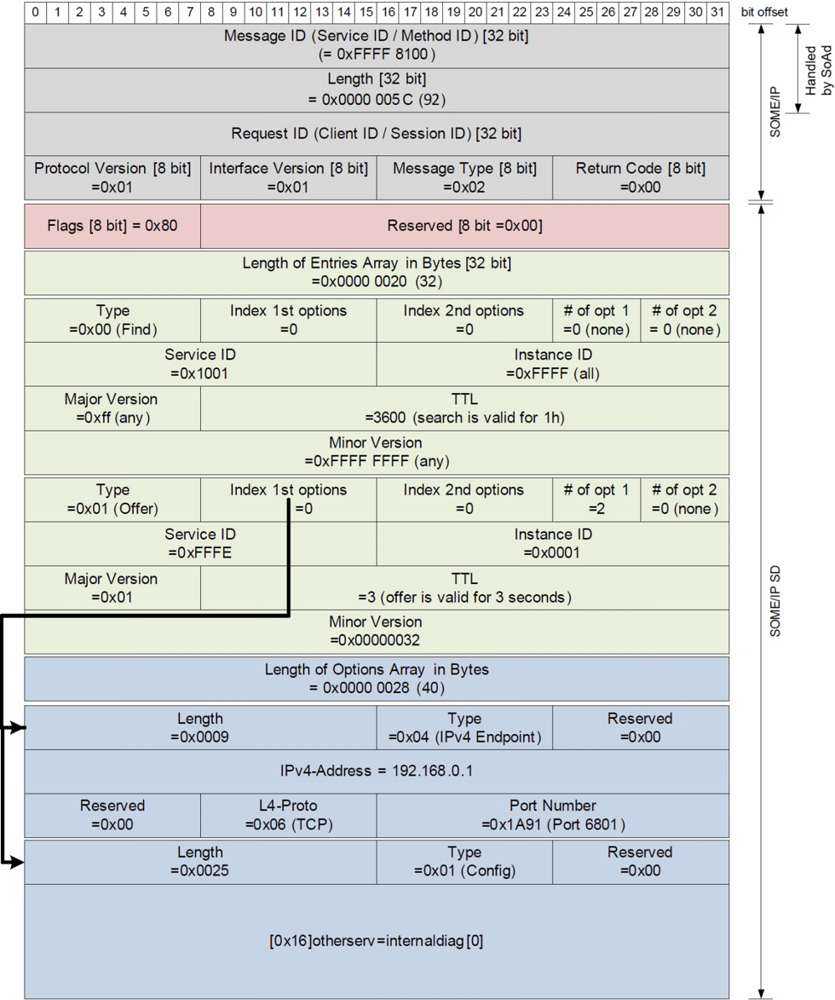

下表显示了哪些选项允许由不同的条目携带（所有其他组合不得使用）：

### 6.4. 服务发现条目类型

ECU应分发可用的服务实例和所需的服务实例以及这些服务实例的事件组。为此，它们使用服务发现消息交换条目。本章描述这些条目如何编码以offer和find服务以及find和订阅事件组。

#### 6.4.1. 服务条目（通用需求）

这些需求对所有涉及服务的条目有效，包括Type 0x00、0x01、0x02和0x03的条目。

注意：目前本规范只定义了类型0x00和0x01的服务条目。

0xFFFF的Instance ID应表示任何可能的实例，并且不允许用于OfferService和StopOfferService条目。

FindService条目应承载按照**SdClientServiceID**、**SdClientServiceInstanceID**、**SdClientServiceMajorVersion**和**SdClientServiceMinorVersion**配置的Service ID、Service Instance ID、Major Version和Minor Version。

OfferService和StopOfferService应承载按照**SdServerServiceID**、**SdServerServiceInstanceID**、**SdServerServiceMajorVersion**和**SdServerServiceMinorVersion**配置的Service ID、Service Instance ID、Major Version和Minor Version。

FindService条目应承载按照**SdClientTimerTTL**配置的TTL。

注意：FindService的TTL值应被服务器服务忽略，该配置仅为向后兼容而保留。

OfferService条目应承载按照**SdServerTimerTTL**配置的TTL。

所有涉及服务的条目（FindService、OfferService和StopOfferService）应承载（即引用）按配置的选项。

注意：另见第[6.3.9.6](#6396-ipv4-sd-endpoint-option)节。

#### 6.4.2. FindService条目

FindService条目允许查找服务实例。

关于**FindService entry**的更多细节，见[6, PRS SOME/IP Service Discovery Protocol]第4.1.2.5章「Service Entries」。

如果**SdVersionDrivenFindBehavior**设置为**EXACT_OR_ANY_MINOR_VERSION**，服务发现应为FindService条目使用精确的minor version，这意味着只返回具有该特定minor version的服务。

如果**SdVersionDrivenFindBehavior**设置为**EXACT_OR_ANY_MINOR_VERSION**，服务发现应为FindService条目使用0xFFFF FFFF（ANY），这意味着返回具有任何minor version的服务。

针对SWS_Sd_00503和SWS_Sd_00752的注意：预期在正常运行中客户端侧的Minor Version配置为0xFFFF FFFF，因为客户端应接受所有不同的Minor Version。不同的Minor Version应彼此兼容。

如果**SdVersionDrivenFindBehavior**设置为**MINIMUM_MINOR_VERSION**，服务发现模块应考虑以下几点：

- Minor Version应设置为配置中可接受的最低要求minor version；
- 服务发现应为FindService条目使用0xFFFF FFFF（ANY），这意味着返回具有任何minor version的服务。

注意：SWS_Sd_10503所描述的行为与PRS_SOMEIPSD_00825不同。

注意：当**SdVersionDrivenFindBehavior**设置为**MINIMUM_MINOR_VERSION**时对所接收服务条目的处理，在第[6.5.3](#653-接收条目)节「接收条目」的需求SWS_Sd_04089中规定。

TTL应根据配置设置。

#### 6.4.3. OfferService条目

为了提供服务实例，应使用OfferService条目。

关于**OfferService entry**的更多细节，见[6, PRS SOME/IP Service Discovery Protocol]第4.1.2.5章「Service Entries」。

如果使用了负载均衡选项（**Load Balancing Option**），Weight字段应设置为**SdServerServiceLoadBalancingWeight**的配置值。

如果使用了负载均衡选项，Priority字段应设置为**SdServerServiceLoadBalancingPriority**的配置值。

#### 6.4.4. 构建OfferService条目

本章描述如何导出组装OfferService消息所需的所有数据：

1. 从配置容器导出所有静态数据。例如：
- 容器[**SdServerService**](#9217-sdserverservice)：SdServerServiceId
- 容器[**SdServerService**](#9217-sdserverservice)：SdServerServiceInstanceId
- 容器[**SdServerService**](#9217-sdserverservice)：SdServerServiceMajorVersion
- 容器[**SdServerService**](#9217-sdserverservice)：SdServerServiceMinorVersion
- 容器[**SdServerTimer**](#9224-sdservertimer)：SdServerTimerTTL
- 容器[**SdInstance**](#926-sdinstance)：SdInstanceHostname
2. 如果该服务配置了TCP（存在配置项**SdServerServiceTcpRef**）：
- 生成器从配置参数**SdServerServiceTcpRef**引用的SoConGroup导出一个SoConID。
- 使用导出的SoConID调用套接字适配器的API **SoAd_GetLocalAddr()**，以取回Endpoint Option所需的IP地址、传输协议（第4层）和端口号。
- 构建L4-Protocol设置为TCP的相关Endpoint Option（应与LocalAddr中相同）。
3. 如果该服务配置了UDP（存在配置项**SdServerServiceUdpRef**）：
- 生成器从配置参数**SdServerServiceUdpRef**引用的SoConGroup导出一个SoConID。
- 使用导出的SoConID调用套接字适配器的API **SoAd_GetLocalAddr()**，以取回Endpoint Option所需的IP地址、传输协议（第4层）和端口号。
- 构建L4-Protocol设置为TCP的相关Endpoint Option（应与LocalAddr中相同）。
4. 如果已配置，构建Configuration Option（见配置项[**SdServerCapabilityRecord**](#9223-sdservercapabilityrecord)和**SdInstanceHostname**）。
5. 按如上所述构建OfferService条目。

#### 6.4.5. StopOfferService条目

为了停止提供服务实例，应使用StopOfferService条目。

关于**StopOfferService entry**的更多细节，见[6, PRS SOME/IP Service Discovery Protocol]第4.1.2.5章「Service Entries」。

#### 6.4.6. 事件组条目（通用需求）

以下需求对所有涉及事件组的条目有效，包括Type 0x04、0x05、0x06和0x07的条目。

注意：目前本规范只定义了类型0x06和0x07的事件组条目。

关于**Eventgroup Entries**的更多细节，见[6, PRS SOME/IP Service Discovery Protocol]第4.1.3.1章「Eventgroup Entry」。

事件组条目包括：

- **SubscribeEventgroup**和**StopSubscribeEventgroup**
- **SubscribeEventgroupAck**和**SubscribeEventgroupNack**

事件组条目应将Eventgroup ID设置为该事件组的ID（配置参数**SdConsumedEventGroupId**和**SdEventHandlerEventGroupId**）。

注意：Eventgroup ID 0x0000保留。

**SubscribeEventgroup**和**StopSubscribeEventgroup**条目应根据配置（配置参数**SdClientServiceId**和**SdClientServiceInstanceId**）设置Service ID、Service Instance ID和Eventgroup ID。

**SubscribeEventgroup**条目的TTL字段应设置为已配置的值（[**SdConsumedEventGroup**](#9210-sdconsumedeventgroup)的配置参数**SdClientTimerTTL**），**SubscribeEventgroupAck**条目应使用它所确认的SubscribeEventgroup条目的TTL值。

事件组条目应承载按配置的选项。

#### 6.4.7. SubscribeEventgroup条目

为了订阅事件组，应使用SubscribeEventgroup条目。

关于**SubscribeEventgroup Entries**的更多细节，见[6, PRS SOME/IP Service Discovery Protocol]第4.1.3.1章「Eventgroup Entry」。

Type 2条目格式中的Counter字段用于区分对其他方面完全相同的事件组（即相同的Service ID、相同的Instance ID、相同的Eventgroup ID和相同的Major Version）的不同订阅。服务器应将Counter字段反映到Subscribe Eventgroup Ack和Nack条目中。

如果配置了具有不同端点的相同Consumed Eventgroup，则SD应使用Counter来区分不同的订阅。Counter的值可由实现确定。

注意：4位的宽度将对同一事件组的订阅限制为16个不同的订阅。

如果使用网络安全协议，只要启用安全通信的安全关联尚未建立，客户端就应暂缓其**SubscribeEventgroup**（见SWS_Sd_00761）。

#### 6.4.8. StopSubscribeEventgroup条目

为了停止订阅某个事件组，应使用StopSubscribeEventgroup条目。

关于**StopSubscribeEventgroup Entries**的更多细节，见[6, PRS SOME/IP Service Discovery Protocol]第4.1.3.1章「Eventgroup Entry」。

#### 6.4.9. SubscribeEventgroupAck条目

为了确认一个SubscribeEventgroup条目，应使用SubscribeEventgroupAck条目，并应使用与它所确认的SubscribeEventgroup条目相同的值。

关于**SubscribeEventgroupAck Entries**的更多细节，见[6, PRS SOME/IP Service Discovery Protocol]第4.1.3.1章「Eventgroup Entry」。

#### 6.4.10. SubscribeEventgroupNack条目

关于**SubscribeEventgroupNack Entries**的更多细节，见[6, PRS SOME/IP Service Discovery Protocol]第4.1.3.1章「Eventgroup Entry」。

如果收到引用了两个相互冲突的Endpoint Option（UDP或TCP）的SubscribeEventgroup条目，则应生成SubscribeEventgroupNack。如果端点选项类型相同但持有不同的值（如不同的IP或端口号），则认为它们是冲突的。

当客户端收到作为对需要安全关联的SubscribeEventgroup的响应的SubscribeEventgroupNack时，客户端应检查安全协议的状态（见SWS_Sd_00761），并应重启安全协议（如果尚未启动）（见SWS_Sd_00465）。

#### 6.4.11. 构建SubscribeEventgroup条目

本需求描述如何导出组装SubscribeEventgroup消息所需的所有数据：

1. 从配置容器导出所有静态数据。例如：
- 容器[**SdClientService**](#927-sdclientservice)：SdClientServiceId
- 容器[**SdClientService**](#927-sdclientservice)：SdClientServiceInstanceId
- 容器[**SdClientService**](#927-sdclientservice)：SdClientServiceMajorVersion
- 容器[**SdClientService**](#927-sdclientservice)：SdClientServiceMinorVersion
- 容器**SdConsumedEventGroupTimerRef** → [**SdClientTimer**](#9212-sdclienttimer)：SdClientTimerTTL
- 容器[**SdInstance**](#926-sdinstance)：SdInstanceHostname
2. 如果该服务配置了TCP（存在配置项**SdClientServiceTcpRef**）：
- 基于**SdClientServiceTcpRef**（找到SoConGroup）和OfferService条目的Endpoint Option（在其中找到SoCon）找到相关的SocketConnection。
- 使用导出的SoConID调用套接字适配器的API **SoAd_GetLocalAddr()**，以取回Endpoint Option所需的IP地址、传输协议（第4层）和端口号。
- 构建L4-Protocol设置为TCP的相关Endpoint Option（应与LocalAddr中相同）。
3. 如果该服务配置了UDP且被用作Consumed Eventgroup单播端点（存在配置项**SdClientServiceUdpRef**）：
- 基于**SdClientServiceUdpRef**（找到SoConGroup）和OfferService条目的Endpoint Option（在其中找到SoCon）找到相关的SocketConnection。
- 使用导出的SoConID调用套接字适配器的API **SoAd_GetLocalAddr()**，以取回Endpoint Option所需的单播IP地址、传输协议（第4层）和端口号。
- 构建L4-Protocol设置为UDP的相关Endpoint Option（应与LocalAddr中相同）。
4. 如果该服务配置了UDP且被用作Consumed Eventgroup多播端点（存在配置项**SdClientServiceMulticastRef**）：
- 基于**SdClientServiceMulticastRef**（找到SoConGroup）和OfferService条目的Endpoint Option（在其中找到SoCon）找到相关的SocketConnection。
- 使用导出的SoConID调用套接字适配器的API **SoAd_GetLocalAddr()**，以取回Multicast Option所需的多播IP地址、传输协议（第4层）和端口号。
- 构建L4-Protocol设置为UDP的相关Multicast Option（应与LocalAddr中相同）。
5. 如果已配置，构建Configuration Option（见配置项[**SdClientCapabilityRecord**](#929-sdclientcapabilityrecord)和**SdInstanceHostname**）。
6. 按如上所述构建SubscribeEventgroup条目。

### 6.5. 消息的发送和接收

本章描述如何使用套接字适配器模块发送和接收消息。

服务发现模块使用携带所引用TxPdu（见配置参数[**SdInstanceTxPdu**](#9215-sdinstancetxpdu)）的**SoAd_IfTransmit()** API发送服务发现消息（Offer、StopOffer、Find等）。

服务发现模块经由API **Sd_SoAdIfRxIndication()**以及配置项[**SdInstanceUnicastRxPdu**](#9216-sdinstanceunicastrxpdu)和[**SdInstanceMulticastRxPdu**](#9214-sdinstancemulticastrxpdu)接收服务发现消息。所接收的远程地址必须在[**Sd_RxIndication**](#741-sd_rxindication)的调用上下文中保存。

接收服务发现消息时，应忽略所有保留字段的值。

每当服务发现模块收到SOME/IP-SD消息时，都必须检查该消息的一致性。这包括但不限于：

- 验证SOME/IP-SD消息足够长以容纳条目数组和选项数组（总长度 = 12 + 条目数组长度 + 选项数组长度）。
- 检查条目是否引用了已存在的选项。

如果收到了格式错误的消息，应报告扩展生产错误[**SD_E_MALFORMED_MSG**](#6115-扩展生产错误)。

#### 6.5.1. 消息发送的序列

本章描述与套接字适配器模块交互以发送服务发现消息的过程：

1. 前提条件：服务发现消息已组装。
2. 在消息应经由单播发送的情况下：
- 调用套接字适配器的API **SoAd_SetRemoteAddr**。
3. 在消息应经由多播发送的情况下：
- 调用API **SoAd_SetRemoteAddr**设置目的地。
4. 调用**SoAd_IfTransmit()**在总线上发送消息。

另请参阅第[8](#8-时序图)章中展示的序列「CLIENT/SERVER: TransmitSdMessage」。

注意：

这可以通过例如周期性地检查所有服务实例和事件组的状态，然后组装服务发现消息来实现。

应减少单独服务发现消息的数量，即：在调用套接字适配器的发送API之前，将尽可能多的信息组合到一条服务发现消息中。这意味着当某个条目在等待适当的延迟之后（即基于Request-Response-Delay）被发送时，该通信伙伴的所有其他条目也可以打包进该服务发现消息中。

#### 6.5.2. 消息接收的序列

本章描述与套接字适配器交互以接收服务发现消息的过程：

1. 当套接字适配器收到服务发现消息时，调用API **[Sd_RxIndication](#741-sd_rxindication)()**。
2. 使用所指示的RxPduId，必须确定该SD实例关联的SoConId。
3. 使用该SoConId调用API **SoAd_GetRemoteAddr()**。
4. 存储地址和消息以供进一步处理。
5. 使用**SoAd_ReleaseRemoteAddr()**将SoCon重置回通配符。
6. 条目应严格按照它们到达的顺序处理。

另请参阅第[8](#8-时序图)章中展示的序列「CLIENT/SERVER: [Sd_RxIndication](#741-sd_rxindication)」。

注意：

为了导出SoConId，对应此RxPduId的**SoAdSocketRoute**应引用一个**SoAdSocketConnection**，或引用一个只包含单个**SoAdSocketConnection**的**SoAdSocketConnectionGroup**。

如果单个服务发现消息的条目会导致在套接字适配器中关闭再打开同一个套接字连接，则服务发现不应先关闭该套接字连接。

注意：关闭和打开套接字连接（尤其是TCP）与服务发现的行为相冲突，并导致欠佳的反应时间。

#### 6.5.3. 接收条目

接收条目时，必须识别相关的服务实例或事件组，本节对此进行说明。

如果**SdClientServiceMinorVersion**设置为0xFFFFFFFF且**SdVersionDrivenFindBehavior**设置为**EXACT_OR_ANY_MINOR_VERSION**，则在标识服务实例及其关联事件组时不检查所接收OfferService或StopOfferService条目中的Minor Version。

如果**SdClientServiceMinorVersion**设置为0xFFFFFFFF以外的任何值且**SdVersionDrivenFindBehavior**设置为**EXACT_OR_ANY_MINOR_VERSION**，则应检查所接收OfferService或StopOfferService中的Minor Version以标识服务实例及其关联事件组。服务发现模块应处理所接收条目的minor version与相应[**SdClientService**](#927-sdclientservice)已配置的minor version完全匹配的OfferService或StopOfferService。

注意：

我们将满足SWS条目SWS_Sd_00488和SWS_Sd_00489的每个已配置服务实例称为服务实例匹配候选（**service instance match candidate**）。

如果**SdVersionDrivenFindBehavior**设置为**MINIMUM_MINOR_VERSION**，则应检查所接收OfferService或StopOfferService中的Minor Version以标识服务实例及其关联事件组。服务发现模块应处理所接收条目的minor version等于或大于相应[**SdClientService**](#927-sdclientservice)已配置的minor version的OfferService或StopOfferService。

注意：SWS_Sd_04089所描述的行为与PRS_SOMEIPSD_00825不同。

如果检测到某个**ClientService**的服务匹配候选，其中**SdVersionDrivenFindBehavior**设置为**MINIMUM_MINOR_VERSION**，且该ClientService已经触发了对另一个**ServerService**的订阅，则服务发现模块应静默丢弃该服务匹配候选。

服务发现模块应忽略某个Client Service的所有已接收服务条目，其中所接收条目的minor version在相应[**SdClientService**](#927-sdclientservice)的版本黑名单内（见[**SdBlocklistedVersions**](#928-sdblocklistedversions)）。

如果所接收的Type 1 SD条目引用了一个配置选项，或某个服务匹配候选配置了能力记录（即：对于所接收的FindService条目为[**SdServerCapabilityRecord**](#9223-sdservercapabilityrecord)，或对于所接收的OfferService或StopOfferService条目为[**SdClientCapabilityRecord**](#929-sdclientcapabilityrecord)），则SD实现应调用已配置的[**SdCapabilityRecordMatchCallout**](#924-sdcapabilityrecordmatchcallout)。

所接收的Service ID为0xFFFE（**NonSOMEIP**）的Type 2 SD条目应根据SWS_Sd_00716与该服务的能力记录匹配（对于所接收的SubscribeEventgroup或StopSubscribeEventgroup条目为[**SdServerCapabilityRecord**](#9223-sdservercapabilityrecord)，或对于SubscribeEventgroupAck或SubscribeEventgroupNack条目为[**SdClientCapabilityRecord**](#929-sdclientcapabilityrecord)）。

如果被调用的[**SdCapabilityRecordMatchCallout**](#924-sdcapabilityrecordmatchcallout)返回true，则相应的服务实例匹配候选确实为所接收的SD消息（包括已配置的能力记录）提供了匹配。

如果被调用的[**SdCapabilityRecordMatchCallout**](#924-sdcapabilityrecordmatchcallout)返回false，则相应的服务实例匹配候选由于与已配置能力记录不匹配，确实不为所接收的SD消息提供匹配。

##### 6.5.3.1. 经由多播地址接收服务发现条目时的应答行为

当经由多播接收服务发现消息时，这些消息可能同时被多个ECU接收，并且多个ECU可以并行应答这样的消息。如果所有接收ECU都在相近的时间点应答，这可能导致经由多播发送服务发现消息的ECU过载。为了避免经由多播发送服务发现消息的ECU上的高负载，接收ECU的应答可以按本节所述延迟应答。

对经由多播接收的条目的应答应基于相应的配置项延迟：

- 对于**ServerServices**：
- -**SdServerTimerRequestResponseMinDelay**
- -**SdServerTimerRequestResponseMaxDelay**
- 对于**ConsumedEventgroups**：
- -**SdClientTimerRequestResponseMinDelay**
- -**SdClientTimerRequestResponseMaxDelay**

作为对经由多播接收的FindService条目的响应而延迟发送OfferService条目的配置参数，应取自服务容器引用的Timer容器：

- [**SdServerService**](#9217-sdserverservice)

作为对经由多播接收的OfferService条目的响应而延迟发送SubscribeEventgroup条目的配置参数，应取自事件组容器引用的Timer容器：

- [**SdConsumedEventGroup**](#9210-sdconsumedeventgroup)

在应答经由多播接收的条目之前，应在相应的MinDelay和MaxDelay之间存在一个随机延迟。

如果**SdServerTimerRequestResponseMinDelay**和**SdServerTimerRequestResponseMaxDelay**设置为相同的值，则该值应用作延迟。如果**SdServerTimerRequestResponseMinDelay**和**SdServerTimerRequestResponseMaxDelay**设置为0，则不引入延迟。

如果**SdClientTimerRequestResponseMinDelay**和**SdClientTimerRequestResponseMaxDelay**设置为相同的值，则该值应用作延迟。如果**SdClientTimerRequestResponseMinDelay**和**SdClientTimerRequestResponseMaxDelay**设置为0，则不引入延迟。

延迟应答经由多播接收的条目（如SWS_Sd_00494中所述）不得影响其他定时器（例如用于处理重复阶段（**Repetition Phase**）的定时器）。

### 6.6. 服务器服务和事件处理程序的时序与重复

特别是在多个ECU启动之后，服务发现的多播消息存在以过多消息淹没ECU的风险。因此，可以为服务发现配置合适的消息发送行为。

为每个服务器服务实例定义了不同的阶段，如图7.14所示：

- Down（关闭）
- Available（可用）
- -Initial Wait Phase（初始等待阶段）
- -Repetition Phase（重复阶段）
- -Main Phase（主阶段）

图7.14：服务器的通信阶段（**Communication phases Server**）

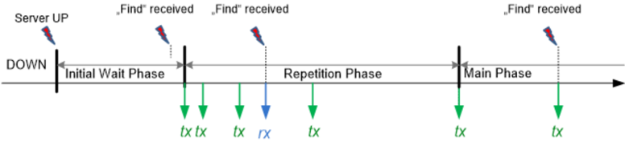

#### 6.6.1. 服务器服务的Initial Wait Phase

本章描述服务发现对于处于Initial Wait Phase的服务器服务实例的行为。

当进入Down阶段时（从init以外的状态进入），应对与该服务器服务实例关联的所有套接字连接调用API **SoAd_CloseSoCon()**。

如果SD服务器收到一个SubscribeEventgroup条目，并且客户端端点已分配给某个套接字连接，则服务器应为该套接字连接和客户端端点调用**SoAd_IsConnectionReady()**：

- 如果该函数返回**TCPIP_E_OK**，服务器应以**SubscribeEventgroupAck**响应。
- 对于所有其他返回值，服务器应丢弃该条目并以**SubscribeEventgroupNack**响应。

如果满足以下条件，则应进入该已配置服务器服务实例的Initial Wait Phase：

- 已调用**[Sd_Init](#731-sd_init)()**。
- [**SdServerService**](#9217-sdserverservice)状态被设置为**SD_SERVER_SERVICE_AVAILABLE**（通过**[Sd_ServerServiceSetState](#733-sd_serverservicesetstate)()**或**[Sd_ServiceGroupStart](#738-sd_servicegroupstart)()**）。
- 已针对与[**SdInstanceTxPdu**](#9215-sdinstancetxpdu)关联的第一个IpAddrId以状态「TCPIP_IPADDR_STATE_ASSIGNED」调用过**[Sd_LocalIpAddrAssignmentChg](#736-sd_localipaddrassignmentchg)()**。

注意：服务发现预期数据/控制路径的IP地址始终相同。这意味着对**[Sd_LocalIpAddrAssignmentChg](#736-sd_localipaddrassignmentchg)()**的调用同时影响控制路径和数据路径。

当进入Initial Wait Phase时，应启用该服务器服务的路由。见该服务器服务实例的**SdServerServiceActivationRef**。

进入Initial Wait Phase时，应使用**SdServerTimerInitialOfferDelayMin**和**SdServerTimerInitialOfferDelayMax**配置范围内的随机值启动一个随机定时器。

如果在该服务器服务实例的Initial Wait Phase（或其他阶段）内收到针对该服务器服务实例的某个Event Handler的SubscribeEventgroup条目或StopSubscribeEventgroup条目，则它应只在服务发现内部处理。

针对SWS_Sd_00320的注意：请参阅相应的时序图和第6.6.4节。

当基于**SdServerTimerInitialOfferDelayMin**和**SdServerTimerInitialOfferDelayMax**的最小值和最大值计算出的随机定时器到期，并且**SoAd_GetSoConMode()**为该服务的至少一个关联套接字连接（配置在**SdServerServiceTcpRef**或**SdServerServiceUdpRef**中）提供**SOAD_SOCON_ONLINE**或**SOAD_SOCON_RECONNECT**状态时：

- 应发送OfferService条目。
- 如果**SdServerTimerInitialOfferRepetitionsMax** > 0，进入Repetition Phase。
- 如果**SdServerTimerInitialOfferRepetitionsMax** = 0，进入Main Phase。

注意：

1. Initial Wait Phase可能根据**SoAd_GetSoConMode()** API提供的SoAd_SoConModeType类型的输出参数而延长。

2. 在某些情况下，SoAd可能需要更多时间将套接字连接状态从SOAD_SOCON_OFFLINE更改为SOAD_SOCON_RECONNECT或SOAD_SOCON_ONLINE。例如，只有当服务的InitWaitPhase配置为0或SoAd主函数周期大于Sd主函数周期时，套接字连接才会不更改为SOAD_SOCON_RECONNECT或SOAD_SOCON_ONLINE。

如果在Initial Wait Phase期间[**SdServerService**](#9217-sdserverservice)被设置为**SD_SERVER_SERVICE_AVAILABLE**以外的状态（通过**[Sd_ServerServiceSetState](#733-sd_serverservicesetstate)()**或**[Sd_ServiceGroupStop](#739-sd_servicegroupstop)()**）：

- 进入Down阶段。
- 将所有关联的EventHandler设置为**SD_EVENT_HANDLER_RELEASED**，并通过调用API **BswM_Sd_EventHandlerCurrentState**向BswM报告。
- 取消该服务实例的所有相关定时器（见SWS_Sd_00318）。

如果在Initial Wait Phase期间以「TCPIP_IPADDR_STATE_ASSIGNED」以外的状态调用了**[Sd_LocalIpAddrAssignmentChg](#736-sd_localipaddrassignmentchg)()**，则应离开该阶段并进入Down阶段。

进入Initial Wait Phase时，应对与该服务器服务实例关联的所有套接字连接调用API **SoAd_OpenSoCon()**。

注意：一旦IP地址再次被分配且未收到SD_SERVER_SERVICE_DOWN，则应以重置为随机值的随机定时器重新进入Initial Wait Phase。


#### 6.6.2. 服务器服务的Repetition Phase

本章描述服务发现对于处于Repetition Phase的服务器服务实例的时序行为。

如果进入Repetition Phase，服务发现应等待**SdServerTimerInitialOfferRepetitionBaseDelay**并发送一个OfferService条目。

在Repetition Phase内周期性发送的OfferService数量等于**SdServerTimerInitialOfferRepetitionsMax**之后，应进入Main Phase。

注意：由收到的Find Service消息触发的额外发送的OfferService消息对周期性OfferService消息的计数值没有影响。

在Repetition Phase内，应以倍增的间隔（BaseDelay、第一条OfferService条目、2倍BaseDelay、第二条OfferService条目、4倍BaseDelay、第三条OfferService条目）发送至多**SdServerTimerInitialOfferRepetitionsMax**个OfferService条目。

注意：

配置示例及其产生的行为：

SdServerTimerInitialOfferRepetitionBaseDelay=30

SdServerTimerInitialOfferRepetitionsMax=3

[Initial Wait Phase开始]

根据配置的Min和Max等待Initial Wait Delay。

发送条目。

[Initial Wait Phase结束]

[Repetition Phase开始]

等待30 ms（=30 ms × 2⁰）。

发送条目。

等待60 ms（=30 ms × 2¹）。

发送条目。

等待120 ms（=30 ms × 2²）。

发送条目。

[Repetition Phase结束]

注意：目前本规范不允许使用单播发送「FindService Entries」。出于兼容性原因，应支持接收这样的条目。

如果服务发现模块收到一个「SubscribeEventgroup」条目，则应按以下顺序执行以下步骤：

- 考虑适当的延迟，使用单播发送SubscribeEventgroupAck / Nack条目，不改变当前计数值，也不影响当前正在运行的重复定时器。
- 仅当该EventHandler的状态发生变化（即尚未处于**SD_EVENT_HANDLER_REQUESTED**）时，才以状态**SD_EVENT_HANDLER_REQUESTED**调用API **BswM_Sd_EventHandlerCurrentState()**。
- 根据经由SubscribeEventgroup条目收到的值启动TTL定时器。

针对SWS_Sd_00333的注意：

- 目前本规范不允许使用多播发送「SubscribeEventgroup Entries」。出于兼容性原因，应支持接收这样的条目。
- 关于以单播并考虑适当的延迟发送SubscribeEventgroupAck / Nack条目的更多细节，见第[6.5.3](#653-接收条目)节。

如果服务发现模块收到一个StopSubscribeEventgroup条目，则应按以下顺序执行以下步骤：

- 停止该客户端的TTL定时器。
- 更新状态。
- 如果这是最后一个已订阅的客户端，则通过调用API **BswM_Sd_EventHandlerCurrentState()**向BswM报告「SD_EVENT_HANDLER_RELEASED」。

如果所接收SubscribeEventgroup条目的TTL到期，则应按以下顺序执行以下步骤：

- 如果这是最后一个已订阅的客户端，则通过调用API **BswM_Sd_EventHandlerCurrentState()**向BswM报告「SD_EVENT_HANDLER_RELEASED」，并更新服务发现模块内的状态。

如果在Repetition Phase期间**ServerService**被设置为**SD_SERVER_SERVICE_AVAILABLE**以外的状态（即**SD_SERVER_SERVICE_DOWN**）（通过**[Sd_ServerServiceSetState](#733-sd_serverservicesetstate)()**或**[Sd_ServiceGroupStop](#739-sd_servicegroupstop)()**）：

- 离开该阶段并进入Down阶段。
- 发送一个StopOfferService。
- 所有状态不是**SD_EVENT_HANDLER_RELEASED**的关联EventHandler应更改为**SD_EVENT_HANDLER_RELEASED**，并通过调用API **BswM_Sd_EventHandlerCurrentState()**向BswM指示。

如果在Repetition Phase期间以「TCPIP_IPADDR_STATE_ASSIGNED」以外的状态调用了**[Sd_LocalIpAddrAssignmentChg](#736-sd_localipaddrassignmentchg)()**，则应离开该阶段并进入Down阶段。

如果服务发现模块处于Repetition Phase且基于TCP的套接字连接丢失（即套接字连接不是**SOAD_SOCON_ONLINE**），则服务发现模块应调用：

- **SoAd_ReleaseRemoteAddr()**
- **SoAd_DisableSpecificRouting()**
- **SoAd_CloseSoCon()**
- 删除属于该连接的所有内部存储的订阅。
- **SoAd_OpenSoCon()**

服务发现模块应保持在Repetition Phase。

当在Repetition Phase中通过**[Sd_ServerServiceSetState](#733-sd_serverservicesetstate)()**或**[Sd_ServiceGroupStop](#739-sd_servicegroupstop)()**设置了状态**SD_SERVER_SERVICE_DOWN**时，应禁用该服务器服务实例的路由。见该服务器服务实例的**SdServerServiceActivationRef**。

#### 6.6.3. 服务器服务的Main Phase

只要满足以下条件，服务发现模块就应保持在已配置服务器服务的Main Phase：

- 服务器服务处于状态「SD_SERVER_SERVICE_AVAILABLE」（由**[Sd_ServerServiceSetState](#733-sd_serverservicesetstate)()**或**[Sd_ServiceGroupStart](#738-sd_servicegroupstart)()**的调用指示）。
- IP地址已分配且可以使用（即已以状态TCPIP_IPADDR_STATE_ASSIGNED调用过[**Sd_LocalIpAddrAssignmentChg**](#736-sd_localipaddrassignmentchg)）。

如果**SdServerTimerOfferCyclicDelay**大于0，则在Main Phase中应以由配置项**SdServerTimerOfferCyclicDelay**定义的间隔周期性地发送OfferService条目。

第一个OfferService在Main Phase开始后的**SdServerTimerOfferCyclicDelay**发送。

如果**SdServerTimerOfferCyclicDelay**为0，则该服务器服务实例在Main Phase中不发送OfferService条目。

如果服务发现模块收到一个FindService条目，则应执行以下步骤：

- 考虑适当的延迟发送一个「OfferService条目」。

注意：目前本规范不允许使用单播发送「FindService Entries」。出于兼容性原因，应支持接收这样的条目。

针对SWS_Sd_00343的注意：关于以考虑适当的延迟发送「OfferService条目」的更多细节，见第6.5.3节。

如果服务发现模块收到一个「SubscribeEventgroup」，则应按以下顺序执行以下步骤：

- 考虑适当的延迟，使用单播发送SubscribeEventgroupAck / Nack条目，不影响当前正在运行的主阶段定时器。
- 通过调用API **BswM_Sd_EventHandlerCurrentState()**向BswM报告**SD_EVENT_HANDLER_REQUESTED**。
- 根据经由「SubscribeEventgroup」收到的值启动TTL定时器。

注意：目前本规范不允许使用多播发送「SubscribeEventgroup Entries」。出于兼容性原因，应支持接收这样的条目。

针对SWS_Sd_00344的注意：关于以单播并考虑适当的延迟发送SubscribeEventgroupAck / Nack条目的更多细节，见第[6.5.3](#653-接收条目)节。

如果服务发现模块收到一个「StopSubscribeEventgroup」，则应按以下顺序执行以下步骤：

- 停止TTL定时器并将其从通知列表中移除。
- 如果不再有其他客户端订阅该事件组，则进入状态「SD_EVENT_HANDLER_RELEASED」，并通过调用API **BswM_Sd_EventHandlerCurrentState()**以状态「SD_EVENT_HANDLER_RELEASED」向BswM报告。

如果API **LocalIpAddrAssignmentChg**以TCPIP_IPADDR_STATE_ASSIGNED以外的状态被调用：

- 服务发现模块应离开Main Phase并进入DOWN阶段。
- 所有不处于**SD_EVENT_HANDLER_RELEASED**状态的EventHandler应被设置为**SD_EVENT_HANDLER_RELEASED**，并通过调用API **BswM_Sd_EventHandlerCurrentState**向BswM模块指示。

如果基于TCP的套接字连接丢失（即套接字连接不是**SOAD_SOCON_ONLINE**），则服务发现模块应调用：

- **SoAd_ReleaseRemoteAddr()**
- **SoAd_DisableSpecificRouting()**
- **SoAd_CloseSoCon()**
- 删除属于该连接的所有内部存储的订阅。
- **SoAd_OpenSoCon()**

服务发现模块应保持在Main Phase。

如果在IP地址仍已分配（即已以状态TCPIP_IPADDR_STATE_ASSIGNED调用过[**Sd_LocalIpAddrAssignmentChg**](#736-sd_localipaddrassignmentchg)）的情况下，[**SdServerService**](#9217-sdserverservice)被设置为状态「SD_SERVER_SERVICE_DOWN」（由**[Sd_ServerServiceSetState](#733-sd_serverservicesetstate)()**或**[Sd_ServiceGroupStop](#739-sd_servicegroupstop)()**的调用指示），则服务发现模块应：

- 发送一个StopOfferService。
- 进入DOWN阶段。
- 删除该服务实例的事件组的所有订阅。

并且**SD_EVENT_HANDLER_RELEASED**应通过API **BswM_Sd_EventHandlerCurrentState**报告给BswM。

当离开Main Phase时，应禁用该服务器服务实例的路由。见该服务器服务实例的**SdServerServiceActivationRef**。

当TTL定时器（包含在find或Subscribe条目的TTL字段中）在状态「SD_EVENT_HANDLER_REQUESTED」下到期时，进入状态**SD_EVENT_HANDLER_RELEASED**，并通过调用**BswM_Sd_EventHandlerCurrentState()**向BswM报告。

#### 6.6.4. 扇出控制

本章描述服务发现与套接字适配器（**SoAd**）之间的交互，以配置用于发送事件（**fan out**）的TX路径。必须考虑到，[**SdClientService**](#927-sdclientservice)要么以Consumed Eventgroup单播端点（在Endpoint Option中传输）订阅，要么以Consumed Eventgroup多播端点（在Multicast Option中传输）订阅。

服务发现应按Event Handler跟踪已订阅的客户端，并在最后一条SubscribeEventgroup条目早于该SubscribeEventgroup条目TTL字段中规定的时间时，将客户端从扇出中移除。无论客户端是以Consumed Eventgroup单播端点还是Consumed Eventgroup多播端点订阅，或者Event Handler已将**SdEventHandlerMulticastThreshold**设置为1（事件专门经由Eventhandler多播端点传输），该处理都应独立进行。

注意：无论客户端是以Consumed Eventgroup单播端点还是Consumed Eventgroup多播端点订阅，或受影响的[**SdServerService**](#9217-sdserverservice)根据**SdEventHandlerMulticastThreshold**的配置经由Eventhandler多播端点传输其事件，服务发现都必须按已订阅的Client Service Instance维护TTL时间。在任何情况下，服务器服务实例都必须就客户端的单播远程地址（IP和端口）知晓其已订阅的客户端。

如果配置了**SdEventHandlerTCP**：对于该Event Handler的每个SubscribeEventgroup条目，且该SubscribeEventgroup条目引用一个Endpoint Option，应执行以下操作：

- 由[**SdEventHandlerTcp**](#9220-sdeventhandlertcp)标识相关的路由组。
- 使用SubscribeEventgroup条目中引用的Endpoint Option（TCP）的地址/端口和**SdServerServiceTcpRef**标识该客户端的相关TCP套接字连接，如果之前不存在则建立之。
- 使用**SoAd_GetSoConMode**检查传入TCP连接的状态：
- -如果返回模式为**SOAD_SOCON_ONLINE**，则执行以下动作：
- ∗ 如果在收到上述条目之前该客户端尚未订阅：
- 以**SdEventActivationRef**和该套接字连接调用**SoAd_EnableSpecificRouting**。
- 以**SdEventTriggeringRef**和该套接字连接调用**SoAd_IfSpecificRoutingGroupTransmit**。
- ∗ 使用SubscribeEventgroupAck条目应答该SubscribeEventgroup。
- -如果返回的模式不是**SOAD_SOCON_ONLINE**，则应根据SWS_Sd_00732或SWS_Sd_00733处理（取决于当前服务状态），并使用SubscribeEventgroupNack应答该SubscribeEventgroup。

如果配置了[**SdEventHandlerUdp**](#9221-sdeventhandlerudp)：对于该Eventhandler的每个SubscribeEventgroup条目，且该SubscribeEventgroup条目引用一个单播Endpoint Option，应执行以下操作：

- 由[**SdEventHandlerUdp**](#9221-sdeventhandlerudp)标识相关的路由组。
- 使用SubscribeEventgroup条目中引用的Endpoint Option（UDP）的事件组单播端点（地址/端口）和**SdServerServiceUdpRef**标识该客户端的相关UDP套接字连接，如果之前不存在则建立之（**SoAd_SetUniqueRemoteAddr()**）。
- -如果没有留下通配符套接字连接，应报告[**SD_E_OUT_OF_RES**](#6115-扩展生产错误)。
- 仅当在收到该条目之前该客户端尚未订阅时：
- -以**SdEventActivationRef**和根据当前具有不同端点信息的已订阅客户端数量以及**SdEventHandlerMulticastThreshold**确定的套接字连接调用**SoAd_EnableSpecificRouting**。
- -以**SdEventTriggeringRef**和该套接字连接调用**SoAd_IfSpecificRoutingGroupTransmit**。

如果配置了[**SdEventHandlerUdp**](#9221-sdeventhandlerudp)：对于该Eventhandler的每个SubscribeEventgroup条目，且该SubscribeEventgroup条目引用一个Multicast Option，应执行以下操作：

- 由[**SdEventHandlerUdp**](#9221-sdeventhandlerudp)标识相关的路由组。
- 使用SubscribeEventgroup条目中引用的Multicast Option的事件组多播端点（地址/端口）和**SdServerServiceUdpRef**标识该客户端的相关UDP套接字连接，如果之前不存在则建立之（**SoAd_SetUniqueRemoteAddr()**）。
- -如果没有留下通配符套接字连接，应报告[**SD_E_OUT_OF_RES**](#6115-扩展生产错误)。
- 如果没有其他客户端已经以相同的Consumed Eventgroup多播端点信息订阅，则应执行以下动作：
- -以**SdEventActivationRef**和相应的套接字连接调用**SoAd_EnableSpecificRouting**。如果具有不同端点信息的已订阅客户端数量已达到**SdEventHandlerMulticastThreshold**，则相应的套接字连接应为**SdMulticastEventSoConRef**引用的已配置套接字连接；否则为前一点中标识的套接字连接。
- 仅当在收到该条目之前该客户端尚未订阅时：
- -以**SdEventTriggeringRef**和该套接字连接调用**SoAd_IfSpecificRoutingGroupTransmit**。

注意：

- 以相同的Consumed Eventgroup多播端点订阅的**SdClientServices**在[**SdServerService**](#9217-sdserverservice)侧共享相同的SoAdSocketConnection。
- 一个**SdServiceService**可以在同一时间将同一事件发送到Consumed Eventgroup单播端点或Consumed Eventgroup多播端点。这在SubscriptionEventgroup条目中通告，该条目可以引用IPv4/IPv6 Endpoint option（单播端点）或IPv4/IPv6 Multicast option（多播端点）。
- 使用以Consumed Eventgroup多播端点的订阅并结合初始事件的传输（配置了**SdEventTriggeringRef**）必须谨慎使用。这必须由网络通信设计来保证。理由：对相同Consumed Eventgroup多播端点的每次订阅都会触发一次初始事件的传输，该传输被所有当前已订阅的客户端接收。这可能对通信造成不良行为，例如使用序列计数器的通信（如E2E通信）。

每个Eventhandler应根据已配置的**SdEventHandlerMulticastThreshold**和具有不同端点信息（或作为Eventgroup单播端点接收，或作为Eventgroup多播端点接收）的客户端数量，判断是否已达到经由已配置的Eventhandler多播端点（见**SdMulticastEventSoConRef**）传输事件的阈值。

具有不同端点信息的已订阅客户端数量应用于通过调用**SoAd_EnableSpecificRouting**和**SoAd_DisableSpecificRouting**来控制何时启用/禁用Consumed Eventgroup单播连接或Consumed Eventgroup多播连接，或何时启用/禁用Eventhandler多播连接：

- 如果**SdEventHandlerMulticastThreshold** = 0：为每个已订阅的客户端建立Consumed Eventgroup单播连接或Consumed Eventgroup多播连接（请注意：Eventhandler多播连接始终禁用）。
- 如果**SdEventHandlerMulticastThreshold** = 1：如果一个或多个客户端已订阅，则建立Eventhandler多播连接（请注意：Consumed Eventgroup单播连接和Consumed Eventgroup多播连接始终禁用）。
- 如果**SdEventHandlerMulticastThreshold** > 1：
- -如果具有不同端点信息的已订阅客户端数量 < **SdEventHandlerMulticastThreshold**，则为所有已订阅客户端建立Consumed Eventgroup单播连接或Consumed Eventgroup多播连接；
- -否则建立Eventhandler多播连接，并根据具有不同端点信息的已订阅客户端数量自动切换：
- ∗ 如果具有不同端点信息的已订阅客户端数量大于或等于阈值，则应使用Eventhandler多播连接进行传输。
- ∗ 如果具有不同端点信息的已订阅客户端数量小于阈值，则应使用单独的Consumed Eventgroup单播连接和Consumed Eventgroup多播连接进行传输。

示例：

- 前提条件
- -Server\_Service\_A包含Eventgroup\_A，其**SdEventHandlerMulticastThreshold** = 3
- -Server\_Service\_A.Eventgroup\_A的多播端点配置为EMc\_endpoint\_A
- -所有客户端都订阅ServerService\_A.Eventgroup\_A
- 示例1：
- -Client\_A以单播端点订阅
- -Client\_B和Client\_C以相同的多播端点订阅
- -结果：
- ∗ **SdEventHandlerMulticastThreshold**未达到
- ∗ ServerService\_A.Eventgroup\_A的相应事件经由单播端点传输给Client\_A，并经由相同的多播端点传输给Client\_B和Client\_C
- 示例2：
- -Client A以单播端点A订阅
- -Client B以单播端点B订阅
- -Client C以多播端点C订阅
- -结果：
- ∗ **SdEventHandlerMulticastThreshold**已达到
- ∗ ServerService A.Eventgroup\_A的相应事件经由多播端点EMc\_endpoint\_A传输给Client\_A、Client\_B、Client\_C

#### 6.6.5. SdServerTimer的共享

如果若干个**ServerServices**引用同一个[**SdServerTimer**](#9224-sdservertimer)，则它们应共享一个公共定时器（因此也是公共随机偏移），前提是它们要么引用同一个[**SdServiceGroup**](#925-sdservicegroup)且不引用任何其他（附加的）[**SdServiceGroup**](#925-sdservicegroup)，要么所有**ServerServices**的**SdServerServiceAutoAvailable**都设置为TRUE。

### 6.7. 客户端服务和Consumed Eventgroup的时序与重复

服务发现阶段能够在ECU启动时实现非常快速的同步，同时将发送的服务发现消息数量降到最少。

这种弱化（**de-emphasis**）通过以下阶段实现：

- Down（关闭）
- Requested（已请求）

图7.15：客户端的通信阶段（**Communication phases Client**）

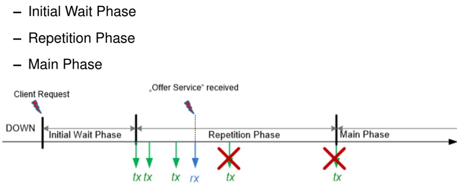

如果SD客户端想要订阅某个事件组，它应为所分配的套接字连接和预期的服务器端点调用**SoAd_IsConnectionReady()**：

- 如果该函数返回**TCPIP_E_OK**，客户端可以发送SubscribeEventgroup条目。
- 如果该函数返回**TCPIP_E_PENDING**，客户端应延迟订阅。
- 对于所有其他返回值，客户端应丢弃该订阅请求。

#### 6.7.1. 客户端服务的Down阶段

只要某个服务未被BswM请求，服务发现就不得发送FindService条目。

如果在Down阶段收到OfferService条目：

- 服务发现应存储该服务实例的状态。
- 定时器应设置为/重置为所接收OfferService条目的TTL值（TTL定时器）。
- 在TTL定时器到期或收到StopOfferService条目之前，该服务实例被视为可用。

如果在Down阶段期间[**SdClientService**](#927-sdclientservice)被设置为**SD_CLIENT_SERVICE_REQUESTED**（通过调用**[Sd_ClientServiceSetState](#734-sd_clientservicesetstate)()**或**[Sd_ServiceGroupStart](#738-sd_servicegroupstart)()**）：

- 如果之前没有收到OfferService条目或其TTL定时器已过期：
- -应进入Initial Wait Phase。
- 如果之前收到了OfferService条目且其TTL定时器尚未过期：
- -应进入Main Phase。
- ∗ 进一步处理应根据SWS_Sd_00721进行。

#### 6.7.2. 客户端服务的Initial Wait Phase

本章描述服务发现对于处于Initial Wait Phase的客户端服务实例的行为。

如果满足以下条件，则应进入该已配置客户端服务实例的Initial Wait Phase：

- 已调用**[Sd_Init](#731-sd_init)()**。
- [**SdClientService**](#927-sdclientservice)被设置为状态**SD_CLIENT_SERVICE_REQUESTED**（由**[Sd_ClientServiceSetState](#734-sd_clientservicesetstate)()**或**[Sd_ServiceGroupStart](#738-sd_servicegroupstart)()**的调用或**SdClientServiceAutoRequired** = TRUE指示）。
- 已针对与[**SdInstanceTxPdu**](#9215-sdinstancetxpdu)关联的第一个IpAddrId以状态「TCPIP_IPADDR_STATE_ASSIGNED」调用过**[Sd_LocalIpAddrAssignmentChg](#736-sd_localipaddrassignmentchg)()**。

该客户端服务实例应在**SdClientTimerInitialFindDelayMin**和**SdClientTimerInitialFindDelayMax**配置范围内的一段时间内保持在Initial Wait Phase，除非收到了该客户端服务实例的OfferService条目或该随机定时器到期。

如果在Initial Wait Phase内收到了该客户端服务实例的OfferService条目：

- 进入Initial Wait Phase时启动的已计算随机定时器应被取消。
- 离开Initial Wait Phase并进入Main Phase。
- -进一步处理应根据SWS_Sd_00721进行。

当基于参数**SdClientTimerInitialFindDelayMin**和**SdClientTimerInitialFindDelayMax**计算出的随机定时器到期时（即在此时间跨度内未收到OfferService），应按以下顺序执行以下操作：

- 应发送FindService条目。
- 如果**SdClientTimerInitialFindRepetitionsMax**>0，进入Repetition Phase。
- 如果**SdClientTimerInitialFindRepetitionsMax**=0，进入Main Phase。

如果在Initial Wait Phase期间[**SdClientService**](#927-sdclientservice)被设置为**SD_CLIENT_SERVICE_RELEASED**（通过调用**[Sd_ClientServiceSetState](#734-sd_clientservicesetstate)()**或**[Sd_ServiceGroupStop](#739-sd_servicegroupstop)()**），则应离开该阶段，服务应进入Down阶段。

如果由于任何原因离开了Initial Wait Phase，则应停止该服务实例（Initial Wait Phase）的已计算随机定时器。

如果在Initial Wait Phase期间以「TCPIP_IPADDR_STATE_ASSIGNED」以外的状态调用了**[Sd_LocalIpAddrAssignmentChg](#736-sd_localipaddrassignmentchg)()**，则应进入Down阶段。

如果在Initial Wait Phase期间调用了API **[Sd_Init](#731-sd_init)()**，则应进入Down阶段。

#### 6.7.3. 客户端服务的Repetition Phase

进入Repetition Phase时，服务发现模块应启动定时器**SdClientTimerInitialFindRepetitionsBaseDelay**。

当定时器**SdClientTimerInitialFindRepetitionsBaseDelay**在Repetition Phase内到期时，应发送一条FindOffer消息。

在Repetition Phase内，应以倍增的间隔（BaseDelay、第一条FindService条目、2倍BaseDelay、第二条FindService条目、4倍BaseDelay、第三条FindService条目，...）发送至多**SdClientTimerInitialFindRepetitionsMax**个FindServer条目。

注意：配置示例及其产生的行为（示例期间未收到OfferService）：

SdClientTimerInitialFindRepetitionBaseDelay=30

SdClientTimerInitialFindRepetitionMax=3

[Initial Wait Phase开始]

根据配置的Min和Max等待Initial Wait Delay。

发送条目。

[Initial Wait Phase结束]

[Repetition Phase开始]

等待30 ms（=30 ms × 2⁰）。

发送条目。

等待60 ms（=30 ms × 2¹）。

发送条目。

等待120 ms（=30 ms × 2²）。

发送条目。

[Repetition Phase结束]

如果服务发现模块在Repetition Phase内收到一个OfferService条目，而该客户端服务实例的当前状态为**SD_CLIENT_SERVICE_REQUESTED**，则应按以下顺序执行以下步骤：

- 取消重复定时器。
- 立即离开Repetition Phase并进入Main Phase。
- -进一步处理应根据SWS_Sd_00721进行。

如果服务发现模块收到一个StopOfferService条目，而该客户端服务实例的当前状态为**SD_CLIENT_SERVICE_REQUESTED**，则应按以下顺序执行以下步骤：

- 取消重复定时器。
- 立即离开Repetition Phase并进入Main Phase。

在发送了最大重复次数（由**SdClientTimerInitialFindRepetitionsMax**定义）的FindService条目之后，应离开Repetition Phase并进入Main Phase。

如果在Repetition Phase期间[**SdClientService**](#927-sdclientservice)被设置为**SD_CLIENT_SERVICE_RELEASED**（通过调用**[Sd_ClientServiceSetState](#734-sd_clientservicesetstate)()**或**[Sd_ServiceGroupStop](#739-sd_servicegroupstop)()**），则应离开该阶段，服务实例应进入Down阶段。

如果在Repetition Phase期间以「TCPIP_IPADDR_STATE_ASSIGNED」以外的状态调用了**[Sd_LocalIpAddrAssignmentChg](#736-sd_localipaddrassignmentchg)()**，则应进入Down阶段。

如果TCP/IP连接已丢失（套接字连接不是**SOAD_SOCON_ONLINE**），则服务发现模块应离开Repetition Phase，进入Initial Wait Phase，并停止关联的Client Service Instance和EventGroup的TTL定时器。

#### 6.7.4. 客户端服务的Main Phase

只要满足以下条件，服务发现模块就应保持在Main Phase：

- 客户端服务被设置为状态「SD_CLIENT_SERVICE_REQUESTED」（由**[Sd_ClientServiceSetState](#734-sd_clientservicesetstate)()**或**[Sd_ServiceGroupStart](#738-sd_servicegroupstart)()**的调用指示）。
- IP地址已分配且可以使用（即已以状态TCPIP_IPADDR_STATE_ASSIGNED调用过[**Sd_LocalIpAddrAssignmentChg**](#736-sd_localipaddrassignmentchg)）。

如果服务发现模块收到一个OfferService条目，则应按以下顺序执行以下步骤：

- 如果收到的TTL不等于最大值，则用收到的TTL值更新定时器。
- 使用该服务的Offer条目中引用的Endpoint Option的地址和端口标识该服务的相关UDP/TCP套接字连接，如果之前不存在则建立之（**SoAd_SetUniqueRemoteAddr()**）。
- -如果没有留下套接字连接，应报告[**SD_E_OUT_OF_RES**](#6115-扩展生产错误)。
- 如果配置了**SdClientServiceUdpRef** / **SdClientServiceTcpRef**且之前未打开，则以API **SoAd_OpenSoCon()**打开UDP/TCP连接。
- 使用**SoAd_GetSoConMode()**检查该Client Service的关联套接字连接的状态。
- -如果关联的套接字连接在Main阶段处于**SOAD_SOCON_ONLINE**状态：
- ∗ 如果该客户端服务尚未被报告为**SD_CLIENT_SERVICE_AVAILABLE**：
- 应以**SdClientServiceActivationRef**（见[**SdConsumedMethods**](#9211-sdconsumedmethods)）和该Client Service Instance的相关套接字连接调用API **SoAd_EnableSpecificRouting()**。
- 应通过调用API **BswM_Sd_ClientServiceCurrentState()**向BswM模块指示**SD_CLIENT_SERVICE_AVAILABLE**。
- ∗ 对于该Client Service Instance的每个当前被请求的Consumed Eventgroup（Consumed Eventgroups通过**[Sd_ConsumedEventGroupSetState](#735-sd_consumedeventgroupsetstate)()**以状态**SD_CONSUMED_EVENTGROUP_REQUESTED**请求，或在启动时如果**SdConsumedEventGroupAutoRequire**配置为true则自动请求），应严格按照以下顺序执行：
- 如果最后一条SubscribeEventgroup条目是作为对经由多播接收的OfferService条目的响应而发送的、从未被SubscribeEventgroupAck应答，且当前OfferService条目是经由多播接收的，则应发送StopSubscribeEventgroup条目。
- 应发送一个SubscribeEventgroup条目。如果**SdSubscribeEventgroupRetryEnable**设置为TRUE且**SdSubscribeEventgroupRetryMax**大于0，则事件组订阅重试计数器应重置为1。

注意：

关于路由组的启用，请参阅SWS_Sd_00702、SWS_Sd_00703和SWS_Sd_00704。对经由多播收到的Offer的响应的传输应以已配置的延迟进行延迟。当请求响应延迟在关联的套接字连接处于**SOAD_SOCON_ONLINE**状态之前到期时，StopSubscribeEventgroup和SubscribeEventgroup应延迟到套接字连接在线后再发送，并且不得被视为对经由多播接收的OfferService条目的响应。当请求响应延迟在客户端服务处于RELEASED状态时到期，则不应对该Offer条目作出响应。应减少单独服务发现消息的数量，即：在调用套接字适配器的发送API之前，将尽可能多的信息组合到一条服务发现消息中。

当客户端服务通过调用API **BswM_Sd_ClientServiceCurrentState()**被报告为**SD_CLIENT_SERVICE_DOWN**时：

- 应以**SdClientServiceActivationRef**（见[**SdConsumedMethods**](#9211-sdconsumedmethods)）和该Client Service Instance的相关套接字连接调用API **SoAd_DisableSpecificRouting()**。

如果必须为同一事件组（即相同的Service ID、Instance ID、Eventgroup ID、Counter和Major Version）发送StopSubscribeEventgroup和SubscribeEventgroup，则这些条目必须在同一条SD消息中直接相邻（中间没有其他条目）。

如果服务发现模块收到一个匹配某个尚不可用的Consumed Eventgroup的SubscribeEventgroup Ack，则应按以下顺序执行以下步骤：

- 如果SubscribeEventgroupAck引用了一个多播端点选项（Multicast Endpointoption）：
- -使用Multicast Endpoint Option的本地地址和端口、经由**SdConsumedEventGroupMulticastGroupRef**标识相关的套接字连接组，或使用**SoAd_RequestIpAddrAssignment()**建立一个。
- -如果**SdSetRemAddrOfClientRxMulticastSoCon**设置为TRUE，则使用该服务的Offer条目中引用的Endpoint Option的地址和端口标识该服务的相关套接字连接，或如果之前不存在则建立之（**SoAd_SetUniqueRemoteAddr()**）。
- ∗ 如果没有留下通配符套接字连接，应报告[**SD_E_OUT_OF_RES**](#6115-扩展生产错误)。
- -如果**SdSetRemAddrOfClientRxMulticastSoCon**设置为FALSE，则使用该服务的通配符套接字连接而不更新相应的远程地址，即保留该套接字连接的通配符。
- ∗ 如果没有留下通配符套接字连接，应报告[**SD_E_OUT_OF_RES**](#6115-扩展生产错误)。
- -通过跟随**SdConsumedEventGroupMulticastActivationRef**标识相关的路由组。
- -以SocketID和路由组ID调用**SoAd_EnableSpecificRouting()**。
- 如果数据路径建立成功，则以**SD_CONSUMED_EVENTGROUP_AVAILABLE**调用**BswM_Sd_ConsumedEventGroupCurrentState**。
- 如果数据路径建立成功，则以SubscribeEventgroupAck条目的TTL设置TTL定时器。

如果某条服务发现消息只包含一个SubscribeEventgroupNack条目而没有同一事件组的SubscribeEventgroupAck条目，服务发现应执行以下操作：

- 报告DEM错误[**SD_E_SUBSCR_NACK_RECV**](#6115-扩展生产错误)（见[ECUC_SD_00123]）。
- 如果该服务配置了**SdClientServiceTcpRef**，或**SoAd_IsConnectionReady()**返回了**TCPIP_E_OK**以外的值，则确定所使用的SoCon，并以该SoConID和参数abort设置为TRUE调用API **SoAd_CloseSoCon()**。
- 如果该服务配置了**SdClientServiceTcpRef**，或**SoAd_IsConnectionReady()**返回了**TCPIP_E_OK**以外的值，则确定所使用的SoCon，并以该SoConID调用API **SoAd_OpenSoCon()**。

如果服务发现模块收到一个StopOfferService条目，则应按以下顺序执行以下步骤：

- 停止该Client Service Instance和所有相关Consumed Eventgroups的TTL定时器。
- 如果该Client Service之前被报告为AVAILABLE，则将其报告为DOWN（以**SD_CLIENT_SERVICE_DOWN**和该Client Service的句柄ID调用**BswM_Sd_ClientServiceCurrentState**）。
- 将之前被报告为AVAILABLE的所有Consumed Eventgroups报告为DOWN（以**SD_CONSUMED_EVENTGROUP_DOWN**和该Consumed Eventgroup的句柄ID调用**BswM_Sd_ConsumedEventGroupCurrentState**）。
- 如果**SdSubscribeEventgroupRetryEnable**设置为TRUE且**SdSubscribeEventgroupRetryMax**大于0，则取消相应的客户端服务订阅重试延迟定时器，并将所有相应事件组的订阅重试计数器重置为0。
- 关闭之前已打开的、与该Client Service Instance关联的所有套接字连接。
- 保持在Main Phase且不发送FindService条目。

如果某个Consumed Eventgroup迁移到**SD_CONSUMED_EVENTGROUP_REQUESTED**状态，而所请求服务实例的相应状态已设置为**SD_CLIENT_SERVICE_AVAILABLE**（由于已收到TTL为0xFFFFFF的Offer Service），则只有在满足以下所有条件时才应发送SubscribeEventgroup条目：

- **SdSubscribeEventgroupRetryEnable**设置为TRUE，
- **SdSubscribeEventgroupRetryMax**大于0。

注意：

需求SWS_Sd_00741确保客户端在需要时仍然可以在任何时间点订阅事件组，即使相应**ServerService**的周期性Offer在主阶段中不存在（**SdServerTimerOfferCyclicDelay**设置为0）。在这种情况下，不需要周期性Offer来触发SubscribeEventgroup条目的传输。

如果在Main Phase期间以「TCPIP_IPADDR_STATE_ASSIGNED」以外的状态调用了**[Sd_LocalIpAddrAssignmentChg](#736-sd_localipaddrassignmentchg)()**：

- 应进入Down阶段。
- 如果当前状态为**SD_CLIENT_SERVICE_AVAILABLE**，应通过调用API **BswM_Sd_ClientServiceCurrentState()**向BswM模块指示「**SD_CLIENT_SERVICE_DOWN**」。
- 如果当前状态为**SD_CONSUMED_EVENTGROUP_AVAILABLE**，应对所有关联的ConsumedEventgroups通过调用API **BswM_Sd_ConsumedEventGroupCurrentState()**向BswM模块指示「**SD_CONSUMED_EVENTGROUP_DOWN**」。
- 如果**SdSubscribeEventgroupRetryEnable**设置为TRUE且**SdSubscribeEventgroupRetryMax**大于0，则取消相应的客户端服务订阅重试延迟定时器，并将所有相应事件组的订阅重试计数器重置为0。

如果TCP/IP连接已丢失（套接字连接不是**SOAD_SOCON_ONLINE**），则服务发现模块应离开Main Phase，进入Initial Wait Phase，并停止关联的Client Service Instance和EventGroups的TTL定时器。

如果SWS_Sd_00375中列出的条件中至少有一个不再适用，则服务发现模块应离开Main Phase并进入状态**SD_CLIENT_SERVICE_DOWN**。

如果[**SdClientService**](#927-sdclientservice)被设置为状态「SD_CLIENT_SERVICE_RELEASED」（由**[Sd_ClientServiceSetState](#734-sd_clientservicesetstate)()**或**[Sd_ServiceGroupStop](#739-sd_servicegroupstop)()**的调用指示），而SWS_Sd_00375中列出的所有其他条件仍然适用，则服务发现模块应执行以下步骤：

- 进入Down阶段，并通过调用API **BswM_Sd_ClientServiceCurrentState()**向BswM指示状态**SD_CLIENT_SERVICE_DOWN**。
- 对于该Client Service的所有已订阅事件组：
- -应发送一个StopSubscribeEventgroup。
- -状态应设置为**SD_CONSUMED_EVENTGROUP_DOWN**，并通过调用API **BswM_Sd_ConsumedEventGroupCurrentState()**向BswM报告。
- 如果**SdSubscribeEventgroupRetryEnable**设置为TRUE且**SdSubscribeEventgroupRetryMax**大于0，则取消相应的客户端服务订阅重试延迟定时器，并将所有相应事件组的订阅重试计数器重置为0。

如果Consumed Event Group不再被请求（由以状态**SD_CONSUMED_EVENTGROUP_RELEASED**调用[**Sd_ConsumedEventGroupSetState**](#735-sd_consumedeventgroupsetstate)指示），则服务发现模块应对该consumed event group执行以下步骤：

- 应发送一个StopSubscribeEventgroup。
- 状态应设置为**SD_CONSUMED_EVENTGROUP_DOWN**，并在状态当前不是**SD_CONSUMED_EVENTGROUP_DOWN**时通过调用API **BswM_Sd_ConsumedEventGroupCurrentState()**向BswM报告。
- 如果**SdSubscribeEventgroupRetryEnable**设置为TRUE且**SdSubscribeEventgroupRetryMax**大于0，则取消相应的客户端服务订阅重试延迟定时器，并将所有相应事件组的订阅重试计数器重置为0。

如果某个Client Service的TTL定时器到期，则服务发现模块应执行以下步骤：

- 进入Initial Wait Phase，并通过调用API **BswM_Sd_ClientServiceCurrentState()**向BswM指示状态**SD_CLIENT_SERVICE_DOWN**。
- 该Client Service的所有已订阅Eventgroups应在此实例中过期（停止TTL定时器），并且过期应按SWS_Sd_00601中的描述处理。

如果某个Eventgroup的TTL定时器到期，则服务发现模块应执行以下步骤：

- 状态应设置为**SD_CONSUMED_EVENTGROUP_DOWN**，并通过调用API **BswM_Sd_ConsumedEventGroupCurrentState()**向BswM报告。

当离开Main Phase时：

- 应对之前已打开的、与该Client Service ID关联的所有套接字连接调用API **SoAd_DisableSpecificRouting()**。
- 关闭之前已打开的、与该Client Service Instance关联的所有套接字连接。

#### 6.7.5. 扇入控制

本节描述服务发现与套接字适配器（**SoAd**）之间的交互，以配置用于接收事件（**fan in**）的RX路径。

如果配置了**SdConsumedEventGroupTcpActivationRef**：当为该事件组发送SubscribeEventgroup条目时，应执行以下操作：

- 通过跟随**SdConsumedEventGroupTcpActivationRef**标识相关的路由组。
- 通过**SdClientServiceTcpRef**标识相关的TCP套接字连接。
- 用这些参数构建一个TCP Endpoint option。
- 仅当该客户端当前尚未订阅时：
- -用上述两个参数调用**SoAd_EnableSpecificRouting**。

如果配置了**SdConsumedEventGroupUdpActivationRef**：当为该事件组发送SubscribeEventgroup条目时，应执行以下操作：

- 通过跟随**SdConsumedEventGroupUdpActivationRef**标识相关的路由组。
- 通过**SdClientServiceUdpRef**标识相关的TCP套接字连接。
- 用这些参数构建一个UDP Endpoint option。
- 仅当该客户端当前尚未订阅时：
- -用上述两个参数调用**SoAd_EnableSpecificRouting**。

如果配置了**SdConsumedEventGroupMulticastActivationRef**：当收到该事件组的、带有被引用Multicast Option的SubscribeEventgroupAck条目时，如果该客户端当前尚未订阅，则应执行以下操作：

- 通过跟随**SdConsumedEventGroupMulticastActivationRef**标识相关的路由组。
- 标识相关的UDP套接字连接：
- -使用Multicast Option的本地地址和端口、经由**SdConsumedEventGroupMulticastGroupRef**找到相关的套接字连接组，或建立一个。
- -通过查找该服务端点的地址和端口在该套接字连接组中找到相关的套接字连接，或建立一个。
- 用上述两个参数调用**SoAd_EnableSpecificRouting**。

事件组的路由组（见**SdConsumedEventGroupTcpActivationRef**、**SdConsumedEventGroupUdpActivationRef**和**SdConsumedEventGroupMulticastActivationRef**）在不再需要时应被停用（Main phase已离开、收到StopOffer或ConsumedEventgroup已释放）。

如果满足以下所有条件，则应使用**SoAd_ReleaseRemoteAddr()**将每个通配符套接字连接重置回通配符：

- 该套接字连接的远程地址已由SD根据SWS_Sd_00377设置。
- 该套接字连接不再被任何Eventgroup订阅使用。

如果满足以下所有条件，则应使用**SoAd_ReleaseIpAddrAssignment()**将每个通配符套接字连接组重置回通配符：

- 该套接字连接组的本地地址已由SD根据SWS_Sd_00377设置。
- 该套接字连接组的所有套接字连接都已被释放。

#### 6.7.6. SdClientTimer的共享

如果若干个**ClientServices**引用同一个[**SdClientTimer**](#9212-sdclienttimer)，则它们应共享一个公共定时器（因此也是公共随机偏移），前提是它们要么引用同一个[**SdServiceGroup**](#925-sdservicegroup)且不引用任何其他（附加的）[**SdServiceGroup**](#925-sdservicegroup)，要么所有**ClientServices**的**SdClientServiceAutoRequired**都设置为TRUE。

### 6.8. SdServiceGroup的处理

#### 6.8.1. SdServiceGroup定义

对于[**SdServiceGroup**](#925-sdservicegroup)，适用以下规则：

1. 一个[**SdClientService**](#927-sdclientservice)和[**SdServerService**](#9217-sdserverservice)分别可以属于任何[**SdServiceGroup**](#925-sdservicegroup)。
2. 如果一个[**SdClientService**](#927-sdclientservice)和[**SdServerService**](#9217-sdserverservice)分别属于一个已启动的[**SdServiceGroup**](#925-sdservicegroup)，则它分别被请求和可用（见SWS_Sd_00745）。如果一个[**SdClientService**](#927-sdclientservice)和[**SdServerService**](#9217-sdserverservice)分别不属于任何[**SdServiceGroup**](#925-sdservicegroup)，则必须分别经由**[Sd_ServerServiceSetState](#733-sd_serverservicesetstate)()**或**[Sd_ClientServiceSetState](#734-sd_clientservicesetstate)()**显式地请求并设置为可用（见SWS_Sd_00746）。
3. 不同**SdInstances**的**SdClientServices**和**SdServerServices**可以引用同一个[**SdServiceGroup**](#925-sdservicegroup)。

注意：

规则1和3由服务发现配置支持。

如果[**SdClientService**](#927-sdclientservice)和[**SdServerService**](#9217-sdserverservice)分别引用了至少一个已启动的[**SdServiceGroup**](#925-sdservicegroup)，则它分别被请求和可用。

注意：

预期[**SdServiceGroup**](#925-sdservicegroup)的完整状态处理在AUTOSAR服务发现模块之外完成，例如在基础软件模式管理器内。在状态变化的情况下，管理[**SdServiceGroup**](#925-sdservicegroup)状态的模块通过**[Sd_ServiceGroupStart](#738-sd_servicegroupstart)()**和**[Sd_ServiceGroupStop](#739-sd_servicegroupstop)()**一致地启动或停止该[**SdServiceGroup**](#925-sdservicegroup)。

不引用任何[**SdServiceGroup**](#925-sdservicegroup)的[**SdClientService**](#927-sdclientservice)和[**SdServerService**](#9217-sdserverservice)的状态只能分别经由[**Sd_ClientServiceSetState**](#734-sd_clientservicesetstate)和[**Sd_ServerServiceSetState**](#733-sd_serverservicesetstate)的直接调用更改。

引用了至少一个[**SdServiceGroup**](#925-sdservicegroup)的[**SdClientService**](#927-sdclientservice)和[**SdServerService**](#9217-sdserverservice)的状态分别只能经由[**Sd_ServiceGroupStart**](#738-sd_servicegroupstart)和[**Sd_ServiceGroupStop**](#739-sd_servicegroupstop)更改。不引用任何[**SdServiceGroup**](#925-sdservicegroup)的[**SdClientService**](#927-sdclientservice)和[**SdServerService**](#9217-sdserverservice)的状态分别只能经由**[Sd_ClientServiceSetState](#734-sd_clientservicesetstate)()**和**[Sd_ServerServiceSetState](#733-sd_serverservicesetstate)()**更改。

AUTOSAR服务发现模块应分别按引用了至少一个[**SdServiceGroup**](#925-sdservicegroup)的[**SdClientService**](#927-sdclientservice)和[**SdServerService**](#9217-sdserverservice)跟踪请求和可用性。因此每个受影响的[**SdClientService**](#927-sdclientservice)和[**SdServerService**](#9217-sdserverservice)应分别具有一个客户端请求计数器和一个服务器可用性计数器。每次调用**[Sd_ServiceGroupStart](#738-sd_servicegroupstart)()**时，所有受影响的**SdClientServices**的客户端请求计数器应递增，所有受影响的**SdServerServices**的服务器可用性计数器应递增。每次调用**[Sd_ServiceGroupStop](#739-sd_servicegroupstop)()**时，所有受影响的**SdClientServices**的客户端请求计数器应递减，所有受影响的**SdServerServices**的服务器可用性计数器应递减。

##### 6.8.1.1. SdServiceGroup的初始化

默认情况下，所有[**SdServiceGroup**](#925-sdservicegroup)应处于停止状态，并且它们不应由[**Sd_Init**](#731-sd_init)的调用自动启动。

##### 6.8.1.2. SdServiceGroup的启动

默认情况下所有[**SdServiceGroup**](#925-sdservicegroup)都是停止的，见SWS_Sd_00748。对**[Sd_ServiceGroupStart](#738-sd_servicegroupstart)()**的调用会在之前为停止状态时启动一个[**SdServiceGroup**](#925-sdservicegroup)。

如果[**SdServiceGroup**](#925-sdservicegroup)由**[Sd_ServiceGroupStart](#738-sd_servicegroupstart)()**启动，则AUTOSAR服务发现模块应将引用受影响[**SdServiceGroup**](#925-sdservicegroup)的所有[**SdClientService**](#927-sdclientservice)设置为**SD_CLIENT_SERVICE_REQUESTED**，并将引用受影响[**SdServiceGroup**](#925-sdservicegroup)的所有[**SdServerService**](#9217-sdserverservice)设置为**SD_SERVER_SERVICE_AVAILABLE**。

##### 6.8.1.3. SdServiceGroup的停止

对**[Sd_ServiceGroupStop](#739-sd_servicegroupstop)()**的调用会在之前为启动状态时停止一个[**SdServiceGroup**](#925-sdservicegroup)。

如果[**SdServiceGroup**](#925-sdservicegroup)由**[Sd_ServiceGroupStop](#739-sd_servicegroupstop)()**停止，则AUTOSAR服务发现模块应将引用受影响[**SdServiceGroup**](#925-sdservicegroup)、且相应的客户端请求计数器（见SWS_Sd_00747）已达到0的所有[**SdClientService**](#927-sdclientservice)设置为**SD_CLIENT_SERVICE_RELEASED**，并将引用受影响[**SdServiceGroup**](#925-sdservicegroup)、且相应的服务器可用性计数器（见SWS_Sd_00747）已达到0的所有**SdServerServices**设置为**SD_SERVER_SERVICE_DOWN**。

### 6.9. SOME/IP-ACL

ACL「Access Control List」引入了将服务访问限制到已列出的、经过身份验证的通信伙伴的可能性。这是在某个通信伙伴被入侵时将损害最小化的有效方式，因为该通信伙伴无法超越其在健康状态下可以提供或消费的服务。

这可以通过以下步骤实现：

身份验证（**Authentication**）：这是一个前提条件，不属于本章的范围，通信伙伴的身份应通过例如TCAM规则、基于端口的身份验证、IPsec或MACsec进行身份验证。在IPsec或MACsec的情况下，应使用函数**SoAd_IsConnectionReady**确保已配置的安全关联已建立。

授权（**Authorization**）：这是本章的重点，它涉及基于包含被允许的服务提供者和消费者IP地址的访问控制列表（**ACL**）来允许或阻止服务的提供或消费。

#### 6.9.1. ACL配置

如果**SdEnableAclPolicyCheck**为TRUE，SD应激活ACL特性。

在**ClientService**中，ACL **SdClientServiceAllowedProvider**应配置为被允许的服务提供者的IP地址，以启用ACL检查。

在**ClientService**中，如果未配置ACL **SdClientServiceAllowedProvider**，则该**ClientService**的ACL检查应被禁用。

在**ServerService**中，ACL **SdServerServiceAllowedConsumers**应配置为被允许的服务消费者的IP地址，以启用ACL检查。

在**ServerService**中，如果未配置ACL **SdServerServiceAllowedConsumers**，则该**ServerService**的ACL检查应被禁用。

注意：ACL的内容将是被允许的通信伙伴的IP地址，因此在使用经由DHCP的动态IP的情况下该概念不适用。

##### 6.9.1.1. ACL更新

ACL的内容应可通过函数[**Sd_AclUpdate**](#7310-sd_aclupdate)调用更新，参数为Service ID **SdServiceId**、**ServiceInstanceId**、IP地址**RemoteAddrPtr**和所需的动作**RequestType**。

如果以**RequestType** **SD_ACL_ADD_PROVIDER**调用函数[**Sd_AclUpdate**](#7310-sd_aclupdate)，且SD拥有一个service ID等于**SdServiceId**且service Instance ID等于**ServiceInstanceId**的**ClientService**，则SD应将该**ClientService**的**SdClientServiceAllowedProvider**中的IP地址更新为**RemoteAddrPtr**中的IP地址。

如果以**RequestType** **SD_ACL_ADD_CONSUMER**调用函数[**Sd_AclUpdate**](#7310-sd_aclupdate)，且SD拥有一个service ID等于**SdServiceId**且service Instance ID等于**ServiceInstanceId**的**ServerService**，则SD应将**RemoteAddrPtr**中的IP地址添加到该**ServerService**的ACL **SdServerServiceAllowedConsumers**。

如果以**RequestType** **SD_ACL_REMOVE_PROVIDER**调用函数[**Sd_AclUpdate**](#7310-sd_aclupdate)，且SD拥有一个service ID等于**SdServiceId**、service Instance ID等于**ServiceInstanceId**、且**RemoteAddrPtr**中的IP地址等于**SdClientServiceAllowedProvider**中的IP地址的**ClientService**，则SD应从该**ClientService**的ACL **SdClientServiceAllowedProvider**中移除该IP地址。

如果以**RequestType** **SD_ACL_REMOVE_CONSUMER**调用函数[**Sd_AclUpdate**](#7310-sd_aclupdate)，且SD拥有一个service ID等于**SdServiceId**且service Instance ID等于**ServiceInstanceId**的**ServerService**，则SD应从该**ServerService**的ACL **SdServerServiceAllowedConsumers**中移除**RemoteAddrPtr**中的IP地址。

如果以错误的参数调用函数[**Sd_AclUpdate**](#7310-sd_aclupdate)，例如**RequestType**为**SD_ACL_REMOVE_PROVIDER**而该IP地址不等于该**ClientService** ACL **SdClientServiceAllowedProvider**中的IP地址，或不存在具有该**SdServiceId**或该**ServiceInstanceId**的**ClientService**，则该函数应返回**E_NOT_OK**。

SD应将更新后的ACL保存在该ACL **SdAclCheckBlockDescriptorRef**所引用的NVM块中。

#### 6.9.2. ACL策略检查

本章描述ACL策略决策与执行。

##### 6.9.2.1. 客户端ACL

在**ClientService**侧：

###### 6.9.2.1.1. Offer Service

当Client Service收到一个OfferService时：

SD应将此OfferService条目的Endpoint option中提供的IP地址与该**ClientService** ACL **SdClientServiceAllowedProvider**进行检查。

- 如果该OfferService条目的Endpoint option中的IP地址不在该**ClientService** ACL **SdClientServiceAllowedProvider**上，SD应忽略该offer。如果启用了安全事件报告（**SdEnableSecurityEventReporting** = true），SD应记录安全事件**SEV_SOME_IP_ACL_CHECK_FAILED_OFFER**。
- 如果该OfferService条目的Endpoint option中的IP地址在该**ClientService** ACL **SdClientServiceAllowedProvider**上，SD应以等于该OfferService条目Endpoint option的远程地址调用函数**SoAd_SetUniqueRemoteAddr**。

如果ACL检查通过，SD应以参数SoConId和RemoteAddr调用函数**SoAd_IsConnectionReady**，以在启用路由之前检查连接是否就绪，以及如果配置了安全关联，安全连接是否已建立。

如果函数**SoAd_IsConnectionReady**返回**TCPIP_E_NOT_OK**，SD应忽略该offer。

如果ACL检查通过且连接就绪，SD应通过调用函数**SoAd_EnableSpecificRouting**启用来自该服务的所需方法和事件的路由。

参见图9.11：Service Offer的ACL检查序列。

##### 6.9.2.2. 服务器ACL

在**Server Service**侧：

###### 6.9.2.2.1. SubscribeEventgroup

当Server Service收到一个SubscribeEventgroup请求时：

SD应以参数SoConId和RemoteAddr调用函数**SoAd_IsConnectionReady**，以检查连接是否就绪，以及如果配置了安全关联，与发送该SubscribeEventgroup请求的客户端之间的安全连接是否已建立。

如果函数**SoAd_IsConnectionReady**返回**TCPIP_E_NOT_OK**，SD应忽略该订阅请求。

如果连接就绪，SD应检查该客户端的远程IP地址以及该SubscribeEventgroup端点选项中的IP地址是否在该EventHandler的**ServerService** ACL **SdServerServiceAllowedConsumers**上。

- 如果该客户端的远程IP地址或该SubscribeEventgroup端点选项中的IP地址不在该EventHandler的**ServerService** ACL **SdServerServiceAllowedConsumers**上，SD应忽略该订阅请求。如果启用了安全事件报告（**SdEnableSecurityEventReporting** = true），SD应记录安全事件**SEV_SOME_IP_ACL_CHECK_FAILED_EVENT_SUBSCRIPTION**。
- 如果该客户端的远程IP地址和该SubscribeEventgroup端点选项中的IP地址在该EventHandler的**ServerService** ACL **SdServerServiceAllowedConsumers**上，SD应调用函数**SoAd_EnableSpecificRouting**以启用事件更新的路由 **AddClientToFanOut**。

参见图9.12：SubscribeEventgroup的ACL检查序列。

###### 6.9.2.2.2. Method Request

当Server Service收到一个Method调用请求时：

对于启用了ACL检查的**ServerServices**，不应在初始化时启用Method路由。

如果SoAd模块调用了函数[**Sd_AclPolicyCheck**](#7311-sd_aclpolicycheck)，SD应为该**ServerService**触发ACL策略检查。

注意：在SoAd中，如果所接收方法调用请求的路由未启用，且所选套接字路由的ACL检查已启用（**SoAdRxSomeIpAclCheck**等于TRUE），SoAd将调用函数[**Sd_AclPolicyCheck**](#7311-sd_aclpolicycheck)以触发SD模块中的ACL策略检查。

SD应以参数SoConId和RemoteAddr调用函数**SoAd_IsConnectionReady**，以检查连接是否就绪，以及如果配置了安全关联，与发送该Method调用请求的客户端之间的安全连接是否已建立。

如果函数**SoAd_IsConnectionReady**返回**TCPIP_E_NOT_OK**，SD应忽略该Method调用请求，且函数[**Sd_AclPolicyCheck**](#7311-sd_aclpolicycheck)应返回**E_NOT_OK**。

如果连接就绪，SD应检查该客户端的远程IP地址是否在该Method的**ServerService** ACL **SdServerServiceAllowedConsumers**上。

- 如果该客户端的远程IP地址不在该Method的**ServerService** ACL **SdServerServiceAllowedConsumers**上，SD应忽略该Method调用请求，且函数[**Sd_AclPolicyCheck**](#7311-sd_aclpolicycheck)应返回**E_NOT_OK**。如果启用了安全事件报告（**SdEnableSecurityEventReporting** = true），SD应记录安全事件**SEV_SOME_IP_ACL_CHECK_FAILED_METHOD_REQUEST**。
- 如果该客户端的远程IP地址在该Method的**ServerService** ACL **SdServerServiceAllowedConsumers**上，SD应调用函数**SoAd_EnableSpecificRouting**以启用Method路由，且函数[**Sd_AclPolicyCheck**](#7311-sd_aclpolicycheck)应返回**E_OK**。

参见图9.13：Method Call Request的ACL检查序列。

### 6.10. 安全事件

如果已为SD模块启用安全事件报告（**SdEnableSecurityEventReporting** = true），则相应的安全事件应经由AUTOSAR_SWS_BSWGeneral [2]中定义的接口报告给**IdsM**。

一个[**SdClientService**](#927-sdclientservice)在同一时间只应连接到同一服务的一个已提供服务实例。当客户端已经连接到一个服务实例时，只要已连接的服务实例被视为可用，它就应忽略同一服务实例的所有具有不同端点的Offer Service条目，并报告**SEV_DUPLICATE_OFFER**。

注意：服务不被视为可用的情况例如收到StopOffer、TTL过期或检测到重启。

注意：为了确保该场景不能被利用，可以使用SOME/IP-ACL。

**Sd**安全事件的定义：

| 名称 | 描述 | ID |
| --- | --- | --- |
| SEV_SOME_IP_ACL_CHECK_FAILED_OFFER | 针对服务offer的ACL检查失败 | 84 |
| SEV_SOME_IP_ACL_CHECK_FAILED_EVENT_SUBSCRIPTION | 针对订阅事件组请求的ACL检查失败 | 85 |
| SEV_SOME_IP_ACL_CHECK_FAILED_METHOD_REQUEST | 针对方法请求的ACL检查失败 | 86 |
| SEV_DUPLICATE_OFFER | SD拒绝了某个ServiceInstance的Offer，该ServiceInstance已由不同的端点提供且TTL仍然有效。 | 88 |

注意：上下文数据（通信伙伴的远程IP地址、Service ID）应保存到这些安全事件中。

### 6.11. 错误分类

《基本软件模块通用规范》[2, SWS BSW General]的第7.2节「错误处理」详细描述了基本软件的错误处理。首先，它构成了一个由五种错误类型组成的分类方案，这些错误可能发生在BSW模块中。

在此基础上，以下各节在相应的小节中规定了具体的错误。

#### 6.11.1. 开发错误

**Sd**模块开发错误的定义：

| 错误类型 | 相关错误代码 | 错误值 |
| --- | --- | --- |
| SD尚未初始化 | SD_E_UNINIT | 0x01 |
| 空指针作为参数传入 | SD_E_PARAM_POINTER | 0x02 |
| 无效的模式请求 | SD_E_INV_MODE | 0x03 |
| 无效的ID | SD_E_INV_ID | 0x04 |
| 初始化失败 | SD_E_INIT_FAILED | 0x05 |

开发错误的检测应在预编译期可配置（ON / OFF）。开关**SdDevErrorDetect**（见第[9](#9-配置规范)章）应激活或停用所有开发错误的检测。

如果**SdDevErrorDetect**开关启用，则API参数检查启用。

注意：生产代码错误的检测无法关闭。

检测到的开发错误应报告给默认错误跟踪器（**DET**）的**Det_ReportError**服务（如果预处理器开关**SdDevErrorDetect**已设置，见第10章）。

#### 6.11.2. 运行时错误

**Sd**模块运行时错误的定义：

| 错误类型 | 相关错误代码 | 错误值 |
| --- | --- | --- |
| 重试未成功 | SD_E_COUNT_OF_RETRY_SUBSCRIPTION_EXCEEDED | 0x06 |

#### 6.11.3. 瞬态故障

没有瞬态故障。

#### 6.11.4. 生产错误

没有生产错误。

#### 6.11.5. 扩展生产错误

##### 6.11.5.1. SD_E_OUT_OF_RES

| 错误名称 | [SD_E_OUT_OF_RES](#6115-扩展生产错误) |
| --- | --- |
| 简要描述 | SD资源耗尽（**SD out of resources**）。 |
| 详细描述 | SD实例没有剩余的SoAd套接字资源来将客户端添加到扇出（**Fan-Out**）。 |
| 推荐DTC | N/A |
| 检测条件 | FAIL：每当必须打开一个套接字连接但没有可用的通配符套接字连接时。 |
| 检测条件 | PASS：在首次启动之后直到第一个错误发生。 |
| 次要参数 | 剩余通配符套接字连接不足的套接字连接组的本地IP地址和端口号。 |
| 所需时间 | N/A |
| 监控频率 | Continuous |
| MIL点亮 | N/A |

##### 6.11.5.2. SD_E_MALFORMED_MSG

| 错误名称 | [SD_E_MALFORMED_MSG](#6115-扩展生产错误) |
| --- | --- |
| 简要描述 | SD收到格式错误的SOME/IP-SD消息。 |
| 详细描述 | 服务发现模块收到了不一致的SOME/IP-SD消息。这包括：• SOME/IP长度、条目长度和选项长度的不一致组合 • 选项的长度字段不一致 • 字段的非法值（如IP地址和端口）。 |
| 推荐DTC | N/A |
| 检测条件 | FAIL：每当收到格式错误的SOME/IP-SD消息时。 |
| 检测条件 | PASS：在首次启动之后直到第一个错误发生。 |
| 次要参数 | 发送方的IP地址（源IP地址）。 |
| 所需时间 | N/A |
| 监控频率 | Continuous |
| MIL点亮 | N/A |

##### 6.11.5.3. SD_E_SUBSCR_NACK_RECV

| 错误名称 | [SD_E_SUBSCR_NACK_RECV](#6115-扩展生产错误) |
| --- | --- |
| 简要描述 | SD收到SubscribeEventgroupNack条目。 |
| 详细描述 | 服务发现模块收到了一个非预期的SubscribeEventgroupNack条目。 |
| 推荐DTC | N/A |
| 检测条件 | FAIL：每当收到NACK时。 |
| 检测条件 | PASS：在首次启动之后直到第一个错误发生。 |
| 次要参数 | 发送方的IP地址（源IP地址）。 |
| 所需时间 | N/A |
| 监控频率 | Continuous |
| MIL点亮 | N/A |

## 7. API规范

### 7.1. 导入的类型

| 模块 | 头文件 | 导入的类型 |
| --- | --- | --- |
| ComStack_Types | ComStack_Types.h | PduIdType |
| ComStack_Types | ComStack_Types.h | PduInfoType |
| ComStack_Types | ComStack_Types.h | PduLengthType |
| Dem | Rte_Dem_Type.h | Dem_EventIdType |
| Dem | Rte_Dem_Type.h | Dem_EventStatusType |
| SoAd | SoAd.h | SoAd_RoutingGroupIdType |
| SoAd | SoAd.h | SoAd_SoConIdType |
| SoAd | SoAd.h | SoAd_SoConModeType |
| Std | Std_Types.h | Std_ReturnType |
| Std | Std_Types.h | Std_VersionInfoType |
| TcpIp | TcpIp.h | TcpIp_DomainType |
| TcpIp | TcpIp.h | TcpIp_IpAddrAssignmentType |
| TcpIp | TcpIp.h | TcpIp_IpAddrStateType |
| TcpIp | TcpIp.h | TcpIp_SockAddrType |

### 7.2. 类型定义

#### 7.2.1. Sd_ConfigType

| 名称 | Sd_ConfigType |
| --- | --- |
| 类型（Kind） | Structure（结构体） |
| 元素 | 实现特定 |
| | 类型：- |
| | 注释：配置数据结构的内容是实现特定的。 |
| 描述 | **Sd**模块的配置数据结构。 |
| 可通过 | Sd.h |

#### 7.2.2. Sd_ServerServiceSetStateType

| 名称 | Sd_ServerServiceSetStateType |
| --- | --- |
| 类型（Kind） | Enumeration（枚举） |
| 范围 | SD_SERVER_SERVICE_DOWN（0x00）：-；SD_SERVER_SERVICE_AVAILABLE（0x01）：- |
| 描述 | 该类型定义使用期望的API [**Sd_ServerServiceSetState**](#733-sd_serverservicesetstate)报告给SD的服务器状态。 |
| 可通过 | Sd.h |

#### 7.2.3. Sd_ClientServiceSetStateType

| 名称 | Sd_ClientServiceSetStateType |
| --- | --- |
| 类型（Kind） | Enumeration（枚举） |
| 范围 | SD_CLIENT_SERVICE_RELEASED（0x00）：-；SD_CLIENT_SERVICE_REQUESTED（0x01）：- |
| 描述 | 该类型定义使用期望的API [**Sd_ClientServiceSetState**](#734-sd_clientservicesetstate)报告给BswM的客户端状态。 |
| 可通过 | Sd.h |

#### 7.2.4. Sd_ConsumedEventGroupSetStateType

| 名称 | Sd_ConsumedEventGroupSetStateType |
| --- | --- |
| 类型（Kind） | Enumeration（枚举） |
| 范围 | SD_CONSUMED_EVENTGROUP_RELEASED（0x00）：-；SD_CONSUMED_EVENTGROUP_REQUESTED（0x01）：- |
| 描述 | 该类型定义客户端按Consumed EventGroup的订阅策略。 |
| 可通过 | Sd.h |

#### 7.2.5. Sd_ClientServiceCurrentStateType

| 名称 | Sd_ClientServiceCurrentStateType |
| --- | --- |
| 类型（Kind） | Enumeration（枚举） |
| 范围 | SD_CLIENT_SERVICE_DOWN（0x00）：-；SD_CLIENT_SERVICE_AVAILABLE（0x01）：- |
| 描述 | 该类型定义用于指示客户端的当前模式请求的模式。 |
| 可通过 | Sd.h |

#### 7.2.6. Sd_ConsumedEventGroupCurrentStateType

| 名称 | Sd_ConsumedEventGroupCurrentStateType |
| --- | --- |
| 类型（Kind） | Enumeration（枚举） |
| 范围 | SD_CONSUMED_EVENTGROUP_DOWN（0x00）：-；SD_CONSUMED_EVENTGROUP_AVAILABLE（0x01）：- |
| 描述 | 该类型定义客户端按Consumed EventGroup的订阅策略。 |
| 可通过 | Sd.h |

#### 7.2.7. Sd_EventHandlerCurrentStateType

| 名称 | Sd_EventHandlerCurrentStateType |
| --- | --- |
| 类型（Kind） | Enumeration（枚举） |
| 范围 | SD_EVENT_HANDLER_RELEASED（0x00）：-；SD_EVENT_HANDLER_REQUESTED（0x01）：- |
| 描述 | 该类型定义服务器服务按EventHandler的订阅策略。 |
| 可通过 | Sd.h |

#### 7.2.8. Sd_ConfigOptionStringType

| 名称 | Sd_ConfigOptionStringType |
| --- | --- |
| 类型（Kind） | Const Pointer |
| 类型 | const uint8* |
| 描述 | 用于以零结尾的配置选项字符串的类型。 |
| 可通过 | Sd.h |

#### 7.2.9. Sd_ServiceGroupIdType

| 名称 | Sd_ServiceGroupIdType |
| --- | --- |
| 类型（Kind） | Type |
| 派生自 | uint16 |
| 范围 | 0..65535（-）：从零开始的整数 |
| 描述 | AUTOSAR服务发现模块的[**SdServiceGroup**](#925-sdservicegroup)对象标识符。 |
| 可通过 | Sd.h |

#### 7.2.10. Sd_ServiceAclUpdateType

| 名称 | Sd_AclUpdateType |
| --- | --- |
| 类型（Kind） | Enumeration（枚举） |
| 范围 | SD_ACL_ADD_PROVIDER（0x00）：将该IP地址添加到提供者ACL sdClientServiceAllowedProviders；SD_ACL_ADD_CONSUMER（0x01）：将该IP地址添加到消费者ACL sdServerServiceAllowedConsumers；SD_ACL_REMOVE_PROVIDER（0x02）：从提供者ACL sdClientServiceAllowedProviders中移除该IP地址；SD_ACL_REMOVE_CONSUMER（0x03）：从消费者ACL sdServerServiceAllowedConsumers中移除该IP地址 |
| 描述 | 该类型定义所需的ACL更新动作。 |
| 可通过 | Sd.h |

### 7.3. 函数定义

这是提供给上层模块的函数列表。

#### 7.3.1. Sd_Init

**说明**:

```C
void Sd_Init ( const Sd_ConfigType* ConfigPtr )
```

| 服务名 | Sd_Init |
| --- | --- |
| 服务ID[hex] | 0x01 |
| 同步/异步 | 同步 |
| 可重入 | 不可重入 |
| 参数（in） | ConfigPtr |
| | 指向所选配置结构的指针。 |
| 参数（inout） | 无 |
| 参数（out） | 无 |
| 返回值 | 无 |
| 说明 | 初始化服务发现（**Service Discovery**）。 |
| 可通过 | Sd.h |

**Sd_Init**函数应根据SWS_SD_00020和SWS_SD_00021为所有服务实例初始化状态机。

**Sd_Init**函数应在内部存储配置数据地址，使后续的API调用能够访问配置数据。

**Sd_Init**函数应在内部记住成功的初始化，以便其他API函数检查模块是否已正确初始化。

#### 7.3.2. Sd_GetVersionInfo

**说明**:

```C
void Sd_GetVersionInfo ( Std_VersionInfoType* versioninfo )
```

| 服务名 | Sd_GetVersionInfo |
| --- | --- |
| 服务ID[hex] | 0x02 |
| 同步/异步 | 同步 |
| 可重入 | 可重入 |
| 参数（in） | 无 |
| 参数（inout） | 无 |
| 参数（out） | versioninfo |
| | 指向存储该模块版本信息位置的指针。 |
| 返回值 | 无 |
| 说明 | 返回该模块的版本信息。 |
| 可通过 | Sd.h |

**Sd_GetVersionInfo**函数应返回该模块的版本信息。版本信息包括：

- 模块ID（**Module Id**）
- 厂商ID（**Vendor Id**）
- 厂商特定的版本号。

**Sd_GetVersionInfo**的配置：该函数应通过配置参数**SdVersionInfoApi**进行预编译期可配置的On/Off。

如果启用了服务发现模块的开发错误检测，则函数**Sd_GetVersionInfo**应检查参数VersioninfoPtr是否为NULL指针（**NULL_PTR**）。如果VersioninfoPtr为NULL指针，则函数**Sd_GetVersionInfo**应引发开发错误[**SD_E_PARAM_POINTER**](#6111-开发错误)并返回。

#### 7.3.3. Sd_ServerServiceSetState

**说明**:

```C
Std_ReturnType Sd_ServerServiceSetState ( uint16 SdServerServiceHandleId, Sd_ServerServiceSetStateType ServerServiceState )
```

| 服务名 | Sd_ServerServiceSetState |
| --- | --- |
| 服务ID[hex] | 0x07 |
| 同步/异步 | 异步 |
| 可重入 | 可重入 |
| 参数（in） | SdServerServiceHandleId |
| | 用于标识服务器服务实例（**Server Service Instance**）的ID。 |
| | ServerServiceState |
| | 服务器服务实例应被设置为的状态。 |
| 参数（inout） | 无 |
| 参数（out） | 无 |
| 返回值 | Std_ReturnType |
| | E_OK：状态被接受；E_NOT_OK：状态未被接受。 |
| 说明 | 该API函数由**BswM**用于设置服务器服务实例的状态。 |
| 可通过 | Sd.h |

如果启用了开发错误检测且尚未使用**[Sd_Init](#731-sd_init)()**初始化服务发现模块，则**Sd_ServerServiceSetState**函数应引发开发错误码[**SD_E_UNINIT**](#6111-开发错误)，并且**Sd_ServerServiceSetState**函数应返回**E_NOT_OK**。

如果参数ServerServiceState具有未定义的值，服务发现模块不得存储所请求的模式并返回**E_NOT_OK**。在启用了开发错误检测的情况下，服务发现模块还应引发开发错误码[**SD_E_INV_MODE**](#6111-开发错误)。

如果参数SdServerServiceHandleId具有无效值，服务发现模块不得存储所请求的模式并返回**E_NOT_OK**。在启用了开发错误检测的情况下，服务发现模块还应引发开发错误码[**SD_E_INV_ID**](#6111-开发错误)。

#### 7.3.4. Sd_ClientServiceSetState

**说明**:

```C
Std_ReturnType Sd_ClientServiceSetState ( uint16 ClientServiceHandleId, Sd_ClientServiceSetStateType ClientServiceState )
```

| 服务名 | Sd_ClientServiceSetState |
| --- | --- |
| 服务ID[hex] | 0x08 |
| 同步/异步 | 异步 |
| 可重入 | 可重入 |
| 参数（in） | ClientServiceHandleId |
| | 用于标识客户端服务实例（**Client Service Instance**）的ID。 |
| | ClientServiceState |
| | 客户端服务实例应被设置为的状态。 |
| 参数（inout） | 无 |
| 参数（out） | 无 |
| 返回值 | Std_ReturnType |
| | E_OK：状态被接受；E_NOT_OK：状态未被接受。 |
| 说明 | 该API函数由**BswM**用于设置客户端服务实例的状态。 |
| 可通过 | Sd.h |

如果启用了开发错误检测且尚未使用**[Sd_Init](#731-sd_init)()**初始化服务发现模块，则**Sd_ClientServiceSetState**函数应引发开发错误码[**SD_E_UNINIT**](#6111-开发错误)，并且**Sd_ClientServiceSetState**函数应返回**E_NOT_OK**。

如果参数ClientServiceState具有未定义的值，服务发现模块不得存储所请求的模式并返回**E_NOT_OK**。在启用了开发错误检测的情况下，服务发现模块还应引发开发错误码[**SD_E_INV_MODE**](#6111-开发错误)。

如果参数ClientServiceHandleId具有无效值，服务发现模块不得存储所请求的模式并返回**E_NOT_OK**。在启用了开发错误检测的情况下，服务发现模块还应引发开发错误码[**SD_E_INV_ID**](#6111-开发错误)。

#### 7.3.5. Sd_ConsumedEventGroupSetState

**说明**:

```C
Std_ReturnType Sd_ConsumedEventGroupSetState ( uint16 SdConsumedEventGroupHandleId, Sd_ConsumedEventGroupSetStateType ConsumedEventGroupState )
```

| 服务名 | Sd_ConsumedEventGroupSetState |
| --- | --- |
| 服务ID[hex] | 0x09 |
| 同步/异步 | 异步 |
| 可重入 | 可重入 |
| 参数（in） | SdConsumedEventGroupHandleId |
| | 用于标识Consumed Eventgroup的ID。 |
| | ConsumedEventGroupState |
| | 该EventGroup应被设置为的状态。 |
| 参数（inout） | 无 |
| 参数（out） | 无 |
| 返回值 | Std_ReturnType |
| | E_OK：状态被接受；E_NOT_OK：状态未被接受。 |
| 说明 | 该API函数由**BswM**用于设置EventGroupStatus的请求状态。 |
| 可通过 | Sd.h |

如果启用了开发错误检测且尚未使用**[Sd_Init](#731-sd_init)()**初始化服务发现模块，则**Sd_ConsumedEventGroupSetState**函数应引发开发错误码[**SD_E_UNINIT**](#6111-开发错误)，并且**Sd_ConsumedEventGroupSetState**函数应返回**E_NOT_OK**。

如果ConsumedEventGroupSetState具有未定义的值，服务发现模块不得存储所请求的模式并返回**E_NOT_OK**。在启用了开发错误检测的情况下，服务发现模块还应引发开发错误码[**SD_E_INV_MODE**](#6111-开发错误)。

如果参数SdConsumedEventGroupHandleId具有无效值，服务发现模块不得存储所请求的模式并返回**E_NOT_OK**。在启用了开发错误检测的情况下，服务发现模块还应引发开发错误码[**SD_E_INV_ID**](#6111-开发错误)。

#### 7.3.6. Sd_LocalIpAddrAssignmentChg

**说明**:

```C
void Sd_LocalIpAddrAssignmentChg ( SoAd_SoConIdType SoConId, TcpIp_IpAddrStateType State )
```

| 服务名 | Sd_LocalIpAddrAssignmentChg |
| --- | --- |
| 服务ID[hex] | 0x05 |
| 同步/异步 | 同步 |
| 可重入 | 不同的SoConId可重入；相同的SoConId不可重入 |
| 参数（in） | SoConId |
| | 套接字连接索引，指定IP地址分配发生变化的套接字连接。 |
| | State |
| | IP地址分配的状态。 |
| 参数（inout） | 无 |
| 参数（out） | 无 |
| 返回值 | 无 |
| 说明 | 当与套接字连接相关的IP地址分配发生变化（即分配了新地址或已分配的地址变为无效）时，**SoAd**会调用此函数。 |
| 可通过 | Sd.h |

如果启用了开发错误检测且尚未使用**[Sd_Init](#731-sd_init)()**初始化服务发现模块，则**Sd_LocalIpAddrAssignmentChg**函数应引发开发错误码[**SD_E_UNINIT**](#6111-开发错误)，并且**Sd_LocalIpAddrAssignmentChg**函数应返回而不执行进一步动作。

如果参数State具有未定义的值，服务发现模块不得存储所请求的模式并返回。在启用了开发错误检测的情况下，服务发现模块还应引发开发错误码[**SD_E_INV_MODE**](#6111-开发错误)。

如果参数SoConId具有无效值，服务发现模块不得存储所请求的模式并返回。在启用了开发错误检测的情况下，服务发现模块还应引发开发错误码[**SD_E_INV_ID**](#6111-开发错误)。

#### 7.3.7. Sd_SoConModeChg

**说明**:

```C
void Sd_SoConModeChg ( SoAd_SoConIdType SoConId, SoAd_SoConModeType Mode )
```

| 服务名 | Sd_SoConModeChg |
| --- | --- |
| 服务ID[hex] | 0x43 |
| 同步/异步 | 同步 |
| 可重入 | 不同的SoConId可重入；相同的SoConId不可重入 |
| 参数（in） | SoConId |
| | 套接字连接索引，指定发生模式变化的套接字连接。 |
| | Mode |
| | 新模式。 |
| 参数（inout） | 无 |
| 参数（out） | 无 |
| 返回值 | 无 |
| 说明 | 关于SoAd套接字连接状态变化的通知，例如套接字连接上线。 |
| 可通过 | Sd.h |

#### 7.3.8. Sd_ServiceGroupStart

**说明**:

```C
void Sd_ServiceGroupStart ( Sd_ServiceGroupIdType ServiceGroupId )
```

| 服务名 | Sd_ServiceGroupStart |
| --- | --- |
| 服务ID[hex] | 0x44 |
| 同步/异步 | 同步 |
| 可重入 | 不同的[SdServiceGroup](#925-sdservicegroup)可重入；相同的[SdServiceGroup](#925-sdservicegroup)不可重入 |
| 参数（in） | ServiceGroupId |
| | 要启动的[**SdServiceGroup**](#925-sdservicegroup)的ID。 |
| 参数（inout） | 无 |
| 参数（out） | 无 |
| 返回值 | 无 |
| 说明 | 启动一个预配置的[**SdServiceGroup**](#925-sdservicegroup)。例如，在调用**Sd_ServiceGroupStart()**之后，将为[**SdServiceGroup**](#925-sdservicegroup)中所有尚未被请求的**ServerServives**发送OfferService条目。 |
| 可通过 | Sd.h |

#### 7.3.9. Sd_ServiceGroupStop

**说明**:

```C
void Sd_ServiceGroupStop ( Sd_ServiceGroupIdType ServiceGroupId )
```

| 服务名 | Sd_ServiceGroupStop |
| --- | --- |
| 服务ID[hex] | 0x45 |
| 同步/异步 | 同步 |
| 可重入 | 不同的[SdServiceGroup](#925-sdservicegroup)可重入；相同的[SdServiceGroup](#925-sdservicegroup)不可重入 |
| 参数（in） | ServiceGroupId |
| | 要停止的[**SdServiceGroup**](#925-sdservicegroup)的ID。 |
| 参数（inout） | 无 |
| 参数（out） | 无 |
| 返回值 | 无 |
| 说明 | 停止一个预配置的[**SdServiceGroup**](#925-sdservicegroup)。例如，在调用**Sd_ServiceGroupStop()**之后，将为[**SdServiceGroup**](#925-sdservicegroup)中所有未被另一个[**SdServiceGroup**](#925-sdservicegroup)请求的**ServerServices**发送StopOfferService条目。 |
| 可通过 | Sd.h |

#### 7.3.10. Sd_AclUpdate

**说明**:

```C
Std_ReturnType Sd_AclUpdate ( uint16 SdServiceId, uint16 ServiceInstanceId, const TcpIp_SockAddrType* RemoteAddrPtr, Sd_AclUpdateType RequestType )
```

| 服务名 | Sd_AclUpdate |
| --- | --- |
| 服务ID[hex] | 0x46 |
| 同步/异步 | 同步 |
| 可重入 | 不同的ServiceId可重入；相同的ServiceId不可重入 |
| 参数（in） | SdServiceId |
| | 服务ID。 |
| | ServiceInstanceId |
| | 服务实例ID。 |
| | RemoteAddrPtr |
| | 要添加到该服务ACL或从中移除的IP地址。 |
| | RequestType |
| | 更新请求的类型（添加到或从提供者或消费者ACL移除）。 |
| 参数（inout） | 无 |
| 参数（out） | 无 |
| 返回值 | Std_ReturnType |
| | E_OK：ACL已更新；E_NOT_OK：ACL更新失败。 |
| 说明 | 根据Client或Server服务，通过添加或移除该IP地址来更新服务ACL **SdClientServiceAllowedProviders**或**SdServerServiceAllowedConsumers**。 |
| 可通过 | Sd.h |

#### 7.3.11. Sd_AclPolicyCheck

**说明**:

```C
Std_ReturnType Sd_AclPolicyCheck ( uint32 PduHeaderID, SoAd_SoConIdType SoConId )
```

| 服务名 | Sd_AclPolicyCheck |
| --- | --- |
| 服务ID[hex] | 0x47 |
| 同步/异步 | 同步 |
| 可重入 | 可重入 |
| 参数（in） | PduHeaderID |
| | 服务ID和方法ID的组合。 |
| | SoConId |
| | 套接字连接索引，指定接收PDU所在的套接字连接。 |
| 参数（inout） | 无 |
| 参数（out） | 无 |
| 返回值 | Std_ReturnType |
| | E_OK：ACL检查通过；E_NOT_OK：ACL检查失败。 |
| 说明 | 回调函数，提供给**SoAd**以便能够对所接收的Method调用请求触发ACL策略检查。 |
| 可通过 | Sd.h |

### 7.4. 回调通知

这是提供给其他模块的函数列表。

#### 7.4.1. Sd_RxIndication

**说明**:

```C
void Sd_RxIndication ( PduIdType RxPduId, const PduInfoType* PduInfoPtr )
```

| 服务名 | Sd_RxIndication |
| --- | --- |
| 服务ID[hex] | 0x42 |
| 同步/异步 | 同步 |
| 可重入 | 不同的PduId可重入；相同的PduId不可重入 |
| 参数（in） | RxPduId |
| | 所接收PDU的ID。 |
| | PduInfoPtr |
| | 包含所接收PDU的长度（SduLength）、指向包含该PDU的缓冲区的指针（SduDataPtr），以及与该PDU相关的MetaData。 |
| 参数（inout） | 无 |
| 参数（out） | 无 |
| 返回值 | 无 |
| 说明 | 来自下层通信接口模块的所接收PDU的指示。 |
| 可通过 | Sd.h |

如果启用了开发错误检测且尚未使用**[Sd_Init](#731-sd_init)()**初始化服务发现模块，则**Sd_RxIndication**函数应引发开发错误码[**SD_E_UNINIT**](#6111-开发错误)，并且**Sd_RxIndication**函数应返回而不执行进一步动作。

如果RxPduId具有未定义的值，服务发现模块应丢弃该消息并返回而不执行进一步动作。在启用了开发错误检测的情况下，服务发现模块还应引发开发错误码[**SD_E_INV_ID**](#6111-开发错误)。

如果启用了开发错误检测：该函数应检查参数PduInfoPtr是否为空指针。在这种情况下，该函数应引发开发错误[**SD_E_PARAM_POINTER**](#6111-开发错误)并返回而不执行进一步动作。

### 7.5. 调度函数

以下函数由基本软件调度器（**Basic Software Scheduler**）直接调用。以下函数应没有返回值和参数。所有函数应为不可重入。

#### 7.5.1. Sd_MainFunction

**说明**:

```C
void Sd_MainFunction ( void )
```

| 服务名 | Sd_MainFunction |
| --- | --- |
| 服务ID[hex] | 0x06 |
| 说明 | - |
| 可通过 | SchM_Sd.h |

**Sd_MainFunction**应更新所有计数器、定时器、状态和阶段，并处理Rx和Tx数据路径。

### 7.6. 期望接口

在本章中，列出了从其他模块需要的所有接口。

#### 7.6.1. 必需接口（Mandatory Interfaces）

本章定义了实现模块核心功能所需的全部接口。

| API函数 | 头文件 | 描述 |
| --- | --- | --- |
| Dem_SetEventStatus | Dem.h | 由SWC或BSW模块调用，向**Dem**报告监控状态信息。调用Dem_SetEventStatus的BSW模块可以安全地忽略返回值。仅当{Dem/DemConfigSet/DemEventParameter/DemEventReportingType} == STANDARD_REPORTING时此API才可用。 |
| SoAd_DisableSpecificRouting | SoAd.h | 仅在由SoCon Id标识的套接字连接上，禁用SoAd中与参数id指定的RoutingGroup相关的PDUs组的路由。 |
| SoAd_EnableSpecificRouting | SoAd.h | 仅在由SoCon Id标识的套接字连接上，启用SoAd中与参数id指定的RoutingGroup相关的PDUs组的路由。 |
| SoAd_GetLocalAddr | SoAd.h | 获取由SoConId指定的SoAd套接字连接实际使用的本地地址（IP地址和端口）、子网掩码和默认路由器。 |
| SoAd_GetPhysAddr | SoAd.h | 获取由SoConId指定的SoAd套接字连接所使用的EthIf控制器的物理源地址。 |
| SoAd_GetRemoteAddr | SoAd.h | 获取由SoConId指定的SoAd套接字连接实际使用的远程地址（IP地址和端口）。 |
| SoAd_GetSoConMode | SoAd.h | 返回由SoConId指定的套接字连接的当前状态。 |
| SoAd_IfSpecificRoutingGroupTransmit | SoAd.h | 在从相关上层请求数据之后，在由SoConId指定的套接字连接上触发由参数id标识的所有If-TxPDU的传输。 |
| SoAd_IfTransmit | SoAd.h | 请求传输一个PDU。 |
| SoAd_ReleaseRemoteAddr | SoAd.h | 通过该API服务，应释放指定套接字连接的远程地址（IP地址和端口），即重置回已配置的远程地址设置。 |
| SoAd_SetRemoteAddr | SoAd.h | 通过该API服务，应设置指定套接字连接的远程地址（IP地址和端口）。 |

#### 7.6.2. 可选接口（Optional Interfaces）

本章定义了实现模块可选功能所需的全部接口。

| API函数 | 头文件 | 描述 |
| --- | --- | --- |
| BswM_Sd_ClientServiceCurrentState | BswM_Sd.h | 由服务发现调用的函数，用于指示Client Service的当前状态（available/down）。 |
| BswM_Sd_ConsumedEventGroupCurrentState | BswM_Sd.h | 由服务发现调用的函数，用于指示Consumed Eventgroup的当前状态（available/down）。 |
| BswM_Sd_EventHandlerCurrentState | BswM_Sd.h | 由服务发现调用的函数，用于指示EventHandler的当前状态（requested/released）。 |
| Det_ReportError | Det.h | 报告开发错误的服务。 |
| SoAd_CloseSoCon | SoAd.h | 该服务关闭由SoConId指定的套接字连接。 |
| SoAd_DisableRouting | SoAd.h | 禁用SoAd中与参数id指定的RoutingGroup相关的PDUs组的路由。PDUs的路由可以是从上层到TCP/IP堆栈的TCP或UDP套接字（由PduRoute指定）的转发，或反方向（由SocketRoute指定）。 |
| SoAd_EnableRouting | SoAd.h | 启用SoAd中与参数id指定的RoutingGroup相关的PDUs组的路由。PDUs的路由可以是从上层到TCP/IP堆栈的TCP或UDP套接字（由PduRoute指定）的转发，或反方向（由SocketRoute指定）。 |
| SoAd_GetSoConId | SoAd.h | 返回与指定的TxPduId相关的套接字连接索引。 |
| SoAd_IfRoutingGroupTransmit | SoAd.h | 在从相关上层请求数据之后，触发由参数id标识的所有If-TxPDU的传输。 |
| SoAd_OpenSoCon | SoAd.h | 该服务打开由SoConId指定的套接字连接。 |
| SoAd_ReleaseIpAddrAssignment | SoAd.h | 通过该API服务，释放用于由SoConId指定的套接字连接的本地IP地址分配。 |
| SoAd_RequestIpAddrAssignment | SoAd.h | 通过该API服务，启动应由由SoConId指定的套接字连接使用的本地IP地址分配。 |
| SoAd_SetUniqueRemoteAddr | SoAd.h | 该API服务要么返回设置了指定远程地址（IP地址和端口）的SoAdSocketConnectionGroup的套接字连接索引，要么将该远程地址分配给同一SoAdSocketConnectionGroup中未使用的套接字连接。 |

#### 7.6.3. 可配置接口（Configurable Interfaces）

##### 7.6.3.1. &lt;SdCapabilityRecordMatchCallout&gt;

**说明**:

```C
boolean <SdCapabilityRecordMatchCallout> ( PduIdType pduID, uint8 type, uint16 serviceID, uint16 instanceID, uint8 majorVersion, uint32 minorVersion, const Sd_ConfigOptionStringType* receivedConfigOptionPtrArray, const Sd_ConfigOptionStringType* configuredConfigOptionPtrArray )
```

| 服务名 | &lt;[SdCapabilityRecordMatchCallout](#924-sdcapabilityrecordmatchcallout)&gt; |
| --- | --- |
| 服务ID[hex] | 0x10 |
| 同步/异步 | 同步 |
| 可重入 | 不同的PduId可重入；相同的PduId不可重入 |
| 参数（in） | pduID |
| | 所接收I-PDU的ID（用于区分不同的SD实例）。 |
| | type |
| | 所接收条目的Type字段的内容（见第[6.3.8](#638-entries-array)节）。 |
| | serviceID |
| | 所接收条目的Service ID字段的内容（见第[6.3.8](#638-entries-array)节）。 |
| | instanceID |
| | 所接收条目的Instance ID字段的内容（见第[6.3.8](#638-entries-array)节）。 |
| | majorVersion |
| | 所接收条目的Major Version字段的内容（见第[6.3.8](#638-entries-array)节）。 |
| | minorVersion |
| | 所接收条目的Minor Version字段的内容（见第[6.3.8](#638-entries-array)节）。 |
| | receivedConfigOptionPtrArray |
| | 以NULL_PTR结尾的指针数组，指向传入条目（即所接收的SD消息）中以零结尾的配置字符串（见图6「Configuration Option」）。 |
| | configuredConfigOptionPtrArray |
| | 以NULL_PTR结尾的指针数组，指向本地SD配置（即[**SdServerCapabilityRecord**](#9223-sdservercapabilityrecord)或[**SdClientCapabilityRecord**](#929-sdclientcapabilityrecord)）中以零结尾的配置字符串（见图6「Configuration Option」）。 |
| 参数（inout） | 无 |
| 参数（out） | 无 |
| 返回值 | boolean |
| | TRUE：所接收的配置选项与已配置的选项匹配；FALSE：所接收的配置选项与已配置的选项不匹配。 |
| 说明 | 调用此callout以确定所接收SD消息中包含的配置选项是否与本地SD配置（即[**SdServerCapabilityRecord**](#9223-sdservercapabilityrecord)或[**SdClientCapabilityRecord**](#929-sdclientcapabilityrecord)）中配置的选项匹配。 |
| 可通过 | Sd_Externals.h |

此callout必须在[**SdCapabilityRecordMatchCallout**](#924-sdcapabilityrecordmatchcallout)容器中配置。callout函数的名称由**SdCapabilityRecordMatchCalloutName**配置元素给出。

## 8. 时序图

### 8.1. CLIENT / SERVER: Sd_RxIndication

图9.1：序列CLIENT / SERVER: [Sd_RxIndication](#741-sd_rxindication)（**Sequence CLIENT / SERVER: [Sd_RxIndication](#741-sd_rxindication)**）

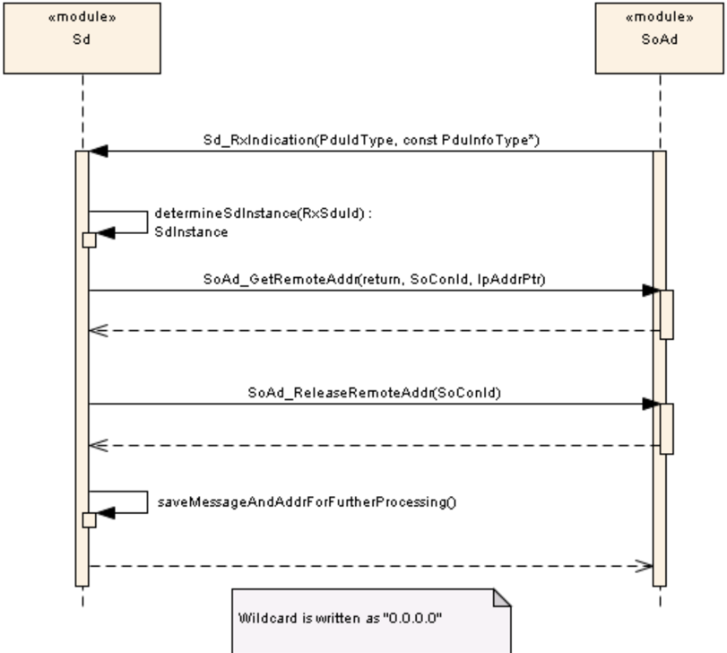

### 8.2. SERVER: Response Behavior

图9.2：序列SERVER: Response Behavior（**Sequence SERVER: Response Behavior**）

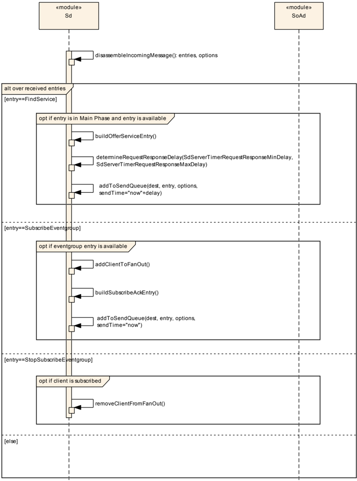

### 8.3. CLIENT: Response Behavior

图9.3：序列CLIENT: Response Behavior（**Sequence CLIENT: Response Behavior**）

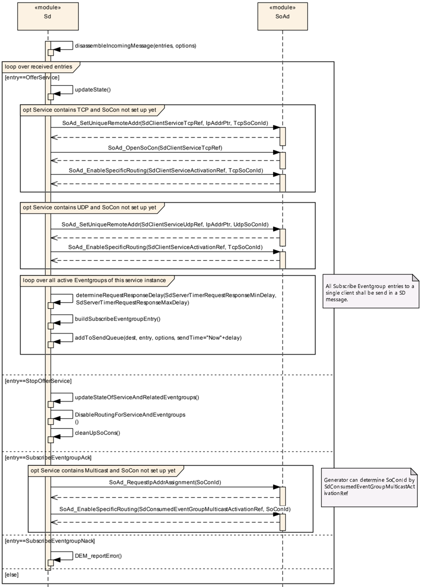

### 8.4. SERVER: buildOfferServiceEntry

图9.4：序列SERVER: buildOfferServiceEntry（**Sequence SERVER: buildOfferServiceEntry**）

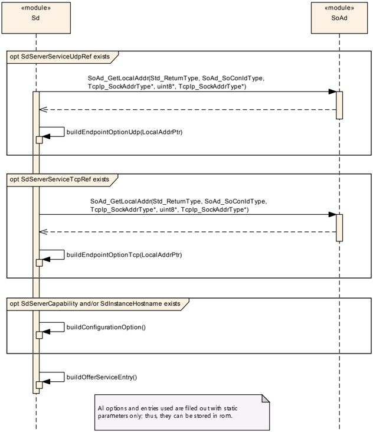

### 8.5. CLIENT: buildSubscribeEventgroupEntry

图9.5：序列CLIENT: buildSubscribeEventgroupEntry（**Sequence CLIENT: buildSubscribeEventgroupEntry**）

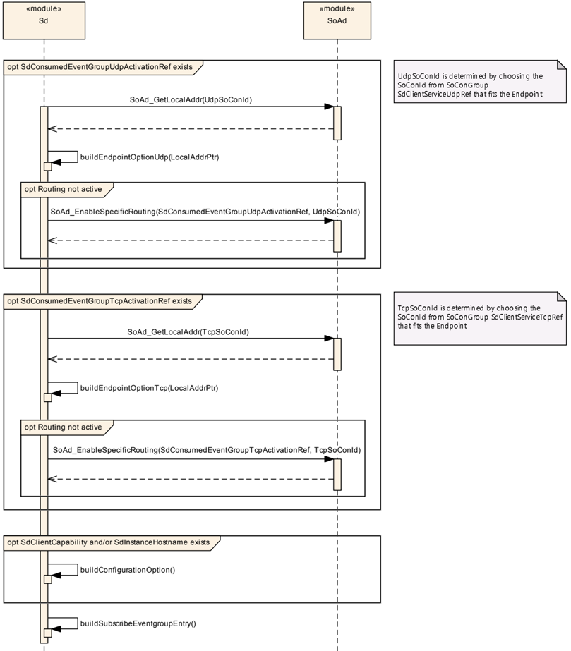

### 8.6. SERVER: buildSubscribeEventgroupAckEntry

图9.6：序列CLIENT: buildSubscribeEventgroupAckEntry（**Sequence CLIENT: buildSubscribeEventgroupAckEntry**）

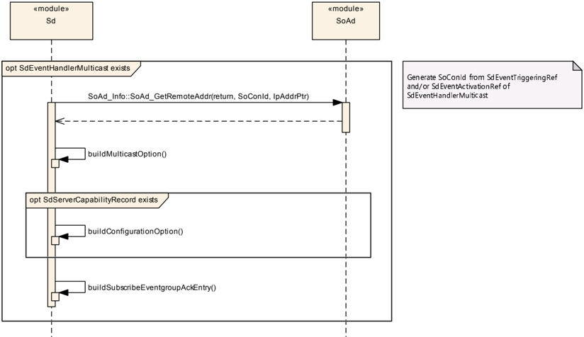

### 8.7. CLIENT / SERVER: TransmitSdMessage

图9.7：序列CLIENT / SERVER: TransmitSdMessage（**Sequence CLIENT / SERVER: TransmitSdMessage**）

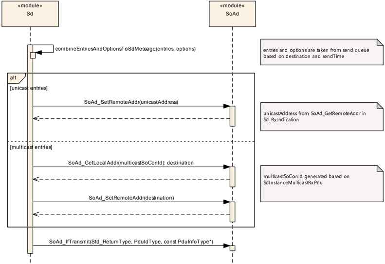

### 8.8. SERVER: AddClientToFanOut

图9.8：序列SERVER: AddClientToFanOut（**Sequence SERVER: AddClientToFanOut**）

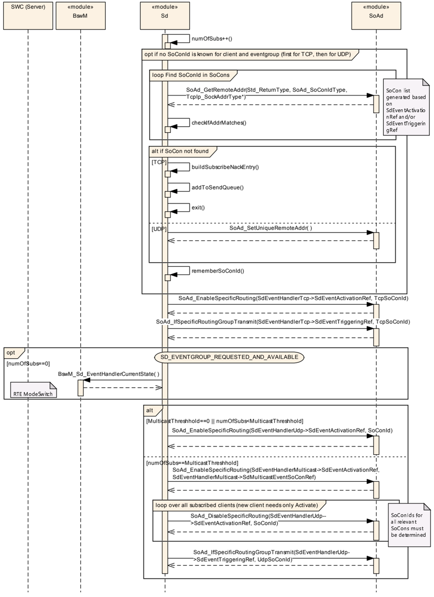

### 8.9. SERVER: Start

图9.9：序列配置变体SERVER: Start（**Sequence configuration variants SERVER: Start**）

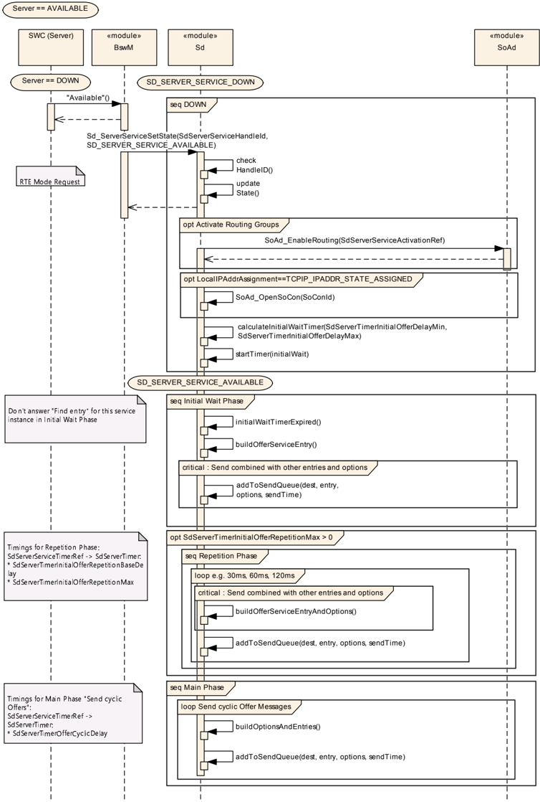

### 8.10. CLIENT: Start

图9.10：序列CLIENT: Start（**Sequence CLIENT: Start**）

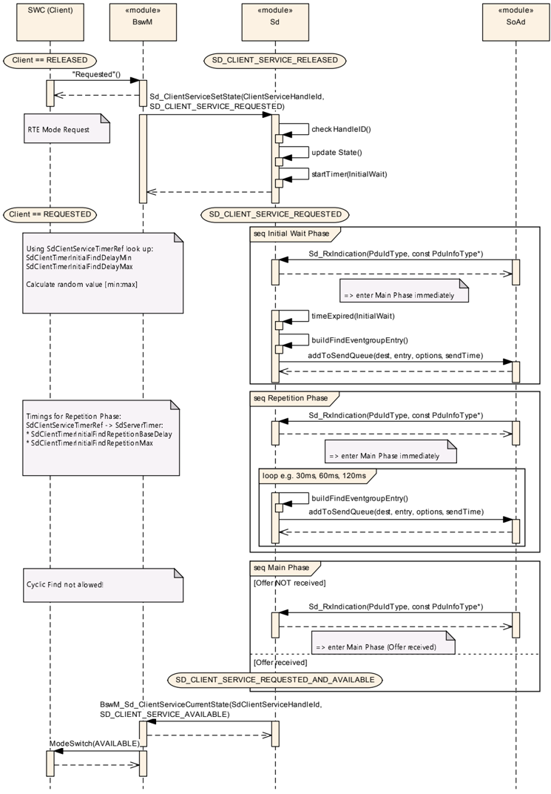

### 8.11. ACL: Service Offer

图9.11：Service Offer的ACL检查序列（**ACL check Sequence for Service Offer**）

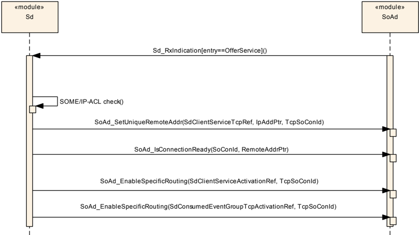

### 8.12. ACL: SubscribeEventgroup

图9.12：SubscribeEventgroup的ACL检查序列（**ACL check Sequence for SubscribeEventgroup**）

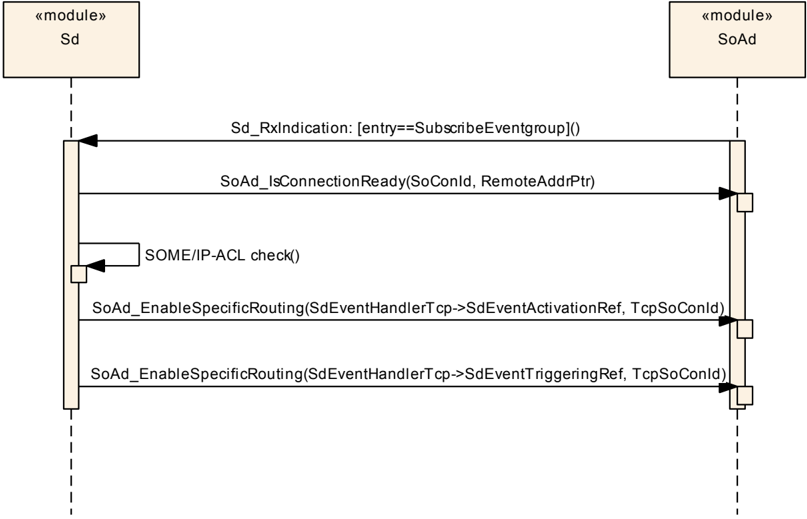

### 8.13. ACL: Method call request

图9.13：Method Call Request的ACL检查序列（**ACL check Sequence for Method Call Request**）

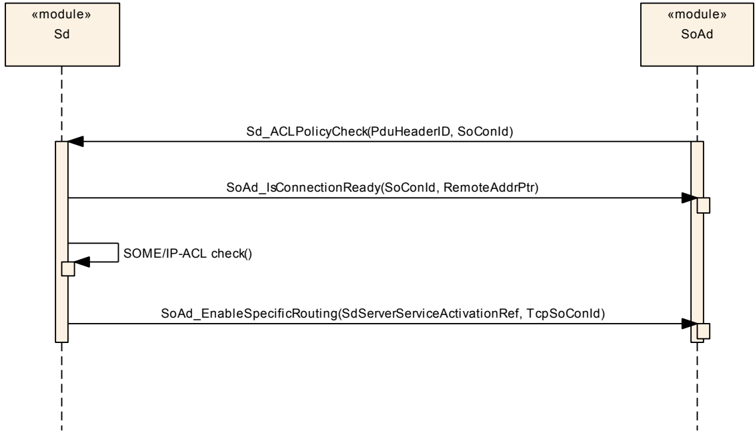
## 9. 配置规范

一般而言，本章定义配置参数及其到容器的聚类组织。

第9.1节规定模块**SD**的结构（容器）和参数。

### 9.1. 容器与配置参数

以下各章汇总了所有配置参数。参数的详细含义在第6章和第7章中描述。


#### 9.2.1. Sd

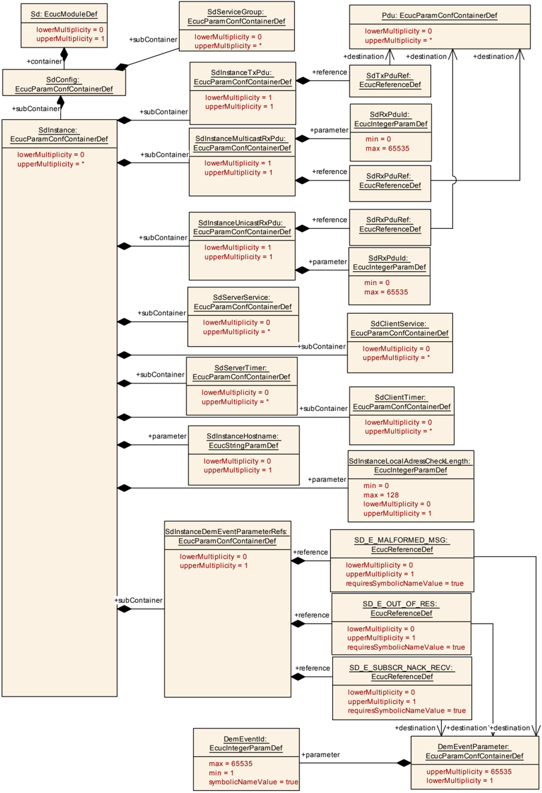


| SWS 条目 | [] |
| --- | --- |
| 容器名称 | Sd |
| 配置参数 | 见下方参数表 |

| 包含的容器 | 容器名称 | 多重性 | 作用域/依赖 |
| --- | --- | --- | --- |
| 包含的容器 | SdConfig | 1 | 该容器包含AUTOSAR服务发现模块的配置参数和子容器。 |
| 包含的容器 | SdGeneral | 1 | 该容器列出服务发现模块的通用配置参数。 |

#### 9.2.2. SdGeneral

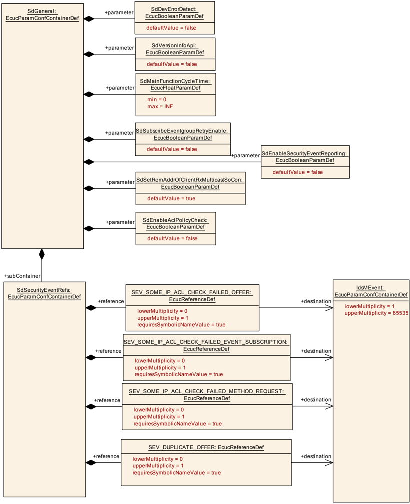


| SWS 条目 | [] |
| --- | --- |
| 容器名称 | SdGeneral |
| 配置参数 | 见下方参数表 |

| 包含的容器 | 容器名称 | 多重性 | 作用域/依赖 |
| --- | --- | --- | --- |
| 包含的容器 | SdSecurityEventRefs | 1 | Container for the references to IdsMEvent elements representing the security events that the SD module shall report to the IdsM in case the coresponding security related event occurs (and if Sd EnableSecurityEventReporting is set to "true"). The standardized security events in this container can be extended by vendor-specific security events. |

| SWS 条目 | [ECUC_Sd_00146] |
| --- | --- |
| 参数名称 | SdDevErrorDetect |
| 描述 | 开启或关闭开发错误检测与通知（true：启用检测与通知；false：禁用检测与通知）。 |
| 多重性 | 1 |
| 类型 | EcucBooleanParamDef |
| 默认值 | false |
| Post-Build 变体值 | false |
| 值配置类 | Pre-compile：time X All Variants；Link：time -；Post-build：time - |
| 作用域/依赖 | scope: local |

| SWS 条目 | [ECUC_Sd_00157] |
| --- | --- |
| 参数名称 | SdEnableAclPolicyCheck |
| 描述 | 切换**Sd**的ACL策略检查（true：启用该特性；false：禁用该特性）。 |
| 多重性 | 1 |
| 类型 | EcucBooleanParamDef |
| 默认值 | false |
| Post-Build 变体值 | false |
| 值配置类 | Pre-compile：time X All Variants；Link：time -；Post-build：time - |
| 作用域/依赖 | scope: ECU dependency: The value of this parameter shall be set to the same value as the SoAd EnableAclCheck parameter (feature needs to be acitvated/deactivated in both scope: ECU dependency: The value of this parameter shall be set to the same value as the SoAd EnableAclCheck parameter (feature needs to be acitvated/deactivated in both scope: ECU dependency: The value of this parameter shall be set to the same value as the SoAd EnableAclCheck parameter (feature needs to be acitvated/deactivated in both |

| SWS 条目 | [ECUC_Sd_00157] |
| --- | --- |
| 参数名称 | SdEnableSecurityEventReporting |
| 描述 | 启用或禁用向**IdsM**的安全事件报告（true：启用报告；false：禁用报告）。 |

#### 9.2.3. SdConfig

| SWS 条目 | [] |
| --- | --- |
| 容器名称 | SdConfig |
| 配置参数 | 见下方参数表 |

| 包含的容器 | 容器名称 | 多重性 | 作用域/依赖 |
| --- | --- | --- | --- |
| 包含的容器 | SdCapabilityRecordMatchCallout | 0..* | Callout that is invoked by the Sd implementation to determine whether the configuration options contained in the entries of a received SD message match the capability record elements configured in SdServerCapabilityRecord or SdClientCapability Record. |
| 包含的容器 | SdInstance | 0..* | 该容器表示SD的一个实例；即某个链路的SD配置。 |
| 包含的容器 | SdServiceGroup | 0..* | This container represents a group of ClientServices and Server Services, respectively. |

| SWS 条目 | [ECUC_Sd_00154] |
| --- | --- |
| 参数名称 | SdAclCheckBlockDescriptorRef |
| 描述 | 对Nvm模块配置中将存储ACL的Nvm块描述的引用。 |
| 多重性 | 0..1 |
| 类型 | Symbolic name reference to NvMBlockDescriptor |
| Post-Build 变体值 | false |
| 值配置类 | Pre-compile：time X；Link：time -；Post-build：time -；Pre-compile：time X；Link：time -；Post-build：time - |
| 作用域/依赖 | scope: ECU |

#### 9.2.4. SdCapabilityRecordMatchCallout

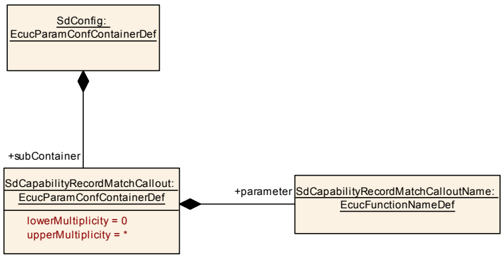


| SWS 条目 | [] |
| --- | --- |
| 容器名称 | SdCapabilityRecordMatchCallout |
| 配置参数 | 见下方参数表 |

无包含的容器。

| SWS 条目 | [ECUC_SD_00125] |
| --- | --- |
| 参数名称 | SdCapabilityRecordMatchCalloutName |
| 描述 | **SdCapabilityRecordMatchCallout**的函数名（即C标识符）。 |
| 多重性 | 1 |
| 类型 | EcucFunctionNameDef |
| 默认值 | - |
| Post-Build 变体值 | false |
| 值配置类 | Pre-compile：time X VARIANT-PRE-COMPILE；Link：time X VARIANT-LINK-TIME, VARIANT-POST-BUILD；Post-build：time -；Pre-compile：time X VARIANT-PRE-COMPILE；Link：time X VARIANT-LINK-TIME, VARIANT-POST-BUILD；Post-build：time - |
| 作用域/依赖 | scope: local |

#### 9.2.5. SdServiceGroup

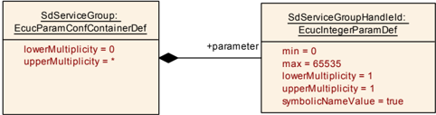


| SWS 条目 | [] |
| --- | --- |
| 容器名称 | SdServiceGroup |
| 配置参数 | 见下方参数表 |

无包含的容器。

| SWS 条目 | [ECUC_SD_00135] |
| --- | --- |
| 参数名称 | SdServiceGroupHandleId |
| 描述 | 用作该**SdServiceGroup**的ID的数值。启动和停止**SdServiceGroup**的API调用需要**SdServiceHandleId**。 |
| 多重性 | 1 |
| 类型 | EcucIntegerParamDef (Symbolic Name generated for this parameter) |
| 范围 | 0 .. 65535 |
| 默认值 | - |
| Post-Build 变体值 | false |
| 值配置类 | Pre-compile：time X All Variants；Link：time -；Post-build：time - |
| 作用域/依赖 | scope: ECU |

#### 9.2.6. SdInstance

| SWS 条目 | [] |
| --- | --- |
| 容器名称 | SdInstance |
| 配置参数 | 见下方参数表 |

| 包含的容器 | 容器名称 | 多重性 | 作用域/依赖 |
| --- | --- | --- | --- |
| 包含的容器 | SdClientService | 0..* | 该容器规定客户端服务（**Client services**）使用的所有参数。 |
| 包含的容器 | SdClientTimer | 0..* | 该容器规定服务发现模块用于客户端服务（**Client Services**）的所有定时器。 |
| 包含的容器 | SdInstanceDemEventParameter Refs | 0..1 | Container for the references to DemEventParameter elements which shall be invoked using the API Dem_SetEventStatus in case the corresponding error occurs. The EventId is taken from the referenced DemEventParameter's DemEventId symbolic value. The standardized errors are provided in this container and can be extended by vendor-specific error references. |
| 包含的容器 | SdInstanceMulticastRxPdu | 1 | 该容器规定所接收的PDU。 |
| 包含的容器 | SdInstanceTxPdu | 1 | 该容器规定所发送的PDU。 |
| 包含的容器 | SdInstanceUnicastRxPdu | 1 | 该容器规定所接收的PDU。 |
| 包含的容器 | SdServerService | 0..* | 该容器规定服务器服务（**Server services**）使用的所有参数。 |
| 包含的容器 | SdServerTimer | 0..* | 该容器规定服务发现模块用于服务器服务（**Server Services**）的所有定时器。 |

| SWS 条目 | [ECUC_SD_00012] |
| --- | --- |
| 参数名称 | SdInstanceHostname |
| 描述 | 用于规定主机名（**Hostname**）的配置参数。 |
| 多重性 | 0..1 |
| 类型 | EcucStringParamDef |
| 默认值 | - |

#### 9.2.7. SdClientService

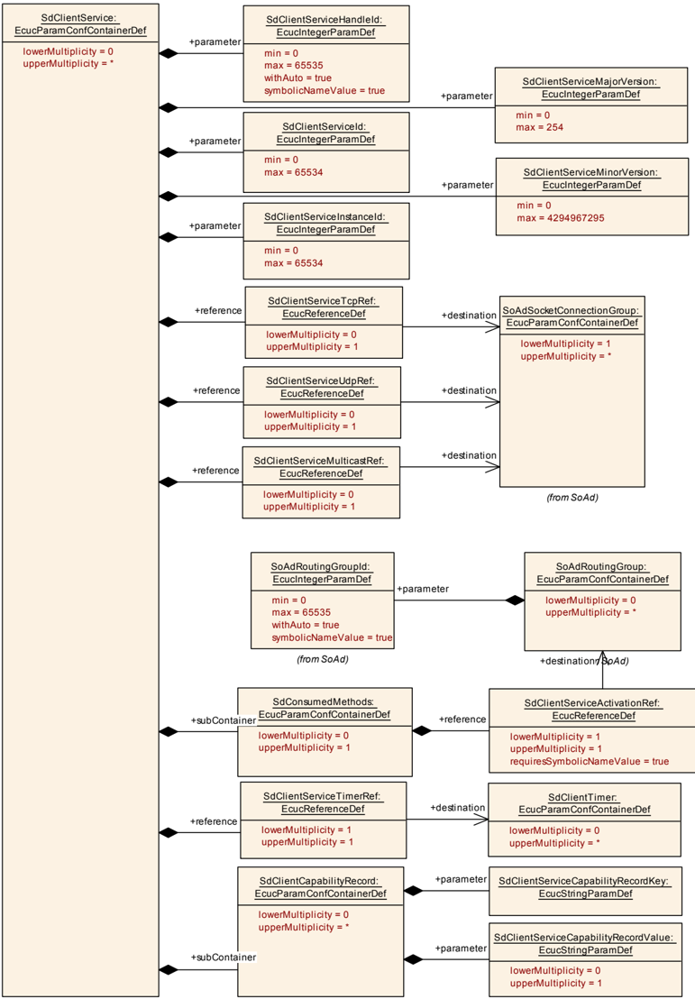
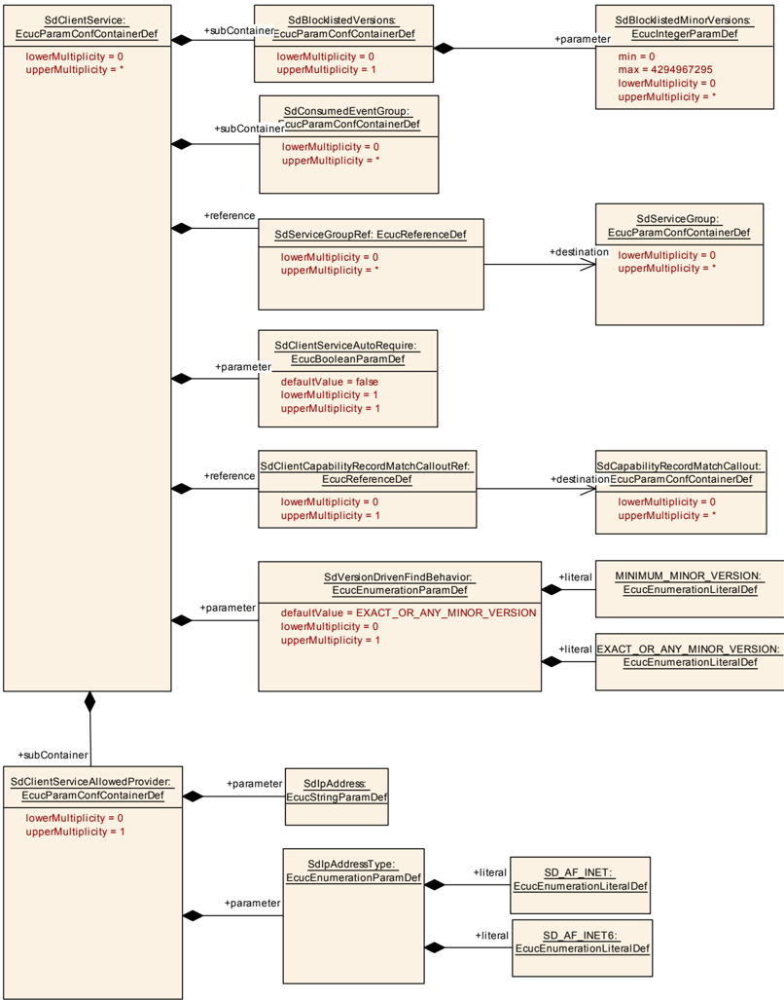


| SWS 条目 | [] |
| --- | --- |
| 容器名称 | SdClientService |
| 配置参数 | 见下方参数表 |

| 包含的容器 | 容器名称 | 多重性 | 作用域/依赖 |
| --- | --- | --- | --- |
| 包含的容器 | SdBlocklistedVersions | 0..1 | 列入黑名单的版本的集合。 |
| 包含的容器 | SdClientCapabilityRecord | 0..* | Sd uses capability records to store arbitrary name/value pairs conveying additional information about the named service. The following use cases are supported: 1) Key present, with no value (e.g. "passreq" - password required for this service) 2) Key present, with empty value (e.g. "PlugIns=" server supports plugins, but none are presently installed) 3) Key present, with non-empty value (e.g. "Plug Ins=JPEG,MPEG2,MPEG4") |
| 包含的容器 | SdClientServiceAllowedProvider | 0..1 | 该容器定义该**ClientService**的被允许的提供者。 |
| 包含的容器 | SdConsumedEventGroup | 0..* | This container specifies all parameters for consumed event groups. |
| 包含的容器 | SdConsumedMethods | 0..1 | 表示访问服务器方法的数据路径的容器元素。 |

| SWS 条目 | [ECUC_SD_00079] |
| --- | --- |
| 参数名称 | SdClientServiceAutoRequire |
| 描述 | 如果存在并设置为true，则该服务在启动时将被设置为「required（已请求）」。 |
| 多重性 | 1 |
| 类型 | EcucBooleanParamDef |
| 默认值 | false |
| Post-Build 变体值 | true |
| 值配置类 | Pre-compile：time X VARIANT-PRE-COMPILE；Link：time X VARIANT-LINK-TIME；Post-build：time X VARIANT-POST-BUILD |
| 作用域/依赖 | scope: local dependency: SdClientServiceAutoRequire could only be set to true, if the SdClient Service is NOT referencing a SdServiceGroup scope: local dependency: SdClientServiceAutoRequire could only be set to true, if the SdClient Service is NOT referencing a SdServiceGroup scope: local dependency: SdClientServiceAutoRequire could only be set to true, if the SdClient Service is NOT referencing a SdServiceGroup |

| SWS 条目 | [ECUC_SD_00020] |
| --- | --- |
| 参数名称 | SdClientServiceHandleId |
| 描述 | **BswM**可用于标识该客户端服务实例的HandleId。 |
| 多重性 | 1 |
| 类型 | EcucIntegerParamDef (Symbolic Name generated for this parameter) |
| 范围 | 0 .. 65535 |
| 默认值 | - |
| Post-Build 变体值 | false |
| 值配置类 | Pre-compile：time X All Variants；Link：time -；Post-build：time - |
| 作用域/依赖 | scope: local |

| SWS 条目 | [ECUC_SD_00020] |
| --- | --- |
| 参数名称 | SdClientServiceId |
| 描述 | 用于标识该服务的ID。它是唯一的。 |
| 多重性 | 1 |
| 类型 | EcucIntegerParamDef |
| 范围 | 0 .. 65534 |
| 默认值 | - |
| Post-Build 变体值 | true |
| 值配置类 | Pre-compile：time X VARIANT-PRE-COMPILE |

#### 9.2.8. SdBlocklistedVersions

| SWS 条目 | [] |
| --- | --- |
| 容器名称 | SdBlocklistedVersions |
| 配置参数 | 见下方参数表 |

无包含的容器。

| SWS 条目 | [ECUC_SD_00142] |
| --- | --- |
| 参数名称 | SdBlocklistedMinorVersions |
| 描述 | 列入黑名单的MinorVersion。 |
| 多重性 | 0..* |
| 类型 | EcucIntegerParamDef |
| 范围 | 0 .. 4294967295 |
| 默认值 | - |
| Post-Build 变体值 | true |
| 值配置类 | Pre-compile：time X VARIANT-PRE-COMPILE；Link：time X VARIANT-LINK-TIME；Post-build：time X VARIANT-POST-BUILD；Pre-compile：time X VARIANT-PRE-COMPILE；Link：time X VARIANT-LINK-TIME；Post-build：time X VARIANT-POST-BUILD |
| 作用域/依赖 | scope: local |

#### 9.2.9. SdClientCapabilityRecord

| SWS 条目 | [] |
| --- | --- |
| 容器名称 | SdClientCapabilityRecord |
| 配置参数 | 见下方参数表 |

无包含的容器。

| SWS 条目 | [ECUC_SD_00074] |
| --- | --- |
| 参数名称 | SdClientServiceCapabilityRecordKey |
| 描述 | 定义一个**CapabilityRecord**键。 |
| 多重性 | 1 |
| 类型 | EcucStringParamDef |
| 默认值 | - |
| Post-Build 变体值 | false |
| 值配置类 | Pre-compile：time X All Variants；Link：time -；Post-build：time - |
| 作用域/依赖 | scope: local |

| SWS 条目 | [ECUC_SD_00074] |
| --- | --- |
| 参数名称 | SdClientServiceCapabilityRecordValue |
| 描述 | 定义相应的**CapabilityRecord**值。 |
| 多重性 | 0..1 |
| 类型 | EcucStringParamDef |
| 默认值 | - |
| Post-Build 变体值 | false |
| 值配置类 | Pre-compile：time X；Link：time -；Post-build：time -；Pre-compile：time X；Link：time -；Post-build：time - |
| 作用域/依赖 | scope: local |

#### 9.2.10. SdConsumedEventGroup

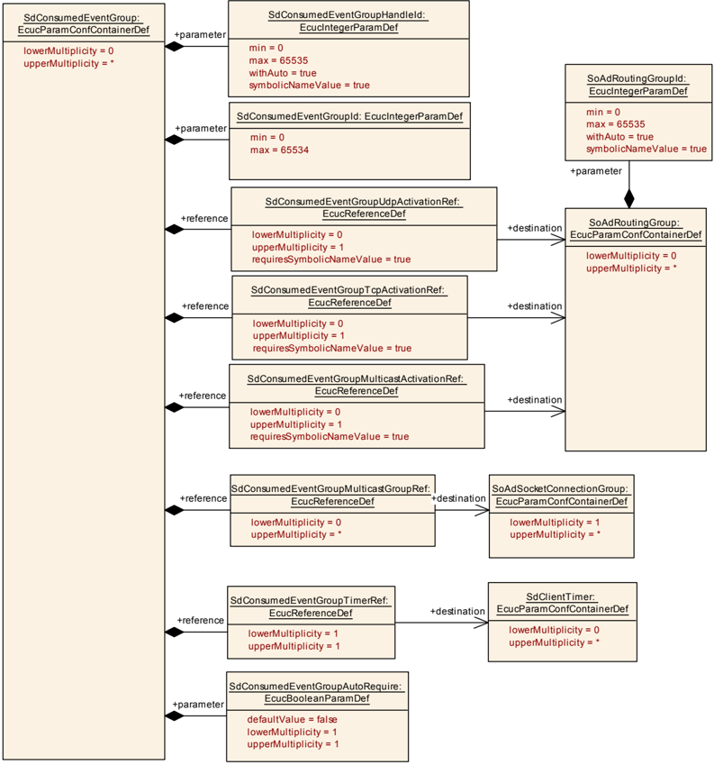


| SWS 条目 | [] |
| --- | --- |
| 容器名称 | SdConsumedEventGroup |
| 配置参数 | 见下方参数表 |

无包含的容器。

| SWS 条目 | [ECUC_SD_00116] |
| --- | --- |
| 参数名称 | SdConsumedEventGroupAutoRequire |
| 描述 | 如果存在并设置为true，则该EventGroup在启动时将被设置为「required（已请求）」。 |
| 多重性 | 1 |
| 类型 | EcucBooleanParamDef |
| 默认值 | false |
| Post-Build 变体值 | true |
| 值配置类 | Pre-compile：time X VARIANT-PRE-COMPILE；Link：time X VARIANT-LINK-TIME；Post-build：time X VARIANT-POST-BUILD |
| 作用域/依赖 | scope: local |

| SWS 条目 | [ECUC_SD_00057] |
| --- | --- |
| 参数名称 | SdConsumedEventGroupHandleId |
| 描述 | **BswM**可用于标识该EventGroup的HandleId。 |
| 多重性 | 1 |
| 类型 | EcucIntegerParamDef (Symbolic Name generated for this parameter) |
| 范围 | 0 .. 65535 |
| 默认值 | - |
| Post-Build 变体值 | false |
| 值配置类 | Pre-compile：time X All Variants；Link：time -；Post-build：time - |
| 作用域/依赖 | scope: local withAuto = true scope: local withAuto = true scope: local withAuto = true |

| SWS 条目 | [ECUC_SD_00057] |
| --- | --- |
| 参数名称 | SdConsumedEventGroupId |
| 描述 | 该eventGroup的Eventgroup Id，作为该服务中事件组的唯一标识符。该标识符也用于EventGroup条目。请注意，Eventgroup ID 0x0000保留。 |
| 多重性 | 1 |
| 类型 | EcucIntegerParamDef |
| 范围 | 0 .. 65534 |
| 默认值 | - |

#### 9.2.11. SdConsumedMethods

| SWS 条目 | [] |
| --- | --- |
| 容器名称 | SdConsumedMethods |
| 配置参数 | 见下方参数表 |

无包含的容器。

| SWS 条目 | [ECUC_SD_00102] |
| --- | --- |
| 参数名称 | SdClientServiceActivationRef |
| 描述 | 对**SoAdRoutingGroupRef**的引用，用于激活/停用方法的数据路径。 |
| 多重性 | 1 |
| 类型 | Symbolic name reference to SoAdRoutingGroup |
| Post-Build 变体值 | true |
| 值配置类 | Pre-compile：time X VARIANT-PRE-COMPILE；Link：time X VARIANT-LINK-TIME；Post-build：time X VARIANT-POST-BUILD |
| 作用域/依赖 | scope: local |

#### 9.2.12. SdClientTimer

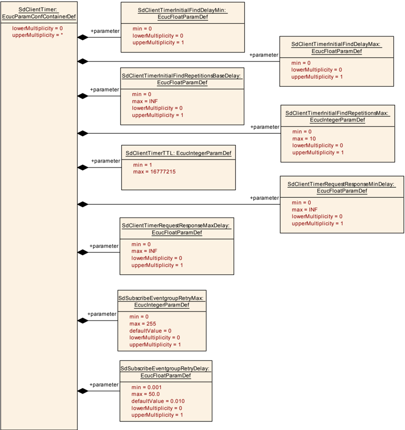


| SWS 条目 | [] |
| --- | --- |
| 容器名称 | SdClientTimer |
| 配置参数 | 见下方参数表 |

无包含的容器。

| SWS 条目 | [ECUC_SD_00063] |
| --- | --- |
| 参数名称 | SdClientTimerInitialFindDelayMax |
| 描述 | 随机延迟find消息传输的最大值（秒）。该参数对**ClientService**是强制性的。 |
| 多重性 | 0..1 |
| 类型 | EcucFloatParamDef |
| 范围 | [0 .. INF] |
| 默认值 | - |
| Post-Build 变体值 | true |
| 值配置类 | Pre-compile：time X VARIANT-PRE-COMPILE；Link：time X VARIANT-LINK-TIME；Post-build：time X VARIANT-POST-BUILD |

#### 9.2.13. SdInstanceDemEventParameterRefs

| SWS 条目 | [] |
| --- | --- |
| 容器名称 | SdInstanceDemEventParameterRefs |
| 配置参数 | 见下方参数表 |

无包含的容器。

| SWS 条目 | [ECUC_SD_00122] |
| --- | --- |
| 参数名称 | SD_E_MALFORMED_MSG |
| 描述 | 对当SD实例收到格式错误的消息时应引发的**DemEventParameter**的引用。 |
| 多重性 | 0..1 |
| 类型 | Symbolic name reference to DemEventParameter |
| Post-Build 变体值 | true |
| 值配置类 | Pre-compile：time X All Variants；Link：time -；Post-build：time -；Pre-compile：time X VARIANT-PRE-COMPILE；Link：time X VARIANT-LINK-TIME；Post-build：time X VARIANT-POST-BUILD |
| 作用域/依赖 | scope: local |

| SWS 条目 | [ECUC_SD_00123] |
| --- | --- |
| 参数名称 | SD_E_OUT_OF_RES |
| 描述 | 对当SD实例没有足够的资源处理客户端时应引发的**DemEventParameter**的引用。 |
| 多重性 | 0..1 |
| 类型 | Symbolic name reference to DemEventParameter |
| Post-Build 变体值 | true |
| 值配置类 | Pre-compile：time X All Variants；Link：time -；Post-build：time -；Pre-compile：time X VARIANT-PRE-COMPILE；Link：time X VARIANT-LINK-TIME；Post-build：time X VARIANT-POST-BUILD |
| 作用域/依赖 | scope: local |

| SWS 条目 | [ECUC_SD_00123] |
| --- | --- |
| 参数名称 | SD_E_SUBSCR_NACK_RECV |
| 描述 | 对当收到Subscribe EventgroupNack条目时应引发的**DemEventParameter**的引用。 |
| 多重性 | 0..1 |
| 类型 | Symbolic name reference to DemEventParameter |
| Post-Build 变体值 | true |
| 值配置类 | Pre-compile：time X All Variants；Link：time -；Post-build：time -；Pre-compile：time X VARIANT-PRE-COMPILE；Link：time X VARIANT-LINK-TIME |
| 作用域/依赖 | scope: local |

#### 9.2.14. SdInstanceMulticastRxPdu

| SWS 条目 | [] |
| --- | --- |
| 容器名称 | SdInstanceMulticastRxPdu |
| 配置参数 | 见下方参数表 |

无包含的容器。

| SWS 条目 | [ECUC_SD_00029] |
| --- | --- |
| 参数名称 | SdRxPduId |
| 描述 | 将经由API **Sd_SoAdIfRxIndication()**接收的PDU的ID。 |
| 多重性 | 1 |
| 类型 | EcucIntegerParamDef |
| 范围 | 0 .. 65535 |
| 默认值 | - |
| Post-Build 变体值 | true |
| 值配置类 | Pre-compile：time X VARIANT-PRE-COMPILE；Link：time X VARIANT-LINK-TIME；Post-build：time X VARIANT-POST-BUILD |
| 作用域/依赖 | scope: ECU |

| SWS 条目 | [ECUC_SD_00029] |
| --- | --- |
| 参数名称 | SdRxPduRef |
| 描述 | 对「全局」Pdu结构的引用，以允许在COM-Stack中统一句柄ID。 |
| 多重性 | 1 |
| 类型 | Reference to Pdu |
| Post-Build 变体值 | true |
| 值配置类 | Pre-compile：time X VARIANT-PRE-COMPILE；Link：time X VARIANT-LINK-TIME；Post-build：time X VARIANT-POST-BUILD |
| 作用域/依赖 | scope: local |

#### 9.2.15. SdInstanceTxPdu

| SWS 条目 | [] |
| --- | --- |
| 容器名称 | SdInstanceTxPdu |
| 配置参数 | 见下方参数表 |

无包含的容器。

| SWS 条目 | [ECUC_SD_00109] |
| --- | --- |
| 参数名称 | SdTxPduRef |
| 描述 | 对「全局」Pdu结构的引用，以允许在COM-Stack中统一句柄ID。 |
| 多重性 | 1 |
| 类型 | Reference to Pdu |
| Post-Build 变体值 | true |
| 值配置类 | Pre-compile：time X VARIANT-PRE-COMPILE；Link：time X VARIANT-LINK-TIME；Post-build：time X VARIANT-POST-BUILD |
| 作用域/依赖 | scope: local |

#### 9.2.16. SdInstanceUnicastRxPdu

| SWS 条目 | [] |
| --- | --- |
| 容器名称 | SdInstanceUnicastRxPdu |
| 配置参数 | 见下方参数表 |

无包含的容器。

| SWS 条目 | [ECUC_SD_00083] |
| --- | --- |
| 参数名称 | SdRxPduId |
| 描述 | 将经由API **Sd_SoAdIfRxIndication()**接收的PDU的ID。 |
| 多重性 | 1 |
| 类型 | EcucIntegerParamDef |
| 范围 | 0 .. 65535 |
| 默认值 | - |
| Post-Build 变体值 | true |
| 值配置类 | Pre-compile：time X VARIANT-PRE-COMPILE；Link：time X VARIANT-LINK-TIME；Post-build：time X VARIANT-POST-BUILD |
| 作用域/依赖 | scope: ECU |

| SWS 条目 | [ECUC_SD_00083] |
| --- | --- |
| 参数名称 | SdRxPduRef |
| 描述 | 对「全局」Pdu结构的引用，以允许在COM-Stack中统一句柄ID。 |
| 多重性 | 1 |
| 类型 | Reference to Pdu |
| Post-Build 变体值 | true |
| 值配置类 | Pre-compile：time X VARIANT-PRE-COMPILE；Link：time X VARIANT-LINK-TIME；Post-build：time X VARIANT-POST-BUILD |
| 作用域/依赖 | scope: local |

#### 9.2.17. SdServerService

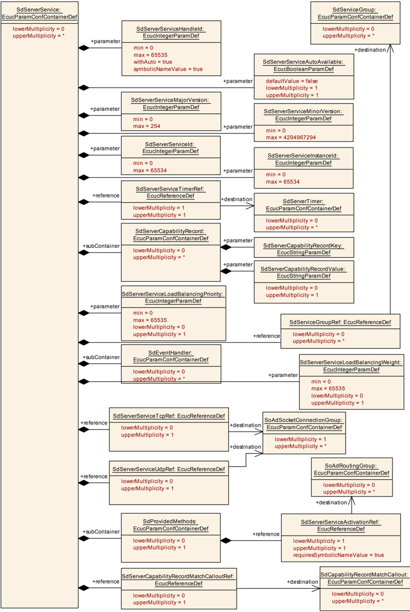
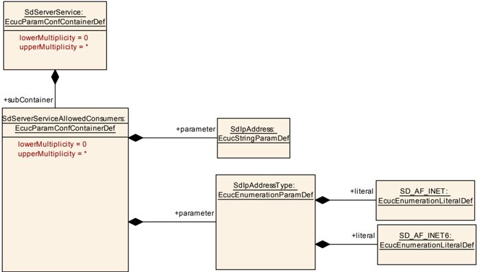


| SWS 条目 | [] |
| --- | --- |
| 容器名称 | SdServerService |
| 配置参数 | 见下方参数表 |

| 包含的容器 | 容器名称 | 多重性 | 作用域/依赖 |
| --- | --- | --- | --- |
| 包含的容器 | SdEventHandler | 0..* | 表示作为服务实例一部分的EventGroup的容器元素。 |
| 包含的容器 | SdProvidedMethods | 0..1 | 表示该服务所提供方法的数据路径所需元素的容器元素。 |
| 包含的容器 | SdServerCapabilityRecord | 0..* | Sd uses capability records to store arbitrary name/value pairs conveying additional information about the named service. The following use cases are supported: 1) Key present, with no value (e.g. "passreq" - password required for this service) 2) Key present, with empty value (e.g. "PlugIns=" server supports plugins, but none are presently installed) 3) Key present, with non-empty value (e.g. "Plug Ins=JPEG,MPEG2,MPEG4") |
| 包含的容器 | SdServerServiceAllowed Consumers | 0..* | This container defines a list of consumers that are allowed to access this SdServerService. |

| SWS 条目 | [ECUC_SD_00110] |
| --- | --- |
| 参数名称 | SdServerServiceAutoAvailable |
| 描述 | 如果存在并设置为true，则该服务在启动时将被设置为「Available（可用）」。 |
| 多重性 | 1 |
| 类型 | EcucBooleanParamDef |
| 默认值 | false |
| Post-Build 变体值 | true |
| 值配置类 | Pre-compile：time X VARIANT-PRE-COMPILE；Link：time X VARIANT-LINK-TIME；Post-build：time X VARIANT-POST-BUILD |
| 作用域/依赖 | scope: local dependency: SdServerServiceAutoAvailable could only be set to true, if the SdServer Service is NOT referencing a SdServiceGroup scope: local dependency: SdServerServiceAutoAvailable could only be set to true, if the SdServer Service is NOT referencing a SdServiceGroup scope: local dependency: SdServerServiceAutoAvailable could only be set to true, if the SdServer Service is NOT referencing a SdServiceGroup |

| SWS 条目 | [ECUC_SD_00110] |
| --- | --- |
| 参数名称 | SdServerServiceHandleId |
| 描述 | **BswM**可用于标识该服务器服务实例的HandleId。 |
| 多重性 | 1 |
| 类型 | EcucIntegerParamDef (Symbolic Name generated for this parameter) |
| 范围 | 0 .. 65535 |

#### 9.2.18. SdEventHandler

| SWS 条目 | [] |
| --- | --- |
| 容器名称 | SdEventHandler |
| 配置参数 | 见下方参数表 |

| 包含的容器 | 容器名称 | 多重性 | 作用域/依赖 |
| --- | --- | --- | --- |
| 包含的容器 | SdEventHandlerMulticast | 0..1 | The subcontainer including the Routing Group for Activation of Events sent over Multicast. The activation ref is also being used for identification of the related Socket Connection in order to find the Multicast Address used in the Multicast Option referenced by the Subscribe Event Group Ack entry. |
| 包含的容器 | SdEventHandlerTcp | 0..1 | The subcontainer including the Routing Groups for Activation and Trigger Transmit for Events sent over TCP. The activation ref (or triggering ref if no activation ref exists) is also being used for identification of the related socket connections in order to find the related client by iterating the Sd EventHandlerTcp elements (remote address statically configured or automatically set by opening TCP connection before subscription). |
| 包含的容器 | SdEventHandlerUdp | 0..1 | The subcontainer including the Routing Groups for Activation and Trigger Transmit for Events sent over UDP. The activation ref (or triggering ref if no activation ref exists) is also being used for identification of the related socket connections in order to set the remote address (either unicast address or multicast address) of the client or find the related client by iterating the SdEventHandlerUdp elements (remote address statically configured or automatically set by method call before subscription). |

| SWS 条目 | [ECUC_SD_00112] |
| --- | --- |
| 参数名称 | SdEventHandlerEventGroupId |
| 描述 | 该EventGroup的EventGroup Id，作为该服务中事件组的唯一标识符。该标识符也用于EventGroup条目。请注意，Eventgroup ID 0x0000保留。
| 多重性 | 1 |
| 类型 | EcucIntegerParamDef |
| 范围 | 0 .. 65534 |
| 默认值 | - |
| Post-Build 变体值 | false |
| 值配置类 | Pre-compile：time X All Variants；Link：time -；Post-build：time - |
| 作用域/依赖 | scope: local |

| SWS 条目 | [ECUC_SD_00097] |
| --- | --- |
| 参数名称 | SdEventHandlerHandleId |
| 描述 | **BswM**可用于标识该EventGroup的HandleId。 |
| 多重性 | 1 |
| 类型 | EcucIntegerParamDef (Symbolic Name generated for this parameter) |
| 范围 | 0 .. 65535 |
| 默认值 | - |
| 值配置类 | Pre-compile：time X All Variants；Link：time -；Post-build：time - |
| 作用域/依赖 | scope: ECU withAuto = true scope: ECU withAuto = true scope: ECU withAuto = true |

| SWS 条目 | [ECUC_SD_00113] |
| --- | --- |
| 参数名称 | SdEventHandlerMulticastThreshold |
| 描述 | 规定触发服务器更改为经由Eventhandler多播连接传输事件的、具有不同端点信息的已订阅客户端数量（见SWS_SD_00754）。如果配置为0，则只使用Consumed Eventgroup单播连接和Consumed Eventgroup多播连接；如果配置为1，则第一个客户端和所有后续已订阅的客户端经由**SdMulticastEventSoConRef**中配置的Eventhandler多播连接提供服务；如果配置为n，则至多n-1个具有不同端点信息的客户端经由Consumed Eventgroup单播连接和Consumed Eventgroup多播连接提供服务。一旦具有不同端点信息的已订阅客户端数量达到n，则所有已订阅的客户端经由**SdMulticastEventSoConRef**中配置的Eventhandler多播连接提供服务。
| 多重性 | 1 |
| 类型 | EcucIntegerParamDef |
| 范围 | 0 .. 65535 |
| 默认值 | - |
| Post-Build 变体值 | true |
| 值配置类 | Pre-compile：time X VARIANT-PRE-COMPILE；Link：time X VARIANT-LINK-TIME；Post-build：time X VARIANT-POST-BUILD |
| 作用域/依赖 | scope: local |

| SWS 条目 | [ECUC_SD_00113] |
| --- | --- |
| 参数名称 | SdEventHandlerTimerRef |
| 描述 | 该EventGroup的**SdServerTimer**容器的引用。 |
| 多重性 | 0..1 |
| 类型 | Reference to SdServerTimer |
| Post-Build 变体值 | true |
| 值配置类 | Pre-compile：time X VARIANT-PRE-COMPILE；Link：time X VARIANT-LINK-TIME；Post-build：time X VARIANT-POST-BUILD；Pre-compile：time X VARIANT-PRE-COMPILE |

#### 9.2.19. SdEventHandlerMulticast

| SWS 条目 | [] |
| --- | --- |
| 容器名称 | SdEventHandlerMulticast |
| 配置参数 | 见下方参数表 |

无包含的容器。

| SWS 条目 | [ECUC_SD_00118] |
| --- | --- |
| 参数名称 | SdEventActivationRef |
| 描述 | 对**SoAdRoutingGroup**的引用，用于激活已订阅客户端的数据路径（在订阅之后开始发送事件）。这通常等于**SdEventHandlerUdp**所引用的**SdEventActivationRef**。 |
| 多重性 | 0..1 |
| 类型 | Symbolic name reference to SoAdRoutingGroup |
| Post-Build 变体值 | true |
| 值配置类 | Pre-compile：time X VARIANT-PRE-COMPILE；Link：time X VARIANT-LINK-TIME；Post-build：time X VARIANT-POST-BUILD；Pre-compile：time X VARIANT-PRE-COMPILE；Link：time X VARIANT-LINK-TIME；Post-build：time X VARIANT-POST-BUILD |
| 作用域/依赖 | scope: local |

| SWS 条目 | [ECUC_SD_00118] |
| --- | --- |
| 参数名称 | SdMulticastEventSoConRef |
| 描述 | 对表示Eventhandler多播数据路径（UDP）的SoAdSocketConnection的引用。 |
| 多重性 | 1 |
| 类型 | Symbolic name reference to SoAdSocketConnection |
| Post-Build 变体值 | true |
| 值配置类 | Pre-compile：time X VARIANT-PRE-COMPILE；Link：time X VARIANT-LINK-TIME；Post-build：time X VARIANT-POST-BUILD；Pre-compile：time X VARIANT-PRE-COMPILE；Link：time X VARIANT-LINK-TIME；Post-build：time X VARIANT-POST-BUILD |
| 作用域/依赖 | scope: local |

#### 9.2.20. SdEventHandlerTcp

| SWS 条目 | [] |
| --- | --- |
| 容器名称 | SdEventHandlerTcp |
| 配置参数 | 见下方参数表 |

无包含的容器。

| SWS 条目 | [ECUC_SD_00095] |
| --- | --- |
| 参数名称 | SdEventActivationRef |
| 描述 | 对**SoAdRoutingGroup**的引用，用于激活已订阅客户端的数据路径（在订阅之后开始发送事件）。这通常等于**SdEventHandlerUdp**所引用的**SdEventActivationRef**。 |
| 多重性 | 0..1 |
| 类型 | Symbolic name reference to SoAdRoutingGroup |
| Post-Build 变体值 | true |
| 值配置类 | Pre-compile：time X VARIANT-PRE-COMPILE；Link：time X VARIANT-LINK-TIME；Post-build：time X VARIANT-POST-BUILD；Pre-compile：time X VARIANT-PRE-COMPILE；Link：time X VARIANT-LINK-TIME；Post-build：time X VARIANT-POST-BUILD |
| 作用域/依赖 | scope: local |

| SWS 条目 | [ECUC_SD_00095] |
| --- | --- |
| 参数名称 | SdEventTriggeringRef |
| 描述 | 对用于触发传输（**triggered transmit**）的**SoAdRoutingGroup**的引用。在客户端订阅之后，需要触发以在服务器侧发送初始事件。 |
| 多重性 | 0..1 |
| 类型 | Symbolic name reference to SoAdRoutingGroup |
| Post-Build 变体值 | true |
| 值配置类 | Pre-compile：time X VARIANT-PRE-COMPILE；Link：time X VARIANT-LINK-TIME；Post-build：time X VARIANT-POST-BUILD；Pre-compile：time X VARIANT-PRE-COMPILE；Link：time X VARIANT-LINK-TIME；Post-build：time X VARIANT-POST-BUILD |
| 作用域/依赖 | scope: local |

#### 9.2.21. SdEventHandlerUdp

| SWS 条目 | [] |
| --- | --- |
| 容器名称 | SdEventHandlerUdp |
| 配置参数 | 见下方参数表 |

无包含的容器。

| SWS 条目 | [ECUC_SD_00095] |
| --- | --- |
| 参数名称 | SdEventActivationRef |
| 描述 | 对**SoAdRoutingGroup**的引用，用于激活已订阅客户端的数据路径（在订阅之后开始发送事件）。这通常等于**SdEventHandlerUdp**所引用的**SdEventActivationRef**。 |
| 多重性 | 0..1 |
| 类型 | Symbolic name reference to SoAdRoutingGroup |
| Post-Build 变体值 | true |
| 值配置类 | Pre-compile：time X VARIANT-PRE-COMPILE；Link：time X VARIANT-LINK-TIME；Post-build：time X VARIANT-POST-BUILD；Pre-compile：time X VARIANT-PRE-COMPILE；Link：time X VARIANT-LINK-TIME；Post-build：time X VARIANT-POST-BUILD |
| 作用域/依赖 | scope: local |

| SWS 条目 | [ECUC_SD_00095] |
| --- | --- |
| 参数名称 | SdEventTriggeringRef |
| 描述 | 对用于触发传输（**triggered transmit**）的**SoAdRoutingGroup**的引用。在客户端订阅之后，需要触发以在服务器侧发送初始事件。 |
| 多重性 | 0..1 |
| 类型 | Symbolic name reference to SoAdRoutingGroup |
| Post-Build 变体值 | true |
| 值配置类 | Pre-compile：time X VARIANT-PRE-COMPILE；Link：time X VARIANT-LINK-TIME；Post-build：time X VARIANT-POST-BUILD；Pre-compile：time X VARIANT-PRE-COMPILE；Link：time X VARIANT-LINK-TIME；Post-build：time X VARIANT-POST-BUILD |
| 作用域/依赖 | scope: local |

#### 9.2.22. SdProvidedMethods

| SWS 条目 | [] |
| --- | --- |
| 容器名称 | SdProvidedMethods |
| 配置参数 | 见下方参数表 |

无包含的容器。

| SWS 条目 | [ECUC_SD_00090] |
| --- | --- |
| 参数名称 | SdServerServiceActivationRef |
| 描述 | 对**SoAdRoutingGroup**的引用，用于激活和停用该服务方法的数据路径。 |
| 多重性 | 1 |
| 类型 | Symbolic name reference to SoAdRoutingGroup |
| Post-Build 变体值 | true |
| 值配置类 | Pre-compile：time X VARIANT-PRE-COMPILE；Link：time X VARIANT-LINK-TIME；Post-build：time X VARIANT-POST-BUILD |
| 作用域/依赖 | scope: ECU |

#### 9.2.23. SdServerCapabilityRecord

| SWS 条目 | [] |
| --- | --- |
| 容器名称 | SdServerCapabilityRecord |
| 配置参数 | 见下方参数表 |

无包含的容器。

| SWS 条目 | [ECUC_SD_00033] |
| --- | --- |
| 参数名称 | SdServerCapabilityRecordKey |
| 描述 | 定义一个**CapabilityRecord**键。 |
| 多重性 | 1 |
| 类型 | EcucStringParamDef |
| 默认值 | - |

#### 9.2.24. SdServerTimer

| SWS 条目 | [] |
| --- | --- |
| 容器名称 | SdServerTimer |
| 配置参数 | 见下方参数表 |

| 包含的容器 | 容器名称 | 多重性 | 作用域/依赖 |
| --- | --- | --- | --- |
| 包含的容器 |  | [0 .. INF] | Range |

| SWS 条目 | [ECUC_SD_00039] |
| --- | --- |
| 参数名称 | SdServerTimerInitialOfferDelayMax |
| 描述 | 随机延迟第一个offer的最大值（秒）。该参数对**ServerService**是强制性的。 |
| 多重性 | 0..1 |
| 类型 | EcucFloatParamDef |
| 默认值 | - |

#### 9.2.25. SdServerServciceAllowedConsumers

| SWS 条目 | [] |
| --- | --- |
| 容器名称 | SdServerServciceAllowedConsumers |
| 配置参数 | 见下方参数表 |

无包含的容器。

| SWS 条目 | [ECUC_Sd_00149] |
| --- | --- |
| 参数名称 | SdIpAddress |
| 描述 | 该参数定义远程通信伙伴的IP地址。 |
| 多重性 | 1 |
| 类型 | EcucStringParamDef |
| 默认值 | - |
| Post-Build 变体值 | false |
| 值配置类 | Pre-compile：time X All Variants；Link：time -；Post-build：time - |
| 作用域/依赖 | scope: ECU |

| SWS 条目 | [ECUC_Sd_00149] |
| --- | --- |
| 参数名称 | SdIpAddressType |
| 描述 | 该参数定义用于与远程通信伙伴通信的IP版本。 |
| 多重性 | 1 |
| 类型 | EcucEnumerationParamDef |
| 范围 | SD_AF_INET ;; SD_AF_INET6 |
| Post-Build 变体值 | false |
| 值配置类 | Pre-compile：time X All Variants；Link：time -；Post-build：time - |
| 作用域/依赖 | scope: ECU |

#### 9.2.26. SdClientServciceAllowedProvider

| SWS 条目 | [] |
| --- | --- |
| 容器名称 | SdClientServciceAllowedProvider |
| 配置参数 | 见下方参数表 |

无包含的容器。

### 9.2. 发布信息

第9.1节中定义的配置参数没有发布信息。

### 9.2. 发布信息

详情请参阅SWS_BSWGeneral第10.3章「发布信息」（**Published Information**）。

## B. AUTOSAR 可追溯项变更历史

请注意，本章中的列表还包括在后续版本中已从规范中移除的可追溯项。这些项不会作为超链接出现在文档中。

### B.1. 本文档根据AUTOSAR Release R23-11的可追溯项历史

#### B.1.1. R23-11中新增的规格项

```
[SWS_Sd_00107] [SWS_Sd_00114] [SWS_Sd_00117] [SWS_Sd_00118] [SWS_Sd_00119] [SWS_Sd_00124] [SWS_Sd_00129] [SWS_Sd_00130] [SWS_Sd_00133] [SWS_Sd_00134] [SWS_Sd_00405] [SWS_Sd_00409] [SWS_Sd_00412] [SWS_Sd_00496] [SWS_Sd_00550] [SWS_Sd_00551] [SWS_Sd_00552] [SWS_Sd_00553] [SWS_Sd_00560] [SWS_Sd_00690] [SWS_Sd_00742] [SWS_Sd_00762] [SWS_Sd_00763] [SWS_Sd_00764] [SWS_Sd_00765] [SWS_Sd_00766] [SWS_Sd_00767] [SWS_Sd_00768] [SWS_Sd_00769] [SWS_Sd_00780] [SWS_Sd_00781] [SWS_Sd_00782] [SWS_Sd_00783] [SWS_Sd_00784] [SWS_Sd_00785] [SWS_Sd_00786] [SWS_Sd_00787] [SWS_Sd_00788] [SWS_Sd_00789] [SWS_Sd_00790] [SWS_Sd_00791] [SWS_Sd_00792] [SWS_Sd_00793] [SWS_Sd_00794] [SWS_Sd_00795] [SWS_Sd_00796] [SWS_Sd_00797] [SWS_Sd_00798] [SWS_Sd_00799] [SWS_Sd_00800] [SWS_Sd_91001] [SWS_Sd_91002] [SWS_Sd_91003] [SWS_Sd_91006] [SWS_Sd_91007] [SWS_Sd_91008] [SWS_Sd_91009] [SWS_Sd_91010] [SWS_Sd_91011]
```

#### B.1.2. R23-11中变更的规格项

```
[SWS_Sd_00352] [SWS_Sd_00365] [SWS_Sd_00448] [SWS_Sd_00453] [SWS_Sd_00464] [SWS_Sd_00488] [SWS_Sd_00489] [SWS_Sd_00721] [SWS_Sd_00730] [SWS_Sd_00731] [SWS_Sd_00732] [SWS_Sd_00733] [SWS_Sd_00737]
```

#### B.1.3. R23-11中删除的规格项

无
