## 1. 简介和功能概述

本文档说明了AUTOSAR基本软件模块Socket Adaptor（**SoAd**）的功能、API和配置。

数据传输的TCP/IP概念，特别是使用以太网作为物理层，已经成为计算和电信环境中的事实上的标准。应用程序的寻址、端点的逻辑寻址和物理寻址都覆盖在一套分层的协议和数字分配中。动态配置和路由是实现这些概念的核心。

AUTOSAR遵循静态通信关系（**static communication relations**）的概念，该概念在编译时预先确定，在运行时严格执行。传输的数据被认为与它需要往返的源和接收一样是预先确定的。

**Socket Adaptor**模块旨在弥合这两个概念之间的差距。通过建立一个包含AUTOSAR所需信息的预先确定的配置，并保留一些项，以便在运行时进行更新，就可以利用相互冲突的概念。此外，SoAd将基于回调（**call-back based**）的软件体系结构与TCP/IP世界中的基于套接字（**socket** based）的通信处理解耦。

SoAd模块的主要目的是在使用PDU（如：**PDU Router**）的AUTOSAR通信服务模块和基于**socket**的TCP/IP堆栈之间创建一个接口。它将**I-PDU** ID映射到套接字连接，反之亦然。**TCP/IP**协议栈在TcpIp SWS中指定，如图1.1所示。为了便于了解，本文略示了**TCP/IP**堆栈的内部功能结构。

SoAd模块，以及以太网通信栈，首先在AUTOSAR R4.0.1中引入，在AUTOSAR R4.0.3和AUTOSAR R4.1.1之间经历了一些重大的概念变更。

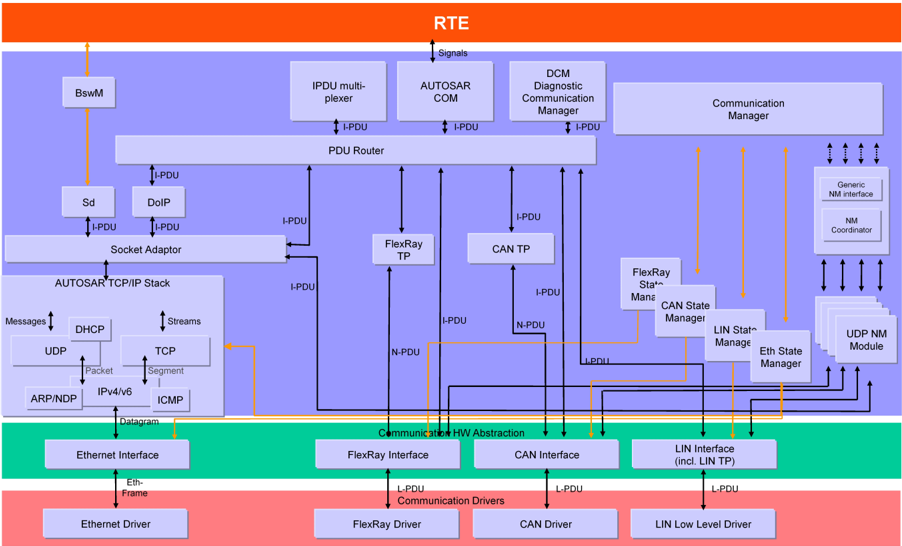

## 2. 缩略语

以下术语表包含与**SoAd**模块相关、且未包含在AUTOSAR术语表[1]中的缩略语和缩写。

**ARP**

> 地址解析协议（**Address Resolution Protocol**）

**DEM**

> 诊断事件管理器（**Diagnostic Event Manager**）

**DET**

> 默认错误跟踪器（**Default Error Tracer**）

**DHCPv4**

> 动态主机配置协议（**Dynamic Host Configuration Protocol**）

**DHCPv6**

> 面向互联网协议版本6的动态主机配置协议（**Dynamic Host Configuration Protocol for Internet Protocol Version 6**）

**DoIP**

> 基于IP的诊断（**Diagnostics over IP**）

**HTTP**

> 超文本传输协议（**HyperText Transfer Protocol**）

**IANA**

> 互联网号码分配局（**Internet Assigned Numbers Authority**）

**ICMPv4**

> 互联网控制消息协议（**Internet Control Message Protocol**）

**ICMPv6**

> 面向互联网协议版本6的互联网控制消息协议（**Internet Control Message Protocol for Internet Protocol Version 6**）

**IETF**

> 互联网工程任务组（**Internet Engineering Task Force**）

**IP**

> 互联网协议（**Internet Protocol**）

**IPv4**

> 互联网协议版本4（**Internet Protocol version 4**）

**IPv6**

> 互联网协议版本6（**Internet Protocol version 6**）

**NDP**

> 邻居发现协议（**Neighbor Discovery Protocol**）

**Sd**

> 服务发现（**Service Discovery**）

**TCP**

> 传输控制协议（**Transmission Control Protocol**）

**TCP/IP**

> 计算机网络中使用的一族通信协议（**A family of communication protocols used in computer networks**）

**TLS**

> 传输层安全（**Transport Layer Security**）

**TP**

> 传输协议（**Transport Protocol**）

**UDP**

> 用户数据报协议（**User Datagram Protocol**）

**UdpNm**

> AUTOSAR UDP网络管理（**AUTOSAR UDP Network Management**）

**AUTOSAR Connector**

> **SoAd**在不同的PDU源/提供者与TCP/IP协议栈之间、以及TCP/IP协议栈与不同的PDU汇/消费者之间充当（解）复用器（**(De)Multiplexer**）。术语AUTOSAR连接器（**AUTOSAR connector**）指一个PDU的源/提供者或汇/消费者。

**TCP socket connection**

> 使用TCP作为传输协议的套接字连接（选择容器**SoAdSocketProtocol**包含**SoAdSocketTcp**子容器）。

**UDP socket connection**

> 使用UDP作为传输协议的套接字连接（选择容器**SoAdSocketProtocol**包含**SoAdSocketUdp**子容器）。

**IF-PDU**

> IF-PDU是通过**SoAd**的IF-API发送/接收的PDU。

**TP-PDU**

> TP-PDU是通过**SoAd**的TP-API发送/接收的PDU。

## 3. 相关文档

### 3.1. 输入文件和相关标准与规范

- [1] Glossary AUTOSAR\_FO\_TR\_Glossary
- [2] General Specification of Basic Software Modules AUTOSAR\_CP\_SWS\_BSWGeneral
- [3] SOME/IP Protocol Specification AUTOSAR\_FO\_PRS\_SOMEIPProtocol
- [4] Specification of PDU Router AUTOSAR\_CP\_SWS\_PDURouter
- [5] Specification of UDP Network Management AUTOSAR\_CP\_SWS\_UDPNetworkManagement
- [6] Specification of Module XCP AUTOSAR\_CP\_SWS\_XCP
- [7] Specification of Service Discovery AUTOSAR\_CP\_SWS\_ServiceDiscovery
- [8] Specification of Diagnostic over IP AUTOSAR\_CP\_SWS\_DiagnosticOverIP
- [9] The Dynamic Host Configuration Protocol (DHCP) Client Fully Qualified Domain Name (FQDN) Option https://rfc-editor.org/rfc/rfc4702.txt
- [10] The Dynamic Host Configuration Protocol for IPv6 (DHCPv6) Client Fully Qualified Domain Name (FQDN) Option https://rfc-editor.org/rfc/rfc4704.txt

### 3.2. 相关规范

AUTOSAR为基础软件模块提供了一份通用规范（**General Specification on Basic Software modules**）[2, SWS BSW General]，该规范同样对Socket Adaptor有效。

因此，SWS BSW General规范应被视为Socket Adaptor的附加且必需的规范。

## 4. 约束和假设

### 4.1. 限制

在以太网上使用TCP/IP传输数据需要大约60字节的报头信息（**header information**）。这意味着对于小消息，头开销可能达到一个无法接受的高百分比。

为了避免进一步的协议开销，这里描述了对每个PDU使用单个套接字连接。然而，这种解决方案是非常耗费资源的，特别是在要传输许多小型PDU的情况下。这里描述的一种解决方案是添加一个包含ID和长度信息的小PDU头（**PDU header**）。这样可以通过一个套接字连接来传输多个PDU。此外，AUTOSAR规范还包括一个资源保护方案作为一个可选项。

AUTOSAR规范不涉及**UDP**或**TCP**端口号（**Port numbers**）的分配。**IANA**分配的号码范围内没有预留空间。每个实现者负责管理使用的端口号。

AUTOSAR规范也不涉及IP地址的管理。这可以是动态的，例如使用**DHCP**，也可以是静态的。它是实现者的责任，以防止地址冲突和实现符合IANA地址分配。

本规范不规定特定的物理层或数据速率。

SOME/IP协议规范[3]规定在检查服务ID（**Service ID**）和方法ID（**Method ID**）有效性之前，应先检查协议版本（**Protocol Version**）。SoAd不检查协议版本。无论未来版本如何，它始终将前4个字节解释为消息ID（本文档中的报文头ID（**header ID**）），将后4个字节解释为载荷长度（**payload length**）。

SOME/IP协议规范[3]规定在检查方法ID有效性之前，应先检查接口版本（**Interface Version**）。SoAd不检查接口版本。SoAd在专用的路由路径上，独立于所包含的接口版本，执行到已配置消息ID的路由。

SOME/IP协议规范[3]规定检查服务ID和方法ID是否有效。无效的ID应以相应的错误码响应。

SoAd会检查SOME/IP消息ID（本文档中的报文头ID），该ID是服务ID和方法ID的组合。如果该ID无效，模块无法以相应的错误码响应，而是引发运行时错误[SOAD_E_INV_PDUHEADER_ID](#6132-运行时错误)。

SOME/IP协议规范[3]通过PRS_SOMEIP_00535规定所有传输协议绑定（**Transport Protocol Bindings**）应支持在一个传输层PDU中传输多个SOME/IP消息。对于TCP，该要求超出SoAd的范围，因为消息的打包以及通过TCP流的传输不受SoAd的影响。对于UDP，SOME/IP消息的收集仅限于IF API。根据SWS_SoAd_00553，SOME/IP消息将通过TP API从上层获取，并立即通过UDP发送。在这种情况下，不打算也不支持消息打包。

### 4.2. 汽车域的适用性

无限制。

## 5. 对其他模块的依赖

本节概述了SoAd与相关AUTOSAR基础软件模块之间的关系。它简要描述了SoAd需要其他模块提供的服务，以及其他模块如何调用SoAd。

### 5.1. AUTOSAR TCP/IP协议栈

TcpIp模块实现了TCP/IP协议族中的主要协议（TCP、UDP、TLS、IPv4、ARP、ICMP、DHCP、IPv6、NDP、ICMPv6、DHCPv6），并通过以太网提供了基于套接字的动态通信。SoAd模块是TcpIp模块可能的上层模块之一。

### 5.2. 通用上层

**SoAd**模块提供了通用的上层支持，即SoAd向任何符合SoAd通用上层API/配置的上层提供服务。SoAd的每个上层可以指定它想要使用的服务类型。

在AUTOSAR体系结构中，已经定义了许多**SoAd**上层模块。以下列表指定了这些模块，并提供了所使用的SoAd服务的大致描述：

* **PduR**（PDU Router）[4]：IF-PDU和TP-PDU API
* **UdpNm**（UDP Network Management）[5]：IF-PDU API
* **Xcp**（XCP on Ethernet）[6]：IF-PDU API
* **Sd**（Service Discovery）[7]：IF-PDU API、控制API（第7.3.4节）
* **DoIP**（Diagnostics over IP）[8]：IF-PDU和TP-PDU API、控制API（第7.3.4节）

### 5.3. 文件结构

#### 5.3.1. 代码文件结构

详情请参阅SWS\_BSWGeneral [2]中第5.1.6章"代码文件结构"（**Code file structure**）。

### 5.4. 版本检查

详情请参阅SWS\_BSWGeneral [2]中第5.1.8章"版本检查"（**Version Check**）。

## 6. 功能规格

**SoAd**通过TCP/IP网络实现基于PDU（**PDU-Based**）的通信。因此，**AUTOSAR I-PDU**被映射到由SoAd配置和维护的套接字连接（**socket connections**）。当多个I-PDU使用套接字连接时，可以在每个I-PDU的前面添加一个SoAd PDU头（**SoAd PDU Header**）。消息接受策略（**message acceptance policy**）用来定义接受远程节点（**remote nodes**）的哪些TCP连接和UDP数据报文。套接字连接可以通过来自上层的请求自动或手动打开。同时也为套接字连接的断开和恢复定义了相应的策略。SoAd的上层可以使用IF-API和TP-API来进行PDU的传输和接收。为了有选择地使能/禁止来自或去往套接字连接的PDU路由，定义了PDU路由组（**PDU routing groups**），并可由SoAd的上层控制。一个IF-PDU也可以转发给多个套接字连接，或者从一个套接字连接接收到的消息可以作为不同的IF-PDU转发给相同或不同的SoAd上层（**PDU Fan-out**）。

**注意：** SoAd模块不提供任何方法来调整PDU中的位或字节顺序（**Endianness**）。

### 6.1. 套接字连接（Socket Connections）

TCP/IP通信是基于Internet套接字（**Internet socket**）的。Internet套接字是通信链路的端点（**endpoint**），由IP地址和端口组成的元组标识。根据传输协议，套接字可分为通过用户数据报协议（**User Datagram Protocol**，UDP）进行无连接通信的UDP套接字，以及通过传输控制协议（**Transmission Control Protocol**，TCP）进行面向连接的通信的TCP套接字。TCP基于点对点（**point-to-point**）的通信关系。广播或多播在TCP中是不可能的。TCP要求一方建立连接，另一方接受传入的请求。两个站（**stations**）之间可以建立多个连接，每个连接将由不同的套接字处理，且至少需要在一个所使用的端口号上不同。在TCP中，所有从源发送到接收器的消息都被认为是一个保持顺序的连续字节流。一种确认方案用于保证跨越所有消息的字节顺序。如果接收器在一定时间内没有确认接收，则消息由源重传。TCP保证了数据的完整性（通过校验和）、字节顺序和完整性。

为了抽象TCP/IP通信，SoAd定义了套接字连接。SoAd套接字连接定义了本地套接字（即本地地址标识符和本地端口）与远程套接字（即远程IP地址和端口）之间的连接，以及连接参数，如传输协议、SoAd PDU头的使用、缓冲需求、连接建立、传输协议相关参数等。每个套接字连接可以由一个唯一的标识符（**SoConId**）来标识。为了在每个本地套接字上同时支持多个通信伙伴，可以将具有相同连接参数的套接字连接分组为套接字连接分组（**socket connection groups**）。

SoAd应在被调用[**SoAd_OpenSoCon**](#7342-soad_opensocon)()和[**SoAd_CloseSoCon**](#7343-soad_closesocon)()时分别存储一个打开或关闭套接字连接的请求，但仅在[**SoAd_MainFunction**](#752-soad_mainfunction)()中根据连接建立和关闭策略来处理该请求。

SoAd应在以下情况下锁定远程地址：

1. 不处于**SOAD_SOCON_OFFLINE**状态的TCP套接字连接；
2. 激活中的接收；
3. 挂起的TP-PDU接收；
4. 激活中的传输；
5. nPdu特性的挂起传输；
6. 通过[**SoAd_IfRoutingGroupTransmit**](#7322-soad_ifroutinggrouptransmit)()或[**SoAd_IfSpecificRoutingGroupTransmit**](#7323-soad_ifspecificroutinggrouptransmit)()发起的挂起传输。

被锁定的远程地址不能被上层修改。

#### 6.1.1. 套接字连接打开

在[**SoAd_MainFunction**](#752-soad_mainfunction)()中，SoAd应尝试打开每个满足以下所有条件的套接字连接：

1. 没有分配TcpIp套接字；
2. 打开请求要么（a）由先前尚未被随后的[**SoAd_CloseSoCon**](#7343-soad_closesocon)()调用撤销的[**SoAd_OpenSoCon**](#7342-soad_opensocon)()调用显式发出，要么（b）在**SoAdSocketAutomaticSoConSetup**为**TRUE**时隐式发出；
3. 已设置远程地址（**remote address is set**），由配置指定或通过[**SoAd_SetRemoteAddr**](#73414-soad_setremoteaddr)()函数设置；
4. 已分配本地IP地址（**local IP address is assigned**），即[**SoAd_LocalIpAddrAssignmentChg**](#747-soad_localipaddrassignmentchg)()已被调用，相关**LocalAddrId**的状态为**TCPIP_IPADDR_STATE_ASSIGNED**。

SoAd应在[**SoAd_MainFunction**](#752-soad_mainfunction)()中执行以下操作，以打开属于仅包含单个套接字连接的套接字连接分组的UDP套接字连接（即套接字连接分组配置容器中只有一个套接字连接），或**SoAdSocketTcpInitiate**设置为**TRUE**的TCP套接字连接：

1. 通过调用**TcpIp_SoAdGetSocket**()从TcpIp获取合适的套接字，其中**TcpIp_DomainType**由**SoAdSocketLocalAddressRef**隐式指定，协议类型由[**SoAdSocketProtocol**](#928-soadsocketprotocol)指定；
2. 根据SWS_SoAd_00689更改套接字特定参数；
3. 通过调用**TcpIp_Bind**()将套接字绑定到本地地址和端口，本地地址标识符由**SoAdSocketLocalAddressRef**指定，本地端口由**SoAdSocketLocalPort**指定；
4. 对于TCP套接字，通过调用**TcpIp_TcpConnect**()发起TCP连接。

如果该套接字连接的**SoAdSocketTcpAutoConnectTimeout**被配置为大于0的值，SoAd应仅在**SoAdSocketTcpAutoConnectTimeout**指定的时间内重复执行上述第（4）条中所述的调用。

如果该套接字连接的**SoAdSocketTcpAutoConnectTimeout**已经超时，而套接字连接尚未进入**SOAD_SOCON_ONLINE**状态，则：

1. 应引发运行时错误[**SOAD_E_TCP_AUTOCONNECT_FAILED**](#6132-运行时错误)；
2. 该套接字连接应关闭相关的TcpIp套接字；
3. 该套接字连接应进入**SOAD_SOCON_OFFLINE**状态；
4. 该套接字连接应保持**SOAD_SOCON_OFFLINE**状态。

**注意：** **SoAdSocketTcpAutoConnectTimeout**已超时的套接字连接将变为非活动状态，直到模块复位。

SoAd应在[**SoAd_MainFunction**](#752-soad_mainfunction)()中执行以下操作，以打开**SoAdSocketTcpInitiate**设置为**FALSE**的TCP套接字连接：

1. 在没有监听套接字（**Listen-Socket**）分配给该套接字连接的情况下：
   1. 通过调用**TcpIp_SoAdGetSocket**()从TcpIp获取合适的套接字，其中**TcpIp_DomainType**由**SoAdSocketLocalAddressRef**隐式指定，协议类型由[**SoAdSocketProtocol**](#928-soadsocketprotocol)指定；
   2. 根据SWS_SoAd_00689更改套接字特定参数；
   3. 通过调用**TcpIp_Bind**()将套接字绑定到本地地址和端口，本地地址标识符由**SoAdSocketLocalAddressRef**指定，本地端口由**SoAdSocketLocalPort**指定；
   4. 将监听套接字分配给套接字连接分组；
   5. 激活套接字连接以接受来自远程节点的连接；
   6. 通过调用**TcpIp_TcpListen**()在监听套接字上监听远程连接请求，**MaxChannels**设置为属于该TCP套接字连接分组的套接字连接的数量。
2. 在监听套接字已分配给该套接字连接的情况下：
   1. 激活套接字连接以接受来自远程节点的连接。

**注意：** TCP套接字连接分组中（且**SoAdSocketTcpInitiate**设置为**FALSE**）的所有套接字连接共享一个TcpIp套接字用于接收传入的连接请求（"监听套接字"），但在连接建立后，各自使用由TcpIp模块创建并通过[**SoAd_TcpAccepted**](#744-soad_tcpaccepted)()提供的单独TcpIp套接字。

SoAd应在[**SoAd_MainFunction**](#752-soad_mainfunction)()中执行以下操作，以打开属于包含多个套接字连接的套接字连接分组的UDP套接字连接（即套接字连接分组配置容器中有多个套接字连接）：

1. 在没有UDP套接字分配给该套接字连接分组的情况下：
   1. 通过调用**TcpIp_SoAdGetSocket**()从TcpIp获取合适的套接字，域类型由**SoAdSocketLocalAddressRef**隐式指定，协议类型由[**SoAdSocketProtocol**](#928-soadsocketprotocol)指定；
   2. 根据SWS_SoAd_00689更改套接字特定参数；
   3. 通过调用**TcpIp_Bind**()将套接字绑定到本地地址和端口，本地地址标识符由**SoAdSocketLocalAddressRef**指定，本地端口由**SoAdSocketLocalPort**指定；
   4. 将UDP套接字分配给套接字连接分组；
   5. 激活套接字连接，使其通过套接字连接分组的共享UDP套接字进行通信。
2. 在UDP套接字已分配给该套接字连接分组的情况下：
   1. 激活套接字连接，使其通过套接字连接分组的共享UDP套接字进行通信。

**注意：** UDP套接字连接分组中的所有套接字连接共享同一个TcpIp套接字。

作为分配新套接字的一部分，如需更改套接字相关参数，SoAd应按照相关套接字连接的配置，为每个相关条款调用**TcpIp_ChangeParameter**()并传入**ParameterId**和**ParameterValue**，具体如下：

1. 对于TCP套接字：**TCPIP_PARAMID_TCP_RXWND_MAX**和**SoAdSocketTpRxBufferMin**指定的值（如果可选参数已启用）；
2. **TCPIP_PARAMID_FRAMEPRIO**和**SoAdSocketFramePriority**指定的值（如果可选参数已启用）；
3. 对于TCP套接字：**TCPIP_PARAMID_TCP_NAGLE**，如果相关可选参数**SoAdSocketTcpNoDelay**设置为**FALSE**则值为0x01，如果该参数设置为**TRUE**则值为0x00；
4. 对于TCP套接字：**TCPIP_PARAMID_TCP_KEEPALIVE**和**SoAdSocketTcpKeepAlive**指定的值；
5. 对于TCP套接字：**TCPIP_PARAMID_TCP_KEEPALIVE_TIME**和**SoAdSocketTcpKeepAliveTime**指定的值（如果可选参数已启用）；
6. 对于TCP套接字：**TCPIP_PARAMID_TCP_KEEPALIVE_PROBES_MAX**和**SoAdSocketTcpKeepAliveProbesMax**指定的值（如果可选参数已启用）；
7. 对于TCP套接字：**TCPIP_PARAMID_TCP_KEEPALIVE_INTERVAL**和**SoAdSocketTcpKeepAliveInterval**指定的值（如果可选参数已启用）；
8. 对于TCP套接字：**TCPIP_PARAMID_TCP_OPTIONFILTER**和**SoAdSocketTCPOptionFilterRef**引用的**TcpIpTcpConfigOption**中指定的**TcpIpTcpConfigOptionFilterId**的值（如果可选参数已启用）；
9. **TCPIP_PARAMID_PATHMTU_ENABLE**和**SoAdSocketPathMTUEnable**指定的值（如果可选参数已启用）；
10. **TCPIP_PARAMID_FLOWLABEL**和**SoAdSocketFlowLabel**指定的值（如果可选参数已启用）；
11. **TCPIP_PARAMID_DSCP**和**SoAdSocketDifferentiatedServicesField**指定的值（如果可选参数已启用）；
12. 对于UDP套接字：**TCPIP_PARAMID_UDP_CHECKSUM**和**SoAdSocketUdpChecksumEnabled**的值；
13. 对于TCP套接字：如果定义了**SoAdSocketTcpTlsConnectionRef**，则应以参数ID **TCPIP_PARAMID_TLS_CONNECTION_ASSIGNMENT**调用该函数，并以该引用的值作为参数值，为该套接字分配TLS连接；
14. 对于TCP套接字：**TCPIP_PARAMID_TCP_RETRANSMIT_TIMEOUT**和**SoAdSocketTcpRetransmissionTimeout**指定的值（如果可选参数已启用）。如果**SoAdSocketTcpRetransmissionTimeout**配置为**INF**，SoAd应使用TcpIp模块中表示**INF**的相应值。

在[**SoAd_MainFunction**](#752-soad_mainfunction)()中成功执行打开操作后，对于UDP套接字，如果**SoAdSocketUdpListenOnly**设置为**TRUE**或远程地址被设置为不包含任何通配符的值，SoAd应将套接字连接的状态更改为**SOAD_SOCON_ONLINE**。

在[**SoAd_MainFunction**](#752-soad_mainfunction)()中成功执行打开操作后，对于以下情况，SoAd应将套接字连接的状态更改为**SOAD_SOCON_RECONNECT**：

1. TCP套接字连接；或
2. 配置了包含通配符的远程地址的UDP套接字连接。

在[**SoAd_RxIndication**](#741-soad_rxindication)()中，在分析或转发任何消息数据之前，SoAd应（a）用接收到的消息的相关源地址部分覆写以通配符指定的远程地址部分（例如远程IP地址设置为**TCPIP_IPADDR_ANY**），并且（b）在以下所有条件都为真时，将套接字连接的状态更改为**SOAD_SOCON_ONLINE**：

1. 当前连接状态不是**SOAD_SOCON_ONLINE**；
2. UDP套接字；
3. **SoAdSocketUdpListenOnly**设置为**FALSE**；
4. **SoAdSocketMsgAcceptanceFilterEnabled**设置为**TRUE**；
5. 已设置远程地址，但包含通配符；
6. 接收到的消息根据消息接受策略被接受。

在[**SoAd_TcpConnected**](#745-soad_tcpconnected)()中，如果以下所有条件都为真，SoAd应将套接字连接的状态更改为**SOAD_SOCON_ONLINE**：

1. 当前连接状态不是**SOAD_SOCON_ONLINE**；
2. TCP套接字；
3. **SoAdSocketTcpInitiate**设置为**TRUE**。

在[**SoAd_TcpAccepted**](#744-soad_tcpaccepted)()中，如果与**SocketId**相关的TCP [**SoAdSocketConnectionGroup**](#926-soadsocketconnectiongroup)的**SoAdSocketTcpInitiate**设置为**FALSE**，SoAd应执行以下操作：

1. 使用最佳匹配算法（见SWS_SoAd_00680）选择一个套接字连接，然后继续处理所选的套接字连接，或者如果找不到匹配项，则跳过进一步处理并返回**E_NOT_OK**；
2. 如果为套接字连接设置的远程地址包含通配符，则用接收到的消息的相关源地址部分覆写以通配符指定的远程地址部分（例如远程IP地址设置为**TCPIP_IPADDR_ANY**）；
3. 将用于已建立连接的TcpIp套接字（作为参数**SocketIdConnected**提供）分配给所选的套接字连接；
4. 将该套接字连接的状态更改为**SOAD_SOCON_ONLINE**并返回**E_OK**。

在[**SoAd_TcpAccepted**](#744-soad_tcpaccepted)()中，如果与**SocketId**相关的TCP [**SoAdSocketConnectionGroup**](#926-soadsocketconnectiongroup)的**SoAdSocketTcpInitiate**和**SoAdSocketMsgAcceptanceFilterEnabled**都设置为**FALSE**，且不在线（即当前连接状态不是**SOAD_SOCON_ONLINE**），SoAd应：

1. 将用于已建立连接的TcpIp套接字（作为参数**SocketIdConnected**提供）分配给该套接字连接；
2. 将该套接字连接的状态更改为**SOAD_SOCON_ONLINE**并返回**E_OK**。

对于PDU头模式被禁用（**SoAdPduHeaderEnable** = **FALSE**）且上层使用TP-API的套接字连接，SoAd应在连接建立结束时调用&lt;Up&gt;_[SoAd][Tp]StartOfReception()，**TpSduLength**为0。

#### 6.1.2. 套接字连接关闭

在[**SoAd_MainFunction**](#752-soad_mainfunction)()中，SoAd应关闭每个满足以下所有条件的套接字连接：

1. 当前连接状态不是**SOAD_SOCON_OFFLINE**；
2. 由先前的[**SoAd_CloseSoCon**](#7343-soad_closesocon)()调用显式请求关闭；
3. 在[**SoAd_CloseSoCon**](#7343-soad_closesocon)()调用时没有上层请求保持该套接字连接打开（即[**SoAd_CloseSoCon**](#7343-soad_closesocon)()被调用的次数与[**SoAd_OpenSoCon**](#7342-soad_opensocon)()相同），或者[**SoAd_CloseSoCon**](#7343-soad_closesocon)()调用时**abort**参数设置为**TRUE**。

SoAd应在[**SoAd_MainFunction**](#752-soad_mainfunction)()中执行以下操作来关闭套接字连接：

1. 终止激活的TP会话（如有）并向上层通知该终止；
2. 对该套接字连接禁用进一步的传输或接收，即新的传输请求应以**E_NOT_OK**拒绝，接收到的消息将被直接丢弃；
3. 关闭相关的TcpIp套接字；
4. 如果套接字连接的关闭源于[**SoAd_CloseSoCon**](#7343-soad_closesocon)()请求，则将该套接字连接的状态更改为**SOAD_SOCON_OFFLINE**，否则更改为**SOAD_SOCON_RECONNECT**。

为了在[**SoAd_MainFunction**](#752-soad_mainfunction)()中关闭套接字连接时向上层通知激活的TP传输的终止，SoAd应调用&lt;Up&gt;_[SoAd][Tp]TxConfirmation()，其**result**参数设置为：

1. 如果断开由[**SoAd_CloseSoCon**](#7343-soad_closesocon)()引起且所有数据已正确传输，则为**E_OK**；
2. 其他任何原因则为**E_NOT_OK**。

为了在[**SoAd_MainFunction**](#752-soad_mainfunction)()中关闭套接字连接时向上层通知激活的TP接收的终止，SoAd应调用&lt;Up&gt;_[SoAd][Tp]RxIndication()，其**result**参数设置为：

1. 如果断开由[**SoAd_CloseSoCon**](#7343-soad_closesocon)()引起且所有接收到的数据已正确传递给上层，则为**E_OK**；
2. 其他任何原因则为**E_NOT_OK**。

为了在[**SoAd_MainFunction**](#752-soad_mainfunction)()中关闭套接字连接时关闭相关的TcpIp套接字，SoAd应执行以下操作：

1. 对于TCP套接字连接：
   1. 通过调用**TcpIp_Close**()关闭相关套接字，**abort**参数设置为与[**SoAd_CloseSoCon**](#7343-soad_closesocon)()提供的相同值；如果不是由[**SoAd_CloseSoCon**](#7343-soad_closesocon)()发起的关闭，则设置为**FALSE**；
   2. 如果TCP套接字连接分组中的所有套接字连接都已通过[**SoAd_CloseSoCon**](#7343-soad_closesocon)()关闭：通过调用**TcpIp_Close**()关闭相关的监听套接字，**abort**参数设置为与[**SoAd_CloseSoCon**](#7343-soad_closesocon)()提供的相同值；如果不是由[**SoAd_CloseSoCon**](#7343-soad_closesocon)()发起的关闭，则设置为**FALSE**。
2. 对于UDP套接字连接：
   1. 如果该套接字连接不属于任何套接字连接分组（即套接字连接分组配置容器中只有一个套接字连接）：通过调用**TcpIp_Close**()关闭相关套接字，**abort**参数设置为与[**SoAd_CloseSoCon**](#7343-soad_closesocon)()提供的相同值；如果不是由[**SoAd_CloseSoCon**](#7343-soad_closesocon)()发起的关闭，则设置为**FALSE**；
   2. 如果UDP套接字连接分组中的所有套接字连接都已通过[**SoAd_CloseSoCon**](#7343-soad_closesocon)()关闭：通过调用**TcpIp_Close**()关闭相关的UDP套接字，**abort**参数设置为与[**SoAd_CloseSoCon**](#7343-soad_closesocon)()提供的相同值；如果不是由[**SoAd_CloseSoCon**](#7343-soad_closesocon)()发起的关闭，则设置为**FALSE**。

在[**SoAd_TcpIpEvent**](#746-soad_tcpipevent)()中，当**Event**设置为**TCPIP_UDP_CLOSED**时，SoAd应：

1. 从相关的UDP套接字连接分组中移除**SocketId**标识的TcpIp套接字的分配；
2. 关闭相关套接字连接分组中处于**SOAD_SOCON_ONLINE**状态的所有套接字连接（即执行规定的关闭操作，但不包括关闭相关的TcpIp套接字）。

在[**SoAd_TcpIpEvent**](#746-soad_tcpipevent)()中，当**Event**为监听套接字的**TCPIP_TCP_CLOSED**时，SoAd应从相关的TCP套接字连接分组中移除**SocketId**标识的TcpIp套接字的分配。

在[**SoAd_TcpIpEvent**](#746-soad_tcpipevent)()中，当**Event**设置为**TCPIP_TCP_CLOSED**或**TCPIP_TCP_RESET**时，SoAd应：

1. 从相关的套接字连接中移除**SocketId**标识的TcpIp套接字的分配；
2. 如果该套接字连接处于**SOAD_SOCON_ONLINE**状态，则关闭它（即执行规定的关闭操作，但不包括关闭相关的TcpIp套接字）。

如果[**SoAd_TcpIpEvent**](#746-soad_tcpipevent)()被调用且**Event**设置为**TCPIP_TCP_FIN_RECEIVED**，SoAd应按照套接字连接关闭的规定执行关闭操作。SoAd应通过调用**TcpIp_Close**()关闭相关套接字，**abort**参数设置为**FALSE**。

#### 6.1.3. 套接字连接打开/关闭序列说明

第[6.1.1](#611-套接字连接打开)节和第[6.1.2](#612-套接字连接关闭)节中描述的需求应产生以下预期行为：

**场景1（Scenario 1）：**

1. 打开（Open）
2. 主函数 - ONLINE（Main - ONLINE）
3. 关闭（Close）
4. 打开（Open）
5. 主函数 - OFFLINE（Main - OFFLINE）
6. 主函数 - ONLINE（Main - ONLINE）

说明：打开请求（4）将在关闭请求（3）被执行之后执行。

依据（Rational）：为了清晰地分离两个通信会话，关闭必须优先于打开，即打开请求（4）不应撤销关闭请求（3）。

**场景2（Scenario 2）：**

1. 打开（Open）
2. 主函数 - ONLINE（Main - ONLINE）
3. 关闭（Close）
4. 打开（Open）
5. 关闭（Close）
6. 打开（Open）
7. 关闭（Close）
8. 主函数 - OFFLINE（Main - OFFLINE）
9. 主函数，无变化（Main, no change）

说明：关闭请求（5）撤销打开请求（4），（7）撤销（6）。

依据（Rational）：由于上层在其激活之前已将其撤销，因此不需要该通信会话。

#### 6.1.4. 通知

每当套接字连接状态发生变化时，如果该套接字连接的**SoAdSocketSoConModeChgNotification**设置为**TRUE**，SoAd应通过配置的上层通知函数&lt;Up&gt;_SoConModeChg()以及新状态向上层通知该套接字连接的状态变化。

每当套接字连接状态发生变化时，如果为该套接字连接设置了可选引用**SoAdSocketSoConModeChgNotifUpperLayerRef**，SoAd应通过配置的上层通知函数&lt;Up&gt;_SoConModeChg()以及新状态向该引用指定的上层通知该套接字连接的状态变化。

每当与套接字连接相关的IP地址分配发生变化时，如果该套接字连接的**SoAdSocketIpAddrAssignmentChgNotification**设置为**TRUE**，SoAd应通过配置的上层通知函数&lt;Up&gt;_LocalIpAddrAssignmentChg()以及新的地址状态向上层通知该IP地址分配的变化。

每当套接字连接状态发生变化时，如果该套接字连接的**SoAdSocketSoConModeChgBswMNotification**设置为**TRUE**，SoAd应通过通知函数**BswM_SoAd_SoConModeChg**()以及新状态向**BswM**通知该套接字连接的状态变化。

每当与套接字连接相关的IP地址分配发生变化时，如果为该套接字连接设置了可选引用**SoAdSocketIpAddrAssignmentChgNotifUpperLayerRef**，SoAd应通过配置的上层通知函数&lt;Up&gt;_LocalIpAddrAssignmentChg()以及新的地址状态向该引用指定的上层通知该IP地址分配的变化。

#### 6.1.5. 连接状态

如果[**SoAd_IsConnectionReady**](#73421-soad_isconnectionready)()被调用且所引用的套接字连接没有分配套接字，SoAd应返回**TCPIP_E_NOT_OK**。

如果[**SoAd_IsConnectionReady**](#73421-soad_isconnectionready)()被调用且所引用的套接字连接已分配套接字，SoAd应调用**TcpIp_IsConnectionReady**()为相应的套接字传递**RemoteAddrPtr**。**TcpIp_IsConnectionReady**()的返回值应转发给调用者。

### 6.2. PDU传输

为了通过UDP或TCP套接字传输上层模块的PDU，SoAd配置指定了一条链接到套接字连接的PDU路由。PDU路由（[**SoAdPduRoute**](#9214-soadpduroute)、[**SoAdPduRouteDest**](#9215-soadpduroutedest)）描述了从SoAd的上层模块到TcpIp协议栈中相关套接字的路由，该套接字由套接字连接（[**SoAdSocketConnection**](#927-soadsocketconnection)、[**SoAdSocketConnectionGroup**](#926-soadsocketconnectiongroup)）描述。

SoAd的上层模块可以分别使用接口（**Interface**，IF）API或传输协议（**Transport Protocol**，TP）API进行传输请求和数据提供。

#### 6.2.1. 通过IF-API传输PDU

对于使用IF-API的上层PDU传输请求，SoAd应：

1. 使用[**SoAd_IfTransmit**](#7321-soad_iftransmit)()提供的**TxPduId**来识别相关的套接字连接和PDU路由；
2. 如果PDU长度大于0或**SoAdPduHeaderEnable**为**TRUE**，则根据连接类型调用相关的TcpIp传输函数，否则SoAd应跳过进一步处理并返回**E_NOT_OK**。

如果启用了开发错误检测：对于引用了配置有**SOCKET_CONNECTION_ID_16**类型**MetaDataItem**的全局PDU结构的[**SoAdPduRoute**](#9214-soadpduroute)的传输请求，且其中包含的[**SoAdPduRouteDest**](#9215-soadpduroutedest)引用了一个套接字连接分组，如果由**PduInfoType.MetaDataPtr**标识的套接字连接不属于相关[**SoAdPduRouteDest**](#9215-soadpduroutedest)的套接字连接分组，SoAd应引发开发错误[**SOAD_E_INV_METADATA**](#6131-开发错误)。

对于引用了配置有**SOCKET_CONNECTION_ID_16**类型**MetaDataItem**的全局PDU结构的[**SoAdPduRoute**](#9214-soadpduroute)的传输请求，且其中包含的[**SoAdPduRouteDest**](#9215-soadpduroutedest)引用了一个套接字连接分组，SoAd应仅在由**PduInfoType.MetaDataPtr**标识的套接字连接上执行传输，而不是对整个分组执行传输。

对于UDP套接字连接，SoAd应（如无特别规定）调用**TcpIp_UdpTransmit**()，其中**SocketId**和远程地址使用套接字连接中指定的，PDU长度使用[**SoAd_IfTransmit**](#7321-soad_iftransmit)()调用中指定的作为**TotalLength**。

对于TCP套接字连接，SoAd应调用**TcpIp_TcpTransmit**()，其中**SocketId**使用套接字连接中指定的，PDU长度使用[**SoAd_IfTransmit**](#7321-soad_iftransmit)()调用中指定的作为**AvailableLength**，**ForceRetrieve**设置为**TRUE**。

**注意：** **TxPduId**在SoAd配置中标识一个[**SoAdPduRoute**](#9214-soadpduroute)，它包含一个或多个引用[**SoAdSocketConnection**](#927-soadsocketconnection)的[**SoAdPduRouteDest**](#9215-soadpduroutedest)容器。

TcpIp模块将在TcpIp传输调用的上下文中通过[**SoAd_CopyTxData**](#742-soad_copytxdata)()获取PDU数据，SoAd应将（所请求部分的）PDU复制到参数**BufPtr**指定的内存中。

如果[**SoAd_IfTransmit**](#7321-soad_iftransmit)()调用时**PduInfoPtr**-&gt;**SduDataPtr**设置为**NULL_PTR**，SoAd应使用&lt;Up&gt;_[SoAd][If]TriggerTransmit()从上层获取PDU数据。

对于UDP套接字连接，在最近一次**TcpIp_UdpTransmit**()调用成功返回后的下一个[**SoAd_MainFunction**](#752-soad_mainfunction)()中，SoAd应以**E_OK**作为结果调用上层的已配置传输确认函数（&lt;Up&gt;_[SoAd][If]TxConfirmation()）。

对于TCP套接字连接，在所有PDU数据（来自一个或多个传输请求）的传输被确认后，SoAd应在[**SoAd_TxConfirmation**](#743-soad_txconfirmation)()回调函数内以**E_OK**作为结果调用上层的已配置传输确认函数（&lt;Up&gt;_[SoAd][If]TxConfirmation()）。

**注意：** 即使对同一PDU存在多个传输请求，也只有一个确认。即，在TCP套接字连接上，如果一个PDU的上一个请求尚未完成时又请求了新的传输，则不会为最后一个请求提供单独的确认，而是仅为所有PDU数据提供一次最终确认。

#### 6.2.2. 通过IF-API和nPduUdpTxBuffer传输PDU

如果与套接字连接相关的任何PDU路由（[**SoAdPduRouteDest**](#9215-soadpduroutedest)）的**SoAdTxUdpTriggerMode**设置为**TRIGGER_NEVER**，且属于相关套接字连接的所有上层的**SoAdTxUpperLayerType**都设置为"IF"，SoAd应对该套接字连接使用nPdu特性。

如果对套接字连接使用nPdu特性，且当前PDU（[**SoAdPduRouteDest**](#9215-soadpduroutedest)）的**SoAdTxUdpTriggerMode**设置为**TRIGGER_NEVER**，SoAd应为该套接字连接存储该PDU（而不是调用**TcpIp_UdpTransmit**()）。

如果对套接字连接使用nPdu特性，且相关PDU参数**SoAdTxPduCollectionSemantics**设置为**SOAD_COLLECT_LAST_IS_BEST**，SoAd应只存储传输请求（[**SoAd_IfTransmit**](#7321-soad_iftransmit)()的**TxPduId**和**PduInfoPtr**-&gt;**SduLength**）而不是PDU数据。当SoAd需要提供PDU数据时，SoAd应通过调用&lt;Up&gt;_[SoAd][If]TriggerTransmit()从上层获取数据。

如果对套接字连接使用nPdu特性，相关PDU参数**SoAdTxPduCollectionSemantics**设置为**SOAD_COLLECT_LAST_IS_BEST**，且上层未在[**SoAd_CopyTxData**](#742-soad_copytxdata)()的上下文中通过&lt;Up&gt;_[SoAd][If]TriggerTransmit()提供先前根据SWS_SoAd_00747请求传输的全部数据，SoAd应中止传输并返回**BUFREQ_E_NOT_OK**。

如果对套接字连接使用nPdu特性，且当前PDU（[**SoAdPduRouteDest**](#9215-soadpduroutedest)）的**SoAdTxUdpTriggerMode**设置为**TRIGGER_ALWAYS**，且生成的PDU数据和报文头不超过**SoAdSocketnPduUdpTxBufferMin**，SoAd应通过调用**TcpIp_UdpTransmit**()传输为该套接字连接存储的所有PDU（如有）以及当前PDU。

如果对套接字连接使用nPdu特性，且当前PDU（[**SoAdPduRouteDest**](#9215-soadpduroutedest)）的**SoAdTxUdpTriggerMode**设置为**TRIGGER_ALWAYS**，而生成的PDU数据和报文头将超过**SoAdSocketnPduUdpTxBufferMin**，SoAd应首先通过调用**TcpIp_UdpTransmit**()传输为该套接字连接存储的所有PDU（如有），然后再次通过调用**TcpIp_UdpTransmit**()传输当前PDU。

如果对套接字连接使用nPdu特性，且当前PDU（[**SoAdPduRouteDest**](#9215-soadpduroutedest)）的**SoAdTxUdpTriggerMode**设置为**TRIGGER_NEVER**，而生成的PDU数据和报文头将超过**SoAdSocketnPduUdpTxBufferMin**，SoAd应首先通过调用**TcpIp_UdpTransmit**()传输为该套接字连接存储的所有PDU，然后为该套接字连接存储该PDU。

SoAd应保持通过使用nPdu特性的套接字连接传输的PDU的顺序。在发送侧先收集的PDU，在接收侧也应先被提取并指示给接收者。

如果对套接字连接使用nPdu特性，且所有PDU的**SoAdTxPduCollectionSemantics**都配置为**SOAD_COLLECT_QUEUED**，SoAd应单独存储所有PDU，包括具有相同PduId的PDU。

如果对套接字连接使用nPdu特性，且所有PDU的**SoAdTxPduCollectionSemantics**都配置为**SOAD_COLLECT_LAST_IS_BEST**，SoAd应只存储每个PDU的最后一个实例，并按其第一个实例被请求传输的顺序存储。

SoAd应拒绝将分配给一个套接字连接的PDU的传输属性（见**SoAdTxPduCollectionSemantics**）混合使用的配置。此外，套接字连接分组中的所有套接字连接应仅由具有**SOAD_COLLECT_LAST_IS_BEST**语义的PDU引用，或仅由具有**SOAD_COLLECT_QUEUED**语义的PDU引用。

SoAd应为每个使用nPdu特性的套接字连接维护一个nPdu专用定时器。

在[**SoAd_MainFunction**](#752-soad_mainfunction)()中，如果nPdu专用定时器超时，SoAd应通过调用**TcpIp_UdpTransmit**()传输为套接字连接存储的所有PDU（如有）。

如果一个**SoAdTxUdpTriggerMode**设置为**TRIGGER_NEVER**且带有特定**SoAdTxUdpTriggerTimeout**的PDU被缓冲，SoAd应在定时器未运行或其值低于当前nPdu专用定时器值时，将nPdu专用定时器设置为**SoAdTxUdpTriggerTimeout**的值。

如果一个**SoAdTxUdpTriggerMode**设置为**TRIGGER_NEVER**且不带特定**SoAdTxUdpTriggerTimeout**的PDU被缓冲，SoAd应在定时器未运行或其值低于当前nPdu专用定时器值时，将nPdu专用定时器设置为**SoAdSocketUdpTriggerTimeout**的值。

当为套接字连接存储的PDU已被发送时，SoAd应停止该nPdu专用定时器。

对于为使用nPdu特性的套接字连接存储的所有PDU，SoAd应在[**SoAd_MainFunction**](#752-soad_mainfunction)()的上下文中调用上层的相关传输确认函数（&lt;Up&gt;_[SoAd][If]TxConfirmation()），**result**设置为：

1. 如果相关的**TcpIp_UdpTransmit**()调用成功，则为**E_OK**；
2. 如果传输由于任何其他原因不成功或被取消，则为**E_NOT_OK**。

#### 6.2.3. 通过IfRoutingGroupTransmit API传输PDU

在[**SoAd_IfRoutingGroupTransmit**](#7322-soad_ifroutinggrouptransmit)()中，SoAd应为每个包含对由参数**id**标识的路由组的引用的[**SoAdPduRouteDest**](#9215-soadpduroutedest)存储一个触发传输请求，以便在[**SoAd_MainFunction**](#752-soad_mainfunction)()中传输。

在[**SoAd_IfSpecificRoutingGroupTransmit**](#7323-soad_ifspecificroutinggrouptransmit)()中，SoAd应为每个包含对由参数**id**标识的路由组的引用的[**SoAdPduRouteDest**](#9215-soadpduroutedest)存储一个触发传输请求，以便在[**SoAd_MainFunction**](#752-soad_mainfunction)()中在由参数**SoConId**标识的套接字连接上传输。

在[**SoAd_MainFunction**](#752-soad_mainfunction)()中，SoAd应检查[**SoAdPduRouteDest**](#9215-soadpduroutedest)的挂起触发传输请求，并识别所有相关的IF-PDU。对于每个被识别的IF-PDU，SoAd应按以下规定处理：

1. 通过调用&lt;Up&gt;_[SoAd][If]TriggerTransmit()从相关上层获取数据；
2. 通过相关的套接字连接传输该数据。

为了从上层触发PDU数据，SoAd应将**PduInfoType.SduDataPtr**设置为要复制数据的缓冲区位置，将**PduInfoType.SduDataLength**设置为该缓冲区的长度，然后调用&lt;Up&gt;_[SoAd][If]TriggerTransmit()。

#### 6.2.4. 通过TP-API传输PDU

对于使用TP-API的上层PDU传输请求，SoAd应：

1. 如果PDU长度为0，跳过进一步处理并返回**E_NOT_OK**；
2. 使用[**SoAd_TpTransmit**](#7324-soad_tptransmit)()提供的**TxPduId**来识别相关的套接字连接和PDU路由；
3. 存储TP传输请求，以便在[**SoAd_MainFunction**](#752-soad_mainfunction)()中进一步处理。

**注意：** **TxPduId**在SoAd配置中标识一个[**SoAdPduRoute**](#9214-soadpduroute)，它包含一个或多个引用[**SoAdSocketConnection**](#927-soadsocketconnection)的[**SoAdPduRouteDest**](#9215-soadpduroutedest)容器。

在[**SoAd_MainFunction**](#752-soad_mainfunction)()中，SoAd应检查挂起的TP传输请求，并按以下规定处理挂起的请求：

1. 通过以**PduInfoType.SduLength** = 0调用可配置回调函数&lt;Up&gt;_[SoAd][Tp]CopyTxData()，查询上层的可用数据量；
2. 根据连接类型：获取数据并调用相关的TcpIp传输函数。

对于UDP套接字连接，SoAd应：

1. 通过可配置回调函数&lt;Up&gt;_[SoAd][Tp]CopyTxData()（**PduInfoType.SduLength**设置为上次调用**availableDataPtr**返回的值），将所有可用数据从上层获取到SoAd TP传输缓冲区中；
2. 在一个或多个SoAd主函数执行周期内成功获取所有数据后，调用**TcpIp_UdpTransmit**()，其中**SocketId**和远程地址使用套接字连接中指定的，PDU长度使用[**SoAd_TpTransmit**](#7324-soad_tptransmit)()调用中指定的作为**TotalLength**。

**注意：** 套接字连接所需的TP缓冲区大小可以从相关TP PDU的长度推导得出。

如果对于UDP套接字连接&lt;Up&gt;_[SoAd][Tp]CopyTxData()返回**BUFREQ_E_NOT_OK**，SoAd应立即终止TP传输会话，并以**E_NOT_OK**作为结果通过已配置的传输确认函数&lt;Up&gt;_[SoAd][Tp]TxConfirmation()通知上层。（注意：在这种情况下，相关的套接字连接不会关闭。）

对于TCP套接字连接，SoAd应调用**TcpIp_TcpTransmit**()，其中**SocketId**使用套接字连接中指定的，PDU长度设置为上次调用&lt;Up&gt;_[SoAd][Tp]CopyTxData()返回的**availableDataPtr**值作为**AvailableLength**，**ForceRetrieve**设置为**FALSE**。

TcpIp模块将在TcpIp传输调用的上下文中通过[**SoAd_CopyTxData**](#742-soad_copytxdata)()从SoAd获取PDU数据。

对于UDP套接字连接，SoAd应在[**SoAd_CopyTxData**](#742-soad_copytxdata)()中将（所请求部分的）PDU从SoAd TP传输缓冲区复制到参数**BufPtr**指定的内存中。

对于TCP套接字连接，SoAd应在[**SoAd_CopyTxData**](#742-soad_copytxdata)()中通过调用&lt;Up&gt;_[SoAd][Tp]CopyTxData()将请求转发给相关上层，以将（所请求部分的）PDU复制到参数**BufPtr**指定的内存中。

如果对于TCP套接字连接&lt;Up&gt;_[SoAd][Tp]CopyTxData()返回**BUFREQ_E_NOT_OK**，SoAd应（a）对该套接字连接禁用进一步的传输或接收（即新的传输请求应以**E_NOT_OK**拒绝，接收到的消息将被直接丢弃），并且（b）在下一个[**SoAd_MainFunction**](#752-soad_mainfunction)()中关闭该套接字连接。

对于UDP套接字连接，在**TcpIp_UdpTransmit**()返回**TCPIP_OK**后，SoAd应在[**SoAd_MainFunction**](#752-soad_mainfunction)()内以**E_OK**作为结果调用上层的已配置传输确认函数&lt;Up&gt;_[SoAd][Tp]TxConfirmation()。

对于配置了**SoAdSocketTcpImmediateTpTxConfirmation**设置为**TRUE**的TCP套接字连接，在**TcpIp_TcpTransmit**()返回**E_OK**后，SoAd应在[**SoAd_MainFunction**](#752-soad_mainfunction)()内以**E_OK**作为结果调用上层的已配置传输确认函数&lt;Up&gt;_[SoAd][Tp]TxConfirmation()。

对于TCP套接字连接，在**TcpIp_TcpTransmit**()返回**E_NOT_OK**后，SoAd应在[**SoAd_MainFunction**](#752-soad_mainfunction)()内以**E_NOT_OK**作为结果调用上层的已配置传输确认函数&lt;Up&gt;_[SoAd][Tp]TxConfirmation()。

对于配置了**SoAdSocketTcpImmediateTpTxConfirmation**设置为**FALSE**的TCP套接字连接，在所有TP PDU数据的传输被确认后，SoAd应在[**SoAd_TxConfirmation**](#743-soad_txconfirmation)()回调函数内以**E_OK**作为结果调用上层的已配置传输确认函数&lt;Up&gt;_[SoAd][Tp]TxConfirmation()。

**注意：** 可以在&lt;Up&gt;_[SoAd][Tp]TxConfirmation()内为相同PDU的新TP会话调用[**SoAd_TpTransmit**](#7324-soad_tptransmit)()。

### 6.3. PDU头选项

如果为套接字连接和PDU传输启用了PDU头选项（**SoAdPduHeaderEnable**为**TRUE**），SoAd应将带有已配置**HeaderId**和实际PDU长度的PDU头直接插入到PDU数据之前，即调用**TcpIp_UdpTransmit**()或**TcpIp_TcpTransmit**()时，**TotalLength**或**AvailableLength**应增加PDU头的长度；PDU头应在PDU数据之前复制到SoAd UDP传输缓冲区（如有），以及[**SoAd_CopyTxData**](#742-soad_copytxdata)()中TcpIp指定的请求PDU数据起始位置的内存中。

SoAd PDU头应由一个用于在接收端唯一标识PDU的4字节ID字段和一个指定PDU数据长度的4字节长度字段组成，两者均为大端（**BigEndian**）字节序。

### 6.4. PDU接收

为了通过UDP或TCP套接字接收PDU，SoAd配置指定了一条引用套接字连接的套接字路由。套接字路由（[**SoAdSocketRoute**](#9212-soadsocketroute)、[**SoAdSocketRouteDest**](#9213-soadsocketroutedest)）描述了从TcpIp协议栈的UDP或TCP套接字（由套接字连接（[**SoAdSocketConnection**](#927-soadsocketconnection)、[**SoAdSocketConnectionGroup**](#926-soadsocketconnectiongroup)）描述）到SoAd的相关上层模块的路由。

SoAd的上层模块可以使用接口（IF）API或传输协议（TP）API接收PDU。

对于从UDP或TCP套接字接收消息并将接收到的数据作为PDU转发给相关上层，SoAd应：

1. 使用[**SoAd_RxIndication**](#741-soad_rxindication)()提供的**SocketId**识别相关的套接字连接和套接字路由；
2. 根据消息接受策略对消息进行过滤；
3. 将消息转换为PDU；
4. 如果PDU长度为0且（**SoAdPduHeaderEnable**为**FALSE**或**SoAdRxUpperLayerType**为TP），则跳过进一步处理；
5. 根据[**SoAdSocketRouteDest**](#9213-soadsocketroutedest)配置中指定的**SoAdRxUpperLayerType**，调用已配置上层模块的上层类型相关的接收函数。

如果一个UDP套接字连接分组包含多个套接字连接，则一个UDP套接字由该分组中的所有套接字连接共享，应根据最佳匹配算法（见SWS_SoAd_00680）选择相关的套接字连接。

如果为套接字连接禁用了PDU头选项（**SoAdPduHeaderEnable**为**FALSE**），SoAd应按以下方式转换接收到的消息：

1. 如果相应的[**SoAdSocketRoute**](#9212-soadsocketroute)的**SoAdRxUpperLayerType** = IF，SoAd应将UDP消息或TCP报文段1:1映射到PDU，并按照SWS_SoAd_00567处理；
2. 如果相应的[**SoAdSocketRoute**](#9212-soadsocketroute)的**SoAdRxUpperLayerType** = TP，SoAd应将UDP消息或TCP报文段映射到长度未知的PDU，并按照SWS_SoAd_00595、SWS_SoAd_00568和SWS_SoAd_00641处理。

**注意：** 由于传输PDU时的TCP分段与PDU边界无关，接收到的IF PDU可能与传输的PDU不同。

如果启用了**SoAdSocketUdpStrictHeaderLenCheckEnabled**，SoAd应在向任何上层转发任何数据之前，检查接收到的UDP消息的长度是否与所有PDU（包括其PDU头）的累计长度匹配。如果长度不同，SoAd应静默丢弃整个消息，而不转发任何数据。

如果为UDP套接字连接启用了PDU头选项（**SoAdPduHeaderEnable**为**TRUE**），SoAd应在[**SoAd_RxIndication**](#741-soad_rxindication)()中按照以下步骤将消息转换为PDU：

1. 从接收到的消息中提取PDU头；
2. 根据接收到的PDU头ID（**SoAdRxPduHeaderId**）选择相关的套接字路由；如果找不到套接字路由，则直接丢弃该PDU并引发运行时错误[**SOAD_E_INV_PDUHEADER_ID**](#6132-运行时错误)；
3. 使用PDU头的长度字段标识实际PDU的长度和下一个要处理的PDU的起始位置，然后继续执行（1）直到消息结束。如果剩余部分小于一个PDU头或报文头中指示的长度，SoAd应停止处理并忽略消息的其余部分。

如果为TCP套接字连接启用了PDU头选项（**SoAdPduHeaderEnable**为**TRUE**），SoAd应在[**SoAd_RxIndication**](#741-soad_rxindication)()中按照以下步骤将消息转换为PDU：

1. 如果上一个TCP报文段包含分段的PDU载荷，则从接收到的TCP报文段中提取剩余的PDU载荷。如果尚未到达TCP报文段的末尾，继续执行（3）；
2. 如果上一个TCP报文段包含分段的PDU头，则从接收到的TCP报文段中提取剩余的PDU头，并继续执行（4）；
3. 从接收到的TCP报文段中提取PDU头。如果PDU头跨当前和下一个TCP报文段分段，则存储接收到的PDU头部分，并对下一个TCP报文段继续执行（2）；
4. 根据接收到的PDU头ID（**SoAdRxPduHeaderId**）选择相关的套接字路由。如果找不到套接字路由，则直接丢弃该PDU并引发运行时错误[**SOAD_E_INV_PDUHEADER_ID**](#6132-运行时错误)；
5. 使用PDU头的长度字段标识实际PDU的长度和下一个要处理的PDU的起始位置，然后继续执行（3）直到TCP分段的末尾。如果在TCP报文段末尾PDU头或载荷尚未完整，则应将其记录下来以供下一个TCP报文段使用。

如果没有向任何上层转发有效的PDU数据，而该套接字连接的远程地址在同一[**SoAd_RxIndication**](#741-soad_rxindication)()的上下文中已根据SWS_SoAd_00592被覆写，SoAd应恢复远程地址的更改，并将套接字连接的状态重新设置为**SOAD_SOCON_RECONNECT**。

对于TCP套接字连接，SoAd应通过在[**SoAd_RxIndication**](#741-soad_rxindication)()或[**SoAd_MainFunction**](#752-soad_mainfunction)()中分别调用**TcpIp_TcpReceived**()，确认所有数据的接收，这些数据要么已转发给上层，要么已由SoAd最终处理（例如被丢弃的数据或已处理的PDU头）。

SoAd应独立地处理TP-PDU和IF-PDU，并且在每种类型内按照每个套接字连接的接收顺序进行处理。

**注意：** 套接字连接上正在进行的TP接收会阻止同一套接字连接上的进一步TP接收，但不会阻止任何IF-PDU的接收。

SoAd在使用SoAd接收缓冲区时应保持接收数据的顺序。

每当接收到必须存储在SoAd接收缓冲区中的PDU或PDU的一部分，且其大小大于缓冲区的剩余可用空间时，SoAd应引发运行时错误[**SOAD_E_NOBUFS**](#6132-运行时错误)。

如果测量数据已启用（见**SoAdGetAndResetMeasurementDataApi**），SoAd应在每丢弃一个接收到的PDU时递增相应的测量数据。

如果**SoAdEnableAclPolicyCheck**为**TRUE**，SoAd应根据SWS_SoAd_00773执行ACL检查。

如果根据SWS_SoAd_00559提取了接收到的PDU，匹配的[**SoAdSocketRoute**](#9212-soadsocketroute)被禁用且ACL检查已启用（**SoAdRxSomeIpAclCheck**为**TRUE**），则SoAd应调用**Sd_AclPolicyCheck**()执行ACL检查。

如果**Sd_AclPolicyCheck**()返回**E_OK**，SoAd应将PDU数据转发给相关上层。

**注意：** 在**Sd_AclPolicyCheck**()中，Sd执行ACL检查。成功时，它会启用相应的路由组以便更快地处理来自同一远程节点的后续PDU，并返回**E_OK**。

如果**Sd_AclPolicyCheck**()返回**E_NOT_OK**，SoAd应丢弃接收到的PDU。

**注意：** 在**Sd_AclPolicyCheck**()中，Sd执行ACL检查。失败时，相应的路由组保持禁用状态，并返回**E_NOT_OK**。

#### 6.4.1. 通过IF-API接收PDU

为了将PDU通过IF-API接收到上层，SoAd应在[**SoAd_RxIndication**](#741-soad_rxindication)()函数内执行以下进一步操作：

1. 如果使用了PDU头，将分段的IF-PDU的所有数据组装到SoAd接收缓冲区中；
2. 为每个完整接收到的PDU调用相关上层模块的&lt;Up&gt;_[SoAd][If]RxIndication()（**RxPduId**设置为上层模块为**SoAdRxPduRef**所引用PDU指定的ID）；
3. 如果使用了PDU头模式，分发下一个IF-PDU（如有）。

**注意：** IF-PDU分段仅支持启用了PDU头模式的TCP套接字连接，因为UDP不保证消息顺序，而在禁用PDU头模式时TCP报文段被视为单独的PDU。

对于与引用套接字连接分组的[**SoAdSocketRoute**](#9212-soadsocketroute)中、引用了配置有**SOCKET_CONNECTION_ID_16**类型**MetaDataItem**的全局PDU结构的[**SoAdSocketRouteDest**](#9213-soadsocketroutedest)相关的接收，SoAd应使用**PduInfoType.MetaDataPtr**通过&lt;Up&gt;_[SoAd][If]RxIndication()提供接收PDU的套接字连接标识符（**SoConId**）。

#### 6.4.2. 通过TP-API接收PDU（PDU头禁用）

为了从禁用了PDU头模式的套接字连接将PDU通过TP-API接收到上层，SoAd应在[**SoAd_RxIndication**](#741-soad_rxindication)()函数内执行以下进一步操作：

1. 如果SoAd接收缓冲区中不包含该套接字连接的任何TP数据：
   1. 通过以**PduInfoType.SduLength** = 0调用可配置回调函数&lt;Up&gt;_[SoAd][Tp]CopyRxData()，查询上层的可用数据量；
   2. 如果并非所有数据都能被处理（即转发给上层或存储在SoAd接收缓冲区中），则丢弃所有接收到的数据并跳过进一步处理；
   3. 通过调用&lt;Up&gt;_[SoAd][Tp]CopyRxData()，将（1）中确定的上层模块能够接受的、所有接收到的数据复制到上层；
   4. 将所有剩余数据（即已接收但尚未传递给上层的数据）复制到SoAd接收缓冲区，以便稍后由[**SoAd_MainFunction**](#752-soad_mainfunction)()处理。
2. 如果SoAd接收缓冲区已包含该套接字连接的TP数据，且能够存储所有（新）接收到的数据：将所有接收到的数据复制到SoAd接收缓冲区，以便稍后由[**SoAd_MainFunction**](#752-soad_mainfunction)()处理。

在[**SoAd_MainFunction**](#752-soad_mainfunction)()中，如果SoAd接收缓冲区包含禁用了PDU头模式的套接字连接的TP数据，SoAd应按以下规定处理：

1. 通过以**PduInfoType.SduLength** = 0调用可配置回调函数&lt;Up&gt;_[SoAd][Tp]CopyRxData()，查询上层的可用数据量；
2. 通过调用&lt;Up&gt;_[SoAd][Tp]CopyRxData()，将SoAd接收缓冲区中属于该套接字连接、且（1）中确定的上层模块能够接受的所有数据复制到上层。

如果对于禁用了PDU头模式的套接字连接，&lt;Up&gt;_[SoAd][Tp]StartOfReception()或&lt;Up&gt;_[SoAd][Tp]CopyRxData()返回**BUFREQ_E_NOT_OK**，SoAd应（a）对该套接字连接禁用进一步的传输或接收（即新的传输请求应以**E_NOT_OK**拒绝，接收到的消息将被直接丢弃），并且（b）在下一个[**SoAd_MainFunction**](#752-soad_mainfunction)()中关闭该套接字连接。

**注意：** 如果完整的PDU已转发给上层，SoAd将调用&lt;Up&gt;_[SoAd][Tp]RxIndication()；否则，如果套接字连接在激活的TP接收期间断开，SoAd将以**E_NOT_OK**调用&lt;Up&gt;_[SoAd][Tp]RxIndication()，或者将所有无法转发给上层的已接收数据复制到SoAd接收缓冲区，以便稍后由[**SoAd_MainFunction**](#752-soad_mainfunction)()处理。

#### 6.4.3. 通过TP-API接收PDU（PDU头启用）

为了从启用了PDU头模式的套接字连接将PDU通过TP-API接收到上层，SoAd应在[**SoAd_RxIndication**](#741-soad_rxindication)()函数内执行以下进一步操作：

1. 如果相关套接字连接没有正在进行中的TP接收：
   1. 在接收到完整的PDU头后，调用相关上层模块的&lt;Up&gt;_[SoAd][Tp]StartOfReception()，**RxPduId**设置为上层模块为**SoAdRxPduRef**所引用PDU指定的ID，**TpSduLength**设置为PDU头中指定的长度，并设置**PduInfoType.SduDataPtr**和**PduInfoType.SduLength**以向上层提供已接收到的PDU数据；
   2. 如果并非所有数据都能被处理（即转发给上层或存储在SoAd接收缓冲区中），则丢弃所有接收到的数据，以与&lt;Up&gt;_[SoAd][Tp]StartOfReception()调用中相同的**RxPduId**调用&lt;Up&gt;_[SoAd][Tp]RxIndication()且**result**设置为**E_NOT_OK**，并跳过进一步处理；
   3. 以与&lt;Up&gt;_[SoAd][Tp]StartOfReception()调用中相同的**RxPduId**调用相关上层模块的&lt;Up&gt;_[SoAd][Tp]CopyRxData()，**PduInfoType.SduDataPtr**指向[**SoAd_RxIndication**](#741-soad_rxindication)()提供的PDU数据，**PduInfoType.SduLength**设置为已接收PDU数据与&lt;Up&gt;_[SoAd][Tp]StartOfReception()中**bufferSizePtr**指定的上层模块可用接收缓冲区之间的最小值；
   4. 如果完整的PDU已转发给上层，则调用&lt;Up&gt;_[SoAd][Tp]RxIndication()；否则将所有无法转发给上层的已接收数据复制到SoAd接收缓冲区，以便稍后由[**SoAd_MainFunction**](#752-soad_mainfunction)()处理。
2. 如果相关套接字连接正在进行TP接收，且相关的SoAd接收缓冲区能够存储所有接收到的数据：将所有接收到的数据复制到相关的SoAd接收缓冲区，以便稍后由[**SoAd_MainFunction**](#752-soad_mainfunction)()处理。

如果对于启用了PDU头模式的套接字连接，&lt;Up&gt;_[SoAd][Tp]StartOfReception()未返回**BUFREQ_OK**，SoAd应直接丢弃该PDU的所有数据。

**注意：** 当&lt;Up&gt;_[SoAd][Tp]StartOfReception()未返回**BUFREQ_OK**时，不会为该PDU调用&lt;Up&gt;_[SoAd][Tp]RxIndication()。

如果对于启用了PDU头模式的套接字连接，&lt;Up&gt;_[SoAd][Tp]CopyRxData()未返回**BUFREQ_OK**，SoAd应终止TP接收会话，直接丢弃该PDU的所有数据，并以**E_NOT_OK**调用&lt;Up&gt;_[SoAd][Tp]RxIndication()。

在[**SoAd_MainFunction**](#752-soad_mainfunction)()中，如果对于启用了PDU头模式的套接字连接正在进行TP接收，SoAd应按以下规定处理：

1. 通过以**PduInfoType.SduLength** = 0调用可配置回调函数&lt;Up&gt;_[SoAd][Tp]CopyRxData()，查询上层的可用数据量；
2. 通过调用&lt;Up&gt;_[SoAd][Tp]CopyRxData()，将SoAd接收缓冲区中属于该套接字连接、且（1）中确定的上层模块能够接受的所有数据复制到上层；
3. 如果完整的PDU已转发给上层，则调用&lt;Up&gt;_[SoAd][Tp]RxIndication()并分发下一个TP-PDU（如有）。

### 6.5. 最佳匹配算法

SoAd应使用以下最佳匹配算法，基于提供的（特定）远程地址来选择套接字连接分组中的一个套接字连接：

1. 忽略没有设置（特定或通配符）远程地址的套接字连接；
2. 将剩余套接字连接的远程地址与提供的远程地址进行比较，并根据以下有序列表选择最佳匹配的套接字连接（列表中排在前面的项相对于排在后面的项具有更高的优先级）：
   1. IP地址和端口都匹配；
   2. IP地址匹配（端口为通配符）；
   3. 端口匹配（IP地址为通配符）；
   4. IP地址和端口都使用通配符；
   5. 无匹配（即无法选择任何套接字连接）。

### 6.6. 消息接受策略

如果**SoAdSocketMsgAcceptanceFilterEnabled**为**TRUE**，SoAd应仅接受来自远程节点的、其源地址与套接字连接中指定的远程地址匹配的TCP连接或UDP数据报文（通过配置参数**SoAdSocketRemoteIpAddress**和**SoAdSocketRemotePort**指定，或通过[**SoAd_SetRemoteAddr**](#73414-soad_setremoteaddr)() API在线设置）。

**注意：** 如果**SoAdSocketMsgAcceptanceFilterEnabled**为**TRUE**且远程地址未由配置指定，或尚未通过[**SoAd_SetRemoteAddr**](#73414-soad_setremoteaddr)()设置，则不会通过该套接字连接接受任何消息。

如果IP地址和端口都匹配，则远程地址匹配。如果IP地址相同，或指定的IP地址设置为**TCPIP_IPADDR_ANY**（**TCPIP_IP6ADDR_ANY**），则IP地址匹配。如果端口相同，或指定的端口设置为**TCPIP_PORT_ANY**，则端口匹配。

对于自动类型（即配置参数**SoAdSocketAutomaticSoConSetup**设置为**TRUE**）且在配置的远程地址中使用通配符（即IP地址或端口为ANY字符串）的UDP套接字连接，SoAd应（a）在一次PDU传输之后、直接在调用相关的传输确认函数之前（如果未配置此类函数，则在本应调用它的时刻之前），将套接字连接的状态更改为**SOAD_SOCON_RECONNECT**，并且（b）将远程地址重置为配置的远程地址。

对于自动类型（即配置参数**SoAdSocketAutomaticSoConSetup**设置为**TRUE**）且在配置的远程地址中使用通配符（即IP地址或端口为ANY字符串）的TCP套接字连接，SoAd应（a）在一次PDU传输之后、直接在调用相关的传输确认函数之前（如果未配置此类函数，则在本应调用它的时刻之前），对该套接字连接禁用进一步的传输或接收（即新的传输请求应以**E_NOT_OK**拒绝，接收到的消息将被直接丢弃），并且（b）在下一个[**SoAd_MainFunction**](#752-soad_mainfunction)()中关闭该套接字连接。

SoAd应在[**SoAd_MainFunction**](#752-soad_mainfunction)()中，在套接字连接关闭时将远程地址重置为配置的远程地址（如果未配置远程地址，则取消设置远程地址）。

如果**SoAdSocketMsgAcceptanceFilterEnabled**为**FALSE**，SoAd应接受来自远程节点的所有TCP连接或UDP数据报文。

### 6.7. TP PDU取消

SoAd在被调用[**SoAd_TpCancelReceive**](#7332-soad_tpcancelreceive)()和[**SoAd_TpCancelTransmit**](#7331-soad_tpcanceltransmit)()时应存储一个取消请求，但仅在[**SoAd_MainFunction**](#752-soad_mainfunction)()中根据连接丢失和恢复策略处理该请求。

如果[**SoAd_TpCancelReceive**](#7332-soad_tpcancelreceive)()或[**SoAd_TpCancelTransmit**](#7331-soad_tpcanceltransmit)()针对的PDU没有正在进行中的TP接收或TP传输，SoAd应忽略该请求并返回**E_NOT_OK**。

### 6.8. 断开与恢复

在[**SoAd_MainFunction**](#752-soad_mainfunction)()中，对于与激活的TP传输相关的任何通信取消请求，SoAd应关闭该套接字连接。

在[**SoAd_MainFunction**](#752-soad_mainfunction)()中，对于与激活的TP接收相关的任何通信取消请求，SoAd应关闭该套接字连接。

SoAd应在[**SoAd_MainFunction**](#752-soad_mainfunction)()中自动重建处于**SOAD_SOCON_RECONNECT**连接状态的套接字连接——与配置参数**SoAdSocketAutomaticSoConSetup**无关，即使该参数设置为**FALSE**也应重建连接。重建连接时应考虑配置参数**SoAdSocketTcpInitiate**。

SoAd应对在连接重建期间在[**SoAd_TpTransmit**](#7324-soad_tptransmit)()收到的TP-PDU传输请求返回**E_NOT_OK**。

如果UDP套接字连接配置了**SoAdSocketUdpAliveSupervisionTimeout**且远程地址已被覆写（如SWS_SoAd_00592所述），该套接字连接的存活监督定时器应以配置参数**SoAdSocketUdpAliveSupervisionTimeout**指定的值启动。

如果UDP套接字连接配置了**SoAdSocketUdpAliveSupervisionTimeout**且接收到通过消息接受过滤器的数据报文，该定时器应以配置参数**SoAdSocketUdpAliveSupervisionTimeout**指定的值重新启动。

如果UDP套接字连接配置了**SoAdSocketUdpAliveSupervisionTimeout**，存活监督定时器超时且远程地址未被上层设置，SoAd应：

1. 将套接字连接的状态更改为**SOAD_SOCON_RECONNECT**；
2. 停用存活监督定时器；
3. 在[**SoAd_MainFunction**](#752-soad_mainfunction)()中将远程地址重置为配置的远程地址。

如果[**SoAd_ReleaseRemoteAddr**](#73416-soad_releaseremoteaddr)()函数将套接字连接的远程地址重置为包含通配符的已配置远程地址，且该套接字连接处于**SOAD_SOCON_ONLINE**模式，SoAd应将该套接字连接的模式更改为**SOAD_SOCON_RECONNECT**。

### 6.9. 路由组

为了有选择地启用/禁用来自或去往套接字连接的PDU路由，定义了路由组（**routing groups**），并可由SoAd的上层控制。

SoAd应维护每个已配置路由组的状态，并在初始化时根据配置参数**SoAdRoutingGroupIsEnabledAtInit**激活或停用该状态。

对于由引用[**SoAdSocketConnectionGroup**](#926-soadsocketconnectiongroup)的[**SoAdPduRouteDest**](#9215-soadpduroutedest)引用的路由组，SoAd应为作为被引用[**SoAdSocketConnectionGroup**](#926-soadsocketconnectiongroup)一部分的每个套接字连接维护独立的状态，并将它们作为单独的路由组处理。

如果调用[**SoAd_IfTransmit**](#7321-soad_iftransmit)()时**TxPduId**指定的[**SoAdPduRouteDest**](#9215-soadpduroutedest)仅属于非激活的路由组，SoAd应始终跳过该[**SoAdPduRouteDest**](#9215-soadpduroutedest)的传输并视为传输成功，除非一个[**SoAdPduRoute**](#9214-soadpduroute)的所有[**SoAdPduRouteDest**](#9215-soadpduroutedest)都仅属于非激活的路由组。在后一种情况下，SoAd应返回**E_NOT_OK**。

如果调用[**SoAd_TpTransmit**](#7324-soad_tptransmit)()时**TxPduId**指定的[**SoAdPduRouteDest**](#9215-soadpduroutedest)仅属于非激活的路由组，SoAd应始终跳过该[**SoAdPduRouteDest**](#9215-soadpduroutedest)的传输并视为传输成功，除非一个[**SoAdPduRoute**](#9214-soadpduroute)的所有[**SoAdPduRouteDest**](#9215-soadpduroutedest)都仅属于非激活的路由组。在后一种情况下，SoAd应返回**E_NOT_OK**。

如果根据[**SoAdSocketRouteDest**](#9213-soadsocketroutedest)接收到的PDU仅属于非激活的路由组，SoAd应直接丢弃该PDU。

对于由属于引用[**SoAdSocketConnectionGroup**](#926-soadsocketconnectiongroup)的[**SoAdSocketRoute**](#9212-soadsocketroute)的[**SoAdSocketRouteDest**](#9213-soadsocketroutedest)引用的[**SoAdRoutingGroup**](#9216-soadroutinggroup)，SoAd应为作为被引用[**SoAdSocketConnectionGroup**](#926-soadsocketconnectiongroup)一部分的每个套接字连接维护独立的状态，并将它们作为单独的[**SoAdRoutingGroup**](#9216-soadroutinggroup)处理。

如果调用[**SoAd_EnableSpecificRouting**](#73411-soad_enablespecificrouting)()时**SoConId**属于一个[**SoAdSocketConnectionGroup**](#926-soadsocketconnectiongroup)，且所针对的[**SoAdRoutingGroup**](#9216-soadroutinggroup)由属于引用同一[**SoAdSocketConnectionGroup**](#926-soadsocketconnectiongroup)的[**SoAdSocketRoute**](#9212-soadsocketroute)的、且包含多个[**SoAdSocketRouteDest**](#9213-soadsocketroutedest)的[**SoAdSocketRouteDest**](#9213-soadsocketroutedest)引用，则SoAd应仅在以下情况下为该套接字连接启用独立状态：

1. 同一[**SoAdSocketRouteDest**](#9213-soadsocketroutedest)对于同一[**SoAdSocketConnectionGroup**](#926-soadsocketconnectiongroup)的任何其他套接字连接不处于激活状态（即[**SoAdSocketRouteDest**](#9213-soadsocketroutedest)尚未映射到另一个套接字连接）；并且
2. 同一[**SoAdSocketRoute**](#9212-soadsocketroute)的另一个[**SoAdSocketRouteDest**](#9213-soadsocketroutedest)所引用的[**SoAdRoutingGroup**](#9216-soadroutinggroup)在该套接字连接上未被启用（即该套接字连接尚未映射到同一[**SoAdSocketRoute**](#9212-soadsocketroute)的另一个[**SoAdSocketRouteDest**](#9213-soadsocketroutedest)）。

否则，应返回**E_NOT_OK**。

**注意：** 路由组的激活/停用仅影响新的PDU，即已经处于上层激活的接收或传输过程中的PDU（例如通过多次**CopyRxData**()调用接收的长TP-PDU）不受影响。

### 6.10. PDU扇出

对于IF类型的上层，SoAd应支持每个[**SoAdPduRoute**](#9214-soadpduroute)拥有多个[**SoAdPduRouteDest**](#9215-soadpduroutedest)，即单个IF-PDU可以通过多个套接字连接传输。

对于[**SoAdPduRouteDest**](#9215-soadpduroutedest)引用[**SoAdSocketConnectionGroup**](#926-soadsocketconnectiongroup)的[**SoAdPduRoute**](#9214-soadpduroute)，SoAd应将其处理为分别引用该分组中每个套接字连接的单独[**SoAdPduRouteDest**](#9215-soadpduroutedest)。

如果多个套接字连接中的任何一个套接字连接上的传输请求返回**E_NOT_OK**，SoAd应在[**SoAd_IfTransmit**](#7321-soad_iftransmit)()中返回**E_NOT_OK**。

对于多个套接字连接的情况，只有在所有相关套接字连接上的传输都成功后，SoAd才应以**E_OK**作为结果调用一次上层的已配置传输确认函数（&lt;Up&gt;_[SoAd][If]TxConfirmation()）。

### 6.11. 缓冲区处理

SoAd应提供足够的缓冲区，用于存储在[**SoAd_RxIndication**](#741-soad_rxindication)()上下文中无法转发给上层的接收数据，以及用于（可以或应该）无法转发给TcpIp的数据。

SoAd应提供足够的缓冲区，用于存储暂时无法转发给TcpIp的数据，例如SoAd UDP TP传输缓冲区、UdpTxBuffer、nPduUdpTxBuffer。

### 6.12. 安全事件

如果已为SoAd模块启用安全事件报告（**SoAdEnableSecurityEventReporting** = true），则相应的安全事件应通过AUTOSAR_SWS_BSWGeneral [2]中定义的接口报告给**IdsM**。

下表列出了为SoAd模块标准化的安全事件及其触发条件：

**SoAd的安全事件（Security events for SoAd）：**

| 名称 | 说明 | ID |
| --- | --- | --- |
| SEV_DROP_PDU_RX_TCP | SoAd丢弃了一个PDU。该PDU违反了协议栈配置，并且是通过TCP套接字接收的。 | 50 |
| SEV_DROP_PDU_RX_UDP | SoAd丢弃了一个PDU。该PDU违反了协议栈配置，并且是通过UDP套接字接收的。 | 6 |
| SEV_DROP_MSG_RX_UDP_LENGTH | SoAd丢弃了一条消息。该消息包含至少一个违反协议栈配置的PDU，并且是通过UDP套接字接收的。该违规与各PDU的长度相对于消息总长度的关系有关。 | 7 |
| SEV_DROP_MSG_RX_UDP_SOCKET | SoAd接收到一条违反协议栈配置的UDP消息并将其丢弃。未找到与配置匹配的合适套接字连接。 | 8 |
| SEV_REJECTED_TCP_CONNECTION | SoAd拒绝了一个TCP连接。该连接请求违反了协议栈配置。 | 9 |

SoAd模块不为这些安全事件提供上下文数据。

### 6.13. 错误分类

本节描述SoAd模块在该基础软件的生命周期中可能出现的错误类别的管理方式。

关于错误分类的更多详情，请参阅SWS\_BSWGeneral [2]中的第7.2章"错误处理"（**Error Handling**）。

#### 6.13.1. 开发错误

下表列出了SoAd应用于向默认错误跟踪器（**Default Error Tracer**）报告开发错误的开发错误ID：

**SoAd模块中开发错误的定义（Definition of development errors in module SoAd）：**

| 错误类型 | 相关错误码 | 错误值 |
| --- | --- | --- |
| 在模块初始化之前调用API服务 | SOAD_E_UNINIT | 0x01 |
| 使用NULL指针调用API服务 | SOAD_E_PARAM_POINTER | 0x02 |
| 无效参数 | SOAD_E_INV_ARG | 0x03 |
| 无效PDU ID | SOAD_E_INV_PDUID | 0x06 |
| 无效套接字地址 | SOAD_E_INV_SOCKETID | 0x07 |
| 无效配置集选择 | SOAD_E_INIT_FAILED | 0x08 |
| 无效元数据 | SOAD_E_INV_METADATA | 0x09 |

#### 6.13.2. 运行时错误

下表列出了SoAd应用于向默认错误跟踪器报告运行时错误的运行时错误ID：

**SoAd模块中运行时错误的定义（Definition of runtime errors in module SoAd）：**

| 错误类型 | 相关错误码 | 错误值 |
| --- | --- | --- |
| 无可用缓冲区空间 | SOAD_E_NOBUFS | 0x04 |
| 未知的PDU头ID | SOAD_E_INV_PDUHEADER_ID | 0x05 |
| 自动TCP连接失败 | SOAD_E_TCP_AUTOCONNECT_FAILED | 0x10 |

#### 6.13.3. 瞬态故障

不存在瞬态故障。

#### 6.13.4. 生产错误

不存在生产错误。

#### 6.13.5. 扩展生产错误

不存在扩展生产错误。

### 6.14. 版本检查

详情请参阅SWS\_BSWGeneral [2]中第5.1.8章"版本检查"（**Version Check**）。

## 7. API规范

### 7.1. 导入的类型

SoAd应从以下模块导入下表中列出的类型：

**SoAd模块导入的数据类型定义：**

| 模块 | 头文件 | 导入的类型 |
| --- | --- | --- |
| ComStack_Types | ComStack_Types.h | BufReq_ReturnType |
| ComStack_Types | ComStack_Types.h | PduIdType |
| ComStack_Types | ComStack_Types.h | PduInfoType |
| ComStack_Types | ComStack_Types.h | PduLengthType |
| ComStack_Types | ComStack_Types.h | RetryInfoType |
| ComStack_Types | ComStack_Types.h | TPParameterType |
| ComStack_Types | ComStack_Types.h | TpDataStateType |
| IdsM | IdsM_Types.h | IdsM_SecurityEventIdType |
| Std | Std_Types.h | Std_ReturnType |
| Std | Std_Types.h | Std_VersionInfoType |
| TcpIp | TcpIp.h | TcpIp_DomainType |
| TcpIp | TcpIp.h | TcpIp_EventType |
| TcpIp | TcpIp.h | TcpIp_IpAddrAssignmentType |
| TcpIp | TcpIp.h | TcpIp_IpAddrStateType |
| TcpIp | TcpIp.h | TcpIp_LocalAddrIdType |
| TcpIp | TcpIp.h | TcpIp_ParamIdType |
| TcpIp | TcpIp.h | TcpIp_ProtocolType |
| TcpIp | TcpIp.h | TcpIp_ReturnType |
| TcpIp | TcpIp.h | TcpIp_SockAddrType |
| TcpIp | TcpIp.h | TcpIp_SocketIdType |
| TcpIp | TcpIp.h | TcpIp_StateType |

### 7.2. 类型定义

#### 7.2.1. SoAd_SoConIdType

**说明**:

```C
typedef uint16 SoAd_SoConIdType;
```

| 名称 | SoAd_SoConIdType |
| --- | --- |
| 类别 | Type |
| 取值范围 | 0..&lt;SoAdSoConMax&gt;（从0开始的整数） |
| 说明 | SoCon标识符类型，用于唯一标识一个SoAd套接字连接。该类型的大小取决于由配置参数SoAdSoConMax指定的套接字连接的最大数量。 |
| 可通过 | SoAd.h |

#### 7.2.2. SoAd_SoConModeType

| 名称 | SoAd_SoConModeType |
| --- | --- |
| 类别 | Enumeration（枚举） |
| 取值范围 | SOAD_SOCON_ONLINE |
| | SOAD_SOCON_RECONNECT |
| | SOAD_SOCON_OFFLINE |
| 说明 | 用于指定SoAd套接字连接状态的类型。 |
| 可通过 | SoAd.h |

#### 7.2.3. SoAd_RoutingGroupIdType

**说明**:

```C
typedef uint16 SoAd_RoutingGroupIdType;
```

| 名称 | SoAd_RoutingGroupIdType |
| --- | --- |
| 类别 | Type |
| 取值范围 | 0..&lt;SoAdRoutingGroupMax&gt;（从0开始的整数） |
| 说明 | RoutingGroup标识符类型，用于唯一标识一个SoAd路由组。该类型的大小取决于由配置参数SoAdRoutingGroupMax指定的路由组的最大数量。 |
| 可通过 | SoAd.h |

#### 7.2.4. SoAd_ConfigType

**说明**:

```C
typedef struct { /* implementation specific */ } SoAd_ConfigType;
```

| 名称 | SoAd_ConfigType |
| --- | --- |
| 类别 | Structure（结构体） |
| 元素 | 由实现决定 |
| 说明 | SoAd模块的配置数据结构。配置数据结构的内容由实现决定。 |
| 可通过 | SoAd.h |

#### 7.2.5. SoAd_MeasurementIdxType

**说明**:

```C
typedef uint8 SoAd_MeasurementIdxType;
```

| 名称 | SoAd_MeasurementIdxType |
| --- | --- |
| 类别 | Type |
| 取值范围 | SOAD_MEAS_DROP_TCP = 0x01：由无效的目的TCP端口导致的PDU丢弃测量索引 |
| | SOAD_MEAS_DROP_UDP = 0x02：由无效的目的UDP端口导致的PDU丢弃测量索引 |
| | SOAD_MEAS_RESERVED_1 = 0x03-0x7F：由AUTOSAR保留 |
| | SOAD_MEAS_RESERVED_2 = 0x80-0xEF：供应商专用范围 |
| | SOAD_MEAS_RESERVED_3 = 0xF0-0xFE：由AUTOSAR保留（未来使用） |
| | SOAD_MEAS_ALL = 0xFF：表示所有测量索引 |
| 说明 | 用于选择特定测量数据的索引。 |
| 可通过 | SoAd.h |

### 7.3. 函数定义

#### 7.3.1. 通用（General）

##### 7.3.1.1. SoAd_GetVersionInfo

**说明**:

```C
void SoAd_GetVersionInfo( Std_VersionInfoType* versioninfo )
```

| 服务名 | SoAd_GetVersionInfo |
| --- | --- |
| 服务ID\[hex\] | 0x02 |
| 同步/异步 | 同步 |
| 可重入 | 可重入 |
| 参数（in） | 无 |
| 参数（inout） | 无 |
| 参数（out） | versioninfo |
| | 指向存储该模块版本信息位置的指针。 |
| 返回值 | 无 |
| 说明 | 返回版本信息。 |
| 可通过 | SoAd.h |

##### 7.3.1.2. SoAd_Init

**说明**:

```C
void SoAd_Init( const SoAd_ConfigType* SoAdConfigPtr )
```

| 服务名 | SoAd_Init |
| --- | --- |
| 服务ID\[hex\] | 0x01 |
| 同步/异步 | 同步 |
| 可重入 | 不可重入 |
| 参数（in） | SoAdConfigPtr |
| | 指向SoAd模块配置数据的指针。 |
| 参数（inout） | 无 |
| 参数（out） | 无 |
| 返回值 | 无 |
| 说明 | 初始化Socket Adaptor。 |
| 可通过 | SoAd.h |

SoAd_Init()应存储对配置结构的访问，以供后续API调用使用。

SoAd_Init()初始化Socket Adaptor实例的所有全局变量，并将所有套接字连接置为SOAD_SOCON_OFFLINE状态。

如果启用了开发错误检测：SoAd_Init()应检查参数SoAdConfigPtr是否包含有效的配置。如果检查失败，SoAd_Init()应引发开发错误[SOAD_E_INIT_FAILED](#6131-开发错误)。

#### 7.3.2. 正常操作（Normal Operation）

##### 7.3.2.1. SoAd_IfTransmit

**说明**:

```C
Std_ReturnType SoAd_IfTransmit( PduIdType TxPduId, const PduInfoType* PduInfoPtr )
```

| 服务名 | SoAd_IfTransmit |
| --- | --- |
| 服务ID\[hex\] | 0x49 |
| 同步/异步 | 同步 |
| 可重入 | 不同的PduId可重入；相同的PduId不可重入 |
| 参数（in） | TxPduId |
| | 要传输的PDU的标识符 |
| | PduInfoPtr |
| | PDU数据的长度和指针，以及指向MetaData的指针。 |
| 参数（inout） | 无 |
| 参数（out） | 无 |
| 返回值 | Std_ReturnType |
| | E_OK：传输请求已被接受。E_NOT_OK：传输请求未被接受。 |
| 说明 | 请求传输一个PDU。 |
| 可通过 | SoAd.h |

如果启用了开发错误检测：SoAd_IfTransmit()应检查服务[SoAd_Init](#7312-soad_init)()是否已被先前调用。如果检查失败，SoAd_IfTransmit()应引发开发错误[SOAD_E_UNINIT](#6131-开发错误)。

如果启用了开发错误检测：SoAd_IfTransmit()应检查参数TxPduId是否有效。如果检查失败，SoAd_IfTransmit()应引发开发错误[SOAD_E_INV_PDUID](#6131-开发错误)。

仅当相应上层配置了SoAdIfTriggerTransmit为TRUE时，SoAd才应将PduInfoPtr-&gt;SduDataPtr设置为NULL_PTR视为有效。

如果由TxPduId标识的套接字上已有IF或TP传输正在进行，服务SoAd_IfTransmit()应跳过该传输请求并返回E_NOT_OK。

**注意：** IF传输被视为正在进行，直到SoAd_IfTransmit()返回。TP传输被视为正在进行，直到SoAd调用&lt;Up&gt;_SoAdTpTxConfirmation()。

##### 7.3.2.2. SoAd_IfRoutingGroupTransmit

**说明**:

```C
Std_ReturnType SoAd_IfRoutingGroupTransmit( SoAd_RoutingGroupIdType id )
```

| 服务名 | SoAd_IfRoutingGroupTransmit |
| --- | --- |
| 服务ID\[hex\] | 0x1D |
| 同步/异步 | 异步 |
| 可重入 | 可重入 |
| 参数（in） | id |
| | 路由组标识符，间接指定要传输的PDU（在从相关上层请求最新数据之后）。 |
| 参数（inout） | 无 |
| 参数（out） | 无 |
| 返回值 | Std_ReturnType |
| | 操作结果。E_OK：请求成功。E_NOT_OK：请求不成功。 |
| 说明 | 在从相关上层请求数据之后，触发传输由参数id标识的所有If-TxPDU。 |
| 可通过 | SoAd.h |

如果启用了开发错误检测：SoAd_IfRoutingGroupTransmit()应检查服务[SoAd_Init](#7312-soad_init)()是否已被先前调用。如果检查失败，SoAd_IfRoutingGroupTransmit()应引发开发错误[SOAD_E_UNINIT](#6131-开发错误)。

如果启用了开发错误检测：SoAd_IfRoutingGroupTransmit()应检查参数id是否有效（即id引用的路由组的配置参数SoAdRoutingGroupTxTriggerable设置为TRUE）。如果检查失败，SoAd_IfRoutingGroupTransmit()应引发开发错误[SOAD_E_INV_ARG](#6131-开发错误)。

##### 7.3.2.3. SoAd_IfSpecificRoutingGroupTransmit

**说明**:

```C
Std_ReturnType SoAd_IfSpecificRoutingGroupTransmit( SoAd_RoutingGroupIdType id, SoAd_SoConIdType SoConId )
```

| 服务名 | SoAd_IfSpecificRoutingGroupTransmit |
| --- | --- |
| 服务ID\[hex\] | 0x1F |
| 同步/异步 | 异步 |
| 可重入 | 可重入 |
| 参数（in） | id |
| | 路由组标识符，间接指定要传输的PDU（在从相关上层请求最新数据之后）。 |
| | SoConId |
| | 套接字连接索引，指定应在哪个套接字连接上传输PDU |
| 参数（inout） | 无 |
| 参数（out） | 无 |
| 返回值 | Std_ReturnType |
| | E_OK：请求成功。E_NOT_OK：请求不成功。 |
| 说明 | 在从相关上层请求数据之后，在由SoConId指定的套接字连接上触发传输由参数id标识的所有If-TxPDU。 |
| 可通过 | SoAd.h |

如果启用了开发错误检测：SoAd_IfSpecificRoutingGroupTransmit()应检查服务[SoAd_Init](#7312-soad_init)()是否已被先前调用。如果检查失败，SoAd_IfSpecificRoutingGroupTransmit()应引发开发错误[SOAD_E_UNINIT](#6131-开发错误)。

如果启用了开发错误检测：SoAd_IfSpecificRoutingGroupTransmit()应检查参数id是否有效（即id引用的路由组的配置参数SoAdRoutingGroupTxTriggerable设置为TRUE）。如果检查失败，SoAd_IfSpecificRoutingGroupTransmit()应引发开发错误[SOAD_E_INV_ARG](#6131-开发错误)。

##### 7.3.2.4. SoAd_TpTransmit

**说明**:

```C
Std_ReturnType SoAd_TpTransmit( PduIdType TxPduId, const PduInfoType* PduInfoPtr )
```

| 服务名 | SoAd_TpTransmit |
| --- | --- |
| 服务ID\[hex\] | 0x53 |
| 同步/异步 | 同步 |
| 可重入 | 不同的PduId可重入；相同的PduId不可重入 |
| 参数（in） | TxPduId |
| | 要传输的PDU的标识符 |
| | PduInfoPtr |
| | PDU数据的长度和指针，以及指向MetaData的指针。 |
| 参数（inout） | 无 |
| 参数（out） | 无 |
| 返回值 | Std_ReturnType |
| | E_OK：传输请求已被接受。E_NOT_OK：传输请求未被接受。 |
| 说明 | 请求传输一个PDU。 |
| 可通过 | SoAd.h |

如果启用了开发错误检测：SoAd_TpTransmit()应检查服务[SoAd_Init](#7312-soad_init)()是否已被先前调用。如果检查失败，SoAd_TpTransmit()应引发开发错误[SOAD_E_UNINIT](#6131-开发错误)。

如果启用了开发错误检测：SoAd_TpTransmit()应检查参数TxPduId是否有效。如果检查失败，SoAd_TpTransmit()应引发开发错误[SOAD_E_INV_PDUID](#6131-开发错误)。

如果由TxPduId标识的套接字上已有IF或TP传输正在进行，服务SoAd_TpTransmit()应跳过该传输请求并返回E_NOT_OK。

**注意：** SoAd_TpTransmit()失败时不需要TxConfirmation。

#### 7.3.3. 传输/接收取消API（Transmit/Receive Cancelation API）

##### 7.3.3.1. SoAd_TpCancelTransmit

**说明**:

```C
Std_ReturnType SoAd_TpCancelTransmit( PduIdType TxPduId )
```

| 服务名 | SoAd_TpCancelTransmit |
| --- | --- |
| 服务ID\[hex\] | 0x54 |
| 同步/异步 | 同步 |
| 可重入 | 不同的PduId可重入；相同的PduId不可重入 |
| 参数（in） | TxPduId |
| | 要取消的PDU的标识。 |
| 参数（inout） | 无 |
| 参数（out） | 无 |
| 返回值 | Std_ReturnType |
| | E_OK：取消已被目的模块成功执行。E_NOT_OK：取消被目的模块拒绝。 |
| 说明 | 请求取消下层通信模块中正在进行的PDU传输。 |
| 可通过 | SoAd.h |

如果启用了开发错误检测：SoAd_TpCancelTransmit()应检查服务[SoAd_Init](#7312-soad_init)()是否已被先前调用。如果检查失败，SoAd_TpCancelTransmit()应引发开发错误[SOAD_E_UNINIT](#6131-开发错误)。

如果启用了开发错误检测：SoAd_TpCancelTransmit()应检查参数TxPduId是否有效。如果检查失败，SoAd_TpCancelTransmit()应引发开发错误[SOAD_E_INV_PDUID](#6131-开发错误)。

##### 7.3.3.2. SoAd_TpCancelReceive

**说明**:

```C
Std_ReturnType SoAd_TpCancelReceive( PduIdType RxPduId )
```

| 服务名 | SoAd_TpCancelReceive |
| --- | --- |
| 服务ID\[hex\] | 0x4C |
| 同步/异步 | 同步 |
| 可重入 | 不可重入 |
| 参数（in） | RxPduId |
| | 要取消的PDU的标识。 |
| 参数（inout） | 无 |
| 参数（out） | 无 |
| 返回值 | Std_ReturnType |
| | E_OK：取消已被目的模块成功执行。E_NOT_OK：取消被目的模块拒绝。 |
| 说明 | 请求取消下层传输协议模块中正在进行的PDU接收。 |
| 可通过 | SoAd.h |

如果启用了开发错误检测：SoAd_TpCancelReceive()应检查服务[SoAd_Init](#7312-soad_init)()是否已被先前调用。如果检查失败，SoAd_TpCancelReceive()应引发开发错误[SOAD_E_UNINIT](#6131-开发错误)。

如果启用了开发错误检测：SoAd_TpCancelReceive()应检查参数RxPduId是否有效。如果检查失败，SoAd_TpCancelReceive()应引发开发错误[SOAD_E_INV_PDUID](#6131-开发错误)。

#### 7.3.4. 信息与控制API（Information and Control API）

##### 7.3.4.1. SoAd_GetSoConId

**说明**:

```C
Std_ReturnType SoAd_GetSoConId( PduIdType TxPduId, SoAd_SoConIdType* SoConIdPtr )
```

| 服务名 | SoAd_GetSoConId |
| --- | --- |
| 服务ID\[hex\] | 0x07 |
| 同步/异步 | 同步 |
| 可重入 | 可重入 |
| 参数（in） | TxPduId |
| | 传输PduId，指定应返回其套接字连接索引的SoAd套接字连接。 |
| 参数（inout） | 无 |
| 参数（out） | SoConIdPtr |
| | 指向接收所请求的套接字连接索引的内存的指针。 |
| 返回值 | Std_ReturnType |
| | 操作结果。E_OK：请求成功。E_NOT_OK：请求不成功。 |
| 说明 | 返回与指定TxPduId相关的套接字连接索引。 |
| 可通过 | SoAd.h |

如果启用了开发错误检测：SoAd_GetSoConId()应检查服务[SoAd_Init](#7312-soad_init)()是否已被先前调用。如果检查失败，SoAd_GetSoConId()应引发开发错误[SOAD_E_UNINIT](#6131-开发错误)。

在SoAd_GetSoConId()以与具有扇出的[SoAdPduRoute](#9214-soadpduroute)（即指定了多个[SoAdPduRouteDest](#9215-soadpduroutedest)）相关的TxPduId调用时，SoAd_GetSoConId()应跳过进一步处理并返回E_NOT_OK。

如果启用了开发错误检测：SoAd_GetSoConId()应检查参数TxPduId是否有效。如果检查失败，SoAd_GetSoConId()应引发开发错误[SOAD_E_INV_PDUID](#6131-开发错误)。

##### 7.3.4.2. SoAd_OpenSoCon

**说明**:

```C
Std_ReturnType SoAd_OpenSoCon( SoAd_SoConIdType SoConId )
```

| 服务名 | SoAd_OpenSoCon |
| --- | --- |
| 服务ID\[hex\] | 0x08 |
| 同步/异步 | 异步 |
| 可重入 | 可重入 |
| 参数（in） | SoConId |
| | 套接字连接索引，指定应打开的套接字连接 |
| 参数（inout） | 无 |
| 参数（out） | 无 |
| 返回值 | Std_ReturnType |
| | 操作结果。E_OK：请求成功。E_NOT_OK：请求不成功。 |
| 说明 | 该服务打开由SoConId指定的套接字连接。 |
| 可通过 | SoAd.h |

如果启用了开发错误检测：SoAd_OpenSoCon()应检查服务[SoAd_Init](#7312-soad_init)()是否已被先前调用。如果检查失败，SoAd_OpenSoCon()应引发开发错误[SOAD_E_UNINIT](#6131-开发错误)。

如果启用了开发错误检测：SoAd_OpenSoCon()应检查参数SoConId是否有效。如果检查失败，SoAd_OpenSoCon()应引发开发错误[SOAD_E_INV_ARG](#6131-开发错误)。

如果启用了开发错误检测：在配置参数SoAdSocketAutomaticSoConSetup设置为"TRUE"的套接字连接上调用SoAd_OpenSoCon()时，应引发开发错误[SOAD_E_INV_ARG](#6131-开发错误)。

##### 7.3.4.3. SoAd_CloseSoCon

**说明**:

```C
Std_ReturnType SoAd_CloseSoCon( SoAd_SoConIdType SoConId, boolean abort )
```

| 服务名 | SoAd_CloseSoCon |
| --- | --- |
| 服务ID\[hex\] | 0x09 |
| 同步/异步 | 异步 |
| 可重入 | 可重入 |
| 参数（in） | SoConId |
| | 套接字连接索引，指定应关闭的套接字连接 |
| | abort |
| | TRUE：套接字连接将立即被终止。FALSE：如果没有其他上层正在使用该套接字连接，套接字连接将被终止。 |
| 参数（inout） | 无 |
| 参数（out） | 无 |
| 返回值 | Std_ReturnType |
| | 操作结果。E_OK：请求成功。E_NOT_OK：请求不成功。 |
| 说明 | 该服务关闭由SoConId指定的套接字连接。 |
| 可通过 | SoAd.h |

如果启用了开发错误检测：SoAd_CloseSoCon()应检查服务[SoAd_Init](#7312-soad_init)()是否已被先前调用。如果检查失败，SoAd_CloseSoCon()应引发开发错误[SOAD_E_UNINIT](#6131-开发错误)。

如果启用了开发错误检测：SoAd_CloseSoCon()应检查参数SoConId是否有效。如果检查失败，SoAd_CloseSoCon()应引发开发错误[SOAD_E_INV_ARG](#6131-开发错误)。

如果启用了开发错误检测：在配置参数SoAdSocketAutomaticSoConSetup设置为"TRUE"的套接字连接上调用SoAd_CloseSoCon()时，应引发开发错误[SOAD_E_INV_ARG](#6131-开发错误)。

##### 7.3.4.4. SoAd_GetSoConMode

**说明**:

```C
void SoAd_GetSoConMode( SoAd_SoConIdType SoConId, SoAd_SoConModeType* ModePtr )
```

| 服务名 | SoAd_GetSoConMode |
| --- | --- |
| 服务ID\[hex\] | 0x22 |
| 同步/异步 | 同步 |
| 可重入 | 可重入 |
| 参数（in） | SoConId |
| | 套接字连接索引，指定应返回其状态的套接字连接。 |
| 参数（inout） | 无 |
| 参数（out） | ModePtr |
| | 指向应存储套接字连接状态的内存的指针。 |
| 返回值 | 无 |
| 说明 | 返回由SoConId指定的套接字连接的当前状态。 |
| 可通过 | SoAd.h |

##### 7.3.4.5. SoAd_RequestIpAddrAssignment

**说明**:

```C
Std_ReturnType SoAd_RequestIpAddrAssignment( SoAd_SoConIdType SoConId, TcpIp_IpAddrAssignmentType Type, const TcpIp_SockAddrType* LocalIpAddrPtr, uint8 Netmask, const TcpIp_SockAddrType* DefaultRouterPtr )
```

| 服务名 | SoAd_RequestIpAddrAssignment |
| --- | --- |
| 服务ID\[hex\] | 0x0A |
| 同步/异步 | 异步 |
| 可重入 | 不同的SoConId可重入；相同的SoConId不可重入 |
| 参数（in） | SoConId |
| | 套接字连接索引，指定应设置其IP地址的套接字连接 |
| | Type |
| | 应发起的IP地址分配的类型。 |
| | LocalIpAddrPtr |
| | 指向包含应分配给通过SoConId间接指定的EthIf控制器的IP地址的结构的指针。注意：仅当参数Type设置为TCPIP_IPADDR_ASSIGNMENT_STATIC时使用该参数，否则可设置为NULL_PTR。 |
| | Netmask |
| | IPv4地址的网络掩码，或CIDR表示法中IPv6地址的地址前缀。注意：仅当参数Type设置为TCPIP_IPADDR_ASSIGNMENT_STATIC时使用该参数。 |
| | DefaultRouterPtr |
| | 指向包含应分配的默认路由器（网关）IP地址的结构的指针。注意：仅当参数Type设置为TCPIP_IPADDR_ASSIGNMENT_STATIC时使用该参数，否则可设置为NULL_PTR。 |
| 参数（inout） | 无 |
| 参数（out） | 无 |
| 返回值 | Std_ReturnType |
| | E_OK：请求已被接受。E_NOT_OK：请求未被接受。 |
| 说明 | 通过该API服务，发起将由SoConId指定的套接字连接使用的本地IP地址分配。 |
| 可通过 | SoAd.h |

如果启用了开发错误检测：SoAd_RequestIpAddrAssignment()应检查服务[SoAd_Init](#7312-soad_init)()是否已被先前调用。如果检查失败，SoAd_RequestIpAddrAssignment()应引发开发错误[SOAD_E_UNINIT](#6131-开发错误)。

如果启用了开发错误检测：SoAd_RequestIpAddrAssignment()应检查参数SoConId是否有效。如果检查失败，SoAd_RequestIpAddrAssignment()应引发开发错误[SOAD_E_INV_ARG](#6131-开发错误)。

##### 7.3.4.6. SoAd_ReleaseIpAddrAssignment

**说明**:

```C
Std_ReturnType SoAd_ReleaseIpAddrAssignment( SoAd_SoConIdType SoConId )
```

| 服务名 | SoAd_ReleaseIpAddrAssignment |
| --- | --- |
| 服务ID\[hex\] | 0x0B |
| 同步/异步 | 异步 |
| 可重入 | 可重入 |
| 参数（in） | SoConId |
| | 套接字连接索引，指定应释放其IP地址的套接字连接 |
| 参数（inout） | 无 |
| 参数（out） | 无 |
| 返回值 | Std_ReturnType |
| | E_OK：请求已被接受。E_NOT_OK：请求未被接受。 |
| 说明 | 通过该API服务，释放由SoConId指定的套接字连接所使用的本地IP地址分配。 |
| 可通过 | SoAd.h |

如果启用了开发错误检测：SoAd_ReleaseIpAddrAssignment()应检查服务[SoAd_Init](#7312-soad_init)()是否已被先前调用。如果检查失败，SoAd_ReleaseIpAddrAssignment()应引发开发错误[SOAD_E_UNINIT](#6131-开发错误)。

如果启用了开发错误检测：SoAd_ReleaseIpAddrAssignment()应检查参数SoConId是否有效。如果检查失败，SoAd_ReleaseIpAddrAssignment()应引发开发错误[SOAD_E_INV_ARG](#6131-开发错误)。

##### 7.3.4.7. SoAd_GetLocalAddr

**说明**:

```C
Std_ReturnType SoAd_GetLocalAddr( SoAd_SoConIdType SoConId, TcpIp_SockAddrType* LocalAddrPtr, uint8* NetmaskPtr, TcpIp_SockAddrType* DefaultRouterPtr )
```

| 服务名 | SoAd_GetLocalAddr |
| --- | --- |
| 服务ID\[hex\] | 0x0C |
| 同步/异步 | 同步 |
| 可重入 | 可重入 |
| 参数（in） | SoConId |
| | 套接字连接索引，代表应获取其实际本地IP地址的SoAd套接字连接。 |
| 参数（inout） | LocalAddrPtr |
| | 指向存储本地地址（IP地址和端口）的结构的指针。该结构的domain成员应由API调用者设置为期望的TcpIp_DomainType，并且调用者应确保该结构足够大，能够存储所选类型（INET或INET6）的地址。 |
| | DefaultRouterPtr |
| | 指向存储默认路由器（网关）IP地址的结构的指针（结构成员"port"未使用，可为任意值）。该结构必须与LocalAddrPtr具有相同的类型和大小。 |
| 参数（out） | NetmaskPtr |
| | 指向存储IPv4地址的网络掩码或CIDR表示法中IPv6地址的地址前缀的内存的指针 |
| 返回值 | Std_ReturnType |
| | 操作结果。E_OK：请求成功。E_NOT_OK：请求不成功。 |
| 说明 | 获取由SoConId指定的SoAd套接字连接实际使用的本地地址（IP地址和端口）、网络掩码和默认路由器。 |
| 可通过 | SoAd.h |

如果启用了开发错误检测：SoAd_GetLocalAddr()应检查服务[SoAd_Init](#7312-soad_init)()是否已被先前调用。如果检查失败，SoAd_GetLocalAddr()应引发开发错误[SOAD_E_UNINIT](#6131-开发错误)。

如果启用了开发错误检测：SoAd_GetLocalAddr()应检查参数SoConId是否有效。如果检查失败，SoAd_GetLocalAddr()应引发开发错误[SOAD_E_INV_ARG](#6131-开发错误)。

##### 7.3.4.8. SoAd_GetPhysAddr

**说明**:

```C
Std_ReturnType SoAd_GetPhysAddr( SoAd_SoConIdType SoConId, uint8* PhysAddrPtr )
```

| 服务名 | SoAd_GetPhysAddr |
| --- | --- |
| 服务ID\[hex\] | 0x0D |
| 同步/异步 | 同步 |
| 可重入 | 可重入 |
| 参数（in） | SoConId |
| | 套接字连接索引，代表应获取相关EthIf控制器物理源地址的SoAd套接字连接。 |
| 参数（inout） | 无 |
| 参数（out） | PhysAddrPtr |
| | 指向以网络字节序存储物理源地址（MAC地址）的内存的指针 |
| 返回值 | Std_ReturnType |
| | 操作结果。E_OK：请求成功。E_NOT_OK：请求不成功。 |
| 说明 | 获取由SoConId指定的SoAd套接字连接所使用的EthIf控制器的物理源地址。 |
| 可通过 | SoAd.h |

如果启用了开发错误检测：SoAd_GetPhysAddr()应检查服务[SoAd_Init](#7312-soad_init)()是否已被先前调用。如果检查失败，SoAd_GetPhysAddr()应引发开发错误[SOAD_E_UNINIT](#6131-开发错误)。

如果启用了开发错误检测：SoAd_GetPhysAddr()应检查参数SoConId是否有效。如果检查失败，SoAd_GetPhysAddr()应引发开发错误[SOAD_E_INV_ARG](#6131-开发错误)。

##### 7.3.4.9. SoAd_GetRemoteAddr

**说明**:

```C
Std_ReturnType SoAd_GetRemoteAddr( SoAd_SoConIdType SoConId, TcpIp_SockAddrType* IpAddrPtr )
```

| 服务名 | SoAd_GetRemoteAddr |
| --- | --- |
| 服务ID\[hex\] | 0x1C |
| 同步/异步 | 同步 |
| 可重入 | 可重入 |
| 参数（in） | SoConId |
| | 套接字连接索引，代表应获取其实际指定的远程地址的SoAd套接字连接。 |
| 参数（inout） | 无 |
| 参数（out） | IpAddrPtr |
| | 指向存储所获取的远程地址（IP地址和端口）的结构的指针。 |
| 返回值 | Std_ReturnType |
| | 操作结果。E_OK：请求成功。E_NOT_OK：请求不成功。 |
| 说明 | 获取由SoConId指定的SoAd套接字连接实际使用的远程地址（IP地址和端口）。 |
| 可通过 | SoAd.h |

如果启用了开发错误检测：SoAd_GetRemoteAddr()应检查服务[SoAd_Init](#7312-soad_init)()是否已被先前调用。如果检查失败，SoAd_GetRemoteAddr()应引发开发错误[SOAD_E_UNINIT](#6131-开发错误)。

如果启用了开发错误检测：SoAd_GetRemoteAddr()应检查参数SoConId是否有效。如果检查失败，SoAd_GetRemoteAddr()应引发开发错误[SOAD_E_INV_ARG](#6131-开发错误)。

如果由参数SoConId指定的套接字连接的远程地址未设置，SoAd_GetRemoteAddr()应立即返回E_NOT_OK。

在SoAd_GetRemoteAddr()中，SoAd应获取由参数SoConId指定的套接字连接实际使用的远程地址（IP地址和端口）。

如果IpAddrPtr中设置的域与由SoConId标识的套接字连接相关的本地地址的TcpIp_DomainType不匹配，SoAd_GetRemoteAddr()应拒绝该请求并返回E_NOT_OK。如果启用了开发错误检测，服务SoAd_GetRemoteAddr()还应引发开发错误[SOAD_E_INV_ARG](#6131-开发错误)。

##### 7.3.4.10. SoAd_EnableRouting

**说明**:

```C
Std_ReturnType SoAd_EnableRouting( SoAd_RoutingGroupIdType id )
```

| 服务名 | SoAd_EnableRouting |
| --- | --- |
| 服务ID\[hex\] | 0x0E |
| 同步/异步 | 同步 |
| 可重入 | 可重入 |
| 参数（in） | id |
| | 路由组标识符，指定要启用的路由组 |
| 参数（inout） | 无 |
| 参数（out） | 无 |
| 返回值 | Std_ReturnType |
| | 操作结果。E_OK：请求成功。E_NOT_OK：请求不成功。 |
| 说明 | 启用SoAd中与参数id指定的RoutingGroup相关的PDU组的路由。PDU的路由既可以是将PDU从上层转发到由PduRoute指定的TCP/IP协议栈的TCP或UDP套接字，也可以是由SocketRoute指定的相反方向。 |
| 可通过 | SoAd.h |

如果启用了开发错误检测：SoAd_EnableRouting()应检查服务[SoAd_Init](#7312-soad_init)()是否已被先前调用。如果检查失败，SoAd_EnableRouting()应引发开发错误[SOAD_E_UNINIT](#6131-开发错误)。

如果启用了开发错误检测：SoAd_EnableRouting()应检查参数id是否有效。如果检查失败，SoAd_EnableRouting()应引发开发错误[SOAD_E_INV_ARG](#6131-开发错误)。

##### 7.3.4.11. SoAd_EnableSpecificRouting

**说明**:

```C
Std_ReturnType SoAd_EnableSpecificRouting( SoAd_RoutingGroupIdType id, SoAd_SoConIdType SoConId )
```

| 服务名 | SoAd_EnableSpecificRouting |
| --- | --- |
| 服务ID\[hex\] | 0x20 |
| 同步/异步 | 同步 |
| 可重入 | 可重入 |
| 参数（in） | id |
| | 路由组标识符，指定要启用的路由组 |
| | SoConId |
| | 套接字连接索引，指定应在哪个套接字连接上启用路由组 |
| 参数（inout） | 无 |
| 参数（out） | 无 |
| 返回值 | Std_ReturnType |
| | E_OK：请求成功。E_NOT_OK：请求不成功。 |
| 说明 | 仅在由SoConId标识的套接字连接上启用SoAd中与参数id指定的RoutingGroup相关的PDU组的路由。 |
| 可通过 | SoAd.h |

如果启用了开发错误检测：SoAd_EnableSpecificRouting()应检查服务[SoAd_Init](#7312-soad_init)()是否已被先前调用。如果检查失败，SoAd_EnableSpecificRouting()应引发开发错误[SOAD_E_UNINIT](#6131-开发错误)。

如果启用了开发错误检测：SoAd_EnableSpecificRouting()应检查参数id是否有效。如果检查失败，SoAd_EnableSpecificRouting()应引发开发错误[SOAD_E_INV_ARG](#6131-开发错误)。

##### 7.3.4.12. SoAd_DisableRouting

**说明**:

```C
Std_ReturnType SoAd_DisableRouting( SoAd_RoutingGroupIdType id )
```

| 服务名 | SoAd_DisableRouting |
| --- | --- |
| 服务ID\[hex\] | 0x0F |
| 同步/异步 | 同步 |
| 可重入 | 可重入 |
| 参数（in） | id |
| | 路由组标识符，指定要禁用的路由组 |
| 参数（inout） | 无 |
| 参数（out） | 无 |
| 返回值 | Std_ReturnType |
| | 操作结果。E_OK：请求成功。E_NOT_OK：请求不成功。 |
| 说明 | 禁用SoAd中与参数id指定的RoutingGroup相关的PDU组的路由。PDU的路由既可以是将PDU从上层转发到由PduRoute指定的TCP/IP协议栈的TCP或UDP套接字，也可以是由SocketRoute指定的相反方向。 |
| 可通过 | SoAd.h |

如果启用了开发错误检测：SoAd_DisableRouting()应检查服务[SoAd_Init](#7312-soad_init)()是否已被先前调用。如果检查失败，SoAd_DisableRouting()应引发开发错误[SOAD_E_UNINIT](#6131-开发错误)。

如果启用了开发错误检测：SoAd_DisableRouting()应检查参数id是否有效。如果检查失败，SoAd_DisableRouting()应引发开发错误[SOAD_E_INV_ARG](#6131-开发错误)。

##### 7.3.4.13. SoAd_DisableSpecificRouting

**说明**:

```C
Std_ReturnType SoAd_DisableSpecificRouting( SoAd_RoutingGroupIdType id, SoAd_SoConIdType SoConId )
```

| 服务名 | SoAd_DisableSpecificRouting |
| --- | --- |
| 服务ID\[hex\] | 0x21 |
| 同步/异步 | 同步 |
| 可重入 | 可重入 |
| 参数（in） | id |
| | 路由组标识符，指定要禁用的路由组 |
| | SoConId |
| | 套接字连接索引，指定应在哪个套接字连接上禁用路由组 |
| 参数（inout） | 无 |
| 参数（out） | 无 |
| 返回值 | Std_ReturnType |
| | E_OK：请求成功。E_NOT_OK：请求不成功。 |
| 说明 | 仅在由SoConId标识的套接字连接上禁用SoAd中与参数id指定的RoutingGroup相关的PDU组的路由。 |
| 可通过 | SoAd.h |

如果启用了开发错误检测：SoAd_DisableSpecificRouting()应检查服务[SoAd_Init](#7312-soad_init)()是否已被先前调用。如果检查失败，SoAd_DisableSpecificRouting()应引发开发错误[SOAD_E_UNINIT](#6131-开发错误)。

如果启用了开发错误检测：SoAd_DisableSpecificRouting()应检查参数id是否有效。如果检查失败，SoAd_DisableSpecificRouting()应引发开发错误[SOAD_E_INV_ARG](#6131-开发错误)。

##### 7.3.4.14. SoAd_SetRemoteAddr

**说明**:

```C
Std_ReturnType SoAd_SetRemoteAddr( SoAd_SoConIdType SoConId, const TcpIp_SockAddrType* RemoteAddrPtr )
```

| 服务名 | SoAd_SetRemoteAddr |
| --- | --- |
| 服务ID\[hex\] | 0x10 |
| 同步/异步 | 同步 |
| 可重入 | 不同的SoConId可重入；相同的SoConId不可重入 |
| 参数（in） | SoConId |
| | 套接字连接索引，指定应设置其远程地址的套接字连接 |
| | RemoteAddrPtr |
| | 包含要设置的IP地址和端口的结构。 |
| 参数（inout） | 无 |
| 参数（out） | 无 |
| 返回值 | Std_ReturnType |
| | E_OK：请求已被接受。E_NOT_OK：请求未被接受。 |
| 说明 | 通过该API服务，设置指定套接字连接的远程地址（IP地址和端口）。 |
| 可通过 | SoAd.h |

如果启用了开发错误检测：SoAd_SetRemoteAddr()应检查服务[SoAd_Init](#7312-soad_init)()是否已被先前调用。如果检查失败，SoAd_SetRemoteAddr()应引发开发错误[SOAD_E_UNINIT](#6131-开发错误)。

如果启用了开发错误检测且SoConId引用的套接字连接的配置参数SoAdSocketAutomaticSoConSetup设置为TRUE，函数SoAd_SetRemoteAddr()应引发开发错误[SOAD_E_INV_ARG](#6131-开发错误)。

函数SoAd_SetRemoteAddr()仅在SoConId引用的套接字连接当前未被SoAd锁定时才继续处理。如果已锁定，请求应被拒绝并返回E_NOT_OK。

函数SoAd_SetRemoteAddr()应根据参数RemoteAddrPtr指定的IP地址和端口，设置参数SoConId所引用套接字连接的远程地址。

如果函数SoAd_SetRemoteAddr()用于将处于SOAD_SOCON_ONLINE模式的套接字连接的远程地址设置为包含通配符的值，SoAd应将该套接字连接的模式更改为SOAD_SOCON_RECONNECT。

如果RemoteAddrPtr中设置的域与由SoConId标识的套接字连接相关的本地地址的TcpIp_DomainType不匹配，SoAd_SetRemoteAddr()应拒绝该请求并返回E_NOT_OK。如果启用了开发错误检测，服务SoAd_SetRemoteAddr()还应引发开发错误[SOAD_E_INV_ARG](#6131-开发错误)。

##### 7.3.4.15. SoAd_SetUniqueRemoteAddr

**说明**:

```C
Std_ReturnType SoAd_SetUniqueRemoteAddr( SoAd_SoConIdType SoConId, const TcpIp_SockAddrType* RemoteAddrPtr, SoAd_SoConIdType* AssignedSoConIdPtr )
```

| 服务名 | SoAd_SetUniqueRemoteAddr |
| --- | --- |
| 服务ID\[hex\] | 0x1E |
| 同步/异步 | 同步 |
| 可重入 | 不同的SoConId可重入；相同的SoConId不可重入 |
| 参数（in） | SoConId |
| | 属于该[SoAdSocketConnectionGroup](#926-soadsocketconnectiongroup)的任一套接字连接的索引。 |
| | RemoteAddrPtr |
| | 指向包含所请求的远程IP地址和端口的结构的指针。 |
| 参数（inout） | 无 |
| 参数（out） | AssignedSoConIdPtr |
| | 指向[SoAd_SoConIdType](#721-soad_soconidtype)的指针，用于存储配置了远程地址（RemoteAddrPtr）的套接字连接的索引。 |
| 返回值 | Std_ReturnType |
| | E_OK：请求已被接受。E_NOT_OK：请求被拒绝，AssignedSoConIdPtr保持不变。 |
| 说明 | 该API服务要么返回已设置指定远程地址（IP地址和端口）的[SoAdSocketConnectionGroup](#926-soadsocketconnectiongroup)的套接字连接索引，要么将该远程地址分配给同一[SoAdSocketConnectionGroup](#926-soadsocketconnectiongroup)中一个未使用的套接字连接。 |
| 可通过 | SoAd.h |

如果启用了开发错误检测：SoAd_SetUniqueRemoteAddr()应检查服务[SoAd_Init](#7312-soad_init)()是否已被先前调用。如果检查失败，SoAd_SetUniqueRemoteAddr()应引发开发错误[SOAD_E_UNINIT](#6131-开发错误)。

如果启用了开发错误检测：SoAd_SetUniqueRemoteAddr()应检查参数SoConId是否有效。如果检查失败，SoAd_SetUniqueRemoteAddr()应引发开发错误[SOAD_E_INV_ARG](#6131-开发错误)。

函数SoAd_SetUniqueRemoteAddr()应检查由SoConId标识的套接字连接分组中是否已有套接字连接配置了RemoteAddrPtr指定的地址。若有，应通过AssignedSoConIdPtr返回该套接字连接的索引并返回E_OK。

如果没有套接字连接已配置RemoteAddrPtr指定的地址，SoAd_SetUniqueRemoteAddr()应：

1. 使用SWS_SoAd_00680中描述的最佳匹配算法选择一个未使用的套接字连接；
2. 将其设置为RemoteAddrPtr指定的远程地址；
3. 将AssignedSoConIdPtr设置为所选套接字连接的索引；
4. 返回E_OK。

当套接字连接的实际远程地址具有IP地址通配符和/或端口通配符时，该套接字连接为"未使用"（**unused**）。

如果由SoConId标识的套接字连接分组内没有未使用的套接字连接，SoAd_SetUniqueRemoteAddr()应拒绝该请求并返回E_NOT_OK。

如果RemoteAddrPtr中设置的域与由SoConId标识的套接字连接相关的本地地址的TcpIp_DomainType不匹配，SoAd_SetUniqueRemoteAddr()应拒绝该请求并返回E_NOT_OK。如果启用了开发错误检测，服务SoAd_SetUniqueRemoteAddr()还应引发开发错误[SOAD_E_INV_ARG](#6131-开发错误)。

##### 7.3.4.16. SoAd_ReleaseRemoteAddr

**说明**:

```C
void SoAd_ReleaseRemoteAddr( SoAd_SoConIdType SoConId )
```

| 服务名 | SoAd_ReleaseRemoteAddr |
| --- | --- |
| 服务ID\[hex\] | 0x23 |
| 同步/异步 | 同步 |
| 可重入 | 不同的SoConId可重入；相同的SoConId不可重入 |
| 参数（in） | SoConId |
| | 应释放其远程地址的套接字连接的索引。 |
| 参数（inout） | 无 |
| 参数（out） | 无 |
| 返回值 | 无 |
| 说明 | 通过该API服务，释放指定套接字连接的远程地址（IP地址和端口），即将其重置回已配置的远程地址设置。 |
| 可通过 | SoAd.h |

如果启用了开发错误检测且SoConId引用的套接字连接的配置参数SoAdSocketAutomaticSoConSetup设置为TRUE，函数SoAd_ReleaseRemoteAddr()应引发开发错误[SOAD_E_INV_ARG](#6131-开发错误)。

函数SoAd_ReleaseRemoteAddr()仅在SoConId引用的套接字连接当前未被SoAd锁定时才立即继续处理。如果已锁定，请求应推迟到[SoAd_MainFunction](#752-soad_mainfunction)()并在锁释放后执行。

函数SoAd_ReleaseRemoteAddr()应将参数SoConId所引用套接字连接的远程地址重置为已配置的远程地址设置。

**注意：** 其目的是在通过[SoAd_SetUniqueRemoteAddr](#73415-soad_setuniqueremoteaddr)()设置之后回退到通配符配置。

##### 7.3.4.17. SoAd_TpChangeParameter

**说明**:

```C
Std_ReturnType SoAd_TpChangeParameter( PduIdType id, TPParameterType parameter, uint16 value )
```

| 服务名 | SoAd_TpChangeParameter |
| --- | --- |
| 服务ID\[hex\] | 0x4B |
| 同步/异步 | 同步 |
| 可重入 | 不可重入 |
| 参数（in） | id |
| | 参数变更应影响的PDU的标识。 |
| | parameter |
| | 应变更的参数的ID。 |
| | value |
| | 参数的新值。 |
| 参数（inout） | 无 |
| 参数（out） | 无 |
| 返回值 | Std_ReturnType |
| | E_OK：参数已成功变更。E_NOT_OK：参数变更被拒绝。 |
| 说明 | 请求变更特定的传输协议参数（例如块大小）。 |
| 可通过 | SoAd.h |

SoAd_TpChangeParameter()应始终通过返回E_NOT_OK拒绝请求。

##### 7.3.4.18. SoAd_ReadDhcpHostNameOption

**说明**:

```C
Std_ReturnType SoAd_ReadDhcpHostNameOption( SoAd_SoConIdType SoConId, uint8* length, uint8* data )
```

| 服务名 | SoAd_ReadDhcpHostNameOption |
| --- | --- |
| 服务ID\[hex\] | 0x1A |
| 同步/异步 | 同步 |
| 可重入 | 不同的SoConId可重入；相同的SoConId不可重入 |
| 参数（in） | SoConId |
| | 套接字连接索引，指定应读取其主机名的套接字连接 |
| 参数（inout） | length |
| | 作为输入参数，包含所提供数据缓冲区的长度。将被覆写为实际数据的长度。 |
| 参数（out） | data |
| | 指向所提供内存缓冲区的指针，主机名（即符合IETF RFC 4702/IETF RFC 4704的完全限定域名FQDN）将被复制到该缓冲区。 |
| 返回值 | Std_ReturnType |
| | E_OK：请求已被接受。E_NOT_OK：请求未被接受。 |
| 说明 | 通过该API服务，SoAd的上层可以读取当前配置的主机名，即TCP/IP协议栈DHCP子模块中的FQDN选项。 |
| 可通过 | SoAd.h |

如果启用了开发错误检测：SoAd_ReadDhcpHostNameOption()应检查服务[SoAd_Init](#7312-soad_init)()是否已被先前调用。如果检查失败，SoAd_ReadDhcpHostNameOption()应引发开发错误[SOAD_E_UNINIT](#6131-开发错误)。

如果启用了开发错误检测：SoAd_ReadDhcpHostNameOption()应检查参数SoConId是否有效。如果检查失败，SoAd_ReadDhcpHostNameOption()应引发开发错误[SOAD_E_INV_ARG](#6131-开发错误)。

如果由SoConId标识的套接字连接与TcpIp_DomainType为TCPIP_AF_INET的本地地址相关，服务SoAd_ReadDhcpHostNameOption()应将该调用转发给TcpIp_DhcpReadOption()，参数Option设置为IETF RFC 4702 [9]规定的选项代码81。

如果由SoConId标识的套接字连接与TcpIp_DomainType为TCPIP_AF_INET6的本地地址相关，服务SoAd_ReadDhcpHostNameOption()应将该调用转发给TcpIp_DhcpV6ReadOption()，参数Option设置为IETF RFC 4704 [10]规定的选项代码39。

##### 7.3.4.19. SoAd_WriteDhcpHostNameOption

**说明**:

```C
Std_ReturnType SoAd_WriteDhcpHostNameOption( SoAd_SoConIdType SoConId, uint8 length, const uint8* data )
```

| 服务名 | SoAd_WriteDhcpHostNameOption |
| --- | --- |
| 服务ID\[hex\] | 0x1B |
| 同步/异步 | 同步 |
| 可重入 | 不同的SoConId可重入；相同的SoConId不可重入 |
| 参数（in） | SoConId |
| | 套接字连接索引，指定应变更其主机名的套接字连接 |
| | length |
| | 要设置的主机名的长度。 |
| | data |
| | 指向包含主机名（即符合IETF RFC 4702/IETF RFC 4704的完全限定域名FQDN）的内存的指针。 |
| 参数（inout） | 无 |
| 参数（out） | 无 |
| 返回值 | Std_ReturnType |
| | E_OK：请求已被接受。E_NOT_OK：请求未被接受。 |
| 说明 | 通过该API服务，SoAd的上层可以设置主机名，即TCP/IP协议栈DHCP子模块中的FQDN选项。 |
| 可通过 | SoAd.h |

如果启用了开发错误检测：SoAd_WriteDhcpHostNameOption()应检查服务[SoAd_Init](#7312-soad_init)()是否已被先前调用。如果检查失败，SoAd_WriteDhcpHostNameOption()应引发开发错误[SOAD_E_UNINIT](#6131-开发错误)。

如果启用了开发错误检测：SoAd_WriteDhcpHostNameOption()应检查参数SoConId是否有效。如果检查失败，SoAd_WriteDhcpHostNameOption()应引发开发错误[SOAD_E_INV_ARG](#6131-开发错误)。

如果由SoConId标识的套接字连接与TcpIp_DomainType为TCPIP_AF_INET的本地地址相关，服务SoAd_WriteDhcpHostNameOption()应将该调用转发给TcpIp_DhcpWriteOption()，参数Option设置为IETF RFC 4702 [9]规定的选项代码81。

如果由SoConId标识的套接字连接与TcpIp_DomainType为TCPIP_AF_INET6的本地地址相关，服务SoAd_WriteDhcpHostNameOption()应将该调用转发给TcpIp_DhcpV6WriteOption()，参数Option设置为IETF RFC 4704 [10]规定的选项代码39。

##### 7.3.4.20. SoAd_GetAndResetMeasurementData

**说明**:

```C
Std_ReturnType SoAd_GetAndResetMeasurementData( SoAd_MeasurementIdxType MeasurementIdx, boolean MeasurementResetNeeded, uint32* MeasurementDataPtr )
```

| 服务名 | SoAd_GetAndResetMeasurementData |
| --- | --- |
| 服务ID\[hex\] | 0x45 |
| 同步/异步 | 同步 |
| 可重入 | 可重入 |
| 参数（in） | MeasurementIdx |
| | 测量数据的数据索引 |
| | MeasurementResetNeeded |
| | 触发测量数据复位的标志 |
| 参数（inout） | 无 |
| 参数（out） | MeasurementDataPtr |
| | 指向数据缓冲区的引用，测量数据将复制到该缓冲区。 |
| 返回值 | Std_ReturnType |
| | E_OK：成功。E_NOT_OK：失败。 |
| 说明 | 允许读取和重置用于诊断目的的详细测量数据。不支持一次性获取所有MeasurementIdx。SOAD_MEAS_ALL仅应用于一次性重置所有MeasurementIdx；此时应为MeasurementDataPtr提供NULL_PTR。 |
| 可通过 | SoAd.h |

函数SoAd_GetAndResetMeasurementData()应可通过配置参数SoAdGetAndResetMeasurementDataApi进行预编译期的开/关配置。

SoAd_GetAndResetMeasurementData()应返回所选测量索引的测量数据。

对于测量索引SOAD_MEAS_DROP_TCP，SoAd_GetAndResetMeasurementData()应返回因无效TCP端口而丢弃的PDU数量。

对于测量索引SOAD_MEAS_DROP_UDP，SoAd_GetAndResetMeasurementData()应返回因无效UDP端口而丢弃的PDU数量。

如果所请求的测量索引不受支持，SoAd_GetAndResetMeasurementData()应返回E_NOT_OK。

如果MeasurementResetNeeded为true，SoAd_GetAndResetMeasurementData()应额外将测量数据重置为0。重置应在测量数据读取之后进行。

如果MeasurementResetNeeded为true且测量索引设置为SOAD_MEAS_ALL，SoAd_GetAndResetMeasurementData()应将所有现有测量数据重置为0。

所有对数据进行计数的测量数据不应溢出。

SoAd_GetAndResetMeasurementData()应接受MeasurementDataPtr设置为NULL_PTR。此时不应复制测量数据。

如果启用了开发错误检测：SoAd_GetAndResetMeasurementData()应检查服务[SoAd_Init](#7312-soad_init)()是否已被先前调用。如果检查失败，SoAd_GetAndResetMeasurementData()应引发开发错误[SOAD_E_UNINIT](#6131-开发错误)。

##### 7.3.4.21. SoAd_IsConnectionReady

**说明**:

```C
TcpIp_ReturnType SoAd_IsConnectionReady( SoAd_SoConIdType SoConId, const TcpIp_SockAddrType* RemoteAddrPtr )
```

| 服务名 | SoAd_IsConnectionReady |
| --- | --- |
| 服务ID\[hex\] | 0x55 |
| 同步/异步 | 同步 |
| 可重入 | 不同的SoConId可重入；相同的SoConId不可重入 |
| 参数（in） | SoConId |
| | 套接字连接索引，指定该请求的套接字连接。 |
| | RemoteAddrPtr |
| | 指向包含所请求的远程IP地址和端口的结构的指针。 |
| 参数（inout） | 无 |
| 参数（out） | 无 |
| 返回值 | TcpIp_ReturnType |
| | TCPIP_E_OK - 连接已准备好通信。TCPIP_E_NOT_OK - 请求被拒绝。TCPIP_E_PENDING - 连接建立进行中。 |
| 说明 | 该API允许检查通过该套接字连接与指定远程地址进行通信是否可行。其检查内容包括：套接字连接已绑定到套接字、所请求的远程地址的物理地址可用，以及（若配置了安全关联）安全连接已建立。 |
| 可通过 | SoAd.h |

如果启用了开发错误检测：SoAd_IsConnectionReady()应检查参数SoConId是否有效。如果检查失败，该函数应引发开发错误[SOAD_E_INV_ARG](#6131-开发错误)。

### 7.4. 回调通知

#### 7.4.1. SoAd_RxIndication

**说明**:

```C
void SoAd_RxIndication( PduIdType RxPduId, const PduInfoType* PduInfoPtr )
```

| 服务名 | SoAd_RxIndication |
| --- | --- |
| 服务ID\[hex\] | 0x42 |
| 同步/异步 | 同步 |
| 可重入 | 不同的SoConId可重入；相同的SoConId不可重入 |
| 参数（in） | RxPduId |
| | 所接收PDU的标识符。 |
| | PduInfoPtr |
| | PDU数据的长度和指针，以及指向MetaData的指针。 |
| 参数（inout） | 无 |
| 参数（out） | 无 |
| 返回值 | 无 |
| 说明 | 指示从下层通信接口模块接收到一个PDU。 |
| 可通过 | SoAd_Cbk.h |

#### 7.4.2. SoAd_CopyTxData

**说明**:

```C
BufReq_ReturnType SoAd_CopyTxData( PduIdType TxPduId, PduInfoType* PduInfoPtr, RetryInfoType* RetryPtr, uint8* availableDataPtr )
```

| 服务名 | SoAd_CopyTxData |
| --- | --- |
| 服务ID\[hex\] | 0x44 |
| 同步/异步 | 同步 |
| 可重入 | 相同的PduId和TxNSduId不可重入 |
| 参数（in） | TxPduId |
| | 要传输的缓冲区的标识符。 |
| | PduInfoPtr |
| | 指向包含MetaData指针和要复制的缓冲区SduLength的结构的指针。 |
| | RetryPtr |
| | 该参数用于确认已传输的数据，或请求重传先前已传输的数据。 |
| 参数（inout） | 无 |
| 参数（out） | availableDataPtr |
| | 指示上层（TxBuffer）中的剩余数据 |
| 返回值 | BufReq_ReturnType |
| | BUFREQ_OK：数据复制成功。BUFREQ_E_BUSY：请求无法被接受。BUFREQ_E_NOT_OK：复制操作失败。 |
| 说明 | 将TxPduId相关的数据复制到SoAd分配的缓冲区。 |
| 可通过 | SoAd_Cbk.h |

#### 7.4.3. SoAd_TxConfirmation

**说明**:

```C
void SoAd_TxConfirmation( PduIdType TxPduId, Std_ReturnType result )
```

| 服务名 | SoAd_TxConfirmation |
| --- | --- |
| 服务ID\[hex\] | 0x45 |
| 同步/异步 | 同步 |
| 可重入 | 相同的PduId不可重入 |
| 参数（in） | TxPduId |
| | 已被传输的PDU的标识符。 |
| | result |
| | 传输的结果。E_OK：PDU传输成功。E_NOT_OK：由于错误，PDU传输失败。 |
| 参数（inout） | 无 |
| 参数（out） | 无 |
| 返回值 | 无 |
| 说明 | 下层通信接口模块确认PDU的传输或传输失败。 |
| 可通过 | SoAd_Cbk.h |

#### 7.4.4. SoAd_TcpAccepted

**说明**:

```C
Std_ReturnType SoAd_TcpAccepted( TcpIp_SocketIdType SocketId, TcpIp_SocketIdType SocketIdConnected )
```

| 服务名 | SoAd_TcpAccepted |
| --- | --- |
| 服务ID\[hex\] | 0x51 |
| 同步/异步 | 同步 |
| 可重入 | 不可重入 |
| 参数（in） | SocketId |
| | TcpIp套接字ID。 |
| | SocketIdConnected |
| | 代表已建立连接的TcpIp套接字ID。 |
| 参数（inout） | 无 |
| 参数（out） | 无 |
| 返回值 | Std_ReturnType |
| | 操作结果。E_OK：请求成功。E_NOT_OK：请求不成功。 |
| 说明 | 在远程TCP连接建立请求的上下文中，TcpIp模块通过调用SoAd_TcpAccepted()通知SoAd新套接字并提供已建立连接的套接字ID。 |
| 可通过 | SoAd_Cbk.h |

#### 7.4.5. SoAd_TcpConnected

**说明**:

```C
Std_ReturnType SoAd_TcpConnected( TcpIp_SocketIdType SocketId )
```

| 服务名 | SoAd_TcpConnected |
| --- | --- |
| 服务ID\[hex\] | 0x52 |
| 同步/异步 | 同步 |
| 可重入 | 不可重入 |
| 参数（in） | SocketId |
| | TcpIp套接字ID。 |
| 参数（inout） | 无 |
| 参数（out） | 无 |
| 返回值 | Std_ReturnType |
| | 操作结果。E_OK：请求成功。E_NOT_OK：请求不成功。 |
| 说明 | TcpIp模块调用SoAd_TcpConnected()以向上层通知相关套接字上已建立连接。 |
| 可通过 | SoAd_Cbk.h |

#### 7.4.6. SoAd_TcpIpEvent

**说明**:

```C
void SoAd_TcpIpEvent( TcpIp_SocketIdType SocketId, TcpIp_EventType Event )
```

| 服务名 | SoAd_TcpIpEvent |
| --- | --- |
| 服务ID\[hex\] | 0x50 |
| 同步/异步 | 同步 |
| 可重入 | 不可重入 |
| 参数（in） | SocketId |
| | TcpIp套接字ID。 |
| | Event |
| | TcpIp事件。 |
| 参数（inout） | 无 |
| 参数（out） | 无 |
| 返回值 | 无 |
| 说明 | TcpIp模块调用SoAd_TcpIpEvent()以向SoAd通知相关套接字上的TCP/IP事件或错误。 |
| 可通过 | SoAd_Cbk.h |

#### 7.4.7. SoAd_LocalIpAddrAssignmentChg

**说明**:

```C
void SoAd_LocalIpAddrAssignmentChg( TcpIp_LocalAddrIdType LocalAddrId, TcpIp_IpAddrStateType State )
```

| 服务名 | SoAd_LocalIpAddrAssignmentChg |
| --- | --- |
| 服务ID\[hex\] | 0x43 |
| 同步/异步 | 同步 |
| 可重入 | 不可重入 |
| 参数（in） | LocalAddrId |
| | TcpIp模块的本地地址索引。 |
| | State |
| | 该函数的地址状态。 |
| 参数（inout） | 无 |
| 参数（out） | 无 |
| 返回值 | 无 |
| 说明 | TcpIp模块调用SoAd_LocalIpAddrAssignmentChg()以向SoAd通知相关本地地址的IP地址分配状态。 |
| 可通过 | SoAd_Cbk.h |

### 7.5. 调度函数

#### 7.5.1. 术语和定义

**接口API（Interface API，简称IF-API）**

> 术语接口API（**Interface API**，简称IF-API）用于指代AUTOSAR COM栈中的接口服务，包括[SoAd_IfTransmit](#7321-soad_iftransmit)、[SoAd_IfRoutingGroupTransmit](#7322-soad_ifroutinggrouptransmit)、[SoAd_IfSpecificRoutingGroupTransmit](#7323-soad_ifspecificroutinggrouptransmit)以及它们的从属回调。

**TP-API（Transport Protocol API）**

> 术语传输协议API（**Transport Protocol API**，简称TP-API）用于指代AUTOSAR COM栈中的传输协议服务，包括[SoAd_TpTransmit](#7324-soad_tptransmit)以及它的从属回调。

#### 7.5.2. SoAd_MainFunction

**说明**:

```C
void SoAd_MainFunction( void )
```

| 服务名 | SoAd_MainFunction |
| --- | --- |
| 服务ID\[hex\] | 0x48 |
| 同步/异步 | 同步 |
| 可重入 | 不可重入 |
| 参数（in） | 无 |
| 参数（inout） | 无 |
| 参数（out） | 无 |
| 返回值 | 无 |
| 说明 | 激活周期性的主函数。 |
| 可通过 | SoAd.h |

### 7.6. 期望接口

#### 7.6.1. 必需接口

**必需的上层API函数：**

| API 函数 | 头文件 | 说明 |
| --- | --- | --- |
| &lt;Up&gt;_[SoAd][Tp]StartOfReception | &lt;Up&gt;.h | 在开始接收N-SDU时调用该函数。此时N-SDU可能已经被分段为N-PDU。 |
| &lt;Up&gt;_[SoAd][Tp]CopyRxData | &lt;Up&gt;.h | 调用该函数以提供N-SDU（已通过&lt;Up&gt;_[SoAd][Tp]StartOfReception()处理）的已接收N-PDU数据。 |
| &lt;Up&gt;_[SoAd][Tp]RxIndication | &lt;Up&gt;.h | 当N-PDU已被接收且接收已成功完成或发生接收错误时调用。 |

#### 7.6.2. 可选接口

**可选的上层API函数：**

| API 函数 | 头文件 | 说明 |
| --- | --- | --- |
| &lt;Up&gt;_[SoAd][If]TxConfirmation | &lt;Up&gt;.h | 下层通信接口模块确认PDU的传输或传输失败。 |
| &lt;Up&gt;_[SoAd][If]TriggerTransmit | &lt;Up&gt;.h | 在该函数内，上层模块提供传输意义上的相关数据。 |
| &lt;Up&gt;_[SoAd][Tp]CopyTxData | &lt;Up&gt;.h | 下层通信接口模块将与指定PduId相关的数据复制到所提供的缓冲区指针引用的位置。 |
| &lt;Up&gt;_[SoAd][Tp]TxConfirmation | &lt;Up&gt;.h | 下层通信接口模块确认PDU的传输或传输失败。 |
| &lt;Up&gt;_SoConModeChg | &lt;Up&gt;.h | SoAd服务应调用该函数以指示套接字连接状态的变化。 |
| &lt;Up&gt;_LocalIpAddrAssignmentChg | &lt;Up&gt;.h | TcpIp模块调用&lt;Up&gt;_LocalIpAddrAssignmentChg()以向上层通知相关本地地址的IP地址分配状态。 |

#### 7.6.3. 可配置接口

如果满足指定的条件，SoAd将使用以下API函数。

##### 7.6.3.1. &lt;Up&gt;_[SoAd][If]RxIndication

**说明**: 下层通信接口模块指示接收到一个PDU。

| API 函数 | 头文件 |
| --- | --- |
| &lt;Up&gt;_[SoAd][If]RxIndication | &lt;Up&gt;.h |

如果所引用的参数容器（[SoAdBswModules](#922-soadbswmodules)）配置了可选参数SoAdRxUpperLayerType设置为IF，相关上层模块应提供函数&lt;Up&gt;_[SoAd][If]RxIndication。

##### 7.6.3.2. &lt;Up&gt;_[SoAd][Tp]RxIndication

**说明**: 当N-SDU已被接收且接收已成功完成或发生接收错误时，传输协议模块调用该函数。

| API 函数 | 头文件 |
| --- | --- |
| &lt;Up&gt;_[SoAd][Tp]RxIndication | &lt;Up&gt;.h |

如果所引用的参数容器（[SoAdBswModules](#922-soadbswmodules)）配置了可选参数SoAdRxUpperLayerType设置为TP，相关上层模块应提供函数&lt;Up&gt;_[SoAd][Tp]RxIndication。

##### 7.6.3.3. &lt;Up&gt;_[SoAd][If]TxConfirmation

**说明**: 下层通信接口模块确认PDU的传输或传输失败。

| API 函数 | 头文件 |
| --- | --- |
| &lt;Up&gt;_[SoAd][If]TxConfirmation | &lt;Up&gt;.h |

如果所引用的参数容器（[SoAdBswModules](#922-soadbswmodules)）配置了可选参数SoAdTxUpperLayerType设置为IF，相关上层模块应提供函数&lt;Up&gt;_[SoAd][If]TxConfirmation。

##### 7.6.3.4. &lt;Up&gt;_[SoAd][Tp]TxConfirmation

**说明**: 传输协议模块确认N-SDU的传输或传输失败。

| API 函数 | 头文件 |
| --- | --- |
| &lt;Up&gt;_[SoAd][Tp]TxConfirmation | &lt;Up&gt;.h |

如果所引用的参数容器（[SoAdBswModules](#922-soadbswmodules)）配置了可选参数SoAdTxUpperLayerType设置为TP，相关上层模块应提供函数&lt;Up&gt;_[SoAd][Tp]TxConfirmation。

##### 7.6.3.5. &lt;Up&gt;_[SoAd][If]TriggerTransmit

**说明**: 在该函数内，上层模块提供传输意义上的相关数据。

| API 函数 | 头文件 |
| --- | --- |
| &lt;Up&gt;_[SoAd][If]TriggerTransmit | &lt;Up&gt;.h |

如果所引用的参数容器（[SoAdBswModules](#922-soadbswmodules)）配置了可选参数SoAdTxUpperLayerType设置为IF且可选参数SoAdIfTriggerTransmit设置为TRUE，相关上层模块应提供函数&lt;Up&gt;_[SoAd][If]TriggerTransmit。

##### 7.6.3.6. &lt;Up&gt;_[SoAd][Tp]CopyTxData

**说明**: 下层通信接口模块将与指定PduId相关的数据复制到所提供的缓冲区指针引用的位置。

| API 函数 | 头文件 |
| --- | --- |
| &lt;Up&gt;_[SoAd][Tp]CopyTxData | &lt;Up&gt;.h |

如果所引用的参数容器（[SoAdBswModules](#922-soadbswmodules)）配置了可选参数SoAdTxUpperLayerType设置为TP，相关上层模块应提供函数&lt;Up&gt;_[SoAd][Tp]CopyTxData。

##### 7.6.3.7. &lt;Up&gt;_[SoAd][Tp]CopyRxData

**说明**: 传输协议模块调用该函数以提供已接收N-SDU的N-PDU数据（该N-SDU已通过&lt;Up&gt;_[SoAd][Tp]StartOfReception()处理）。

| API 函数 | 头文件 |
| --- | --- |
| &lt;Up&gt;_[SoAd][Tp]CopyRxData | &lt;Up&gt;.h |

如果所引用的参数容器（[SoAdBswModules](#922-soadbswmodules)）配置了可选参数SoAdTxUpperLayerType设置为TP，相关上层模块应提供函数&lt;Up&gt;_[SoAd][Tp]CopyRxData。

##### 7.6.3.8. &lt;Up&gt;_[SoAd][Tp]StartOfReception

**说明**: 在开始接收N-SDU时调用该函数。此时N-SDU可能已经被分段为N-PDU。

| API 函数 | 头文件 |
| --- | --- |
| &lt;Up&gt;_[SoAd][Tp]StartOfReception | &lt;Up&gt;.h |

如果所引用的参数容器（[SoAdBswModules](#922-soadbswmodules)）配置了可选参数SoAdTxUpperLayerType设置为TP，相关上层模块应提供函数&lt;Up&gt;_[SoAd][Tp]StartOfReception。

##### 7.6.3.9. &lt;Up&gt;_SoConModeChg

**说明**: SoAd服务应调用该函数以指示套接字连接状态的变化。

| API 函数 | 头文件 |
| --- | --- |
| &lt;Up&gt;_SoConModeChg | &lt;Up&gt;.h |

如果所引用的参数容器（[SoAdBswModules](#922-soadbswmodules)）配置了可选参数SoAdSocketSoConModeChgNotification设置为TRUE，相关上层模块应提供函数&lt;Up&gt;_SoConModeChg。

##### 7.6.3.10. &lt;Up&gt;_LocalIpAddrAssignmentChg

**说明**: TcpIp模块调用&lt;Up&gt;_LocalIpAddrAssignmentChg()以向上层通知相关本地地址的IP地址分配状态。

| API 函数 | 头文件 |
| --- | --- |
| &lt;Up&gt;_LocalIpAddrAssignmentChg | &lt;Up&gt;.h |

如果所引用的参数容器（[SoAdBswModules](#922-soadbswmodules)）配置了可选参数SoAdSocketIpAddrAssignmentChgNotification设置为TRUE，相关上层模块应提供函数&lt;Up&gt;_LocalIpAddrAssignmentChg。

## 8. 时序图

### 8.1. 地址分配（Address Assignment）

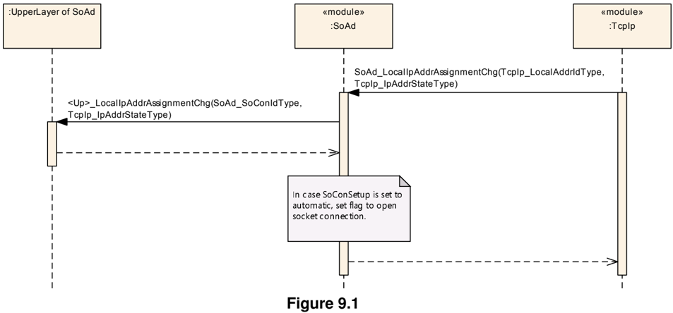

### 8.2. 套接字连接建立 - UDP（Socket Connection Setup - UDP）

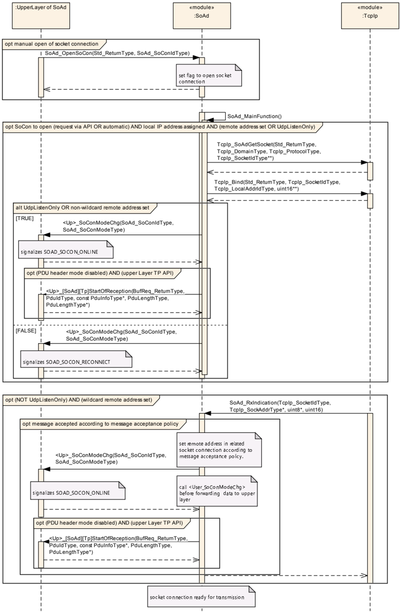

### 8.3. 套接字连接建立 - TCP（Socket Connection Setup - TCP）

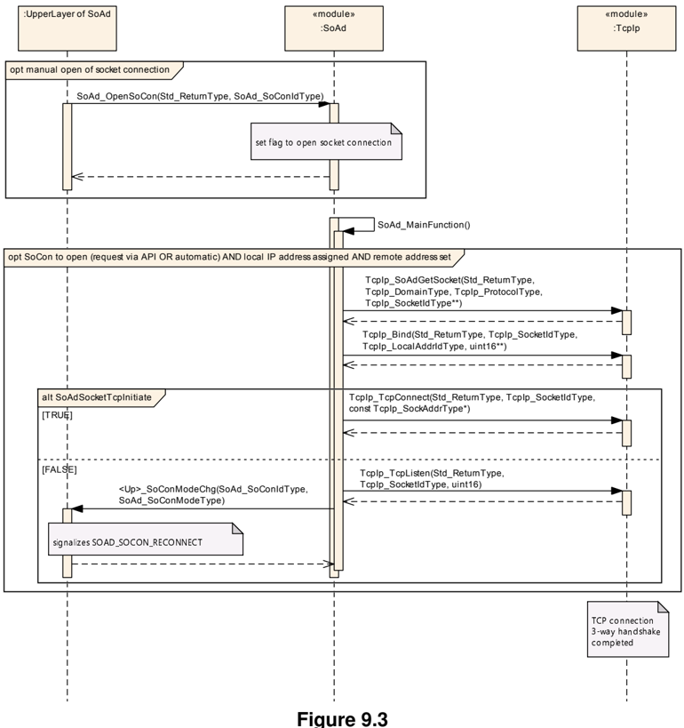

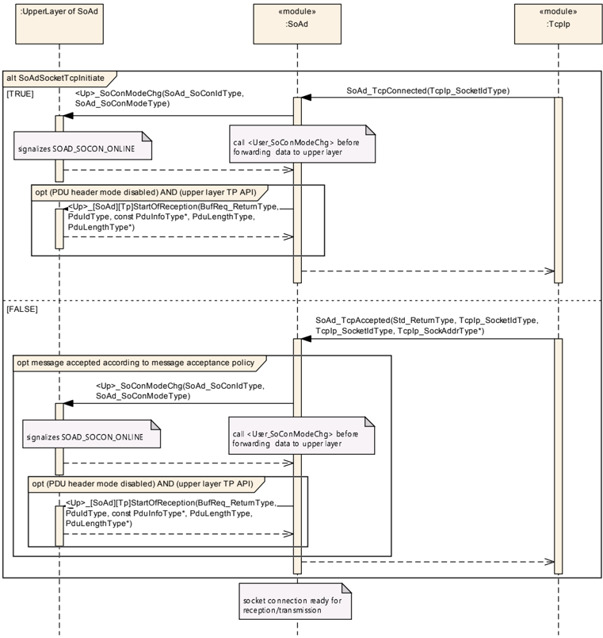

### 8.4. 接收 - 上层 IF API（Reception - Upper Layer If API）

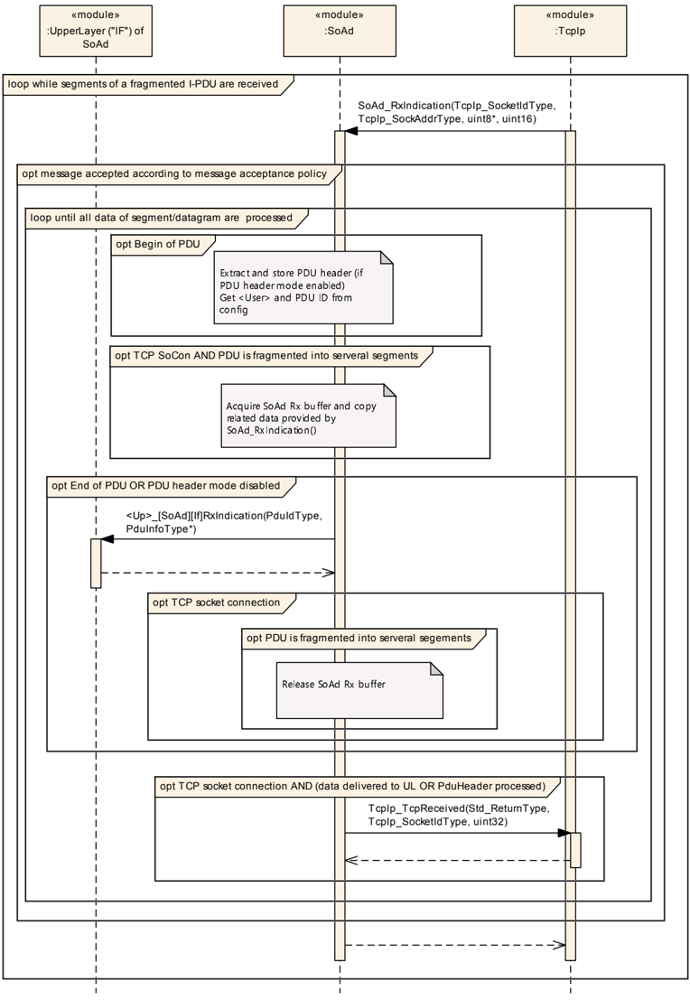

### 8.5. 接收 - 上层 TP API（Reception - Upper Layer TP API）

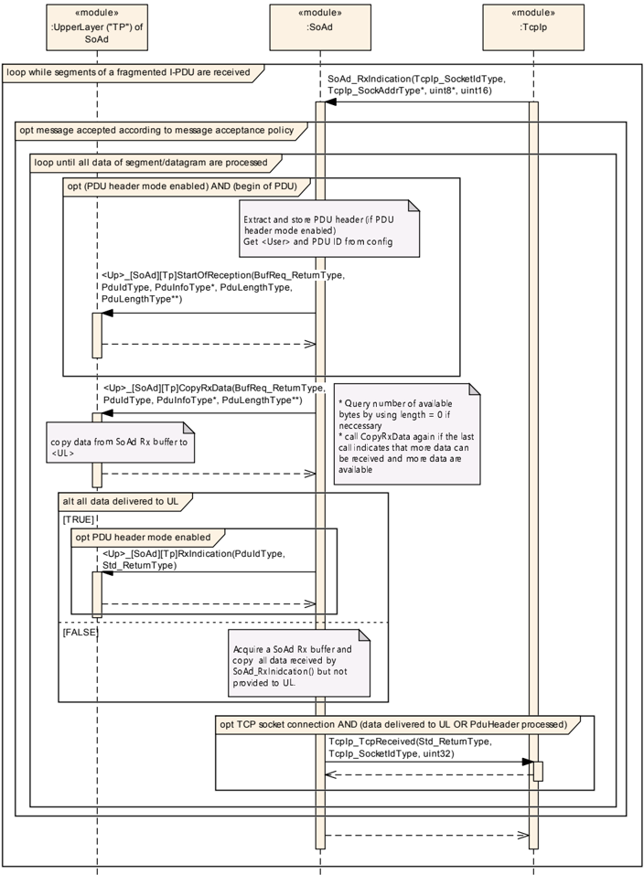

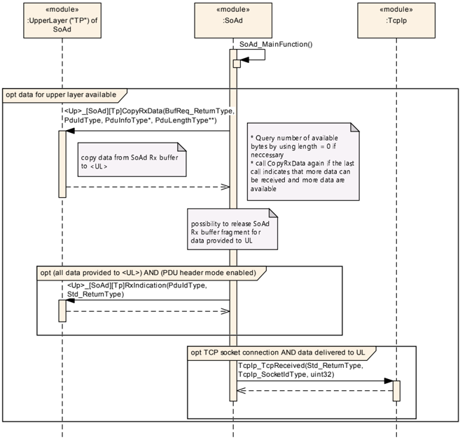

### 8.6. 传输 - 上层 IF API - TCP（Transmission - Upper Layer If API - TCP）

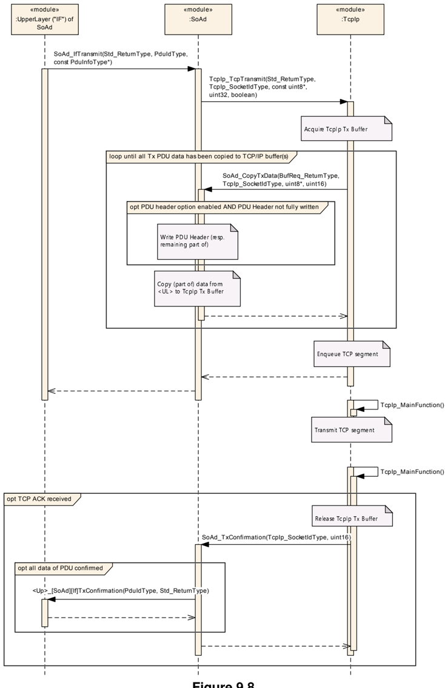

### 8.7. 传输 - 上层 IF API - UDP（Transmission - Upper Layer If API - UDP）

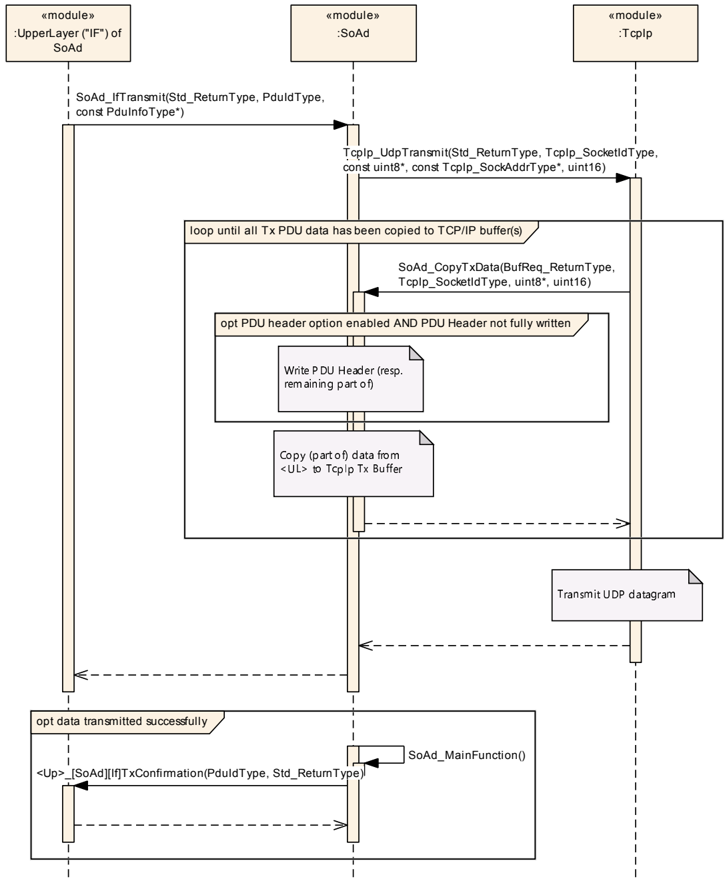

### 8.8. 传输 - 上层 TP API（Transmission - Upper Layer TP API）

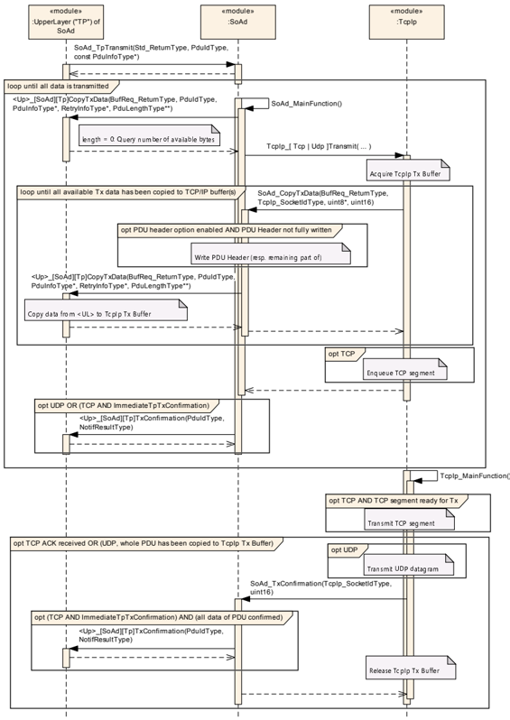

## 9. 配置规范

通常，本章定义配置参数及其向容器（**container**）的聚类。为支持本规范，第 9.1 章描述了基本原理，并规定了用于参数说明的模板（表格）。我们有意保留第 9.1 章的内容以保证可理解性。

第 9.2 章规定了模块 SoAd 的结构（容器）和参数。

第 9.3 章规定了模块 SoAd 的发布信息。

### 9.1. 如何阅读本章

有关详细信息，请参阅 SWS\_BSWGeneral [2] 中第 10.1 章"配置规范简介"（**Introduction to configuration specification**）。

### 9.2. 容器与配置参数

本章定义的配置参数用于为 AUTOSAR 工具链创建数据模型。代码中的具体实现方式由实现决定。

配置参数分为三类：用于使能功能的参数、影响所有 SoAd 实例的参数以及影响各个 SoAd 实例的参数。

所有配置项应位于模块内核之外。

配置中所有以 EcucFloatParamDef 形式给出、单位为秒的时序参数，都应转换为 **SoAdMainFunctionPeriod** 参数的整数倍。

#### 9.2.1. SoAd

| SWS 条目 | [ECUC_SoAd_00001] |
| --- | --- |
| 模块名称 | SoAd |
| 描述 | **SoAd**（**Socket Adaptor**）模块的配置。 |
| Post-Build 变体支持 | true |
| 支持的配置变体 | VARIANT-LINK-TIME, VARIANT-POST-BUILD, VARIANT-PRE-COMPILE |

**包含的容器**

| 容器名称 | 多重性 | 作用域/依赖 |
| --- | --- | --- |
| SoAdBswModules | 0..* | 每个容器描述 SoAd 需要对接的一个特定 BSW 模块。 |
| SoAdConfig | 1 | 该容器包含 AUTOSAR SoAd 模块的配置参数和子容器。 |
| SoAdGeneral | 1 | 该容器包含 SoAd 的所有全局配置参数。 |

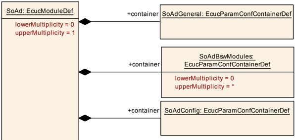

#### 9.2.2. SoAdBswModules

| SWS 条目 | [ECUC_SoAd_00102] |
| --- | --- |
| 容器名称 | SoAdBswModules |
| 父容器 | SoAd |
| 描述 | 每个容器描述 SoAd 需要对接的一个特定 BSW 模块。 |

**配置参数**

| SWS 条目 | [ECUC_SoAd_00104] |
| --- | --- |
| 参数名称 | SoAdIf |
| 父容器 | SoAdBswModules |
| 描述 | 指定该 BSW 模块是否支持通信接口（**Communication Interface**）API。值为 true 表示支持这些 API。一个模块可以同时具有通信接口 API 和传输协议 API（例如 PduR 模块）。 |
| 多重性 | 1 |
| 类型 | EcucBooleanParamDef |
| 默认值 | - |
| Post-Build 变体值 | false |
| 值配置类 | Pre-compile time：X（All Variants）；Link time：-；Post-build time：- |
| 作用域/依赖 | scope: local |

| SWS 条目 | [ECUC_SoAd_00145] |
| --- | --- |
| 参数名称 | SoAdIfTriggerTransmit |
| 父容器 | SoAdBswModules |
| 描述 | 指定该 BSW 模块是否支持 TriggerTransmit API。值为 true 表示支持该 API。 |
| 多重性 | 1 |
| 类型 | EcucBooleanParamDef |
| 默认值 | false |
| Post-Build 变体值 | false |
| 值配置类 | Pre-compile time：X（All Variants）；Link time：-；Post-build time：- |
| 作用域/依赖 | scope: local |

| SWS 条目 | [ECUC_SoAd_00106] |
| --- | --- |
| 参数名称 | SoAdIfTxConfirmation |
| 父容器 | SoAdBswModules |
| 描述 | 指定该 BSW 模块是否支持 TxConfirmation API。值为 true 表示支持该 API。 |
| 多重性 | 1 |
| 类型 | EcucBooleanParamDef |
| 默认值 | - |
| Post-Build 变体值 | false |
| 值配置类 | Pre-compile time：X（All Variants）；Link time：-；Post-build time：- |
| 作用域/依赖 | scope: local |

| SWS 条目 | [ECUC_SoAd_00143] |
| --- | --- |
| 参数名称 | SoAdLocalIpAddrAssigmentChg |
| 父容器 | SoAdBswModules |
| 描述 | 指定该 BSW 模块是否支持 LocalIpAddrAssigmentChg API。值为 true 表示支持该 API。 |
| 多重性 | 1 |
| 类型 | EcucBooleanParamDef |
| 默认值 | - |
| Post-Build 变体值 | false |
| 值配置类 | Pre-compile time：X（All Variants）；Link time：-；Post-build time：- |
| 作用域/依赖 | scope: local |

| SWS 条目 | [ECUC_SoAd_00107] |
| --- | --- |
| 参数名称 | SoAdSoConModeChg |
| 父容器 | SoAdBswModules |
| 描述 | 指定该 BSW 模块是否支持 SoConModeChg API。值为 true 表示支持该 API。 |
| 多重性 | 1 |
| 类型 | EcucBooleanParamDef |
| 默认值 | - |
| Post-Build 变体值 | false |
| 值配置类 | Pre-compile time：X（All Variants）；Link time：-；Post-build time：- |
| 作用域/依赖 | scope: local |

| SWS 条目 | [ECUC_SoAd_00105] |
| --- | --- |
| 参数名称 | SoAdTp |
| 父容器 | SoAdBswModules |
| 描述 | 指定该 BSW 模块是否支持传输协议（**Transport Protocol**）API。值为 true 表示支持这些 API。一个模块可以同时具有通信接口 API 和传输协议 API（例如 PduR 模块）。 |
| 多重性 | 1 |
| 类型 | EcucBooleanParamDef |
| 默认值 | - |
| Post-Build 变体值 | false |
| 值配置类 | Pre-compile time：X（All Variants）；Link time：-；Post-build time：- |
| 作用域/依赖 | scope: local |

| SWS 条目 | [ECUC_SoAd_00128] |
| --- | --- |
| 参数名称 | SoAdUseCallerInfix |
| 父容器 | SoAdBswModules |
| 描述 | 指定 SoAd 在调用上层模块函数时是否应（TRUE）使用中缀 "SoAd"。例如，如果上层 "ABC" 的 SoAdUseCallerInfix 为 TRUE，则 SoAd 将调用 ABC_SoAdIfRxIndication()，否则 SoAd 将调用 ABC_IfRxIndication()。 |
| 多重性 | 1 |
| 类型 | EcucBooleanParamDef |
| 默认值 | true |
| Post-Build 变体值 | false |
| 值配置类 | Pre-compile time：X（All Variants）；Link time：-；Post-build time：- |
| 作用域/依赖 | scope: local |

| SWS 条目 | [ECUC_SoAd_00129] |
| --- | --- |
| 参数名称 | SoAdUseTypeInfix |
| 父容器 | SoAdBswModules |
| 描述 | 指定 SoAd 在调用上层模块函数时是否应（TRUE）使用 API 类型中缀 "Tp" 或 "If"。例如，如果上层 "ABC" 的 SoAdUseTypeInfix 为 TRUE，则 SoAd 将调用 ABC_IfRxIndication()，否则 SoAd 将调用 ABC_RxIndication()。 |
| 多重性 | 1 |
| 类型 | EcucBooleanParamDef |
| 默认值 | true |
| Post-Build 变体值 | false |
| 值配置类 | Pre-compile time：X（All Variants）；Link time：-；Post-build time：- |
| 作用域/依赖 | scope: local |

| SWS 条目 | [ECUC_SoAd_00124] |
| --- | --- |
| 参数名称 | SoAdBswModuleRef |
| 父容器 | SoAdBswModules |
| 描述 | 这是对某个 BSW 模块配置的引用（即不是 ECUC 参数定义模板）。例如，PduR 可能存在多个配置，该引用会选择其中之一。SoAd 必须从被引用 BSW 模块配置的结构中判断它面对的是何种上层。如果是 CDD，SoAd 期望其 UL-API 的形式为 _SoAd&lt;If&#124;Tp&gt;&lt;function&gt;，并期望其 CDD Pdu 配置结构符合 Ecu Configuration 规范（CDD module\Socket Adaptor 章节）。如果是标准化的 AUTOSAR BSW 模块，则与 SoAd 交互所需的配置结构和 API 名称在相应模块的规范中定义。 |
| 多重性 | 1 |
| 类型 | 对 ECUC-MODULE-CONFIGURATION-VALUES 的外部引用 |
| Post-Build 变体值 | false |
| 值配置类 | Pre-compile time：X（All Variants）；Link time：-；Post-build time：- |
| 作用域/依赖 | scope: local |

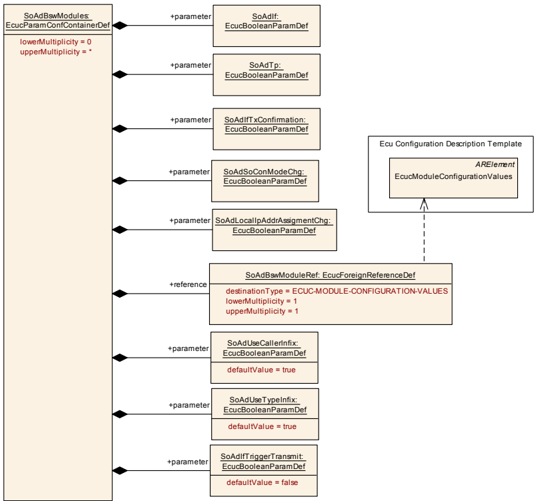

#### 9.2.3. SoAdGeneral

| SWS 条目 | [ECUC_SoAd_00003] |
| --- | --- |
| 容器名称 | SoAdGeneral |
| 父容器 | SoAd |
| 描述 | 该容器包含 SoAd 的所有全局配置参数。 |

**配置参数**

| SWS 条目 | [ECUC_SoAd_00002] |
| --- | --- |
| 参数名称 | SoAdDevErrorDetect |
| 父容器 | SoAdGeneral |
| 描述 | 切换开发错误检测和通知的开启或关闭。true：使能检测和通知。false：禁用检测和通知。 |
| 多重性 | 1 |
| 类型 | EcucBooleanParamDef |
| 默认值 | false |
| Post-Build 变体值 | false |
| 值配置类 | Pre-compile time：X（All Variants）；Link time：-；Post-build time：- |
| 作用域/依赖 | scope: local |

| SWS 条目 | [ECUC_SoAd_00176] |
| --- | --- |
| 参数名称 | SoAdEnableAclPolicyCheck |
| 父容器 | SoAdGeneral |
| 描述 | 切换 SoAd AclPolicy 检查：true：功能使能。false：功能禁用。标签：atp.Status=draft。 |
| 多重性 | 1 |
| 类型 | EcucBooleanParamDef |
| 默认值 | false |
| Post-Build 变体值 | false |
| 值配置类 | Pre-compile time：X（All Variants）；Link time：-；Post-build time：- |
| 作用域/依赖 | scope: ECU 依赖：该参数的值应设置为与 Sd 的 EnableAclCheck 参数相同的值（该功能需在两者中同时激活/停用）。 |

| SWS 条目 | [ECUC_SoAd_00164] |
| --- | --- |
| 参数名称 | SoAdEnableSecurityEventReporting |
| 父容器 | SoAdGeneral |
| 描述 | 切换是否向 **IdsM** 报告安全事件：true：使能报告。false：禁用报告。标签：atp.Status=draft。 |
| 多重性 | 1 |
| 类型 | EcucBooleanParamDef |
| 默认值 | false |
| Post-Build 变体值 | false |
| 值配置类 | Pre-compile time：X（All Variants）；Link time：-；Post-build time：- |
| 作用域/依赖 | scope: ECU |

| SWS 条目 | [ECUC_SoAd_00162] |
| --- | --- |
| 参数名称 | SoAdGetAndResetMeasurementDataApi |
| 父容器 | SoAdGeneral |
| 描述 | 使能/禁用 Get and Reset Measurement Data API。 |
| 多重性 | 1 |
| 类型 | EcucBooleanParamDef |
| 默认值 | - |
| Post-Build 变体值 | false |
| 值配置类 | Pre-compile time：X（All Variants）；Link time：-；Post-build time：- |
| 作用域/依赖 | scope: ECU |

| SWS 条目 | [ECUC_SoAd_00039] |
| --- | --- |
| 参数名称 | SoAdIPv6AddressEnabled |
| 父容器 | SoAdGeneral |
| 描述 | 允许分配更多内存来存储 IPv6 地址。TRUE：使能对 IPv6 地址的支持。FALSE：仅支持 IPv4 地址。 |
| 多重性 | 1 |
| 类型 | EcucBooleanParamDef |
| 默认值 | - |
| Post-Build 变体值 | false |
| 值配置类 | Pre-compile time：X（All Variants）；Link time：-；Post-build time：- |
| 作用域/依赖 | scope: ECU |

| SWS 条目 | [ECUC_SoAd_00062] |
| --- | --- |
| 参数名称 | SoAdMainFunctionPeriod |
| 父容器 | SoAdGeneral |
| 描述 | 决定 **SoAd_MainFunction**() 被调用的频率（单位：秒）。 |
| 多重性 | 1 |
| 类型 | EcucFloatParamDef |
| 取值范围 | ]0 .. INF[ |
| 默认值 | - |
| Post-Build 变体值 | false |
| 值配置类 | Pre-compile time：X（All Variants）；Link time：-；Post-build time：- |
| 作用域/依赖 | scope: ECU |

| SWS 条目 | [ECUC_SoAd_00127] |
| --- | --- |
| 参数名称 | SoAdRoutingGroupMax |
| 父容器 | SoAdGeneral |
| 描述 | 指定 SoAd 路由组的最大数量。此外，它还定义了 RoutingGroupIdType 所使用的平台类型。如果 SoAdRoutingGroupMax 不大于 256，则使用 uint8，否则使用 uint16。 |
| 多重性 | 1 |
| 类型 | EcucIntegerParamDef |
| 取值范围 | 0 .. 65535 |
| 默认值 | - |
| Post-Build 变体值 | false |
| 值配置类 | Pre-compile time：X（All Variants）；Link time：-；Post-build time：- |
| 作用域/依赖 | scope: local |

| SWS 条目 | [ECUC_SoAd_00126] |
| --- | --- |
| 参数名称 | SoAdSoConMax |
| 父容器 | SoAdGeneral |
| 描述 | 指定 SoAd 套接字连接的最大数量。此外，它还定义了 SoAd_SoConIdType 所使用的平台类型。如果 SoAdSoConMax 不大于 256，则使用 uint8，否则使用 uint16。 |
| 多重性 | 1 |
| 类型 | EcucIntegerParamDef |
| 取值范围 | 0 .. 65535 |
| 默认值 | - |
| Post-Build 变体值 | false |
| 值配置类 | Pre-compile time：X（All Variants）；Link time：-；Post-build time：- |
| 作用域/依赖 | scope: local |

| SWS 条目 | [ECUC_SoAd_00004] |
| --- | --- |
| 参数名称 | SoAdVersionInfoApi |
| 父容器 | SoAdGeneral |
| 描述 | 激活 **SoAd_GetVersionInfo**() API。TRUE：使能 SoAd_GetVersionInfo() API。FALSE：不包含 SoAd_GetVersionInfo() API。 |
| 多重性 | 1 |
| 类型 | EcucBooleanParamDef |
| 默认值 | false |
| Post-Build 变体值 | false |
| 值配置类 | Pre-compile time：X（All Variants）；Link time：-；Post-build time：- |
| 作用域/依赖 | scope: local |

**包含的容器**

| 容器名称 | 多重性 | 作用域/依赖 |
| --- | --- | --- |
| SoAdSecurityEventRefs | 0..1 | 包含指向 IdsMEvent 元素的引用的容器，这些 IdsMEvent 元素代表当发生相应的安全相关事件时（且如果 SoAdEnableSecurityEventReporting 设置为 "true"）SoAd 模块应向 IdsM 报告的安全事件。该容器中的标准化安全事件可以通过厂商特定的安全事件进行扩展。标签：atp.Status=draft。 |

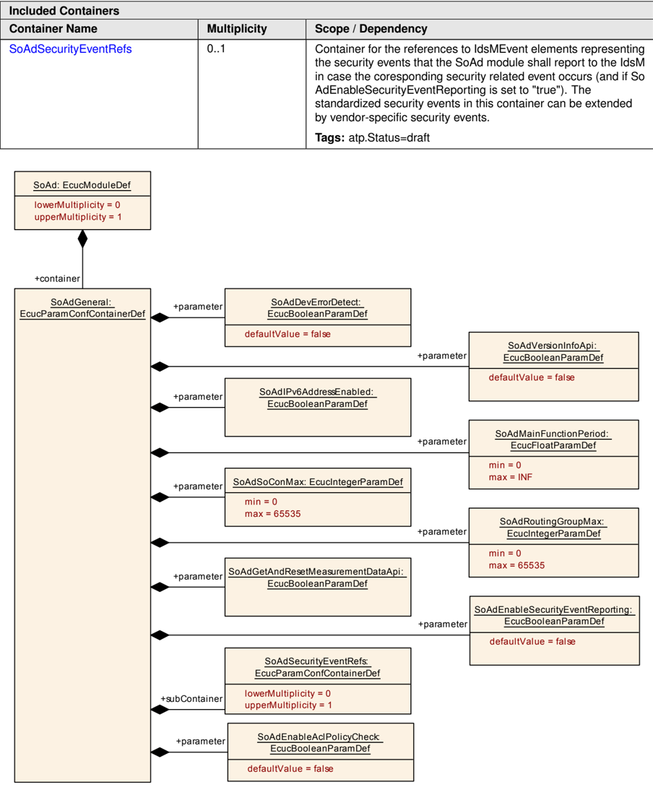

#### 9.2.4. SoAdSecurityEventRefs

| SWS 条目 | [ECUC_SoAd_00165] |
| --- | --- |
| 容器名称 | SoAdSecurityEventRefs |
| 父容器 | SoAdGeneral |
| 描述 | 包含指向 IdsMEvent 元素的引用的容器，这些 IdsMEvent 元素代表当发生相应的安全相关事件时（且如果 SoAdEnableSecurityEventReporting 设置为 "true"）SoAd 模块应向 IdsM 报告的安全事件。该容器中的标准化安全事件可以通过厂商特定的安全事件进行扩展。标签：atp.Status=draft。 |
| Post-Build 变体多重性 | false |
| 多重性配置类 | Pre-compile time：X（All Variants）；Link time：-；Post-build time：- |

**配置参数**

| SWS 条目 | [ECUC_SoAd_00168] |
| --- | --- |
| 参数名称 | SEV_DROP_MSG_RX_UDP_LENGTH |
| 父容器 | SoAdSecurityEventRefs |
| 描述 | SoAd 丢弃了一个报文。该报文包含至少一个违反协议栈配置、且经由 UDP 套接字接收的 PDU。该违规涉及各 PDU 的长度与整个报文长度之间的关系。标签：atp.Status=draft。 |
| 多重性 | 0..1 |
| 类型 | 对 IdsMEvent 的符号名称引用 |
| Post-Build 变体多重性 | false |
| Post-Build 变体值 | false |
| 多重性配置类 | Pre-compile time：X；Link time：-；Post-build time：- |
| 值配置类 | Pre-compile time：X；Link time：-；Post-build time：- |
| 作用域/依赖 | scope: local |

| SWS 条目 | [ECUC_SoAd_00169] |
| --- | --- |
| 参数名称 | SEV_DROP_MSG_RX_UDP_SOCKET |
| 父容器 | SoAdSecurityEventRefs |
| 描述 | SoAd 接收到一个违反协议栈配置的 UDP 报文并将其丢弃。未找到与配置匹配的合适套接字连接。标签：atp.Status=draft。 |
| 多重性 | 0..1 |
| 类型 | 对 IdsMEvent 的符号名称引用 |
| Post-Build 变体多重性 | false |
| Post-Build 变体值 | false |
| 多重性配置类 | Pre-compile time：X（All Variants）；Link time：-；Post-build time：- |
| 值配置类 | Pre-compile time：X（All Variants）；Link time：-；Post-build time：- |
| 作用域/依赖 | scope: local |

| SWS 条目 | [ECUC_SoAd_00166] |
| --- | --- |
| 参数名称 | SEV_DROP_PDU_RX_TCP |
| 父容器 | SoAdSecurityEventRefs |
| 描述 | SoAd 丢弃了一个 PDU。该 PDU 违反协议栈配置，且经由 TCP 套接字接收。标签：atp.Status=draft。 |
| 多重性 | 0..1 |
| 类型 | 对 IdsMEvent 的符号名称引用 |
| Post-Build 变体多重性 | false |
| Post-Build 变体值 | false |
| 多重性配置类 | Pre-compile time：X；Link time：-；Post-build time：- |
| 值配置类 | Pre-compile time：X；Link time：-；Post-build time：- |
| 作用域/依赖 | scope: local |

| SWS 条目 | [ECUC_SoAd_00167] |
| --- | --- |
| 参数名称 | SEV_DROP_PDU_RX_UDP |
| 父容器 | SoAdSecurityEventRefs |
| 描述 | SoAd 丢弃了一个 PDU。该 PDU 违反协议栈配置，且经由 UDP 套接字接收。标签：atp.Status=draft。 |
| 多重性 | 0..1 |
| 类型 | 对 IdsMEvent 的符号名称引用 |
| Post-Build 变体多重性 | false |
| Post-Build 变体值 | false |
| 多重性配置类 | Pre-compile time：X；Link time：-；Post-build time：- |
| 值配置类 | Pre-compile time：X；Link time：-；Post-build time：- |
| 作用域/依赖 | scope: local |

| SWS 条目 | [ECUC_SoAd_00170] |
| --- | --- |
| 参数名称 | SEV_REJECTED_TCP_CONNECTION |
| 父容器 | SoAdSecurityEventRefs |
| 描述 | SoAd 拒绝了一个 TCP 连接。该连接请求违反协议栈配置。标签：atp.Status=draft。 |
| 多重性 | 0..1 |
| 类型 | 对 IdsMEvent 的符号名称引用 |
| Post-Build 变体多重性 | false |
| 多重性配置类 | Pre-compile time：X（All Variants）；Link time：-；Post-build time：- |
| 作用域/依赖 | scope: local |

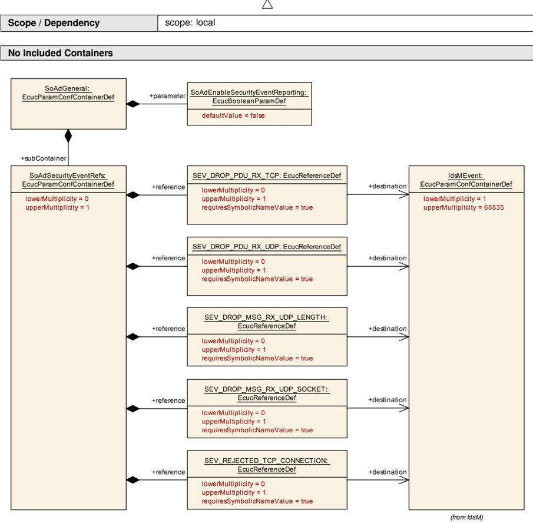

#### 9.2.5. SoAdConfig

| SWS 条目 | [ECUC_SoAd_00103] |
| --- | --- |
| 容器名称 | SoAdConfig |
| 父容器 | SoAd |
| 描述 | 该容器包含 AUTOSAR SoAd 模块的配置参数和子容器。 |

**包含的容器**

| 容器名称 | 多重性 | 作用域/依赖 |
| --- | --- | --- |
| SoAdPduRoute | 0..* | 描述 PDU 传输时从 SoAd 上层到 TCP/IP 协议栈中套接字的路径。该 PDU 可以使用类型为 SOCKET_CONNECTION_ID_16 的元数据项。 |
| SoAdRoutingGroup | 0..* | 每个容器描述一个可被使能或禁止的特定路由组。路由组由 PDU 组成。PDU 的路由既可以是由 SoAd PduRoute 指定的、从上层到 TCP/IP 协议栈中 TCP 或 UDP 套接字的 PDU 转发，也可以是由 SoAdSocketRoute 指定的反方向路由。 |
| SoAdSocketConnectionGroup | 1..* | 指定套接字连接分组的配置，即指定属于该分组的套接字连接以及该分组所有套接字连接共有的参数。套接字连接指定了如何经由 TCP 或 UDP 套接字接收和传输数据。 |
| SoAdSocketRoute | 0..* | 描述 PDU 在 TCP/IP 协议栈中接收后，从 TCP/IP 协议栈中的套接字到 SoAd 上层的路径。 |

#### 9.2.6. SoAdSocketConnectionGroup

| SWS 条目 | [ECUC_SoAd_00130] |
| --- | --- |
| 容器名称 | SoAdSocketConnectionGroup |
| 父容器 | SoAdConfig |
| 描述 | 指定套接字连接分组的配置，即指定属于该分组的套接字连接以及该分组所有套接字连接共有的参数。套接字连接指定了如何经由 TCP 或 UDP 套接字接收和传输数据。 |

**配置参数**

| SWS 条目 | [ECUC_SoAd_00131] |
| --- | --- |
| 参数名称 | SoAdPduHeaderEnable |
| 父容器 | SoAdSocketConnectionGroup |
| 描述 | 使能在该套接字连接上传输 PDU 头（ID、长度）。TRUE：在 PDU 数据前添加 SoAd PDU 头。FALSE：不使用 SoAd PDU 头。 |
| 多重性 | 1 |
| 类型 | EcucBooleanParamDef |
| 默认值 | - |
| Post-Build 变体值 | true |
| 值配置类 | Pre-compile time：X（VARIANT-PRE-COMPILE）；Link time：X（VARIANT-LINK-TIME）；Post-build time：X（VARIANT-POST-BUILD） |
| 作用域/依赖 | scope: local |

| SWS 条目 | [ECUC_SoAd_00110] |
| --- | --- |
| 参数名称 | SoAdSocketAutomaticSoConSetup |
| 父容器 | SoAdSocketConnectionGroup |
| 描述 | 指定套接字连接的建立应自动完成（TRUE），还是通过 **SoAd_OpenSoCon**() 和 **SoAd_CloseSoCon**() 手动完成（FALSE）。 |
| 多重性 | 1 |
| 类型 | EcucBooleanParamDef |
| 默认值 | true |
| Post-Build 变体值 | true |
| 值配置类 | Pre-compile time：X（VARIANT-PRE-COMPILE）；Link time：X（VARIANT-LINK-TIME）；Post-build time：X（VARIANT-POST-BUILD） |
| 作用域/依赖 | scope: local |

| SWS 条目 | [ECUC_SoAd_00158] |
| --- | --- |
| 参数名称 | SoAdSocketDifferentiatedServicesField |
| 父容器 | SoAdSocketConnectionGroup |
| 描述 | IP 头中的 6 位差分服务字段（**Differentiated Service Field**）可用于对网络流量进行分类。如果未设置该参数，则使用零值来表示尚未分类的数据包。 |
| 多重性 | 0..1 |
| 类型 | EcucIntegerParamDef |
| 取值范围 | 0 .. 63 |
| 默认值 | - |
| Post-Build 变体多重性 | true |
| Post-Build 变体值 | true |
| 多重性配置类 | Pre-compile time：X（VARIANT-PRE-COMPILE）；Link time：X（VARIANT-LINK-TIME）；Post-build time：X（VARIANT-POST-BUILD） |
| 值配置类 | Pre-compile time：X（VARIANT-PRE-COMPILE）；Link time：X（VARIANT-LINK-TIME）；Post-build time：X（VARIANT-POST-BUILD） |
| 作用域/依赖 | scope: local |

| SWS 条目 | [ECUC_SoAd_00157] |
| --- | --- |
| 参数名称 | SoAdSocketFlowLabel |
| 父容器 | SoAdSocketConnectionGroup |
| 描述 | IPv6 头中的 20 位流标签（**Flow Label**）字段可供源节点用来标记其请求 IPv6 路由器进行特殊处理（如非默认服务质量）的数据包序列。如果未设置该参数，则使用零流标签来表示尚未标记的数据包。 |
| 多重性 | 0..1 |
| 类型 | EcucIntegerParamDef |
| 取值范围 | 0 .. 1048575 |
| 默认值 | - |
| Post-Build 变体多重性 | true |
| Post-Build 变体值 | true |
| 多重性配置类 | Pre-compile time：X（VARIANT-PRE-COMPILE）；Link time：X（VARIANT-LINK-TIME）；Post-build time：X（VARIANT-POST-BUILD） |
| 值配置类 | Pre-compile time：X（VARIANT-PRE-COMPILE）；Link time：X（VARIANT-LINK-TIME）；Post-build time：X（VARIANT-POST-BUILD） |
| 作用域/依赖 | scope: local |

| SWS 条目 | [ECUC_SoAd_00138] |
| --- | --- |
| 参数名称 | SoAdSocketFramePriority |
| 父容器 | SoAdSocketConnectionGroup |
| 描述 | 指定以太网帧的优先级。如果使用 IEEE 802.1Q VLAN 标签（**VLAN Tag**），则指定的优先级将用于 VLAN 标签的 PCP 字段。如果该可选参数不存在，则使用 TcpIp 模块中指定的默认优先级。 |
| 多重性 | 0..1 |
| 类型 | EcucIntegerParamDef |
| 取值范围 | 0 .. 7 |
| 默认值 | - |
| Post-Build 变体多重性 | true |
| Post-Build 变体值 | true |
| 多重性配置类 | Pre-compile time：X（VARIANT-PRE-COMPILE）；Link time：X（VARIANT-LINK-TIME）；Post-build time：X（VARIANT-POST-BUILD） |
| 值配置类 | Pre-compile time：X（VARIANT-PRE-COMPILE）；Link time：X（VARIANT-LINK-TIME）；Post-build time：X（VARIANT-POST-BUILD） |
| 作用域/依赖 | scope: local |

| SWS 条目 | [ECUC_SoAd_00112] |
| --- | --- |
| 参数名称 | SoAdSocketIpAddrAssignmentChgNotification |
| 父容器 | SoAdSocketConnectionGroup |
| 描述 | 指定当该套接字连接使用的本地 IP 地址分配发生变化时，是否应调用上层的本地 IP 地址分配变化通知回调函数。 |
| 多重性 | 1 |
| 类型 | EcucBooleanParamDef |
| 默认值 | false |
| Post-Build 变体值 | true |
| 值配置类 | Pre-compile time：X（VARIANT-PRE-COMPILE）；Link time：X（VARIANT-LINK-TIME）；Post-build time：X（VARIANT-POST-BUILD） |
| 作用域/依赖 | scope: local |

| SWS 条目 | [ECUC_SoAd_00018] |
| --- | --- |
| 参数名称 | SoAdSocketLocalPort |
| 父容器 | SoAdSocketConnectionGroup |
| 描述 | 该连接使用的本地 UDP 或 TCP 端口。如果该参数设置为 0，SoAd 会请求 TcpIp 选择一个临时端口（**ephemeral port**）。 |
| 多重性 | 1 |
| 类型 | EcucIntegerParamDef |
| 取值范围 | 0 .. 65535 |
| 默认值 | 0 |
| Post-Build 变体值 | true |
| 值配置类 | Pre-compile time：X（VARIANT-PRE-COMPILE）；Link time：X（VARIANT-LINK-TIME）；Post-build time：X（VARIANT-POST-BUILD） |
| 作用域/依赖 | scope: local |

| SWS 条目 | [ECUC_SoAd_00137] |
| --- | --- |
| 参数名称 | SoAdSocketMsgAcceptanceFilterEnabled |
| 父容器 | SoAdSocketConnectionGroup |
| 描述 | 指定消息接受过滤器是否使能（TRUE）。注：如果 SoAdSocketRemoteAddress 中使用了通配符且 SoAdSocketUdpListenOnly 为 FALSE，则该参数必须为 TRUE。注：如果为一个 SoAdSocketConnectionGroup 配置了多个 SoAdSocketConnection，则该参数必须为 TRUE。 |
| 多重性 | 1 |
| 类型 | EcucBooleanParamDef |
| 默认值 | true |
| Post-Build 变体值 | true |
| 值配置类 | Pre-compile time：X（VARIANT-PRE-COMPILE）；Link time：X（VARIANT-LINK-TIME）；Post-build time：X（VARIANT-POST-BUILD） |
| 作用域/依赖 | scope: local 依赖：SoAdSocketRemoteAddress、SoAdSocketUdpListenOnly、SoAdSocketConnectionGroup |

| SWS 条目 | [ECUC_SoAd_00156] |
| --- | --- |
| 参数名称 | SoAdSocketPathMTUEnable |
| 父容器 | SoAdSocketConnectionGroup |
| 描述 | 指定是否应针对该连接执行路径 MTU 发现（**path MTU discovery**）。如果该可选参数不存在，则应用 TcpIp 模块中通过参数 TcpIpIpV4PathMtuEnabled 或 TcpIpIpV6PathMtuEnabled 为控制器配置的默认行为。 |
| 多重性 | 0..1 |
| 类型 | EcucBooleanParamDef |
| 默认值 | false |
| Post-Build 变体多重性 | true |
| Post-Build 变体值 | true |
| 多重性配置类 | Pre-compile time：X（VARIANT-PRE-COMPILE）；Link time：X（VARIANT-LINK-TIME）；Post-build time：X（VARIANT-POST-BUILD） |
| 值配置类 | Pre-compile time：X（VARIANT-PRE-COMPILE）；Link time：X（VARIANT-LINK-TIME）；Post-build time：X（VARIANT-POST-BUILD） |
| 作用域/依赖 | scope: local 依赖：如果 TcpIpIpV4PathMtuEnabled 或 TcpIpIpV6PathMtuEnabled 设置为 FALSE，则该参数不得设置为 TRUE。 |

| SWS 条目 | [ECUC_SoAd_00173] |
| --- | --- |
| 参数名称 | SoAdSocketSoConModeChgBswMNotification |
| 父容器 | SoAdSocketConnectionGroup |
| 描述 | 指定在 SoCon 模式变化时是否应调用 BswM_SoAd_SoConModeChg 通知。 |
| 多重性 | 0..1 |
| 类型 | EcucBooleanParamDef |
| 默认值 | - |
| Post-Build 变体多重性 | true |
| Post-Build 变体值 | true |
| 多重性配置类 | Pre-compile time：X（VARIANT-PRE-COMPILE）；Link time：X（VARIANT-LINK-TIME）；Post-build time：X（VARIANT-POST-BUILD） |
| 值配置类 | Pre-compile time：X（VARIANT-PRE-COMPILE）；Link time：X（VARIANT-LINK-TIME）；Post-build time：X（VARIANT-POST-BUILD） |
| 作用域/依赖 | scope: local |

| SWS 条目 | [ECUC_SoAd_00111] |
| --- | --- |
| 参数名称 | SoAdSocketSoConModeChgNotification |
| 父容器 | SoAdSocketConnectionGroup |
| 描述 | 指定在 SoCon 模式变化时是否应调用上层的 SoCon 模式变化通知回调函数。 |
| 多重性 | 1 |
| 类型 | EcucBooleanParamDef |
| 默认值 | false |
| Post-Build 变体值 | true |
| 值配置类 | Pre-compile time：X（VARIANT-PRE-COMPILE）；Link time：X（VARIANT-LINK-TIME）；Post-build time：X（VARIANT-POST-BUILD） |
| 作用域/依赖 | scope: local |

| SWS 条目 | [ECUC_SoAd_00134] |
| --- | --- |
| 参数名称 | SoAdSocketTpRxBufferMin |
| 父容器 | SoAdSocketConnectionGroup |
| 描述 | 指定在套接字连接分组使用 TP 类上层的情况下，SoAd 至少应能为该套接字连接分组的每个套接字连接的数据接收缓冲的字节数（上层的 PDU 数据以及所使用的 PDU 头）。注：对于使用 PduHeaderMode 且上层为 IF-API 的 TCP 套接字，所需缓冲区大小可自动确定。 |
| 多重性 | 0..1 |
| 类型 | EcucIntegerParamDef |
| 取值范围 | 0 .. 65535 |
| 默认值 | - |
| Post-Build 变体多重性 | true |
| Post-Build 变体值 | true |
| 多重性配置类 | Pre-compile time：X（VARIANT-PRE-COMPILE）；Link time：X（VARIANT-LINK-TIME）；Post-build time：X（VARIANT-POST-BUILD） |
| 值配置类 | Pre-compile time：X（VARIANT-PRE-COMPILE）；Link time：X（VARIANT-LINK-TIME）；Post-build time：X（VARIANT-POST-BUILD） |
| 作用域/依赖 | scope: local |

| SWS 条目 | [ECUC_SoAd_00175] |
| --- | --- |
| 参数名称 | SoAdSocketIpAddrAssignmentChgNotifUpperLayerRef |
| 父容器 | SoAdSocketConnectionGroup |
| 描述 | 对一个附加上层（upper layer）的引用：当该套接字连接使用的本地 IP 地址分配发生变化时，即使它不是该套接字连接的直接上层，也应调用该上层。标签：atp.Status=draft。 |
| 多重性 | 0..1 |
| 类型 | 对 SoAdBswModules 的引用 |
| Post-Build 变体多重性 | false |
| Post-Build 变体值 | false |
| 多重性配置类 | Pre-compile time：X；Link time：-；Post-build time：- |
| 值配置类 | Pre-compile time：X；Link time：-；Post-build time：- |
| 作用域/依赖 | scope: local |

| SWS 条目 | [ECUC_SoAd_00017] |
| --- | --- |
| 参数名称 | SoAdSocketLocalAddressRef |
| 父容器 | SoAdSocketConnectionGroup |
| 描述 | 该连接使用的本地 IP 地址和接口。 |
| 多重性 | 1 |
| 类型 | 对 TcpIpLocalAddr 的符号名称引用 |
| Post-Build 变体值 | true |
| 值配置类 | Pre-compile time：X（VARIANT-PRE-COMPILE）；Link time：X（VARIANT-LINK-TIME）；Post-build time：X（VARIANT-POST-BUILD） |
| 作用域/依赖 | scope: local |

| SWS 条目 | [ECUC_SoAd_00161] |
| --- | --- |
| 参数名称 | SoAdSocketSoConModeChgNotifUpperLayerRef |
| 父容器 | SoAdSocketConnectionGroup |
| 描述 | 对一个附加上层的引用：即使它不是该套接字连接的直接上层，也应向其通知套接字连接状态变化。 |
| 多重性 | 0..1 |
| 类型 | 对 SoAdBswModules 的引用 |
| Post-Build 变体多重性 | false |
| Post-Build 变体值 | false |
| 多重性配置类 | Pre-compile time：X（All Variants）；Link time：-；Post-build time：- |
| 值配置类 | Pre-compile time：X（All Variants）；Link time：-；Post-build time：- |
| 作用域/依赖 | scope: local |

**包含的容器**

| 容器名称 | 多重性 | 作用域/依赖 |
| --- | --- | --- |
| SoAdSocketConnection | 1..* | 指定该套接字连接分组的套接字连接。 |
| SoAdSocketProtocol | 1 | 选择容器：套接字连接分组的传输协议为 UDP 或 TCP。 |

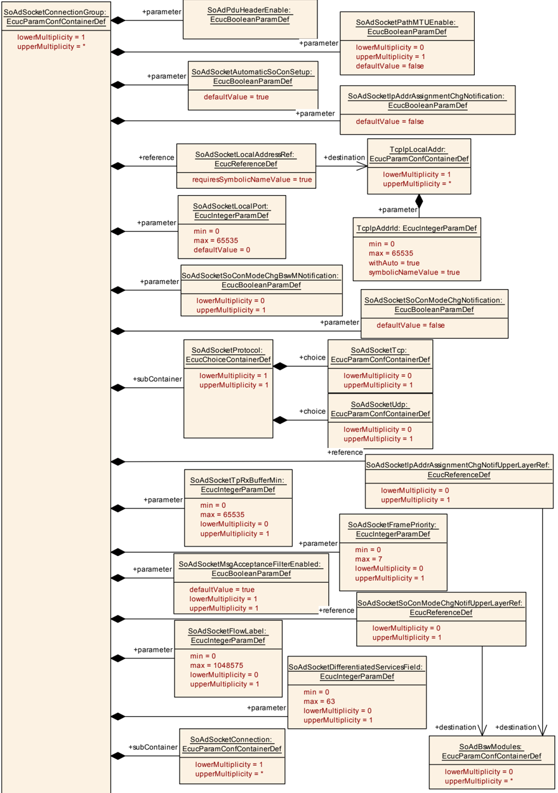

#### 9.2.7. SoAdSocketConnection

| SWS 条目 | [ECUC_SoAd_00009] |
| --- | --- |
| 容器名称 | SoAdSocketConnection |
| 父容器 | SoAdSocketConnectionGroup |
| 描述 | 指定套接字连接（ID 和远程地址信息）。注：套接字连接分组中所有套接字连接共有的参数直接在分组上指定。 |

**配置参数**

| SWS 条目 | [ECUC_SoAd_00016] |
| --- | --- |
| 参数名称 | SoAdSocketId |
| 父容器 | SoAdSocketConnection |
| 描述 | 在与上层交互中用作 SoConId 的套接字连接标识符。 |
| 多重性 | 1 |
| 类型 | EcucIntegerParamDef（为该参数生成符号名称） |
| 取值范围 | 0 .. 65535 |
| 默认值 | - |
| Post-Build 变体值 | false |
| 值配置类 | Pre-compile time：X（All Variants）；Link time：-；Post-build time：- |
| 作用域/依赖 | scope: ECU |

**包含的容器**

| 容器名称 | 多重性 | 作用域/依赖 |
| --- | --- | --- |
| SoAdSocketRemoteAddress | 0..1 | 用于指定套接字连接远程地址（IP 地址和端口）的容器。如果未指定 SoAdSocketRemoteAddress，则远程地址必须由上层通过 SoAd_SetRemoteAddr() 设置。 |

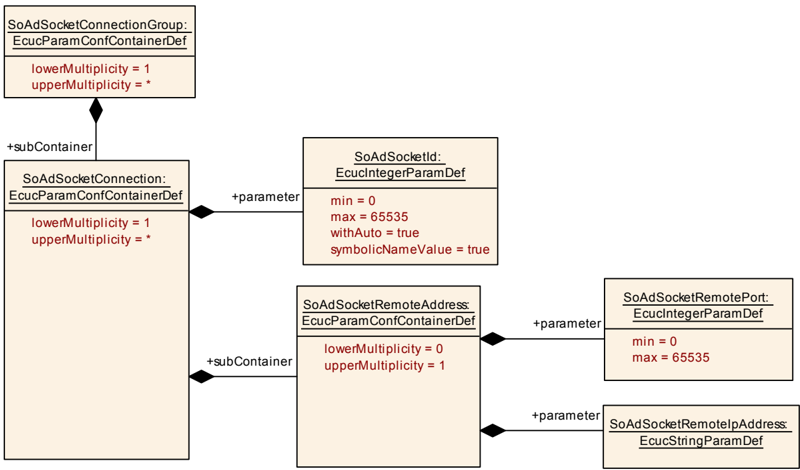

#### 9.2.8. SoAdSocketProtocol

| SWS 条目 | [ECUC_SoAd_00139] |
| --- | --- |
| 选择容器名称 | SoAdSocketProtocol |
| 父容器 | SoAdSocketConnectionGroup |
| 描述 | 指定套接字连接分组的套接字连接所使用的传输协议以及传输协议特定的参数。 |

**容器选择**

| 容器名称 | 多重性 | 作用域/依赖 |
| --- | --- | --- |
| SoAdSocketTcp | 0..1 | 套接字连接分组使用 TCP 作为传输协议。该容器包含 TCP 特定的参数。 |
| SoAdSocketUdp | 0..1 | 套接字连接分组使用 UDP 作为传输协议。该容器包含 UDP 特定的参数。 |

#### 9.2.9. SoAdSocketUdp

| SWS 条目 | [ECUC_SoAd_00140] |
| --- | --- |
| 容器名称 | SoAdSocketUdp |
| 父容器 | SoAdSocketProtocol |
| 描述 | 指定套接字连接分组使用 UDP 作为传输协议，以及仅与 UDP 套接字连接相关的参数。 |

**配置参数**

| SWS 条目 | [ECUC_SoAd_00135] |
| --- | --- |
| 参数名称 | SoAdSocketnPduUdpTxBufferMin |
| 父容器 | SoAdSocketUdp |
| 描述 | 指定在需要缓冲 UDP 报文以实现每个 UDP 报文传输多个 PDU 的情况下，SoAd 应能通过该套接字连接为数据传输缓冲的字节数（上层提供的 PDU 数据以及所使用的 PDU 头）。注：对于配置了 TP API 上层的 UDP 套接字，所需缓冲区大小可自动确定。该可选参数仅在使用 nPduUdpTxBuffer 时相关。 |
| 多重性 | 0..1 |
| 类型 | EcucIntegerParamDef |
| 取值范围 | 0 .. 65535 |
| 默认值 | - |
| Post-Build 变体多重性 | true |
| Post-Build 变体值 | true |
| 多重性配置类 | Pre-compile time：X（VARIANT-PRE-COMPILE）；Link time：X（VARIANT-LINK-TIME）；Post-build time：X（VARIANT-POST-BUILD） |
| 值配置类 | Pre-compile time：X（VARIANT-PRE-COMPILE）；Link time：X（VARIANT-LINK-TIME）；Post-build time：X（VARIANT-POST-BUILD） |
| 作用域/依赖 | scope: local 依赖：SoAdTxUdpTriggerMode |

| SWS 条目 | [ECUC_SoAd_00149] |
| --- | --- |
| 参数名称 | SoAdSocketUdpAliveSupervisionTimeout |
| 父容器 | SoAdSocketUdp |
| 描述 | 指定在最近一次从远程地址指定的远端对等方接收到帧之后，UDP 套接字连接在 SOAD_SOCON_ONLINE 模式下保持的时间（单位：秒）。如果未使能该可选参数，则相关套接字连接分组的 UDP 存活监督（**UDP Alive Supervision**）被停用。 |
| 多重性 | 0..1 |
| 类型 | EcucFloatParamDef |
| 取值范围 | [0 .. INF] |
| 默认值 | - |
| Post-Build 变体多重性 | true |
| Post-Build 变体值 | true |
| 多重性配置类 | Pre-compile time：X（VARIANT-PRE-COMPILE）；Link time：X（VARIANT-LINK-TIME）；Post-build time：X（VARIANT-POST-BUILD） |
| 值配置类 | Pre-compile time：X（VARIANT-PRE-COMPILE）；Link time：X（VARIANT-LINK-TIME）；Post-build time：X（VARIANT-POST-BUILD） |
| 作用域/依赖 | scope: local |

| SWS 条目 | [ECUC_SoAd_00159] |
| --- | --- |
| 参数名称 | SoAdSocketUdpChecksumEnabled |
| 父容器 | SoAdSocketUdp |
| 描述 | 指定在相关套接字上是否应使能（TRUE）或跳过（FALSE）UDP 校验和计算。FALSE 意味着套接字连接的上层要么能够处理畸形报文，要么自身应用校验和机制。 |
| 多重性 | 1 |
| 类型 | EcucBooleanParamDef |
| 默认值 | true |
| Post-Build 变体值 | true |
| 值配置类 | Pre-compile time：X（VARIANT-PRE-COMPILE）；Link time：X（VARIANT-LINK-TIME）；Post-build time：X（VARIANT-POST-BUILD） |
| 作用域/依赖 | scope: local |

| SWS 条目 | [ECUC_SoAd_00024] |
| --- | --- |
| 参数名称 | SoAdSocketUdpListenOnly |
| 父容器 | SoAdSocketUdp |
| 描述 | 指定该套接字连接分组仅用于接收（TRUE），还是同时用于接收和传输（FALSE）。 |
| 多重性 | 1 |
| 类型 | EcucBooleanParamDef |
| 默认值 | false |
| Post-Build 变体值 | true |
| 值配置类 | Pre-compile time：X（VARIANT-PRE-COMPILE）；Link time：X（VARIANT-LINK-TIME）；Post-build time：X（VARIANT-POST-BUILD） |
| 作用域/依赖 | scope: local 依赖：SoAdSocketProtocol |

| SWS 条目 | [ECUC_SoAd_00154] |
| --- | --- |
| 参数名称 | SoAdSocketUdpStrictHeaderLenCheckEnabled |
| 父容器 | SoAdSocketUdp |
| 描述 | 指定当所含全部 PDU 的长度与整个报文的长度不匹配时，是否应丢弃（TRUE）UDP 报文。仅当 SoAdPduHeaderEnable 也设置为 TRUE 时才应将该参数设置为 TRUE。 |
| 多重性 | 1 |
| 类型 | EcucBooleanParamDef |
| 默认值 | false |
| Post-Build 变体值 | true |
| 值配置类 | Pre-compile time：X（VARIANT-PRE-COMPILE）；Link time：X（VARIANT-LINK-TIME）；Post-build time：X（VARIANT-POST-BUILD） |
| 作用域/依赖 | scope: local 依赖：SoAdPduHeaderEnable |

| SWS 条目 | [ECUC_SoAd_00133] |
| --- | --- |
| 参数名称 | SoAdSocketUdpTriggerTimeout |
| 父容器 | SoAdSocketUdp |
| 描述 | 指定 nPduUdpTxBuffer 等待 TriggerMode = TRIGGER_ALWAYS 的 PDU 的超时时间（单位：秒），即超时到期时传输 nPduUdpTxBuffer。每次 UDP 传输后定时器复位。该可选参数仅在使用 nPduUdpTxBuffer 时相关。 |
| 多重性 | 0..1 |
| 类型 | EcucFloatParamDef |
| 取值范围 | [0 .. INF] |
| 默认值 | - |
| Post-Build 变体多重性 | true |
| Post-Build 变体值 | true |
| 多重性配置类 | Pre-compile time：X（VARIANT-PRE-COMPILE）；Link time：X（VARIANT-LINK-TIME）；Post-build time：X（VARIANT-POST-BUILD） |
| 值配置类 | Pre-compile time：X（VARIANT-PRE-COMPILE）；Link time：X（VARIANT-LINK-TIME）；Post-build time：X（VARIANT-POST-BUILD） |
| 作用域/依赖 | scope: local 依赖：SoAdTxUdpTriggerMode |

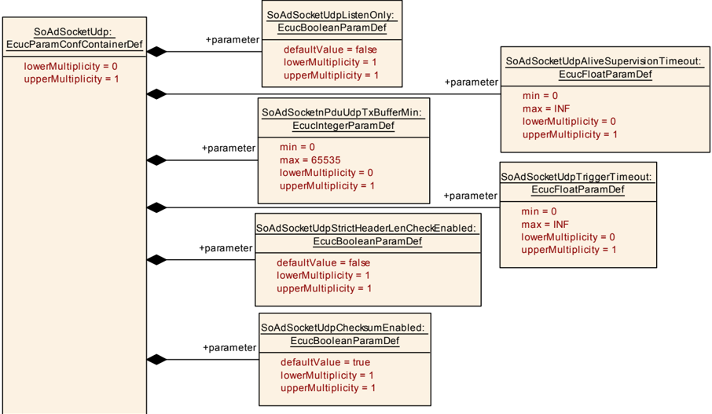

#### 9.2.10. SoAdSocketTcp

| SWS 条目 | [ECUC_SoAd_00141] |
| --- | --- |
| 容器名称 | SoAdSocketTcp |
| 父容器 | SoAdSocketProtocol |
| 描述 | 指定套接字连接分组使用 TCP 作为传输协议，以及仅与 TCP 套接字连接相关的参数。 |

**配置参数**

| SWS 条目 | [ECUC_SoAd_00174] |
| --- | --- |
| 参数名称 | SoAdSocketTcpAutoConnectTimeout |
| 父容器 | SoAdSocketTcp |
| 描述 | 指定为达到 SOAD_SOCON_ONLINE 而重复尝试 TCP 连接的时长（单位：秒）。该参数仅限于由 SoAd 控制且主动发起 TCP 连接的套接字连接分组。 |
| 多重性 | 0..1 |
| 类型 | EcucFloatParamDef |
| 取值范围 | [0 .. INF] |
| 默认值 | - |
| Post-Build 变体多重性 | true |
| Post-Build 变体值 | true |
| 多重性配置类 | Pre-compile time：X（VARIANT-PRE-COMPILE）；Link time：X（VARIANT-LINK-TIME）；Post-build time：X（VARIANT-POST-BUILD） |
| 值配置类 | Pre-compile time：X（VARIANT-PRE-COMPILE）；Link time：X（VARIANT-LINK-TIME）；Post-build time：X（VARIANT-POST-BUILD） |
| 作用域/依赖 | scope: local 依赖：仅当 SoAdSocketConnectionGroup.SoAdSocketAutomaticSoConSetup 和 SoAdSocketConnectionGroup.SoAdSocketTcpInitiate 设置为 true 时才应配置该参数。 |

| SWS 条目 | [ECUC_SoAd_00147] |
| --- | --- |
| 参数名称 | SoAdSocketTcpImmediateTpTxConfirmation |
| 父容器 | SoAdSocketTcp |
| 描述 | 如果设置为 FALSE，SoAd 在收到 TCP Ack 后通过传输确认通知 TP 上层。如果设置为 TRUE，SoAd 在 TcpIp 接受传输后立即通过传输确认通知 TP 上层。 |
| 多重性 | 1 |
| 类型 | EcucBooleanParamDef |
| 默认值 | false |
| Post-Build 变体值 | true |
| 值配置类 | Pre-compile time：X（VARIANT-PRE-COMPILE）；Link time：X（VARIANT-LINK-TIME）；Post-build time：X（VARIANT-POST-BUILD） |
| 作用域/依赖 | scope: ECU |

| SWS 条目 | [ECUC_SoAd_00022] |
| --- | --- |
| 参数名称 | SoAdSocketTcpInitiate |
| 父容器 | SoAdSocketTcp |
| 描述 | 指定该 TCP 连接的发起方。UDP 套接字不定义该参数。TRUE：该 TCP 连接由本模块发起。FALSE：该 TCP 连接应在监听（**listen**）模式下由对方发起。 |
| 多重性 | 1 |
| 类型 | EcucBooleanParamDef |
| 默认值 | - |
| Post-Build 变体值 | true |
| 值配置类 | Pre-compile time：X（VARIANT-PRE-COMPILE）；Link time：X（VARIANT-LINK-TIME）；Post-build time：X（VARIANT-POST-BUILD） |
| 作用域/依赖 | scope: local |

| SWS 条目 | [ECUC_SoAd_00148] |
| --- | --- |
| 参数名称 | SoAdSocketTcpKeepAlive |
| 父容器 | SoAdSocketTcp |
| 描述 | 指定该连接是否使用保活（**keep-alive**）机制。UDP 套接字不定义该参数。TRUE：该 TCP 连接将使用保活机制。FALSE：该 TCP 连接不使用保活机制。注：如果 TcpIpTcpKeepAliveEnabled 设置为 FALSE，则该参数不得设置为 TRUE。 |
| 多重性 | 1 |
| 类型 | EcucBooleanParamDef |
| 默认值 | false |
| Post-Build 变体值 | true |
| 值配置类 | Pre-compile time：X（VARIANT-PRE-COMPILE）；Link time：X（VARIANT-LINK-TIME）；Post-build time：X（VARIANT-POST-BUILD） |
| 作用域/依赖 | scope: local 依赖：TcpIpTcpKeepAliveEnabled |

| SWS 条目 | [ECUC_SoAd_00152] |
| --- | --- |
| 参数名称 | SoAdSocketTcpKeepAliveInterval |
| 父容器 | SoAdSocketTcp |
| 描述 | 指定后续保活探测之间的时间间隔（单位：秒）。 |
| 多重性 | 0..1 |
| 类型 | EcucFloatParamDef |
| 取值范围 | [0 .. INF] |
| 默认值 | - |
| Post-Build 变体多重性 | true |
| Post-Build 变体值 | true |
| 多重性配置类 | Pre-compile time：X（VARIANT-PRE-COMPILE）；Link time：X（VARIANT-LINK-TIME）；Post-build time：X（VARIANT-POST-BUILD） |
| 值配置类 | Pre-compile time：X（VARIANT-PRE-COMPILE）；Link time：X（VARIANT-LINK-TIME）；Post-build time：X（VARIANT-POST-BUILD） |
| 作用域/依赖 | scope: local 依赖：SoAdSocketTcpKeepAlive |

| SWS 条目 | [ECUC_SoAd_00151] |
| --- | --- |
| 参数名称 | SoAdSocketTcpKeepAliveProbesMax |
| 父容器 | SoAdSocketTcp |
| 描述 | 在中止连接之前 TCP 重传单个数据段的最大次数。 |
| 多重性 | 0..1 |
| 类型 | EcucIntegerParamDef |
| 取值范围 | 0 .. 65535 |
| 默认值 | - |
| Post-Build 变体多重性 | true |
| Post-Build 变体值 | true |
| 多重性配置类 | Pre-compile time：X（VARIANT-PRE-COMPILE）；Link time：X（VARIANT-LINK-TIME）；Post-build time：X（VARIANT-POST-BUILD） |
| 值配置类 | Pre-compile time：X（VARIANT-PRE-COMPILE）；Link time：X（VARIANT-LINK-TIME）；Post-build time：X（VARIANT-POST-BUILD） |
| 作用域/依赖 | scope: local 依赖：SoAdSocketTcpKeepAlive |

| SWS 条目 | [ECUC_SoAd_00153] |
| --- | --- |
| 参数名称 | SoAdSocketTcpKeepAliveTime |
| 父容器 | SoAdSocketTcp |
| 描述 | 指定从发送最后一个数据包到第一个保活探测之间的时间（单位：秒）。 |
| 多重性 | 0..1 |
| 类型 | EcucFloatParamDef |
| 取值范围 | [0 .. INF] |
| 默认值 | 7200 |
| Post-Build 变体多重性 | true |
| Post-Build 变体值 | true |
| 多重性配置类 | Pre-compile time：X（VARIANT-PRE-COMPILE）；Link time：X（VARIANT-LINK-TIME）；Post-build time：X（VARIANT-POST-BUILD） |
| 值配置类 | Pre-compile time：X（VARIANT-PRE-COMPILE）；Link time：X（VARIANT-LINK-TIME）；Post-build time：X（VARIANT-POST-BUILD） |
| 作用域/依赖 | scope: local 依赖：SoAdSocketTcpKeepAlive |

| SWS 条目 | [ECUC_SoAd_00023] |
| --- | --- |
| 参数名称 | SoAdSocketTcpNoDelay |
| 父容器 | SoAdSocketTcp |
| 描述 | 指定该连接不使用拥塞控制机制。UDP 套接字不定义该参数。TRUE：该 TCP 连接不使用拥塞控制。FALSE：该 TCP 连接使用拥塞控制。如果未使能该可选参数，则应用通过参数 TcpIpTcpNagleEnabled 为 TcpIp 配置的默认行为。注：如果 TcpIpTcpNagleEnabled 设置为 FALSE，则该参数不得设置为 FALSE。 |
| 多重性 | 0..1 |
| 类型 | EcucBooleanParamDef |
| 默认值 | - |
| Post-Build 变体多重性 | true |
| Post-Build 变体值 | true |
| 多重性配置类 | Pre-compile time：X（VARIANT-PRE-COMPILE）；Link time：X（VARIANT-LINK-TIME）；Post-build time：X（VARIANT-POST-BUILD） |
| 值配置类 | Pre-compile time：X（VARIANT-PRE-COMPILE）；Link time：X（VARIANT-LINK-TIME）；Post-build time：X（VARIANT-POST-BUILD） |
| 作用域/依赖 | scope: local 依赖：TcpIpTcpNagleEnabled |

| SWS 条目 | [ECUC_SoAd_00171] |
| --- | --- |
| 参数名称 | SoAdSocketTcpRetransmissionTimeout |
| 父容器 | SoAdSocketTcp |
| 描述 | 未被确认的 TCP 段再次发送前的超时时间（单位：秒）。如果超时设置为 INF，则不应重传任何 TCP 段。 |
| 多重性 | 0..1 |
| 类型 | EcucFloatParamDef |
| 取值范围 | [0.001 .. INF] |
| 默认值 | - |
| Post-Build 变体多重性 | true |
| Post-Build 变体值 | true |
| 多重性配置类 | Pre-compile time：X（VARIANT-PRE-COMPILE）；Link time：X（VARIANT-LINK-TIME）；Post-build time：X（VARIANT-POST-BUILD） |
| 值配置类 | Pre-compile time：X（VARIANT-PRE-COMPILE）；Link time：X（VARIANT-LINK-TIME）；Post-build time：X（VARIANT-POST-BUILD） |
| 作用域/依赖 | scope: local |

| SWS 条目 | [ECUC_SoAd_00142] |
| --- | --- |
| 参数名称 | SoAdSocketTcpTxQuota |
| 父容器 | SoAdSocketTcp |
| 描述 | 指定 SoAd 在 TcpIp 模块处为该套接字连接分组的每个套接字连接通过 TCP 排队等待传输的最大字节数（上层提供的 PDU 数据以及所使用的 PDU 头）。理由：防止某个套接字连接耗尽 TcpIp 处所有可用的发送缓冲区，从而阻塞其他套接字连接的传输。如果未使能该可选参数，则数据量不受限制。 |
| 多重性 | 0..1 |
| 类型 | EcucIntegerParamDef |
| 取值范围 | 0 .. 4294967295 |
| 默认值 | - |
| Post-Build 变体多重性 | true |
| Post-Build 变体值 | true |
| 多重性配置类 | Pre-compile time：X（VARIANT-PRE-COMPILE）；Link time：X（VARIANT-LINK-TIME）；Post-build time：X（VARIANT-POST-BUILD） |
| 值配置类 | Pre-compile time：X（VARIANT-PRE-COMPILE）；Link time：X（VARIANT-LINK-TIME）；Post-build time：X（VARIANT-POST-BUILD） |
| 作用域/依赖 | scope: local |

| SWS 条目 | [ECUC_SoAd_00155] |
| --- | --- |
| 参数名称 | SoAdSocketTCPOptionFilterRef |
| 父容器 | SoAdSocketTcp |
| 描述 | 指定应在相关套接字上应用哪个 TCP 选项过滤器（**TCP option filter**）。 |
| 多重性 | 0..1 |
| 类型 | 对 TcpIpTcpConfigOptionFilter 的符号名称引用 |
| Post-Build 变体多重性 | true |
| Post-Build 变体值 | true |
| 多重性配置类 | Pre-compile time：X（VARIANT-PRE-COMPILE）；Link time：X（VARIANT-LINK-TIME）；Post-build time：X（VARIANT-POST-BUILD） |
| 值配置类 | Pre-compile time：X（VARIANT-PRE-COMPILE）；Link time：X（VARIANT-LINK-TIME）；Post-build time：X（VARIANT-POST-BUILD） |
| 作用域/依赖 | - |

| SWS 条目 | [ECUC_SoAd_00163] |
| --- | --- |
| 参数名称 | SoAdSocketTcpTlsConnectionRef |
| 父容器 | SoAdSocketTcp |
| 描述 | 如果设置了该参数，则该 TCP 套接字被分配给一个 TLS 连接。SoAd 需要以对 TLS 连接的引用作为参数调用 TcpIp_ChangeParameter。 |
| 多重性 | 0..1 |
| 类型 | 对 TcpIpTlsConnection 的符号名称引用 |
| Post-Build 变体多重性 | false |
| Post-Build 变体值 | false |
| 多重性配置类 | Pre-compile time：X；Link time：-；Post-build time：- |
| 值配置类 | Pre-compile time：X；Link time：-；Post-build time：- |
| 作用域/依赖 | scope: local |

#### 9.2.11. SoAdSocketRemoteAddress

| SWS 条目 | [ECUC_SoAd_00113] |
| --- | --- |
| 容器名称 | SoAdSocketRemoteAddress |
| 父容器 | SoAdSocketConnection |
| 描述 | SoAdSocketConnection 的子容器，用于指定套接字连接的远程地址（IP 地址和端口）。如果未指定 SoAdSocketRemoteAddress，则远程地址必须由上层通过 SoAd_SetRemoteAddr() 设置。 |

**配置参数**

| SWS 条目 | [ECUC_SoAd_00019] |
| --- | --- |
| 参数名称 | SoAdSocketRemoteIpAddress |
| 父容器 | SoAdSocketRemoteAddress |
| 描述 | 远程节点的 IP 地址。所配置的地址必须与 SoAdSocketLocalAddressRef 所引用的 TcpIpLocalAddr 属于相同的 TcpIpDomainType（即 IPv4 或 IPv6）。要接受任意远程 IP 地址，请将 SoAdSocketRemoteIpAddress 设置为 "ANY"。更多详细信息请参见消息接受策略。 |
| 多重性 | 1 |
| 类型 | EcucStringParamDef |
| 默认值 | - |
| 正则表达式 | - |
| Post-Build 变体值 | true |
| 值配置类 | Pre-compile time：X（VARIANT-PRE-COMPILE）；Link time：X（VARIANT-LINK-TIME）；Post-build time：X（VARIANT-POST-BUILD） |
| 作用域/依赖 | scope: local |

| SWS 条目 | [ECUC_SoAd_00020] |
| --- | --- |
| 参数名称 | SoAdSocketRemotePort |
| 父容器 | SoAdSocketRemoteAddress |
| 描述 | 该连接使用的远程 UDP 或 TCP 端口。要接受任意远程端口，请将 SoAdSocketRemotePort 设置为 0。更多详细信息请参见消息接受策略。 |
| 多重性 | 1 |
| 类型 | EcucIntegerParamDef |
| 取值范围 | 0 .. 65535 |
| 默认值 | - |
| Post-Build 变体值 | true |
| 值配置类 | Pre-compile time：X（VARIANT-PRE-COMPILE）；Link time：X（VARIANT-LINK-TIME）；Post-build time：X（VARIANT-POST-BUILD） |
| 作用域/依赖 | scope: local |

#### 9.2.12. SoAdSocketRoute

| SWS 条目 | [ECUC_SoAd_00008] |
| --- | --- |
| 容器名称 | SoAdSocketRoute |
| 父容器 | SoAdConfig |
| 描述 | 描述 PDU 在 TCP/IP 协议栈中接收后，从 TCP/IP 协议栈中的套接字到 SoAd 上层的路径。 |

**配置参数**

| SWS 条目 | [ECUC_SoAd_00036] |
| --- | --- |
| 参数名称 | SoAdRxPduHeaderId |
| 父容器 | SoAdSocketRoute |
| 描述 | 如果使能了 PDU 头选项，则为在 TCP/IP 连接上接收到的数据包中所包含的 ID。 |
| 多重性 | 0..1 |
| 类型 | EcucIntegerParamDef |
| 取值范围 | 0 .. 4294967296 |
| 默认值 | - |
| Post-Build 变体多重性 | true |
| Post-Build 变体值 | true |
| 多重性配置类 | Pre-compile time：X（VARIANT-PRE-COMPILE）；Link time：X（VARIANT-LINK-TIME）；Post-build time：X（VARIANT-POST-BUILD） |
| 值配置类 | Pre-compile time：X（VARIANT-PRE-COMPILE）；Link time：X（VARIANT-LINK-TIME）；Post-build time：X（VARIANT-POST-BUILD） |
| 作用域/依赖 | scope: local 依赖：对于与某 SoAdSocketConnection 相关的 SoAdSocketRoute，应配置该参数，前提是该 SoAdSocketConnection 属于将 SoAdPduHeaderEnable 设置为 TRUE 的 SoAdSocketConnectionGroup。 |

| SWS 条目 | [ECUC_SoAd_00177] |
| --- | --- |
| 参数名称 | SoAdRxSomeIpAclCheck |
| 父容器 | SoAdSocketRoute |
| 描述 | 该参数定义了一个用于激活/停用 ACL 检查的标志。标签：atp.Status=draft。 |
| 多重性 | 0..1 |
| 类型 | EcucBooleanParamDef |
| 默认值 | - |
| Post-Build 变体多重性 | true |
| Post-Build 变体值 | true |
| 多重性配置类 | Pre-compile time：X（VARIANT-PRE-COMPILE）；Link time：X（VARIANT-LINK-TIME）；Post-build time：X（VARIANT-POST-BUILD） |
| 值配置类 | Pre-compile time：X（VARIANT-PRE-COMPILE）；Link time：X（VARIANT-LINK-TIME）；Post-build time：X（VARIANT-POST-BUILD） |
| 作用域/依赖 | scope: ECU 依赖：仅当 SoAdEnableAclPolicyCheck 设置为 true 时才应设置该参数。 |

| SWS 条目 | [ECUC_SoAd_00035] |
| --- | --- |
| 参数名称 | SoAdRxSocketConnOrSocketConnBundleRef |
| 父容器 | SoAdSocketRoute |
| 描述 | 对接收该 PDU 的 SocketConnection 或 SocketConnectionGroup 的选择引用。对 SocketConnectionGroup 的引用仅应用于具有 IF API 的上层。 |
| 多重性 | 1 |
| 类型 | 对 [ SoAdSocketConnection, SoAdSocketConnectionGroup ] 的选择引用 |
| Post-Build 变体值 | true |
| 值配置类 | Pre-compile time：X（VARIANT-PRE-COMPILE）；Link time：X（VARIANT-LINK-TIME）；Post-build time：X（VARIANT-POST-BUILD） |
| 作用域/依赖 | scope: local 依赖：SoAdRxUpperLayerType |

**包含的容器**

| 容器名称 | 多重性 | 作用域/依赖 |
| --- | --- | --- |
| SoAdSocketRouteDest | 1..* | 指定套接字路由目标的容器。 |

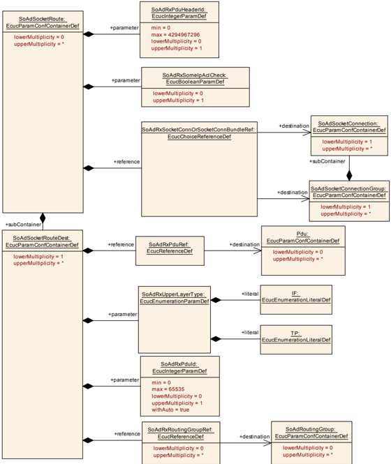

#### 9.2.13. SoAdSocketRouteDest

| SWS 条目 | [ECUC_SoAd_00114] |
| --- | --- |
| 容器名称 | SoAdSocketRouteDest |
| 父容器 | SoAdSocketRoute |
| 描述 | 描述在 TcpIp 套接字上接收到的报文的上层目标 PDU。该 PDU 可以生成类型为 SOCKET_CONNECTION_ID_16 的元数据项。SoAdSocketRoute 中的多个套接字路由目标只能用于接口类型（IF）的上层，且只能用于引用 SocketConnectionGroup 的 SoAdSocketRoute。在这种情况下，应使用 SoAdRoutingGroup 将每个 SoAdSocketRouteDest 唯一地映射到 SocketConnectionGroup 的不同套接字连接。 |

**配置参数**

| SWS 条目 | [ECUC_SoAd_00116] |
| --- | --- |
| 参数名称 | SoAdRxPduId |
| 父容器 | SoAdSocketRouteDest |
| 描述 | 该唯一标识符用于来自 SoAd 上层的接收取消请求。 |
| 多重性 | 0..1 |
| 类型 | EcucIntegerParamDef |
| 取值范围 | 0 .. 65535 |
| 默认值 | - |
| Post-Build 变体多重性 | true |
| Post-Build 变体值 | true |
| 多重性配置类 | Pre-compile time：X（VARIANT-PRE-COMPILE）；Link time：X（VARIANT-LINK-TIME）；Post-build time：X（VARIANT-POST-BUILD） |
| 值配置类 | Pre-compile time：X（VARIANT-PRE-COMPILE）；Link time：X（VARIANT-LINK-TIME）；Post-build time：X（VARIANT-POST-BUILD） |
| 作用域/依赖 | scope: ECU（withAuto = true） |

| SWS 条目 | [ECUC_SoAd_00115] |
| --- | --- |
| 参数名称 | SoAdRxUpperLayerType |
| 父容器 | SoAdSocketRouteDest |
| 描述 | 指定上层接口类型（在存在多个 RxPdu 的情况下必须为 "IF"）。 |
| 多重性 | 1 |
| 类型 | EcucEnumerationParamDef |
| 取值范围 | IF：IF 接口 |
| 取值范围 | TP：TP 接口 |
| Post-Build 变体值 | true |
| 值配置类 | Pre-compile time：X（VARIANT-PRE-COMPILE）；Link time：X（VARIANT-LINK-TIME）；Post-build time：X（VARIANT-POST-BUILD） |
| 作用域/依赖 | scope: ECU |

| SWS 条目 | [ECUC_SoAd_00038] |
| --- | --- |
| 参数名称 | SoAdRxPduRef |
| 父容器 | SoAdSocketRouteDest |
| 描述 | 对全局 PDU 结构的引用。 |
| 多重性 | 1 |
| 类型 | 对 Pdu 的引用 |
| Post-Build 变体值 | true |
| 值配置类 | Pre-compile time：X（VARIANT-PRE-COMPILE）；Link time：X（VARIANT-LINK-TIME）；Post-build time：X（VARIANT-POST-BUILD） |
| 作用域/依赖 | scope: ECU |

| SWS 条目 | [ECUC_SoAd_00117] |
| --- | --- |
| 参数名称 | SoAdRxRoutingGroupRef |
| 父容器 | SoAdSocketRouteDest |
| 描述 | 对路由组的引用。如果父 SoAdSocketRoute 包含多于一个 SoAdSocketRouteDest，则为必填。 |
| 多重性 | 0..* |
| 类型 | 对 SoAdRoutingGroup 的引用 |
| Post-Build 变体多重性 | true |
| Post-Build 变体值 | true |
| 多重性配置类 | Pre-compile time：X（VARIANT-PRE-COMPILE）；Link time：X（VARIANT-LINK-TIME）；Post-build time：X（VARIANT-POST-BUILD） |
| 值配置类 | Pre-compile time：X（VARIANT-PRE-COMPILE）；Link time：X（VARIANT-LINK-TIME）；Post-build time：X（VARIANT-POST-BUILD） |
| 作用域/依赖 | scope: local 依赖：同一个 SoAdRoutingGroup 不得被多个 SoAdSocketRouteDest 引用。 |

#### 9.2.14. SoAdPduRoute

| SWS 条目 | [ECUC_SoAd_00007] |
| --- | --- |
| 容器名称 | SoAdPduRoute |
| 父容器 | SoAdConfig |
| 描述 | 描述 PDU 传输时从 SoAd 上层到 TCP/IP 协议栈中套接字的路径。该 PDU 可以使用类型为 SOCKET_CONNECTION_ID_16 的元数据项。 |

**配置参数**

| SWS 条目 | [ECUC_SoAd_00160] |
| --- | --- |
| 参数名称 | SoAdTxPduCollectionSemantics |
| 父容器 | SoAdPduRoute |
| 描述 | 指定该 PDU 应使用排队（**queued**）还是最后者最优（**last-is-best**）语义进行收集。该参数仅在 PDU 收集功能使能时相关。仅当相关上层配置为 SoAdIfTriggerTransmit 设置为 TRUE 时，才应将其设置为 SOAD_COLLECT_LAST_IS_BEST。 |
| 多重性 | 1 |
| 类型 | EcucEnumerationParamDef |
| 取值范围 | SOAD_COLLECT_LAST_IS_BEST：PDU 数据将在传输执行前通过 &lt;Up&gt;_[SoAd][If]TriggerTransmit 获取。 |
| 取值范围 | SOAD_COLLECT_QUEUED：PDU 数据将在 SoAd_IfTransmit API 的上下文中立即存储。 |
| 默认值 | SOAD_COLLECT_QUEUED |
| Post-Build 变体值 | true |
| 值配置类 | Pre-compile time：X（VARIANT-PRE-COMPILE）；Link time：X（VARIANT-LINK-TIME）；Post-build time：X（VARIANT-POST-BUILD） |
| 作用域/依赖 | scope: local 依赖：SoAdSocketnPduUdpTxBufferMin、SoAdIfTriggerTransmit |

| SWS 条目 | [ECUC_SoAd_00031] |
| --- | --- |
| 参数名称 | SoAdTxPduId |
| 父容器 | SoAdPduRoute |
| 描述 | 来自 PDU 路由器的 PDU 的 Tx PDU ID。 |
| 多重性 | 1 |
| 类型 | EcucIntegerParamDef（为该参数生成符号名称） |
| 取值范围 | 0 .. 65535 |
| 默认值 | - |
| Post-Build 变体值 | false |
| 值配置类 | Pre-compile time：X（All Variants）；Link time：-；Post-build time：- |
| 作用域/依赖 | scope: ECU |

| SWS 条目 | [ECUC_SoAd_00118] |
| --- | --- |
| 参数名称 | SoAdTxUpperLayerType |
| 父容器 | SoAdPduRoute |
| 描述 | 指定上层接口类型（在存在多个 PduRoute 的情况下必须为 "IF"）。 |
| 多重性 | 1 |
| 类型 | EcucEnumerationParamDef |
| 取值范围 | IF：IF 接口 |
| 取值范围 | TP：TP 接口 |
| Post-Build 变体值 | true |
| 值配置类 | Pre-compile time：X（VARIANT-PRE-COMPILE）；Link time：X（VARIANT-LINK-TIME）；Post-build time：X（VARIANT-POST-BUILD） |
| 作用域/依赖 | scope: ECU |

| SWS 条目 | [ECUC_SoAd_00030] |
| --- | --- |
| 参数名称 | SoAdTxPduRef |
| 父容器 | SoAdPduRoute |
| 描述 | 对全局 PDU 结构的引用。 |
| 多重性 | 1 |
| 类型 | 对 Pdu 的引用 |
| Post-Build 变体值 | true |
| 值配置类 | Pre-compile time：X（VARIANT-PRE-COMPILE）；Link time：X（VARIANT-LINK-TIME）；Post-build time：X（VARIANT-POST-BUILD） |
| 作用域/依赖 | scope: ECU |

**包含的容器**

| 容器名称 | 多重性 | 作用域/依赖 |
| --- | --- | --- |
| SoAdPduRouteDest | 1..* | 指定 PDU 路由目标的容器。 |

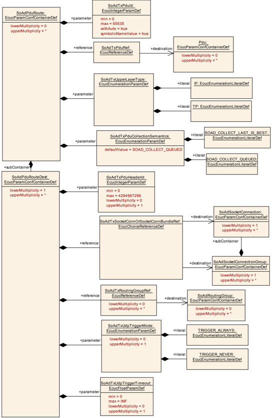

#### 9.2.15. SoAdPduRouteDest

| SWS 条目 | [ECUC_SoAd_00119] |
| --- | --- |
| 容器名称 | SoAdPduRouteDest |
| 父容器 | SoAdPduRoute |
| 描述 | 指定 PDU 路由目标。 |

**配置参数**

| SWS 条目 | [ECUC_SoAd_00120] |
| --- | --- |
| 参数名称 | SoAdTxPduHeaderId |
| 父容器 | SoAdPduRouteDest |
| 描述 | 如果使能了 PDU 头选项，则为要在 TCP/IP 连接上发送的 ID。 |
| 多重性 | 0..1 |
| 类型 | EcucIntegerParamDef |
| 取值范围 | 0 .. 4294967296 |
| 默认值 | - |
| Post-Build 变体多重性 | true |
| Post-Build 变体值 | true |
| 多重性配置类 | Pre-compile time：X（VARIANT-PRE-COMPILE）；Link time：X（VARIANT-LINK-TIME）；Post-build time：X（VARIANT-POST-BUILD） |
| 值配置类 | Pre-compile time：X（VARIANT-PRE-COMPILE）；Link time：X（VARIANT-LINK-TIME）；Post-build time：X（VARIANT-POST-BUILD） |
| 作用域/依赖 | scope: local 依赖：对于与某 SoAdSocketConnection 相关的 SoAdPduRouteDest，应配置该参数，前提是该 SoAdSocketConnection 属于将 SoAdPduHeaderEnable 设置为 TRUE 的 SoAdSocketConnectionGroup。 |

| SWS 条目 | [ECUC_SoAd_00136] |
| --- | --- |
| 参数名称 | SoAdTxUdpTriggerMode |
| 父容器 | SoAdPduRouteDest |
| 描述 | 指定 PDU 是否触发 nPduUdpTxBuffer 的传输。如果该参数设置为 TRIGGER_NEVER，SoAd 应为相关套接字连接使用 nPduUdpTxBuffer。nPduUdpTxBuffer 只能用于具有 IF API 的上层，即只有当属于相关套接字连接的所有上层的 SoAdTxUpperLayerType 都设置为 "IF" 时，才应将该参数设置为 TRIGGER_NEVER。该参数仅与 UDP 连接相关。 |
| 多重性 | 0..1 |
| 类型 | EcucEnumerationParamDef |
| 取值范围 | TRIGGER_ALWAYS：PDU 触发传输 |
| 取值范围 | TRIGGER_NEVER：PDU 不触发传输 |
| Post-Build 变体多重性 | true |
| Post-Build 变体值 | true |
| 多重性配置类 | Pre-compile time：X（VARIANT-PRE-COMPILE）；Link time：X（VARIANT-LINK-TIME）；Post-build time：X（VARIANT-POST-BUILD） |
| 值配置类 | Pre-compile time：X（VARIANT-PRE-COMPILE）；Link time：X（VARIANT-LINK-TIME）；Post-build time：X（VARIANT-POST-BUILD） |
| 作用域/依赖 | scope: local 依赖：SoAdSocketProtocol、SoAdTxUpperLayerType |

| SWS 条目 | [ECUC_SoAd_00150] |
| --- | --- |
| 参数名称 | SoAdTxUdpTriggerTimeout |
| 父容器 | SoAdPduRouteDest |
| 描述 | 指定将该 PDU 放入缓冲区后，最迟应在该超时时间（单位：秒）内传输 nPduUdpTxBuffer。该可选参数仅在 SoAdTxUdpTriggerMode 为 TRIGGER_NEVER 时相关。 |
| 多重性 | 0..1 |
| 类型 | EcucFloatParamDef |
| 取值范围 | [0 .. INF] |
| 默认值 | - |
| Post-Build 变体多重性 | true |
| Post-Build 变体值 | true |
| 多重性配置类 | Pre-compile time：X（VARIANT-PRE-COMPILE）；Link time：X（VARIANT-LINK-TIME）；Post-build time：X（VARIANT-POST-BUILD） |
| 值配置类 | Pre-compile time：X（VARIANT-PRE-COMPILE）；Link time：X（VARIANT-LINK-TIME）；Post-build time：X（VARIANT-POST-BUILD） |
| 作用域/依赖 | scope: local 依赖：SoAdTxUdpTriggerMode |

| SWS 条目 | [ECUC_SoAd_00123] |
| --- | --- |
| 参数名称 | SoAdTxRoutingGroupRef |
| 父容器 | SoAdPduRouteDest |
| 描述 | 对路由组的引用。 |
| 多重性 | 0..* |
| 类型 | 对 SoAdRoutingGroup 的引用 |
| Post-Build 变体多重性 | true |
| Post-Build 变体值 | true |
| 多重性配置类 | Pre-compile time：X（VARIANT-PRE-COMPILE）；Link time：X（VARIANT-LINK-TIME）；Post-build time：X（VARIANT-POST-BUILD） |
| 值配置类 | Pre-compile time：X（VARIANT-PRE-COMPILE）；Link time：X（VARIANT-LINK-TIME）；Post-build time：X（VARIANT-POST-BUILD） |
| 作用域/依赖 | scope: local |

| SWS 条目 | [ECUC_SoAd_00034] |
| --- | --- |
| 参数名称 | SoAdTxSocketConnOrSocketConnBundleRef |
| 父容器 | SoAdPduRouteDest |
| 描述 | 对要在其上发送该 PDU 的 SocketConnection 或 SocketConnectionGroup 的选择引用。对 SocketConnectionGroup 的引用仅应用于具有 IF API 的上层。 |
| 多重性 | 1 |
| 类型 | 对 [ SoAdSocketConnection, SoAdSocketConnectionGroup ] 的选择引用 |
| Post-Build 变体值 | true |
| 值配置类 | Pre-compile time：X（VARIANT-PRE-COMPILE）；Link time：X（VARIANT-LINK-TIME）；Post-build time：X（VARIANT-POST-BUILD） |
| 作用域/依赖 | scope: local 依赖：SoAdTxUpperLayerType |

#### 9.2.16. SoAdRoutingGroup

| SWS 条目 | [ECUC_SoAd_00109] |
| --- | --- |
| 容器名称 | SoAdRoutingGroup |
| 父容器 | SoAdConfig |
| 描述 | 每个容器描述一个可被使能或禁止的特定路由组。路由组由 PDU 组成。PDU 的路由既可以是由 SoAd PduRoute 指定的、从上层到 TCP/IP 协议栈中 TCP 或 UDP 套接字的 PDU 转发，也可以是由 SoAdSocketRoute 指定的反方向路由。 |

**配置参数**

| SWS 条目 | [ECUC_SoAd_00121] |
| --- | --- |
| 参数名称 | SoAdRoutingGroupId |
| 父容器 | SoAdRoutingGroup |
| 描述 | 路由组的唯一 ID。 |
| 多重性 | 1 |
| 类型 | EcucIntegerParamDef（为该参数生成符号名称） |
| 取值范围 | 0 .. 65535 |
| 默认值 | - |
| Post-Build 变体值 | false |
| 值配置类 | Pre-compile time：X（All Variants）；Link time：-；Post-build time：- |
| 作用域/依赖 | scope: ECU（withAuto = true） |

| SWS 条目 | [ECUC_SoAd_00122] |
| --- | --- |
| 参数名称 | SoAdRoutingGroupIsEnabledAtInit |
| 父容器 | SoAdRoutingGroup |
| 描述 | 如果设置为 true，该路由组将在初始化 SoAd 模块后被使能（即在 SoAd_Init 函数中使能）。 |
| 多重性 | 1 |
| 类型 | EcucBooleanParamDef |
| 默认值 | - |
| Post-Build 变体值 | true |
| 值配置类 | Pre-compile time：X（VARIANT-PRE-COMPILE）；Link time：X（VARIANT-LINK-TIME）；Post-build time：X（VARIANT-POST-BUILD） |
| 作用域/依赖 | scope: local |

| SWS 条目 | [ECUC_SoAd_00146] |
| --- | --- |
| 参数名称 | SoAdRoutingGroupTxTriggerable |
| 父容器 | SoAdRoutingGroup |
| 描述 | 指定与该路由组所引用的 PduRouteDest 容器相关的 If-TxPDU 是否可以通过 SoAd_IfRoutingGroupTransmit 触发（TRUE）或不能触发（FALSE）。 |
| 多重性 | 1 |
| 类型 | EcucBooleanParamDef |
| 默认值 | false |
| Post-Build 变体值 | false |
| 值配置类 | Pre-compile time：X（All Variants）；Link time：-；Post-build time：- |
| 作用域/依赖 | scope: local |

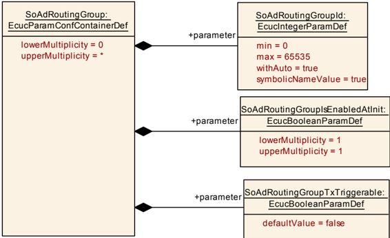

### 9.3. 发布信息

有关详细信息，请参阅 SWS\_BSWGeneral [2] 中第 10.3 章"发布信息"（**Published Information**）。

## B. AUTOSAR 可追溯项变更历史

请注意，本章中的列表还包括在后续版本中已从规范中移除的可追溯项。这些项不会以超链接的形式出现在文档中。

### B.1. 本文档按 AUTOSAR 发布版本 R23-11 的可追溯项历史

#### B.1.1. R23-11 中新增的规格项

```
[SWS_SoAd_00771] [SWS_SoAd_00772] [SWS_SoAd_00773] [SWS_SoAd_00774] [SWS_SoAd_00775] [SWS_SoAd_00776]
```

#### B.1.2. R23-11 中变更的规格项

```
[SWS_SoAd_00197] [SWS_SoAd_00559] [SWS_SoAd_00563] [SWS_SoAd_00692] [SWS_SoAd_00764]
```

#### B.1.3. R23-11 中删除的规格项

```
none
```

<section id="wechat">

<h4>微信扫一扫，获取更多及时资讯</h4>


</section>
