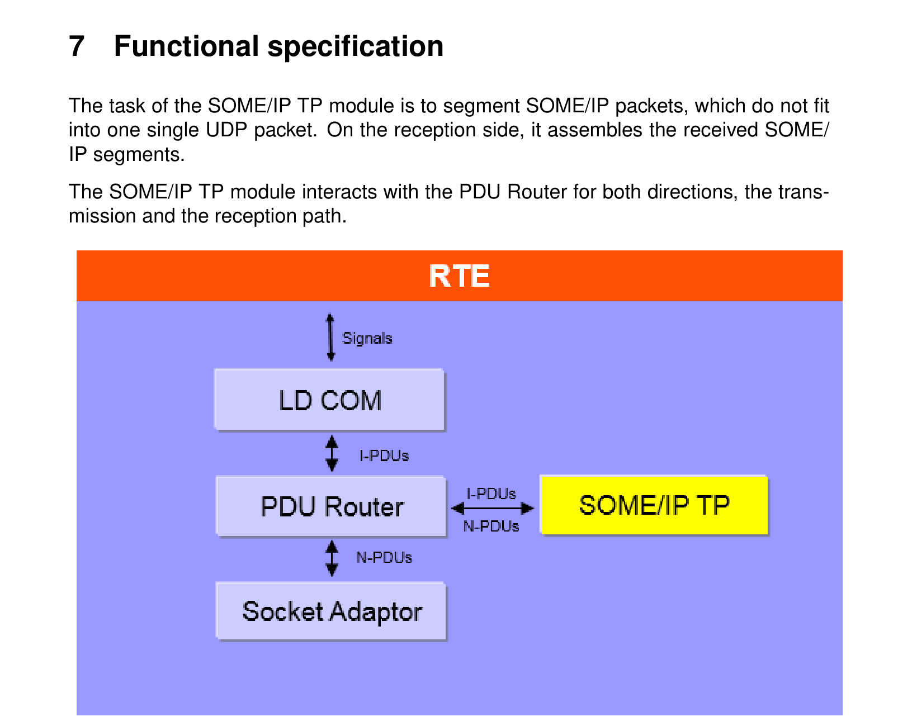
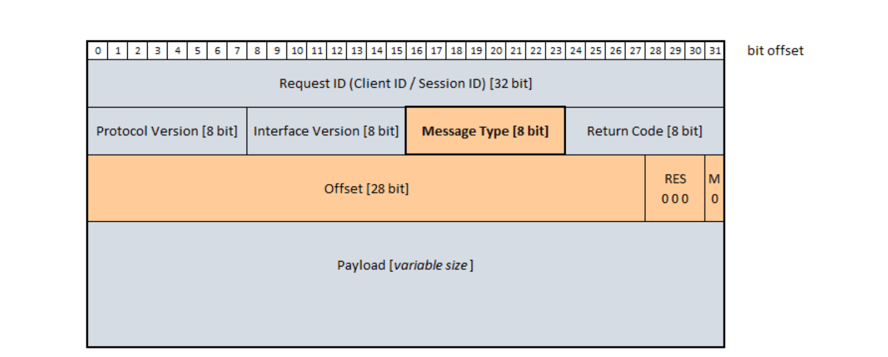
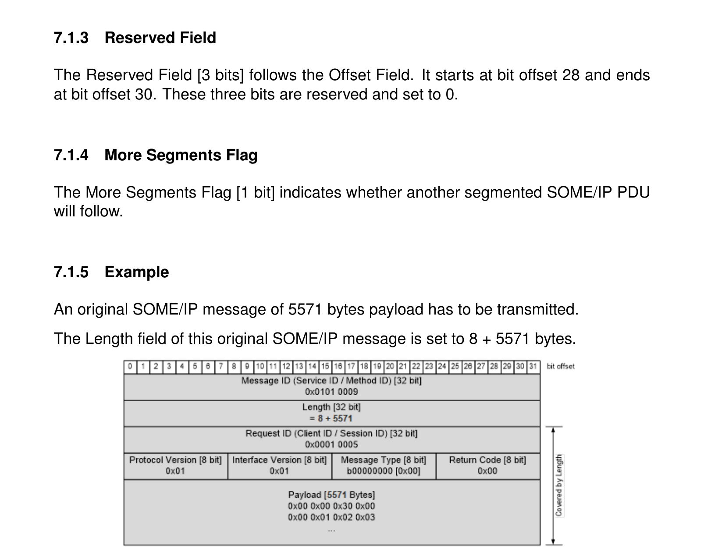
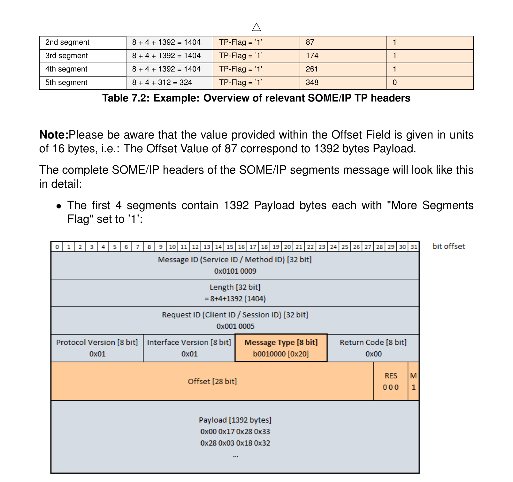
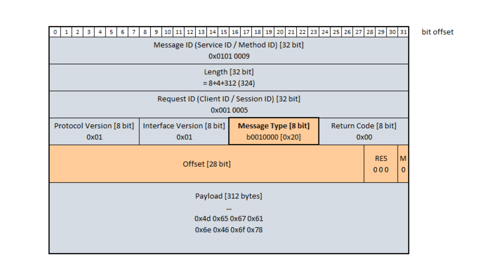
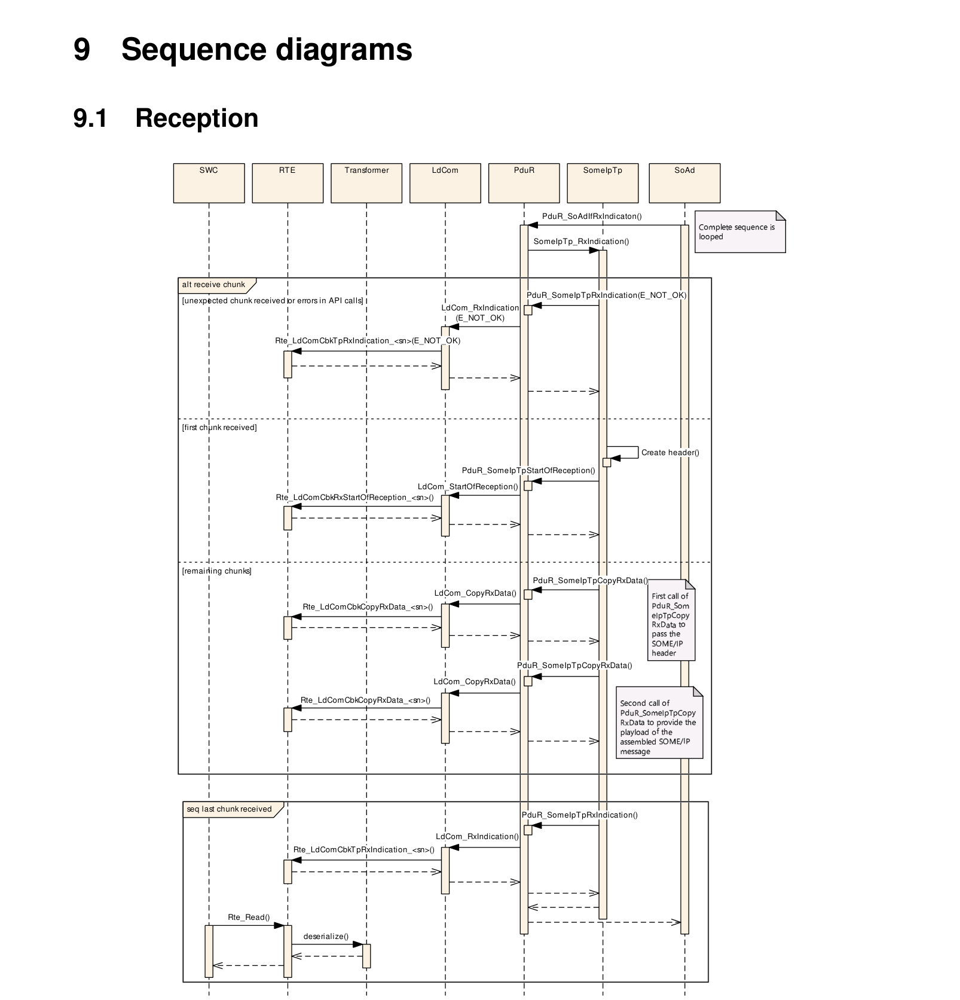
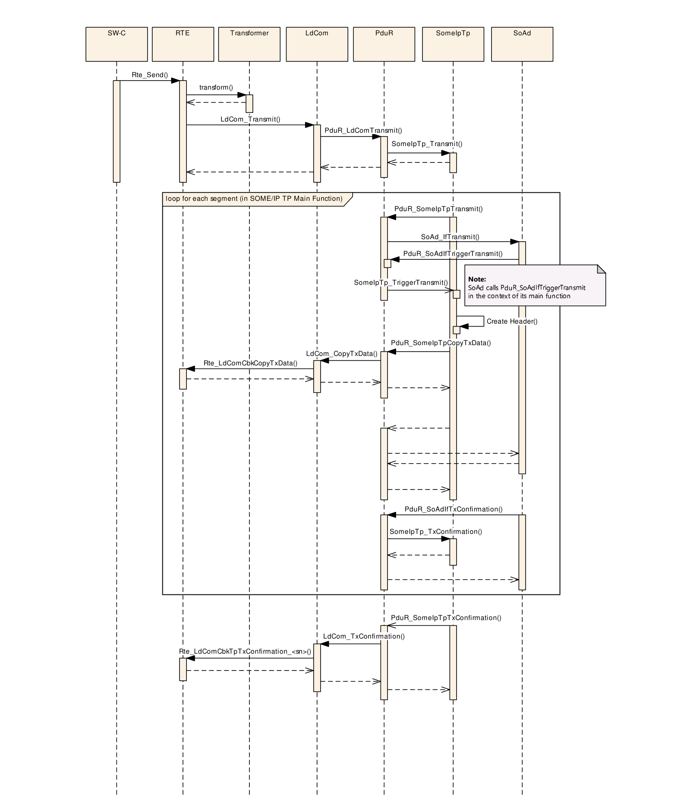
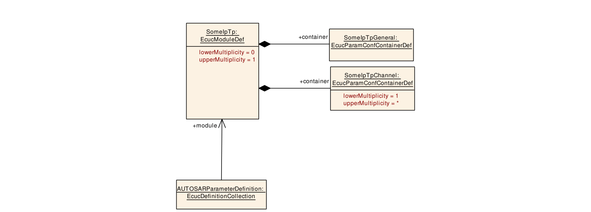

## 1. 简介和功能概述

本规范规定AUTOSAR基础软件模块SOME/IP TP（**SOME/IP TP**）的功能、API和配置。

SOME/IP TP模块的任务是对无法放入单个UDP数据包的SOME/IP数据包进行分段。在接收侧，它重组接收到的SOME/IP段。

## 2. 缩略语

下面的词汇表包含与SOME/IP传输协议模块相关、但未包含在[\[1, AUTOSAR 术语表\]](#ref-1)中的缩略语和缩写。

**SOME/IP**

> 基于IP的可扩展面向服务中间件（**Scalable service-Oriented MiddlewarE over IP**）。

## 3. 相关文档

### 3.1. 输入文件和相关标准与规范

<a id="ref-1"></a>[1] Glossary AUTOSAR\_FO\_TR\_Glossary
<a id="ref-2"></a>[2] General Specification of Basic Software Modules AUTOSAR\_CP\_SWS\_BSWGeneral
<a id="ref-3"></a>[3] General Requirements on Basic Software Modules AUTOSAR\_CP\_SRS\_BSWGeneral
<a id="ref-4"></a>[4] Layered Software Architecture AUTOSAR\_CP\_EXP\_LayeredSoftwareArchitecture
<a id="ref-5"></a>[5] Requirements on SOME/IP Protocol AUTOSAR\_FO\_RS\_SOMEIPProtocol
<a id="ref-6"></a>[6] SOME/IP Protocol Specification AUTOSAR\_FO\_PRS\_SOMEIPProtocol
<a id="ref-7"></a>[7] Specification of PDU Router AUTOSAR\_CP\_SWS\_PDURouter

### 3.2. 相关规范

AUTOSAR提供了基础软件模块的通用规范[\[2, SWS BSW通用规范\]](#ref-2)，该规范同样对SOME/IP传输协议有效。

因此，SWS BSW通用规范应被视为SOME/IP传输协议的附加规范和必备规范。

[\[1, AUTOSAR 术语表\]](#ref-1) [\[2, SWS BSW通用规范\]](#ref-2) [\[3, SRS通用规范\]](#ref-3) [\[4, EXP分层软件架构\]](#ref-4) [\[5, RS SOME/IP协议\]](#ref-5) [\[6, PRS SOME/IP协议\]](#ref-6) [\[7, SWS PDU路由器\]](#ref-7)

## 4. 约束和假设

### 4.1. 限制

SOME/IP TP是一个用于对SOME/IP消息进行分段的简单协议。它既不实现重传机制，也不对接收到的SOME/IP段进行重新排序。

这些限制旨在节省接收侧的运行时间和内存资源。尽管如此，这是对AUTOSAR SOME/IP协议规范（PRS\_SOMEIP\_00747至PRS\_SOMEIP\_00754）的偏离。

这些限制的理由是典型的用例，即大型SOME/IP消息的「流式传输」（**streaming**）。

### 4.2. 汽车域的适用性

本模块适用于SOME/IP通信。

## 5. 对其他模块的依赖

### 5.1. AUTOSAR PDU路由器

SOME/IP TP模块在发送路径和接收路径两个方向上都使用PduR。

### 5.2. AUTOSAR默认错误跟踪器

为了能够报告开发错误，SOME/IP TP模块必须能够访问默认错误跟踪器的错误钩子。

## 6. 功能规格

SOME/IP TP模块的任务是对无法放入单个UDP数据包的SOME/IP数据包进行分段。在接收侧，它组装接收到的SOME/IP段。

SOME/IP TP模块在发送和接收路径两个方向上都与PDU路由器交互。



### 6.1. SOME/IP报头总览

本章描述与SOME/IP消息分段相关的SOME/IP报头的相关部分。

SOME/IP报头的消息类型（**Message Type**）字段包含一个位，该位将SOME/IP PDU标记为原始SOME/IP消息的一个段。每个被分段的SOME/IP消息都会向SOME/IP报头添加SOME/IP TP特定字段。

这些字段包含用于原始大型SOME/IP消息的分段和重组的控制信息。它们的用法在以下各章中描述。



**注意：** 只有当TP标志（**TP-Flag**）被设置为「1」时，偏移字段（**Offset Field**）、保留位（**Reserved bits**）和更多段标志（**More Segment Flag**）才存在。

#### 6.1.1. 消息类型字段

消息类型字段包含TP标志，它将该SOME/IP消息标记为原始SOME/IP消息的一个SOME/IP段。

表7.1：TP标志的位置（**Location of the TP-Flag**）

|  | 消息类型 [8位] |  |  |  |  |  |  |  |
| --- | --- | --- | --- | --- | --- | --- | --- | --- |
| 位偏移 | 16 | 17 | 18 | 19 | 20 | 21 | 22 | 23 |
| 值 | x | x | 0/1 | x | x | x | x | x |
| 名称 | 忽略 | 忽略 | TP标志 | 忽略 | 忽略 | 忽略 | 忽略 | 忽略 |

#### 6.1.2. 偏移字段

偏移字段[28位]紧跟在返回码字段之后。它从位偏移0开始，到位偏移27结束。其中包含的值按照前一个已发送/已接收SOME/IP段的有效载荷长度，在每发送/接收一个段之后递增。

偏移字段包含以16字节为单位的偏移值（**Offset Value**）。（例如：如果偏移字段设置为92，则到目前为止已发送1472字节的有效载荷。）本文档的其余部分将使用这两个不同的术语。

**注意：** 偏移字段中提供的有效载荷长度不包括SOME/IP报头所需的字节。

#### 6.1.3. 保留字段

保留字段[3位]跟在偏移字段之后。它从位偏移28开始，到位偏移30结束。这三个位是保留位，设置为0。

#### 6.1.4. 更多段标志

更多段标志[1位]指示是否还有另一个分段的SOME/IP PDU将随后到来。

#### 6.1.5. 示例

需要发送一条有效载荷为5571字节的原始SOME/IP消息。

该原始SOME/IP消息的长度字段被设置为8 + 5571字节。



这条原始SOME/IP消息现在将被分段为5个连续的SOME/IP段。在本示例中，这些段的每个有效载荷最多承载1392字节。

对于这些段，SOME/IP TP模块添加了附加的TP字段（标为红色）。SOME/IP的长度字段承载SOME/IP段的总长度，包括用于请求ID、协议版本、接口版本、消息类型和返回码的8字节。由于添加了TP字段（4字节），该长度信息扩展了4个附加的SOME/IP TP字节。

下表概述了每个SOME/IP段的相关SOME/IP报头设置：

表7.2：示例：相关SOME/IP TP报头的总览（**Example: Overview of relevant SOME/IP TP headers**）

|  | 长度（字节） | 消息类型 [TP标志] | 偏移值 | 更多段标志 |
| --- | --- | --- | --- | --- |
| 第1段 | 8 + 4 + 1392 = 1404 | TP标志 = '1' | 0 | 1 |
| 第2段 | 8 + 4 + 1392 = 1404 | TP标志 = '1' | 87 | 1 |
| 第3段 | 8 + 4 + 1392 = 1404 | TP标志 = '1' | 174 | 1 |
| 第4段 | 8 + 4 + 1392 = 1404 | TP标志 = '1' | 261 | 1 |
| 第5段 | 8 + 4 + 312 = 324 | TP标志 = '1' | 348 | 0 |

**注意：** 请注意，偏移字段中提供的值以16字节为单位给出，即：偏移值87对应1392字节的有效载荷。

SOME/IP段消息的完整SOME/IP报头细节如下：

- 前4个段各包含1392字节有效载荷，「更多段标志」设置为'1'。
- 最后一段（即第5段）包含原始5771字节有效载荷中剩余的312字节有效载荷。最后一段的「更多段标志」设置为'0'。





### 6.2. SOME/IP消息的分段（发送路径）

以下各章描述SOME/IP TP模块对SOME/IP消息进行分段所需的活动。

#### 6.2.1. SOME/IP段的尺寸

SOME/IP TP模块应为通过SomeIpTp\_Transmit()调用的PduInfoPtr参数传递的每个PDU ID单独记住PDU长度。

**注意：**

SOME/IP TP模块需要该信息来计算要发送的SOME/IP段的有效载荷尺寸、偏移值和更多段标志。

生成的SOME/IP段的数量应尽可能少。

**注意：** 这意味着SOME/IP TP模块应始终尝试使用最大允许的分段尺寸。

每个被分段的SOME/IP消息的尺寸应由12字节的SOME/IP报头与有效载荷字节本身之和构成。

SOME/IP TP模块应使用参数SomeIpTpTxNPduRef推导被分段的SOME/IP PDU的最大可能尺寸。

SOME/IP TP模块生成的被分段SOME/IP PDU不应大于从参数SomeIpTpTxNPduRef推导出的尺寸。

除最后一段外，每个被分段的SOME/IP消息的有效载荷都必须是16字节的倍数。

**注意：**

最后一段可以由奇数有效载荷或不能被16整除的有效载荷组成。所包含的有效载荷字节数被写入SOME/IP报头的长度字段中。

SOME/IP TP模块应为通过API SomeIpTp\_Transmit()的PduInfoPtr参数传递的每个PDU ID单独缓冲指向元数据的指针，并在为每个段调用PduR\_SomeIpTpTransmit()时转发该信息。

#### 6.2.2. SOME/IP段的报头

为每个SOME/IP段生成的每个SOME/IP报头都被设置为以下值：

以下字段从上层接收：

- 请求ID [32位]——派生值
- 协议版本 [8位]——派生值
- 接口版本 [8位]——派生值
- 消息类型 [8位]——计算值
- 返回码 [8位]——派生值

以下字段由SOME/IP TP模块添加：

- 偏移 [28位]——计算值
- 保留位 [3位]——静态设置为'000'
- 更多段标志 [1位]——计算值

SOME/IP TP模块应为由第一次调用PduR\_SomeIpTpCopyTxData()（由API调用SomeIpTp\_Transmit()触发）所返回的每个PDU ID，单独存储SOME/IP报头的请求ID、协议版本、接口版本、消息类型和返回码。

**注意：**

SOME/IP报头包含在原始SOME/IP PDU总长度的前8字节中。总长度通过API调用SomeIpTp\_Transmit()提供。

如果所提供的SDU能放入单个PDU，则所提供的SOME/IP报头应不加修改地使用。

如果所提供的SDU不能放入单个SOME/IP PDU，则SOME/IP TP模块应为将要通过PduR发送到总线上的每个SOME/IP段，将消息类型的TP标志设置为'1'。

消息类型字段中包含的所有其他位应保持不变。

SOME/IP TP模块应为将要发送到总线上的每个SOME/IP段创建并附加偏移字段、保留位和更多段标志。

第一个SOME/IP段的偏移字段应设置为'0'。

对于每个成功发送的SOME/IP段，SOME/IP TP模块应将偏移字段的值增加前一个SOME/IP段所发送的字节数除以16的商。

SOME/IP TP模块应由发送方将保留位静态设置为'000'，并且接收方应忽略它们。

除最后一个SOME/IP段外，SOME/IP TP模块应将更多段标志设置为'1'。

对于最后一个SOME/IP段，SOME/IP TP模块应将更多段标志设置为'0'。

#### 6.2.3. SOME/IP段的发送

如果调用了API SomeIpTp\_Transmit()，SOME/IP TP模块应检查所提供的PDU ID是否有正在进行的分段。

如果在该PDU ID没有正在进行分段时调用了API SomeIpTp\_Transmit()，则SOME/IP TP模块应按以下顺序执行以下步骤：

- 记住所提供的PDU长度（提供的PduInfoPtr）。
- 推导出每个被分段的SOME/IP PDU应使用的PDU ID（见SomeIpTpTxNPduRef）。
- 计算第一个段的SOME/IP尺寸（考虑报头和有效载荷）。
- 从SomeIpTp\_MainFunctionTx()以推导出的PDU ID和计算出的PDU尺寸调用API PduR\_SomeIpTpTransmit()，并将SduDataPtr设置为NULL\_PTR。

如果在该PDU ID没有正在进行分段时调用了API SomeIpTpTransmit()，且PduR\_SomeIpTpTransmit()返回的不是E\_OK，则SomeIpTpTransmit()应返回E\_NOT_OK。

**注意：**

由于发送请求在分段过程开始之前就被拒绝，因此不应发生对PduR\_SomeIpTpTxConfirmation()的后续调用。

当调用了API SomeIpTp\_TriggerTransmit()时，应创建SOME/IP段的报头，使用为该段计算出的有效载荷调用API PduR\_SomeIpTpCopyTxData()，并将参数retry设置为NULL\_PTR。

除最后一段外的所有后续SOME/IP TP段的尺寸，应使用参数SomeIpTpTxNPduRef按被分段的SOME/IP PDU的最大可能尺寸推导。

SOME/IP TP模块应校验PduR\_SomeIpTpCopyTxData()通过availableDataPtr返回的可用缓冲区是否大于（除最后一段外）或等于（最后一段）SOME/IP TP段的尺寸。

SOME/IP TP模块应使用参数SomeIpTpNPduSeparationTime，对同一PDU ID的后续API PduR\_SomeIpTpTransmit()调用进行去抖动（**debounce**）。它定义了调用SomeIpTp\_TxConfirmation()与后续调用API PduR\_SomeIpTpTransmit()之间的时间跨度。如果SomeIpTpTxBurstSize被配置为大于1的值，则SOME/IP TP模块对同一PDU ID只应每SomeIpTpTxBurstSize个段去抖动一次。

如果原始SOME/IP PDU的最后一个SOME/IP段已被成功发送（即对最后一次调用PduR\_SomeIpTpCopyTxData()发生了参数success等于TRUE的SomeIpTp\_TxConfirmation()调用），则SOME/IP TP模块应：

- 调用API PduR\_SomeIpTpTxConfirmation()。

**注意：**

随着PduR\_SomeIpTpTxConfirmation()的调用，分段过程结束。

#### 6.2.4. 拆装过程的中断

如果以当前用于正在进行的分段的PDU ID调用了API SomeIpTp\_Transmit()，则：

- 应返回E\_NOT_OK。
- 应取消该PDU ID正在进行的拆装过程。
- 应以结果设置为E\_NOT_OK调用API PduR\_SomeIpTpTxConfirmation()。
- 应以运行时错误代码SOMEIPTP\_E\_DISASSEMBLY\_INTERRUPT调用API Det\_ReportRuntimeError()。

如果在分段过程进行期间PduR\_SomeIpTpTransmit()返回的不是E\_OK：

- 应取消该PDU ID正在进行的拆装过程。
- 应以结果设置为E\_NOT_OK调用API PduR\_SomeIpTpTxConfirmation()。
- 应以运行时错误代码SOMEIPTP\_E\_DISASSEMBLY\_INTERRUPT调用API Det\_ReportRuntimeError()。

如果以参数success设置为FALSE调用了API SomeIpTp\_TxConfirmation()，则：

- 应取消该PDU ID的拆装过程。
- 应以结果设置为E\_NOT_OK调用API PduR\_SomeIpTpTxConfirmation()。
- 应以运行时错误代码SOMEIPTP\_E\_DISASSEMBLY\_INTERRUPT调用API Det\_ReportRuntimeError()。

如果PduR\_SomeIpTpCopyTxData()通过availableDataPtr返回的可用缓冲区不满足以下条件：

- 大于或等于16字节，
- 大于（除最后一段外）或等于（最后一段）SOME/IP TP段的尺寸，

则SOME/IP TP模块应：

- 取消该PDU ID的拆装过程。
- 以结果设置为E\_NOT_OK调用API PduR\_SomeIpTpTxConfirmation()。
- 以运行时错误代码SOMEIPTP\_E\_DISASSEMBLY\_INTERRUPT调用API Det\_ReportRuntimeError()。

如果某个API PduR\_SomeIpTpCopyTxData()返回的不是BUFREQ\_OK，则：

- 应取消该PDU ID的拆装过程。
- 应以结果设置为E\_NOT_OK调用API PduR\_SomeIpTpTxConfirmation()。
- 应以运行时错误代码SOMEIPTP\_E\_DISASSEMBLY\_INTERRUPT调用API Det\_ReportRuntimeError()。

### 6.3. 接收到的SOME/IP消息的组装（接收路径）

如果以TP标志设置为'0'调用了SomeIpTp\_RxIndication()，SOME/IP TP应紧接着依次调用PduR\_SomeIpTpStartOfReception、PduR\_SomeIpTpCopyRxData()和PduR\_SomeIpTpRxIndication()，并提供所接收的指示。

如果以以下条件调用了SomeIpTp\_RxIndication()：

- TP标志设置为'1'，
- 偏移字段设置为'0'，并且
- 更多段标志设置为'0'，

则SOME/IP TP应紧接着依次调用PduR\_SomeIpTpStartOfReception()、PduR\_SomeIpTpCopyRxData()和SomeIpTp\_RxIndication()，并提供所接收的指示。

如果调用了API SomeIpTp\_RxIndication()，SOME/IP TP模块应从接收到的PDU的前12字节推导出以下SOME/IP报头信息：

- 请求ID [32位]
- 协议版本 [8位]
- 接口版本 [8位]
- 消息类型 [8位]
- 返回码 [8位]
- 偏移 [28位]
- 保留位 [3位]
- 更多段标志 [1位]

如果TP标志未置位且没有活动的组装会话，则只应提取以下参数：

- 请求ID [32位]
- 协议版本 [8位]
- 接口版本 [8位]
- 消息类型 [8位]
- 返回码 [8位]

SOME/IP TP模块应能够为每个PDU ID单独存储偏移字段的值。

SOME/IP TP模块应能够为每个PDU ID单独存储通过一次SomeIpTp\_RxIndication()调用传入的有效载荷字节数。

SOME/IP TP模块应为通过一次SomeIpTp\_RxIndication()调用传递的每个PDU ID单独存储更多段标志的状态。

SOME/IP TP模块应为通过API SomeIpTp\_RxIndication()的PduInfoPtr参数传递的每个PDU ID单独缓冲指向元数据的指针，并在调用PduR\_SomeIpTpStartOfReception时转发该信息。

#### 6.3.1. 接收到偏移为0的SOME/IP段

如果成功接收到偏移字段设置为0的SOME/IP段，SOME/IP TP模块应为每个PDU ID单独存储所接收SOME/IP报头的值。这些值应用作（预期的）后续连续接收SOME/IP段（即偏移字段设置为大于0的段）的参考值。

如果成功接收到偏移字段设置为0的SOME/IP段，则SOME/IP TP模块应：

- 启动由SomeIpTpRxTimeoutTime定义的Rx超时。
- 以从参数SomeIpTpRxSduRef派生的PDU ID、并将TpSduLength设置为'0'调用API PduR\_SomeIpTpStartOfReception()。

**注意：**

TpSduLength设置为'0'向上层指示「未知消息长度」。

如果成功接收到偏移字段设置为0的SOME/IP段，且在SOME/IP TP模块已调用API PduR\_SomeIpTpStartOfReception()之后，SOME/IP TP模块应检查通过bufferSizePtr返回的尺寸。

如果返回的尺寸大于或等于接收到的有效载荷加上所添加SOME/IP报头之和，则SOME/IP TP模块应调用API PduR\_SomeIpTpCopyRxData()，将组装后的SOME/IP消息的SOME/IP报头（不包括SOME/IP TP报头）传递给SOME/IP TP的上层。这应包含以下内容：

- 请求ID [32位]
- 协议版本 [8位]
- 接口版本 [8位]
- 消息类型 [8位]
- 返回码 [8位]

在调用PduR\_SomeIpTpCopyRxData()将组装后的SOME/IP消息的SOME/IP报头（不包括SOME/IP TP报头）传递给SOME/IP TP的上层之后，SOME/IP TP模块应再次调用API PduR\_SomeIpTpCopyRxData()，以提供组装后的SOME/IP消息的有效载荷。

**注意：** 顺序调用PduR\_SomeIpTpCopyRxData()避免了在SOME/IP TP模块中存储SOME/IP TP段，并支持通过跳过4字节（包括偏移字段、保留字段和更多段标志）来恰当地剥离SOME/IP TP报头。

在组装好的SOME/IP报头被传递给上层之前，SOME/IP TP模块应将包含在消息类型中的TP标志重新设置为'0'。

SOME/IP TP模块应为已传递给上层的每个PDU ID单独存储有效载荷字节数。

**注意：**

该信息将用于校验后续SOME/IP段的偏移值。

#### 6.3.2. 接收到偏移大于0的SOME/IP段

如果成功接收到偏移字段大于0的SOME/IP段，SOME/IP TP模块应将接收到的SOME/IP报头字段与存储的、随第一个段（即偏移设置为0时）接收的SOME/IP报头字段的值进行比较：

- 请求ID [32位]
- 协议版本 [8位]
- 接口版本 [8位]
- 消息类型 [8位]
- 返回码 [8位]

如果这些值匹配，则重新启动SomeIpTpRxTimeoutTime并继续组装过程。

SOME/IP TP模块应为已传递给上层的每个PDU ID单独存储有效载荷字节数。

SOME/IP TP模块应将偏移字段的值与自第一个接收到的SOME/IP段（即偏移字段设置为'0'的段）以来已复制的有效载荷字节之和除以16的结果进行比较。

如果该和除以16的结果与当前偏移值匹配，且先前调用API PduR\_SomeIpTpCopyRxData()所提供的bufferSizePtr大于或等于接收到的有效载荷，则以SduLength设置为接收到的有效载荷字节数调用API PduR\_SomeIpTpCopyRxData()。

**注意：**

在偏移字段值大于0的情况下，只将有效载荷字节提供给上层（不带任何SOME/IP报头字段）。

如果成功接收到更多段标志设置为'0'的SOME/IP段，则SOME/IP TP模块应：

- 取消由SomeIpTpRxTimeoutTime定义的Rx超时。
- 在将其余接收到的有效载荷字节复制到上层之后（如上文所定义），调用API PduR\_SomeIpTpRxIndication()。

#### 6.3.3. 组装过程的中断

如果由SomeIpTpRxTimeoutTime定义的Rx超时到期，则：

- 应按照下文的要求中断当前的组装过程。
- 应以运行时错误代码SOMEIPTP\_E\_ASSEMBLY\_INTERRUPT调用API Det\_ReportRuntimeError()。

如果以偏移值大于0调用了API SomeIpTp\_RxIndication()但当前没有会话在运行，则：

- 应忽略接收到的PDU。
- 应以运行时错误代码SOMEIPTP\_E\_INCONSISTENT\_SEQUENCE调用API Det\_ReportRuntimeError()。

**注意：** 此检查表明至少第一个段尚未被接收。

如果SOME/IP TP模块因检测到错误而中断组装过程，则SOME/IP TP模块应：

- 以E\_NOT\_OK为该PDU ID调用API PduR\_SomeIpTpRxIndication()。
- 应取消（如果仍在运行）由SomeIpTpRxTimeoutTime定义的该PDU ID的Rx超时。

**注意：** 中断的可能原因列于下文。

如果SOME/IP TP模块检测到接收到的SOME/IP TP报头不一致（即：请求ID、协议版本、接口版本、消息类型或返回码在所有接收到的段中不相等），则：

- 应按照上文的要求中断当前的组装过程。
- 应以运行时错误代码SOMEIPTP\_E\_INCONSISTENT\_HEADER调用API Det\_ReportRuntimeError()。

如果调用了API SomeIpTp\_RxIndication()且当前有一个会话处于活动状态，则SOME/IP TP模块应检查消息类型的TP标志是否设置为'1'。如果TP标志未设置为'1'，则：

- 应按照上文的要求中断当前的组装过程。
- 应以运行时错误代码SOMEIPTP\_E\_MESSAGE\_TYPE调用API Det\_ReportRuntimeError()。

**报头一致性检查先于TP标志检查**：作为中断组装过程的条件，在检查消息的TP标志之前，SOME/IP TP模块应按照上文的要求检查接收到的SOME/IP TP报头的不一致性。

如果调用了API SomeIpTp\_RxIndication()，则在更多段标志设置为'1'的情况下，SOME/IP TP模块应检查接收到的有效载荷字节是否可以被16整除。如果在这种情况下接收到的有效载荷字节不能被16整除，则：

- 应按照上文的要求中断当前的组装过程。
- 应以运行时错误代码SOMEIPTP\_E\_ASSEMBLY\_INTERRUPT调用API Det\_ReportRuntimeError()。

如果调用了API SomeIpTp\_RxIndication()，则SOME/IP TP模块应检查偏移字段的值。如果以16字节为单位的偏移值与前几个SOME/IP段接收到的有效载荷字节之和不匹配，则：

- 应按照上文的要求中断当前的组装过程。
- 应以运行时错误代码SOMEIPTP\_E\_INCONSISTENT\_SEQUENCE调用API Det\_ReportRuntimeError()。

如果调用了API SomeIpTp\_RxIndication()，则SOME/IP TP模块应检查偏移字段的值。如果接收到的偏移值等于'0'，而前几个SOME/IP段接收到的有效载荷字节大于'0'，则SOME/IP TP模块应按以下顺序执行以下步骤：

- 应按照上文的要求中断当前的组装过程。
- 应以运行时错误代码SOMEIPTP\_E\_INCONSISTENT\_SEQUENCE调用API Det\_ReportRuntimeError()。
- 按照第[6.3.1](#631-接收到偏移为0的someip段)节「接收到偏移为0的SOME/IP段」开始组装过程。

如果API PduR\_SomeIpTpStartOfReception()或PduR\_SomeIpTpCopyRxData()提供的bufferSizePtr小于接收到的数据加上所添加SOME/IP报头（第一个段的情况下）或接收到的有效载荷（任何后续段的情况下）之和，则：

- 应按照上文的要求中断当前的组装过程。
- 应以运行时错误代码SOMEIPTP\_E\_ASSEMBLY\_INTERRUPT调用API Det\_ReportRuntimeError()。

如果API PduR\_SomeIpTpCopyRxData()返回的不是BUFREQ\_OK，则：

- 应按照上文的要求中断该PDU ID的组装过程。
- 应以运行时错误代码SOMEIPTP\_E\_ASSEMBLY\_INTERRUPT调用API Det\_ReportRuntimeError()。

如果API PduR\_SomeIpTpStartOfReception()返回的不是BUFREQ\_OK，则：

- 应停止该PDU ID的组装过程。
- 应以运行时错误代码SOMEIPTP\_E\_ASSEMBLY\_INTERRUPT调用API Det\_ReportRuntimeError()。

### 6.4. 错误分类

文档「基础软件模块通用规范」[\[2, SWS BSW General\]](#ref-2)的「错误处理」一节详细描述了基础软件的错误处理。它首先构成了一个分类方案，包含BSW模块中可能出现的五种错误类型。

在此基础上，以下各小节规定了按相应小节排列的特定错误。

#### 6.4.1. 开发错误

| 错误类型 | 相关错误码 | 错误值 |
| --- | --- | --- |
| SOME/IP TP模块未初始化 | SOMEIPTP\_E\_UNINIT | 0x01 |
| 传入了NULL指针作为参数 | SOMEIPTP\_E\_PARAM\_POINTER | 0x02 |
| 传入了未知参数 | SOMEIPTP\_E\_PARAM | 0x03 |
| 无效的配置集选择 | SOMEIPTP\_E\_INIT\_FAILED | 0x04 |

#### 6.4.2. 运行时错误

| 错误类型 | 相关错误码 | 错误值 |
| --- | --- | --- |
| 消息类型的TP标志被设置为'0' | SOMEIPTP\_E\_MESSAGE\_TYPE | 0x04 |
| 接收到不一致的后续段 | SOMEIPTP\_E\_INCONSISTENT\_SEQUENCE | 0x05 |
| 接收到不一致的报头 | SOMEIPTP\_E\_INCONSISTENT\_HEADER | 0x06 |
| 因上层导致的拆装中断 | SOMEIPTP\_E\_DISASSEMBLY\_INTERRUPT | 0x07 |
| 因上层导致的组装中断 | SOMEIPTP\_E\_ASSEMBLY\_INTERRUPT | 0x08 |

**注意：** 关于运行时错误「SOMEIPTP\_E\_MESSAGE\_TYPE」，对于未分段的消息不会报告DET，而是在不做进一步处理的情况下传递给上层。

#### 6.4.3. 瞬态故障

没有瞬态故障。

#### 6.4.4. 生产错误

没有生产错误。

#### 6.4.5. 扩展生产错误

没有扩展生产错误。

## 7. API规范

### 7.1. 导入的类型

本章列出从以下模块导入的所有类型：

| 模块 | 头文件 | 导入的类型 |
| --- | --- | --- |
| ComStack_Types | ComStack_Types.h | BufReq_ReturnType |
| ComStack_Types | ComStack_Types.h | PduIdType |
| ComStack_Types | ComStack_Types.h | PduInfoType |
| ComStack_Types | ComStack_Types.h | PduLengthType |
| ComStack_Types | ComStack_Types.h | RetryInfoType |
| ComStack_Types | ComStack_Types.h | TpDataStateType |
| Std | Std_Types.h | Std_ReturnType |
| Std | Std_Types.h | Std_VersionInfoType |

### 7.2. 类型定义

#### 7.2.1. SomeIpTp\_ConfigType

| 项目 | 内容 |
| --- | --- |
| 名称 | SomeIpTp_ConfigType |
| 类别 | 结构体（Structure） |
| 元素 | 实现特定（类型：-；说明：-） |
| 描述 | 该类型应至少包含按照第[9](#9-配置规范)章可进行Post-Build配置的所有参数。 |
| 可用性 | SomeIpTp.h |

### 7.3. 函数定义

#### 7.3.1. SomeIpTp\_GetVersionInfo

**说明**：返回本模块的版本信息。服务ID 0x01；同步；可重入；无输入参数；无输入输出参数；输出参数VersionInfo为存储本模块版本信息的位置的指针；无返回值；可通过SomeIpTp.h使用。

```C
void SomeIpTp_GetVersionInfo ( Std_VersionInfoType* VersionInfo )
```

如果API SomeIpTp\_GetVersionInfo()的参数SomeIpTp\_VersionInfoPtr等于NULL\_PTR，且启用了开发错误检测（即SomeIpTpDevErrorDetect设置为TRUE），则函数SomeIpTp\_GetVersionInfo应以开发错误代码SOMEIPTP\_E\_PARAM\_POINTER调用API Det\_ReportError()。

#### 7.3.2. SomeIpTp\_Init

**说明**：初始化SOME/IP TP模块。服务ID 0x02；同步；不可重入；输入参数config为指向SOME/IP TP模块配置结构的基础指针；无输入输出参数；无输出参数；无返回值；可通过SomeIpTp.h使用。

```C
void SomeIpTp_Init ( const SomeIpTp_ConfigType* config )
```

**注意：**

AUTOSAR ECU状态管理器以模块静态配置结构的地址作为参数SomeIpTp\_ConfigPtr调用此SOME/IP TP API服务。

#### 7.3.3. SomeIpTp\_Transmit

**说明**：请求发送一个PDU。服务ID 0x49；同步；对不同PduId可重入，对相同PduId不可重入；输入参数TxPduId为要发送的PDU的标识符；输入参数PduInfoPtr为PDU数据的长度和指针以及指向元数据的指针；无输入输出参数；无输出参数；返回值Std_ReturnType（E_OK：发送请求已被接受；E_NOT_OK：发送请求未被接受）；可通过SomeIpTp.h使用。

```C
Std_ReturnType SomeIpTp_Transmit ( PduIdType TxPduId, const PduInfoType* PduInfoPtr )
```

如果在以SomeIpTp\_Init()初始化SOME/IP TP模块之前调用了SomeIpTp\_Transmit()，该API应以E\_NOT_OK返回并停止新会话。

如果启用了开发错误检测：SomeIpTp\_Transmit()应检查服务SomeIpTp\_Init()是否先前已被调用。如果检查失败，SomeIpTp\_Transmit()应报出开发错误SOMEIPTP\_E\_UNINIT。

如果SomeIpTp\_Transmit()的参数TxPduId具有无效值，且启用了开发错误检测（即SomeIpTpDevErrorDetect设置为TRUE），则应以开发错误代码SOMEIPTP\_E\_PARAM调用API Det\_ReportError()。

如果SomeIpTp\_Transmit()的参数PduInfoPtr等于NULL\_PTR，且启用了开发错误检测（即SomeIpTpDevErrorDetect设置为TRUE），则应以开发错误代码SOMEIPTP\_E\_PARAM\_POINTER调用API Det\_ReportError()。

### 7.4. 回调通知

#### 7.4.1. SomeIpTp\_TriggerTransmit

**说明**：在该API内，上层模块（被调用模块）应检查可用数据是否适合PduInfoPtr->SduLength所报告的缓冲区尺寸。如果适合，它应将其数据复制到PduInfoPtr->SduDataPtr提供的缓冲区中，并在PduInfoPtr->SduLength中更新实际复制数据的长度。如果不适合，它返回E_NOT_OK且不更改PduInfoPtr。服务ID 0x41；同步；对不同PduId可重入，对相同PduId不可重入；输入参数TxPduId为请求发送的SDU的ID；输入输出参数PduInfoPtr包含指向SDU数据应复制到的缓冲区的指针（SduDataPtr）以及SduLength中的可用缓冲区尺寸。返回时，该服务在SduLength中指示已复制SDU数据的长度；无输出参数；返回值Std_ReturnType（E_OK：SDU已复制，SduLength指示已复制的字节数；E_NOT_OK：未复制任何SDU数据。不得使用PduInfoPtr，因为它可能包含NULL指针或指向无效数据）；可通过SomeIpTp.h使用。

```C
Std_ReturnType SomeIpTp_TriggerTransmit ( PduIdType TxPduId, PduInfoType* PduInfoPtr )
```

如果启用了开发错误检测：SomeIpTp\_TriggerTransmit()应检查服务SomeIpTp\_Init()是否先前已被调用。如果检查失败，SomeIpTp\_TriggerTransmit()应报出开发错误SOMEIPTP\_E\_UNINIT。

如果给定的PduInfoPtr->SduLength小于计算出的SOME/IP-TP段尺寸（考虑报头和有效载荷），则SomeIpTp\_TriggerTransmit()不得复制任何数据并返回E\_NOT_OK。

#### 7.4.2. SomeIpTp\_RxIndication

**说明**：来自下层通信接口模块的已接收PDU指示。服务ID 0x42；同步；对不同PduId可重入，对相同PduId不可重入；输入参数RxPduId为所接收PDU的ID；输入参数PduInfoPtr包含所接收PDU的长度（SduLength）、指向包含该PDU的缓冲区的指针（SduDataPtr）以及与该PDU相关的元数据；无输入输出参数；无输出参数；无返回值；可通过SomeIpTp.h使用。

```C
void SomeIpTp_RxIndication ( PduIdType RxPduId, const PduInfoType* PduInfoPtr )
```

如果启用了开发错误检测：SomeIpTp\_RxIndication()应检查服务SomeIpTp\_Init()是否先前已被调用。如果检查失败，SomeIpTp\_RxIndication()应报出开发错误SOMEIPTP\_E\_UNINIT。

#### 7.4.3. SomeIpTp\_TxConfirmation

**说明**：下层通信接口模块确认PDU的发送，或PDU发送失败。服务ID 0x40；同步；对不同PduId可重入，对相同PduId不可重入；输入参数TxPduId为已发送PDU的ID；输入参数result为E_OK：该PDU已发送；E_NOT_OK：该PDU发送失败；无输入输出参数；无输出参数；无返回值；可通过SomeIpTp.h使用。

```C
void SomeIpTp_TxConfirmation ( PduIdType TxPduId, Std_ReturnType result )
```

如果启用了开发错误检测：SomeIpTp\_TxConfirmation()应检查服务SomeIpTp\_Init()是否先前已被调用。如果检查失败，SomeIpTp\_TxConfirmation()应报出开发错误SOMEIPTP\_E\_UNINIT。

### 7.5. 调度函数

#### 7.5.1. SomeIpTp\_MainFunctionTx

**说明**：该函数执行AUTOSAR SOME/IP TP模块发送活动的处理。服务ID 0x03；可通过SchM_SomeIpTp.h使用。

```C
void SomeIpTp_MainFunctionTx ( void )
```

如果之前未曾以SomeIpTp\_Init()初始化AUTOSAR SOME/IP TP模块，则对SomeIpTp\_MainFunctionTx()的调用应直接返回。

#### 7.5.2. SomeIpTp\_MainFunctionRx

**说明**：该函数执行AUTOSAR SOME/IP TP模块接收活动的处理。服务ID 0x04；可通过SchM_SomeIpTp.h使用。

```C
void SomeIpTp_MainFunctionRx ( void )
```

如果之前未曾以SomeIpTp\_Init()初始化AUTOSAR SOME/IP TP模块，则对SomeIpTp\_MainFunctionRx()的调用应直接返回。

### 7.6. 期望接口

本章列出从其他模块所需的所有外部接口。

#### 7.6.1. 必需接口（Mandatory Interfaces）

本章定义为实现模块核心功能所需的所有外部接口。

| API函数 | 头文件 | 描述 |
| --- | --- | --- |
| Det_ReportRuntimeError | Det.h | 报告运行时错误的服务。如果已配置callout，则应调用该callout。 |
| PduR_SomeIpTpCopyRxData | PduR_SomeIpTp.h | 调用此函数以将I-PDU分段（N-PDU）的接收数据提供给上层。每次调用此函数都提供I-PDU数据的下一个部分。剩余缓冲区的尺寸写入bufferSizePtr所指示的位置。 |
| PduR_SomeIpTpCopyTxData | PduR_SomeIpTp.h | 调用此函数以获取I-PDU分段（N-PDU）的发送数据。每次调用此函数都提供I-PDU数据的下一个部分，除非retry->TpDataState为TP_DATARETRY。在这种情况下，该函数从retry->TxTpDataCnt所指示的当前位置偏移处开始重新复制数据。剩余数据的尺寸写入availableDataPtr所指示的位置。 |
| PduR_SomeIpTpRxIndication | PduR_SomeIpTp.h | 在通过TP API接收到I-PDU之后调用，其结果指示发送是否成功。 |
| PduR_SomeIpTpStartOfReception | PduR_SomeIpTp.h | 在开始接收一个N-SDU时调用。该N-SDU可能被分段为多个N-PDU（FF后跟一个或多个CF），也可能由单个N-PDU（SF）组成。当以等于0的TpSduLength调用时，该服务应提供当前可用的最大缓冲区尺寸。 |
| PduR_SomeIpTpTransmit | PduR_SomeIpTp.h | 请求发送一个PDU。 |
| PduR_SomeIpTpTxConfirmation | PduR_SomeIpTp.h | 在I-PDU已在其网络上发送之后调用，其结果指示发送是否成功。 |

#### 7.6.2. 可选接口（Optional Interfaces）

本章定义为实现模块可选功能所需的所有外部接口。

| API函数 | 头文件 | 描述 |
| --- | --- | --- |
| Det_ReportError | Det.h | 报告开发错误的服务。 |

#### 7.6.3. 可配置接口（Configurable interfaces）

不适用。

## 8. 时序图

### 8.1. 接收



### 8.2. 发送

时序图9.2展示了一个场景：按照上文关于发送步骤的要求，对第一个段调用PduR\_SomeIpTpTransmit()被推迟到SomeIpTp\_MainFunction()。



## 9. 配置规范

通常，本章定义配置参数及其到容器中的聚集。为支持本规范，第9.1节描述基本原理。第9.2节规定模块SOME/IP TP的结构（容器）和参数。第9.3节规定模块SOME/IP TP的发布信息。

### 9.1. 如何阅读本章

详情请参阅SWS\_BSWGeneral的第10.1章「配置规范简介」。

### 9.2. 容器与配置参数

以下各章汇总了所有配置参数。参数的详细含义在第6章和第7章中描述。

#### 9.2.1. SomeIpTp

| 项目 | 内容 |
| --- | --- |
| SWS 条目 | [ECUC_SomeIpTp_00001] |
| 模块名称 | SomeIpTp |
| 描述 | SomeIpTp模块的配置。 |
| Post-Build 变体支持 | true |
| 支持的配置变体 | VARIANT-LINK-TIME、VARIANT-POST-BUILD、VARIANT-PRE-COMPILE |



| 包含的容器 | 容器名称 | 多重性 | 作用域/依赖 |
| --- | --- | --- | --- |
| 包含的容器 | SomeIpTpChannel | 1..* | 该容器包含SomeIpTp通道的配置参数。 |
| 包含的容器 | SomeIpTpGeneral | 1 | 该容器包含SomeIpTp模块的通用配置参数。 |

#### 9.2.2. SomeIpTpGeneral

| 项目 | 内容 |
| --- | --- |
| SWS 条目 | [ECUC_SomeIpTp_00002] |
| 容器名称 | SomeIpTpGeneral |
| 父容器 | SomeIpTp |
| 描述 | 该容器包含SomeIpTp模块的通用配置参数。 |
| 配置参数 | 见下方参数表 |

无包含的容器。

| 项目 | 内容 |
| --- | --- |
| SWS 条目 | [ECUC_SomeIpTp_00004] |
| 参数名称 | SomeIpTpDevErrorDetect |
| 父容器 | SomeIpTpGeneral |
| 描述 | 开启或关闭开发错误检测与通知。 |
| 多重性 | 1 |
| 类型 | EcucBooleanParamDef |
| 默认值 | - |
| Post-Build 变体值 | false |
| 值配置类 | Pre-compile time：X（All Variants）；Link time：-；Post-build time：- |
| 作用域/依赖 | scope: local |

| 项目 | 内容 |
| --- | --- |
| SWS 条目 | [ECUC_SomeIpTp_00021] |
| 参数名称 | SomeIpTpRxMainFunctionPeriod |
| 父容器 | SomeIpTpGeneral |
| 描述 | 该参数定义周期调用SomeIpTp_MainFunctionRx的周期时间（秒）。 |
| 多重性 | 1 |
| 类型 | EcucFloatParamDef |
| 茖围 | ]0 .. INF[ |
| 默认值 | - |
| Post-Build 变体值 | false |
| 值配置类 | Pre-compile time：X（All Variants）；Link time：-；Post-build time：- |
| 作用域/依赖 | scope: local |

| 项目 | 内容 |
| --- | --- |
| SWS 条目 | [ECUC_SomeIpTp_00005] |
| 参数名称 | SomeIpTpTxMainFunctionPeriod |
| 父容器 | SomeIpTpGeneral |
| 描述 | 该参数定义周期调用SomeIpTp_MainFunctionTx的周期时间（秒）。 |
| 多重性 | 1 |
| 类型 | EcucFloatParamDef |
| 茖围 | ]0 .. INF[ |
| 默认值 | - |
| Post-Build 变体值 | false |
| 值配置类 | Pre-compile time：X（All Variants）；Link time：-；Post-build time：- |
| 作用域/依赖 | scope: local |

| 项目 | 内容 |
| --- | --- |
| SWS 条目 | [ECUC_SomeIpTp_00003] |
| 参数名称 | SomeIpTpVersionInfoApi |
| 父容器 | SomeIpTpGeneral |
| 描述 | 激活SomeIpTp_GetVersionInfo() API。TRUE：启用SomeIpTp_GetVersionInfo() API。FALSE：禁用SomeIpTp_GetVersionInfo() API。 |
| 多重性 | 1 |
| 类型 | EcucBooleanParamDef |
| 默认值 | - |
| Post-Build 变体值 | false |
| 值配置类 | Pre-compile time：X（All Variants）；Link time：-；Post-build time：- |
| 作用域/依赖 | scope: local |

#### 9.2.3. SomeIpTpChannel

| 项目 | 内容 |
| --- | --- |
| SWS 条目 | [ECUC_SomeIpTp_00020] |
| 容器名称 | SomeIpTpChannel |
| 父容器 | SomeIpTp |
| 描述 | 该容器包含SomeIpTp通道的配置参数。 |
| Post-Build 变体多重性 | true |
| 多重性配置类 | Pre-compile time：X；Link time：X；Post-build time：X |
| 配置参数 | 见下方参数表 |

无包含的容器。

| 项目 | 内容 |
| --- | --- |
| SWS 条目 | [ECUC_SomeIpTp_00018] |
| 参数名称 | SomeIpTpNPduSeparationTime |
| 父容器 | SomeIpTpChannel |
| 描述 | 设置SomeIpTp模块在两次N-PDU发送之间应等待的最短时间（秒）。 |
| 多重性 | 1 |
| 类型 | EcucFloatParamDef |
| 茖围 | ]0 .. INF[ |
| 默认值 | - |
| Post-Build 变体值 | true |
| 值配置类 | Pre-compile time：X；Link time：X；Post-build time：X |
| 作用域/依赖 | scope: local |

| 项目 | 内容 |
| --- | --- |
| SWS 条目 | [ECUC_SomeIpTp_00022] |
| 参数名称 | SomeIpTpRxTimeoutTime |
| 父容器 | SomeIpTpChannel |
| 描述 | 监视成功接收的定时器。它在接收到第一个NPdu时启动，在接收到每个后续NPdu后重启。它在组装完成后取消。 |
| 多重性 | 1 |
| 类型 | EcucFloatParamDef |
| 茖围 | ]0 .. INF[ |
| 默认值 | - |
| Post-Build 变体值 | true |
| 值配置类 | Pre-compile time：X；Link time：X；Post-build time：X |
| 作用域/依赖 | scope: local |

| 项目 | 内容 |
| --- | --- |
| SWS 条目 | [ECUC_SomeIpTp_00023] |
| 参数名称 | SomeIpTpTxBurstSize |
| 父容器 | SomeIpTpChannel |
| 描述 | 规定SomeIpTp在不应用SomeIpTpNPduSeparationTime的情况下应发送的段数。 |
| 多重性 | 1 |
| 类型 | EcucIntegerParamDef |
| 茖围 | 1 .. 255 |
| 默认值 | - |
| Post-Build 变体值 | true |
| 值配置类 | Pre-compile time：X；Link time：X；Post-build time：X |
| 作用域/依赖 | scope: local |

#### 9.2.4. SomeIpTpRxNSdu

| 项目 | 内容 |
| --- | --- |
| SWS 条目 | [ECUC_SomeIpTp_00009] |
| 容器名称 | SomeIpTpRxNSdu |
| 父容器 | SomeIpTpChannel |
| 描述 | 对于必须作为一个组装好的RxPdu传递给上层的每个N-SDU，需要配置以下参数。 |
| Post-Build 变体多重性 | true |
| 多重性配置类 | Pre-compile time：X；Link time：X；Post-build time：X |
| 配置参数 | 见下方参数表 |

| 项目 | 内容 |
| --- | --- |
| SWS 条目 | [ECUC_SomeIpTp_00008] |
| 参数名称 | SomeIpTpRxSduRef |
| 父容器 | SomeIpTpRxNSdu |
| 描述 | 对COM栈中某个Pdu的引用，该Pdu代表组装好的、经由PduR传递给上层的RxPdu。 |
| 多重性 | 1 |
| 类型 | 对Pdu的引用 |
| Post-Build 变体值 | true |
| 值配置类 | Pre-compile time：X；Link time：X；Post-build time：X |
| 作用域/依赖 | scope: local |

| 包含的容器 | 容器名称 | 多重性 | 作用域/依赖 |
| --- | --- | --- | --- |
| 包含的容器 | SomeIpTpRxNPdu | 1 | 见9.2.5节 |

#### 9.2.5. SomeIpTpRxNPdu

| 项目 | 内容 |
| --- | --- |
| SWS 条目 | [ECUC_SomeIpTp_00011] |
| 容器名称 | SomeIpTpRxNPdu |
| 父容器 | SomeIpTpRxNSdu |
| 描述 | 该容器包含从下层接收的NPdu的配置参数。 |
| 配置参数 | 见下方参数表 |

无包含的容器。

| 项目 | 内容 |
| --- | --- |
| SWS 条目 | [ECUC_SomeIpTp_00010] |
| 参数名称 | SomeIpTpRxNPduHandleId |
| 父容器 | SomeIpTpRxNPdu |
| 描述 | 该参数定义PduR调用SomeIpTp_RxIndication时使用的句柄ID。 |
| 多重性 | 1 |
| 类型 | EcucIntegerParamDef（为该参数生成符号名称） |
| 茖围 | 0 .. 65535 |
| 默认值 | - |
| Post-Build 变体值 | true |
| 值配置类 | Pre-compile time：X；Link time：X；Post-build time：X |
| 作用域/依赖 | scope: local |

| 项目 | 内容 |
| --- | --- |
| SWS 条目 | [ECUC_SomeIpTp_00012] |
| 参数名称 | SomeIpTpRxNPduRef |
| 父容器 | SomeIpTpRxNPdu |
| 描述 | 对某个全局Pdu的引用，用于在COM栈中协调句柄ID。 |
| 多重性 | 1 |
| 类型 | 对Pdu的引用 |
| Post-Build 变体值 | true |
| 值配置类 | Pre-compile time：X；Link time：X；Post-build time：X |
| 作用域/依赖 | scope: local |

#### 9.2.6. SomeIpTpTxNSdu

| 项目 | 内容 |
| --- | --- |
| SWS 条目 | [ECUC_SomeIpTp_00013] |
| 容器名称 | SomeIpTpTxNSdu |
| 父容器 | SomeIpTpChannel |
| 描述 | 对于SomeIpTp模块通过该SomeIpTpChannel发送的每个N-SDU，需要配置以下参数。 |
| Post-Build 变体多重性 | true |
| 多重性配置类 | Pre-compile time：X；Link time：X；Post-build time：X |
| 配置参数 | 见下方参数表 |

无包含的容器。

| 项目 | 内容 |
| --- | --- |
| SWS 条目 | [ECUC_SomeIpTp_00014] |
| 参数名称 | SomeIpTpTxNSduHandleId |
| 父容器 | SomeIpTpTxNSdu |
| 描述 | 该参数定义NSdu的句柄ID，该NSdu代表被分段并经由PduR传递的下层原始TxSdu。 |
| 多重性 | 1 |
| 类型 | EcucIntegerParamDef（为该参数生成符号名称） |
| 茖围 | 0 .. 65535 |
| 默认值 | - |
| Post-Build 变体值 | true |
| 值配置类 | Pre-compile time：X；Link time：X；Post-build time：X |
| 作用域/依赖 | scope: local |

| 项目 | 内容 |
| --- | --- |
| SWS 条目 | [ECUC_SomeIpTp_00015] |
| 参数名称 | SomeIpTpTxNSduRef |
| 父容器 | SomeIpTpTxNSdu |
| 描述 | 对COM栈中某个全局Pdu的引用，该Pdu代表被分段并经由PduR传递给下层的原始TxSdu。 |
| 多重性 | 1 |
| 类型 | 对Pdu的引用 |
| Post-Build 变体值 | true |
| 值配置类 | Pre-compile time：X；Link time：X；Post-build time：X |
| 作用域/依赖 | scope: local |

| 包含的容器 | 容器名称 | 多重性 | 作用域/依赖 |
| --- | --- | --- | --- |
| 包含的容器 | SomeIpTpTxNPdu | 1 | 见9.2.7节 |

#### 9.2.7. SomeIpTpTxNPdu

| 项目 | 内容 |
| --- | --- |
| SWS 条目 | [ECUC_SomeIpTp_00016] |
| 容器名称 | SomeIpTpTxNPdu |
| 父容器 | SomeIpTpTxNSdu |
| 描述 | 该容器包含发送给下层的被分段Tx NPdu的配置参数。 |
| 配置参数 | 见下方参数表 |

无包含的容器。

| 项目 | 内容 |
| --- | --- |
| SWS 条目 | [ECUC_SomeIpTp_00017] |
| 参数名称 | SomeIpTpTxNPduHandleId |
| 父容器 | SomeIpTpTxNPdu |
| 描述 | 该参数定义PduR调用SomeIpTp_TriggerTransmit时使用的句柄ID。 |
| 多重性 | 1 |
| 类型 | EcucIntegerParamDef（为该参数生成符号名称） |
| 茖围 | 0 .. 65535 |
| 默认值 | - |
| Post-Build 变体值 | true |
| 值配置类 | Pre-compile time：X；Link time：X；Post-build time：X |
| 作用域/依赖 | scope: local |

| 项目 | 内容 |
| --- | --- |
| SWS 条目 | [ECUC_SomeIpTp_00019] |
| 参数名称 | SomeIpTpTxNPduRef |
| 父容器 | SomeIpTpTxNPdu |
| 描述 | 对某个全局Pdu的引用，用于在COM栈中协调句柄ID。 |
| 多重性 | 1 |
| 类型 | 对Pdu的引用 |
| Post-Build 变体值 | true |
| 值配置类 | Pre-compile time：X；Link time：X；Post-build time：X |
| 作用域/依赖 | scope: local |

### 9.3. 发布信息

详情请参阅SWS\_BSWGeneral的第10.3章「发布信息」。

## B. AUTOSAR 可追溯项变更历史

请注意，本章中的列表还包括在后续版本中已从规范中移除的可追溯项。这些项不会作为超链接出现在文档中。

### B.1. 本文档根据AUTOSAR R23-11版本的可追溯项历史

#### B.1.1. R23-11中新增的规范项

```
[SWS_SomeIpTp_00081] [SWS_SomeIpTp_00082]
```

#### B.1.2. R23-11中变更的规范项

```
[SWS_SomeIpTp_00017] [SWS_SomeIpTp_00052]
```

#### B.1.3. R23-11中删除的规范项

无。
