## 1. 简介和功能概述

本文档规定基于IP的可扩展面向服务中间件（**Scalable service-Oriented MiddlewarE over IP**，SOME/IP）转换器。这是一个以SOME/IP线上格式对数据进行线性化的转换器，并规定了一种用于客户端/服务器（**Client/Server**）通信的汽车/嵌入式机制。

唯一有效的缩写是SOME/IP。其他缩写（例如Some/IP）是错误的，不得使用。

规定「又一种客户端/服务器和发送方/接收方机制」而不是使用现有基础设施/技术的基本动机，是希望得到一种这样的技术：

- 满足嵌入式世界对资源消耗的严苛要求
- 通过尽可能多的用例和通信伙伴实现兼容
- 提供汽车用例所需的特性
- 可从微型平台扩展到大型平台
- 可以在不同的操作系统（即AUTOSAR、GENIVI和OSEK）上实现，甚至可以在不带操作系统的嵌入式设备上实现

## 2. 缩略语

下面的词汇表包含与SOME/IP转换器相关、但未包含在[\[1, AUTOSAR 术语表\]](#ref-1)中的缩略语和缩写。

**Client-Service-Instance-Entry**

> 另一个ECU所提供的服务实例的配置和所需数据，在使用该服务（客户端）的ECU上被称为Client-Service-Instance-Entry。

**Field**

> 字段表示一个状态，因此在任何时刻都有一个有效值，getter、setter和notifier作用于该值。

**Finding a service instance**

> 发送一条SOME/IP-SD消息以查找所需的服务实例。

**Getter**

> 允许对字段进行读访问的请求/响应（**Request/Response**）调用。

**Method**

> 被调用/调用的方法、过程、函数或子例程。

**Notifier**

> 在字段的值发生变化时发送带有新值的事件消息。

**Request**

> 客户端发给服务器、调用某个方法的消息。

**Response**

> 服务器发给客户端、传输方法调用结果的消息。

**SD**

> 服务发现（**Service Discovery**，见[\[2\]](#ref-2)）。

**Service**

> 零个或多个方法、零个或多个事件以及零个或多个字段的逻辑组合（允许空服务，例如用于在SOME/IP-SD中通告非SOME/IP服务）。

**Service Instance**

> 服务接口的软件实现，它可以在车辆中存在多次，也可以在一个ECU上存在多次。

**Service Interface**

> 服务的形式化规范，包括其方法、事件和字段。

**Setter**

> 允许对字段进行写访问的请求/响应调用。

**SOME/IP**

> 基于IP的可扩展面向服务中间件（**Scalable service-Oriented MiddlewarE over IP**）。

## 3. 相关文档

### 3.1. 输入文件

<a id="ref-1"></a>[1] Glossary AUTOSAR\_FO\_TR\_Glossary
<a id="ref-2"></a>[2] Specification of Service Discovery AUTOSAR\_CP\_SWS\_ServiceDiscovery
<a id="ref-3"></a>[3] General Specification of Transformers AUTOSAR\_CP\_ASWS\_TransformerGeneral
<a id="ref-4"></a>[4] Specification of Socket Adaptor AUTOSAR\_CP\_SWS\_SocketAdaptor
<a id="ref-5"></a>[5] Specification of RTE Software AUTOSAR\_CP\_SWS\_RTE
<a id="ref-6"></a>[6] Requirements on AUTOSAR Features AUTOSAR\_CP\_RS\_Features
<a id="ref-7"></a>[7] System Template AUTOSAR\_CP\_TPS\_SystemTemplate
<a id="ref-8"></a>[8] Specification of Platform Types for Classic Platform AUTOSAR\_CP\_SWS\_PlatformTypes
<a id="ref-9"></a>[9] Software Component Template AUTOSAR\_CP\_TPS\_SoftwareComponentTemplate
<a id="ref-10"></a>[10] Requirements on Transformer AUTOSAR\_CP\_SRS\_Transformer
<a id="ref-11"></a>[11] UTF-8, a transformation format of ISO 10646 http://www.ietf.org/rfc/rfc3629.txt
<a id="ref-12"></a>[12] UTF-16, an encoding of ISO 10646 http://www.ietf.org/rfc/rfc2781.txt
<a id="ref-13"></a>[13] SOME/IP Protocol Specification AUTOSAR\_FO\_PRS\_SOMEIPProtocol
<a id="ref-14"></a>[14] General Specification of Basic Software Modules AUTOSAR\_CP\_SWS\_BSWGeneral
<a id="ref-15"></a>[15] General Requirements on Basic Software Modules AUTOSAR\_CP\_SRS\_BSWGeneral

### 3.2. 相关标准和规范

不适用。

### 3.3. 相关规范

AUTOSAR提供了转换器通用规范[\[3, ASWS Transformer General\]](#ref-3)，该规范同样对SOME/IP转换器有效。

因此，SWS Transformer通用规范应被视为SOME/IP转换器的附加规范和必备规范。

## 4. 约束和假设

### 4.1. 限制

SOME/IP转换器适用所有通用转换器限制（见[\[3, ASWS Transformer General\]](#ref-3)）。

SOME/IP转换器不实现完整的SOME/IP协议：

- 一部分由[\[2, SWS Service Discovery\]](#ref-2)实现
- 一部分由[\[4, SWS Socket Adaptor\]](#ref-4)实现
- 一部分目前在AUTOSAR中尚未实现。这在附录C中记录。
- AUTOSAR CP中报头字段的处理顺序与[PRS\_SOMEIP\_00195]（也是SOME/IP中的图4.21「消息验证和错误处理」）所定义的处理顺序不同。这一偏差是由AUTOSAR CP的分层架构造成的。

按照后文关于动态长度字符串长度字段的要求，2^(8*sizeof(长度字段的数据类型))应大于由尺寸指示符给出的元素数量乘以每个元素的字节尺寸（即UTF-8为1、UTF-16为2）再加上BOM所需的字节数。

基于[TPS\_SYST\_02136]规定的网络表示的序列化目前不支持与带标识符和可选成员的结构化数据类型及参数、字符串、动态长度数组/可变尺寸数组、以及联合/变体的组合使用，因此在这些组合中不得使用。

**注意：**

可选成员见第6.2.4.3节，字符串见第6.2.4.4.1和6.2.4.4.2节，动态长度数组/可变尺寸数组见第6.2.4.7节，联合/变体见第6.2.4.9节。

### 4.2. 汽车域的适用性

当使用SOME/IP发送方/接收方或客户端/服务器通信时，SOME/IP转换器可用于所有域的应用。

## 5. 对其他模块的依赖

必须存在AUTOSAR RTE [\[5, SWS RTE\]](#ref-5)才能执行该转换器。

### 5.1. 文件结构

#### 5.1.1. 代码文件结构

源代码文件结构在[\[3, ASWS Transformer General\]](#ref-3)中定义。

## 6. 功能规格

当SWC发起被配置为需转换的跨ECU通信时，SWC将数据交给RTE。RTE执行包含SOME/IP转换器的已配置转换器链（一个转换器链也可以包含其他转换器，但为简单起见在本总览中省略）。

发送侧的SOME/IP转换器对SWC的数据进行序列化，将其变为线性形式。序列化后的数据经通信栈通过总线发送到接收方。接收方的RTE以相反的顺序执行转换器链。接收方的SOME/IP转换器将线性数据反序列化回原始数据结构，并交给接收SWC。

从SWC的角度看，数据是否被转换是完全透明的。

SOME/IP转换器是序列化器（**Serializer**）类的转换器。它将结构化数据序列化为线性形式。因此它只能用作发送侧的第一个转换器和接收侧的最后一个转换器（按执行顺序）。此外，它提供为该转换器类规定的转换器错误，并且只支持非就地（**out-of-place**）缓冲区处理。

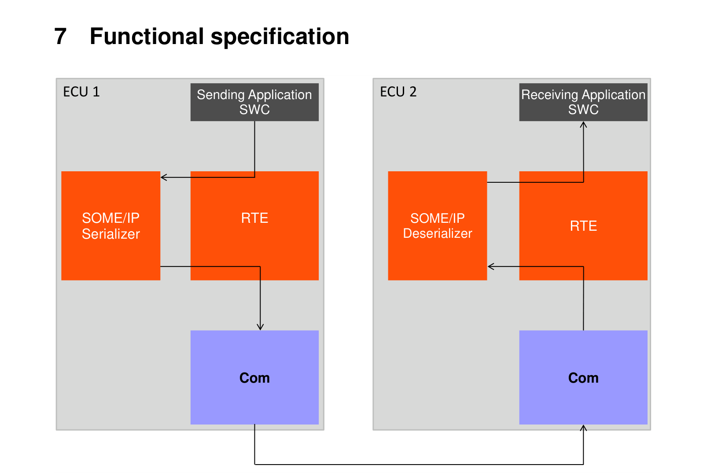

SOME/IP转换器没有模块特定的EcuC，因为其全部配置都基于SOMEIPTransformationDescription和SOMEIPTransformationISignalProps。

图7.2：SOME/IP特定配置

表7.1：SOMEIPTransformationDescription（**SOMEIPTransformationDescription**）

| 属性 | 类型 | 多重性 | 种类 | 说明 |
| --- | --- | --- | --- | --- |
| alignment | PositiveInteger | 0..1 | attr | 定义SOME/IP转换器在可变数据长度数据元素的序列化数据之后为对齐目的添加的填充。对齐应以位（**Bit**）规定。 |
| byteOrder | ByteOrderEnum | 0..1 | attr | 定义SOME/IP转换器应序列化哪种字节序。 |
| interfaceVersion | PositiveInteger | 0..1 | attr | SOME/IP转换器应使用的接口版本。 |

表7.2：SOMEIPTransformationISignalProps（**SOMEIPTransformationISignalProps**）

| 属性 | 类型 | 多重性 | 种类 | 说明 |
| --- | --- | --- | --- | --- |
| implementsLegacyStringSerialization | Boolean | 0..1 | attr | 该属性指示SOME/IP消息中的字符串不得按照SOME/IP字符串规范进行序列化。如果该属性设置为true，则有效载荷中字符串的序列化不得添加BOM和null终止符。如果该属性设置为false（或未设置），则按照SOME/IP字符串规范，在有效载荷中字符串的序列化中应添加BOM和null终止符。注意！该属性不具备前瞻性，将在后续AUTOSAR版本中移除！ |
| interfaceVersion | PositiveInteger | 0..1 | attr | SOME/IP转换器应使用的接口版本。 |
| isDynamicLengthFieldSize | Boolean | 0..1 | attr | 该属性应用于在使用TLV编码的上下文中确定线上类型。 |
| messageType | SOMEIPMessageTypeEnum | 0..1 | attr | 应放入SOME/IP报头的消息类型。 |
| sizeOfArrayLengthFields | PositiveInteger | 0..1 | attr | SOME/IP消息中固定尺寸数组或动态尺寸数组的所有长度字段的大小（字节）。该属性对SOME/IP消息中所有出现的固定尺寸数组或动态尺寸数组有效。 |
| sizeOfStringLengthFields | PositiveInteger | 0..1 | attr | SOME/IP消息中动态长度字符串的所有长度字段的大小（字节）。该属性对SOME/IP消息中所有出现的字符串有效。 |
| sizeOfStructLengthFields | PositiveInteger | 0..1 | attr | SOME/IP消息中结构体的所有长度字段的大小（字节）。该属性对SOME/IP消息中所有出现的结构体有效。若需在数据原型层级进行更细粒度的建模，应使用DataPrototypeTransformationProps。 |
| sizeOfUnionLengthFields | PositiveInteger | 0..1 | attr | SOME/IP消息中联合的所有长度字段的大小（字节）。该属性对SOME/IP消息中所有出现的联合有效。若需在数据原型层级进行更细粒度的建模，应使用DataPrototypeTransformationProps。 |
| tlvDataIdDefinition | TlvDataIdDefinitionSet | * | ref | 此引用标识与外围SOMEIPTransformationISignalProps相关的TlvDataIdDefinitions。 |

表7.3：ByteOrderEnum（**ByteOrderEnum**）

| 字面量 | 说明 |
| --- | --- |
| mostSignificantByteFirst | 最高有效字节应位于最低地址（也称为BigEndian或Motorola格式）。 |
| mostSignificantByteLast | 最高有效字节应位于最高地址（也称为LittleEndian或Intel格式）。 |
| opaque | 对于不透明数据，字节序转换必须配置为Opaque。更多细节见AUTOSAR COM规范。 |

表7.4：SOMEIPMessageTypeEnum（**SOMEIPMessageTypeEnum**）

| 字面量 | 说明 |
| --- | --- |
| notification | 不期望响应的通知请求。 |
| request | 期望响应的请求。 |
| requestNoReturn | 即发即忘（**fire&forget**）请求。 |
| response | 响应消息。 |

本文档定义的SOME/IP转换器应在以下情况下被用作转换器：

- TransformationTechnology的属性protocol设置为SOMEIP
- 且TransformationTechnology的属性version设置为1
- 且TransformationTechnology的属性transformerClass设置为serializer

### 6.1. SOME/IP线上格式的规范

序列化描述数据在通过车载网络传输的协议数据单元（**PDU**）中的表示方式。

#### 6.1.1. 消息长度限制

使用TCP允许传输更大的数据流以承载SOME/IP报头和有效载荷。但是，当前用于CAN和FlexRay的传输协议将消息限制为4095字节。当需要与它们保持兼容时，包括SOME/IP报头在内的SOME/IP消息不得超过4095字节。

#### 6.1.2. 字节序

SOME/IP报头字段的字节序由[PRS\_SOMEIP\_00368]定义为网络字节序。

SOME/IP有效载荷中附加字段的字节序由[PRS\_SOMEIP\_00759]定义为网络字节序。

有效载荷中参数的字节序应按照[PRS\_SOMEIP\_00369]由SOMEIPTransformationDescription的byteOrder定义。

#### 6.1.3. 消息格式

出于互操作性的原因，消息格式布局对于所有SOME/IP实现都应相同，描述如下：

1. 消息ID（服务ID / 方法ID）[32位]
2. 长度[32位]
3. 附加信息：
   (a) 协议版本[8位]
   (b) 接口版本[8位]
   (c) 消息类型[8位]
   (d) 返回码[8位]
4. 有效载荷[可变尺寸]

各字段按发送顺序呈现；即位于顶部的字段先发送。以下各节描述不同的消息格式字段及其用途。

**注意：**

布局也显示在图7.3中。

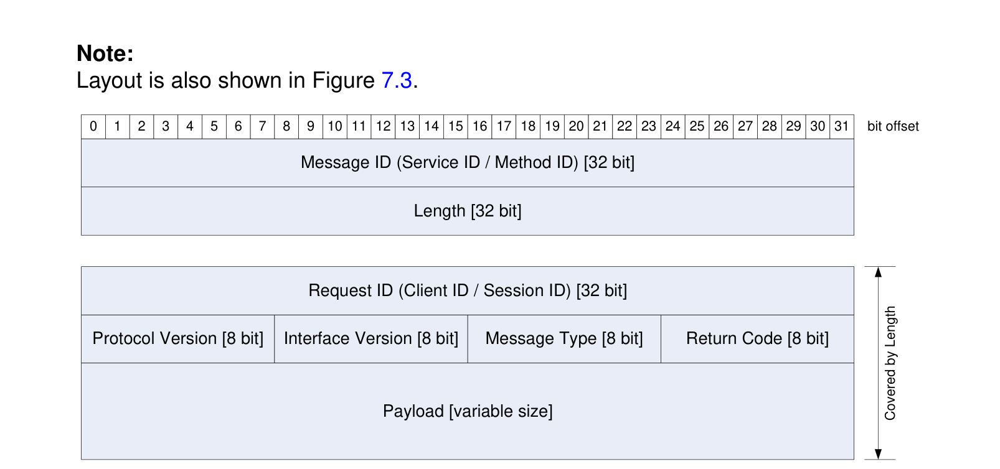

图7.3展示了完整的SOME/IP消息格式。SOME/IP转换器只实现靠下的部分（除消息ID和长度之外的所有字段）。

SOME/IP转换器应实现报头中除消息ID和长度之外的所有字段。

**原理解释：**

消息ID和长度未被涵盖，因为这使AUTOSAR套接字适配器的报头模式得以工作。

它们由AUTOSAR BSW中的其他模块添加。尽管如此，它们仍包含在图7.3中，以展示完整的线上格式。

##### 6.1.3.1. 请求ID [32位]

请求ID字段的长度应为32位。

请求ID应是ECU内调用客户端的唯一标识符。其值由RTE选择并交给SOME/IP转换器。

表7.5：请求ID的构造（**Construction of Request ID**）

请求ID由客户端ID（**Client ID**）和会话ID（**Session ID**）构造而成。

两者都由RTE选择，并作为Rte\_Cs\_TransactionHandleType交给转换器。

RTE交来的Rte\_Cs\_TransactionHandleType内的clientId应用作客户端ID的值。

RTE交来的Rte\_Cs\_TransactionHandleType内的sequenceCounter应用作会话ID的值。

关于Rte\_Cs\_TransactionHandleType的细节见[SWS\_Rte\_08732]。

请求ID允许客户端区分对同一方法的多次调用。因此，请求ID只需要对单个客户端和服务器组合唯一。在生成响应消息时，服务器必须把请求中的请求ID复制到响应消息中。这样，即使有多个未完成的请求，客户端也能将响应映射到所发出的请求。

一旦响应已到达或预期不再到达（超时），请求ID即可被重用。

##### 6.1.3.2. 协议版本 [8位]

协议版本字段的长度应为8位。

协议版本字段应包含SOME/IP协议版本。

协议版本应设置为0x01。

##### 6.1.3.3. 接口版本 [8位]

接口版本字段的长度应为8位。

接口版本字段应包含服务接口的版本。

**原理解释：** 这用于捕获服务定义中的不匹配，并允许调试工具在使用了版本的情况下识别所用的服务接口。

**注意：**

相应服务发现服务的版本必须与服务接口的版本匹配，即SdServerServiceMajorVersion和/或SdClientServiceMajorVersion必须与所使用的SOMEIPTransformationDescription.interfaceVersion和/或SOMEIPTransformationISignalProps.interfaceVersion匹配（见[TPS\_SYST\_02377]）。

##### 6.1.3.4. 消息类型 [8位]

消息类型字段的长度应为8位。

消息类型字段用于区分不同类型的消息。

表7.6：消息类型（**Message Types**）

| 编号 | 值 | 描述 |
| --- | --- | --- |
| 0x00 | REQUEST | 期望响应的请求（即使为void） |
| 0x01 | REQUEST_NO_RETURN | 即发即忘请求 |
| 0x02 | NOTIFICATION | 不期望响应的通知请求 |
| 0x80 | RESPONSE | 响应消息 |
| 0x81 | ERROR | 包含错误的响应 |

常规客户端请求（消息类型0x00）在未发生错误时由服务器响应（消息类型0x80）应答。如果发生错误，将发送错误消息（消息类型0x81）。

为了通过通知更新值，存在一个回调接口（消息类型0x02）。

可以发送一个没有响应消息的请求（消息类型0x01），以便将SOME/IP用于AUTOSAR发送方/接收方通信。

##### 6.1.3.5. 返回码 [8位]

返回码字段的长度应为8位。

返回码字段应用于指示请求是否已被成功处理。

为了简化报头布局，每条消息都传输返回码字段。

返回码的详细规定见后文错误处理章节。

REQUEST、REQUEST\_NO\_RETURN和Notification类型的消息必须将返回码设置为0x00（E\_OK）。

表7.7：返回码（**Return Codes**）

| 消息类型 | 允许的返回码 |
| --- | --- |
| REQUEST | 不适用，设置为0x00（E_OK） |
| REQUEST_NO_RETURN | 不适用，设置为0x00（E_OK） |
| NOTIFICATION | 不适用，设置为0x00（E_OK） |
| RESPONSE | 见后文返回码表格。 |

##### 6.1.3.6. 有效载荷 [可变尺寸]

有效载荷字段的长度应为可变的。

有效载荷字段应包含被传输的数据。

数据的序列化将在以下小节中规定。

#### 6.1.4. 参数和数据结构的序列化

序列化应基于数据的SenderReceiverInterface或ClientServerInterface。

为了允许迁移，反序列化应忽略附着在先前已知的参数列表末尾的参数。

这意味着：对于在用于生成或参数化反序列化代码的ClientServerInterface或SenderReceiverInterface中未定义、位于序列化数据末尾的参数，反序列化将忽略它们。

在可变数据长度DataPrototype的序列化数据之后，如果该可变数据长度DataPrototype不是序列化数据流中的最后一个元素，则应为已配置的对齐添加用于对齐目的的填充（见下文两条关于对齐取值的要求）。该要求不适用于可扩展结构体和方法的序列化。

**注意：**

另见第6.2.4.3节。

如果为可变数据长度数据元素设置了SOMEIPTransformationProps.alignment，则SOMEIPTransformationProps.alignment的值定义对齐。该要求不适用于可扩展结构体和方法的序列化。

**注意：**

另见第6.2.4.3节。

如果未为可变数据长度数据元素设置SOMEIPTransformationProps.alignment，则SOMEIPTransformationDescription.alignment的值定义对齐。该要求不适用于可扩展结构体和方法的序列化。

**注意：**

另见第6.2.4.3节。

在已序列化的定长数据元素之后，SOME/IP转换器绝不应自动添加用于对齐的填充。

**注意：**

如果后续数据元素需要对齐，需要在ImplementationDataType中（对于按照下文要求基于ImplementationDataType的序列化）或在AutosarDataType中（对于按照上文要求基于网络表示的序列化）显式插入一个相应尺寸的填充元素。

对齐应始终从SOME/IP消息的起始处计算。

该属性定义内存对齐。SOME/IP转换器不会尝试自动对齐参数，而是按规定的方式对齐。为了简化代码生成器，对齐目前限制为1字节的倍数。

SOME/IP有效载荷在内存中的放置应使有效载荷达到合适的对齐。对于信息娱乐ECU应达到8字节（即64位）的对齐，对于所有ECU至少应达到4字节的对齐。高效的对齐高度依赖硬件。

如果在反序列化数据期间交给SOME/IP转换器的数据多于预期，则应丢弃意外的数据，并考虑已知的部分。

如果在反序列化数据期间交给SOME/IP转换器的数据少于预期，则应发生以下情况：

- 如果为相应的ISignal规定了初始值（以序列化形式），则使用该值填充序列化流末尾缺失的元素。
- 如果没有可用的初始值，则以E\_SER\_MALFORMED\_MESSAGE中止反序列化。

缺失的数据只能通过将接收到的序列化数据的长度与数据的预期长度进行比较来识别。上文的要求使得通过在末尾添加元素来扩展数据成为可能，并使ECU与缺少这些数据的旧版车载网络布局实现向后兼容。

以下规定不同参数的序列化。

**基于网络表示的序列化**：如果在ISignal上按照[TPS\_SYST\_02136]定义了networkRepresentationProps，则SOME/IP序列化应基于networkRepresentationProps。

**注意：**

细节请参阅[\[7\]](#ref-7)中的「网络表示」一章。

**基于ImplementationDataType的序列化**：如果在ISignal上未定义networkRepresentationProps，则（按照[TPS\_SYST\_02137]）SOME/IP序列化应基于ImplementationDataType。

##### 6.1.4.1. 基硉数据类型

表7.8：支持序列化的SwBaseType（**SwBaseTypes supported for serialization**）

| 类型 | 描述 | 尺寸[位] | 备注 |
| --- | --- | --- | --- |
| boolean | TRUE/FALSE值 | 8 | FALSE (0)、TRUE (1) |
| uint8 | 无符号整数 | 8 |  |
| uint16 | 无符号整数 | 16 |  |
| uint32 | 无符号整数 | 32 |  |
| uint64 | 无符号整数 | 64 |  |
| sint8 | 有符号整数 | 8 |  |
| sint16 | 有符号整数 | 16 |  |
| sint32 | 有符号整数 | 32 |  |
| sint64 | 有符号整数 | 64 |  |
| float32 | 浮点数 | 32 | IEEE 754 binary32（单精度） |
| float64 | 浮点数 | 64 | IEEE 754 binary64（双精度） |

**注意：** SwBaseType定义在[\[8\]](#ref-8)中，按照[TPS\_STDT\_00067]放置在包/AUTOSAR\_Platform/BaseTypes中（例如/AUTOSAR\_Platform/BaseTypes/uint32）。

字节序通过SOMEIPTransformationDescription的byteOrder为所有参数统一规定。见第[6.1.2](#612-字节序)节。

##### 6.1.4.2. 结构化数据类型（结构体）

结构体应按深度优先遍历的顺序序列化。

转换器不会自动对结构体的参数进行对齐。

如果对齐需要，请在AUTOSAR数据类型中插入保留/填充元素，因为SOME/IP实现不应自动添加此类填充。

例如，如果一个结构体包含一个uint8和一个uint32，它们只是顺序写入缓冲区。这意味着uint8和uint32的第一个字节之间没有填充；因此uint32可能未对齐。因此系统设计者必须考虑向数据类型添加填充元素以达到所需的对齐，或进行全局设置。

关于未对齐结构体等的警告不应在实现中给出，而只应在用于生成实现的工具链中给出。

像CAN和FlexRay这样的传统总线的消息通常是不对齐的。在这种情况下可以关闭或忽略警告。

SOME/IP转换器不会自动插入哑元/填充元素。

SOME/IP允许在结构体前面添加8、16或32位的长度字段。结构体的长度字段描述结构体的字节数。这允许实现可扩展结构体，从而更好地迁移接口。

如果SOMEIPTransformationISignalProps的属性sizeOfStructLengthFields设置为大于0的值，则应在每个被序列化的结构体前面插入一个长度字段。

**注意：**

上文也适用于嵌套结构体，这意味着此外每个嵌套结构体都有自己的长度字段。此外，在一个由长度全部相同的结构体组成的数组中，长度字段被插入到数组中每个结构体的前面。

如果为定义了SOMEIPTransformationProps的结构体将属性sizeOfStructLengthField设置为大于0的值，则应在为其定义SOMEIPTransformationProps的被序列化结构体前面插入一个长度字段。（见[TPS\_SYST\_02121]）

**注意：**

当结构体以及根结构体内包含的所有嵌套结构体的长度字段的长度值被配置为经由SOMEIPTransformationProps取不同的值时，适用上文要求。

结构体及结构体内所有嵌套结构体的长度字段的数据类型应相同，并应由被序列化ISignal的SOMEIPTransformationISignalProps.sizeOfStructLengthFields的值确定：

- 若sizeOfStructLengthFields等于1，则为uint8
- 若sizeOfStructLengthFields等于2，则为uint16
- 若sizeOfStructLengthFields等于4，则为uint32

如果结构体存在SOMEIPTransformationProps.sizeOfStructLengthField，则该结构体长度字段的数据类型应由SOMEIPTransformationProps.sizeOfStructLengthField的值确定：

- 若sizeOfStructLengthField等于1，则为uint8
- 若sizeOfStructLengthField等于2，则为uint16
- 若sizeOfStructLengthField等于4，则为uint32
- 否则适用上文的结构体长度字段类型规则。

进行序列化的SOME/IP转换器应将被序列化结构体的尺寸（以字节为单位，不包括长度字段的尺寸）写入结构体的长度字段。

如果长度大于结构体的预期长度（如数据类型定义中所规定），则进行反序列化的SOME/IP转换器应只解释预期的数据，并跳过意外的部分。

为了确定被跳过的意外部分之后下一个预期数据的起始位置，SOME/IP转换器可以使用所提供的长度信息。

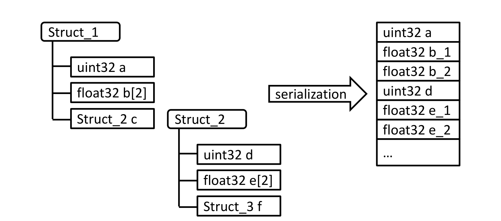

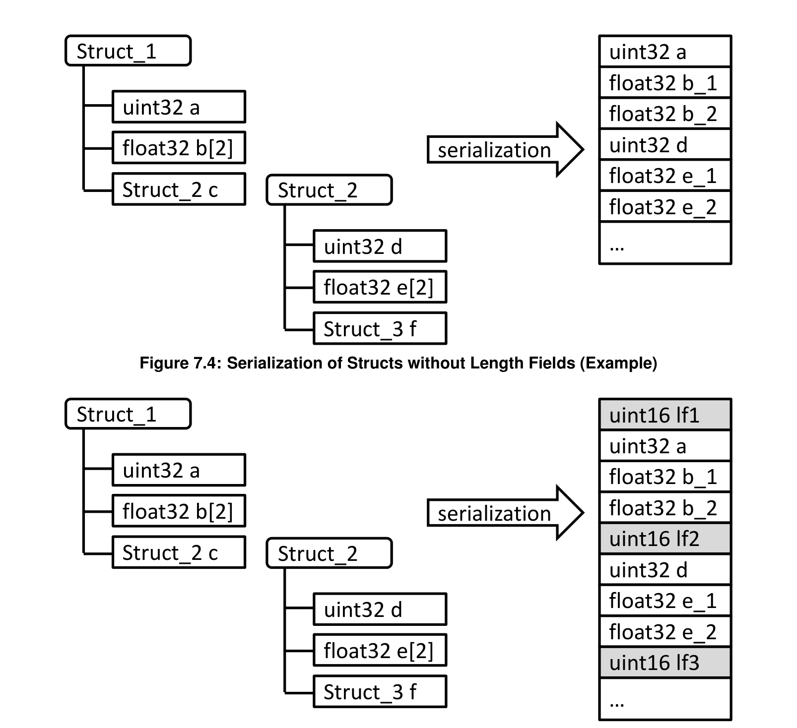

##### 6.1.4.3. 带标识符和可选成员的结构化数据类型及参数

请注意本章内容具有草案性质。

为了实现增强的前向和向后兼容性，可以在结构体成员或方法参数前面添加一个附加的Data ID。这样，接收方可以跳过未知的成员/参数，即Data ID未知的成员/参数。当在序列化字节流中传输Data ID时，可以在任意位置添加新成员/参数。

结构体在软件组件模板中使用类别为STRUCTURE的ImplementationDataType建模，成员由ImplementationDataTypeElement表示。方法参数由ArgumentDataPrototype表示。更多细节请参阅[\[9\]](#ref-9)。

Data ID的分配在系统模板中的SOMEIPTransformationISignalProps的上下文中建模。更多细节请参阅[\[7\]](#ref-7)。

此外，Data ID的使用允许描述带可选成员的结构体。为了序列化带可选成员的数据，转换器必须知道哪些可选成员可用、哪些不可用。这存储在包含在ImplementationDataType内的一个位域中。该availabilityBitfield实现为uint8数组。

可选成员是否实际存在于结构体中，必须在运行时确定。

除Data ID之外，线上类型（**wire type**）对后续成员的数据类型进行编码。Data ID和线上类型被编码在一个所谓的标签（**tag**）中。

标签的长度应为两个字节。

标签应由以下部分组成：

- 保留位（第一个字节的位7）
- 线上类型（第一个字节的位6-4）
- Data ID（第一个字节的位3-0和第二个字节的位7-0）

位7是一个字节的最高有效位，位0是最低有效位。

**注意：**

图7.6：SOME/IP结构体标签布局

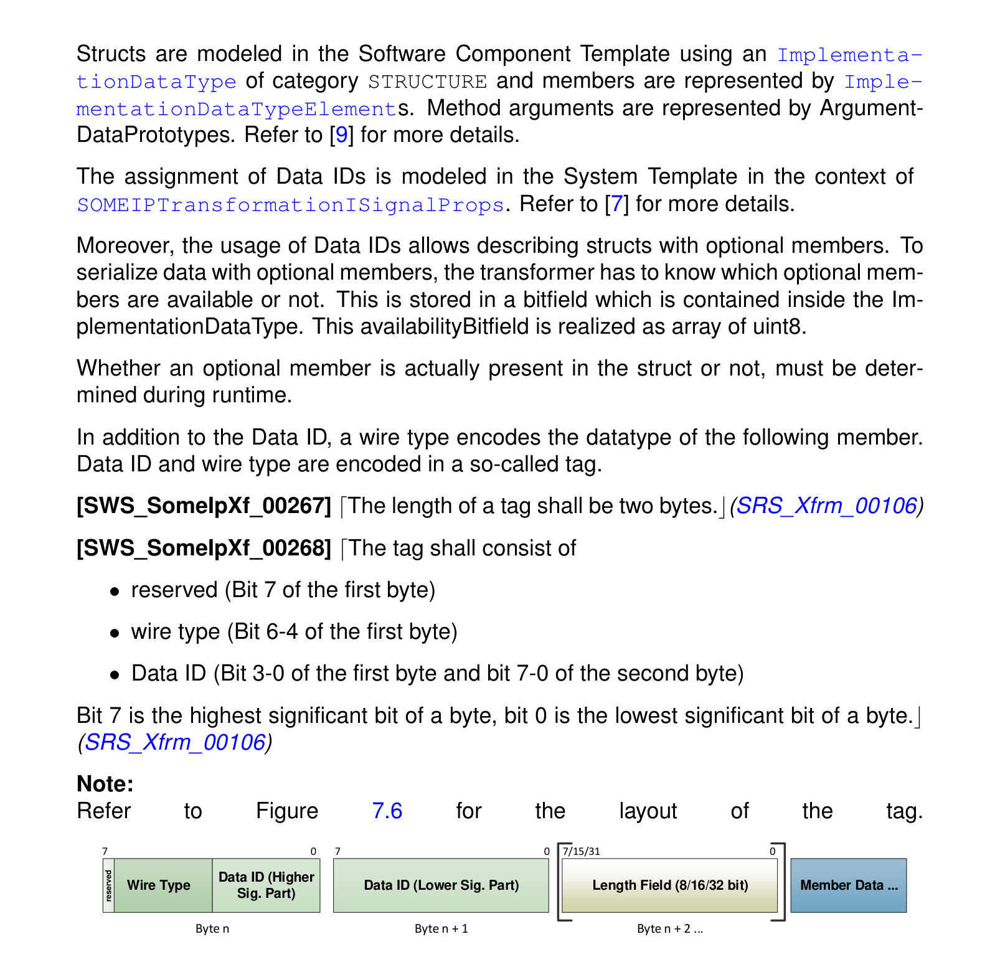

成员的Data ID的较低有效部分应编码在标签第二个字节的位7-0中。成员的Data ID的较高有效部分应编码在第一个字节的位3-0中。

示例：成员的Data ID为1266（十进制）。则第一个字节的位3-0被设置为0x4，第二个字节被设置为0xF2。

表7.9：确定数据类型的线上类型值（**Wire type values determening types of data**）

| 线上类型 | 值 |
| --- | --- |
| 0 | 8位数据：基础数据类型 |
| 1 | 16位数据：基础数据类型 |
| 2 | 32位数据：基础数据类型 |
| 3 | 64位数据：基础数据类型 |
| 4 | 复杂数据类型：带静态尺寸长度字段（在数据定义中配置）的数组、结构体、字符串、联合 |
| 5 | 复杂数据类型：带尺寸为1字节的长度字段（忽略静态定义）的数组、结构体、字符串、联合 |
| 6 | 复杂数据类型：带尺寸为2字节的长度字段（忽略静态定义）的数组、结构体、字符串、联合 |
| 7 | 复杂数据类型：带尺寸为4字节的长度字段（忽略静态定义）的数组、结构体、字符串、联合 |

**注意：**

线上类型4保证了与当前方法的兼容性，即长度字段的尺寸是静态配置的。该方法的缺点是，在接口演进期间更改长度字段的尺寸总是不兼容的。因此，线上类型5、6和7允许在传输的字节流中编码所用长度字段的尺寸。

如果SOMEIPTransformationISignalProps.isDynamicLengthFieldSize设置为false或未定义，则转换器应使用线上类型4序列化复杂数据类型，并应使用固定尺寸的长度字段。长度字段的尺寸定义在SOMEIPTransformationISignalProps.sizeOfArrayLengthFields、sizeOfStructLengthFields和sizeOfUnionLengthFields中。

如果SOMEIPTransformationISignalProps.isDynamicLengthFieldSize设置为true，则转换器应使用线上类型5、6、7序列化复杂数据类型，并应根据该线上类型选择长度字段的尺寸。

反序列化器应始终能够处理线上类型4、5、6和7，而不依赖于SOMEIPTransformationISignalProps.isDynamicLengthFieldSize的设置。

如果通过SOMEIPTransformationISignalProps.tlvDataId.id为ArgumentDataPrototype或ImplementationDataTypeElement定义了Data ID，则应在序列化的字节流中插入一个标签。

**注意：**

关于Data ID的存在性，请参阅[\[7\]](#ref-7)。

如果被序列化成员/参数的数据类型是基础数据类型（线上类型0-3）且配置了Data ID，则标签应直接插入在成员/参数的前面。不得在序列化流中插入长度字段。

如果被序列化成员/参数的数据类型不是基础数据类型（线上类型4-7）且配置了Data ID，则标签应插入在长度字段的前面。

如果被序列化成员/参数的数据类型不是基础数据类型且配置了Data ID，则应始终在成员/参数前面插入一个长度字段。

**原理解释：** 反序列化期间跳过未知成员/参数需要该长度字段。

长度字段应始终包含直到结构体的下一个标签为止的长度，但不包括标签尺寸和长度字段本身的尺寸。

如果成员本身是结构体类型，则应恰好有一个长度字段。

如果成员本身是动态长度字符串类型，则应恰好有一个长度字段。

如果成员本身是定长字符串类型，则应恰好有一个对应于动态长度字符串的长度字段。

**注意：**

不带标签序列化时，定长字符串没有长度字段。对于带标签的序列化，定长字符串与动态长度字符串一样，也需要一个长度字段。

如果成员本身是动态长度数组类型，则应恰好有一个长度字段。

如果成员本身是定长数组类型，则应恰好有一个长度字段。

如果成员本身是联合类型，则应恰好有一个长度字段。

对于可扩展结构体和方法的序列化，如果成员本身是联合类型，则长度字段应涵盖类型字段、数据和填充字节的尺寸。

**注意：**

不带标签的序列化中，联合的长度字段不涵盖类型字段（见下文关于联合长度字段的要求）。对于带标签的序列化，要求被序列化联合的完整内容都由长度字段涵盖。

非可扩展（标准）结构体中类型为可扩展结构体的成员，应按照可扩展结构体的要求进行序列化。

可扩展结构体中类型为非可扩展（标准）结构体的成员，应按照标准结构体的要求进行序列化。

对于可扩展结构体和方法的序列化，不应用任何对齐。

**原理解释：** 当使用大于8位的对齐时，序列化器可能在可变长度数据之后添加填充字节。填充字节不被长度字段涵盖。如果接收方不知道成员的Data ID，它也不知道这是可变长度数据、以及可能存在填充字节。

如果代表可扩展结构体的ImplementationDataType的属性isStructWithOptionalElement设置为true，则转换器应忽略第一个ImplementationDataTypeElement，并且不对其进行序列化或反序列化。

**原理解释：** 第一个ImplementationDataTypeElement代表availabilityBitfield（可用性位域），它不会在线上传输。

只有当可用性位域中的相应位按如下方式置位时，转换器才应序列化结构体的可选成员：

```
(availabilityBitfield[(pos/8)] & (1<<(pos mod 8))) != 0
```

如果在序列化的字节流中存在某个可选成员，则转换器应按如下方式设置可用性位域中的相应位：

```
availabilityBitfield[(pos/8)] = availabilityBitfield[(pos/8)] | (1<<(pos mod 8))
```

如果在序列化的字节流中不存在某个可选成员，则转换器应按如下方式清除可用性位域中的相应位：

```
availabilityBitfield[(pos/8)] = availabilityBitfield[(pos/8)] & ~(1<<(pos mod 8))
```

在上述要求中，pos是该可选ImplementationDataTypeElement在ImplementationDataType内所有可选ImplementationDataTypeElement中的位置，从pos = 0开始。

**注意：**

非可选的ImplementationDataTypeElement不计算在内，因为它们不需要可用性位域中的位。因此，availabilityBitfield内的位位置由可选ImplementationDataTypeElement的顺序决定。示例：

- 第1个可选ImplementationDataTypeElement（pos=0）：

```
(availabilityBitfield[0] & 0x01) != 0
```

- 第8个可选ImplementationDataTypeElement（pos=7）：

```
(availabilityBitfield[0] & 0x80) != 0
```

- 第9个可选ImplementationDataTypeElement（pos=8）：

```
(availabilityBitfield[1] & 0x01) != 0
```

如果某个可选成员在接收到的序列化字节流中不存在，则转换器应保持由该可选元素占用的内存区域不做修改。

如果转换器读取到未知的Data ID（即未包含在其数据定义中），它应利用线上类型和长度字段的信息跳过未知的成员/参数。

如果转换器在序列化字节流中找不到其数据定义中所定义的必需（即非可选）成员，则反序列化应以E\_SER\_MALFORMED\_MESSAGE中止。示例请参阅[\[10\]](#ref-10)。

##### 6.1.4.4. 字符串

对于定长和动态长度字符串，字符串应使用Unicode编码，并以"\0"字符终止。未使用的空间应使用"\0"填充。

应支持不同的Unicode编码，包括UTF-8、UTF-16BE和UTF-16LE。由于这些编码的每个字符具有动态的字节长度，最大字节长度可达UTF-8中字符长度的三倍再加1个字节的"\0"终止符，或UTF-16中字符长度的两倍再加2个字节的"\0"。UTF-8字符最多可达4字节，UTF-16字符最多可达4字节。

UTF-16LE和UTF-16BE字符串应以"\0"字符进行零终止。这意味着它们应以（至少）两个0x00字节结尾。

UTF-16LE和UTF-16BE字符串的长度应为偶数。

对于长度为奇数的UTF-16LE和UTF-16BE字符串，接收方的SOME/IP转换器应静默移除最后一个字节。

对于长度为奇数的UTF-16LE和UTF-16BE字符串，在移除最后一个字节之后，其前面的两个字节应为0x00字节（终止符），字符串才有效。

所有字符串应始终以字节顺序标记（**BOM**）开始。BOM应包含在定长字符串以及动态长度字符串中。

关于BOM的规定见[\[11\]](#ref-11)和[\[12\]](#ref-12)。请注意，BOM在序列化的字符串中使用，以实现与Unicode的兼容。

仅在检测到Unicode字符串且implementsLegacyStringSerialization为false时，才会触发字符串特定的序列化。

关于定长和动态长度字符串的识别和序列化的细节，见第6.2.4.4.1节和第6.2.4.4.2节。

接收方的SOME/IP转换器实现应检查BOM，并将缺失的BOM或畸形的BOM作为错误处理。

BOM应由SOME/IP发送方转换器实现添加。

###### 6.1.4.4.1. 字符串（定长）

字符串的长度（包括"\0"）以字节为单位在数据类型定义中规定。

**UTF-8定长字符串的识别**：如果使用了具有以下模式的ApplicationPrimitiveDataType和ImplementationDataType，则应检测为UTF-8定长字符串：

- ApplicationPrimitiveDataType
  - 类别为STRING
  - ApplicationPrimitiveDataType.swDataDefProps.swTextProps.baseType指向一个baseTypeDefinition.baseTypeEncoding等于UTF-8的BaseType
- ImplementationDataType
  - 类别为ARRAY
  - 恰好包含一个可归结为uint8 ImplementationDataType的ImplementationDataTypeElement：
    - ImplementationDataTypeElement.arraySize设置为一个值
    - ImplementationDataTypeElement.arraySizeSemantics设置为fixedSize

**UTF-16定长字符串的识别**：如果使用了具有以下模式的ApplicationPrimitiveDataType和ImplementationDataType，则应检测为UTF-16定长字符串：

- ApplicationPrimitiveDataType
  - 类别为STRING
  - ApplicationPrimitiveDataType.swDataDefProps.swTextProps.baseType指向一个baseTypeDefinition.baseTypeEncoding等于UTF-16的BaseType
- ImplementationDataType
  - 类别为ARRAY
  - 恰好包含一个可归结为uint16 ImplementationDataType的ImplementationDataTypeElement：
    - ImplementationDataTypeElement.arraySize设置为一个值
    - ImplementationDataTypeElement.arraySizeSemantics设置为fixedSize

**定长字符串的序列化**：定长字符串的序列化应包含以下步骤：

1. 检查字符串是否以0x00（UTF-8）或0x0000（UTF-16）终止。如果不是，应报出E\_SER\_GENERIC\_ERROR错误。
2. 将BOM追加到输出缓冲区的开头，即包含该字符串的待序列化数组的前3个（UTF-8）或前2个（UTF-16）字节。
3. 将字符串数据（按照字符串定长的字节数）从数组复制到输出缓冲区；如果BaseTypeDirectDefinition.byteOrder与SOMEIPTransformationDescription.byteOrder取值不同，可选择在ECU字节序与网络字节序之间执行UTF-16LE与UTF-16BE之间的转换。

**定长字符串的反序列化**：定长字符串的反序列化应包含以下步骤：

1. 检查字符串是否以BOM开始。如果不是，应报出MALFORMED\_MESSAGE错误。
2. 检查BOM是否与SOMEIPTransformationDescription.byteOrder具有相同的值。如果不是，应报出MALFORMED\_MESSAGE错误。
3. 移除BOM。
4. 对于长度为奇数的UTF-16字符串，静默丢弃字符串的最后一个字节。
5. 检查字符串是否以0x00（UTF-8）或0x0000（UTF-16）终止。如果不是，应报出MALFORMED\_MESSAGE错误。
6. 将字符串数据（按照字符串定长的字节数）从输入缓冲区复制到数组中；如果BaseTypeDirectDefinition.byteOrder与SOMEIPTransformationDescription.byteOrder取值不同，可选择在网络字节序与ECU字节序之间执行UTF-16LE与UTF-16BE之间的转换。

###### 6.1.4.4.2. 字符串（动态长度）

动态长度的字符串在AUTOSAR系统中可以实现为传输单个字符的动态长度数组。

**UTF-8可变长度字符串的识别**：如果使用了具有以下模式的ApplicationPrimitiveDataType和ImplementationDataType，则应检测为UTF-8定长字符串：

- ApplicationPrimitiveDataType
  - 类别为STRING
  - ApplicationPrimitiveDataType.swDataDefProps.swTextProps.baseType指向一个baseTypeDefinition.baseTypeEncoding等于UTF-8的BaseType
- ImplementationDataType

该ImplementationDataType应按照[TPS\_SWCT\_01650]定义为一个STRUCTURE，包含恰好两个ImplementationDataTypeElement，并应遵循[constr\_1318]定义的规则：

- 一个ImplementationDataTypeElement代表尺寸指示符（**Size Indicator**），其类别为TYPE\_REFERENCE，指向uint8、uint16或uint32 ImplementationDataType
- 一个ImplementationDataTypeElement的类别为ARRAY，且恰好包含一个可归结为uint8 ImplementationDataType的ImplementationDataTypeElement

**UTF-16可变长度字符串的识别**：如果使用了具有以下模式的ApplicationPrimitiveDataType和ImplementationDataType，则应检测为UTF-16定长字符串：

- ApplicationPrimitiveDataType
  - 类别为STRING
  - ApplicationPrimitiveDataType.swDataDefProps.swTextProps.baseType指向一个baseTypeDefinition.baseTypeEncoding等于UTF-16的BaseType

该ImplementationDataType应按照[TPS\_SWCT\_01650]定义为一个STRUCTURE，包含恰好两个ImplementationDataTypeElement，并应遵循[constr\_1318]定义的规则：

- 一个ImplementationDataTypeElement代表尺寸指示符，其类别为TYPE\_REFERENCE，指向uint8、uint16或uint32 ImplementationDataType
- 一个ImplementationDataTypeElement的类别为ARRAY，且恰好包含一个可归结为uint16 ImplementationDataType的ImplementationDataTypeElement

**动态长度字符串的序列化**：动态长度字符串的序列化应包含以下步骤：

1. 检查字符串是否以0x00（UTF-8）或0x0000（UTF-16）终止。如果不是，应报出E\_SER\_GENERIC\_ERROR错误。
2. 添加长度字段——长度字段的值应这样计算：由尺寸指示符给出的元素数量乘以每个元素的字节尺寸（即UTF-8为1、UTF-16为2），再加上BOM所需的字节数。长度字段的数据类型应由sizeOfStringLengthFields确定。如果未配置属性sizeOfStringLengthFields，则应使用[PRS\_SOMEIP\_00094]定义的默认值32位。长度字段的值应遵守上文关于长度字段范围的要求。
3. 在开头追加BOM（如果包含该字符串的待序列化数组的前3个（UTF-8）或前2个（UTF-16）字节中尚无BOM）。如果BOM已经存在，只需将其复制到输出缓冲区。
4. 将字符串数据（按照字符串的尺寸指示符和每个元素的字节尺寸复制字节数）从数组复制到输出缓冲区；如果BaseTypeDirectDefinition.byteOrder与SOMEIPTransformationDescription.byteOrder取值不同，可选择在ECU字节序与网络字节序之间执行UTF-16LE与UTF-16BE之间的转换。

**动态长度字符串的反序列化**：动态长度字符串的反序列化应包含以下步骤：

1. 检查字符串是否以BOM开始。如果不是，应报出MALFORMED\_MESSAGE错误。
2. 检查BOM是否与SOMEIPTransformationDescription.byteOrder具有相同的值。如果不是，应报出MALFORMED\_MESSAGE错误。
3. 移除BOM，并相应地减小长度字段的值。
4. 对于长度为奇数的UTF-16字符串（按照长度字段减小后的值），静默丢弃字符串的最后一个字节。
5. 检查字符串是否以0x00（UTF-8）或0x0000（UTF-16）终止。如果不是，应报出MALFORMED\_MESSAGE错误。
6. 检查接收到的动态长度字符串的长度是否小于或等于字符串规定的最大长度（ApplicationPrimitiveDataType.swTextProps.swMaxTextSize或类别为ARRAY的ImplementationDataTypeElement的arraySize）。如果不是，应报出MALFORMED\_MESSAGE错误。
7. 将字符串数据（按照字符串长度字段减小后的值复制字节数）从输入缓冲区复制到数组中；如果BaseTypeDirectDefinition.byteOrder与SOMEIPTransformationDescription.byteOrder取值不同，可选择在ECU与总线之间执行（UTF-16LE）与（UTF-16BE）之间的转换。

除了以带BOM和"\0"终止的SOME/IP字符串传输应用字符串之外，字符串也可以作为不带BOM和"\0"终止的普通动态长度数组传输（见[\[13\]](#ref-13)的「动态长度数组」一章）。

##### 6.1.4.5. 数组（定长）

定长数组的长度由数据类型定义确定。

它们可以看作是重复的元素。第6.2.4.7节展示了同样可以使用的动态长度数组。定长数组更易于在非常小的设备上使用。动态长度数组在使用它们的ECU上可能需要更多资源。

SOME/IP允许在数组前面添加8、16或32位的长度字段。数组的长度字段描述数组的字节数。这允许实现可扩展数组，从而更好地迁移接口。

如果SOMEIPTransformationISignalProps的属性sizeOfArrayLengthFields设置为大于0的值，则应在每个被序列化的数组前面插入一个长度字段。

**注意：**

上文也适用于嵌套数组，这意味着此外每个嵌套的定长数组都有自己的长度字段。

如果为定义了SOMEIPTransformationProps的数组将属性sizeOfArrayLengthField设置为大于0的值，则应在为其定义SOMEIPTransformationProps的被序列化数组前面插入一个长度字段。（见[TPS\_SYST\_02121]）

**注意：**

当数组及所有包含的嵌套数组的长度字段的长度值被配置为经由SOMEIPTransformationProps取不同的值时，适用上文要求。

如果静态尺寸数组存在SOMEIPTransformationProps.sizeOfArrayLengthField，则该数组长度字段的数据类型应由SOMEIPTransformationProps.sizeOfArrayLengthField的值确定：

- 若sizeOfArrayLengthField等于1，则为uint8
- 若sizeOfArrayLengthField等于2，则为uint16
- 若sizeOfArrayLengthField等于4，则为uint32
- 否则适用下文的数组长度字段类型规则。

数组长度字段的数据类型应由被序列化ISignal的SOMEIPTransformationISignalProps.sizeOfArrayLengthFields的值确定：

- 若sizeOfArrayLengthFields等于1，则为uint8
- 若sizeOfArrayLengthFields等于2，则为uint16
- 若sizeOfArrayLengthFields等于4，则为uint32

进行序列化的SOME/IP转换器应将被序列化数组的尺寸（以字节为单位，不包括长度字段的尺寸）写入数组的长度字段。

如果长度大于数组的预期长度（如数据类型定义中所规定），则进行反序列化的SOME/IP转换器应只解释预期的数据，并跳过意外的部分。

为了确定被跳过的意外部分之后下一个预期数据的起始位置，SOME/IP转换器可以使用所提供的长度信息。

###### 6.1.4.5.1. 一维

具有固定长度n的一维数组恰好携带n个相同类型的元素。布局如图7.7所示。

一维定长数组应通过按顺序连接数组元素来序列化。

图7.7：一维数组（定长）

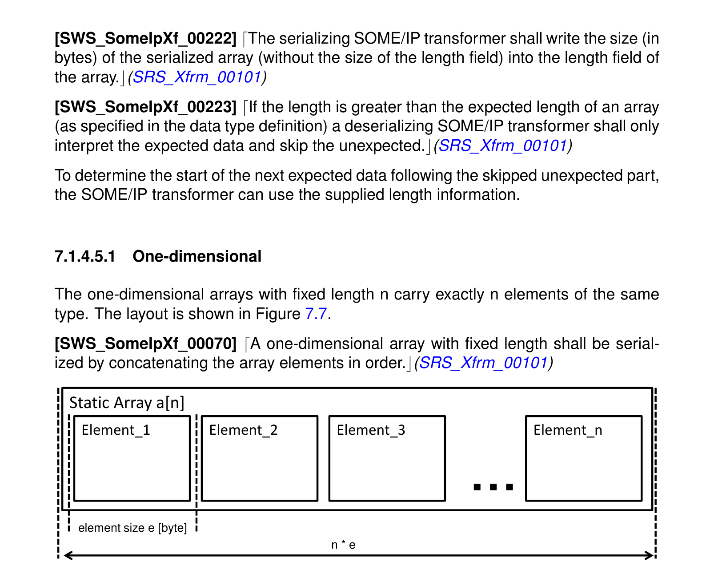

###### 6.1.4.5.2. 多维

多维数组的序列化应按行主序（**row-major order**，即C编程语言中多维数组的内存布局）进行。

图7.8：多维数组（定长）

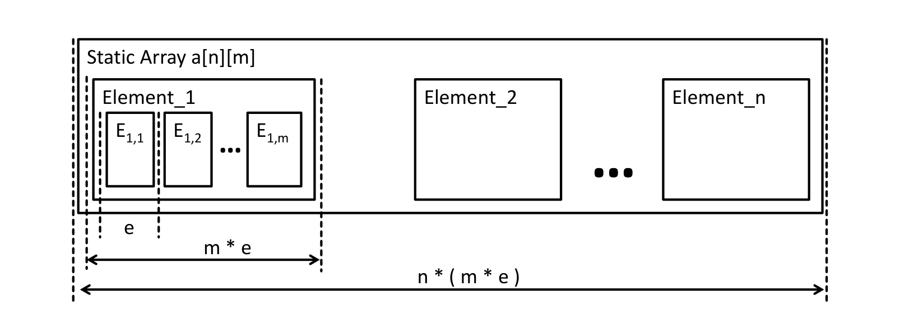

关于数组请参阅AUTOSAR SWS RTE的第5.3.4.4章。

##### 6.1.4.6. 可选参数/可选元素

可选元素可以编码为具有0到1个元素的数组。关于动态长度数组的序列化见第6.2.4.7节。

##### 6.1.4.7. 动态长度数组/可变尺寸数组

可变尺寸数组在AUTOSAR中实现为具有两个成员的结构体：

- 一个尺寸指示符，它是一个整数，保存数组中有效元素的数量
- 具有可变尺寸的数组

在SOME/IP中，可变尺寸数组以类似的方式实现。只是尺寸指示符被替换为长度指示符。

- 一个长度指示符，它是一个整数，保存后续可变尺寸数组的长度（字节）
- 包含可变尺寸数组有效元素的数组

在AUTOSAR中还存在所谓的「旧世界」（**old-world**）可变尺寸数组数据类型，它们没有尺寸指示符。数据转换通常不支持这些类型，因此SOME/IP转换器也不支持。细节请参阅[constr\_1387]（[\[7, System Template\]](#ref-7)）、[TPS\_SWCT\_01644]、[TPS\_SWCT\_01645]和[TPS\_SWCT\_01642]。

嵌入在同时包含尺寸指示符的结构体中的可变尺寸数组，应按以下元素的连接进行序列化：

- 保存后续可变尺寸数组长度（字节）的长度指示符
- 包含可变尺寸数组有效元素的数组

其中：

- 长度字段的数据类型应按照下文关于可变尺寸数组的规定确定
- 数组应像静态尺寸数组那样序列化，但只包含有效元素。要序列化的元素数量应取自尺寸指示符。

可变尺寸数组在AUTOSAR中由类别为STRUCTURE、且带有两个子元素（即**payload**和**size indicator**）的ImplementationDataType表示。SOME/IP消息中可变尺寸数组的长度字段的数据类型应由sizeOfArrayLengthFields确定。如果未配置属性sizeOfArrayLengthFields，则应使用[PRS\_SOMEIP\_00945]定义的默认值32位。

对于嵌套的可变尺寸数组，AUTOSAR允许使用档案（**profile**）来规定应用于同一ImplementationDataType内嵌套的多个可变尺寸数组的尺寸指示符。根据具体的档案（dynamicArraySizeProfile），SOME/IP消息内长度字段的数据类型应以不同的方式确定：

- VSA\_LINEAR

  SOME/IP长度字段的数据类型应由单一的sizeOfArrayLengthFields确定。如果未配置属性sizeOfArrayLengthFields，则应使用[PRS\_SOMEIP\_00945]定义的默认值32位。

- VSA\_SQUARE

  所有SOME/IP长度字段的数据类型应由单一的sizeOfArrayLengthFields确定。如果未配置属性sizeOfArrayLengthFields，则应使用[PRS\_SOMEIP\_00945]定义的默认值32位。

- VSA\_RECTANGULAR

  所有维度（嵌套层级）的所有SOME/IP长度字段的数据类型应由单一的sizeOfArrayLengthFields确定。如果未配置属性sizeOfArrayLengthFields，则应使用[PRS\_SOMEIP\_00945]定义的默认值32位。

- VSA\_FULLY\_FLEXIBLE

  所有可变尺寸数组的所有SOME/IP长度字段的数据类型应由单一的sizeOfArrayLengthFields确定。如果未配置属性sizeOfArrayLengthFields，则应使用[PRS\_SOMEIP\_00945]定义的默认值32位。

这意味着只序列化可变尺寸数组的前m个元素，其中m是尺寸指示符的值。

动态数组的布局如图7.9和图7.10所示，其中L\_1和L\_2表示以字节为单位的长度。

图7.9：一维数组（动态长度）（示例）

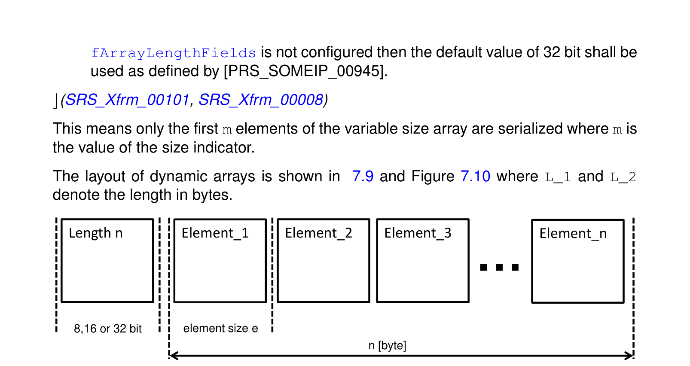

在一维数组中使用一个长度字段，它携带数组中有效元素的字节数。

如果dynamicArraySizeProfile的值等于VSA\_LINEAR，则被序列化的可变尺寸数组的长度字段的值应基于AUTOSAR数据类型的尺寸指示符的值计算。

静态长度元素的数量可以通过将数组长度n除以元素的字节尺寸来轻松计算。

对于动态长度元素，元素数量无法计算，而必须顺序解析这些元素。

图7.10：多维数组（动态长度）（示例）

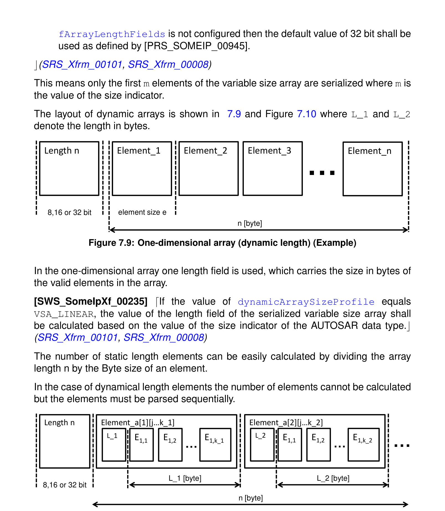

对于多维可变尺寸数组，每个可变尺寸数组都需要有自己的长度字段，与可变尺寸数组在AUTOSAR数据类型中的设计方式无关（即与dynamicArraySizeProfile的值无关，如上文所规定）。因此，支持在同一维度中具有不同的长度列和不同的长度行。见图7.10中的k\_1和k\_2。

如果多维可变尺寸数组的dynamicArraySizeProfile的值等于VSA\_SQUARE，则属于该多维可变尺寸数组的、嵌套的被序列化可变尺寸数组的所有长度字段的值，应基于AUTOSAR数据类型的单一尺寸指示符的值计算。

在VSA\_SQUARE的情况下，AUTOSAR数据类型只有一个尺寸指示符。该尺寸指示符的值将用作计算此类多维可变尺寸数组的所有长度字段值的基础。

如果多维可变尺寸数组的dynamicArraySizeProfile的值等于VSA\_RECTANGULAR，则属于该多维可变尺寸数组、同一嵌套层级（即同一维度）的嵌套的被序列化可变尺寸数组的所有长度字段的值，应基于AUTOSAR数据类型在该相应嵌套层级的尺寸指示符的值计算。

在VSA\_RECTANGULAR的情况下，AUTOSAR数据类型对多维可变尺寸数组的每个维度恰好有一个尺寸指示符。对于同一维度中的所有可变尺寸数组，该维度相应尺寸指示符的值将用作计算该维度所有长度字段值的基础。

如果多维可变尺寸数组的dynamicArraySizeProfile的值等于VSA\_FULLY\_FLEXIBLE，则属于该多维可变尺寸数组的、嵌套的被序列化可变尺寸数组的所有长度字段的值，应基于AUTOSAR数据类型中所包含的相应可变尺寸数组的尺寸指示符的值计算。

在VSA\_FULLY\_FLEXIBLE的情况下，AUTOSAR数据类型中的外层可变尺寸数组和每个嵌套的可变尺寸数组都有自己的尺寸指示符。对于外层和所有嵌套可变尺寸数组的长度字段值的计算，都以AUTOSAR数据类型相应尺寸指示符的值为基础。

RTE提供一个缓冲区，SOME/IP转换器将序列化结果写入其中，该缓冲区足够大以容纳长度字段和一个填满的动态数组。

**可变尺寸数组元素的最大数量**：应根据相应的ImplementationDataTypeElement的ImplementationDataTypeElement.arraySize属性、并取决于ImplementationDataType的dynamicArraySizeProfile（见[constr\_1318]、[constr\_1319]、[constr\_1320]和[constr\_1321]）来定义可变尺寸数组元素的最大数量。

##### 6.1.4.8. 位域

位域应基于底层SwBaseType uint8/uint16/uint32/uint64按原样传输，遵循上文的基础数据类型表格。SOME/IP转换器不得做任何进一步的修改或解释。

##### 6.1.4.9. 联合/变体

联合（**union**，也称为变体**variant**）是一个可以包含不同类型元素的参数。例如，如果定义了一个类型为uint8和类型为uint16的联合，则该联合应携带一个uint8或uint16元素。

只有在下文定义的模式适用时，才会触发联合序列化。

如果使用了具有以下模式（称为**wrapped union data type**）的ImplementationDataType，则应检测为联合：类别为STRUCTURE、且恰好包含两个ImplementationDataTypeElement的ImplementationDataType：

- memberSelector：代表类型字段的ImplementationDataTypeElement，可归结为uint8、uint16或uint32 ImplementationDataType
- payload：类别为UNION、代表实际联合的ImplementationDataType

当使用不同类型的元素时，后续参数的对齐可能会被打乱。为解决此问题，可能需要填充。

表7.10：SOME/IP中联合的默认序列化布局（**Default serialization layout of unions**）

| 长度字段（可选） |
| --- |
| 类型字段 |
| 包括填充的元素 [sizeof(padding) = length - sizeof(element)] |

SOME/IP允许在联合前面添加8、16或32位的长度字段。联合的长度字段描述联合内的字节数。

这使反序列化器能够快速计算联合之后的数据在序列化数据流中的起始位置。如果联合包含的数据大于预期（例如结构体被追加了新成员进行扩展，而SOME/IP转换器只反序列化第一个「旧」成员），这就变得必要。

如果SOMEIPTransformationISignalProps的属性sizeOfUnionLengthFields设置为大于0的值，则应在每个被序列化的联合前面插入一个长度字段。

**注意：**

上文也适用于嵌套联合，这意味着此外每个嵌套联合都有自己的长度字段。

如果为定义了SOMEIPTransformationProps的联合将属性sizeOfUnionLengthField设置为大于0的值，则应在为其定义SOMEIPTransformationProps的被序列化联合前面插入一个长度字段。（见[TPS\_SYST\_02121]）

**注意：**

当联合及根联合内包含的所有嵌套联合的长度字段的长度值被配置为经由SOMEIPTransformationProps取不同的值时，适用上文要求。

联合及联合内所有嵌套联合的长度字段的数据类型应由被序列化ISignal的SOMEIPTransformationISignalProps.sizeOfUnionLengthFields的值确定：

- 若sizeOfUnionLengthFields等于1，则为uint8
- 若sizeOfUnionLengthFields等于2，则为uint16
- 若sizeOfUnionLengthFields等于4，则为uint32

如果联合存在SOMEIPTransformationProps.sizeOfUnionLengthField，则该联合长度字段的数据类型应由SOMEIPTransformationProps.sizeOfUnionLengthField的值确定：

- 若sizeOfUnionLengthFields等于1，则为uint8
- 若sizeOfUnionLengthFields等于2，则为uint16
- 若sizeOfUnionLengthFields等于4，则为uint32
- 否则适用上文的联合长度字段类型规则。

进行序列化的SOME/IP转换器应将被序列化联合的尺寸（以字节为单位，包括填充字节，但不包括长度字段和类型字段的尺寸）写入联合的长度字段。该要求不适用于可扩展结构体和方法的序列化。

**注意：**

另见第6.2.4.3节。

如果长度大于联合的预期长度（如数据类型定义中所规定），则进行反序列化的SOME/IP转换器应只解释预期的数据，并跳过意外的部分。

为了确定被跳过的意外部分之后下一个预期数据的起始位置，SOME/IP转换器可以使用所提供的长度信息。

类型字段的长度应为32、16、8或0位。

类型字段描述元素的类型。

联合类型字段的数据类型应由上文定义的wrapped union data type中第一个ImplementationDataTypeElement（memberSelector）的ImplementationDataType确定。

类型字段的可能取值由联合的数据类型规范定义。这些类型按照数据类型中的定义从1开始按升序编码。0保留给NULL类型——即空联合。

类型字段的值应设置为上文定义的wrapped union data type中第一个ImplementationDataTypeElement（memberSelector）定义的值。

元素根据类型字段中的类型进行序列化。这同时定义了数据的长度。长度所涵盖的、位于数据之后的所有字节都是填充。反序列化器应按照上文表格中给出的公式计算所需的字节数来跳过填充字节。

通过在数据类型定义中使用结构体，可以实现不同的填充布局。

###### 6.1.4.9.1. 示例：uint8/uint16的联合，两者都填充到32位

在本示例中，长度字段的长度被规定为32位。联合应支持uint8和uint16作为元素。两者都填充到32位边界（长度=4字节）。

uint8的序列化方式如下：

| 长度 = 4字节 | 长度 = 4字节 | 长度 = 4字节 | 长度 = 4字节 |
| --- | --- | --- | --- |
| 类型 = 1 | 类型 = 1 | 类型 = 1 | 类型 = 1 |
| uint8 | 填充 0x00 | 填充 0x00 | 填充 0x00 |

uint16的序列化方式如下：

| 长度 = 4字节 |
| --- |
| 类型 = 2 |
| uint16 | 填充 0x00 | 填充 0x00 |

### 6.2. 协议规范

本章描述用于客户端/服务器和发送方/接收方通信的SOME/IP协议。

#### 6.2.1. 客户端/服务器通信

对于SOME/IP请求消息，客户端ECU上的SOME/IP转换器必须对有效载荷和报头执行以下操作：

- 构造有效载荷
- 可选地将请求ID设置为一个唯一编号（只需对客户端唯一）
- 按照上文要求设置协议版本
- 设置接口版本。如果设置了SOMEIPTransformationISignalProps的interfaceVersion，则应使用它。否则应使用SOMEIPTransformationDescription的interfaceVersion。
- 将消息类型设置为Request（即0x00）
- 将返回码设置为0x00

为了构造请求消息的有效载荷，ClientServerOperation的所有方向为IN或INOUT的参数都应按照ClientServerOperation内ArgumentDataPrototype的顺序进行序列化。

这在图7.11中以图形方式展示。

图7.11：客户端/服务器请求序列化示例

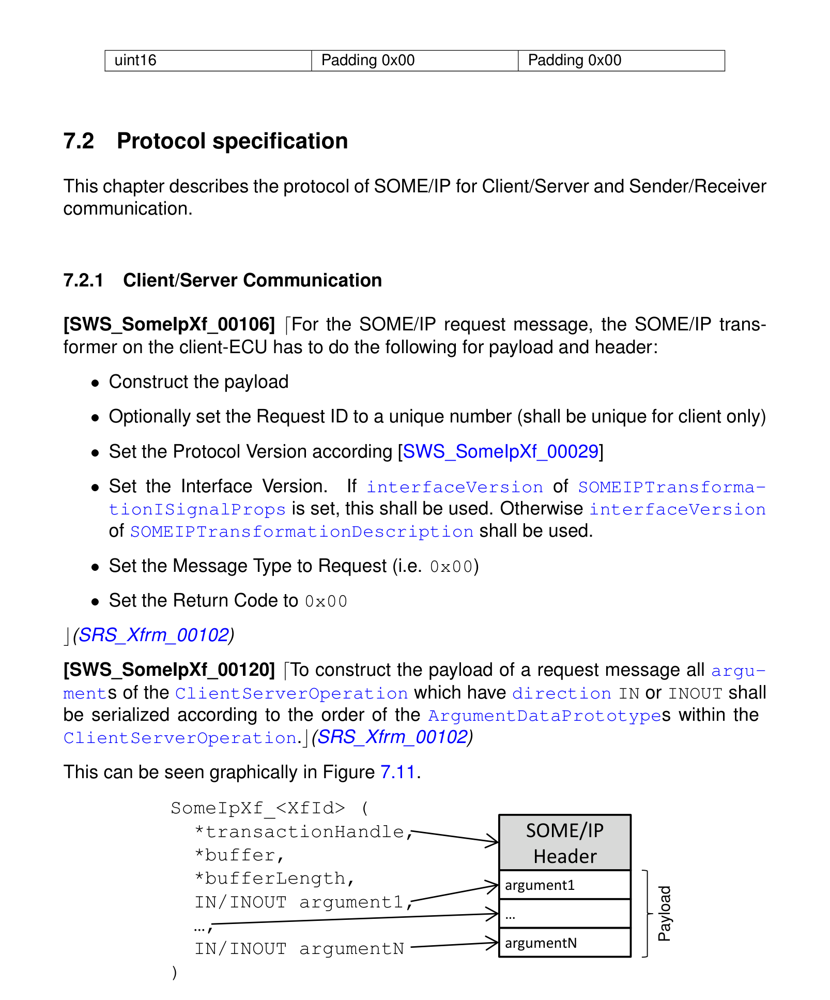

如果TransformationISignalProps的csErrorReaction设置为autonomous，且从RTE交来的returnValue参数大于或等于0x80，则客户端/服务器通信响应的SOME/IP转换器应按照下文的要求生成一条错误消息。如果TransformationISignalProps的csErrorReaction设置为autonomous，且从RTE交来的returnValue参数小于0x80，则SOME/IP转换器应按照下文的要求生成一个常规响应。

服务器ECU上的SOME/IP转换器基于客户端请求的报头构建其服务器响应报头，并额外执行以下操作：

- 构造有效载荷
- 将消息类型设置为RESPONSE（即0x80）
- 如果ClientServerOperation定义了至少一个possibleError，则将已执行的ClientServerOperation的返回值放入返回码字段；若原始返回值不同于0x00，则加0x1F以适配号码范围。

**注意：** 另见第[6.1.3.5](#6135-返回码-8位)节。

为了构造响应消息的有效载荷，ClientServerOperation的所有方向为INOUT或OUT的参数应按以下顺序序列化：

方向为INOUT或OUT的ArgumentDataPrototype应按照ClientServerOperation内ArgumentDataPrototype的顺序序列化。

这在图7.12中以图形方式展示。

图7.12：客户端/服务器响应序列化示例

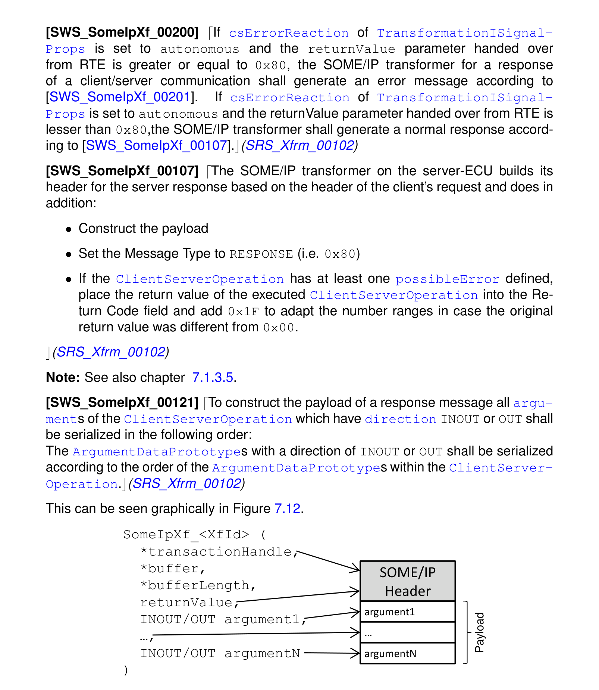

服务器ECU上的SOME/IP转换器基于客户端请求的报头构建其自主错误响应的报头，并额外执行以下操作：

- 不构造有效载荷（有效载荷应为空）
- 将消息类型设置为RESPONSE（即0x80）
- 通过从参数returnValue中减去0x80来适配返回值（计算：adaptedReturnValue = returnValue - 0x80）
- 将adaptedReturnValue放入返回码字段。

**注意：** 另见第[6.1.3.5](#6135-返回码-8位)节。

这导致SOME/IP转换器的输出恰好与SOME/IP报头一样长。

**注意：**

错误消息只能作为对客户端/服务器请求的响应发送，不能用于发送方/接收方通信或错误消息。

构建自主错误响应的服务器ECU上的SOME/IP转换器应以等于E\_OK的返回值返回（见后文关于函数定义的要求）。如果SOME/IP转换器以不同于E\_OK的返回码返回，这将引发一个阻止RTE发送自主错误响应的硬错误。

#### 6.2.2. 发送方/接收方通信

会话处理ID计数器用于在启用了会话处理的发送方/接收方通信中，在SOME/IP报头中设置正确的请求ID。

如果传输路径包含SomeIpTp，则对于发送方/接收方通信，每个转换器函数必须维护一个会话处理ID计数器（16位）。

所有会话处理ID计数器应初始化为0x0001。

被转换的发送方/接收方通信发送侧的SOME/IP转换器应以以下方式构造报头和有效载荷：

- 构造有效载荷
- 设置请求ID
  - 若传输路径不包含SomeIpTp，则设置为0x00
  - 否则设置为会话处理ID计数器的当前值
- 按照上文要求设置协议版本
- 设置接口版本。如果设置了SOMEIPTransformationISignalProps的interfaceVersion，则应使用它。否则应使用SOMEIPTransformationDescription的interfaceVersion。
- 根据SOMEIPTransformationISignalProps的messageType设置消息类型：
  - 如果属性messageType设置为notification，则报头中应使用NOTIFICATION（0x02）
  - 如果属性messageType设置为requestNoReturn，则报头中应使用REQUEST\_NO\_RETURN（0x01）
- 将返回码设置为0x00

上文规定了何时对发送的消息考虑会话处理。SOME/IP转换器在接收侧从不检查会话ID，因为SOME/IP对发送方/接收方通信的默认行为是在接收侧忽略会话ID。

发送方/接收方通信消息的有效载荷应由被传输的、被序列化的数据元素组成。

错误处理和返回码在需要时必须由应用实现。

#### 6.2.3. 外部触发事件

外部触发事件用于触发不带任何IN、INOUT或OUT参数的RPC，或表示一种特殊类型的、无参数的事件，该事件从服务器发送到一个或多个客户端，其发生时服务消费者应以特定的方式做出反应。外部触发事件由SOME/IP实现为不带参数的即发即忘方法。

被转换的外部触发事件的触发源侧的SOME/IP转换器应以以下方式构造报头：

- 设置请求ID
  - 若传输路径不包含SomeIpTp，则设置为0x00
  - 否则设置为会话处理ID计数器的当前值
- 按照上文要求设置协议版本
- 设置接口版本。如果设置了SOMEIPTransformationISignalProps的interfaceVersion，则应使用它。否则应使用SOMEIPTransformationDescription的interfaceVersion。
- 将消息类型设置为REQUEST\_NO\_RETURN（即0x01）
- 将返回码设置为0x00

外部触发事件通信消息的有效载荷应为空。

错误处理和返回码在需要时必须由应用实现。

#### 6.2.4. 错误处理

错误处理完全在应用中完成。SOME/IP只传输错误。

支持两种不同的错误传输机制：返回码和错误消息。

SOME/IP转换器应使用返回码错误处理。

SOME/IP规定了异常（**Exception**），但当前版本的SOME/IP转换器尚不支持。

这可用于处理服务器中可能出现的所有不同的应用错误。此外，通信介质或中间组件（例如交换机）可能出现问题，必须例如通过可靠传输等手段来处理。

所有消息都有一个返回码字段用于承载返回码。但是，只有响应（消息类型0x80和0x81）使用该字段向它们所应答的请求（消息类型0x00）传回返回码。所有其他消息将该字段设置为0x00（见第[6.1.3.4](#6134-消息类型-8位)节）。对于更详细的错误，错误消息（消息类型0x81）的布局可以携带用于错误处理的特定字段，例如异常字符串。错误消息代替响应消息发送。

##### 6.2.4.1. 返回码

通过返回码进行的错误处理应基于Std\_ReturnType。

返回码只应用于客户端/服务器通信。

在客户端/服务器通信中，如果未发生SOME/IP错误，返回码应传输已执行的ClientServerOperation的ApplicationError。

这意味着：如果发生了SOME/IP错误，该错误包含在返回码中。如果未发生SOME/IP错误，返回码包含已执行的服务器runnable的错误（或成功）码。

如果在客户端/服务器通信中发生错误，可以将服务器配置为创建一个回送给客户端的自主错误反应。在该响应中，SOME/IP报头字段RequestId和接口版本应与请求消息报头中的值相等。

这由上文关于自主错误响应的要求实现，它相应地填充报头字段：RequestId由RTE交来，而InterfaceVersion与请求一致，因为SOME/IP转换器的配置只允许请求和响应使用相同的interfaceVersion。

表7.11：返回码（**Return Codes**）

| ID | 名称 | 描述 |
| --- | --- | --- |
| 0x00 | E_OK | 未发生错误 |
| 0x01 | E_NOT_OK | 发生了未指定的错误 |
| 0x04 | [SOMEIPXF_E_NOT_READY](#624-错误处理) | 服务ID和方法ID已知。应用未运行。 |
| 0x05 | [SOMEIPXF_E_NOT_REACHABLE](#624-错误处理) | 运行服务的系统不可达（仅内部错误码）。 |
| 0x06 | [SOMEIPXF_E_TIMEOUT](#624-错误处理) | 发生超时（仅内部错误码）。 |
| 0x07 | [SOMEIPXF_E_WRONG_PROTOCOL_VERSION](#624-错误处理) | 不支持该SOME/IP协议版本 |
| 0x08 | [SOMEIPXF_E_WRONG_INTERFACE_VERSION](#624-错误处理) | 接口版本不匹配 |
| 0x09 | [SOMEIPXF_E_MALFORMED_MESSAGE](#624-错误处理) | 反序列化错误，有效载荷无法被反序列化。 |
| 0x0a | [SOMEIPXF_E_WRONG_MESSAGE_TYPE](#624-错误处理) | 接收到非预期的消息类型（例如对定义为REQUEST的方法收到REQUEST_NO_RETURN）。 |
| 0x0b | E_E2E | 未进一步规定的E2E错误 |
| 0x0c-0x1f | RESERVED | 保留用于通用SOME/IP错误。这些错误将在本文档的未来版本中规定。 |
| 0x20-0x5e | - | ClientServerOperation的特定ApplicationError。这些错误是ClientServerInterface规定的应用错误。由于ClientServerInterface的ApplicationError范围为0x01-0x3F，ApplicationError的值必须加0x1F以适配SOME/IP传输。 |

##### 6.2.4.2. 通信错误及通信错误的处理

在考虑客户端/服务器消息的传输时，存在不同的可靠性语义：

- Maybe——消息可能到达通信伙伴
- At least once——消息至少到达通信伙伴一次
- Exactly once——消息恰好到达通信伙伴一次

当在客户端/服务器通信的语境中使用这些术语时，该术语适用于两条消息（即调用和响应或错误）。

虽然不同的实现可以实现不同的方法，但SOME/IP转换器目前通过以太网模块的适当配置，在使用UDP绑定时达到「maybe」可靠性，在使用TCP绑定时达到「exactly once」可靠性。进一步的错误处理留给应用。

对于「maybe」可靠性，在客户端/服务器通信与UDP作为传输协议结合使用时，只需要一个超时。图7.13展示了「maybe」可靠性的状态机。客户端的SOME/IP实现必须在规定的超时时间内等待响应。如果发生超时，SOME/IP应向客户端应用发出SOMEIPXF\_E\_TIMEOUT信号。

图7.13：可靠性「Maybe」的状态机

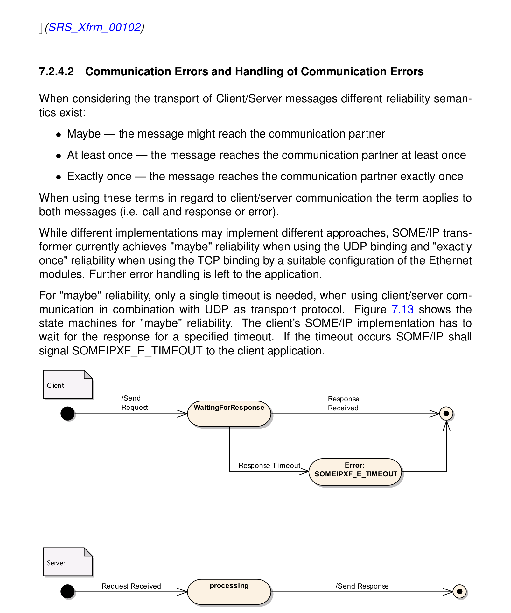

对于「exactly once」可靠性，可以使用TCP绑定，因为TCP的定义目的就是实现可靠通信。

达到更高可靠性的附加机制可以在应用中或在SOME/IP实现中实现。请记住，通信不必实现这些特性。第[6.2.4.2.1](#62421-基于应用的错误处理)节描述了此类可选的可靠性机制。

###### 6.2.4.2.1. 基于应用的错误处理

应用可以通过使用幂等操作（即可以多次执行而无副作用的操作）和简单的超时机制，轻松实现「至少一次」（**at least once**）可靠性。图7.14展示了使用隐式确认的「至少一次」可靠性的状态机。当客户端发出请求时，它会启动一个定时器，其超时时间是为特定方法规定的。如果在定时器到期之前未收到响应（顶部状态的转换），客户端将重试该操作。典型的重试次数为2，即发送3次请求。

重试次数、超时值和超时行为（恒定或指数退避）不在SOME/IP规范的范围内。

图7.14：可靠性「至少一次」（幂等操作）的状态机

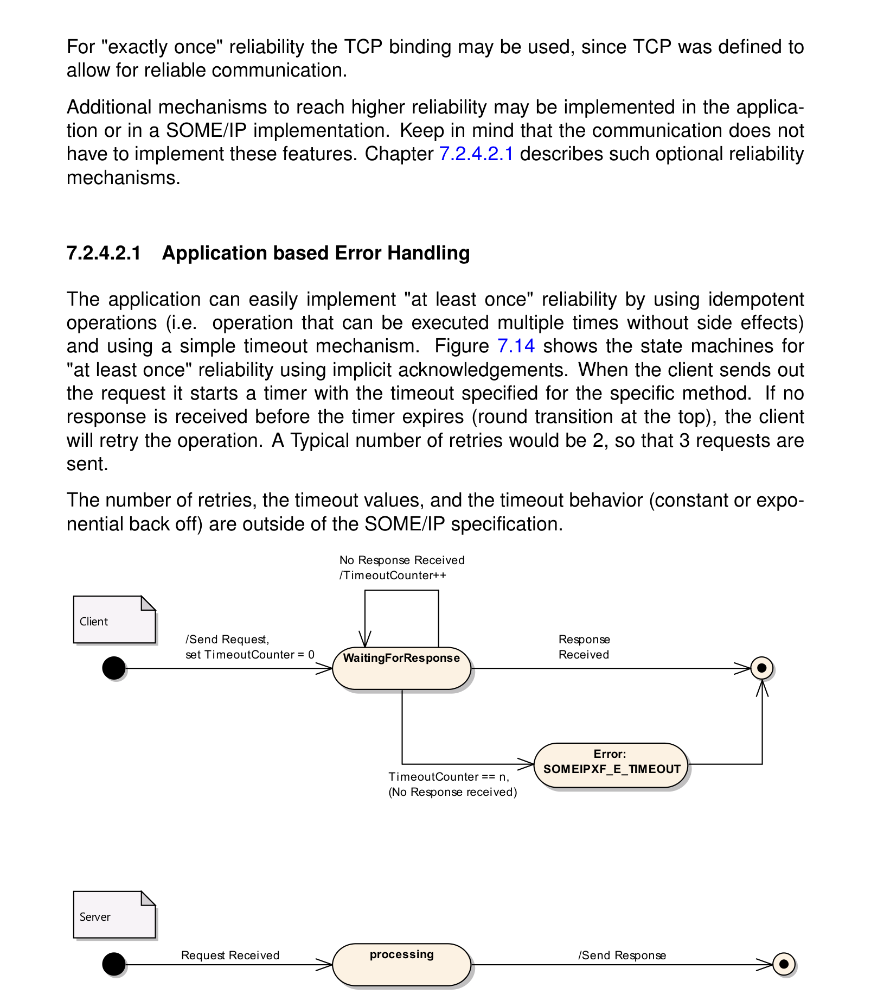

### 6.3. 错误分类

文档「基础软件模块通用规范」的「错误处理」一节详细描述了基础软件的错误处理。它首先构成了一个分类方案，包含[\[14, SWS BSW General\]](#ref-14)模块中可能出现的五种错误类型。

在此基础上，以下各小节规定了按相应小节排列的特定错误。

#### 6.3.1. 开发错误

| 错误类型 | 相关错误码 | 错误值 |
| --- | --- | --- |
| 在转换器模块以Init初始化之前、或在调用DeInit之后调用除GetVersionInfo之外的任何其他API服务时的错误码 | SOMEIPXF\_E\_UNINIT | 0x01 |
| 选择了无效配置集时的错误码 | SOMEIPXF\_E\_INIT\_FAILED | 0x02 |
| 以错误的参数调用API服务 | SOMEIPXF\_E\_PARAM | 0x03 |
| 以无效指针调用API服务 | SOMEIPXF\_E\_PARAM\_POINTER | 0x04 |

#### 6.3.2. 运行时错误

没有运行时错误。

#### 6.3.3. 瞬态故障

没有瞬态故障。

#### 6.3.4. 生产错误

没有生产错误。

#### 6.3.5. 扩展生产错误

适用于SOME/IP转换器的所有扩展生产错误在[\[3, ASWS Transformer General\]](#ref-3)中规定。

## 7. API规范

### 7.1. 导入的类型

除了[\[3, ASWS Transformer General\]](#ref-3)中规定的类型之外，没有从其他模块导入的类型。

在SOME/IP转换器所导入的模块互链接头（**Module Interlink Headers**）文件中，包含了RTE已知的所有ImplementationDataType。借助此机制，SOME/IP转换器知道所有需要转换的数据的数据类型。

### 7.2. 类型定义

#### 7.2.1. SomeIpXf\_ConfigType

| 项目 | 内容 |
| --- | --- |
| 名称 | SomeIpXf_ConfigType |
| 类别 | 结构体（Structure） |
| 元素 | 实现特定（类型：-；说明：-） |
| 描述 | 这是包含转换器初始化数据的数据结构的类型。 |
| 可用性 | SomeIpXf.h |

### 7.3. 函数定义

SOME/IP转换器提供[\[3, ASWS Transformer General\]](#ref-3)通常要求的具体接口。

SOME/IP转换器应只为这样的转换器提供函数：TransformationTechnology被引用为从某个DataTransformation到TransformationTechnology的有序引用列表transformer中的第一个引用。

这意味着，转换器链中只有第一个转换器可以是SOME/IP转换器，因为序列化器转换器通常只允许作为转换器链中的第一个转换器。

#### 7.3.1. SomeIpXf\_ExtractProtocolHeaderFields

**说明**：提取消息的相关SOME/IP协议报头字段以及消息结果类型的函数。——目前仅限于用于C/S通信的类型。服务ID 0x05；同步；可重入；输入参数buffer为RTE分配的缓冲区，转换器必须将转换后的数据存储在其中；输入参数bufferLength为缓冲区的长度；无输入输出参数；输出参数messageType为消息类型的规范表示（从转换器的协议报头中提取）；输出参数messageResult为消息结果类型的规范表示（从转换器的协议报头中提取）；返回值Std_ReturnType（E_OK：已成功提取相关的协议报头字段；E_NOT_OK：在解析SOME/IP协议报头期间发生错误，例如协议版本不正确或缓冲区长度不足（bufferLength小于最小SOME/IP报头长度））；可通过SomeIpXf.h使用。

```C
Std_ReturnType SomeIpXf_ExtractProtocolHeaderFields ( const uint8* buffer, uint32 bufferLength, Std_MessageTypeType* messageType, Std_MessageResultType* messageResult )
```

上文规定的函数SomeIpXf\_ExtractProtocolHeaderFields应从SOME/IP协议报头中提取消息的类型和消息结果的类型，并通过其输出参数以规范表示提供该信息。

上文规定的函数SomeIpXf\_ExtractProtocolHeaderFields应检查所提供的bufferLength是否大于或等于SOME/IP转换器所处理的协议报头的尺寸（即8字节）。如果不是这种情况，应返回E\_NOT_OK。在这种情况下，messageType和messageResult均不得被修改。

上文规定的函数SomeIpXf\_ExtractProtocolHeaderFields应检查协议版本字段的值（见[PRS\_SOMEIP\_00052]）是否等于[PRS\_SOMEIP\_00051]定义的值。如果不是这种情况，应返回E\_NOT_OK。在这种情况下，messageType和messageResult均不得被修改。

上文规定的函数SomeIpXf\_ExtractProtocolHeaderFields应检查消息类型字段的值（见[PRS\_SOMEIP\_00055]）是否等于REQUEST、RESPONSE或ERROR。如果不是这种情况，应返回E\_NOT_OK。在这种情况下，messageType和messageResult均不得被修改。

上文规定的函数SomeIpXf\_ExtractProtocolHeaderFields在所有其他情况下应返回E\_OK。

上文规定的函数SomeIpXf\_ExtractProtocolHeaderFields应在消息类型字段的值（见[PRS\_SOMEIP\_00055]）等于REQUEST时，将messageType设置为STD\_MESSAGETYPE\_REQUEST。

上文规定的函数SomeIpXf\_ExtractProtocolHeaderFields应在消息类型字段的值（见[PRS\_SOMEIP\_00055]）等于RESULT或ERROR时，将messageType设置为STD\_MESSAGETYPE\_RESPONSE。

上文规定的函数SomeIpXf\_ExtractProtocolHeaderFields应在消息类型字段的值（见[PRS\_SOMEIP\_00055]）等于ERROR、或返回码字段的值（见[PRS\_SOMEIP\_00058]）不等于0时，将messageResult设置为STD\_MESSAGERESULT\_ERROR。

上文规定的函数SomeIpXf\_ExtractProtocolHeaderFields在其他情况下（即消息类型字段的值不等于ERROR且返回码字段的值为0时）应将messageResult设置为STD\_MESSAGERESULT\_OK。

#### 7.3.2. SomeIpXf\_&lt;transformerId&gt;

##### 7.3.2.1. 用于发送方/接收方通信的SomeIpXf\_&lt;transformerId&gt;

**说明**：该函数使用SOME/IP序列化转换一次发送方/接收方通信。它以数据元素为输入，输出一个包含序列化数据的uint8数组。序列化数据的长度应由转换器在运行时计算并在OUT参数bufferLength中返回。它可能小于RTE用于缓冲区分配的最大缓冲区尺寸。服务ID 0x03；同步；不可重入；输入参数dataElement为应被转换的数据元素；无输入输出参数；输出参数buffer为RTE分配的缓冲区，转换器必须将转换后的数据存储在其中；输出参数bufferLength为缓冲区的已用长度；返回值uint8（0x00（E_OK）：序列化成功；0x81（E_SER_GENERIC_ERROR）：发生一般错误）；可通过SomeIpXf.h使用。

```C
uint8 SomeIpXf_<transformerId> ( uint8* buffer, uint32* bufferLength, <paramtype> dataElement )
```

上文规定的函数存在于每次使用SOME/IP序列化的、被转换的发送方/接收方通信。

上文规定的函数SomeIpXf\_&lt;transformerId&gt;应存在于从某个DataTransformation到TransformationTechnology的有序引用列表transformer中的第一个引用处，条件是：该DataTransformation被一个在角色dataTransformation中的ISignal引用，且该ISignal引用了一个被SenderReceiverToSignalMapping引用的SystemSignal。

上文规定的函数SomeIpXf\_&lt;transformerId&gt;应使用SOME/IP序列化将发送方/接收方通信的原始或复杂数据元素序列化为线性字节数组表示。

数据序列化之后，如果传输路径包含SomeIpTp，则上文规定的函数SomeIpXf\_&lt;transformerId&gt;应递增分配给&lt;transformerId&gt;的会话处理ID计数器。

在上文定义的函数SomeIpXf\_&lt;transformerId&gt;中：

- paramtype按照[\[15, SRS BSW General\]](#ref-15)（见[SRS\_BSW\_00484]、[SRS\_BSW\_00485]和[SRS\_BSW\_00486]）以及[\[14, SWS BSW General\]](#ref-14)（见[SWS\_BSW\_00186]）定义的参数传递规则从type派生。
- type应为RTE完成所有数据转换活动之后该数据元素的数据类型。
- transformerId应为[SWS\_Xfrm\_00062]（[\[3, ASWS Transformer General\]](#ref-3)）规定的转换器名称模式。

当分配给&lt;transformerId&gt;的会话处理ID计数器为0xFFFF并被递增时，如果传输路径包含SomeIpTp，它应回绕到0x0001（而不是0x0000）。

##### 7.3.2.2. 用于客户端/服务器通信的SomeIpXf\_&lt;transformerId&gt;

**说明**：该函数使用SOME/IP序列化转换一次客户端/服务器通信。它以操作参数和可选的返回值为输入，输出一个包含序列化数据的uint8数组。序列化数据的长度应由转换器在运行时计算并在OUT参数bufferLength中返回。它可能小于RTE用于缓冲区分配的最大缓冲区尺寸。服务ID 0x03；同步；不可重入；输入参数TransactionHandle为按照[SWS_Rte_08732]的事务句柄（clientId和sequenceCounter），用于区分多个请求；输入参数returnValue为从服务器侧发往调用客户端的返回值。该参数仅对客户端/服务器通信响应的序列化器可用，条件是：• ClientServerOperation定义了至少一个PossibleError，或• 激活了自主错误反应；输入参数data_1为应被转换的客户端/服务器操作参数（与相应接口中的顺序相同）；……；输入参数data_n为应被转换的客户端/服务器操作参数（与相应接口中的顺序相同）；无输入输出参数；输出参数buffer为RTE分配的缓冲区，转换器必须将转换后的数据存储在其中；输出参数bufferLength为缓冲区的已用长度；返回值uint8（0x00（E_OK）：序列化成功；0x81（E_SER_GENERIC_ERROR）：发生一般错误）；可通过SomeIpXf.h使用。

```C
uint8 SomeIpXf_<transformerId> ( const Rte_Cs_TransactionHandleType* TransactionHandle, uint8* buffer, uint32* bufferLength, [Std_ReturnType returnValue], <paramtype> data_1, ... <paramtype> data_n )
```

在上文定义的函数SomeIpXf\_&lt;transformerId&gt;中：

- paramtype按照[\[15, SRS BSW General\]](#ref-15)（见[SRS\_BSW\_00484]、[SRS\_BSW\_00485]和[SRS\_BSW\_00486]）以及[\[14, SWS BSW General\]](#ref-14)（见[SWS\_BSW\_00186]）定义的参数传递规则从type派生。
- type应为RTE完成所有数据转换活动之后该数据元素的数据类型。
- transformerId应为[SWS\_Xfrm\_00062]（[\[3, ASWS Transformer General\]](#ref-3)）规定的转换器名称模式。

上文规定的函数存在于每次使用SOME/IP序列化的、被转换的客户端/服务器通信的服务器和每个客户端。

它在客户端和服务器上都存在，但参数不同。

在客户端上，它序列化客户端/服务器调用的请求。此时，API的data\_1, ..., data\_n参数对应于ClientServerOperation的IN和INOUT参数。参数returnValue不存在。

在服务器上，它序列化客户端/服务器调用的响应。此时，API的data\_1, ..., data\_n参数对应于ClientServerOperation的INOUT和OUT参数。如果ClientServerOperation定义了至少一个PossibleError，则此处的returnValue参数存在，因为必须传输该操作的返回码。

上文规定的函数SomeIpXf\_&lt;transformerId&gt;应存在于从某个DataTransformation到TransformationTechnology的有序引用列表transformer中的第一个引用处，条件是：该DataTransformation被一个在角色dataTransformation中的ISignal引用，且该ISignal引用了一个被ClientServerToSignalMapping在callSignal或returnSignal中引用的SystemSignal。

由于上述要求，上文的API在客户端和服务器上都存在。

上文规定的函数SomeIpXf\_&lt;transformerId&gt; [\_&lt;symbolSuffix&gt;]应使用SOME/IP序列化，将客户端/服务器通信的所有原始或复杂操作参数以及返回值（如果在服务器侧执行）序列化为线性字节数组表示。

上文规定的函数SomeIpXf\_&lt;transformerId&gt; [\_&lt;symbolSuffix&gt;]应在返回码大于或等于0x80时忽略所有参数data\_1, ..., data\_n，因为它们未被填充有意义的值。

##### 7.3.2.3. 用于外部触发事件的SomeIpXf\_&lt;transformerId&gt;

**说明**：该函数使用SOME/IP序列化转换一次外部触发事件。它以trigger为输入，输出一个uint8数组。被转换数据的长度应由转换器在运行时计算并在OUT参数bufferLength中返回。它可能小于最大缓冲区尺寸。服务ID 0x03；同步；可重入；无输入参数；无输入输出参数；输出参数buffer为RTE分配的缓冲区，转换器必须将转换后的数据存储在其中；输出参数bufferLength为缓冲区的已用长度；返回值uint8（0x00（E_OK）：序列化成功；0x81（E_SER_GENERIC_ERROR）：发生一般错误）；可通过SomeIpXf.h使用。

```C
uint8 SomeIpXf_<transformerId> ( uint8* buffer, uint32* bufferLength )
```

在上文定义的函数SomeIpXf\_&lt;transformerId&gt;中：

- transformerId应为[SWS\_Xfrm\_00062]（[\[3, ASWS Transformer General\]](#ref-3)）规定的转换器名称模式。

上文规定的函数存在于触发源侧，用于每个使用SOME/IP转换的被转换外部触发事件。

上文规定的函数SomeIpXf\_&lt;transformerId&gt;应存在于某个DataTransformation的有序transformerChain中第一个被引用的TransformationTechnology处，条件是：该DataTransformation被一个在角色dataTransformation中的ISignal引用，且该ISignal引用了一个被TriggerToSignalMapping引用的SystemSignal。

上文规定的函数SomeIpXf\_&lt;transformerId&gt;应使用SOME/IP序列化将外部触发事件序列化为线性字节数组表示。

由于外部触发事件由长度为零的ISignal组成，被序列化的SOME/IP消息只包含报头而没有有效载荷。

#### 7.3.3. SomeIpXf\_Inv\_&lt;transformerId&gt;

##### 7.3.3.1. 用于发送方/接收方通信的SomeIpXf\_Inv\_&lt;transformerId&gt;

**说明**：该函数使用SOME/IP反序列化反序列化一次发送方/接收方通信。它以包含序列化数据的uint8数组为输入，输出将被传递给RTE的原始数据元素。服务ID 0x04；同步；可重入；输入参数buffer为RTE分配的缓冲区，其中Rte存储着仍处于序列化状态的数据；输入参数bufferLength为缓冲区的已用长度；无输入输出参数；输出参数dataElement为转换的结果、包含反序列化数据元素的数据元素；返回值uint8（0x00（E_OK）：反序列化成功；0x01（E_NO_DATA）：没有可反序列化的数据；0x81（E_SER_GENERIC_ERROR）：发生一般错误；0x87（E_SER_WRONG_PROTOCOL_VERSION）：接收转换器的版本与发送转换器不匹配。；0x88（E_SER_WRONG_INTERFACE_VERSION）：不支持序列化数据的接口版本。；0x89（E_SER_MALFORMED_MESSAGE）：接收到的消息是畸形的。转换器无法产生输出。；0x8a（E_SER_WRONG_MESSAGE_TYPE）：接收到的消息类型是非预期的。）；可通过SomeIpXf.h使用。

```C
uint8 SomeIpXf_Inv_<transformerId> ( const uint8* buffer, uint32 bufferLength, <type>* dataElement )
```

在上文定义的函数SomeIpXf\_Inv\_&lt;transformerId&gt;中：

- type应为RTE进行所有数据转换活动之前该数据元素的数据类型。
- transformerId应为[SWS\_Xfrm\_00062]（[\[3, ASWS Transformer General\]](#ref-3)）规定的转换器名称模式。

上文规定的函数存在于每次使用SOME/IP序列化的、被转换的发送方/接收方通信。

上文规定的函数SomeIpXf\_Inv\_&lt;transformerId&gt;应存在于从某个DataTransformation到TransformationTechnology的有序引用列表transformer中的第一个引用处，条件是：该DataTransformation被一个在角色dataTransformation中的ISignal引用，且该ISignal引用了一个被SenderReceiverToSignalMapping引用的SystemSignal。

上文规定的函数SomeIpXf\_Inv\_&lt;transformerId&gt;应使用SOME/IP反序列化将线性字节数组反序列化为发送方/接收方通信的原始或复杂数据元素。

如果以等于NULL\_PTR的buffer和等于0的bufferLength调用上文规定的SomeIpXf\_Inv\_&lt;transformerId&gt;，则输出缓冲区不得被更改，且SomeIpXf\_Inv\_&lt;transformerId&gt;应以E\_NO\_DATA返回。

##### 7.3.3.2. 用于客户端/服务器通信的SomeIpXf\_Inv\_&lt;transformerId&gt;

**说明**：该函数使用SOME/IP反序列化反序列化一次客户端/服务器通信。它以包含序列化数据的uint8数组为输入，输出服务器runnable的返回值以及必须从服务器传递到客户端的操作参数。服务ID 0x04；同步；可重入；输入参数buffer为RTE分配的缓冲区，其中Rte存储着仍处于序列化状态的数据；输入参数bufferLength为缓冲区的已用长度；无输入输出参数；输出参数TransactionHandle为按照[SWS_Rte_08732]的事务句柄（clientId和sequenceCounter），用于区分多个请求；输出参数returnValue为从服务器侧发往调用客户端的返回值。该参数仅对客户端/服务器通信响应的序列化器可用，条件是：• ClientServerOperation定义了至少一个PossibleError，或• 激活了自主错误反应；输出参数data为应被转换的客户端/服务器操作参数（与相应接口中的顺序相同）；返回值uint8（0x00（E_OK）：反序列化成功；0x01（E_NO_DATA）：没有可反序列化的数据；0x81（E_SER_GENERIC_ERROR）：发生一般错误；0x87（E_SER_WRONG_PROTOCOL_VERSION）：接收转换器的版本与发送转换器不匹配。；0x88（E_SER_WRONG_INTERFACE_VERSION）：不支持序列化数据的接口版本。；0x89（E_SER_MALFORMED_MESSAGE）：接收到的消息是畸形的。转换器无法产生输出。；0x8a（E_SER_WRONG_MESSAGE_TYPE）：接收到的消息类型是非预期的。）；可通过SomeIpXf.h使用。

```C
uint8 SomeIpXf_Inv_<transformerId> ( Rte_Cs_TransactionHandleType* TransactionHandle, const uint8* buffer, uint32 bufferLength, [Std_ReturnType* returnValue], [<paramtype> data] )
```

上文规定的函数存在于每次使用SOME/IP序列化的、被转换的客户端/服务器通信的服务器和每个客户端。

它在客户端和服务器上都存在，但参数不同。

在服务器上，它反序列化客户端/服务器调用的请求。此时，API的data\_1, ..., data\_n参数对应于ClientServerOperation的IN和INOUT参数。参数returnValue不存在。

在客户端上，它反序列化客户端/服务器调用的响应。此时，API的data\_1, ..., data\_n参数对应于ClientServerOperation的INOUT和OUT参数。如果ClientServerOperation定义了至少一个PossibleError，则此处的returnValue参数存在，因为必须传输该操作的返回码。

在上文定义的函数SomeIpXf\_Inv\_&lt;transformerId&gt;中：

- paramtype按照[\[15, SRS BSW General\]](#ref-15)（见[SRS\_BSW\_00484]、[SRS\_BSW\_00485]和[SRS\_BSW\_00486]）以及[\[14, SWS BSW General\]](#ref-14)（见[SWS\_BSW\_00186]）定义的参数传递规则从type派生。
- type应为RTE进行所有数据转换活动之前该数据元素的数据类型。
- transformerId应为[SWS\_Xfrm\_00062]（[\[3, ASWS Transformer General\]](#ref-3)）规定的转换器名称模式。

上文规定的函数SomeIpXf\_Inv\_&lt;transformerId&gt;应存在于从某个DataTransformation到TransformationTechnology的有序引用列表transformer中的第一个引用处，条件是：该DataTransformation被一个在角色dataTransformation中的ISignal引用，且该ISignal引用了一个被ClientServerToSignalMapping在callSignal或returnSignal中引用的SystemSignal。

由于上述要求，上文的API在客户端和服务器上都存在。

上文规定的函数SomeIpXf\_Inv\_&lt;transformerId&gt;应使用SOME/IP反序列化，将包含客户端/服务器通信的所有原始或复杂操作参数以及返回值（如果在客户端侧执行）的线性字节数组反序列化。

如果以等于NULL\_PTR的buffer和等于0的bufferLength调用上文规定的SomeIpXf\_Inv\_&lt;transformerId&gt;，则输出缓冲区不得被更改，且SomeIpXf\_Inv\_&lt;transformerId&gt;应以E\_NO\_DATA返回。

##### 7.3.3.3. 用于外部触发事件的SomeIpXf\_Inv\_&lt;transformerId&gt;

**说明**：该函数使用SOME/IP的反序列化反序列化一次外部触发事件。服务ID 0x04；同步；可重入；输入参数buffer为RTE分配的缓冲区，其中Rte存储着仍处于序列化状态的数据；输入参数bufferLength为缓冲区的已用长度；无输入输出参数；无输出参数；返回值uint8（0x00（E_OK）：反序列化成功；0x01（E_NO_DATA）：没有可反序列化的数据；0x81（E_SER_GENERIC_ERROR）：发生一般错误；0x87（E_SER_WRONG_PROTOCOL_VERSION）：接收转换器的版本与发送转换器不匹配。；0x88（E_SER_WRONG_INTERFACE_VERSION）：不支持序列化数据的接口版本。；0x89（E_SER_MALFORMED_MESSAGE）：接收到的消息是畸形的。转换器无法产生输出。；0x8a（E_SER_WRONG_MESSAGE_TYPE）：接收到的消息类型是非预期的。）；可通过SomeIpXf.h使用。

```C
uint8 SomeIpXf_Inv_<transformerId> ( const uint8* buffer, uint32 bufferLength )
```

在上文定义的函数SomeIpXf\_Inv\_&lt;transformerId&gt;中：

- transformerId应为[SWS\_Xfrm\_00062]（[\[3, ASWS Transformer General\]](#ref-3)）规定的转换器名称模式。

上文规定的函数存在于触发接收侧，用于每个使用SOME/IP转换的被转换外部触发事件。

上文规定的函数SomeIpXf\_Inv\_&lt;transformerId&gt;应存在于某个DataTransformation的有序transformerChain中第一个被引用的TransformationTechnology处，条件是：该DataTransformation被一个在角色dataTransformation中的ISignal引用，且该ISignal引用了一个被TriggerToSignalMapping引用的SystemSignal。

上文规定的函数SomeIpXf\_Inv\_&lt;transformerId&gt;应使用SOME/IP反序列化将线性字节数组反序列化为外部触发事件。

如果以等于NULL\_PTR的buffer和等于0的bufferLength调用上文规定的SomeIpXf\_Inv\_&lt;transformerId&gt;，则输出缓冲区不得被更改，且SomeIpXf\_Inv\_&lt;transformerId&gt;应以E\_NO\_DATA返回。

由于外部触发事件由长度等于64位的ISignal组成，被序列化的SOME/IP消息只包含报头而没有有效载荷。

#### 7.3.4. SomeIpXf\_Init

**说明**：该服务初始化转换器以进行进一步处理。服务ID 0x01；同步；可重入；输入参数config为指向转换器配置数据的指针；无输入输出参数；无输出参数；无返回值；可通过SomeIpXf.h使用。

```C
void SomeIpXf_Init ( const SomeIpXf_ConfigType* config )
```

#### 7.3.5. SomeIpXf\_DeInit

**说明**：该服务反初始化转换器。服务ID 0x02；同步；可重入；无输入参数；无输入输出参数；无输出参数；无返回值；可通过SomeIpXf.h使用。

```C
void SomeIpXf_DeInit ( void )
```

#### 7.3.6. SomeIpXf\_GetVersionInfo

**说明**：该服务返回被调用的转换器模块的版本信息。服务ID 0x00；同步；可重入；无输入参数；无输入输出参数；输出参数VersionInfo为存储本模块版本信息的位置的指针；无返回值；可通过SomeIpXf.h使用。

```C
void SomeIpXf_GetVersionInfo ( Std_VersionInfoType* VersionInfo )
```

### 7.4. 回调通知

没有回调通知。

### 7.5. 调度函数

SOME/IP转换器没有调度函数。

### 7.6. 期望接口

没有期望接口。

## 8. 时序图

没有适用于SOME/IP转换器的时序图。

## 9. 配置规范

SOME/IP转换器没有可用的模块特定配置。应使用[\[3, ASWS Transformer General\]](#ref-3)中定义的EcuC。

SOME/IP转换器的EcuC的apiServicePrefix应设置为SomeIpXf。

## A. 需求历史

请注意，本章中的列表还包括在后续版本中已从规范中移除的需求。这些需求不会作为超链接出现在文档中。

### A.1. 本文档根据AUTOSAR R22-11版本的需求历史

#### A.1.1. R22-11中新增的规范项

无。

#### A.1.2. R22-11中变更的规范项

```
[SWS_SomeIPxf_00184] [SWS_SomeIpXf_00054] [SWS_SomeIpXf_00138]
[SWS_SomeIpXf_00141] [SWS_SomeIpXf_00144] [SWS_SomeIpXf_00145]
[SWS_SomeIpXf_00152] [SWS_SomeIpXf_00180] [SWS_SomeIpXf_00181]
[SWS_SomeIpXf_00182] [SWS_SomeIpXf_00183] [SWS_SomeIpXf_00200]
[SWS_SomeIpXf_00206] [SWS_SomeIpXf_00209] [SWS_SomeIpXf_00228]
[SWS_SomeIpXf_00229] [SWS_SomeIpXf_00232] [SWS_SomeIpXf_00239]
[SWS_SomeIpXf_00244] [SWS_SomeIpXf_00300] [SWS_SomeIpXf_00303]
[SWS_SomeIpXf_91001]
```

#### A.1.3. R22-11中删除的规范项

```
[SWS_SomeIpXf_00001] [SWS_SomeIpXf_00002] [SWS_SomeIpXf_00005]
[SWS_SomeIpXf_00006] [SWS_SomeIpXf_00007] [SWS_SomeIpXf_00009]
[SWS_SomeIpXf_00010] [SWS_SomeIpXf_00011] [SWS_SomeIpXf_00130]
[SWS_SomeIpXf_00131] [SWS_SomeIpXf_00132] [SWS_SomeIpXf_00133]
[SWS_SomeIpXf_00134]
```

### A.2. 本文档根据AUTOSAR R23-11版本的需求历史

#### A.2.1. R23-11中新增的规范项

```
[SWS_SomeIpXf_00309]
```

#### A.2.2. R23-11中变更的规范项

```
[SWS_SomeIpXf_00024] [SWS_SomeIpXf_00031] [SWS_SomeIpXf_00036]
[SWS_SomeIpXf_00088] [SWS_SomeIpXf_00108] [SWS_SomeIpXf_00115]
[SWS_SomeIpXf_00168] [SWS_SomeIpXf_00172] [SWS_SomeIpXf_00183]
[SWS_SomeIpXf_00204] [SWS_SomeIpXf_00212] [SWS_SomeIpXf_00214]
[SWS_SomeIpXf_00215] [SWS_SomeIpXf_00270]
```

#### A.2.3. R23-11中删除的规范项

```
[SWS_SomeIpXf_00013] [SWS_SomeIpXf_00136]
```

#### A.2.4. R23-11中新增的约束

```
[SWS_SomeIpXf_CONSTR_00001] [SWS_SomeIpXf_CONSTR_00002]
```

#### A.2.5. R23-11中变更的约束

无。

#### A.2.6. R23-11中删除的约束

```
[SWS_SomeIpXf_CONSTR_0001] [SWS_SomeIpXf_CONSTR_0002]
```

## B. 引用的元类

为完整起见，本章包含一组类表，代表在本文档的上下文中提及、但未直接包含在描述特定元模型语义范围内的元类。

#### B.1. ApplicationArrayDataType

| 项目 | 内容 |
| --- | --- |
| 类 | ApplicationArrayDataType |
| 包 | M2::AUTOSARTemplates::SWComponentTemplate::Datatype::Datatypes |
| 说明 | 一种应用数据类型，它是一个数组，每个元素都是相同的应用数据类型。 |
| 基类 | ARElement、ARObject、ApplicationCompositeDataType、ApplicationDataType、AtpBlueprint、AtpBlueprintable、AtpClassifier、AtpType、AutosarDataType、CollectableElement、Identifiable、MultilanguageReferrable、PackageableElement、Referrable |
| 聚合于 | ARPackage.element |

| 属性 | 类型 | 多重性 | 种类 | 说明 |
| --- | --- | --- | --- | --- |
| dynamicArraySizeProfile | String | 0..1 | attr | 规定该数组为可变尺寸数组时所遵循的档案。 |
| element | ApplicationArrayElement | 0..1 | aggr | 该关联实现数组元素的概念。即在某些情况下，需要能够标识单个数组元素，例如作为内插例程的输入值。 |

#### B.2. ApplicationError

| 项目 | 内容 |
| --- | --- |
| 类 | ApplicationError |
| 包 | M2::AUTOSARTemplates::SWComponentTemplate::PortInterface |
| 说明 | 这是与AUTOSAR接口的元素相关联的用户自定义错误。它特定于AUTOSAR软件组件所提供的特定功能或服务。 |
| 基类 | ARObject、Identifiable、MultilanguageReferrable、Referrable |
| 聚合于 | ClientServerInterface.possibleError |

| 属性 | 类型 | 多重性 | 种类 | 说明 |
| --- | --- | --- | --- | --- |
| errorCode | Integer | 0..1 | attr | RTE生成器被迫将该值分配给相应的错误符号。注意对于错误码，某些范围是预定义的（见RTE规范）。 |

#### B.3. ApplicationPrimitiveDataType

| 项目 | 内容 |
| --- | --- |
| 类 | ApplicationPrimitiveDataType |
| 包 | M2::AUTOSARTemplates::SWComponentTemplate::Datatype::Datatypes |
| 说明 | 原始数据类型定义了一组允许的值。 |
| 基类 | ARElement、ARObject、ApplicationDataType、AtpBlueprint、AtpBlueprintable、AtpClassifier、AtpType、AutosarDataType、CollectableElement、Identifiable、MultilanguageReferrable、PackageableElement、Referrable |
| 聚合于 | ARPackage.element |

该类没有属性。

#### B.4. ArgumentDataPrototype

| 项目 | 内容 |
| --- | --- |
| 类 | ArgumentDataPrototype |
| 包 | M2::AUTOSARTemplates::SWComponentTemplate::PortInterface |
| 说明 | 操作的一个参数，与数据元素类似，但还携带方向信息，并由一个特定的ClientServerOperation所拥有。 |
| 基类 | ARObject、AtpFeature、AtpPrototype、AutosarDataPrototype、DataPrototype、Identifiable、MultilanguageReferrable、Referrable |
| 聚合于 | AtpClassifier.atpFeature、ClientServerOperation.argument |

| 属性 | 类型 | 多重性 | 种类 | 说明 |
| --- | --- | --- | --- | --- |
| direction | ArgumentDirectionEnum | 0..1 | attr | 该属性规定参数原型的方向。 |
| serverArgumentImplPolicy | ServerArgumentImplPolicyEnum | 0..1 | attr | 该属性定义服务器RunnableEntity的参数类型如何实现。如果未定义该属性，则对于原始参数和结构体，其语义等同于将该属性设置为值useArgumentType。 |

#### B.5. ArraySizeSemanticsEnum

| 项目 | 内容 |
| --- | --- |
| 枚举 | ArraySizeSemanticsEnum |
| 包 | M2::AUTOSARTemplates::CommonStructure::ImplementationDataTypes |
| 说明 | 该类型控制如何解释关于ApplicationArrayDataType中元素数量的信息。 |
| 聚合于 | ApplicationArrayElement.arraySizeSemantics、DiagnosticDataElement.arraySizeSemantics、ImplementationDataTypeElement.arraySizeSemantics、SwTextProps.arraySizeSemantics |

| 字面量 | 说明 |
| --- | --- |
| fixedSize | 这意味着ApplicationArrayDataType将始终具有固定数量的元素。 |
| variableSize | 这意味着ApplicationArrayDataType中实际元素的数量在运行时可能变化。arraySize的值表示数组中元素的最大数量。 |

#### B.6. AutosarDataType（抽象）

| 项目 | 内容 |
| --- | --- |
| 类 | AutosarDataType（抽象） |
| 包 | M2::AUTOSARTemplates::SWComponentTemplate::Datatype::Datatypes |
| 说明 | 用户定义的软件AUTOSAR数据类型的抽象基类。 |
| 基类 | ARElement、ARObject、AtpClassifier、AtpType、CollectableElement、Identifiable、MultilanguageReferrable、PackageableElement、Referrable |
| 子类 | AbstractImplementationDataType、ApplicationDataType |
| 聚合于 | ARPackage.element |

| 属性 | 类型 | 多重性 | 种类 | 说明 |
| --- | --- | --- | --- | --- |
| swDataDefProps | SwDataDefProps | 0..1 | aggr | 该AutosarDataType的属性。 |

#### B.7. BaseType（抽象）

| 项目 | 内容 |
| --- | --- |
| 类 | BaseType（抽象） |
| 包 | M2::MSR::AsamHdo::BaseTypes |
| 说明 | 该抽象元类表示规定平台相关基础类型的能力。 |
| 基类 | ARElement、ARObject、CollectableElement、Identifiable、MultilanguageReferrable、PackageableElement、Referrable |
| 子类 | SwBaseType |
| 聚合于 | ARPackage.element |

| 属性 | 类型 | 多重性 | 种类 | 说明 |
| --- | --- | --- | --- | --- |
| baseTypeDefinition | BaseTypeDefinition | 1 | aggr | 这是基础类型的实际定义。 |

#### B.8. BaseTypeDirectDefinition

| 项目 | 内容 |
| --- | --- |
| 类 | BaseTypeDirectDefinition |
| 包 | M2::MSR::AsamHdo::BaseTypes |
| 说明 | 该BaseType是直接定义的（与派生的BaseType相对）。 |
| 基类 | ARObject、BaseTypeDefinition |
| 聚合于 | BaseType.baseTypeDefinition |

| 属性 | 类型 | 多重性 | 种类 | 说明 |
| --- | --- | --- | --- | --- |
| baseTypeEncoding | BaseTypeEncodingString | 0..1 | attr | 该属性规定当前BaseType的对象如何编码，例如在ECU内的消息序列中。 |
| baseTypeSize | PositiveInteger | 0..1 | attr | 描述容器中所规定数据类型的长度（位）。 |
| byteOrder | ByteOrderEnum | 0..1 | attr | 该属性规定基础类型的字节序。 |
| memAlignment | PositiveInteger | 0..1 | attr | 该属性描述内存对象的对齐（位）。例如「8」表示所涉对象按字节对齐，而「32」表示按4字节边界对齐。 |
| nativeDeclaration | NativeDeclarationString | 0..1 | attr | 该属性描述此类基础类型在本地编程语言（主要是C编程语言）中的声明。随后代码生成器可以使用它。这是确保软件组件、RTE、COM和MCM系统一致处理和解释所必需的。 |

#### B.9. ClientServerInterface

| 项目 | 内容 |
| --- | --- |
| 类 | ClientServerInterface |
| 包 | M2::AUTOSARTemplates::SWComponentTemplate::PortInterface |
| 说明 | 客户端/服务器接口声明了可由客户端在服务器上调用的若干操作。 |
| 基类 | ARElement、ARObject、AtpBlueprint、AtpBlueprintable、AtpClassifier、AtpType、CollectableElement、Identifiable、MultilanguageReferrable、PackageableElement、PortInterface、Referrable |
| 聚合于 | ARPackage.element |

| 属性 | 类型 | 多重性 | 种类 | 说明 |
| --- | --- | --- | --- | --- |
| operation | ClientServerOperation | * | aggr | 该ClientServerInterface的ClientServerOperation。 |
| possibleError | ApplicationError | * | aggr | 定义为该接口一部分的应用错误。 |

#### B.10. ClientServerOperation

| 项目 | 内容 |
| --- | --- |
| 类 | ClientServerOperation |
| 包 | M2::AUTOSARTemplates::SWComponentTemplate::PortInterface |
| 说明 | 在客户端/服务器接口范围内声明的一个操作。 |
| 基类 | ARObject、AtpClassifier、AtpFeature、AtpStructureElement、Identifiable、MultilanguageReferrable、Referrable |
| 聚合于 | ApplicationInterface.command、AtpClassifier.atpFeature、ClientServerInterface.operation、DiagnosticDataElementInterface.read、DiagnosticDataIdentifierInterface.read/write等 |

| 属性 | 类型 | 多重性 | 种类 | 说明 |
| --- | --- | --- | --- | --- |
| argument（有序） | ArgumentDataPrototype | * | aggr | 该ClientServerOperation的一个参数。 |
| diagArgIntegrity | Boolean | 0..1 | attr | 该属性只应在诊断例程的实现中使用，以支持输入和输出参数分配在共享缓冲区中且可能被无意覆盖的情况。 |
| possibleError | ApplicationError | * | ref | 所引用操作可能引发的可能错误。 |

#### B.11. ClientServerToSignalMapping

| 项目 | 内容 |
| --- | --- |
| 类 | ClientServerToSignalMapping |
| 包 | M2::AUTOSARTemplates::SystemTemplate::DataMapping |
| 说明 | 该元素将ClientServerOperation映射到调用和返回SystemSignal。 |
| 基类 | ARObject、DataMapping |
| 聚合于 | SystemMapping.dataMapping |

| 属性 | 类型 | 多重性 | 种类 | 说明 |
| --- | --- | --- | --- | --- |
| callSignal | SystemSignal | 0..1 | ref | 对callSignal的引用，IN和INOUT ArgumentDataPrototype映射到它。 |
| clientServerOperation | ClientServerOperation | 0..1 | iref | 对映射到一个调用SystemSignal和一个返回SystemSignal的ClientServerOperation的引用。 |
| returnSignal | SystemSignal | 0..1 | ref | 对returnSignal的引用，OUT和INOUT ArgumentDataPrototype映射到它。 |

#### B.12. DataPrototype（抽象）

| 项目 | 内容 |
| --- | --- |
| 类 | DataPrototype（抽象） |
| 包 | M2::AUTOSARTemplates::SWComponentTemplate::Datatype::DataPrototypes |
| 说明 | 任何数据类型的原型角色的基类。 |
| 基类 | ARObject、AtpFeature、AtpPrototype、Identifiable、MultilanguageReferrable、Referrable |
| 子类 | ApplicationCompositeElementDataPrototype、AutosarDataPrototype |
| 聚合于 | AtpClassifier.atpFeature |

| 属性 | 类型 | 多重性 | 种类 | 说明 |
| --- | --- | --- | --- | --- |
| swDataDefProps | SwDataDefProps | 0..1 | aggr | 该属性允许规定应用于数据原型层级的数据定义属性。 |

#### B.13. DataTransformation

| 项目 | 内容 |
| --- | --- |
| 类 | DataTransformation |
| 包 | M2::AUTOSARTemplates::SystemTemplate::Transformer |
| 说明 | DataTransformation表示一个转换器链。它是一个有序的转换器列表。 |
| 基类 | ARObject、Identifiable、MultilanguageReferrable、Referrable |
| 聚合于 | DataTransformationSet.dataTransformation |

| 属性 | 类型 | 多重性 | 种类 | 说明 |
| --- | --- | --- | --- | --- |
| dataTransformationKind | DataTransformationKindEnum | 0..1 | attr | 该属性控制要应用的数据转换的种类。 |
| executeDespiteDataUnavailability | Boolean | 0..1 | attr | 规定即使没有输入数据可用，是否也执行转换器链。 |
| transformerChain（有序） | TransformationTechnology | * | ref | 该属性表示转换器链的定义，这些转换器应按照从DataTransformation中被引用的顺序执行。 |

#### B.14. DataTransformationErrorHandlingEnum

| 项目 | 内容 |
| --- | --- |
| 枚举 | DataTransformationErrorHandlingEnum |
| 包 | M2::AUTOSARTemplates::SWComponentTemplate::SwcInternalBehavior::PortAPIOptions |
| 说明 | 该枚举定义RunnableEntity处理转换器错误的不同方式。 |
| 聚合于 | PortAPIOption.errorHandling |

| 字面量 | 说明 |
| --- | --- |
| noTransformerErrorHandling | runnable不处理转换器错误。 |
| transformerErrorHandling | runnable实现转换器错误的处理。 |

#### B.15. EcucModuleDef

| 项目 | 内容 |
| --- | --- |
| 类 | EcucModuleDef |
| 包 | M2::AUTOSARTemplates::ECUCParameterDefTemplate |
| 说明 | 用作软件模块（包括BSW和RTE以及ECU基础设施）配置定义的顶层元素。 |
| 基类 | ARElement、ARObject、AtpBlueprint、AtpBlueprintable、AtpDefinition、CollectableElement、EcucDefinitionElement、Identifiable、MultilanguageReferrable、PackageableElement、Referrable |
| 聚合于 | ARPackage.element |

| 属性 | 类型 | 多重性 | 种类 | 说明 |
| --- | --- | --- | --- | --- |
| apiServicePrefix | CIdentifier | 0..1 | attr | 对于可以定义多个VSMD实例的模块，apiServicePrefix定义派生实例的API命名空间，例如Cdd、Xfrm（ComXf、SomeIpXf、E2EXf）。 |
| container | EcucContainerDef | * | aggr | 聚合该特定模块定义的顶层容器定义。 |
| postBuildVariantSupport | Boolean | 0..1 | attr | 指示模块是否支持不同的Post-Build变体（以前称为Post-Build可选配置集）。TRUE表示支持，FALSE表示不支持。 |
| refinedModuleDef | EcucModuleDef | 0..1 | ref | 从供应商特定模块定义到其所细化的标准化模块定义的可选引用。 |
| supportedConfigVariant | EcucConfigurationVariantEnum | * | attr | 规定该软件模块支持哪些配置变体。 |

#### B.16. ISignal

| 项目 | 内容 |
| --- | --- |
| 类 | ISignal |
| 包 | M2::AUTOSARTemplates::SystemTemplate::Fibex::FibexCore::CoreCommunication |
| 说明 | 交互层的信号。RTE支持「信号扇出」，即同一SystemSignal以不同的SignalIPdu发送到多个接收方。为支持RTE的「信号扇出」，每个SignalIPdu包含ISignal。 |
| 基类 | ARElement、ARObject、CollectableElement、FibexElement、Identifiable、MultilanguageReferrable、PackageableElement、Referrable、UploadableDesignElement、UploadablePackageElement |
| 聚合于 | ARPackage.element |

| 属性 | 类型 | 多重性 | 种类 | 说明 |
| --- | --- | --- | --- | --- |
| dataTransformation | DataTransformation | 0..1 | ref | 对DataTransformation的可选引用，它代表用于转换要放置在该ISignal内的数据的转换器链。 |
| dataTypePolicy | DataTypePolicyEnum | 0..1 | attr | 通过SwDataDefProps的聚合，ISignal规定其在网络上的表示方式。该表示遵循特定的策略。 |
| initValue | ValueSpecification | 0..1 | aggr | 在系统描述不使用完整的软件组件描述（VFB视图）时，ISignal初始值的可选定义。这支持纳入旧系统描述。 |
| iSignalProps | ISignalProps | 0..1 | aggr | 可以存储在不同文件中的附加可选ISignal属性。 |
| iSignalType | ISignalTypeEnum | 0..1 | attr | 该属性定义该iSignal是导致COM配置中UINT8_N/UINT8_DYN ComSignalType的数组，还是原始类型。 |
| length | UnlimitedInteger | 0..1 | attr | 以位为单位的信号尺寸。该尺寸需要按照RTE中使用的从原始数据类型到基础类型的映射，从被映射的VariableDataPrototype派生。 |
| networkRepresentationProps | SwDataDefProps | 0..1 | aggr | 实际网络表示的规定。将SwDataDefProps用于此目的仅限于属性compuMethod和baseType。该元素用于配置「ComSignalDataInvalidValue」和数据语义。 |
| systemSignal | SystemSignal | 0..1 | ref | 对应在ISignal中传输的System Signal的引用。 |
| timeoutSubstitutionValue | ValueSpecification | 0..1 | aggr | 定义并启用该ISignal的ComTimeoutSubstituition。 |
| transformationISignalProps | TransformationISignalProps | * | aggr | 转换器链由转换器的有序列表组成。每个转换器的ISignal特定配置属性定义在TransformationISignalProps中。 |

#### B.17. Identifiable（抽象）

| 项目 | 内容 |
| --- | --- |
| 类 | Identifiable（抽象） |
| 包 | M2::AUTOSARTemplates::GenericStructure::GeneralTemplateClasses::Identifiable |
| 说明 | 该类的实例可以通过其标识符（在命名空间边界内）被引用。此外，Identifiable是显著促成AUTOSAR描述整体结构的对象。 |
| 基类 | ARObject、MultilanguageReferrable、Referrable |
| 子类 | ARPackage、AbstractDoIpLogicAddressProps、AbstractEvent、AbstractImplementationDataTypeElement等（大量派生类） |

| 属性 | 类型 | 多重性 | 种类 | 说明 |
| --- | --- | --- | --- | --- |
| adminData | AdminData | 0..1 | aggr | 这表示可标识对象的管理数据。 |
| annotation | Annotation | * | aggr | 在定义模型元素（例如ECU配置参数值）时提供附加注释的可能性。这些并非旨在作为文档，而只是设计注释。 |
| category | CategoryString | 0..1 | attr | 类别是一个专门化Identifiable语义的关键字。它影响属性的预期存在性和约束的适用性。 |
| desc | MultiLanguageOverviewParagraph | 0..1 | aggr | 这表示关于所涉对象是什么的一般但简短（一段话）的描述。它只有一段！ |
| introduction | DocumentationBlock | 0..1 | aggr | 这表示关于所涉对象如何构建或使用的更多信息。因此它是一个DocumentationBlock。 |
| uuid | String | 0..1 | attr | 该属性的目的是为元类的实例提供全局唯一标识符。 |

#### B.18. ImplementationDataType

| 项目 | 内容 |
| --- | --- |
| 类 | ImplementationDataType |
| 包 | M2::AUTOSARTemplates::CommonStructure::ImplementationDataTypes |
| 说明 | 描述实现层级上的可重用数据类型。这通常对应于C代码中的typedef。 |
| 基类 | ARElement、ARObject、AbstractImplementationDataType、AtpBlueprint、AtpBlueprintable、AtpClassifier、AtpType、AutosarDataType、CollectableElement、Identifiable、MultilanguageReferrable、PackageableElement、Referrable |
| 聚合于 | ARPackage.element |

| 属性 | 类型 | 多重性 | 种类 | 说明 |
| --- | --- | --- | --- | --- |
| dynamicArraySizeProfile | String | 0..1 | attr | 规定该数据类型为可变尺寸数组时数组所遵循的档案。 |
| isStructWithOptionalElement | Boolean | 0..1 | attr | 该属性仅在attribute category设置为STRUCTURE时有效。如果设置为true，该属性指示ImplementationDataType的创建带有一个代表可用性位域的第一个元素。 |
| subElement（有序） | ImplementationDataTypeElement | * | aggr | 规定数组、结构体或联合数据类型的元素。 |
| symbolProps | SymbolProps | 0..1 | aggr | 这表示该ImplementationDataType的SymbolProps。 |
| typeEmitter | NameToken | 0..1 | attr | 该属性用于控制AUTOSAR工具链的哪一部分应触发数据类型定义。 |

#### B.19. ImplementationDataTypeElement

| 项目 | 内容 |
| --- | --- |
| 类 | ImplementationDataTypeElement |
| 包 | M2::AUTOSARTemplates::CommonStructure::ImplementationDataTypes |
| 说明 | 声明一个本地聚合的数据对象。此类元素只能在聚合它的范围内使用。该元素要么由进一步的subElements组成，要么通过其swDataDefProps进一步定义。 |
| 基类 | ARObject、AbstractImplementationDataTypeElement、AtpClassifier、AtpFeature、AtpStructureElement、Identifiable、MultilanguageReferrable、Referrable |
| 聚合于 | AtpClassifier.atpFeature、ImplementationDataType.subElement、ImplementationDataTypeElement.subElement |

| 属性 | 类型 | 多重性 | 种类 | 说明 |
| --- | --- | --- | --- | --- |
| arrayImplPolicy | ArrayImplPolicyEnum | 0..1 | attr | 该属性控制数组有效载荷的实现。仅当外围ImplementationDataType构成数组时才应使用。 |
| arraySize | PositiveInteger | 0..1 | attr | 该属性的存在（如果大于0）定义了数组的尺寸，并声明此ImplementationDataTypeElement代表每个单个数组元素的类型。 |
| arraySizeHandling | ArraySizeHandlingEnum | 0..1 | attr | 对于可变尺寸数组处理数组尺寸的方式。 |
| arraySizeSemantics | ArraySizeSemanticsEnum | 0..1 | attr | 该属性控制数组尺寸值的含义。 |
| isOptional | Boolean | 0..1 | attr | 该属性表示将外围ImplementationDataTypeElement声明为可选的能力。这意味着在运行时，该ImplementationDataTypeElement可能有值也可能没有值。 |
| subElement（有序） | ImplementationDataTypeElement | * | aggr | 嵌套声明（即不使用「typedef」）情况下数组、结构体或联合的元素。 |
| swDataDefProps | SwDataDefProps | 0..1 | aggr | 该ImplementationDataTypeElement的属性。 |

#### B.20. InternalBehavior（抽象）

| 项目 | 内容 |
| --- | --- |
| 类 | InternalBehavior（抽象） |
| 包 | M2::AUTOSARTemplates::CommonStructure::InternalBehavior |
| 说明 | 软件组件和基础软件模块/集群的内部行为的公共基类（抽象）。 |
| 基类 | ARObject、AtpClassifier、AtpFeature、AtpStructureElement、Identifiable、MultilanguageReferrable、Referrable |
| 子类 | BswInternalBehavior、SwcInternalBehavior |
| 聚合于 | AtpClassifier.atpFeature |

| 属性 | 类型 | 多重性 | 种类 | 说明 |
| --- | --- | --- | --- | --- |
| constantMemory | ParameterDataPrototype | * | aggr | 描述一个只读内存对象，其中包含由该内部行为实现的特性值。 |
| constantValueMapping | ConstantSpecificationMappingSet | * | ref | 对要应用于该特定内部行为的ConstantSpecificationMapping的引用。 |
| dataTypeMapping | DataTypeMappingSet | * | ref | 对要应用于该特定内部行为的DataTypeMapping的引用。 |
| exclusiveArea | ExclusiveArea | * | aggr | 这为该内部行为规定一个ExclusiveArea。exclusiveArea是组件/模块本地的。 |
| exclusiveAreaNestingOrder | ExclusiveAreaNestingOrder | * | aggr | 这表示该内部行为拥有的ExclusiveAreaNestingOrder集合。 |
| staticMemory | VariableDataPrototype | * | aggr | 描述一个可读写的静态内存对象，代表由该软件组件实现的测量变量。 |

#### B.21. PortAPIOption

| 项目 | 内容 |
| --- | --- |
| 类 | PortAPIOption |
| 包 | M2::AUTOSARTemplates::SWComponentTemplate::SwcInternalBehavior::PortAPIOptions |
| 说明 | 如何为AtomicSwComponentType生成调用签名的选项，以便通过PortPrototype进行通信（用于进入RunnableEntity的调用以及从RunnableEntity到PortPrototype的调用）。 |
| 基类 | ARObject |
| 聚合于 | SwcInternalBehavior.portAPIOption |

| 属性 | 类型 | 多重性 | 种类 | 说明 |
| --- | --- | --- | --- | --- |
| enableTakeAddress | Boolean | 0..1 | attr | 如果设置为true，软件组件能够使用API引用来派生指向某个对象的指针。 |
| errorHandling | DataTransformationErrorHandlingEnum | 0..1 | attr | 该属性规定：访问由该PortAPIOption引用的PortPrototype的RunnableEntity是否应专门处理转换器错误。 |
| indirectAPI | Boolean | 0..1 | attr | 如果设置为true，该属性规定为相关端口生成一个「间接API」，这意味着软件组件能够通过指针访问端口上的操作。 |
| port | PortPrototype | 0..1 | ref | 该选项对与通过此端口的通信相关的生成函数有效。 |
| portArgValue（有序） | PortDefinedArgumentValue | * | aggr | 由该端口定义的一个参数值。 |
| supportedFeature | SwcSupportedFeature | * | aggr | 该集合规定由该PortAPIOption所引用的PortPrototype的RunnableEntity支持哪些特性。 |
| transformerStatusForwarding | DataTransformationStatusForwardingEnum | 0..1 | attr | 该属性规定：访问由该PortAPIOption引用的PortPrototype的RunnableEntity是否应能够转发转换器状态。 |

#### B.22. PortDefinedArgumentValue

| 项目 | 内容 |
| --- | --- |
| 类 | PortDefinedArgumentValue |
| 包 | M2::AUTOSARTemplates::SWComponentTemplate::SwcInternalBehavior::PortAPIOptions |
| 说明 | PortDefinedArgumentValue被传递给处理给定PortPrototype所提供的ClientServerOperations的RunnableEntity。请注意，这仅限于ClientServerInterface的PPortPrototype。 |
| 基类 | ARObject |
| 聚合于 | PortAPIOption.portArgValue |

| 属性 | 类型 | 多重性 | 种类 | 说明 |
| --- | --- | --- | --- | --- |
| value | ValueSpecification | 0..1 | aggr | 规定实际值。 |
| valueType | ImplementationDataType | 0..1 | tref | 该参数值的实现类型。它不应是复合类型或指针。 |

#### B.23. SOMEIPTransformationProps

| 项目 | 内容 |
| --- | --- |
| 类 | SOMEIPTransformationProps |
| 包 | M2::AUTOSARTemplates::SystemTemplate::Transformer |
| 说明 | 类SOMEIPTransformationProps规定SOME/IP特定的配置属性。 |
| 基类 | ARObject、Identifiable、MultilanguageReferrable、Referrable、TransformationProps |
| 聚合于 | TransformationPropsSet.transformationProps |

| 属性 | 类型 | 多重性 | 种类 | 说明 |
| --- | --- | --- | --- | --- |
| alignment | PositiveInteger | 0..1 | attr | 定义SOME/IP转换器在可变数据长度数据元素的序列化数据之后为对齐目的添加的填充。对齐应以位规定。 |
| sizeOfArrayLengthField | PositiveInteger | 0..1 | attr | 该属性描述将被放在SOME/IP消息中被引用的数组前面的长度字段的尺寸（字节）。 |
| sizeOfStringLengthField | PositiveInteger | 0..1 | attr | 该属性描述将被放在SOME/IP消息中被引用的字符串前面的长度字段的尺寸（字节）。 |
| sizeOfStructLengthField | PositiveInteger | 0..1 | attr | 该属性描述将被放在SOME/IP消息中某个结构体前面的长度字段的尺寸（字节）。 |
| sizeOfUnionLengthField | PositiveInteger | 0..1 | attr | 该属性描述将被放在SOME/IP消息中某个联合前面的长度字段的尺寸（字节）。 |

#### B.24. SenderReceiverInterface

| 项目 | 内容 |
| --- | --- |
| 类 | SenderReceiverInterface |
| 包 | M2::AUTOSARTemplates::SWComponentTemplate::PortInterface |
| 说明 | 发送方/接收方接口声明了若干要发送和接收的数据元素。 |
| 基类 | ARElement、ARObject、AtpBlueprint、AtpBlueprintable、AtpClassifier、AtpType、CollectableElement、DataInterface、Identifiable、MultilanguageReferrable、PackageableElement、PortInterface、Referrable |
| 聚合于 | ARPackage.element |

| 属性 | 类型 | 多重性 | 种类 | 说明 |
| --- | --- | --- | --- | --- |
| dataElement | VariableDataPrototype | * | aggr | 该SenderReceiverInterface的数据元素。 |
| invalidationPolicy | InvalidationPolicy | * | aggr | 特定dataElement的失效策略。 |
| metaDataItemSet | MetaDataItemSet | * | aggr | 该聚合定义与外围SenderReceiverInterface的dataElement相关联的固定元数据项集合。 |

#### B.25. SenderReceiverToSignalMapping

| 项目 | 内容 |
| --- | --- |
| 类 | SenderReceiverToSignalMapping |
| 包 | M2::AUTOSARTemplates::SystemTemplate::DataMapping |
| 说明 | 将发送方/接收方通信数据元素映射到信号。 |
| 基类 | ARObject、DataMapping |
| 聚合于 | SystemMapping.dataMapping |

| 属性 | 类型 | 多重性 | 种类 | 说明 |
| --- | --- | --- | --- | --- |
| dataElement | VariableDataPrototype | 0..1 | iref | 对数据元素的引用。 |
| senderToSignalTextTableMapping | TextTableMapping | 0..1 | aggr | 该映射允许在Port Prototype中定义的发送DataPrototype与为SystemSignal定义的physicalProps之间进行文本表转换。 |
| signalToReceiverTextTableMapping | TextTableMapping | 0..1 | aggr | 该映射允许在为SystemSignal定义的physicalProps与Port Prototype中定义的接收DataPrototype之间进行文本表转换。 |
| systemSignal | SystemSignal | 0..1 | ref | 对用于承载数据元素的系统信号的引用。 |

#### B.26. SwBaseType

| 项目 | 内容 |
| --- | --- |
| 类 | SwBaseType |
| 包 | M2::MSR::AsamHdo::BaseTypes |
| 说明 | 该元类表示ECU软件中使用的基础类型。 |
| 基类 | ARElement、ARObject、AtpBlueprint、AtpBlueprintable、BaseType、CollectableElement、Identifiable、MultilanguageReferrable、PackageableElement、Referrable |
| 聚合于 | ARPackage.element |

该类没有属性。

#### B.27. SwDataDefProps

| 项目 | 内容 |
| --- | --- |
| 类 | SwDataDefProps |
| 包 | M2::MSR::DataDictionary::DataDefProperties |
| 说明 | 该类是在多个方面与数据对象相关的属性的集合。可以将其视为「通过聚合实现的继承模式」。这些属性可以应用于所有类的所有对象。 |
| 基类 | ARObject |
| 聚合于 | AutosarDataType.swDataDefProps、CompositeNetworkRepresentation.networkRepresentation、DataPrototype.swDataDefProps等 |

| 属性 | 类型 | 多重性 | 种类 | 说明 |
| --- | --- | --- | --- | --- |
| additionalNativeTypeQualifier | NativeDeclarationString | 0..1 | attr | 该属性用于声明编程语言的本地限定符，这些限定符无法从baseType推导（例如因为数据对象被映射到已有的变量）。 |
| annotation | Annotation | * | aggr | 该聚合允许添加与当前数据对象相关的注释。 |
| baseType | SwBaseType | 0..1 | ref | 与所包含数据对象相关联的基础类型。 |
| compuMethod | CompuMethod | 0..1 | ref | 与该数据对象的语义相关联的计算方法。 |
| dataConstr | DataConstr | 0..1 | ref | 该数据对象的数据约束。 |
| displayFormat | DisplayFormatString | 0..1 | attr | 该属性描述数字应如何渲染，例如在文档中或在测量与校准系统中。 |
| displayPresentation | DisplayPresentationEnum | 0..1 | attr | 该属性控制用于测量和校准工具的相关数据的呈现。 |
| implementationDataType | AbstractImplementationDataType | 0..1 | ref | 该关联经由其聚合的SwDataDefProps表示数据声明的ImplementationDataType。 |
| invalidValue | ValueSpecification | 0..1 | aggr | 表达实际数据元素无效性的可选值。 |
| stepSize | Float | 0..1 | attr | 该属性可用于定义在使用上/下键进行校准时向DataPrototype的值加或减的值。 |
| swAddrMethod | SwAddrMethod | 0..1 | ref | 与该数据对象相关的寻址方法。 |
| swAlignment | AlignmentType | 0..1 | attr | 该属性描述DataPrototype预期的典型对齐。如果未定义该属性，则对齐由swBaseType的尺寸和内存分配关键字决定。 |
| swBitRepresentation | SwBitRepresentation | 0..1 | aggr | 位变量情况下的二进制表示的描述。 |
| swCalibrationAccess | SwCalibrationAccessEnum | 0..1 | attr | 规定MCD工具对该数据对象的读或写访问。 |
| swCalprmAxisSet | SwCalprmAxisSet | 0..1 | aggr | 在曲线或映射等情况下规定轴的属性。这主要适用于校准参数。 |
| swComparisonVariable | SwVariableRefProxy | * | aggr | 用于MCD过程中比较的变量。 |
| swDataDependency | SwDataDependency | 0..1 | aggr | 描述数据对象的值必须如何从另一个数据对象的值计算得出（由MCD系统完成）。 |
| swHostVariable | SwVariableRefProxy | 0..1 | aggr | 包含对一个变量的引用，该变量作为位变量的宿主变量。仅适用于位对象。 |
| swImplPolicy | SwImplPolicyEnum | 0..1 | attr | 该数据对象的实现策略。 |
| swIntendedResolution | Numerical | 0..1 | attr | 该元素的目的是在设计过程的早期描述数据对象所请求的量化。 |
| swInterpolationMethod | Identifier | 0..1 | attr | 这是标识要应用于内插的数学方法的关键字。 |
| swIsVirtual | Boolean | 0..1 | attr | 该元素区分虚拟对象。虚拟对象不出现在内存中。 |
| swPointerTargetProps | SwPointerTargetProps | 0..1 | aggr | 规定所包含的数据对象是指向另一个数据对象的指针。 |
| swRecordLayout | SwRecordLayout | 0..1 | ref | 该数据对象的记录布局。 |
| swRefreshTiming | MultidimensionalTime | 0..1 | aggr | 该元素规定所涉对象应被调用或计算的频率。 |
| swTextProps | SwTextProps | 0..1 | aggr | 数据对象为文本对象时的特定属性。 |
| swValueBlockSize | Numerical | 0..1 | attr | 这表示值块的尺寸。 |
| swValueBlockSizeMult（有序） | Numerical | * | attr | 该属性用于在值块有多个维度的情况下规定值块（VAL_BLK）的维度。 |
| unit | Unit | 0..1 | ref | 与该数据对象的语义相关联的物理单位。 |
| valueAxisDataType | ApplicationPrimitiveDataType | 0..1 | ref | 被引用的ApplicationPrimitiveDataType表示复合原始类型（例如曲线、映射）内值轴的原始数据类型。 |

#### B.28. SwTextProps

| 项目 | 内容 |
| --- | --- |
| 类 | SwTextProps |
| 包 | M2::MSR::DataDictionary::DataDefProperties |
| 说明 | 该元类表示适用于变量或校准参数中的字符串的特定属性。 |
| 基类 | ARObject |
| 聚合于 | SwDataDefProps.swTextProps |

| 属性 | 类型 | 多重性 | 种类 | 说明 |
| --- | --- | --- | --- | --- |
| arraySizeSemantics | ArraySizeSemanticsEnum | 0..1 | attr | 该属性控制ImplementationDataType中表示字符串的数组的arraysize语义。它的存在是为了支持安全的转换。 |
| baseType | SwBaseType | 0..1 | ref | 这是字符串中一个字符的基础类型。特别是该baseType表示ApplicationDataType层级上字符串中字符的预期编码。 |
| swFillCharacter | Integer | 0..1 | attr | 用于文本参数的填充字符，填充至最大长度swMaxTextSize。该值将按照相关数据对象基础类型中规定的编码进行解释。 |
| swMaxTextSize | Integer | 0..1 | attr | 以字符为单位规定最大文本尺寸。注意字节尺寸取决于相应baseType中的编码。 |

#### B.29. SystemSignal

| 项目 | 内容 |
| --- | --- |
| 类 | SystemSignal |
| 包 | M2::AUTOSARTemplates::SystemTemplate::Fibex::FibexCore::CoreCommunication |
| 说明 | 系统信号表示驻留在不同ECU上的SW组件之间交换的数据的通信系统视图。系统信号允许以扁平化的结构表示这种通信。 |
| 基类 | ARElement、ARObject、CollectableElement、Identifiable、MultilanguageReferrable、PackageableElement、Referrable |
| 聚合于 | ARPackage.element |

| 属性 | 类型 | 多重性 | 种类 | 说明 |
| --- | --- | --- | --- | --- |
| dynamicLength | Boolean | 0..1 | attr | 动态长度信号的长度在运行时是可变的。此类信号的最大长度在配置中规定（ISignal元素中的length属性）。 |
| physicalProps | SwDataDefProps | 0..1 | aggr | 物理表示的规定。 |

#### B.30. TransformationISignalProps（抽象）

| 项目 | 内容 |
| --- | --- |
| 类 | TransformationISignalProps（抽象） |
| 包 | M2::AUTOSARTemplates::SystemTemplate::Transformer |
| 说明 | TransformationISignalProps保存不同转换技术的所有ISignal特定属性。 |
| 基类 | ARObject、Describable |
| 子类 | EndToEndTransformationISignalProps、SOMEIPTransformationISignalProps、UserDefinedTransformationISignalProps |
| 聚合于 | ISignal.transformationISignalProps、ISignalGroup.transformationISignalProps |

| 属性 | 类型 | 多重性 | 种类 | 说明 |
| --- | --- | --- | --- | --- |
| csErrorReaction | CSTransformerErrorReactionEnum | 0..1 | attr | 定义客户端/服务器通信的转换器链是与RTE一起协调一个自主错误反应，还是任何错误反应都由应用处理。 |
| dataPrototypeTransformationProps | DataPrototypeTransformationProps | * | aggr | 在数据原型层级上对转换属性进行细粒度建模。 |
| transformer | TransformationTechnology | 0..1 | ref | 对TransformationTechnology描述的引用，其中包含转换器特定的且与ISignal无关的配置属性。 |

#### B.31. TransformationTechnology

| 项目 | 内容 |
| --- | --- |
| 类 | TransformationTechnology |
| 包 | M2::AUTOSARTemplates::SystemTemplate::Transformer |
| 说明 | TransformationTechnology是转换器链中的一个转换器。 |
| 基类 | ARObject、Identifiable、MultilanguageReferrable、Referrable |
| 聚合于 | DataTransformationSet.transformationTechnology |

| 属性 | 类型 | 多重性 | 种类 | 说明 |
| --- | --- | --- | --- | --- |
| bufferProperties | BufferProperties | 0..1 | aggr | 必需的BufferProperties的聚合。 |
| hasInternalState | Boolean | 0..1 | attr | 该属性定义转换器是否具有内部状态。 |
| needsOriginalData | Boolean | 0..1 | attr | 规定该转换器是否可以访问SWC的原始数据。 |
| protocol | String | 0..1 | attr | 规定该转换器实现的协议。 |
| transformationDescription | TransformationDescription | 0..1 | aggr | 转换器可以配置有转换器特定参数，这些参数由Transformer Description表示。 |
| transformerClass | TransformerClassEnum | 0..1 | attr | 规定该转换器属于哪个转换器类。 |
| version | String | 0..1 | attr | 所实现协议的版本。 |

#### B.32. TriggerToSignalMapping

| 项目 | 内容 |
| --- | --- |
| 类 | TriggerToSignalMapping |
| 包 | M2::AUTOSARTemplates::SystemTemplate::DataMapping |
| 说明 | 该元类表示将触发器映射到尺寸为0的SystemSignal的能力。触发器不传输除其存在性之外的任何信息，因此在信号长度方面有此限制。 |
| 基类 | ARObject、DataMapping |
| 聚合于 | SystemMapping.dataMapping |

| 属性 | 类型 | 多重性 | 种类 | 说明 |
| --- | --- | --- | --- | --- |
| systemSignal | SystemSignal | 0..1 | ref | 这是用于在网络上传输触发器的SystemSignal。 |
| trigger | Trigger | 0..1 | iref | 这表示应用于触发部署到远程ECU的RunnableEntity的触发器。 |

## C. AUTOSAR SOME/IP转换器不支持的SOME/IP特性

SOME/IP转换器目前不支持SOME/IP的以下特性：

- 异常及异常特定的错误数据结构
- 通过CAN和FlexRay的SOME/IP消息隧道传输导致SOME/IP消息缺少由[\[4, SWS Socket Adaptor\]](#ref-4)插入的部分报头
- 带排队的即发即忘（**Fire&Forget**）方法不支持无参数的情况完全不被AUTOSAR支持。（无排队的无参数即发即忘方法和带排队的带参数即发即忘方法是受支持的。）
- SOME/IP转换器不检查可变尺寸数组是否包含最小数量的元素（原因：SOME/IP协议支持这一点，但[TPS\_SWCT]不支持）。
- 可选方法参数：AUTOSAR Classic平台不支持可选方法参数的存在。

## D. 示例

本附录包含有助于理解SOME/IP转换器细节的示例。

### D.1. 客户端/服务器操作的序列化

由于跨ECU客户端/服务器通信的序列化是最复杂的场景，本示例将展示存在于RTE和转换器中的结果API。

该示例处理分布在两个通过某种网络连接的ECU上的两个SWC。应使用SOME/IP转换器进行序列化。

以下各表定义了此处使用的示例ClientServerInterface。

表D.1：ClientServerInterface SomeCSInterface（**ClientServerInterface SomeCSInterface**）

| 项目 | 内容 |
| --- | --- |
| 名称 | SomeCSInterface |
| 注释 | 一个ClientServerInterface，包含展示SOME/IP转换器对ClientServerOperation进行序列化所需的一切内容。 |
| IsService | false |
| 可能错误 | 0：E_OK；1：E_DATA_INCONSISTENT；2：E_UNKNOWN_ERROR |

表D.2：操作SomeCSOperation（**Operation SomeCSOperation**）

| 项目 | 内容 |
| --- | --- |
| 名称 | SomeCSOperation |
| 注释 | 用于演示SOME/IP如何为客户端/服务器通信进行序列化的ClientServerOperation |
| 参数 inputParam1 | 注释：一个从客户端交给服务器的参数；类型：uint8；方向：IN |
| 参数 inputParam2 | 注释：一个从客户端交给服务器的参数；类型：uint16；方向：IN |
| 参数 biDirectionalParam | 注释：一个从客户端交给服务器、由服务器修改后交回客户端的参数；类型：someStruct；方向：INOUT |
| 参数 outputParam1 | 注释：一个从服务器交给客户端的参数；类型：uint16；方向：OUT |
| 参数 outputParam2 | 注释：一个从服务器交给客户端的参数；类型：uint32；方向：OUT |
| 可能错误 | E_OK：操作成功；E_DATA_INCONSISTENT：数据不一致；E_UNKNOWN_ERROR：发生未知错误 |

#### D.1.1. 客户端

在客户端侧，根据上文规定的ClientServerInterface和PortAPIOption的属性errorHandling，按照[SWS\_Rte\_01102]生成以下RTE API：

```C
Std_ReturnType Rte_Call_ClientPort_SomeCSOperation (uint8 inputParam1, uint16 inputParam2, someStruct *biDirectionalParam, uint16 *outputParam1, uint32 *outputParam2, Rte_TransformerError *transformerError)
```

对于此签名，PortAPIOption的属性errorHandling设置为transformerErrorHandling。如果它被设置为noTransformerErrorHandling，则上述签名中将不包含参数Rte\_TransformerError *transformerError。

上述签名反映一次同步服务器调用。对于异步服务器调用，Rte\_Call将缺少所有OUT参数，但需要一个Rte\_Result来代替。此处展示的签名和参数示例可以类似地迁移到Rte\_Result。

这是客户端runnable中用于调用远程服务器操作的API。

RTE为请求的序列化执行具有以下API的SOME/IP转换器（按上文函数定义规定）：

```C
uint8 SomeIpXf_CSOpSerializer (const Rte_Cs_TransactionHandleType *TransactionHandle, uint8 *buffer, uint16 *bufferLength, uint8 inputParam1, uint16 inputParam2, someStruct biDirectionalParam)
```

该函数将把事务句柄和所有IN/INOUT参数序列化为请求的以下格式：

图D.1：客户端/服务器请求序列化数据示例

| SOME/IP报头 | inputParam1 | inputParam2 | biDirectionalParam |
| --- | --- | --- | --- |

SOME/IP报头包含事务句柄（见上文关于请求ID的要求）。

为了反序列化客户端在服务器上执行ClientServerOperation之后收到的响应，使用（按上文函数定义规定的）API：

```C
uint8 SomeIpXf_Inv_CSOpSerializer (Rte_Cs_TransactionHandleType *TransactionHandle, const uint8 *buffer, uint16 bufferLength, Std_ReturnType *returnValue, someStruct *biDirectionalParam, uint16 *outputParam1, uint32 *outputParam2)
```

#### D.1.2. 服务器

在服务器侧，ClientServerOperation由一个具有以下签名的runnable实现，该签名现在包含PortDefinedArgumentValue（见[SWS\_Rte\_01166]）：

```C
Std_ReturnType SomeCSOperation (uint8 portDefArg1, uint8 portDefArg2, uint8 inputParam1, uint16 inputParam2, someStruct *biDirectionalParam, uint16 *outputParam1, uint32 *outputParam2)
```

为了反序列化接收到的请求，服务器侧的SOME/IP转换器按照上文函数定义的规定提供以下C API：

```C
uint8 SomeIpXf_Inv_CSOpSerializer (Rte_Cs_TransactionHandleType *TransactionHandle, const uint8 *buffer, uint16 bufferLength, uint8 *inputParam1, uint16 *inputParam2, someStruct *biDirectionalParam)
```

响应的序列化函数按上文函数定义的规定：

```C
uint8 SomeIpXf_CSOpSerializer (const Rte_Cs_TransactionHandleType *TransactionHandle, uint8 *buffer, uint16 *bufferLength, Std_ReturnType returnValue, someStruct biDirectionalParam, uint16 outputParam1, uint32 outputParam2)
```

该函数将把事务句柄、returnValue和所有INOUT/OUT参数序列化为响应的以下格式：

| SOME/IP报头 | biDirectionalParam | outputParam1 | outputParam2 |
| --- | --- | --- | --- |

SOME/IP报头包含事务句柄和returnValue（见上文关于请求ID以及返回码表格的要求）。
