## 1. 简介和功能概述

SPI 处理器/驱动程序（**SPI Handler/Driver**）为通过 **SPI** 总线连接的设备提供读取和写入服务。它为多个使用者（例如 **EEPROM**、看门狗、**I/O ASIC**）提供对 **SPI** 通信的访问。它还提供配置片上 **SPI** 外设所需的机制。

本规范描述单体式（monolithic）SPI 处理器/驱动程序的 **API**。该软件模块包含处理（handling）和驱动（driving）两部分功能。这种单体式 SPI 处理器/驱动程序的主要目标是充分利用每个微控制器的特性，并允许进行源代码优化。

因此，本规范定义了可选择的分级功能和可配置特性，以支持设计出一个高度可扩展、能充分利用微控制器特殊之处的模块。

要配置 SPI 处理器/驱动程序，应遵循以下步骤：

* 应选择 SPI 处理器/驱动程序的功能级别并配置可选特性。
* 应根据数据使用方式定义 **SPI 通道**（Channel），它们可以缓冲在 SPI 处理器/驱动程序内部（**IB**），也可以由使用者提供（**EB**）。
* 应根据硬件特性（**CS**）定义 **SPI 作业**（Job），作业将包含使用这些特性的通道列表。
* 作为最后一步，应定义 **作业序列**（Sequence of Jobs），以便以排序的方式（按优先级排序）传输数据。

根据所调用的 **API** 函数和所选择的功能级别，SPI 处理器/驱动程序可以以异步或同步方式传输数据帧。

本规范将处理器/驱动程序功能合并在一个单独的模块中。一部分是 **SPI** 处理部分，它处理对可能位于 **ECU** 抽象层中的总线的多路访问；另一部分是 **SPI** 驱动部分，它访问微控制器上的 **SPI** 硬件。

## 2. 缩略语

具有局部作用域、因此未包含在 **AUTOSAR** 术语表中的首字母缩略词和缩略语必须出现在局部术语表中。

**DET**
> Default Error Tracer —— 接收错误报告的模块。

**DEM**
> Diagnostic Event Manager —— 接收与生产相关错误报告的模块。

**SPI**
> Serial Peripheral Interface。其确切定义见本文后续内容。

**CS**
> Chip Select（片选）。

**MISO**
> Master Input Slave Output。

**MOSI**
> Master Output Slave Input。

### 2.1. 缩写

**EB**
> Externally buffered channels（外部缓冲通道）。包含待传输数据的缓冲区位于 SPI 处理器/驱动程序之外。

**IB**
> Internally buffered channels（内部缓冲通道）。包含待传输数据的缓冲区位于 SPI 处理器/驱动程序之内。

**ID**
> 一个元素（通道、作业、序列）的标识编号。

### 2.2. 定义

**通道（Channel）**
> 通道是按相同准则定义的数据软件交换介质：配置参数、具有相同大小的数据元素数量、数据指针（源与目的）或位置。

**作业（Job）**
> 作业由具有相同片选的一个或多个通道组成（一个片选 = 一个外部设备）。作业被视为原子的，因此不能被另一个作业中断。作业被分配了一个优先级。根据配置的不同，**CS**……

**序列（Sequence）**
> 序列是若干个待传输的连续作业，但可以使用优先级机制在作业之间重新调度。序列传输是否可被（另一个序列传输）中断取决于静态配置。

**数据帧（Data frame）**
> 数据帧是 **SPI** 总线上与 SpiDataWidth 相关的位的物理帧。

## 3. 相关文档

### 3.1. 输入文件

<a id="ref-1"></a>[1] Layered Software Architecture
> AUTOSAR_CP_EXP_LayeredSoftwareArchitecture

<a id="ref-2"></a>[2] General Requirements on SPAL
> AUTOSAR_CP_SRS_SPALGeneral

<a id="ref-3"></a>[3] General Requirements on Basic Software Modules
> AUTOSAR_CP_SRS_BSWGeneral

<a id="ref-4"></a>[4] Specification of Default Error Tracer
> AUTOSAR_CP_SWS_DefaultErrorTracer

<a id="ref-5"></a>[5] Specification of ECU Configuration
> AUTOSAR_CP_TPS_ECUConfiguration

<a id="ref-6"></a>[6] Requirements on SPI Handler/Driver
> AUTOSAR_CP_SRS_SPIHandlerDriver

<a id="ref-7"></a>[7] Specification of Diagnostic Event Manager
> AUTOSAR_CP_SWS_DiagnosticEventManager

<a id="ref-8"></a>[8] Glossary
> AUTOSAR_FO_TR_Glossary

<a id="ref-9"></a>[9] Specification of MCU Driver
> AUTOSAR_CP_SWS_MCUDriver

<a id="ref-10"></a>[10] Specification of PORT Driver
> AUTOSAR_CP_SWS_PORTDriver

<a id="ref-11"></a>[11] Basic Software Module Description Template
> AUTOSAR_CP_TPS_BSWModuleDescriptionTemplate

<a id="ref-12"></a>[12] List of Basic Software Modules
> AUTOSAR_CP_TR_BSWModuleList

<a id="ref-13"></a>[13] Specification of Standard Types
> AUTOSAR_CP_SWS_StandardTypes

<a id="ref-14"></a>[14] General Specification of Basic Software Modules
> AUTOSAR_CP_SWS_BSWGeneral

### 3.2. 相关标准与规范

不相关。

### 3.3. 相关规范

**AUTOSAR** 提供了基础软件模块通用规范 [\[14\]](#ref-14)（**SWS BSW General**），它对 SPI 处理器/驱动程序同样有效。因此，规范 **SWS BSW General** 应被视为 SPI 处理器/驱动程序的附加和必需规范。

## 4. 约束和假设

### 4.1. 限制

SPI 处理器/驱动程序只处理**主模式**（Master mode）。

SPI 处理器/驱动程序只支持**全双工模式**（full-duplex mode）。

### 4.2. 汽车域的适用性

无限制。

## 5. 对其他模块的依赖

SPI 处理器/驱动程序模块不在其初始化函数中负责设置配置时钟、预分频器和 **PLL** 的寄存器。这必须由 **MCU** 模块 [\[9\]](#ref-9) 完成。

**注意：****SPI** 外设可能依赖于系统时钟、预分频器和 **PLL**。因此，系统时钟的任何变化（例如 **PLL** 开/关/时钟分频器）也可能影响 **SPI** 硬件的时钟设置。

根据微控制器的不同，**SPI** 外设可能与其他外设共享寄存器。在这种典型情况下，SPI 处理器/驱动程序与 **MCU** 模块 [\[9\]](#ref-9) 存在初始化和去初始化这些寄存器的关系。

如果片选通过微控制器引脚实现，则 SPI 处理器/驱动程序与 **PORT** 模块 [\[10\]](#ref-10) 存在关系。在这种情况下，本规范假定这些微控制器引脚由 SPI 处理器/驱动程序模块直接访问而无需 **PORT** 模块的参与。总之，**SPI** 依赖于 **ECU** 硬件设计，因此它可能依赖于其他模块。

## 6. 功能规格

**SPI**（**Serial Peripheral Interface**，串行外设接口）具有 4 线同步串行接口。数据通信由片选线（**CS**）使能。数据通过 3 线接口传输，该接口由串行数据输出线（**MOSI**）、串行数据输入线（**MISO**）和串行时钟线（**CLK**）组成。

### 6.1. 功能与特性总览

本规范基于先前的规范经验以及已识别的主要用例。本节旨在总结这种单体式 SPI 处理器/驱动程序的可扩展性如何支持获得一个符合简单需求的简单软件模块，以及一个完整的软件模块……

本文档为 SPI 处理器/驱动程序规定以下 3 个可扩展功能级别：

* **LEVEL 0**，简单同步 SPI 处理器/驱动程序：通信基于同步处理（使用轮询机制），并采用 **FIFO** 策略处理多路访问。缓冲区的使用是可配置的，以优化和/或利用硬件能力。
* **LEVEL 1**，基础异步 SPI 处理器/驱动程序：通信基于异步行为（使用可在执行期间选择的中断或轮询机制），并采用**优先级**策略处理多路访问。与「简单同步 SPI 处理器/驱动程序」一样，缓冲区的使用是可配置的。
* **LEVEL 2**，增强型（同步/异步）SPI 处理器/驱动程序：通信基于异步行为（使用可在执行期间选择的中断或轮询机制）或同步处理，并采用优先级策略处理多路访问。

即使为同步传输中使用的作业和/或序列规定了通知函数，在 **LEVEL 0** 情况下也不会调用它们。

SPI 处理器/驱动程序的可扩展功能级别应始终为静态配置，即在预编译期配置，以实现最佳的源代码优化。

SpiLevelDelivered 参数应按照所述级别（0、1 或 2）配置为 3 个授权取值之一，以选择 SPI 处理器/驱动程序的可扩展功能级别。

为了提高可扩展性，每个级别都有可配置（**ON** / **OFF**）或可选择的可选特性。这些特性在专门的章节中详细描述。

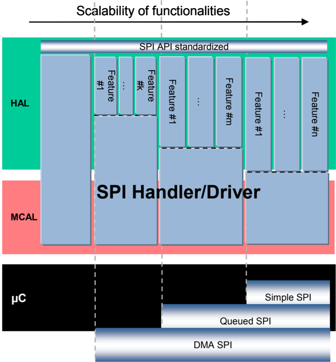

### 6.2. 一般行为

本章一方面介绍适用于所有级别的公共行为和配置；另一方面规定每个级别的行为以及允许的可选特性。

SPI 处理器/驱动程序的接口配置应基于本文定义的通道、作业和序列（见第 [2](#2-缩略语) 章）。

SPI 处理器/驱动程序应支持一个或多个通道、作业和序列，以驱动所有类型的 **SPI** 兼容硬件设备。

数据传输应按照通道、作业和序列的配置参数进行。

片选（**CS**）附加在作业定义上。

片选应在作业传输期间被处理，并在作业传输结束时被释放。该片选处理应按照作业的配置参数进行。

应可以定义片选处理是由硬件外设自主管理（驱动程序不显式控制片选），还是 **SPI** 驱动程序应像 **DIO** 一样显式驱动片选线（见第 [9.1.8](#918-spiexternaldevice) 章中的 SpiEnableCs 参数）。

由实现决定配置到 SpiCsBehavior 中的片选行为在 SpiCsSelection = CS_VIA_GPIO 时是否适用。

**CS** 处理示例：在作业传输开始时将 **CS** 置为有效；在属于该作业的所有通道的传输结束之前一直保持，之后将 **CS** 置为无效。

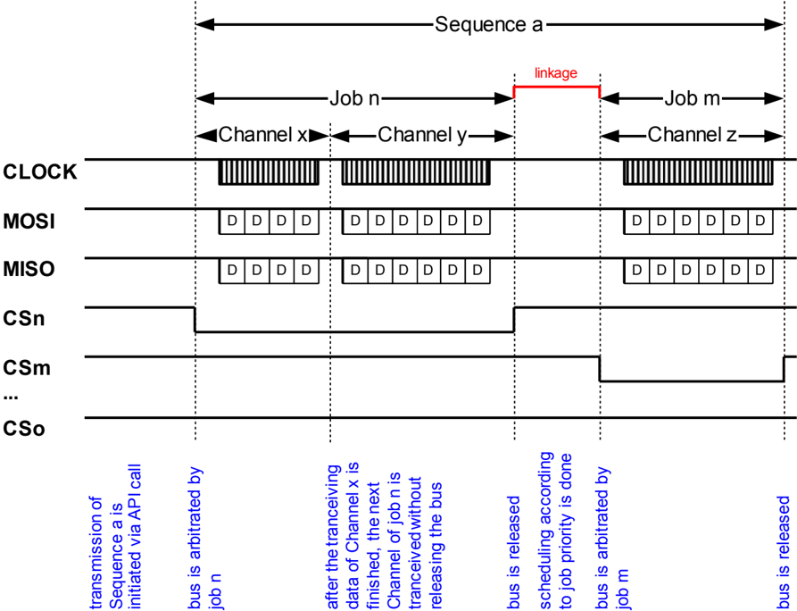

**注意：**上图对应 SpiCsBehavior=CS_KEEP_ASSERTED 的配置。

一个通道只定义一次，但根据使用者需要和本软件规范，它可以属于多个作业。

一个作业应至少包含一个通道。

每个通道应有一个关联的索引，该索引用于指定通道在作业中的顺序。

如果一个作业包含多个通道，则所包含的所有通道在传输期间都具有相同的作业属性，并且应静态地链接在一起。

一个作业只定义一次，但根据使用者需要和本软件规范，它可以属于多个序列。

一个序列应至少包含一个作业。

如果一个序列包含多个作业，则所包含的所有作业在传输期间都具有相同的序列属性，并且应静态地链接在一起。

用于传输的通道应配置其参数，但允许将空指针作为源和目的指针传入以产生虚拟传输（另见 [Spi_SetupEB](#736-spi_setupeb) 的规定）。

通道数据可能与硬件所处理的以及使用者（客户应用程序）所提供的数据不同。在客户端一侧，数据基于 SpiDataWidth 以 8、16 或 32 位模式处理（见第 [7.2.5](#725-spi_databuffertype) 章）。在微控制器一侧，硬件可能处理 1 到 32 位之间的数据，也可能……

SPI 处理器/驱动程序应处理通道帧宽度（SpiDataWidth）与数据访问数据类型之间的差异（由第 [7](#7-api规范) 章的规定给出）。

如果数据宽度（SpiDataWidth）完全相同（8、16 或 32 位），SPI 处理器/驱动程序可以直接进行数据的发送和接收，无需任何位变动。

如果数据访问的转换类型大于数据宽度（例如 SpiDataWidth = 12 位，数据访问为 16 位），则通过 SPI 处理器/驱动程序传输的数据应发送较低的部分，忽略较高的部分；接收较低的部分，以零扩展。

这确保使用者始终获得相同的接口。

数据缓冲区按照 SpiDataWidth 作为 uint8、uint16 或 uint32 访问，而与 [Spi_DataBufferType](#725-spi_databuffertype) 无关。

数据访问将使用以下转换：SpiDataWidth &lt; 9 时为 uint8；9 =&lt; SpiDataWidth &lt; 17 时为 uint16；17 =&lt; SpiDataWidth 时为 uint32。

#### 6.2.1. 公共可配置特性：允许的通道缓冲方式

为了允许利用微控制器的所有能力，同时也允许向/从一个专用的存储器位置发送/接收数据，所有级别都有一个关于通道缓冲区位置的可选特性。

因此，通过配置可以使用两种主要的通道缓冲方式：

* **内部缓冲通道（IB）**：用于传输/接收数据的缓冲区由处理器/驱动程序提供。
* **外部缓冲通道（EB）**：用于传输/接收的缓冲区由使用者提供（静态和/或动态）。

根据下面描述的 3 种用例，可以同时使用这两种通道缓冲方式：

* 用法 0：SPI 处理器/驱动程序只管理内部缓冲区。
* 用法 1：SPI 处理器/驱动程序只管理外部缓冲区。
* 用法 2：SPI 处理器/驱动程序同时管理两种缓冲区。

SpiChannelBuffersAllowed 参数应按照所述用法配置为 3 个授权取值（0、1 或 2）之一。

SpiChannelBuffersAllowed 参数的配置用于选择 SPI 处理器/驱动程序管理哪些通道缓冲区。

##### 6.2.1.1. IB 通道的行为

内部缓冲通道的目的是利用微控制器在硬件中包含的这一特性。否则，该特性应由软件模拟。

对于 **IB** 通道，处理器/驱动程序应提供缓冲，但它无法在传输期间保证缓冲区中数据的一致性。通道缓冲区的大小是固定的。

接收到的通道数据应存储在每个通道 1 个条目深度的内部缓冲区中。SPI 处理器/驱动程序不应负责处理这些「接收」缓冲区被同一通道上的另一次传输覆写的问题。

待传输的通道数据应复制到每个通道 1 个条目深度的内部缓冲区中。

SPI 处理器/驱动程序无法阻止这些「发送」缓冲区在使用者传输期间被覆写。

处理器/驱动程序应为接收和发送提供独立的缓冲区，以确保发送的数据不会被接收数据覆写。

##### 6.2.1.2. EB 通道的行为

外部缓冲通道的目的是重用位于外部的既有缓冲区。这意味着 SPI 处理器/驱动程序不监控它们。

对于 **EB** 通道，应用程序应提供缓冲，并应在传输期间保证缓冲区中数据的一致性。

通道缓冲区的大小可以是固定的或可变的。配置应定义通道缓冲区的最大大小。

应用程序为 SPI 处理器/驱动程序提供的缓冲区可以具有不同的大小。

##### 6.2.1.3. 缓冲通道的使用

下表提供了关于通道特性的信息：

| IB 通道 | |
|---|---|
| 它提供…… | 更抽象的概念（缓冲机制被隐藏）；利用硬件缓冲设施的当前和未来最优实现（给定的 256 字节大小覆盖了当今的需求）。 |
| 建议用于…… | 菊花链（Daisy-chain）实现。小数据量传输设备（最多 10 字节）。 |

| EB 通道 | |
|---|---|
| 它提供…… | 支持大数据流通信的高效机制；从 **ROM** 表发送常量数据并节省 **RAM** 空间；为不同设备发送各种数据表（具有多个集成外设的高度复杂 **ASIC**，也包括混合信号类型）。 |
| 建议用于…… | 大数据流通信。**EEPROM** 通信。复杂硬件芯片的控制。 |

**注意：**

对于每个通道，如果当前通道选择了 **IB**，使用者配置 IB 缓冲区的数量（至少 1 个）；如果当前通道选择了 **EB**，则配置 EB 缓冲区的最大数据量。

#### 6.2.2. LEVEL 0，简单同步行为

该功能级别的目的是提供一个只处理简单同步传输的、服务集精简的处理器/驱动程序。对于包含简单 **SPI** 网络的 **ECU**，以及使用高速外部设备的 **ECU**，这通常是常见情况。

简单同步传输意味着调用传输服务的函数在传输进行期间被阻塞，直到传输完成。

**LEVEL 0** SPI 处理器/驱动程序应为 **SPI** 总线提供同步传输服务。

对于工作在 **LEVEL 0** 的 SPI 处理器/驱动程序，当没有正在进行的序列传输时，SPI 处理器/驱动程序应处于空闲状态 **SPI_IDLE**。

这种单体式 SPI 处理器/驱动程序能够根据所使用的微控制器处理 1 到 n 条 **SPI** 总线。

因此 **SPI** 总线分配给作业而不是序列。因此，不同 **SPI** 总线上的作业可以属于同一个序列。所以：

如果所传输的序列使用不同的总线且参数 SPI_SUPPORT_CONCURRENT_SYNC_TRANSMIT 被启用，**LEVEL 0** SPI 处理器/驱动程序应接受并发的 [Spi_SyncTransmit](#7311-spi_synctransmit)() 调用。该特性默认禁用。这意味着……

**LEVEL 0** SPI 处理器/驱动程序的行为应包含所选择的公共特性：允许的通道缓冲方式。

如果不同的作业（因此也包括序列）拥有共同的通道，SPI 处理器/驱动程序的环境应确保在传输期间不调用读取和/或写入函数。

当检测到硬件错误时，SPI 处理器/驱动程序应停止当前序列，按配置向 **DEM** 报告错误，并将作业的状态设置为 **SPI_JOB_FAILED**，将序列的状态设置为 **SPI_SEQ_FAILED**。

在通道数据正在传输时，读取和写入函数无法保证数据完整性。

#### 6.2.3. LEVEL 1，基础异步行为

该功能级别的目的是提供一个只处理异步传输的、服务集精简的处理器/驱动程序。对于其功能与具有不同优先级的 **SPI** 网络相关的 **ECU**，以及使用大……

异步传输意味着调用传输服务的使用者在传输进行期间不被阻塞。此外，可以在传输结束时通知使用者。

通常，根据软件设计的不同，可以通过轮询或中断机制检测异步传输的结束。该功能级别提供了这两种机制，可在执行期间选择。

**SPI** 总线的轮询机制模式和中断机制模式都应在执行期间可选择（见 [Spi_SetAsyncMode](#7314-spi_setasyncmode) 的规定）。

**LEVEL 1** SPI 处理器/驱动程序应为 **SPI** 总线提供异步传输服务。异步传输意味着调用传输服务的使用者在传输进行期间不被阻塞。

**LEVEL 1** SPI 处理器/驱动程序应为 **SPI** 总线提供异步传输服务。此外，可以在传输结束时通知使用者。

对于工作在 **LEVEL 1** 的 SPI 处理器/驱动程序，当没有正在进行的序列传输时，SPI 处理器/驱动程序应处于空闲状态（**SPI_IDLE**）。

该处理器/驱动程序将被多个软件模块使用，这些模块可能彼此独立，也可能属于不同的层。因此，将为作业分配优先级，以解决特定的多路访问情况。这些……

作业被分配了优先级。链接在一个序列中的作业应具有相同或递减的优先级。这意味着第一个作业应具有与序列中所有作业相等的优先级或最高优先级。

作业的优先级顺序应从定义的较低值到较高值，值越高优先级越高（从 0（最低）到 3（最高），限制为 4 个优先级级别）。

关于作业优先级，该处理器/驱动程序需要规则来在这些特定的多路访问情况下做出决策。

SPI 处理器/驱动程序的调度方法应调度作业，以便首先发送最高优先级的作业。

这种单体式 SPI 处理器/驱动程序能够根据所使用的微控制器处理 1 到 n 条 **SPI** 总线。但 **SPI** 总线分配给作业而不是序列。因此，不同 **SPI** 总线上的作业可以属于同一个序列。所以：

**LEVEL 1** SPI 处理器/驱动程序可以允许同时传输多于一个序列。这意味着在序列传输期间，应评估所有传输另一个序列的请求，以便接受开始一个新序列或……的决策。

**LEVEL 1** SPI 处理器/驱动程序的行为应包括所选择的公共特性：允许的通道缓冲方式，以及所配置的异步特性：可中断序列（见下一章）。

当检测到硬件错误时，SPI 处理器/驱动程序应停止当前序列，按配置向 **DEM** 报告错误，并将作业的状态设置为 **SPI_JOB_FAILED**，将序列的状态设置为 **SPI_SEQ_FAILED**。

如果作业配置了特定的结束通知函数，SPI 处理器/驱动程序应在作业传输结束时调用该通知函数。

如果序列配置了特定的结束通知函数，SPI 处理器/驱动程序应在序列传输结束时调用该通知函数。

当配置了有效的通知函数指针时（见第 [7.6.3.1](#7631-spi_jobendnotification) 章），SPI 处理器/驱动程序应在作业传输结束时调用该通知函数，无论作业传输的结果是 **SPI_JOB_FAILED** 还是……

当配置了有效的通知函数指针时（见第 [7.6.3.2](#7632-spi_seqendnotification) 章），SPI 处理器/驱动程序应在序列传输结束时调用该通知函数，无论序列传输的结果是 **SPI_SEQ_FAILED** 还是……

#### 6.2.4. 异步可配置特性：可中断序列

为了允许利用异步传输机制，本 SPI 处理器/驱动程序的级别 1 和级别 2 提供了一个关于挂起序列传输的可选特性。

因此，通过配置可以使用两种主要的序列类型：

* **不可中断序列**（Non-Interruptible Sequences）：已启动的每个序列传输在传输结束前不会被处理器/驱动程序挂起。
* **混合序列**（Mixed Sequences）：根据其配置，已启动的序列传输可能被处理器/驱动程序在其两个连续作业之间挂起。

SPI 处理器/驱动程序的环境应配置 SpiInterruptibleSeqAllowed 参数（**ON** / **OFF**），以选择 SPI 处理器/驱动程序管理哪种序列。

##### 6.2.4.1. 不可中断序列的行为

不可中断序列特性的目的是提供一个基于基本异步机制的简单软件模块（如果只需使用非阻塞传输）。

当 SpiInterruptibleSeqAllowed 参数被关闭（即配置为「OFF」值）时，SPI 处理器/驱动程序的级别 1 和级别 2 中不允许使用可中断序列。

当 SPI 处理器/驱动程序被配置为不允许可中断序列时，所有声明的序列都被视为不可中断序列。

当 SPI 处理器/驱动程序被配置为不允许可中断序列时，其专用参数 SpiInterruptibleSequence 可以省略，或者应使用 **FALSE** 值作为默认值。

根据第 [6.2.3](#623-level-1，基础异步行为) 章和本章的要求，SPI 处理器/驱动程序不得为了另一个序列而挂起一个已经开始的序列传输。

##### 6.2.4.2. 混合序列的行为

混合序列特性的目的是提供一个具有特定异步机制的软件模块，例如，如果使用了可能或应当被其他具有更高优先级的序列挂起的很长序列。

当 SpiInterruptibleSeqAllowed 参数被开启（即配置为「ON」值）时，SPI 处理器/驱动程序的级别 1 和级别 2 中允许使用可中断序列。

当 SPI 处理器/驱动程序被配置为允许可中断序列时，所有声明的序列都应具有其专用参数 SpiInterruptibleSequence（见配置规范），以标识该序列在传输期间是否可以被挂起。

对于配置为可中断序列的序列，根据本章的要求，SPI 处理器/驱动程序允许为了另一个拥有更高优先级作业的序列而挂起一个已经开始的序列传输（……）。

对于配置为不可中断序列的序列，根据本章的要求，SPI 处理器/驱动程序不得为了另一个序列而挂起这个已经开始的序列传输。

当使用可中断序列时，调用者必须意识到：如果多个序列访问相同的通道，则这些通道的数据可能被访问每个通道的最高优先级作业覆写。

#### 6.2.5. LEVEL 2，增强型行为

该功能级别的目的是提供一个具备完整服务集、可处理同步和异步传输的处理器/驱动程序。对于具有大量与不同优先级的 **SPI** 网络相关的功能的 **ECU**，以及……

通常，根据软件设计的不同，可以通过轮询或中断机制检测异步传输的结束。该功能级别提供了这两种机制，可在执行期间选择。

**LEVEL 0** 的要求适用于同步行为。**LEVEL 1** 的要求适用于异步行为。

**LEVEL 2** SPI 处理器/驱动程序应为 **SPI** 总线同时提供异步传输服务和同步传输服务。

在 **LEVEL 2** 中，如果没有正在进行的序列传输，SPI 处理器/驱动程序应处于空闲状态（**SPI_IDLE**）。

### 6.3. 调度建议

对于异步级别 **LEVEL 1** 和 **LEVEL 2**，SPI 处理器/驱动程序可以在作业和/或序列传输结束时调用结束通知函数（见第 [6.2.3](#623-level-1，基础异步行为) 章）。第二步，在可中断序列（可能被挂起）的情况下，如果另一个……

对于异步级别 **LEVEL 1** 和 **LEVEL 2**，SPI 处理器/驱动程序可以在作业结束时调用结束通知函数。

对于异步级别 **LEVEL 1** 和 **LEVEL 2**，SPI 处理器/驱动程序可以在序列传输结束时调用结束通知函数。

对于异步级别 **LEVEL 1** 和 **LEVEL 2**，在可中断序列的情况下，如果另一个序列传输请求处于挂起状态，SPI 处理器/驱动程序还应进行重新调度，以选出下一个要传输的作业。

如果调用结束通知函数和重新调度完全由软件完成，则两者的顺序应为：先调度，然后执行结束通知函数的调用。

### 6.4. 错误分类

文档[\[1\]](#ref-1)《基础软件模块通用规范》的第 [7.2](#72-类型定义) 章「错误处理」详细描述了基础软件的错误处理。最重要的是，它构成了一个由可能发生在**BSW**模块中的五种错误类型组成的分类方案。

在此基础上，以下章节规定了在下面各小节中安排的特定错误。

#### 6.4.1. 开发错误

| 错误类型 | 相关错误代码 | 错误值 |
|---|---|---|
| 以错误的通道调用 **API** 服务 | SPI_E_PARAM_CHANNEL | 0x0A |
| 以错误的作业调用 **API** 服务 | SPI_E_PARAM_JOB | 0x0B |
| 以错误的序列调用 **API** 服务 | SPI_E_PARAM_SEQ | 0x0C |
| 以错误的 **EB** 长度调用 **API** 服务 | SPI_E_PARAM_LENGTH | 0x0D |
| 以错误的硬件单元调用 **API** 服务 | SPI_E_PARAM_UNIT | 0x0E |
| **API** 调用时指针出现意外取值 | SPI_E_PARAM_POINTER | 0x10 |
| 在模块未初始化的情况下使用 **API** 服务 | SPI_E_UNINIT | 0x1A |
| 在 **SPI** 驱动程序已经初始化的情况下调用 **API** 服务 [Spi_Init](#731-spi_init) | SPI_E_ALREADY_INITIALIZED | 0x4A |

#### 6.4.2. 运行时错误

| 错误类型 | 相关错误代码 | 错误值 |
|---|---|---|
| 以错误的顺序调用 **API** 服务 [Spi_AsyncTransmit](#734-spi_asynctransmit) | SPI_E_SEQ_PENDING | 0x2A |
| 在错误的时间调用 **API** 服务 [Spi_SyncTransmit](#7311-spi_synctransmit) | SPI_E_SEQ_IN_PROCESS | 0x3A |

#### 6.4.3. 瞬态故障

没有瞬态故障。

#### 6.4.4. 生产错误

没有生产错误。

#### 6.4.5. 扩展生产错误

##### 6.4.5.1. SPI_E_HARDWARE_ERROR

| 错误名称 | [SPI_E_HARDWARE_ERROR](#645-扩展生产错误) |
|---|---|
| 简短描述 | 在异步或同步 **SPI** 传输期间发生了硬件错误。 |
| 详细描述 | 当 **SPI** 硬件发送状态寄存器内的任何错误位被置位时，应发出该扩展生产错误。 |
| 检测标准 | **Fail**：当 **SPI** 发送状态寄存器内有错误位被置位时，应将 **SPI** 发送状态寄存器信息通过 Dem_SetEventStatus ([SPI_E_HARDWARE_ERROR](#645-扩展生产错误), DEM_EVENT_STATUS_FAILED) 报告给 **DEM**。**Pass**：当 **SPI** 发送状态寄存器内没有错误位被置位时，应将 **SPI** 发送状态寄存器信息通过 Dem_SetEventStatus ([SPI_E_HARDWARE_ERROR](#645-扩展生产错误), DEM_EVENT_STATUS_PASSED) 报告给 **DEM**。 |
| 次要参数 | 不适用。 |
| 所需时间 | 不适用。 |
| 监控频率 | 持续 |

当 **SPI** 发送状态寄存器内有任何错误位被置位时，应将 **SPI** 发送状态寄存器信息通过 Dem_SetEventStatus ([SPI_E_HARDWARE_ERROR](#645-扩展生产错误), DEM_EVENT_STATUS_FAILED) 报告给 **DEM**。

当 **SPI** 发送状态寄存器内没有错误位被置位时，应将 **SPI** 发送状态寄存器信息通过 Dem_SetEventStatus ([SPI_E_HARDWARE_ERROR](#645-扩展生产错误), DEM_EVENT_STATUS_PASSED) 报告给 **DEM**。

## 7. API规范

### 7.1. 导入的类型

在本章中，列出了从以下模块包含的所有类型：

**Spi**模块的导入数据类型定义

| 模块 | 头文件 | 导入的类型 |
|---|---|---|
| Dem | Rte_Dem_Type.h | Dem_EventIdType |
| Dem | Rte_Dem_Type.h | Dem_EventStatusType |
| Std | Std_Types.h | Std_ReturnType |
| Std | Std_Types.h | Std_VersionInfoType |

### 7.2. 类型定义

#### 7.2.1. Spi_ConfigType

结构类型。元素为实现特定的内容。初始化数据结构的内容是 **SPI** 特定的。该外部数据结构的类型应包含 SPI 处理器/驱动程序的初始化数据。可通过**Spi.h**获得。

#### 7.2.2. Spi_StatusType

枚举类型。该类型定义了 SPI 处理器/驱动程序的一组特定状态。可通过**Spi.h**获得。

* **SPI_UNINIT**（0x00）：SPI 处理器/驱动程序未初始化或不可用。
* **SPI_IDLE**（0x01）：SPI 处理器/驱动程序当前没有传输任何作业。
* **SPI_BUSY**（0x02）：SPI 处理器/驱动程序正在执行一个 **SPI** 作业（传输）。

类型 Spi_StatusType 定义了 SPI 处理器/驱动程序的一组特定状态。它告知 SPI 处理器/驱动程序的状态或指定的 **SPI** 硬件微控制器外设的状态。

可以通过调用 **API** 服务 [Spi_GetStatus](#737-spi_getstatus) 获得类型 Spi_StatusType。

可以通过调用 **API** 服务 [Spi_GetHWUnitStatus](#7312-spi_gethwunitstatus) 获得类型 Spi_StatusType。

复位之后，类型 Spi_StatusType 应具有默认值 **SPI_UNINIT**。

当 SPI 处理器/驱动程序未初始化或不可用时，**API** 服务 [Spi_GetStatus](#737-spi_getstatus) 应返回 **SPI_UNINIT**。

当 SPI 处理器/驱动程序当前没有传输任何作业时，**API** 服务 [Spi_GetStatus](#737-spi_getstatus) 应返回 **SPI_IDLE**。

当 SPI 处理器/驱动程序正在执行一个 **SPI** 作业传输时，**API** 服务 [Spi_GetStatus](#737-spi_getstatus) 应返回 **SPI_BUSY**。

当 **SPI** 硬件微控制器外设当前没有传输任何作业时，[Spi_GetHWUnitStatus](#7312-spi_gethwunitstatus) 函数应返回 **SPI_IDLE**。

当 **SPI** 硬件微控制器外设正在执行一个 **SPI** 作业传输时，[Spi_GetHWUnitStatus](#7312-spi_gethwunitstatus) 函数应返回 **SPI_BUSY**。

#### 7.2.3. Spi_JobResultType

枚举类型。该类型定义了 SPI 处理器/驱动程序的一组特定作业状态。可通过**Spi.h**获得。

* **SPI_JOB_OK**（0x00）：该作业的上一次传输已成功完成。
* **SPI_JOB_PENDING**（0x01）：SPI 处理器/驱动程序正在执行一个 **SPI** 作业。该状态的含义等同于 **SPI_BUSY**。
* **SPI_JOB_FAILED**（0x02）：该作业的上一次传输已失败。
* **SPI_JOB_QUEUED**（0x03）：一个异步传输作业已被接受，而实际传输……

类型 Spi_JobResultType 定义了 SPI 处理器/驱动程序的一组特定作业状态。

类型 Spi_JobResultType 给出 **SPI** 处理器/驱动程序作业的状态，可以通过使用作业 **ID** 调用 **API** 服务 [Spi_GetJobResult](#738-spi_getjobresult) 获得。

复位之后，类型 Spi_JobResultType 应具有默认值 **SPI_JOB_OK**。

当该作业的上一次传输已成功完成时，函数 [Spi_GetJobResult](#738-spi_getjobresult) 应返回 **SPI_JOB_OK**。

#### 7.2.4. Spi_SeqResultType

枚举类型。该类型定义了 SPI 处理器/驱动程序的一组特定序列状态。可通过**Spi.h**获得。

* **SPI_SEQ_OK**（0x00）：该序列的上一次传输已成功完成。
* **SPI_SEQ_PENDING**（0x01）：SPI 处理器/驱动程序正在执行一个 **SPI** 序列。该状态的含义等同于 **SPI_BUSY**。
* **SPI_SEQ_FAILED**（0x02）：该序列的上一次传输已失败。
* **SPI_SEQ_CANCELED**（0x03）：该序列的上一次传输已被使用者取消。

类型 Spi_SeqResultType 定义了 SPI 处理器/驱动程序的一组特定序列状态，可以通过调用 **API** 服务 [Spi_GetSequenceResult](#739-spi_getsequenceresult) 获得，它应提供给外部使用。

类型 Spi_SeqResultType 定义了 SPI 处理器/驱动程序的序列状态范围。

类型 Spi_SeqResultType 给出 **SPI** 处理器/驱动程序序列的状态，可以通过使用序列 **ID** 调用 **API** 服务 [Spi_GetSequenceResult](#739-spi_getsequenceresult) 获得。

复位之后，类型 Spi_SeqResultType 应具有默认值 **SPI_SEQ_OK**。

当该序列的上一次传输已成功完成时，[Spi_GetSequenceResult](#739-spi_getsequenceresult) 函数应返回 **SPI_SEQ_OK**。

当 SPI 处理器/驱动程序正在执行一个 **SPI** 序列时，[Spi_GetSequenceResult](#739-spi_getsequenceresult) 函数应返回 **SPI_SEQ_PENDING**。该状态的含义等同于 **SPI_BUSY**。

当该序列的上一次传输已失败时，[Spi_GetSequenceResult](#739-spi_getsequenceresult) 函数应返回 **SPI_SEQ_FAILED**。

#### 7.2.5. Spi_DataBufferType

类型，派生自 uint8。应用程序数据缓冲区元素的类型。可通过**Spi.h**获得。

Spi_DataBufferType 定义应用程序数据缓冲区元素的类型。类型为 uint8。对数据的访问按第 [7](#7-api规范) 章的描述动态选择。数据缓冲区必须按 32 位对齐。它应当……

类型 Spi_DataBufferType 指向应用程序数据缓冲区元素。

#### 7.2.6. Spi_NumberOfDataType

类型，派生自 uint16。用于定义按通道发送和/或接收的数据元素数量的类型。可通过**Spi.h**获得。

类型 Spi_NumberOfDataType 用于定义按通道发送和/或接收的、第 [7](#7-api规范) 章所规定类型的数据元素的数量。

#### 7.2.7. Spi_ChannelType

类型，派生自 uint8。指定一个通道的标识（**ID**）。可通过**Spi.h**获得。

类型 Spi_ChannelType 指定一个通道的标识（**ID**）。

类型 Spi_ChannelType 用于指定一个通道的标识（**ID**）。

#### 7.2.8. Spi_JobType

类型，派生自 uint16。指定一个作业的标识（**ID**）。可通过**Spi.h**获得。

类型 Spi_JobType 指定一个作业的标识（**ID**）。

类型 Spi_JobType 用于指定一个作业的标识（**ID**）。

#### 7.2.9. Spi_SequenceType

类型，派生自 uint8。指定一个作业序列的标识（**ID**）。可通过**Spi.h**获得。

类型 Spi_SequenceType 指定一个作业序列的标识（**ID**）。

类型 Spi_SequenceType 用于指定一个作业序列的标识（**ID**）。

#### 7.2.10. Spi_HWUnitType

类型，派生自 uint8。指定一个 **SPI** 硬件微控制器外设（单元）的标识（**ID**）。可通过**Spi.h**获得。

类型 Spi_HWUnitType 指定一个 **SPI** 硬件微控制器外设（单元）的标识（**ID**）。

类型 Spi_HWUnitType 用于指定一个 **SPI** 硬件微控制器外设（单元）的标识（**ID**）。

#### 7.2.11. Spi_AsyncModeType

枚举类型。指定以异步方式处理的 **SPI** 总线的异步机制模式。可通过**Spi.h**获得。

* **SPI_POLLING_MODE**（0x00）：异步机制由轮询保证，因此与以异步方式处理的 **SPI** 总线相关的中断被禁用。
* **SPI_INTERRUPT_MODE**（0x01）：异步机制由中断保证，因此与以异步方式处理的 **SPI** 总线相关的中断被启用。

异步机制由 **API** [Spi_SetAsyncMode](#7314-spi_setasyncmode) 选择。

类型 Spi_AsyncModeType 用于指定以异步方式处理的 **SPI** 总线的异步机制模式。

类型 Spi_AsyncModeType 是否可用取决于预编译期参数 SpiLevelDelivered。它仅与 **LEVEL 1** 和 **LEVEL 2** 相关。

如果 **API** [Spi_SetAsyncMode](#7314-spi_setasyncmode) 函数以参数值 **SPI_POLLING_MODE** 被调用，则异步机制由轮询保证。因此与以异步方式处理的 **SPI** 总线相关的中断被禁用。

如果 **API** [Spi_SetAsyncMode](#7314-spi_setasyncmode) 函数以参数值 **SPI_INTERRUPT_MODE** 被调用，则异步机制由中断保证。因此与以异步方式处理的 **SPI** 总线相关的中断被启用。

### 7.3. 函数定义

#### 7.3.1. Spi_Init

**说明**: 此服务用于初始化。可通过**Spi.h**获得。本服务为同步调用，不可重入。参数 ConfigPtr（in）：指向配置集的指针。

```C
void Spi_Init ( const Spi_ConfigType* ConfigPtr )
```

操作 Spi_Init 是不可重入的。

函数 Spi_Init 提供 **SPI** 初始化服务。

函数 Spi_Init 应使用参数 ConfigPtr 所引用结构中的值初始化所有与 **SPI** 相关的寄存器。

在使用函数 Spi_Init 完成模块初始化之后，SPI 处理器/驱动程序应将其状态设置为 **SPI_IDLE**，将序列结果设置为 **SPI_SEQ_OK**，并将作业结果设置为 **SPI_JOB_OK**。

对于 **LEVEL 2**（见第 [6.2.5](#625-level-2，增强型行为) 章），函数 Spi_Init 应默认将 SPI 处理器/驱动程序的异步机制模式设置为 **SPI_POLLING_MODE**。与 **SPI** 总线相关的中断应被禁用。

通过执行 Spi_Init() 函数对 SPI 处理器/驱动程序进行重新初始化之前，需要先通过执行 [Spi_DeInit](#732-spi_deinit)() 进行去初始化。

函数 Spi_Init 的参数应按照「**API** 参数检查」一节的规定进行检查。

#### 7.3.2. Spi_DeInit

**说明**: 此服务用于 **SPI** 去初始化。可通过**Spi.h**获得。本服务为同步调用，不可重入。返回值：Std_ReturnType，E_OK：去初始化命令已被接受；E_NOT_OK：去初始化命令未被接受。

```C
Std_ReturnType Spi_DeInit ( void )
```

操作 Std_ReturnType Spi_DeInit( ) 是不可重入的。

当 **API** Spi_DeInit 已被接受时，该函数的返回值应为 E_OK。

当 **API** Spi_DeInit 未被接受时，该函数的返回值应为 E_NOT_OK。

函数 Spi_DeInit 提供 **SPI** 去初始化服务。

函数 Spi_DeInit 应去初始化 SPI 处理器/驱动程序。

在 SPI 处理器/驱动程序的状态不是 **SPI_BUSY** 的情况下，去初始化函数应将所有已初始化的微控制器 **SPI** 外设置为与上电复位相同的状态。

如果 SPI 处理器/驱动程序的状态为 **SPI_BUSY**，则函数调用 Spi_DeInit 应被拒绝。

在使用函数 Spi_DeInit 完成模块去初始化之后，SPI 处理器/驱动程序应将其状态设置为 **SPI_UNINIT**。

在调用函数 Spi_DeInit 之前，SPI 处理器/驱动程序应已被初始化，否则见第 [7.7.2](#772-spi-状态检查) 章的规定。

#### 7.3.3. Spi_WriteIB

**说明**: 此服务用于向参数指定的 **IB** SPI 处理器/驱动程序通道写入一个或多个数据。可通过**Spi.h**获得。本服务为同步调用，可重入。参数 Channel（in）：通道 **ID**。参数 DataBufferPtr（in）：指向源数据缓冲区的指针。如果该指针为空，则假定待传输的数据无关紧要，且使用默认值……。返回值：Std_ReturnType，E_OK：写命令已被接受；E_NOT_OK：写命令未被接受。

```C
Std_ReturnType Spi_WriteIB ( Spi_ChannelType Channel, const Spi_DataBufferType* DataBufferPtr )
```

操作 Spi_WriteIB 是可重入的。

当 **API** Spi_WriteIB 命令已被接受时，函数返回值 E_OK。

当 **API** Spi_WriteIB 命令未被接受时，函数返回值 E_NOT_OK。

函数 Spi_WriteIB 提供向由相应参数指定的 **IB** SPI 处理器/驱动程序通道写入一个或多个数据的服务。

函数 Spi_WriteIB 应向由相应参数指定的 **IB** SPI 处理器/驱动程序通道写入一个或多个数据。

函数 Spi_WriteIB 应接收给定的参数，并将所指向的数据保存到用函数 [Spi_Init](#731-spi_init) 定义的内部缓冲区中。

如果给定的参数 DataBufferPtr 为空，函数 Spi_WriteIB 应假定待传输的数据无关紧要，并转而使用给定通道的默认发送值。

函数 Spi_WriteIB 应可通过参数 SpiChannelBuffersAllowed 进行预编译期配置。该函数仅与具有 **IB** 的通道相关。

函数 Spi_WriteIB 的参数应按照「**API** 参数检查」一节的规定进行检查。

在调用函数 Spi_WriteIB 之前，SPI 处理器/驱动程序应已被初始化，否则见第 [7.7.2](#772-spi-状态检查) 章的规定。

#### 7.3.4. Spi_AsyncTransmit

**说明**: 此服务用于在 **SPI** 总线上传输数据。可通过**Spi.h**获得。本服务为异步调用，可重入。参数 Sequence（in）：序列 **ID**。返回值：Std_ReturnType，E_OK：传输命令已被接受；E_NOT_OK：传输命令未被接受。

```C
Std_ReturnType Spi_AsyncTransmit ( Spi_SequenceType Sequence )
```

操作 Std_ReturnType Spi_AsyncTransmit( [Spi_SequenceType](#729-spi_sequencetype) Sequence ) 是可重入的。

当 **API** Spi_AsyncTransmit 命令已被接受时，函数应返回值 E_OK。

当 **API** Spi_AsyncTransmit 命令未被接受时，函数应返回值 E_NOT_OK。

函数 Spi_AsyncTransmit 提供在 **SPI** 总线上传输数据的服务。

函数 Spi_AsyncTransmit 应接收给定的参数，发起一次传输，将 SPI 处理器/驱动程序的状态设置为 **SPI_BUSY**，将序列结果设置为 **SPI_SEQ_PENDING**，然后返回。

当函数 Spi_AsyncTransmit 被调用时，应接收给定的参数并将作业状态设置为 **SPI_JOB_QUEUED**，该状态可通过调用 **API** 服务 [Spi_GetJobResult](#738-spi_getjobresult) 获得。

当函数 Spi_AsyncTransmit 被调用时，SPI 处理器/驱动程序应处理作业结果。当作业的传输开始时，结果应为 **SPI_JOB_PENDING**。

当函数 Spi_AsyncTransmit 被调用时，SPI 处理器/驱动程序应处理作业结果。当作业的传输成功时，结果应为 **SPI_JOB_OK**。

当函数 Spi_AsyncTransmit 被调用时，SPI 处理器/驱动程序应处理作业结果。当作业的传输失败时，结果应为 **SPI_JOB_FAILED**。

当函数 Spi_AsyncTransmit 被调用且所请求的序列已处于 **SPI_SEQ_PENDING** 状态时，SPI 处理器/驱动程序不应考虑这个新请求，并且该函数应返回值 E_NOT_OK。

当函数 Spi_AsyncTransmit 被调用且所请求的序列已处于 **SPI_SEQ_PENDING** 状态时，SPI 处理器/驱动程序应报告 [**SPI_E_SEQ_PENDING**](#642-运行时错误) 错误。

当函数 Spi_AsyncTransmit 被调用且所请求的序列与另一个处于 **SPI_SEQ_PENDING** 状态的序列共享作业时，SPI 处理器/驱动程序不应考虑这个新请求，并且该函数应返回值 E_NOT_OK。

当函数 Spi_AsyncTransmit 用于 **EB** 且通过 [Spi_SetupEB](#736-spi_setupeb) 方法将源数据指针提供为 **NULL** 时，应传输为每个通道配置的默认发送数据。

当函数 Spi_AsyncTransmit 用于 **EB** 且通过 [Spi_SetupEB](#736-spi_setupeb) 方法将目的数据指针提供为 **NULL** 时，SPI 处理器/驱动程序应忽略接收数据。

当函数 Spi_AsyncTransmit 用于一个带有链接作业的序列时，该函数应从序列中的第一个作业传输到最后一个作业。

在由函数 Spi_AsyncTransmit 发起的序列传输结束时，如果已配置，SPI 处理器/驱动程序应在最后一个作业的结束通知（如果存在）之后调用序列通知回调函数。

函数 Spi_AsyncTransmit 可通过配置参数 SpiLevelDelivered 进行预编译期选择。该函数仅与 **LEVEL 1** 和 **LEVEL 2** 相关。

对于 **EB** 通道，SPI 处理器/驱动程序的环境应在调用函数 [Spi_SetupEB](#736-spi_setupeb) 之后（对于 **IB** 通道则为调用函数 [Spi_WriteIB](#733-spi_writeib) 之后）、且在调用函数 [Spi_ReadIB](#735-spi_readib) 之前调用函数 Spi_AsyncTransmit。

函数 Spi_AsyncTransmit 的参数应按照「**API** 参数检查」一节的规定进行检查。

在调用函数 Spi_AsyncTransmit 之前，SPI 处理器/驱动程序应已被初始化，否则见第 [7.7.2](#772-spi-状态检查) 章的规定。

#### 7.3.5. Spi_ReadIB

**说明**: 此服务用于从参数指定的 **IB** SPI 处理器/驱动程序通道同步读取一个或多个数据。可通过**Spi.h**获得。本服务为同步调用，可重入。参数 Channel（in）：通道 **ID**。参数 DataBufferPointer（in）：指向数据缓冲区的指针。返回值：Std_ReturnType，E_OK：读命令已被接受；E_NOT_OK：读命令未被接受。

```C
Std_ReturnType Spi_ReadIB ( Spi_ChannelType Channel, Spi_DataBufferType* DataBufferPointer )
```

操作 Spi_ReadIB 是可重入的。

函数 Spi_ReadIB 的返回值 E_OK：读命令已被接受。

函数 Spi_ReadIB 的返回值 E_NOT_OK：读命令未被接受。

函数 Spi_ReadIB 提供从由相应参数指定的 **IB** SPI 处理器/驱动程序通道同步读取一个或多个数据的服务。

函数 Spi_ReadIB 应从由相应参数指定的 **IB** SPI 处理器/驱动程序通道同步读取一个或多个数据。

SPI 处理器/驱动程序的环境应在调用传输方法之后调用函数 Spi_ReadIB，以使 **IB** 通道中拥有相关的数据。

函数 Spi_ReadIB 可通过参数 SpiChannelBuffersAllowed 进行预编译期配置。该函数仅与具有 **IB** 的通道相关。

函数 Spi_ReadIB 的参数应按照「**API** 参数检查」一节的规定进行检查。

在调用函数 Spi_ReadIB 之前，SPI 处理器/驱动程序应已被初始化，否则见第 [7.7.2](#772-spi-状态检查) 章的规定。

#### 7.3.6. Spi_SetupEB

**说明**: 此服务用于为指定的 **EB** SPI 处理器/驱动程序通道设置缓冲区和数据长度。可通过**Spi.h**获得。本服务为同步调用，可重入。参数 Channel（in）：通道 **ID**。参数 SrcDataBufferPtr（in）：指向源数据缓冲区的指针。参数 DesDataBufferPtr（in）：指向目的数据缓冲区的指针。参数 Length（in）：数据长度。返回值：Std_ReturnType，E_OK：设置命令已被接受；E_NOT_OK：设置命令未被接受。

```C
Std_ReturnType Spi_SetupEB ( Spi_ChannelType Channel, const Spi_DataBufferType* SrcDataBufferPtr, Spi_DataBufferType* DesDataBufferPtr, Spi_NumberOfDataType Length )
```

操作 Spi_SetupEB 是可重入的。

函数 Spi_SetupEB 的返回值为 E_OK：设置命令已被接受；E_NOT_OK：设置命令未被接受。

函数 Spi_SetupEB 提供为指定的 **EB** SPI 处理器/驱动程序通道设置缓冲区和数据长度的服务。

函数 Spi_SetupEB 应为特定的 **EB** SPI 处理器/驱动程序通道设置缓冲区和数据长度。

函数 Spi_SetupEB 应使用提供的值更新指定通道的缓冲区指针和长度属性。

由于这些属性是持久的，它们将用于随后对传输方法的所有调用（针对指定的通道）。

当 SPI 处理器/驱动程序的环境调用函数 Spi_SetupEB 且参数 SrcDataBufferPtr 为空指针时，该函数应在请求传输方法之后传输为该通道配置的默认发送值。

当调用函数 Spi_SetupEB 且参数 DesDataBufferPtr 为空指针时，SPI 处理器/驱动程序应在请求传输方法之后忽略接收到的数据。

对于每个声明为 **EB** 的通道，SPI 处理器/驱动程序的环境应调用一次 Spi_SetupEB 函数，然后再对其调用传输方法。

函数 Spi_SetupEB 可通过参数 SpiChannelBuffersAllowed 进行预编译期配置。该函数仅与具有 **EB** 的通道相关。

函数 Spi_SetupEB 的参数应按照「**API** 参数检查」一节的规定进行检查。

在调用函数 Spi_SetupEB 之前，SPI 处理器/驱动程序应已被初始化，否则见第 [7.7.2](#772-spi-状态检查) 章的规定。

#### 7.3.7. Spi_GetStatus

**说明**: 此服务返回 SPI 处理器/驱动程序软件模块的状态。可通过**Spi.h**获得。本服务为同步调用，可重入。返回值：[Spi_StatusType](#722-spi_statustype)。

```C
Spi_StatusType Spi_GetStatus ( void )
```

操作 Spi_GetStatus 是可重入的。

函数 Spi_GetStatus 返回 SPI 处理器/驱动程序软件模块的状态。

函数 Spi_GetStatus 应返回 SPI 处理器/驱动程序软件模块的状态。

#### 7.3.8. Spi_GetJobResult

**说明**: 此服务返回指定作业的上一次传输结果。可通过**Spi.h**获得。本服务为同步调用，可重入。参数 Job（in）：作业 **ID**。返回值：[Spi_JobResultType](#723-spi_jobresulttype)。

```C
Spi_JobResultType Spi_GetJobResult ( Spi_JobType Job )
```

操作 Spi_GetJobResult 是可重入的。

Spi_GetJobResult 服务返回指定作业的上一次传输结果。

函数 Spi_GetJobResult 应返回指定作业的上一次传输结果。

SPI 处理器/驱动程序的环境应调用函数 Spi_GetJobResult 来查询作业传输是已成功（**SPI_JOB_OK**）还是已失败（**SPI_JOB_FAILED**）。

**注意：**SPI 处理器/驱动程序接受的每个新传输作业都会将之前的作业结果覆写为 **SPI_JOB_QUEUED** 或 **SPI_JOB_PENDING**。

函数 Spi_GetJobResult 的参数应按照「**API** 参数检查」一节的规定进行检查。

如果在调用函数 Spi_GetJobResult 之前 SPI 处理器/驱动程序尚未被初始化，则返回值未定义。

#### 7.3.9. Spi_GetSequenceResult

**说明**: 此服务返回指定序列的上一次传输结果。可通过**Spi.h**获得。本服务为同步调用，可重入。参数 Sequence（in）：序列 **ID**。返回值：[Spi_SeqResultType](#724-spi_seqresulttype)。

```C
Spi_SeqResultType Spi_GetSequenceResult ( Spi_SequenceType Sequence )
```

**注意：**SPI 处理器/驱动程序接受的每个新传输序列都会将之前的序列结果覆写为 **SPI_SEQ_PENDING**……

**注意：**如果在调用函数 Spi_GetSequenceResult 之前 SPI 处理器/驱动程序尚未被初始化，则返回值未定义。

函数 Spi_GetSequenceResult 的参数应按照「**API** 参数检查」一节的规定进行检查。

#### 7.3.10. Spi_GetVersionInfo

**说明**: 此服务返回本模块的版本信息。可通过**Spi.h**获得。本服务为同步调用，可重入。参数 versioninfo（out）：指向存储本模块版本信息的位置的指针。

```C
void Spi_GetVersionInfo ( Std_VersionInfoType* versioninfo )
```

如果 **Det** 被启用，则应检查参数 versioninfo 是否为 **NULL**。如果该值为 **NULL** 指针，则应报告错误 [**SPI_E_PARAM_POINTER**](#641-开发错误)。

#### 7.3.11. Spi_SyncTransmit

**说明**: 此服务用于在 **SPI** 总线上传输数据。可通过**Spi.h**获得。本服务为同步调用，可重入。参数 Sequence（in）：序列 **ID**。返回值：Std_ReturnType，E_OK：传输已成功；E_NOT_OK：传输失败。

```C
Std_ReturnType Spi_SyncTransmit ( Spi_SequenceType Sequence )
```

操作 Spi_SyncTransmit 是可重入的。

如果传输请求已成功，函数 Spi_SyncTransmit 返回 E_OK。

如果传输请求失败，函数 Spi_SyncTransmit 返回 E_NOT_OK。

函数 Spi_SyncTransmit 提供在 **SPI** 总线上传输数据的服务。

当函数 Spi_SyncTransmit 被调用时，应接收给定的参数并将 SPI 处理器/驱动程序的状态设置为 **SPI_BUSY**，该状态可通过调用 **API** 服务 [Spi_GetStatus](#737-spi_getstatus) 获得。

当函数 Spi_SyncTransmit 被调用时，应接收给定的参数并将序列状态设置为 **SPI_SEQ_PENDING**，该状态可通过调用 **API** 服务 [Spi_GetSequenceResult](#739-spi_getsequenceresult) 获得。

当函数 Spi_SyncTransmit 被调用时，应接收给定的参数并将作业状态设置为 **SPI_JOB_PENDING**，该状态可通过调用 **API** 服务 [Spi_GetJobResult](#738-spi_getjobresult) 获得。

当函数 Spi_SyncTransmit 在一个序列正在传输期间被调用、且 SPI_SUPPORT_CONCURRENT_SYNC_TRANSMIT 被禁用，或在同一总线上有另一个序列正在传输时，SPI 处理器/驱动程序不应考虑……

函数 Spi_SyncTransmit 可通过配置参数 SpiLevelDelivered 进行预编译期选择。该函数仅与 **LEVEL 0** 和 **LEVEL 2** 相关。

函数 Spi_SyncTransmit 的参数应按照「**API** 参数检查」一节的规定进行检查。

#### 7.3.12. Spi_GetHWUnitStatus

**说明**: 此服务返回指定的 **SPI** 硬件微控制器外设的状态。可通过**Spi.h**获得。本服务为同步调用，可重入。参数 HWUnit（in）：**SPI** 硬件微控制器外设（单元）**ID**。返回值：[Spi_StatusType](#722-spi_statustype)。

```C
Spi_StatusType Spi_GetHWUnitStatus ( Spi_HWUnitType HWUnit )
```

操作 Spi_GetHWUnitStatus 是可重入的。

Spi_GetHWUnitStatus 服务返回指定的 **SPI** 硬件微控制器外设的状态。

函数 Spi_GetHWUnitStatus 应返回指定的 **SPI** 硬件微控制器外设的状态。

SPI 处理器/驱动程序的环境应调用该函数来查询指定的 **SPI** 硬件微控制器外设是 **SPI_IDLE** 还是 **SPI_BUSY**。

函数 Spi_GetHWUnitStatus 可通过配置参数 SpiHwStatusApi 进行预编译期的开/关配置。

函数 Spi_GetHWUnitStatus 的参数应按照「**API** 参数检查」一节的规定进行检查。

如果在调用函数 Spi_GetHWUnitStatus 之前 SPI 处理器/驱动程序尚未被初始化，则返回值未定义。

#### 7.3.13. Spi_Cancel

**说明**: 此服务取消正在进行的指定序列传输。可通过**Spi.h**获得。本服务为异步调用，可重入。参数 Sequence（in）：序列 **ID**。

```C
void Spi_Cancel ( Spi_SequenceType Sequence )
```

操作 Spi_Cancel 是可重入的。

Spi_Cancel 服务取消指定的正在进行的序列传输。

函数 Spi_Cancel 应取消指定的正在进行的序列传输，但不取消任何作业传输，并将序列结果设置为 **SPI_SEQ_CANCELLED**。

换言之，Spi_Cancel 函数在一个（可能正在进行的）作业传输结束之后、下一个（潜在的）作业传输开始之前停止序列传输。

当序列被函数 Spi_Cancel 取消且已配置时，SPI 处理器/驱动程序应调用序列通知回调函数，而不是启动属于它的下一个潜在的作业。

函数 Spi_Cancel 可通过配置参数 SpiCancelApi 进行预编译期的开/关配置。

SPI 处理器/驱动程序不负责因取消序列传输而导致的外部设备损坏或未定义状态。SPI 处理器/驱动程序的环境应自行了解其所作的操作！

#### 7.3.14. Spi_SetAsyncMode

**说明**: 此服务用于为以异步方式处理的 **SPI** 总线设置异步机制模式。可通过**Spi.h**获得。本服务为同步调用，不可重入。参数 Mode（in）：所需的新模式。返回值：Std_ReturnType，E_OK：设置命令已完成；E_NOT_OK：设置命令未被接受。

```C
Std_ReturnType Spi_SetAsyncMode ( Spi_AsyncModeType Mode )
```

操作 Spi_SetAsyncMode 是不可重入的。

函数 Spi_SetAsyncMode 的返回值为 E_OK：设置命令已完成。

函数 Spi_SetAsyncMode 的返回值为 E_NOT_OK：设置命令未被接受。

函数 Spi_SetAsyncMode 提供为以异步方式处理的 **SPI** 总线设置异步机制模式的服务。

如果在 SPI 处理器/驱动程序状态为 **SPI_BUSY** 且一次异步传输正在进行时调用函数 Spi_SetAsyncMode，则 SPI 处理器/驱动程序不应更改 AsyncModeType，并保持模式类型……

如果在一次同步传输正在进行期间调用 Spi_SetAsyncMode，则即使 SPI 处理器/驱动程序的状态为 **SPI_BUSY**，SPI 处理器/驱动程序也应按照参数 Mode 设置 AsyncModeType。该函数应当……

函数 Spi_SetAsyncMode 可通过配置参数 SpiLevelDelivered 进行预编译期选择。该函数仅与 **LEVEL 1** 和 **LEVEL 2** 相关。

### 7.4. 回调通知

本章列出由 **SPI** 模块提供给下层模块的所有函数。

SPI 处理器/驱动程序模块属于 **AUTOSAR** 软件架构的最底层，因此本模块规范没有规定任何回调函数。

### 7.5. 调度函数

本章列出由 SPI 处理器/驱动程序提供、由基础软件模块调度程序直接调用的所有函数。

SPI 处理器/驱动程序模块需要一个调度函数来管理以轮询方式管理的异步模式（见第 [7.2.11](#7211-spi_asyncmodetype) 章的规定）。下面规定的函数示例说明了在需要时如何实现它们。

#### 7.5.1. Spi_MainFunction_Handling

**说明**: -。可通过**SchM_Spi.h**获得。服务 ID 0x10。

```C
void Spi_MainFunction_Handling ( void )
```

该函数应轮询与分配给 **SPI** 序列传输的硬件单元相关的 **SPI** 中断，以使传输状态机得以演进。

### 7.6. 期望接口

本章列出 SPI 处理器/驱动程序需要从其他模块获得的所有函数。

#### 7.6.1. 强制接口

SPI 处理器/驱动程序模块需要一些接口来实现其核心功能。

| API 函数 | 头文件 | 描述 |
|---|---|---|
| Det_ReportRuntimeError | Det.h | 报告运行时错误的服务。如果已配置调出函数，则应调用该调出函数。 |

#### 7.6.2. 可选接口

本章定义 SPI 处理器/驱动程序模块实现其可选功能所需的所有接口。

| API 函数 | 头文件 | 描述 |
|---|---|---|
| Dem_SetEventStatus | Dem.h | 由 **SW-C** 或 **BSW** 模块调用，向 **Dem** 报告监控器状态信息。调用 Dem_SetEventStatus 的 **BSW** 模块可以安全地忽略返回值。仅当（{Dem/DemConfigSet/DemEventParameter/DemEventReportingType} == STANDARD_REPORTING）时此 **API** 才可用。 |
| Det_ReportError | Det.h | 报告开发错误的服务。 |

#### 7.6.3. 可配置接口

在本章中，列出了目标函数可以被配置的所有接口。目标函数通常是回调函数。这些接口的名称不是固定的，因为它们是可配置的。

SPI 处理器/驱动程序应使用回调例程 [Spi_JobEndNotification](#7631-spi_jobendnotification) 向其他软件模块通知某些状态或状态变化。

SPI 处理器/驱动程序应使用回调例程 [Spi_SeqEndNotification](#7632-spi_seqendnotification) 向其他软件模块通知某些状态或状态变化。

为实现回调函数，要求其他模块以预期的方式提供这些例程。

SPI 处理器/驱动程序的实现者必须将回调通知 [Spi_JobEndNotification](#7631-spi_jobendnotification) 和 [Spi_SeqEndNotification](#7632-spi_seqendnotification) 实现为在初始化数据结构（[Spi_ConfigType](#721-spi_configtype)）中定义的函数指针。

回调通知 [Spi_JobEndNotification](#7631-spi_jobendnotification) 和 [Spi_SeqEndNotification](#7632-spi_seqendnotification) 应没有参数且没有返回值。

如果回调通知被配置为空指针，则不应执行任何回调。

允许在 **SPI** 回调通知中使用以下 **API** 调用：

* [Spi_ReadIB](#735-spi_readib)
* [Spi_WriteIB](#733-spi_writeib)
* [Spi_SetupEB](#736-spi_setupeb)
* [Spi_GetJobResult](#738-spi_getjobresult)
* [Spi_GetSequenceResult](#739-spi_getsequenceresult)
* [Spi_GetHWUnitStatus](#7312-spi_gethwunitstatus)
* [Spi_Cancel](#7313-spi_cancel)

所有其他 SPI 处理器/驱动程序 **API** 调用均不允许。

##### 7.6.3.1. Spi_JobEndNotification

**说明**: 使用者为每个作业提供的回调例程，用于通知调用者某个作业已经完成。可通过**Spi_Externals.h**获得。本服务为同步调用，可重入。

```C
void (*Spi_JobEndNotification) ( void )
```

操作 SpiJobEndNotification 是可重入的。

如果 SpiJobEndNotification 已被配置（即不是空指针），SPI 处理器/驱动程序应在作业传输结束时调用该已配置的回调通知。

**注意：**根据调用函数的不同，该例程可能在中断级别被调用。

##### 7.6.3.2. Spi_SeqEndNotification

**说明**: 使用者为每个序列提供的回调例程，用于通知调用者某个序列已经完成。可通过**Spi_Externals.h**获得。本服务为同步调用，可重入。

```C
void (*Spi_SeqEndNotification) ( void )
```

操作 SpiSeqEndNotification 是可重入的。

如果 SpiSeqEndNotification 已被配置（即不是空指针），SPI 处理器/驱动程序应在序列传输结束时调用该已配置的回调通知。

**注意：**根据调用函数的不同，该例程可能在中断级别被调用。

### 7.7. 错误检测

#### 7.7.1. API 参数检查

SPI 处理器/驱动程序应能够在以错误参数调用 **API** 服务时检测到错误 [**SPI_E_PARAM_CHANNEL**](#641-开发错误)。

SPI 处理器/驱动程序应能够在以错误参数调用 **API** 服务时检测到错误 [**SPI_E_PARAM_JOB**](#641-开发错误)。

SPI 处理器/驱动程序应能够在以错误参数调用 **API** 服务时检测到错误 [**SPI_E_PARAM_SEQ**](#641-开发错误)。

SPI 处理器/驱动程序应能够在以错误参数调用 **API** 服务时检测到错误 [**SPI_E_PARAM_LENGTH**](#641-开发错误)。

SPI 处理器/驱动程序应能够在以错误参数调用 **API** 服务时检测到错误 [**SPI_E_PARAM_UNIT**](#641-开发错误)。

**API** 参数 Channel 的取值应在初始化数据结构中定义的通道范围内，并且服务必须使用正确类型的通道（**IB** 或 **EB**）。相关错误值：[**SPI_E_PARAM_CHANNEL**](#641-开发错误)。

**API** 参数 Sequence 和 Job 的取值应在规定的取值范围内。相关错误值：[**SPI_E_PARAM_SEQ**](#641-开发错误) 或 [**SPI_E_PARAM_JOB**](#641-开发错误)。

**API** 参数 Length（数据长度）的取值应在规定的缓冲区最大值范围内。相关错误值：[**SPI_E_PARAM_LENGTH**](#641-开发错误)。

如果与 **API** 参数 Length 相关的服务未执行，则返回值应为 E_NOT_OK。

**API** 参数 HWUnit 的取值应在规定的取值范围内。相关错误值：[**SPI_E_PARAM_UNIT**](#641-开发错误)。

如果与 HWUnit 相关的服务未执行，则返回值应为 **SPI_UNINIT**。

如果不适用，SPI 处理器/驱动程序模块的环境应向函数 [Spi_Init](#731-spi_init) 传递一个 **NULL** 指针。

#### 7.7.2. SPI 状态检查

SPI 处理器/驱动程序应能够在未进行模块初始化的情况下使用 **API** 服务时检测到错误 [**SPI_E_UNINIT**](#641-开发错误)。

如果 **SPI** 模块的开发错误检测被启用，且 SPI 处理器/驱动程序的环境在初始化之前调用任何 **API** 函数，则应向 **DET** 报告一个错误，错误值为 [**SPI_E_UNINIT**](#641-开发错误)……

SPI 处理器/驱动程序应能够在 **SPI** 驱动程序已被初始化的情况下调用 **API** 服务 [Spi_Init](#731-spi_init) 时检测到错误 [**SPI_E_ALREADY_INITIALIZED**](#641-开发错误)。

如果 **SPI** 模块的开发错误检测被启用，则在 **SPI** 驱动程序已被初始化的情况下调用例程 [Spi_Init](#731-spi_init)() 将导致开发错误 [**SPI_E_ALREADY_INITIALIZED**](#641-开发错误)，且所期望的功能应当……

#### 7.7.3. SPI 运行时检查

SPI 处理器/驱动程序应能够在以错误的顺序调用服务时检测到错误 [**SPI_E_SEQ_PENDING**](#642-运行时错误)。

SPI 处理器/驱动程序应能够在错误的时间调用同步传输服务时检测到错误 [**SPI_E_SEQ_IN_PROCESS**](#642-运行时错误)。

SPI 处理器/驱动程序应能够在异步或同步传输期间发生硬件错误时检测到错误 [**SPI_E_HARDWARE_ERROR**](#645-扩展生产错误)。另见第 [6.2.2](#622-level-0，简单同步行为) 章和第 [6.2.3](#623-level-1，基础异步行为) 章的规定。

如果与序列和作业相关的服务未执行，则根据具体服务，返回值应为 E_NOT_OK 或一个失败的结果（**SPI_JOB_FAILED** 或 **SPI_SEQ_FAILED**）。

SPI 处理器/驱动程序不应处理被调用的函数，而是根据被调用的函数，返回值 E_NOT_OK 或一个失败的结果（**SPI_JOB_FAILED** 或 **SPI_SEQ_FAILED**）。

## 8. 时序图

### 8.1. 初始化

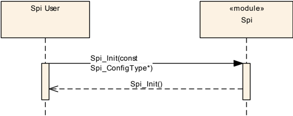

### 8.2. 模式转换

下面的时序图展示了一个针对运行模式转换的 Init / DeInit 调用示例。

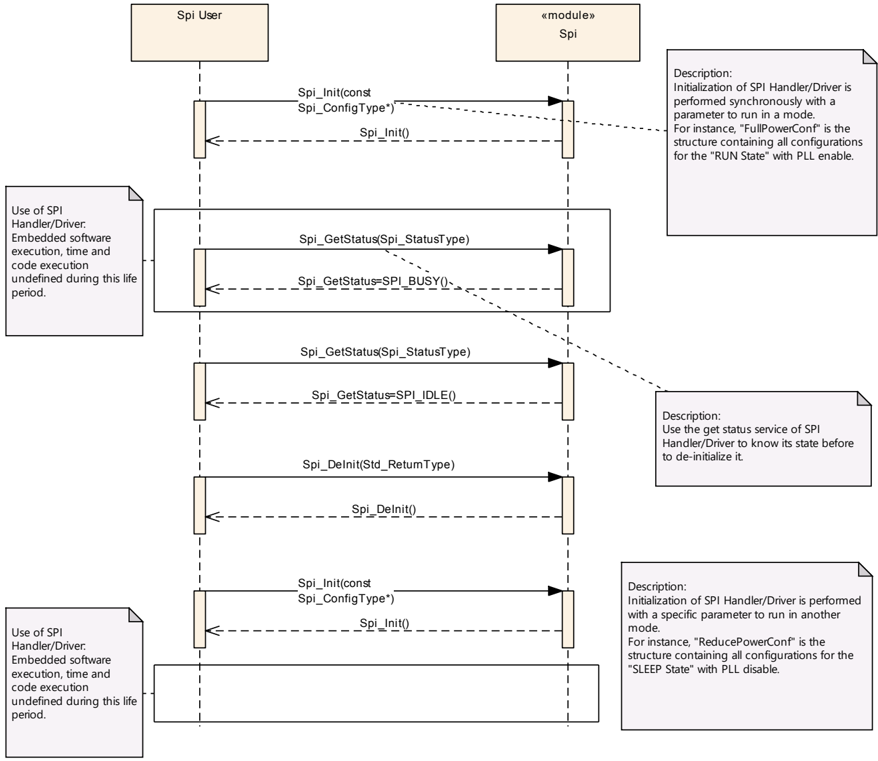

### 8.3. Write/AsyncTransmit/Read（IB）

#### 8.3.1. 一个通道、一个作业、然后一个序列

下面的时序图展示了一个只包含一个作业（该作业仅由一个通道组成）的序列传输的 [Spi_WriteIB](#733-spi_writeib) / [Spi_AsyncTransmit](#734-spi_asynctransmit) / [Spi_ReadIB](#735-spi_readib) 调用示例。写或读……

示例：通道 ID 2 属于作业 ID 1，作业 ID 1 属于序列 ID 0。

| 序列 | 作业 | 通道 |
|---|---|---|
| ID0 | ID1 | ID2 |

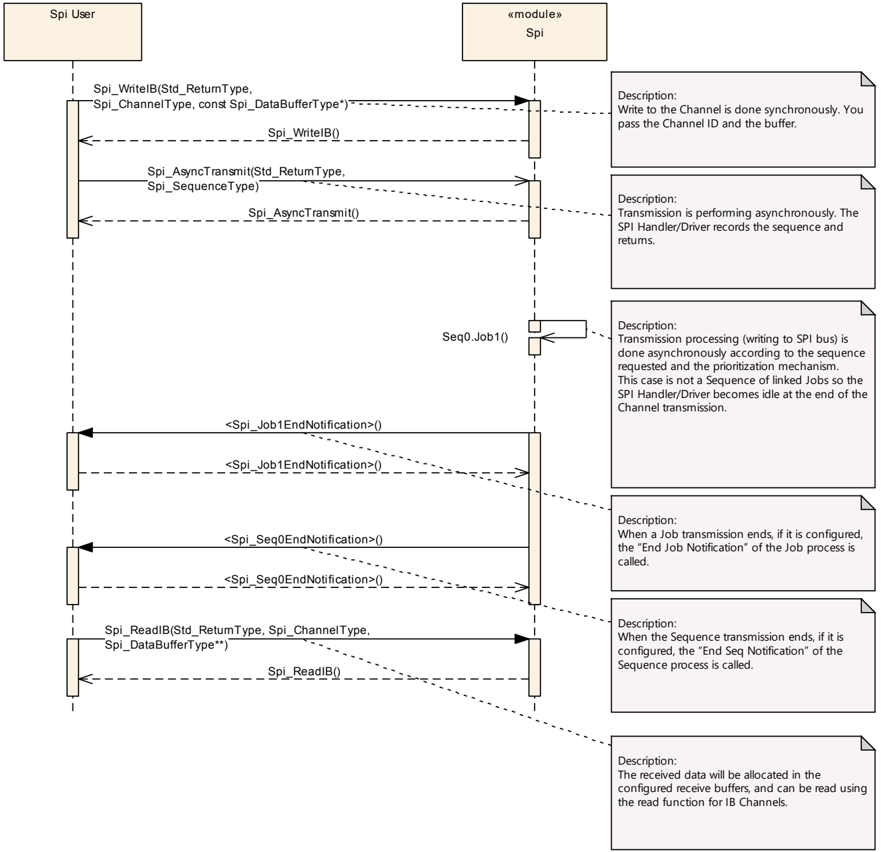

#### 8.3.2. 多个通道、一个作业、然后一个序列

下面的时序图展示了一个只包含一个作业（该作业由多个通道组成）的序列传输的 [Spi_WriteIB](#733-spi_writeib) / [Spi_AsyncTransmit](#734-spi_asynctransmit) / [Spi_ReadIB](#735-spi_readib) 调用示例。写或读访问是……

示例：通道 ID 2 和 3 属于作业 ID 1，作业 ID 1 属于序列 ID 0。

| 序列 | 作业 | 通道 |
|---|---|---|
| ID0 | ID1 | ID2 ID3 |

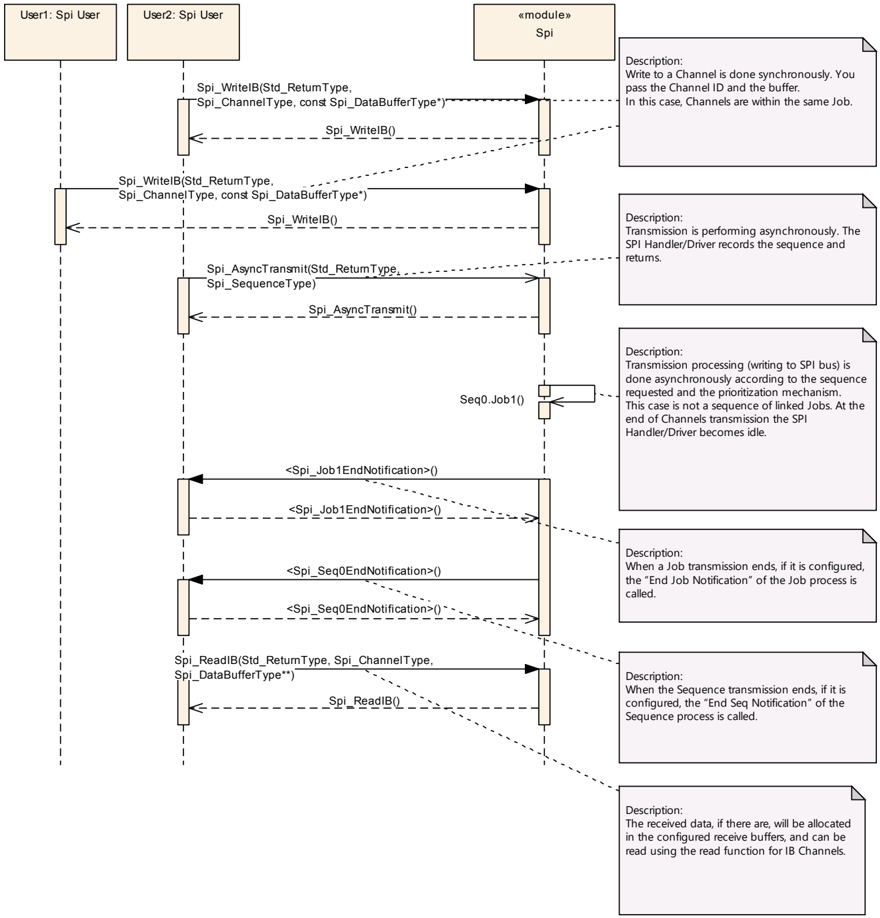

#### 8.3.3. 多个通道、多个作业、一个序列

下面的时序图展示了针对链接作业的序列传输的 [Spi_WriteIB](#733-spi_writeib) / [Spi_AsyncTransmit](#734-spi_asynctransmit) / [Spi_ReadIB](#735-spi_readib) 调用示例。当作业仅进行读取或仅进行写入时，可以跳过写或读步骤。

示例：通道 ID 0 到 3 属于作业 ID 1（更高优先级）；通道 ID 4 到 10 属于作业 ID 2（较低优先级），后者没有结束通知函数。这些作业属于同一个序列 ID 0。

| 序列 | 作业 | 作业 | 通道 |
|---|---|---|---|
|  | 名称 | 优先级 |  |
| ID0 | ID1 | 高 | ID0…ID3 |
| ID0 | ID2 | 低 | ID4…ID10 |

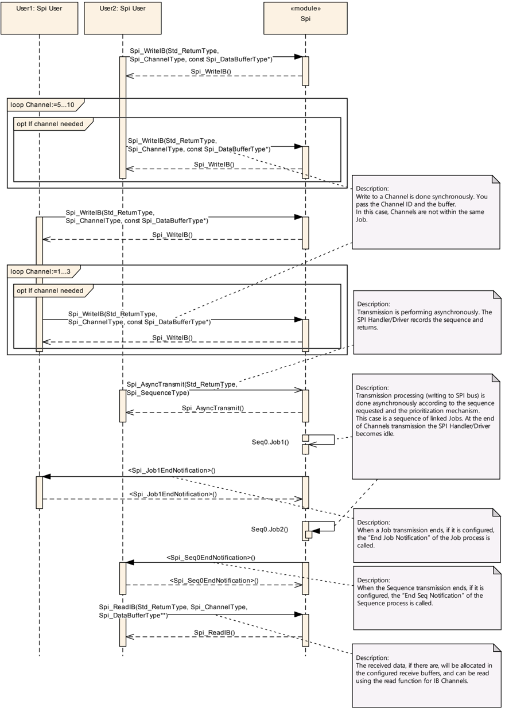

#### 8.3.4. 多个通道、多个作业、多个序列

下面的时序图展示了序列传输的 [Spi_WriteIB](#733-spi_writeib) / [Spi_AsyncTransmit](#734-spi_asynctransmit) / [Spi_ReadIB](#735-spi_readib) 调用示例。当作业仅进行读取或仅进行写入时，可以跳过写或读步骤。

示例：通道 ID 0 到 3 属于作业 ID 1（高优先级 2）；通道 ID 4 到 10 属于作业 ID 2（低优先级 1），后者没有结束通知函数。这些作业属于同一个序列 ID 0。

通道 ID 11 到 13 属于作业 ID 0（更高优先级 3），该作业属于序列 ID 1，后者被配置为不可中断。

| 序列 | 序列 | 作业 | 作业 | 通道 |
|---|---|---|---|---|
| 名称 | 可中断 | 名称 | 优先级 |  |
| ID0 | 是 | ID1 | 2 | ID0…ID3 |
| ID0 | 是 | ID2 | 1 | ID4…ID10 |
| ID1 | 否 | ID0 | 3 | ID11…ID13 |

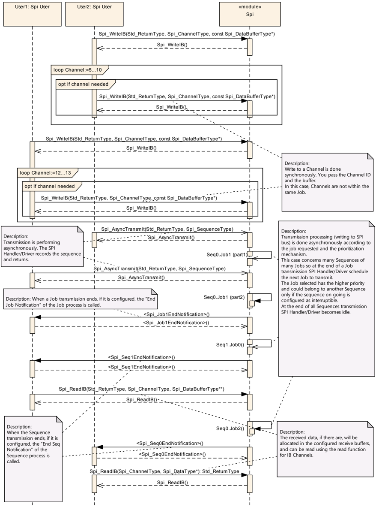

### 8.4. Setup/AsyncTransmit（EB）

#### 8.4.1. 可变数据数量 / 常量数据数量

要传输可变数量的数据，必须在每次 [Spi_AsyncTransmit](#734-spi_asynctransmit) 函数调用之前调用 [Spi_SetupEB](#736-spi_setupeb) 函数，以将新的参数存储到 SPI 处理器/驱动程序中。

要传输常量的数据数量，只需在第一次 [Spi_AsyncTransmit](#734-spi_asynctransmit) 函数调用之前调用 [Spi_SetupEB](#736-spi_setupeb) 函数将参数存储到 SPI 处理器/驱动程序中。

#### 8.4.2. 一个通道、一个作业、然后一个序列

下面的时序图展示了一个只包含一个作业（该作业仅由一个通道组成）的序列传输的 [Spi_SetupEB](#736-spi_setupeb) / [Spi_AsyncTransmit](#734-spi_asynctransmit) 调用示例。写或读访问是……

示例：通道 ID 2 属于作业 ID 1，作业 ID 1 属于序列 ID 0。

| 序列 | 作业 | 通道 |
|---|---|---|
| ID0 | ID1 | ID2 |

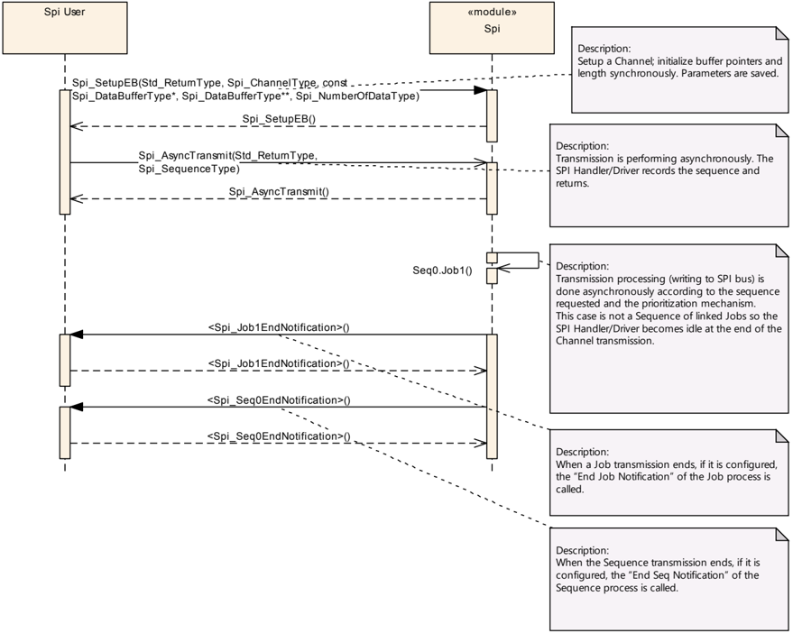

#### 8.4.3. 多个通道、一个作业、然后一个序列

下面的时序图展示了一个只包含一个作业（该作业由多个通道组成）的序列传输的 [Spi_SetupEB](#736-spi_setupeb) / [Spi_AsyncTransmit](#734-spi_asynctransmit) 调用示例。写或读访问是……

示例：通道 ID 2 和 3 属于作业 ID 1，作业 ID 1 属于序列 ID 0。

| 序列 | 作业 | 通道 |
|---|---|---|
| ID0 | ID1 | ID2 |
| ID0 | ID1 | ID3 |

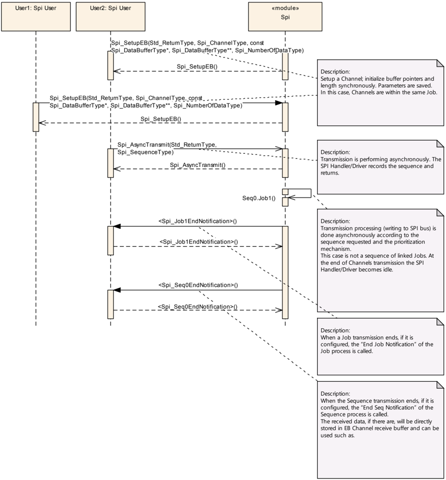

#### 8.4.4. 多个通道、多个作业、一个序列

下面的时序图展示了针对链接作业的序列传输的 [Spi_SetupEB](#736-spi_setupeb) / [Spi_AsyncTransmit](#734-spi_asynctransmit) 调用示例。写或读访问是「取决于使用者」的，可以……

示例：通道 ID 0 到 3 属于作业 ID 1（更高优先级）；通道 ID 4 到 10 属于作业 ID 2（较低优先级），后者没有结束通知函数。这些作业属于同一个序列 ID 0。

| 序列 | 作业 | 通道 |
|---|---|---|
| ID0 | ID1 | ID0…ID3 |
| ID0 | ID2 | ID4…ID10 |

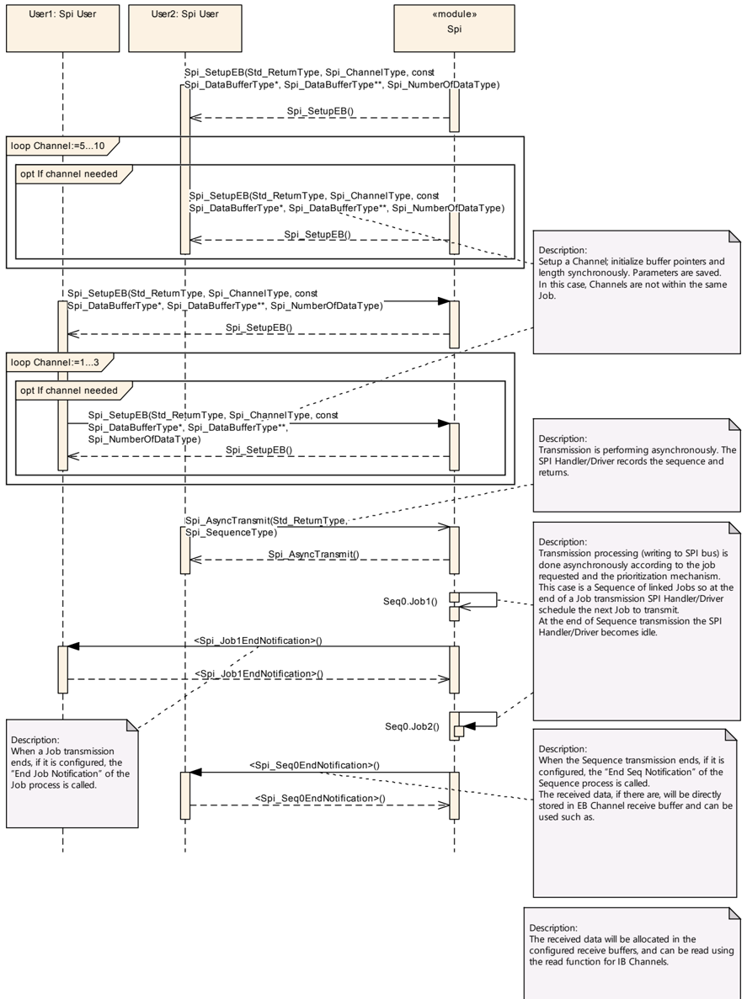

#### 8.4.5. 多个通道、多个作业、多个序列

下面的时序图展示了序列传输的 [Spi_SetupEB](#736-spi_setupeb) / [Spi_AsyncTransmit](#734-spi_asynctransmit) 调用示例。写或读访问是「取决于使用者」的，当作业仅进行读取或仅进行写入时可以跳过。

示例：通道 ID 0 到 3 属于作业 ID 1（高优先级 2）；通道 ID 4 到 10 属于作业 ID 2（低优先级 1），后者没有结束通知函数。这些作业属于同一个序列 ID 0。

通道 ID 11 到 13 属于作业 ID 0（更高优先级 3），该作业属于序列 ID 1，后者被配置为不可中断。

| 序列 | 序列 | 作业 | 作业 | 通道 |
|---|---|---|---|---|
| 名称 | 可中断 | 名称 | 优先级 |  |
| ID0 | 是 | ID1 | 2 | ID0…ID3 |
| ID0 | 是 | ID2 | 1 | ID4…ID10 |
| ID1 | 否 | ID0 | 3 | ID11…ID13 |

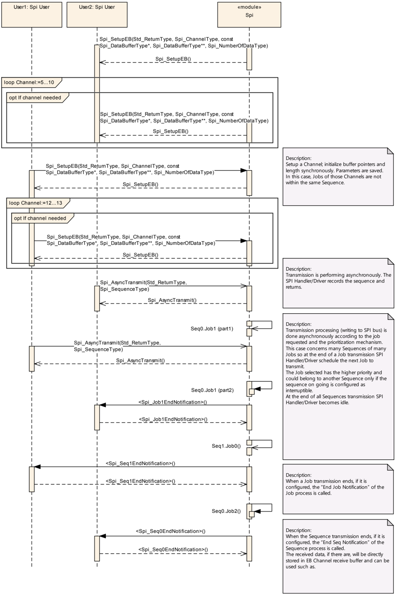

### 8.5. 混合作业传输

根据通道的配置以及序列内部的优先级要求，可以进行所有类型的混合作业传输。

使用者知道哪些通道正在使用中。然后，根据这些通道的类型，应当调用适当的方法。

### 8.6. LEVEL 0 SyncTransmit 图

#### 8.6.1. Write/SyncTransmit/Read（IB）：多个通道、多个作业、一个序列

下面的时序图展示了针对链接作业的序列传输的 [Spi_WriteIB](#733-spi_writeib) / [Spi_SyncTransmit](#7311-spi_synctransmit) / [Spi_ReadIB](#735-spi_readib) 调用示例。当作业仅进行读取或仅进行写入时，可以跳过写或读步骤。

示例：通道 ID 0 到 3 属于作业 ID 1（更高优先级）；通道 ID 4 到 10 属于作业 ID 2（较低优先级）。这些作业属于同一个序列 ID 0。

| 序列 | 作业 | 作业 | 通道 |
|---|---|---|---|
|  | 名称 | 优先级 |  |
| ID0 | ID1 | 高 | ID0…ID3 |
| ID0 | ID2 | 低 | ID4…ID10 |

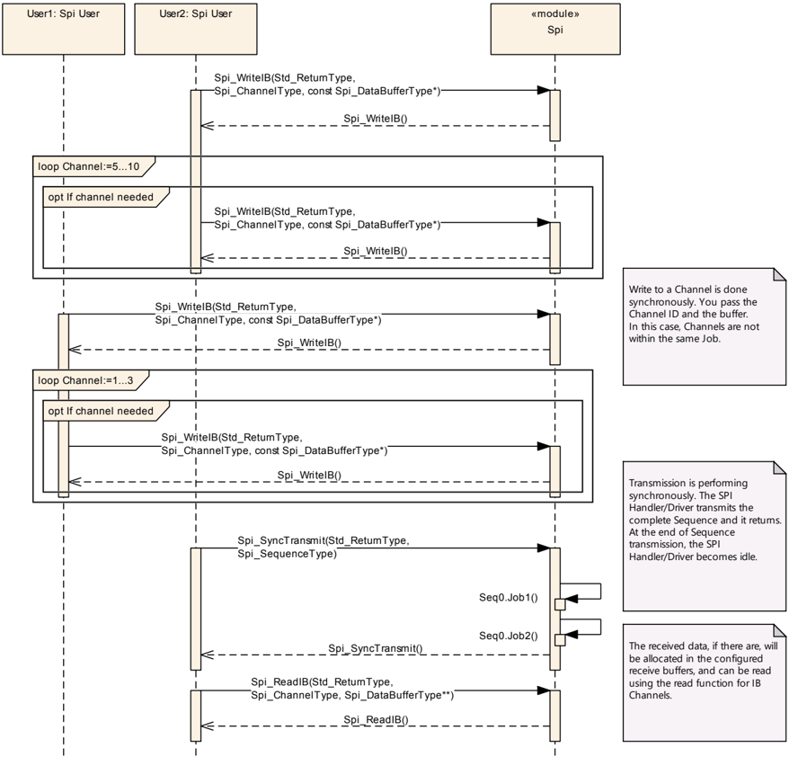

#### 8.6.2. Setup/SyncTransmit（EB）：多个通道、多个作业、一个序列

下面的时序图展示了针对链接作业的序列传输的 [Spi_SetupEB](#736-spi_setupeb) / [Spi_SyncTransmit](#7311-spi_synctransmit) 调用示例。写或读访问是「取决于使用者」的，可以……

示例：通道 ID 0 到 3 属于作业 ID 1（更高优先级）；通道 ID 4 到 10 属于作业 ID 2（较低优先级）。这些作业属于同一个序列 ID 0。

| 序列 | 作业 | 通道 |
|---|---|---|
| ID0 | ID1 | ID0…ID3 |
| ID0 | ID2 | ID4…ID10 |

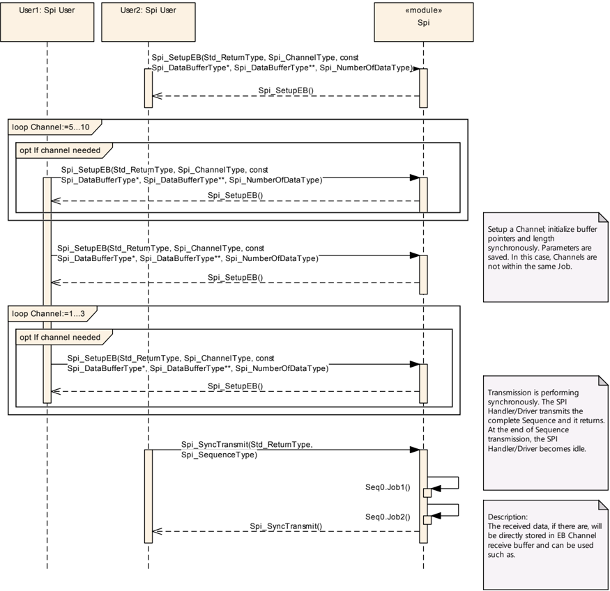

## 9. 配置规范

总体而言，本章定义配置参数及其到**容器**（container）的聚类组织。为支持本规范，第 9.1 章描述基础知识，并规定了应用于参数规范的模板（表）。我们有意将这些内容保留在规范中以保证可理解性。

第 9.1 章规定模块 **Spi** 的结构（容器）和参数。

第 9.2 章规定模块 **Spi** 的发布信息。

### 9.1. 容器与配置参数

以下各章汇总所有配置参数。各参数的详细含义见第 6 章和第 7 章。如有必要，可以进一步添加硬件/实现特定的参数。

**SPI** 模块应拒绝其实现所不支持的、带有分区映射的配置。

#### 9.1.1. Spi

| SWS 条目 | [ECUC_Spi_00103] |
|---|---|
| 模块名称 | Spi |
| 描述 | Spi（串行外设接口）模块的配置。 |
| Post-Build 变体支持 | true |
| 支持的配置变体 | VARIANT-LINK-TIME, VARIANT-POST-BUILD, VARIANT-PRE-COMPILE |

| 容器名称 | 多重性 | 作用域/依赖 |
|---|---|---|
| SpiDemEventParameterRefs | 0..1 | 对 DemEventParameter 元素的引用的容器，当相应错误发生时应使用 API Dem_SetEventStatus 调用这些元素。EventId 取自所引用的 DemEventParameter 的 DemEventId 符号值。 |
| SpiDriver | 1 | 该容器包含 AUTOSAR Spi 模块的配置参数和子容器。 |
| SpiGeneral | 1 | SPI-Handler 的通用配置设置。 |
| SpiPublishedInformation | 1 | 容纳所有 SPI 特定发布信息参数的容器。 |

#### 9.1.2. SpiDemEventParameterRefs

| SWS 条目 | [ECUC_Spi_00240] |
|---|---|
| 容器名称 | SpiDemEventParameterRefs |
| 父容器 | Spi |
| 描述 | 对 DemEventParameter 元素的引用的容器，当相应错误发生时应使用 API Dem_SetEventStatus 调用这些元素。EventId 取自所引用的 DemEventParameter 的 DemEventId 符号值。 |
| 配置参数 | 见下方参数表 |

| SWS 条目 | [ECUC_Spi_00241] |
|---|---|
| 参数名称 | SPI_E_HARDWARE_ERROR |
| 父容器 | SpiDemEventParameterRefs |
| 描述 | 对已配置 **DEM** 事件的引用，用于报告「硬件失效」。如果该引用未配置，则不应报告该错误。 |
| 多重性 | 0..1 |
| 类型 | Symbolic name reference to DemEventParameter |
| Post-Build 变体多重性 | false |
| Post-Build 变体值 | false |
| 多重性配置类 | Pre-compile time：x；Link time：-；Post-build time：- |
| 值配置类 | Pre-compile time：x；Link time：-；Post-build time：- |
| 作用域/依赖 | scope: local |

无包含的容器。

#### 9.1.3. SpiGeneral

| SWS 条目 | [ECUC_Spi_00225] |
|---|---|
| 容器名称 | SpiGeneral |
| 父容器 | Spi |
| 描述 | SPI-Handler 的通用配置设置。 |
| 配置参数 | 见下方参数表 |

| SWS 条目 | [ECUC_Spi_00226] |
|---|---|
| 参数名称 | SpiCancelApi |
| 父容器 | SpiGeneral |
| 描述 | 开启或关闭 Spi_Cancel 函数。 |
| 多重性 | 1 |
| 类型 | EcucBooleanParamDef |
| 默认值 | - |
| Post-Build 变体值 | false |
| 值配置类 | Pre-compile time：x（All Variants）；Link time：-；Post-build time：- |
| 作用域/依赖 | scope: local |

| SWS 条目 | [ECUC_Spi_00227] |
|---|---|
| 参数名称 | SpiChannelBuffersAllowed |
| 父容器 | SpiGeneral |
| 描述 | 选择 SPI 处理器/驱动程序允许并交付的通道缓冲区使用方式。IB = 0；EB = 1；IB/EB = 2。 |
| 多重性 | 1 |
| 类型 | EcucIntegerParamDef |
| 范围 | 0 .. 2 |
| 默认值 | - |
| Post-Build 变体值 | false |
| 值配置类 | Pre-compile time：x；Link time：-；Post-build time：- |
| 作用域/依赖 | scope: local |

| SWS 条目 | [ECUC_Spi_00228] |
|---|---|
| 参数名称 | SpiDevErrorDetect |
| 父容器 | SpiGeneral |
| 描述 | 开启或关闭开发错误检测与通知。* **true**：检测与通知已启用。* **false**：检测与通知已禁用。 |
| 多重性 | 1 |
| 类型 | EcucBooleanParamDef |
| 默认值 | false |
| Post-Build 变体值 | false |
| 值配置类 | Pre-compile time：x（All Variants）；Link time：-；Post-build time：- |
| 作用域/依赖 | scope: local |

| SWS 条目 | [ECUC_Spi_00229] |
|---|---|
| 参数名称 | SpiHwStatusApi |
| 父容器 | SpiGeneral |
| 描述 | 开启或关闭 Spi_GetHWUnitStatus 函数。 |
| 多重性 | 1 |
| 类型 | EcucBooleanParamDef |
| 默认值 | - |
| Post-Build 变体值 | false |
| 值配置类 | Pre-compile time：x（All Variants）；Link time：-；Post-build time：- |
| 作用域/依赖 | scope: local |

| SWS 条目 | [ECUC_Spi_00230] |
|---|---|
| 参数名称 | SpiInterruptibleSeqAllowed |
| 父容器 | SpiGeneral |
| 描述 | 开启或关闭可中断序列的处理功能。 |
| 多重性 | 1 |
| 类型 | EcucBooleanParamDef |
| 默认值 | - |
| Post-Build 变体值 | false |
| 值配置类 | Pre-compile time：x；Link time：-；Post-build time：- |
| 作用域/依赖 | scope: local dependency: 该参数取决于 SPI_LEVEL_DELIVERED 的取值。它仅用于 SPI_LEVEL_DELIVERED 配置为 1 或 2 的情况。 |

| SWS 条目 | [ECUC_Spi_00231] |
|---|---|
| 参数名称 | SpiLevelDelivered |
| 父容器 | SpiGeneral |
| 描述 | 选择可用并交付的 SPI 处理器/驱动程序可扩展功能级别。 |
| 多重性 | 1 |
| 类型 | EcucIntegerParamDef |
| 范围 | 0 .. 2 |
| 默认值 | - |
| Post-Build 变体值 | false |
| 值配置类 | Pre-compile time：x；Link time：-；Post-build time：- |
| 作用域/依赖 | scope: local |

| SWS 条目 | [ECUC_Spi_00242] |
|---|---|
| 参数名称 | SpiMainFunctionPeriod |
| 父容器 | SpiGeneral |
| 描述 | 该参数以秒为单位定义函数 Spi_MainFunction_Handling 的周期时间。该参数不被驱动程序自身使用，而是由上层使用。 |
| 多重性 | 0..1 |
| 类型 | EcucFloatParamDef |
| 范围 | ]0 .. INF[ |
| 默认值 | 0.01 |
| Post-Build 变体多重性 | false |
| Post-Build 变体值 | false |
| 多重性配置类 | Pre-compile time：x；Link time：-；Post-build time：- |
| 值配置类 | Pre-compile time：x；Link time：-；Post-build time：- |
| 作用域/依赖 | scope: local |

| SWS 条目 | [ECUC_Spi_00237] |
|---|---|
| 参数名称 | SpiSupportConcurrentSyncTransmit |
| 父容器 | SpiGeneral |
| 描述 | 规定针对不同序列的并发 Spi_SyncTransmit() 调用是否应可配置。 |
| 多重性 | 1 |
| 类型 | EcucBooleanParamDef |
| 默认值 | - |
| Post-Build 变体值 | false |
| 值配置类 | Pre-compile time：x；Link time：-；Post-build time：- |
| 作用域/依赖 | scope: local |

| SWS 条目 | [ECUC_Spi_00232] |
|---|---|
| 参数名称 | SpiVersionInfoApi |
| 父容器 | SpiGeneral |
| 描述 | 开启或关闭 Spi_GetVersionInfo 函数。 |
| 多重性 | 1 |
| 类型 | EcucBooleanParamDef |
| 默认值 | false |
| Post-Build 变体值 | false |
| 值配置类 | Pre-compile time：x（All Variants）；Link time：-；Post-build time：- |
| 作用域/依赖 | scope: local |

| SWS 条目 | [ECUC_Spi_00244] |
|---|---|
| 参数名称 | SpiEcucPartitionRef |
| 父容器 | SpiGeneral |
| 描述 | 将 **SPI** 驱动程序映射到零个或多个 ECUC 分区，以使该驱动程序的 **API** 在相应分区中可用。 |
| 多重性 | 0..* |
| 类型 | Reference to EcucPartition |
| Post-Build 变体多重性 | true |
| Post-Build 变体值 | true |
| 多重性配置类 | Pre-compile time：x；Link time：-；Post-build time：- |
| 值配置类 | Pre-compile time：x；Link time：-；Post-build time：- |
| 作用域/依赖 | scope: ECU |

| SWS 条目 | [ECUC_Spi_00245] |
|---|---|
| 参数名称 | SpiKernelEcucPartitionRef |
| 父容器 | SpiGeneral |
| 描述 | 将 **SPI** 内核映射到零个或一个 ECUC 分区，以将驱动程序内核分配给某个内核。所引用的 ECUC 分区是 SpiEcucPartitionRef 所引用的 ECUC 分区的子集。 |
| 多重性 | 0..1 |
| 类型 | Reference to EcucPartition |
| Post-Build 变体多重性 | true |
| Post-Build 变体值 | true |
| 多重性配置类 | Pre-compile time：x；Link time：-；Post-build time：- |
| 值配置类 | Pre-compile time：x；Link time：-；Post-build time：- |
| 作用域/依赖 | scope: ECU |

无包含的容器。

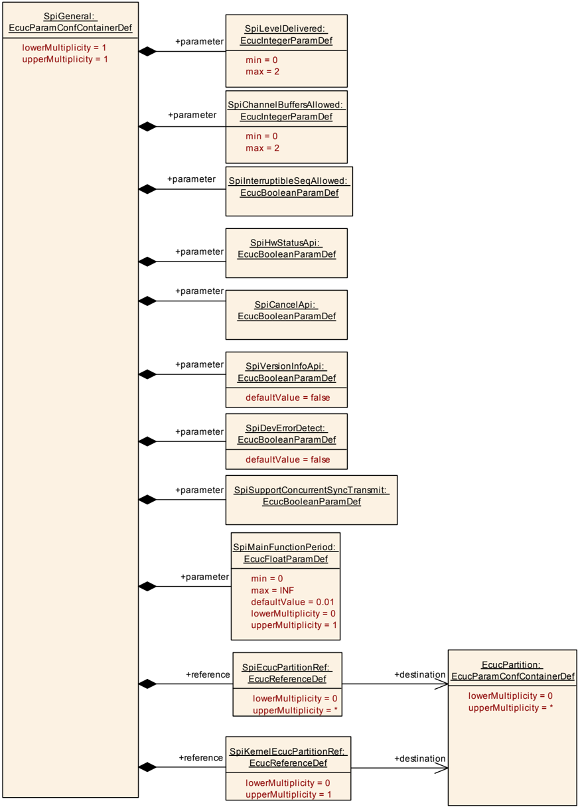

#### 9.1.4. SpiSequence

| SWS 条目 | [ECUC_Spi_00106] |
|---|---|
| 容器名称 | SpiSequence |
| 父容器 | SpiDriver |
| 描述 | 配置一个 SPI 序列所需的全部数据。 |
| 配置参数 | 见下方参数表 |

| SWS 条目 | [ECUC_Spi_00222] |
|---|---|
| 参数名称 | SpiInterruptibleSequence |
| 父容器 | SpiSequence |
| 描述 | 该参数允许或不允许该序列被另一个序列挂起。 |
| 多重性 | 1 |
| 类型 | EcucBooleanParamDef |
| 默认值 | - |
| Post-Build 变体值 | true |
| 值配置类 | Pre-compile time：x；Link time：x；Post-build time：x |
| 作用域/依赖 | scope: local dependency: SPI_INTERRUPTIBLE_SEQ_ALLOWED 参数应配置为 ON。 |

| SWS 条目 | [ECUC_Spi_00223] |
|---|---|
| 参数名称 | SpiSeqEndNotification |
| 父容器 | SpiSequence |
| 描述 | 该参数是对一个通知函数的引用。 |
| 多重性 | 0..1 |
| 类型 | EcucFunctionNameDef |
| 默认值 | - |
| Post-Build 变体多重性 | true |
| Post-Build 变体值 | true |
| 多重性配置类 | Pre-compile time：x（VARIANT-PRE-COMPILE）；Link time：x（VARIANT-LINK-TIME）；Post-build time：x（VARIANT-POST-BUILD） |
| 值配置类 | Pre-compile time：x（VARIANT-PRE-COMPILE）；Link time：x（VARIANT-LINK-TIME）；Post-build time：x（VARIANT-POST-BUILD） |
| 作用域/依赖 | scope: local |

| SWS 条目 | [ECUC_Spi_00224] |
|---|---|
| 参数名称 | SpiSequenceId |
| 父容器 | SpiSequence |
| 描述 | **SPI** 序列 **ID**，用作 **SPI API** 函数中的参数。 |
| 多重性 | 1 |
| 类型 | EcucIntegerParamDef（为此参数生成符号名） |
| 范围 | 0 .. 255 |
| 默认值 | - |
| Post-Build 变体值 | false |
| 值配置类 | Pre-compile time：x（All Variants）；Link time：-；Post-build time：- |
| 作用域/依赖 | scope: ECU |

| SWS 条目 | [ECUC_Spi_00221] |
|---|---|
| 参数名称 | SpiJobAssignment |
| 父容器 | SpiSequence |
| 描述 | 一个序列引用多个作业，这些作业在一次通信序列期间执行。 |
| 多重性 | 1..* |
| 类型 | Reference to SpiJob |
| Post-Build 变体多重性 | true |
| Post-Build 变体值 | true |
| 多重性配置类 | Pre-compile time：x；Link time：x；Post-build time：x |
| 值配置类 | Pre-compile time：x；Link time：x；Post-build time：x |
| 作用域/依赖 | scope: local |

无包含的容器。

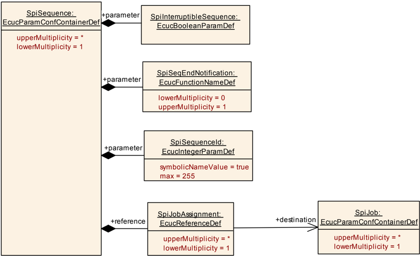

#### 9.1.5. SpiChannel

| SWS 条目 | [ECUC_Spi_00104] |
|---|---|
| 容器名称 | SpiChannel |
| 父容器 | SpiDriver |
| 描述 | 配置一个 SPI 通道所需的全部数据。 |
| 配置参数 | 见下方参数表 |

| SWS 条目 | [ECUC_Spi_00200] |
|---|---|
| 参数名称 | SpiChannelId |
| 父容器 | SpiChannel |
| 描述 | **SPI** 通道 **ID**，用作 **SPI API** 函数中的参数。 |
| 多重性 | 1 |
| 类型 | EcucIntegerParamDef（为此参数生成符号名） |
| 范围 | 0 .. 255 |
| 默认值 | - |
| Post-Build 变体值 | false |
| 值配置类 | Pre-compile time：x（All Variants）；Link time：-；Post-build time：- |
| 作用域/依赖 | scope: local |

| SWS 条目 | [ECUC_Spi_00201] |
|---|---|
| 参数名称 | SpiChannelType |
| 父容器 | SpiChannel |
| 描述 | **EB**/**IB** 通道的缓冲区使用方式。 |
| 多重性 | 1 |
| 类型 | EcucEnumerationParamDef |
| 范围 | EB：External Buffer。IB：Internal Buffer。 |
| Post-Build 变体值 | true |
| 值配置类 | Pre-compile time：x（VARIANT-PRE-COMPILE）；Link time：x（VARIANT-LINK-TIME）；Post-build time：x（VARIANT-POST-BUILD） |
| 作用域/依赖 | scope: local dependency: SPI_CHANNEL_BUFFERS_ALLOWED…… |

| SWS 条目 | [ECUC_Spi_00202] |
|---|---|
| 参数名称 | SpiDataWidth |
| 父容器 | SpiChannel |
| 描述 | 该参数是传输的数据单元的宽度。 |
| 多重性 | 1 |
| 类型 | EcucIntegerParamDef |
| 范围 | 1 .. 64 |
| 默认值 | 32 |
| Post-Build 变体值 | true |
| 值配置类 | Pre-compile time：x（VARIANT-PRE-COMPILE）；Link time：x（VARIANT-LINK-TIME）；Post-build time：x（VARIANT-POST-BUILD） |
| 作用域/依赖 | scope: local |

| SWS 条目 | [ECUC_Spi_00203] |
|---|---|
| 参数名称 | SpiDefaultData |
| 父容器 | SpiChannel |
| 描述 | 当传递给 Spi_WriteIB（针对内部缓冲区）或 Spi_SetupEB（针对外部缓冲区）的指针为空时，要发送的默认数据。 |
| 多重性 | 0..1 |
| 类型 | EcucIntegerParamDef |
| 范围 | 0 .. 4294967295 |
| 默认值 | - |
| Post-Build 变体多重性 | true |
| Post-Build 变体值 | true |
| 多重性配置类 | Pre-compile time：x；Link time：-；Post-build time：- |
| 值配置类 | Pre-compile time：x（VARIANT-PRE-COMPILE）；Link time：x（VARIANT-LINK-TIME）；Post-build time：x（VARIANT-POST-BUILD） |
| 作用域/依赖 | scope: local |

| SWS 条目 | [ECUC_Spi_00204] |
|---|---|
| 参数名称 | SpiEbMaxLength |
| 父容器 | SpiChannel |
| 描述 | 该参数包含 **EB** 通道情况下数据缓冲区的最大大小（数据元素的数量）。 |
| 多重性 | 0..1 |
| 类型 | EcucIntegerParamDef |
| 范围 | 1 .. 1048576 |
| 默认值 | 1024 |
| Post-Build 变体多重性 | true |
| Post-Build 变体值 | true |
| 值配置类 | Pre-compile time：x（VARIANT-PRE-COMPILE）；Link time：x（VARIANT-LINK-TIME）；Post-build time：x（VARIANT-POST-BUILD） |
| 作用域/依赖 | scope: local dependency: 该通道的 SPI_CHANNEL_TYPE 参数应配置为 EB。SPI_CHANNEL_BUFFERS_ALLOWED 参数应配置为…… |

| SWS 条目 | [ECUC_Spi_00205] |
|---|---|
| 参数名称 | SpiIbNBuffers |
| 父容器 | SpiChannel |
| 描述 | 该参数包含 **IB** 通道情况下数据缓冲区的最大数量。 |
| 多重性 | 0..1 |
| 类型 | EcucIntegerParamDef |
| 范围 | 1 .. 65535 |
| 默认值 | 1 |
| Post-Build 变体多重性 | true |
| Post-Build 变体值 | true |
| 值配置类 | Pre-compile time：x（VARIANT-PRE-COMPILE）；Link time：x（VARIANT-LINK-TIME）；Post-build time：x（VARIANT-POST-BUILD） |
| 作用域/依赖 | scope: local dependency: 该通道的 SPI_CHANNEL_TYPE 参数应配置为 IB。SPI_CHANNEL_BUFFERS_ALLOWED 参数应配置为…… |

| SWS 条目 | [ECUC_Spi_00206] |
|---|---|
| 参数名称 | SpiTransferStart |
| 父容器 | SpiChannel |
| 描述 | 该参数定义传输的第一个起始位。 |
| 多重性 | 1 |
| 类型 | EcucEnumerationParamDef |
| 范围 | LSB：传输从最低有效位开始。MSB：传输从最高有效位开始。 |
| Post-Build 变体值 | true |
| 值配置类 | Pre-compile time：x（VARIANT-PRE-COMPILE）；Link time：x（VARIANT-LINK-TIME）；Post-build time：x（VARIANT-POST-BUILD） |
| 作用域/依赖 | scope: local |

无包含的容器。

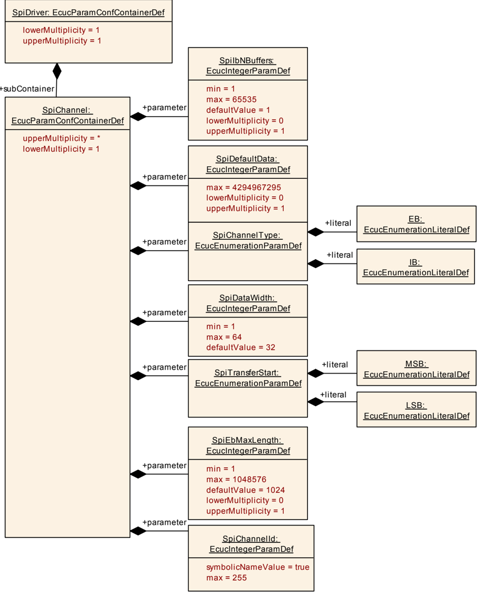

#### 9.1.6. SpiChannelList

| SWS 条目 | [ECUC_Spi_00233] |
|---|---|
| 容器名称 | SpiChannelList |
| 父容器 | SpiJob |
| 描述 | 对 **SPI** 通道的引用及其在作业中的顺序。 |
| 配置参数 | 见下方参数表 |

| SWS 条目 | [ECUC_Spi_00234] |
|---|---|
| 参数名称 | SpiChannelIndex |
| 父容器 | SpiChannelList |
| 描述 | 该参数指定通道在作业中的顺序。 |
| 多重性 | 1 |
| 类型 | EcucIntegerParamDef |
| 范围 | 0 .. 65535 |
| 默认值 | 0 |
| Post-Build 变体值 | true |
| 值配置类 | Pre-compile time：x（VARIANT-PRE-COMPILE）；Link time：x（VARIANT-LINK-TIME）；Post-build time：x（VARIANT-POST-BUILD） |
| 作用域/依赖 | scope: local |

| SWS 条目 | [ECUC_Spi_00215] |
|---|---|
| 参数名称 | SpiChannelAssignment |
| 父容器 | SpiChannelList |
| 描述 | 作业对 **SPI** 通道的引用。 |
| 多重性 | 1 |
| 类型 | Reference to SpiChannel |
| Post-Build 变体值 | true |
| 值配置类 | Pre-compile time：x（VARIANT-PRE-COMPILE）；Link time：x（VARIANT-LINK-TIME）；Post-build time：x（VARIANT-POST-BUILD） |
| 作用域/依赖 | scope: local |

无包含的容器。

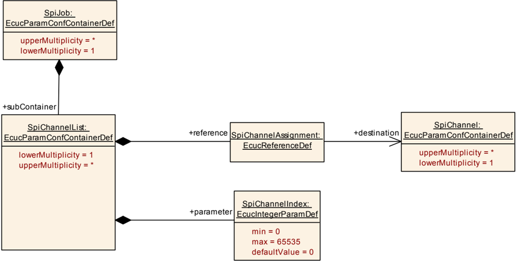

#### 9.1.7. SpiJob

| SWS 条目 | [ECUC_Spi_00105] |
|---|---|
| 容器名称 | SpiJob |
| 父容器 | SpiDriver |
| 描述 | 配置一个 SPI 作业所需的全部数据，其中包括内部 **SPI** 单元与外部设备特定设置之间的连接。 |
| 配置参数 | 见下方参数表 |

| SWS 条目 | [ECUC_Spi_00218] |
|---|---|
| 参数名称 | SpiJobEndNotification |
| 父容器 | SpiJob |
| 描述 | 该参数是对一个通知函数的引用。 |
| 多重性 | 0..1 |
| 类型 | EcucFunctionNameDef |
| 默认值 | - |
| Post-Build 变体多重性 | true |
| Post-Build 变体值 | true |
| 多重性配置类 | Pre-compile time：x（VARIANT-PRE-COMPILE）；Link time：x（VARIANT-LINK-TIME）；Post-build time：x（VARIANT-POST-BUILD） |
| 值配置类 | Pre-compile time：x（VARIANT-PRE-COMPILE）；Link time：x（VARIANT-LINK-TIME）；Post-build time：x（VARIANT-POST-BUILD） |
| 作用域/依赖 | scope: local |

| SWS 条目 | [ECUC_Spi_00219] |
|---|---|
| 参数名称 | SpiJobId |
| 父容器 | SpiJob |
| 描述 | **SPI** 作业 **ID**，用作 **SPI API** 函数中的参数。 |
| 多重性 | 1 |
| 类型 | EcucIntegerParamDef（为此参数生成符号名） |
| 范围 | 0 .. 65535 |
| 默认值 | - |
| Post-Build 变体值 | false |
| 值配置类 | Pre-compile time：x；Link time：-；Post-build time：- |
| 作用域/依赖 | scope: local |

| SWS 条目 | [ECUC_Spi_00220] |
|---|---|
| 参数名称 | SpiJobPriority |
| 父容器 | SpiJob |
| 描述 | 优先级：0 为最低，3 为最高（见第 6.2.3 章的规定）。 |
| 多重性 | 1 |
| 类型 | EcucIntegerParamDef |
| 范围 | 0 .. 3 |
| 默认值 | - |
| Post-Build 变体值 | true |
| 值配置类 | Pre-compile time：x；Link time：-；Post-build time：- |
| 作用域/依赖 | scope: local |

| SWS 条目 | [ECUC_Spi_00216] |
|---|---|
| 参数名称 | SpiDeviceAssignment |
| 父容器 | SpiJob |
| 描述 | 对该作业所使用的外部设备的引用。 |
| 多重性 | 1 |
| 类型 | Reference to SpiExternalDevice |
| Post-Build 变体值 | false |
| 值配置类 | Pre-compile time：x；Link time：-；Post-build time：- |
| 作用域/依赖 | scope: local |

| 容器名称 | 多重性 | 作用域/依赖 |
|---|---|---|
| SpiChannelList | 1..* | 对 **SPI** 通道的引用及其在作业中的顺序。 |

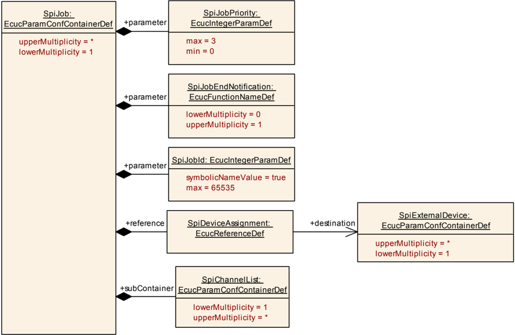

#### 9.1.8. SpiExternalDevice

| SWS 条目 | [ECUC_Spi_00207] |
|---|---|
| 容器名称 | SpiExternalDevice |
| 父容器 | SpiDriver |
| 描述 | 一个外部设备的通信设置。与 SpiJob 紧密关联。 |
| 配置参数 | 见下方参数表 |

| SWS 条目 | [ECUC_Spi_00208] |
|---|---|
| 参数名称 | SpiBaudrate |
| 父容器 | SpiExternalDevice |
| 描述 | 该参数是通信波特率——从配置工具的角度，该参数允许使用从 **Hz** 到 **MHz** 的取值范围。 |
| 多重性 | 1 |
| 类型 | EcucFloatParamDef |
| 范围 | ]0 .. INF[ |
| 默认值 | 1000000 |
| Post-Build 变体值 | true |
| 值配置类 | Pre-compile time：x（VARIANT-PRE-COMPILE）；Link time：x（VARIANT-LINK-TIME）；Post-build time：x（VARIANT-POST-BUILD） |
| 作用域/依赖 | scope: local |

| SWS 条目 | [ECUC_Spi_00249] |
|---|---|
| 参数名称 | SpiCsBehavior |
| 父容器 | SpiExternalDevice |
| 描述 | 该参数用于定义片选行为。**CS** 可以为每个数据帧切换一次（**SPI** 总线上与 SpiDataWidth 相关的位帧），也可以在整个作业传输期间保持有效。 |
| 多重性 | 1 |
| 类型 | EcucEnumerationParamDef |
| 范围 | CS_KEEP_ASSERTED、CS_TOGGLE |
| 默认值 | CS_KEEP_ASSERTED |
| Post-Build 变体值 | true |
| 值配置类 | Pre-compile time：x（VARIANT-PRE-COMPILE）；Link time：x（VARIANT-LINK-TIME）；Post-build time：x（VARIANT-POST-BUILD） |
| 作用域/依赖 | scope: local |

| SWS 条目 | [ECUC_Spi_00209] |
|---|---|
| 参数名称 | SpiCsIdentifier |
| 父容器 | SpiExternalDevice |
| 描述 | 该参数是标识分配给该作业的片选（**CS**）的符号名。 |
| 多重性 | 1 |
| 类型 | EcucStringParamDef（为此参数生成符号名） |
| 默认值 | - |
| Post-Build 变体值 | false |
| 值配置类 | Pre-compile time：x（VARIANT-PRE-COMPILE）；Link time：x（VARIANT-LINK-TIME）；Post-build time：x（VARIANT-POST-BUILD） |
| 作用域/依赖 | scope: local |

| SWS 条目 | [ECUC_Spi_00210] |
|---|---|
| 参数名称 | SpiCsPolarity |
| 父容器 | SpiExternalDevice |
| 描述 | 该参数定义片选的有效极性。 |
| 多重性 | 1 |
| 类型 | EcucEnumerationParamDef |
| 范围 | HIGH、LOW |
| Post-Build 变体值 | true |
| 值配置类 | Pre-compile time：x（VARIANT-PRE-COMPILE）；Link time：x（VARIANT-LINK-TIME）；Post-build time：x（VARIANT-POST-BUILD） |
| 作用域/依赖 | scope: local |

| SWS 条目 | [ECUC_Spi_00239] |
|---|---|
| 参数名称 | SpiCsSelection |
| 父容器 | SpiExternalDevice |
| 描述 | 当片选处理被启用时（见 SpiEnableCs），该参数规定片选是由外设硬件引擎自动处理，还是由 **SPI** 驱动程序通过 **DIO** 处理。 |
| 多重性 | 0..1 |
| 类型 | EcucEnumerationParamDef |
| 范围 | CS_VIA_GPIO、CS_VIA_PERIPHERAL_ENGINE |
| 默认值 | CS_VIA_PERIPHERAL_ENGINE |
| Post-Build 变体多重性 | true |
| Post-Build 变体值 | true |
| 多重性配置类 | Pre-compile time：x（VARIANT-PRE-COMPILE）；Link time：x（VARIANT-LINK-TIME）；Post-build time：x（VARIANT-POST-BUILD） |
| 值配置类 | Pre-compile time：x（VARIANT-PRE-COMPILE）；Link time：x（VARIANT-LINK-TIME）；Post-build time：x（VARIANT-POST-BUILD） |
| 作用域/依赖 | scope: local dependency: SpiEnableCs |

| SWS 条目 | [ECUC_Spi_00211] |
|---|---|
| 参数名称 | SpiDataShiftEdge |
| 父容器 | SpiExternalDevice |
| 描述 | 该参数定义 **SPI** 数据移位边沿。 |
| 多重性 | 1 |
| 类型 | EcucEnumerationParamDef |
| 范围 | LEADING、TRAILING |
| Post-Build 变体值 | true |
| 值配置类 | Pre-compile time：x（VARIANT-PRE-COMPILE）；Link time：x（VARIANT-LINK-TIME）；Post-build time：x（VARIANT-POST-BUILD） |
| 作用域/依赖 | scope: local |

| SWS 条目 | [ECUC_Spi_00212] |
|---|---|
| 参数名称 | SpiEnableCs |
| 父容器 | SpiExternalDevice |
| 描述 | 该参数启用或不启用片选处理功能。如果启用该参数，则参数 SpiCsSelection 会给出更多细节。 |
| 多重性 | 1 |
| 类型 | EcucBooleanParamDef |
| 默认值 | - |
| Post-Build 变体值 | true |
| 值配置类 | Pre-compile time：x（VARIANT-PRE-COMPILE）；Link time：x（VARIANT-LINK-TIME）；Post-build time：x（VARIANT-POST-BUILD） |
| 作用域/依赖 | scope: local |

| SWS 条目 | [ECUC_Spi_00217] |
|---|---|
| 参数名称 | SpiHwUnit |
| 父容器 | SpiExternalDevice |
| 描述 | 该参数是标识分配给该作业的 **SPI** 硬件微控制器外设的符号名。 |
| 多重性 | 1 |
| 类型 | EcucEnumerationParamDef |
| 范围 | CSIB0、CSIB1、CSIB2、CSIB3 |
| Post-Build 变体值 | true |
| 值配置类 | Pre-compile time：x（VARIANT-PRE-COMPILE）；Link time：x（VARIANT-LINK-TIME）；Post-build time：x（VARIANT-POST-BUILD） |
| 作用域/依赖 | scope: local |

| SWS 条目 | [ECUC_Spi_00213] |
|---|---|
| 参数名称 | SpiShiftClockIdleLevel |
| 父容器 | SpiExternalDevice |
| 描述 | 该参数定义 **SPI** 移位时钟的空闲电平。 |
| 多重性 | 1 |
| 类型 | EcucEnumerationParamDef |
| 范围 | HIGH、LOW |
| Post-Build 变体值 | true |
| 值配置类 | Pre-compile time：x（VARIANT-PRE-COMPILE）；Link time：x（VARIANT-LINK-TIME）；Post-build time：x（VARIANT-POST-BUILD） |
| 作用域/依赖 | scope: local |

| SWS 条目 | [ECUC_Spi_00214] |
|---|---|
| 参数名称 | SpiTimeClk2Cs |
| 父容器 | SpiExternalDevice |
| 描述 | 时钟与片选有效之间的时序（单位：秒）——该参数允许使用从 10 ns 到 0.01 秒的取值范围。 |
| 多重性 | 1 |
| 类型 | EcucFloatParamDef |
| 范围 | [1E-8 .. 0.01] |
| 默认值 | 1E-6 |
| Post-Build 变体值 | true |
| 值配置类 | Pre-compile time：x（VARIANT-PRE-COMPILE）；Link time：x（VARIANT-LINK-TIME）；Post-build time：x（VARIANT-POST-BUILD） |
| 作用域/依赖 | scope: local |

| SWS 条目 | [ECUC_Spi_00247] |
|---|---|
| 参数名称 | SpiTimeCs2Clk |
| 父容器 | SpiExternalDevice |
| 描述 | 片选有效与时钟之间的时序（单位：秒）——该参数允许使用从 10ns 到 0.01 秒的取值范围。 |
| 多重性 | 1 |
| 类型 | EcucFloatParamDef |
| 范围 | [1E-8 .. 0.01] |
| 默认值 | 1E-6 |
| Post-Build 变体值 | true |
| 值配置类 | Pre-compile time：x（VARIANT-PRE-COMPILE）；Link time：x（VARIANT-LINK-TIME）；Post-build time：x（VARIANT-POST-BUILD） |
| 作用域/依赖 | scope: local |

| SWS 条目 | [ECUC_Spi_00248] |
|---|---|
| 参数名称 | SpiTimeCs2Cs |
| 父容器 | SpiExternalDevice |
| 描述 | 上一次片选取消有效与下一次帧开始处片选有效之间的时序（单位：秒）——该参数允许使用从 10ns 到 0.01 秒的取值范围。 |
| 多重性 | 1 |
| 类型 | EcucFloatParamDef |
| 范围 | [1E-8 .. 0.01] |
| 默认值 | 1E-6 |
| Post-Build 变体值 | true |
| 值配置类 | Pre-compile time：x（VARIANT-PRE-COMPILE）；Link time：x（VARIANT-LINK-TIME）；Post-build time：x（VARIANT-POST-BUILD） |
| 作用域/依赖 | scope: local |

| SWS 条目 | [ECUC_Spi_00246] |
|---|---|
| 参数名称 | SpiDeviceEcucPartitionRef |
| 父容器 | SpiExternalDevice |
| 描述 | 将一个 **SPI** 外部设备映射到零个或多个 ECUC 分区，以限制对该外部设备的访问。所引用的 ECUC 分区是 SpiEcucPartitionRef 所引用的 ECUC 分区的子集。 |
| 多重性 | 0..* |
| 类型 | Reference to EcucPartition |
| Post-Build 变体多重性 | true |
| Post-Build 变体值 | true |
| 多重性配置类 | Pre-compile time：x；Link time：-；Post-build time：- |
| 值配置类 | Pre-compile time：x；Link time：-；Post-build time：- |
| 作用域/依赖 | scope: ECU |

无包含的容器。

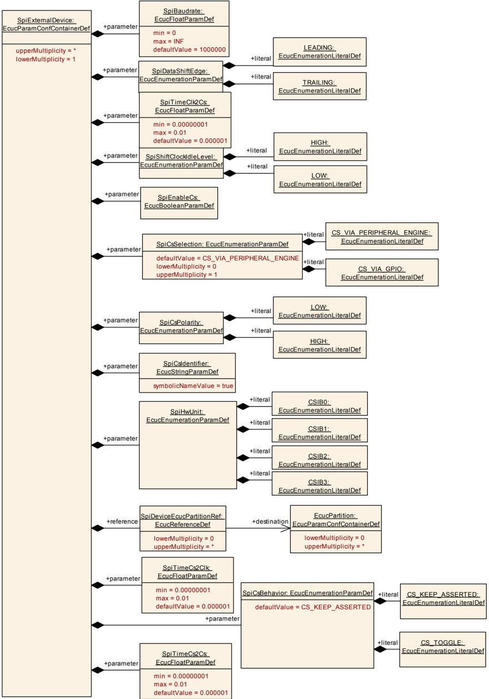

#### 9.1.9. SpiDriver

| SWS 条目 | [ECUC_Spi_00091] |
|---|---|
| 容器名称 | SpiDriver |
| 父容器 | Spi |
| 描述 | 该容器包含 AUTOSAR Spi 模块的配置参数和子容器。 |
| 配置参数 | 见下方参数表 |

| SWS 条目 | [ECUC_Spi_00197] |
|---|---|
| 参数名称 | SpiMaxChannel |
| 父容器 | SpiDriver |
| 描述 | 该参数包含已配置的通道数量。它将在配置阶段由工具收集。 |
| 多重性 | 0..1 |
| 类型 | EcucIntegerParamDef |
| 范围 | 0 .. 65535 |
| 默认值 | 0 |
| Post-Build 变体多重性 | true |
| Post-Build 变体值 | true |
| 多重性配置类 | Pre-compile time：x；Link time：x；Post-build time：x |
| 值配置类 | Pre-compile time：x；Link time：x；Post-build time：x |
| 作用域/依赖 | scope: local |

| SWS 条目 | [ECUC_Spi_00198] |
|---|---|
| 参数名称 | SpiMaxJob |
| 父容器 | SpiDriver |
| 描述 | 已配置的作业总数。 |
| 多重性 | 0..1 |
| 类型 | EcucIntegerParamDef |
| 范围 | 0 .. 65535 |
| 默认值 | 0 |
| Post-Build 变体多重性 | true |
| Post-Build 变体值 | true |
| 多重性配置类 | Pre-compile time：x（VARIANT-PRE-COMPILE）；Link time：x（VARIANT-LINK-TIME）；Post-build time：x（VARIANT-POST-BUILD） |
| 值配置类 | Pre-compile time：x（VARIANT-PRE-COMPILE）；Link time：x（VARIANT-LINK-TIME）；Post-build time：x（VARIANT-POST-BUILD） |
| 作用域/依赖 | scope: local |

| SWS 条目 | [ECUC_Spi_00199] |
|---|---|
| 参数名称 | SpiMaxSequence |
| 父容器 | SpiDriver |
| 描述 | 已配置的序列总数。 |
| 多重性 | 0..1 |
| 类型 | EcucIntegerParamDef |
| 范围 | 0 .. 65535 |
| 默认值 | 0 |
| Post-Build 变体多重性 | true |
| Post-Build 变体值 | true |
| 多重性配置类 | Pre-compile time：x（VARIANT-PRE-COMPILE）；Link time：x（VARIANT-LINK-TIME）；Post-build time：x（VARIANT-POST-BUILD） |
| 值配置类 | Pre-compile time：x（VARIANT-PRE-COMPILE）；Link time：x（VARIANT-LINK-TIME）；Post-build time：x（VARIANT-POST-BUILD） |
| 作用域/依赖 | scope: local |

| 容器名称 | 多重性 | 作用域/依赖 |
|---|---|---|
| SpiChannel | 1..* | 配置一个 SPI 通道所需的全部数据。 |
| SpiExternalDevice | 1..* | 一个外部设备的通信设置。与 SpiJob 紧密关联。 |
| SpiJob | 1..* | 配置一个 SPI 作业所需的全部数据，其中包括内部 **SPI** 单元与外部设备特定设置之间的连接。 |
| SpiSequence | 1..* | 配置一个 SPI 序列所需的全部数据。 |

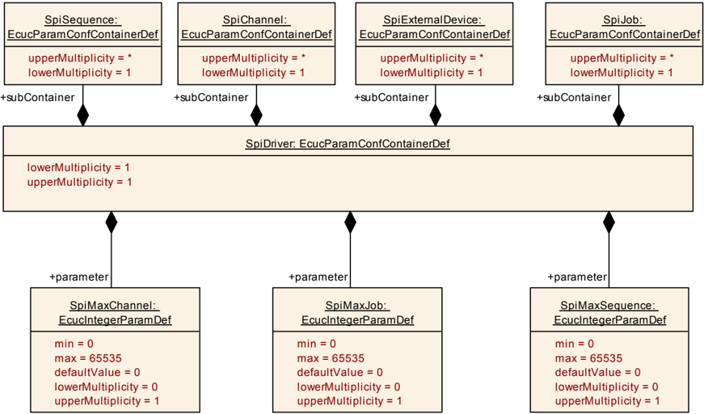

#### 9.1.10. SpiPublishedInformation

| SWS 条目 | [ECUC_Spi_00235] |
|---|---|
| 容器名称 | SpiPublishedInformation |
| 父容器 | Spi |
| 描述 | 容纳所有 **SPI** 特定发布信息参数的容器。 |
| 配置参数 | 见下方参数表 |

| SWS 条目 | [ECUC_Spi_00236] |
|---|---|
| 参数名称 | SpiMaxHwUnit |
| 父容器 | SpiPublishedInformation |
| 描述 | 该 SPI 处理器/驱动程序模块可用并处理的不同 **SPI** 硬件微控制器外设（单元/总线）的数量。 |
| 多重性 | 1 |
| 类型 | EcucIntegerParamDef |
| 范围 | 0 .. 65535 |
| 默认值 | 0 |
| Post-Build 变体值 | false |
| 值配置类 | Published Information：x |
| 作用域/依赖 | scope: local |

无包含的容器。

### 9.2. 发布信息

有关详细信息，请参阅 SWS_BSWGeneral 中的第 10.3 章「Published Information」（发布信息）。

### 9.3. 配置概念

SPI 处理器/驱动程序模块与其使用该模块的模块之间存在一种关系。这种关系在配置阶段被解决，其结果会影响正确的 **API** 使用方式。

使用者需要向 SPI 处理器/驱动程序提供部分配置，以使其适应自身的需要。SPI 处理器/驱动程序应获取该配置，并为使用者提供所需的工具。

该图展示了 SPI 处理器/驱动程序配置期间的信息流。图中仅以一个使用者、以外部 **EEPROM** 驱动程序为例进行展示，但这种情况同样适用于其他使用者。

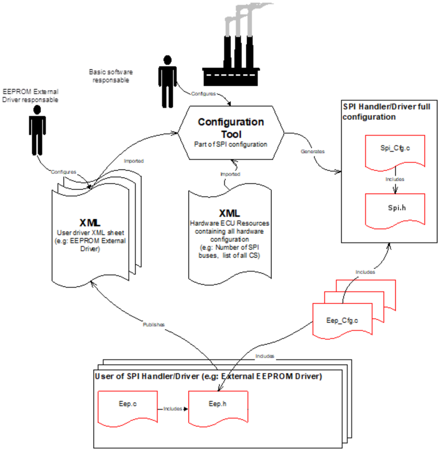

图中各步骤为：

1. SPI 处理器/驱动程序的使用者（外部 **EEPROM** 驱动程序）编辑一个 **XML** 配置文件。该 **XML** 配置文件与使用者用于生成自身配置的文件相同。
2. 对于每个 **ECU**，一个 **XML** 硬件配置文档包含应用于配置某些参数的信息。
3. 「**SPI** 生成工具」。生成工具（此处仅反映生成 **SPI** 使用代码的部分）应生成要导出的句柄以及配置集的实例。
4. **SPI** 实例配置文件。作为生成的结果，使用者所需的全部符号句柄都包含在 SPI 处理器/驱动程序的配置头文件中。
5. 使用者获得句柄的符号名。使用者导入生成的句柄，以按照其 **XML** 配置文件的要求使用它们。

## 10. 附录

下一页所示的表格只是一个示例，用于帮助将来必须配置软件模块以使用 SPI 处理器/驱动程序的使用者（和/或开发者）。该表格独立于……

表10.1：SPI 处理器/驱动程序的外部 EEPROM 写/读配置示例（**External EEPROM Write/Read Configuration for SPI Handler/Driver**）

| 序列 | 作业 | 通道 |
|---|---|---|
| 符号名 / ID / 属性 | 符号名 / ID / 属性 | 符号名 / ID / 属性 |
| EEP_WRITE_SEQ / 0 / 2（作业数量）、{EEP_CMD_JOB, EEP_DATA_JOB}（作业列表）、不可中断、EEP_vidEndOfWriteSeq | EEP_CMD_JOB / 0 / SPI_BUS_0、CS_EEPROM、CS_ON、CS_LOW、CLK_2MHz、1（时间，单位 µs）、极性 180、下降沿、3、EEP_vidEndOfStartWrJob、1（通道数量）{EEP_CMD_CH}（通道列表） | EEP_CMD_CH / 0 / EB、8 位、1 个数据到 TxD、MSB 在前、默认值为 0x00 |
| EEP_READ_SEQ / 1 / 1（作业数量）、{EEP_DATA_JOB}（作业列表）、不可中断、EEP_vidEndOfReadSeq | EEP_DATA_JOB / 1 / SPI_BUS_0、CS_EEPROM、CS_ON、CS_LOW、CLK_2MHz、1（时间，单位 µs）、极性 180、下降沿、2、NULL、3（通道数量）{EEP_CMD_CH, EEP_ADR_CH, EEP_DATA_CH}（通道列表） | EEP_ADR_CH / 1 / EB、16 位、1 个数据到 TxD、MSB 在前、默认值为 0x0000 |
|  |  | EEP_DATA_CH / 2 / EB、8 位、32 个数据到 TxD、MSB 在前、默认值为 0x00 |
