## 1. 简介和功能概述

本规范描述AUTOSAR基础软件模块TCP/IP（**TCP/IP**）的功能、API和配置。

AUTOSAR TCP/IP模块提供发送和接收互联网协议（**Internet Protocol**）数据的功能。TCP/IP协议栈（**TcpIp**）位于套接字适配器（**SoAd**）与以太网接口（**EthIf**）模块之间。

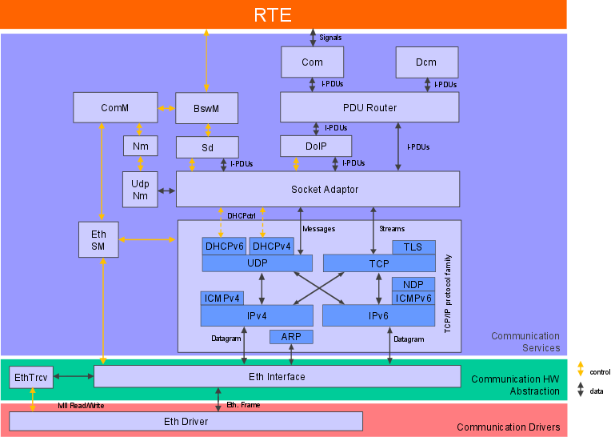

## 2. 缩略语

下面的词汇表包含与Tcp/Ip模块相关、但未包含在[\[1, AUTOSAR 术语表\]](#ref-1)中的缩略语和缩写。

**ARP**

> 地址解析协议（**Address Resolution Protocol**）。

**DAD**

> 重复地址检测（**Duplicate Address Detection**）。

**DEM**

> 诊断事件管理器（**Diagnostic Event Manager**）。

**DET**

> 默认错误跟踪器（**Default Error Tracer**）。

**DHCP**

> 动态主机配置协议（**Dynamic Host Configuration Protocol**）。

**DHCPv4**

> 互联网协议版本4的动态主机配置协议（**Dynamic Host Configuration Protocol for Internet Protocol Version 4**）。

**DHCPv6**

> 互联网协议版本6的动态主机配置协议（**Dynamic Host Configuration Protocol for Internet Protocol Version 6**）。

**ECC**

> 椭圆曲线密码学（**Elliptic Curve Cryptography**）。

**ECU**

> 电子控制单元（**Electronic Control Unit**）。

**EthIf**

> 以太网接口（**Ethernet Interface**）。

**EthSM**

> 以太网状态管理器（**Ethernet State Manager**）。

**HSM**

> 硬件安全模块（**Hardware Security Module**）。

**HTTP**

> 超文本传输协议（**HyperText Transfer Protocol**）。

**IANA**

> 互联网号码分配局（**Internet Assigned Numbers Authority**）。

**ICMP**

> 互联网控制消息协议（**Internet Control Message Protocol**）。

**ICMPv4**

> 互联网协议版本4的互联网控制消息协议（**Internet Control Message Protocol for Internet Protocol Version 4**）。

**ICMPv6**

> 互联网协议版本6的互联网控制消息协议（**Internet Control Message Protocol for Internet Protocol Version 6**）。

**IETF**

> 互联网工程任务组（**Internet Engineering Task Force**）。

**IP**

> 互联网协议（**Internet Protocol**）。

**IND**

> 反向邻居发现（**Inverse Neighbor Discovery**）。

**IPsec**

> 互联网协议安全（**Internet Protocol Security**）。

**IPv4**

> 互联网协议版本4（**Internet Protocol version 4**）。

**IPv6**

> 互联网协议版本6（**Internet Protocol version 6**）。

**MTU**

> 最大传输单元（**Maximum Transmission Unit**）。

**NDP**

> 邻居发现协议（**Neighbor Discovery Protocol**）。

**PKI**

> 公钥基础设施（**Public Key Infrastructure**）。

**PRF**

> 伪随机函数（**Pseudo Random Function**）。

**RNG**

> 随机数发生器（**Random Number Generator**）。

**RSA**

> Rivest-Shamir-Adleman。一种使用公钥和私钥进行数据加密和解密的方法。

**SACK**

> 选择性确认（**Selective Acknowledgment**）。

**SNI**

> 服务器名称标识（**Server Name Identification**）。

**SoAd**

> 套接字适配器（**Socket Adaptor**）。

**TCP**

> 传输控制协议（**Transmission Control Protocol**）。

**TCP/IP**

> 计算机网络中使用的一族通信协议。

**TLS**

> 传输层安全（**Transport Layer Security**）。

**TP**

> 传输协议（**Transport Protocol**）。

**UDP**

> 用户数据报协议（**User Datagram Protocol**）。

## 3. 相关文档

### 3.1. 输入文件和相关标准与规范

<a id="ref-1"></a>[1] Glossary AUTOSAR\_FO\_TR\_Glossary
<a id="ref-2"></a>[2] Layered Software Architecture AUTOSAR\_CP\_EXP\_LayeredSoftwareArchitecture
<a id="ref-3"></a>[3] Specification of Basic Software Mode Manager AUTOSAR\_CP\_SWS\_BSWModeManager
<a id="ref-4"></a>[4] Specification of Socket Adaptor AUTOSAR\_CP\_SWS\_SocketAdaptor
<a id="ref-5"></a>[5] General Specification of Basic Software Modules AUTOSAR\_CP\_SWS\_BSWGeneral
<a id="ref-6"></a>[6] Requirements on Ethernet Support in AUTOSAR AUTOSAR\_CP\_SRS\_Ethernet
<a id="ref-7"></a>[7] Specification of ECU Configuration AUTOSAR\_CP\_TPS\_ECUConfiguration
<a id="ref-8"></a>[8] List of Basic Software Modules AUTOSAR\_CP\_TR\_BSWModuleList
<a id="ref-9"></a>[9] Specification of Crypto Service Manager AUTOSAR\_CP\_SWS\_CryptoServiceManager
<a id="ref-10"></a>[10] Specification of Key Manager AUTOSAR\_CP\_SWS\_KeyManager
<a id="ref-11"></a>[11] Requirements on IPsec Protocol AUTOSAR\_FO\_RS\_IPsecProtocol
<a id="ref-12"></a>[12] Dynamic Configuration of IPv4 Link-Local Addresses https://rfc-editor.org/rfc/rfc3927.txt
<a id="ref-13"></a>[13] Requirements for Internet Hosts - Communication Layers https://rfc-editor.org/rfc/rfc1122.txt
<a id="ref-14"></a>[14] An Ethernet Address Resolution Protocol: Or Converting Network Protocol Addresses to 48.bit Ethernet Address for Transmission on Ethernet Hardware https://rfc-editor.org/rfc/rfc826.txt
<a id="ref-15"></a>[15] A Standard for the Transmission of IP Datagrams over Ethernet Networks https://www.rfc-editor.org/info/rfc894
<a id="ref-16"></a>[16] Internet Protocol https://rfc-editor.org/rfc/rfc791.txt
<a id="ref-17"></a>[17] IP DATAGRAM REASSEMBLY ALGORITHMS https://www.rfc-editor.org/info/rfc815
<a id="ref-18"></a>[18] Classless Inter-domain Routing (CIDR): The Internet Address Assignment and Aggregation Plan https://www.rfc-editor.org/info/rfc4632
<a id="ref-19"></a>[19] Host Extensions for IP Multicasting https://www.rfc-editor.org/info/rfc1112
<a id="ref-20"></a>[20] Internet Control Message Protocol https://rfc-editor.org/rfc/rfc792.txt
<a id="ref-21"></a>[21] Path MTU Discovery https://www.rfc-editor.org/info/rfc1191
<a id="ref-22"></a>[22] Dynamic Host Configuration Protocol https://rfc-editor.org/rfc/rfc2131.txt
<a id="ref-23"></a>[23] User Datagram Protocol https://rfc-editor.org/rfc/rfc768.txt
<a id="ref-24"></a>[24] Transmission Control Protocol https://rfc-editor.org/rfc/rfc793.txt
<a id="ref-25"></a>[25] TCP Congestion Control https://rfc-editor.org/rfc/rfc5681.txt
<a id="ref-26"></a>[26] Internet Protocol, Version 6 (IPv6) Specification https://www.rfc-editor.org/info/rfc8200
<a id="ref-27"></a>[27] IP Version 6 Addressing Architecture https://rfc-editor.org/rfc/rfc4291.txt
<a id="ref-28"></a>[28] Transmission of IPv6 Packets over Ethernet Networks https://rfc-editor.org/rfc/rfc2464.txt
<a id="ref-29"></a>[29] Default Address Selection for Internet Protocol Version 6 (IPv6) https://rfc-editor.org/rfc/rfc6724.txt
<a id="ref-30"></a>[30] Handling of Overlapping IPv6 Fragments https://rfc-editor.org/rfc/rfc5722.txt
<a id="ref-31"></a>[31] Deprecation of Type 0 Routing Headers in IPv6 https://rfc-editor.org/rfc/rfc5095.txt
<a id="ref-32"></a>[32] IPv6 Stateless Address Autoconfiguration https://rfc-editor.org/rfc/rfc4862.txt
<a id="ref-33"></a>[33] Path MTU Discovery for IP version 6 https://rfc-editor.org/rfc/rfc1981.txt
<a id="ref-34"></a>[34] Optimistic Duplicate Address Detection (DAD) for IPv6 https://rfc-editor.org/rfc/rfc4429.txt
<a id="ref-35"></a>[35] Internet Control Message Protocol (ICMPv6) for the Internet Protocol Version 6 (IPv6) Specification https://rfc-editor.org/rfc/rfc4443.txt
<a id="ref-36"></a>[36] Neighbor Discovery for IP version 6 (IPv6) https://rfc-editor.org/rfc/rfc4861.txt
<a id="ref-37"></a>[37] Dynamic Host Configuration Protocol for IPv6 (DHCPv6) https://rfc-editor.org/rfc/rfc3315.txt
<a id="ref-38"></a>[38] The Dynamic Host Configuration Protocol (DHCP) Client Fully Qualified Domain Name (FQDN) Option https://rfc-editor.org/rfc/rfc4702.txt
<a id="ref-39"></a>[39] The Dynamic Host Configuration Protocol for IPv6 (DHCPv6) Client Fully Qualified Domain Name (FQDN) Option https://rfc-editor.org/rfc/rfc4704.txt
<a id="ref-40"></a>[40] The NewReno Modification to TCP's Fast Recovery Algorithm https://rfc-editor.org/rfc/rfc6582.txt
<a id="ref-41"></a>[41] DHCP Options and BOOTP Vendor Extensions https://rfc-editor.org/rfc/rfc2132.txt
<a id="ref-42"></a>[42] IPv6 Subnet Model: The Relationship between Links and Subnet Prefixes https://rfc-editor.org/rfc/rfc5942.txt
<a id="ref-43"></a>[43] IPv6 Flow Label Specification https://rfc-editor.org/rfc/rfc6437.txt
<a id="ref-44"></a>[44] Definition of the Differentiated Services Field (DS Field) in the IPv4 and IPv6 Headers https://rfc-editor.org/rfc/rfc2474.txt
<a id="ref-45"></a>[45] The Transport Layer Security (TLS) Protocol Version 1.2 https://rfc-editor.org/rfc/rfc5246.txt
<a id="ref-46"></a>[46] Elliptic Curve Cryptography (ECC) Cipher Suites for Transport Layer Security (TLS) https://rfc-editor.org/rfc/rfc4492.txt
<a id="ref-47"></a>[47] Recommendations for Secure Use of Transport Layer Security (TLS) and Datagram Transport Layer Security (DTLS) https://www.rfc-editor.org/info/rfc7525
<a id="ref-48"></a>[48] Pre-Shared Key Ciphersuites for Transport Layer Security (TLS) https://rfc-editor.org/rfc/rfc4279.txt
<a id="ref-49"></a>[49] Encrypt-then-MAC for Transport Layer Security (TLS) and Datagram Transport Layer Security (DTLS) https://www.rfc-editor.org/info/rfc7366
<a id="ref-50"></a>[50] The Transport Layer Security (TLS) Protocol Version 1.3 https://tools.ietf.org/html/rfc8446
<a id="ref-51"></a>[51] Record Size Limit Extension for TLS https://tools.ietf.org/html/rfc8449
<a id="ref-52"></a>[52] Dynamic Host Configuration Protocol (DHCP) and Bootstrap Protocol (BOOTP) Parameters https://www.iana.org/assignments/bootp-dhcp-parameters/bootp-dhcpparameters.xhtml
<a id="ref-53"></a>[53] Dynamic Host Configuration Protocol for IPv6 (DHCPv6) https://www.iana.org/assignments/dhcpv6-parameters/dhcpv6-parameters.xhtml
<a id="ref-54"></a>[54] RFC 4301, Security Architecture for the Internet Protocol
<a id="ref-55"></a>[55] RFC 4302, IP Authentication Header
<a id="ref-56"></a>[56] RFC 4303, IP Encapsulating Security Payload (ESP)
<a id="ref-57"></a>[57] RFC 7296, Internet Key Exchange Protocol Version 2 (IKEv2)
<a id="ref-58"></a>[58] RFC 4304, Extended Sequence Number (ESN) Addendum to IPsec Domain of Interpretation (DOI) for Internet Security Association
<a id="ref-59"></a>[59] RFC 8221, Cryptographic Algorithm Implementation Requirements and Usage Guidance for Encapsulating Security Payload (ESP) and Authentication Header (AH)
<a id="ref-60"></a>[60] RFC 4478, Repeated Authentication in Internet Key Exchange (IKEv2) Protocol
<a id="ref-61"></a>[61] RFC 3706, A Traffic-Based Method of Detecting Dead Internet Key Exchange ([IKE](#9261-ike)) Peers
<a id="ref-62"></a>[62] RFC 7427, Signature Authentication in the Internet Key Exchange Version 2 (IKEv2)
<a id="ref-63"></a>[63] RFC 4543, The Use of Galois Message Authentication Code (GMAC) in IPsec ESP and AH
<a id="ref-64"></a>[64] RFC 4494, The AES-CMAC-96 Algorithm and Its Use with IPsec
<a id="ref-65"></a>[65] RFC 4106, The Use of Galois/Counter Mode (GCM) in IPsec Encapsulating Security Payload (ESP)
<a id="ref-66"></a>[66] RFC 4309, Using Advanced Encryption Standard (AES) CCM Mode with IPsec Encapsulating Security Payload (ESP)
<a id="ref-67"></a>[67] RFC 6379, Suite B Cryptographic Suites for IPsec
<a id="ref-68"></a>[68] RFC 8247, Algorithm Implementation Requirements and Usage Guidance for the Internet Key Exchange Protocol Version 2 (IKEv2)
<a id="ref-69"></a>[69] Internet Key Exchange Protocol Version 2 (IKEv2) Message Fragmentation https://www.rfc-editor.org/info/rfc7383
<a id="ref-70"></a>[70] Road vehicles - Diagnostic communication over Internet Protocol (DoIP) - Part 2: Network and transport layer requirements and services (Release 2019-12) https://www.iso.org

### 3.2. 相关规范

AUTOSAR提供了分层软件架构规范[\[2\]](#ref-2)，该规范同样对TcpIp有效。

AUTOSAR提供了基础软件模式管理器规范[\[3\]](#ref-3)。

AUTOSAR提供了套接字适配器规范[\[4\]](#ref-4)。

AUTOSAR提供了基础软件模块的通用规范[\[5\]](#ref-5)，该规范同样对TcpIp有效。

因此，SWS BSW通用规范应被视为TcpIp的附加规范和必备规范。

AUTOSAR提供了以太网规范[\[6\]](#ref-6)。

AUTOSAR提供了ECU配置规范[\[7\]](#ref-7)，该规范同样对TcpIp有效。

AUTOSAR提供了基础软件模块列表[\[8\]](#ref-8)。AUTOSAR提供了加密服务管理器规范[\[9\]](#ref-9)。AUTOSAR提供了密钥管理器规范[\[10\]](#ref-10)。AUTOSAR提供了IPsecProtocol规范[\[11\]](#ref-11)。IETF RFC 3927 [\[12\]](#ref-12)。IETF RFC 1122 [\[13\]](#ref-13)。IETF RFC 826 [\[14\]](#ref-14)。IETF RFC 894 [\[15\]](#ref-15)。IETF RFC 791 [\[16\]](#ref-16)。IETF RFC 815 [\[17\]](#ref-17)。IETF RFC 4632 [\[18\]](#ref-18)。IETF RFC 1112 [\[19\]](#ref-19)。IETF RFC 792 [\[20\]](#ref-20)。IETF RFC 1191 [\[21\]](#ref-21)。IETF RFC 2131 [\[22\]](#ref-22)。IETF RFC 768 [\[23\]](#ref-23)。IETF RFC 793 [\[24\]](#ref-24)。IETF RFC 5681 [\[25\]](#ref-25)。IETF RFC 8200 [\[26\]](#ref-26)。IETF RFC 4291 [\[27\]](#ref-27)。IETF RFC 2464 [\[28\]](#ref-28)。IETF RFC 6724 [\[29\]](#ref-29)。IETF RFC 5722 [\[30\]](#ref-30)。IETF RFC 5095 [\[31\]](#ref-31)。IETF RFC 4862 [\[32\]](#ref-32)。IETF RFC 1981 [\[33\]](#ref-33)。IETF RFC 4429 [\[34\]](#ref-34)。IETF RFC 4443 [\[35\]](#ref-35)。IETF RFC 4861 [\[36\]](#ref-36)。IETF RFC 3315 [\[37\]](#ref-37)。IETF RFC 4702 [\[38\]](#ref-38)。IETF RFC 4704 [\[39\]](#ref-39)。IETF RFC 6582 [\[40\]](#ref-40)。IETF RFC 2132 [\[41\]](#ref-41)。IETF RFC 5942 [\[42\]](#ref-42)。IETF RFC 6437 [\[43\]](#ref-43)。IETF RFC 2474 [\[44\]](#ref-44)。IETF RFC 5246 [\[45\]](#ref-45)。IETF RFC 4492 [\[46\]](#ref-46)。IETF RFC 7525 [\[47\]](#ref-47)。IETF RFC 4279 [\[48\]](#ref-48)。IETF RFC 7366 [\[49\]](#ref-49)。IETF RFC 8446 [\[50\]](#ref-50)。IETF RFC 8449 [\[51\]](#ref-51)。IANA DHCP选项[\[52\]](#ref-52)。IANA DHCPv6选项[\[53\]](#ref-53)。IETF RFC 4301 [\[54\]](#ref-54)。IETF RFC 4302 [\[55\]](#ref-55)。IETF RFC 4303 [\[56\]](#ref-56)。IETF RFC 7296 [\[57\]](#ref-57)。IETF RFC 4304 [\[58\]](#ref-58)。IETF RFC 8221 [\[59\]](#ref-59)。IETF RFC 4478 [\[60\]](#ref-60)。IETF RFC 3706 [\[61\]](#ref-61)。IETF RFC 7427 [\[62\]](#ref-62)。IETF RFC 4543 [\[63\]](#ref-63)。IETF RFC 4494 [\[64\]](#ref-64)。IETF RFC 4106 [\[65\]](#ref-65)。IETF RFC 4309 [\[66\]](#ref-66)。IETF RFC 6379 [\[67\]](#ref-67)。IETF RFC 8247 [\[68\]](#ref-68)。IETF RFC 7383 [\[69\]](#ref-69)。IETF ISO13400-2 [\[70\]](#ref-70)。

## 4. 约束和假设

### 4.1. 限制

本文档不涵盖UDP或TCP端口号的分配。在IANA分配的号码范围内没有保留空间。每个实现者都负责管理所使用的端口号。

本文档不涵盖IP地址的管理。IP地址管理可以动态进行（例如使用DHCP），也可以静态进行。防止地址冲突并实现与IANA地址分配的合规是实现者的责任。

本规范不规定特定的物理层或数据速率。虽然规定了一个CDD接口以允许附加的上层模块，但不打算支持一个套接字到多个上层模块的扇出（**fan-out**）。

AUTOSAR TLS实现有以下限制：

- TLS实现不应支持数据压缩或解压缩。
- 不应支持会话重协商（**session renegotiation**）。
- 不支持基于UDP的安全连接（例如DTLS）
- 不支持FQDN
- 不支持客户端Hello填充扩展IETF RFC7685
- 不支持会话哈希和扩展主密钥IETF RFC 7627
- 不支持低于1.2的TLS版本。
- 不支持将建立了TLS连接的TCP连接动态「降级」为普通TCP连接（不带TLS）
- 静态TLS连接分配绑定到服务器的端口配置。因此，对于发往同一服务器端口的不同连接（可能来自不同客户端），无法使用不同的TLS设置。

AUTOSAR IPsec实现有以下限制：

- 目前不支持「隧道模式」（**tunnel mode**）的IPsec。仅支持传输模式（**transport mode**）。
- 不支持IPv6
- 不支持多播

### 4.2. 汽车域的适用性

无限制。

## 5. 对其他模块的依赖

### 5.1. 以太网接口（EthIf）

以太网接口是Tcp/Ip模块的下层模块。

### 5.2. 以太网状态管理器（EthSM）

以太网状态管理器通过向Tcp/Ip模块请求通信模式来控制Tcp/Ip模块的通信模式。Tcp/Ip将通信模式变化通知EthSM。

### 5.3. 套接字适配器（SoAd）

套接字适配器是Tcp/Ip模块的上层模块。

### 5.4. 密钥管理器（KeyM）

密钥管理器模块为TLS和IPsec子模块提供证书处理操作。

### 5.5. 加密服务管理器（CSM）

加密服务管理器允许执行TLS和IPsec子模块所使用的加密作业和密钥操作。

### 5.6. 文件结构

#### 5.6.1. 代码文件结构

详情请参阅SWS\_BSWGeneral的第5.1.6章「代码文件结构」。

### 5.7. 版本检查

详情请参阅SWS\_BSWGeneral的第5.1.8章「版本检查」。

## 6. 功能规格

图7.1给出了AUTOSAR TCP/IP协议栈的架构总览。TCP/IP协议栈由红框内的子模块组成。此外还显示了与其他AUTOSAR模块（Dem和Det除外）的交互。

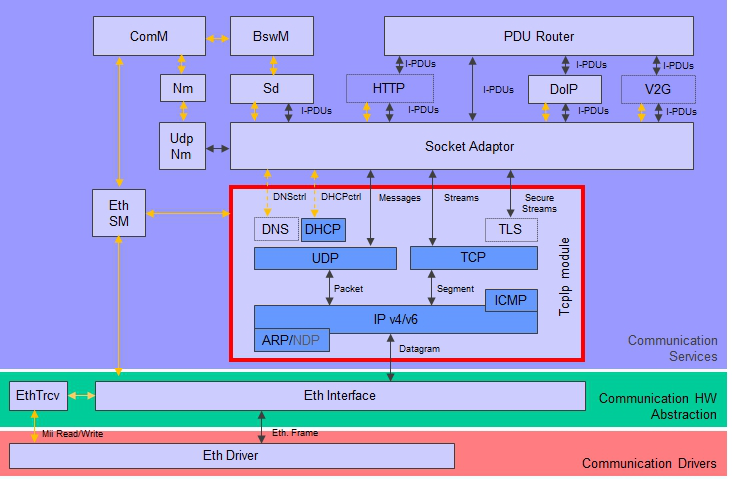

TCP/IP协议栈应由实现以下各小节所定义的特定功能的子模块组成。

### 6.1. 系统可伸缩性

#### 6.1.1. 背景与原理

TcpIp模块支持多种不同的用例，但并非每个用户都需要所有用例。为了实现可伸缩的TcpIp协议栈，协议应按以下可伸缩性类别（**Scalability Classes**）分组：

- 可伸缩性类别1：IPv4——车内和诊断通信
- 可伸缩性类别2：IPv6——车内和诊断通信
- 可伸缩性类别3：IPv4和IPv6（双栈）——车内和诊断通信

以下协议应在相应的可伸缩性类别中可用：

表7.1：TcpIp可伸缩性类别（**TcpIp Scalability Classes**）

| 特性 | 可伸缩性类别1 | 可伸缩性类别2 | 可伸缩性类别3 |
| --- | --- | --- | --- |
| IPv4 | X |  | X |
| ARP | X |  | X |
| ICMPv4 | X |  | X |
| DHCPv4 | X |  | X |
| Auto-IP | X |  | X |
| UDP | X | X | X |
| TCP | X | X | X |
| IPv6 |  | X | X |
| NDP |  | X | X |
| ICMPv6 |  | X | X |
| DHCPv6 |  | X | X |

除可伸缩性类别之外，以下特性组（**Feature Groups**）允许更细粒度地选择可选特性，以满足特定ECU的具体需求。

**IPv4全球通信特性组：**

以下特性可用于可伸缩性类别1和3。

- 路径MTU发现（**Path MTU Discovery**）

**IPv6全球通信特性组：**

以下特性可用于可伸缩性类别2和3。

- 路径MTU发现
- IPv6任播地址（**Anycast Addresses**）
- NDP重定向消息（**Redirect Messages**）

**特殊特性组：**

以下特性可用于可伸缩性类别1、2和3。

- DHCP服务器

**安全特性组：**

以下特性可用于可伸缩性类别1、2和3。

- TLS
- IPsec

#### 6.1.2. 需求

用于IPv4——车内和诊断通信（可伸缩性类别1）的TcpIp模块应支持「TcpIp可伸缩性类别」表中「可伸缩性类别1」列所列的特性。

用于IPv6——车内和诊断通信（可伸缩性类别2）的TcpIp模块应支持「TcpIp可伸缩性类别」表中「可伸缩性类别2」列所列的特性。

用于IPv4和IPv6（双栈）——车内和诊断通信（可伸缩性类别3）的TcpIp模块应支持「TcpIp可伸缩性类别」表中「可伸缩性类别3」列所列的特性。

### 6.2. 互联网协议版本4

#### 6.2.1. 互联网协议（IPv4）

互联网协议（**IP**）是TCP/IP协议栈的主要协议，负责将数据报从由源地址标识的源主机传送到由目标地址标识的一个或多个目标主机。IP隐藏底层物理网络接口，是一种不可靠、尽力而为、无连接的数据包传送协议。

TcpIp应按照IETF RFC 791（互联网协议版本4）实现互联网协议。

TcpIp应按照IETF RFC 894将IP数据包封装到以太网帧中。

TcpIp应按照IETF RFC 4632第[3.1](#31-输入文件和相关标准与规范)节，通过在IP地址之外使用网络掩码（前缀）来支持识别IP地址所属的网络。

TcpIp应满足IETF RFC 1122第3.2.1.1节（版本号）、3.2.1.2节（校验和）、3.2.1.3节（寻址）、3.2.1.7节（TTL）和3.3.2节（重组）所规定的互联网协议相关要求。

TcpIp应能够按照IETF RFC 1112第4、[6.2](#62-互联网协议版本4)和[6.4](#64-互联网协议安全ipsec)节，将IP数据报发送到由单个IP目标地址（多播地址）标识的一组主机。

TcpIp应能够接收由单个IP目标地址（多播地址）标识的多播IP数据报，依据IETF RFC 1112第4和[7.2](#72-类型定义)节（不包括IGMP的要求）。

TcpIp应能够按照IETF RFC 815（IP数据报重组算法）重组分片到达的数据报。

TcpIp应在发送前按照IETF 791「分片与重组」一节中的描述对超长IPv4帧进行分片。

TcpIp应按照IETF RFC 1191（路径MTU发现）的定义发现路径的最大传输单元（**MTU**）。

#### 6.2.2. 地址解析协议（ARP）

TcpIp应按照IETF RFC 826实现地址解析协议（**ARP**）。

TcpIp应将ARP表（地址解析缓存）条目的数量限制为配置参数TcpIpArpTableSizeMax所指定的数量。

如果ARP表条目在配置参数TcpIpArpTableEntryTimeout所指定的超时时间内未被使用，TcpIp应将其从ARP表中移除。如果TcpIpArpTableEntryTimeout设置为INF，则TcpIp模块永远不从ARP表中移除条目。

如果TcpIpArpDefensiveProcessing设置为FALSE，则TcpIp除了根据接收到的ARP数据包外，还应使用每个接收到的IP数据包的信息来更新ARP表。

TcpIp应在每次ARP表变更之后立即调用Up\_PhysAddrTableChg()：

- 如果TcpIp添加新条目或更新现有条目，参数valid应设置为TRUE，参数IpAddrPtr和PhysAddrPtr应根据新的或更新后的条目设置。
- 如果TcpIp移除条目，valid应设置为FALSE，参数IpAddrPtr和PhysAddrPtr应根据被移除的条目设置。

在发送一个ARP请求之后，TcpIp应在TcpIpArpRequestTimeout秒的持续时间内跳过向同一目标发送任何进一步的ARP请求，依据IETF RFC 1122第2.3.2.1节「ARP缓存验证」中描述的防止ARP洪泛机制。

TcpIp应直接在TcpIp\_RxIndication()的上下文中或在其后的第一个TcpIp\_MainFunction()中处理接收到的ARP数据包。

在分配新IP地址时，TcpIp应按照IETF RFC 2002第4.6节第二个缩进段发送可配置数量（TcpIpArpNumGratuitousARPonStartup）的免费ARP（**gratuitous ARP**）应答。这些通告应按照IETF RFC 5227第2.3节「通告一个地址」进行定时。

如果TcpIpArpDefensiveProcessing设置为TRUE，则ARP应静默丢弃所有未被先前发送的ARP请求所请求的接收到的ARP数据包。

如果TcpIpArpDefensiveProcessing设置为TRUE，则ARP在处理接收到的免费ARP数据包时应跳过ARP表的更新。

#### 6.2.3. IPv4链路本地地址的动态配置（Auto-IP）

TcpIp应支持按照IETF RFC 3927（IPv4链路本地地址的动态配置）定义的IPv4链路本地地址的动态配置。

#### 6.2.4. 互联网控制消息协议（ICMPv4）

TcpIp应支持按照IETF RFC 792（互联网控制消息协议版本4）定义的互联网控制消息协议（**ICMPv4**）消息的发送和接收。

只有当ICMPv4回显请求消息有效且TcpIpIcmpEchoReplyEnabled设置为TRUE时，TcpIp才应对其进行应答。

如果配置了[TcpIpIcmpMsgHandler](#9221-tcpipicmpmsghandler)，当接收到ICMPv4消息且TcpIp未直接处理该消息时，TcpIp应调用相应的Up\_IcmpMsgHandler()。

**注意：** 例如，如果TcpIp应答了一个ICMP回显请求，则不会对该消息调用Up\_IcmpMsgHandler()。

### 6.3. 互联网协议版本6

TcpIp应按照IETF RFC 3122的描述处理接收到的反向邻居发现（**IND**）请求（**Solicitation**）消息，并用通告（**Advertisement**）消息进行应答。邻居缓存应以请求消息中提供的值进行更新。

TLS应能够按照IETF RFC 5280的描述处理X.509 v3证书和X.509 v2证书吊销列表（**CRL**）档案。

如果TcpIpTcpWindowScaleOptionEnabled设置为TRUE，则应按照IETF RFC 7323第[2](#2-缩略语)章支持TCP窗口缩放选项（**WSopt**）和机制。TcpIpTcpWindowScale给出的值应是在SYN消息中发送的值，并且是在以SYN-ACK消息应答时的限制因子。

TcpIp应支持按照IETF RFC 2464（通过以太网网络传输IPv6数据包）定义的IPv6数据包传输帧格式，以及在以太网网络上形成IPv6链路本地地址和无状态自动配置地址的方法。

TcpIp应支持按照IETF RFC 6724（互联网协议版本6（IPv6）的默认地址选择）定义的源地址选择算法。只应支持第[5](#5-对其他模块的依赖)节「源地址选择」。

TcpIp应支持IETF RFC 5095（在IPv6中弃用类型0路由头）。IPv6类型0路由头提供的功能可能被利用以在远程路径上实现流量放大，从而产生拒绝服务流量。考虑到这一安全问题，该文档更新了IPv6规范以弃用IPv6类型0路由头的使用。

TcpIp应支持IETF RFC 4862（IPv6无状态地址自动配置）的第[5.1](#51-以太网接口ethif)节「节点配置变量」、第[5.3](#53-套接字适配器soad)节「链路本地地址的创建」、第[5.4](#54-密钥管理器keym)节「重复地址检测」、第[5.5](#55-加密服务管理器csm)节「全球地址的创建」和第[5.6](#56-文件结构)节「配置一致性」。

TcpIp应支持按照IETF RFC 1981（IP版本6的路径MTU发现）定义的IPv6路径MTU发现。如果使用了最大MTU，路径MTU发现不应尝试增大该值。

TcpIp应支持按照IETF RFC 4429（IPv6的乐观重复地址检测（DAD））定义的重复地址检测。

#### 6.3.1. 互联网协议（IPv6）

TcpIp应支持按照IETF RFC 8200（互联网协议版本6（IPv6）规范）定义的基本IPv6报头以及最初定义的IPv6扩展报头和选项。

TcpIp应按照IETF RFC 8200第4.5节「分片报头」支持分片IPv6帧的接收和重组。

TcpIp应支持IETF RFC 5722（重叠IPv6分片的处理）第[4](#4-约束和假设)节第一段。IETF RFC 5722展示了允许重叠分片带来的安全问题，并更新了IPv6规范以明确禁止重叠分片（发送和接收）。

TcpIp应在发送前按照IETF RFC 8200第4.5节「分片报头」对超长IPv6帧进行分片。

TcpIp应支持IETF RFC 4291（IP版本6寻址架构）第[2](#2-缩略语)节「IPv6寻址」，不包括第2.6节「任播地址」。第2.8节「节点必需的地址」应限于仅主机（**host only**）的节点要求。

TcpIp应支持IETF RFC 4291（IP版本6寻址架构）的第2.6节「任播地址」。

#### 6.3.2. 互联网控制消息协议（ICMPv6）

TcpIp应支持按照IETF RFC 4443（互联网协议版本6（IPv6）规范的互联网控制消息协议（ICMPv6））定义的互联网控制消息协议版本6。

只有当ICMPv6回显请求消息有效且TcpIpIcmpV6EchoReplyEnabled设置为TRUE时，TcpIp才应对其进行应答。

如果配置了[TcpIpIcmpV6MsgHandler](#9226-tcpipicmpv6msghandler)，当接收到ICMPv6消息且TcpIp未直接处理该消息时，TcpIp应调用相应的Up\_IcmpMsgHandler()。

**注意：** 例如，如果TcpIp应答了一个ICMPv6回显请求，则不会对该消息调用Up\_IcmpMsgHandler()。

#### 6.3.3. 邻居发现协议（NDP）

TcpIp应支持按照IETF RFC 4861（IP版本6（IPv6）的邻居发现）定义的IP版本6邻居发现协议，但不包括第4.5节「重定向消息格式」、第[6.2](#62-互联网协议版本4)节「路由器规范」、第[7.2.8](#728-tcpip_socketidtype)节「代理邻居通告」和第[8](#8-时序图)节「重定向功能」。

TcpIp应支持按照IETF RFC 4861（IP版本6（IPv6）的邻居发现）第[8.3](#83-接收)节「主机规范」定义的重定向消息处理。

如果TcpIpNdpDefensiveProcessing设置为TRUE，则NDP应静默丢弃所有未被先前发送的邻居请求（**Neighbor Solicitation**）所请求的接收到的邻居通告（**Neighbor Advertisement**）。

如果TcpIpNdpDefensiveProcessing设置为TRUE，则NDP在处理接收到的邻居请求时应跳过邻居缓存的更新。

TcpIp应将邻居缓存条目的数量限制为配置参数TcpIpNdpMaxNeighborCacheSize所指定的数量。

在邻居缓存已满且需要添加新条目的情况下，TcpIp应丢弃最旧的条目以便能够添加新条目。

TcpIp应遵循IETF RFC 5942第[4](#4-约束和假设)节「主机规则」中定义的规则，并应使用IETF RFC 5942第[6](#6-功能规格)节「对RFC 4861的更新」中更新后的「on-link」定义。

如果要向远程主机发送数据包而链路层地址不存在于邻居缓存中，TcpIp应按照IETF RFC 4861第[7.2.2](#722-tcpip_domaintype)节「发送邻居请求」第五段将该数据包排队，并在地址解析完成后发送该数据包。

### 6.4. 互联网协议安全（IPsec）

TcpIp应按照AUTOSAR基础规范RS\_IPsecProtocol [\[11\]](#ref-11)支持IPsec。

IKEv2应按照IETF RFC 7296和[RS\_IPSEC\_00021]实现，并遵循[RS\_IPSEC\_00004]中定义的限制。不支持IKEv1。

**注意：** 为了确保IKEv2总体上可与IETF IPsec标准互操作并解决任何歧义，使用开源IPsec实现strongSwan（strongswan.org）作为参考。

IKEv2的一般连接配置，例如连接生存期、重密钥/重认证超时、死亡对端检测（**dead peer detection**），可通过容器「[IKEConnections](#9264-ikeconnections)」中的设置进行配置。

用于与其他IKEv[2](#2-缩略语)节点进行认证的IKEv2证书可通过容器「[IKECertificates](#9275-ikecertificates)」和「[IKECertificate](#9276-ikecertificate)」中的设置进行配置。

安全策略数据库（**security policy database**），它定义哪些连接应受IPsec保护以及受何种保护，可通过容器「[TcpIpSpdEntry](#9260-tcpipspdentry)」和「TcpIpIpSecPriority」中的设置进行配置。IpSecPriority用于确定检查SpdEntry的顺序。第一个成功匹配的规则将被执行，忽略所有较低优先级的规则。

IKEv2握手提议算法的优先级可在容器「[IKEIkeSaProposal](#9268-ikeikesaproposal)」中配置。

### 6.5. 基于IP的协议

#### 6.5.1. 本地地址表

TcpIp应维护一个本地IP地址表，这些地址可在运行时分配给EthIf控制器，依据配置容器[TcpIpLocalAddr](#9235-tcpiplocaladdr)（包括其子容器）。

**注意：** 本地IP地址表的每个条目由配置参数TcpIpAddrId唯一标识。

如果未提供[TcpIpStaticIpAddressConfig](#9237-tcpipstaticipaddressconfig)，TcpIp应支持在运行时通过TcpIp\_RequestIpAddrAssignment()指定多播IP地址。

套接字使用的本地IP地址通过TcpIp\_Bind()指定。

如果配置为TCPIP\_STORE的[TcpIpAddrAssignment](#9236-tcpipaddrassignment)启动，TcpIp应检查NvMBlock（见第[9.2.38](#9238-tcpipnvmblock)节）中是否存在有效的IP地址。如果存在有效地址，TcpIp应像分配静态地址一样分配该地址。如果不存在有效地址，TcpIp应启动与该[TcpIpAddrAssignment](#9236-tcpipaddrassignment)相关的IP地址分配方法。一旦该过程完成，TcpIp应将新地址存储在NvMBlock中。

#### 6.5.2. 用户数据报协议（UDP）

TcpIp应按照IETF RFC 768（用户数据报协议）实现用户数据报协议（**UDP**）。

TcpIp应满足IETF RFC 1122第4.1.3.1节（端口）、4.1.3.4节（UDP校验和）和4.1.3.6节（无效地址）所规定的UDP相关要求。

#### 6.5.3. 传输控制协议（TCP）

如果TcpIpTcpSackEnabled设置为TRUE，则应按照IETF RFC 2018支持选择性确认（**SACK**）机制。如果启用，SACK选项应在TCP握手中发送。

TcpIp应按照IETF RFC 793（传输控制协议）实现传输控制协议（**TCP**）。

TcpIp应满足IETF RFC 1122第4.2.2.3节（窗口大小）、4.2.2.5节（TCP选项）、4.2.2.6节（MSS）、4.2.2.7节（校验和）、4.2.2.9节（初始序列号选择）、4.2.2.10节（同时打开尝试）、4.2.2.11节（从旧重复SYN恢复）、4.2.2.13节（关闭连接，不包括「半双工关闭」）、4.2.2.15节（重传超时）、4.2.2.16节（窗口管理）、4.2.2.17节（零窗口探测）、4.2.2.18节（被动OPEN调用）、4.2.2.19节（TTL）、4.2.3.2节（延迟ACK）、4.2.3.6节（TCP保活）和4.2.3.10节（远程地址验证）所规定的TCP相关要求。

TcpIp应支持IETF RFC 1122中定义的TCP窗口和确认策略：

- 4.2.3.1 重传超时计算
- 4.2.3.2 何时发送ACK段
- 4.2.3.3 何时发送窗口更新
- 4.2.3.4 何时发送数据

TcpIp应实现IETF RFC 1122第4.2.3.4节「何时发送数据」中定义的Nagle算法。

TcpIp应实现IETF RFC 5681中定义的拥塞控制策略：慢启动、拥塞避免、快速重传和快速恢复。

TcpIp应支持按照IETF RFC 6582（TCP快速恢复算法的NewReno修改）定义的针对部分确认的特定算法。只有当IETF RFC 5681的快速恢复策略被启用时，才应使用该修改。

#### 6.5.4. 传输层安全（TLS）

TcpIp应能够按照IETF RFC 6960第4.2.1节处理TLS服务器在CertificateStatus握手消息中发送的BasicOCSPResponse。

如果启用了参数TcpIpTlsRootCertUpdateCalloutFunction，则在TLS握手期间接收到新的有效根证书时，应调用由其值提供的、在TcpIpTlsRootCertUpdateCalloutHeaderFile给定的头文件中定义的callout函数。

如果TcpIpTlsUseExtensionMaxFragmentLength设置为TRUE，则应使用max\_fragment\_length扩展按照IETF RFC 6066第[4](#4-约束和假设)章协商TLS服务器与客户端之间的最大分片长度。如果TcpIpTlsUseExtensionRecordSizeLimit设置为TRUE，则不得发送该扩展且在接收时必须忽略它。

如果TcpIpTlsUseExtensionTrustedCAKeys设置为TRUE，则TLS客户端应在其ClientHello消息中按照IETF RFC 6066第[6](#6-功能规格)章使用trusted\_ca\_keys扩展发送TcpIpTlsTrustedCAList的元素。TcpIpTlsTrustedCAList的每个元素代表一个KeyM根证书，并通过TcpIpTlsTrustedCAListEntry引用。

如果TcpIpTlsUseExtensionCertificateStatusRequest设置为TRUE，则应按照IETF RFC 6961支持status\_request\_v2扩展。TLS客户端应在其ClientHello消息中发送包含TcpIpTlsUseExtensionTrustedCAKeys元素的CertificateStatusRequest。如果TcpIpTlsUseExtensionTrustedCAKeys包含多个元素，则CertificateStatusRequest应为ocsp\_multi类型。

TcpIp应按照IETF RFC5246（至少第7和第[8](#8-时序图)章）支持TCP通信的传输层安全。

至少必须实现IETF RFC5246中与其他节点实现基本且兼容的互操作（不带任何可选扩展）所需的那些部分。

应考虑IETF RFC 7525中关于安全TLS实现的进一步建议。

TLS版本低于1.2（IETF RFC5246）的TLS连接请求应被忽略或以警报（**alert**）拒绝。因此，不应实现或支持IETF RFC5246附录E中所述的对低于TLS 1.2版本的向后兼容处理。

如果TLS连接引用了TLS\_VERSION\_V13类型的TlsCiphersuiteDefinition，则TLS V1.3应为首选协议版本。只有在此失败且TLS V1.2的密码套件也分配给该TLS连接时，才允许降级操作到TLS V1.2。

**信息：** 如果TLS连接不包含TLS V1.3的密码套件，则应以指示TLS V1.2协议的方式发起握手。

AUTOSAR TLS实现应丢弃会话重协商。

IETF RFC5246第7.4.7节和第[8](#8-时序图)节中描述的密钥交换（**KeyExchange**）算法取决于密码套件。因此，密钥交换所需的CSM作业在密码套件配置中引用。

如果TLS的密码套件包含对椭圆曲线的支持，则应相应地支持IETF RFC 4492的必需部分。

至少必须实现IETF RFC 4492第[2](#2-缩略语)节中相应的密钥交换算法，例如ECDHE。只有当预期使用带有相应椭圆曲线参数的证书时，才必须支持第[5](#5-对其他模块的依赖)节中规定的扩展。

TLS实现必须支持至少一个符合DoIP规范ISO13400-2的密码套件，以便上层能够将此类套接字连接到诊断通信。

TLS连接应有一个配置参数，定义从节点的角度看该套接字是用于TLS客户端还是TLS服务器通信。

用于TLS服务器的TLS连接需要对一个带有其私钥的本地证书的引用。

在配置中，TLS连接可以收集在[TcpIpTlsConnectionGroup](#9247-tcpiptlsconnectiongroup)中。如果一个组中的一个TLS连接已经活动，则不应激活同一组的另一个TLS连接。换言之，一个组中同时只能有一个TLS连接处于活动状态。这允许为TLS连接组定义独占资源，并且同一组中TLS连接的资源可以共享。

如果所选TLS连接被相应地配置（即配置参数TcpIpTlsUseClientAuthenticationRequest设置为TRUE），TLS服务器应请求客户端认证。在这种情况下，TLS客户端也需要一个带有其私钥的本地证书，并应在TLS握手期间按需提供给服务器。

如果TcpIpTlsUseExtensionRecordSizeLimit设置为TRUE，则应使用record\_size\_limit扩展按照IETF RFC 8449第[4.1](#41-限制)节协商TLS服务器与客户端之间的最大分片长度。

TLS连接到TCP套接字的分配要么基于静态配置（静态TLS连接分配），要么通过API调用（动态TLS连接分配）完成。

在动态TLS连接分配中，应通过以参数ParameterId TCPIP\_PARAMID\_TLS\_CONNECTION\_ASSIGNMENT调用TcpIp\_ChangeParameter()，将TLS连接分配给TCP套接字。该函数的ParameterValue为该套接字提供对TLS连接的引用。

**注意：** 将TLS连接动态分配给套接字的典型方法是在套接字连接建立之前的通道设置期间。但是，也应可以在套接字连接建立之后执行此操作。这对于以明文通信开始、之后切换到TLS加密通信以实现例如STARTTLS操作的场景可能有用。

对于通过TcpIp\_ChangeParameter()进行的动态TLS连接分配，对TcpIp\_ChangeParameter()的调用应按如下方式启动TLS握手：

- TLS服务器应等待ClientHello作为该套接字上的下一条消息。
- TLS客户端应开始发送ClientHello消息。
- 之后，TcpIp不再将明文消息传递给上层或下层，而是传递给TLS。

TLS握手的成功完成按照后文第[7.6](#76-调度函数)节中关于TLS握手成功事件的要求进行通告。

对于静态TLS连接分配，为至少一个TLS连接定义了端口和可选的地址，TCP应在TCP SYN期间（SYN的接收或发送）检查是否有任何TLS连接的端口分配可用且该TLS连接未被使用。如果是，TCP应检查端口，并在端口匹配时自动将该TLS连接分配给该套接字。

对于静态TLS连接分配，TCP客户端应在发送SYN帧时检查其远程端口配置。如果TLS端口配置匹配，则应将相应的TLS连接分配给该套接字。

**注意：** 这种方法排除了这样一个用例：一个客户端在连接到同一远程监听套接字时，对不同的本地套接字使用不同的TLS设置（包括完全不使用TLS）。但是，一个客户端通过不同的本地套接字使用不同的TLS设置连接到同一远程监听套接字被视为一种少见的用例，因此有意不支持。

对于静态TLS连接分配，TCP服务器应在接收到SYN帧时检查其本地端口配置。如果TLS端口配置匹配，则应将相应的TLS连接分配给该套接字。

**注意：** 这种方法排除了这样一个用例：一个服务器对不同的远程套接字但对同一本地监听套接字使用不同的TLS设置（包括完全不使用TLS）。但是，一个服务器对通过同一监听套接字连接的不同客户端使用不同的TLS设置被视为一种少见的用例，因此有意不支持。

对于静态TLS连接分配，如果在SYN ACK成功发送后套接字被分配了TLS连接，则TCP客户端应发起TLS握手。

对于TCP客户端处的静态TLS连接分配，在向服务器发送SYN的ACK之后不应调用接口&lt;Up\_TcpConnected&gt;。相反，应在TLS握手成功完成后调用此函数。

对于静态TLS连接，TCP服务器应在收到SYN的ACK之后预期一个TLS握手。该套接字的所有后续传入消息都应进一步传递给TLS。

对于TCP服务器侧的静态TLS连接分配，在接收到ACK之后不应调用接口&lt;Up\_TcpAccepted&gt;。相反，应在TLS握手成功完成后调用此函数。

对于动态和静态TLS连接分配，如果为套接字所有者定义了事件回调且TLS握手已成功完成，则应以&lt;Up\_TcpIpEvent&gt;()和事件类型TCPIP\_TLS\_HANDSHAKE\_SUCCEEDED通知套接字所有者。对于静态TLS连接分配，对&lt;Up\_TcpIpEvent&gt;的调用和事件类型TCPIP\_TLS\_HANDSHAKE\_SUCCEEDED应发生在对&lt;Up\_TcpAccepted&gt; / &lt;Up\_TcpConnected&gt;的调用之后。

TLS服务器应选择本地分配的、与接收到的密码套件之一匹配的最高优先级密码套件。在握手期间应提供分配给该TLS连接与TLS密码套件组合的本地证书。

TLS服务器应通过server\_certificate消息提供由[TcpIpTlsConnection](#9248-tcpiptlsconnection) / TcpIpTlsCipherKeyMLocalCertificate引用的证书。该证书应通过函数KeyM\_GetCertificate()从密钥管理器请求。

如果通过TLS的certificate或certificateVerify握手消息接收到证书，则应使用函数KeyM\_SetCertificate()和[TcpIpTlsConnection](#9248-tcpiptlsconnection)的引用TcpIpTlsCipherKeyMRemoteCertificate将该证书提供给密钥管理器。随后，使用函数KeyM\_VerifyCertificate()验证该证书；如果通过握手消息接收到多个证书，则使用函数KeyM\_VerifyCertificateChain()。此函数同样使用TcpIpTlsCipherKeyMRemoteCertificate引用。

TLS模块使用分配给密码套件的CSM作业来执行加密操作。密钥材料将在握手期间协商和装载。

**注意：** CSM作业可以同步或异步运行。作业以异步还是同步模式运行取决于其配置。对于异步作业，需要本文档中未定义的回调。它们是供应商特定的，应按文档在CSM中进行相应配置。

TLS应使用[TcpIpTlsHandshake](#9252-tcpiptlshandshake)引用的、并在[TcpIpTlsConnection](#9248-tcpiptlsconnection)中引用的TcpIpTlsCsmRandomGenerateJobRef所引用的CSM作业来生成随机值。TLS外部的系统负责收集熵以在需要时为RNG播种。

选择密码套件后，TLS连接所分配的[TcpIpTlsHandshake](#9252-tcpiptlshandshake)将提供完成密钥交换算法所需的所有CSM作业和密钥的必要引用。

**信息：** 并非[TcpIpTlsHandshake](#9252-tcpiptlshandshake)容器中引用的所有CSM作业都是必需的。为TLS握手配置的哪些作业和密钥是操作所需的，主要取决于密码套件及其关联的证书。它们必须预先配置并相应分配。它还取决于TLS类型（是TLS服务器还是TLS客户端）、分配给TLS连接的密码套件，以及证书中包含的公钥类型（即ECC公钥还是RSA公钥）。

下表概述了握手操作需要为CSM配置的作业和密钥：

| 作业类型 | RSA | ECC |
| --- | --- | --- |
| TcpIpTlsCsmPrfMac[Job&#124;Key]Ref | C/S | C/S |
| TcpIpTlsCsmHashVerifyJobRef | C/S | C/S |
| TcpIpTlsCsmMasterSecretKeyRef | C/S | C/S |
| TcpIpTlsCsmKeyExchangeCalcPubValJobRef | - | C/S <sup>1</sup> |
| TcpIpTlsCsmKeyExchangeKeyRef | - | C/S <sup>2</sup> |
| TcpIpTlsCsmKeyExchangeCalcSecretJobRef | - | C/S <sup>1</sup> |
| TcpIpTlsCsmKeyExchangeSignatureGenerate[Job&#124;Key]Ref | - | S/B |
| TcpIpTlsCsmKeyExchangeSignatureVerify[Job&#124;Key]Ref | - | C/B |
| TcpIpTlsCsmKeyExchangeEncrypt[Job&#124;Key]Ref | C/B | - |
| TcpIpTlsCsmKeyExchangeDecrypt[Job&#124;Key]Ref | S/B | - |

> C：TLS客户端实现
> S：TLS服务器实现
> B：如果激活了客户端认证则额外需要
> 1 该引用用于异步DH(E)操作
> 2 该引用用于同步DH(E)操作

以下示例可用作指导。

**示例 #1：**

引用RSA的密码套件为TLS客户端提供TcpIpTlsCsmKeyExchangeEncryptJobRef以加密预主密钥（**pre-master secret**）。首先，TLS客户端验证接收到的证书，获取公钥并将其复制到TcpIpTlsCsmKeyExchangeEncryptKeyRef引用的CSM密钥位置。然后加密预主密钥并将其发送给TLS服务器。服务器使用TcpIpTlsCsmKeyExchangeDecryptJobRef解密预主密钥。该作业要么静态引用私钥，要么在[TcpIpTlsConnection](#9248-tcpiptlsconnection) / TcpIpTlsCipherKeyMLocalCertificate / KeyMCertPrivateKeyStorageCryptoKeyRef / KeyMCryptoKeyCsmKeyTargetRef可用时，将该密钥复制到TcpIpTlsCsmKeyExchangeDecryptKeyRef。

**示例 #2：**

一个密码套件引用ECDHE\_ECDSA，且所使用的证书包含相应的ECC密钥，在这种情况下支持ECDSA。服务器使用加密作业Csm\_KeyExchangeCalcPubVal()（引用TcpIpTlsCsmKeyExchangeKeyRef）生成DH参数，并使用[TcpIpTlsHandshake](#9252-tcpiptlshandshake) / TcpIpTlsCsmKeyExchangeSignatureGenerateKeyRef（持有对证书私钥的引用）对结果签名。如果密钥未静态分配给该作业，则必须相应地复制（见示例#1）。所得数据发送给TLS客户端，客户端验证证书并使用证书的密钥、通过[TcpIpTlsHandshake](#9252-tcpiptlshandshake) / TcpIpTlsCsmKeyExchangeSignatureVerifyKeyRef验证服务器提供的ECDSA签名。之后，如果成功，客户端计算其自己的DH参数并将其提供给服务器。随后，TLS客户端和服务器都将使用Csm\_KeyExchangeCalcSecret()计算预主密钥。

**示例 #3：**

所选密码套件按照IETF RFC 4279定义了一个预共享密钥。服务器在ServerKeyExchange消息中提供psk\_identity\_hint。它既可以从[TcpIpTlsPskIdentity](#9254-tcpiptlspskidentity) / TcpIpTlsPresharedKeyIdentityHint导出，也可以在未指定时从用户回调TcpIpTlsPskGetKeyIdentityHintFunc查询。TLS客户端使用该提示选择TLS客户端和该TLS服务器都已知的预共享密钥。如果一个密钥可以通过该身份提示唯一确定，则可以使用[TcpIpTlsPskIdentity](#9254-tcpiptlspskidentity)配置作为回调函数的替代方案。在这种情况下，所选密钥可以通过TcpIpTlsPresharedKeyIdentityHint确定，并且可以进一步使用带有TcpIpTlsPresharedKeyCsmKeyRef的TcpIpTlsPresharedKeyIdentity。更灵活的方案是使用回调TcpIpTlsPskGetClientKeyIdentityFunc，它允许在运行时选择密钥及其身份。在客户端选择了密钥及其身份之后，psk\_identity将通过ClientKeyExchange消息提供给TLS服务器。在TLS服务器侧，可以以相同的方式识别相应的密钥：要么通过[TcpIpTlsPskIdentity](#9254-tcpiptlspskidentity) / TcpIpTlsPresharedKeyIdentity的静态配置，要么通过由TcpIpTlsPskGetServerKeyIdentityFunc确定的回调函数在服务器侧查询。选择密钥后，可以使用[TcpIpTlsHandshake](#9252-tcpiptlshandshake)容器中分配的相应CSM作业确定主密钥（**master secret**）。

TLS应使用[TcpIpTlsHandshake](#9252-tcpiptlshandshake) / TcpIpTlsCsmHashVerifyJobRef来计算握手消息的哈希，该哈希随finish握手消息提供。

TLS应使用TcpIpTlsCsmPrfMacJobRef计算主密钥。配置项TcpIpTlsCsmPRFSupportType应规定CSM作业如何支持主密钥的生成。

如果TcpIpTlsCsmPRFSupportType设置为TLS\_PRF\_CSM\_NO\_SUPPORT，则TcpIpTlsCsmPrfMacJobRef引用一个用于MAC生成的作业。如果设置为TLS\_PRF\_CSM\_INOUT\_REDIRECT\_SUPPORT，则应使用下文提到的重定向支持。如果配置设置为TLS\_PRF\_CSM\_FULL\_SUPPORT，则CSM作业将完全自行生成主密钥。TLS只需调用该作业，主密钥将在TcpIpTlsCsmMasterSecretKeyRef的元素ID #1中可用。任何情况下都必须进行向worker作业的密钥分发。

建议对TcpIpTlsCsmPrfMacJobRef使用CSM在AUTOSAR V4.4中引入的输入和输出重定向。这允许将主密钥和计算的中间结果保留在加密驱动程序内（例如在HSM中）。TcpIpTlsCsmPrfMacKeyRef的密钥元素用作该作业的输入，TcpIpTlsCsmMasterSecretKeyRef用作输出引用。Csm\_KeyElementSet()用于初始值设置，Csm\_KeyCopy()和Csm\_KeyElementCopyPartial()用于设置作业操作的输入值。Csm\_KeyElementCopyPartial()最终用于将主密钥结果分发到[TcpIpTlsCiphersuiteWorker](#9251-tcpiptlsciphersuiteworker)的密钥引用，这些密钥在应用数据传输期间由worker作业使用。

如果为TLS连接配置了TcpIpTlsServerNameIdentification，则应将所配置的名称作为服务器名称标识（**SNI**）添加到Client Hello消息中。

如果TLS服务器接收到包含长度大于0的服务器名称标识的ClientHello消息，则服务器应在[TcpIpTlsCertificateIdentity](#9253-tcpiptlscertificateidentity)中搜索匹配的身份引用，并在握手期间提供位于该容器中的证书。

ClientHello消息中包含的时间戳信息应通过所配置的TcpIpTlsConnectionGetTimeFunc callout函数提供。

如果使用预共享密钥的密码套件且TcpIpTlsUsePresharedKeys设置为TRUE，则回调函数应在TLS客户端和TLS服务器侧提供按照IETF RFC 4279选择预共享密钥所需的信息。这些回调用于在握手期间提供身份提示并最终提供密钥标识。回调函数用于选择用于进一步处理的CSM密钥。或者，如果未配置回调函数，可以使用[TcpIpTlsPskIdentity](#9254-tcpiptlspskidentity)的静态参数配置。

TLS应能够打开并维护TcpIpTlsMaxConnections所定义的最大连接数。

TCP数据流应由TLS分片为fragment。分片的最大大小应按照TcpIpTlsMaxFragmentLength中的配置使用。TCP套接字必须能够在一个段内至少发送这样一个fragment。

在接收到TLS「close\_notify」消息时，应关闭TLS连接并销毁所有与安全相关的资源。在TLS连接关闭后，不得再通过此套接字上的TCP执行进一步的明文通信。因此，建议也关闭TCP套接字。

#### 6.5.5. 动态主机配置协议

动态主机配置协议的服务器部分应通过配置参数TcpIpDhcpServerEnabled在预编译时可配置开/关。

动态主机配置协议的服务器部分应通过根据相关[TcpIpCtrl](#927-tcpipctrl)的DHCP服务器配置分配可用IP地址来响应客户端请求。

如果配置包含引用以太网交换机特定端口的[TcpIpDhcpAddressAssignment](#9213-tcpipdhcpaddressassignment)，DHCP服务器应通过使用DHCP客户端的MAC地址调用EthIf\_GetPortMacAddr()来识别接收请求的端口，并选择与同一端口相关的[TcpIpDhcpAddressAssignment](#9213-tcpipdhcpaddressassignment)的可用IP地址。

##### 6.5.5.1. 动态主机配置协议（DHCPv4）

TcpIp应按照IETF RFC 2131（动态主机配置协议）实现动态主机配置协议（**DHCPv4**）的客户端和服务器部分，用于IPv4地址的动态配置。

TcpIp应支持按照IETF RFC 4702（IPv4动态主机配置协议（DHCPv4）客户端完全限定域名（FQDN）选项）定义的IPv4动态主机配置协议客户端要求的完全限定域名选项。不支持DNS。只应支持第[2](#2-缩略语)节「客户端FQDN选项」和第[3](#3-相关文档)节「DHCP客户端行为」。第[3.2](#32-相关规范)、3.3、3.5小节不受支持。

##### 6.5.5.2. 动态主机配置协议（DHCPv6）

TcpIp应支持IPv6动态主机配置协议（**DHCPv6**）的客户端部分，它使DHCP服务器能够按照IETF RFC 3315（IPv6动态主机配置协议（DHCPv6））向IPv[6](#6-功能规格)节点传递诸如IPv6网络地址之类的配置参数。由于只应支持客户端功能，因此不支持以下章节：

- 中继代理行为
- 服务器行为
- 第12节 临时地址的管理
- 第21节 DHCP消息的认证
- 第22.5节 临时地址的身份关联选项
- 第22.11节 认证选项
- 第22.14节 快速提交选项

TcpIp应支持按照IETF RFC 4704（IPv6动态主机配置协议（DHCPv6）客户端完全限定域名（FQDN）选项）定义的IPv6动态主机配置协议客户端要求的完全限定域名选项。不支持DNS。只应支持第[4](#4-约束和假设)节「DHCPv6客户端FQDN选项」和第[5](#5-对其他模块的依赖)节「DHCPv6客户端行为」。第[5.1](#51-以太网接口ethif)、5.2、[5.4](#54-密钥管理器keym)小节不受支持。

### 6.6. 消息接收

TcpIp IP层应将接收到的IP数据报映射到本地地址表（TcpIpAddrId）中的一个条目。

本地地址表映射在满足以下全部条件时才成功：

1. 接收接口与分配给本地地址表条目的接口（EthIfCtrl）匹配。
2. IP报头中包含的目标IP地址与本地地址表条目当前分配的IP地址匹配。

所有无法映射到本地地址表条目的IP数据报应被静默丢弃。所有成功映射的IP数据报应被转发给上层协议。

如果已配置IPsec，所有接收到的IP数据报都应映射到一个安全策略（**Security Policy**）条目，并按如下方式处理：

1. TCPIP\_IPSEC\_POLICY\_PROTECT：

只有当该IP数据报包含按照IETF RFC 4302的有效认证报头（**Authentication header**）时，才将其转发给上层。否则应丢弃该IP数据报并调用可选的回调。

2. TCPIP\_IPSEC\_POLICY\_BYPASS：

该IP数据报不经任何IPSec处理直接转发给上层。

3. TCPIP\_IPSEC\_POLICY\_DISCARD：

该IP数据报不经任何IPSec处理被丢弃。

所有映射到本地地址表中IPv6条目的IP数据报，如果其配置了可选的TcpIpLocalAddrIPv6ExtHeaderFilterRef，且包含至少一个未列在所引用的[TcpIpIpV6ConfigExtHeaderFilter](#9227-tcpipipv6configextheaderfilter)中的IPv6扩展报头，则应被静默丢弃。如果本地地址表中的IPv6条目未配置可选的TcpIpLocalAddrIPv6ExtHeaderFilterRef，则应处理该帧。

TcpIp UDP层应根据UDP协议报头中包含的目标端口和本地地址（TcpIpAddrId）将接收到的UDP数据报映射到套接字。当满足以下任一条件时，本地地址（TcpIpAddrId）匹配：

- 套接字绑定到该本地地址（TcpIpAddrId）
- 套接字本地地址使用通配符「ANY」，且套接字的EthIfCtrl与本地地址（TcpIpAddrId）中使用的EthIfCtrl相同
- 套接字绑定到TCPIP\_LOCALADDRID\_ANY

套接字绑定到某个本地地址，且EthIfCtrl与本地地址（TcpIpAddrId）中使用的EthIfCtrl相同，并且所接收的本地地址（TcpIpAddrId）是广播地址。

对于本地地址（TcpIpAddrId）为广播或多播地址的接收UDP数据报，所有匹配的套接字都应接收该传入消息。

**注意：** 套接字既可以通过使用TcpIp\_Bind()显式绑定到本地IP地址，也可以作为TcpIp\_UdpTransmit()的一部分隐式绑定（如果在调用TcpIp\_UdpTransmit()之前未调用TcpIp\_Bind()）。

TcpIp TCP层应根据TCP协议报头中包含的目标端口和本地地址（TcpIpAddrId）将接收到的TCP数据报映射到套接字。当满足以下任一条件时，本地地址（TcpIpAddrId）匹配：

- 套接字绑定到单播本地地址（TcpIpAddrId）
- 套接字本地地址使用通配符「ANY」，且套接字的EthIfCtrl与本地地址（TcpIpAddrId）中使用的相同
- 套接字绑定到TCPIP\_LOCALADDRID\_ANY

已建立TCP连接的套接字除了上文所述的通用TCP映射准则之外，还应匹配协议报头中包含的源端口、源IP地址、目标端口和目标IP地址。

本地地址（TcpIpAddrId）为广播或多播地址的接收TCP数据报应被静默丢弃。

如果已通过TcpIp\_ChangeParameter()在套接字上启用了TCP选项过滤，则TcpIp应根据允许的选项列表（[TcpIpTcpConfigOptionFilter](#9244-tcpiptcpconfigoptionfilter)）检查接收到的段，如果其中包含至少一个未列出的TCP选项，则应静默丢弃该段。

对于接收，TcpIp模块应根据以太网控制器的配置按照以下列表忽略帧的协议校验和字段：

- 对于IPv4帧，如果启用了硬件IPv4校验和验证，即EthCtrlEnableOffloadChecksumIPv4设置为TRUE
- 对于ICMP帧，如果启用了硬件ICMP校验和验证，即EthCtrlEnableOffloadChecksumICMP设置为TRUE
- 对于TCP帧，如果启用了硬件TCP校验和验证，即EthCtrlEnableOffloadChecksumTCP设置为TRUE
- 对于UDP帧，如果启用了硬件UDP校验和验证，即EthCtrlEnableOffloadChecksumUDP设置为TRUE

在所有其他情况下，TcpIp模块应按照相关协议规范处理校验和不匹配的帧。

对于接收，TcpIp模块应只在已相应配置的套接字上接受包含零校验和的UDP数据报（即已以TCPIP\_PARAMID\_UDP\_CHECKSUM设置为FALSE调用过TcpIp\_ChangeParameter()）。

如果测量数据已启用（见TcpIpGetAndResetMeasurementDataApi），每当一个接收到的数据报被丢弃时，TcpIp应递增相应的测量数据。

以下是针对TLS数据处理的建议准则：

- 如果接受了一个TCP数据报且该套接字被分配给TLS连接，TCP应将数据传递给TLS进行进一步处理。
- 如果接收到的TLS应用消息被成功处理和验证，数据内容应传回TCP，以进一步提供给所配置的上层。这为上层提供了完全透明的数据接收。
- 如果消息接收被传递给TLS但无法处理——因为TLS连接尚未建立，或者消息无法被正确认证和/或解密——该消息应被丢弃。
- 在TLS处理完一条消息且所有数据被完全消费后，应通知TCP释放该消息的所有相关资源，无论该消息是否被成功处理。

### 6.7. 消息发送

如果数据通过绑定到IPv4单播本地地址（TcpIpAddrId）的套接字发送，则TcpIp应使用分配给该本地地址（TcpIpAddrId）的IP地址作为IP数据报报头中的源IP地址。该IP数据报应使用该本地地址（TcpIpAddrId）所映射的EthIfCtrl发送。

如果数据通过绑定到使用通配符「ANY」的本地地址（TcpIpAddrId）的IPv4套接字发送，则TcpIp应使用所配置的、类型为IPv4单播且分配给与所绑定本地地址（TcpIpAddrId）相同的EthIfCtrl的本地地址（TcpIpAddrId）的IP地址作为IP数据报报头中的源IP地址。

如果数据通过绑定到TCPIP\_LOCALADDRID\_ANY的IPv4套接字发送，则TcpIp应使用所配置的、类型为IPv4单播且分配给与目标IPv4地址处于同一子网的EthIfCtrl的本地地址（TcpIpAddrId）的IP地址作为IP数据报报头中的源IP地址。如果未找到匹配的子网，则选择EthIfCtrl = 0的IPv4单播本地地址（TcpIpAddrId）。

如果数据通过绑定到多播类型本地地址（TcpIpAddrId）的IPv4 UDP套接字发送，则TcpIp应使用所配置的、类型为IPv4单播且分配给与所绑定本地地址（TcpIpAddrId）相同的EthIfCtrl的本地地址（TcpIpAddrId）的IP地址作为IP数据报报头中的源IP地址。

如果数据通过绑定到广播类型本地地址（TcpIpAddrId）的IPv4 UDP套接字发送，则TcpIp应使用所配置的、类型为IPv4单播且分配给与所绑定本地地址（TcpIpAddrId）相同的EthIfCtrl的本地地址（TcpIpAddrId）的IP地址作为IP数据报报头中的源IP地址。

如果数据通过未绑定的IPv4 UDP套接字发送，则TcpIp使用所配置的、类型为IPv4单播且分配给与目标IPv4地址处于同一子网的EthIfCtrl的本地地址（TcpIpAddrId）的IP地址作为IP数据报报头中的源IP地址。如果未找到匹配的子网，则选择EthIfCtrl = 0的IPv4单播本地地址（TcpIpAddrId）。

如果数据通过绑定到IPv6单播本地地址（TcpIpAddrId）的套接字发送，则TcpIp应使用分配给该本地地址（TcpIpAddrId）的IP地址作为IP数据报报头中的源IP地址。该IP数据报应使用该本地地址（TcpIpAddrId）所映射的EthIfCtrl发送。

如果数据通过绑定到使用通配符「ANY」的本地地址（TcpIpAddrId）的IPv6套接字发送，则TcpIp应按照IETF RFC 6724（IPv6的默认地址选择）第[5](#5-对其他模块的依赖)节规定的源地址选择算法选择IPv6报头的源IP地址。该选择应仅限于与所绑定本地地址（TcpIpAddrId）处于相同EthIfCtrl的所配置本地地址（TcpIpAddrId）。

如果数据通过绑定到TCPIP\_LOCALADDRID\_ANY的IPv6套接字发送，则TcpIp应选择拥有与目标地址使用相同网络前缀的本地地址（TcpIpAddrId）的接口。如果未找到匹配的接口，则选择EthIfCtrl = 0。TcpIp应按照IETF RFC 6724（IPv6的默认地址选择）第[5](#5-对其他模块的依赖)节规定的源地址选择算法选择IPv6报头的源IP地址。

如果数据通过绑定到多播类型本地地址（TcpIpAddrId）的IPv6 UDP套接字发送，则TcpIp应按照IETF RFC 6724（IPv6的默认地址选择）第[5](#5-对其他模块的依赖)节规定的源地址选择算法选择IPv6报头的源IP地址。该选择应仅限于与所绑定本地地址（TcpIpAddrId）处于相同EthIfCtrl的所配置本地地址（TcpIpAddrId）。

如果数据通过未绑定的IPv6 UDP套接字发送，则TcpIp应选择拥有与目标地址使用相同网络前缀的本地地址（TcpIpAddrId）的接口。如果未找到匹配的接口，则选择EthIfCtrl = 0。TcpIp应按照IETF RFC 6724（IPv6的默认地址选择）第[5](#5-对其他模块的依赖)节规定的源地址选择算法选择IPv6报头的源IP地址。

TcpIp应根据IETF RFC 1122第3.3.1.1节（IPv4）和IETF RFC 4861第[5.2](#52-以太网状态管理器ethsm)节「概念发送算法」（IPv6）为其发送的每个数据报选择正确的下一跳。

TcpIp应始终以参数TxConfirmation设置为FALSE调用EthIf\_Transmit()。

如果参数TcpIpArpPacketQueueEnabled设置为TRUE，且一个IPv4数据包要发送到远程主机但相关链路层地址不存在于ARP表中，则TcpIp应启动地址解析并按照IETF RFC 1122第2.3.2.2节将该数据包排队，并以E\_OK接受该发送请求。

如果参数TcpIpArpPacketQueueEnabled设置为FALSE，且一个IPv4数据包要发送到远程主机但相关链路层地址不存在于ARP表中，则TcpIp应启动地址解析但以E\_NOT\_OK拒绝该发送请求。

如果参数TcpIpNdpPacketQueueEnabled设置为TRUE，且一个IPv6数据包要发送到远程主机但相关链路层地址不存在于邻居缓存中，则TcpIp应启动地址解析并按照IETF RFC 4861第[7.2.2](#722-tcpip_domaintype)节将该数据包排队，并以E\_OK接受该发送请求。

如果参数TcpIpNdpPacketQueueEnabled设置为FALSE，且一个IPv6数据包要发送到远程主机但相关链路层地址不存在于邻居缓存中，则TcpIp应启动地址解析但以E\_NOT\_OK拒绝该发送请求。

在通过TcpIpTcpMaxRtx配置的最大重传次数发送完毕后，以下定时器：

- 要么是TCPIP\_PARAMID\_TCP\_RETRANSMIT\_TIMEOUT（如果由TcpIp\_ChangeParameter()提供），要么是TcpIpTcpRetransmissionTimeout（如果TCPIP\_PARAMID\_TCP\_RETRANSMIT\_TIMEOUT未由TcpIp\_ChangeParameter()提供）

应在TCP连接关闭之前最后一次重新启动。

对于发送，TcpIp模块应根据以太网控制器的配置按照以下列表跳过协议校验和的计算并将字段填0：

- 对于IPv4帧，如果启用了硬件IPv4校验和计算，即EthCtrlEnableOffloadChecksumIPv4设置为TRUE
- 对于未分片的ICMP帧，如果启用了硬件ICMP校验和计算，EthCtrlEnableOffloadChecksumICMP设置为TRUE
- 对于TCP帧，如果启用了硬件TCP校验和计算，EthCtrlEnableOffloadChecksumTCP设置为TRUE
- 对于未分片的UDP帧，如果启用了硬件UDP校验和计算，EthCtrlEnableOffloadChecksumUDP设置为TRUE

在所有其他情况下，TcpIp模块应按照相关协议规范计算校验和。

对于发送，TcpIp模块应只在已相应配置的套接字上跳过UDP协议校验和的计算并改用零值（即已以TCPIP\_PARAMID\_UDP\_CHECKSUM设置为FALSE调用过TcpIp\_ChangeParameter()）。

在默认情况下，或者对某个套接字以ParameterId设置为TCPIP\_PARAMID\_PATHMTU\_ENABLE且值设置为TRUE调用过TcpIp\_ChangeParameter()时，该套接字出站数据报的最大大小应由路径MTU发现确定。

如果对某个套接字以ParameterId设置为TCPIP\_PARAMID\_PATHMTU\_ENABLE且值设置为FALSE调用过TcpIp\_ChangeParameter()，则该套接字出站数据报的最大大小由静态配置确定。

如果上层向TCP请求发送且连接配置为TLS但握手尚未开始或未完成，则消息发送请求应返回E\_NOT\_OK。

如果已配置IPSec，TcpIp要发送的每个IP数据报都应映射到一个安全策略条目，并按如下方式处理：

- TCPIP\_IPSEC\_POLICY\_PROTECT：

应在IP报头之后插入按照IETF RFC 4302的认证报头。

- TCPIP\_IPSEC\_POLICY\_BYPASS：

该IP数据报不经任何IPSec处理直接发送。

- TCPIP\_IPSEC\_POLICY\_DISCARD：

该IP数据报应被丢弃。

如果调用了TcpIp\_IsConnectionReady()且配置了安全关联（**security association**），模块应：

- 检查套接字是否存在且绑定到已分配的本地地址。
- 检查所提供的远程地址是否有相应的物理地址。
- 检查是否已为该套接字建立安全关联。

如果所有检查都成功，该函数应返回TCPIP\_E\_OK。

如果调用了TcpIp\_IsConnectionReady()且未配置安全关联，模块应：

- 检查套接字是否存在且绑定到已分配的本地地址。
- 检查所提供的远程地址是否有相应的物理地址。

如果所有检查都成功，该函数应返回TCPIP\_E\_OK。

如果调用了TcpIp\_IsConnectionReady()且套接字未绑定到已分配的本地地址，则该函数应返回TCPIP\_E\_NOT\_OK。

如果调用了TcpIp\_IsConnectionReady()且所提供的远程地址没有相应的物理地址，TcpIp应启动地址解析（如果尚未启动）并返回TCPIP\_E\_PENDING。

如果调用了TcpIp\_IsConnectionReady()且为该套接字配置了安全关联但尚未建立：

- 如果安全关联建立正在进行中，TcpIp应返回TCPIP\_E\_PENDING。
- 如果安全关联建立尚未开始且该安全关联允许发起安全连接，TcpIp应开始建立并返回TCPIP\_E\_PENDING。
- 如果安全关联建立尚未开始且该安全关联不允许发起安全连接，TcpIp应返回TCPIP\_E\_NOT\_OK。

### 6.8. TCP/IP协议栈状态处理

TcpIp模块应为TcpIp模块使用的每个EthIf控制器维护一个单独的状态，存储最新的状态请求，并至少区分以下状态：TCPIP\_STATE\_OFFLINE、TCPIP\_STATE\_STARTUP、TCPIP\_STATE\_ONLINE、TCPIP\_STATE\_ONHOLD和TCPIP\_STATE\_SHUTDOWN。

如果存储的状态请求不是活动状态，TcpIp模块应发起相应的动作以达到所请求的状态。

每次转换后，TcpIp模块应通过EthSM\_TcpIpModeIndication()向EthSM报告新状态。

如果为一个EthIf控制器请求TCPIP\_STATE\_ONLINE且该EthIf控制器的当前状态为TCPIP\_STATE\_OFFLINE，则TcpIp模块应：

- 按照为该EthIf控制器配置的分配方法（TcpIpAssignmentMethod）和触发器（TcpIpAssignmentTrigger）启用所有IP地址分配。（注意：如果分配触发器配置为TCPIP\_MANUAL，则实际上不执行分配，而是使能由上层发起）并且
- 为该EthIf控制器进入TCPIP\_STATE\_STARTUP状态。

如果配置了多个IP地址分配方法，且来自具有更高优先级（1为最高）的分配方法的新地址变得可用，TcpIp应使用新的IP地址并释放先前由较低优先级分配方法分配的IP地址。

如果为一个EthIf控制器请求TCPIP\_STATE\_OFFLINE且该EthIf控制器的当前状态为TCPIP\_STATE\_STARTUP，则TcpIp模块应：

- 恰当地中止所有正在进行的IP地址分配动作，并且
- 为该EthIf控制器进入TCPIP\_STATE\_OFFLINE状态。

如果至少一个IP地址已成功分配给一个EthIf控制器且该EthIf控制器的当前状态为TCPIP\_STATE\_STARTUP，则TcpIp模块应为该EthIf控制器进入TCPIP\_STATE\_ONLINE状态。

**注意：** 在一个IP地址成功分配给EthIf控制器后，将通过&lt;Up\_LocalIpAddrAssignmentChg&gt;()（状态为TCPIP\_IPADDR\_STATE\_ASSIGNED）通知上层模块。

如果为一个EthIf控制器请求TCPIP\_STATE\_ONHOLD且该EthIf控制器的当前状态为TCPIP\_STATE\_ONLINE，则TcpIp模块应：

- 通过&lt;Up\_LocalIpAddrAssignmentChg&gt;()（状态为TCPIP\_IPADDR\_STATE\_ONHOLD）通知上层该相关EthIf控制器的所有已分配IP地址，并且
- 在TcpIp模块内停用相关EthIf控制器的通信，并且
- 为该EthIf控制器进入TCPIP\_STATE\_ONHOLD状态。

如果为一个EthIf控制器请求TCPIP\_STATE\_ONLINE且该EthIf控制器的当前状态为TCPIP\_STATE\_ONHOLD，则TcpIp模块应：

- 在TcpIp模块内重新激活相关EthIf控制器的通信，
- 以状态TCPIP\_IPADDR\_STATE\_ASSIGNED为相关EthIf控制器的所有已分配IP地址调用&lt;Up\_LocalIpAddrAssignmentChg&gt;()，并且
- 为该EthIf控制器进入TCPIP\_STATE\_ONLINE状态。

如果为一个EthIf控制器请求TCPIP\_STATE\_OFFLINE或其所有已分配IP地址已被释放，且该EthIf控制器的当前状态为TCPIP\_STATE\_ONLINE或TCPIP\_STATE\_ONHOLD，则TcpIp模块应：

- 以状态TCPIP\_IPADDR\_STATE\_UNASSIGNED为相关EthIf控制器的所有已分配IP地址调用&lt;Up\_LocalIpAddrAssignmentChg&gt;()，
- 在TcpIp模块内停用相关EthIf控制器的通信，
- 释放相关资源，即任何使用该EthIf控制器的套接字应被关闭，随后分配给该EthIf控制器的任何IP地址应被解除分配，
- 如果不再有任何EthIf控制器被分配，所有未绑定的套接字也应被释放，并且
- 为该EthIf控制器进入TCPIP\_STATE\_SHUTDOWN状态。

如果请求TCPIP\_STATE\_ONLINE且某个EthIf控制器的当前状态为TCPIP\_STATE\_SHUTDOWN，则TcpIp模块应：

- 立即完成释放上文所述的所有相关资源，
- 中止TCP连接，并且对于仍处于SYN-RECEIVED、CLOSE-WAIT、FIN-WAIT-1、FIN-WAIT-2状态之一的连接，应尽快发送RST段以通知远程主机连接已关闭，
- 为该EthIf控制器进入TCPIP\_STATE\_OFFLINE状态而不向EthSM指示该状态，
- 在所有资源被释放且进入TCPIP\_STATE\_OFFLINE状态之后，按照上文关于TCPIP\_STATE\_ONLINE请求的要求开始分配资源。

如果某个EthIf控制器的当前状态为TCPIP\_STATE\_SHUTDOWN且所有相关资源已被释放，则TcpIp模块应为该EthIf控制器进入TCPIP\_STATE\_OFFLINE状态。

只有当相关的EthIf控制器处于TCPIP\_STATE\_ONLINE状态时，TcpIp模块才应接受新的TCP连接。

TcpIp模块应通过&lt;Up\_TcpIpEvent&gt; API和以下事件向上层模块指示与套接字相关的事件：TCPIP\_TCP\_RESET、TCPIP\_TCP\_CLOSED、TCPIP\_TCP\_FIN\_RECEIVED和TCPIP\_UDP\_CLOSED。

### 6.9. 错误分类

文档[\[5\]](#ref-5)「基础软件模块通用规范」的「错误处理」一节详细描述了基础软件的错误处理。它首先构成了一个分类方案，包含BSW模块中可能出现的五种错误类型。

在此基础上，以下各小节规定了按相应小节排列的特定错误。

#### 6.9.1. 开发错误

下表列出了Tcp/Ip应用于向默认错误跟踪器报告开发错误的开发错误ID：

| 错误类型 | 相关错误码 | 错误值 |
| --- | --- | --- |
| 在初始化模块之前调用API服务 | TCPIP\_E\_UNINIT | 0x01 |
| 以NULL指针调用API服务 | TCPIP\_E\_PARAM\_POINTER | 0x02 |
| 无效参数 | TCPIP\_E\_INV\_ARG | 0x03 |
| 没有可用的缓冲区空间 | TCPIP\_E\_NOBUFS | 0x04 |
| 消息太长 | TCPIP\_E\_MSGSIZE | 0x07 |
| 套接字的协议类型错误 | TCPIP\_E\_PROTOTYPE | 0x08 |
| 地址已被使用 | TCPIP\_E\_ADDRINUSE | 0x09 |
| 无法分配所请求的地址 | TCPIP\_E\_ADDRNOTAVAIL | 0x0A |
| 套接字已连接 | TCPIP\_E\_ISCONN | 0x0B |
| 套接字未连接 | TCPIP\_E\_NOTCONN | 0x0C |
| 协议不可用 | TCPIP\_E\_NOPROTOOPT | 0x0D |
| 协议族不支持该地址族 | TCPIP\_E\_AFNOSUPPORT | 0x0E |
| 无效的配置集选择 | TCPIP\_E\_INIT\_FAILED | 0x0F |

#### 6.9.2. 运行时错误

下表列出了Tcp/Ip应用于向默认错误跟踪器报告运行时错误的运行时错误ID：

| 错误类型 | 相关错误码 | 错误值 |
| --- | --- | --- |
| 操作超时 | TCPIP\_E\_TIMEDOUT | 0x01 |
| 连接被拒绝 | TCPIP\_E\_CONNREFUSED | 0x02 |
| 没到主机的路由 | TCPIP\_E\_HOSTUNREACH | 0x03 |
| 路径不支持帧大小 | TCPIP\_E\_PACKETTOBIG | 0x04 |
| 检测到重复IP地址 | TCPIP\_E\_DADCONFLICT | 0x05 |

如果适用以下条件之一，TcpIp应通过调用Det\_ReportRuntimeError(TCPIP\_E\_TIMEDOUT)报告运行时错误：

- TcpIp模块已发送SYN以建立连接但未收到任何响应。
- 一个已建立的空闲TCP连接因对端不再存在而关闭，即保活定时器到期且对端不响应保活探测，依据IETF RFC 1122第4.2.3.6节「TCP保活」。
- 一个已建立的TCP连接因对端不响应而关闭，即按照上文的要求在未获确认的情况下已发送最大重传次数。

如果适用以下条件之一，TcpIp应通过调用Det\_ReportRuntimeError(TCPIP\_E\_CONNREFUSED)报告运行时错误：

- 接收到ICMP消息「目标不可达/协议不可达」，因为对端在所请求的协议上不提供服务。
- 接收到ICMP消息「目标不可达/端口不可达」，因为对端在所请求的端口上不提供服务。

如果适用以下条件，TcpIp应通过调用Det\_ReportRuntimeError(TCPIP\_E\_HOSTUNREACH)报告运行时错误：

- 接收到ICMP消息「目标不可达」，因为网络或主机不可达，或者没有到目标的路由。

如果适用以下条件，TcpIp应通过调用Det\_ReportRuntimeError(TCPIP\_E\_PACKETTOBIG)报告运行时错误：

- 接收到ICMP消息「目标不可达/需要分片但DF位置位」，因为由于DF（不分片）标志置位，网络无法转发超长帧。

如果适用以下条件，TcpIp应通过调用Det\_ReportRuntimeError(TCPIP\_E\_DADCONFLICT)报告运行时错误：

- 重复地址检测（**DAD**）算法发现了重复的IP地址。

#### 6.9.3. 瞬态故障

没有瞬态故障。

#### 6.9.4. 生产错误

没有生产错误。

#### 6.9.5. 扩展生产错误

没有扩展生产错误。

### 6.10. 版本检查

详情请参阅SWS\_BSWGeneral的第5.1.8章「版本检查」。

### 6.11. 安全事件

如果已为TcpIp模块启用安全事件报告（TcpIpEnableSecurityEventReporting = true），则应通过AUTOSAR\_SWS\_BSWGeneral中定义的接口向IdsM报告相应的安全事件。

下表列出了为TcpIp模块标准化的安全事件及其触发条件。

| 名称 | 描述 | ID |
| --- | --- | --- |
| SEV\_ARP\_IP\_ADDR\_CONFLICT | 在ARP应答中接收到属于不同MAC的本地IP地址。 | 10 |
| SEV\_TCP\_DROP\_INV\_PORT | 由于无效的目标TCP端口而丢弃TCP数据包。 | 11 |
| SEV\_UDP\_DROP\_INV\_PORT | 由于无效的目标UDP端口而丢弃UDP数据包。 | 12 |
| SEV\_IPV4\_DROP\_INV\_ADDR | 由于无效的IPV4地址而丢弃数据报。 | 13 |
| SEV\_IPV6\_DROP\_INV\_ADDR | 由于无效的IPV6地址而丢弃数据报。 | 14 |

## 7. API规范

### 7.1. 导入的类型

本章列出从以下文件导入的所有类型：

| 模块 | 头文件 | 导入的类型 |
| --- | --- | --- |
| ComStack_Types | ComStack_Types.h | BufReq_ReturnType |
| Csm | Rte_Csm_Type.h | Crypto_OperationModeType |
| Csm | Rte_Csm_Type.h | Crypto_VerifyResultType |
| Dem | Rte_Dem_Type.h | Dem_EventIdType |
| Dem | Rte_Dem_Type.h | Dem_EventStatusType |
| Eth | Eth_GeneralTypes.h | Eth_BufIdxType |
| Eth | Eth_GeneralTypes.h | Eth_FilterActionType |
| Eth | Eth_GeneralTypes.h | Eth_FrameType |
| IdsM | IdsM_Types.h | IdsM_SecurityEventIdType |
| KeyM | KeyM.h | KeyM_CertDataType |
| KeyM | Rte_KeyM_Type.h | KeyM_CertificateIdType |
| Std | Std_Types.h | Std_ReturnType |
| Std | Std_Types.h | Std_VersionInfoType |

### 7.2. 类型定义

#### 7.2.1. TcpIp\_ConfigType

| 项目 | 内容 |
| --- | --- |
| 名称 | TcpIp_ConfigType |
| 类别 | 结构体（Structure） |
| 元素 | 实现特定（类型：-；说明：配置数据结构的内容是实现特定的。） |
| 描述 | TcpIp模块的配置数据结构。 |
| 可用性 | TcpIp.h |

#### 7.2.2. TcpIp\_DomainType

| 项目 | 内容 |
| --- | --- |
| 名称 | TcpIp_DomainType |
| 类别 | 类型（Type），派生自uint16 |
| 范围 | TCPIP_AF_INET（0x02）：使用IPv4；TCPIP_AF_INET6（0x1c）：使用IPv6 |
| 描述 | TcpIp地址族。 |
| 可用性 | TcpIp.h |

#### 7.2.3. TcpIp\_ProtocolType

| 项目 | 内容 |
| --- | --- |
| 名称 | TcpIp_ProtocolType |
| 类别 | 枚举（Enumeration） |
| 范围 | TCPIP_IPPROTO_TCP（0x06）：使用TCP；TCPIP_IPPROTO_UDP（0x11）：使用UDP |
| 描述 | 套接字使用的协议类型。 |
| 可用性 | TcpIp.h |

#### 7.2.4. TcpIp\_SockAddrType

| 项目 | 内容 |
| --- | --- |
| 名称 | TcpIp_SockAddrType |
| 类别 | 结构体（Structure） |
| 元素 | domain（类型：TcpIp_DomainType；说明：这是该地址的地址格式代码） |
| 描述 | API用于指定IP地址的通用结构。（可以通过强制转换为特定的结构类型，从该结构派生出特定的地址类型。） |
| 可用性 | TcpIp.h |

#### 7.2.5. TcpIp\_SockAddrInetType

| 项目 | 内容 |
| --- | --- |
| 名称 | TcpIp_SockAddrInetType |
| 类别 | 结构体（Structure） |
| 元素 | domain（类型：TcpIp_DomainType；说明：这是该地址的地址格式代码）；port（类型：uint16；说明：端口号）；addr（类型：uint32数组，大小1；说明：网络字节序的IPv4地址） |
| 描述 | 该结构定义了一种IPv4地址类型，可以通过强制转换从通用地址结构派生。 |
| 可用性 | TcpIp.h |

#### 7.2.6. TcpIp\_SockAddrInet6Type

| 项目 | 内容 |
| --- | --- |
| 名称 | TcpIp_SockAddrInet6Type |
| 类别 | 结构体（Structure） |
| 元素 | domain（类型：TcpIp_DomainType；说明：这是该地址的地址格式代码）；port（类型：uint16；说明：端口号）；addr（类型：uint32数组，大小4；说明：网络字节序的IPv6地址） |
| 描述 | 该结构定义了一种IPv6地址类型，可以通过强制转换从通用地址结构派生。 |
| 可用性 | TcpIp.h |

#### 7.2.7. TcpIp\_LocalAddrIdType

| 项目 | 内容 |
| --- | --- |
| 名称 | TcpIp_LocalAddrIdType |
| 类别 | 类型（Type），派生自uint8 |
| 描述 | 用于唯一标识TcpIp模块中配置的本地IP地址和EthIf控制器的地址标识类型。 |
| 可用性 | TcpIp.h |

#### 7.2.8. TcpIp\_SocketIdType

| 项目 | 内容 |
| --- | --- |
| 名称 | TcpIp_SocketIdType |
| 类别 | 类型（Type），派生自uint16（变体：uint8） |
| 描述 | 用于唯一标识TcpIp协议栈套接字的套接字标识符类型。TCPIP_SOCKETID_INVALID应规定一个无效的套接字句柄。 |
| 可用性 | TcpIp.h |

#### 7.2.9. TcpIp\_StateType

| 项目 | 内容 |
| --- | --- |
| 名称 | TcpIp_StateType |
| 类别 | 枚举（Enumeration） |
| 范围 | TCPIP_STATE_ONLINE：特定EthIf控制器的TCP/IP协议栈状态为ONLINE，即通过至少一个IP地址的通信是可能的；TCPIP_STATE_ONHOLD：特定EthIf控制器的TCP/IP协议栈状态为ONHOLD，即当前无法通信（例如链路断开）；TCPIP_STATE_OFFLINE：特定EthIf控制器的TCP/IP协议栈状态为OFFLINE，即无法通信；TCPIP_STATE_STARTUP：特定EthIf控制器的TCP/IP协议栈状态为STARTUP，即IP地址分配正在进行或已为手动启动做好准备，当前无法通信；TCPIP_STATE_SHUTDOWN：特定EthIf控制器的TCP/IP协议栈状态为SHUTDOWN，即释放使用该EthIf控制器的资源，释放IP地址分配。 |
| 描述 | 规定特定EthIf控制器的TcpIp状态。 |
| 可用性 | TcpIp.h |

#### 7.2.10. TcpIp\_IpAddrStateType

| 项目 | 内容 |
| --- | --- |
| 名称 | TcpIp_IpAddrStateType |
| 类别 | 枚举（Enumeration） |
| 范围 | TCPIP_IPADDR_STATE_ASSIGNED：本地IP地址已分配；TCPIP_IPADDR_STATE_ONHOLD：本地IP地址已分配，但由于网络未激活而无法使用；TCPIP_IPADDR_STATE_UNASSIGNED：本地IP地址未分配。 |
| 描述 | 规定本地IP地址分配的状态。 |
| 可用性 | TcpIp.h |

#### 7.2.11. TcpIp\_EventType

| 项目 | 内容 |
| --- | --- |
| 名称 | TcpIp_EventType |
| 类别 | 枚举（Enumeration） |
| 范围 | TCPIP_TCP_RESET（0x01）：TCP连接被重置，TCP套接字及所有相关资源已释放；TCPIP_TCP_CLOSED（0x02）：TCP连接已成功关闭，TCP套接字及所有相关资源已释放；TCPIP_TCP_FIN_RECEIVED（0x03）：在TCP连接上接收到FIN信号，TCP套接字仍然有效；TCPIP_UDP_CLOSED（0x04）：UDP套接字及所有相关资源已释放；TCPIP_TLS_HANDSHAKE_SUCCEEDED（0x05）：TLS握手成功建立，TLS连接可用。 |
| 描述 | TcpIp报告的事件。 |
| 可用性 | TcpIp.h |

#### 7.2.12. TcpIp\_IpAddrAssignmentType

| 项目 | 内容 |
| --- | --- |
| 名称 | TcpIp_IpAddrAssignmentType |
| 类别 | 枚举（Enumeration） |
| 范围 | TCPIP_IPADDR_ASSIGNMENT_STATIC：静态配置的IPv4/IPv6地址；TCPIP_IPADDR_ASSIGNMENT_LINKLOCAL_DOIP：使用DoIP参数的链路本地IPv4/IPv6地址分配；TCPIP_IPADDR_ASSIGNMENT_DHCP：由DHCP动态配置的IPv4/IPv6地址；TCPIP_IPADDR_ASSIGNMENT_LINKLOCAL：链路本地IPv4/IPv6地址分配；TCPIP_IPADDR_ASSIGNMENT_IPV6_ROUTER：由路由器通告动态配置的IPv4/IPv6地址；TCPIP_IPADDR_ASSIGNMENT_ALL：TcpIpAssignmentTrigger设置为TCPIP_MANUAL的所有已配置TcpIpAssignmentMethods。 |
| 描述 | IPv4/IPv6地址分配策略的规定。 |
| 可用性 | TcpIp.h |

#### 7.2.13. TcpIp\_ReturnType

| 项目 | 内容 |
| --- | --- |
| 名称 | TcpIp_ReturnType |
| 类别 | 枚举（Enumeration） |
| 范围 | TCPIP_E_OK：操作成功完成；TCPIP_E_NOT_OK：操作失败；TCPIP_E_PHYS_ADDR_MISS：操作因ARP/NDP缓存未命中而失败；TCPIP_E_PENDING：操作进行中。 |
| 描述 | TcpIp特定的返回类型。 |
| 可用性 | TcpIp.h |

#### 7.2.14. TcpIp\_ParamIdType

| 项目 | 内容 |
| --- | --- |
| 名称 | TcpIp_ParamIdType |
| 类别 | 类型（Type），uint8 |
| 范围 | TCPIP_PARAMID_TCP_RXWND_MAX（0x00）：规定该套接字的最大TCP接收窗口。[uint16]；TCPIP_PARAMID_FRAMEPRIO（0x01）：规定该套接字上出站帧的帧优先级。[uint8]；TCPIP_PARAMID_TCP_NAGLE（0x02）：规定是否启用IETF RFC 1122（第4.2.3.4节「何时发送数据」）的Nagle算法。[boolean]；TCPIP_PARAMID_TCP_KEEPALIVE（0x03）：规定是否在套接字连接上发送TCP保活探测。[boolean]；TCPIP_PARAMID_TTL（0x04）：规定该套接字上出站帧的生存时间值。对于IPv6，该参数规定IPv6报头中使用的HopLimit字段的值。[uint8]；TCPIP_PARAMID_TCP_KEEPALIVE_TIME（0x05）：规定从最后发送的数据包（简单ACK不算数据）到第一个保活探测之间的时间，单位[s]。[uint32]；TCPIP_PARAMID_TCP_KEEPALIVE_PROBES_MAX（0x06）：规定保活探测重传的最大次数。[uint16]；TCPIP_PARAMID_TCP_KEEPALIVE_INTERVAL（0x07）：规定后续保活探测之间的间隔，单位[s]。[uint32]；TCPIP_PARAMID_TCP_OPTIONFILTER（0x08）：规定应在相关套接字上应用哪个TCP选项过滤器。[uint8]；TCPIP_PARAMID_PATHMTU_ENABLE（0x09）：规定是否应在相关套接字上执行路径MTU发现。[boolean]；TCPIP_PARAMID_FLOWLABEL（0x0a）：IETF RFC 6437的20位流标签。[uint32]；TCPIP_PARAMID_DSCP（0x0b）：IETF RFC 2474的6位区分服务代码点（**DSCP**）。[uint8]；TCPIP_PARAMID_UDP_CHECKSUM（0x0c）：规定是否应在相关套接字上启用（TRUE）或跳过（FALSE）UDP校验和处理。[boolean]；TCPIP_PARAMID_TLS_CONNECTION_ASSIGNMENT（0x0d）：用于将TLS连接引用分配给TCP套接字。；TCPIP_PARAMID_TCP_RETRANSMIT_TIMEOUT（0x0e）：未确认段被重传之前的TCP重传超时（覆盖TcpIpTcpRetransmissionTimeout（ECUC\_TcpIp\_00068））；TCPIP_PARAMID_VENDOR_SPECIFIC（0x80）：参数ID的供应商特定范围的起始。[vendor specific] |
| 描述 | 用于规定所有受支持的参数ID及其数据类型的类型。 |
| 可用性 | TcpIp.h |

#### 7.2.15. TcpIp\_ArpCacheEntryType

| 项目 | 内容 |
| --- | --- |
| 名称 | TcpIp_ArpCacheEntryType |
| 类别 | 结构体（Structure） |
| 元素 | InetAddr（类型：uint32数组，大小1；说明：网络字节序的IPv4地址）；PhysAddr（类型：uint8数组，大小6；说明：网络字节序的物理地址）；State（类型：uint8；说明：地址条目的状态（TCPIP_ARP_ENTRY_STATIC、TCPIP_ARP_ENTRY_VALID、TCPIP_ARP_ENTRY_STALE）） |
| 描述 | TcpIp_ArpCacheEntries的元素类型。 |
| 可用性 | TcpIp.h |

#### 7.2.16. TcpIp\_NdpCacheEntryType

| 项目 | 内容 |
| --- | --- |
| 名称 | TcpIp_NdpCacheEntryType |
| 类别 | 结构体（Structure） |
| 元素 | Inet6Addr（类型：uint32数组，大小4；说明：网络字节序的IPv6地址）；PhysAddr（类型：uint8数组，大小6；说明：网络字节序的物理地址）；State（类型：uint8；说明：地址条目的状态（TCPIP_NDP_ENTRY_STATIC、TCPIP_NDP_ENTRY_VALID、TCPIP_NDP_ENTRY_STALE）） |
| 描述 | TcpIp_NdpCacheEntries的元素类型。 |
| 可用性 | TcpIp.h |

#### 7.2.17. TcpIp\_MeasurementIdxType

| 项目 | 内容 |
| --- | --- |
| 名称 | TcpIp_MeasurementIdxType |
| 类别 | 类型（Type），派生自uint8 |
| 范围 | TCPIP_MEAS_DROP_TCP（0x01）：由无效目标TCP端口导致的丢弃PDU的测量索引；TCPIP_MEAS_DROP_UDP（0x02）：由无效目标UDP端口导致的丢弃PDU的测量索引；TCPIP_MEAS_DROP_IPV4（0x03）：由无效IPv4地址导致的丢弃数据报的测量索引；TCPIP_MEAS_DROP_IPV6（0x04）：由无效IPv6地址导致的丢弃数据报的测量索引；TCPIP_MEAS_RESERVED_1（0x05-0x7F）：由AUTOSAR保留；TCPIP_MEAS_RESERVED_2（0x80-0xEF）：供应商特定范围；TCPIP_MEAS_RESERVED_3（0xF0-0xFE）：由AUTOSAR保留（未来使用）；TCPIP_MEAS_ALL（0xFF）：代表所有测量索引。 |
| 描述 | 用于选择特定测量数据的索引。 |
| 可用性 | TcpIp.h |

#### 7.2.18. TcpIp\_TlsConnectionIdType

| 项目 | 内容 |
| --- | --- |
| 名称 | TcpIp_TlsConnectionIdType |
| 类别 | 类型（Type），派生自uint16（变体：uint8） |
| 描述 | 用于唯一标识TLS连接的TLS连接标识符类型。TCPIP_TLSCONNECTIONID_INVALID应规定一个无效的TLS连接句柄。 |
| 可用性 | TcpIp.h |

### 7.3. 符号定义

#### 7.3.1. TCPIP\_IPADDR\_ANY

| 项目 | 内容 |
| --- | --- |
| 名称 | TCPIP_IPADDR_ANY |
| 类别 | 符号（Symbol） |
| 基类型 | uint32 |
| 值 | 实现特定，定义用作通配符的值 |
| 描述 | IP地址通配符。 |
| 可用性 | TcpIp.h |

#### 7.3.2. TCPIP\_IP6ADDR\_ANY

| 项目 | 内容 |
| --- | --- |
| 名称 | TCPIP_IP6ADDR_ANY |
| 类别 | 符号（Symbol） |
| 基类型 | uint32 |
| 值 | 实现特定，定义用作所有IP6地址部分的通配符的值 |
| 描述 | IP6地址通配符。 |
| 可用性 | TcpIp.h |

#### 7.3.3. TCPIP\_PORT\_ANY

| 项目 | 内容 |
| --- | --- |
| 名称 | TCPIP_PORT_ANY |
| 类别 | 符号（Symbol） |
| 基类型 | uint16 |
| 值 | 零（0）用作通配符 |
| 描述 | 端口通配符。 |
| 可用性 | TcpIp.h |

#### 7.3.4. TCPIP\_LOCALADDRID\_ANY

| 项目 | 内容 |
| --- | --- |
| 名称 | TCPIP_LOCALADDRID_ANY |
| 类别 | 符号（Symbol） |
| 基类型 | TcpIp_LocalAddrIdType |
| 值 | 实现特定，定义用作通配符的值 |
| 描述 | LocalAddrId通配符。 |
| 可用性 | TcpIp.h |

### 7.4. 函数定义

这是提供给上层模块的函数列表。

#### 7.4.1. 通用

##### 7.4.1.1. TcpIp\_Init

**说明**：该服务初始化TCP/IP协议栈。TcpIp\_Init不得无限期地阻塞启动过程。注意：在将TcpIp实例用于进一步处理之前必须调用此服务。服务ID 0x01；同步；不可重入；输入参数ConfigPtr指向TcpIp模块的配置数据；无输入输出参数；无输出参数；无返回值；可通过TcpIp.h使用。

```C
void TcpIp_Init ( const TcpIp_ConfigType* ConfigPtr )
```

##### 7.4.1.2. TcpIp\_GetVersionInfo

**说明**：返回版本信息。服务ID 0x02；同步；可重入；无输入参数；无输入输出参数；输出参数versioninfo为存储该模块版本信息的位置的指针；无返回值；可通过TcpIp.h使用。

```C
void TcpIp_GetVersionInfo ( Std_VersionInfoType* versioninfo )
```

函数TcpIp\_GetVersionInfo()应返回该模块的版本信息。版本信息包括：

- 模块ID
- 供应商ID
- 供应商特定的版本号（BSW00407）。

函数TcpIp\_GetVersionInfo()应通过配置参数TCPIP\_VERSION\_INFO\_API在预编译时可配置开/关。

#### 7.4.2. 核心通信控制

##### 7.4.2.1. TcpIp\_Close

**说明**：通过该API服务请求TCP/IP协议栈关闭套接字并释放所有相关资源。服务ID 0x04；异步；对不同SocketId可重入，对相同SocketId不可重入；输入参数SocketId为标识本地套接字资源的套接字句柄，输入参数Abort为TRUE：通过发送RST段并释放所有相关资源立即终止连接；FALSE：在执行常规的连接终止握手并释放所有相关资源之后终止连接；无输入输出参数；无输出参数；返回值Std_ReturnType（E\_OK：请求已被接受；E\_NOT_OK：请求未被接受）；可通过TcpIp.h使用。

```C
Std_ReturnType TcpIp_Close ( TcpIp_SocketIdType SocketId, boolean Abort )
```

服务TcpIp\_Close()对于SocketId所指定的套接字，在其为TCP套接字的情况下应执行以下操作：

1. 如果连接是活动的，且
   (a) abort = FALSE：应在执行常规的连接终止握手并释放所有相关资源之后终止连接。
   (b) abort = TRUE：应通过发送RST段并释放所有相关资源立即终止连接。
2. 如果套接字处于Listen状态，应立即离开Listen状态并释放相关资源。

服务TcpIp\_Close()对于SocketId所指定的套接字，在其为UDP套接字的情况下应立即释放所有相关资源。

**注意：** 在该套接字及所有相关资源被释放后，将通过&lt;Up\_TcpIpEvent&gt;(TCPIP\_TCP\_CLOSEED、TCPIP\_TCP\_RESET或TCPIP\_UDP\_CLOSEED)通知上层。在此调用之后，SocketId无效，直到再次通过TcpIp\_GetSocket()分配。

##### 7.4.2.2. TcpIp\_Bind

**说明**：通过该API服务请求TCP/IP协议栈将UDP或TCP套接字绑定到本地资源。服务ID 0x05；同步；对不同SocketId可重入，对相同SocketId不可重入；输入参数SocketId为相关本地套接字资源的套接字标识符；输入参数LocalAddrId为代表要绑定套接字的本地IP地址和EthIf控制器的IP地址标识符（注意：要监听所有EthIf控制器，必须将TCPIP_LOCALADDRID_ANY指定为LocalAddrId；要监听某个EthIf控制器的任何IP地址，LocalAddrId所引用的配置参数TcpIpStaticIpAddress必须设置为「ANY」，此时传入数据包的远程IP地址不起作用；如果套接字要用作客户端套接字，则LocalAddrId所代表的IP地址和EthIf控制器用于发送；要自动选择本地IP地址和EthIf控制器，必须将TCPIP_LOCALADDRID_ANY指定为LocalAddrId）；输入输出参数PortPtr为规定套接字应绑定到的本地端口的内存指针（如果该参数指定为TCPIP_PORT_ANY，TCP/IP协议栈应自动从49152到65535的范围内选择本地端口，并将该参数更新为所选值）；无输出参数；返回值Std_ReturnType（E\_OK：请求已被接受；E\_NOT_OK：请求未被接受，例如地址已被使用）；可通过TcpIp.h使用。

```C
Std_ReturnType TcpIp_Bind ( TcpIp_SocketIdType SocketId, TcpIp_LocalAddrIdType LocalAddrId, uint16* PortPtr )
```

服务TcpIp\_Bind()应将参数SocketId所指定的套接字绑定到参数LocalAddrId和PortPtr所规定的本地资源。

**注意：** 稍后要切换到监听状态的套接字必须绑定到本地资源。可选地，此API可用于规定后续TcpIp\_TcpConnect()或TcpIp\_UdpTransmit()调用所使用的本地IP地址和端口。

TcpIp\_Bind()应检查是否已有另一个套接字绑定到相同的端口、协议和本地地址；如果是，则拒绝该请求并返回E\_NOT_OK。如果启用了开发错误检测，服务TcpIp\_Bind()还应报出开发错误代码TCPIP\_E\_ADDRINUSE。

如果启用了开发错误检测：TcpIp\_Bind()应检查参数LocalAddrId是否有效。如果检查失败，TcpIp\_Bind()应拒绝该请求并报出开发错误代码TCPIP\_E\_ADDRNOTAVAIL。

TcpIp\_Bind()应检查LocalAddrId所规定的本地地址是否已分配；如果不是，则拒绝该请求并返回E\_NOT_OK。

##### 7.4.2.3. TcpIp\_TcpConnect

**说明**：通过该API服务请求TCP/IP协议栈与所配置的对端建立TCP连接。服务ID 0x06；异步；对不同SocketId可重入，对相同SocketId不可重入；输入参数SocketId为相关本地套接字资源的套接字标识符，输入参数RemoteAddrPtr为要连接的远程主机的IP地址和端口；无输入输出参数；无输出参数；返回值Std_ReturnType（E\_OK：请求已被接受；E\_NOT_OK：请求未被接受，例如连接已建立或未找到到RemoteAddrPtr所规定目标的路由）；可通过TcpIp.h使用。

```C
Std_ReturnType TcpIp_TcpConnect ( TcpIp_SocketIdType SocketId, const TcpIp_SockAddrType* RemoteAddrPtr )
```

服务TcpIp\_TcpConnect()应在参数SocketId所规定的本地套接字与参数RemoteAddrPtr所规定的远程套接字之间建立TCP连接。

如果启用了开发错误检测且参数RemoteAddrPtr等于NULL\_PTR，函数TcpIp\_TcpConnect()应报出开发错误代码TCPIP\_E\_PARAM\_POINTER。

##### 7.4.2.4. TcpIp\_TcpListen

**说明**：通过该API服务请求TCP/IP协议栈在套接字标识符所规定的TCP套接字上监听。服务ID 0x07；异步；对不同SocketId可重入，对相同SocketId不可重入；输入参数SocketId为相关本地套接字资源的套接字标识符，输入参数MaxChannels为在此监听连接上建立的新并行连接的最大数量；无输入输出参数；无输出参数；返回值Std_ReturnType（E\_OK：请求已被接受；E\_NOT_OK：请求未被接受，该套接字未配置为服务器套接字）；可通过TcpIp.h使用。

```C
Std_ReturnType TcpIp_TcpListen ( TcpIp_SocketIdType SocketId, uint16 MaxChannels )
```

服务TcpIp\_TcpListen()应将SocketId所规定的套接字置于监听状态（即本地套接字正在监听传入连接）。

TcpIp应从监听套接字派生出一个单独的套接字，以根据监听套接字上的传入连接请求建立新连接，并将新并行连接的数量限制为MaxChannels所规定的值。

##### 7.4.2.5. TcpIp\_TcpReceived

**说明**：通过该API服务向TCP/IP协议栈确认套接字数据的接收。服务ID 0x08；异步；对不同SocketId可重入，对相同SocketId不可重入；输入参数SocketId为相关本地套接字资源的套接字标识符，输入参数Length为上层最终消费的字节数；无输入输出参数；无输出参数；返回值Std_ReturnType（E\_OK：请求已被接受；E\_NOT_OK：请求未被接受）；可通过TcpIp.h使用。

```C
Std_ReturnType TcpIp_TcpReceived ( TcpIp_SocketIdType SocketId, uint32 Length )
```

服务TcpIp\_TcpReceived()应考虑Length所规定的最终消费字节数，增加SocketId所规定套接字的TCP接收窗口。

##### 7.4.2.6. TcpIp\_RequestComMode

**说明**：通过该API服务请求TCP/IP协议栈更改由EthIf控制器索引所标识的通信网络的TcpIp状态。服务ID 0x09；异步；不可重入；输入参数CtrlIdx为标识请求TcpIp状态的通信网络的EthIf控制器索引，输入参数State为请求的TcpIp状态；无输入输出参数；无输出参数；返回值Std_ReturnType（E\_OK：服务被接受；E\_NOT_OK：服务被拒绝）；可通过TcpIp.h使用。

```C
Std_ReturnType TcpIp_RequestComMode ( uint8 CtrlIdx, TcpIp_StateType State )
```

如果请求TCPIP\_STATE\_ONLINE，TcpIp模块应发起激活相关EthIf控制器上的TcpIp通信（例如按照为该EthIf控制器配置的IP地址分配策略启动IP地址分配）。

如果请求TCPIP\_STATE\_OFFLINE，TcpIp模块应发起停用相关EthIf控制器上的TcpIp通信（例如关闭所有使用指定EthIf控制器的套接字）。

如果请求TCPIP\_STATE\_ONHOLD，TcpIp模块应将TcpIp通信设置为保持（**on hold**），即不再接受新的发送请求，但套接字和已分配的IP地址应被保留。

如果请求的状态是TCPIP\_STATE\_STARTUP或TCPIP\_STATE\_SHUTDOWN，函数TcpIp\_RequestComMode()应以E\_NOT_OK中止，并在启用了开发错误检测时报出TCPIP\_E\_INV\_ARG。

**注意：** TCPIP\_STATE\_STARTUP或TCPIP\_STATE\_SHUTDOWN是请求TCPIP\_STATE\_OFFLINE或TCPIP\_STATE\_ONLINE时产生的中间状态。请求这些中间状态没有意义。

#### 7.4.3. 扩展通信控制与信息

##### 7.4.3.1. TcpIp\_RequestIpAddrAssignment

**说明**：通过该API服务应发起LocalAddrId所规定的IP地址的本地IP地址分配。服务ID 0x0A；异步；不可重入；输入参数LocalAddrId为规定要发起分配的IP地址的IP地址索引；输入参数Type为要发起的IP地址分配的类型；输入参数LocalIpAddrPtr为包含要分配给（通过LocalAddrId间接规定的）EthIf控制器的IP地址的结构的指针（注意：仅当参数Type设置为TCPIP_IPADDR_ASSIGNMENT_STATIC时使用此参数，否则可设为NULL_PTR）；输入参数Netmask为IPv4地址的网络掩码或IPv6地址的CIDR表示法地址前缀（注意：仅当参数Type设置为TCPIP_IPADDR_ASSIGNMENT_STATIC时使用此参数）；输入参数DefaultRouterPtr为包含要分配的默认路由器（网关）IP地址的结构的指针（注意：仅当参数Type设置为TCPIP_IPADDR_ASSIGNMENT_STATIC时使用此参数，否则可设为NULL_PTR）；无输入输出参数；无输出参数；返回值Std_ReturnType（E\_OK：请求已被接受；E\_NOT_OK：请求未被接受）；可通过TcpIp.h使用。

```C
Std_ReturnType TcpIp_RequestIpAddrAssignment ( TcpIp_LocalAddrIdType LocalAddrId, TcpIp_IpAddrAssignmentType Type, const TcpIp_SockAddrType* LocalIpAddrPtr, uint8 Netmask, const TcpIp_SockAddrType* DefaultRouterPtr )
```

服务TcpIp\_RequestIpAddrAssignment()应使用Type所规定的方法，按照LocalAddrId所规定的IP地址表条目发起本地IP地址分配。

如果调用TcpIp\_RequestIpAddrAssignment()时参数Type设置为TCPIP\_IPADDR\_ASSIGNMENT\_STATIC，且没有为参数LocalAddrId所规定的[TcpIpLocalAddr](#9235-tcpiplocaladdr)配置[TcpIpStaticIpAddressConfig](#9237-tcpipstaticipaddressconfig)容器，则TcpIp应在请求TCPIP\_STATE\_ONLINE时（或如果已请求则立即）分配参数LocalIpAddrPtr、Netmask和DefaultRouterPtr所规定的IP地址、网络掩码和默认路由器。

如果分配了多播地址，TcpIp应从该多播IP地址派生相关的物理地址，并通过以action设置为ETH\_ADD\_TO\_FILTER调用EthIf\_UpdatePhysAddrFilter()将派生的地址添加到Eth MAC地址过滤器。

如果调用TcpIp\_RequestIpAddrAssignment()时参数Type设置为TCPIP\_IPADDR\_ASSIGNMENT\_ALL，则应为LocalAddrId所规定的IP地址表条目，对所有TcpIpAssignmentTrigger设置为TCPIP\_MANUAL的已配置TcpIpAssignmentMethod发起IP地址分配。

如果对TcpIpAssignmentTrigger设置为TCPIP\_MANUAL的LocalAddrId调用了TcpIp\_RequestIpAddrAssignment()，TcpIp应将相关分配视为可用。

如果对TcpIpAssignmentTrigger设置为TCPIP\_MANUAL的LocalAddrId调用了TcpIp\_ReleaseIpAddrAssignment，TcpIp应将相关分配视为不可用。

TcpIpAssignmentTrigger设置为TCPIP\_AUTOMATIC的[TcpIpAddrAssignment](#9236-tcpipaddrassignment)应始终可用。

如果对TcpIpAssignmentTrigger设置为TCPIP\_AUTOMATIC的LocalAddrId调用了TcpIp\_RequestIpAddrAssignment()，TcpIp应拒绝该请求并返回E\_NOT_OK。

如果对TcpIpAssignmentTrigger设置为TCPIP\_AUTOMATIC的LocalAddrId调用了TcpIp\_ReleaseIpAddrAssignment()，TcpIp应拒绝该请求并返回E\_NOT_OK。

##### 7.4.3.2. TcpIp\_ReleaseIpAddrAssignment

**说明**：通过该API服务应释放LocalAddrId所规定的IP地址的本地IP地址分配。服务ID 0x0B；异步；不可重入；输入参数LocalAddrId为规定要释放分配的IP地址的IP地址索引；无输入输出参数；无输出参数；返回值Std_ReturnType（E\_OK：请求已被接受；E\_NOT_OK：请求未被接受）；可通过TcpIp.h使用。

```C
Std_ReturnType TcpIp_ReleaseIpAddrAssignment ( TcpIp_LocalAddrIdType LocalAddrId )
```

服务TcpIp\_ReleaseIpAddrAssignment()应释放与LocalAddrId所规定的IP地址表条目相关的本地IP地址分配。

##### 7.4.3.3. TcpIp\_ResetIpAssignment

**说明**：将所有学习到的IP地址重置为无效值。服务ID 0x1b；同步；不可重入；无输入参数；无输入输出参数；无输出参数；返回值Std_ReturnType（E\_OK：成功；E\_NOT_OK：交换机端口无法初始化）；可通过TcpIp.h使用。

```C
Std_ReturnType TcpIp_ResetIpAssignment ( void )
```

服务TcpIp\_ResetIpAssignment()应将NvMBlock（见第[9.2.38](#9238-tcpipnvmblock)节）中所有持久存储的IP地址重置为无效值（例如对于IPv4地址重置为0.0.0.0）。

**注意：** 下一次启动配置为TCPIP\_STORE的[TcpIpAddrAssignment](#9236-tcpipaddrassignment)时，将启动相关的地址分配方法以获取新的IP地址。

服务TcpIp\_ResetIpAssignment()应通过配置参数TcpIpResetIpAssignmentApi（见第[9.2.2](#922-tcpipgeneral)节）在预编译时可配置开/关。

##### 7.4.3.4. TcpIp\_IcmpTransmit

**说明**：通过该API服务TCP/IP协议栈按规定的参数发送ICMP消息。服务ID 0x0C；同步；不可重入；输入参数LocalIpAddrId为代表用于发送ICMP消息的本地IP地址和EthIf控制器的IP地址标识符；输入参数RemoteAddrPtr为代表远程地址的结构的指针；输入参数Ttl为ICMP消息要使用的生存时间值（如果规定为0，则应使用默认值）；输入参数Type为ICMP消息中要使用的type字段值（注意：type字段的值决定了ICMP消息其余数据的格式）；输入参数Code为ICMP消息中要使用的code字段值；输入参数DataLength为ICMP消息的长度；输入参数DataPtr为指向将作为ICMP消息数据发送的数据的指针；无输入输出参数；无输出参数；返回值Std_ReturnType（E\_OK：ICMP消息已成功发送；E\_NOT_OK：ICMP消息未发送）；可通过TcpIp.h使用。

```C
Std_ReturnType TcpIp_IcmpTransmit ( TcpIp_LocalAddrIdType LocalIpAddrId, const TcpIp_SockAddrType* RemoteAddrPtr, uint8 Ttl, uint8 Type, uint8 Code, uint16 DataLength, const uint8* DataPtr )
```

服务TcpIp\_IcmpTransmit()应(a)根据参数Type、Code、DataLength和DataPtr构造一个ICMP消息，并且(b)使用LocalIpAddrId规定的本地IP地址和EthIf控制器，按照参数Ttl规定的生存时间值，将该ICMP消息发送到RemoteAddrPtr规定的目标。

##### 7.4.3.5. TcpIp\_IcmpV6Transmit

**说明**：通过该API服务TCP/IP协议栈按规定的参数发送ICMPv6消息。服务ID 0x18；同步；不可重入；输入参数LocalIpAddrId为代表用于发送ICMPv6消息的本地IP地址和EthIf控制器的IP地址标识符；输入参数RemoteAddrPtr为代表远程地址的结构的指针；输入参数HopLimit为ICMPv6消息要使用的跳数限制（Hop Limit）值（如果规定为0，则应使用默认值）；输入参数Type为ICMPv6消息中要使用的type字段值（注意：type字段的值决定了ICMPv6消息其余数据的格式）；输入参数Code为ICMPv6消息中要使用的code字段值；输入参数DataLength为ICMPv6消息的长度；输入参数DataPtr为指向将作为ICMPv6消息数据发送的数据的指针；无输入输出参数；无输出参数；返回值Std_ReturnType（E\_OK：ICMPv6消息已成功发送；E\_NOT_OK：ICMPv6消息未发送）；可通过TcpIp.h使用。

```C
Std_ReturnType TcpIp_IcmpV6Transmit ( TcpIp_LocalAddrIdType LocalIpAddrId, const TcpIp_SockAddrType* RemoteAddrPtr, uint8 HopLimit, uint8 Type, uint8 Code, uint16 DataLength, const uint8* DataPtr )
```

服务TcpIp\_IcmpV6Transmit()应(a)根据参数Type、Code、DataLength和DataPtr构造一个ICMPv6消息，并且(b)使用LocalIpAddrId规定的本地IP地址和EthIf控制器，按照参数HopLimit规定的跳数限制值，将该ICMPv6消息发送到RemoteAddrPtr规定的目标。

##### 7.4.3.6. TcpIp\_DhcpReadOption

**说明**：通过该API服务TCP/IP协议栈为已接收的DHCP选项检索由参数option标识的DHCP选项数据。服务ID 0x0D；同步；不可重入；输入参数LocalIpAddrId为代表要读取其DHCP选项的本地IP地址和EthIf控制器的IP地址标识符；输入参数Option为DHCP选项（注意：依据IANA DHCP选项）；输入输出参数DataLength作为输入参数包含所提供数据缓冲区的长度，将被覆写为实际数据的长度；输出参数DataPtr为包含DHCP选项数据的内存指针；返回值Std_ReturnType（E\_OK：成功检索所请求的数据；E\_NOT_OK：无法检索所请求的数据）；可通过TcpIp.h使用。

```C
Std_ReturnType TcpIp_DhcpReadOption ( TcpIp_LocalAddrIdType LocalIpAddrId, uint8 Option, uint8* DataLength, uint8* DataPtr )
```

如果启用了开发错误检测：TcpIp\_DhcpReadOption()应检查参数LocalIpAddrId是否有效。如果检查失败，TcpIp\_DhcpReadOption()应报出开发错误TCPIP\_E\_INV\_ARG。

如果启用了开发错误检测：TcpIp\_DhcpReadOption()应检查参数Option是否有效。如果检查失败，TcpIp\_DhcpReadOption()应报出开发错误TCPIP\_E\_INV\_ARG。

如果启用了开发错误检测：TcpIp\_DhcpReadOption()应检查参数DataLength是否有效（即缓冲区对于所请求的选项足够大）。如果检查失败，TcpIp\_DhcpReadOption()应报出开发错误TCPIP\_E\_INV\_ARG。

如果所请求的选项已为LocalIpAddrId所规定的地址设置，TcpIp\_DhcpReadOption()应将该选项复制到DataPtr提供的缓冲区中，将参数DataLength设置为该选项的长度，并返回E\_OK。

如果所请求的选项尚未为LocalIpAddrId所规定的地址设置，TcpIp\_DhcpReadOption()应将参数DataLength设置为零，保持DataPtr提供的缓冲区不变，并返回E\_OK。

##### 7.4.3.7. TcpIp\_DhcpV6ReadOption

**说明**：通过该API服务TCP/IP协议栈为已接收的DHCPv6选项检索由参数option标识的DHCPv6选项数据。服务ID 0x19；同步；不可重入；输入参数LocalIpAddrId为代表要读取其DHCPv6选项的本地IP地址和EthIf控制器的IP地址标识符；输入参数Option为DHCP选项（注意：依据IANA DHCP[v6]选项）；输入输出参数DataLength作为输入参数包含所提供数据缓冲区的长度，将被覆写为实际数据的长度；输出参数DataPtr为包含DHCPv6选项数据的内存指针；返回值Std_ReturnType（E\_OK：成功检索所请求的数据；E\_NOT_OK：无法检索所请求的数据）；可通过TcpIp.h使用。

```C
Std_ReturnType TcpIp_DhcpV6ReadOption ( TcpIp_LocalAddrIdType LocalIpAddrId, uint16 Option, uint16* DataLength, uint8* DataPtr )
```

如果启用了开发错误检测：TcpIp\_DhcpV6ReadOption()应检查参数LocalIpAddrId是否有效。如果检查失败，TcpIp\_DhcpV6ReadOption()应报出开发错误TCPIP\_E\_INV\_ARG。

如果启用了开发错误检测：TcpIp\_DhcpV6ReadOption()应检查参数Option是否有效。如果检查失败，TcpIp\_DhcpV6ReadOption()应报出开发错误TCPIP\_E\_INV\_ARG。

如果启用了开发错误检测：TcpIp\_DhcpV6ReadOption()应检查参数DataLength是否有效（即缓冲区对于所请求的选项足够大）。如果检查失败，TcpIp\_DhcpV6ReadOption()应报出开发错误TCPIP\_E\_INV\_ARG。

如果所请求的选项已为LocalIpAddrId所规定的地址设置，TcpIp\_DhcpV6ReadOption()应将该选项复制到DataPtr提供的缓冲区中，将参数DataLength设置为该选项的长度，并返回E\_OK。

如果所请求的选项尚未为LocalIpAddrId所规定的地址设置，TcpIp\_DhcpV6ReadOption()应将参数DataLength设置为零，保持DataPtr提供的缓冲区不变，并返回E\_OK。

##### 7.4.3.8. TcpIp\_DhcpWriteOption

**说明**：通过该API服务TCP/IP协议栈写入由参数option标识的DHCP选项数据。服务ID 0x0E；同步；不可重入；输入参数LocalIpAddrId为代表要写入其DHCP选项的本地IP地址和EthIf控制器的IP地址标识符；输入参数Option为DHCP选项（注意：依据IANA DHCP选项）；输入参数DataLength为DHCP选项数据的长度；输入参数DataPtr为包含DHCP选项数据的内存指针；无输入输出参数；无输出参数；返回值Std_ReturnType（E\_OK：未发生错误；E\_NOT_OK：无法写入DHCP选项数据）；可通过TcpIp.h使用。

```C
Std_ReturnType TcpIp_DhcpWriteOption ( TcpIp_LocalAddrIdType LocalIpAddrId, uint8 Option, uint8 DataLength, const uint8* DataPtr )
```

如果启用了开发错误检测：TcpIp\_DhcpWriteOption()应检查参数LocalIpAddrId是否有效。如果检查失败，TcpIp\_DhcpWriteOption()应报出开发错误TCPIP\_E\_INV\_ARG。

如果启用了开发错误检测：TcpIp\_DhcpWriteOption()应检查参数Option是否有效。如果检查失败，TcpIp\_DhcpWriteOption()应报出开发错误TCPIP\_E\_INV\_ARG。

如果启用了开发错误检测：TcpIp\_DhcpWriteOption()应检查参数DataLength是否有效（即所提供选项的长度不大于协议所支持的长度）。如果检查失败，TcpIp\_DhcpWriteOption()应报出开发错误TCPIP\_E\_INV\_ARG。

如果DataLength指示的长度大于零，TcpIp\_DhcpWriteOption()应在内部为LocalIpAddrId所规定的地址，将Option所标识的选项设置为DataPtr提供的值，并返回E\_OK。

如果DataLength指示的长度等于零，TcpIp\_DhcpWriteOption()应为LocalIpAddrId所规定的地址取消设置Option所标识的选项，并返回E\_OK。

##### 7.4.3.9. TcpIp\_DhcpV6WriteOption

**说明**：通过该API服务TCP/IP协议栈写入由参数option标识的DHCPv6选项数据。服务ID 0x1a；同步；不可重入；输入参数LocalIpAddrId为代表要写入其DHCPv6选项的本地IP地址和EthIf控制器的IP地址标识符；输入参数Option为DHCP选项（注意：依据IANA DHCP[v6]选项）；输入参数DataLength为DHCPv6选项数据的长度；输入参数DataPtr为包含DHCPv6选项数据的内存指针；无输入输出参数；无输出参数；返回值Std_ReturnType（E\_OK：未发生错误；E\_NOT_OK：无法写入DHCPv6选项数据）；可通过TcpIp.h使用。

```C
Std_ReturnType TcpIp_DhcpV6WriteOption ( TcpIp_LocalAddrIdType LocalIpAddrId, uint16 Option, uint16 DataLength, const uint8* DataPtr )
```

如果启用了开发错误检测：TcpIp\_DhcpV6WriteOption()应检查参数LocalIpAddrId是否有效。如果检查失败，TcpIp\_DhcpV6WriteOption()应报出开发错误TCPIP\_E\_INV\_ARG。

如果启用了开发错误检测：TcpIp\_DhcpV6WriteOption()应检查参数Option是否有效。如果检查失败，TcpIp\_DhcpV6WriteOption()应报出开发错误TCPIP\_E\_INV\_ARG。

如果启用了开发错误检测：TcpIp\_DhcpV6WriteOption()应检查参数DataLength是否有效（即所提供选项的长度不大于协议所支持的长度）。如果检查失败，TcpIp\_DhcpV6WriteOption()应报出开发错误TCPIP\_E\_INV\_ARG。

如果DataLength指示的长度大于零，TcpIp\_DhcpV6WriteOption()应在内部为LocalIpAddrId所规定的地址，将Option所标识的选项设置为DataPtr提供的值，并返回E\_OK。

如果DataLength指示的长度等于零，TcpIp\_DhcpV6WriteOption()应为LocalIpAddrId所规定的地址取消设置Option所标识的选项，并返回E\_OK。

##### 7.4.3.10. TcpIp\_ChangeParameter

**说明**：通过该API服务请求TCP/IP协议栈更改套接字的参数。例如可以通过此API控制Nagle算法。服务ID 0x0F；同步；对不同SocketId可重入，对相同SocketId不可重入；输入参数SocketId为相关本地套接字资源的套接字标识符；输入参数ParameterId为要更改的参数的标识符；输入参数ParameterValue为包含新参数值的内存指针；无输入输出参数；无输出参数；返回值Std_ReturnType（E\_OK：参数已成功更改；E\_NOT_OK：无法更改该参数）；可通过TcpIp.h使用。

```C
Std_ReturnType TcpIp_ChangeParameter ( TcpIp_SocketIdType SocketId, TcpIp_ParamIdType ParameterId, const uint8* ParameterValue )
```

服务TcpIp\_ChangeParameter()应为SocketId更改ParameterId所规定的参数，其值为（强制转换为相应数据类型的）ParameterValue所规定的值。

##### 7.4.3.11. TcpIp\_GetIpAddr

**说明**：获取LocalAddrId实际使用的本地IP地址、网络掩码和默认路由器。服务ID 0x10；同步；可重入；输入参数LocalAddrId为指向要获取的本地IP地址的本地地址标识符；输入输出参数IpAddrPtr为要存储IP地址的结构指针（该结构的成员domain应设置为所需的TcpIp_DomainType，并应确保该结构足够大以存储所选类型（INET或INET6）的地址；与IP地址无关的结构成员为任意值，不得使用）；输入输出参数DefaultRouterPtr为存储默认路由器（网关）IP地址的结构指针（结构成员「port」未使用且为任意值；该结构必须与IpAddrPtr具有相同的类型和大小）；输出参数NetmaskPtr为存储IPv4地址网络掩码或IPv6地址CIDR表示法地址前缀的内存指针；返回值Std_ReturnType（E\_OK：请求成功；E\_NOT_OK：请求不成功，例如IpAddrPtr中的domain与本地域类型不匹配）；可通过TcpIp.h使用。

```C
Std_ReturnType TcpIp_GetIpAddr ( TcpIp_LocalAddrIdType LocalAddrId, TcpIp_SockAddrType* IpAddrPtr, uint8* NetmaskPtr, TcpIp_SockAddrType* DefaultRouterPtr )
```

如果IpAddrPtr中设置的domain与所选本地地址的TcpIp\_DomainType不匹配，TcpIp\_GetIpAddr()应拒绝该请求并返回E\_NOT_OK。如果启用了开发错误检测，服务TcpIp\_GetIpAddr()还应报出开发错误TCPIP\_E\_INV\_ARG。

如果IpAddrPtr中设置的domain与DefaultRouterPtr中设置的domain不匹配，TcpIp\_GetIpAddr()应拒绝该请求并返回E\_NOT_OK。如果启用了开发错误检测，服务TcpIp\_GetIpAddr()还应报出开发错误TCPIP\_E\_INV\_ARG。

##### 7.4.3.12. TcpIp\_GetPhysAddr

**说明**：获取通过LocalAddrId隐式规定的EthIf控制器所使用的物理源地址。服务ID 0x11；同步；不可重入；输入参数LocalAddrId为隐式规定要获取其物理地址的EthIf控制器的本地地址标识符；无输入输出参数；输出参数PhysAddrPtr为以网络字节序存储物理源地址（MAC地址）的内存指针；返回值Std_ReturnType（E\_OK：请求成功；E\_NOT_OK：请求不成功，例如通过IpAddrId未指定唯一的Ctrl）；可通过TcpIp.h使用。

```C
Std_ReturnType TcpIp_GetPhysAddr ( TcpIp_LocalAddrIdType LocalAddrId, uint8* PhysAddrPtr )
```

##### 7.4.3.13. TcpIp\_GetRemotePhysAddr

**说明**：TcpIp\_GetRemotePhysAddr查询CtrlIdx所规定的IP/物理地址转换表，并返回与IpAddrPtr所规定的IP地址相关的物理地址。在无法检索到物理地址且参数initRes为TRUE的情况下，将在本地网络上发起对该规定IP地址的地址解析。服务ID 0x16；同步；不可重入；输入参数CtrlIdx为标识相关ARP/NDP表的EthIf控制器索引；输入参数IpAddrPtr为规定要检索其物理地址的IP地址；输入参数initRes规定在与规定IP地址相关的物理地址当前未知的情况下是否发起地址解析（TRUE）或不发起（FALSE）；无输入输出参数；输出参数PhysAddrPtr为以网络字节序存储与规定IP地址相关的物理地址（MAC地址）的内存指针；返回值TcpIp_ReturnType（TCPIP_E_OK：规定的IP地址已解析，物理地址通过PhysAddrPtr提供；TCPIP_E_PHYS_ADDR_MISS：物理地址当前未知（如果initRes设置为TRUE则发起地址解析））；可通过TcpIp.h使用。

```C
TcpIp_ReturnType TcpIp_GetRemotePhysAddr ( uint8 CtrlIdx, const TcpIp_SockAddrType* IpAddrPtr, uint8* PhysAddrPtr, boolean initRes )
```

TcpIp\_GetRemotePhysAddr()应在由CtrlIdx所标识控制器相关的IP/物理地址转换表中查找IpAddrPtr所规定IP地址的物理地址。

1. 如果物理地址已知，应将PhysAddrPtr设置为相关的物理地址，并且该函数应以TCPIP\_E\_OK返回。
2. 否则，它应
   (a) 如果参数initRes设置为TRUE，则发起一次地址解析，并且
   (b) 以TCPIP\_E\_PHYS\_ADDR\_MISS返回。

在这种情况下不更新PhysAddrPtr。

如果以一个与CtrlIdx所标识控制器当前分配的本地地址不在同一子网中的IP地址调用TcpIp\_GetRemotePhysAddr()，它应立即以TCPIP\_E\_NOT\_OK返回。

##### 7.4.3.14. TcpIp\_GetCtrlIdx

**说明**：TcpIp\_GetCtrlIdx返回与LocalAddrId相关的控制器的索引。服务ID 0x17；同步；可重入；输入参数LocalAddrId为隐式规定要返回的EthIf控制器的本地地址标识符；无输入输出参数；输出参数CtrlIdxPtr为存储与LocalAddrId相关的控制器索引的内存指针；返回值Std_ReturnType（E\_OK：请求成功；E\_NOT_OK：请求不成功）；可通过TcpIp.h使用。

```C
Std_ReturnType TcpIp_GetCtrlIdx ( TcpIp_LocalAddrIdType LocalAddrId, uint8* CtrlIdxPtr )
```

TcpIp\_GetCtrlIdx()应返回与LocalAddrId相关的控制器的索引。

##### 7.4.3.15. TcpIp\_GetArpCacheEntries

**说明**：将ctrlIdx所规定的EthIf控制器上活动的IPv4实例的物理地址缓存中的条目复制到用户提供的缓冲区中。该函数将所有条目或numberOfElements个条目复制到输出列表中。如果输入值numberOfElements为0，该函数不复制任何数据，而只返回缓存中有效条目的数量。在这种情况下entryListPtr可以为NULL_PTR。服务ID 0x1d；同步；不可重入；输入参数ctrlIdx为标识相关ARP表的EthIf控制器索引；输入输出参数numberOfElements（输入：可存储在输出entryListPtr中的最大条目数；输出：写入输出entryListPtr的条目数（如果输入值为0，则为缓存中所有条目的数量））；输出参数entryListPtr为存储缓存条目列表的内存指针；返回值Std_ReturnType（E\_OK：物理地址缓存可读；E\_NOT_OK：物理地址缓存不可读，例如该控制器上没有活动的IPv4实例）；可通过TcpIp.h使用。

```C
Std_ReturnType TcpIp_GetArpCacheEntries ( uint8 ctrlIdx, uint32* numberOfElements, TcpIp_ArpCacheEntryType* entryListPtr )
```

TcpIp\_GetArpCacheEntries()应仅在numberOfElements设置为零时才将设置为NULL\_PTR的entryListPtr视为有效。

如果以numberOfElements设置为零调用TcpIp\_GetArpCacheEntries()，TcpIp应将参数numberOfElements设置为与ctrlIdx相关的物理地址缓存中有效条目的数量，保持entryListPtr提供的缓冲区不变，并返回E\_OK。

如果numberOfElements大于零，TcpIp\_GetArpCacheEntries()应将与ctrlIdx相关的物理地址缓存中最多该数量的有效条目复制到entryListPtr提供的缓冲区中，将参数numberOfElements设置为已复制的元素数量，并返回E\_OK。

##### 7.4.3.16. TcpIp\_GetNdpCacheEntries

**说明**：将ctrlIdx所规定的EthIf控制器上活动的IPv6实例的物理地址缓存中的条目复制到用户提供的缓冲区中。该函数将所有条目或numberOfElements个条目复制到输出列表中。如果输入值numberOfElements为0，该函数不复制任何数据，而只返回缓存中有效条目的数量。在这种情况下entryListPtr可以为NULL_PTR。服务ID 0x1c；同步；不可重入；输入参数ctrlIdx为标识相关NDP表的EthIf控制器索引；输入输出参数numberOfElements（输入：可存储在输出entryListPtr中的最大条目数；输出：写入输出entryListPtr的条目数（如果输入值为0，则为缓存中所有条目的数量））；输出参数entryListPtr为存储缓存条目列表的内存指针；返回值Std_ReturnType（E\_OK：物理地址缓存可读；E\_NOT_OK：物理地址缓存不可读，例如该控制器上没有活动的IPv6实例）；可通过TcpIp.h使用。

```C
Std_ReturnType TcpIp_GetNdpCacheEntries ( uint8 ctrlIdx, uint32* numberOfElements, TcpIp_NdpCacheEntryType* entryListPtr )
```

TcpIp\_GetNdpCacheEntries()应仅在numberOfElements设置为零时才将设置为NULL\_PTR的entryListPtr视为有效。

如果以numberOfElements设置为零调用TcpIp\_GetNdpCacheEntries()，TcpIp应将参数numberOfElements设置为与ctrlIdx相关的物理地址缓存中有效条目的数量，保持entryListPtr提供的缓冲区不变，并返回E\_OK。

如果numberOfElements大于零，TcpIp\_GetNdpCacheEntries()应将与ctrlIdx相关的物理地址缓存中最多该数量的有效条目复制到entryListPtr提供的缓冲区中，将参数numberOfElements设置为已复制的元素数量，并返回E\_OK。

##### 7.4.3.17. TcpIp\_GetAndResetMeasurementData

**说明**：允许读取和重置用于诊断目的的详细测量数据。不支持一次获取所有MeasurementIdx。TCPIP_MEAS_ALL只应用于一次性重置所有MeasurementIdx；在这种情况下应为MeasurementDataPtr提供NULL_PTR。服务ID 0x45；同步；可重入；输入参数MeasurementIdx为测量数据的数据索引；输入参数MeasurementResetNeeded为触发测量数据重置的标志；无输入输出参数；输出参数MeasurementDataPtr为要复制测量数据到的数据缓冲区引用；返回值Std_ReturnType（E\_OK：成功；E\_NOT_OK：失败）；可通过TcpIp.h使用。

```C
Std_ReturnType TcpIp_GetAndResetMeasurementData ( TcpIp_MeasurementIdxType MeasurementIdx, boolean MeasurementResetNeeded, uint32* MeasurementDataPtr )
```

函数TcpIp\_GetAndResetMeasurementData()应通过配置参数TcpIpGetAndResetMeasurementDataApi在预编译时可配置开/关。

如果启用了开发错误检测：TcpIp\_GetAndResetMeasurementData()应检查服务TcpIp\_Init()是否先前已被调用。如果检查失败，TcpIp\_GetAndResetMeasurementData()应报出开发错误TCPIP\_E\_UNINIT。

TcpIp\_GetAndResetMeasurementData()应接受设置为NULL\_PTR的MeasurementDataPtr。在这种情况下不应复制测量数据。

TcpIp\_GetAndResetMeasurementData()应返回所选测量索引的测量数据。

对于测量索引TCPIP\_MEAS\_DROP\_TCP，TcpIp\_GetAndResetMeasurementData()应返回所有无法映射到有效本地IP/端口的TCP数据报的数量。

对于测量索引TCPIP\_MEAS\_DROP\_UDP，TcpIp\_GetAndResetMeasurementData()应返回所有无法映射到有效本地IP/端口的UDP数据报的数量。

对于测量索引TCPIP\_MEAS\_DROP\_IPV4，TcpIp\_GetAndResetMeasurementData()应返回所有由无效IP地址导致的被丢弃IPv4数据报的数量。

对于测量索引TCPIP\_MEAS\_DROP\_IPV6，TcpIp\_GetAndResetMeasurementData()应返回所有由无效IP地址导致的被丢弃IPv6数据报的数量。

如果所请求的测量索引不受支持，TcpIp\_GetAndResetMeasurementData()应返回E\_NOT\_OK。

如果MeasurementResetNeeded为true，TcpIp\_GetAndResetMeasurementData()还应将测量数据重置为0。该重置应在测量数据被读取之后应用。

如果MeasurementResetNeeded为true且测量索引设置为TCPIP\_MEAS\_ALL，TcpIp\_GetAndResetMeasurementData()应将所有现有的测量数据重置为0。

所有计数的测量数据不应溢出（**overrun**）。

##### 7.4.3.18. TcpIp\_IsConnectionReady

**说明**：该API允许检查通过此套接字与特定远程地址的通信是否可行。它包括套接字已绑定、所请求的远程地址有可用的物理地址，以及如果配置了安全关联则安全连接已经建立。服务ID 0x46；同步；对不同SocketId可重入，对相同SocketId不可重入；输入参数SocketId为标识本地套接字资源的套接字句柄；输入参数RemoteAddrPtr为包含所请求远程IP地址和端口的结构的指针；无输入输出参数；无输出参数；返回值TcpIp_ReturnType（TCPIP_E_OK：SocketId已准备好通信；TCPIP_E_NOT_OK：请求被拒绝；TCPIP_E_PENDING：连接建立进行中）；可通过TcpIp.h使用。

```C
TcpIp_ReturnType TcpIp_IsConnectionReady ( TcpIp_SocketIdType SocketId, const TcpIp_SockAddrType* RemoteAddrPtr )
```

如果启用了开发错误检测且参数RemoteAddrPtr等于NULL\_PTR，函数TcpIp\_IsConnectionReady()应报出开发错误代码TCPIP\_E\_PARAM\_POINTER。

#### 7.4.4. 发送

##### 7.4.4.1. TcpIp\_UdpTransmit

**说明**：该服务通过UDP将数据发送到远程节点。数据的发送在本次函数调用中通过转发给EthIf立即执行。服务ID 0x12；同步；对不同SocketId可重入，对相同SocketId不可重入；输入参数SocketId为相关本地套接字资源的套接字标识符；输入参数DataPtr为包含要发送数据的TotalLength字节线性缓冲区的指针（如果DataPtr为NULL_PTR，TcpIp应通过回调<Up>_CopyTxData()从上层获取数据）；输入参数RemoteAddrPtr为要发送到的远程主机的IP地址和端口；输入参数TotalLength指示UDP数据报的有效载荷大小；无输入输出参数；无输出参数；返回值Std_ReturnType（E_OK：发送UDP消息的请求已被接受；E_NOT_OK：由于永久错误（例如消息太长）无法发送UDP消息）；可通过TcpIp.h使用。

```C
Std_ReturnType TcpIp_UdpTransmit ( TcpIp_SocketIdType SocketId, const uint8* DataPtr, const TcpIp_SockAddrType* RemoteAddrPtr, uint16 TotalLength )
```

结合上文关于ARP/NDP数据包排队的要求，服务TcpIp\_UdpTransmit()应立即通过UDP和SocketId所规定的套接字，将TotalLength个数据字节发送到RemoteAddrPtr所规定的远程套接字。

**注意：** 上述发送按照第[8.5](#85-发送udp)节规定的时序图执行。

DataPtr应指向包含发送数据的TotalLength字节线性缓冲区，或为NULL\_PTR。对于数据发送，服务TcpIp\_UdpTransmit()应在DataPtr不是NULL\_PTR时使用该线性缓冲区中的所有数据，否则在此服务的上下文中通过一次或多次调用&lt;Up\_CopyTxData&gt;()从上层检索TotalLength个数据字节。

如果SocketId所规定的套接字尚未通过先前的TcpIp\_Bind()调用绑定到本地资源，服务TcpIp\_UdpTransmit()应为发送选择本地IP地址和端口。

##### 7.4.4.2. TcpIp\_TcpTransmit

**说明**：该服务请求通过TCP向远程节点发送数据。数据的发送是解耦的。注意：TCP段是否发送取决于运行时因素（例如接收窗口）和配置参数（例如Nagle算法）。服务ID 0x13；异步；对不同SocketId可重入，对相同SocketId不可重入；输入参数SocketId为相关本地套接字资源的套接字标识符；输入参数DataPtr为包含要发送数据的AvailableLength字节线性缓冲区的指针（如果DataPtr为NULL_PTR，TcpIp应通过回调<Up>_CopyTxData()从上层获取数据）；输入参数AvailableLength为可用于发送的数据字节数；输入参数ForceRetrieve仅在DataPtr为NULL_PTR时有效，指示TCP/IP协议栈在DataPtr为NULL_PTR时如何从上层检索数据（TRUE：应在本次发送函数的上下文中通过一次或多次<Up>_CopyTxData()调用从上层检索availableLength所指示的全部数据；FALSE：TCP/IP协议栈可以从上层检索最多availableLength的数据，允许检索少于availableLength的字节。注意：未检索的数据将由上层在下一次TcpIp_TcpTransmit调用时提供（如果有新数据则连同新数据一起））；无输入输出参数；无输出参数；返回值Std_ReturnType（E_OK：请求已被接受；E_NOT_OK：请求未被接受，例如由于缓冲区空间不足或套接字未连接）；可通过TcpIp.h使用。

```C
Std_ReturnType TcpIp_TcpTransmit ( TcpIp_SocketIdType SocketId, const uint8* DataPtr, uint32 AvailableLength, boolean ForceRetrieve )
```

服务TcpIp\_TcpTransmit()应通过TCP和SocketId所规定的套接字向已连接的远程套接字发送数据。

**注意：** 上述发送按照第[8.4](#84-发送tcp)节规定的时序图执行。

DataPtr应指向包含发送数据的AvailableLength字节线性缓冲区，或为NULL\_PTR。对于数据发送，服务TcpIp\_TcpTransmit()应在DataPtr不是NULL\_PTR时使用该线性缓冲区中的所有数据，否则在此服务的上下文中通过一次或多次调用&lt;Up\_CopyTxData&gt;()从上层检索最多AvailableLength个数据字节。

如果参数DataPtr为NULL\_PTR且ForceRetrieve为TRUE，服务TcpIp\_TcpTransmit()应从上层精确检索AvailableLength个字节。（如果DataPtr为NULL\_PTR且ForceRetrieve为FALSE，TcpIp可以检索少于可用数量的数据。）

**注意：** TCP段是否发送取决于运行时因素（例如接收窗口）和配置参数（例如Nagle算法）。

### 7.5. 回调通知

这是提供给其他模块的函数列表。

#### 7.5.1. TcpIp\_RxIndication

**说明**：通过该API服务TCP/IP协议栈获得接收帧的指示和数据。服务ID 0x14；同步；不可重入；输入参数CtrlIdx为EthIf控制器的索引；输入参数FrameType为接收以太网帧的帧类型；输入参数IsBroadcast为指示广播帧的参数；输入参数PhysAddrPtr为接收以太网帧的物理源地址（网络字节序MAC地址）的指针；输入参数DataPtr为接收以太网帧的有效载荷指针（即不提供以太网报头）；输入参数LenByte为接收数据的长度；无输入输出参数；无输出参数；无返回值；可通过TcpIp.h使用。

```C
void TcpIp_RxIndication ( uint8 CtrlIdx, Eth_FrameType FrameType, boolean IsBroadcast, const uint8* PhysAddrPtr, const uint8* DataPtr, uint16 LenByte )
```

### 7.6. 调度函数

这些函数由基础软件调度器直接调用。以下函数应没有返回值也没有参数。所有函数应为不可重入的。

#### 7.6.1. 术语和定义

详情请参阅SWS\_BSWGeneral的第[8.5](#85-发送udp)章「调度函数」。

#### 7.6.2. TcpIp\_MainFunction

**说明**：调度TCP/IP协议栈。（调度的入口点）服务ID 0x15；可通过SchM_TcpIp.h使用。

```C
void TcpIp_MainFunction ( void )
```

### 7.7. 期望接口

本章列出从其他模块所需的所有接口。

#### 7.7.1. 必需接口（Mandatory interfaces）

**注意：** 本节定义为实现模块核心功能所需的全部接口。

| API函数 | 头文件 | 描述 |
| --- | --- | --- |
| Dem_SetEventStatus | Dem.h | 由SW-C或BSW模块调用以向Dem报告监控状态信息。调用Dem_SetEventStatus的BSW模块可以安全地忽略返回值。仅当({Dem/DemConfigSet/DemEventParameter/DemEventReportingType} == STANDARD_REPORTING)时此API可用。 |
| Det_ReportRuntimeError | Det.h | 报告运行时错误的服务。如果已配置callout，则应调用该callout。 |
| EthIf_GetPhysAddr | EthIf.h | 获取被索引控制器所使用的物理源地址 |
| EthIf_ProvideTxBuffer | EthIf.h | 提供对指定以太网控制器的发送缓冲区的访问。 |
| EthIf_SetPhysAddr | EthIf.h | 设置被索引控制器所使用的物理源地址。 |
| EthIf_Transmit | EthIf.h | 触发先前已填充的发送缓冲区的发送 |
| EthSM_TcpIpModeIndication | EthSM_TcpIp.h | 该服务由TcpIp调用，以报告实际的TcpIp状态（例如在线、离线）。 |

#### 7.7.2. 可选接口（Optional interfaces）

本节定义为实现模块可选功能所需的全部接口。

| API函数 | 头文件 | 描述 |
| --- | --- | --- |
| Csm_AEADDecrypt | Csm.h | 使用给定的数据执行AEAD解密，并将密文和MAC存储在密文指针和Tag指针所指向的内存位置。 |
| Csm_AEADEncrypt | Csm.h | 使用给定的输入数据执行AEAD加密，并将密文和MAC存储在密文指针和Tag指针所指向的内存位置。 |
| Csm_Decrypt | Csm.h | 解密给定的加密数据，并将解密后的明文存储在结果指针所指向的内存位置。 |
| Csm_Encrypt | Csm.h | 加密给定的数据，并将密文存储在结果指针所指向的内存位置。 |
| Csm_Hash | Csm.h | 使用给定的数据执行哈希计算并存储哈希。 |
| Csm_KeyElementCopy | Csm.h | 此函数应将密钥元素从一个密钥复制到目标密钥。 |
| Csm_KeyElementCopyPartial | Csm.h | 将一个密钥元素复制到同一加密驱动程序中的另一个密钥元素。keyElementSourceOffset和keyElementCopyLength允许只将源密钥元素的一部分复制到目标中。目标密钥中的偏移量也由此函数规定。 |
| Csm_KeyExchangeCalcPubVal | Csm.h | 为当前用户的密钥交换计算公开值，并将公钥存储在公开值指针所指向的内存位置。 |
| Csm_KeyExchangeCalcSecret | Csm.h | 使用由keyId标识的密钥的密钥材料和对端公钥计算密钥交换的共享密钥。共享密钥作为密钥元素存储在同一密钥中。 |
| Csm_MacGenerate | Csm.h | 使用给定的数据执行MAC生成，并将MAC存储在MAC指针所指向的内存位置。 |
| Csm_MacVerify | Csm.h | 通过比较MAC是否由给定数据生成来验证给定的MAC。 |
| Csm_RandomGenerate | Csm.h | 生成随机数并将其存储在结果指针所指向的内存位置。 |
| Csm_SignatureGenerate | Csm.h | 使用给定的数据执行签名计算，并将签名存储在结果指针所指向的内存位置。 |
| Csm_SignatureVerify | Csm.h | 通过比较签名是否由给定数据生成来验证给定的签名。 |
| Det_ReportError | Det.h | 报告开发错误的服务。 |
| EthIf_UpdatePhysAddrFilter | EthIf.h | 将物理源地址添加到/从被索引控制器的过滤器中移除。如果以太网控制器不具备过滤能力，则由软件完成。 |
| IdsM_SetSecurityEvent | IdsM.h | 此API是向IdsM报告安全事件的应用接口。 |
| IdsM_SetSecurityEventWithContextData | IdsM.h | 此API是向IdsM报告带有上下文数据的安全事件的应用接口。 |
| KeyM_GetCertificate | KeyM.h | 此函数提供DER编码的证书数据 |
| KeyM_SetCertificate | KeyM.h | 此函数向密钥管理模块提供证书数据以临时存储该证书。 |
| KeyM_VerifyCertificate | KeyM.h | 此函数对照已存储的、以其他证书ID存储的证书以及所提供的证书，验证先前通过KeyM_SetCertificate()提供的证书。 |
| KeyM_VerifyCertificateChain | KeyM.h | 此函数对证书列表执行证书验证。前提是要检查的证书已通过KeyM_SetCertificate()写入，并且根证书在列表中或已分配给其他证书之一。 |

#### 7.7.3. 可配置接口（Configurable interfaces）

在本节中，列出了目标函数可配置的所有接口。目标函数通常是一个回调函数。此类接口的名称不是固定的，因为它们是可配置的。

本章定义的函数的ServiceID在实现这些函数的上层模块中规定。

##### 7.7.3.1. TcpIp\_&lt;Up&gt;GetSocket

**说明**：通过该API服务请求TCP/IP协议栈分配一个新套接字。注意：每个被接受的传入TCP连接也会分配一个套接字资源。服务ID 0x03；同步；可重入；输入参数Domain为IP地址族；输入参数Protocol为作为参数类型子族的套接字协议；无输入输出参数；输出参数SocketIdPtr为代表所请求套接字的套接字标识符指针（该套接字标识符必须用于所有需要SocketId的后续API调用。注意：只有返回值为E_OK时SocketIdPtr才有效）；返回值Std_ReturnType（E_OK：请求已被接受；E_NOT_OK：请求未被接受——没有空闲套接字）；可通过TcpIp.h使用。

```C
Std_ReturnType TcpIp_<Up>GetSocket ( TcpIp_DomainType Domain, TcpIp_ProtocolType Protocol, TcpIp_SocketIdType* SocketIdPtr )
```

如果启用了开发错误检测，服务TcpIp\_GetSocket()应检查参数Domain是否有效，如果无效则报出开发错误TCPIP\_E\_AFNOSUPPORT。

对于每个配置的[TcpIpSocketOwner](#9242-tcpipsocketowner)，TcpIp应通过将标签&lt;Up&gt;替换为[TcpIpSocketOwner](#9242-tcpipsocketowner)容器的短名称，提供一个单独的TcpIp\_GetSocket() API。由专门的TcpIp\_GetSocket() API分配的套接字应排他地分配给相应的上层。

##### 7.7.3.2. &lt;Up\_PhysAddrTableChg&gt;

**说明**：在与CtrlIdx所规定的控制器相关的ARP/NDP表发生变化时，TcpIp调用此API。同步；不可重入；输入参数CtrlIdx为相关ARP/NDP表的EthIf控制器索引；输入参数IpAddrPtr为规定已更改的ARP/NDP表条目的IP地址；输入参数PhysAddrPtr为规定已更改的ARP/NDP表条目的物理地址；输入参数valid规定该ARP/NDP表条目是被添加或更改（TRUE）还是已被移除（FALSE）；无输入输出参数；无输出参数；无返回值；可通过TcpIp_Externals.h使用。

```C
void <Up_PhysAddrTableChg> ( uint8 CtrlIdx, const TcpIp_SockAddrType* IpAddrPtr, const uint8* PhysAddrPtr, boolean valid )
```

##### 7.7.3.3. 套接字所有者函数（SocketOwner functions）

对于与TcpIpSocketOwnerUpperLayerType设置为「SOAD」的[TcpIpSocketOwner](#9242-tcpipsocketowner)相关的套接字，TcpIp应将以下每个可配置接口中的标签&lt;Up&gt;替换为「SoAd」。

对于与TcpIpSocketOwnerUpperLayerType设置为「CDD」的[TcpIpSocketOwner](#9242-tcpipsocketowner)相关的套接字，TcpIp应将以下每个可配置接口使用所配置的API名称。

###### 7.7.3.3.1. &lt;Up\_RxIndication&gt;

**说明**：TCP/IP协议栈在套接字上接收到数据之后调用此原语。套接字标识符连同配置信息决定调用哪个模块。同步；对不同SocketId可重入，对相同SocketId不可重入；输入参数SocketId为相关本地套接字资源的套接字标识符；输入参数RemoteAddrPtr为包含发送数据的远程主机的IP地址和端口的内存指针；输入参数BufPtr为接收数据的指针；输入参数Length为接收到的TCP段或UDP数据报的数据长度；无输入输出参数；无输出参数；无返回值；如果相应的TcpIpSocketOwnerUpperLayerType为SOAD，则通过SoAd.h使用，否则通过TcpIpSocketOwnerHeaderFileName使用。

```C
void <Up_RxIndication> ( TcpIp_SocketIdType SocketId, const TcpIp_SockAddrType* RemoteAddrPtr, const uint8* BufPtr, uint16 Length )
```

###### 7.7.3.3.2. &lt;Up\_TcpIpEvent&gt;

**说明**：如果协议栈遇到Event值所描述的情况，则调用此服务。同步；不可重入；输入参数SocketId为相关本地套接字资源的套接字标识符；输入参数Event包含刚遇到的事件的描述；无输入输出参数；无输出参数；无返回值；如果相应的TcpIpSocketOwnerUpperLayerType为SOAD，则通过SoAd.h使用，否则通过TcpIpSocketOwnerHeaderFileName使用。

```C
void <Up_TcpIpEvent> ( TcpIp_SocketIdType SocketId, TcpIp_EventType Event )
```

###### 7.7.3.3.3. &lt;Up\_TxConfirmation&gt;

**说明**：TCP/IP协议栈在数据已被TCP对端确认之后调用此函数。注意：上层可能无法精确确定哪些数据字节已被确认。同步；对不同SocketId可重入，对相同SocketId不可重入；输入参数SocketId为相关本地套接字资源的套接字标识符；输入参数Length为已发送的数据字节数；无输入输出参数；无输出参数；无返回值；如果相应的TcpIpSocketOwnerUpperLayerType为SOAD，则通过SoAd.h使用，否则通过TcpIpSocketOwnerHeaderFileName使用。

```C
void <Up_TxConfirmation> ( TcpIp_SocketIdType SocketId, uint16 Length )
```

###### 7.7.3.3.4. &lt;Up\_TcpAccepted&gt;

**说明**：如果协议栈先前将一个套接字置于监听模式（作为服务器）且有对端（作为客户端）连接到它，则调用此服务。详细而言：TCP/IP协议栈在套接字通过TcpIp_TcpListen()被置于监听状态且对端请求TCP连接之后调用此函数。同步；不可重入；输入参数SocketId为在TcpIp_Bind()中使用的相关本地套接字资源的套接字标识符；输入参数SocketIdConnected为用于已建立连接的本地套接字资源的套接字标识符；输入参数RemoteAddrPtr为远程主机的IP地址和端口；无输入输出参数；无输出参数；返回值Std_ReturnType（E_OK：上层接受已建立的连接；E_NOT_OK：上层拒绝已建立的连接，TcpIp协议栈应关闭该连接）；如果相应的TcpIpSocketOwnerUpperLayerType为SOAD，则通过SoAd.h使用，否则通过TcpIpSocketOwnerHeaderFileName使用。

```C
Std_ReturnType <Up_TcpAccepted> ( TcpIp_SocketIdType SocketId, TcpIp_SocketIdType SocketIdConnected, const TcpIp_SockAddrType* RemoteAddrPtr )
```

###### 7.7.3.3.5. &lt;Up\_TcpConnected&gt;

**说明**：如果协议栈先前发起了一个TCP连接（作为客户端）且对端（服务器）确认了连接建立，则调用此服务。详细而言：TCP/IP协议栈在套接字通过TcpIp_TcpConnect()被请求连接且对端确认TCP连接之后调用此函数。参数SocketId的值等于先前的TcpIp_TcpConnect()调用的SocketId值。同步；不可重入；输入参数SocketId为相关本地套接字资源的套接字标识符；无输入输出参数；无输出参数；无返回值；如果相应的TcpIpSocketOwnerUpperLayerType为SOAD，则通过SoAd.h使用，否则通过TcpIpSocketOwnerHeaderFileName使用。

```C
void <Up_TcpConnected> ( TcpIp_SocketIdType SocketId )
```

###### 7.7.3.3.6. &lt;Up\_CopyTxData&gt;

**说明**：该服务请求将发送数据复制到所指示的缓冲区。此调用由TcpIp_Transmit()触发。注意：对<Up>_CopyTxData()的调用可能发生在TcpIp_Transmit()的上下文中。同步；对不同SocketId可重入，对相同SocketId不可重入；输入参数SocketId为相关本地套接字资源的套接字标识符；输入参数BufLength为所提供数据缓冲区的长度；无输入输出参数；输出参数BufPtr为发送数据缓冲区的指针；返回值BufReq_ReturnType（BUFREQ_OK：数据已按请求完全复制到发送缓冲区；BUFREQ_E_NOT_OK：数据未被复制。请求失败。（TcpIp无需进一步操作。之后上层可以关闭套接字或重试发送请求））；如果相应的TcpIpSocketOwnerUpperLayerType为SOAD，则通过SoAd.h使用，否则通过TcpIpSocketOwnerHeaderFileName使用。

```C
BufReq_ReturnType <Up_CopyTxData> ( TcpIp_SocketIdType SocketId, uint8* BufPtr, uint16 BufLength )
```

###### 7.7.3.3.7. &lt;Up\_LocalIpAddrAssignmentChg&gt;

**说明**：如果IP地址分配发生变化（即新地址被分配或已分配的地址变得无效），TCP/IP协议栈调用此服务。同步；不可重入；输入参数IpAddrId为代表TcpIp模块配置中规定的IP地址的IP地址标识符（例如EthIf控制器0上的静态IPv4地址）；输入参数State为IP地址分配的状态；无输入输出参数；无输出参数；无返回值；如果相应的TcpIpSocketOwnerUpperLayerType为SOAD，则通过SoAd.h使用，否则通过TcpIpSocketOwnerHeaderFileName使用。

```C
void <Up_LocalIpAddrAssignmentChg> ( TcpIp_LocalAddrIdType IpAddrId, TcpIp_IpAddrStateType State )
```

##### 7.7.3.4. &lt;Up\_IcmpMsgHandler&gt;

**说明**：通过该API服务，TCP/IP协议栈在接收到未被TCP/IP协议栈处理的ICMP消息时调用所配置的ICMP消息处理函数。同步；不可重入；输入参数LocalAddrId为代表接收到ICMP消息的本地IP地址和EthIf控制器的本地地址标识符；输入参数RemoteAddrPtr为代表ICMP发送方地址的结构的指针；输入参数Ttl为接收到的ICMPv4消息的生存时间值或接收到的ICMPv6消息的跳数限制值；输入参数Type为接收到的ICMP消息的type字段值（注意：type字段的值决定了ICMP消息其余数据的格式）；输入参数Code为接收到的ICMP消息的code字段值；输入参数DataLength为ICMP消息的长度；输入参数DataPtr为接收到的ICMP消息的指针；无输入输出参数；无输出参数；无返回值；可通过TcpIp_Externals.h使用。

```C
void <Up_IcmpMsgHandler> ( TcpIp_LocalAddrIdType LocalAddrId, const TcpIp_SockAddrType* RemoteAddrPtr, uint8 Ttl, uint8 Type, uint8 Code, uint16 DataLength, uint8* DataPtr )
```

##### 7.7.3.5. &lt;Up\_DADAddressConflict&gt;

**说明**：如果启用了重复地址检测（DAD）且检测到重复IP地址，则由TcpIp调用此API。服务ID 0x1e；同步；可重入；输入参数IpAddrId为代表TcpIp模块配置中规定的IP地址的IP地址标识符；输入参数IpAddrPtr为存储发生冲突的IP地址的结构指针；输入参数LocalPhysAddrPtr为以网络字节序存储与规定IP地址相关的本地物理地址（MAC地址）的内存指针；输入参数RemotePhysAddrPtr为以网络字节序存储与规定IP地址相关的远程物理地址（MAC地址）的内存指针；无输入输出参数；无输出参数；无返回值；可通过TcpIp_Externals.h使用。

```C
void <Up_DADAddressConflict> ( TcpIp_LocalAddrIdType IpAddrId, const TcpIp_SockAddrType* IpAddrPtr, const uint8* LocalPhysAddrPtr, const uint8* RemotePhysAddrPtr )
```

如果定义了可选的[TcpIpDuplicateAddressDetectionConfig](#9214-tcpipduplicateaddressdetectionconfig)且重复地址检测（DAD）算法发现了重复的IP地址，TcpIp应调用由TcpIpDuplicateAddressDetectionCalloutName规定的callout函数。

##### 7.7.3.6. &lt;Up\_TlsGetCurrentTime&gt;

**说明**：此函数查询当前时间。在组装client hello消息时会请求此信息。同步；可重入；无输入参数；无输入输出参数；输出参数CurrentTimeUtc为提供GMT Unix时间值的uint32指针；返回值Std_ReturnType（E_OK：时间戳成功提供；E_NOT_OK：当前无法提供时间戳。CurrentTimeUtc中的数据无效）；可通过TcpIp_Externals.h使用。

```C
Std_ReturnType <Up_TlsGetCurrentTime> ( uint32* CurrentTimeUtc )
```

如果定义了可选参数TcpIpTlsConnectionGetTimeFunc，TLS\_CLIENT应调用所配置的函数来查询当前时间。值0表示没有可用的时间。如果该函数返回E\_NOT_OK，也会发送值0。

函数&lt;Up\_TlsGetCurrentTime&gt;()应提供当前的UTC时间。它用于组装ClientHello握手消息。时间以大端格式提供，遵循GMT Unix时间格式，或者可以为0（详情见IETF RFC 5246第[7.4.1.2](#7412-tcpip_getversioninfo)节gmt\_unix\_time）。

##### 7.7.3.7. &lt;Up\_TlsServerGetPskIdentityHint&gt;

**说明**：查询预共享密钥密码套件的身份提示（**Identity hint**）。此信息由TLS服务器发送，以向TLS客户端提供其标识。同步；可重入；输入参数SocketId为相关本地套接字资源的套接字标识符；输入参数TlsConnectionId为提供TLS连接标识符；输入输出参数IdentityHintLengthPtr（输入：提供identityHintPtr所链接到的可用字节数；输出：提供已在identityHintPtr中覆写的字节数）；输出参数IdentityHintPtr为用于存储IdentityHint信息的缓冲区指针；返回值Std_ReturnType（E_OK：成功提供IdentityHint；E_NOT_OK：无法提供IdentityHint。指针中的数据无效，不得使用）；可通过TcpIp_Externals.h使用。

```C
Std_ReturnType <Up_TlsServerGetPskIdentityHint> ( TcpIp_SocketIdType SocketId, TcpIp_TlsConnectionIdType TlsConnectionId, uint16* IdentityHintLengthPtr, uint8* IdentityHintPtr )
```

如果TLS\_SERVER从所提供的密码套件列表中选择了PSK密码套件，且TcpIpTlsPresharedKeyIdentityHint未定义但&lt;Up\_TlsServerGetPskIdentityHint&gt;()已定义，则TLS\_SERVER在握手期间组装ServerKeyExchange消息（依据RFC4279第[2](#2-缩略语)节）时应调用此函数以查询psk\_identity\_hint。

##### 7.7.3.8. &lt;Up\_TlsClientGetPskIdentity&gt;

**说明**：此函数在TLS客户端侧调用。它基于TLS服务器提供的身份提示提供密钥标识。TLS客户端选择预共享密钥并返回密钥标识名称和CSM密钥引用。同步；可重入；输入参数SocketId为相关本地套接字资源的套接字标识符；输入参数TlsConnectionId为提供TLS连接标识符；输入参数PskIdentityHintLength为提供identityHintPtr中的可用字节数；输入参数PskIdentityHintPtr为来自服务器的身份提示信息的指针；输入输出参数PskKeyIdentityLengthPtr（输入：提供PskKeyIdentityPtr中的可用字节数；输出：提供已写入PskKeyIdentityPtr的实际字节数）；输出参数PskKeyIdentityPtr为用于存储预共享密钥标识的缓冲区；输出参数CsmKeyId为提供CSM密钥的标识符；返回值Std_ReturnType（E_OK：正确选择了预共享密钥。所有输出值均有效；E_NOT_OK：无法选择预共享密钥。密钥选择失败）；可通过TcpIp_Externals.h使用。

```C
Std_ReturnType <Up_TlsClientGetPskIdentity> ( TcpIp_SocketIdType SocketId, TcpIp_TlsConnectionIdType TlsConnectionId, uint16 PskIdentityHintLength, const uint8* PskIdentityHintPtr, uint16* PskKeyIdentityLengthPtr, uint8* PskKeyIdentityPtr, uint32* CsmKeyId )
```

如果TLS\_CLIENT接收到所选的PSK密码套件，且TcpIpTlsPresharedKeyIdentityHint或TcpIpTlsPresharedKeyIdentity或TcpIpTlsPresharedKeyCsmKeyRef未定义但&lt;Up\_TlsClientGetPskIdentity&gt;()已定义，则TLS\_CLIENT在组装ClientKeyExchange消息（依据RFC4279第[2](#2-缩略语)节）时应调用此函数。该函数提供预共享密钥以及在ClientKeyExchange消息中提供的psk\_identity。

##### 7.7.3.9. &lt;Up\_TlsServerGetPskIdentity&gt;

**说明**：TLS服务器使用此回调，根据TLS客户端所选的密钥标识提供CSM密钥名称。TLS服务器必须提供与该密钥标识名称匹配的密钥的CsmKey引用。同步；可重入；输入参数SocketId为相关本地套接字资源的套接字标识符；输入参数TlsConnectionId为提供TLS连接标识符；输入参数PskKeyIdentityLength为提供PskKeyIdentityPtr中的可用字节数；输入参数PskKeyIdentityPtr为提供PSK密钥标识信息的缓冲区指针；无输入输出参数；输出参数CsmKeyId为提供CSM密钥的标识符；返回值Std_ReturnType（E_OK：已识别PSK密钥并正确提供了CsmKey引用；E_NOT_OK：无法识别密钥标识或PSK密钥）；可通过TcpIp_Externals.h使用。

```C
Std_ReturnType <Up_TlsServerGetPskIdentity> ( TcpIp_SocketIdType SocketId, TcpIp_TlsConnectionIdType TlsConnectionId, uint16 PskKeyIdentityLength, const uint8* PskKeyIdentityPtr, uint32* CsmKeyId )
```

如果TLS\_SERVER在握手期间接收到ClientKeyExchange消息，且TcpIpTlsPresharedKeyIdentity或TcpIpTlsPresharedKeyCsmKeyRef未定义但&lt;Up\_TlsServerGetPskIdentity&gt;()已定义，则应调用此函数（依据RFC4279第[2](#2-缩略语)节）。该函数提供预共享密钥以及在ClientKeyExchange消息中提供的psk\_identity。

### 7.8. 服务接口

不提供服务接口。

## 8. 时序图

**注意：** 以下时序图以SoAd作为TcpIp的上层进行展示。它们应被理解为任何其他可配置上层模块的示例。

### 8.1. TCP连接建立——客户端

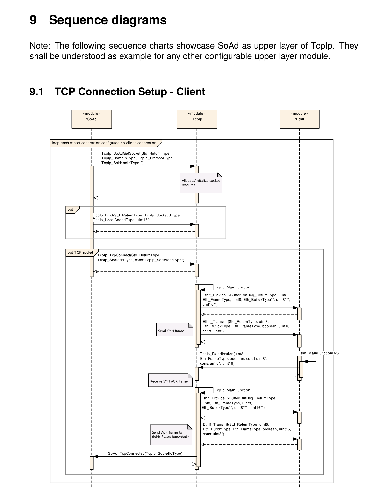

### 8.2. TCP连接建立——服务器

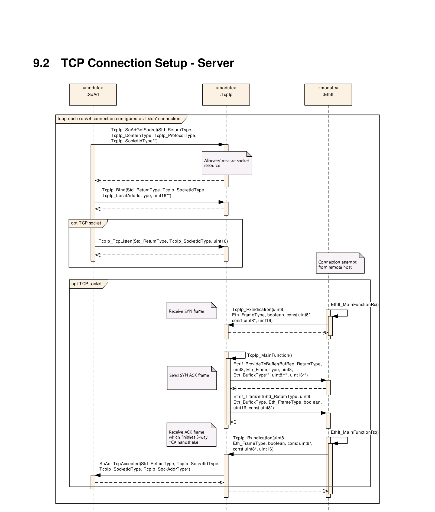

### 8.3. 接收

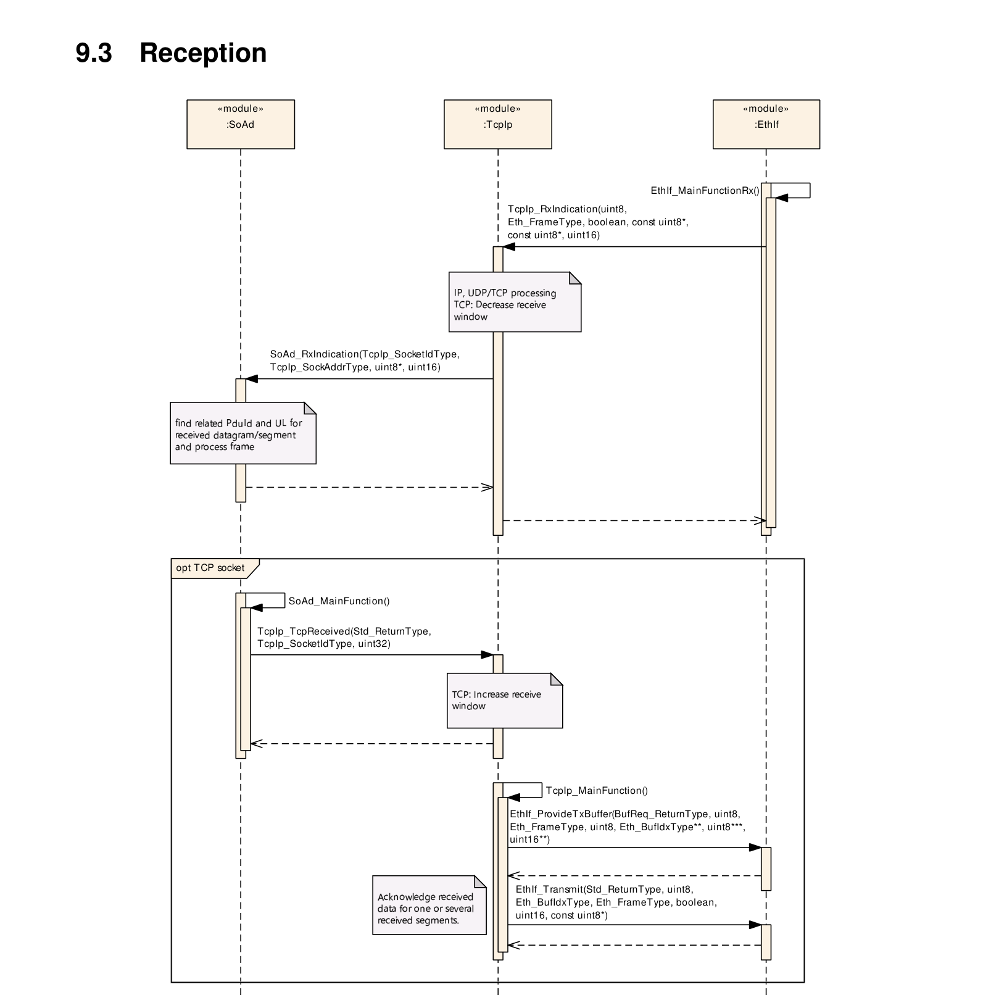

**注意：** 尽管在第[8.3](#83-接收)节的时序图中未显示，TcpIp可以在需要时解耦数据接收。例如，为了重组分片的传入IP数据报，TcpIp应将接收到的数据复制到TcpIp缓冲区，并将TcpIp\_RxIndication()与SoAd\_RxIndication()解耦。

### 8.4. 发送TCP

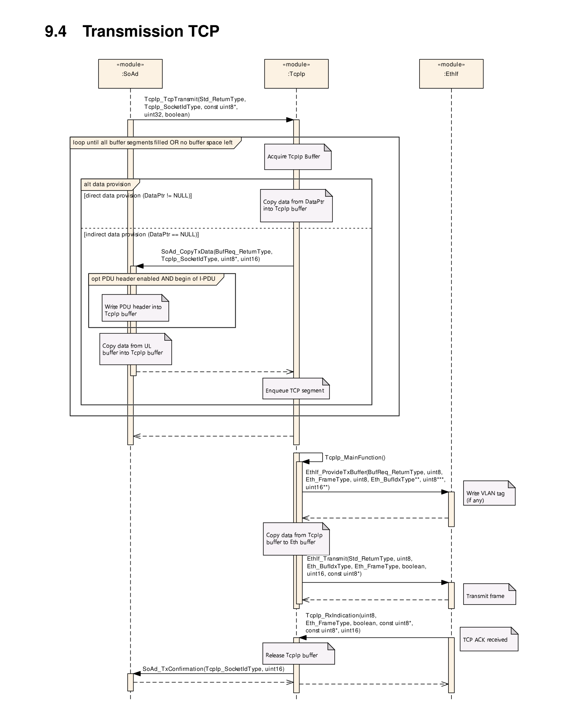

### 8.5. 发送UDP

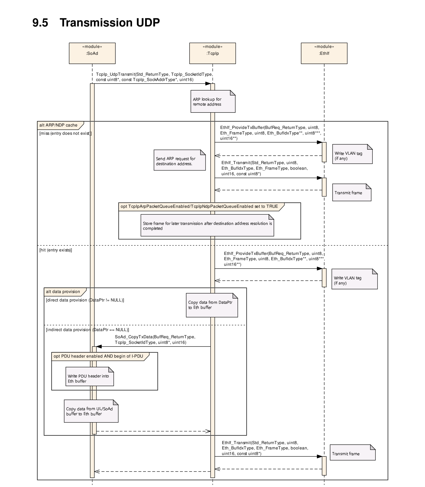

### 8.6. TLS服务器的连接建立

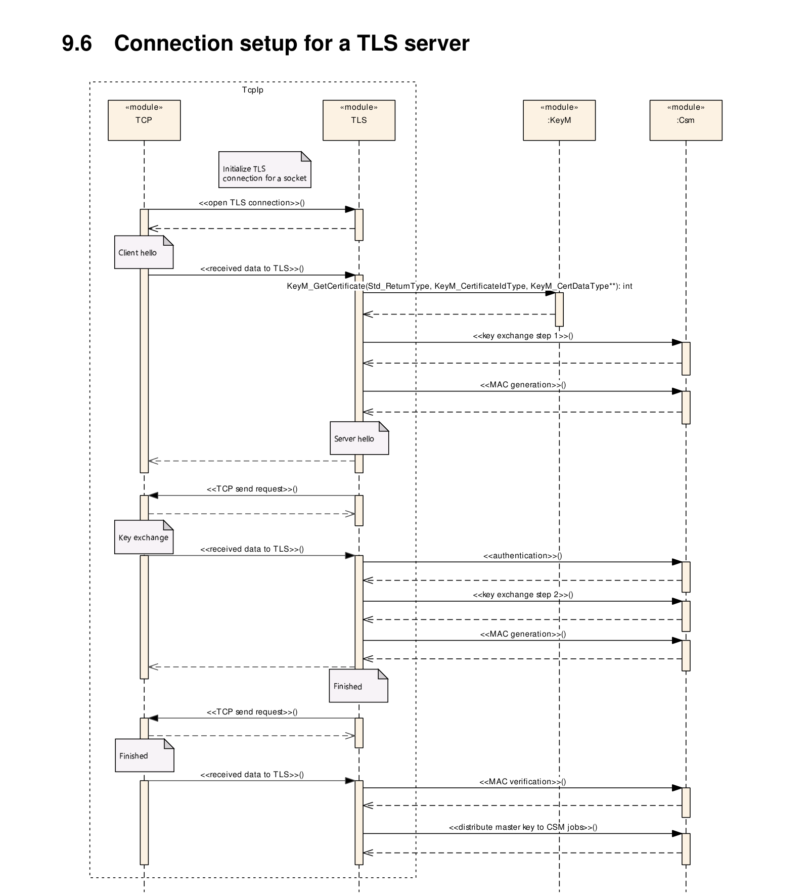

### 8.7. TLS连接到套接字的分配

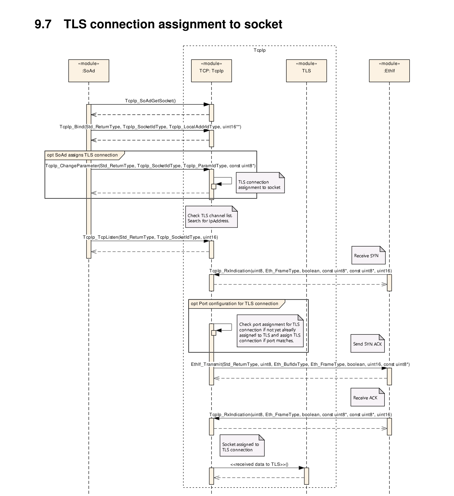

## 9. 配置规范

通常，本章定义配置参数及其到容器中的聚集。为支持本规范，第9.1节描述了基本原理。它还规定了应用于参数规范的模板（表）。我们打算将该节保留在规范中以保证可理解性。

第9.2节规定模块Tcp/Ip的结构（容器）和参数。

第9.3节规定模块Tcp/Ip的发布信息。

### 9.1. 如何阅读本章

详情请参阅SWS\_BSWGeneral的第10.1章「配置规范简介」。

### 9.2. 容器与配置参数

以下各章汇总了所有配置参数。参数的详细含义在第6章和第7章中描述。
#### 9.2.1. TcpIp

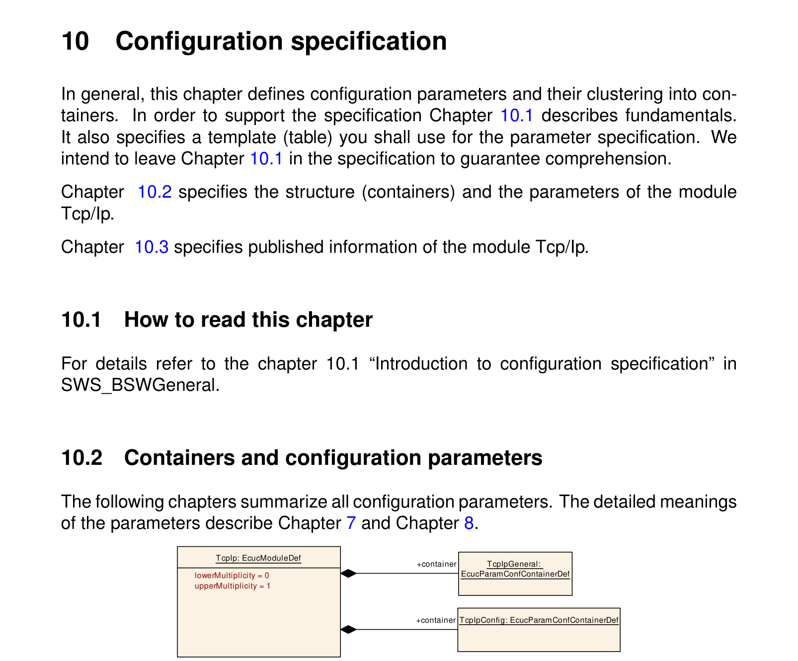

| 项目 | 内容 |
| --- | --- |
| SWS 条目 | [ECUC_TcpIp_00001] |
| 容器名称 | TcpIp |
| 描述 | TcpIp（TCP/IP协议栈）模块的配置。 |
| 配置参数 | 见下方参数表 |

| 包含的容器 | 容器名称 | 多重性 | 作用域/依赖 |
| --- | --- | --- | --- |
| 包含的容器 | TcpIpConfig | 1 | 见9.2.6节 |
| 包含的容器 | TcpIpGeneral | 1 | 见9.2.2节 |

#### 9.2.2. TcpIpGeneral

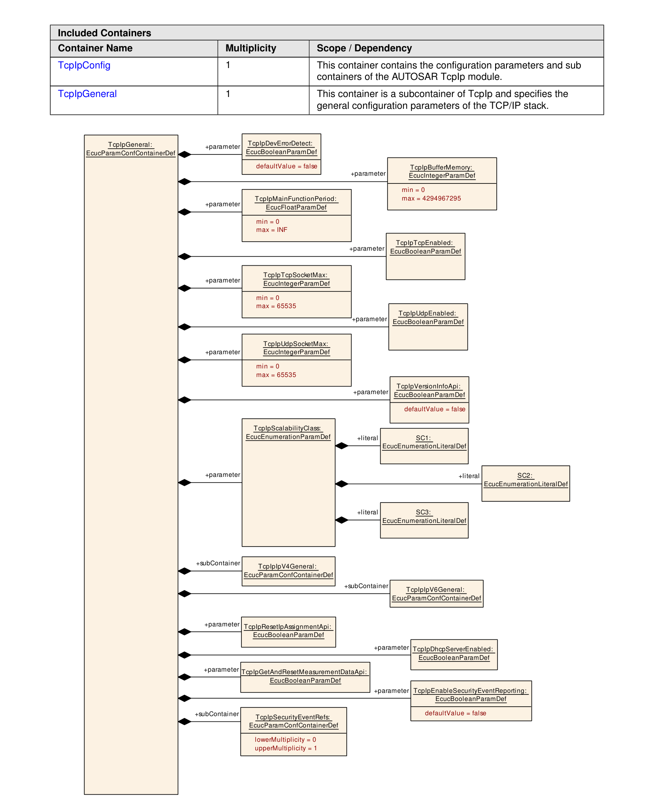

| 项目 | 内容 |
| --- | --- |
| SWS 条目 | [ECUC_TcpIp_00002] |
| 容器名称 | TcpIpGeneral |
| 父容器 | TcpIp |
| 描述 | 该容器是TcpIp的子容器，规定TCP/IP协议栈的通用配置参数。 |
| 配置参数 | 见下方参数表 |

| 包含的容器 | 容器名称 | 多重性 | 作用域/依赖 |
| --- | --- | --- | --- |
| 包含的容器 | TcpIpIpV4General | 1 | 见9.2.3节 |
| 包含的容器 | TcpIpIpV6General | 1 | 见9.2.4节 |
| 包含的容器 | TcpIpSecurityEventRefs | 0..1 | 见9.2.5节 |

| 项目 | 内容 |
| --- | --- |
| SWS 条目 | [ECUC_TcpIp_00016] |
| 参数名称 | TcpIpBufferMemory |
| 父容器 | TcpIpGeneral |
| 描述 | 为TCP/IP缓冲区预留的内存大小（字节）。 |
| 多重性 | 1 |
| 类型 | EcucIntegerParamDef |
| 范围 | 0 .. 4294967295 |
| 默认值 | - |
| Post-Build 变体值 | false |
| 值配置类 | Pre-compile time：X（VARIANT-PRE-COMPILE）；Link time：X（VARIANT-LINK-TIME, VARIANT-POST-BUILD）；Post-build time：- |
| 作用域/依赖 | scope: local |

| 项目 | 内容 |
| --- | --- |
| SWS 条目 | [ECUC_TcpIp_00004] |
| 参数名称 | TcpIpDevErrorDetect |
| 父容器 | TcpIpGeneral |
| 描述 | 开启或关闭开发错误检测与通知（**true**：启用检测与通知；**false**：禁用检测与通知）。 |
| 多重性 | 1 |
| 类型 | EcucBooleanParamDef |
| 默认值 | false |
| Post-Build 变体值 | false |
| 值配置类 | Pre-compile time：X（All Variants）；Link time：-；Post-build time：- |
| 作用域/依赖 | scope: local |

| 项目 | 内容 |
| --- | --- |
| SWS 条目 | [ECUC_TcpIp_00183] |
| 参数名称 | TcpIpDhcpServerEnabled |
| 父容器 | TcpIpGeneral |
| 描述 | 启用（TRUE）或禁用（FALSE）DHCP（动态主机配置协议）服务器。 |
| 多重性 | 1 |
| 类型 | EcucBooleanParamDef |
| 默认值 | - |
| 值配置类 | Pre-compile time：X（All Variants） |
| 作用域/依赖 | scope: local |

| 项目 | 内容 |
| --- | --- |
| SWS 条目 | [ECUC_TcpIp_00319] |
| 参数名称 | TcpIpEnableSecurityEventReporting |
| 父容器 | TcpIpGeneral |
| 描述 | 切换向IdsM的安全事件报告：- true：启用报告。- false：禁用报告。 |
| 多重性 | 1 |
| 类型 | EcucBooleanParamDef |
| 默认值 | false |
| Post-Build 变体值 | false |
| 值配置类 | Pre-compile time：X（All Variants）；Link time：-；Post-build time：- |
| 作用域/依赖 | scope: ECU |

| 项目 | 内容 |
| --- | --- |
| SWS 条目 | [ECUC_TcpIp_00217] |
| 参数名称 | TcpIpGetAndResetMeasurementDataApi |
| 父容器 | TcpIpGeneral |
| 描述 | 启用/禁用获取和重置测量数据API。 |
| 多重性 | 1 |
| 类型 | EcucBooleanParamDef |
| 默认值 | - |
| Post-Build 变体值 | false |
| 值配置类 | Pre-compile time：X（All Variants）；Link time：-；Post-build time：- |
| 作用域/依赖 | scope: local |

| 项目 | 内容 |
| --- | --- |
| SWS 条目 | [ECUC_TcpIp_00013] |
| 参数名称 | TcpIpMainFunctionPeriod |
| 父容器 | TcpIpGeneral |
| 描述 | TcpIp_MainFunction的周期，单位[s]。 |
| 多重性 | 1 |
| 类型 | EcucFloatParamDef |
| 范围 | ]0 .. INF[ |
| 默认值 | - |
| Post-Build 变体值 | false |
| 值配置类 | Pre-compile time：X（VARIANT-PRE-COMPILE）；Link time：X（VARIANT-LINK-TIME, VARIANT-POST-BUILD）；Post-build time：- |
| 作用域/依赖 | scope: local |

| 项目 | 内容 |
| --- | --- |
| SWS 条目 | [ECUC_TcpIp_00182] |
| 参数名称 | TcpIpResetIpAssignmentApi |
| 父容器 | TcpIpGeneral |
| 描述 | 启用/禁用DHCP客户端的API TcpIp_ResetIpAssignment。 |
| 多重性 | 1 |
| 类型 | EcucBooleanParamDef |
| 默认值 | - |
| 值配置类 | Pre-compile time：X（All Variants）；Link time：-；Post-build time：- |
| 作用域/依赖 | scope: local |

| 项目 | 内容 |
| --- | --- |
| SWS 条目 | [ECUC_TcpIp_00169] |
| 参数名称 | TcpIpScalabilityClass |
| 父容器 | TcpIpGeneral |
| 描述 | 为了使TcpIp协议栈适应用户的特定需求，可以按照可伸缩性类别对其进行伸缩。 |
| 多重性 | 1 |
| 类型 | EcucEnumerationParamDef |
| 范围 | SC1；SC2；SC3 |
| Post-Build 变体值 | false |
| 值配置类 | Pre-compile time：X（All Variants）；Link time：-；Post-build time：- |
| 作用域/依赖 | scope: local |

| 项目 | 内容 |
| --- | --- |
| SWS 条目 | [ECUC_TcpIp_00008] |
| 参数名称 | TcpIpTcpEnabled |
| 父容器 | TcpIpGeneral |
| 描述 | 启用（TRUE）或禁用（FALSE）对TCP（传输控制协议）的支持。 |
| 多重性 | 1 |
| 类型 | EcucBooleanParamDef |
| 默认值 | - |
| Post-Build 变体值 | false |
| 值配置类 | Pre-compile time：X（All Variants）；Link time：-；Post-build time：- |
| 作用域/依赖 | scope: local |

| 项目 | 内容 |
| --- | --- |
| SWS 条目 | [ECUC_TcpIp_00014] |
| 参数名称 | TcpIpTcpSocketMax |
| 父容器 | TcpIpGeneral |
| 描述 | TCP套接字的最大数量。 |
| 多重性 | 1 |
| 类型 | EcucIntegerParamDef |
| 范围 | 0 .. 65535 |
| 默认值 | - |
| Post-Build 变体值 | false |
| 值配置类 | Pre-compile time：X（VARIANT-PRE-COMPILE）；Link time：X（VARIANT-LINK-TIME, VARIANT-POST-BUILD）；Post-build time：- |
| 作用域/依赖 | scope: local |

| 项目 | 内容 |
| --- | --- |
| SWS 条目 | [ECUC_TcpIp_00009] |
| 参数名称 | TcpIpUdpEnabled |
| 父容器 | TcpIpGeneral |
| 描述 | 启用（TRUE）或禁用（FALSE）对UDP（用户数据报协议）的支持。 |
| 多重性 | 1 |
| 类型 | EcucBooleanParamDef |
| 默认值 | - |
| Post-Build 变体值 | false |
| 值配置类 | Pre-compile time：X（All Variants）；Link time：-；Post-build time：- |
| 作用域/依赖 | scope: local |

| 项目 | 内容 |
| --- | --- |
| SWS 条目 | [ECUC_TcpIp_00015] |
| 参数名称 | TcpIpUdpSocketMax |
| 父容器 | TcpIpGeneral |
| 描述 | UDP套接字的最大数量。 |
| 多重性 | 1 |
| 类型 | EcucIntegerParamDef |
| 范围 | 0 .. 65535 |
| 默认值 | - |
| Post-Build 变体值 | false |
| 值配置类 | Pre-compile time：X（VARIANT-PRE-COMPILE）；Link time：X（VARIANT-LINK-TIME, VARIANT-POST-BUILD）；Post-build time：- |
| 作用域/依赖 | scope: local |

| 项目 | 内容 |
| --- | --- |
| SWS 条目 | [ECUC_TcpIp_00005] |
| 参数名称 | TcpIpVersionInfoApi |
| 父容器 | TcpIpGeneral |
| 描述 | 如果为true，则TcpIp_GetVersionInfo API可用。 |
| 多重性 | 1 |
| 类型 | EcucBooleanParamDef |
| 默认值 | false |
| Post-Build 变体值 | false |
| 值配置类 | Pre-compile time：X（All Variants） |
| 作用域/依赖 | scope: local |

#### 9.2.3. TcpIpIpV4General

| 项目 | 内容 |
| --- | --- |
| SWS 条目 | [ECUC_TcpIp_00163] |
| 容器名称 | TcpIpIpV4General |
| 父容器 | TcpIpGeneral |
| 描述 | 该容器是TcpIp的子容器，规定TCP/IP协议栈针对IPv4的通用配置参数。 |
| 配置参数 | 见下方参数表 |

无包含的容器。

| 项目 | 内容 |
| --- | --- |
| SWS 条目 | [ECUC_TcpIp_00006] |
| 参数名称 | TcpIpArpEnabled |
| 父容器 | TcpIpIpV4General |
| 描述 | 启用（TRUE）或禁用（FALSE）对ARP（地址解析协议）的支持。 |
| 多重性 | 1 |
| 类型 | EcucBooleanParamDef |
| 默认值 | - |
| Post-Build 变体值 | false |
| 值配置类 | Pre-compile time：X（All Variants）；Link time：-；Post-build time：- |
| 作用域/依赖 | scope: local |

| 项目 | 内容 |
| --- | --- |
| SWS 条目 | [ECUC_TcpIp_00011] |
| 参数名称 | TcpIpAutoIpEnabled |
| 父容器 | TcpIpIpV4General |
| 描述 | 启用（TRUE）或禁用（FALSE）Auto-IP（自动专用IP寻址）子模块。 |
| 多重性 | 1 |
| 类型 | EcucBooleanParamDef |
| 默认值 | - |
| Post-Build 变体值 | false |
| 值配置类 | Pre-compile time：X（All Variants）；Link time：-；Post-build time：- |
| 作用域/依赖 | scope: local |

| 项目 | 内容 |
| --- | --- |
| SWS 条目 | [ECUC_TcpIp_00010] |
| 参数名称 | TcpIpDhcpClientEnabled |
| 父容器 | TcpIpIpV4General |
| 描述 | 启用（TRUE）或禁用（FALSE）DHCP（动态主机配置协议）客户端。 |
| 多重性 | 1 |
| 类型 | EcucBooleanParamDef |
| 默认值 | - |
| Post-Build 变体值 | false |
| 值配置类 | Pre-compile time：X（All Variants）；Link time：-；Post-build time：- |
| 作用域/依赖 | scope: local |

| 项目 | 内容 |
| --- | --- |
| SWS 条目 | [ECUC_TcpIp_00007] |
| 参数名称 | TcpIpIcmpEnabled |
| 父容器 | TcpIpIpV4General |
| 描述 | 启用（TRUE）或禁用（FALSE）对ICMP（互联网控制消息协议）的支持。 |
| 多重性 | 1 |
| 类型 | EcucBooleanParamDef |
| 默认值 | - |
| Post-Build 变体值 | false |
| 值配置类 | Pre-compile time：X（All Variants）；Link time：-；Post-build time：- |
| 作用域/依赖 | scope: local |

| 项目 | 内容 |
| --- | --- |
| SWS 条目 | [ECUC_TcpIp_00088] |
| 参数名称 | TcpIpIpV4Enabled |
| 父容器 | TcpIpIpV4General |
| 描述 | 启用（TRUE）或禁用（FALSE）对IPv4（互联网协议版本4）的支持。 |
| 多重性 | 1 |
| 类型 | EcucBooleanParamDef |
| 默认值 | - |
| Post-Build 变体值 | false |
| 值配置类 | Pre-compile time：X（All Variants）；Link time：-；Post-build time：- |
| 作用域/依赖 | scope: local |

| 项目 | 内容 |
| --- | --- |
| SWS 条目 | [ECUC_TcpIp_00018] |
| 参数名称 | TcpIpLocalAddrIpv4EntriesMax |
| 父容器 | TcpIpIpV4General |
| 描述 | IPv4的LocalAddr表条目的最大数量。 |
| 多重性 | 1 |
| 类型 | EcucIntegerParamDef |
| 范围 | 0 .. 255 |
| 默认值 | - |
| Post-Build 变体值 | false |
| 值配置类 | Pre-compile time：X（VARIANT-PRE-COMPILE）；Link time：X（VARIANT-LINK-TIME, VARIANT-POST-BUILD）；Post-build time：- |
| 作用域/依赖 | scope: local |

| 项目 | 内容 |
| --- | --- |
| SWS 条目 | [ECUC_TcpIp_00012] |
| 参数名称 | TcpIpPathMtuDiscoveryEnabled |
| 父容器 | TcpIpIpV4General |
| 描述 | 启用（TRUE）或禁用（FALSE）按照IETF RFC 1191进行的路径最大传输单元发现。 |
| 多重性 | 1 |
| 类型 | EcucBooleanParamDef |
| 默认值 | - |
| Post-Build 变体值 | false |
| 值配置类 | Pre-compile time：X（All Variants）；Link time：-；Post-build time：- |
| 作用域/依赖 | scope: local |

#### 9.2.4. TcpIpIpV6General

| 项目 | 内容 |
| --- | --- |
| SWS 条目 | [ECUC_TcpIp_00164] |
| 容器名称 | TcpIpIpV6General |
| 父容器 | TcpIpGeneral |
| 描述 | 该容器是TcpIp的子容器，规定TCP/IP协议栈针对IPv6的通用配置参数。 |
| 配置参数 | 见下方参数表 |

无包含的容器。

| 项目 | 内容 |
| --- | --- |
| SWS 条目 | [ECUC_TcpIp_00093] |
| 参数名称 | TcpIpDhcpV6ClientEnabled |
| 父容器 | TcpIpIpV6General |
| 描述 | 启用（TRUE）或禁用（FALSE）DHCPv6（IPv6动态主机配置协议）客户端。 |
| 多重性 | 1 |
| 类型 | EcucBooleanParamDef |
| 默认值 | - |
| Post-Build 变体值 | false |
| 值配置类 | Pre-compile time：X（All Variants）；Link time：-；Post-build time：- |
| 作用域/依赖 | scope: local |

| 项目 | 内容 |
| --- | --- |
| SWS 条目 | [ECUC_TcpIp_00089] |
| 参数名称 | TcpIpIpV6Enabled |
| 父容器 | TcpIpIpV6General |
| 描述 | 启用（TRUE）或禁用（FALSE）对IPv6（互联网协议版本6）的支持。 |
| 多重性 | 1 |
| 类型 | EcucBooleanParamDef |
| 默认值 | - |
| Post-Build 变体值 | false |
| 值配置类 | Pre-compile time：X（All Variants）；Link time：-；Post-build time：- |
| 作用域/依赖 | scope: local |

| 项目 | 内容 |
| --- | --- |
| SWS 条目 | [ECUC_TcpIp_00090] |
| 参数名称 | TcpIpIpV6PathMtuDiscoveryEnabled |
| 父容器 | TcpIpIpV6General |
| 描述 | 启用（TRUE）或禁用（FALSE）按照IETF RFC 1981的IPv6路径MTU发现支持。 |
| 多重性 | 1 |
| 类型 | EcucBooleanParamDef |
| 默认值 | - |
| Post-Build 变体值 | false |
| 值配置类 | Pre-compile time：X（All Variants）；Link time：-；Post-build time：- |
| 作用域/依赖 | scope: local |

| 项目 | 内容 |
| --- | --- |
| SWS 条目 | [ECUC_TcpIp_00017] |
| 参数名称 | TcpIpLocalAddrIpv6EntriesMax |
| 父容器 | TcpIpIpV6General |
| 描述 | IPv6的LocalAddr表条目的最大数量。 |
| 多重性 | 1 |
| 类型 | EcucIntegerParamDef |
| 范围 | 0 .. 255 |
| 默认值 | - |
| Post-Build 变体值 | false |
| 值配置类 | Pre-compile time：X（VARIANT-PRE-COMPILE）；Link time：X（VARIANT-LINK-TIME, VARIANT-POST-BUILD）；Post-build time：- |
| 作用域/依赖 | scope: local |

| 项目 | 内容 |
| --- | --- |
| SWS 条目 | [ECUC_TcpIp_00091] |
| 参数名称 | TcpIpNdpAddressResolutionUnrechabilityDetectionEnabled |
| 父容器 | TcpIpIpV6General |
| 描述 | 启用（TRUE）或禁用（FALSE）通过NDP进行的地址解析和邻居不可达检测支持。 |
| 多重性 | 1 |
| 类型 | EcucBooleanParamDef |
| 默认值 | - |
| Post-Build 变体值 | false |
| 值配置类 | Pre-compile time：X（All Variants）；Link time：-；Post-build time：- |
| 作用域/依赖 | scope: local |

| 项目 | 内容 |
| --- | --- |
| SWS 条目 | [ECUC_TcpIp_00092] |
| 参数名称 | TcpIpNdpPrefixAndRouterDiscoveryEnabled |
| 父容器 | TcpIpIpV6General |
| 描述 | 启用（TRUE）或禁用（FALSE）通过NDP进行的前缀和路由器发现支持。 |
| 多重性 | 1 |
| 类型 | EcucBooleanParamDef |
| 默认值 | - |
| Post-Build 变体值 | false |
| 值配置类 | Pre-compile time：X（All Variants）；Link time：-；Post-build time：- |
| 作用域/依赖 | scope: local |

#### 9.2.5. TcpIpSecurityEventRefs

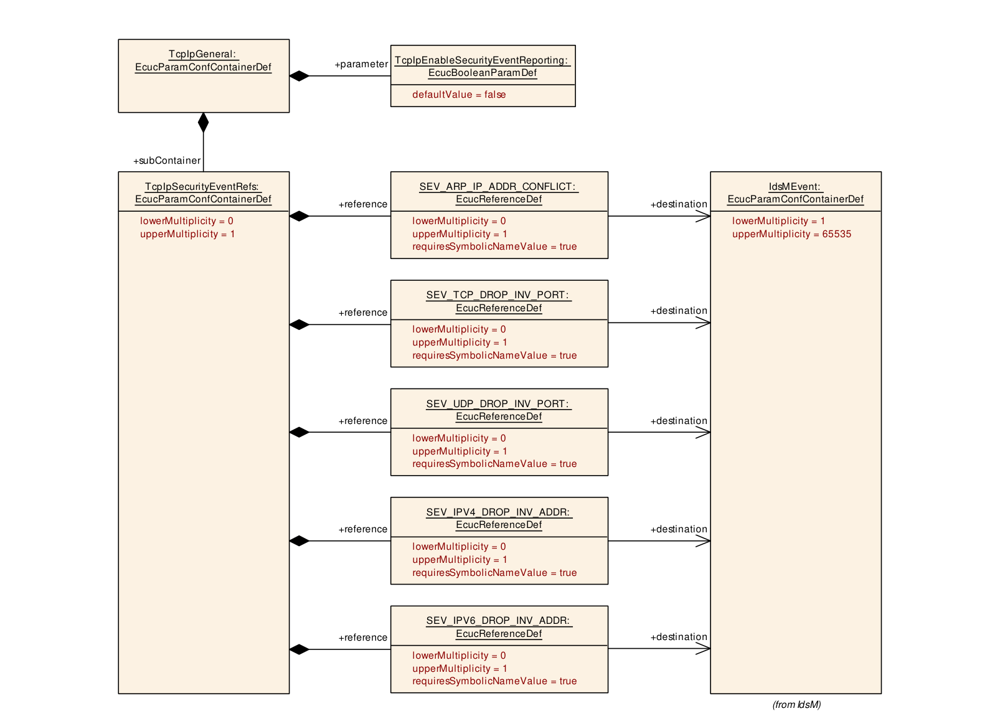

| 项目 | 内容 |
| --- | --- |
| SWS 条目 | [ECUC_TcpIp_00320] |
| 容器名称 | TcpIpSecurityEventRefs |
| 父容器 | TcpIpGeneral |
| 描述 | 包含对IdsMEvent元素的引用的容器，这些元素代表TcpIp模块在相应安全相关事件发生时（且如果TcpIpEnableSecurityEventReporting设置为「true」）应向IdsM报告的安全事件。该容器中的标准化安全事件可以通过供应商特定的安全事件进行扩展。 |
| 多重性配置类 | Pre-compile time：X（All Variants）；Link time：-；Post-build time：- |
| Post-Build 变体多重性 | false |
| 配置参数 | 见下方参数表 |

无包含的容器。

| 项目 | 内容 |
| --- | --- |
| SWS 条目 | [ECUC_TcpIp_00321] |
| 参数名称 | SEV_ARP_IP_ADDR_CONFLICT |
| 父容器 | TcpIpSecurityEventRefs |
| 描述 | 在ARP应答中接收到属于不同MAC的本地IP地址。 |
| 多重性 | 0..1 |
| 类型 | Symbolic name reference to IdsMEvent |
| Post-Build 变体多重性 | false |
| Post-Build 变体值 | false |
| 值配置类 | Pre-compile time：X；Link time：-；Post-build time：- |
| 多重性配置类 | Pre-compile time：X；Link time：-；Post-build time：- |
| 作用域/依赖 | scope: local |

| 项目 | 内容 |
| --- | --- |
| SWS 条目 | [ECUC_TcpIp_00324] |
| 参数名称 | SEV_IPV4_DROP_INV_ADDR |
| 父容器 | TcpIpSecurityEventRefs |
| 描述 | 由于无效的IPV4地址而丢弃数据报。 |
| 多重性 | 0..1 |
| 类型 | Symbolic name reference to IdsMEvent |
| Post-Build 变体多重性 | false |
| Post-Build 变体值 | false |
| 值配置类 | Pre-compile time：X；Link time：-；Post-build time：- |
| 多重性配置类 | Pre-compile time：X；Link time：-；Post-build time：- |
| 作用域/依赖 | scope: local |

| 项目 | 内容 |
| --- | --- |
| SWS 条目 | [ECUC_TcpIp_00325] |
| 参数名称 | SEV_IPV6_DROP_INV_ADDR |
| 父容器 | TcpIpSecurityEventRefs |
| 描述 | 由于无效的IPV6地址而丢弃数据报。 |
| 多重性 | 0..1 |
| 类型 | Symbolic name reference to IdsMEvent |
| Post-Build 变体多重性 | false |
| Post-Build 变体值 | false |
| 值配置类 | Pre-compile time：X（All Variants）；Link time：-；Post-build time：- |
| 多重性配置类 | Pre-compile time：X（All Variants）；Link time：-；Post-build time：- |
| 作用域/依赖 | scope: local |

| 项目 | 内容 |
| --- | --- |
| SWS 条目 | [ECUC_TcpIp_00322] |
| 参数名称 | SEV_TCP_DROP_INV_PORT |
| 父容器 | TcpIpSecurityEventRefs |
| 描述 | 由于无效的目标TCP端口而丢弃TCP数据包。 |
| 多重性 | 0..1 |
| 类型 | Symbolic name reference to IdsMEvent |
| Post-Build 变体多重性 | false |
| Post-Build 变体值 | false |
| 值配置类 | Pre-compile time：X；Link time：-；Post-build time：- |
| 多重性配置类 | Pre-compile time：X；Link time：-；Post-build time：- |
| 作用域/依赖 | scope: local |

| 项目 | 内容 |
| --- | --- |
| SWS 条目 | [ECUC_TcpIp_00323] |
| 参数名称 | SEV_UDP_DROP_INV_PORT |
| 父容器 | TcpIpSecurityEventRefs |
| 描述 | 由于无效的目标UDP端口而丢弃UDP数据包。 |
| 多重性 | 0..1 |
| 类型 | Symbolic name reference to IdsMEvent |
| Post-Build 变体多重性 | false |
| Post-Build 变体值 | false |
| 值配置类 | Pre-compile time：X；Link time：-；Post-build time：- |
| 多重性配置类 | Pre-compile time：X；Link time：-；Post-build time：- |
| 作用域/依赖 | scope: local |

#### 9.2.6. TcpIpConfig

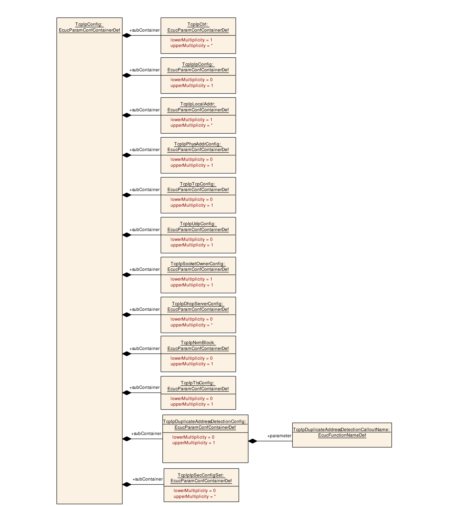

| 项目 | 内容 |
| --- | --- |
| SWS 条目 | [ECUC_TcpIp_00003] |
| 容器名称 | TcpIpConfig |
| 父容器 | TcpIp |
| 描述 | 该容器包含AUTOSAR TcpIp模块的配置参数和子容器。 |
| 配置参数 | 见下方参数表 |

| 包含的容器 | 容器名称 | 多重性 | 作用域/依赖 |
| --- | --- | --- | --- |
| 包含的容器 | TcpIpCtrl | 1..* | 见9.2.7节 |
| 包含的容器 | TcpIpDhcpServerConfig | 0..* | 见9.2.12节 |
| 包含的容器 | TcpIpIpConfig | 0..1 | 见9.2.15节 |
| 包含的容器 | TcpIpIpSecConfigSet | 0..* | 见9.2.55节 |
| 包含的容器 | TcpIpLocalAddr | 1..* | 见9.2.35节 |
| 包含的容器 | TcpIpNvmBlock | 0..1 | 见9.2.38节 |
| 包含的容器 | TcpIpPhysAddrConfig | 0..1 | 见9.2.39节 |
| 包含的容器 | TcpIpSocketOwnerConfig | 1 | 见9.2.41节 |
| 包含的容器 | TcpIpTcpConfig | 0..1 | 见9.2.43节 |
| 包含的容器 | TcpIpTlsConfig | 0..1 | 见9.2.46节 |
| 包含的容器 | TcpIpUdpConfig | 0..1 | 见9.2.45节 |

#### 9.2.7. TcpIpCtrl

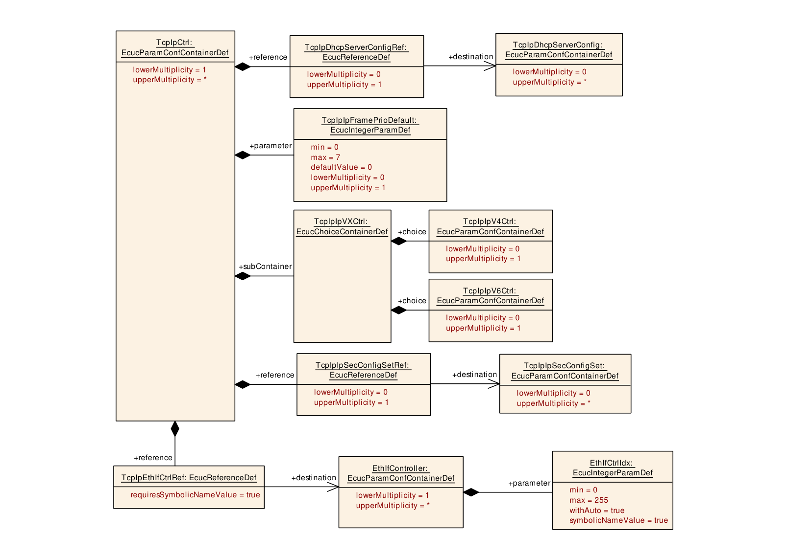

| 项目 | 内容 |
| --- | --- |
| SWS 条目 | [ECUC_TcpIp_00021] |
| 容器名称 | TcpIpCtrl |
| 父容器 | TcpIpConfig |
| 描述 | 规定用于IP通信的EthIf控制器。 |
| 配置参数 | 见下方参数表 |

| 包含的容器 | 容器名称 | 多重性 | 作用域/依赖 |
| --- | --- | --- | --- |

| 项目 | 内容 |
| --- | --- |
| SWS 条目 | [ECUC_TcpIp_00081] |
| 参数名称 | TcpIpIpFramePrioDefault |
| 父容器 | TcpIpCtrl |
| 描述 | 规定所有出站帧优先级的默认值。注意：可以通过TcpIp_ChangeParameter()服务为每个套接字单独更改该值。如果该可选参数不可用，则默认优先级使用0。 |
| 多重性 | 0..1 |
| 类型 | EcucIntegerParamDef |
| 默认值 | 0 |
| Post-Build 变体多重性 | true |
| Post-Build 变体值 | true |
| 值配置类 | Pre-compile time：X（VARIANT-PRE-COMPILE）；Link time：X（VARIANT-LINK-TIME）；Post-build time：X（VARIANT-POST-BUILD） |
| 多重性配置类 | Pre-compile time：X（VARIANT-PRE-COMPILE）；Link time：X（VARIANT-LINK-TIME）；Post-build time：X（VARIANT-POST-BUILD） |
| 作用域/依赖 | scope: local |

| 项目 | 内容 |
| --- | --- |
| SWS 条目 | [ECUC_TcpIp_00195] |
| 参数名称 | TcpIpDhcpServerConfigRef |
| 父容器 | TcpIpCtrl |
| 描述 | 对此控制器设置（VLAN）应使用的TcpIpDhcpServerConfig的引用。 |
| 多重性 | 0..1 |
| 类型 | Reference to TcpIpDhcpServerConfig |
| Post-Build 变体值 | true |
| 值配置类 | Pre-compile time：X（VARIANT-PRE-COMPILE）；Link time：X（VARIANT-LINK-TIME）；Post-build time：X（VARIANT-POST-BUILD） |
| 作用域/依赖 | scope: local |

| 项目 | 内容 |
| --- | --- |
| SWS 条目 | [ECUC_TcpIp_00041] |
| 参数名称 | TcpIpEthIfCtrlRef |
| 父容器 | TcpIpCtrl |
| 描述 | 对IP地址应分配到的EthIf控制器的引用。 |
| 多重性 | 1 |
| 类型 | Symbolic name reference to EthIfController |
| Post-Build 变体值 | true |
| 值配置类 | Pre-compile time：X（VARIANT-PRE-COMPILE）；Link time：X（VARIANT-LINK-TIME）；Post-build time：X（VARIANT-POST-BUILD） |
| 作用域/依赖 | scope: local |

| 项目 | 内容 |
| --- | --- |
| SWS 条目 | [ECUC_TcpIp_00315] |
| 参数名称 | TcpIpIpSecConfigSetRef |
| 父容器 | TcpIpCtrl |
| 描述 | 对IPsec应使用的SDP条目集合的引用。 |
| 多重性 | 0..1 |
| 类型 | Reference to TcpIpIpSecConfigSet |
| Post-Build 变体多重性 | false |
| Post-Build 变体值 | false |
| 值配置类 | Pre-compile time：X（All Variants）；Link time：-；Post-build time：- |
| 多重性配置类 | Pre-compile time：X（All Variants）；Link time：-；Post-build time：- |
| 作用域/依赖 | scope: local |

#### 9.2.8. TcpIpIpV4Ctrl

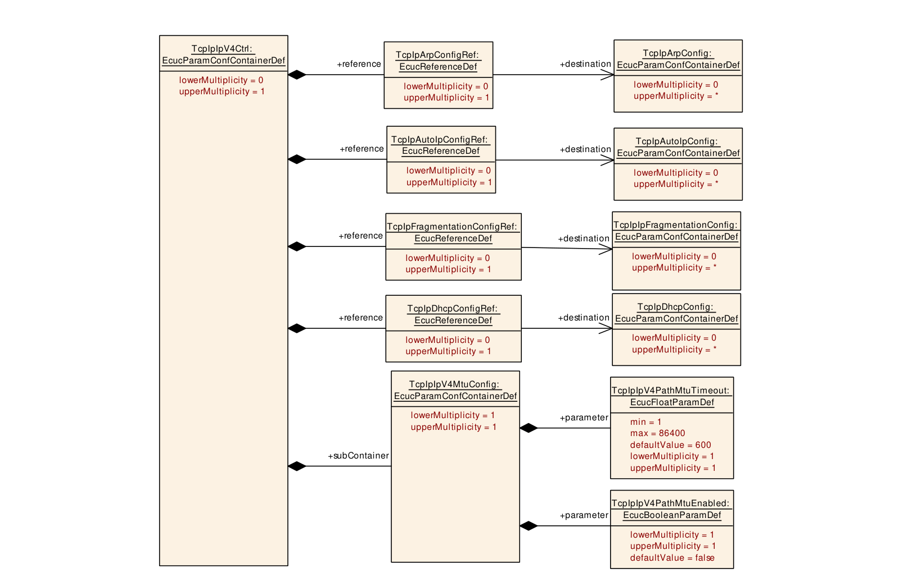

| 项目 | 内容 |
| --- | --- |
| SWS 条目 | [ECUC_TcpIp_00166] |
| 容器名称 | TcpIpIpV4Ctrl |
| 父容器 | TcpIpIpVXCtrl |
| 描述 | 规定一个互联网协议版本4（IPv4）实例。 |
| 配置参数 | 见下方参数表 |

| 包含的容器 | 容器名称 | 多重性 | 作用域/依赖 |
| --- | --- | --- | --- |
| 包含的容器 | TcpIpIpV4MtuConfig | 1 | 见9.2.9节 |

| 项目 | 内容 |
| --- | --- |
| SWS 条目 | [ECUC_TcpIp_00097] |
| 参数名称 | TcpIpArpConfigRef |
| 父容器 | TcpIpIpV4Ctrl |
| 描述 | 对此IPv4实例的ARP配置的引用。（多个IPv4实例可以使用相同的配置容器，但将独立运行） |
| 多重性 | 0..1 |
| 类型 | Reference to TcpIpArpConfig |
| Post-Build 变体多重性 | false |
| Post-Build 变体值 | false |
| 值配置类 | Pre-compile time：X（All Variants）；Link time：-；Post-build time：- |
| 多重性配置类 | Pre-compile time：X（All Variants）；Link time：- |
| 作用域/依赖 | scope: local |

| 项目 | 内容 |
| --- | --- |
| SWS 条目 | [ECUC_TcpIp_00098] |
| 参数名称 | TcpIpAutoIpConfigRef |
| 父容器 | TcpIpIpV4Ctrl |
| 描述 | 对此IPv4实例的AutoIp配置的引用。（多个IPv4实例可以使用相同的配置容器，但将独立运行） |
| 多重性 | 0..1 |
| 类型 | Reference to TcpIpAutoIpConfig |
| Post-Build 变体多重性 | false |
| Post-Build 变体值 | false |
| 值配置类 | Pre-compile time：X；Link time：-；Post-build time：- |
| 多重性配置类 | Pre-compile time：X；Link time：-；Post-build time：- |
| 作用域/依赖 | scope: local |

| 项目 | 内容 |
| --- | --- |
| SWS 条目 | [ECUC_TcpIp_00100] |
| 参数名称 | TcpIpDhcpConfigRef |
| 父容器 | TcpIpIpV4Ctrl |
| 描述 | 对此IPv4实例的DHCP配置的引用。（多个IPv4实例可以使用相同的配置容器，但将独立运行） |
| 多重性 | 0..1 |
| 类型 | Reference to TcpIpDhcpConfig |
| Post-Build 变体多重性 | false |
| Post-Build 变体值 | false |
| 值配置类 | Pre-compile time：X；Link time：-；Post-build time：- |
| 多重性配置类 | Pre-compile time：X；Link time：-；Post-build time：- |
| 作用域/依赖 | scope: local |

| 项目 | 内容 |
| --- | --- |
| SWS 条目 | [ECUC_TcpIp_00099] |
| 参数名称 | TcpIpFragmentationConfigRef |
| 父容器 | TcpIpIpV4Ctrl |
| 描述 | 对此IPv4实例的分片配置的引用。（多个IPv4实例可以使用相同的配置容器，但将独立运行） |
| 多重性 | 0..1 |
| 类型 | Reference to TcpIpIpFragmentationConfig |
| Post-Build 变体多重性 | false |
| Post-Build 变体值 | false |
| 值配置类 | Pre-compile time：X（All Variants）；Link time：-；Post-build time：- |
| 多重性配置类 | Pre-compile time：X（All Variants）；Link time：-；Post-build time：- |
| 作用域/依赖 | scope: local |

#### 9.2.9. TcpIpIpV4MtuConfig

| 项目 | 内容 |
| --- | --- |
| SWS 条目 | [ECUC_TcpIp_00209] |
| 容器名称 | TcpIpIpV4MtuConfig |
| 父容器 | TcpIpIpV4Ctrl |
| 描述 | 该容器规定此IPv4实例的最大传输单元参数。 |
| 配置参数 | 见下方参数表 |

无包含的容器。

| 项目 | 内容 |
| --- | --- |
| SWS 条目 | [ECUC_TcpIp_00211] |
| 参数名称 | TcpIpIpV4PathMtuEnabled |
| 父容器 | TcpIpIpV4MtuConfig |
| 描述 | 如果启用，IPv4将处理传入的ICMPv4「Packet Too Big」消息，并为每个目标地址存储一个MTU值。 |
| 多重性 | 1 |
| 类型 | EcucBooleanParamDef |
| 默认值 | false |
| Post-Build 变体值 | false |
| 值配置类 | Pre-compile time：X（All Variants）；Link time：-；Post-build time：- |
| 作用域/依赖 | scope: local |

| 项目 | 内容 |
| --- | --- |
| SWS 条目 | [ECUC_TcpIp_00210] |
| 参数名称 | TcpIpIpV4PathMtuTimeout |
| 父容器 | TcpIpIpV4MtuConfig |
| 描述 | 如果该值>0，IPv4将在n秒后重置为每个目标存储的MTU值。见[RFC1191 6.3. Purging stale PMTU information]。默认值：600秒（10分钟）。 |
| 多重性 | 1 |

#### 9.2.10. TcpIpIpV6Ctrl

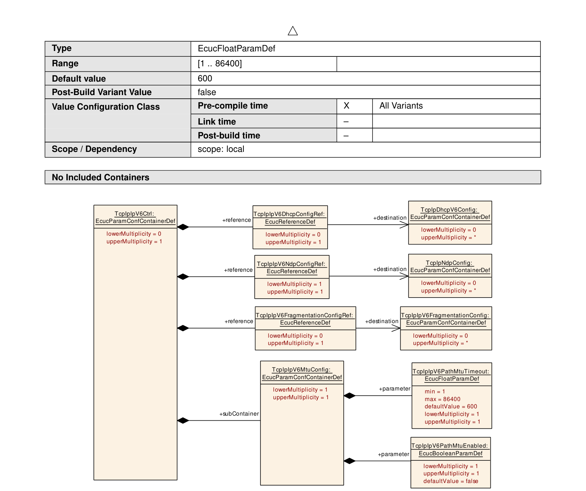

| 项目 | 内容 |
| --- | --- |
| SWS 条目 | [ECUC_TcpIp_00096] |
| 容器名称 | TcpIpIpV6Ctrl |
| 父容器 | TcpIpIpVXCtrl |
| 描述 | 规定一个互联网协议版本6（IPv6）实例。 |
| Post-Build 变体值 | false |
| 配置参数 | 见下方参数表 |

| 包含的容器 | 容器名称 | 多重性 | 作用域/依赖 |
| --- | --- | --- | --- |
| 包含的容器 | TcpIpIpV6MtuConfig | 1 | 见9.2.11节 |

| 项目 | 内容 |
| --- | --- |
| SWS 条目 | [ECUC_TcpIp_00101] |
| 参数名称 | TcpIpIpV6DhcpConfigRef |
| 父容器 | TcpIpIpV6Ctrl |
| 描述 | 对DHCPv6配置的引用。（多个IPv6实例可以使用相同的配置容器，但将独立运行） |
| 多重性 | 0..1 |
| 类型 | Reference to TcpIpDhcpV6Config |
| Post-Build 变体多重性 | false |
| Post-Build 变体值 | false |
| 值配置类 | Pre-compile time：X；Link time：-；Post-build time：- |
| 多重性配置类 | Pre-compile time：X；Link time：-；Post-build time：- |
| 作用域/依赖 | scope: local |

| 项目 | 内容 |
| --- | --- |
| SWS 条目 | [ECUC_TcpIp_00103] |
| 参数名称 | TcpIpIpV6FragmentationConfigRef |
| 父容器 | TcpIpIpV6Ctrl |
| 描述 | 对IPv6分片配置的引用。（多个IPv6实例可以使用相同的配置容器，但将独立运行） |
| 多重性 | 0..1 |
| 类型 | Reference to TcpIpIpV6FragmentationConfig |
| Post-Build 变体多重性 | false |
| Post-Build 变体值 | false |
| 值配置类 | Pre-compile time：X；Link time：-；Post-build time：- |
| 多重性配置类 | Pre-compile time：X；Link time：-；Post-build time：- |
| 作用域/依赖 | scope: local |

| 项目 | 内容 |
| --- | --- |
| SWS 条目 | [ECUC_TcpIp_00102] |
| 参数名称 | TcpIpIpV6NdpConfigRef |
| 父容器 | TcpIpIpV6Ctrl |
| 描述 | 对邻居发现协议配置的引用。（多个IPv6实例可以使用相同的配置容器，但将独立运行） |
| 多重性 | 1 |
| 类型 | Reference to TcpIpNdpConfig |
| Post-Build 变体值 | false |
| 值配置类 | Pre-compile time：X（All Variants）；Link time：-；Post-build time：- |
| 作用域/依赖 | scope: local |

#### 9.2.11. TcpIpIpV6MtuConfig

| 项目 | 内容 |
| --- | --- |
| SWS 条目 | [ECUC_TcpIp_00104] |
| 容器名称 | TcpIpIpV6MtuConfig |
| 父容器 | TcpIpIpV6Ctrl |
| 描述 | 该容器规定此IPv6实例的最大传输单元参数。 |
| 配置参数 | 见下方参数表 |

无包含的容器。

| 项目 | 内容 |
| --- | --- |
| SWS 条目 | [ECUC_TcpIp_00107] |
| 参数名称 | TcpIpIpV6PathMtuEnabled |
| 父容器 | TcpIpIpV6MtuConfig |
| 描述 | 如果启用，IPv6将处理传入的ICMPv6「Packet Too Big」消息，并为每个目标地址存储一个MTU值。关于PathMTU的详情见RFC1981「Path MTU Discovery for IP version 6」。 |
| 多重性 | 1 |
| 类型 | EcucBooleanParamDef |
| 默认值 | false |
| Post-Build 变体值 | false |
| 值配置类 | Pre-compile time：X（All Variants）；Link time：-；Post-build time：- |
| 作用域/依赖 | scope: local |

| 项目 | 内容 |
| --- | --- |
| SWS 条目 | [ECUC_TcpIp_00105] |
| 参数名称 | TcpIpIpV6PathMtuTimeout |
| 父容器 | TcpIpIpV6MtuConfig |
| 描述 | 如果该值>0，IPv6将在n秒后重置为每个目标存储的MTU值。见[RFC1981 5.3. Purging stale PMTU information]。默认值：600秒（10分钟）。 |
| 多重性 | 1 |
| 类型 | EcucFloatParamDef |
| 范围 | [1 .. 86400] |
| 默认值 | 600 |
| Post-Build 变体值 | false |
| 值配置类 | Pre-compile time：X（All Variants）；Link time：-；Post-build time：- |
| 作用域/依赖 | scope: local |

#### 9.2.12. TcpIpDhcpServerConfig

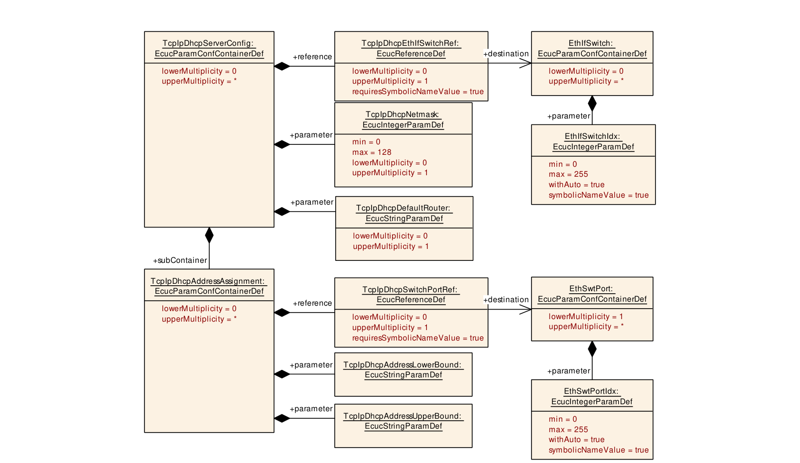

| 项目 | 内容 |
| --- | --- |
| SWS 条目 | [ECUC_TcpIp_00187] |
| 容器名称 | TcpIpDhcpServerConfig |
| 父容器 | TcpIpConfig |
| 描述 | 规定DHCP服务器子模块的配置参数。 |
| 多重性配置类 | Pre-compile time：X（VARIANT-PRE-COMPILE）；Link time：X（VARIANT-LINK-TIME）；Post-build time：X（VARIANT-POST-BUILD） |
| Post-Build 变体多重性 | true |
| 配置参数 | 见下方参数表 |

| 包含的容器 | 容器名称 | 多重性 | 作用域/依赖 |
| --- | --- | --- | --- |
| 包含的容器 | TcpIpDhcpAddressAssignment | 0..* | 见9.2.13节 |

| 项目 | 内容 |
| --- | --- |
| SWS 条目 | [ECUC_TcpIp_00190] |
| 参数名称 | TcpIpDhcpDefaultRouter |
| 父容器 | TcpIpDhcpServerConfig |
| 描述 | 默认路由器（网关）的IP地址。 |
| 多重性 | 0..1 |
| 类型 | EcucStringParamDef |
| 默认值 | - |
| Post-Build 变体多重性 | true |
| Post-Build 变体值 | true |
| 值配置类 | Pre-compile time：X（VARIANT-PRE-COMPILE）；Link time：X（VARIANT-LINK-TIME）；Post-build time：X（VARIANT-POST-BUILD） |
| 多重性配置类 | Pre-compile time：X（VARIANT-PRE-COMPILE）；Link time：X（VARIANT-LINK-TIME）；Post-build time：X（VARIANT-POST-BUILD） |
| 作用域/依赖 | scope: local |

| 项目 | 内容 |
| --- | --- |
| SWS 条目 | [ECUC_TcpIp_00189] |
| 参数名称 | TcpIpDhcpNetmask |
| 父容器 | TcpIpDhcpServerConfig |
| 描述 | IPv4地址的网络掩码或IPv6地址的CIDR表示法地址前缀，即描述定义IP地址网络号或前缀的有效位数的十进制值，介于0和32（IPv4）或0和128（IPv6）之间。 |
| 多重性 | 0..1 |
| 类型 | EcucIntegerParamDef |
| 范围 | 0 .. 128 |
| 默认值 | - |
| Post-Build 变体多重性 | true |
| Post-Build 变体值 | true |
| 值配置类 | Pre-compile time：X（VARIANT-PRE-COMPILE）；Link time：X（VARIANT-LINK-TIME）；Post-build time：X（VARIANT-POST-BUILD） |
| 多重性配置类 | Pre-compile time：X（VARIANT-PRE-COMPILE）；Link time：X（VARIANT-LINK-TIME）；Post-build time：X（VARIANT-POST-BUILD） |
| 作用域/依赖 | scope: local |

| 项目 | 内容 |
| --- | --- |
| SWS 条目 | [ECUC_TcpIp_00188] |
| 参数名称 | TcpIpDhcpEthIfSwitchRef |
| 父容器 | TcpIpDhcpServerConfig |
| 描述 | 对EthIfSwitch表示形式的引用。在DHCP服务器在没有以太网交换机的情况下运行时可选。 |
| 多重性 | 0..1 |
| 类型 | Symbolic name reference to EthIfSwitch |
| Post-Build 变体多重性 | true |
| Post-Build 变体值 | true |
| 值配置类 | Pre-compile time：X（VARIANT-PRE-COMPILE）；Link time：X（VARIANT-LINK-TIME）；Post-build time：X（VARIANT-POST-BUILD） |
| 多重性配置类 | Pre-compile time：X（VARIANT-PRE-COMPILE）；Link time：X（VARIANT-LINK-TIME）；Post-build time：X（VARIANT-POST-BUILD） |
| 作用域/依赖 | scope: ECU |

#### 9.2.13. TcpIpDhcpAddressAssignment

| 项目 | 内容 |
| --- | --- |
| SWS 条目 | [ECUC_TcpIp_00191] |
| 容器名称 | TcpIpDhcpAddressAssignment |
| 父容器 | TcpIpDhcpServerConfig |
| 描述 | 定义基于以太网交换机端口的IP地址分配。 |
| 多重性配置类 | Pre-compile time：X（VARIANT-PRE-COMPILE）；Link time：X（VARIANT-LINK-TIME）；Post-build time：X（VARIANT-POST-BUILD） |
| Post-Build 变体多重性 | true |
| 配置参数 | 见下方参数表 |

无包含的容器。

| 项目 | 内容 |
| --- | --- |
| SWS 条目 | [ECUC_TcpIp_00193] |
| 参数名称 | TcpIpDhcpAddressLowerBound |
| 父容器 | TcpIpDhcpAddressAssignment |
| 描述 | 应分配的下界IP地址。如果下界和上界相同，则精确分配该IP地址。 |
| 多重性 | 1 |
| 类型 | EcucStringParamDef |
| 默认值 | - |
| Post-Build 变体值 | true |
| 值配置类 | Pre-compile time：X（VARIANT-PRE-COMPILE）；Link time：X（VARIANT-LINK-TIME）；Post-build time：X（VARIANT-POST-BUILD） |
| 作用域/依赖 | scope: local |

| 项目 | 内容 |
| --- | --- |
| SWS 条目 | [ECUC_TcpIp_00194] |
| 参数名称 | TcpIpDhcpAddressUpperBound |
| 父容器 | TcpIpDhcpAddressAssignment |
| 描述 | 应分配的上界IP地址。如果下界和上界相同，则精确分配该IP地址。 |
| 多重性 | 1 |
| 类型 | EcucStringParamDef |
| 默认值 | - |
| Post-Build 变体值 | true |
| 值配置类 | Pre-compile time：X（VARIANT-PRE-COMPILE）；Link time：X（VARIANT-LINK-TIME）；Post-build time：X（VARIANT-POST-BUILD） |
| 作用域/依赖 | scope: local |

| 项目 | 内容 |
| --- | --- |
| SWS 条目 | [ECUC_TcpIp_00192] |
| 参数名称 | TcpIpDhcpSwitchPortRef |
| 父容器 | TcpIpDhcpAddressAssignment |
| 描述 | 对以太网交换机端口的引用。在DHCP服务器在没有以太网交换机的情况下运行时可选。 |
| 多重性 | 0..1 |
| 类型 | Symbolic name reference to EthSwtPort |
| Post-Build 变体多重性 | true |
| Post-Build 变体值 | true |
| 值配置类 | Pre-compile time：X（VARIANT-PRE-COMPILE）；Link time：X（VARIANT-LINK-TIME）；Post-build time：X（VARIANT-POST-BUILD） |
| 多重性配置类 | Pre-compile time：X（VARIANT-PRE-COMPILE）；Link time：X（VARIANT-LINK-TIME）；Post-build time：X（VARIANT-POST-BUILD） |
| 作用域/依赖 | scope: ECU |

#### 9.2.14. TcpIpDuplicateAddressDetectionConfig

| 项目 | 内容 |
| --- | --- |
| SWS 条目 | [ECUC_TcpIp_00214] |
| 容器名称 | TcpIpDuplicateAddressDetectionConfig |
| 父容器 | TcpIpConfig |
| 描述 | 规定DAD callout函数。 |
| 配置参数 | 见下方参数表 |

无包含的容器。

| 项目 | 内容 |
| --- | --- |
| SWS 条目 | [ECUC_TcpIp_00216] |
| 参数名称 | TcpIpDuplicateAddressDetectionCalloutName |
| 父容器 | TcpIpDuplicateAddressDetectionConfig |
| 描述 | 该参数定义DAD callout函数&lt;Up_DADAddressConflict&gt;的名称。 |
| 多重性 | 1 |
| 类型 | EcucFunctionNameDef |
| 默认值 | - |
| Post-Build 变体值 | false |
| 值配置类 | Pre-compile time：X（All Variants）；Link time：-；Post-build time：- |
| 作用域/依赖 |  |

#### 9.2.15. TcpIpIpConfig


| 项目 | 内容 |
| --- | --- |
| SWS 条目 | [ECUC_TcpIp_00022] |
| 容器名称 | TcpIpIpConfig |
| 父容器 | TcpIpConfig |
| 描述 | 规定IP（互联网协议）子模块的配置参数。 |
| 配置参数 | 见下方参数表 |

| 包含的容器 | 容器名称 | 多重性 | 作用域/依赖 |
| --- | --- | --- | --- |
| 包含的容器 | TcpIpIpV4Config | 0..1 | 见9.2.16节 |
| 包含的容器 | TcpIpIpV6Config | 0..1 | 见9.2.23节 |

#### 9.2.16. TcpIpIpV4Config

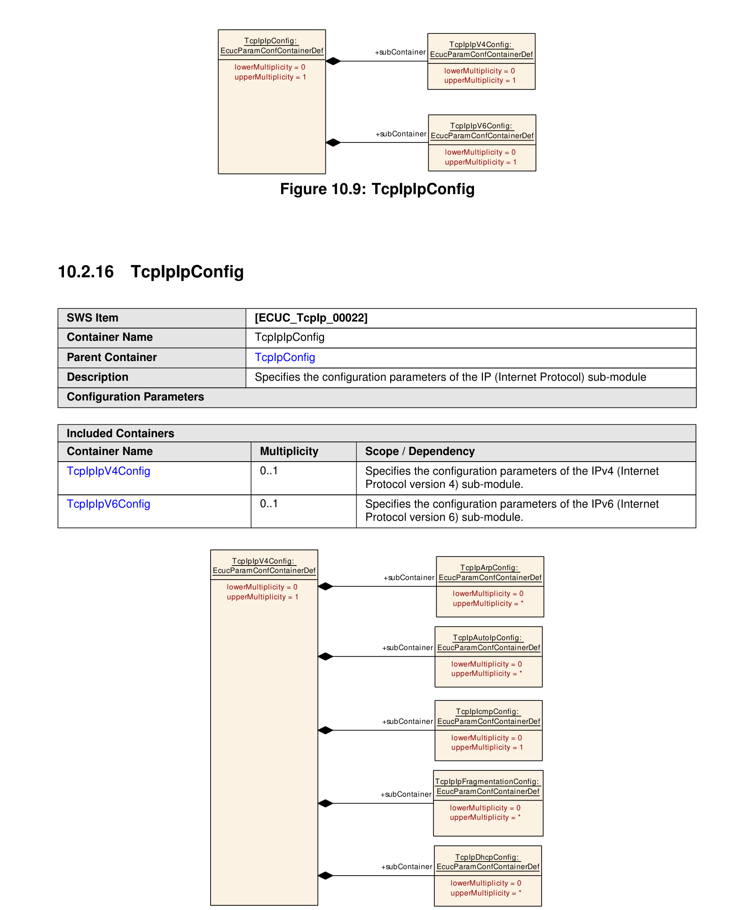

| 项目 | 内容 |
| --- | --- |
| SWS 条目 | [ECUC_TcpIp_00095] |
| 容器名称 | TcpIpIpV4Config |
| 父容器 | TcpIpIpConfig |
| 描述 | 规定IPv4（互联网协议版本4）子模块的配置参数。 |
| 配置参数 | 见下方参数表 |

| 包含的容器 | 容器名称 | 多重性 | 作用域/依赖 |
| --- | --- | --- | --- |
| 包含的容器 | TcpIpArpConfig | 0..* | 见9.2.17节 |
| 包含的容器 | TcpIpAutoIpConfig | 0..* | 见9.2.18节 |
| 包含的容器 | TcpIpDhcpConfig | 0..* | 见9.2.19节 |
| 包含的容器 | TcpIpIcmpConfig | 0..1 | 见9.2.20节 |
| 包含的容器 | TcpIpIpFragmentationConfig | 0..* | 见9.2.22节 |

#### 9.2.17. TcpIpArpConfig

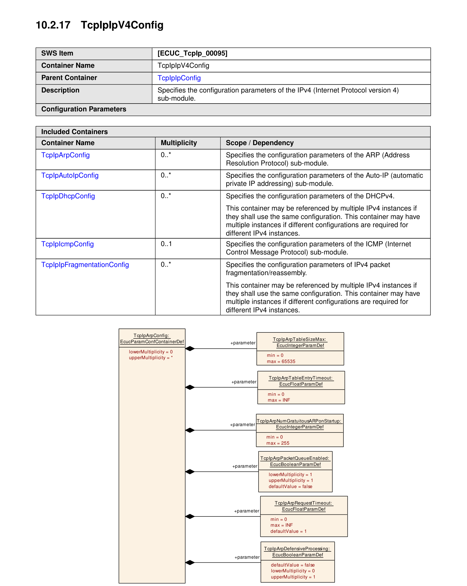

| 项目 | 内容 |
| --- | --- |
| SWS 条目 | [ECUC_TcpIp_00023] |
| 容器名称 | TcpIpArpConfig |
| 父容器 | TcpIpIpV4Config |
| 描述 | 规定ARP（地址解析协议）子模块的配置参数。 |
| 配置参数 | 见下方参数表 |

无包含的容器。

| 项目 | 内容 |
| --- | --- |
| SWS 条目 | [ECUC_TcpIp_00326] |
| 参数名称 | TcpIpArpDefensiveProcessing |
| 父容器 | TcpIpArpConfig |
| 描述 | 如果启用，ARP应只处理响应先前发送的ARP请求而接收到的ARP应答，并跳过基于接收到的免费ARP数据包对ARP表的更新。如果禁用，所有ARP数据包应按照IETF RFC 826的规定处理。 |
| 多重性 | 0..1 |
| 类型 | EcucBooleanParamDef |
| 默认值 | false |
| Post-Build 变体多重性 | false |
| Post-Build 变体值 | false |
| 值配置类 | Pre-compile time：X；Link time：-；Post-build time：- |
| 多重性配置类 | Pre-compile time：X；Link time：-；Post-build time：- |
| 作用域/依赖 | scope: local |

| 项目 | 内容 |
| --- | --- |
| SWS 条目 | [ECUC_TcpIp_00054] |
| 参数名称 | TcpIpArpNumGratuitousARPonStartup |
| 父容器 | TcpIpArpConfig |
| 描述 | 规定在分配新IP地址时应发送的免费ARP应答的数量。 |
| 多重性 | 1 |
| 类型 | EcucIntegerParamDef |
| 范围 | 0 .. 255 |
| 默认值 | - |
| Post-Build 变体值 | true |
| 值配置类 | Pre-compile time：X（VARIANT-PRE-COMPILE）；Link time：X（VARIANT-LINK-TIME）；Post-build time：X（VARIANT-POST-BUILD） |
| 作用域/依赖 | scope: local |

| 项目 | 内容 |
| --- | --- |
| SWS 条目 | [ECUC_TcpIp_00170] |
| 参数名称 | TcpIpArpPacketQueueEnabled |
| 父容器 | TcpIpArpConfig |
| 描述 | 启用（TRUE）或禁用（FALSE）按照IETF RFC 1122第2.3.2.2节的ARP数据包队列支持。 |
| 多重性 | 1 |
| 类型 | EcucBooleanParamDef |
| 默认值 | false |
| Post-Build 变体值 | false |
| 值配置类 | Pre-compile time：X（All Variants）；Link time：-；Post-build time：- |
| 作用域/依赖 | scope: local |

| 项目 | 内容 |
| --- | --- |
| SWS 条目 | [ECUC_TcpIp_00218] |
| 参数名称 | TcpIpArpRequestTimeout |
| 父容器 | TcpIpArpConfig |
| 描述 | 规定ARP请求有效性的超时时间（秒）。在发送一个ARP请求之后，TcpIp应在TcpIpArpRequestTimeout秒的持续时间内跳过向同一目标发送任何进一步的ARP请求。（IETF RFC 1122第2.3.2.1节）该参数的值应为TcpIpMainFunctionPeriod的整数倍或0。如果该参数设置为0，则禁用此特性，ARP请求之间不强制任何延迟。 |
| 多重性 | 1 |
| 类型 | EcucFloatParamDef |
| 范围 | [0 .. INF[ |
| 默认值 | 1 |
| Post-Build 变体值 | true |
| 值配置类 | Pre-compile time：X（VARIANT-PRE-COMPILE）；Link time：X（VARIANT-LINK-TIME）；Post-build time：X（VARIANT-POST-BUILD） |
| 作用域/依赖 | scope: local |

| 项目 | 内容 |
| --- | --- |
| SWS 条目 | [ECUC_TcpIp_00053] |
| 参数名称 | TcpIpArpTableEntryTimeout |
| 父容器 | TcpIpArpConfig |
| 描述 | 以秒为单位的超时时间，超过该时间后未使用的ARP条目将被移除。 |
| 多重性 | 1 |
| 类型 | EcucFloatParamDef |
| 范围 | ]0 .. INF] |
| 默认值 | - |
| Post-Build 变体值 | true |
| 值配置类 | Pre-compile time：X（VARIANT-PRE-COMPILE）；Link time：X（VARIANT-LINK-TIME）；Post-build time：X（VARIANT-POST-BUILD） |
| 作用域/依赖 | scope: local |

| 项目 | 内容 |
| --- | --- |
| SWS 条目 | [ECUC_TcpIp_00052] |
| 参数名称 | TcpIpArpTableSizeMax |
| 父容器 | TcpIpArpConfig |
| 描述 | ARP表中条目的最大数量。 |
| 多重性 | 1 |
| 类型 | EcucIntegerParamDef |
| 范围 | 0 .. 65535 |
| 默认值 | - |
| Post-Build 变体值 | false |
| 值配置类 | Pre-compile time：X（VARIANT-PRE-COMPILE）；Link time：X（VARIANT-LINK-TIME, VARIANT-POST-BUILD）；Post-build time：- |
| 作用域/依赖 | scope: local |

#### 9.2.18. TcpIpAutoIpConfig

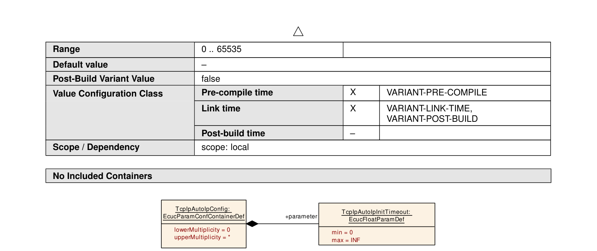

| 项目 | 内容 |
| --- | --- |
| SWS 条目 | [ECUC_TcpIp_00028] |
| 容器名称 | TcpIpAutoIpConfig |
| 父容器 | TcpIpIpV4Config |
| 描述 | 规定Auto-IP（自动专用IP寻址）子模块的配置参数。 |
| 配置参数 | 见下方参数表 |

无包含的容器。

| 项目 | 内容 |
| --- | --- |
| SWS 条目 | [ECUC_TcpIp_00074] |
| 参数名称 | TcpIpAutoIpInitTimeout |
| 父容器 | TcpIpAutoIpConfig |
| 描述 | Auto-IP在启动时、开始ARP探测之前等待的时间（秒）。该延迟用于在存在DHCP服务器的情况下给DHCP留出获取租约的时间。 |
| 多重性 | 1 |
| 类型 | EcucFloatParamDef |
| 范围 | [0 .. INF] |
| 默认值 | - |
| Post-Build 变体值 | true |
| 值配置类 | Pre-compile time：X（VARIANT-PRE-COMPILE）；Link time：X（VARIANT-LINK-TIME）；Post-build time：X（VARIANT-POST-BUILD） |
| 作用域/依赖 | scope: local |

#### 9.2.19. TcpIpDhcpConfig

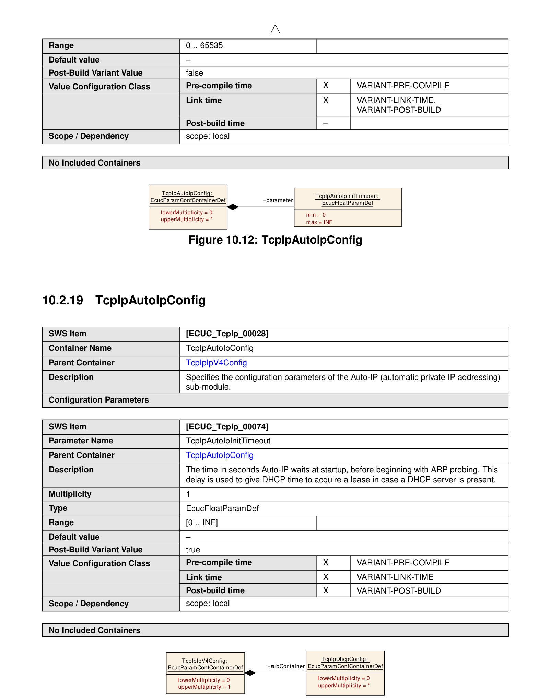

| 项目 | 内容 |
| --- | --- |
| SWS 条目 | [ECUC_TcpIp_00167] |
| 容器名称 | TcpIpDhcpConfig |
| 父容器 | TcpIpIpV4Config |
| 描述 | 规定DHCPv4的配置参数。如果多个IPv4实例应使用相同的配置，该容器可被多个IPv4实例引用。如果不同的IPv4实例需要不同的配置，该容器可以有多个实例。 |
| 配置参数 | 见下方参数表 |

无包含的容器。

#### 9.2.20. TcpIpIcmpConfig

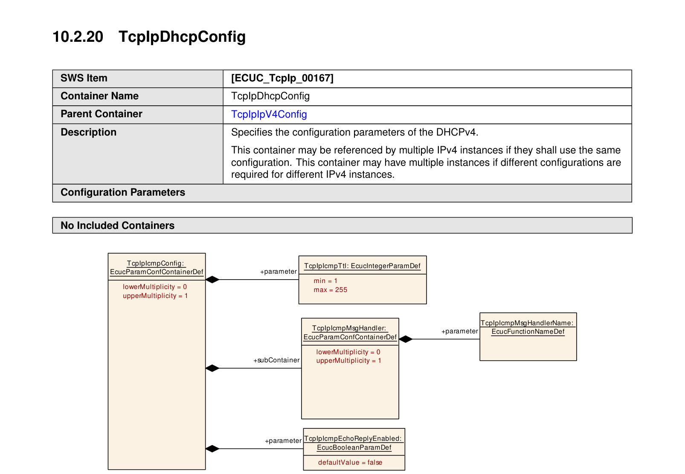

| 项目 | 内容 |
| --- | --- |
| SWS 条目 | [ECUC_TcpIp_00024] |
| 容器名称 | TcpIpIcmpConfig |
| 父容器 | TcpIpIpV4Config |
| 描述 | 规定ICMP（互联网控制消息协议）子模块的配置参数。 |
| 配置参数 | 见下方参数表 |

| 包含的容器 | 容器名称 | 多重性 | 作用域/依赖 |
| --- | --- | --- | --- |
| 包含的容器 | TcpIpIcmpMsgHandler | 0..1 | 见9.2.21节 |

| 项目 | 内容 |
| --- | --- |
| SWS 条目 | [ECUC_TcpIp_00213] |
| 参数名称 | TcpIpIcmpEchoReplyEnabled |
| 父容器 | TcpIpIcmpConfig |
| 描述 | 在接收到ICMP回显时启用或禁用ICMP回显应答消息的发送。 |
| 多重性 | 1 |
| 类型 | EcucBooleanParamDef |
| 默认值 | false |
| Post-Build 变体值 | false |
| 值配置类 | Pre-compile time：X（VARIANT-PRE-COMPILE）；Link time：-；Post-build time：- |
| 作用域/依赖 | scope: local |

| 项目 | 内容 |
| --- | --- |
| SWS 条目 | [ECUC_TcpIp_00055] |
| 参数名称 | TcpIpIcmpTtl |
| 父容器 | TcpIpIcmpConfig |
| 描述 | 出站ICMP数据包的默认生存时间（Time-to-live）值。 |
| 多重性 | 1 |
| 类型 | EcucIntegerParamDef |
| 范围 | 1 .. 255 |
| 默认值 | - |
| Post-Build 变体值 | true |
| 值配置类 | Pre-compile time：X（VARIANT-PRE-COMPILE）；Link time：X（VARIANT-LINK-TIME）；Post-build time：X（VARIANT-POST-BUILD） |
| 作用域/依赖 | scope: local |

#### 9.2.21. TcpIpIcmpMsgHandler

| 项目 | 内容 |
| --- | --- |
| SWS 条目 | [ECUC_TcpIp_00056] |
| 容器名称 | TcpIpIcmpMsgHandler |
| 父容器 | TcpIpIcmpConfig |
| 描述 | 该容器是TcpIpIcmpConfig的子容器，规定ICMP消息处理器的配置参数。 |
| 配置参数 | 见下方参数表 |

无包含的容器。

| 项目 | 内容 |
| --- | --- |
| SWS 条目 | [ECUC_TcpIp_00057] |
| 参数名称 | TcpIpIcmpMsgHandlerName |
| 父容器 | TcpIpIcmpMsgHandler |
| 描述 | 该参数定义ICMP消息处理函数&lt;Up_IcmpMsgHandler&gt;的名称。 |
| 多重性 | 1 |
| 类型 | EcucFunctionNameDef |
| 默认值 | - |
| Post-Build 变体值 | false |
| 值配置类 | Pre-compile time：X（VARIANT-PRE-COMPILE）；Link time：X（VARIANT-LINK-TIME, VARIANT-POST-BUILD）；Post-build time：- |
| 作用域/依赖 | scope: local |

#### 9.2.22. TcpIpIpFragmentationConfig

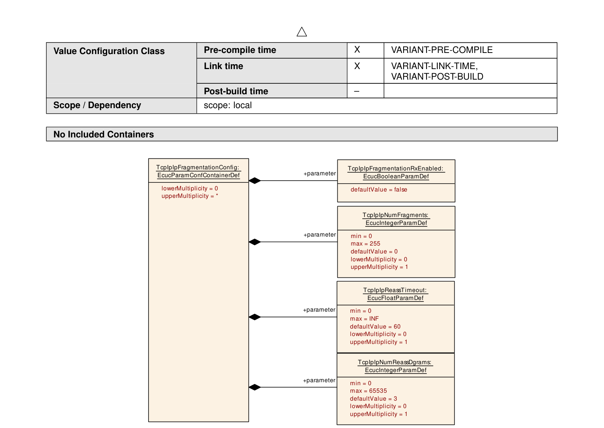

| 项目 | 内容 |
| --- | --- |
| SWS 条目 | [ECUC_TcpIp_00108] |
| 容器名称 | TcpIpIpFragmentationConfig |
| 父容器 | TcpIpIpV4Config |
| 描述 | 规定IPv4数据包分片/重组的配置参数。如果多个IPv4实例应使用相同的配置，该容器可被多个IPv4实例引用。如果不同的IPv4实例需要不同的配置，该容器可以有多个实例。 |
| 配置参数 | 见下方参数表 |

无包含的容器。

| 项目 | 内容 |
| --- | --- |
| SWS 条目 | [ECUC_TcpIp_00077] |
| 参数名称 | TcpIpIpFragmentationRxEnabled |
| 父容器 | TcpIpIpFragmentationConfig |
| 描述 | 启用（TRUE）或禁用（FALSE）按照IETF RFC 815（IP数据报重组算法）对分片到达的数据报的重组支持。 |
| 多重性 | 1 |
| 类型 | EcucBooleanParamDef |
| 默认值 | false |
| Post-Build 变体值 | false |
| 值配置类 | Pre-compile time：X（All Variants）；Link time：-；Post-build time：- |
| 作用域/依赖 | scope: local |

| 项目 | 内容 |
| --- | --- |
| SWS 条目 | [ECUC_TcpIp_00078] |
| 参数名称 | TcpIpIpNumFragments |
| 父容器 | TcpIpIpFragmentationConfig |
| 描述 | 规定每个数据报的最大IP分片数。注意：仅当TcpIpIpFragmentationRxEnabled为TRUE时该参数才相关。 |
| 多重性 | 0..1 |
| 类型 | EcucIntegerParamDef |
| 范围 | 0 .. 255 |
| 默认值 | 0 |
| Post-Build 变体多重性 | true |
| Post-Build 变体值 | true |
| 值配置类 | Pre-compile time：X（VARIANT-PRE-COMPILE）；Link time：X（VARIANT-LINK-TIME）；Post-build time：X（VARIANT-POST-BUILD） |
| 多重性配置类 | Pre-compile time：X（VARIANT-PRE-COMPILE）；Link time：X（VARIANT-LINK-TIME）；Post-build time：X（VARIANT-POST-BUILD） |
| 作用域/依赖 | scope: local dependency: TcpIpIpFragmentationRxEnabled |

| 项目 | 内容 |
| --- | --- |
| SWS 条目 | [ECUC_TcpIp_00080] |
| 参数名称 | TcpIpIpNumReassDgrams |
| 父容器 | TcpIpIpFragmentationConfig |
| 描述 | 规定可以并行重组的分片IP数据报的最大数量。注意：仅当TcpIpIpFragmentationRxEnabled为TRUE时该参数才相关。 |
| 多重性 | 0..1 |
| 类型 | EcucIntegerParamDef |
| 范围 | 0 .. 65535 |
| 默认值 | 3 |
| Post-Build 变体多重性 | true |
| Post-Build 变体值 | true |
| 值配置类 | Pre-compile time：X（VARIANT-PRE-COMPILE）；Link time：X（VARIANT-LINK-TIME）；Post-build time：X（VARIANT-POST-BUILD） |
| 多重性配置类 | Pre-compile time：X（VARIANT-PRE-COMPILE）；Link time：X（VARIANT-LINK-TIME）；Post-build time：X（VARIANT-POST-BUILD） |
| 作用域/依赖 | scope: local dependency: TcpIpIpFragmentationRxEnabled |

| 项目 | 内容 |
| --- | --- |
| SWS 条目 | [ECUC_TcpIp_00079] |
| 参数名称 | TcpIpIpReassTimeout |
| 父容器 | TcpIpIpFragmentationConfig |
| 描述 | 规定以[s]为单位的超时时间，超过该时间后不完整的数据报将被丢弃。注意：仅当TcpIpIpFragmentationRxEnabled为TRUE时该参数才相关。 |
| 多重性 | 0..1 |
| 类型 | EcucFloatParamDef |
| 范围 | [0 .. INF] |
| 默认值 | 60 |
| Post-Build 变体多重性 | true |
| Post-Build 变体值 | true |
| 值配置类 | Pre-compile time：X（VARIANT-PRE-COMPILE）；Link time：X（VARIANT-LINK-TIME）；Post-build time：X（VARIANT-POST-BUILD） |
| 多重性配置类 | Pre-compile time：X（VARIANT-PRE-COMPILE）；Link time：X（VARIANT-LINK-TIME）；Post-build time：X（VARIANT-POST-BUILD） |
| 作用域/依赖 | scope: local dependency: TcpIpIpFragmentationRxEnabled |

#### 9.2.23. TcpIpIpV6Config

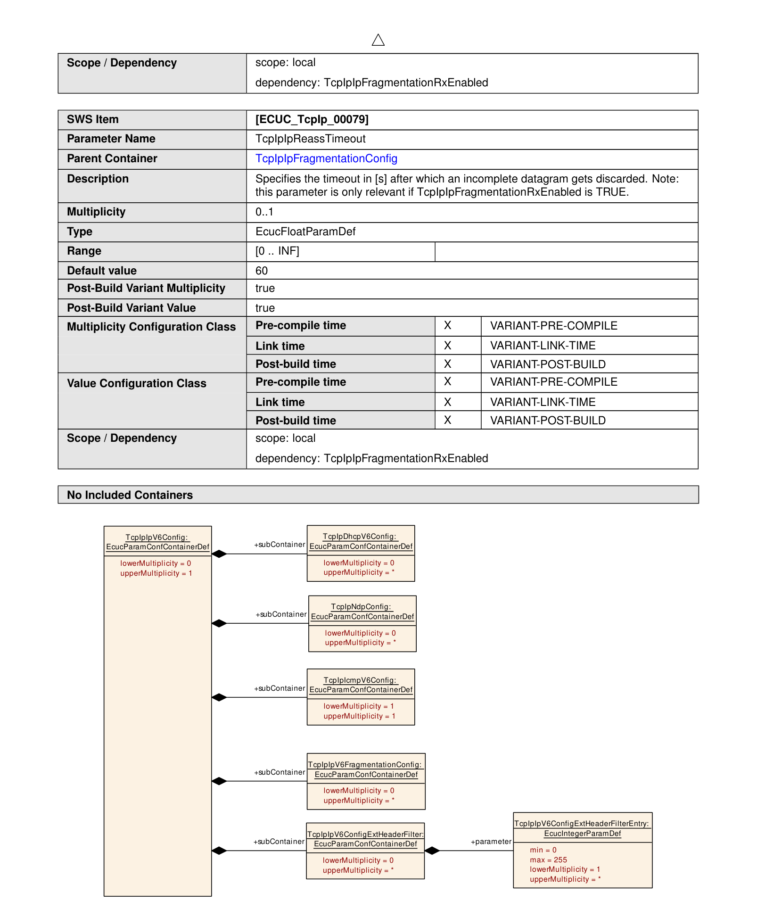

| 项目 | 内容 |
| --- | --- |
| SWS 条目 | [ECUC_TcpIp_00168] |
| 容器名称 | TcpIpIpV6Config |
| 父容器 | TcpIpIpConfig |
| 描述 | 规定IPv6（互联网协议版本6）子模块的配置参数。 |
| 配置参数 | 见下方参数表 |

| 包含的容器 | 容器名称 | 多重性 | 作用域/依赖 |
| --- | --- | --- | --- |
| 包含的容器 | TcpIpDhcpV6Config | 0..* | 见9.2.24节 |
| 包含的容器 | TcpIpIcmpV6Config | 1 | 见9.2.25节 |
| 包含的容器 | TcpIpIpV6ConfigExtHeaderFilter | 0..* | 见9.2.27节 |
| 包含的容器 | TcpIpIpV6FragmentationConfig | 0..* | 见9.2.28节 |
| 包含的容器 | TcpIpNdpConfig | 0..* | 见9.2.29节 |

#### 9.2.24. TcpIpDhcpV6Config

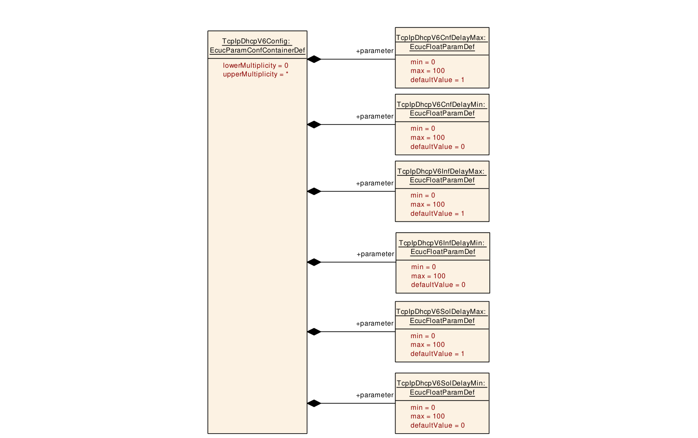

| 项目 | 内容 |
| --- | --- |
| SWS 条目 | [ECUC_TcpIp_00110] |
| 容器名称 | TcpIpDhcpV6Config |
| 父容器 | TcpIpIpV6Config |
| 描述 | 规定DHCPv6的配置参数。如果多个IPv6实例应使用相同的配置，该容器可被多个IPv6实例引用。如果不同的IPv6实例需要不同的配置，该容器可以有多个实例。 |
| 配置参数 | 见下方参数表 |

无包含的容器。

| 项目 | 内容 |
| --- | --- |
| SWS 条目 | [ECUC_TcpIp_00116] |
| 参数名称 | TcpIpDhcpV6CnfDelayMax |
| 父容器 | TcpIpDhcpV6Config |
| 描述 | 发送第一条Confirm消息之前的最大延迟（秒）。如果该值大于先前的最小延迟值，将从该区间中随机选择一个延迟。 |
| 多重性 | 1 |
| 类型 | EcucFloatParamDef |
| 默认值 | 1 |
| Post-Build 变体值 | false |
| 值配置类 | Pre-compile time：X（All Variants）；Link time：-；Post-build time：- |
| 作用域/依赖 | scope: local |

| 项目 | 内容 |
| --- | --- |
| SWS 条目 | [ECUC_TcpIp_00117] |
| 参数名称 | TcpIpDhcpV6CnfDelayMin |
| 父容器 | TcpIpDhcpV6Config |
| 描述 | 发送第一条Confirm消息之前的最小延迟（秒）。 |
| 多重性 | 1 |
| 类型 | EcucFloatParamDef |
| 范围 | [0 .. 100] |
| 默认值 | 0 |
| Post-Build 变体值 | false |
| 值配置类 | Pre-compile time：X（All Variants）；Link time：-；Post-build time：- |
| 作用域/依赖 | scope: local |

| 项目 | 内容 |
| --- | --- |
| SWS 条目 | [ECUC_TcpIp_00118] |
| 参数名称 | TcpIpDhcpV6InfDelayMax |
| 父容器 | TcpIpDhcpV6Config |
| 描述 | 发送第一条Information Request消息之前的最大延迟（秒）。如果该值大于先前的最小延迟值，将从该区间中随机选择一个延迟。 |
| 多重性 | 1 |
| 类型 | EcucFloatParamDef |
| 范围 | [0 .. 100] |
| 默认值 | 1 |
| Post-Build 变体值 | false |
| 值配置类 | Pre-compile time：X（All Variants）；Link time：-；Post-build time：- |
| 作用域/依赖 | scope: local |

| 项目 | 内容 |
| --- | --- |
| SWS 条目 | [ECUC_TcpIp_00119] |
| 参数名称 | TcpIpDhcpV6InfDelayMin |
| 父容器 | TcpIpDhcpV6Config |
| 描述 | 发送第一条Information Request消息之前的最小延迟（秒）。 |
| 多重性 | 1 |
| 类型 | EcucFloatParamDef |
| 范围 | [0 .. 100] |
| 默认值 | 0 |
| Post-Build 变体值 | false |
| 值配置类 | Pre-compile time：X（All Variants）；Link time：- |
| 作用域/依赖 | scope: local |

| 项目 | 内容 |
| --- | --- |
| SWS 条目 | [ECUC_TcpIp_00120] |
| 参数名称 | TcpIpDhcpV6SolDelayMax |
| 父容器 | TcpIpDhcpV6Config |
| 描述 | 发送第一条Solicit消息之前的最大延迟（秒）。如果该值大于先前的最小延迟值，将从该区间中随机选择一个延迟。 |
| 多重性 | 1 |
| 类型 | EcucFloatParamDef |
| 范围 | [0 .. 100] |
| 默认值 | 1 |
| Post-Build 变体值 | false |
| 值配置类 | Pre-compile time：X（All Variants）；Link time：-；Post-build time：- |
| 作用域/依赖 | scope: local |

| 项目 | 内容 |
| --- | --- |
| SWS 条目 | [ECUC_TcpIp_00121] |
| 参数名称 | TcpIpDhcpV6SolDelayMin |
| 父容器 | TcpIpDhcpV6Config |
| 描述 | 发送第一条Solicit消息之前的最小延迟（秒）。 |
| 多重性 | 1 |
| 类型 | EcucFloatParamDef |
| 范围 | [0 .. 100] |
| 默认值 | 0 |
| Post-Build 变体值 | false |
| 值配置类 | Pre-compile time：X（All Variants）；Link time：-；Post-build time：- |
| 作用域/依赖 | scope: local |

#### 9.2.25. TcpIpIcmpV6Config

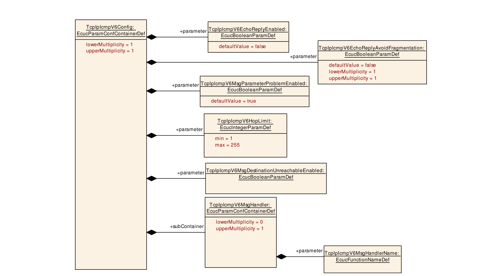

| 项目 | 内容 |
| --- | --- |
| SWS 条目 | [ECUC_TcpIp_00113] |
| 容器名称 | TcpIpIcmpV6Config |
| 父容器 | TcpIpIpV6Config |
| 描述 | 规定ICMPv6（IPv6互联网控制消息协议）子模块的配置参数。 |
| 配置参数 | 见下方参数表 |

| 包含的容器 | 容器名称 | 多重性 | 作用域/依赖 |
| --- | --- | --- | --- |
| 包含的容器 | TcpIpIcmpV6MsgHandler | 0..1 | 见9.2.26节 |

| 项目 | 内容 |
| --- | --- |
| SWS 条目 | [ECUC_TcpIp_00212] |
| 参数名称 | TcpIpIcmpV6EchoReplyAvoidFragmentation |
| 父容器 | TcpIpIcmpV6Config |
| 描述 | 如果启用，协议栈将只应答符合相应接口MTU（即无需IPv6分片即可发送）的传入ICMPv6回显请求（Ping）。仅当启用TcpIpIcmpV6EchoReplyEnabled时相关。 |
| 多重性 | 1 |
| 类型 | EcucBooleanParamDef |
| 默认值 | false |
| Post-Build 变体值 | false |
| 值配置类 | Pre-compile time：X（All Variants）；Link time：-；Post-build time：- |
| 作用域/依赖 | scope: local dependency: TcpIpIcmpV6EchoReplyEnabled |

| 项目 | 内容 |
| --- | --- |
| SWS 条目 | [ECUC_TcpIp_00149] |
| 参数名称 | TcpIpIcmpV6EchoReplyEnabled |
| 父容器 | TcpIpIcmpV6Config |
| 描述 | 如果启用，协议栈将应答传入的ICMPv6回显请求（Ping）。 |
| 多重性 | 1 |
| 类型 | EcucBooleanParamDef |
| 默认值 | false |
| Post-Build 变体值 | false |
| 值配置类 | Pre-compile time：X（All Variants）；Link time：-；Post-build time：- |
| 作用域/依赖 | scope: local |

| 项目 | 内容 |
| --- | --- |
| SWS 条目 | [ECUC_TcpIp_00152] |
| 参数名称 | TcpIpIcmpV6HopLimit |
| 父容器 | TcpIpIcmpV6Config |
| 描述 | 出站ICMPv6数据包的默认跳数限制（Hop-Limit）值。 |
| 多重性 | 1 |
| 类型 | EcucIntegerParamDef |
| 范围 | 1 .. 255 |
| 默认值 | - |
| Post-Build 变体值 | true |
| 值配置类 | Pre-compile time：X（VARIANT-PRE-COMPILE）；Link time：X（VARIANT-LINK-TIME）；Post-build time：X（VARIANT-POST-BUILD） |
| 作用域/依赖 | scope: local |

| 项目 | 内容 |
| --- | --- |
| SWS 条目 | [ECUC_TcpIp_00153] |
| 参数名称 | TcpIpIcmpV6MsgDestinationUnreachableEnabled |
| 父容器 | TcpIpIcmpV6Config |
| 描述 | 禁用/启用目标不可达（Destination Unreachable）消息的发送。 |
| 多重性 | 1 |
| 类型 | EcucBooleanParamDef |
| 默认值 | - |
| Post-Build 变体值 | false |
| 值配置类 | Pre-compile time：X（All Variants）；Link time：-；Post-build time：- |
| 作用域/依赖 | scope: local |

| 项目 | 内容 |
| --- | --- |
| SWS 条目 | [ECUC_TcpIp_00151] |
| 参数名称 | TcpIpIcmpV6MsgParameterProblemEnabled |
| 父容器 | TcpIpIcmpV6Config |
| 描述 | 禁用/启用参数问题（Parameter Problem）消息的发送。 |
| 多重性 | 1 |
| 类型 | EcucBooleanParamDef |
| 默认值 | true |
| Post-Build 变体值 | false |
| 值配置类 | Pre-compile time：X（All Variants）；Link time：-；Post-build time：- |
| 作用域/依赖 | scope: local |

#### 9.2.26. TcpIpIcmpV6MsgHandler

| 项目 | 内容 |
| --- | --- |
| SWS 条目 | [ECUC_TcpIp_00154] |
| 容器名称 | TcpIpIcmpV6MsgHandler |
| 父容器 | TcpIpIcmpV6Config |
| 描述 | 该容器是TcpIpIcmpConfig的子容器，规定ICMPv6消息处理器的配置参数。 |
| 配置参数 | 见下方参数表 |

无包含的容器。

| 项目 | 内容 |
| --- | --- |
| SWS 条目 | [ECUC_TcpIp_00156] |
| 参数名称 | TcpIpIcmpV6MsgHandlerName |
| 父容器 | TcpIpIcmpV6MsgHandler |
| 描述 | 该参数定义ICMPv6消息处理函数&lt;Up_IcmpMsgHandler&gt;的名称。 |
| 多重性 | 1 |
| 类型 | EcucFunctionNameDef |
| 默认值 | - |
| Post-Build 变体值 | false |
| 值配置类 | Pre-compile time：X（VARIANT-PRE-COMPILE）；Link time：X（VARIANT-LINK-TIME, VARIANT-POST-BUILD）；Post-build time：- |
| 作用域/依赖 | scope: local |

#### 9.2.27. TcpIpIpV6ConfigExtHeaderFilter

| 项目 | 内容 |
| --- | --- |
| SWS 条目 | [ECUC_TcpIp_00198] |
| 容器名称 | TcpIpIpV6ConfigExtHeaderFilter |
| 父容器 | TcpIpIpV6Config |
| 描述 | 该容器描述用于过滤IPv6扩展报头的白名单，即包含未在此列出的IPv6扩展报头的帧应被静默丢弃。 |
| Post-Build 变体多重性 | false |
| 配置参数 | 见下方参数表 |

无包含的容器。

| 项目 | 内容 |
| --- | --- |
| SWS 条目 | [ECUC_TcpIp_00199] |
| 参数名称 | TcpIpIpV6ConfigExtHeaderFilterEntry |
| 父容器 | TcpIpIpV6ConfigExtHeaderFilter |
| 描述 | 此过滤器允许的IPv6扩展报头类型。 |
| 多重性 | 1..* |
| 类型 | EcucIntegerParamDef |
| 范围 | 0 .. 255 |
| 默认值 | - |
| Post-Build 变体多重性 | false |
| Post-Build 变体值 | false |
| 值配置类 | Pre-compile time：X（All Variants）；Link time：-；Post-build time：- |
| 作用域/依赖 | scope: local |

#### 9.2.28. TcpIpIpV6FragmentationConfig

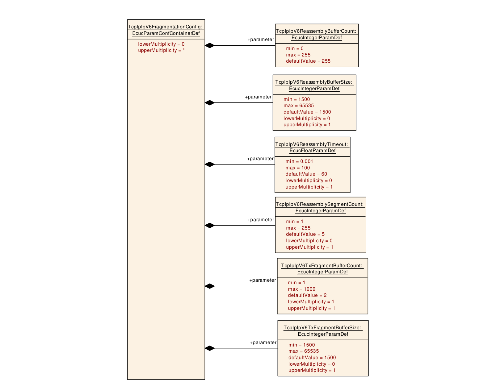

| 项目 | 内容 |
| --- | --- |
| SWS 条目 | [ECUC_TcpIp_00114] |
| 容器名称 | TcpIpIpV6FragmentationConfig |
| 父容器 | TcpIpIpV6Config |
| 描述 | 规定IPv6数据包分片/重组的配置参数。如果多个IPv6实例应使用相同的配置，该容器可被多个IPv6实例引用。如果不同的IPv6实例需要不同的配置，该容器可以有多个实例。 |
| 配置参数 | 见下方参数表 |

无包含的容器。

| 项目 | 内容 |
| --- | --- |
| SWS 条目 | [ECUC_TcpIp_00157] |
| 参数名称 | TcpIpIpV6ReassemblyBufferCount |
| 父容器 | TcpIpIpV6FragmentationConfig |
| 描述 | 用于重组传入的、按IETF RFC 8200第4.5节分片的IPv6帧的缓冲区数量。 |
| 多重性 | 1 |
| 类型 | EcucIntegerParamDef |
| 范围 | 0 .. 255 |
| 默认值 | 255 |
| Post-Build 变体值 | false |
| 值配置类 | Pre-compile time：X（All Variants）；Link time：-；Post-build time：- |
| 作用域/依赖 |  |

| 项目 | 内容 |
| --- | --- |
| SWS 条目 | [ECUC_TcpIp_00158] |
| 参数名称 | TcpIpIpV6ReassemblyBufferSize |
| 父容器 | TcpIpIpV6FragmentationConfig |
| 描述 | [RFC8200 5. Packet Size Issues]「节点必须能够接受重组后最大为1500字节的分片数据包。允许节点接受重组后大于1500字节的分片数据包。」以及测得的路径MTU（即低至1280字节）。 |
| 多重性 | 0..1 |
| 类型 | EcucIntegerParamDef |
| 范围 | 1500 .. 65535 |
| 默认值 | 1500 |
| Post-Build 变体多重性 | false |
| Post-Build 变体值 | false |
| 值配置类 | Pre-compile time：X（All Variants）；Link time：-；Post-build time：- |
| 多重性配置类 | Pre-compile time：X（All Variants）；Link time：-；Post-build time：- |
| 作用域/依赖 | scope: local |

| 项目 | 内容 |
| --- | --- |
| SWS 条目 | [ECUC_TcpIp_00160] |
| 参数名称 | TcpIpIpV6ReassemblySegmentCount |
| 父容器 | TcpIpIpV6FragmentationConfig |
| 描述 | 规定每个重组缓冲区中可以管理的连续数据段的最大数量。如果所有分片按顺序接收，则只需要一个段。为了处理乱序接收的分片，该值应配置为大于1。 |
| 多重性 | 0..1 |
| 类型 | EcucIntegerParamDef |
| 范围 | 1 .. 255 |
| 默认值 | 5 |
| Post-Build 变体多重性 | false |
| Post-Build 变体值 | false |
| 值配置类 | Pre-compile time：X（All Variants）；Link time：-；Post-build time：- |
| 多重性配置类 | Pre-compile time：X（All Variants）；Link time：-；Post-build time：- |
| 作用域/依赖 | scope: local |

| 项目 | 内容 |
| --- | --- |
| SWS 条目 | [ECUC_TcpIp_00159] |
| 参数名称 | TcpIpIpV6ReassemblyTimeout |
| 父容器 | TcpIpIpV6FragmentationConfig |
| 描述 | [RFC8200 4.5 Fragment Header]。默认值：60秒。 |
| 多重性 | 0..1 |
| 类型 | EcucFloatParamDef |
| 范围 | [0.001 .. 100] |
| 默认值 | 60 |
| Post-Build 变体多重性 | false |
| Post-Build 变体值 | false |
| 值配置类 | Pre-compile time：X；Link time：-；Post-build time：- |
| 多重性配置类 | Pre-compile time：X；Link time：-；Post-build time：- |
| 作用域/依赖 | scope: local |

| 项目 | 内容 |
| --- | --- |
| SWS 条目 | [ECUC_TcpIp_00161] |
| 参数名称 | TcpIpIpV6TxFragmentBufferCount |
| 父容器 | TcpIpIpV6FragmentationConfig |
| 描述 | 如果IPv6从上层接收到不适合MTU、因此必须分片的数据包，将使用这些缓冲区。值为0时禁用发送分片。如果上层发送不适合链路或路径MTU的数据包，IPv6会将该数据包拆分为分片。 |
| 多重性 | 1 |
| 类型 | EcucIntegerParamDef |
| 范围 | 1 .. 1000 |
| 默认值 | 2 |
| Post-Build 变体值 | false |
| 值配置类 | Pre-compile time：X（All Variants）；Link time：- |
| 作用域/依赖 | scope: local |

| 项目 | 内容 |
| --- | --- |
| SWS 条目 | [ECUC_TcpIp_00162] |
| 参数名称 | TcpIpIpV6TxFragmentBufferSize |
| 父容器 | TcpIpIpV6FragmentationConfig |
| 描述 | 每个发送分片缓冲区的大小（字节）。 |
| 多重性 | 0..1 |
| 类型 | EcucIntegerParamDef |
| 范围 | 1500 .. 65535 |
| 默认值 | 1500 |
| Post-Build 变体多重性 | false |
| Post-Build 变体值 | false |
| 值配置类 | Pre-compile time：X；Link time：-；Post-build time：- |
| 多重性配置类 | Pre-compile time：X；Link time：-；Post-build time：- |
| 作用域/依赖 | scope: local |

#### 9.2.29. TcpIpNdpConfig

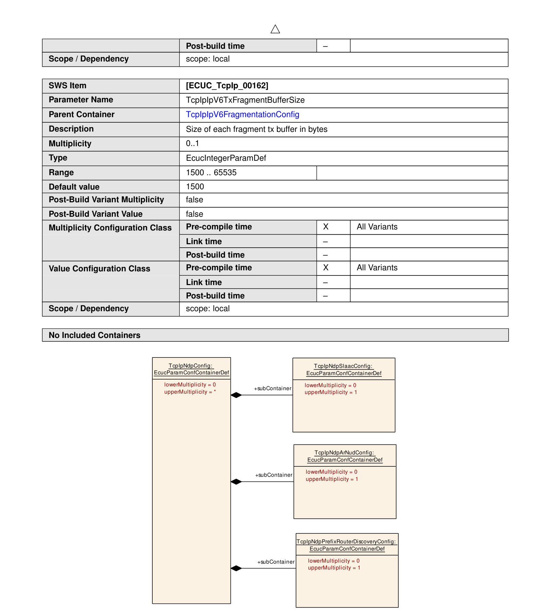

| 项目 | 内容 |
| --- | --- |
| SWS 条目 | [ECUC_TcpIp_00112] |
| 容器名称 | TcpIpNdpConfig |
| 父容器 | TcpIpIpV6Config |
| 描述 | 规定IPv6邻居发现协议的配置参数。如果多个IPv6实例应使用相同的配置，该容器可被多个IPv6实例引用。如果不同的IPv6实例需要不同的配置，该容器可以有多个实例。 |
| 配置参数 | 见下方参数表 |

| 包含的容器 | 容器名称 | 多重性 | 作用域/依赖 |
| --- | --- | --- | --- |
| 包含的容器 | TcpIpNdpArNudConfig | 0..1 | 见9.2.30节 |
| 包含的容器 | TcpIpNdpSlaacConfig | 0..1 | 见9.2.34节 |
| 包含的容器 | TcpIpNdpPrefixRouterDiscoveryConfig | 0..1 | 见9.2.31节 |

#### 9.2.30. TcpIpNdpArNudConfig

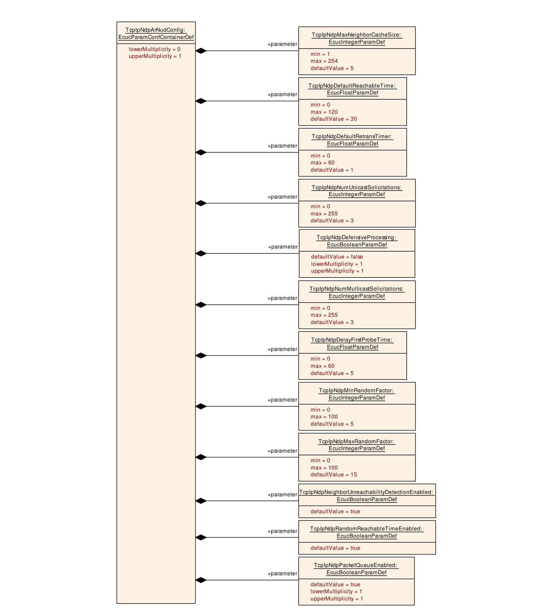

| 项目 | 内容 |
| --- | --- |
| SWS 条目 | [ECUC_TcpIp_00123] |
| 容器名称 | TcpIpNdpArNudConfig |
| 父容器 | TcpIpNdpConfig |
| 描述 | 规定NDP地址解析和邻居不可达检测的配置参数。 |
| 配置参数 | 见下方参数表 |

无包含的容器。

| 项目 | 内容 |
| --- | --- |
| SWS 条目 | [ECUC_TcpIp_00130] |
| 参数名称 | TcpIpNdpDefaultReachableTime |
| 父容器 | TcpIpNdpArNudConfig |
| 描述 | [RFC4861 6.3.2. Host Variables]中规定的ReachableTime（秒）的配置。「接收到可达性确认之后认为邻居可达的时间。」如果勾选了「TcpIpNdpDynamicReachableTimeEnabled」，则该值可以基于接收到的路由器通告重新配置。默认值：REACHABLE_TIME = 30秒。 |
| 多重性 | 1 |
| 类型 | EcucFloatParamDef |
| 范围 | [0 .. 120] |
| 默认值 | 30 |
| Post-Build 变体值 | false |
| 值配置类 | Pre-compile time：X（All Variants）；Link time：-；Post-build time：- |
| 作用域/依赖 | scope: local |

| 项目 | 内容 |
| --- | --- |
| SWS 条目 | [ECUC_TcpIp_00165] |
| 参数名称 | TcpIpNdpDefaultRetransTimer |
| 父容器 | TcpIpNdpArNudConfig |
| 描述 | 为[RFC4861 6.3.2. Host Variables]中规定的RetransTimer变量配置默认值（秒）。「在解析地址或探测邻居可达性时，向邻居重传邻居请求消息之间的时间。」如果勾选了「TcpIpNdpDynamicRetransTimeEnabled」，则该值可以基于接收到的路由器通告重新配置。默认值：RETRANS_TIMER = 1秒。 |
| 多重性 | 1 |
| 类型 | EcucFloatParamDef |
| 范围 | [0 .. 60] |
| 默认值 | 1 |
| Post-Build 变体值 | false |
| 值配置类 | Pre-compile time：X（All Variants）；Link time：-；Post-build time：- |
| 作用域/依赖 | scope: local |

| 项目 | 内容 |
| --- | --- |
| SWS 条目 | [ECUC_TcpIp_00201] |
| 参数名称 | TcpIpNdpDefensiveProcessing |
| 父容器 | TcpIpNdpArNudConfig |
| 描述 | 如果启用，NDP应只处理响应先前发送的邻居请求而接收到的邻居通告，并跳过基于接收到的邻居请求对邻居缓存的更新。如果禁用，所有邻居通告和邻居请求应按照RFC4861的规定处理。[RFC4861 7.2.5. Receipt of Neighbor Advertisements] |
| 多重性 | 1 |
| 类型 | EcucBooleanParamDef |
| 默认值 | false |
| Post-Build 变体值 | false |
| 值配置类 | Pre-compile time：X（All Variants）；Link time：-；Post-build time：- |
| 作用域/依赖 | scope: local |

| 项目 | 内容 |
| --- | --- |
| SWS 条目 | [ECUC_TcpIp_00133] |
| 参数名称 | TcpIpNdpDelayFirstProbeTime |
| 父容器 | TcpIpNdpArNudConfig |
| 描述 | 发送第一个NUD探测之前的延迟（秒）。[RFC4861 7.3.3. Node Behavior] 默认值：DELAY_FIRST_PROBE_TIME = 5秒。 |
| 多重性 | 1 |
| 类型 | EcucFloatParamDef |
| 范围 | [0 .. 60] |
| 默认值 | 5 |
| Post-Build 变体值 | false |
| 值配置类 | Pre-compile time：X（All Variants）；Link time：-；Post-build time：- |
| 作用域/依赖 | scope: local |

| 项目 | 内容 |
| --- | --- |
| SWS 条目 | [ECUC_TcpIp_00129] |
| 参数名称 | TcpIpNdpMaxNeighborCacheSize |
| 父容器 | TcpIpNdpArNudConfig |
| 描述 | 邻居缓存中条目的最大数量。[RFC4861 5.1. Conceptual Data Structures] |
| 多重性 | 1 |
| 类型 | EcucIntegerParamDef |
| 范围 | 1 .. 254 |
| 默认值 | 5 |
| Post-Build 变体值 | false |
| 值配置类 | Pre-compile time：X（All Variants）；Link time：-；Post-build time：- |
| 作用域/依赖 | scope: local |

| 项目 | 内容 |
| --- | --- |
| SWS 条目 | [ECUC_TcpIp_00135] |
| 参数名称 | TcpIpNdpMaxRandomFactor |
| 父容器 | TcpIpNdpArNudConfig |
| 描述 | 用于随机化的最大随机因子。[RFC4861 10. Protocol Constants] 默认值：15（MAX_RANDOM_FACTOR = 1.5）。 |
| 多重性 | 1 |
| 类型 | EcucIntegerParamDef |
| 范围 | 0 .. 100 |
| 默认值 | 15 |
| Post-Build 变体值 | false |
| 值配置类 | Pre-compile time：X（All Variants）；Link time：-；Post-build time：- |
| 作用域/依赖 | scope: local |

| 项目 | 内容 |
| --- | --- |
| SWS 条目 | [ECUC_TcpIp_00134] |
| 参数名称 | TcpIpNdpMinRandomFactor |
| 父容器 | TcpIpNdpArNudConfig |
| 描述 | 用于随机化的最小随机因子。[RFC4861 10. Protocol Constants] 默认值：5（MIN_RANDOM_FACTOR = 0.5）。 |
| 多重性 | 1 |
| 类型 | EcucIntegerParamDef |
| 范围 | 0 .. 100 |
| 默认值 | 5 |
| Post-Build 变体值 | false |
| 值配置类 | Pre-compile time：X（All Variants）；Link time：-；Post-build time：- |
| 作用域/依赖 | scope: local |

| 项目 | 内容 |
| --- | --- |
| SWS 条目 | [ECUC_TcpIp_00136] |
| 参数名称 | TcpIpNdpNeighborUnreachabilityDetectionEnabled |
| 父容器 | TcpIpNdpArNudConfig |
| 描述 | 邻居不可达检测用于从邻居缓存中移除未使用的条目。该特性是NDP的基本特性，应当开启。 |
| 多重性 | 1 |
| 类型 | EcucBooleanParamDef |
| 默认值 | true |
| Post-Build 变体值 | false |
| 值配置类 | Pre-compile time：X（All Variants）；Link time：-；Post-build time：- |
| 作用域/依赖 | scope: local |

| 项目 | 内容 |
| --- | --- |
| SWS 条目 | [ECUC_TcpIp_00132] |
| 参数名称 | TcpIpNdpNumMulticastSolicitations |
| 父容器 | TcpIpNdpArNudConfig |
| 描述 | 执行地址解析时将发送的多播请求的最大数量。[RFC4861 7.2.2. Sending Neighbor Solicitations] 默认值：MAX_MULTICAST_SOLICIT = 3。 |
| 多重性 | 1 |
| 类型 | EcucIntegerParamDef |
| 范围 | 0 .. 255 |
| 默认值 | 3 |
| Post-Build 变体值 | false |
| 值配置类 | Pre-compile time：X（All Variants）；Link time：-；Post-build time：- |
| 作用域/依赖 | scope: local |

| 项目 | 内容 |
| --- | --- |
| SWS 条目 | [ECUC_TcpIp_00131] |
| 参数名称 | TcpIpNdpNumUnicastSolicitations |
| 父容器 | TcpIpNdpArNudConfig |
| 描述 | 执行邻居不可达检测时将发送的单播请求的最大数量。[RFC4861 7.3.3. Node Behavior] 默认值：MAX_UNICAST_SOLICIT = 3。 |
| 多重性 | 1 |
| 类型 | EcucIntegerParamDef |
| 范围 | 0 .. 255 |
| 默认值 | 3 |
| Post-Build 变体值 | false |
| 值配置类 | Pre-compile time：X（All Variants）；Link time：-；Post-build time：- |
| 作用域/依赖 | scope: local |

| 项目 | 内容 |
| --- | --- |
| SWS 条目 | [ECUC_TcpIp_00171] |
| 参数名称 | TcpIpNdpPacketQueueEnabled |
| 父容器 | TcpIpNdpArNudConfig |
| 描述 | 启用（TRUE）或禁用（FALSE）按照IETF RFC 4861第7.2.2节的NDP数据包队列支持。 |
| 多重性 | 1 |
| 类型 | EcucBooleanParamDef |
| 默认值 | true |
| Post-Build 变体值 | false |
| 值配置类 | Pre-compile time：X（All Variants）；Link time：-；Post-build time：- |
| 作用域/依赖 | scope: local |

| 项目 | 内容 |
| --- | --- |
| SWS 条目 | [ECUC_TcpIp_00137] |
| 参数名称 | TcpIpNdpRandomReachableTimeEnabled |
| 父容器 | TcpIpNdpArNudConfig |
| 描述 | 如果启用，ReachableTime的值将与MIN_RANDOM_FACTOR和MAX_RANDOM_FACTOR之间的随机值相乘，以防止多个节点在完全相同的时间发送。[RFC4861 6.3.2. Host Variables / ReachableTime] |
| 多重性 | 1 |
| 类型 | EcucBooleanParamDef |
| 默认值 | true |
| Post-Build 变体值 | false |
| 值配置类 | Pre-compile time：X（All Variants）；Link time：-；Post-build time：- |
| 作用域/依赖 | scope: local |

#### 9.2.31. TcpIpNdpPrefixRouterDiscoveryConfig

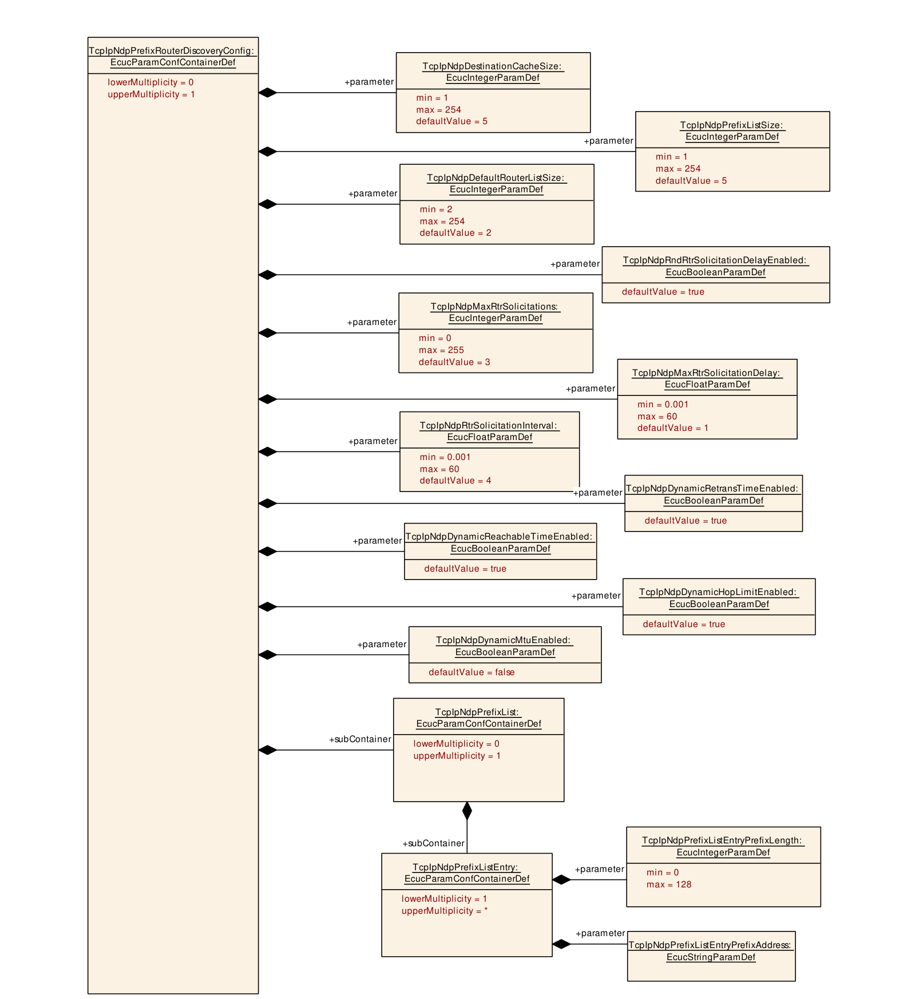

| 项目 | 内容 |
| --- | --- |
| SWS 条目 | [ECUC_TcpIp_00124] |
| 容器名称 | TcpIpNdpPrefixRouterDiscoveryConfig |
| 父容器 | TcpIpNdpConfig |
| 描述 | 规定NDP前缀和路由器发现的配置参数。 |
| 配置参数 | 见下方参数表 |

| 包含的容器 | 容器名称 | 多重性 | 作用域/依赖 |
| --- | --- | --- | --- |
| 包含的容器 | TcpIpNdpPrefixList | 0..1 | 见9.2.32节 |

| 项目 | 内容 |
| --- | --- |
| SWS 条目 | [ECUC_TcpIp_00139] |
| 参数名称 | TcpIpNdpDefaultRouterListSize |
| 父容器 | TcpIpNdpPrefixRouterDiscoveryConfig |
| 描述 | 默认路由器条目的最大数量。[RFC4861 5.1. Conceptual Data Structures] |
| 多重性 | 1 |
| 类型 | EcucIntegerParamDef |
| 范围 | 2 .. 254 |
| 默认值 | 2 |
| Post-Build 变体值 | false |
| 值配置类 | Pre-compile time：X（All Variants）；Link time：-；Post-build time：- |
| 作用域/依赖 | scope: local |

| 项目 | 内容 |
| --- | --- |
| SWS 条目 | [ECUC_TcpIp_00138] |
| 参数名称 | TcpIpNdpDestinationCacheSize |
| 父容器 | TcpIpNdpPrefixRouterDiscoveryConfig |
| 描述 | 目标缓存中条目的最大数量。[RFC4861 5.1. Conceptual Data Structures] |
| 多重性 | 1 |
| 类型 | EcucIntegerParamDef |
| 范围 | 1 .. |
| 默认值 | 5 |
| Post-Build 变体值 | false |
| 值配置类 | Pre-compile time：X（All Variants）；Link time：-；Post-build time：- |
| 作用域/依赖 | scope: local |

| 项目 | 内容 |
| --- | --- |
| SWS 条目 | [ECUC_TcpIp_00147] |
| 参数名称 | TcpIpNdpDynamicHopLimitEnabled |
| 父容器 | TcpIpNdpPrefixRouterDiscoveryConfig |
| 描述 | 如果启用，默认跳数限制可以基于接收到的路由器通告重新配置。[RFC4861 6.3.4. Processing Received Router Advertisements] |
| 多重性 | 1 |
| 类型 | EcucBooleanParamDef |
| 默认值 | true |
| Post-Build 变体值 | false |
| 值配置类 | Pre-compile time：X（All Variants）；Link time：-；Post-build time：- |
| 作用域/依赖 | scope: local |

| 项目 | 内容 |
| --- | --- |
| SWS 条目 | [ECUC_TcpIp_00148] |
| 参数名称 | TcpIpNdpDynamicMtuEnabled |
| 父容器 | TcpIpNdpPrefixRouterDiscoveryConfig |
| 描述 | 允许通过路由器通告动态重新配置链路MTU。[RFC4861 4.6.4. MTU] |
| 多重性 | 1 |
| 类型 | EcucBooleanParamDef |
| 默认值 | false |
| Post-Build 变体值 | false |
| 值配置类 | Pre-compile time：X（All Variants）；Link time：-；Post-build time：- |
| 作用域/依赖 | scope: local |

| 项目 | 内容 |
| --- | --- |
| SWS 条目 | [ECUC_TcpIp_00146] |
| 参数名称 | TcpIpNdpDynamicReachableTimeEnabled |
| 父容器 | TcpIpNdpPrefixRouterDiscoveryConfig |
| 描述 | 如果启用，默认可达时间（Reachable Time）值可以基于接收到的路由器通告重新配置。[RFC4861 6.3.4. Processing Received Router Advertisements] 默认值：启用。 |
| 多重性 | 1 |
| 类型 | EcucBooleanParamDef |
| 默认值 | true |
| Post-Build 变体值 | false |
| 值配置类 | Pre-compile time：X（All Variants）；Link time：-；Post-build time：- |
| 作用域/依赖 | scope: local |

| 项目 | 内容 |
| --- | --- |
| SWS 条目 | [ECUC_TcpIp_00145] |
| 参数名称 | TcpIpNdpDynamicRetransTimeEnabled |
| 父容器 | TcpIpNdpPrefixRouterDiscoveryConfig |
| 描述 | 如果启用，默认重传定时器值可以基于接收到的路由器通告重新配置。[RFC4861 6.3.4. Processing Received Router Advertisements] 默认值：启用。 |
| 多重性 | 1 |
| 类型 | EcucBooleanParamDef |
| 默认值 | true |
| Post-Build 变体值 | false |
| 值配置类 | Pre-compile time：X（All Variants）；Link time：-；Post-build time：- |
| 作用域/依赖 | scope: local |

| 项目 | 内容 |
| --- | --- |
| SWS 条目 | [ECUC_TcpIp_00143] |
| 参数名称 | TcpIpNdpMaxRtrSolicitationDelay |
| 父容器 | TcpIpNdpPrefixRouterDiscoveryConfig |
| 描述 | 接口初始化之后发送第一个路由器请求之前的最大延迟（秒）。[RFC4861 6.3.7. Sending Router Solicitations] 默认值：MAX_RTR_SOLICITATION_DELAY = 1秒。 |
| 多重性 | 1 |
| 类型 | EcucFloatParamDef |
| 范围 | [0.001 .. 60] |
| 默认值 | 1 |
| Post-Build 变体值 | false |
| 值配置类 | Pre-compile time：X（All Variants）；Link time：-；Post-build time：- |
| 作用域/依赖 | scope: local |

| 项目 | 内容 |
| --- | --- |
| SWS 条目 | [ECUC_TcpIp_00142] |
| 参数名称 | TcpIpNdpMaxRtrSolicitations |
| 父容器 | TcpIpNdpPrefixRouterDiscoveryConfig |
| 描述 | 在接收到第一个路由器通告之前将发送的路由器请求的最大数量。0 = 不发送路由器请求。这对路由器通告的处理没有影响。[RFC4861 6.3.7. Sending Router Solicitations] 默认值：MAX_RTR_SOLICITATIONS = 3次传输。 |
| 多重性 | 1 |
| 类型 | EcucIntegerParamDef |
| 范围 | 0 .. 255 |
| 默认值 | 3 |
| Post-Build 变体值 | false |
| 值配置类 | Pre-compile time：X（All Variants）；Link time：-；Post-build time：- |
| 作用域/依赖 | scope: local |

| 项目 | 内容 |
| --- | --- |
| SWS 条目 | [ECUC_TcpIp_00140] |
| 参数名称 | TcpIpNdpPrefixListSize |
| 父容器 | TcpIpNdpPrefixRouterDiscoveryConfig |
| 描述 | on-link前缀列表中条目的最大数量。[RFC4861 5.1. Conceptual Data Structures] |
| 多重性 | 1 |
| 类型 | EcucIntegerParamDef |
| 范围 | 1 .. |
| 默认值 | 5 |
| Post-Build 变体值 | false |
| 值配置类 | Pre-compile time：X（All Variants）；Link time：-；Post-build time：- |
| 作用域/依赖 | scope: local |

| 项目 | 内容 |
| --- | --- |
| SWS 条目 | [ECUC_TcpIp_00141] |
| 参数名称 | TcpIpNdpRndRtrSolicitationDelayEnabled |
| 父容器 | TcpIpNdpPrefixRouterDiscoveryConfig |
| 描述 | 如果启用，第一个路由器请求将从[0...MAX_RTR_SOLICITATION_DELAY]中随机延迟。否则，第一个路由器请求将在精确的MAX_RTR_SOLICITATION_DELAY毫秒之后发送。[RFC4861 6.3.7. Sending Router Solicitations] 默认值：启用。 |
| 多重性 | 1 |
| 类型 | EcucBooleanParamDef |
| 默认值 | true |
| Post-Build 变体值 | false |
| 值配置类 | Pre-compile time：X（All Variants）；Link time：-；Post-build time：- |
| 作用域/依赖 | scope: local |

| 项目 | 内容 |
| --- | --- |
| SWS 条目 | [ECUC_TcpIp_00144] |
| 参数名称 | TcpIpNdpRtrSolicitationInterval |
| 父容器 | TcpIpNdpPrefixRouterDiscoveryConfig |
| 描述 | 连续路由器请求之间的间隔（秒）。[RFC4861 6.3.7. Sending Router Solicitations] 默认值：RTR_SOLICITATION_INTERVAL = 4秒。 |
| 多重性 | 1 |
| 类型 | EcucFloatParamDef |
| 范围 | [0.001 .. 60] |
| 默认值 | 4 |
| Post-Build 变体值 | false |
| 值配置类 | Pre-compile time：X（All Variants）；Link time：-；Post-build time：- |
| 作用域/依赖 | scope: local |

#### 9.2.32. TcpIpNdpPrefixList

| 项目 | 内容 |
| --- | --- |
| SWS 条目 | [ECUC_TcpIp_00205] |
| 容器名称 | TcpIpNdpPrefixList |
| 父容器 | TcpIpNdpPrefixRouterDiscoveryConfig |
| 描述 | 规定按照IETF RFC 4861第5.1节应被视为「on-link」的前缀列表。 |
| 配置参数 | 见下方参数表 |

| 包含的容器 | 容器名称 | 多重性 | 作用域/依赖 |
| --- | --- | --- | --- |
| 包含的容器 | TcpIpNdpPrefixListEntry | 1..* | 见9.2.33节 |

#### 9.2.33. TcpIpNdpPrefixListEntry

| 项目 | 内容 |
| --- | --- |
| SWS 条目 | [ECUC_TcpIp_00206] |
| 容器名称 | TcpIpNdpPrefixListEntry |
| 父容器 | TcpIpNdpPrefixList |
| 描述 | 前缀列表中的单个条目。 |
| 配置参数 | 见下方参数表 |

无包含的容器。

| 项目 | 内容 |
| --- | --- |
| SWS 条目 | [ECUC_TcpIp_00208] |
| 参数名称 | TcpIpNdpPrefixListEntryPrefixAddress |
| 父容器 | TcpIpNdpPrefixListEntry |
| 描述 | IP地址的前缀。该前缀可用于on-link判定。 |
| 多重性 | 1 |
| 类型 | EcucStringParamDef |
| 默认值 | - |
| Post-Build 变体值 | false |
| 值配置类 | Pre-compile time：X（All Variants）；Link time：-；Post-build time：- |
| 作用域/依赖 | scope: local |

| 项目 | 内容 |
| --- | --- |
| SWS 条目 | [ECUC_TcpIp_00207] |
| 参数名称 | TcpIpNdpPrefixListEntryPrefixLength |
| 父容器 | TcpIpNdpPrefixListEntry |
| 描述 | 前导位的数量。 |
| 多重性 | 1 |
| 类型 | EcucIntegerParamDef |
| 默认值 | - |
| 值配置类 | Pre-compile time：X（All Variants）；Link time：-；Post-build time：- |
| 作用域/依赖 | scope: local |

#### 9.2.34. TcpIpNdpSlaacConfig

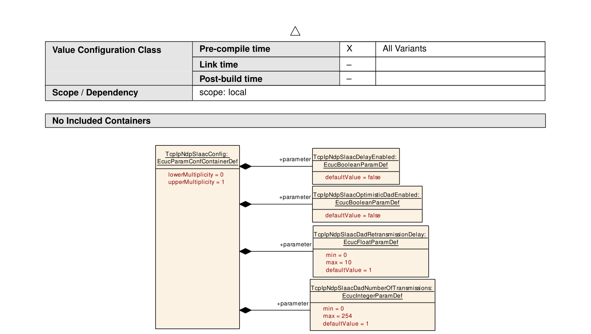

| 项目 | 内容 |
| --- | --- |
| SWS 条目 | [ECUC_TcpIp_00122] |
| 容器名称 | TcpIpNdpSlaacConfig |
| 父容器 | TcpIpNdpConfig |
| 描述 | 规定无状态地址自动配置（**StateLess Address AutoConfiguration**）的配置参数。 |
| 配置参数 | 见下方参数表 |

无包含的容器。

| 项目 | 内容 |
| --- | --- |
| SWS 条目 | [ECUC_TcpIp_00128] |
| 参数名称 | TcpIpNdpSlaacDadNumberOfTransmissions |
| 父容器 | TcpIpNdpSlaacConfig |
| 描述 | 为了将自动配置的地址置为PREFERRED（可用）状态而必须无应答的邻居请求的数量。[RFC4861 5.1. Node Configuration Variables] 默认值：DupAddrDetectTransmits = 1。将该值设置为0将关闭DAD。 |
| 多重性 | 1 |
| 类型 | EcucIntegerParamDef |
| 范围 | 0 .. 254 |
| 默认值 | 1 |
| Post-Build 变体值 | false |
| 值配置类 | Pre-compile time：X（All Variants）；Link time：-；Post-build time：- |
| 作用域/依赖 | scope: local |

| 项目 | 内容 |
| --- | --- |
| SWS 条目 | [ECUC_TcpIp_00127] |
| 参数名称 | TcpIpNdpSlaacDadRetransmissionDelay |
| 父容器 | TcpIpNdpSlaacConfig |
| 描述 | 设置地址配置延迟（秒）的最大值。根据[RFC4861 5.4.2. Sending Neighbor Solicitation Messages]，该值应与MAX_RTR_SOLICITATION_DELAY相同。默认值：MAX_RTR_SOLICITATION_DELAY = 1秒。 |
| 多重性 | 1 |
| 类型 | EcucFloatParamDef |
| 范围 | [0 .. 10] |
| 默认值 | 1 |
| Post-Build 变体值 | false |
| 值配置类 | Pre-compile time：X（All Variants）；Link time：-；Post-build time：- |
| 作用域/依赖 | scope: local |

| 项目 | 内容 |
| --- | --- |
| SWS 条目 | [ECUC_TcpIp_00125] |
| 参数名称 | TcpIpNdpSlaacDelayEnabled |
| 父容器 | TcpIpNdpSlaacConfig |
| 描述 | 如果启用，第一个DAD邻居请求的发送将通过[0...MAX_DAD_DELAY]中的随机值延迟。「这有助于在许多节点（例如断电之后）同时在链路上启动时缓解拥塞，并可能有助于避免多个节点同时试图请求同一地址时的竞态条件。」「该延迟还将避免多个节点准备通过接收同一条多播路由器通告来配置地址时的类似拥塞。」[RFC4861 5.4.2. Sending Neighbor Solicitation Messages] |
| 多重性 | 1 |
| 类型 | EcucBooleanParamDef |
| 默认值 | false |
| Post-Build 变体值 | false |
| 值配置类 | Pre-compile time：X（All Variants）；Link time：-；Post-build time：- |
| 作用域/依赖 | scope: local |

| 项目 | 内容 |
| --- | --- |
| SWS 条目 | [ECUC_TcpIp_00126] |
| 参数名称 | TcpIpNdpSlaacOptimisticDadEnabled |
| 父容器 | TcpIpNdpSlaacConfig |
| 描述 | 按照RFC4429启用乐观重复地址检测（DAD）。 |
| 多重性 | 1 |
| 类型 | EcucBooleanParamDef |
| 默认值 | false |
| Post-Build 变体值 | false |
| 值配置类 | Pre-compile time：X（All Variants）；Link time：-；Post-build time：- |
| 作用域/依赖 | scope: local |

#### 9.2.35. TcpIpLocalAddr

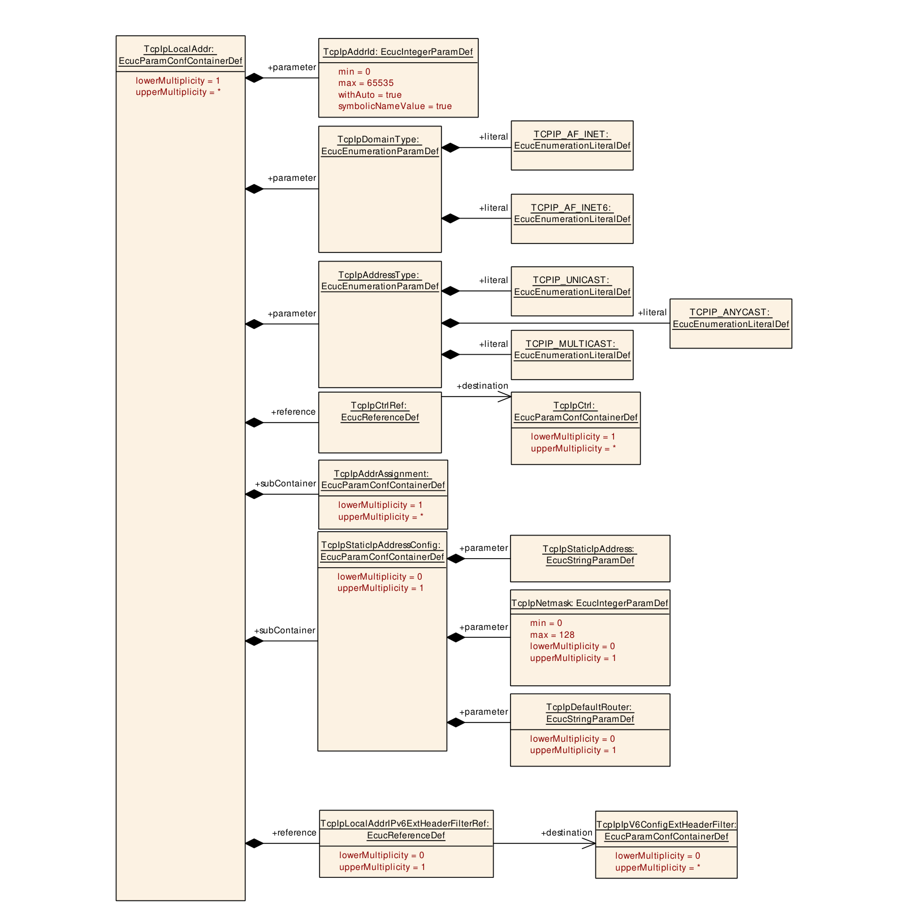

| 项目 | 内容 |
| --- | --- |
| SWS 条目 | [ECUC_TcpIp_00020] |
| 容器名称 | TcpIpLocalAddr |
| 父容器 | TcpIpConfig |
| 描述 | 规定用于IP通信的本地IP（互联网协议）地址。 |
| 配置参数 | 见下方参数表 |

| 包含的容器 | 容器名称 | 多重性 | 作用域/依赖 |
| --- | --- | --- | --- |
| 包含的容器 | TcpIpAddrAssignment | 1..* | 见9.2.36节 |
| 包含的容器 | TcpIpStaticIpAddressConfig | 0..1 | 见9.2.37节 |

| 项目 | 内容 |
| --- | --- |
| SWS 条目 | [ECUC_TcpIp_00031] |
| 参数名称 | TcpIpAddressType |
| 父容器 | TcpIpLocalAddr |
| 描述 | 地址类型。 |
| 多重性 | 1 |
| 类型 | EcucEnumerationParamDef |
| 范围 | TCPIP_ANYCAST；TCPIP_MULTICAST；TCPIP_UNICAST |
| Post-Build 变体值 | true |
| 值配置类 | Pre-compile time：X（VARIANT-PRE-COMPILE）；Link time：X（VARIANT-LINK-TIME）；Post-build time：X（VARIANT-POST-BUILD） |
| 作用域/依赖 | scope: local |

| 项目 | 内容 |
| --- | --- |
| SWS 条目 | [ECUC_TcpIp_00029] |
| 参数名称 | TcpIpAddrId |
| 父容器 | TcpIpLocalAddr |
| 描述 | TCP/IP协议栈分配的IP地址表标识符。 |
| 多重性 | 1 |
| 类型 | EcucIntegerParamDef (Symbolic Name generated for this parameter) |
| 范围 | 0 .. 65535 |
| 默认值 | - |
| Post-Build 变体值 | false |
| 值配置类 | Pre-compile time：X（All Variants）；Link time：-；Post-build time：- |
| 作用域/依赖 | scope: ECU withAuto = true |

| 项目 | 内容 |
| --- | --- |
| SWS 条目 | [ECUC_TcpIp_00030] |
| 参数名称 | TcpIpDomainType |
| 父容器 | TcpIpLocalAddr |
| 描述 | 地址族。 |
| 多重性 | 1 |
| 类型 | EcucEnumerationParamDef |
| 范围 | TCPIP_AF_INET；TCPIP_AF_INET6 |
| Post-Build 变体值 | true |
| 值配置类 | Pre-compile time：X（VARIANT-PRE-COMPILE）；Link time：X（VARIANT-LINK-TIME）；Post-build time：X（VARIANT-POST-BUILD） |
| 作用域/依赖 | scope: local |

| 项目 | 内容 |
| --- | --- |
| SWS 条目 | [ECUC_TcpIp_00032] |
| 参数名称 | TcpIpCtrlRef |
| 父容器 | TcpIpLocalAddr |
| 描述 | 对TcpIpCtrl的引用，规定IP地址应分配到的EthIf控制器。 |
| 多重性 | 1 |
| 类型 | Reference to TcpIpCtrl |
| Post-Build 变体值 | true |
| 值配置类 | Pre-compile time：X（VARIANT-PRE-COMPILE）；Link time：X（VARIANT-LINK-TIME）；Post-build time：X（VARIANT-POST-BUILD） |
| 作用域/依赖 | scope: local |

| 项目 | 内容 |
| --- | --- |
| SWS 条目 | [ECUC_TcpIp_00200] |
| 参数名称 | TcpIpLocalAddrIPv6ExtHeaderFilterRef |
| 父容器 | TcpIpLocalAddr |
| 描述 | 对此本地IPv6地址允许的IPv6扩展报头集合的引用。注意：仅当相关的TcpIpDomainType为TCPIP_AF_INET6时该参数才相关。 |
| 多重性 | 0..1 |
| 类型 | Reference to TcpIpIpV6ConfigExtHeaderFilter |
| Post-Build 变体多重性 | true |
| Post-Build 变体值 | true |
| 值配置类 | Pre-compile time：X（VARIANT-PRE-COMPILE）；Link time：X（VARIANT-LINK-TIME）；Post-build time：X（VARIANT-POST-BUILD） |
| 多重性配置类 | Pre-compile time：X（VARIANT-PRE-COMPILE）；Link time：X（VARIANT-LINK-TIME）；Post-build time：X（VARIANT-POST-BUILD） |
| 作用域/依赖 | dependency: only relevant if TcpIpDomainType = TCPIP_AF_INET6 |

#### 9.2.36. TcpIpAddrAssignment

| 项目 | 内容 |
| --- | --- |
| SWS 条目 | [ECUC_TcpIp_00033] |
| 容器名称 | TcpIpAddrAssignment |
| 父容器 | TcpIpLocalAddr |
| 描述 | 该容器是TcpIpLocalAddr的子容器，规定IP地址的分配策略。 |
| 配置参数 | 见下方参数表 |

无包含的容器。

| 项目 | 内容 |
| --- | --- |
| SWS 条目 | [ECUC_TcpIp_00186] |
| 参数名称 | TcpIpAssignmentLifetime |
| 父容器 | TcpIpAddrAssignment |
| 描述 | 定义动态获取的IP地址的生存期。如果TcpIpAssignmentMethod = TCPIP_STATIC，则应省略TcpIpAssignmentLifetime。 |
| 多重性 | 0..1 |
| 类型 | EcucEnumerationParamDef |
| 范围 | TCPIP_FORGET；TCPIP_STORE |
| 默认值 | TCPIP_FORGET |
| Post-Build 变体值 | true |
| 值配置类 | Pre-compile time：X（VARIANT-PRE-COMPILE）；Link time：X（VARIANT-LINK-TIME）；Post-build time：X（VARIANT-POST-BUILD） |
| 作用域/依赖 | scope: local |

| 项目 | 内容 |
| --- | --- |
| SWS 条目 | [ECUC_TcpIp_00035] |
| 参数名称 | TcpIpAssignmentMethod |
| 父容器 | TcpIpAddrAssignment |
| 描述 | 地址分配的方法。 |
| 多重性 | 1 |
| 类型 | EcucEnumerationParamDef |
| 范围 | TCPIP_DHCP；TCPIP_IPV6_ROUTER；TCPIP_LINKLOCAL；TCPIP_LINKLOCAL_DOIP；TCPIP_STATIC |
| Post-Build 变体值 | true |
| 值配置类 | Pre-compile time：X（VARIANT-PRE-COMPILE）；Link time：X（VARIANT-LINK-TIME）；Post-build time：X（VARIANT-POST-BUILD） |
| 作用域/依赖 | scope: local |

| 项目 | 内容 |
| --- | --- |
| SWS 条目 | [ECUC_TcpIp_00037] |
| 参数名称 | TcpIpAssignmentPriority |
| 父容器 | TcpIpAddrAssignment |
| 描述 | 分配的优先级（1为最高）。如果来自具有更高优先级的分配方法的新地址可用，它将覆盖先前由较低优先级分配方法分配的IP地址。 |
| 多重性 | 1 |
| 类型 | EcucIntegerParamDef |
| 范围 | 1 .. 3 |
| 默认值 | - |
| Post-Build 变体值 | true |
| 值配置类 | Pre-compile time：X（VARIANT-PRE-COMPILE）；Link time：X（VARIANT-LINK-TIME）；Post-build time：X（VARIANT-POST-BUILD） |
| 作用域/依赖 | scope: local |

| 项目 | 内容 |
| --- | --- |
| SWS 条目 | [ECUC_TcpIp_00036] |
| 参数名称 | TcpIpAssignmentTrigger |
| 父容器 | TcpIpAddrAssignment |
| 描述 | 地址分配的触发器。 |
| 多重性 | 1 |
| 类型 | EcucEnumerationParamDef |
| 范围 | TCPIP_AUTOMATIC；TCPIP_MANUAL |
| Post-Build 变体值 | true |
| 值配置类 | Pre-compile time：X（VARIANT-PRE-COMPILE）；Link time：X（VARIANT-LINK-TIME）；Post-build time：X（VARIANT-POST-BUILD） |
| 作用域/依赖 | scope: local |

#### 9.2.37. TcpIpStaticIpAddressConfig

| 项目 | 内容 |
| --- | --- |
| SWS 条目 | [ECUC_TcpIp_00034] |
| 容器名称 | TcpIpStaticIpAddressConfig |
| 父容器 | TcpIpLocalAddr |
| 描述 | 该容器是TcpIpLocalAddr的子容器，规定一个静态IP地址及其直接相关的参数。 |
| 配置参数 | 见下方参数表 |

无包含的容器。

| 项目 | 内容 |
| --- | --- |
| SWS 条目 | [ECUC_TcpIp_00040] |
| 参数名称 | TcpIpDefaultRouter |
| 父容器 | TcpIpStaticIpAddressConfig |
| 描述 | 默认路由器（网关）的IP地址。 |
| 多重性 | 0..1 |
| 类型 | EcucStringParamDef |
| 默认值 | - |
| Post-Build 变体多重性 | true |
| Post-Build 变体值 | true |
| 值配置类 | Pre-compile time：X（VARIANT-PRE-COMPILE）；Link time：X（VARIANT-LINK-TIME）；Post-build time：X（VARIANT-POST-BUILD） |
| 多重性配置类 | Pre-compile time：X（VARIANT-PRE-COMPILE）；Link time：X（VARIANT-LINK-TIME）；Post-build time：X（VARIANT-POST-BUILD） |
| 作用域/依赖 | scope: local |

| 项目 | 内容 |
| --- | --- |
| SWS 条目 | [ECUC_TcpIp_00039] |
| 参数名称 | TcpIpNetmask |
| 父容器 | TcpIpStaticIpAddressConfig |
| 描述 | IPv4地址的网络掩码或IPv6地址的CIDR表示法地址前缀，即描述定义IP地址网络号或前缀的有效位数的十进制值，介于0和32（IPv4）或0和128（IPv6）之间。 |
| 多重性 | 0..1 |
| 类型 | EcucIntegerParamDef |
| 范围 | 0 .. 128 |
| 默认值 | - |
| Post-Build 变体多重性 | true |
| Post-Build 变体值 | true |
| 值配置类 | Pre-compile time：X（VARIANT-PRE-COMPILE）；Link time：X（VARIANT-LINK-TIME）；Post-build time：X（VARIANT-POST-BUILD） |
| 多重性配置类 | Pre-compile time：X（VARIANT-PRE-COMPILE）；Link time：X（VARIANT-LINK-TIME）；Post-build time：X（VARIANT-POST-BUILD） |
| 作用域/依赖 | scope: local |

| 项目 | 内容 |
| --- | --- |
| SWS 条目 | [ECUC_TcpIp_00038] |
| 参数名称 | TcpIpStaticIpAddress |
| 父容器 | TcpIpStaticIpAddressConfig |
| 描述 | 静态IP地址。要为某个EthIfCtrl规定任意IP地址，必须将「ANY」设置为通配符。详情见TcpIp_Bind()。 |
| 多重性 | 1 |
| 类型 | EcucStringParamDef |
| 默认值 | - |

#### 9.2.38. TcpIpNvmBlock

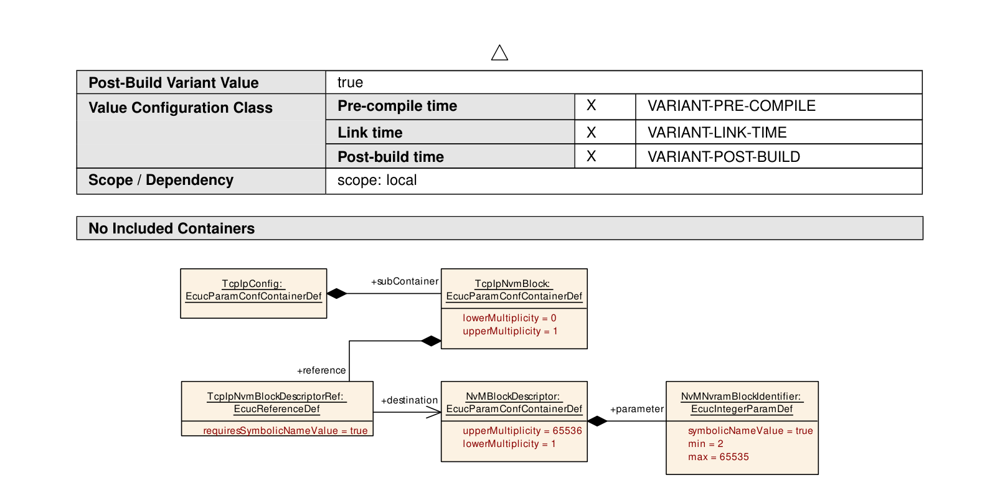

| 项目 | 内容 |
| --- | --- |
| SWS 条目 | [ECUC_TcpIp_00184] |
| 容器名称 | TcpIpNvmBlock |
| 父容器 | TcpIpConfig |
| 描述 | 在TcpIp模块需要ECU中的非易失性内存来存储信息（例如应存储通过DHCP接收的IP地址）的情况下，对NvM可选使用的配置。 |
| 多重性配置类 | Pre-compile time：X（VARIANT-PRE-COMPILE）；Link time：X（VARIANT-LINK-TIME, VARIANT-POST-BUILD）；Post-build time：- |
| 配置参数 | 见下方参数表 |

无包含的容器。

| 项目 | 内容 |
| --- | --- |
| SWS 条目 | [ECUC_TcpIp_00185] |
| 参数名称 | TcpIpNvmBlockDescriptorRef |
| 父容器 | TcpIpNvmBlock |
| 描述 | 对NvM模块配置中NvM块描述的引用。 |
| 多重性 | 1 |
| 类型 | Symbolic name reference to NvMBlockDescriptor |
| Post-Build 变体值 | true |
| 值配置类 | Pre-compile time：X（VARIANT-PRE-COMPILE）；Link time：X（VARIANT-LINK-TIME, VARIANT-POST-BUILD）；Post-build time：-；Pre-compile time：X（VARIANT-PRE-COMPILE）；Link time：X（VARIANT-LINK-TIME）；Post-build time：X（VARIANT-POST-BUILD） |
| 作用域/依赖 | scope: ECU、scope: local |

#### 9.2.39. TcpIpPhysAddrConfig

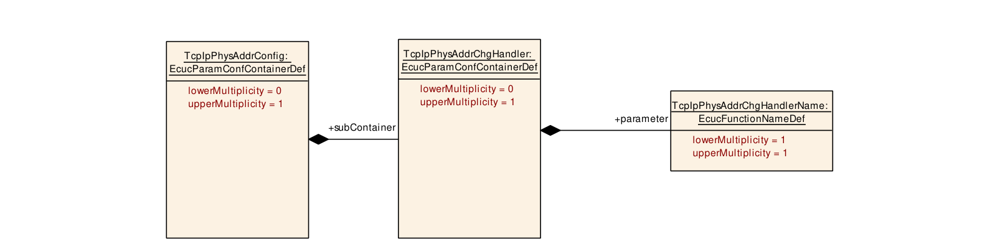

| 项目 | 内容 |
| --- | --- |
| SWS 条目 | [ECUC_TcpIp_00083] |
| 容器名称 | TcpIpPhysAddrConfig |
| 父容器 | TcpIpConfig |
| 描述 | 规定物理地址配置。 |
| 配置参数 | 见下方参数表 |

| 包含的容器 | 容器名称 | 多重性 | 作用域/依赖 |
| --- | --- | --- | --- |
| 包含的容器 | TcpIpPhysAddrChgHandler | 0..1 | 见9.2.40节 |

#### 9.2.40. TcpIpPhysAddrChgHandler

| 项目 | 内容 |
| --- | --- |
| SWS 条目 | [ECUC_TcpIp_00084] |
| 容器名称 | TcpIpPhysAddrChgHandler |
| 父容器 | TcpIpPhysAddrConfig |
| 描述 | 该容器是TcpIpPhysAddrConfig的子容器，规定物理地址变更处理器的配置参数。 |
| 配置参数 | 见下方参数表 |

无包含的容器。

| 项目 | 内容 |
| --- | --- |
| SWS 条目 | [ECUC_TcpIp_00086] |
| 参数名称 | TcpIpPhysAddrChgHandlerName |
| 父容器 | TcpIpPhysAddrChgHandler |
| 描述 | 该参数定义物理地址变更函数&lt;Up&gt;_PhysAddrTableChg的名称。 |
| 多重性 | 1 |
| 类型 | EcucFunctionNameDef |
| 默认值 | - |
| Post-Build 变体值 | false |
| 值配置类 | Pre-compile time：X（All Variants）；Link time：-；Post-build time：- |
| 作用域/依赖 | scope: ECU |

#### 9.2.41. TcpIpSocketOwnerConfig

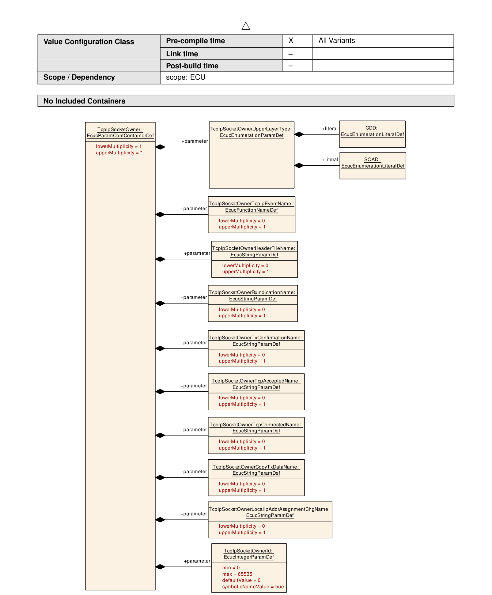

| 项目 | 内容 |
| --- | --- |
| SWS 条目 | [ECUC_TcpIp_00172] |
| 容器名称 | TcpIpSocketOwnerConfig |
| 父容器 | TcpIpConfig |
| 描述 | 规定使用套接字API的TcpIp上层模块。 |
| 配置参数 | 见下方参数表 |

| 包含的容器 | 容器名称 | 多重性 | 作用域/依赖 |
| --- | --- | --- | --- |
| 包含的容器 | TcpIpSocketOwner | 1..* | 见9.2.42节 |

#### 9.2.42. TcpIpSocketOwner

| 项目 | 内容 |
| --- | --- |
| SWS 条目 | [ECUC_TcpIp_00173] |
| 容器名称 | TcpIpSocketOwner |
| 父容器 | TcpIpSocketOwnerConfig |
| 描述 | 该容器是TcpIpSocketOwnerConfig的子容器，规定一个使用套接字API的TcpIp上层。 |
| 配置参数 | 见下方参数表 |

无包含的容器。

| 项目 | 内容 |
| --- | --- |
| SWS 条目 | [ECUC_TcpIp_00180] |
| 参数名称 | TcpIpSocketOwnerCopyTxDataName |
| 父容器 | TcpIpSocketOwner |
| 描述 | 该参数定义TcpIpSocketOwner模块的&lt;Up_CopyTxData&gt;函数的名称。只有当TcpIpSocketOwnerUpperLayerType设置为CDD时，函数名称才可配置。 |
| 多重性 | 0..1 |
| 类型 | EcucStringParamDef |
| 默认值 | - |
| Post-Build 变体值 | false |
| 值配置类 | Pre-compile time：X（VARIANT-PRE-COMPILE）；Link time：X（VARIANT-LINK-TIME, VARIANT-POST-BUILD）；Post-build time：- |
| 作用域/依赖 | scope: local dependency: TcpIpSocketOwnerUpperLayerType |

| 项目 | 内容 |
| --- | --- |
| SWS 条目 | [ECUC_TcpIp_00175] |
| 参数名称 | TcpIpSocketOwnerHeaderFileName |
| 父容器 | TcpIpSocketOwner |
| 描述 | 该参数定义包含TcpIpSocketOwner函数原型声明的头文件的名称。 |
| 多重性 | 0..1 |
| 类型 | EcucStringParamDef |
| 默认值 | - |
| Post-Build 变体值 | false |
| 值配置类 | Pre-compile time：X（VARIANT-PRE-COMPILE）；Link time：X（VARIANT-LINK-TIME, VARIANT-POST-BUILD）；Post-build time：- |
| 作用域/依赖 | scope: local |

| 项目 | 内容 |
| --- | --- |
| SWS 条目 | [ECUC_TcpIp_00316] |
| 参数名称 | TcpIpSocketOwnerId |
| 父容器 | TcpIpSocketOwner |
| 描述 | 该值规定套接字用户的ID。 |
| 多重性 | 1 |
| 类型 | EcucIntegerParamDef (Symbolic Name generated for this parameter) |
| 范围 | 0 .. 65535 |
| 默认值 | 0 |
| Post-Build 变体多重性 | false |
| Post-Build 变体值 | false |
| 值配置类 | Pre-compile time：X；Link time：-；Post-build time：- |
| 多重性配置类 | Pre-compile time：X；Link time：-；Post-build time：- |
| 作用域/依赖 | scope: local |

| 项目 | 内容 |
| --- | --- |
| SWS 条目 | [ECUC_TcpIp_00181] |
| 参数名称 | TcpIpSocketOwnerLocalIpAddrAssignmentChgName |
| 父容器 | TcpIpSocketOwner |
| 描述 | 该参数定义TcpIpSocketOwner模块的&lt;Up_LocalIpAddrAssignmentChg&gt;函数的名称。只有当TcpIpSocketOwnerUpperLayerType设置为CDD时，函数名称才可配置。 |
| 多重性 | 0..1 |
| 类型 | EcucStringParamDef |
| 默认值 | - |
| Post-Build 变体值 | false |
| 值配置类 | Pre-compile time：X（VARIANT-PRE-COMPILE）；Link time：X（VARIANT-LINK-TIME, VARIANT-POST-BUILD）；Post-build time：- |
| 作用域/依赖 | scope: local dependency: TcpIpSocketOwnerUpperLayerType |

| 项目 | 内容 |
| --- | --- |
| SWS 条目 | [ECUC_TcpIp_00176] |
| 参数名称 | TcpIpSocketOwnerRxIndicationName |
| 父容器 | TcpIpSocketOwner |
| 描述 | 该参数定义TcpIpSocketOwner模块的&lt;Up_RxIndication&gt;函数的名称。只有当TcpIpSocketOwnerUpperLayerType设置为CDD时，函数名称才可配置。 |
| 多重性 | 0..1 |
| 类型 | EcucStringParamDef |
| 默认值 | - |
| Post-Build 变体值 | false |
| 值配置类 | Pre-compile time：X（VARIANT-PRE-COMPILE）；Link time：X（VARIANT-LINK-TIME, VARIANT-POST-BUILD）；Post-build time：- |
| 作用域/依赖 | scope: local dependency: TcpIpSocketOwnerUpperLayerType |

| 项目 | 内容 |
| --- | --- |
| SWS 条目 | [ECUC_TcpIp_00178] |
| 参数名称 | TcpIpSocketOwnerTcpAcceptedName |
| 父容器 | TcpIpSocketOwner |
| 描述 | 该参数定义TcpIpSocketOwner模块的&lt;Up_TcpAccepted&gt;函数的名称。只有当TcpIpSocketOwnerUpperLayerType设置为CDD时，函数名称才可配置。 |
| 多重性 | 0..1 |
| 类型 | EcucStringParamDef |
| 默认值 | - |
| Post-Build 变体值 | false |
| 值配置类 | Pre-compile time：X（VARIANT-PRE-COMPILE）；Link time：X（VARIANT-LINK-TIME, VARIANT-POST-BUILD）；Post-build time：- |
| 作用域/依赖 | scope: local dependency: TcpIpSocketOwnerUpperLayerType |

| 项目 | 内容 |
| --- | --- |
| SWS 条目 | [ECUC_TcpIp_00179] |
| 参数名称 | TcpIpSocketOwnerTcpConnectedName |
| 父容器 | TcpIpSocketOwner |
| 描述 | 该参数定义TcpIpSocketOwner模块的&lt;Up_TcpConnected&gt;函数的名称。只有当TcpIpSocketOwnerUpperLayerType设置为CDD时，函数名称才可配置。 |
| 多重性 | 0..1 |
| 类型 | EcucStringParamDef |
| 默认值 | - |
| Post-Build 变体值 | false |
| 值配置类 | Pre-compile time：X（VARIANT-PRE-COMPILE）；Link time：X（VARIANT-LINK-TIME, VARIANT-POST-BUILD）；Post-build time：- |
| 作用域/依赖 | scope: local dependency: TcpIpSocketOwnerUpperLayerType |

| 项目 | 内容 |
| --- | --- |
| SWS 条目 | [ECUC_TcpIp_00197] |
| 参数名称 | TcpIpSocketOwnerTcpIpEventName |
| 父容器 | TcpIpSocketOwner |
| 描述 | 该参数定义TcpIpSocketOwner模块的&lt;Up_TcpIpEvent&gt;函数的名称。只有当TcpIpSocketOwnerUpperLayerType设置为CDD时，函数名称才可配置。 |
| 多重性 | 0..1 |
| 类型 | EcucFunctionNameDef |
| 默认值 | - |
| Post-Build 变体值 | false |
| 值配置类 | Pre-compile time：X（VARIANT-PRE-COMPILE）；Link time：X（VARIANT-LINK-TIME, VARIANT-POST-BUILD）；Post-build time：- |
| 作用域/依赖 | scope: local dependency: TcpIpSocketOwnerUpperLayerType |

| 项目 | 内容 |
| --- | --- |
| SWS 条目 | [ECUC_TcpIp_00177] |
| 参数名称 | TcpIpSocketOwnerTxConfirmationName |
| 父容器 | TcpIpSocketOwner |
| 描述 | 该参数定义TcpIpSocketOwner模块的&lt;Up_TxConfirmation&gt;函数的名称。只有当TcpIpSocketOwnerUpperLayerType设置为CDD时，函数名称才可配置。 |
| 多重性 | 0..1 |
| 类型 | EcucStringParamDef |
| 默认值 | - |
| Post-Build 变体值 | false |
| 值配置类 | Pre-compile time：X（VARIANT-PRE-COMPILE）；Link time：X（VARIANT-LINK-TIME, VARIANT-POST-BUILD）；Post-build time：- |
| 作用域/依赖 | scope: local dependency: TcpIpSocketOwnerUpperLayerType |

| 项目 | 内容 |
| --- | --- |
| SWS 条目 | [ECUC_TcpIp_00174] |
| 参数名称 | TcpIpSocketOwnerUpperLayerType |
| 父容器 | TcpIpSocketOwner |
| 描述 | 规定TcpIpSocketOwner的上层类型（SOAD或CDD）。 |
| 多重性 | 1 |
| 类型 | EcucEnumerationParamDef |
| 范围 | CDD |
| Post-Build 变体值 | true |
| 值配置类 | Pre-compile time：X（VARIANT-PRE-COMPILE） |
| 作用域/依赖 | scope: local |

#### 9.2.43. TcpIpTcpConfig

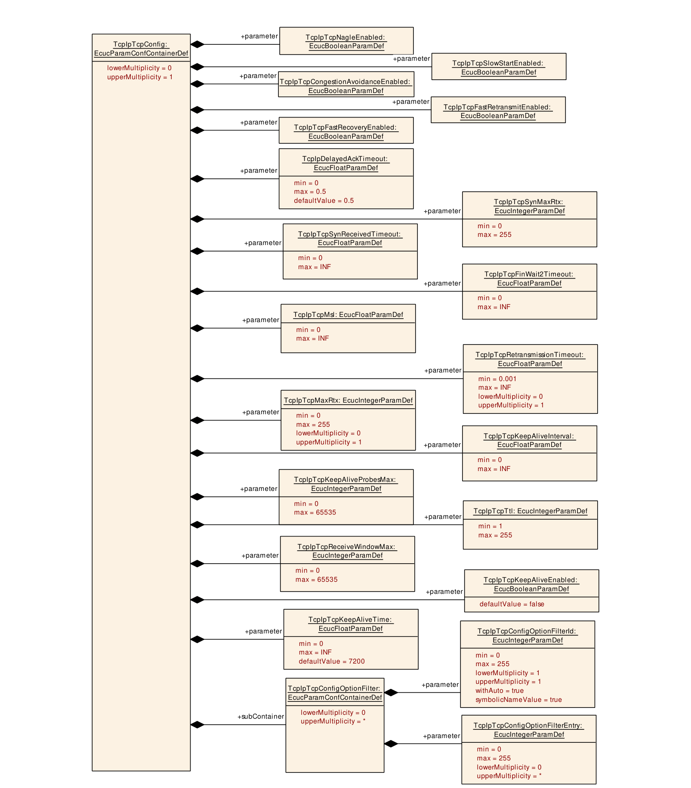

| 项目 | 内容 |
| --- | --- |
| SWS 条目 | [ECUC_TcpIp_00025] |
| 容器名称 | TcpIpTcpConfig |
| 父容器 | TcpIpConfig |
| 描述 | 规定TCP（传输控制协议）子模块的配置参数。 |
| 配置参数 | 见下方参数表 |

| 包含的容器 | 容器名称 | 多重性 | 作用域/依赖 |
| --- | --- | --- | --- |
| 包含的容器 | TcpIpTcpConfigOptionFilter | 0..* | 见9.2.44节 |

| 项目 | 内容 |
| --- | --- |
| SWS 条目 | [ECUC_TcpIp_00318] |
| 参数名称 | TcpIpDelayedAckTimeout |
| 父容器 | TcpIpTcpConfig |
| 描述 | 确认被延迟发送的最长时间（秒）。更多细节另见IETF RFC 1122第4.2.3.2节。 |
| 多重性 | 1 |
| 类型 | EcucFloatParamDef |
| 范围 | ]0 .. 0.5] |
| 默认值 | 0.5 |
| Post-Build 变体值 | true |
| 值配置类 | Pre-compile time：X（VARIANT-PRE-COMPILE）；Link time：X（VARIANT-LINK-TIME）；Post-build time：X（VARIANT-POST-BUILD） |
| 作用域/依赖 | scope: local |

| 项目 | 内容 |
| --- | --- |
| SWS 条目 | [ECUC_TcpIp_00061] |
| 参数名称 | TcpIpTcpCongestionAvoidanceEnabled |
| 父容器 | TcpIpTcpConfig |
| 描述 | 启用（TRUE）或禁用（FALSE）按照IETF RFC 5681的TCP拥塞避免算法支持。 |
| 多重性 | 1 |
| 类型 | EcucBooleanParamDef |
| 默认值 | - |
| Post-Build 变体值 | false |
| 值配置类 | Pre-compile time：X（All Variants）；Link time：-；Post-build time：- |
| 作用域/依赖 | scope: local |

| 项目 | 内容 |
| --- | --- |
| SWS 条目 | [ECUC_TcpIp_00063] |
| 参数名称 | TcpIpTcpFastRecoveryEnabled |
| 父容器 | TcpIpTcpConfig |
| 描述 | 启用（TRUE）或禁用（FALSE）按照IETF RFC 5681的TCP快速恢复支持。 |
| 多重性 | 1 |
| 类型 | EcucBooleanParamDef |
| 默认值 | - |
| Post-Build 变体值 | false |
| 值配置类 | Pre-compile time：X（All Variants） |
| 作用域/依赖 | scope: local |

| 项目 | 内容 |
| --- | --- |
| SWS 条目 | [ECUC_TcpIp_00062] |
| 参数名称 | TcpIpTcpFastRetransmitEnabled |
| 父容器 | TcpIpTcpConfig |
| 描述 | 启用（TRUE）或禁用（FALSE）按照IETF RFC 5681的TCP快速重传支持。 |
| 多重性 | 1 |
| 类型 | EcucBooleanParamDef |
| 默认值 | - |
| Post-Build 变体值 | false |
| 值配置类 | Pre-compile time：X（All Variants）；Link time：-；Post-build time：- |
| 作用域/依赖 | scope: local |

| 项目 | 内容 |
| --- | --- |
| SWS 条目 | [ECUC_TcpIp_00066] |
| 参数名称 | TcpIpTcpFinWait2Timeout |
| 父容器 | TcpIpTcpConfig |
| 描述 | （在此节点已发起连接终止之后）从远程节点接收FIN的超时时间[s]，即在FINWAIT-2中等待来自远程TCP的连接终止请求的最长时间。 |
| 多重性 | 1 |
| 类型 | EcucFloatParamDef |
| 范围 | [0 .. INF] |
| 默认值 | - |
| Post-Build 变体值 | true |
| 值配置类 | Pre-compile time：X（VARIANT-PRE-COMPILE）；Link time：X（VARIANT-LINK-TIME）；Post-build time：X（VARIANT-POST-BUILD） |
| 作用域/依赖 | scope: local |

| 项目 | 内容 |
| --- | --- |
| SWS 条目 | [ECUC_TcpIp_00082] |
| 参数名称 | TcpIpTcpKeepAliveEnabled |
| 父容器 | TcpIpTcpConfig |
| 描述 | 启用（TRUE）或禁用（FALSE）按照IETF RFC 1122第4.2.3.6章的TCP保活探测。 |
| 多重性 | 1 |
| 类型 | EcucBooleanParamDef |
| 默认值 | false |
| Post-Build 变体值 | false |
| 值配置类 | Pre-compile time：X（All Variants）；Link time：-；Post-build time：- |
| 作用域/依赖 | scope: local |

| 项目 | 内容 |
| --- | --- |
| SWS 条目 | [ECUC_TcpIp_00070] |
| 参数名称 | TcpIpTcpKeepAliveInterval |
| 父容器 | TcpIpTcpConfig |
| 描述 | 规定后续保活探测之间的间隔[s]。 |
| 多重性 | 1 |
| 类型 | EcucFloatParamDef |
| 范围 | [0 .. INF] |
| 默认值 | - |
| Post-Build 变体值 | true |
| 值配置类 | Pre-compile time：X（VARIANT-PRE-COMPILE）；Link time：X（VARIANT-LINK-TIME）；Post-build time：X（VARIANT-POST-BUILD） |
| 作用域/依赖 | scope: local |

| 项目 | 内容 |
| --- | --- |
| SWS 条目 | [ECUC_TcpIp_00071] |
| 参数名称 | TcpIpTcpKeepAliveProbesMax |
| 父容器 | TcpIpTcpConfig |
| 描述 | 在连接关闭之前TCP保活被重传的最大次数。 |
| 多重性 | 1 |
| 类型 | EcucIntegerParamDef |
| 范围 | 0 .. 65535 |
| 默认值 | - |
| Post-Build 变体值 | true |
| 值配置类 | Pre-compile time：X（VARIANT-PRE-COMPILE）；Link time：X（VARIANT-LINK-TIME）；Post-build time：X（VARIANT-POST-BUILD） |
| 作用域/依赖 | scope: local |

| 项目 | 内容 |
| --- | --- |
| SWS 条目 | [ECUC_TcpIp_00087] |
| 参数名称 | TcpIpTcpKeepAliveTime |
| 父容器 | TcpIpTcpConfig |
| 描述 | 规定从最后发送的数据包（简单ACK不算数据）到第一个保活探测之间的时间[s]。注意：将该配置参数设置为小于或等于TcpIpMainFunctionPeriod的值，会导致在每个MainFunction周期内都发送保活探测。 |
| 多重性 | 1 |
| 类型 | EcucFloatParamDef |
| 范围 | [0 .. INF] |
| 默认值 | 7200 |
| Post-Build 变体值 | true |
| 值配置类 | Pre-compile time：X（VARIANT-PRE-COMPILE）；Link time：X（VARIANT-LINK-TIME）；Post-build time：X（VARIANT-POST-BUILD） |
| 作用域/依赖 | scope: local dependency: TcpIpTcpKeepAliveEnabled |

| 项目 | 内容 |
| --- | --- |
| SWS 条目 | [ECUC_TcpIp_00069] |
| 参数名称 | TcpIpTcpMaxRtx |
| 父容器 | TcpIpTcpConfig |
| 描述 | 在TCP连接关闭之前TCP段被重传的最大次数。仅当配置了TcpIpTcpRetransmissionTimeout时该参数有效。注意：该参数也适用于FIN重传。 |
| 多重性 | 0..1 |
| 类型 | EcucIntegerParamDef |
| 范围 | 0 .. 255 |
| 默认值 | - |
| Post-Build 变体值 | true |
| 值配置类 | Pre-compile time：X（VARIANT-PRE-COMPILE）；Link time：X（VARIANT-LINK-TIME）；Post-build time：X（VARIANT-POST-BUILD） |
| 作用域/依赖 | dependency: TcpIpTcpRetransmissionTimeout |

| 项目 | 内容 |
| --- | --- |
| SWS 条目 | [ECUC_TcpIp_00067] |
| 参数名称 | TcpIpTcpMsl |
| 父容器 | TcpIpTcpConfig |
| 描述 | 最大段生存期[s]。（注意：TIME-WAIT = 2 x TcpIpTcpMsl——以确保远程节点收到了对其连接终止请求的确认。） |
| 多重性 | 1 |
| 类型 | EcucFloatParamDef |
| 范围 | [0 .. INF] |
| 默认值 | - |
| Post-Build 变体值 | true |
| 值配置类 | Pre-compile time：X（VARIANT-PRE-COMPILE）；Link time：X（VARIANT-LINK-TIME）；Post-build time：X（VARIANT-POST-BUILD） |
| 作用域/依赖 | scope: local |

| 项目 | 内容 |
| --- | --- |
| SWS 条目 | [ECUC_TcpIp_00059] |
| 参数名称 | TcpIpTcpNagleEnabled |
| 父容器 | TcpIpTcpConfig |
| 描述 | 启用（TRUE）或禁用（FALSE）按照IETF RFC 1122（第4.2.3.4节「何时发送数据」）的Nagle算法支持。如果启用，Nagle算法默认对所有TCP套接字激活，但可以通过TcpIp_ChangeParameter() API停用。 |
| 多重性 | 1 |
| 类型 | EcucBooleanParamDef |
| 默认值 | - |
| Post-Build 变体值 | false |
| 值配置类 | Pre-compile time：X（All Variants）；Link time：-；Post-build time：- |
| 作用域/依赖 | scope: local |

| 项目 | 内容 |
| --- | --- |
| SWS 条目 | [ECUC_TcpIp_00073] |
| 参数名称 | TcpIpTcpReceiveWindowMax |
| 父容器 | TcpIpTcpConfig |
| 描述 | 最大接收窗口的默认值（字节）。 |
| 多重性 | 1 |
| 类型 | EcucIntegerParamDef |
| 范围 | 0 .. 65535 |
| 默认值 | - |
| Post-Build 变体值 | true |
| 值配置类 | Pre-compile time：X（VARIANT-PRE-COMPILE）；Link time：X（VARIANT-LINK-TIME）；Post-build time：X（VARIANT-POST-BUILD） |
| 作用域/依赖 | scope: local |

| 项目 | 内容 |
| --- | --- |
| SWS 条目 | [ECUC_TcpIp_00068] |
| 参数名称 | TcpIpTcpRetransmissionTimeout |
| 父容器 | TcpIpTcpConfig |
| 描述 | 在未确认的TCP段被再次发送之前的超时[s]。如果该超时被禁用或设置为INF，则不应重传任何TCP段。可以通过TcpIp_ChangeParameter() API针对特定连接覆盖该值。 |
| 多重性 | 0..1 |
| 类型 | EcucFloatParamDef |
| 范围 | [0.001 .. INF] |
| 默认值 | - |
| Post-Build 变体值 | true |
| 值配置类 | Pre-compile time：X（VARIANT-PRE-COMPILE）；Link time：X（VARIANT-LINK-TIME）；Post-build time：X（VARIANT-POST-BUILD） |
| 作用域/依赖 | scope: local |

| 项目 | 内容 |
| --- | --- |
| SWS 条目 | [ECUC_TcpIp_00327] |
| 参数名称 | TcpIpTcpSackEnabled |
| 父容器 | TcpIpTcpConfig |
| 描述 | 定义是否应按照IETF RFC 2018支持SACK（选择性确认）机制。 |
| 多重性 | 1 |
| 类型 | EcucBooleanParamDef |
| 默认值 | - |
| Post-Build 变体值 | false |
| 值配置类 | Pre-compile time：X（All Variants）；Link time：-；Post-build time：- |
| 作用域/依赖 | scope: local |

| 项目 | 内容 |
| --- | --- |
| SWS 条目 | [ECUC_TcpIp_00060] |
| 参数名称 | TcpIpTcpSlowStartEnabled |
| 父容器 | TcpIpTcpConfig |
| 描述 | 启用（TRUE）或禁用（FALSE）按照IETF RFC 5681的TCP慢启动算法支持。 |
| 多重性 | 1 |
| 类型 | EcucBooleanParamDef |
| 默认值 | - |
| Post-Build 变体值 | false |
| 值配置类 | Pre-compile time：X（All Variants）；Link time：-；Post-build time：- |
| 作用域/依赖 | scope: local |

| 项目 | 内容 |
| --- | --- |
| SWS 条目 | [ECUC_TcpIp_00064] |
| 参数名称 | TcpIpTcpSynMaxRtx |
| 父容器 | TcpIpTcpConfig |
| 描述 | TCP SYN被重传的最大次数。注意：SYN将在TcpIpTcpRetransmissionTimeout之后重试。如果在最后一个TCP SYN发送且TcpIpTcpRetransmissionTimeout到期之后仍未收到匹配的连接请求，则丢弃该连接。 |
| 多重性 | 1 |
| 类型 | EcucIntegerParamDef |
| 范围 | 0 .. 255 |
| 默认值 | - |
| Post-Build 变体值 | true |
| 值配置类 | Pre-compile time：X（VARIANT-PRE-COMPILE）；Link time：X（VARIANT-LINK-TIME）；Post-build time：X（VARIANT-POST-BUILD） |
| 作用域/依赖 | scope: local |

| 项目 | 内容 |
| --- | --- |
| SWS 条目 | [ECUC_TcpIp_00065] |
| 参数名称 | TcpIpTcpSynReceivedTimeout |
| 父容器 | TcpIpTcpConfig |
| 描述 | 完成由远程发起的TCP连接建立的超时[s]，即在已接收和发送连接请求之后，在SYN-RECEIVED中等待确认性连接请求确认的最长时间。 |
| 多重性 | 1 |
| 类型 | EcucFloatParamDef |
| 范围 | [0 .. INF] |
| 默认值 | - |
| Post-Build 变体值 | true |
| 值配置类 | Pre-compile time：X（VARIANT-PRE-COMPILE）；Link time：X（VARIANT-LINK-TIME）；Post-build time：X（VARIANT-POST-BUILD） |
| 作用域/依赖 | scope: local |

| 项目 | 内容 |
| --- | --- |
| SWS 条目 | [ECUC_TcpIp_00072] |
| 参数名称 | TcpIpTcpTtl |
| 父容器 | TcpIpTcpConfig |
| 描述 | 出站TCP数据包的默认生存时间值。 |
| 多重性 | 1 |
| 类型 | EcucIntegerParamDef |
| 范围 | 1 .. 255 |
| 默认值 | - |
| Post-Build 变体值 | true |
| 值配置类 | Pre-compile time：X（VARIANT-PRE-COMPILE）；Link time：X（VARIANT-LINK-TIME）；Post-build time：X（VARIANT-POST-BUILD） |
| 作用域/依赖 | scope: local |

| 项目 | 内容 |
| --- | --- |
| SWS 条目 | [ECUC_TcpIp_00329] |
| 参数名称 | TcpIpTcpWindowScale |
| 父容器 | TcpIpTcpConfig |
| 描述 | 定义TCP窗口缩放。 |
| 多重性 | 1 |
| 类型 | EcucIntegerParamDef |
| 范围 | 0 .. |
| 默认值 | - |
| Post-Build 变体值 | false |
| 值配置类 | Pre-compile time：X（All Variants）；Link time：-；Post-build time：- |
| 作用域/依赖 | scope: local |

| 项目 | 内容 |
| --- | --- |
| SWS 条目 | [ECUC_TcpIp_00328] |
| 参数名称 | TcpIpTcpWindowScaleOptionEnabled |
| 父容器 | TcpIpTcpConfig |
| 描述 | 定义是否应按照IETF RFC 7323第2章支持TCP窗口缩放选项和机制。 |
| 多重性 | 1 |
| 类型 | EcucBooleanParamDef |
| 默认值 | false |
| Post-Build 变体值 | false |
| 值配置类 | Pre-compile time：X（All Variants）；Link time：-；Post-build time：- |
| 作用域/依赖 | scope: local |

#### 9.2.44. TcpIpTcpConfigOptionFilter

| 项目 | 内容 |
| --- | --- |
| SWS 条目 | [ECUC_TcpIp_00202] |
| 容器名称 | TcpIpTcpConfigOptionFilter |
| 父容器 | TcpIpTcpConfig |
| 描述 | 该容器描述用于过滤TCP选项的白名单，即包含未在此列出的TCP选项的段应被静默丢弃。 |
| 多重性配置类 | Pre-compile time：X（VARIANT-PRE-COMPILE）；Link time：X（VARIANT-LINK-TIME）；Post-build time：X（VARIANT-POST-BUILD） |
| Post-Build 变体多重性 | true |
| 配置参数 | 见下方参数表 |

无包含的容器。

| 项目 | 内容 |
| --- | --- |
| SWS 条目 | [ECUC_TcpIp_00204] |
| 参数名称 | TcpIpTcpConfigOptionFilterEntry |
| 父容器 | TcpIpTcpConfigOptionFilter |
| 描述 | 此过滤器允许的TCP选项类型。 |
| 多重性 | 0..* |
| 类型 | EcucIntegerParamDef |
| 范围 | 0 .. 255 |
| 默认值 | - |
| Post-Build 变体多重性 | true |
| Post-Build 变体值 | true |
| 值配置类 | Pre-compile time：X（VARIANT-PRE-COMPILE）；Link time：X（VARIANT-LINK-TIME）；Post-build time：X（VARIANT-POST-BUILD） |
| 多重性配置类 | Pre-compile time：X（VARIANT-PRE-COMPILE）；Link time：X（VARIANT-LINK-TIME）；Post-build time：X（VARIANT-POST-BUILD） |
| 作用域/依赖 | scope: local |

| 项目 | 内容 |
| --- | --- |
| SWS 条目 | [ECUC_TcpIp_00203] |
| 参数名称 | TcpIpTcpConfigOptionFilterId |
| 父容器 | TcpIpTcpConfigOptionFilter |
| 描述 | TCP选项过滤器的标识。 |
| 多重性 | 1 |
| 类型 | EcucIntegerParamDef (Symbolic Name generated for this parameter) |
| 范围 | 0 .. 255 |
| 默认值 | - |
| Post-Build 变体值 | true |
| 值配置类 | Pre-compile time：X（VARIANT-PRE-COMPILE）；Link time：X（VARIANT-LINK-TIME）；Post-build time：X（VARIANT-POST-BUILD） |
| 作用域/依赖 | scope: local |

#### 9.2.45. TcpIpUdpConfig


| 项目 | 内容 |
| --- | --- |
| SWS 条目 | [ECUC_TcpIp_00026] |
| 容器名称 | TcpIpUdpConfig |
| 父容器 | TcpIpConfig |
| 描述 | 规定UDP（用户数据报协议）子模块的配置参数。 |
| 配置参数 | 见下方参数表 |

无包含的容器。

| 项目 | 内容 |
| --- | --- |
| SWS 条目 | [ECUC_TcpIp_00075] |
| 参数名称 | TcpIpUdpTtl |
| 父容器 | TcpIpUdpConfig |
| 描述 | 出站UDP数据包的默认生存时间值。 |
| 多重性 | 1 |
| 类型 | EcucIntegerParamDef |
| 范围 | 1 .. 255 |
| 默认值 | - |
| Post-Build 变体值 | true |
| 值配置类 | Pre-compile time：X（VARIANT-PRE-COMPILE）；Link time：X（VARIANT-LINK-TIME）；Post-build time：X（VARIANT-POST-BUILD） |
| 作用域/依赖 | scope: local |

#### 9.2.46. TcpIpTlsConfig

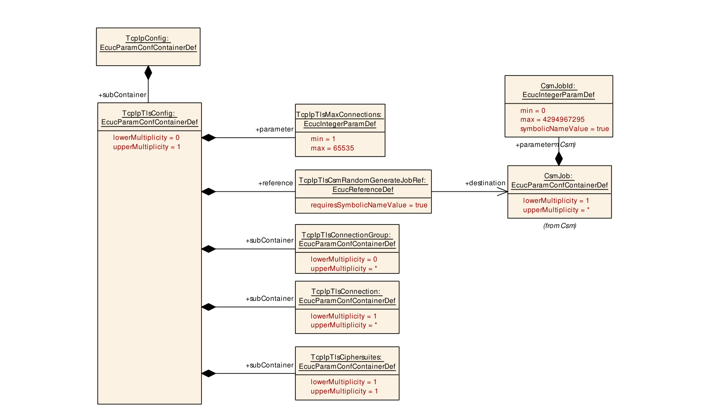

| 项目 | 内容 |
| --- | --- |
| SWS 条目 | [ECUC_TcpIp_00219] |
| 容器名称 | TcpIpTlsConfig |
| 父容器 | TcpIpConfig |
| 描述 | 规定TLS（传输层安全）子模块的配置参数。 |
| 配置参数 | 见下方参数表 |

| 包含的容器 | 容器名称 | 多重性 | 作用域/依赖 |
| --- | --- | --- | --- |
| 包含的容器 | TcpIpTlsCiphersuites | 1 | 见9.2.49节 |
| 包含的容器 | TcpIpTlsConnection | 1..* | 见9.2.48节 |
| 包含的容器 | TcpIpTlsConnectionGroup | 0..* | 见9.2.47节 |

| 项目 | 内容 |
| --- | --- |
| SWS 条目 | [ECUC_TcpIp_00220] |
| 参数名称 | TcpIpTlsMaxConnections |
| 父容器 | TcpIpTlsConfig |
| 描述 | 定义可以同时打开的TLS连接的最大数量。 |
| 多重性 | 1 |
| 类型 | EcucIntegerParamDef |
| 范围 | 1 .. 65535 |
| 默认值 | - |
| Post-Build 变体值 | false |
| 值配置类 | Pre-compile time：X（All Variants）；Link time：-；Post-build time：- |
| 作用域/依赖 | scope: local |

| 项目 | 内容 |
| --- | --- |
| SWS 条目 | [ECUC_TcpIp_00221] |
| 参数名称 | TcpIpTlsCsmRandomGenerateJobRef |
| 父容器 | TcpIpTlsConfig |
| 描述 | 对用于生成随机值的CSM作业的引用。 |
| 多重性 | 1 |
| 类型 | Symbolic name reference to CsmJob |
| Post-Build 变体值 | false |
| 值配置类 | Pre-compile time：X（All Variants）；Link time：-；Post-build time：- |
| 作用域/依赖 | scope: local |

#### 9.2.47. TcpIpTlsConnectionGroup

| 项目 | 内容 |
| --- | --- |
| SWS 条目 | [ECUC_TcpIp_00224] |
| 容器名称 | TcpIpTlsConnectionGroup |
| 父容器 | TcpIpTlsConfig |
| 描述 | 该可选容器用于收集属于一个TlsConnectionGroup的所有TlsConnection。TLS连接组的目的是在组内收集的TLS连接之间共享资源，因为一个组中同时只能使用一个连接。 |
| 配置参数 | 见下方参数表 |

无包含的容器。

#### 9.2.48. TcpIpTlsConnection

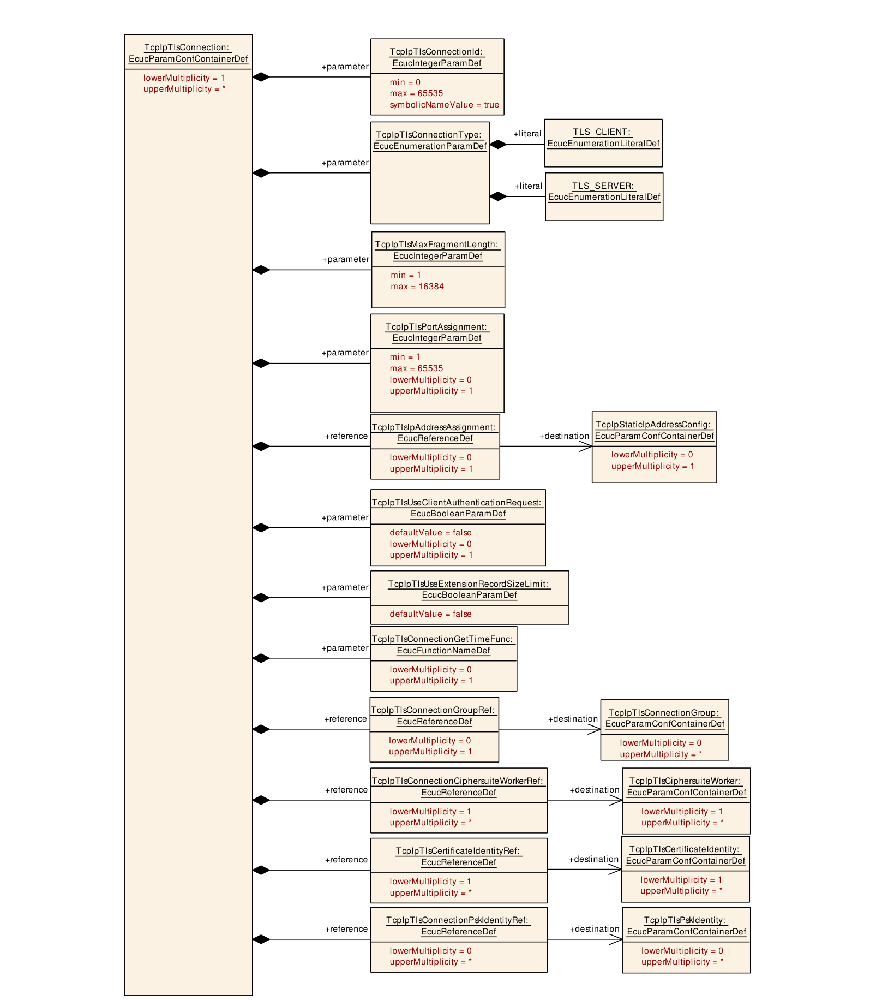

| 项目 | 内容 |
| --- | --- |
| SWS 条目 | [ECUC_TcpIp_00223] |
| 容器名称 | TcpIpTlsConnection |
| 父容器 | TcpIpTlsConfig |
| 描述 | 该容器定义TLS连接的属性。 |
| 配置参数 | 见下方参数表 |

无包含的容器。

| 项目 | 内容 |
| --- | --- |
| SWS 条目 | [ECUC_TcpIp_00232] |
| 参数名称 | TcpIpTlsConnectionGetTimeFunc |
| 父容器 | TcpIpTlsConnection |
| 描述 | 定义Up_TlsGetCurrentTimeStamp()回调的函数名称。 |
| 多重性 | 0..1 |
| 类型 | EcucFunctionNameDef |
| 默认值 | - |
| Post-Build 变体多重性 | false |
| Post-Build 变体值 | false |
| 值配置类 | Pre-compile time：X（All Variants）；Link time：-；Post-build time：- |
| 多重性配置类 | Pre-compile time：X（All Variants）；Link time：-；Post-build time：- |
| 作用域/依赖 | scope: local dependency: This definition is needed if a connection specific time shall be provided with the client hello message. If not present, the time will be set to 0. |

| 项目 | 内容 |
| --- | --- |
| SWS 条目 | [ECUC_TcpIp_00225] |
| 参数名称 | TcpIpTlsConnectionId |
| 父容器 | TcpIpTlsConnection |
| 描述 | 连接的标识符。所配置的标识符集合应是连续且无间隙的。 |
| 多重性 | 1 |
| 类型 | EcucIntegerParamDef (Symbolic Name generated for this parameter) |
| 范围 | 0 .. 65535 |
| 默认值 | - |
| Post-Build 变体值 | false |
| 值配置类 | Pre-compile time：X（All Variants）；Link time：-；Post-build time：- |
| 作用域/依赖 | scope: local |

| 项目 | 内容 |
| --- | --- |
| SWS 条目 | [ECUC_TcpIp_00226] |
| 参数名称 | TcpIpTlsConnectionType |
| 父容器 | TcpIpTlsConnection |
| 描述 | 规定TLS连接是服务器还是客户端。 |
| 多重性 | 1 |
| 类型 | EcucEnumerationParamDef |
| 范围 | TLS_CLIENT；TLS_SERVER |
| Post-Build 变体值 | false |
| 值配置类 | Pre-compile time：X（All Variants）；Link time：-；Post-build time：- |
| 作用域/依赖 | scope: local |

| 项目 | 内容 |
| --- | --- |
| SWS 条目 | [ECUC_TcpIp_00227] |
| 参数名称 | TcpIpTlsMaxFragmentLength |
| 父容器 | TcpIpTlsConnection |
| 描述 | 规定作为块发送的TLS分片的最大长度（字节）。如果应支持ISO 15118-2，范围为512 .. 16384。 |
| 多重性 | 1 |
| 类型 | EcucIntegerParamDef |
| 范围 | 1 .. 16384 |
| 默认值 | - |
| Post-Build 变体值 | false |
| 值配置类 | Pre-compile time：X（All Variants）；Link time：-；Post-build time：- |
| 作用域/依赖 | scope: local |

| 项目 | 内容 |
| --- | --- |
| SWS 条目 | [ECUC_TcpIp_00285] |
| 参数名称 | TcpIpTlsPortAssignment |
| 父容器 | TcpIpTlsConnection |
| 描述 | 规定用于TLS通信的端口地址。 |
| 多重性 | 0..1 |
| 类型 | EcucIntegerParamDef |
| 范围 | 1 .. 65535 |
| 默认值 | - |
| Post-Build 变体多重性 | false |
| Post-Build 变体值 | false |
| 值配置类 | Pre-compile time：X；Link time：-；Post-build time：- |
| 多重性配置类 | Pre-compile time：X；Link time：-；Post-build time：- |
| 作用域/依赖 | scope: local |

| 项目 | 内容 |
| --- | --- |
| SWS 条目 | [ECUC_TcpIp_00230] |
| 参数名称 | TcpIpTlsUseClientAuthenticationRequest |
| 父容器 | TcpIpTlsConnection |
| 描述 | 规定是否应请求客户端认证。 |
| 多重性 | 0..1 |
| 类型 | EcucBooleanParamDef |
| 默认值 | false |
| Post-Build 变体多重性 | false |
| Post-Build 变体值 | false |
| 值配置类 | Pre-compile time：X（All Variants）；Link time：-；Post-build time：- |
| 多重性配置类 | Pre-compile time：X（All Variants）；Link time：-；Post-build time：- |
| 作用域/依赖 | dependency: Informs the TLS_SERVER that a client authentication shall be requested. Can be omitted on TLS_CLIENT side. |

| 项目 | 内容 |
| --- | --- |
| SWS 条目 | [ECUC_TcpIp_00334] |
| 参数名称 | TcpIpTlsUseExtensionCertificateStatusRequest |
| 父容器 | TcpIpTlsConnection |
| 描述 | 定义是否应支持可选扩展status_request_v2。 |
| 多重性 | 1 |
| 类型 | EcucBooleanParamDef |
| 默认值 | false |
| Post-Build 变体值 | false |
| 值配置类 | Pre-compile time：X（All Variants）；Link time：-；Post-build time：- |
| 作用域/依赖 | scope: local |

| 项目 | 内容 |
| --- | --- |
| SWS 条目 | [ECUC_TcpIp_00332] |
| 参数名称 | TcpIpTlsUseExtensionMaxFragmentLength |
| 父容器 | TcpIpTlsConnection |
| 描述 | 定义是否应支持max_fragment_length的可选扩展。 |
| 多重性 | 1 |
| 类型 | EcucBooleanParamDef |
| 默认值 | false |
| Post-Build 变体值 | false |
| 值配置类 | Pre-compile time：X（All Variants）；Link time：-；Post-build time：- |
| 作用域/依赖 | scope: local dependency: TcpIpTlsUseExtensionRecordSizeLimit is set to FALSE |

| 项目 | 内容 |
| --- | --- |
| SWS 条目 | [ECUC_TcpIp_00231] |
| 参数名称 | TcpIpTlsUseExtensionRecordSizeLimit |
| 父容器 | TcpIpTlsConnection |
| 描述 | 定义是否应支持IETF RFC 8449第4.1节定义的record_size_limit安全扩展。 |
| 多重性 | 1 |
| 类型 | EcucBooleanParamDef |
| 默认值 | false |
| Post-Build 变体值 | false |
| 值配置类 | Pre-compile time：X（All Variants）；Link time：-；Post-build time：- |
| 作用域/依赖 | scope: local |

| 项目 | 内容 |
| --- | --- |
| SWS 条目 | [ECUC_TcpIp_00333] |
| 参数名称 | TcpIpTlsUseExtensionTrustedCAKeys |
| 父容器 | TcpIpTlsConnection |
| 描述 | 定义是否应支持trusted_ca_keys的可选扩展。 |
| 多重性 | 1 |
| 类型 | EcucBooleanParamDef |
| 默认值 | false |
| Post-Build 变体值 | false |
| 值配置类 | Pre-compile time：X（All Variants）；Link time：-；Post-build time：- |
| 作用域/依赖 | scope: local |

| 项目 | 内容 |
| --- | --- |
| SWS 条目 | [ECUC_TcpIp_00235] |
| 参数名称 | TcpIpTlsCertificateIdentityRef |
| 父容器 | TcpIpTlsConnection |
| 描述 | 对包含证书和身份信息的容器的引用。 |
| 多重性 | 1..* |
| 类型 | Reference to TcpIpTlsCertificateIdentity |
| Post-Build 变体多重性 | false |
| Post-Build 变体值 | false |
| 值配置类 | Pre-compile time：X（All Variants）；Link time：-；Post-build time：- |
| 多重性配置类 | Pre-compile time：X（All Variants）；Link time：-；Post-build time：- |
| 作用域/依赖 | scope: local dependency: There shall be only one TlsCertificateIdentity reference if server name identification is not used. |

| 项目 | 内容 |
| --- | --- |
| SWS 条目 | [ECUC_TcpIp_00234] |
| 参数名称 | TcpIpTlsConnectionCiphersuiteWorkerRef |
| 父容器 | TcpIpTlsConnection |
| 描述 | 对包含处理应用数据的作业和密钥的容器的引用。 |
| 多重性 | 1..* |
| 类型 | Reference to TcpIpTlsCiphersuiteWorker |
| Post-Build 变体多重性 | false |
| Post-Build 变体值 | false |
| 值配置类 | Pre-compile time：All Variants；Link time：-；Post-build time：- |
| 多重性配置类 | Pre-compile time：All Variants；Link time：-；Post-build time：- |
| 作用域/依赖 | scope: local |

| 项目 | 内容 |
| --- | --- |
| SWS 条目 | [ECUC_TcpIp_00233] |
| 参数名称 | TcpIpTlsConnectionGroupRef |
| 父容器 | TcpIpTlsConnection |
| 描述 | 将TLS连接分配给一个连接组。 |
| 多重性 | 0..1 |
| 类型 | Reference to TcpIpTlsConnectionGroup |
| Post-Build 变体多重性 | false |
| Post-Build 变体值 | false |
| 值配置类 | Pre-compile time：X；Link time：-；Post-build time：- |
| 多重性配置类 | Pre-compile time：X；Link time：-；Post-build time：- |
| 作用域/依赖 | scope: local |

| 项目 | 内容 |
| --- | --- |
| SWS 条目 | [ECUC_TcpIp_00236] |
| 参数名称 | TcpIpTlsConnectionPskIdentityRef |
| 父容器 | TcpIpTlsConnection |
| 描述 | 对包含预共享密钥相关信息的容器的引用。 |
| 多重性 | 0..* |
| 类型 | Reference to TcpIpTlsPskIdentity |
| Post-Build 变体多重性 | false |
| Post-Build 变体值 | false |
| 值配置类 | Pre-compile time：X；Link time：-；Post-build time：- |
| 多重性配置类 | Pre-compile time：X；Link time：-；Post-build time：- |
| 作用域/依赖 | scope: local dependency: A reference to PskIdentity container is only useful if at least one CiphersuiteDefinition is referenced offering a PSK ciphersuite. Multiplicity might be reduced to 1 to provide a unique PSK identification depending on the TLS protocol version and/or ifit is used for the TLS server or client. |

| 项目 | 内容 |
| --- | --- |
| SWS 条目 | [ECUC_TcpIp_00229] |
| 参数名称 | TcpIpTlsIpAddressAssignment |
| 父容器 | TcpIpTlsConnection |
| 描述 | 包含关于端点IP地址信息的附加信息。如果存在此引用，则在应将TLS连接自动分配给套接字时，还应检查连接套接字的IP地址。 |
| 多重性 | 0..1 |
| 类型 | Reference to TcpIpStaticIpAddressConfig |
| Post-Build 变体多重性 | false |
| Post-Build 变体值 | false |
| 值配置类 | Pre-compile time：X；Link time：-；Post-build time：- |
| 多重性配置类 | Pre-compile time：X；Link time：-；Post-build time：- |
| 作用域/依赖 | scope: local dependency: If this item is not present but TcpIpTlsPortAssignment is defined, then IP address information is not relevant for the TLS connection assignment. If TcpIpTlsPort Assignment is not defined this item has no affect and shall not be defined, too. |

#### 9.2.49. TcpIpTlsCiphersuites

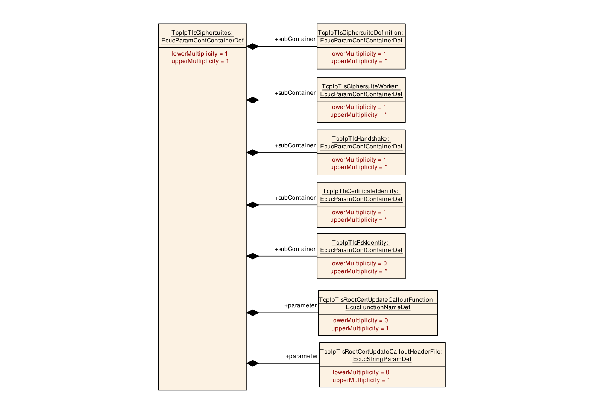

| 项目 | 内容 |
| --- | --- |
| SWS 条目 | [ECUC_TcpIp_00222] |
| 容器名称 | TcpIpTlsCiphersuites |
| 父容器 | TcpIpTlsConfig |
| 描述 | 该容器提供TLS所使用的受支持密码套件的相关信息。 |
| 配置参数 | 见下方参数表 |

| 包含的容器 | 容器名称 | 多重性 | 作用域/依赖 |
| --- | --- | --- | --- |
| 包含的容器 | TcpIpTlsCertificateIdentity | 1..* | 见9.2.53节 |
| 包含的容器 | TcpIpTlsCiphersuiteDefinition | 1..* | 见9.2.50节 |
| 包含的容器 | TcpIpTlsCiphersuiteWorker | 1..* | 见9.2.51节 |
| 包含的容器 | TcpIpTlsHandshake | 1..* | 见9.2.52节 |
| 包含的容器 | TcpIpTlsPskIdentity | 0..* | 见9.2.54节 |

| 项目 | 内容 |
| --- | --- |
| SWS 条目 | [ECUC_TcpIp_00330] |
| 参数名称 | TcpIpTlsRootCertUpdateCalloutFunction |
| 父容器 | TcpIpTlsCiphersuites |
| 描述 | 该可选参数规定在TLS握手期间接收到新的有效根证书时使用的callout函数的名称。可用于基于接收到的证书执行操作。 |
| 多重性 | 0..1 |
| 类型 | EcucFunctionNameDef |
| 默认值 | - |
| Post-Build 变体多重性 | false |
| Post-Build 变体值 | false |
| 值配置类 | Pre-compile time：X（All Variants）；Link time：-；Post-build time：- |
| 多重性配置类 | Pre-compile time：X（All Variants）；Link time：-；Post-build time：- |
| 作用域/依赖 | scope: local |

| 项目 | 内容 |
| --- | --- |
| SWS 条目 | [ECUC_TcpIp_00331] |
| 参数名称 | TcpIpTlsRootCertUpdateCalloutHeaderFile |
| 父容器 | TcpIpTlsCiphersuites |
| 描述 | 该可选参数规定包含TcpIpTlsRootCertUpdateCalloutFunction中所规定函数定义的头文件的名称。 |
| 多重性 | 0..1 |
| 类型 | EcucStringParamDef |
| 默认值 | - |
| Post-Build 变体多重性 | false |
| Post-Build 变体值 | false |
| 值配置类 | Pre-compile time：X；Link time：-；Post-build time：- |
| 多重性配置类 | Pre-compile time：X；Link time：-；Post-build time：- |
| 作用域/依赖 | scope: local |

#### 9.2.50. TcpIpTlsCiphersuiteDefinition

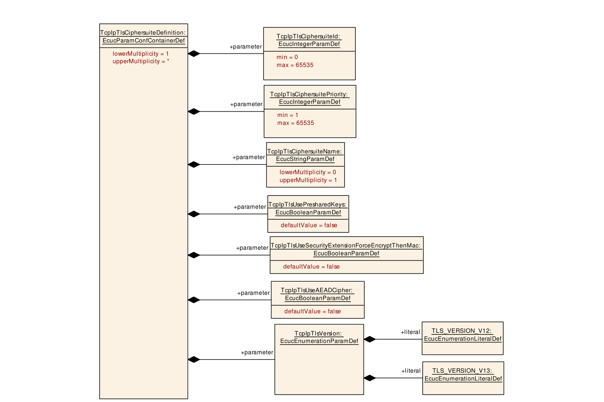

| 项目 | 内容 |
| --- | --- |
| SWS 条目 | [ECUC_TcpIp_00237] |
| 容器名称 | TcpIpTlsCiphersuiteDefinition |
| 父容器 | TcpIpTlsCiphersuites |
| 描述 | 该容器提供TLS所使用的密码套件的静态信息。 |
| 配置参数 | 见下方参数表 |

无包含的容器。

| 项目 | 内容 |
| --- | --- |
| SWS 条目 | [ECUC_TcpIp_00242] |
| 参数名称 | TcpIpTlsCiphersuiteId |
| 父容器 | TcpIpTlsCiphersuiteDefinition |
| 描述 | 按照IETF代表该密码套件的ID，例如RFC4492第6节、RFC8446附录B.4或RFC5246附录A.5。 |
| 多重性 | 1 |
| 类型 | EcucIntegerParamDef |
| 默认值 | - |
| 值配置类 | Pre-compile time：X（All Variants）；Link time：-；Post-build time：- |
| 作用域/依赖 | scope: local |

| 项目 | 内容 |
| --- | --- |
| SWS 条目 | [ECUC_TcpIp_00244] |
| 参数名称 | TcpIpTlsCiphersuiteName |
| 父容器 | TcpIpTlsCiphersuiteDefinition |
| 描述 | 为该密码套件提供口头名称。该名称应为相应RFC中定义的名称，例如TLS_ECDHE_ECDSA_WITH_AES_128_CBC_SHA256（TLS 1.2）或TLS_AES_128_GCM_SHA256（TLS 1.3）。 |
| 多重性 | 0..1 |
| 类型 | EcucStringParamDef |
| 默认值 | - |
| Post-Build 变体值 | false |
| 值配置类 | Pre-compile time：X（All Variants）；Link time：-；Post-build time：- |
| 作用域/依赖 | scope: local |

| 项目 | 内容 |
| --- | --- |
| SWS 条目 | [ECUC_TcpIp_00243] |
| 参数名称 | TcpIpTlsCiphersuitePriority |
| 父容器 | TcpIpTlsCiphersuiteDefinition |
| 描述 | 定义该密码的优先级。数字越大优先级越低。 |
| 多重性 | 1 |
| 类型 | EcucIntegerParamDef |
| 范围 | 1 .. |
| 默认值 | - |
| Post-Build 变体值 | false |
| 值配置类 | Pre-compile time：X（All Variants）；Link time：-；Post-build time：- |
| 作用域/依赖 | scope: local |

| 项目 | 内容 |
| --- | --- |
| SWS 条目 | [ECUC_TcpIp_00247] |
| 参数名称 | TcpIpTlsUseAEADCipher |
| 父容器 | TcpIpTlsCiphersuiteDefinition |
| 描述 | 规定该密码套件是否支持用于数据加密/解密的AEAD。 |
| 多重性 | 1 |
| 类型 | EcucBooleanParamDef |
| 默认值 | false |
| Post-Build 变体值 | false |
| 值配置类 | Pre-compile time：X（All Variants）；Link time：-；Post-build time：- |
| 作用域/依赖 | scope: local |

| 项目 | 内容 |
| --- | --- |
| SWS 条目 | [ECUC_TcpIp_00245] |
| 参数名称 | TcpIpTlsUsePresharedKeys |
| 父容器 | TcpIpTlsCiphersuiteDefinition |
| 描述 | 定义该密码套件是否使用预共享密钥。如果是，将使用附加的配置或回调进行预共享密钥协商。 |
| 多重性 | 1 |
| 类型 | EcucBooleanParamDef |
| 默认值 | false |
| Post-Build 变体值 | false |
| 值配置类 | Pre-compile time：X（All Variants）；Link time：-；Post-build time：- |
| 作用域/依赖 | scope: local |

| 项目 | 内容 |
| --- | --- |
| SWS 条目 | [ECUC_TcpIp_00246] |
| 参数名称 | TcpIpTlsUseSecurityExtensionForceEncryptThenMac |
| 父容器 | TcpIpTlsCiphersuiteDefinition |
| 描述 | 定义是否应支持IETF RFC 7366规定的安全扩展。这对使用CBC模式的密码套件很有用。 |
| 多重性 | 1 |
| 类型 | EcucBooleanParamDef |
| 默认值 | false |
| Post-Build 变体值 | false |
| 值配置类 | Pre-compile time：X（All Variants）；Link time：-；Post-build time：- |
| 作用域/依赖 | scope: local |

| 项目 | 内容 |
| --- | --- |
| SWS 条目 | [ECUC_TcpIp_00248] |
| 参数名称 | TcpIpTlsVersion |
| 父容器 | TcpIpTlsCiphersuiteDefinition |
| 描述 | 声明该密码套件应用于的TLS版本。 |
| 多重性 | 1 |
| 类型 | EcucEnumerationParamDef |
| 范围 | TLS_VERSION_V12；TLS_VERSION_V13 |
| Post-Build 变体值 | false |
| 值配置类 | Pre-compile time：X（All Variants）；Link time：-；Post-build time：- |
| 作用域/依赖 | scope: local |

#### 9.2.51. TcpIpTlsCiphersuiteWorker

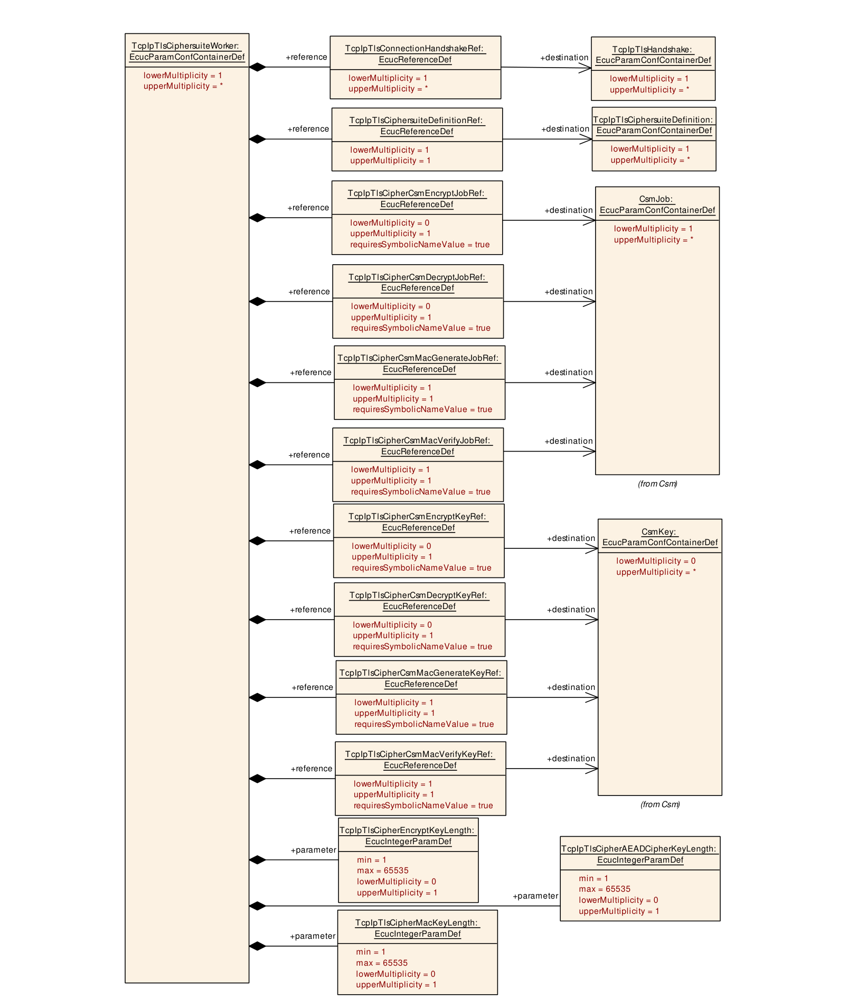

| 项目 | 内容 |
| --- | --- |
| SWS 条目 | [ECUC_TcpIp_00238] |
| 容器名称 | TcpIpTlsCiphersuiteWorker |
| 父容器 | TcpIpTlsCiphersuites |
| 描述 | 该容器提供TLS数据发送和接收所需的作业和密钥。 |
| 配置参数 | 见下方参数表 |

无包含的容器。

| 项目 | 内容 |
| --- | --- |
| SWS 条目 | [ECUC_TcpIp_00254] |
| 参数名称 | TcpIpTlsCipherAEADCipherKeyLength |
| 父容器 | TcpIpTlsCiphersuiteWorker |
| 描述 | 定义用于带认证数据的加密/解密（AEAD）的密钥长度。 |
| 多重性 | 0..1 |
| 类型 | EcucIntegerParamDef |
| 范围 | 1 .. 65535 |
| 默认值 | - |
| Post-Build 变体多重性 | false |
| Post-Build 变体值 | false |
| 值配置类 | Pre-compile time：X（All Variants）；Link time：-；Post-build time：-（-） |
| 多重性配置类 | Pre-compile time：X（All Variants）；Link time：-；Post-build time：- |
| 作用域/依赖 | scope: local dependency: This value shall only be set if the cipher uses AEAD. If such a worker is selected, then Csm_AEADEncrypt() and Csm_AEADDecrypt() shall be used and AEAD shall be supported. Required to be set when TcpIpTlsCipherDefinition/TcpIpTls AEADCipher is set to TRUE. |

| 项目 | 内容 |
| --- | --- |
| SWS 条目 | [ECUC_TcpIp_00253] |
| 参数名称 | TcpIpTlsCipherEncryptKeyLength |
| 父容器 | TcpIpTlsCiphersuiteWorker |
| 描述 | 定义用于加密或解密的密钥长度。该密钥长度对（对称）加密和解密均有效。 |
| 多重性 | 0..1 |
| 类型 | EcucIntegerParamDef |
| 范围 | 1 .. 65535 |
| 默认值 | - |
| Post-Build 变体值 | false |
| 值配置类 | Pre-compile time：X（All Variants）；Link time：-；Post-build time：- |
| 作用域/依赖 | scope: local |

| 项目 | 内容 |
| --- | --- |
| SWS 条目 | [ECUC_TcpIp_00257] |
| 参数名称 | TcpIpTlsCipherMacKeyLength |
| 父容器 | TcpIpTlsCiphersuiteWorker |
| 描述 | 规定MAC密钥的长度。 |
| 多重性 | 0..1 |
| 类型 | EcucIntegerParamDef |
| 范围 | 1 .. 65535 |
| 默认值 | - |
| Post-Build 变体值 | false |
| 值配置类 | Pre-compile time：X（All Variants）；Link time：-；Post-build time：- |
| 作用域/依赖 | scope: local |

| 项目 | 内容 |
| --- | --- |
| SWS 条目 | [ECUC_TcpIp_00255] |
| 参数名称 | TcpIpTlsCipherCsmDecryptJobRef |
| 父容器 | TcpIpTlsCiphersuiteWorker |
| 描述 | 对执行数据解密操作的CSM作业的引用。 |
| 多重性 | 0..1 |
| 类型 | Symbolic name reference to CsmJob |
| Post-Build 变体值 | false |
| 值配置类 | Pre-compile time：X（All Variants）；Link time：-；Post-build time：- |
| 作用域/依赖 | scope: local |

| 项目 | 内容 |
| --- | --- |
| SWS 条目 | [ECUC_TcpIp_00256] |
| 参数名称 | TcpIpTlsCipherCsmDecryptKeyRef |
| 父容器 | TcpIpTlsCiphersuiteWorker |
| 描述 | 对与执行数据解密操作的CSM作业相关联的CSM密钥的引用。 |
| 多重性 | 0..1 |
| 类型 | Symbolic name reference to CsmKey |
| Post-Build 变体值 | false |
| 值配置类 | Pre-compile time：X（All Variants）；Link time：-；Post-build time：- |
| 作用域/依赖 | scope: local |

| 项目 | 内容 |
| --- | --- |
| SWS 条目 | [ECUC_TcpIp_00251] |
| 参数名称 | TcpIpTlsCipherCsmEncryptJobRef |
| 父容器 | TcpIpTlsCiphersuiteWorker |
| 描述 | 对执行数据加密操作的CSM作业的引用。 |
| 多重性 | 0..1 |
| 类型 | Symbolic name reference to CsmJob |
| Post-Build 变体值 | false |
| 值配置类 | Pre-compile time：X（All Variants） |
| 作用域/依赖 | scope: local |

| 项目 | 内容 |
| --- | --- |
| SWS 条目 | [ECUC_TcpIp_00252] |
| 参数名称 | TcpIpTlsCipherCsmEncryptKeyRef |
| 父容器 | TcpIpTlsCiphersuiteWorker |
| 描述 | 对与执行数据加密操作的CSM作业相关联的CSM密钥的引用。 |
| 多重性 | 0..1 |
| 类型 | Symbolic name reference to CsmKey |
| Post-Build 变体值 | false |
| 值配置类 | Pre-compile time：X（All Variants）；Link time：-；Post-build time：- |
| 作用域/依赖 | scope: local |

| 项目 | 内容 |
| --- | --- |
| SWS 条目 | [ECUC_TcpIp_00258] |
| 参数名称 | TcpIpTlsCipherCsmMacGenerateJobRef |
| 父容器 | TcpIpTlsCiphersuiteWorker |
| 描述 | 对执行MAC生成操作的CSM作业的引用。 |
| 多重性 | 1 |
| 类型 | Symbolic name reference to CsmJob |
| Post-Build 变体值 | false |
| 值配置类 | Pre-compile time：X（All Variants）；Link time：-；Post-build time：- |
| 作用域/依赖 | scope: local |

| 项目 | 内容 |
| --- | --- |
| SWS 条目 | [ECUC_TcpIp_00259] |
| 参数名称 | TcpIpTlsCipherCsmMacGenerateKeyRef |
| 父容器 | TcpIpTlsCiphersuiteWorker |
| 描述 | 对与执行MAC生成操作的CSM作业相关联的CSM密钥的引用。 |
| 多重性 | 1 |
| 类型 | Symbolic name reference to CsmKey |
| Post-Build 变体值 | false |
| 值配置类 | Pre-compile time：X（All Variants）；Link time：-；Post-build time：- |
| 作用域/依赖 | scope: local |

| 项目 | 内容 |
| --- | --- |
| SWS 条目 | [ECUC_TcpIp_00260] |
| 参数名称 | TcpIpTlsCipherCsmMacVerifyJobRef |
| 父容器 | TcpIpTlsCiphersuiteWorker |
| 描述 | 对执行MAC验证操作的CSM作业的引用。 |
| 多重性 | 1 |
| 类型 | Symbolic name reference to CsmJob |
| Post-Build 变体值 | false |
| 值配置类 | Pre-compile time：X（All Variants）；Link time：-；Post-build time：- |
| 作用域/依赖 | scope: local |

| 项目 | 内容 |
| --- | --- |
| SWS 条目 | [ECUC_TcpIp_00261] |
| 参数名称 | TcpIpTlsCipherCsmMacVerifyKeyRef |
| 父容器 | TcpIpTlsCiphersuiteWorker |
| 描述 | 对与执行MAC验证操作的CSM作业相关联的CSM密钥的引用。 |
| 多重性 | 1 |
| 类型 | Symbolic name reference to CsmKey |
| Post-Build 变体值 | false |
| 值配置类 | Pre-compile time：X（All Variants）；Link time：-；Post-build time：- |
| 作用域/依赖 | scope: local |

| 项目 | 内容 |
| --- | --- |
| SWS 条目 | [ECUC_TcpIp_00250] |
| 参数名称 | TcpIpTlsCiphersuiteDefinitionRef |
| 父容器 | TcpIpTlsCiphersuiteWorker |
| 描述 | 对密码套件定义容器的引用。 |
| 多重性 | 1 |
| 类型 | Reference to TcpIpTlsCiphersuiteDefinition |
| Post-Build 变体值 | false |
| 值配置类 | Pre-compile time：X（All Variants）；Link time：-；Post-build time：- |
| 作用域/依赖 | scope: local |

| 项目 | 内容 |
| --- | --- |
| SWS 条目 | [ECUC_TcpIp_00249] |
| 参数名称 | TcpIpTlsConnectionHandshakeRef |
| 父容器 | TcpIpTlsCiphersuiteWorker |
| 描述 | 对包含握手操作所需作业和密钥的容器的引用。引用多个握手容器允许在worker之间共享它们，并在握手期间选择下一个未使用的。 |
| 多重性 | 1..* |
| 类型 | Reference to TcpIpTlsHandshake |
| Post-Build 变体多重性 | false |
| Post-Build 变体值 | false |
| 值配置类 | Pre-compile time：X（All Variants） |
| 多重性配置类 | Pre-compile time：X（All Variants）；Link time：-；Post-build time：- |
| 作用域/依赖 | scope: local |

#### 9.2.52. TcpIpTlsHandshake

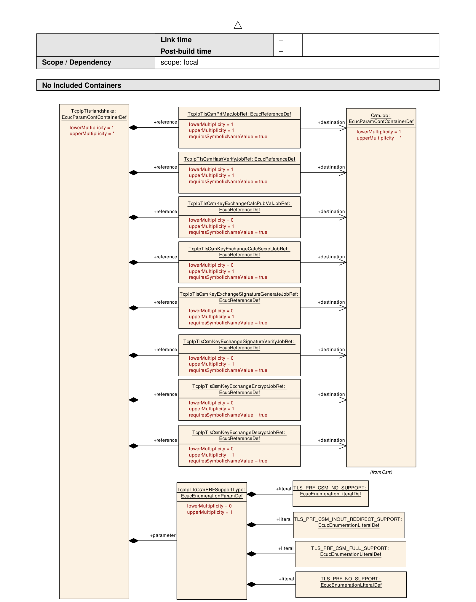

| 项目 | 内容 |
| --- | --- |
| SWS 条目 | [ECUC_TcpIp_00239] |
| 容器名称 | TcpIpTlsHandshake |
| 父容器 | TcpIpTlsCiphersuites |
| 描述 | 该容器提供处理握手所需的信息。它包含对CSM作业和密钥的适当引用，以执行该密码套件及相关证书的密钥交换加密操作。 |
| 配置参数 | 见下方参数表 |

无包含的容器。

| 项目 | 内容 |
| --- | --- |
| SWS 条目 | [ECUC_TcpIp_00264] |
| 参数名称 | TcpIpTlsCsmPRFSupportType |
| 父容器 | TcpIpTlsHandshake |
| 描述 | 规定CSM作业如何支持PRF操作。 |
| 多重性 | 0..1 |
| 类型 | EcucEnumerationParamDef |
| 范围 | TLS_PRF_CSM_FULL_ SUPPORT；TLS_PRF_CSM_INOUT_ REDIRECT_SUPPORT；TLS_PRF_CSM_NO_SUPPORT；TLS_PRF_NO_SUPPORT |
| Post-Build 变体多重性 | false |
| Post-Build 变体值 | false |
| 值配置类 | Pre-compile time：X（All Variants）；Link time：-；Post-build time：- |
| 多重性配置类 | Pre-compile time：X（All Variants）；Link time：-；Post-build time：- |
| 作用域/依赖 | scope: local |

| 项目 | 内容 |
| --- | --- |
| SWS 条目 | [ECUC_TcpIp_00265] |
| 参数名称 | TcpIpTlsCsmHashVerifyJobRef |
| 父容器 | TcpIpTlsHandshake |
| 描述 | 对为整个握手执行哈希操作的CSM作业的引用。 |
| 多重性 | 1 |
| 类型 | Symbolic name reference to CsmJob |
| Post-Build 变体值 | false |
| 值配置类 | Pre-compile time：X（All Variants）；Link time：-；Post-build time：- |
| 作用域/依赖 | scope: local |

| 项目 | 内容 |
| --- | --- |
| SWS 条目 | [ECUC_TcpIp_00267] |
| 参数名称 | TcpIpTlsCsmKeyExchangeCalcPubValJobRef |
| 父容器 | TcpIpTlsHandshake |
| 描述 | 对执行DH密钥交换算法操作的CSM作业的引用。 |
| 多重性 | 0..1 |
| 类型 | Symbolic name reference to CsmJob |
| Post-Build 变体多重性 | false |
| Post-Build 变体值 | false |
| 值配置类 | Pre-compile time：X（All Variants）；Link time：-；Post-build time：- |
| 多重性配置类 | Pre-compile time：X（All Variants）；Link time：-；Post-build time：- |
| 作用域/依赖 | scope: local |

| 项目 | 内容 |
| --- | --- |
| SWS 条目 | [ECUC_TcpIp_00269] |
| 参数名称 | TcpIpTlsCsmKeyExchangeCalcSecretJobRef |
| 父容器 | TcpIpTlsHandshake |
| 描述 | 对执行密钥交换算法操作的CSM作业的引用。 |
| 多重性 | 0..1 |
| 类型 | Symbolic name reference to CsmJob |
| Post-Build 变体多重性 | false |
| Post-Build 变体值 | false |
| 值配置类 | Pre-compile time：X（All Variants）；Link time：-；Post-build time：- |
| 多重性配置类 | Pre-compile time：X（All Variants）；Link time：-；Post-build time：- |
| 作用域/依赖 | scope: local dependency: Only required if asynchronous job is used for key exchange calculation. |

| 项目 | 内容 |
| --- | --- |
| SWS 条目 | [ECUC_TcpIp_00276] |
| 参数名称 | TcpIpTlsCsmKeyExchangeDecryptJobRef |
| 父容器 | TcpIpTlsHandshake |
| 描述 | 对执行数据解密（例如RSA密钥交换操作）的CSM作业的引用。 |
| 多重性 | 0..1 |
| 类型 | Symbolic name reference to CsmJob |
| Post-Build 变体多重性 | false |
| Post-Build 变体值 | false |
| 值配置类 | Pre-compile time：All Variants；Link time：-；Post-build time：- |
| 多重性配置类 | Pre-compile time：All Variants；Link time：-；Post-build time：- |
| 作用域/依赖 | scope: local |

| 项目 | 内容 |
| --- | --- |
| SWS 条目 | [ECUC_TcpIp_00277] |
| 参数名称 | TcpIpTlsCsmKeyExchangeDecryptKeyRef |
| 父容器 | TcpIpTlsHandshake |
| 描述 | 对执行数据解密（例如RSA，用于交换操作）的CSM密钥的引用。 |
| 多重性 | 0..1 |
| 类型 | Symbolic name reference to CsmKey |
| Post-Build 变体多重性 | false |
| Post-Build 变体值 | false |
| 值配置类 | Pre-compile time：X；Link time：-；Post-build time：- |
| 多重性配置类 | Pre-compile time：X；Link time：-；Post-build time：- |
| 作用域/依赖 | scope: local |

| 项目 | 内容 |
| --- | --- |
| SWS 条目 | [ECUC_TcpIp_00274] |
| 参数名称 | TcpIpTlsCsmKeyExchangeEncryptJobRef |
| 父容器 | TcpIpTlsHandshake |
| 描述 | 对执行数据加密（例如RSA密钥交换操作）的CSM作业的引用。 |
| 多重性 | 0..1 |
| 类型 | Symbolic name reference to CsmJob |
| Post-Build 变体多重性 | false |
| Post-Build 变体值 | false |
| 值配置类 | Pre-compile time：All Variants；Link time：-；Post-build time：- |
| 多重性配置类 | Pre-compile time：All Variants；Link time：-；Post-build time：- |
| 作用域/依赖 | scope: local |

| 项目 | 内容 |
| --- | --- |
| SWS 条目 | [ECUC_TcpIp_00275] |
| 参数名称 | TcpIpTlsCsmKeyExchangeEncryptKeyRef |
| 父容器 | TcpIpTlsHandshake |
| 描述 | 对执行数据加密（例如RSA，用于交换操作）的CSM密钥的引用。 |
| 多重性 | 0..1 |
| 类型 | Symbolic name reference to CsmKey |
| Post-Build 变体多重性 | false |
| Post-Build 变体值 | false |
| 值配置类 | Pre-compile time：X（All Variants） |
| 多重性配置类 | Pre-compile time：X（All Variants）；Link time：-；Post-build time：- |
| 作用域/依赖 | scope: local |

| 项目 | 内容 |
| --- | --- |
| SWS 条目 | [ECUC_TcpIp_00268] |
| 参数名称 | TcpIpTlsCsmKeyExchangeKeyRef |
| 父容器 | TcpIpTlsHandshake |
| 描述 | 对用于Diffie Hellman（DH）密钥交换操作的CSM密钥的引用。 |
| 多重性 | 0..1 |
| 类型 | Symbolic name reference to CsmKey |
| Post-Build 变体多重性 | false |
| Post-Build 变体值 | false |
| 值配置类 | Pre-compile time：All Variants；Link time：-；Post-build time：- |
| 多重性配置类 | Pre-compile time：All Variants；Link time：-；Post-build time：- |
| 作用域/依赖 | scope: local |

| 项目 | 内容 |
| --- | --- |
| SWS 条目 | [ECUC_TcpIp_00270] |
| 参数名称 | TcpIpTlsCsmKeyExchangeSignatureGenerateJobRef |
| 父容器 | TcpIpTlsHandshake |
| 描述 | 对为DH操作执行签名生成的CSM作业的引用。 |
| 多重性 | 0..1 |
| 类型 | Symbolic name reference to CsmJob |
| Post-Build 变体多重性 | false |
| Post-Build 变体值 | false |
| 值配置类 | Pre-compile time：X；Link time：-；Post-build time：- |
| 多重性配置类 | Pre-compile time：X；Link time：-；Post-build time：- |
| 作用域/依赖 | scope: local |

| 项目 | 内容 |
| --- | --- |
| SWS 条目 | [ECUC_TcpIp_00271] |
| 参数名称 | TcpIpTlsCsmKeyExchangeSignatureGenerateKeyRef |
| 父容器 | TcpIpTlsHandshake |
| 描述 | 对为DH操作执行签名生成的CSM密钥的引用。 |
| 多重性 | 0..1 |
| 类型 | Symbolic name reference to CsmKey |
| Post-Build 变体多重性 | false |
| Post-Build 变体值 | false |
| 值配置类 | Pre-compile time：X（All Variants）；Link time：-；Post-build time：- |
| 多重性配置类 | Pre-compile time：X（All Variants）；Link time：- |
| 作用域/依赖 | scope: local |

| 项目 | 内容 |
| --- | --- |
| SWS 条目 | [ECUC_TcpIp_00272] |
| 参数名称 | TcpIpTlsCsmKeyExchangeSignatureVerifyJobRef |
| 父容器 | TcpIpTlsHandshake |
| 描述 | 对为DH操作执行签名验证的CSM作业的引用。 |
| 多重性 | 0..1 |
| 类型 | Symbolic name reference to CsmJob |
| Post-Build 变体多重性 | false |
| Post-Build 变体值 | false |
| 值配置类 | Pre-compile time：X；Link time：-；Post-build time：- |
| 多重性配置类 | Pre-compile time：X；Link time：-；Post-build time：- |
| 作用域/依赖 | scope: local |

| 项目 | 内容 |
| --- | --- |
| SWS 条目 | [ECUC_TcpIp_00273] |
| 参数名称 | TcpIpTlsCsmKeyExchangeSignatureVerifyKeyRef |
| 父容器 | TcpIpTlsHandshake |
| 描述 | 对为DH操作执行签名验证的CSM密钥的引用。 |
| 多重性 | 0..1 |
| 类型 | Symbolic name reference to CsmKey |
| Post-Build 变体多重性 | false |
| Post-Build 变体值 | false |
| 值配置类 | Pre-compile time：X（All Variants）；Link time：-；Post-build time：- |
| 多重性配置类 | Pre-compile time：X（All Variants）；Link time：-；Post-build time：- |
| 作用域/依赖 | scope: local |

| 项目 | 内容 |
| --- | --- |
| SWS 条目 | [ECUC_TcpIp_00266] |
| 参数名称 | TcpIpTlsCsmMasterSecretKeyRef |
| 父容器 | TcpIpTlsHandshake |
| 描述 | 这是对在会话期间计算的主密钥的引用。 |
| 多重性 | 0..1 |
| 类型 | Symbolic name reference to CsmKey |
| Post-Build 变体多重性 | false |
| Post-Build 变体值 | false |
| 值配置类 | Pre-compile time：X（All Variants）；Link time：-；Post-build time：- |
| 多重性配置类 | Pre-compile time：X（All Variants）；Link time：-；Post-build time：- |
| 作用域/依赖 | scope: local |

| 项目 | 内容 |
| --- | --- |
| SWS 条目 | [ECUC_TcpIp_00262] |
| 参数名称 | TcpIpTlsCsmPrfMacJobRef |
| 父容器 | TcpIpTlsHandshake |
| 描述 | 对执行PRF哈希操作的CSM作业的引用。 |
| 多重性 | 1 |
| 类型 | Symbolic name reference to CsmJob |
| Post-Build 变体值 | false |
| 值配置类 | Pre-compile time：X（All Variants）；Link time：-；Post-build time：- |
| 作用域/依赖 | scope: local |

| 项目 | 内容 |
| --- | --- |
| SWS 条目 | [ECUC_TcpIp_00263] |
| 参数名称 | TcpIpTlsCsmPrfMacKeyRef |
| 父容器 | TcpIpTlsHandshake |
| 描述 | 对与执行PRF哈希操作的CSM作业相关联的CSM密钥的引用。 |
| 多重性 | 1 |
| 类型 | Symbolic name reference to CsmKey |
| Post-Build 变体值 | false |
| 值配置类 | Pre-compile time：X（All Variants）；Link time：-；Post-build time：- |
| 作用域/依赖 | scope: local |

#### 9.2.53. TcpIpTlsCertificateIdentity

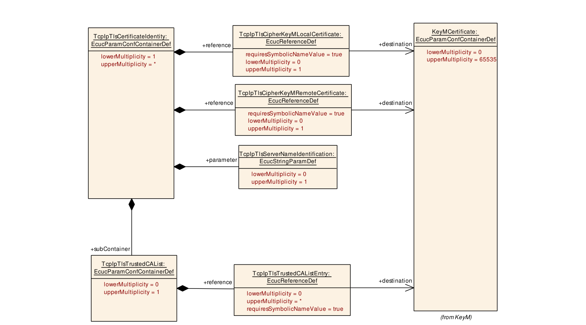

| 项目 | 内容 |
| --- | --- |
| SWS 条目 | [ECUC_TcpIp_00240] |
| 容器名称 | TcpIpTlsCertificateIdentity |
| 父容器 | TcpIpTlsCiphersuites |
| 描述 | 该容器提供密码套件所使用的证书的相关信息。 |
| 配置参数 | 见下方参数表 |

| 包含的容器 | 容器名称 | 多重性 | 作用域/依赖 |
| --- | --- | --- | --- |

| 项目 | 内容 |
| --- | --- |
| SWS 条目 | [ECUC_TcpIp_00278] |
| 参数名称 | TcpIpTlsServerNameIdentification |
| 父容器 | TcpIpTlsCertificateIdentity |
| 描述 | 定义服务器标识名称。如果存在，该名称将作为扩展随「TLS client hello」握手消息一起添加。TLS服务器将检查该名称以识别服务器证书。 |
| 多重性 | 0..1 |
| 类型 | EcucStringParamDef |
| 默认值 | - |
| Post-Build 变体多重性 | false |
| Post-Build 变体值 | false |
| 值配置类 | Pre-compile time：X（All Variants）；Link time：-；Post-build time：- |
| 多重性配置类 | Pre-compile time：X（All Variants）；Link time：-；Post-build time：- |
| 作用域/依赖 | scope: local dependency: Only needed if server name authentication is used. |

| 项目 | 内容 |
| --- | --- |
| SWS 条目 | [ECUC_TcpIp_00286] |
| 参数名称 | TcpIpTlsCipherKeyMLocalCertificate |
| 父容器 | TcpIpTlsCertificateIdentity |
| 描述 | 对用于寻址本地证书的KeyM证书的引用。 |
| 多重性 | 0..1 |
| 类型 | Symbolic name reference to KeyMCertificate |
| Post-Build 变体多重性 | false |
| Post-Build 变体值 | false |
| 值配置类 | Pre-compile time：X（All Variants）；Link time：-；Post-build time：- |
| 多重性配置类 | Pre-compile time：X（All Variants）；Link time：-；Post-build time：- |
| 作用域/依赖 | scope: local dependency: Required if TcpIpTlsConnectionType is TLS_SERVER. Also required if TcpIpTlsConnectionType is TLS_CLIENT and the server requests a bidirectional authentication. |

| 项目 | 内容 |
| --- | --- |
| SWS 条目 | [ECUC_TcpIp_00287] |
| 参数名称 | TcpIpTlsCipherKeyMRemoteCertificate |
| 父容器 | TcpIpTlsCertificateIdentity |
| 描述 | 对KeyM证书容器的引用，用于引用远程证书。 |
| 多重性 | 0..1 |
| 类型 | Symbolic name reference to KeyMCertificate |
| Post-Build 变体多重性 | false |
| Post-Build 变体值 | false |
| 值配置类 | Pre-compile time：X；Link time：-；Post-build time：- |
| 多重性配置类 | Pre-compile time：X；Link time：-；Post-build time：- |
| 作用域/依赖 | scope: local dependency: This optional parameter is needed by the TLS_CLIENT and is used to verify the certificate provided by the TLS_SERVER. It is also required by the TLS_ SERVER if bidirectional authentication will be requested. Otherwise, this parameter |

| 项目 | 内容 |
| --- | --- |
| SWS 条目 | [ECUC_TcpIp_00335] |
| 容器名称 | TcpIpTlsTrustedCAList |
| 父容器 | TcpIpTlsCertificateIdentity |
| 描述 | 该容器包含对受信任CA证书的引用；如果*TcpIpTlsUseExtensionTrustedCAKeys*设置为TRUE，其名称将在客户端的ClientHello消息中发送。 |
| Post-Build 变体多重性 | false |
| 多重性配置类 | Pre-compile time：X（All Variants）；Link time：-；Post-build time：- |
| 配置参数 | 见下方参数表 |

#### 9.2.54. TcpIpTlsPskIdentity

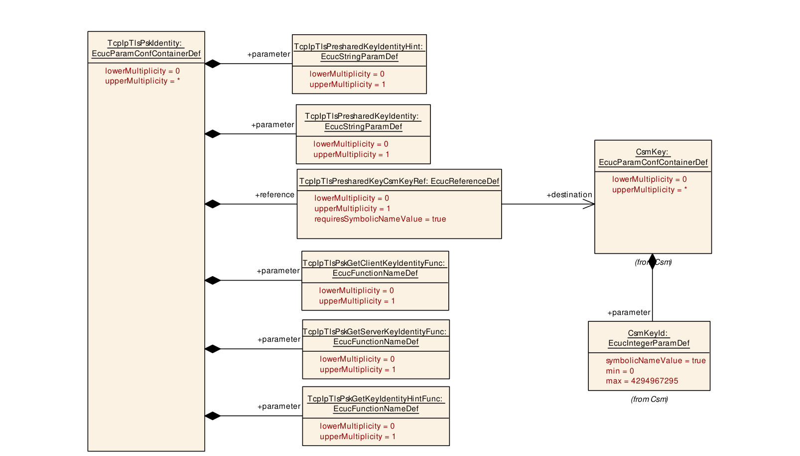

| 项目 | 内容 |
| --- | --- |
| SWS 条目 | [ECUC_TcpIp_00241] |
| 容器名称 | TcpIpTlsPskIdentity |
| 父容器 | TcpIpTlsCiphersuites |
| 描述 | 该容器提供预共享密钥静态定义的相关信息。它在握手期间用于在客户端和服务器之间协商预共享密钥。注意：预共享密钥的回调是静态定义的替代方案。如果使用了预共享密钥但没有静态定义，回调允许在运行时定义关联的密钥。容器定义用于静态配置。 |
| 配置参数 | 见下方参数表 |

无包含的容器。

| 项目 | 内容 |
| --- | --- |
| SWS 条目 | [ECUC_TcpIp_00284] |
| 参数名称 | TcpIpTlsPresharedKeyIdentity |
| 父容器 | TcpIpTlsPskIdentity |
| 描述 | 该项提供密钥标识。TLS客户端基于服务器提供的标识提示选择预共享密钥，并将密钥标识名称返回给服务器。 |
| 多重性 | 0..1 |
| 类型 | EcucStringParamDef |
| 默认值 | - |
| Post-Build 变体多重性 | false |
| Post-Build 变体值 | false |
| 值配置类 | Pre-compile time：X（All Variants）；Link time：-；Post-build time：- |
| 多重性配置类 | Pre-compile time：X（All Variants）；Link time：-；Post-build time：- |
| 作用域/依赖 | scope: local dependency: The callback function < Up_TlsClientGetPskIdentity> is used if the ciphersuite defines pre-shared key but this parameter is not present. |

| 项目 | 内容 |
| --- | --- |
| SWS 条目 | [ECUC_TcpIp_00279] |
| 参数名称 | TcpIpTlsPresharedKeyIdentityHint |
| 父容器 | TcpIpTlsPskIdentity |
| 描述 | 为预共享密钥提供身份提示。此信息由TLS服务器发送，以向TLS客户端提供其标识。TLS客户端使用相同的信息来选择预共享密钥。 |
| 多重性 | 0..1 |
| 类型 | EcucStringParamDef |
| 默认值 | - |
| Post-Build 变体多重性 | false |
| Post-Build 变体值 | false |
| 值配置类 | Pre-compile time：All Variants；Link time：-；Post-build time：- |
| 多重性配置类 | Pre-compile time：All Variants；Link time：-；Post-build time：- |
| 作用域/依赖 | scope: local dependency: The callback function <Up_TlsServerGetPskIdentityHint> is used if the ciphersuite defines pre-shared key but this parameter is not present. |

| 项目 | 内容 |
| --- | --- |
| SWS 条目 | [ECUC_TcpIp_00281] |
| 参数名称 | TcpIpTlsPskGetClientKeyIdentityFunc |
| 父容器 | TcpIpTlsPskIdentity |
| 描述 | 定义Up_TlsClientGetPskIdentity()回调的函数名称。 |
| 多重性 | 0..1 |
| 类型 | EcucFunctionNameDef |
| 默认值 | - |
| Post-Build 变体多重性 | false |
| Post-Build 变体值 | false |
| 值配置类 | Pre-compile time：X（All Variants）；Link time：- |
| 多重性配置类 | Pre-compile time：X（All Variants）；Link time：-；Post-build time：- |
| 作用域/依赖 | scope: local dependency: This definition is needed if a pre-shared key ciphersuite is used and Tcp IpTlsPresharedKeyIdentity configuration parameter is not present. In this case, the callback function will be used to query the key identification. |

| 项目 | 内容 |
| --- | --- |
| SWS 条目 | [ECUC_TcpIp_00283] |
| 参数名称 | TcpIpTlsPskGetKeyIdentityHintFunc |
| 父容器 | TcpIpTlsPskIdentity |
| 描述 | 定义Up_TlsServerGetPskIdentityHint()回调的函数名称。 |
| 多重性 | 0..1 |
| 类型 | EcucFunctionNameDef |
| 默认值 | - |
| Post-Build 变体多重性 | false |
| Post-Build 变体值 | false |
| 值配置类 | Pre-compile time：All Variants；Link time：-；Post-build time：- |
| 多重性配置类 | Pre-compile time：All Variants；Link time：-；Post-build time：- |
| 作用域/依赖 | scope: local dependency: This definition is needed if a pre-shared key ciphersuite is used and Tcp IpTlsPresharedKeyGetKeyIdentityHint configuration parameter is not present. In this case, the callback function will be used to query the key identity hint. |

| 项目 | 内容 |
| --- | --- |
| SWS 条目 | [ECUC_TcpIp_00282] |
| 参数名称 | TcpIpTlsPskGetServerKeyIdentityFunc |
| 父容器 | TcpIpTlsPskIdentity |
| 描述 | 定义Up_TlsServerGetPskIdentity()回调的函数名称。 |
| 多重性 | 0..1 |
| 类型 | EcucFunctionNameDef |
| 默认值 | - |
| Post-Build 变体多重性 | false |
| Post-Build 变体值 | false |
| 值配置类 | Pre-compile time：X；Link time：-；Post-build time：- |
| 多重性配置类 | Pre-compile time：X；Link time：-；Post-build time：- |
| 作用域/依赖 | scope: local dependency: This definition is needed if a pre-shared key ciphersuite is used and Tcp IpTlsPresharedKeyIdentity configuration parameter is not present. In this case, the callback function will be used to query the key identification. |

| 项目 | 内容 |
| --- | --- |
| SWS 条目 | [ECUC_TcpIp_00280] |
| 参数名称 | TcpIpTlsPresharedKeyCsmKeyRef |
| 父容器 | TcpIpTlsPskIdentity |
| 描述 | 对与执行PRF哈希操作的CSM作业相关联的CSM密钥的引用。 |
| 多重性 | 0..1 |
| 类型 | Symbolic name reference to CsmKey |
| Post-Build 变体多重性 | false |
| Post-Build 变体值 | false |
| 值配置类 | Pre-compile time：All Variants；Link time：-；Post-build time：- |
| 多重性配置类 | Pre-compile time：All Variants；Link time：-；Post-build time：- |
| 作用域/依赖 | scope: local dependency: Callback <Up_Tls[Server&#124;Client]GetPskIdentity> is used instead if this parameter is not present. |

#### 9.2.55. TcpIpIpSecConfigSet

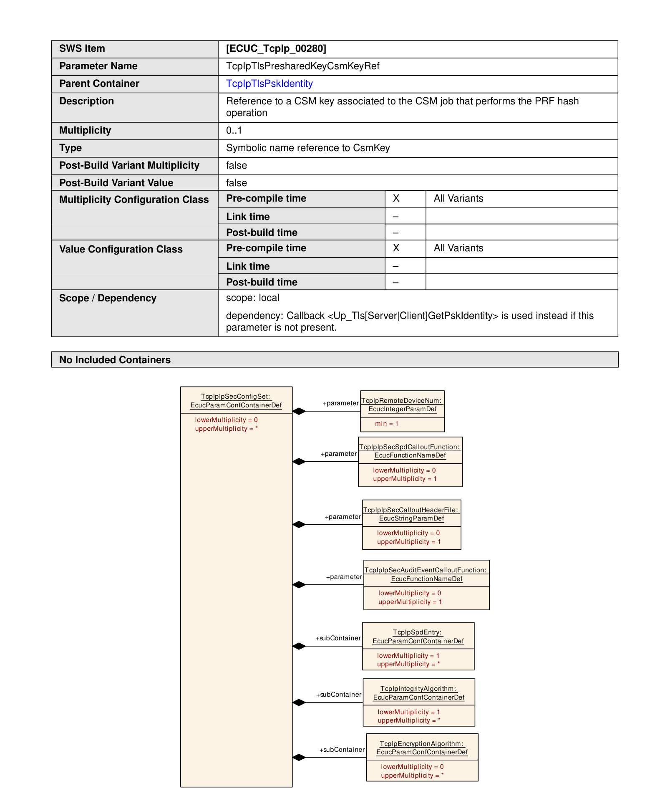

| 项目 | 内容 |
| --- | --- |
| SWS 条目 | [ECUC_TcpIp_00288] |
| 容器名称 | TcpIpIpSecConfigSet |
| 父容器 | TcpIpConfig |
| 描述 | 规定IPsec配置。 |
| Post-Build 变体多重性 | false |
| 配置参数 | 见下方参数表 |

| 包含的容器 | 容器名称 | 多重性 | 作用域/依赖 |
| --- | --- | --- | --- |
| 包含的容器 | TcpIpEncryptionAlgorithm | 0..* | 见9.2.56节 |
| 包含的容器 | TcpIpIntegrityAlgorithm | 1..* | 见9.2.58节 |
| 包含的容器 | TcpIpSpdEntry | 1..* | 见9.2.60节 |

| 项目 | 内容 |
| --- | --- |
| SWS 条目 | [ECUC_TcpIp_00292] |
| 参数名称 | TcpIpIpSecAuditEventCalloutFunction |
| 父容器 | TcpIpIpSecConfigSet |
| 描述 | 该参数规定将为每个可审计事件调用的callout函数的名称。 |
| 多重性 | 0..1 |
| 类型 | EcucFunctionNameDef |
| 默认值 | - |
| Post-Build 变体多重性 | false |
| Post-Build 变体值 | false |
| 值配置类 | Pre-compile time：X；Link time：-；Post-build time：- |
| 多重性配置类 | Pre-compile time：X；Link time：-；Post-build time：- |
| 作用域/依赖 | scope: local |

| 项目 | 内容 |
| --- | --- |
| SWS 条目 | [ECUC_TcpIp_00291] |
| 参数名称 | TcpIpIpSecCalloutHeaderFile |
| 父容器 | TcpIpIpSecConfigSet |
| 描述 | 该参数规定包含TcpIpIpSecSpdCalloutFunction和TcpIpIpSecAuditEvent所规定函数定义的头文件的名称。 |
| 多重性 | 0..1 |
| 类型 | EcucStringParamDef |
| 默认值 | - |
| Post-Build 变体多重性 | false |
| Post-Build 变体值 | false |
| 值配置类 | Pre-compile time：X；Link time：-；Post-build time：- |
| 多重性配置类 | Pre-compile time：X；Link time：-；Post-build time：- |
| 作用域/依赖 | scope: local |

| 项目 | 内容 |
| --- | --- |
| SWS 条目 | [ECUC_TcpIp_00290] |
| 参数名称 | TcpIpIpSecSpdCalloutFunction |
| 父容器 | TcpIpIpSecConfigSet |
| 描述 | 该参数规定在IPsec处理完所有相应的SPD条目并确定策略之后，为每条Rx/Tx消息调用的callout函数的名称。该callout函数允许覆盖所应用的策略。 |
| 多重性 | 0..1 |
| 类型 | EcucFunctionNameDef |
| 默认值 | - |
| Post-Build 变体多重性 | false |
| Post-Build 变体值 | false |
| 值配置类 | Pre-compile time：X；Link time：-；Post-build time：- |
| 多重性配置类 | Pre-compile time：X；Link time：-；Post-build time：- |
| 作用域/依赖 | scope: local |

| 项目 | 内容 |
| --- | --- |
| SWS 条目 | [ECUC_TcpIp_00289] |
| 参数名称 | TcpIpRemoteDeviceNum |
| 父容器 | TcpIpIpSecConfigSet |
| 描述 | 将协商安全关联（SA）的远程客户端数量。 |
| 多重性 | 1 |
| 类型 | EcucIntegerParamDef |
| 范围 | 1 .. 18446744073709551615 |
| 默认值 | - |
| Post-Build 变体值 | false |
| 值配置类 | Pre-compile time：X（All Variants）；Link time：-；Post-build time：- |
| 作用域/依赖 | scope: local |

#### 9.2.56. TcpIpEncryptionAlgorithm

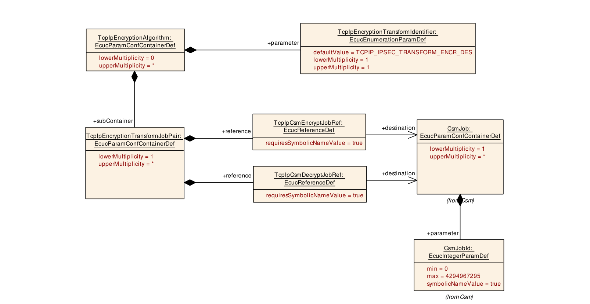

| 项目 | 内容 |
| --- | --- |
| SWS 条目 | [ECUC_TcpIp_00317] |
| 容器名称 | TcpIpEncryptionAlgorithm |
| 父容器 | TcpIpIpSecConfigSet |
| 描述 | 用于配置受支持加密算法变换的容器。该容器用于配置ESP所支持的算法。变换算法必须在Crypto模块中配置。 |
| 多重性配置类 | Pre-compile time：X（All Variants）；Link time：-；Post-build time：- |
| Post-Build 变体多重性 | false |
| 配置参数 | 见下方参数表 |

| 包含的容器 | 容器名称 | 多重性 | 作用域/依赖 |
| --- | --- | --- | --- |
| 包含的容器 | TcpIpEncryptionTransformJobPair | 1..* | 见9.2.57节 |

| 项目 | 内容 |
| --- | --- |
| SWS 条目 | [ECUC_TcpIp_00311] |
| 参数名称 | TcpIpEncryptionTransformIdentifier |
| 父容器 | TcpIpEncryptionAlgorithm |
| 描述 | 加密算法变换标识符。参数值按照IETF RFC 7296 3.3.2定义。 |
| 多重性 | 1 |
| 类型 | EcucEnumerationParamDef |
| 范围 | TCPIP_IPSEC_TRANSFORM_ ENCR_3DES |
| Post-Build 变体多重性 | false |
| Post-Build 变体值 | false |
| 值配置类 | Pre-compile time：X（All Variants）；Link time：-；Post-build time：- |
| 多重性配置类 | Pre-compile time：X（All Variants）；Link time：-；Post-build time：- |
| 作用域/依赖 | scope: local |

#### 9.2.57. TcpIpEncryptionTransformJobPair

| 项目 | 内容 |
| --- | --- |
| SWS 条目 | [ECUC_TcpIp_00312] |
| 容器名称 | TcpIpEncryptionTransformJobPair |
| 父容器 | TcpIpEncryptionAlgorithm |
| 描述 | 用于存储执行认证所需的CSM完整性变换作业引用的容器。对ESP和AH有效。每个完整性算法至少需要配置一个完整性变换作业对。 |
| 多重性配置类 | Pre-compile time：X（All Variants）；Link time：-；Post-build time：- |
| Post-Build 变体多重性 | false |
| 配置参数 | 见下方参数表 |

无包含的容器。

| 项目 | 内容 |
| --- | --- |
| SWS 条目 | [ECUC_TcpIp_00314] |
| 参数名称 | TcpIpCsmDecryptJobRef |
| 父容器 | TcpIpEncryptionTransformJobPair |
| 描述 | 所引用的Csm作业用于执行此变换所需的CsmMacVerify原语。必须是父类型的有效解密作业。 |
| 多重性 | 1 |
| 类型 | Symbolic name reference to CsmJob |
| Post-Build 变体多重性 | false |
| Post-Build 变体值 | false |
| 值配置类 | Pre-compile time：X；Link time：-；Post-build time：- |
| 多重性配置类 | Pre-compile time：X；Link time：-；Post-build time：- |
| 作用域/依赖 | scope: local |

| 项目 | 内容 |
| --- | --- |
| SWS 条目 | [ECUC_TcpIp_00313] |
| 参数名称 | TcpIpCsmEncryptJobRef |
| 父容器 | TcpIpEncryptionTransformJobPair |
| 描述 | 所引用的Csm作业用于执行此变换所需的CsmMacGenerate原语。必须是父类型的有效加密作业。 |
| 多重性 | 1 |
| 类型 | Symbolic name reference to CsmJob |
| Post-Build 变体多重性 | false |
| Post-Build 变体值 | false |
| 值配置类 | Pre-compile time：X；Link time：-；Post-build time：- |
| 多重性配置类 | Pre-compile time：X；Link time：-；Post-build time：- |
| 作用域/依赖 | scope: local |

#### 9.2.58. TcpIpIntegrityAlgorithm

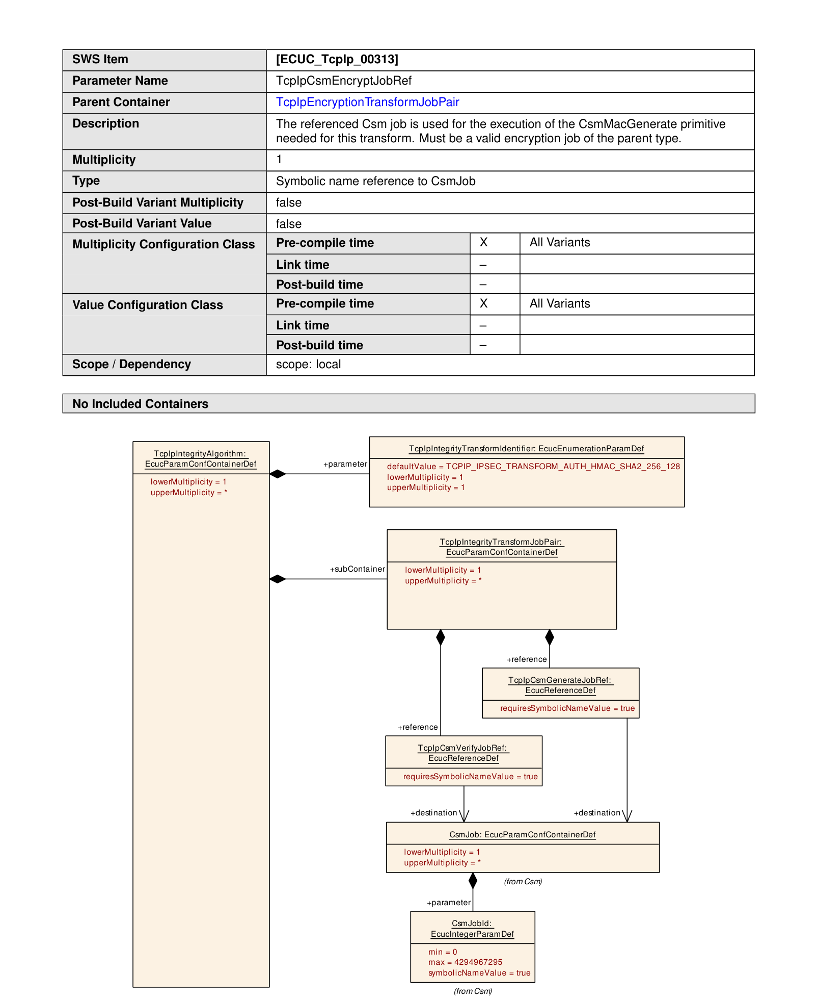

| 项目 | 内容 |
| --- | --- |
| SWS 条目 | [ECUC_TcpIp_00294] |
| 容器名称 | TcpIpIntegrityAlgorithm |
| 父容器 | TcpIpIpSecConfigSet |
| 描述 | 用于配置受支持完整性算法变换的容器。该容器用于配置AH所支持的算法。变换算法必须在Crypto模块中配置。 |
| 多重性配置类 | Pre-compile time：X（All Variants）；Link time：-；Post-build time：- |
| Post-Build 变体多重性 | false |
| 配置参数 | 见下方参数表 |

| 包含的容器 | 容器名称 | 多重性 | 作用域/依赖 |
| --- | --- | --- | --- |
| 包含的容器 | TcpIpIntegrityTransformJobPair | 1..* | 见9.2.59节 |

| 项目 | 内容 |
| --- | --- |
| SWS 条目 | [ECUC_TcpIp_00307] |
| 参数名称 | TcpIpIntegrityTransformIdentifier |
| 父容器 | TcpIpIntegrityAlgorithm |
| 描述 | 完整性算法变换标识符。参数值按照IETF RFC 7296 3.3.2定义。 |
| 多重性 | 1 |
| 类型 | EcucEnumerationParamDef |
| 范围 | TCPIP_IPSEC_TRANSFORM_ AUTH_AES_128_GMAC |
| 默认值 | TCPIP_IPSEC_TRANSFORM_AUTH_HMAC_SHA2_256_128 |
| Post-Build 变体多重性 | false |
| Post-Build 变体值 | false |
| 值配置类 | Pre-compile time：X（All Variants）；Link time：-；Post-build time：- |
| 多重性配置类 | Pre-compile time：X（All Variants）；Link time：-；Post-build time：- |
| 作用域/依赖 | scope: local |

#### 9.2.59. TcpIpIntegrityTransformJobPair

| 项目 | 内容 |
| --- | --- |
| SWS 条目 | [ECUC_TcpIp_00308] |
| 容器名称 | TcpIpIntegrityTransformJobPair |
| 父容器 | TcpIpIntegrityAlgorithm |
| 描述 | 用于存储执行认证所需的CSM完整性变换作业引用的容器。对ESP和AH有效。每个完整性算法至少需要配置一个完整性变换作业对。 |
| 多重性配置类 | Pre-compile time：X（All Variants）；Link time：-；Post-build time：- |
| Post-Build 变体多重性 | false |
| 配置参数 | 见下方参数表 |

无包含的容器。

| 项目 | 内容 |
| --- | --- |
| SWS 条目 | [ECUC_TcpIp_00309] |
| 参数名称 | TcpIpCsmGenerateJobRef |
| 父容器 | TcpIpIntegrityTransformJobPair |
| 描述 | 所引用的Csm作业用于执行此变换所需的CsmMacGenerate原语。必须是父类型的有效MAC生成作业。 |
| 多重性 | 1 |
| 类型 | Symbolic name reference to CsmJob |
| Post-Build 变体多重性 | false |
| Post-Build 变体值 | false |
| 值配置类 | Pre-compile time：X；Link time：-；Post-build time：- |
| 多重性配置类 | Pre-compile time：X；Link time：-；Post-build time：- |
| 作用域/依赖 | scope: local |

| 项目 | 内容 |
| --- | --- |
| SWS 条目 | [ECUC_TcpIp_00310] |
| 参数名称 | TcpIpCsmVerifyJobRef |
| 父容器 | TcpIpIntegrityTransformJobPair |
| 描述 | 所引用的Csm作业用于执行此变换所需的CsmMacVerify原语。必须是父类型的有效MAC验证作业。 |
| 多重性 | 1 |
| 类型 | Symbolic name reference to CsmJob |
| Post-Build 变体多重性 | false |
| Post-Build 变体值 | false |
| 值配置类 | Pre-compile time：X；Link time：-；Post-build time：- |
| 多重性配置类 | Pre-compile time：X；Link time：-；Post-build time：- |
| 作用域/依赖 | scope: local |

#### 9.2.60. TcpIpSpdEntry

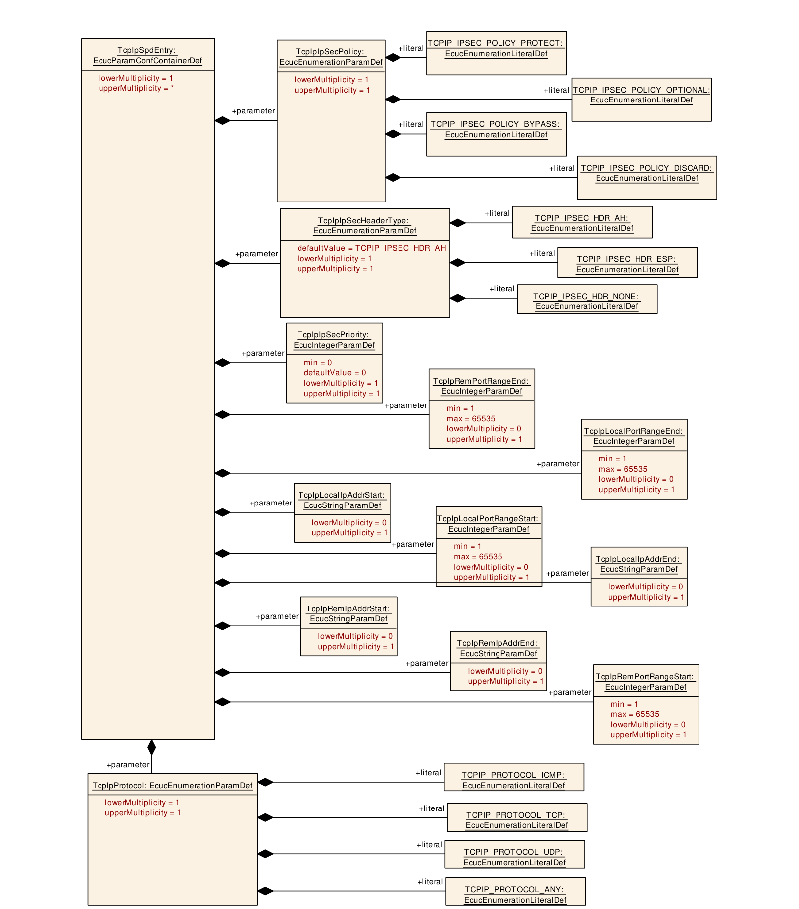

| 项目 | 内容 |
| --- | --- |
| SWS 条目 | [ECUC_TcpIp_00293] |
| 容器名称 | TcpIpSpdEntry |
| 父容器 | TcpIpIpSecConfigSet |
| 描述 | 安全策略数据库（**SPD**）的条目。 |
| 多重性配置类 | Pre-compile time：X（All Variants）；Link time：-；Post-build time：- |
| Post-Build 变体多重性 | false |
| 配置参数 | 见下方参数表 |

无包含的容器。

| 项目 | 内容 |
| --- | --- |
| SWS 条目 | [ECUC_TcpIp_00297] |
| 参数名称 | TcpIpIpSecHeaderType |
| 父容器 | TcpIpSpdEntry |
| 描述 | 规定IPsec安全机制的报头类型。 |
| 多重性 | 1 |
| 类型 | EcucEnumerationParamDef |
| 范围 | TCPIP_IPSEC_HDR_AH；TCPIP_IPSEC_HDR_ESP；TCPIP_IPSEC_HDR_NONE |
| 默认值 | TCPIP_IPSEC_HDR_AH |
| Post-Build 变体多重性 | false |
| Post-Build 变体值 | false |
| 值配置类 | Pre-compile time：X（All Variants）；Link time：-；Post-build time：- |
| 多重性配置类 | Pre-compile time：X（All Variants）；Link time：-；Post-build time：- |
| 作用域/依赖 | scope: local |

| 项目 | 内容 |
| --- | --- |
| SWS 条目 | [ECUC_TcpIp_00295] |
| 参数名称 | TcpIpIpSecPolicy |
| 父容器 | TcpIpSpdEntry |
| 描述 | IPsec的使用策略。 |
| 多重性 | 1 |
| 类型 | EcucEnumerationParamDef |
| 范围 | TCPIP_IPSEC_POLICY_ BYPASS；TCPIP_IPSEC_POLICY_ DISCARD；TCPIP_IPSEC_POLICY_ OPTIONAL；TCPIP_IPSEC_POLICY_ PROTECT |
| Post-Build 变体多重性 | false |
| Post-Build 变体值 | false |
| 值配置类 | Pre-compile time：X（All Variants）；Link time：-；Post-build time：- |
| 多重性配置类 | Pre-compile time：X（All Variants）；Link time：-；Post-build time：- |
| 作用域/依赖 | scope: local |

| 项目 | 内容 |
| --- | --- |
| SWS 条目 | [ECUC_TcpIp_00296] |
| 参数名称 | TcpIpIpSecPriority |
| 父容器 | TcpIpSpdEntry |
| 描述 | SPD条目的优先级。条目的处理基于优先级，最高优先级为「0」。第一个匹配的SPD条目定义策略。 |
| 多重性 | 1 |
| 类型 | EcucIntegerParamDef |
| 默认值 | 0 |
| Post-Build 变体多重性 | false |
| Post-Build 变体值 | false |
| 作用域/依赖 | scope: local |

| 项目 | 内容 |
| --- | --- |
| SWS 条目 | [ECUC_TcpIp_00301] |
| 参数名称 | TcpIpLocalIpAddrEnd |
| 父容器 | TcpIpSpdEntry |
| 描述 | 远程IP地址范围的结束值。 |
| 多重性 | 0..1 |
| 类型 | EcucStringParamDef |
| 默认值 | - |
| Post-Build 变体多重性 | false |
| Post-Build 变体值 | false |
| 值配置类 | Pre-compile time：X；Link time：-；Post-build time：- |
| 多重性配置类 | Pre-compile time：X；Link time：-；Post-build time：- |
| 作用域/依赖 | scope: local |

| 项目 | 内容 |
| --- | --- |
| SWS 条目 | [ECUC_TcpIp_00300] |
| 参数名称 | TcpIpLocalIpAddrStart |
| 父容器 | TcpIpSpdEntry |
| 描述 | 本地IP地址范围的起始值。 |
| 多重性 | 0..1 |
| 类型 | EcucStringParamDef |
| 默认值 | - |
| Post-Build 变体多重性 | false |
| Post-Build 变体值 | false |
| 值配置类 | Pre-compile time：X（All Variants）；Link time：-；Post-build time：- |
| 多重性配置类 | Pre-compile time：X（All Variants）；Link time：-；Post-build time：- |
| 作用域/依赖 | scope: local |

| 项目 | 内容 |
| --- | --- |
| SWS 条目 | [ECUC_TcpIp_00299] |
| 参数名称 | TcpIpLocalPortRangeEnd |
| 父容器 | TcpIpSpdEntry |
| 描述 | 本地端口范围的结束值。 |
| 多重性 | 0..1 |
| 类型 | EcucIntegerParamDef |
| 范围 | 1 .. 65535 |
| 默认值 | - |
| Post-Build 变体多重性 | false |
| Post-Build 变体值 | false |
| 值配置类 | Pre-compile time：X；Link time：-；Post-build time：- |
| 多重性配置类 | Pre-compile time：X；Link time：-；Post-build time：- |
| 作用域/依赖 | scope: local |

| 项目 | 内容 |
| --- | --- |
| SWS 条目 | [ECUC_TcpIp_00298] |
| 参数名称 | TcpIpLocalPortRangeStart |
| 父容器 | TcpIpSpdEntry |
| 描述 | 本地端口范围的起始值。 |
| 多重性 | 0..1 |
| 类型 | EcucIntegerParamDef |
| 范围 | 1 .. 65535 |
| 默认值 | - |
| Post-Build 变体多重性 | false |
| Post-Build 变体值 | false |
| 值配置类 | Pre-compile time：X；Link time：-；Post-build time：- |
| 多重性配置类 | Pre-compile time：X；Link time：-；Post-build time：- |
| 作用域/依赖 | scope: local |

| 项目 | 内容 |
| --- | --- |
| SWS 条目 | [ECUC_TcpIp_00306] |
| 参数名称 | TcpIpProtocol |
| 父容器 | TcpIpSpdEntry |
| 描述 | 相关的IP协议。注意：按照IETF RFC 4301第6节的规定，ICMP错误消息始终被BYPASS。TCPIP_PROTOCOL_ICMP的策略仅适用于ICMP非错误消息。（回显应答/响应）。 |
| 多重性 | 1 |
| 类型 | EcucEnumerationParamDef |
| 范围 | TCPIP_PROTOCOL_ANY；TCPIP_PROTOCOL_ICMP；TCPIP_PROTOCOL_TCP；TCPIP_PROTOCOL_UDP |
| Post-Build 变体多重性 | false |
| Post-Build 变体值 | false |
| 值配置类 | Pre-compile time：X；Link time：-；Post-build time：- |
| 多重性配置类 | Pre-compile time：X；Link time：-；Post-build time：- |
| 作用域/依赖 | scope: local |

| 项目 | 内容 |
| --- | --- |
| SWS 条目 | [ECUC_TcpIp_00303] |
| 参数名称 | TcpIpRemIpAddrEnd |
| 父容器 | TcpIpSpdEntry |
| 描述 | 远程IP地址范围的结束值。 |
| 多重性 | 0..1 |
| 类型 | EcucStringParamDef |
| 默认值 | - |
| Post-Build 变体多重性 | false |
| Post-Build 变体值 | false |
| 值配置类 | Pre-compile time：X；Link time：-；Post-build time：- |
| 多重性配置类 | Pre-compile time：X；Link time：-；Post-build time：- |
| 作用域/依赖 | scope: local |

| 项目 | 内容 |
| --- | --- |
| SWS 条目 | [ECUC_TcpIp_00302] |
| 参数名称 | TcpIpRemIpAddrStart |
| 父容器 | TcpIpSpdEntry |
| 描述 | 远程IP地址范围的起始值。 |
| 多重性 | 0..1 |
| 类型 | EcucStringParamDef |
| 默认值 | - |
| Post-Build 变体多重性 | false |
| Post-Build 变体值 | false |
| 值配置类 | Pre-compile time：X（All Variants）；Link time：-；Post-build time：- |
| 多重性配置类 | Pre-compile time：X（All Variants）；Link time：-；Post-build time：- |
| 作用域/依赖 | scope: local |

| 项目 | 内容 |
| --- | --- |
| SWS 条目 | [ECUC_TcpIp_00305] |
| 参数名称 | TcpIpRemPortRangeEnd |
| 父容器 | TcpIpSpdEntry |
| 描述 | 远程端口范围的结束值。 |
| 多重性 | 0..1 |
| 类型 | EcucIntegerParamDef |
| 范围 | 1 .. 65535 |
| 默认值 | - |
| Post-Build 变体多重性 | false |
| Post-Build 变体值 | false |
| 值配置类 | Pre-compile time：X；Link time：-；Post-build time：- |
| 多重性配置类 | Pre-compile time：X；Link time：-；Post-build time：- |
| 作用域/依赖 | scope: local |

| 项目 | 内容 |
| --- | --- |
| SWS 条目 | [ECUC_TcpIp_00304] |
| 参数名称 | TcpIpRemPortRangeStart |
| 父容器 | TcpIpSpdEntry |
| 描述 | 远程端口范围的起始值。 |
| 多重性 | 0..1 |
| 类型 | EcucIntegerParamDef |
| 范围 | 1 .. 65535 |
| 默认值 | - |
| Post-Build 变体多重性 | false |
| Post-Build 变体值 | false |
| 值配置类 | Pre-compile time：X；Link time：-；Post-build time：- |
| 多重性配置类 | Pre-compile time：X；Link time：-；Post-build time：- |
| 作用域/依赖 | scope: local |

#### 9.2.61. IKE


| 项目 | 内容 |
| --- | --- |
| SWS 条目 | [ECUC_IKE_00001] |
| 容器名称 | IKE |
| 描述 | IKE（互联网密钥交换）模块的配置。 |
| 配置参数 | 见下方参数表 |

| 包含的容器 | 容器名称 | 多重性 | 作用域/依赖 |
| --- | --- | --- | --- |
| 包含的容器 | IKECertificates | 1 | 见9.2.75节 |
| 包含的容器 | IKEConnections | 1 | 见9.2.64节 |
| 包含的容器 | IKEGeneral | 1 | 见9.2.62节 |
| 包含的容器 | IKETransforms | 1 | 见9.2.70节 |

#### 9.2.62. IKEGeneral

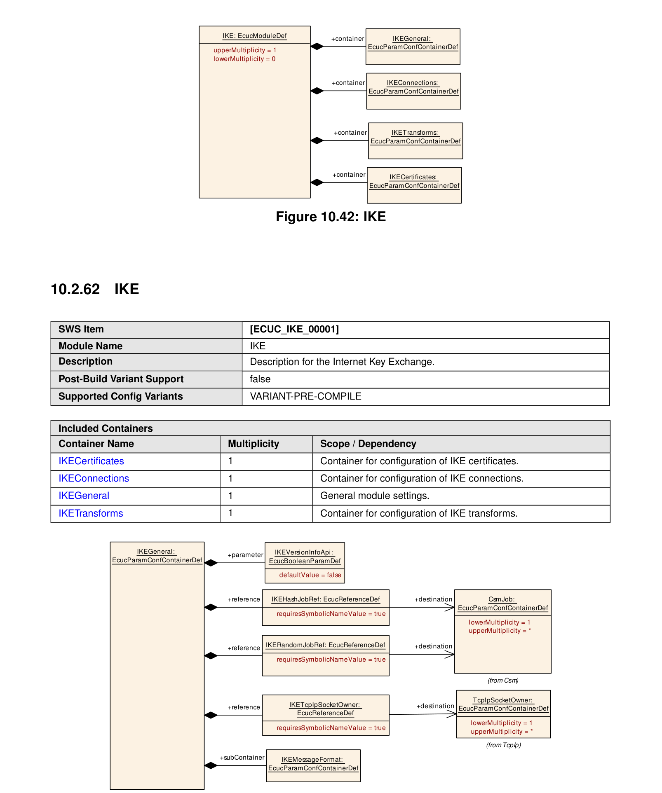

| 项目 | 内容 |
| --- | --- |
| SWS 条目 | [ECUC_IKE_00002] |
| 容器名称 | IKEGeneral |
| 父容器 | IKE |
| 描述 | 通用模块设置。 |
| 配置参数 | 见下方参数表 |

| 包含的容器 | 容器名称 | 多重性 | 作用域/依赖 |
| --- | --- | --- | --- |
| 包含的容器 | IKEMessageFormat | 1 | 见9.2.63节 |

| 项目 | 内容 |
| --- | --- |
| SWS 条目 | [ECUC_IKE_00008] |
| 参数名称 | IKEVersionInfoApi |
| 父容器 | IKEGeneral |
| 描述 | 启用和禁用API IKE_GetVersionInfo()可用性的预处理器开关。• True：API IKE_GetVersionInfo()可用。• False：API IKE_GetVersionInfo()不可用。 |
| 多重性 | 1 |
| 类型 | EcucBooleanParamDef |
| 默认值 | false |
| Post-Build 变体多重性 | false |
| Post-Build 变体值 | false |
| 值配置类 | Pre-compile time：X；Link time：-；Post-build time：- |
| 多重性配置类 | Pre-compile time：X；Link time：-；Post-build time：- |
| 作用域/依赖 | scope: local |

| 项目 | 内容 |
| --- | --- |
| SWS 条目 | [ECUC_IKE_00009] |
| 参数名称 | IKEHashJobRef |
| 父容器 | IKEGeneral |
| 描述 | 所引用的加密作业用于计算认证机构编码所需的Subject Public Key Info元素的SHA-1哈希。 |
| 多重性 | 1 |
| 类型 | Symbolic name reference to CsmJob |
| 作用域/依赖 | scope: local |

| 项目 | 内容 |
| --- | --- |
| SWS 条目 | [ECUC_IKE_00010] |
| 参数名称 | IKERandomJobRef |
| 父容器 | IKEGeneral |
| 描述 | 所引用的加密作业用于随机数生成。 |
| 多重性 | 1 |
| 类型 | Symbolic name reference to CsmJob |
| Post-Build 变体多重性 | false |
| Post-Build 变体值 | false |
| 值配置类 | Pre-compile time：X（All Variants） |
| 多重性配置类 | Pre-compile time：X（All Variants）；Link time：-；Post-build time：- |
| 作用域/依赖 | scope: local |

| 项目 | 内容 |
| --- | --- |
| SWS 条目 | [ECUC_IKE_00011] |
| 参数名称 | IKETcpIpSocketOwner |
| 父容器 | IKEGeneral |
| 描述 | 套接字用户的ID。 |
| 多重性 | 1 |
| 类型 | Symbolic name reference to TcpIpSocketOwner |
| Post-Build 变体多重性 | false |
| Post-Build 变体值 | false |
| 值配置类 | Pre-compile time：All Variants；Link time：-；Post-build time：- |
| 多重性配置类 | Pre-compile time：All Variants；Link time：-；Post-build time：- |
| 作用域/依赖 | scope: local |

#### 9.2.63. IKEMessageFormat

| 项目 | 内容 |
| --- | --- |
| SWS 条目 | [ECUC_IKE_00012] |
| 容器名称 | IKEMessageFormat |
| 父容器 | IKEGeneral |
| 描述 | 为了将IKE消息的字节流反序列化为数据结构，内存是静态分配的。使用此容器中的参数可以将使用的内存减到最少。但是，将最大值配置得过低可能导致接收到的IKE消息反序列化失败。 |
| 多重性配置类 | Pre-compile time：X（All Variants）；Link time：-；Post-build time：- |
| Post-Build 变体多重性 | false |
| 配置参数 | 见下方参数表 |

无包含的容器。

| 项目 | 内容 |
| --- | --- |
| SWS 条目 | [ECUC_IKE_00014] |
| 参数名称 | IKEMaxAttributesPerTransform |
| 父容器 | IKEMessageFormat |
| 描述 | 一个变换可以包含的属性的最大数量。 |
| 多重性 | 1 |
| 类型 | EcucIntegerParamDef |
| 范围 | 1 .. 2 |
| 默认值 | 2 |
| Post-Build 变体多重性 | false |
| Post-Build 变体值 | false |
| 值配置类 | Pre-compile time：X；Link time：-；Post-build time：- |
| 多重性配置类 | Pre-compile time：X；Link time：-；Post-build time：- |
| 作用域/依赖 | scope: local |

| 项目 | 内容 |
| --- | --- |
| SWS 条目 | [ECUC_IKE_00020] |
| 参数名称 | IKEMaxCertPayloadsPerMessage |
| 父容器 | IKEMessageFormat |
| 描述 | 一条IKE消息可以包含的Certificate载荷的最大数量。 |
| 多重性 | 1 |
| 类型 | EcucIntegerParamDef |
| 范围 | 1 .. 4 |
| 默认值 | 4 |
| Post-Build 变体多重性 | false |
| Post-Build 变体值 | false |
| 值配置类 | Pre-compile time：X；Link time：-；Post-build time：- |
| 多重性配置类 | Pre-compile time：X；Link time：-；Post-build time：- |
| 作用域/依赖 | scope: local |

| 项目 | 内容 |
| --- | --- |
| SWS 条目 | [ECUC_IKE_00021] |
| 参数名称 | IKEMaxCertreqPayloadsPerMessage |
| 父容器 | IKEMessageFormat |
| 描述 | 一条IKE消息可以包含的Certificate Request载荷的最大数量。 |
| 多重性 | 1 |
| 类型 | EcucIntegerParamDef |
| 范围 | 1 .. 4 |
| 默认值 | 4 |
| Post-Build 变体多重性 | false |
| Post-Build 变体值 | false |
| 值配置类 | Pre-compile time：X（All Variants）；Link time：-；Post-build time：- |
| 多重性配置类 | Pre-compile time：X（All Variants）；Link time：-；Post-build time：- |
| 作用域/依赖 | scope: local |

| 项目 | 内容 |
| --- | --- |
| SWS 条目 | [ECUC_IKE_00022] |
| 参数名称 | IKEMaxDeletePayloadsPerMessage |
| 父容器 | IKEMessageFormat |
| 描述 | 一条IKE消息可以包含的Delete载荷的最大数量。 |
| 多重性 | 1 |
| 类型 | EcucIntegerParamDef |
| 范围 | 1 .. 2 |
| 默认值 | 2 |
| Post-Build 变体多重性 | false |
| Post-Build 变体值 | false |
| 值配置类 | Pre-compile time：X；Link time：-；Post-build time：- |
| 多重性配置类 | Pre-compile time：X；Link time：-；Post-build time：- |
| 作用域/依赖 | scope: local |

| 项目 | 内容 |
| --- | --- |
| SWS 条目 | [ECUC_IKE_00024] |
| 参数名称 | IKEMaxInitMessageSize |
| 父容器 | IKEMessageFormat |
| 描述 | 传入IKE_INIT消息的最大大小。 |
| 多重性 | 1 |
| 类型 | EcucIntegerParamDef |
| 范围 | 256 .. 3000 |
| 默认值 | 512 |
| Post-Build 变体多重性 | false |
| Post-Build 变体值 | false |
| 值配置类 | Pre-compile time：X；Link time：-；Post-build time：- |
| 多重性配置类 | Pre-compile time：X；Link time：-；Post-build time：- |
| 作用域/依赖 | scope: local |

| 项目 | 内容 |
| --- | --- |
| SWS 条目 | [ECUC_IKE_00023] |
| 参数名称 | IKEMaxNonceSize |
| 父容器 | IKEMessageFormat |
| 描述 | 传入nonce的最大大小。必须至少为32字节，且至少为所配置的最大伪随机函数（PRF）密钥大小的一半。 |
| 多重性 | 1 |
| 类型 | EcucIntegerParamDef |
| 范围 | 32 .. 512 |
| 默认值 | 64 |
| Post-Build 变体多重性 | false |
| Post-Build 变体值 | false |
| 值配置类 | Pre-compile time：X（All Variants）；Link time：-；Post-build time：- |
| 多重性配置类 | Pre-compile time：X（All Variants）；Link time：-；Post-build time：- |
| 作用域/依赖 | scope: local |

| 项目 | 内容 |
| --- | --- |
| SWS 条目 | [ECUC_IKE_00019] |
| 参数名称 | IKEMaxNotifyPayloadsPerMessage |
| 父容器 | IKEMessageFormat |
| 描述 | 一条IKE消息可以包含的Notify载荷的最大数量。 |
| 多重性 | 1 |
| 类型 | EcucIntegerParamDef |
| 范围 | 1 .. 10 |
| 默认值 | 10 |
| Post-Build 变体多重性 | false |
| Post-Build 变体值 | false |
| 值配置类 | Pre-compile time：X；Link time：-；Post-build time：- |
| 多重性配置类 | Pre-compile time：X；Link time：-；Post-build time：- |
| 作用域/依赖 | scope: local |

| 项目 | 内容 |
| --- | --- |
| SWS 条目 | [ECUC_IKE_00018] |
| 参数名称 | IKEMaxPayloadsPerMessage |
| 父容器 | IKEMessageFormat |
| 描述 | 一条IKE消息可以包含的载荷的最大数量。 |
| 多重性 | 1 |
| 类型 | EcucIntegerParamDef |
| 范围 | 1 .. 20 |
| 默认值 | 20 |
| Post-Build 变体多重性 | false |
| Post-Build 变体值 | false |
| 值配置类 | Pre-compile time：X（All Variants） |
| 多重性配置类 | Pre-compile time：X（All Variants）；Link time：-；Post-build time：- |
| 作用域/依赖 | scope: local |

| 项目 | 内容 |
| --- | --- |
| SWS 条目 | [ECUC_IKE_00015] |
| 参数名称 | IKEMaxProposalsPerSaPayload |
| 父容器 | IKEMessageFormat |
| 描述 | 一个SA载荷可以包含的提议的最大数量。 |
| 多重性 | 1 |
| 类型 | EcucIntegerParamDef |
| 范围 | 1 .. 5 |
| 默认值 | 5 |
| Post-Build 变体多重性 | false |
| Post-Build 变体值 | false |
| 值配置类 | Pre-compile time：X；Link time：-；Post-build time：- |
| 多重性配置类 | Pre-compile time：X；Link time：-；Post-build time：- |
| 作用域/依赖 | scope: local |

| 项目 | 内容 |
| --- | --- |
| SWS 条目 | [ECUC_IKE_00017] |
| 参数名称 | IKEMaxSpisPerDeletePayload |
| 父容器 | IKEMessageFormat |
| 描述 | 一个Delete载荷可以包含的SPI的最大数量。 |
| 多重性 | 1 |
| 类型 | EcucIntegerParamDef |
| 范围 | 1 .. 2 |
| 默认值 | 2 |
| Post-Build 变体多重性 | false |
| Post-Build 变体值 | false |
| 值配置类 | Pre-compile time：X；Link time：-；Post-build time：- |
| 多重性配置类 | Pre-compile time：X；Link time：-；Post-build time：- |
| 作用域/依赖 | scope: local |

| 项目 | 内容 |
| --- | --- |
| SWS 条目 | [ECUC_IKE_00016] |
| 参数名称 | IKEMaxTrafficSelectorsPerTsPayload |
| 父容器 | IKEMessageFormat |
| 描述 | 一个Traffic Selector载荷可以包含的流量选择器的最大数量。 |
| 多重性 | 1 |
| 类型 | EcucIntegerParamDef |
| 范围 | 1 .. 2 |
| 默认值 | 2 |
| Post-Build 变体多重性 | false |
| Post-Build 变体值 | false |
| 值配置类 | Pre-compile time：X（All Variants）；Link time：-；Post-build time：- |
| 多重性配置类 | Pre-compile time：X（All Variants）；Link time：-；Post-build time：- |
| 作用域/依赖 | scope: local |

| 项目 | 内容 |
| --- | --- |
| SWS 条目 | [ECUC_IKE_00013] |
| 参数名称 | IKEMaxTransformsPerProp |
| 父容器 | IKEMessageFormat |
| 描述 | 一个提议可以包含的变换的最大数量。 |
| 多重性 | 1 |
| 类型 | EcucIntegerParamDef |
| 范围 | 1 .. 5 |
| 默认值 | 5 |
| Post-Build 变体多重性 | false |
| Post-Build 变体值 | false |
| 值配置类 | Pre-compile time：X；Link time：-；Post-build time：- |
| 多重性配置类 | Pre-compile time：X；Link time：-；Post-build time：- |
| 作用域/依赖 | scope: local |

#### 9.2.64. IKEConnections

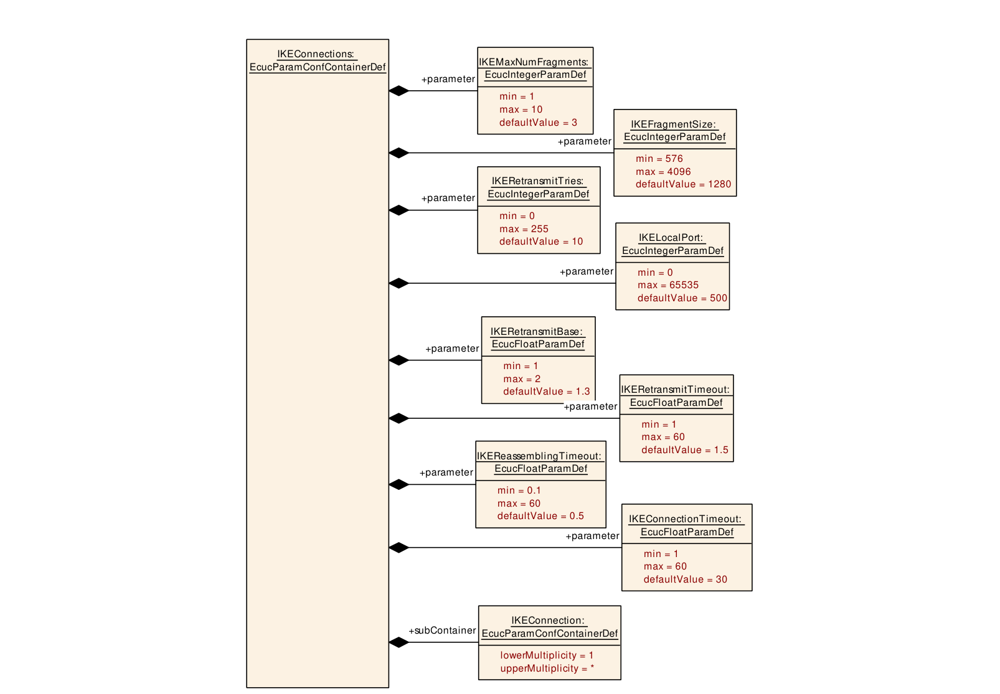

| 项目 | 内容 |
| --- | --- |
| SWS 条目 | [ECUC_IKE_00003] |
| 容器名称 | IKEConnections |
| 父容器 | IKE |
| 描述 | IKE连接配置的容器。 |
| 配置参数 | 见下方参数表 |

| 包含的容器 | 容器名称 | 多重性 | 作用域/依赖 |
| --- | --- | --- | --- |
| 包含的容器 | IKEConnection | 1..* | 见9.2.65节 |

| 项目 | 内容 |
| --- | --- |
| SWS 条目 | [ECUC_IKE_00055] |
| 参数名称 | IKEConnectionTimeout |
| 父容器 | IKEConnections |
| 描述 | 建立连接的超时时间。 |
| 多重性 | 1 |
| 类型 | EcucFloatParamDef |
| 默认值 | 30 |
| Post-Build 变体多重性 | false |
| Post-Build 变体值 | false |
| 值配置类 | Pre-compile time：X（All Variants）；Link time：-；Post-build time：- |
| 多重性配置类 | Pre-compile time：X（All Variants）；Link time：-；Post-build time：- |
| 作用域/依赖 | scope: local |

| 项目 | 内容 |
| --- | --- |
| SWS 条目 | [ECUC_IKE_00049] |
| 参数名称 | IKEFragmentSize |
| 父容器 | IKEConnections |
| 描述 | 使用分片时IKE分片消息的最大大小。后续分片消息产生的缓冲区大小为（分片数 * 分片大小）。该分片大小是用于RX和TX的最大IP数据报大小。 |
| 多重性 | 1 |
| 类型 | EcucIntegerParamDef |
| 范围 | 576 .. 4096 |
| 默认值 | 1280 |
| Post-Build 变体多重性 | false |
| Post-Build 变体值 | false |
| 值配置类 | Pre-compile time：X（All Variants）；Link time：-；Post-build time：- |
| 多重性配置类 | Pre-compile time：X（All Variants）；Link time：-；Post-build time：- |
| 作用域/依赖 | scope: local |

| 项目 | 内容 |
| --- | --- |
| SWS 条目 | [ECUC_IKE_00051] |
| 参数名称 | IKELocalPort |
| 父容器 | IKEConnections |
| 描述 | 本地端口是要监听的UDP端口。 |
| 多重性 | 1 |
| 类型 | EcucIntegerParamDef |
| 范围 | 0 .. 65535 |
| 默认值 | 500 |
| Post-Build 变体多重性 | false |
| Post-Build 变体值 | false |
| 值配置类 | Pre-compile time：X；Link time：-；Post-build time：- |
| 多重性配置类 | Pre-compile time：X；Link time：-；Post-build time：- |
| 作用域/依赖 | scope: local |

| 项目 | 内容 |
| --- | --- |
| SWS 条目 | [ECUC_IKE_00048] |
| 参数名称 | IKEMaxNumFragments |
| 父容器 | IKEConnections |
| 描述 | 一条IKE消息可被划分成的分片消息的最大数量。如果该值设置为1，则不支持分片。后续分片消息产生的缓冲区大小为（分片数 * 分片大小）。用于RX和TX，并影响TX缓冲区的大小。 |
| 多重性 | 1 |
| 类型 | EcucIntegerParamDef |
| 范围 | 1 .. 10 |
| 默认值 | 3 |
| Post-Build 变体多重性 | false |
| Post-Build 变体值 | false |
| 值配置类 | Pre-compile time：X；Link time：-；Post-build time：- |
| 多重性配置类 | Pre-compile time：X；Link time：-；Post-build time：- |
| 作用域/依赖 | scope: local |

| 项目 | 内容 |
| --- | --- |
| SWS 条目 | [ECUC_IKE_00054] |
| 参数名称 | IKEReassemblingTimeout |
| 父容器 | IKEConnections |
| 描述 | 重组分片消息的超时时间。一条消息的所有分片必须在该时间间隔内接收，否则迄今为止已接收的所有分片都将被丢弃。 |
| 多重性 | 1 |
| 类型 | EcucFloatParamDef |
| 范围 | [0.1 .. 60] |
| 默认值 | 0.5 |
| Post-Build 变体多重性 | false |
| Post-Build 变体值 | false |
| 值配置类 | Pre-compile time：X；Link time：-；Post-build time：- |
| 多重性配置类 | Pre-compile time：X；Link time：-；Post-build time：- |
| 作用域/依赖 | scope: local |

| 项目 | 内容 |
| --- | --- |
| SWS 条目 | [ECUC_IKE_00052] |
| 参数名称 | IKERetransmitBase |
| 父容器 | IKEConnections |
| 描述 | 重传超时的底数。 |
| 多重性 | 1 |
| 类型 | EcucFloatParamDef |
| 默认值 | 1.3 |
| Post-Build 变体多重性 | false |
| Post-Build 变体值 | false |
| 值配置类 | Pre-compile time：X（All Variants）；Link time：-；Post-build time：- |
| 多重性配置类 | Pre-compile time：X（All Variants）；Link time：-；Post-build time：- |
| 作用域/依赖 | scope: local |

| 项目 | 内容 |
| --- | --- |
| SWS 条目 | [ECUC_IKE_00053] |
| 参数名称 | IKERetransmitTimeout |
| 父容器 | IKEConnections |
| 描述 | 初始重传超时。 |
| 多重性 | 1 |
| 类型 | EcucFloatParamDef |
| 范围 | [1 .. 60] |
| 默认值 | 1.5 |
| Post-Build 变体多重性 | false |
| Post-Build 变体值 | false |
| 值配置类 | Pre-compile time：X；Link time：-；Post-build time：- |
| 多重性配置类 | Pre-compile time：X；Link time：-；Post-build time：- |
| 作用域/依赖 | scope: local |

| 项目 | 内容 |
| --- | --- |
| SWS 条目 | [ECUC_IKE_00050] |
| 参数名称 | IKERetransmitTries |
| 父容器 | IKEConnections |
| 描述 | 放弃之前请求重传的最大次数。 |
| 多重性 | 1 |
| 类型 | EcucIntegerParamDef |
| 范围 | 0 .. 255 |
| 默认值 | 10 |
| Post-Build 变体多重性 | false |
| Post-Build 变体值 | false |
| 值配置类 | Pre-compile time：X；Link time：-；Post-build time：- |
| 多重性配置类 | Pre-compile time：X；Link time：-；Post-build time：- |
| 作用域/依赖 | scope: local |

#### 9.2.65. IKEConnection


| 项目 | 内容 |
| --- | --- |
| SWS 条目 | [ECUC_IKE_00056] |
| 容器名称 | IKEConnection |
| 父容器 | IKEConnections |
| 描述 | IKE连接配置的容器。 |
| 多重性配置类 | Pre-compile time：X（All Variants）；Link time：-；Post-build time：- |
| Post-Build 变体多重性 | false |
| 配置参数 | 见下方参数表 |

| 包含的容器 | 容器名称 | 多重性 | 作用域/依赖 |
| --- | --- | --- | --- |
| 包含的容器 | IKESession | 1..255 | 见9.2.66节 |

| 项目 | 内容 |
| --- | --- |
| SWS 条目 | [ECUC_IKE_00058] |
| 参数名称 | IKEAutostart |
| 父容器 | IKEConnection |
| 描述 | 如果启用，IKE将在模块启动之后自动在此连接上发起一个IKE SA。 |
| 多重性 | 1 |
| 类型 | EcucBooleanParamDef |
| 默认值 | true |
| Post-Build 变体多重性 | false |
| Post-Build 变体值 | false |
| 值配置类 | Pre-compile time：X；Link time：-；Post-build time：- |
| 多重性配置类 | Pre-compile time：X；Link time：-；Post-build time：- |
| 作用域/依赖 | scope: local |

| 项目 | 内容 |
| --- | --- |
| SWS 条目 | [ECUC_IKE_00060] |
| 参数名称 | IKEConnectionId |
| 父容器 | IKEConnection |
| 描述 | 连接的标识符。 |
| 多重性 | 1 |
| 类型 | EcucIntegerParamDef |
| 范围 | 0 .. 4294967295 |
| 默认值 | 0 |
| Post-Build 变体多重性 | false |
| Post-Build 变体值 | false |
| 值配置类 | Pre-compile time：X；Link time：-；Post-build time：- |
| 多重性配置类 | Pre-compile time：X；Link time：-；Post-build time：- |
| 作用域/依赖 | scope: local |

| 项目 | 内容 |
| --- | --- |
| SWS 条目 | [ECUC_IKE_00063] |
| 参数名称 | IKEDpdDelay |
| 父容器 | IKEConnection |
| 描述 | 规定在没有其他流量的情况下应发送死亡对端检测（DPD）数据包的间隔。设置为0以禁用DPD数据包的发送。 |
| 多重性 | 1 |
| 类型 | EcucFloatParamDef |
| 范围 | [0 .. 1000000000] |
| 默认值 | 30 |
| Post-Build 变体多重性 | false |
| Post-Build 变体值 | false |
| 值配置类 | Pre-compile time：X；Link time：-；Post-build time：- |
| 多重性配置类 | Pre-compile time：X；Link time：-；Post-build time：- |
| 作用域/依赖 | scope: local |

| 项目 | 内容 |
| --- | --- |
| SWS 条目 | [ECUC_IKE_00064] |
| 参数名称 | IKEIkeLifetime |
| 父容器 | IKEConnection |
| 描述 | 规定IKE SA终止的时间。设置为0表示IKE SA永不过期。 |
| 多重性 | 1 |
| 类型 | EcucFloatParamDef |
| 范围 | [0 .. 1000000000] |
| 默认值 | 86400 |
| Post-Build 变体多重性 | false |
| Post-Build 变体值 | false |
| 值配置类 | Pre-compile time：X；Link time：-；Post-build time：- |
| 多重性配置类 | Pre-compile time：X；Link time：-；Post-build time：- |
| 作用域/依赖 | scope: local |

| 项目 | 内容 |
| --- | --- |
| SWS 条目 | [ECUC_IKE_00065] |
| 参数名称 | IKEIkeMarginTime |
| 父容器 | IKEConnection |
| 描述 | 规定应在到期前多少秒重新协商IKE SA。 |
| 多重性 | 1 |
| 类型 | EcucFloatParamDef |
| 范围 | [10 .. 1000000000] |
| 默认值 | 600 |
| Post-Build 变体多重性 | false |
| Post-Build 变体值 | false |
| 值配置类 | Pre-compile time：X（All Variants）；Link time：-；Post-build time：- |
| 多重性配置类 | Pre-compile time：X（All Variants）；Link time：-；Post-build time：- |
| 作用域/依赖 | scope: local |

| 项目 | 内容 |
| --- | --- |
| SWS 条目 | [ECUC_IKE_00059] |
| 参数名称 | IKERemoteAddress |
| 父容器 | IKEConnection |
| 描述 | 远程地址是要与其建立IKE连接的ECU的IP地址，例如192.168.50.101。 |
| 多重性 | 1 |
| 类型 | EcucStringParamDef |
| 默认值 | - |
| Post-Build 变体多重性 | false |
| Post-Build 变体值 | false |
| 值配置类 | Pre-compile time：X；Link time：-；Post-build time：- |
| 多重性配置类 | Pre-compile time：X；Link time：-；Post-build time：- |
| 作用域/依赖 | scope: local |

| 项目 | 内容 |
| --- | --- |
| SWS 条目 | [ECUC_IKE_00057] |
| 参数名称 | IKERemotePort |
| 父容器 | IKEConnection |
| 描述 | 远程端口是要与其建立IKE连接的ECU的UDP端口。 |
| 多重性 | 1 |
| 类型 | EcucIntegerParamDef |
| 范围 | 0 .. 65535 |
| 默认值 | 500 |
| Post-Build 变体多重性 | false |
| Post-Build 变体值 | false |
| 值配置类 | Pre-compile time：X；Link time：-；Post-build time：- |
| 多重性配置类 | Pre-compile time：X；Link time：-；Post-build time：- |
| 作用域/依赖 | scope: local |

| 项目 | 内容 |
| --- | --- |
| SWS 条目 | [ECUC_IKE_00067] |
| 参数名称 | IKEECUCertificateRef |
| 父容器 | IKEConnection |
| 描述 | ECU证书是终端实体（end-entity）证书。所引用的证书是ECU证书，它包含在IKE连接建立期间用于认证的公钥。 |
| 多重性 | 0..1 |
| 类型 | Reference to IKECertificate |
| Post-Build 变体多重性 | false |
| Post-Build 变体值 | false |
| 值配置类 | Pre-compile time：X；Link time：-；Post-build time：- |
| 多重性配置类 | Pre-compile time：X；Link time：-；Post-build time：- |
| 作用域/依赖 | scope: local |

| 项目 | 内容 |
| --- | --- |
| SWS 条目 | [ECUC_IKE_00088] |
| 参数名称 | IKEECUPreSharedKeyRef |
| 父容器 | IKEConnection |
| 描述 | ECU的预共享密钥。 |
| 多重性 | 0..1 |
| 类型 | Symbolic name reference to CsmKey |
| Post-Build 变体多重性 | false |
| Post-Build 变体值 | false |
| 值配置类 | Pre-compile time：All Variants；Link time：-；Post-build time：- |
| 多重性配置类 | Pre-compile time：All Variants；Link time：-；Post-build time：- |
| 作用域/依赖 | scope: local |

| 项目 | 内容 |
| --- | --- |
| SWS 条目 | [ECUC_IKE_00089] |
| 参数名称 | IKERemotePreSharedKeyRef |
| 父容器 | IKEConnection |
| 描述 | 所引用的密钥是在IKE连接建立期间用于识别远程ECU的密钥。 |
| 多重性 | 0..1 |
| 类型 | Symbolic name reference to CsmKey |
| Post-Build 变体多重性 | false |
| Post-Build 变体值 | false |
| 值配置类 | Pre-compile time：X（All Variants）；Link time：- |
| 多重性配置类 | Pre-compile time：X（All Variants）；Link time：-；Post-build time：- |
| 作用域/依赖 | scope: local |

| 项目 | 内容 |
| --- | --- |
| SWS 条目 | [ECUC_IKE_00066] |
| 参数名称 | IKETcpIpLocalAddressRef |
| 父容器 | IKEConnection |
| 描述 | TCP/IP协议栈分配的IP地址表标识符。 |
| 多重性 | 1 |
| 类型 | Symbolic name reference to TcpIpLocalAddr |
| Post-Build 变体多重性 | false |
| Post-Build 变体值 | false |
| 值配置类 | Pre-compile time：X；Link time：-；Post-build time：- |
| 多重性配置类 | Pre-compile time：X；Link time：-；Post-build time：- |
| 作用域/依赖 | scope: local |

| 项目 | 内容 |
| --- | --- |
| SWS 条目 | [ECUC_IKE_00068] |
| 参数名称 | IKETrustAnchorCertificateRef |
| 父容器 | IKEConnection |
| 描述 | 所引用的证书是信任锚（Trust Anchor）证书，在IKE连接建立期间用于识别受信任的认证机构。 |
| 多重性 | 0..1 |
| 类型 | Reference to IKECertificate |
| Post-Build 变体多重性 | false |
| Post-Build 变体值 | false |
| 值配置类 | Pre-compile time：X；Link time：-；Post-build time：- |
| 多重性配置类 | Pre-compile time：X；Link time：-；Post-build time：- |
| 作用域/依赖 | scope: local |

#### 9.2.66. IKESession

| 项目 | 内容 |
| --- | --- |
| SWS 条目 | [ECUC_IKE_00069] |
| 容器名称 | IKESession |
| 父容器 | IKEConnection |
| 描述 | IKE会话配置的容器。 |
| 多重性配置类 | Pre-compile time：X（All Variants）；Link time：-；Post-build time：- |
| Post-Build 变体多重性 | false |
| 配置参数 | 见下方参数表 |

| 包含的容器 | 容器名称 | 多重性 | 作用域/依赖 |
| --- | --- | --- | --- |
| 包含的容器 | IKEChildSaProposal | 1..65536 | 见9.2.67节 |
| 包含的容器 | IKEIkeSaProposal | 1..* | 见9.2.68节 |
| 包含的容器 | IKESignatureAuthenticationVariant | 1..* | 见9.2.69节 |

#### 9.2.67. IKEChildSaProposal


| 项目 | 内容 |
| --- | --- |
| SWS 条目 | [ECUC_IKE_00070] |
| 容器名称 | IKEChildSaProposal |
| 父容器 | IKESession |
| 描述 | IKE认证报头（AH）或封装安全载荷（ESP）安全关联提议的配置容器。 |
| 多重性配置类 | Pre-compile time：X（All Variants）；Link time：-；Post-build time：- |
| Post-Build 变体多重性 | false |
| 配置参数 | 见下方参数表 |

无包含的容器。

| 项目 | 内容 |
| --- | --- |
| SWS 条目 | [ECUC_IKE_00074] |
| 参数名称 | IKESecurityProtocol |
| 父容器 | IKEChildSaProposal |
| 描述 | 此Child SA要使用的安全协议（即AH或ESP）。 |
| 多重性 | 1 |
| 类型 | EcucEnumerationParamDef |
| 范围 | IKE_PROTOCOL_AH；IKE_PROTOCOL_ESP |
| 默认值 | IKE_PROTOCOL_AH |
| Post-Build 变体多重性 | false |
| Post-Build 变体值 | false |
| 值配置类 | Pre-compile time：X（All Variants）；Link time：-；Post-build time：- |
| 多重性配置类 | Pre-compile time：X（All Variants）；Link time：-；Post-build time：- |
| 作用域/依赖 | scope: local |

| 项目 | 内容 |
| --- | --- |
| SWS 条目 | [ECUC_IKE_00075] |
| 参数名称 | IKEUseExtendedSequenceNumbers |
| 父容器 | IKEChildSaProposal |
| 描述 | 此Child SA是否应使用扩展序列号（ESN），即64位而非32位序列号。 |
| 多重性 | 1 |
| 类型 | EcucBooleanParamDef |
| 默认值 | true |
| Post-Build 变体多重性 | false |
| Post-Build 变体值 | false |
| 值配置类 | Pre-compile time：X；Link time：-；Post-build time：- |
| 多重性配置类 | Pre-compile time：X；Link time：-；Post-build time：- |
| 作用域/依赖 | scope: local |

#### 9.2.68. IKEIkeSaProposal


| 项目 | 内容 |
| --- | --- |
| SWS 条目 | [ECUC_IKE_00071] |
| 容器名称 | IKEIkeSaProposal |
| 父容器 | IKESession |
| 描述 | IKE IKE安全关联提议的配置容器。 |
| 多重性配置类 | Pre-compile time：X（All Variants）；Link time：-；Post-build time：- |
| Post-Build 变体多重性 | false |
| 配置参数 | 见下方参数表 |

无包含的容器。

| 项目 | 内容 |
| --- | --- |
| SWS 条目 | [ECUC_IKE_00082] |
| 参数名称 | IKEDhTransformRef |
| 父容器 | IKEIkeSaProposal |
| 描述 | 所引用的Diffie-Hellman群变换被添加到此提议中。 |
| 多重性 | 1 |
| 类型 | Reference to IKEDhTransform |
| Post-Build 变体多重性 | false |
| Post-Build 变体值 | false |
| 值配置类 | Pre-compile time：X；Link time：-；Post-build time：- |
| 多重性配置类 | Pre-compile time：X；Link time：-；Post-build time：- |
| 作用域/依赖 | scope: local |

| 项目 | 内容 |
| --- | --- |
| SWS 条目 | [ECUC_IKE_00080] |
| 参数名称 | IKEPrfTransformRef |
| 父容器 | IKEIkeSaProposal |
| 描述 | 所引用的伪随机函数变换被添加到此提议中。 |
| 多重性 | 1 |
| 类型 | Reference to IKEPrfTransform |
| Post-Build 变体多重性 | false |
| Post-Build 变体值 | false |
| 值配置类 | Pre-compile time：All Variants；Link time：-；Post-build time：- |
| 多重性配置类 | Pre-compile time：All Variants；Link time：-；Post-build time：- |
| 作用域/依赖 | scope: local |

#### 9.2.69. IKESignatureAuthenticationVariant


| 项目 | 内容 |
| --- | --- |
| SWS 条目 | [ECUC_IKE_00072] |
| 容器名称 | IKESignatureAuthenticationVariant |
| 父容器 | IKESession |
| 描述 | 定义IKEv2认证方法「数字签名」的变体。 |
| 多重性配置类 | Pre-compile time：X（All Variants）；Link time：- |
| Post-Build 变体多重性 | false |
| 配置参数 | 见下方参数表 |

无包含的容器。

| 项目 | 内容 |
| --- | --- |
| SWS 条目 | [ECUC_IKE_00084] |
| 参数名称 | IKEHashAlgorithm |
| 父容器 | IKESignatureAuthenticationVariant |
| 描述 | 预哈希（pre-hashing）算法。请与所引用的Csm作业保持一致。 |
| 多重性 | 1 |
| 类型 | EcucEnumerationParamDef |
| 范围 | IKE_HASH_ALGO_SHA1；IKE_HASH_ALGO_SHA2_256；IKE_HASH_ALGO_SHA2_384；IKE_HASH_ALGO_SHA2_512 |
| 默认值 | IKE_HASH_ALGO_SHA1 |
| Post-Build 变体多重性 | false |
| Post-Build 变体值 | false |
| 值配置类 | Pre-compile time：X；Link time：-；Post-build time：- |
| 多重性配置类 | Pre-compile time：X；Link time：-；Post-build time：- |
| 作用域/依赖 | scope: local |

| 项目 | 内容 |
| --- | --- |
| SWS 条目 | [ECUC_IKE_00083] |
| 参数名称 | IKESignatureAlgorithm |
| 父容器 | IKESignatureAuthenticationVariant |
| 描述 | 签名算法。请与所引用的Csm作业保持一致。 |
| 多重性 | 1 |
| 类型 | EcucEnumerationParamDef |
| 范围 | IKE_SIGNATURE_DSA；IKE_SIGNATURE_ECDSA；IKE_SIGNATURE_RSASSA_PSS；IKE_SIGNATURE_RSA_ ENCRYPTION |
| 默认值 | IKE_SIGNATURE_ECDSA |
| Post-Build 变体多重性 | false |
| Post-Build 变体值 | false |
| 值配置类 | Pre-compile time：X；Link time：-；Post-build time：- |
| 多重性配置类 | Pre-compile time：X；Link time：-；Post-build time：- |
| 作用域/依赖 | scope: local |

| 项目 | 内容 |
| --- | --- |
| SWS 条目 | [ECUC_IKE_00085] |
| 参数名称 | IKESignatureLength |
| 父容器 | IKESignatureAuthenticationVariant |
| 描述 | 由所配置的生成作业生成并由所配置的验证作业验证的签名的长度。例如ECDSA-256为64，ECDSA-386为96。 |
| 多重性 | 1 |
| 类型 | EcucIntegerParamDef |
| 范围 | 64 .. 1024 |
| 默认值 | 96 |
| Post-Build 变体多重性 | false |
| Post-Build 变体值 | false |
| 值配置类 | Pre-compile time：X；Link time：-；Post-build time：- |
| 多重性配置类 | Pre-compile time：X；Link time：-；Post-build time：- |
| 作用域/依赖 | scope: local |

| 项目 | 内容 |
| --- | --- |
| SWS 条目 | [ECUC_IKE_00086] |
| 参数名称 | IKESignatureGenerateJobRef |
| 父容器 | IKESignatureAuthenticationVariant |
| 描述 | 所引用的Csm作业用于执行此变换所需的CsmSignatureGenerate原语。 |
| 多重性 | 1 |
| 类型 | Symbolic name reference to CsmJob |
| Post-Build 变体多重性 | false |
| Post-Build 变体值 | false |
| 值配置类 | Pre-compile time：All Variants；Link time：-；Post-build time：- |
| 多重性配置类 | Pre-compile time：All Variants；Link time：-；Post-build time：- |
| 作用域/依赖 | scope: local |

| 项目 | 内容 |
| --- | --- |
| SWS 条目 | [ECUC_IKE_00087] |
| 参数名称 | IKESignatureVerifyJobRef |
| 父容器 | IKESignatureAuthenticationVariant |
| 描述 | 所引用的Csm作业用于执行此变换所需的CsmSignatureVerify原语。 |
| 多重性 | 1 |
| 类型 | Symbolic name reference to CsmJob |
| Post-Build 变体多重性 | false |
| Post-Build 变体值 | false |
| 值配置类 | Pre-compile time：X（All Variants） |
| 多重性配置类 | Pre-compile time：X（All Variants） |
| 作用域/依赖 | scope: local |

#### 9.2.70. IKETransforms


| 项目 | 内容 |
| --- | --- |
| SWS 条目 | [ECUC_IKE_00004] |
| 容器名称 | IKETransforms |
| 父容器 | IKE |
| 描述 | IKE变换配置的容器。 |
| 配置参数 | 见下方参数表 |

| 包含的容器 | 容器名称 | 多重性 | 作用域/依赖 |
| --- | --- | --- | --- |
| 包含的容器 | IKEDhTransform | 1..* | 见9.2.71节 |
| 包含的容器 | IKEEncrTransform | 1..* | 见9.2.72节 |
| 包含的容器 | IKEIntegTransform | 1..* | 见9.2.73节 |
| 包含的容器 | IKEPrfTransform | 1..* | 见9.2.74节 |

#### 9.2.71. IKEDhTransform


| 项目 | 内容 |
| --- | --- |
| SWS 条目 | [ECUC_IKE_00028] |
| 容器名称 | IKEDhTransform |
| 父容器 | IKETransforms |
| 描述 | Diffie-Hellman群变换的配置容器。 |
| 多重性配置类 | Pre-compile time：X（All Variants）；Link time：-；Post-build time：- |
| Post-Build 变体多重性 | false |
| 配置参数 | 见下方参数表 |

无包含的容器。

| 项目 | 内容 |
| --- | --- |
| SWS 条目 | [ECUC_IKE_00039] |
| 参数名称 | IKEKeyRef |
| 父容器 | IKEDhTransform |
| 描述 | 所引用的Csm密钥用于执行此变换所需的密钥管理功能。 |
| 多重性 | 1 |
| 类型 | Symbolic name reference to CsmKey |
| Post-Build 变体多重性 | false |
| Post-Build 变体值 | false |
| 值配置类 | Pre-compile time：X；Link time：-；Post-build time：- |
| 多重性配置类 | Pre-compile time：X；Link time：-；Post-build time：- |
| 作用域/依赖 | scope: local |

#### 9.2.72. IKEEncrTransform


| 项目 | 内容 |
| --- | --- |
| SWS 条目 | [ECUC_IKE_00025] |
| 容器名称 | IKEEncrTransform |
| 父容器 | IKETransforms |
| 描述 | 加密算法变换的配置容器。 |
| 多重性配置类 | Pre-compile time：X（All Variants）；Link time：-；Post-build time：- |
| Post-Build 变体多重性 | false |
| 配置参数 | 见下方参数表 |

无包含的容器。

| 项目 | 内容 |
| --- | --- |
| SWS 条目 | [ECUC_IKE_00030] |
| 参数名称 | IKEKeyLength |
| 父容器 | IKEEncrTransform |
| 描述 | 加密算法的密钥长度（字节）。 |
| 多重性 | 1 |
| 类型 | EcucIntegerParamDef |
| 范围 | 0 .. 255 |
| 默认值 | 16 |
| Post-Build 变体多重性 | false |
| Post-Build 变体值 | false |
| 值配置类 | Pre-compile time：X；Link time：-；Post-build time：- |
| 多重性配置类 | Pre-compile time：X；Link time：-；Post-build time：- |
| 作用域/依赖 | scope: local |

| 项目 | 内容 |
| --- | --- |
| SWS 条目 | [ECUC_IKE_00032] |
| 参数名称 | IKEDecryptJobRef |
| 父容器 | IKEEncrTransform |
| 描述 | 所引用的Csm作业用于执行此变换所需的CsmDecrypt原语。 |
| 多重性 | 1 |
| 类型 | Symbolic name reference to CsmJob |
| Post-Build 变体多重性 | false |
| Post-Build 变体值 | false |
| 值配置类 | Pre-compile time：X；Link time：-；Post-build time：- |
| 多重性配置类 | Pre-compile time：X；Link time：-；Post-build time：- |
| 作用域/依赖 | scope: local |

| 项目 | 内容 |
| --- | --- |
| SWS 条目 | [ECUC_IKE_00031] |
| 参数名称 | IKEEncryptJobRef |
| 父容器 | IKEEncrTransform |
| 描述 | 所引用的Csm作业用于执行此变换所需的CsmEncrypt原语。 |
| 多重性 | 1 |
| 类型 | Symbolic name reference to CsmJob |
| Post-Build 变体多重性 | false |
| Post-Build 变体值 | false |
| 值配置类 | Pre-compile time：X；Link time：-；Post-build time：- |
| 多重性配置类 | Pre-compile time：X；Link time：-；Post-build time：- |
| 作用域/依赖 | scope: local |

#### 9.2.73. IKEIntegTransform


| 项目 | 内容 |
| --- | --- |
| SWS 条目 | [ECUC_IKE_00027] |
| 容器名称 | IKEIntegTransform |
| 父容器 | IKETransforms |
| 描述 | 完整性算法变换的配置容器。 |
| 多重性配置类 | Pre-compile time：X（All Variants）；Link time：-；Post-build time：- |
| Post-Build 变体多重性 | false |
| 配置参数 | 见下方参数表 |

无包含的容器。

| 项目 | 内容 |
| --- | --- |
| SWS 条目 | [ECUC_IKE_00036] |
| 参数名称 | IKEGenerateJobRef |
| 父容器 | IKEIntegTransform |
| 描述 | 所引用的Csm作业用于执行此变换所需的CsmMacGenerate原语。 |
| 多重性 | 1 |
| 类型 | Symbolic name reference to CsmJob |
| Post-Build 变体多重性 | false |
| Post-Build 变体值 | false |
| 值配置类 | Pre-compile time：X（All Variants）；Link time：-；Post-build time：- |
| 多重性配置类 | Pre-compile time：X（All Variants）；Link time：-；Post-build time：- |
| 作用域/依赖 | scope: local |

| 项目 | 内容 |
| --- | --- |
| SWS 条目 | [ECUC_IKE_00035] |
| 参数名称 | IKEVerifyJobRef |
| 父容器 | IKEIntegTransform |
| 描述 | 所引用的Csm作业用于执行此变换所需的CsmMacVerify原语。 |
| 多重性 | 1 |
| 类型 | Symbolic name reference to CsmJob |
| Post-Build 变体多重性 | false |
| Post-Build 变体值 | false |
| 值配置类 | Pre-compile time：X；Link time：-；Post-build time：- |
| 多重性配置类 | Pre-compile time：X；Link time：-；Post-build time：- |
| 作用域/依赖 | scope: local |

#### 9.2.74. IKEPrfTransform


| 项目 | 内容 |
| --- | --- |
| SWS 条目 | [ECUC_IKE_00026] |
| 容器名称 | IKEPrfTransform |
| 父容器 | IKETransforms |
| 描述 | 伪随机函数变换的配置容器。 |
| 多重性配置类 | Pre-compile time：X（All Variants）；Link time：-；Post-build time：- |
| Post-Build 变体多重性 | false |
| 配置参数 | 见下方参数表 |

无包含的容器。

| 项目 | 内容 |
| --- | --- |
| SWS 条目 | [ECUC_IKE_00034] |
| 参数名称 | IKEJobRef |
| 父容器 | IKEPrfTransform |
| 描述 | 所引用的Csm作业用于执行此变换所需的CsmMacGenerate原语。 |
| 多重性 | 1 |
| 类型 | Symbolic name reference to CsmJob |
| Post-Build 变体多重性 | false |
| Post-Build 变体值 | false |
| 值配置类 | Pre-compile time：All Variants；Link time：-；Post-build time：- |
| 多重性配置类 | Pre-compile time：All Variants；Link time：-；Post-build time：- |
| 作用域/依赖 | scope: local |

#### 9.2.75. IKECertificates


| 项目 | 内容 |
| --- | --- |
| SWS 条目 | [ECUC_IKE_00005] |
| 容器名称 | IKECertificates |
| 父容器 | IKE |
| 描述 | IKE证书配置的容器。 |
| 配置参数 | 见下方参数表 |

| 包含的容器 | 容器名称 | 多重性 | 作用域/依赖 |
| --- | --- | --- | --- |
| 包含的容器 | IKECertificate | 2..65534 | 见9.2.76节 |

| 项目 | 内容 |
| --- | --- |
| SWS 条目 | [ECUC_IKE_00042] |
| 参数名称 | IKEMaxPublicKeyLength |
| 父容器 | IKECertificates |
| 描述 | 证书中公钥的最大长度。ECDSA-256选择64，ECDSA-384选择96，依此类推。 |
| 多重性 | 1 |
| 类型 | EcucIntegerParamDef |
| 范围 | 64 .. 4096 |
| 默认值 | 96 |
| Post-Build 变体多重性 | false |
| Post-Build 变体值 | false |
| 值配置类 | Pre-compile time：X（All Variants）；Link time：-；Post-build time：- |
| 多重性配置类 | Pre-compile time：X（All Variants）；Link time：-；Post-build time：- |
| 作用域/依赖 | scope: local |

| 项目 | 内容 |
| --- | --- |
| SWS 条目 | [ECUC_IKE_00041] |
| 参数名称 | IKEMaxSubjectNameSize |
| 父容器 | IKECertificates |
| 描述 | 证书中Subject Name字段的最大大小。 |
| 多重性 | 1 |
| 类型 | EcucIntegerParamDef |
| 范围 | 32 .. 1024 |
| 默认值 | 256 |
| Post-Build 变体多重性 | false |
| Post-Build 变体值 | false |
| 值配置类 | Pre-compile time：X；Link time：-；Post-build time：- |
| 多重性配置类 | Pre-compile time：X；Link time：-；Post-build time：- |
| 作用域/依赖 | scope: local |

| 项目 | 内容 |
| --- | --- |
| SWS 条目 | [ECUC_IKE_00043] |
| 参数名称 | IKECertificateBufferRef |
| 父容器 | IKECertificates |
| 描述 | 所引用的密钥用作临时存储对端证书的缓冲区。 |
| 多重性 | 2 |
| 类型 | Symbolic name reference to CsmKey |
| Post-Build 变体多重性 | false |
| Post-Build 变体值 | false |
| 值配置类 | Pre-compile time：X；Link time：-；Post-build time：- |
| 多重性配置类 | Pre-compile time：X；Link time：-；Post-build time：- |
| 作用域/依赖 | scope: local |

#### 9.2.76. IKECertificate

| 项目 | 内容 |
| --- | --- |
| SWS 条目 | [ECUC_IKE_00044] |
| 容器名称 | IKECertificate |
| 父容器 | IKECertificates |
| 描述 | 身份证书及其签发者证书的配置容器。使用此容器配置有效的证书链。顶层证书必须是自签名证书。 |
| 多重性配置类 | Pre-compile time：X（All Variants）；Link time：-；Post-build time：- |
| Post-Build 变体多重性 | false |
| 配置参数 | 见下方参数表 |

无包含的容器。

| 项目 | 内容 |
| --- | --- |
| SWS 条目 | [ECUC_IKE_00045] |
| 参数名称 | IKEIssuerCertificateRef |
| 父容器 | IKECertificate |
| 描述 | 所引用的证书是签发者证书（Issuer Certificate）。签发者证书用于识别作为身份证书签发者的证书颁发机构（CA）。关联的公钥用于验证该证书。 |
| 多重性 | 1 |
| 类型 | Reference to IKECertificate |
| Post-Build 变体多重性 | false |
| Post-Build 变体值 | false |
| 值配置类 | Pre-compile time：X；Link time：-；Post-build time：- |
| 多重性配置类 | Pre-compile time：X；Link time：-；Post-build time：- |
| 作用域/依赖 | scope: local |

| 项目 | 内容 |
| --- | --- |
| SWS 条目 | [ECUC_IKE_00046] |
| 参数名称 | KEIdentityCertificateRef |
| 父容器 | IKECertificate |
| 描述 | 所引用的密钥是身份证书（Identity Certificate），用于识别一个实体并将该身份与一个公钥关联。 |
| 多重性 | 1 |
| 类型 | Symbolic name reference to CsmKey |
| Post-Build 变体多重性 | false |
| Post-Build 变体值 | false |
| 值配置类 | Pre-compile time：X（All Variants）；Link time：-；Post-build time：- |
| 多重性配置类 | Pre-compile time：X（All Variants）；Link time：-；Post-build time：- |
| 作用域/依赖 | scope: local |

### 9.3. 发布信息

详情请参阅SWS\_BSWGeneral的第10.3章「发布信息」。
