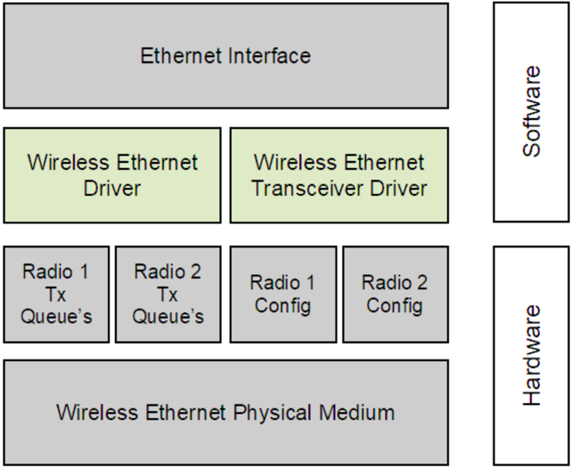
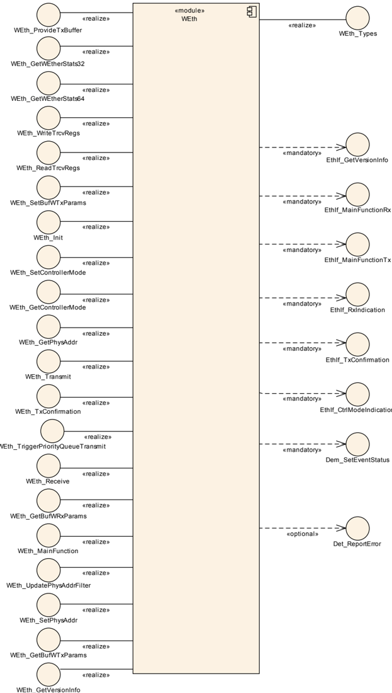
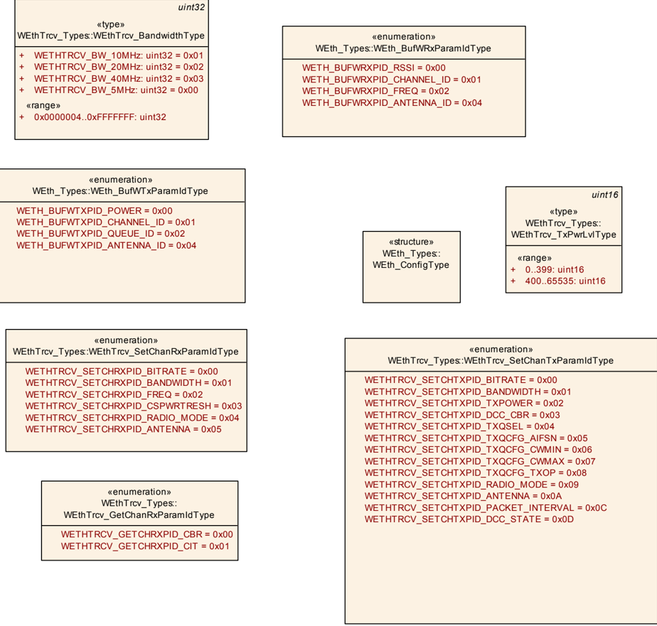
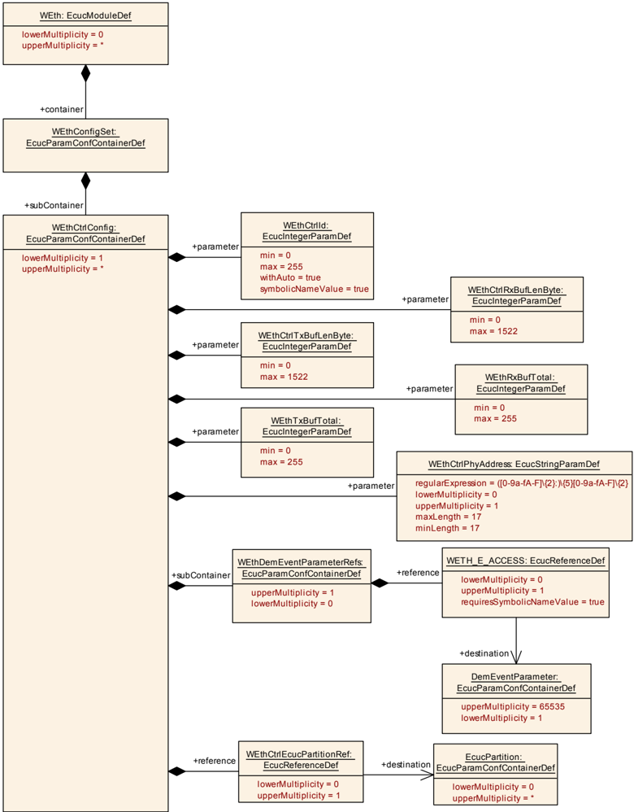
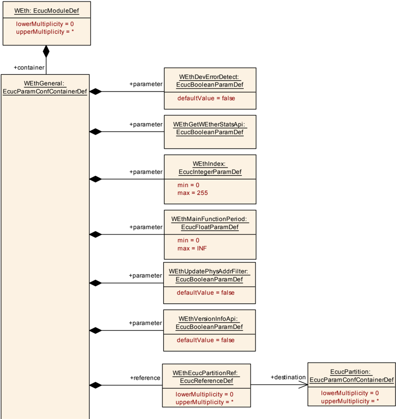

## 1. 简介和功能概述

本规范规定 **AUTOSAR** 基础软件模块 **Wireless Ethernet driver**（无线以太网驱动程序）的功能、**API** 和配置。

在 **AUTOSAR** 分层软件架构中，**Wireless Ethernet driver** 属于微控制器抽象层，更准确地说是属于通信驱动程序（Communication Drivers）。

这指出了 **Wireless Ethernet driver** 的主要任务：

为上层（**Ethernet Interface**）提供一个由多个同类控制器组成的、与硬件无关的接口。该接口应对所有控制器保持一致。这样，上层（**Ethernet Interface**）便可以一致的方式访问底层总线系统。该接口提供用于初始化、配置和数据传输的功能。不过 **Wireless Ethernet Driver** 的配置是总线特定的，因为它会考虑通信控制器的具体特性。

单个 **Wireless Ethernet driver** 模块只支持一种类型的控制器硬件。**Wireless Ethernet driver** 的前缀需要一个唯一的命名空间。通过这个前缀，**Ethernet Interface** 可以使用不同的 **Wireless Ethernet driver** 来访问不同的控制器类型。使用哪个驱动程序访问某个特定控制器的决策是 **Ethernet Interface** 的一个配置参数。

图 1.1 描绘了无线以太网协议栈的下半部分。一个以太网接口可以使用多个 **Wireless Ethernet Transceiver** 驱动程序访问多个无线电。每个无线电可以支持多个上下文，即多个无线电信道配置。



**注意：** **Wireless Ethernet driver** 的规范方式允许以目标代码形式交付代码模块，遵循「one-fits-all（一套适用所有）」原则，即 **Ethernet Interface** 的整个配置可以在不修改任何源代码的情况下完成。因此，**Wireless Ethernet driver** 的配置在很大程度上可以在不需要详细了解 **Wireless Ethernet driver** 软件的情况下完成。

## 2. 缩略语

以下术语表列出了与 **WEth** 模块相关、但未包含在 **AUTOSAR** 术语表 [\[1\]](#ref-1) 中的首字母缩略词和缩略语。

**FCS**
> 帧校验序列（**Frame Check Sequence**）。

**EthIf**
> Ethernet Interface（**AUTOSAR BSW** 模块）。

**Eth**
> Ethernet Driver（**AUTOSAR BSW** 模块）。

**ISR**
> 中断服务程序（**Interrupt Service Routine**）。

**MCG**
> 模块配置生成器（**Module Configuration Generator**）。

**WEth**
> Wireless Ethernet Driver（**AUTOSAR BSW** 模块）。

**WEthTrcv**
> Wireless Ethernet Transceiver（**AUTOSAR BSW** 模块）。

## 3. 相关文档

### 3.1. 输入文件和相关标准与规范

<a id="ref-1"></a>[1] Glossary
> AUTOSAR_FO_TR_Glossary

<a id="ref-2"></a>[2] IEC: The Basic Model, IEC Norm

<a id="ref-3"></a>[3] General Specification of Basic Software Modules
> AUTOSAR_CP_SWS_BSWGeneral

<a id="ref-4"></a>[4] Specification of ECU State Manager
> AUTOSAR_CP_SWS_ECUStateManager

<a id="ref-5"></a>[5] Specification of Ethernet Driver
> AUTOSAR_CP_SWS_EthernetDriver

<a id="ref-6"></a>[6] Requirements on Vehicle-2-X Communication
> AUTOSAR_CP_SRS_V2XCommunication

<a id="ref-7"></a>[7] TS 102 724 V1.1.1: Intelligent Transport Systems (ITS); Harmonized Channel Specifications for Intelligent Transport Systems operating in the 5 GHz frequency band

<a id="ref-8"></a>[8] Specification of Default Error Tracer
> AUTOSAR_CP_SWS_DefaultErrorTracer

<a id="ref-9"></a>[9] Specification of Ethernet Interface
> AUTOSAR_CP_SWS_EthernetInterface

<a id="ref-10"></a>[10] IEEE 802.11-2012

### 3.2. 相关规范

**AUTOSAR** 提供了一份基础软件模块通用规范 [\[3\]](#ref-3)（**SWS BSW General**），它对 SWS_WirelessEthernetDriver 同样有效。

因此，规范 **SWS BSW General** 应被视为 SWS_WirelessEthernetDriver 的附加且必需的规范。

## 4. 约束和假设

### 4.1. 限制

* 无法传输超过所使用控制器可用缓冲区大小的数据。
* **AUTOSAR** 目前仅支持使用 IEEE 802.11p 的无线通信。其他 802.11 标准（例如用于基础设施网络以及与 **TCP/IP** 的集成）可以在 **AUTOSAR** 标准的未来版本中扩展。
* **V2X** 模块遵循 Car-2-Car-Communication-Consortium 的基础系统标准配置（Basic System Standards Profile）针对 Day-1 场景给出的指南。
* **AUTOSAR** R20-11 仅关注 **ETSI** 定义的车车通信的欧洲版本。向其他地区的扩展计划在 **AUTOSAR** 标准的未来版本中进行。
* 微控制器抽象层多核分布概念在本软件规范中作为「draft（草案）」实现。更多信息参见第 [9](#9-配置规范) 章。

### 4.2. 汽车域的适用性

**Wireless Ethernet Driver** 旨在用于客户硬件的无线接入（接入点/Access Point），以及 Vehicle-2-X（**V2X**）应用 / **BSW** 模块的无线接入（使用网状网络）。

## 5. 对其他模块的依赖

本章列出与 **Wireless Ethernet Driver** 模块交互的模块。

使用 **Wireless Ethernet Driver** 模块的模块：

* **Ethernet Interface**（**EthIf**）
* **Wireless Ethernet Transceiver**（**WEthTrcv**）

**Wireless Ethernet Driver** 模块使用的模块：

* 通常，无线射频硬件是一个外部设备，由现有的通信驱动程序（例如 **SPI**）访问。

### 5.1. 驱动服务

如果无线以太网控制器为片上控制器，**Wireless Ethernet Driver** 模块不得使用其他驱动程序的任何服务。

如果使用了片外无线以太网控制器，**Wireless Ethernet** 驱动程序应使用其他 **MCAL** 驱动程序（例如 **SPI**）的服务。

**实现提示：** 如果 **Wireless Ethernet** 驱动程序使用其他 **MCAL** 驱动程序（例如 **SPI**）的服务，必须确保在初始化 **Wireless Ethernet** 驱动程序之前这些驱动程序已启动并运行。不同驱动程序初始化的顺序在 [\[4\]](#ref-4)（**ECU State Manager**）中有部分规定。

所有 **Wireless Ethernet** 驱动程序接口都应以非阻塞方式实现。在操作可以立即且原子地执行的情况下，确认通过请求函数的返回码报告。或者，通过调用「request（请求）」函数发起操作，操作的结果通过相应的「confirm（确认）」回调报告。

> **译注：** 源文档在此处有一条关于片外控制器场景的脚注：在这种情况下，**Wireless Ethernet** 驱动程序不再属于微控制器抽象层，而是置于 **ECU** 抽象层。因此，它（理论上）允许使用所需的任何微控制器抽象层驱动程序。

## 6. 功能规格

**Wireless Ethernet driver** 提供对用于无线通信的射频的通信访问。在发送时，驱动程序将包写入 **Wireless Ethernet** 驱动程序内的适当缓冲区；在接收包时，**Wireless Ethernet** 驱动程序以包内容为参数调用接收包回调函数。

### 6.1. Wireless Ethernet BSW 栈

作为 **AUTOSAR** 分层软件架构的一部分（参见图 1.1），无线以太网 **BSW** 模块也构成一个分层的软件栈。**Ethernet Interface**（**EthIf**）模块使用 **Wireless Ethernet Driver** 层访问多个控制器，该层可以由多个 **Wireless Ethernet Driver** 模块组成。

**Wireless Ethernet Driver** 支持多核分布以提升性能。

#### 6.1.1. 索引方案

**Wireless Ethernet Driver** 的使用者使用 [\[5\]](#ref-5)（**Ethernet Driver**）中描述的索引方案来标识控制器资源。

**Wireless Ethernet Driver** 使用从零开始的索引来抽象上层软件层的访问。配置中的参数 **WEth_CtrlId** 对应于 **API** 中使用的参数 **CtrlId**。

缓冲区索引（**BufId**）标识由 **Wireless Ethernet Driver API** 函数处理的一个无线以太网缓冲区。每个控制器的缓冲区由缓冲区索引 0 到 (n-1) 标识，其中 n 是相应控制器处理的缓冲区数量。缓冲区索引仅在元组 &lt;CtrlId, BufId&gt; 内有效。**BufId** 唯一地标识 **Wireless Ethernet Driver** 所使用的缓冲区。

#### 6.1.2. 收发器配置

**Wireless Ethernet Driver** 应提供一个 **API**，使 **Wireless Ethernet Transceiver** 能够通过 **API** [WEth_WriteTrcvRegs](#7313-weth_writetrcvregs) 向收发器设置通用的射频特定参数。

**Wireless Ethernet Driver** 应提供一个 **API**，使 **Wireless Ethernet Transceiver** 能够通过 **API** [WEth_ReadTrcvRegs](#7314-weth_readtrcvregs) 从收发器获取通用的射频特定参数。

#### 6.1.3. 通用需求

本章列出 **Wireless Ethernet Driver** 模块实现应满足的需求。

**Wireless Ethernet Driver** 模块环境包含所有调用 **Wireless Ethernet Driver** 模块接口的模块。

对于接收，**Wireless Ethernet Controller** 应启用硬件能力以丢弃带有错误帧校验序列（**FCS**）的帧。

**Wireless Ethernet Driver** 应从（中断服务程序中）调用 **EthIf_TxConfirmation** 以指示一次成功发送（如果该通知已启用）。

**Wireless Ethernet Driver** 应从（中断服务程序中）调用 **EthIf_RxIndication** 以指示一次成功接收。

#### 6.1.4. 控制器基于包的参数

对于 **Wireless Ethernet Driver**，能够为 **Wireless Ethernet Transceiver** 的指定射频配置发送和接收参数非常重要。这不仅作为射频的一般配置（例如用于接入点）是需要的，而且能够基于每个包来配置参数也是必要的（例如用于 802.11p 网状网络）。

**Wireless Ethernet Driver** 应提供一个 **API** [WEth_GetBufWRxParams](#7315-weth_getbufwrxparams)，它可以提供基于缓冲区的接收参数列表。

**API** [WEth_GetBufWRxParams](#7315-weth_getbufwrxparams) 应读取所接收包的访问层属性中 [**WEth_BufWRxParamIdType**](#722-weth_bufwrxparamidtype) 类型的属性。

**Wireless Ethernet Driver** 应提供一个 **API** [WEth_GetBufWTxParams](#7316-weth_getbufwtxparams)，它可以提供基于缓冲区的发送参数列表。

**API** [WEth_GetBufWTxParams](#7316-weth_getbufwtxparams) 应读取所接收包的访问层属性中 [**WEth_BufWTxParamIdType**](#723-weth_bufwtxparamidtype) 类型的属性。

**Wireless Ethernet Driver** 应提供一个 **API** [WEth_SetBufWTxParams](#7317-weth_setbufwtxparams)，用于设置基于缓冲区的发送参数列表。

**API** [WEth_SetBufWTxParams](#7317-weth_setbufwtxparams) 应设置待发送包的访问层属性中 [**WEth_BufWTxParamIdType**](#723-weth_bufwtxparamidtype) 类型的属性。

#### 6.1.5. 键/值参数映射

为了唯一地引用一个已发送或已接收 **WEth** 包的发送和接收参数，应在本模块内使用唯一的枚举 **ID**。

使用类型 [**WEth_BufWRxParamIdType**](#722-weth_bufwrxparamidtype) 的函数应为对应值的列表使用 uint32 值的列表。

使用类型 [**WEth_BufWRxParamIdType**](#722-weth_bufwrxparamidtype) 的函数应使用上表中的对应值进行类型映射。

| ParamId | ParamValue 类型 |
|---|---|
| WETH_BUFWRXPID_RSSI | uint8 |
| WETH_BUFWRXPID_CHANNEL_ID | uint16 |
| WETH_BUFWRXPID_FREQ | uint16 |
| WETH_BUFWRXPID_ANTENNA_ID | uint8 |

使用类型 [**WEth_BufWTxParamIdType**](#723-weth_bufwtxparamidtype) 的函数应为对应值的列表使用 uint32 值的列表。

使用 [**WEth_BufWTxParamIdType**](#723-weth_bufwtxparamidtype) 的函数应使用下表中的对应值进行类型映射。

| ParamId | ParamValue 类型 |
|---|---|
| WETH_BUFWTXPID_POWER | uint8 |
| WETH_BUFWTXPID_CHANNEL_ID | uint16 |
| WETH_BUFWTXPID_QUEUE_ID | uint8 |
| WETH_BUFWTXPID_ANTENNA_ID | uint8 |

#### 6.1.6. V2X 特定的控制器需求

以下需求仅对在 [\[6\]](#ref-6)（**V2X Communication Stack**）中使用的 **WEth** 控制器有效。

**WEth** 模块应至少支持 [\[7\]](#ref-7) 中定义的以下 DCCProfile：DP0、DP1、DP2 和 DP3。

* DP0：用于 TC = 0
* DP1：用于 TC = 1
* DP2：用于 TC = 2
* DP3：用于 TC &gt; 2 的其他低优先级消息

**WEth** 模块应丢弃 DCC_Access 队列中 DCC-Profile ID 为 DP2 的消息，如果 DCC_Access 队列中有一条 DCC-Profile ID 为 DP2 的新消息到达。

**Wireless Ethernet Driver** 应在假名变更（调用 [**WEth_SetPhysAddr**](#735-weth_setphysaddr)）期间清空发送队列，以避免发送带有旧假名的包。

### 6.2. 错误分类

《基础软件模块通用规范》（**General Specification of Basic Software Modules**）[\[3\]](#ref-3) 的「错误处理」一节详细描述了基础软件的错误处理。最重要的是，它构成了一个由可能发生在 **BSW** 模块中的五种错误类型组成的分类方案。

在此基础上，以下各节规定了安排在相应小节中的特定错误。

如果为 **Wireless Ethernet Driver** 模块启用了开发错误检测：**Wireless Ethernet Driver** 模块 **WEth** 应检查 **API** 参数的有效性，并将检测到的错误报告给 [\[8\]](#ref-8)（**DET**）。

#### 6.2.1. 开发错误

如果为 **Wireless Ethernet Driver** 模块启用了开发错误检测：**Wireless Ethernet Driver** 模块应检查 **API** 参数的有效性，并将检测到的错误报告给 **DET**。

| 错误类型 | 相关错误代码 | 错误值 |
|---|---|---|
| 无效的控制器索引 | WETH_E_INV_CTRL_ID | 0x01 |
| WEth 模块未初始化 | WETH_E_UNINIT | 0x02 |
| 参数列表中出现无效指针 | WETH_E_PARAM_POINTER | 0x03 |

#### 6.2.2. 运行时错误

没有运行时错误。

#### 6.2.3. 瞬态故障

没有瞬态故障。

#### 6.2.4. 生产错误

没有生产错误。

#### 6.2.5. 扩展生产错误

扩展生产错误作为 **Diagnostic Event Manager** 的事件处理。事件 **ID** 在下面的表中定义，而实际取值由 **Diagnostic Event Manager** 的配置在外部分配，并通过 **Dem.h** 包含到模块中。

| 错误名称 | WETH_E_ACCESS |
|---|---|
| 简短描述 | 无线以太网控制器访问失败（**Wireless Ethernet Controller Access Failure**）。 |
| 详细描述 | 在 [**WEth_MainFunction**](#751-weth_mainfunction) 的上下文中监控对无线以太网控制器的访问。 |
| 检测标准 | **Fail**：当对无线以太网控制器状态变化的轮询失败时，模块应以事件状态 DEM_EVENT_STATUS_PREFAILED 向 **DEM** 报告该扩展生产错误。**Pass**：当对无线以太网控制器状态变化的轮询成功时，模块应以事件状态 DEM_EVENT_STATUS_PREPASSED 向 **DEM** 报告该扩展生产错误。 |
| 次要参数 | 无。 |
| 所需时间 | 无。 |
| 监控频率 | 无。 |

### 6.3. 安全事件

本模块不报告安全事件。

## 7. API规范



### 7.1. 导入的类型

在本章中，列出了从以下模块包含的所有类型。

**WEth** 模块的导入数据类型定义

| 模块 | 头文件 | 导入的类型 |
|---|---|---|
| ComStack_Types | ComStack_Types.h | BufReq_ReturnType |
| ComStack_Types | ComStackTypes.h | TimeStampQualType |
| ComStack_Types | ComStackTypes.h | TimeStampType |
| ComStack_Types | ComStackTypes.h | TimeTupleType |
| Dem | Rte_Dem_Type.h | Dem_EventIdType |
| Dem | Rte_Dem_Type.h | Dem_EventStatusType |
| Eth | Eth_GeneralTypes.h | Eth_BufIdxType |
| Eth | Eth_GeneralTypes.h | Eth_DataType |
| Eth | Eth_GeneralTypes.h | Eth_FilterActionType |
| Eth | Eth_GeneralTypes.h | Eth_FrameType |
| Eth | Eth_GeneralTypes.h | Eth_ModeType |
| Eth | Eth_GeneralTypes.h | Eth_RxStatusType |
| Std | Std_Types.h | Std_ReturnType |
| Std | Std_Types.h | Std_VersionInfoType |

### 7.2. 类型定义



#### 7.2.1. WEth_ConfigType

结构类型（**Structure**）。Post-build 配置的实现特定结构。可通过**WEth.h**获得。

#### 7.2.2. WEth_BufWRxParamIdType

枚举类型（**Enumeration**）。已接收包的无线射频参数。可通过**WEth_GeneralTypes.h**获得。

* **WETH_BUFWRXPID_RSSI**（0x00）：**RSSI** 取值的参数 **ID**。
* **WETH_BUFWRXPID_CHANNEL_ID**（0x01）：通道 **ID** 的参数 **ID**。通道 **ID** 取值在 IEEE 802.11-2012 附录 E 中规定。
* **WETH_BUFWRXPID_FREQ**（0x02）：接收该包时所在通道的频率。
* **WETH_BUFWRXPID_ANTENNA_ID**（0x04）：所使用的天线索引。

#### 7.2.3. WEth_BufWTxParamIdType

枚举类型（**Enumeration**）。待发送包的无线射频参数。可通过**WEth_GeneralTypes.h**获得。

* **WETH_BUFWTXPID_POWER**（0x00）：发送功率的参数 **ID**。
* **WETH_BUFWTXPID_CHANNEL_ID**（0x01）：通道 **ID** 的参数 **ID**。通道 **ID** 取值在 IEEE 802.11-2012 附录 E 中规定。
* **WETH_BUFWTXPID_QUEUE_ID**（0x02）：**ECDA** / **DCC** 队列的队列索引。
* **WETH_BUFWTXPID_ANTENNA_ID**（0x04）：所使用的天线索引。

### 7.3. 函数定义

这是提供给上层模块的函数列表。

#### 7.3.1. WEth_Init

**说明**: 初始化 **Wireless Ethernet Driver**。可通过**WEth.h**获得。本服务为同步调用，不可重入。参数 CfgPtr（in）：指向实现特定结构的指针。返回值：无。

```C
void WEth_Init ( const WEth_ConfigType* CfgPtr )
```

该函数应存储对配置结构的访问，以供后续 **API** 调用使用。

对于当前 [**WEthConfigSet**](#912-wethconfigset) 中所有已配置的无线以太网控制器，该函数应：

* 禁用所有控制器
* 清除挂起的无线以太网中断
* 配置所有控制器配置参数（例如中断、帧长度、帧过滤器等）
* 配置所有发送/接收资源（例如缓冲区初始化）
* 删除所有挂起的发送和接收请求

该函数应将组件的状态从 **WETH_STATE_UNINIT** 改变为 **WETH_STATE_INIT**。

该函数应检查对无线以太网控制器的访问。如果检查失败，该函数应引发生产错误 [**WETH_E_ACCESS**](#625-扩展生产错误)。

**注意：** 该 **API** 必须在初始化期间调用。

函数 **WEth_Init** 应初始化无线以太网控制器所使用的所有片上硬件资源。

#### 7.3.2. WEth_SetControllerMode

**说明**: 启用/禁用被索引的控制器。可通过**WEth.h**获得。本服务为异步调用，不可重入。参数 CtrlId（in）：**Wireless Ethernet Driver** 上下文中控制器的索引。参数 CtrlMode（in）：**ETH_MODE_DOWN**：禁用控制器；**ETH_MODE_ACTIVE**：启用控制器。返回值：Std_ReturnType，E_OK：成功；E_NOT_OK：无法改变控制器模式。

```C
Std_ReturnType WEth_SetControllerMode ( uint8 CtrlId, Eth_ModeType CtrlMode )
```

该函数应：

* 将控制器置于参数「CtrlMode」给定的指定模式
* 在模式 **ETH_MODE_DOWN** 下，驱动程序应：
  * 禁用无线以太网控制器
  * 重置所有发送和接收缓冲区（即忽略所有挂起的发送和接收请求）
* 在模式 **ETH_MODE_ACTIVE** 下：
  * 启用所有发送和接收缓冲区
  * 启用无线以太网控制器

如果启用了开发错误检测：该函数应检查先前是否已调用过服务 [**WEth_Init**](#731-weth_init)。如果检查失败，该函数应引发开发错误 [**WETH_E_UNINIT**](#621-开发错误)。

如果启用了开发错误检测：该函数应检查参数 **CtrlIdx** 是否有效。如果检查失败，该函数应引发开发错误 **WETH_E_INV_CTRL_IDX**。

该函数应检查对无线以太网控制器的访问。如果检查失败，该函数应引发生产错误 [**WETH_E_ACCESS**](#625-扩展生产错误) 并返回 **E_NOT_OK**。

**注意：** 该函数要求先前已进行控制器初始化（[**WEth_Init**](#731-weth_init)）。

#### 7.3.3. WEth_GetControllerMode

**说明**: 获取被索引控制器的状态。可通过**WEth.h**获得。本服务为同步调用，不可重入。参数 CtrlId（in）：**Wireless Ethernet Driver** 上下文中控制器的索引。参数 CtrlModePtr（out）：**ETH_MODE_DOWN**：控制器被禁用；**ETH_MODE_ACTIVE**：控制器被启用。返回值：Std_ReturnType，E_OK：成功；E_NOT_OK：无法获取控制器模式。

```C
Std_ReturnType WEth_GetControllerMode ( uint8 CtrlId, Eth_ModeType* CtrlModePtr )
```

该函数应读取当前控制器模式。

如果启用了开发错误检测：该函数应检查先前是否已调用过服务 [**WEth_Init**](#731-weth_init)。如果检查失败，该函数应引发开发错误 [**WETH_E_UNINIT**](#621-开发错误)。

如果启用了开发错误检测：该函数应检查参数 **CtrlIdx** 是否有效。如果检查失败，该函数应引发开发错误 **WETH_E_INV_CTRL_IDX**。

如果启用了开发错误检测：该函数应检查参数 **CtrlModePtr** 是否有效。如果检查失败，该函数应引发开发错误 [**WETH_E_PARAM_POINTER**](#621-开发错误)。

**注意：** 该函数要求先前已进行控制器初始化（[**WEth_Init**](#731-weth_init)）。

#### 7.3.4. WEth_GetPhysAddr

**说明**: 获取被索引控制器所使用的物理源地址。可通过**WEth.h**获得。本服务为同步调用，不可重入。参数 CtrlId（in）：**Wireless Ethernet Driver** 上下文中控制器的索引。参数 PhysAddrPtr（out）：网络字节序的物理源地址（**MAC** 地址）。返回值：无。

```C
void WEth_GetPhysAddr ( uint8 CtrlId, uint8* PhysAddrPtr )
```

该函数应读取被索引控制器所使用的源地址。

如果启用了开发错误检测：该函数应检查先前是否已调用过服务 [**WEth_Init**](#731-weth_init)。如果检查失败，该函数应引发开发错误 [**WETH_E_UNINIT**](#621-开发错误)。

如果启用了开发错误检测：该函数应检查参数 **CtrlIdx** 是否有效。如果检查失败，该函数应引发开发错误 **WETH_E_INV_CTRL_IDX**。

如果启用了开发错误检测：该函数应检查参数 **PhysAddrPtr** 是否有效。如果检查失败，该函数应引发开发错误 [**WETH_E_PARAM_POINTER**](#621-开发错误)。

**注意：** 该函数要求先前已进行控制器初始化（[**WEth_Init**](#731-weth_init)）。

#### 7.3.5. WEth_SetPhysAddr

**说明**: 设置被索引控制器所使用的物理源地址。可通过**WEth.h**获得。本服务为同步调用；对同一 **CtrlId** 不可重入，对不同控制器可重入。参数 CtrlId（in）：**Wireless Ethernet Driver** 上下文中控制器的索引。参数 PhysAddrPtr（in）：指向保存网络字节序物理源地址（**MAC** 地址）的内存的指针。返回值：无。

```C
void WEth_SetPhysAddr ( uint8 CtrlId, const uint8* PhysAddrPtr )
```

该函数应更新被索引控制器所使用的源地址。

如果启用了开发错误检测：该函数应检查先前是否已调用过服务 [**WEth_Init**](#731-weth_init)。如果检查失败，该函数应引发开发错误 [**WETH_E_UNINIT**](#621-开发错误)。

如果启用了开发错误检测：该函数应检查参数 **CtrlIdx** 是否有效。如果检查失败，该函数应引发开发错误 **WETH_E_INV_CTRL_IDX**。

如果启用了开发错误检测：该函数应检查参数 **PhysAddrPtr** 是否有效。如果检查失败，该函数应引发开发错误 [**WETH_E_PARAM_POINTER**](#621-开发错误)。

**注意：** 该函数要求先前已进行控制器初始化（[**WEth_Init**](#731-weth_init)）。

#### 7.3.6. WEth_UpdatePhysAddrFilter

**说明**: 向被索引上下文的过滤器中添加物理地址，或从中移除物理地址。如果无线以太网控制器不具备过滤能力，则必须由软件来完成。可通过**WEth.h**获得。本服务为同步调用；对同一 **CtrlId** 不可重入，对不同上下文可重入。参数 CtrlId（in）：**Wireless Ethernet Driver** 上下文中上下文的索引。参数 PhysAddrPtr（in）：指向保存网络字节序物理目标地址（**MAC** 地址）的内存的指针。这是第 2 层以太网包的多播目标地址。参数 PhysMaskPtr（in）：指向保存网络字节序掩码值的内存的指针。参数 Action（in）：将该地址加入无线以太网控制器的过滤器或从中移除。返回值：Std_ReturnType，E_OK：过滤器成功更改；E_NOT_OK：无法更改过滤器。

```C
Std_ReturnType WEth_UpdatePhysAddrFilter ( uint8 CtrlId, const uint8* PhysAddrPtr, const uint8* PhysMaskPtr, Eth_FilterActionType Action )
```

该函数应更新被索引控制器的物理地址接收过滤器。

当目标地址与此处传递的 **PhyAddrPtr** 匹配时，**Wireless Ethernet** 驱动程序模块将接收一个帧（例如匹配可以通过哈希表或简单的模式匹配完成）。

**注意：** 如果可用，可以使用底层硬件机制。否则以太网驱动程序需要通过软件来完成。

如果匹配为肯定，应通过调用 **RxIndication()** 回调通知上层。

如果匹配为否定，则应丢弃该帧。

如果启用了开发错误检测：该函数应检查先前是否已调用过服务 [**WEth_Init**](#731-weth_init)。如果检查失败，该函数应引发开发错误 [**WETH_E_UNINIT**](#621-开发错误)。

#### 7.3.7. WEth_ProvideTxBuffer

**说明**: 提供对指定控制器的发送缓冲区的访问。可通过**WEth.h**获得。本服务为同步调用，不可重入。参数 CtrlId（in）：**Wireless Ethernet Driver** 上下文中上下文的索引。参数 Priority（in）：用于选择不同无线发送队列的优先级取值。参数 LenBytePtr（in/out）：输入：期望的长度（以字节为单位）；输出：授予的长度（以字节为单位）。参数 BufIdPtr（out）：指向被授予缓冲区资源的索引。用于后续请求。参数 BufPtr（out）：指向被授予缓冲区的指针。返回值：BufReq_ReturnType，BUFREQ_OK：成功；BUFREQ_E_NOT_OK：检测到默认错误；BUFREQ_E_BUSY：所有缓冲区均在使用中；BUFREQ_E_OVFL：请求的缓冲区过大。

```C
BufReq_ReturnType WEth_ProvideTxBuffer ( uint8 CtrlId, uint8 Priority, Eth_BufIdxType* BufIdPtr, uint8** BufPtr, uint16* LenBytePtr )
```

该函数应提供一个发送缓冲区资源。**Wireless Ethernet Driver** 应锁定该缓冲区，直到它收到携带 **BufIdxPtr** 参数中返回的缓冲区索引的后续 [**WEth_Transmit**](#738-weth_transmit) 服务调用为止。

如果通过 [**WEth_SetControllerMode**](#732-weth_setcontrollermode) 禁用控制器，所有已锁定的发送缓冲区应被释放。

如果通过 **WEth_ProvideTxBuffer** 请求的缓冲区大于可用缓冲区长度，则不应锁定该缓冲区，而应返回可用长度和 **BUFREQ_E_OVFL**。

如果所有可用缓冲区均在使用中，该组件应返回 **BUFREQ_E_BUSY**。

如果启用了开发错误检测：该函数应检查先前是否已调用过服务 [**WEth_Init**](#731-weth_init)。如果检查失败，该函数应引发开发错误 [**WETH_E_UNINIT**](#621-开发错误)。

如果启用了开发错误检测：该函数应检查参数 **CtrlIdx** 是否有效。如果检查失败，该函数应引发开发错误 **WETH_E_INV_CTRL_IDX**。

如果启用了开发错误检测：该函数应检查参数 **BufIdxPtr** 是否有效。如果检查失败，该函数应引发开发错误 [**WETH_E_PARAM_POINTER**](#621-开发错误)。

如果启用了开发错误检测：该函数应检查参数 **BufPtr** 是否有效。如果检查失败，该函数应引发开发错误 [**WETH_E_PARAM_POINTER**](#621-开发错误)。

如果启用了开发错误检测：该函数应检查参数 **LenBytePtr** 是否有效。如果检查失败，该函数应引发开发错误 [**WETH_E_PARAM_POINTER**](#621-开发错误)。

**注意：** 该函数要求先前已进行控制器初始化（[**WEth_Init**](#731-weth_init)）。

#### 7.3.8. WEth_Transmit

**说明**: 触发发送一个先前已填充的发送缓冲区。可通过**WEth.h**获得。本服务为同步调用，不可重入。参数 CtrlId（in）：**Wireless Ethernet Driver** 上下文中上下文的索引。参数 BufId（in）：缓冲区资源的索引。参数 FrameType（in）：以太网帧类型。参数 TxConfirmation（in）：激活发送确认。参数 LenByte（in）：数据长度（以字节为单位）（802.11 头 + 体，不包括 **FCS**）。参数 PhysAddrPtr（in）：网络字节序的物理目标地址（**MAC** 地址）。返回值：Std_ReturnType，E_OK：成功；E_NOT_OK：发送失败。

```C
Std_ReturnType WEth_Transmit ( uint8 CtrlId, Eth_BufIdxType BufId, Eth_FrameType FrameType, boolean TxConfirmation, uint16 LenByte, const uint8* PhysAddrPtr )
```

该函数应使用给定的物理目标地址（**MAC** 地址）构建以太网帧头，并触发发送一个先前已填充的发送缓冲区。

发送之后，驱动程序需要释放已分配的缓冲区。实际缓冲区释放发生的时机由实现决定，例如在 [**WEth_TxConfirmation**](#739-weth_txconfirmation) 的上下文中、在 [**WEth_MainFunction**](#751-weth_mainfunction) 中，或在下一次 [**WEth_ProvideTxBuffer**](#737-weth_providetxbuffer) 期间。

如果通过 [**WEth_SetControllerMode**](#732-weth_setcontrollermode) 禁用控制器，所有挂起的发送缓冲区应被释放。

如果启用了开发错误检测：该函数应检查先前是否已调用过服务 [**WEth_Init**](#731-weth_init)。如果检查失败，该函数应引发开发错误 [**WETH_E_UNINIT**](#621-开发错误)。

如果启用了开发错误检测：该函数应检查参数 **CtrlIdx** 是否有效。如果检查失败，该函数应引发开发错误 **WETH_E_INV_CTRL_IDX**。

如果启用了开发错误检测：该函数应检查参数 **BufIdx** 是否有效。如果检查失败，该函数应引发开发错误 **WETH_E_INV_PARAM**。

如果启用了开发错误检测：该函数应检查参数 **PhysAddrPtr** 是否有效。如果检查失败，该函数应引发开发错误 [**WETH_E_PARAM_POINTER**](#621-开发错误)。

如果启用了开发错误检测：该函数应检查控制器模式是否处于活动状态（**ETH_MODE_ACTIVE**）。如果检查失败，该函数应引发开发错误 **WETH_E_INV_MODE**。

**注意：** 该函数要求先前的缓冲区请求（[**WEth_ProvideTxBuffer**](#737-weth_providetxbuffer)）。

#### 7.3.9. WEth_TxConfirmation

**说明**: 触发帧发送确认。可通过**WEth.h**获得。本服务为同步调用，不可重入。参数 CtrlId（in）：**Wireless Ethernet Driver** 上下文中控制器的索引。返回值：无。

```C
void WEth_TxConfirmation ( uint8 CtrlId )
```

该函数应检查所有已填充的发送缓冲区是否发送成功。如果先前的 [**WEth_Transmit**](#738-weth_transmit) 服务调用有此请求，该函数会使用回调函数 WEthIf_TxConfirmation 为每个已发送的帧发出发送确认。

如果先前的 [**WEth_Transmit**](#738-weth_transmit) 函数调用启用了发送确认，该函数应释放缓冲区资源。

如果启用了开发错误检测：该函数应检查先前是否已调用过服务 [**WEth_Init**](#731-weth_init)。如果检查失败，该函数应引发开发错误 [**WETH_E_UNINIT**](#621-开发错误)。

如果启用了开发错误检测：该函数应检查参数 **CtrlIdx** 是否有效。如果检查失败，该函数应引发开发错误 **WETH_E_INV_CTRL_IDX**。

如果启用了开发错误检测：该函数应检查控制器模式是否处于活动状态（**ETH_MODE_ACTIVE**）。如果检查失败，该函数应引发开发错误 **WETH_E_INV_MODE**。

**注意：** 该函数要求先前已进行初始化（[**WEth_Init**](#731-weth_init)）。

模块必须确保在该函数调用的中断/轮询上下文内，能够通过函数 [**WEth_GetBufWTxParams**](#7316-weth_getbufwtxparams) 获取当前缓冲区的无线信道发送参数。

#### 7.3.10. WEth_Receive

**说明**: 触发帧接收。可通过**WEth.h**获得。本服务为同步调用，不可重入。参数 CtrlId（in）：**Wireless Ethernet Driver** 上下文中上下文的索引。参数 RxStatusPtr（out）：指示是否已接收到一个帧，如果有，是否还有更多帧可用或是否有帧丢失。返回值：无。

```C
void WEth_Receive ( uint8 CtrlId, Eth_RxStatusType* RxStatusPtr )
```

该函数应从接收缓冲区中读取下一个帧。该函数使用回调函数 WEthIf_RxIndication 将接收到的帧传递给以太网接口，并指示接收缓冲区中是否还有更多帧。

如果启用了开发错误检测：该函数应检查先前是否已调用过服务 [**WEth_Init**](#731-weth_init)。如果检查失败，该函数应引发开发错误 [**WETH_E_UNINIT**](#621-开发错误)。

如果启用了开发错误检测：该函数应检查参数 **CtrlIdx** 是否有效。如果检查失败，该函数应引发开发错误 **WETH_E_INV_CTRL_IDX**。

如果启用了开发错误检测：该函数应检查控制器模式是否处于活动状态（**ETH_MODE_ACTIVE**）。如果检查失败，该函数应引发开发错误 **WETH_E_INV_MODE**。

当调用回调函数 WEthIf_RxIndication 时，广播帧应被指示给以太网接口（参见 [\[9\]](#ref-9)）。

**注意：** 该函数要求先前已进行控制器初始化（[**WEth_Init**](#731-weth_init)）。

模块必须确保在该函数调用的中断/轮询上下文内，能够通过函数 [**WEth_GetBufWRxParams**](#7315-weth_getbufwrxparams) 获取当前缓冲区的无线信道接收参数。

#### 7.3.11. WEth_GetWEtherStats32

**说明**: 返回依据 IEEE 802.11-2012 的以下列表，其中最大可能取值应表示无效值，例如该计数器不可用时：1. dot11STAStatisticsTransmittedFragmentCount；2. dot11STAStatisticsGroupTransmittedFrameCount；3. dot11STAStatisticsFailedCount；4. dot11STAStatisticsRetryCount；5. dot11STAStatisticsMultipleRetryCount；6. dot11STAStatisticsFrameDuplicateCount；7. dot11STAStatisticsRTSSuccessCount；8. dot11STAStatisticsRTSFailureCount；9. dot11STAStatisticsACKFailureCount；10. dot11STAStatisticsQosTransmittedFragmentCount；11. dot11STAStatisticsQosFailedCount；12. dot11STAStatisticsQosRetryCount；13. dot11STAStatisticsQosMultipleRetryCount；14. dot11STAStatisticsQosFrameDuplicateCount；15. dot11STAStatisticsQosRTSSuccessCount；16. dot11STAStatisticsQosRTSFailureCount；17. dot11STAStatisticsQosACKFailureCount；18. dot11STAStatisticsQosReceivedFragmentCount；19. dot11STAStatisticsQosTransmittedFrameCount；20. dot11STAStatisticsQosDiscardedFrameCount；21. dot11STAStatisticsQosMPDUsReceivedCount；22. dot11STAStatisticsQosRetriesReceivedCount；23. dot11STAStatisticsReceivedFragmentCount；24. dot11STAStatisticsGroupReceivedFrameCount；25. dot11STAStatisticsFCSErrorCount；26. dot11STAStatisticsTransmittedFrameCount；27. dot11STAStatisticsRSNAStatsCMACICVErrors；28. dot11STAStatisticsRSNAStatsCMACReplays；29. dot11STAStatisticsRSNAStatsRobustMgmtCCMPReplays；30. dot11STAStatisticsRSNAStatsTKIPICVErrors；31. dot11STAStatisticsRSNAStatsTKIPReplays；32. dot11STAStatisticsRSNAStatsCCMPDecryptErrors；33. dot11STAStatisticsRSNAStatsCCMPReplays；34. dot11STAStatisticsTransmittedAMSDUCount；35. dot11STAStatisticsFailedAMSDUCount；36. dot11STAStatisticsRetryAMSDUCount；37. dot11STAStatisticsMultipleRetryAMSDUCount；38. dot11STAStatisticsAMSDUAckFailureCount；39. dot11STAStatisticsReceivedAMSDUCount；40. dot11STAStatisticsTransmittedAMPDUCount；41. dot11STAStatisticsTransmittedMPDUsInAMPDUCount；42. dot11STAStatisticsAMPDUReceivedCount；43. dot11STAStatisticsMPDUInReceivedAMPDUCount；44. dot11STAStatisticsAMPDUDelimiterCRCErrorCount；45. dot11STAStatisticsImplicitBARFailureCount；46. dot11STAStatisticsExplicitBARFailureCount；47. dot11STAStatisticsChannelWidthSwitchCount；48. dot11STAStatisticsTwentyMHzFrameTransmittedCount；49. dot11STAStatisticsFortyMHzFrameTransmittedCount；50. dot11STAStatisticsTwentyMHzFrameReceivedCount；51. dot11STAStatisticsFortyMHzFrameReceivedCount；52. dot11STAStatisticsPSMPUTTGrantDuration；53. dot11STAStatisticsPSMPUTTUsedDuration；54. dot11STAStatisticsGrantedRDGUsedCount；55. dot11STAStatisticsGrantedRDGUnusedCount；56. dot11STAStatisticsTransmittedFramesInGrantedRDGCount；57. dot11STAStatisticsDualCTSSuccessCount；58. dot11STAStatisticsDualCTSFailureCount；59. dot11STAStatisticsRTSLSIGSuccessCount；60. dot11STAStatisticsRTSLSIGFailureCount；61. dot11STAStatisticsBeamformingFrameCount；62. dot11STAStatisticsSTBCCTSSuccessCount；63. dot11STAStatisticsSTBCCTSFailureCount；64.。可通过**WEth.h**获得。本服务为同步调用，不可重入。参数 CtrlId（in）：**Wireless Ethernet** 驱动程序上下文中上下文的索引。参数 WEtherStats（out）：依据 IEEE 802.11-2012 的取值列表。返回值：Std_ReturnType，E_OK：成功；E_NOT_OK：无法获取丢弃计数器。

```C
Std_ReturnType WEth_GetWEtherStats32 ( uint8 CtrlId, uint32* WEtherStats )
```

该函数应按照 [\[10\]](#ref-10) 从被索引控制器读取一个取值列表。

如果启用了开发错误检测：该函数应检查先前是否已调用过服务 [**WEth_Init**](#731-weth_init)。如果检查失败，该函数应引发开发错误 [**WETH_E_UNINIT**](#621-开发错误)。

如果启用了开发错误检测：该函数应检查参数 **CtrlIdx** 是否有效。如果检查失败，该函数应引发开发错误 **WETH_E_INV_CTRL_IDX**。

如果启用了开发错误检测：该函数应检查参数 **RxStats** 是否有效。如果检查失败，该函数应引发开发错误 [**WETH_E_PARAM_POINTER**](#621-开发错误)。

函数 WEth_GetWEthertStats32 应可通过配置参数 **WEthGetWEtherStatsApi** 进行预编译期配置（开/关）。

#### 7.3.12. WEth_GetWEtherStats64

**说明**: 返回依据 IEEE 802.11-2012 的以下列表，其中最大可能取值应表示无效值，例如该计数器不可用时：1. dot11STAStatisticsTransmittedOctetsInAMSDUCount；2. dot11STAStatisticsReceivedOctetsInAMSDUCount；3. dot11STAStatisticsTransmittedOctetsInAMPDUCount；4. dot11STAStatisticsReceivedOctetsInAMPDUCount；5. dot11STAStatisticsTransmittedOctetsInGrantedRDGCount。可通过**WEth.h**获得。本服务为同步调用，不可重入。参数 CtrlId（in）：**Wireless Ethernet** 驱动程序上下文中上下文的索引。参数 WEtherStats（out）：依据 IEEE 802.11-2012 的取值列表。返回值：Std_ReturnType，E_OK：成功；E_NOT_OK：无法获取丢弃计数器。

```C
Std_ReturnType WEth_GetWEtherStats64 ( uint8 CtrlId, uint64* WEtherStats )
```

该函数应按照 [\[10\]](#ref-10) 从被索引控制器读取一个取值列表。

如果启用了开发错误检测：该函数应检查先前是否已调用过服务 [**WEth_Init**](#731-weth_init)。如果检查失败，该函数应引发开发错误 [**WETH_E_UNINIT**](#621-开发错误)。

如果启用了开发错误检测：该函数应检查参数 **CtrlIdx** 是否有效。如果检查失败，该函数应引发开发错误 **WETH_E_INV_CTRL_IDX**。

如果启用了开发错误检测：该函数应检查参数 **RxStats** 是否有效。如果检查失败，该函数应引发开发错误 [**WETH_E_PARAM_POINTER**](#621-开发错误)。

函数 WEth_GetWEthertStats64 应可通过配置参数 **WEthGetWEtherStatsApi** 进行预编译期配置（开/关）。

#### 7.3.13. WEth_WriteTrcvRegs

**说明**: 配置收发器的寄存器，或触发接收器提供的功能。可通过**WEth.h**获得。本服务为同步调用，不可重入。参数 CtrlId（in）：**Ethernet Driver** 上下文中控制器的索引。参数 TrcvId（in）：目标总线上收发器的索引。参数 RadioId（in）：收发器射频模块（Radio Module）的索引。参数 RegIds（in）：收发器寄存器索引的列表。参数 RegVals（in）：要写入被索引寄存器的取值。参数 NumRegs（in）：寄存器/取值的数量。返回值：Std_ReturnType，E_OK：服务被接受；E_NOT_OK：服务被拒绝。

```C
Std_ReturnType WEth_WriteTrcvRegs ( uint8 CtrlId, uint8 TrcvId, uint8 RadioId, const uint32* RegIds, const uint32* RegVals, uint8 NumRegs )
```

该函数应通过被索引控制器的控制器特定总线接口，将被索引射频的收发器寄存器写入指定的参数。

如果启用了开发错误检测：该函数应检查先前是否已调用过服务 [**WEth_Init**](#731-weth_init)。如果检查失败，该函数应引发开发错误 [**WETH_E_UNINIT**](#621-开发错误)。

如果启用了开发错误检测：该函数应检查参数 **CtrlIdx** 是否有效。如果检查失败，该函数应引发开发错误 **WETH_E_INV_CTRL_IDX**。

**注意：** 该函数要求先前已进行控制器初始化（[**WEth_Init**](#731-weth_init)）。

如果启用了开发错误检测：该函数应检查参数 **RegIds** 是否有效。如果检查失败，该函数应引发开发错误 [**WETH_E_PARAM_POINTER**](#621-开发错误)。

如果启用了开发错误检测：该函数应检查参数 **RegVals** 是否有效。如果检查失败，该函数应引发开发错误 [**WETH_E_PARAM_POINTER**](#621-开发错误)。

#### 7.3.14. WEth_ReadTrcvRegs

**说明**: 读取一个收发器寄存器。可通过**WEth.h**获得。本服务为同步调用，不可重入。参数 CtrlId（in）：**Ethernet Driver** 上下文中控制器的索引。参数 TrcvId（in）：目标总线上收发器的索引。参数 RadioId（in）：收发器射频模块的索引。参数 RegIds（in）：收发器寄存器索引的数组。参数 NumRegs（in）：寄存器/取值的数量。参数 RegValsPtr（out）：要写入被索引寄存器的取值。返回值：Std_ReturnType，E_OK：服务被接受；E_NOT_OK：服务被拒绝。

```C
Std_ReturnType WEth_ReadTrcvRegs ( uint8 CtrlId, uint8 TrcvId, uint8 RadioId, const uint32* RegIds, uint32* RegValsPtr, uint8 NumRegs )
```

该函数应通过被索引控制器的 **MII** 读取指定的收发器寄存器。

如果启用了开发错误检测：该函数应检查先前是否已调用过服务 [**WEth_Init**](#731-weth_init)。如果检查失败，该函数应引发开发错误 [**WETH_E_UNINIT**](#621-开发错误)。

如果启用了开发错误检测：该函数应检查参数 **CtrlIdx** 是否有效。如果检查失败，该函数应引发开发错误 **WETH_E_INV_CTRL_IDX**。

如果启用了开发错误检测：该函数应检查参数 **RegValPtr** 是否有效。如果检查失败，该函数应引发开发错误 [**WETH_E_PARAM_POINTER**](#621-开发错误)。

**注意：** 该函数要求先前已进行控制器初始化（[**WEth_Init**](#731-weth_init)）。

如果启用了开发错误检测：该函数应检查参数 **RegIds** 是否有效。如果检查失败，该函数应引发开发错误 [**WETH_E_PARAM_POINTER**](#621-开发错误)。

如果启用了开发错误检测：该函数应检查参数 **RegVals** 是否有效。如果检查失败，该函数应引发开发错误 [**WETH_E_PARAM_POINTER**](#621-开发错误)。

#### 7.3.15. WEth_GetBufWRxParams

**说明**: 为一个已接收的包读出与接收方向相关的取值。例如，这可以是属于单个包的 **RSSI** 或通道。本 **API** 仅在 [**WEth_Receive**](#7310-weth_receive) 的上下文内有效。可通过**WEth.h**获得。本服务为同步调用，不可重入。参数 CtrlId（in）：以太网控制器的索引。参数 RxParamIds（in）：所请求参数的 **ID**。参数 NumParams（in）：所请求参数的数量。参数 ParamValues（out）：所请求参数的取值。返回值：Std_ReturnType，E_OK：成功；E_NOT_OK：读取参数失败。

```C
Std_ReturnType WEth_GetBufWRxParams ( uint8 CtrlId, const WEth_BufWRxParamIdType* RxParamIds, uint32* ParamValues, uint8 NumParams )
```

如果启用了开发错误检测：该函数应检查先前是否已调用过服务 [**WEth_Init**](#731-weth_init)。如果检查失败，该函数应引发开发错误 [**WETH_E_UNINIT**](#621-开发错误)。

如果启用了开发错误检测：该函数应检查参数 **CtrlId** 是否有效。如果检查失败，该函数应引发开发错误 [**WETH_E_INV_CTRL_ID**](#621-开发错误)。

如果启用了开发错误检测：该函数应检查参数 **RxParamIds** 是否有效。如果检查失败，该函数应引发开发错误 [**WETH_E_PARAM_POINTER**](#621-开发错误)。

如果启用了开发错误检测：该函数应检查参数 **ParamValues** 是否有效。如果检查失败，该函数应引发开发错误 [**WETH_E_PARAM_POINTER**](#621-开发错误)。

#### 7.3.16. WEth_GetBufWTxParams

**说明**: 为一个已发送的包读出与发送方向相关的取值。本 **API** 仅在 [**WEth_TxConfirmation**](#739-weth_txconfirmation) 的上下文内有效。可通过**WEth.h**获得。本服务为同步调用，不可重入。参数 CtrlId（in）：以太网控制器的索引。参数 TxParamIds（in）：所请求参数的 **ID**。参数 NumParams（in）：所请求参数的数量。参数 ParamValues（out）：所请求参数的取值。返回值：Std_ReturnType，E_OK：成功；E_NOT_OK：读取参数失败。

```C
Std_ReturnType WEth_GetBufWTxParams ( uint8 CtrlId, const WEth_BufWTxParamIdType* TxParamIds, uint32* ParamValues, uint8 NumParams )
```

如果启用了开发错误检测：该函数应检查先前是否已调用过服务 [**WEth_Init**](#731-weth_init)。如果检查失败，该函数应引发开发错误 [**WETH_E_UNINIT**](#621-开发错误)。

如果启用了开发错误检测：该函数应检查参数 **CtrlId** 是否有效。如果检查失败，该函数应引发开发错误 [**WETH_E_INV_CTRL_ID**](#621-开发错误)。

如果启用了开发错误检测：该函数应检查参数 **TxParamIds** 是否有效。如果检查失败，该函数应引发开发错误 [**WETH_E_PARAM_POINTER**](#621-开发错误)。

如果启用了开发错误检测：该函数应检查参数 **ParamValues** 是否有效。如果检查失败，该函数应引发开发错误 [**WETH_E_PARAM_POINTER**](#621-开发错误)。

#### 7.3.17. WEth_SetBufWTxParams

**说明**: 为一个特定缓冲区（待发送的包）设置与发送方向相关的取值。例如，这可以是期望的发送功率或属于单个包的通道。可通过**WEth.h**获得。本服务为同步调用，不可重入。参数 CtrlId（in）：以太网控制器的索引。参数 BufId（in）：缓冲区资源的索引。参数 TxParamIds（in）：提供给发送射频的参数 **ID**。参数 ParamValues（in）：提供给发送射频的参数取值。参数 NumParams（in）：提供给发送射频的参数数量。返回值：Std_ReturnType，E_OK：成功；E_NOT_OK：设置参数失败。

```C
Std_ReturnType WEth_SetBufWTxParams ( uint8 CtrlId, Eth_BufIdxType BufId, const WEth_BufWTxParamIdType* TxParamIds, const uint32* ParamValues, uint8 NumParams )
```

如果启用了开发错误检测：该函数应检查先前是否已调用过服务 [**WEth_Init**](#731-weth_init)。如果检查失败，该函数应引发开发错误 **WETH_E_NOT_INITIALIZED**。

如果启用了开发错误检测：该函数应检查参数 **CtrlId** 是否有效。如果检查失败，该函数应引发开发错误 [**WETH_E_INV_CTRL_ID**](#621-开发错误)。

如果启用了开发错误检测：该函数应检查参数 **BufId** 是否有效。如果检查失败，该函数应引发开发错误 **WETH_E_INV_PARAM**。

如果启用了开发错误检测：该函数应检查参数 **TxParamIds** 是否有效。如果检查失败，该函数应引发开发错误 [**WETH_E_PARAM_POINTER**](#621-开发错误)。

如果启用了开发错误检测：该函数应检查参数 **ParamValues** 是否有效。如果检查失败，该函数应引发开发错误 [**WETH_E_PARAM_POINTER**](#621-开发错误)。

#### 7.3.18. WEth_GetVersionInfo

**说明**: 返回本模块的版本信息。可通过**WEth.h**获得。本服务为同步调用，可重入。参数 VersionInfoPtr（out）：指向存储本模块版本信息的位置的指针。返回值：无。

```C
void WEth_GetVersionInfo ( Std_VersionInfoType* VersionInfoPtr )
```

如果启用了开发错误检测：该函数应检查参数 **VersionInfoPtr** 是否有效。如果检查失败，该函数应引发开发错误 [**WETH_E_PARAM_POINTER**](#621-开发错误)。

#### 7.3.19. WEth_TriggerPriorityQueueTransmit

**说明**: 触发发送一个在软件优先级队列中等待的、先前已填充的发送缓冲区。可通过**WEth.h**获得。本服务为同步调用，不可重入。参数 CtrlId（in）：**Wireless Ethernet Driver** 上下文中上下文的索引。参数 PriorityQueue（in）：优先级队列的索引。参数 MaxTxPower（in）：限制优先级队列中包的功率。返回值：Std_ReturnType，E_OK：成功；E_NOT_OK：发送失败。

```C
Std_ReturnType WEth_TriggerPriorityQueueTransmit ( uint8 CtrlId, uint8 PriorityQueue, uint8 MaxTxPower )
```

### 7.4. 回调通知

**Wireless Ethernet Driver** 不提供任何回调函数。

### 7.5. 调度函数

#### 7.5.1. WEth_MainFunction

**说明**: 支持间接发送（扩展的帧时序约束）以及使用多个信道时的信道选择机制。用于轮询状态变化。当控制器模式发生变化时调用 **EthIf_CtrlModeIndication**。可通过**SchM_WEth.h**获得。本服务无返回值和参数。

```C
void WEth_MainFunction ( void )
```

### 7.6. 期望接口

在本章中，列出了从其他模块需要的所有外部接口。

#### 7.6.1. 强制接口

本章定义实现模块核心功能所需的全部外部接口。

| API 函数 | 头文件 | 描述 |
|---|---|---|
| Dem_SetEventStatus | Dem.h | 由 **SW-C** 或 **BSW** 模块调用，向 **Dem** 报告监控状态信息。调用 Dem_SetEventStatus 的 **BSW** 模块可以安全地忽略返回值。仅在 ({Dem/DemConfigSet/DemEventParameter/DemEventReportingType} == STANDARD_REPORTING) 时此 **API** 才可用。 |
| EthIf_CtrlModeIndication | EthIf.h | 在读出模式后异步调用。由先前的 &lt;EthDrv&gt;_SetControllerMode 调用触发。可以直接在触发函数内调用。 |
| EthIf_GetVersionInfo | EthIf.h | 返回本模块的版本信息 |
| EthIf_MainFunctionRx | SchM_EthIf.h | 该函数检查新接收的帧，并在轮询模式下发出接收指示。 |
| EthIf_MainFunctionTx | SchM_EthIf.h | 该函数在轮询模式下发出发送确认。它还检查收发器状态变化。 |
| EthIf_RxIndication | EthIf.h | 由被索引控制器接收到的以太网帧的接收指示 |
| EthIf_TxConfirmation | EthIf.h | 确认由被索引控制器进行的帧发送 |

#### 7.6.2. 可选接口

本章定义实现模块可选功能所需的全部外部接口。

| API 函数 | 头文件 | 描述 |
|---|---|---|
| Det_ReportError | Det.h | 报告开发错误的服务。 |

#### 7.6.3. 可配置接口

**Wireless Ethernet Driver** 不使用可配置接口。

## 8. 时序图

**Wireless Ethernet Driver** 与以太网接口的交互方式与 **Ethernet Driver** 相同，参见 [\[9\]](#ref-9)（**SWS Ethernet Interface**）中的时序图。

## 9. 配置规范

第 9.1 章规定模块 **WEth** 的结构（容器）和参数。此外还规定了模块 **WEth** 的发布信息。

### 9.1. 容器与配置参数

以下各章汇总所有配置参数。

**Wireless Ethernet Driver** 模块应拒绝其实现所不支持的、带有分区映射的配置。

#### 9.1.1. WEth

| SWS 条目 | [ECUC_WEth_00037] |
|---|---|
| 模块名称 | WEth |
| 描述 | WEth（Wireless Ethernet Driver）模块的配置。 |
| Post-Build 变体支持 | true |
| 支持的配置变体 | VARIANT-LINK-TIME, VARIANT-POST-BUILD, VARIANT-PRE-COMPILE |

| 容器名称 | 多重性 | 作用域/依赖 |
|---|---|---|
| WEthConfigSet | 1 | 该容器包含 **AUTOSAR** WEth 模块的配置参数和子容器。 |
| WEthGeneral | 1 | Wireless Ethernet Driver 模块的通用配置。 |

#### 9.1.2. WEthConfigSet

| SWS 条目 | [ECUC_WEth_00015] |
|---|---|
| 容器名称 | WEthConfigSet |
| 父容器 | WEth |
| 描述 | 该容器包含 **AUTOSAR** WEth 模块的配置参数和子容器。 |
| 配置参数 | 见下方参数表 |

| 容器名称 | 多重性 | 作用域/依赖 |
|---|---|---|
| WEthCtrlConfig | 1..* | 单个控制器的配置 |

#### 9.1.3. WEthCtrlConfig



| SWS 条目 | [ECUC_WEth_00006] |
|---|---|
| 容器名称 | WEthCtrlConfig |
| 父容器 | WEthConfigSet |
| 描述 | 单个控制器的配置。 |
| 配置参数 | 见下方参数表 |

| SWS 条目 | [ECUC_WEth_00007] |
|---|---|
| 参数名称 | WEthCtrlId |
| 父容器 | WEthCtrlConfig |
| 描述 | 指定所配置控制器的实例 **ID**。 |
| 多重性 | 1 |
| 类型 | EcucIntegerParamDef（为该参数生成符号名） |
| 范围 | 0 .. 255 |
| 默认值 | - |
| Post-Build 变体值 | false |
| 值配置类 | Pre-compile time：x（All Variants）；Link time：-；Post-build time：- |
| 作用域/依赖 | scope: ECU withAuto = true |

| SWS 条目 | [ECUC_WEth_00020] |
|---|---|
| 参数名称 | WEthCtrlPhyAddress |
| 父容器 | WEthCtrlConfig |
| 描述 | 以网络字节序指定控制器的唯一 48 位物理地址（**MAC** 地址）。 |
| 多重性 | 0..1 |
| 类型 | EcucStringParamDef |
| 默认值 | - |
| 长度 | 17-17 |
| 正则表达式 | ([0-9a-fA-F]{2}:){5}[0-9a-fA-F]{2} |
| Post-Build 变体多重性 | true |
| Post-Build 变体值 | true |
| 多重性配置类 | Pre-compile time：x（VARIANT-PRE-COMPILE）；Link time：x（VARIANT-LINK-TIME）；Post-build time：x（VARIANT-POST-BUILD） |
| 值配置类 | Pre-compile time：x（VARIANT-PRE-COMPILE）；Link time：x（VARIANT-LINK-TIME）；Post-build time：x（VARIANT-POST-BUILD） |
| 作用域/依赖 | scope: local |

| SWS 条目 | [ECUC_WEth_00008] |
|---|---|
| 参数名称 | WEthCtrlRxBufLenByte |
| 父容器 | WEthCtrlConfig |
| 描述 | 以字节为单位限制最大接收缓冲区长度（帧长度）。 |
| 多重性 | 1 |
| 类型 | EcucIntegerParamDef |
| 范围 | 0 .. 1522 |
| 默认值 | - |
| Post-Build 变体值 | true |
| 值配置类 | Pre-compile time：x（VARIANT-PRE-COMPILE）；Link time：x（VARIANT-LINK-TIME）；Post-build time：x（VARIANT-POST-BUILD） |
| 作用域/依赖 | scope: local |

| SWS 条目 | [ECUC_WEth_00009] |
|---|---|
| 参数名称 | WEthCtrlTxBufLenByte |
| 父容器 | WEthCtrlConfig |
| 描述 | 以字节为单位限制最大发送缓冲区长度（帧长度）。 |
| 多重性 | 1 |
| 类型 | EcucIntegerParamDef |
| 范围 | 0 .. 1522 |
| 默认值 | - |
| Post-Build 变体值 | true |
| 值配置类 | Pre-compile time：x（VARIANT-PRE-COMPILE）；Link time：x（VARIANT-LINK-TIME）；Post-build time：x（VARIANT-POST-BUILD） |
| 作用域/依赖 | scope: local |

| SWS 条目 | [ECUC_WEth_00013] |
|---|---|
| 参数名称 | WEthRxBufTotal |
| 父容器 | WEthCtrlConfig |
| 描述 | 配置接收缓冲区的数量。 |
| 多重性 | 1 |
| 类型 | EcucIntegerParamDef |
| 范围 | 0 .. 255 |
| 默认值 | - |
| Post-Build 变体值 | true |
| 值配置类 | Pre-compile time：x（VARIANT-PRE-COMPILE）；Link time：x（VARIANT-LINK-TIME）；Post-build time：x（VARIANT-POST-BUILD） |
| 作用域/依赖 | scope: local |

| SWS 条目 | [ECUC_WEth_00014] |
|---|---|
| 参数名称 | WEthTxBufTotal |
| 父容器 | WEthCtrlConfig |
| 描述 | 配置发送缓冲区的数量。 |
| 多重性 | 1 |
| 类型 | EcucIntegerParamDef |
| 范围 | 0 .. 255 |
| 默认值 | - |
| Post-Build 变体值 | true |
| 值配置类 | Pre-compile time：x（VARIANT-PRE-COMPILE）；Link time：x（VARIANT-LINK-TIME）；Post-build time：x（VARIANT-POST-BUILD） |
| 作用域/依赖 | scope: local |

| SWS 条目 | [ECUC_WEth_00039] |
|---|---|
| 参数名称 | WEthCtrlEcucPartitionRef |
| 父容器 | WEthCtrlConfig |
| 描述 | 将无线以太网控制器映射到零个或一个 **ECUC** 分区。被引用的 **ECUC** 分区是无线以太网驱动程序所映射到的 **ECUC** 分区的一个子集。 |
| 多重性 | 0..1 |
| 类型 | Reference to EcucPartition |
| Post-Build 变体多重性 | true |
| Post-Build 变体值 | true |
| 多重性配置类 | Pre-compile time：x（All Variants）；Link time：-；Post-build time：- |
| 值配置类 | Pre-compile time：x（All Variants）；Link time：-；Post-build time：- |
| 作用域/依赖 | scope: ECU |

| 容器名称 | 多重性 | 作用域/依赖 |
|---|---|---|
| WEthDemEventParameterRefs | 0..1 | 对 DemEventParameter 元素的引用的容器，当相应错误发生时应使用 API Dem_SetEventStatus 调用这些元素。EventId 取自所引用的 DemEventParameter 的 DemEventId 符号值。标准化错误在该容器中提供，并可通过供应商特定的错误引用进行扩展。 |

#### 9.1.4. WEthDemEventParameterRefs

| SWS 条目 | [ECUC_WEth_00016] |
|---|---|
| 容器名称 | WEthDemEventParameterRefs |
| 父容器 | WEthCtrlConfig |
| 描述 | 对 DemEventParameter 元素的引用的容器，当相应错误发生时应使用 API Dem_SetEventStatus 调用这些元素。EventId 取自所引用的 DemEventParameter 的 DemEventId 符号值。标准化错误在该容器中提供，并可通过供应商特定的错误引用进行扩展。 |
| 配置参数 | 见下方参数表 |

| SWS 条目 | [ECUC_WEth_00017] |
|---|---|
| 参数名称 | WETH_E_ACCESS |
| 父容器 | WEthDemEventParameterRefs |
| 描述 | 对 DemEventParameter 的引用，当发生错误「控制器访问失败（Controller access failed）」时应发出该事件。 |
| 多重性 | 0..1 |
| 类型 | Symbolic name reference to DemEventParameter |
| Post-Build 变体多重性 | true |
| Post-Build 变体值 | true |
| 多重性配置类 | Pre-compile time：x（VARIANT-PRE-COMPILE）；Link time：x（VARIANT-LINK-TIME）；Post-build time：x（VARIANT-POST-BUILD） |
| 值配置类 | Pre-compile time：x（VARIANT-PRE-COMPILE）；Link time：x（VARIANT-LINK-TIME）；Post-build time：x（VARIANT-POST-BUILD） |
| 作用域/依赖 | scope: local |

无包含的容器。

#### 9.1.5. WEthGeneral



| SWS 条目 | [ECUC_WEth_00001] |
|---|---|
| 容器名称 | WEthGeneral |
| 父容器 | WEth |
| 描述 | Wireless Ethernet Driver 模块的通用配置。 |
| 配置参数 | 见下方参数表 |

| SWS 条目 | [ECUC_WEth_00003] |
|---|---|
| 参数名称 | WEthDevErrorDetect |
| 父容器 | WEthGeneral |
| 描述 | 开启或关闭默认错误跟踪器（**Det**）的检测与通知。* **true**：启用检测和通知。 |
| 多重性 | 1 |
| 类型 | EcucBooleanParamDef |
| 默认值 | false |
| Post-Build 变体值 | false |
| 值配置类 | Pre-compile time：x（All Variants）；Link time：-；Post-build time：- |
| 作用域/依赖 | scope: local |

| SWS 条目 | [ECUC_WEth_00036] |
|---|---|
| 参数名称 | WEthGetWEtherStatsApi |
| 父容器 | WEthGeneral |
| 描述 | 启用/禁用 WEth_GetWEtherStats_32 和 WEth_GetWEtherStats_64 **API**。 |
| 多重性 | 1 |
| 类型 | EcucBooleanParamDef |
| 默认值 | - |
| Post-Build 变体值 | false |
| 值配置类 | Pre-compile time：x（All Variants）；Link time：-；Post-build time：- |
| 作用域/依赖 | scope: local |

| SWS 条目 | [ECUC_WEth_00018] |
|---|---|
| 参数名称 | WEthIndex |
| 父容器 | WEthGeneral |
| 描述 | 指定本模块实例的 InstanceId。如果只存在一个实例，其 Id 应为 0。 |
| 多重性 | 1 |
| 类型 | EcucIntegerParamDef |
| 范围 | 0 .. 255 |
| 默认值 | - |
| Post-Build 变体值 | false |
| 值配置类 | Pre-compile time：x（All Variants）；Link time：-；Post-build time：- |
| 作用域/依赖 | scope: local |

| SWS 条目 | [ECUC_WEth_00022] |
|---|---|
| 参数名称 | WEthMainFunctionPeriod |
| 父容器 | WEthGeneral |
| 描述 | 以秒为单位指定主函数 WEth_MainFunction 的周期。无线以太网驱动程序不需要该信息，但 **BSW** 调度程序需要。 |
| 多重性 | 1 |
| 类型 | EcucFloatParamDef |
| 范围 | ]0 .. INF[ |
| 默认值 | - |
| Post-Build 变体值 | false |
| 值配置类 | Pre-compile time：x（All Variants）；Link time：-；Post-build time：- |
| 作用域/依赖 | scope: local |

| SWS 条目 | [ECUC_WEth_00019] |
|---|---|
| 参数名称 | WEthUpdatePhysAddrFilter |
| 父容器 | WEthGeneral |
| 描述 | 启用/禁用可选 **API** WEth_UpdatePhysAddrFilter。 |
| 多重性 | 1 |
| 类型 | EcucBooleanParamDef |
| 默认值 | false |
| Post-Build 变体值 | false |
| 值配置类 | Pre-compile time：x（All Variants）；Link time：-；Post-build time：- |
| 作用域/依赖 | scope: local |

| SWS 条目 | [ECUC_WEth_00004] |
|---|---|
| 参数名称 | WEthVersionInfoApi |
| 父容器 | WEthGeneral |
| 描述 | 启用/禁用版本信息 **API**。 |
| 多重性 | 1 |
| 类型 | EcucBooleanParamDef |
| 默认值 | false |
| Post-Build 变体值 | false |
| 值配置类 | Pre-compile time：x（All Variants）；Link time：-；Post-build time：- |
| 作用域/依赖 | scope: local |

| SWS 条目 | [ECUC_WEth_00038] |
|---|---|
| 参数名称 | WEthEcucPartitionRef |
| 父容器 | WEthGeneral |
| 描述 | 将无线以太网驱动程序映射到零个或多个 **ECUC** 分区，以使模块的 **API** 在该分区中可用。无线以太网驱动程序将在每个分区中作为一个独立的实例运行。 |
| 多重性 | 0..* |
| 类型 | Reference to EcucPartition |
| Post-Build 变体多重性 | true |
| Post-Build 变体值 | true |
| 多重性配置类 | Pre-compile time：x（All Variants）；Link time：-；Post-build time：- |
| 值配置类 | Pre-compile time：x（All Variants）；Link time：-；Post-build time：- |
| 作用域/依赖 | scope: ECU |

无包含的容器。

该模块将在每个分区中作为一个独立的实例运行，这意味着所调用的 **API** 将仅作用于其被调用所在的分区。

如果 **WEthEcucPartitionRef** 引用一个或多个 **ECUC** 分区，则 **WEthCtrlEcucPartitionRef** 的多重性必须为 1，并且也要引用这些 **ECUC** 分区之一。

## B. AUTOSAR 可追溯项变更历史

### B.1. 本文档的可追溯项历史（按AUTOSAR R23-11版本）

#### B.1.1. R23-11中新增的规范项

无

#### B.1.2. R23-11中变更的规范项

```
[SWS_WEth_00026] [SWS_WEth_00119] [SWS_WEth_10012] [SWS_WEth_10013] [SWS_WEth_10044] [SWS_WEth_10066] [SWS_WEth_10068]
```

#### B.1.3. R23-11中删除的规范项

无

#### B.1.4. R23-11中新增的约束

无

#### B.1.5. R23-11中变更的约束

无

#### B.1.6. R23-11中删除的约束

无

### B.2. 本文档的可追溯项历史（按AUTOSAR R22-11版本）

#### B.2.1. R22-11中新增的约束

无

#### B.2.2. R22-11中变更的约束

无

#### B.2.3. R22-11中删除的约束

无
