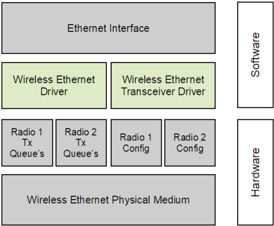
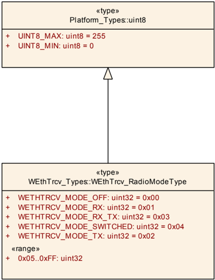
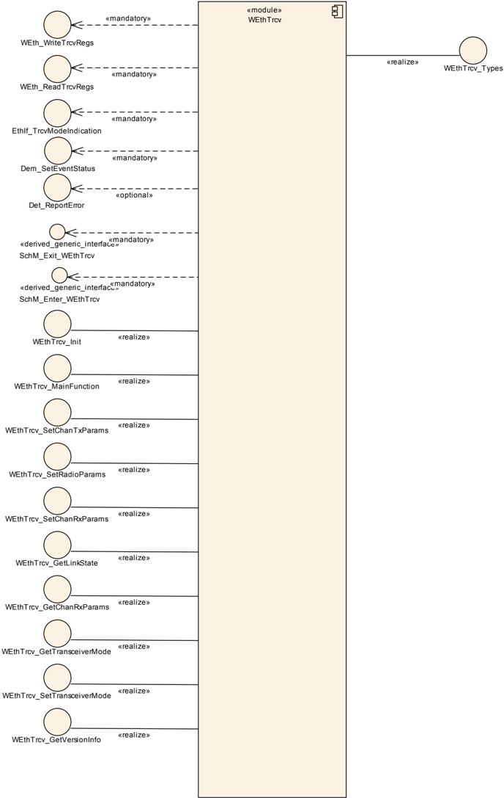
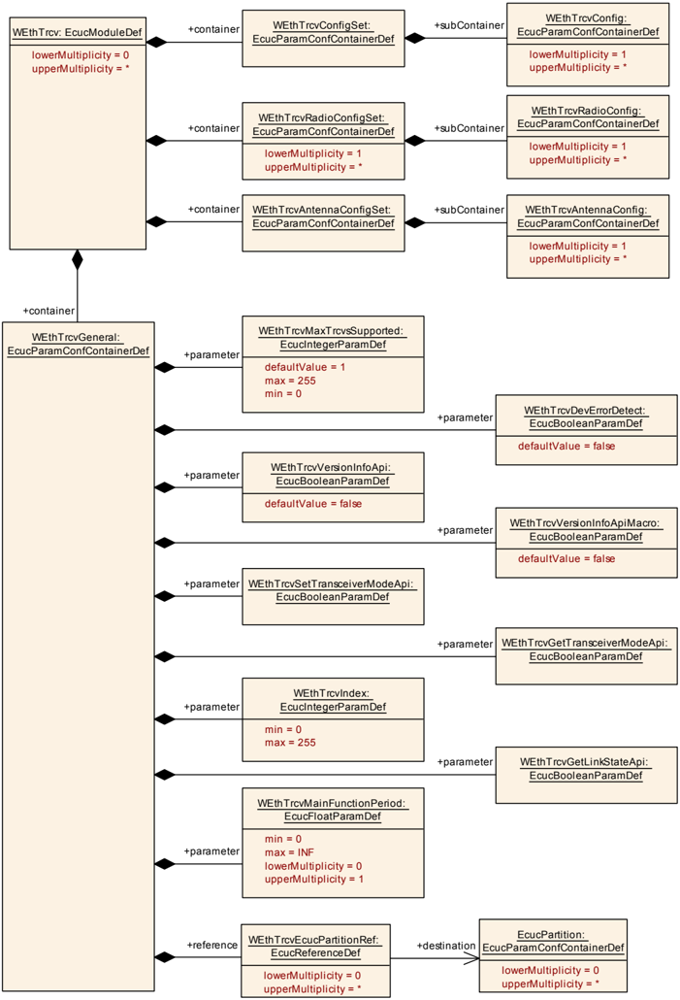
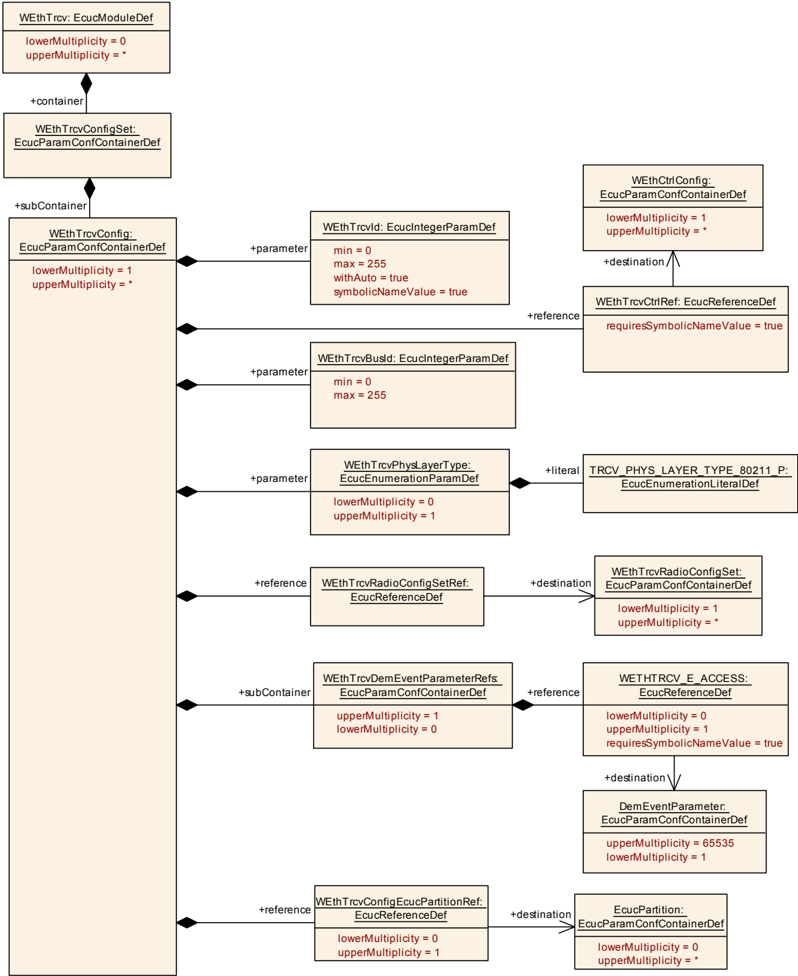
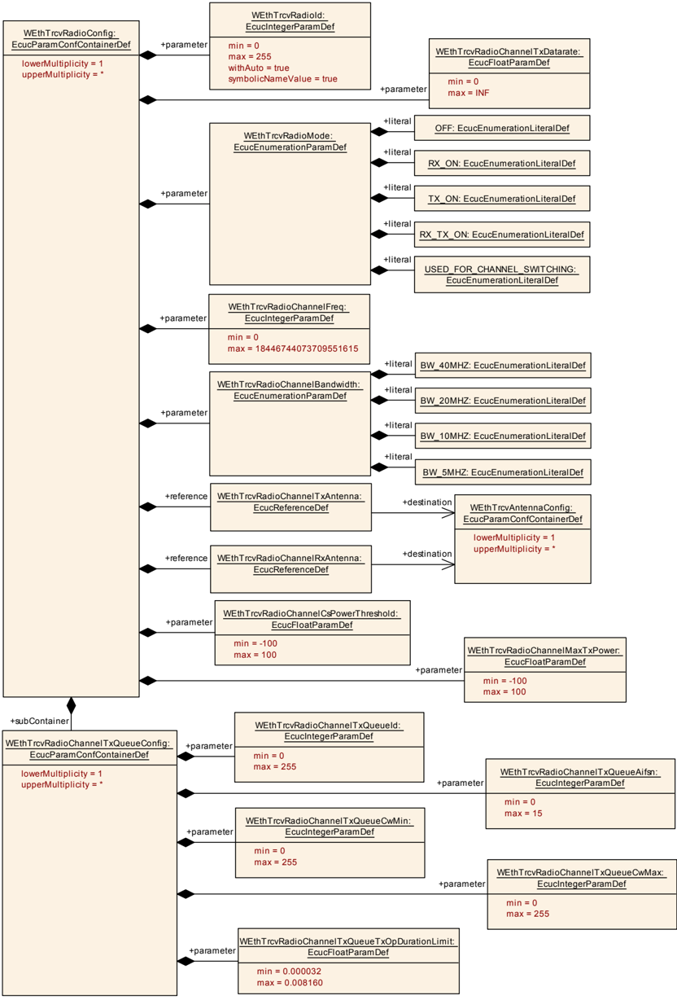
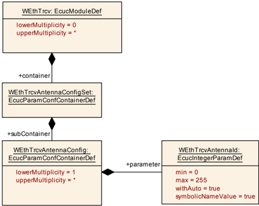

## 1. 简介和功能概述

本规范规定 **AUTOSAR** 基础软件模块 **Ethernet Wireless driver**（无线以太网驱动程序）的功能、**API** 和配置。

在 **AUTOSAR** 分层软件架构中，**Wireless Ethernet Transceiver driver** 属于微控制器抽象层，更准确地说是属于通信驱动程序（Communication Drivers）。

这指出了 **Wireless Ethernet Transceiver driver** 的主要任务：

为上层（**Ethernet Interface**）提供一个由多个同类收发器组成的、与硬件无关的接口。该接口应对所有收发器保持一致。这样，上层（**Ethernet Interface**）便可以一致的方式访问底层总线系统。该接口提供用于初始化、配置和数据传输的功能。不过 **Wireless Ethernet Transceiver driver** 的配置是总线特定的，因为它会考虑通信控制器的具体特性。

单个 **Wireless Ethernet Transceiver driver** 模块只支持一种类型的收发器硬件。**Wireless Ethernet Transceiver driver** 的前缀需要一个唯一的命名空间。通过这个前缀，**Ethernet Interface** 可以使用不同的 **Wireless Ethernet Transceiver driver** 来访问不同的无线以太网控制器类型。使用哪个驱动程序访问某个特定收发器的决策是 **Ethernet Interface** 的一个配置参数。

图 1.1 描绘了无线以太网协议栈的下半部分。一个以太网接口可以使用多个 **Wireless Ethernet Transceiver** 驱动程序访问多个收发器。每个收发器可以支持多个射频配置。



## 2. 缩略语

以下术语表列出了与 **Wireless Ethernet Transceiver Driver** 模块相关、但未包含在 [\[1\]](#ref-1)（**AUTOSAR** 术语表）中的首字母缩略词和缩略语。

**AIFS**
> 仲裁帧间间隔（**Arbitration Inter Frame Space**）。

**CBR**
> 信道忙闲比（**Channel Busy Ratio**）。

**CIT**
> 信道空闲时间（**Channel Idle Time**）。

**CW**
> 竞争窗口（**Contention Window**）。

**DP**
> DCC 配置（**DCC Profile**）。

**EthIf**
> Ethernet Interface（**AUTOSAR BSW** 模块）。

**Eth**
> Ethernet Driver（**AUTOSAR BSW** 模块）。

**EthTrcv**
> Ethernet Transceiver Driver（**AUTOSAR BSW** 模块）。

**ISR**
> 中断服务程序（**Interrupt Service Routine**）。

**MCG**
> 模块配置生成器（**Module Configuration Generator**）。

**WEth**
> Wireless Ethernet Driver（**AUTOSAR BSW** 模块）。

**WEthTrcv**
> Wireless Ethernet Transceiver（**AUTOSAR BSW** 模块）。

## 3. 相关文档

### 3.1. 输入文件和相关标准与规范

<a id="ref-1"></a>[1] Glossary
> AUTOSAR_FO_TR_Glossary

<a id="ref-2"></a>[2] General Specification of Basic Software Modules
> AUTOSAR_CP_SWS_BSWGeneral

<a id="ref-3"></a>[3] Specification of Ethernet Driver
> AUTOSAR_CP_SWS_EthernetDriver

<a id="ref-4"></a>[4] General Requirements on Basic Software Modules
> AUTOSAR_CP_SRS_BSWGeneral

<a id="ref-5"></a>[5] Requirements on Vehicle-2-X Communication
> AUTOSAR_CP_SRS_V2XCommunication

<a id="ref-6"></a>[6] Specification of Ethernet Transceiver Driver
> AUTOSAR_CP_SWS_EthernetTransceiverDriver

<a id="ref-7"></a>[7] Specification of Default Error Tracer
> AUTOSAR_CP_SWS_DefaultErrorTracer

<a id="ref-8"></a>[8] Specification of Ethernet Interface
> AUTOSAR_CP_SWS_EthernetInterface

### 3.2. 相关规范

**AUTOSAR** 提供了一份基础软件模块通用规范 [\[2\]](#ref-2)（**SWS BSW General**），它对 **Wireless Ethernet Transceiver** 同样有效。

因此，规范 **SWS BSW General** 应被视为 **Wireless Ethernet Transceiver** 的附加且必需的规范。

此外，本文档使用 **Ethernet Transceiver Driver** 作为需求、**API** 和配置的基础，因为有线和无线用例有许多（但不是全部）共同点。本文档中使用的术语「**Ethernet Transceiver Driver**」描述的是以太网驱动程序的类别，而与所使用的物理层无关，既指无线也指有线的以太网收发器驱动程序。

## 4. 约束和假设

### 4.1. 限制

微控制器抽象层多核分布概念在本软件规范中作为「draft（草案）」实现。更多信息参见第 [9](#9-配置规范) 章。

### 4.2. 汽车域的适用性

**Wireless Ethernet Transceiver Driver** 旨在用于客户硬件的无线接入（接入点模式/Access Point mode），以及为 Vehicle-2-X（**V2X**）应用 / **BSW** 模块的无线访问（使用网状网络）抽象硬件。

## 5. 对其他模块的依赖

本章列出与 **Wireless Ethernet Transceiver Driver** 模块交互的模块。

使用 **Wireless Ethernet Transceiver Driver** 模块的模块：

* **Ethernet Interface**（**EthIf**）

**Wireless Ethernet Transceiver Driver** 模块使用的模块：

* **Wireless Ethernet Controller Driver**（**WEth**），用于通过一个依赖于收发器的接口抽象硬件访问。
* 通常，**V2X** 调制解调器和/或收发器硬件是一个外部设备，由现有的通信驱动程序（例如 **SPI**）访问。

## 6. 功能规格

**Wireless Ethernet Transceiver** 驱动程序为无线通信设置射频。

### 6.1. Wireless Ethernet BSW 栈

作为 **AUTOSAR** 分层软件架构的一部分（参见图 1.1），无线以太网 **BSW** 模块也构成一个分层的软件栈。**Ethernet Interface** 模块使用 **Wireless Ethernet Transceiver Driver** 层访问多个收发器，该层可以由多个 **Wireless Ethernet Transceiver Drivers** 模块组成。

#### 6.1.1. 索引方案

**Wireless Ethernet Driver** 的使用者使用 [\[6\]](#ref-6)（**SWS Ethernet Transceiver Driver**）中描述的索引方案来标识控制器资源。

**Wireless Ethernet Transceiver Driver** 使用从零开始的索引来抽象上层软件层的访问。配置中的参数 **WEthTrcvId** 对应于 **API** 中使用的参数 **TrcvId**。

**Wireless Ethernet Transceiver Driver** 使用从零开始的索引来抽象上层软件层对射频（Radio）的访问。配置中的参数 **WEthTrcvRadioId** 对应于 **API** 中使用的参数 **RadioId**。

#### 6.1.2. 需求

本章列出 **Wireless Ethernet Transceiver Driver** 模块实现应满足的需求。

**Wireless Ethernet Driver** 模块环境包含所有调用 **Wireless Ethernet Driver** 模块接口的模块。

如果为 **Wireless Ethernet Transceiver Driver** 模块启用了开发错误检测：**Wireless Ethernet Transceiver Driver** 模块应检查 **API** 参数的有效性，并将检测到的错误报告给 **DET**。

**DET API** 函数在 [\[7\]](#ref-7)（**SWS Default Error Tracer**）中规定。

#### 6.1.3. 收发器参数

函数 [**WEthTrcv_SetRadioParams**](#735-wethtrcv_setradioparams) 应将 [**WEthTrcv_SetRadioParamIdType**](#722-wethtrcv_setradioparamidtype) 类型的属性设置到由 **RadioId** 索引的特定无线射频的访问层。

函数 [**WEthTrcv_SetChanRxParams**](#736-wethtrcv_setchanrxparams) 应将 [**WEthTrcv_SetChanRxParamIdType**](#723-wethtrcv_setchanrxparamidtype) 类型的属性设置到由 **RadioId** 索引的无线射频内的特定无线信道。

函数 [**WEthTrcv_SetChanTxParams**](#737-wethtrcv_setchantxparams) 应将 [**WEthTrcv_SetChanTxParamIdType**](#724-wethtrcv_setchantxparamidtype) 类型的属性设置到由 **RadioId** 索引的无线射频内的特定无线信道。

函数 **EthTrcv_GetChanRxParams** 应提供由 **RadioId** 索引的无线射频内特定无线信道的 [**WEthTrcv_GetChanRxParamIdType**](#725-wethtrcv_getchanrxparamidtype) 类型的属性。

#### 6.1.4. 键/值参数映射

为了唯一地引用发送和接收参数，应在本模块内使用唯一的枚举 **ID**。

使用类型 [**WEthTrcv_SetRadioParamIdType**](#722-wethtrcv_setradioparamidtype) 的函数应为对应值的列表使用 uint32 值的通用列表。

使用 [**WEthTrcv_SetRadioParamIdType**](#722-wethtrcv_setradioparamidtype) 的函数应使用上表提供的类型映射来处理对应值。

| ParamId | ParamValue 类型 |
|---|---|
| WETHTRCV_SETRADIOPID_SEL_TRCV_CHCFG | uint8 |
| WETHTRCV_SETRADIOPID_SET_CHCFGID | uint8 |
| WETHTRCV_SETRADIOPID_TOLLINGZONE_INFO | uint8 |

使用类型 [**WEthTrcv_SetChanRxParamIdType**](#723-wethtrcv_setchanrxparamidtype) 的函数应为对应值的列表使用 uint32 值的通用列表。

使用 [**WEthTrcv_SetChanRxParamIdType**](#723-wethtrcv_setchanrxparamidtype) 的函数应使用上表提供的类型映射来处理对应值。

| ParamId | ParamValue 类型 |
|---|---|
| WETHTRCV_SETCHRXPID_BITRATE | uint8 |
| WETHTRCV_SETCHRXPID_BANDWIDTH | [WEthTrcv_BandwidthType](#726-wethtrcv_bandwidthtype) |
| WETHTRCV_SETCHRXPID_FREQ | uint16 |
| WETHTRCV_SETCHRXPID_CSPWRTRESH | [WEthTrcv_RssiType](#728-wethtrcv_rssitype) |
| WETHTRCV_SETCHRXPID_RADIO_MODE | [WEthTrcv_RadioModeType](#729-wethtrcv_radiomodetype) |
| WETHTRCV_SETCHRXPID_ANTENNA | uint8 |

使用类型 [**WEthTrcv_SetChanTxParamIdType**](#724-wethtrcv_setchantxparamidtype) 的函数应为对应值的列表使用 uint32 值的通用列表。

使用 [**WEthTrcv_SetChanTxParamIdType**](#724-wethtrcv_setchantxparamidtype) 的函数应使用上表提供的类型映射来处理对应值。

| ParamId | ParamValue 类型 |
|---|---|
| WETHTRCV_SETCHTXPID_BITRATE | uint8 |
| WETHTRCV_SETCHTXPID_BANDWIDTH | [WEthTrcv_BandwidthType](#726-wethtrcv_bandwidthtype) |
| WETHTRCV_SETCHTXPID_TXPOWER | [WEthTrcv_TxPwrLvlType](#727-wethtrcv_txpwrlvltype) |
| WETHTRCV_SETCHTXPID_DCC_CBR | uint8 |
| WETHTRCV_SETCHTXPID_TXQSEL | uint8 |
| WETHTRCV_SETCHTXPID_TXQCFG_AIFSN | uint8 |
| WETHTRCV_SETCHTXPID_TXQCFG_CWMIN | uint8 |
| WETHTRCV_SETCHTXPID_TXQCFG_CWMAX | uint16 |
| WETHTRCV_SETCHTXPID_TXQCFG_TXOP | uint8 |
| WETHTRCV_SETCHTXPID_RADIO_MODE | [WEthTrcv_RadioModeType](#729-wethtrcv_radiomodetype) |
| WETHTRCV_SETCHTXPID_ANTENNA | uint8 |
| WETHTRCV_SETCHTXPID_PACKET_INTERVAL | uint16 |
| WETHTRCV_SETCHTXPID_DCC_STATE | uint8 |

使用类型 [**WEthTrcv_GetChanRxParamIdType**](#725-wethtrcv_getchanrxparamidtype) 的函数应为对应值的列表使用 uint32 值的通用列表。

使用 [**WEthTrcv_GetChanRxParamIdType**](#725-wethtrcv_getchanrxparamidtype) 的函数应使用上表提供的类型映射来处理对应值。

| ParamId | ParamValue 类型 |
|---|---|
| WETHTRCV_GETCHRXPID_CBR | uint8 |
| WETHTRCV_GETCHRXPID_CIT | uint16 |

#### 6.1.5. MainFunction

**MainFunction** 用于硬件/软件实现特定的周期性任务的执行。

在 **V2X** 的情况下，如果收发器不是经由无线以太网驱动程序间接访问的，则 **MainFunction** 用于获取当前无线收发器信道状态（**CBR**）的信息。

#### 6.1.6. V2X 特定的收发器需求

**WEthTrcv** 模块的 **RF** 输出功率应是可调节的。

**WEthTrcv** 模块应遵守以下最大消息速率：

* 对于放松状态（relaxed state）：在放松状态下通过 DP1、DP2 和 DP3 发送的所有消息的总和不应超过 Rmax_relaxed = 16.7 条消息每秒。DP0 允许消息突发（message burst），RBurst = 20 条消息每秒，最大持续时间为 TBurst = 1 秒，并且只能每 TBurstPeriod = 10 秒发生一次。因此，加上 DP0 消息，最大消息速率可达 Rmax_relaxed = 36.7 条消息每秒。

一旦进入受保护的通信区域（protected communication zone），**WEthTrcv** 模块应将其发送功率降低到 PToll = 10 dBm，且不改变任何其他 **DCC** 发送参数。DP0 消息不受此限制约束。

#### 6.1.7. 唤醒支持

目前还没有针对诸如 Wake on Wireless LAN 之类技术的高效概念。因此不支持无线唤醒。

### 6.2. 错误分类

《基础软件模块通用规范》（**General Specification of Basic Software Modules**）[\[2\]](#ref-2) 的「错误处理」一节详细描述了基础软件的错误处理。最重要的是，它构成了一个由可能发生在 **BSW** 模块中的五种错误类型组成的分类方案。

在此基础上，以下各节规定了安排在相应小节中的特定错误。

#### 6.2.1. 开发错误

| 错误类型 | 相关错误代码 | 错误值 |
|---|---|---|
| 无效的收发器索引 | WETHTRCV_E_INV_TRCV_ID | 0x01 |
| WEthTrcv 模块未初始化 | WETHTRCV_E_UNINIT | 0x02 |
| 参数列表中出现无效指针 | WETHTRCV_E_PARAM_POINTER | 0x03 |

#### 6.2.2. 运行时错误

没有运行时错误。

#### 6.2.3. 瞬态故障

没有瞬态故障。

#### 6.2.4. 生产错误

没有生产错误。

#### 6.2.5. 扩展生产错误

扩展生产错误作为 **Diagnostic Event Manager** 的事件处理。事件 **ID** 在下面的表中定义，而实际取值由 **Diagnostic Event Manager** 的配置在外部分配，并通过 **Dem.h** 包含到模块中。

| 错误名称 | WETHTRCV_E_ACCESS |
|---|---|
| 简短描述 | 无线以太网收发器访问失败（**Wireless Ethernet Transceiver Access Failure**）。 |
| 详细描述 | 当收发器硬件与基带调制解调器硬件分离时，监控对无线以太网收发器的访问。 |
| 检测标准 | **Fail**：当对无线以太网收发器的访问失败时，模块应以事件状态 DEM_EVENT_STATUS_PREFAILED 向 **DEM** 报告该扩展生产错误。**Pass**：当对无线以太网收发器的访问成功时，模块应以事件状态 DEM_EVENT_STATUS_PREPASSED 向 **DEM** 报告该扩展生产错误。 |
| 次要参数 | 无。 |
| 所需时间 | 无。 |
| 监控频率 | 无。 |

### 6.3. 安全事件

本模块不报告安全事件。

## 7. API规范

### 7.1. 导入的类型

在本章中，列出了从以下文件包含的所有类型。

**WEthTrcv** 模块的导入数据类型定义

| 模块 | 头文件 | 导入的类型 |
|---|---|---|
| Dem | Rte_Dem_Type.h | Dem_EventIdType |
| Dem | Rte_Dem_Type.h | Dem_EventStatusType |
| Eth | Eth_GeneralTypes.h | Eth_ModeType |
| EthTrcv | Eth_GeneralTypes.h | EthTrcv_LinkStateType |
| Std | Std_Types.h | Std_ReturnType |
| Std | Std_Types.h | Std_VersionInfoType |

### 7.2. 类型定义



#### 7.2.1. WEthTrcv_ConfigType

结构类型（**Structure**）。Post-build 配置的实现特定结构。可通过**WEthTrcv.h**获得。

#### 7.2.2. WEthTrcv_SetRadioParamIdType

枚举类型（**Enumeration**）。收发器的无线射频设置。可通过**WEth_GeneralTypes.h**获得。

* **WETHTRCV_SETRADIOPID_SEL_TRCV_CHCFG**（0x01）：在多信道上下文模式中选择应设置收发器内的哪个信道配置。
* **WETHTRCV_SETRADIOPID_SET_CHCFGID**（0x02）：在单信道上下文模式或多信道上下文模式中切换到另一个信道配置（要求先前已在收发器中选择了信道配置）。
* **WETHTRCV_SETRADIOPID_TOLLINGZONE_INFO**（0x03）：进入和离开收费区（Tolling Zone Area）的信息。

#### 7.2.3. WEthTrcv_SetChanRxParamIdType

枚举类型（**Enumeration**）。接收侧的无线信道设置。可通过**WEth_GeneralTypes.h**获得。

* **WETHTRCV_SETCHRXPID_BITRATE**（0x00）：比特率（Bitrate）。
* **WETHTRCV_SETCHRXPID_BANDWIDTH**（0x01）：带宽（Bandwidth）。
* **WETHTRCV_SETCHRXPID_FREQ**（0x02）：信道的中心频率（Center frequency of a channel）。
* **WETHTRCV_SETCHRXPID_CSPWRTRESH**（0x03）：用于 Rx 忙检测的参数。
* **WETHTRCV_SETCHRXPID_RADIO_MODE**（0x04）：Rx 射频模式参数。
* **WETHTRCV_SETCHRXPID_ANTENNA**（0x05）：Rx 天线 **ID**。

#### 7.2.4. WEthTrcv_SetChanTxParamIdType

枚举类型（**Enumeration**）。-。可通过**WEth_GeneralTypes.h**获得。

* **WETHTRCV_SETCHTXPID_BITRATE**（0x00）：比特率（Bitrate）。
* **WETHTRCV_SETCHTXPID_BANDWIDTH**（0x01）：带宽（Bandwidth）。
* **WETHTRCV_SETCHTXPID_TXPOWER**（0x02）：发送功率（Transmission power）。
* **WETHTRCV_SETCHTXPID_DCC_CBR**（0x03）：用于 **DCC** 的信道忙闲比参数。
* **WETHTRCV_SETCHTXPID_TXQSEL**（0x04）：要为其设置设置的发送队列的选择。
* **WETHTRCV_SETCHTXPID_TXQCFG_AIFSN**（0x05）：仲裁帧间间隔数（乘数，取值为 0 到 15）。
* **WETHTRCV_SETCHTXPID_TXQCFG_CWMIN**（0x06）：竞争窗口最小值。
* **WETHTRCV_SETCHTXPID_TXQCFG_CWMAX**（0x07）：竞争窗口最大值。
* **WETHTRCV_SETCHTXPID_TXQCFG_TXOP**（0x08）：TXOP 持续时间限制 [µs] 除以 32。
* **WETHTRCV_SETCHTXPID_RADIO_MODE**（0x09）：Tx 射频模式参数。
* **WETHTRCV_SETCHTXPID_ANTENNA**（0x0A）：Tx 天线 **ID**。
* **WETHTRCV_SETCHTXPID_PACKET_INTERVAL**（0x0C）：用于发送间隔的包间隔。
* **WETHTRCV_SETCHTXPID_DCC_STATE**（0x0D）：**DCC** 状态机的状态。

#### 7.2.5. WEthTrcv_GetChanRxParamIdType

枚举类型（**Enumeration**）。接收侧的无线信道属性。可通过**WEth_GeneralTypes.h**获得。

* **WETHTRCV_GETCHRXPID_CBR**（0x00）：信道忙闲比（Channel Busy Ratio）的参数 **ID**。
* **WETHTRCV_GETCHRXPID_CIT**（0x01）：信道空闲时间（Channel Idle Time）的参数 **ID**。

#### 7.2.6. WEthTrcv_BandwidthType

类型（**Type**），派生自 **uint32**。射频信道的带宽。可通过**WEth_GeneralTypes.h**获得。

* **WETHTRCV_BW_5MHz**（0x00）：指示 5 MHz。
* **WETHTRCV_BW_10MHz**（0x01）：指示 10 MHz。
* **WETHTRCV_BW_20MHz**（0x02）：指示 20 MHz。
* **WETHTRCV_BW_40MHz**（0x03）：指示 40 MHz。
* 0x0000004..0xFFFFFFF：无效（Invalid）。

#### 7.2.7. WEthTrcv_TxPwrLvlType

类型（**Type**），派生自 **uint16**。帧的功率，以 0.5 dBm 为单位，原始值 0 等于 -100 dBm。可通过**WEth_GeneralTypes.h**获得。

* 0..399：以 0.5 dB 为单位的有效取值，偏移量为 -100 dBm。
* 400..65535：无效（Invalid）。

#### 7.2.8. WEthTrcv_RssiType

类型（**Type**），派生自 **uint16**。帧的功率，以 0.5 dBm 为单位，原始值 0 等于 -100 dBm。可通过**WEth_GeneralTypes.h**获得。

* 0..399：以 0.5 dB 为单位的有效取值，偏移量为 -100 dBm。
* 400..65535：无效（Invalid）。

#### 7.2.9. WEthTrcv_RadioModeType

类型（**Type**），派生自 **uint8**。具有多个无线电信道配置的射频运行模式。可通过**WEth_GeneralTypes.h**获得。

* **WETHTRCV_MODE_OFF**（0x00）：射频关闭。
* **WETHTRCV_MODE_RX**（0x01）：接收开启。
* **WETHTRCV_MODE_TX**（0x02）：发送开启。
* **WETHTRCV_MODE_RX_TX**（0x03）：接收和发送开启。
* **WETHTRCV_MODE_SWITCHED**（0x04）：射频信道切换开启。
* 0x05..0xFF：无效（Invalid）。

### 7.3. 函数定义

这是提供给上层模块的函数列表。

#### 7.3.1. WEthTrcv_Init

**说明**: 初始化 **Wireless Ethernet Transceiver Driver**。可通过**WEthTrcv.h**获得。本服务为同步调用，不可重入。参数 CfgPtr（in）：指向实现特定结构的指针。返回值：无。

```C
void WEthTrcv_Init ( const WEthTrcv_ConfigType* CfgPtr )
```

该函数应存储对配置结构的访问，以供后续 **API** 调用使用。

该函数应配置所有收发器配置参数（例如波特率、双工模式、自动协商等）。

该函数应将组件的状态从 **WETHTRCV_STATE_UNINIT** 改变为 **WETHTRCV_STATE_INIT**。

该函数应检查对无线以太网收发器的访问。如果检查失败，该函数应引发生产错误 [**WETHTRCV_E_ACCESS**](#625-扩展生产错误) 并返回 **E_NOT_OK**，否则通过该生产错误 [**WETHTRCV_E_ACCESS**](#625-扩展生产错误) 并返回 **E_OK**。

**注意：** 该 **API** 必须在初始化期间调用。

#### 7.3.2. WEthTrcv_SetTransceiverMode

**说明**: 启用/禁用被索引的收发器。可通过**WEthTrcv.h**获得。本服务为异步调用，不可重入。参数 TrcvId（in）：以太网收发器驱动程序上下文中收发器的索引。参数 TrcvMode（in）：**ETH_MODE_DOWN**：禁用无线以太网收发器；**ETH_MODE_ACTIVE**：启用无线以太网收发器。返回值：Std_ReturnType，E_OK：服务被接受；E_NOT_OK：服务被拒绝。

```C
Std_ReturnType WEthTrcv_SetTransceiverMode ( uint8 TrcvId, Eth_ModeType TrcvMode )
```

该函数应将被索引的收发器置于指定的模式，并最迟在下一次 [**WEthTrcv_MainFunction**](#751-wethtrcv_mainfunction) 期间通过 **API** EthIf_TrcvModeIndication 指示新模式。

如果启用了开发错误检测：该函数应检查先前是否已调用过服务 [**WEthTrcv_Init**](#731-wethtrcv_init)。如果检查失败，该函数应引发开发错误 [**WETHTRCV_E_UNINIT**](#621-开发错误)，否则（如果 **DET** 被禁用）返回 **E_NOT_OK**。

如果启用了开发错误检测：该函数应检查参数 **TrcvIdx** 是否有效。如果检查失败，该函数应引发开发错误 **WETHTRCV_E_INV_TRCV_IDX**，否则（如果 **DET** 被禁用）返回 **E_NOT_OK**。

该函数应可通过配置参数 **WEthTrcvSetTransceiverModeApi** 进行预编译期配置（开/关）。

如果收发器已经处于所请求的模式，应返回 **E_OK** 且不引发开发错误。

该函数应检查对无线以太网收发器的访问。如果检查失败，该函数应引发生产错误 [**WETHTRCV_E_ACCESS**](#625-扩展生产错误) 并返回 **E_NOT_OK**，否则通过该生产错误 [**WETHTRCV_E_ACCESS**](#625-扩展生产错误) 并返回 **E_OK**。

**注意：** 该函数要求先前已进行收发器初始化（**EthTrcv_Init**）。

#### 7.3.3. WEthTrcv_GetTransceiverMode

**说明**: 获取被索引收发器的状态。可通过**WEthTrcv.h**获得。本服务为同步调用，不可重入。参数 TrcvId（in）：**Wireless Ethernet Transceiver Driver** 上下文中收发器的索引。参数 TrcvModePtr（out）：**ETH_MODE_DOWN**：无线以太网收发器被禁用；**ETH_MODE_ACTIVE**：无线以太网收发器被启用。返回值：Std_ReturnType，E_OK：成功；E_NOT_OK：无法初始化无线以太网收发器。

```C
Std_ReturnType WEthTrcv_GetTransceiverMode ( uint8 TrcvId, Eth_ModeType* TrcvModePtr )
```

该函数应读取当前收发器模式。

如果启用了开发错误检测：该函数应检查先前是否已调用过服务 **EthTrcv_Init**。如果检查失败，该函数应引发开发错误 [**WETHTRCV_E_UNINIT**](#621-开发错误)，否则（如果 **DET** 被禁用）返回 **E_NOT_OK**。

如果启用了开发错误检测：该函数应检查参数 **TrcvIdx** 是否有效。如果检查失败，该函数应引发开发错误 **WETHTRCV_E_INV_TRCV_IDX**，否则（如果 **DET** 被禁用）返回 **E_NOT_OK**。

如果启用了开发错误检测：该函数应检查参数 **TrcvModePtr** 是否有效。如果检查失败，该函数应引发开发错误 [**WETHTRCV_E_PARAM_POINTER**](#621-开发错误)，否则（如果 **DET** 被禁用）返回 **E_NOT_OK**。

该函数应可通过配置参数 **WEthTrcvGetTransceiverModeApi** 进行预编译期配置（开/关）。

**注意：** 该函数要求先前已进行收发器初始化（[**WEthTrcv_Init**](#731-wethtrcv_init)）。

#### 7.3.4. WEthTrcv_GetLinkState

**说明**: 获取被索引收发器的链路状态。可通过**WEthTrcv.h**获得。本服务为同步调用，不可重入。参数 TrcvId（in）：以太网收发器驱动程序上下文中收发器的索引。参数 LinkStatePtr（out）：**ETHTRCV_LINK_STATE_DOWN**：收发器已断开；**ETHTRCV_LINK_STATE_ACTIVE**：收发器已连接。返回值：Std_ReturnType，E_OK：成功；E_NOT_OK：无法初始化收发器。

```C
Std_ReturnType WEthTrcv_GetLinkState ( uint8 TrcvId, EthTrcv_LinkStateType* LinkStatePtr )
```

该函数应读取当前收发器链路状态。

如果启用了开发错误检测：该函数应检查先前是否已调用过服务 [**WEthTrcv_Init**](#731-wethtrcv_init)。如果检查失败，该函数应引发开发错误 [**WETHTRCV_E_UNINIT**](#621-开发错误)，否则（如果 **DET** 被禁用）返回 **E_NOT_OK**。

如果启用了开发错误检测：该函数应检查参数 **TrcvIdx** 是否有效。如果检查失败，该函数应引发开发错误 **WETHTRCV_E_INV_TRCV_IDX**，否则（如果 **DET** 被禁用）返回 **E_NOT_OK**。

如果启用了开发错误检测：该函数应检查参数 **LinkStatePtr** 是否有效。如果检查失败，该函数应引发开发错误 [**WETHTRCV_E_PARAM_POINTER**](#621-开发错误)，否则（如果 **DET** 被禁用）返回 **E_NOT_OK**。

该函数应可通过配置参数 **WEthTrcvGetLinkStateApi** 进行预编译期配置（开/关）。

**注意：** 该函数要求先前已进行收发器初始化（[**WEthTrcv_Init**](#731-wethtrcv_init)）。

#### 7.3.5. WEthTrcv_SetRadioParams

**说明**: 设置与收发器的无线射频相关的取值。例如，这可以是射频设置（信道等）的选择。可通过**WEthTrcv.h**获得。本服务为同步调用，不可重入。参数 TrcvId（in）：收发器的索引。参数 ParamIds（in）：要设置的参数的 **ID**。参数 ParamValue（in）：要设置的参数的取值。参数 NumParams（in）：要设置的参数的数量。返回值：Std_ReturnType，E_OK：成功；E_NOT_OK：写入参数失败。

```C
Std_ReturnType WEthTrcv_SetRadioParams ( uint8 TrcvId, const WEthTrcv_SetRadioParamIdType* ParamIds, const uint32* ParamValue, uint8 NumParams )
```

该函数应为 ParamIds 和 ParamValues 参数使用类型映射（见第 [6.1.4](#614-键值参数映射) 章的规定）。

如果启用了开发错误检测：该函数应检查先前是否已调用过服务 [**WEthTrcv_Init**](#731-wethtrcv_init)。如果检查失败，该函数应引发开发错误 [**WETHTRCV_E_UNINIT**](#621-开发错误)。

如果启用了开发错误检测：该函数应检查参数 **TrcvId** 是否有效。如果检查失败，该函数应引发开发错误 [**WETHTRCV_E_INV_TRCV_ID**](#621-开发错误)，否则（如果 **DET** 被禁用）返回 **E_NOT_OK**。

如果启用了开发错误检测：该函数应检查参数 **RadioId** 是否有效。如果检查失败，该函数应引发开发错误 **WETHTRCV_E_INV_PARAM**，否则（如果 **DET** 被禁用）返回 **E_NOT_OK**。

如果启用了开发错误检测：该函数应检查参数 **ParamIds** 是否有效。如果检查失败，该函数应引发开发错误 [**WETHTRCV_E_PARAM_POINTER**](#621-开发错误)。

如果启用了开发错误检测：该函数应检查参数 **ParamValues** 是否有效。如果检查失败，该函数应引发开发错误 [**WETHTRCV_E_PARAM_POINTER**](#621-开发错误)。

#### 7.3.6. WEthTrcv_SetChanRxParams

**说明**: 设置与收发器无线信道的接收方向相关的取值。例如，这可以是像频率这样的信道参数。可通过**WEthTrcv.h**获得。本服务为同步调用，不可重入。参数 TrcvId（in）：收发器的索引。参数 RadioId（in）：收发器射频（包括信道）的索引。参数 ParamIds（in）：要设置的参数的 **ID**。参数 ParamValues（in）：要设置的参数的取值。参数 NumParams（in）：要设置的参数的数量。返回值：Std_ReturnType，E_OK：成功；E_NOT_OK：写入参数失败。

```C
Std_ReturnType WEthTrcv_SetChanRxParams ( uint8 TrcvId, uint8 RadioId, const WEthTrcv_SetChanRxParamIdType* ParamIds, const uint32* ParamValues, uint8 NumParams )
```

该函数应为 ParamIds 和 ParamValues 参数使用类型映射（见第 [6.1.4](#614-键值参数映射) 章的规定）。

如果启用了开发错误检测：该函数应检查先前是否已调用过服务 [**WEthTrcv_Init**](#731-wethtrcv_init)。如果检查失败，该函数应引发开发错误 [**WETHTRCV_E_UNINIT**](#621-开发错误)。

如果启用了开发错误检测：该函数应检查参数 **TrcvId** 是否有效。如果检查失败，该函数应引发开发错误 [**WETHTRCV_E_INV_TRCV_ID**](#621-开发错误)，否则（如果 **DET** 被禁用）返回 **E_NOT_OK**。

如果启用了开发错误检测：该函数应检查参数 **RadioId** 是否有效。如果检查失败，该函数应引发开发错误 **WETHTRCV_E_INV_PARAM**，否则（如果 **DET** 被禁用）返回 **E_NOT_OK**。

如果启用了开发错误检测：该函数应检查参数 **ParamIds** 是否有效。如果检查失败，该函数应引发开发错误 [**WETHTRCV_E_PARAM_POINTER**](#621-开发错误)。

如果启用了开发错误检测：该函数应检查参数 **ParamValues** 是否有效。如果检查失败，该函数应引发开发错误 [**WETHTRCV_E_PARAM_POINTER**](#621-开发错误)。

#### 7.3.7. WEthTrcv_SetChanTxParams

**说明**: 设置与收发器无线信道的发送方向相关的取值。例如，这可以是信道的比特率。可通过**WEthTrcv.h**获得。本服务为同步调用，不可重入。参数 TrcvId（in）：收发器的索引。参数 RadioId（in）：收发器射频（包括信道）的索引。参数 TxParamIds（in）：要设置的参数的 **ID**。参数 ParamValues（in）：要设置的参数的取值。参数 NumParams（in）：要设置的参数的数量。返回值：Std_ReturnType，E_OK：成功；E_NOT_OK：写入参数失败。

```C
Std_ReturnType WEthTrcv_SetChanTxParams ( uint8 TrcvId, uint8 RadioId, const WEthTrcv_SetChanTxParamIdType* TxParamIds, const uint32* ParamValues, uint8 NumParams )
```

该函数应为 TxParamIds 和 ParamValues 参数使用类型映射（见第 [6.1.4](#614-键值参数映射) 章的规定）。

如果启用了开发错误检测：该函数应检查先前是否已调用过服务 [**WEthTrcv_Init**](#731-wethtrcv_init)。如果检查失败，该函数应引发开发错误 [**WETHTRCV_E_UNINIT**](#621-开发错误)。

如果启用了开发错误检测：该函数应检查参数 **TrcvId** 是否有效。如果检查失败，该函数应引发开发错误 [**WETHTRCV_E_INV_TRCV_ID**](#621-开发错误)，否则（如果 **DET** 被禁用）返回 **E_NOT_OK**。

如果启用了开发错误检测：该函数应检查参数 **RadioId** 是否有效。如果检查失败，该函数应引发开发错误 **WETHTRCV_E_INV_PARAM**，否则（如果 **DET** 被禁用）返回 **E_NOT_OK**。

如果启用了开发错误检测：该函数应检查参数 **TxParamIds** 是否有效。如果检查失败，该函数应引发开发错误 [**WETHTRCV_E_PARAM_POINTER**](#621-开发错误)。

如果启用了开发错误检测：该函数应检查参数 **ParamValues** 是否有效。如果检查失败，该函数应引发开发错误 [**WETHTRCV_E_PARAM_POINTER**](#621-开发错误)。

#### 7.3.8. WEthTrcv_GetChanRxParams

**说明**: 读取与收发器接收方向相关的取值。例如，这可以是信道忙闲比（**CBR**）或平均信道空闲时间（**CIT**）。可通过**WEthTrcv.h**获得。本服务为同步调用，不可重入。参数 TrcvId（in）：收发器的索引。参数 RadioId（in）：收发器射频（包括信道）的索引。参数 ParamIds（in）：要读取的参数的 **ID**。参数 NumParams（in）：要读取的参数的数量。参数 ParamValues（out）：所请求参数的取值。返回值：Std_ReturnType，E_OK：成功；E_NOT_OK：读取参数失败。

```C
Std_ReturnType WEthTrcv_GetChanRxParams ( uint8* TrcvId, uint8 RadioId, const WEthTrcv_GetChanRxParamIdType* ParamIds, uint32* ParamValues, uint8 NumParams )
```

该函数应为 ParamIds 和 ParamValues 参数使用类型映射（见第 [6.1.4](#614-键值参数映射) 章的规定）。

如果启用了开发错误检测：该函数应检查先前是否已调用过服务 [**WEthTrcv_Init**](#731-wethtrcv_init)。如果检查失败，该函数应引发开发错误 [**WETHTRCV_E_UNINIT**](#621-开发错误)。

如果启用了开发错误检测：该函数应检查参数 **TrcvId** 是否有效。如果检查失败，该函数应引发开发错误 [**WETHTRCV_E_INV_TRCV_ID**](#621-开发错误)，否则（如果 **DET** 被禁用）返回 **E_NOT_OK**。

如果启用了开发错误检测：该函数应检查参数 **RadioId** 是否有效。如果检查失败，该函数应引发开发错误 **WETHTRCV_E_INV_PARAM**，否则（如果 **DET** 被禁用）返回 **E_NOT_OK**。

如果启用了开发错误检测：该函数应检查参数 **ParamIds** 是否有效。如果检查失败，该函数应引发开发错误 [**WETHTRCV_E_PARAM_POINTER**](#621-开发错误)。

如果启用了开发错误检测：该函数应检查参数 **ParamValues** 是否有效。如果检查失败，该函数应引发开发错误 [**WETHTRCV_E_PARAM_POINTER**](#621-开发错误)。

#### 7.3.9. WEthTrcv_GetVersionInfo

**说明**: 返回本模块的版本信息。可通过**WEthTrcv.h**获得。本服务为同步调用，不可重入。参数 VersionInfoPtr（out）：本模块的版本信息。返回值：无。

```C
void WEthTrcv_GetVersionInfo ( Std_VersionInfoType* VersionInfoPtr )
```

如果启用了开发错误检测：该函数应检查参数 **VersionInfoPtr** 是否有效。如果检查失败，该函数应引发开发错误 [**WETHTRCV_E_PARAM_POINTER**](#621-开发错误)。

### 7.4. 回调通知

**Wireless Ethernet Transceiver Driver** 不提供任何回调函数。

### 7.5. 调度函数

这些函数由基础软件调度程序直接调用。以下函数应没有返回值和参数。所有函数都应不可重入。

#### 7.5.1. WEthTrcv_MainFunction

**说明**: 用于轮询状态变化。当收发器模式发生变化时调用 **EthIf_TrcvModeIndication**。可通过**SchM_WEthTrcv.h**获得。本服务无返回值和参数。

```C
void WEthTrcv_MainFunction ( void )
```

### 7.6. 期望接口

在本章中，列出了从其他模块需要的所有外部接口。



#### 7.6.1. 强制接口

**注意：** 本节定义实现模块核心功能所需的全部接口。

| API 函数 | 头文件 | 描述 |
|---|---|---|
| Dem_SetEventStatus | Dem.h | 由 **SW-C** 或 **BSW** 模块调用，向 **Dem** 报告监控状态信息。调用 Dem_SetEventStatus 的 **BSW** 模块可以安全地忽略返回值。仅在 ({Dem/DemConfigSet/DemEventParameter/DemEventReportingType} == STANDARD_REPORTING) 时此 **API** 才可用。 |
| EthIf_TrcvModeIndication | EthIf.h | 在读出模式变化后异步调用。如果该函数由先前的 **EthTrcv_SetTransceiverMode** 调用触发，则可以直接在触发函数内调用。 |
| SchM_Enter_WEthTrcv | SchM_&lt;Mip&gt;.h | 调用 SchM_Enter 函数以进入模块局部独占区。 |
| SchM_Exit_WEthTrcv | SchM_&lt;Mip&gt;.h | 调用 SchM_Exit 函数以退出独占区。 |
| WEth_ReadTrcvRegs | WEth.h | 读取收发器寄存器 |
| WEth_WriteTrcvRegs | WEth.h | 配置收发器的寄存器或触发接收器提供的功能 |

#### 7.6.2. 可选接口

本节定义实现模块可选功能所需的全部接口。

| API 函数 | 头文件 | 描述 |
|---|---|---|
| Det_ReportError | Det.h | 报告开发错误的服务。 |

#### 7.6.3. 可配置接口

**Wireless Ethernet Transceiver Driver** 不使用可配置接口。

### 7.7. 服务接口

**Wireless Ethernet Transceiver Driver** 不提供任何服务接口。

## 8. 时序图

**Wireless Ethernet Transceiver** 驱动程序与以太网接口的交互方式与 **Ethernet Transceiver** 驱动程序相同，参见 [\[8\]](#ref-8)（**SWS Ethernet Interface**）中的时序图。**注意：** **Wireless Ethernet Transceiver** 驱动程序中没有链路状态变化事件。

## 9. 配置规范

总体而言，本章定义配置参数及其到**容器**（container）的聚类组织。为支持本规范，第 9.1 章描述基础知识，并规定了应用于参数规范的模板（表）。我们有意将这些内容保留在规范中以保证可理解性。

第 9.1 章规定模块 **Wireless Ethernet Transceiver Driver** 的结构（容器）和参数。

第 9.2 章规定模块 **Wireless Ethernet Transceiver Driver** 的发布信息。

### 9.1. 容器与配置参数

以下各章汇总所有配置参数。各参数的详细含义见第 6 章和第 7 章。

**Wireless Ethernet Transceiver Driver** 模块应拒绝其实现所不支持的、带有分区映射的配置。

#### 9.1.1. WEthTrcv

| SWS 条目 | [ECUC_WEthTrcv_10023] |
|---|---|
| 模块名称 | WEthTrcv |
| 描述 | Ethernet Transceiver Driver 模块的配置。 |
| Post-Build 变体支持 | true |
| 支持的配置变体 | VARIANT-LINK-TIME, VARIANT-POST-BUILD, VARIANT-PRE-COMPILE |

| 容器名称 | 多重性 | 作用域/依赖 |
|---|---|---|
| WEthTrcvAntennaConfigSet | 1 | 该容器包含天线配置。 |
| WEthTrcvConfigSet | 1 | 该容器包含 **AUTOSAR** WEthTrcv 模块的配置参数和子容器。 |
| WEthTrcvGeneral | 1 | Wireless Ethernet Transceiver Driver 模块的通用配置。 |
| WEthTrcvRadioConfigSet | 1..* | 该容器包含射频配置。 |



#### 9.1.2. WEthTrcvConfigSet

| SWS 条目 | [ECUC_WEthTrcv_00016] |
|---|---|
| 容器名称 | WEthTrcvConfigSet |
| 父容器 | WEthTrcv |
| 描述 | 该容器包含 **AUTOSAR** WEthTrcv 模块的配置参数和子容器。 |
| 配置参数 | 见下方参数表 |

| 容器名称 | 多重性 | 作用域/依赖 |
|---|---|---|
| WEthTrcvConfig | 1..* | 单个收发器的配置 |

#### 9.1.3. WEthTrcvConfig

| SWS 条目 | [ECUC_WEthTrcv_00012] |
|---|---|
| 容器名称 | WEthTrcvConfig |
| 父容器 | WEthTrcvConfigSet |
| 描述 | 单个收发器的配置。 |
| 配置参数 | 见下方参数表 |

| SWS 条目 | [ECUC_WEthTrcv_00015] |
|---|---|
| 参数名称 | WEthTrcvBusId |
| 父容器 | WEthTrcvConfig |
| 描述 | 指定用于对收发器硬件模块进行低层总线接口访问（例如 **MII**/**SPI**）的硬件 **ID**。例如，如果使用了 **MII**，则为 **MII** 索引。 |
| 多重性 | 1 |
| 类型 | EcucIntegerParamDef |
| 范围 | 0 .. 255 |
| 默认值 | - |
| Post-Build 变体值 | true |
| 值配置类 | Pre-compile time：x（VARIANT-PRE-COMPILE）；Link time：x（VARIANT-LINK-TIME）；Post-build time：x（VARIANT-POST-BUILD） |
| 作用域/依赖 | scope: local |

| SWS 条目 | [ECUC_WEthTrcv_00013] |
|---|---|
| 参数名称 | WEthTrcvId |
| 父容器 | WEthTrcvConfig |
| 描述 | 指定所配置收发器的实例 **ID**。 |
| 多重性 | 1 |
| 类型 | EcucIntegerParamDef |
| 范围 | 0 .. 255 |
| 默认值 | - |
| Post-Build 变体值 | false |
| 值配置类 | Pre-compile time：x（All Variants）；Link time：-；Post-build time：- |
| 作用域/依赖 | scope: ECU |

| SWS 条目 | [ECUC_WEthTrcv_00024] |
|---|---|
| 参数名称 | WEthTrcvPhysLayerType |
| 父容器 | WEthTrcvConfig |
| 描述 | 指定无线以太网收发器链路的物理层类型。 |
| 多重性 | 0..1 |
| 类型 | EcucEnumerationParamDef |
| 范围 | **TRCV_PHYS_LAYER_TYPE_80211_P**：802.11p 物理层 |
| Post-Build 变体多重性 | true |
| Post-Build 变体值 | true |
| 多重性配置类 | Pre-compile time：x（VARIANT-PRE-COMPILE）；Link time：x（VARIANT-LINK-TIME）；Post-build time：x（VARIANT-POST-BUILD） |
| 值配置类 | Pre-compile time：x（VARIANT-PRE-COMPILE）；Link time：x（VARIANT-LINK-TIME）；Post-build time：x（VARIANT-POST-BUILD） |
| 作用域/依赖 | scope: local |

| SWS 条目 | [ECUC_WEthTrcv_10025] |
|---|---|
| 参数名称 | WEthTrcvConfigEcucPartitionRef |
| 父容器 | WEthTrcvConfig |
| 描述 | 将一个无线以太网收发器映射到零个或一个 **ECUC** 分区。被引用的 **ECUC** 分区是无线以太网收发器驱动程序所映射到的 **ECUC** 分区的一个子集。 |
| 多重性 | 0..1 |
| 类型 | Reference to EcucPartition |
| Post-Build 变体多重性 | true |
| Post-Build 变体值 | true |
| 多重性配置类 | Pre-compile time：x（All Variants）；Link time：-；Post-build time：- |
| 值配置类 | Pre-compile time：x（All Variants）；Link time：-；Post-build time：- |
| 作用域/依赖 | scope: ECU |

| SWS 条目 | [ECUC_WEthTrcv_10022] |
|---|---|
| 参数名称 | WEthTrcvCtrlRef |
| 父容器 | WEthTrcvConfig |
| 描述 | 指定对用于低层总线接口访问收发器的无线以太网控制器的引用。 |
| 多重性 | 1 |
| 类型 | Symbolic name reference to WEthCtrlConfig |
| Post-Build 变体值 | true |
| 值配置类 | Pre-compile time：x（VARIANT-PRE-COMPILE）；Link time：x（VARIANT-LINK-TIME）；Post-build time：x（VARIANT-POST-BUILD） |
| 作用域/依赖 | scope: local |

| SWS 条目 | [ECUC_WEthTrcv_10001] |
|---|---|
| 参数名称 | WEthTrcvRadioConfigSetRef |
| 父容器 | WEthTrcvConfig |
| 描述 | 对一个 **WEthTrcvRadioConfigSet** 的引用。 |
| 多重性 | 1 |
| 类型 | Reference to WEthTrcvRadioConfigSet |
| Post-Build 变体值 | false |
| 值配置类 | Pre-compile time：x（All Variants）；Link time：-；Post-build time：- |
| 作用域/依赖 | - |

| 容器名称 | 多重性 | 作用域/依赖 |
|---|---|---|
| WEthTrcvDemEventParameterRefs | 0..1 | 对 DemEventParameter 元素的引用的容器，当相应错误发生时应使用 API Dem_SetEventStatus 调用这些元素。EventId 取自所引用的 DemEventParameter 的 DemEventId 符号值。标准化错误在该容器中提供，并可通过供应商特定的错误引用进行扩展。 |



由 **WEthTrcvConfigEcucPartitionRef** 引用的 **ECUC** 分区应是 **WEthTrcvEcucPartitionRef** 所引用的 **ECUC** 分区的子集。

如果 **WEthEcucPartitionRef** 引用一个或多个 **ECUC** 分区，则 **WEthTrcvConfigEcucPartitionRef** 的多重性必须为 1，并且也要引用这些 **ECUC** 分区之一。

#### 9.1.4. WEthTrcvDemEventParameterRefs

| SWS 条目 | [ECUC_WEthTrcv_00017] |
|---|---|
| 容器名称 | WEthTrcvDemEventParameterRefs |
| 父容器 | WEthTrcvConfig |
| 描述 | 对 DemEventParameter 元素的引用的容器，当相应错误发生时应使用 API Dem_SetEventStatus 调用这些元素。EventId 取自所引用的 DemEventParameter 的 DemEventId 符号值。标准化错误在该容器中提供，并可通过供应商特定的错误引用进行扩展。 |
| 配置参数 | 见下方参数表 |

| SWS 条目 | [ECUC_WEthTrcv_00018] |
|---|---|
| 参数名称 | WETHTRCV_E_ACCESS |
| 父容器 | WEthTrcvDemEventParameterRefs |
| 描述 | 对 DemEventParameter 的引用，当发生错误「收发器访问失败（Transceiver access failed）」时应发出该事件。 |
| 多重性 | 0..1 |
| 类型 | Symbolic name reference to DemEventParameter |
| Post-Build 变体多重性 | true |
| Post-Build 变体值 | true |
| 多重性配置类 | Pre-compile time：x（VARIANT-PRE-COMPILE）；Link time：x（VARIANT-LINK-TIME）；Post-build time：x（VARIANT-POST-BUILD） |
| 值配置类 | Pre-compile time：x（VARIANT-PRE-COMPILE）；Link time：x（VARIANT-LINK-TIME）；Post-build time：x（VARIANT-POST-BUILD） |
| 作用域/依赖 | scope: local |

无包含的容器。

#### 9.1.5. WEthTrcvRadioConfigSet

| SWS 条目 | [ECUC_WEthTrcv_10002] |
|---|---|
| 容器名称 | WEthTrcvRadioConfigSet |
| 父容器 | WEthTrcv |
| 描述 | 该容器包含射频配置。 |
| 配置参数 | 见下方参数表 |

| 容器名称 | 多重性 | 作用域/依赖 |
|---|---|---|
| WEthTrcvRadioConfig | 1..* | 单个射频（**PHY** + **MAC**）的配置。 |

#### 9.1.6. WEthTrcvRadioConfig

| SWS 条目 | [ECUC_WEthTrcv_10003] |
|---|---|
| 容器名称 | WEthTrcvRadioConfig |
| 父容器 | WEthTrcvRadioConfigSet |
| 描述 | 单个射频（**PHY** + **MAC**）的配置。 |
| 配置参数 | 见下方参数表 |

| SWS 条目 | [ECUC_WEthTrcv_10007] |
|---|---|
| 参数名称 | WEthTrcvRadioChannelBandwidth |
| 父容器 | WEthTrcvRadioConfig |
| 描述 | 指定物理信道的带宽。 |
| 多重性 | 1 |
| 类型 | EcucEnumerationParamDef |
| 范围 | **BW_10MHZ**：-；**BW_20MHZ**：-；**BW_40MHZ**：-；**BW_5MHZ**：- |
| Post-Build 变体值 | false |
| 值配置类 | Pre-compile time：x（All Variants）；Link time：-；Post-build time：- |
| 作用域/依赖 | scope: local |

| SWS 条目 | [ECUC_WEthTrcv_10012] |
|---|---|
| 参数名称 | WEthTrcvRadioChannelCsPowerThreshold |
| 父容器 | WEthTrcvRadioConfig |
| 描述 | 指定物理信道的载波侦听（**CS**）功率阈值 [dBm]。 |
| 多重性 | 1 |
| 类型 | EcucFloatParamDef |
| 范围 | [-100 .. 100] |
| 默认值 | - |
| Post-Build 变体值 | false |
| 值配置类 | Pre-compile time：x（All Variants）；Link time：-；Post-build time：- |
| 作用域/依赖 | scope: local |

| SWS 条目 | [ECUC_WEthTrcv_10006] |
|---|---|
| 参数名称 | WEthTrcvRadioChannelFreq |
| 父容器 | WEthTrcvRadioConfig |
| 描述 | 指定物理信道的频率 [Hz]。 |
| 多重性 | 1 |
| 类型 | EcucIntegerParamDef |
| 范围 | 0 .. 18446744073709551615 |
| 默认值 | - |
| Post-Build 变体值 | false |
| 值配置类 | Pre-compile time：x（All Variants）；Link time：-；Post-build time：- |
| 作用域/依赖 | scope: local |

| SWS 条目 | [ECUC_WEthTrcv_10011] |
|---|---|
| 参数名称 | WEthTrcvRadioChannelMaxTxPower |
| 父容器 | WEthTrcvRadioConfig |
| 描述 | 指定物理信道的发送功率 [dBm]。 |
| 多重性 | 1 |
| 类型 | EcucFloatParamDef |
| 范围 | [-100 .. 100] |
| 默认值 | - |
| Post-Build 变体值 | false |
| 值配置类 | Pre-compile time：x（All Variants）；Link time：-；Post-build time：- |
| 作用域/依赖 | scope: local |

| SWS 条目 | [ECUC_WEthTrcv_10010] |
|---|---|
| 参数名称 | WEthTrcvRadioChannelTxDatarate |
| 父容器 | WEthTrcvRadioConfig |
| 描述 | 指定物理信道的发送数据速率 [bit/s]。 |
| 多重性 | 1 |
| 类型 | EcucFloatParamDef |
| 范围 | ]0 .. INF[ |
| 默认值 | - |
| Post-Build 变体值 | false |
| 值配置类 | Pre-compile time：x（All Variants）；Link time：-；Post-build time：- |
| 作用域/依赖 | scope: local |

| SWS 条目 | [ECUC_WEthTrcv_10004] |
|---|---|
| 参数名称 | WEthTrcvRadioId |
| 父容器 | WEthTrcvRadioConfig |
| 描述 | 指定所配置射频的实例 **ID**。 |
| 多重性 | 1 |
| 类型 | EcucIntegerParamDef（为该参数生成符号名） |
| 范围 | 0 .. 255 |
| 默认值 | - |
| Post-Build 变体值 | false |
| 值配置类 | Pre-compile time：x（All Variants）；Link time：-；Post-build time：- |
| 作用域/依赖 | scope: ECU withAuto = true |

| SWS 条目 | [ECUC_WEthTrcv_10005] |
|---|---|
| 参数名称 | WEthTrcvRadioMode |
| 父容器 | WEthTrcvRadioConfig |
| 描述 | 指定一个 **WEthTrcvRadioConfig** 内射频的模式。在一个 **WEthTrcvRadioConfigSet** 内，各个 **WEthTrcvRadioConfig** 可以有不同的模式。**WEthTrcvRadioConfigSet** 可以在运行时选择。 |
| 多重性 | 1 |
| 类型 | EcucEnumerationParamDef |
| 范围 | **OFF**：-；**RX_ON**：-；**RX_TX_ON**：-；**TX_ON**：-；**USED_FOR_CHANNEL_SWITCHING**：- |
| Post-Build 变体值 | false |
| 值配置类 | Pre-compile time：x（All Variants）；Link time：-；Post-build time：- |
| 作用域/依赖 | scope: local |

| SWS 条目 | [ECUC_WEthTrcv_10009] |
|---|---|
| 参数名称 | WEthTrcvRadioChannelRxAntenna |
| 父容器 | WEthTrcvRadioConfig |
| 描述 | 指定用于接收物理信道包的天线。 |
| 多重性 | 1 |
| 类型 | Reference to WEthTrcvAntennaConfig |
| Post-Build 变体值 | false |
| 值配置类 | Pre-compile time：x（All Variants）；Link time：-；Post-build time：- |
| 作用域/依赖 | scope: local |

| SWS 条目 | [ECUC_WEthTrcv_10008] |
|---|---|
| 参数名称 | WEthTrcvRadioChannelTxAntenna |
| 父容器 | WEthTrcvRadioConfig |
| 描述 | 指定用于向物理信道发送包的天线。 |
| 多重性 | 1 |
| 类型 | Reference to WEthTrcvAntennaConfig |
| Post-Build 变体值 | false |
| 值配置类 | Pre-compile time：x（All Variants）；Link time：-；Post-build time：- |
| 作用域/依赖 | scope: local |

| 容器名称 | 多重性 | 作用域/依赖 |
|---|---|---|
| WEthTrcvRadioChannelTxQueueConfig | 1..* | 信道单个 **EDCA** 发送队列的配置。 |



#### 9.1.7. WEthTrcvRadioChannelTxQueueConfig

| SWS 条目 | [ECUC_WEthTrcv_10013] |
|---|---|
| 容器名称 | WEthTrcvRadioChannelTxQueueConfig |
| 父容器 | WEthTrcvRadioConfig |
| 描述 | 信道单个 **EDCA** 发送队列的配置。 |
| Post-Build 变体多重性 | false |
| 多重性配置类 | Pre-compile time：x（All Variants）；Link time：-；Post-build time：- |
| 配置参数 | 见下方参数表 |

| SWS 条目 | [ECUC_WEthTrcv_10015] |
|---|---|
| 参数名称 | WEthTrcvRadioChannelTxQueueAifsn |
| 父容器 | WEthTrcvRadioChannelTxQueueConfig |
| 描述 | 指定队列的仲裁帧间间隔数（**AIFSN**）。 |
| 多重性 | 1 |
| 类型 | EcucIntegerParamDef |
| 范围 | 0 .. 15 |
| 默认值 | - |
| Post-Build 变体值 | false |
| 值配置类 | Pre-compile time：x（All Variants）；Link time：-；Post-build time：- |
| 作用域/依赖 | scope: local |

| SWS 条目 | [ECUC_WEthTrcv_10017] |
|---|---|
| 参数名称 | WEthTrcvRadioChannelTxQueueCwMax |
| 父容器 | WEthTrcvRadioChannelTxQueueConfig |
| 描述 | 指定队列竞争窗口（**CW**）的最大尺寸。 |
| 多重性 | 1 |
| 类型 | EcucIntegerParamDef |
| 范围 | 0 .. 255 |
| 默认值 | - |
| Post-Build 变体值 | false |
| 值配置类 | Pre-compile time：x（All Variants）；Link time：-；Post-build time：- |
| 作用域/依赖 | scope: local |

| SWS 条目 | [ECUC_WEthTrcv_10016] |
|---|---|
| 参数名称 | WEthTrcvRadioChannelTxQueueCwMin |
| 父容器 | WEthTrcvRadioChannelTxQueueConfig |
| 描述 | 指定队列竞争窗口（**CW**）的最小尺寸。 |
| 多重性 | 1 |
| 类型 | EcucIntegerParamDef |
| 范围 | 0 .. 255 |
| 默认值 | - |
| Post-Build 变体值 | false |
| 值配置类 | Pre-compile time：x（All Variants）；Link time：-；Post-build time：- |
| 作用域/依赖 | scope: local |

| SWS 条目 | [ECUC_WEthTrcv_10014] |
|---|---|
| 参数名称 | WEthTrcvRadioChannelTxQueueId |
| 父容器 | WEthTrcvRadioChannelTxQueueConfig |
| 描述 | 指定队列的 **ID**（等于优先级）。 |
| 多重性 | 1 |
| 类型 | EcucIntegerParamDef |
| 范围 | 0 .. 255 |
| 默认值 | - |
| Post-Build 变体值 | false |
| 值配置类 | Pre-compile time：x（All Variants）；Link time：-；Post-build time：- |
| 作用域/依赖 | scope: local |

| SWS 条目 | [ECUC_WEthTrcv_10018] |
|---|---|
| 参数名称 | WEthTrcvRadioChannelTxQueueTxOpDurationLimit |
| 父容器 | WEthTrcvRadioChannelTxQueueConfig |
| 描述 | 以 [s] 为单位指定队列的发送操作持续时间限制。 |
| 多重性 | 1 |
| 类型 | EcucFloatParamDef |
| 范围 | [3.2E-5 .. 0.00816] |
| 默认值 | - |
| Post-Build 变体值 | false |
| 值配置类 | Pre-compile time：x（All Variants）；Link time：-；Post-build time：- |
| 作用域/依赖 | scope: local |

无包含的容器。

#### 9.1.8. WEthTrcvAntennaConfigSet

| SWS 条目 | [ECUC_WEthTrcv_10019] |
|---|---|
| 容器名称 | WEthTrcvAntennaConfigSet |
| 父容器 | WEthTrcv |
| 描述 | 该容器包含天线配置。 |
| 配置参数 | 见下方参数表 |

| 容器名称 | 多重性 | 作用域/依赖 |
|---|---|---|
| WEthTrcvAntennaConfig | 1..* | 单个天线的配置。 |

#### 9.1.9. WEthTrcvAntennaConfig



| SWS 条目 | [ECUC_WEthTrcv_10020] |
|---|---|
| 容器名称 | WEthTrcvAntennaConfig |
| 父容器 | WEthTrcvAntennaConfigSet |
| 描述 | 单个天线的配置。 |
| 配置参数 | 见下方参数表 |

| SWS 条目 | [ECUC_WEthTrcv_10021] |
|---|---|
| 参数名称 | WEthTrcvAntennaId |
| 父容器 | WEthTrcvAntennaConfig |
| 描述 | 指定所配置天线的实例 **ID**。 |
| 多重性 | 1 |
| 类型 | EcucIntegerParamDef（为该参数生成符号名） |
| 范围 | 0 .. 255 |
| 默认值 | - |
| Post-Build 变体值 | false |
| 值配置类 | Pre-compile time：x（All Variants）；Link time：-；Post-build time：- |
| 作用域/依赖 | scope: ECU |

无包含的容器。

#### 9.1.10. WEthTrcvGeneral

| SWS 条目 | [ECUC_WEthTrcv_00001] |
|---|---|
| 容器名称 | WEthTrcvGeneral |
| 父容器 | WEthTrcv |
| 描述 | Wireless Ethernet Transceiver Driver 模块的通用配置。 |
| 配置参数 | 见下方参数表 |

| SWS 条目 | [ECUC_WEthTrcv_00003] |
|---|---|
| 参数名称 | WEthTrcvDevErrorDetect |
| 父容器 | WEthTrcvGeneral |
| 描述 | 开启或关闭默认错误跟踪器（**Det**）的检测与通知。* **true**：启用检测和通知。* **false**：禁用检测和通知。 |
| 多重性 | 1 |
| 类型 | EcucBooleanParamDef |
| 默认值 | false |
| Post-Build 变体值 | false |
| 值配置类 | Pre-compile time：x（All Variants）；Link time：-；Post-build time：- |
| 作用域/依赖 | scope: local |

| SWS 条目 | [ECUC_WEthTrcv_00009] |
|---|---|
| 参数名称 | WEthTrcvGetLinkStateApi |
| 父容器 | WEthTrcvGeneral |
| 描述 | 启用/禁用 WEthTrcv_GetLinkState **API**。 |
| 多重性 | 1 |
| 类型 | EcucBooleanParamDef |
| 默认值 | - |
| Post-Build 变体值 | false |
| 值配置类 | Pre-compile time：x（All Variants）；Link time：-；Post-build time：- |
| 作用域/依赖 | scope: local |

| SWS 条目 | [ECUC_WEthTrcv_00007] |
|---|---|
| 参数名称 | WEthTrcvGetTransceiverModeApi |
| 父容器 | WEthTrcvGeneral |
| 描述 | 启用/禁用 WEthTrcv_GetTransceiverMode **API**。 |
| 多重性 | 1 |
| 类型 | EcucBooleanParamDef |
| 默认值 | - |
| Post-Build 变体值 | false |
| 值配置类 | Pre-compile time：x（All Variants）；Link time：-；Post-build time：- |
| 作用域/依赖 | scope: local |

| SWS 条目 | [ECUC_WEthTrcv_00020] |
|---|---|
| 参数名称 | WEthTrcvIndex |
| 父容器 | WEthTrcvGeneral |
| 描述 | 指定本模块实例的 InstanceId。如果只存在一个实例，其 Id 应为 0。 |
| 多重性 | 1 |
| 类型 | EcucIntegerParamDef |
| 范围 | 0 .. 255 |
| 默认值 | - |
| Post-Build 变体值 | false |
| 值配置类 | Pre-compile time：x（All Variants）；Link time：-；Post-build time：- |
| 作用域/依赖 | scope: local |

| SWS 条目 | [ECUC_WEthTrcv_00032] |
|---|---|
| 参数名称 | WEthTrcvMainFunctionPeriod |
| 父容器 | WEthTrcvGeneral |
| 描述 | 以秒为单位指定主函数 WEthTrcv_MainFunction 的周期。 |
| 多重性 | 0..1 |
| 类型 | EcucFloatParamDef |
| 范围 | ]0 .. INF[ |
| 默认值 | - |
| Post-Build 变体多重性 | false |
| Post-Build 变体值 | false |
| 多重性配置类 | Pre-compile time：x（All Variants）；Link time：-；Post-build time：- |
| 值配置类 | Pre-compile time：x（All Variants）；Link time：-；Post-build time：- |
| 作用域/依赖 | scope: local |

| SWS 条目 | [ECUC_WEthTrcv_00002] |
|---|---|
| 参数名称 | WEthTrcvMaxTrcvsSupported |
| 父容器 | WEthTrcvGeneral |
| 描述 | -。 |
| 多重性 | 1 |
| 类型 | EcucIntegerParamDef |
| 范围 | 0 .. 255 |
| 默认值 | 1 |
| Post-Build 变体值 | false |
| 值配置类 | Pre-compile time：x（All Variants）；Link time：-；Post-build time：- |
| 作用域/依赖 | scope: local |

| SWS 条目 | [ECUC_WEthTrcv_00006] |
|---|---|
| 参数名称 | WEthTrcvSetTransceiverModeApi |
| 父容器 | WEthTrcvGeneral |
| 描述 | 启用/禁用 WEthTrcv_SetTransceiverMode **API**。 |
| 多重性 | 1 |
| 类型 | EcucBooleanParamDef |
| 默认值 | - |
| Post-Build 变体值 | false |
| 值配置类 | Pre-compile time：x（All Variants）；Link time：-；Post-build time：- |
| 作用域/依赖 | scope: local |

| SWS 条目 | [ECUC_WEthTrcv_00004] |
|---|---|
| 参数名称 | WEthTrcvVersionInfoApi |
| 父容器 | WEthTrcvGeneral |
| 描述 | 启用/禁用版本信息 **API**。 |
| 多重性 | 1 |
| 类型 | EcucBooleanParamDef |
| 默认值 | false |
| Post-Build 变体值 | false |
| 值配置类 | Pre-compile time：x（All Variants）；Link time：-；Post-build time：- |
| 作用域/依赖 | scope: local |

| SWS 条目 | [ECUC_WEthTrcv_00005] |
|---|---|
| 参数名称 | WEthTrcvVersionInfoApiMacro |
| 父容器 | WEthTrcvGeneral |
| 描述 | 启用/禁用版本信息 **API** 的宏实现。 |
| 多重性 | 1 |
| 类型 | EcucBooleanParamDef |
| 默认值 | false |
| Post-Build 变体值 | false |
| 值配置类 | Pre-compile time：x（All Variants）；Link time：-；Post-build time：- |
| 作用域/依赖 | scope: local |

| SWS 条目 | [ECUC_WEthTrcv_10024] |
|---|---|
| 参数名称 | WEthTrcvEcucPartitionRef |
| 父容器 | WEthTrcvGeneral |
| 描述 | 将无线以太网收发器驱动程序映射到零个或多个 **ECUC** 分区，以使模块的 **API** 在该分区中可用。无线以太网收发器驱动程序将在每个分区中作为一个独立的实例运行。 |
| 多重性 | 0..* |
| 类型 | Reference to EcucPartition |
| Post-Build 变体多重性 | true |
| Post-Build 变体值 | true |
| 多重性配置类 | Pre-compile time：x（All Variants）；Link time：-；Post-build time：- |
| 值配置类 | Pre-compile time：x（All Variants）；Link time：-；Post-build time：- |
| 作用域/依赖 | scope: ECU |

无包含的容器。

该模块将在每个分区中作为一个独立的实例运行，这意味着所调用的 **API** 将仅作用于其被调用所在的分区。

一个通信通道的 **WEthTrcvConfig** 和 **WEthCtrlConfig** 应全部引用相同的 **ECUC** 分区。

### 9.2. 发布信息

详情请参阅 SWS_BSWGeneral 第 10.3 章「发布信息」。

如果适用，下面列出了其他模块特定的发布参数。

## B. AUTOSAR 可追溯项变更历史

### B.1. 本文档的可追溯项历史（按AUTOSAR R23-11版本）

#### B.1.1. R23-11中新增的规范项

无

#### B.1.2. R23-11中变更的规范项

无

#### B.1.3. R23-11中删除的规范项

无

#### B.1.4. R23-11中新增的约束

无

#### B.1.5. R23-11中变更的约束

无

#### B.1.6. R23-11中删除的约束

无
