## 1. 简介和功能概述

本规范规定 AUTOSAR 基础软件模块 **XCP** 的功能、**API** 和配置。

**XCP** 是主设备（工具）与从设备（装置）之间的协议描述（**ASAM** 标准），它提供以下基本特性：

* 同步数据采集（测量）
* 同步数据激励（用于快速原型）
* 在线内存标定（读/写访问）
* 标定数据页初始化与切换
* 用于 ECU 开发目的的 Flash 编程
* 每个特性都是可选的，且访问可以被限制
* 支持多种通信总线

**XCP** 依照以下原则设计：

* 最小的从设备资源消耗（**RAM**、**ROM**、运行时）
* 高效的通信
* 简单的从设备实现

## 2. 缩略语

下表列出了与 **XCP** 相关、但未包含在 [1, AUTOSAR 术语表] 中的首字母缩略词和缩略语。

**AUTOSAR**
> AUTomotive Open System ARchitecture —— 汽车开放系统架构。

**A2L**
> File Extension for an ASAM 2MC Language File —— ASAM 2MC 语言文件的文件扩展名。

**ASAM**
> Association for Standardization of Automation and Measuring Systems —— 自动化与测量系统标准化协会。

**BSW**
> Basic Software —— 基础软件。

**CAN**
> Controller Area Network —— 控制器局域网。

**CanIf**
> CAN Interface —— CAN 接口。

**CTO**
> Command Transfer Object —— 命令传输对象。

**DAQ**
> Data AcQuisition, Data AcQuisition Packet —— 数据采集，数据采集包。

**DTO**
> Data Transfer Object —— 数据传输对象。

**ECU**
> Electronic Control Unit —— 电子控制单元。

**FrIf**
> FlexRay Interface —— FlexRay 接口。

**LPDU**
> Data Link Layer PDU —— 数据链路层 PDU。

**MCD**
> Measurement Calibration and Diagnostics —— 测量、标定与诊断。

**MISRA**
> Motor Industry Software Reliability Association —— 汽车工业软件可靠性协会。

**ODT**
> Object Descriptor Table —— 对象描述表。

**PDU**
> Protocol Data Unit —— 协议数据单元。

**RAM**
> Random Access Memory —— 随机访问存储器。

**ROM**
> Read Only Memory —— 只读存储器。

**SchM**
> Schedule Manager —— 调度管理器。

**SVN**
> Subversion —— Subversion（版本控制系统）。

**SRS**
> Software Requirements Specification —— 软件需求规范。

**STIM**
> Data Stimulation packet —— 数据激励包。

**SW**
> Software —— 软件。

**SWS**
> Software Specification —— 软件规范。

**TCP/IP**
> Transfer Control Protocol / Internet Protocol —— 传输控制协议/互联网协议。

**TS**
> Time Stamp —— 时间戳。

**UDP/IP**
> User Datagram Protocol / Internet Protocol —— 用户数据报协议/互联网协议。

**URL**
> Uniform Resource Locator —— 统一资源定位符。

**XCP**
> Universal Calibration Protocol —— 通用校准协议。

**XML**
> Extensible Markup Language —— 可扩展标记语言。

**ISR**
> Interrupt Service Routine —— 中断服务例程。

**DET**
> Default Error Tracer (AUTOSAR BSW module) —— 默认错误跟踪器（AUTOSAR BSW 模块）。

## 3. 相关文档

### 3.1. 输入文件和相关标准与规范

<a id="ref-1"></a>[1] Glossary
> AUTOSAR_FO_TR_Glossary

<a id="ref-2"></a>[2] General Specification of Basic Software Modules
> AUTOSAR_CP_SWS_BSWGeneral

<a id="ref-3"></a>[3] ASAM XCP - The Universal Measurement and Calibration Protocol: ASAM_XCP_Part1-Overview - Version 1.1
> http://www.asam.net

<a id="ref-4"></a>[4] General Requirements on Basic Software Modules
> AUTOSAR_CP_SRS_BSWGeneral

<a id="ref-5"></a>[5] Requirements on Module XCP
> AUTOSAR_CP_SRS_XCP

<a id="ref-6"></a>[6] ASAM XCP - Transport Layer Specification XCP on CAN: ASAM_XCP_Part3 Transport-Layer-Specification_XCPonCAN - Version 1.2
> http://www.asam.net

<a id="ref-7"></a>[7] Specification of CAN Interface
> AUTOSAR_CP_SWS_CANInterface

<a id="ref-8"></a>[8] ASAM XCP - Transport Layer Specification XCP on FlexRay: ASAM_XCP_Part3-Transport-Layer-Specification_XCPonFlexRay-Version 1.1
> http://www.asam.net

<a id="ref-9"></a>[9] Specification of FlexRay Interface
> AUTOSAR_CP_SWS_FlexRayInterface

<a id="ref-10"></a>[10] ASAM XCP - Transport Layer Specification XCP on Ethernet: ASAM_XCP_Part3-Transport-Layer-Specification_XCPonEthernet (TCP_IP&UDP_IP) - Version 1.1
> http://www.asam.net

<a id="ref-11"></a>[11] Specification of Socket Adaptor
> AUTOSAR_CP_SWS_SocketAdaptor

### 3.2. 相关规范

AUTOSAR 提供了一份关于基础软件模块的通用规范 [2, SWS BSW General]，它同样适用于 **XCP**。

因此，SWS BSW General 规范应被视为 **XCP** 的附加且必需的规范。

## 4. 约束和假设

### 4.1. 限制

以下 **XCP** 特性目前不在范围内：

* 根据 XCP CAN 传输层规范，SET_DAQ_ID 命令不属于 AUTOSAR **XCP** 模块
* 目前，AUTOSAR RTE 不提供用于与 **XCP** 直接通信的 API
* 有关所支持特性集的进一步细节，请参阅 [\[3\]](#ref-3)
* NAX 仅可通过 ASAM 配置文件 A2L 进行配置。

**请注意：**

对于通信总线 **LIN**，没有规定 ASAM XCP。

### 4.2. 汽车域的适用性

不适用。

## 5. 对其他模块的依赖

本节描述 AUTOSAR 基础软件架构内与其他模块和文件的关系。它包含 **XCP** 模块从其他模块所需的配置信息和服务的简要描述。

### 5.1. AUTOSAR RTE（BSW 调度器）

**BSW** 调度器调用 **Xcp** 的主函数，这些主函数是 **Xcp** 的周期性过程所必需的。

### 5.2. AUTOSAR FlexRay 接口

FlexRay 接口用于通过 **FlexRay** 发送和接收 XCP PDU。

### 5.3. AUTOSAR CAN 接口

CAN 接口用于通过 **CAN** 发送和接收 XCP PDU。

### 5.4. AUTOSAR SocketAdaptor

SocketAdaptor 用于通过以太网发送和接收 XCP PDU。

### 5.5. AUTOSAR RTE

RTE 用于将标定参数从 **ROM**/**FLASH** 复制到 **RAM**，并使用双指针（double pointered）方法。

### 5.6. AUTOSAR OS

为了能够使用 **XCP** 的时间戳特性，需要一个 AUTOSAR OS 计数器（Counter）。

### 5.7. AUTOSAR 诊断事件管理器

为了能够报告生产错误，**XCP** 必须能够访问诊断事件管理器。

### 5.8. AUTOSAR 默认错误跟踪器

为了能够报告默认错误，**XCP** 必须能够访问默认错误跟踪器的错误钩子（error hook）。

### 5.9. 文件结构

#### 5.9.1. 代码文件结构

代码文件结构不应在本规范中完整定义。此处应指出的是，代码文件结构应包含以下命名文件：

* Xcp.c —— 模块 **XCP** 的通用源代码文件
* Xcp_Cfg.c —— 用于预编译时可配置参数
* Xcp_Lcfg.c —— 用于链接时可配置参数，以及
* Xcp_PBcfg.c —— 用于 post-build 时可配置参数。

这些文件应包含所有链接时和 post-build 时可配置参数。

## 6. 功能规格

模块 **XCP** 的规范应定义在 AUTOSAR 环境中使用 ASAM XCP 协议规范所需的全部参数和接口。

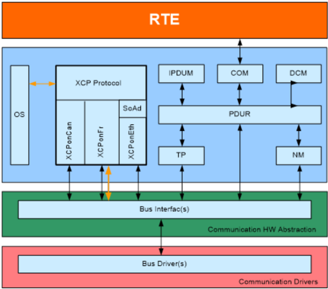

AUTOSAR **XCP** 模块在 FlexRay 和 CAN 的情况下应位于总线特定接口之上。在以太网的情况下，AUTOSAR **XCP** 模块应位于 Socket Adaptor 之上。

对于 XCP 消息的发送和接收，应使用唯一的 PDUID。

AUTOSAR **XCP** 模块应支持 ASAM XCP 规范版本 1.1，但 XCP on CAN 除外——对于 XCP on CAN，应支持 ASAM XCP 规范版本 1.2。

AUTOSAR **XCP** 模块应支持基本特性「同步数据采集（测量）」。请参阅 [\[3\]](#ref-3)。

AUTOSAR **XCP** 模块应根据 [\[3\]](#ref-3) 支持特性「动态 DAQ 配置」。

AUTOSAR **XCP** 模块应根据 [\[3\]](#ref-3) 支持基本特性「同步数据激励」。

AUTOSAR **XCP** 模块应根据 [\[3\]](#ref-3) 支持基本特性「在线内存标定（读/写访问）」。

AUTOSAR **XCP** 模块应根据 [\[3\]](#ref-3) 支持特性「带时间戳的数据传输」。

ECU 本地时间应从 AUTOSAR OS 推导。

AUTOSAR **XCP** 模块应根据 [\[3\]](#ref-3) 支持特性「块通信模式」。

AUTOSAR **XCP** 模块应根据 [\[3\]](#ref-3) 支持特性「旁路（Bypassing）」。

AUTOSAR **XCP** 模块应根据 [\[3\]](#ref-3) 支持特性「Seed &amp; Key」。

为了发送和接收标定数据，应使用 AUTOSAR BSW 总线接口（FlexRay 接口、CAN 接口、**TCP/IP** Socket Adaptor）中规定的发送和接收 API。请参阅第 [7.1](#71-导入的类型)、[7.2](#72-类型定义) 和 [7.3](#73-函数定义) 章（本文第 [6.1](#61-xcp-on-can)、[6.2](#62-xcp-on-flexray) 和 [6.3](#63-xcp-on-ethernet) 章）。

AUTOSAR **XCP** 模块应根据 [\[3\]](#ref-3) 支持特性「页切换」。

**XCP** 模块的代码生成器应基于 **XCP** 的配置生成 A2L IF_DATA 部分。

AUTOSAR **XCP** 模块应根据 [\[3\]](#ref-3) 支持特性「上电数据传输（RESUME MODE）」。

AUTOSAR **XCP** 模块应根据 [\[3\]](#ref-3) 支持 flash 编程（PGM）。

使用可选命令「PROGRAM_RESET」支持指示编程序列的结束，此时从设备将进入断开连接状态，但不强制装置复位。

**XCP** 模块在每次调用 &lt;Lo&gt;_Transmit 之后应等待 Xcp_&lt;Lo&gt;TxConfirmation（肯定或否定），以避免覆盖先前已发送的数据。

AUTOSAR **XCP** 模块应根据 [\[3\]](#ref-3) 支持特性「交错（Interleaved）通信模式」。

### 6.1. XCP on CAN

AUTOSAR **XCP** 模块应根据 [\[6\]](#ref-6) 支持 CAN 通信总线。

通过 CAN 发送和接收 XCP 数据时，必须使用 AUTOSAR CAN 接口提供的发送和接收 API 传输和接收 PDU（根据 [\[7\]](#ref-7)）。

为了通过 CAN 发送和接收 XCP 数据，必须至少配置两个不同的 CAN 标识符供 **XCP** 使用。

性能信息应使用根据 [\[6\]](#ref-6) 的参数在 XCP 主设备和 XCP 从设备之间交换。

**XCP** 模块应根据 [\[6\]](#ref-6) 支持 GET_SLAVE_ID 命令。

### 6.2. XCP on FlexRay

AUTOSAR **XCP** 模块应根据 [\[8\]](#ref-8) 支持 FlexRay 通信总线。

通过 FlexRay 发送和接收 XCP 数据时，必须使用 AUTOSAR FlexRay 接口提供的发送和接收 API 传输和接收 PDU（根据 [\[9\]](#ref-9)）。

所有 XCP on FlexRay LPDU 始终是事件驱动的。请参阅 [\[8\]](#ref-8) 的第 1.1.2 章「FlexRay Frame Type」。

（FlexRay 通信控制器的）**XCP** 用于数据发送和接收的硬件缓冲区独占地分配给 **XCP** 模块。

**注意：**

此限制防止对正在进行的 FlexRay 通信的干扰。

FlexRay 通信控制器硬件缓冲区的使用应根据 [\[8\]](#ref-8) 通过相应的参数进行配置。

AUTOSAR **XCP** 模块使用的 FlexRay PDU 长度应根据 [\[8\]](#ref-8) 使用相应的参数设置。

应路由到 AUTOSAR **XCP** 模块（使用 AUTOSAR 总线接口）的 LPDU_ID 必须由系统设计者定义。

ASAM MCD 2MC 描述文件（即 A2L 文件）描述了特定从设备的 XCP 专用缓冲区可以在多大程度上被配置用于 XCP 通信。

XCP 主设备从 ASAM MCD 2MC 描述文件获取关于 XCP 专用 FlexRay 通信控制器缓冲区的信息。

系统设计者必须考虑在 FlexRay 通信总线上使用多个 XCP 从设备所带来的限制。请参阅 [\[8\]](#ref-8)。

根据对顺序正确性、对齐和净数据吞吐量的要求，可以使用不同的头类型。请参阅 [\[8\]](#ref-8) 的第 1.4.1 章「Header」。

对于 XCP on FlexRay，尾部（Tail）由一个控制字段组成，该字段包含根据 [\[8\]](#ref-8) 的可选 FILL 字节。

AUTOSAR **XCP** 模块应能够根据 [\[8\]](#ref-8) 将多条 XCP 消息打包进一个 FlexRay 帧。

### 6.3. XCP on Ethernet

AUTOSAR **XCP** 模块应根据 [\[10\]](#ref-10) 支持以太网通信总线。

通过以太网发送和接收 XCP 数据时，必须使用 AUTOSAR Socket Adaptor 提供的发送和接收 API 传输和接收 PDU（根据 [\[11\]](#ref-11)）。

通过以太网和 **TCP/IP** 或 **UDP/IP** 连接的 AUTOSAR XCP 从设备通过其 IP 地址和端口号寻址。

AUTOSAR XCP 从设备一次只接受一个连接。

如果在 XCP 已连接状态下套接字被关闭，则从设备将执行 XCP 断开连接，这意味着所有数据采集都将停止。

寻址方案根据 [\[10\]](#ref-10) 定义。

XCP on Ethernet 消息的头和尾必须根据 [\[10\]](#ref-10) 设置。

性能上限取决于主机系统的协议栈。必须设置根据 [\[10\]](#ref-10) 定义的相应参数。

### 6.4. 通用需求

链接时和 post-build 时配置数据应实现为只读数据结构。链接时配置数据应被实现立即引用，post-build 时配置数据的起始地址应在模块初始化期间传递。

**XCP** 模块应支持预编译时、链接时和 post-build 时配置。

### 6.5. 错误分类

错误值和 EventId 按照方案 XCP_E_&lt;NAME&gt; 以大写字母命名，其中 NAME 描述该错误/EventId，并且可以由下划线分隔的多个单词组成。

#### 6.5.1. 开发错误

| 错误类型 | 相关错误代码 | 错误值 |
|---|---|---|
| 模块未初始化 | XCP_E_UNINIT | 0x02 |
| 使用错误的 PDU ID 调用 API | CP_E_INVALID_PDUID | 0x03 |
| XCP 初始化失败 | XCP_E_INIT_FAILED | 0x04 |
| 传递了 NULL 指针作为参数 | XCP_E_PARAM_POINTER | 0x12 |

#### 6.5.2. 运行时错误

没有运行时错误。

#### 6.5.3. 瞬态故障

没有瞬态故障。

#### 6.5.4. 生产错误

没有生产错误。

#### 6.5.5. 扩展生产错误

没有扩展生产错误。

### 6.6. 版本检查

有关详细信息，可参见 SWS_BSWGeneral 中的第 5.1.8 章「Version Check」（版本检查）。

### 6.7. 安全事件

本模块不报告安全事件。

## 7. API规范

### 7.1. 导入的类型

本章列出从下列模块中包含的所有类型。

**Xcp**模块的导入数据类型定义

| 模块 | 头文件 | 导入的类型 |
|---|---|---|
| ComStack_Types | ComStack_Types.h | NetworkHandleType |
| ComStack_Types | ComStack_Types.h | PduIdType |
| ComStack_Types | ComStack_Types.h | PduInfoType |
| ComStack_Types | ComStack_Types.h | PduLengthType |
| Fr | Fr_GeneralTypes.h | Fr_ChannelType |
| Os | Os.h | StatusType |
| Os | Os.h | TickRefType |
| Os | Os.h | TickType |
| Os | Rte_Os_Type.h | CounterType |
| Std | Std_Types.h | Std_ReturnType |
| Std | Std_Types.h | Std_VersionInfoType |

### 7.2. 类型定义

#### 7.2.1. Xcp_ConfigType

结构类型。元素为实现特定（implementation specific）：初始化数据结构的内容是实现特定的。这是包含 **XCP** 初始化数据的数据结构的类型。可通过**Xcp.h**获得。

#### 7.2.2. Xcp_TransmissionModeType

枚举类型。处理传输模式的启用和禁用。可通过**Xcp.h**获得。

* **XCP_TX_OFF**（0x00）：传输被禁用。
* **XCP_TX_ON**（0x01）：传输被启用。

### 7.3. 函数定义

这是提供给上层模块的函数列表。

#### 7.3.1. Xcp_Init

**说明**: 此服务初始化 AUTOSAR XCP 层的接口和变量。可通过**Xcp.h**获得。本服务为同步调用，不可重入。参数 Xcp_ConfigPtr（in）：指向选定配置结构的指针。返回值：void，-。

```C
void Xcp_Init ( const Xcp_ConfigType* Xcp_ConfigPtr )
```

函数 Xcp_Init 应在内部存储配置地址，以使后续的 API 调用能够访问该配置。

#### 7.3.2. Xcp_GetVersionInfo

**说明**: 返回本模块的版本信息。可通过**Xcp.h**获得。本服务为同步调用，可重入。参数 versioninfo（out）：指向存储本模块版本信息的位置的指针。返回值：void，-。

```C
void Xcp_GetVersionInfo ( Std_VersionInfoType* versioninfo )
```

如果 **Xcp** 模块的开发错误检测已启用，则函数 Xcp_GetVersionInfo 应检查参数 VersioninfoPtr 是否为 NULL 指针（NULL_PTR）。如果 VersioninfoPtr 是 NULL 指针，则函数 Xcp_GetVersionInfo 应报告开发错误 [XCP_E_PARAM_POINTER](#651-开发错误) 并返回。

#### 7.3.3. Xcp_SetTransmissionMode

**说明**: 此 API 用于在 **XCP** 模块中开启和关闭所用通信总线通道的 TX 能力。可通过**Xcp.h**获得。本服务为同步调用，不可重入。参数 Channel（in）：所用总线通信的网络通道。参数 Mode（in）：启用或禁用传输模式的参数。返回值：无。

```C
void Xcp_SetTransmissionMode ( NetworkHandleType Channel, Xcp_TransmissionModeType Mode )
```

仅当 XCP_SUPPRESS_TX_SUPPORT（见 [ECUC_Xcp_00169]）等于 TRUE 时，**XCP** 模块才应提供此服务。

如果调用 Xcp_SetTransmissionMode (Channel, Mode) 且参数 Mode 等于 XCP_TX_OFF，则分配给 Channel 的所有 TxPDU 都不应被传输。

**注意：**可以从 &lt;Bus&gt;If 配置和全局 PDU 参数推导出该 PDU 被分配给了哪个特定的通信通道。

如果调用 Xcp_SetTransmissionMode (Channel, Mode) 且参数 Mode 等于 XCP_TX_ON，则分配给 Channel 的所有 TxPDU 都应能够被传输。

### 7.4. 回调通知

这是提供给其他模块的函数列表。

#### 7.4.1. Xcp_&lt;Lo&gt;RxIndication

**说明**: 来自下层通信接口模块的已接收 PDU 的指示。可通过**Xcp.h**获得。本服务为同步调用，对不同的 PduId 可重入，对相同的 PduId 不可重入。参数 RxPduId（in）：所接收 PDU 的 ID。参数 PduInfoPtr（in）：包含所接收 PDU 的长度（SduLength）、指向包含该 PDU 的缓冲区（SduDataPtr）的指针，以及与该 PDU 相关的 MetaData。返回值：无。

```C
void Xcp_<Lo>RxIndication ( PduIdType RxPduId, const PduInfoType* PduInfoPtr )
```

如果开发错误检测已启用（XCP_DEV_ERROR_DETECT 设置为 TRUE）且函数调用由于以下原因失败，则回调函数 Xcp_&lt;Lo&gt;RxIndication 应通知 **DET**：

* Xcp 未初始化（[XCP_E_UNINIT](#651-开发错误)）
* PduInfoPtr 等于 NULL_PTR（[XCP_E_PARAM_POINTER](#651-开发错误)）
* 无效的 PDUID（XCP_E_INVALID_PDUID）

函数 Xcp_&lt;Lo&gt;RxIndication 应由 **Xcp** 模块的环境在中断上下文中调用。

#### 7.4.2. Xcp_&lt;Lo&gt;TxConfirmation

**说明**: 下层通信接口模块确认一个 PDU 的传输，或传输失败。可通过**Xcp.h**获得。本服务为同步调用，对不同的 PduId 可重入，对相同的 PduId 不可重入。参数 TxPduId（in）：已传输 PDU 的 ID。参数 result（in）：E_OK：PDU 已发送；E_NOT_OK：PDU 发送失败。返回值：无。

```C
void Xcp_<Lo>TxConfirmation ( PduIdType TxPduId, Std_ReturnType result )
```

**注意：**

回调函数 Xcp_&lt;Lo&gt;TxConfirmation 由总线接口、以太网 Socket Adaptor 或 **CDD** 调用，并由 **Xcp** 模块实现。

如果 **XCP** 模块的开发错误检测已启用：如果在 XCP 成功初始化之前调用了函数 Xcp_&lt;Lo&gt;TxConfirmation，则函数 Xcp_&lt;Lo&gt;TxConfirmation 应报告开发错误 [XCP_E_UNINIT](#651-开发错误) 并返回。

Xcp_&lt;Lo&gt;TxConfirmation 的注意事项：

* 调用上下文要么在中断级（中断模式），要么在任务级
* **Xcp** 模块已被正确初始化。

#### 7.4.3. Xcp_&lt;Lo&gt;TriggerTransmit

**说明**: 在此 API 内，上层模块（被调用模块）应检查可用数据是否适合 PduInfoPtr->SduLength 报告的缓冲区大小。如果适合，则应将其数据复制到 PduInfoPtr->SduDataPtr 提供的缓冲区中，并更新 PduInfoPtr->SduLength 中实际复制数据的长度。如果不适合，则返回 E_NOT_OK 且不更改 PduInfoPtr。可通过**Xcp.h**获得。本服务为同步调用，对不同的 PduId 可重入，对相同的 PduId 不可重入。参数 TxPduId（in）：请求传输的 SDU 的 ID。参数 PduInfoPtr（inout）：包含指向缓冲区的指针（SduDataPtr，SDU 数据应复制到该缓冲区）以及 SduLength 中的可用缓冲区大小。返回时，本服务将在 SduLength 中指示已复制的 SDU 数据的长度。返回值：Std_ReturnType，E_OK：SDU 已被复制，SduLength 指示已复制的字节数；E_NOT_OK：没有复制任何 SDU 数据，不得使用 PduInfoPtr，因为它可能包含 NULL 指针或指向无效数据。

```C
Std_ReturnType Xcp_<Lo>TriggerTransmit ( PduIdType TxPduId, PduInfoType* PduInfoPtr )
```

**注意：**

回调函数 Xcp_&lt;Lo&gt;TriggerTransmit 由总线接口、以太网 Socket Adaptor 或 **CDD** 调用，并由 **Xcp** 模块实现。

如果 **XCP** 模块的开发错误检测已启用：如果在 XCP 成功初始化之前调用了函数 Xcp_&lt;Lo&gt;TriggerTransmit，则函数 Xcp_&lt;Lo&gt;TriggerTransmit 应报告开发错误 [XCP_E_UNINIT](#651-开发错误) 并返回 E_NOT_OK。

Xcp_&lt;Lo&gt;TriggerTransmit 的注意事项：

* 调用上下文要么在中断级（中断模式），要么在任务级
* **Xcp** 模块已被正确初始化。

### 7.5. 调度函数

这些函数由基础软件调度器直接调用。以下函数应没有返回值且没有参数。所有函数应不可重入。

#### 7.5.1. Xcp_MainFunction

**说明**: **XCP** 模块的调度函数。可通过**SchM_Xcp.h**获得。服务 ID 0x04。

```C
void Xcp_MainFunction ( void )
```

XCP 主函数应被周期性地调用。

### 7.6. 期望接口

本章列出需要从其他模块获得的所有接口。

#### 7.6.1. 强制接口

**Xcp**没有强制接口。

#### 7.6.2. 可选接口

**Xcp**模块中的可选接口定义

| API 函数 | 头文件 | 描述 |
|---|---|---|
| CanIf_Transmit | CanIf.h | 请求传输一个 PDU。 |
| Det_ReportError | Det.h | 报告开发错误的服务。 |
| FrIf_DisableLPdu | FrIf.h | 封装 FlexRay 驱动函数 Fr_DisableLPdu。它禁用一个 LPdu 用于发送/接收的硬件资源。 |
| FrIf_ReconfigLPdu | FrIf.h | 调用 FlexRay 驱动的 API Fr_ReconfigLPdu。枚举值「FR_CHANNEL_AB」不得使用。 |
| FrIf_Transmit | FrIf.h | 请求传输一个 PDU。 |
| GetCounterValue | Os.h | 此服务读取计数器的当前计数值（如果计数器由硬件驱动，则返回硬件定时器 tick；如果用户驱动计数器，则返回软件 tick）。 |
| GetElapsedValue | Os.h | 此服务获取当前 tick 值与先前读取的 tick 值之间的 tick 数。 |
| SoAd_IfTransmit | SoAd.h | 请求传输一个 PDU。 |

#### 7.6.3. 可配置接口

在本章中，列出了目标函数可以被配置的所有接口。目标函数通常是回调函数。这类接口的名称不是固定的，因为它们是可配置的。

**XCP** 模块提供供复杂驱动（Complex Driver）使用的可配置接口。

## 8. 时序图

### 8.1. XCP on FlexRay

#### 8.1.1. Xcp on FlexRay 发送

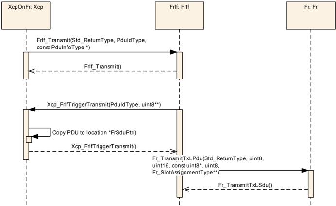

#### 8.1.2. Xcp on FlexRay 接收指示

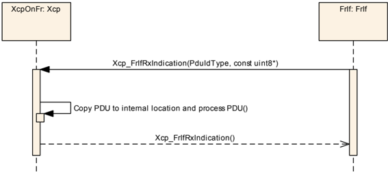

### 8.2. XCP on CAN

#### 8.2.1. Xcp on CAN 发送

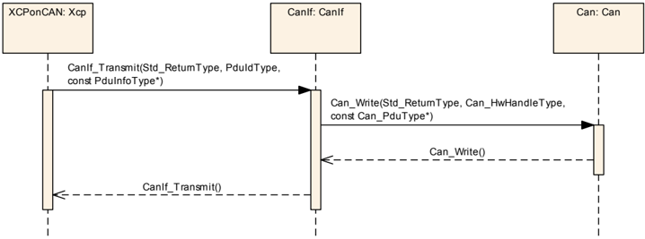

#### 8.2.2. Xcp on CAN 发送确认

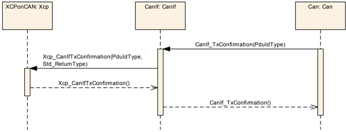

#### 8.2.3. Xcp on CAN 接收指示

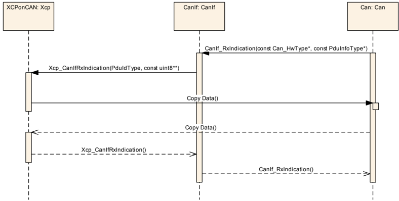

### 8.3. XCP on Ethernet

#### 8.3.1. Xcp on Ethernet 接收指示

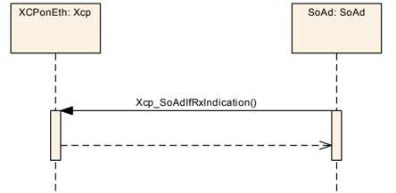

## 9. 配置规范

总体而言，本章定义配置参数及其到**容器**（container）的聚类组织。为支持本规范，第 9.1 章描述基础知识，并规定了应用于参数规范的模板（表）。我们有意将这些内容保留在规范中以保证可理解性。

第 9.2 章规定模块 **XCP** 的结构（容器）和参数。

第 9.3 章规定模块 **XCP** 的发布信息。

有关详细信息，可参见 [\[2\]](#ref-2) 中的第 10.1 章「Introduction to configuration specification」（配置规范简介）。

### 9.1. 容器与配置参数

以下各节汇总所有配置参数。各参数的详细含义见第 6 章和第 7 章。

所列配置项可以从基于 EcuConfigurationTemplate 的网络描述数据库推导。配置工具应提取配置 **XCP** 所需的全部信息。

配置工具必须在配置时检查配置的一致性。

应在配置期间尽可能执行用于合理性检查（plausibility check）的配置规则和约束。

FlexRay 接口与 FlexRay 驱动配置之间的这些依赖关系必须在配置时由配置工具提供。

#### 9.1.1. Xcp

| SWS 条目 | [ECUC_Xcp_00182] |
|---|---|
| 模块名称 | Xcp |
| 描述 | XCP 模块的配置。 |
| Post-Build 变体支持 | true |
| 支持的配置变体 | VARIANT-POST-BUILD, VARIANT-PRE-COMPILE |

| 容器名称 | 多重性 | 作用域/依赖 |
|---|---|---|
| XcpConfig | 1 | 该容器包含 AUTOSAR **Xcp** 模块的配置参数和子容器。 |
| XcpGeneral | 1 | 该容器包含 **XCP** 的通用配置参数。 |

#### 9.1.2. XcpGeneral

| SWS 条目 | [ECUC_Xcp_00001] |
|---|---|
| 容器名称 | XcpGeneral |
| 父容器 | Xcp |
| 描述 | 该容器包含 **XCP** 的通用配置参数。 |
| 配置参数 | 见下方参数表 |

| SWS 条目 | [ECUC_Xcp_00164] |
|---|---|
| 参数名称 | XcpDaqConfigType |
| 父容器 | XcpGeneral |
| 描述 | 将 DAQ_PROPERTIES 参数内的 DAQ_CONFIG_TYPE 位设置为「static」或「dynamic」。如果选择 DAQ_STATIC，则 DAQ_CONFIG_TYPE 位设置为「0」。如果选择 DAQ_DYNAMIC，则 DAQ_CONFIG_TYPE 位设置为「1」。 |
| 多重性 | 1 |
| 类型 | EcucEnumerationParamDef |
| 范围 | DAQ_DYNAMIC：如果选择 DAQ_DYNAMIC，则 DAQ_CONFIG_TYPE 位设置为「1」。DAQ_STATIC：如果选择 DAQ_STATIC，则 DAQ_CONFIG_TYPE 位设置为「0」。 |
| Post-Build 变体值 | false |
| 值配置类 | Pre-compile time：x（All Variants）；Link time：-；Post-build time：- |
| 作用域/依赖 | scope: ECU；依赖：如果 DAQ_CONFIG_TYPE = dynamic，则 MAX_DAQ 等于 MIN_DAQ+DAQ_ |

| SWS 条目 | [ECUC_Xcp_00012] |
|---|---|
| 参数名称 | XcpDaqCount |
| 父容器 | XcpGeneral |
| 描述 | 指示用于动态配置的 DAQ 列表的数量。 |
| 多重性 | 1 |
| 类型 | EcucIntegerParamDef |
| 范围 | 0 .. 65535 |
| 默认值 | - |
| Post-Build 变体值 | false |
| 值配置类 | Pre-compile time：x（VARIANT-PRE-COMPILE）；Link time：-；Post-build time：- |
| 作用域/依赖 | scope: ECU；依赖：仅当 XcpDaqConfigType 设置为「1」即 DAQ_DYNAMIC 时，此参数才可用 |

| SWS 条目 | [ECUC_Xcp_00003] |
|---|---|
| 参数名称 | XcpDevErrorDetect |
| 父容器 | XcpGeneral |
| 描述 | 开启或关闭开发错误检测与通知（true：启用检测与通知；false：禁用检测与通知）。 |
| 多重性 | 1 |
| 类型 | EcucBooleanParamDef |
| 默认值 | false |
| Post-Build 变体值 | false |
| 值配置类 | Pre-compile time：x（All Variants）；Link time：-；Post-build time：- |
| 作用域/依赖 | scope: local |

| SWS 条目 | [ECUC_Xcp_00181] |
|---|---|
| 参数名称 | XcpFlashProgrammingEnabled |
| 父容器 | XcpGeneral |
| 描述 | 启用 XCP Flash 编程功能。 |
| 多重性 | 1 |
| 类型 | EcucBooleanParamDef |
| 默认值 | - |
| Post-Build 变体值 | false |
| 值配置类 | Pre-compile time：x（All Variants）；Link time：-；Post-build time：- |
| 作用域/依赖 | scope: local |

| SWS 条目 | [ECUC_Xcp_00170] |
|---|---|
| 参数名称 | XcpIdentificationFieldType |
| 父容器 | XcpGeneral |
| 描述 | 从设备在向主设备传输 DAQ 包时使用的标识字段（Identification Field）类型。主设备在向从设备传输 STIM 包时必须使用相同的标识字段类型。 |
| 多重性 | 1 |
| 类型 | EcucEnumerationParamDef |
| 范围 | ABSOLUTE：绝对 ODT 编号。RELATIVE_BYTE：相对 ODT 编号，绝对 DAQ 列表编号（BYTE）。RELATIVE_WORD：相对 ODT 编号，绝对 DAQ 列表编号（WORD）。RELATIVE_WORD_ALIGNED：相对 ODT 编号，绝对 DAQ 列表编号（WORD，对齐）。 |
| Post-Build 变体值 | false |
| 值配置类 | Pre-compile time：x（All Variants）；Link time：-；Post-build time：- |
| 作用域/依赖 | scope: local |

| SWS 条目 | [ECUC_Xcp_00014] |
|---|---|
| 参数名称 | XcpMainFunctionPeriod |
| 父容器 | XcpGeneral |
| 描述 | **XCP** 不需要此信息，但调用主函数的 BSW 调度器需要它来规划其任务。 |
| 多重性 | 1 |
| 类型 | EcucFloatParamDef |
| 范围 | ]0 .. INF[ |
| 默认值 | - |
| Post-Build 变体值 | false |
| 值配置类 | Pre-compile time：x（All Variants）；Link time：-；Post-build time：- |
| 作用域/依赖 | scope: local |

| SWS 条目 | [ECUC_Xcp_00004] |
|---|---|
| 参数名称 | XcpMaxCto |
| 父容器 | XcpGeneral |
| 描述 | MAX_CTO 表示一个 CTO 包的最大长度（字节）。 |
| 多重性 | 1 |
| 类型 | EcucIntegerParamDef |
| 范围 | 8 .. 255 |
| 默认值 | - |
| Post-Build 变体值 | false |
| 值配置类 | Pre-compile time：x（All Variants）；Link time：-；Post-build time：- |
| 作用域/依赖 | scope: local |

| SWS 条目 | [ECUC_Xcp_00005] |
|---|---|
| 参数名称 | XcpMaxDto |
| 父容器 | XcpGeneral |
| 描述 | MAX_DTO 表示一个 DTO 包的最大长度（字节）。 |
| 多重性 | 1 |
| 类型 | EcucIntegerParamDef |
| 范围 | 8 .. 65535 |
| 默认值 | - |
| Post-Build 变体值 | false |
| 值配置类 | Pre-compile time：x（All Variants）；Link time：-；Post-build time：- |
| 作用域/依赖 | scope: local |

| SWS 条目 | [ECUC_Xcp_00011] |
|---|---|
| 参数名称 | XcpMaxEventChannel |
| 父容器 | XcpGeneral |
| 描述 | - |
| 多重性 | 1 |
| 类型 | EcucIntegerParamDef |
| 范围 | 0 .. 65535 |
| 默认值 | - |
| Post-Build 变体值 | false |
| 值配置类 | Pre-compile time：x（All Variants）；Link time：-；Post-build time：- |
| 作用域/依赖 | scope: ECU |

| SWS 条目 | [ECUC_Xcp_00013] |
|---|---|
| 参数名称 | XcpMinDaq |
| 父容器 | XcpGeneral |
| 描述 | 指示 XCP 从设备上预定义的、只读 DAQ 列表的数量。 |
| 多重性 | 1 |
| 类型 | EcucIntegerParamDef |
| 范围 | 0 .. 255 |
| 默认值 | - |
| Post-Build 变体值 | false |
| 值配置类 | Pre-compile time：x（All Variants）；Link time：-；Post-build time：- |
| 作用域/依赖 | scope: ECU |

| SWS 条目 | [ECUC_Xcp_00054] |
|---|---|
| 参数名称 | XcpOdtCount |
| 父容器 | XcpGeneral |
| 描述 | 此参数指示使用动态 DAQ 列表配置时一个 DAQ 列表的 ODT 数量。 |
| 多重性 | 1 |
| 类型 | EcucIntegerParamDef |
| 范围 | 0 .. 252 |
| 默认值 | - |
| Post-Build 变体值 | false |
| 值配置类 | Pre-compile time：x（All Variants）；Link time：-；Post-build time：- |
| 作用域/依赖 | scope: ECU；依赖：仅当 XcpDaqConfigType 设置为「1」即 DAQ_DYNAMIC 时，此参数才可用 |

| SWS 条目 | [ECUC_Xcp_00059] |
|---|---|
| 参数名称 | XcpOdtEntriesCount |
| 父容器 | XcpGeneral |
| 描述 | 指示使用动态 DAQ 列表配置时一个 ODT 的条目数量。 |
| 多重性 | 1 |
| 类型 | EcucIntegerParamDef |
| 范围 | 0 .. 255 |
| 默认值 | - |
| Post-Build 变体值 | false |
| 值配置类 | Pre-compile time：x（All Variants）；Link time：-；Post-build time：- |
| 作用域/依赖 | scope: ECU；依赖：仅当 XcpDaqConfigType 设置为「1」即 DAQ_DYNAMIC 时，此参数才可用 |

| SWS 条目 | [ECUC_Xcp_00177] |
|---|---|
| 参数名称 | XcpOdtEntrySizeDaq |
| 父容器 | XcpGeneral |
| 描述 | 指示 DAQ 的 ODT 条目所描述元素的大小（针对 DaqListType）。 |
| 多重性 | 1 |
| 类型 | EcucIntegerParamDef |
| 范围 | 0 .. 255 |
| 默认值 | - |
| Post-Build 变体值 | false |
| 值配置类 | Pre-compile time：x（All Variants）；Link time：-；Post-build time：- |
| 作用域/依赖 | scope: ECU |

| SWS 条目 | [ECUC_Xcp_00178] |
|---|---|
| 参数名称 | XcpOdtEntrySizeStim |
| 父容器 | XcpGeneral |
| 描述 | 指示 STIM 的 ODT 条目所描述元素的大小（针对 DaqListType）。 |
| 多重性 | 1 |
| 类型 | EcucIntegerParamDef |
| 范围 | 0 .. 255 |
| 默认值 | - |
| Post-Build 变体值 | false |
| 值配置类 | Pre-compile time：x（All Variants）；Link time：-；Post-build time：- |
| 作用域/依赖 | scope: ECU |

| SWS 条目 | [ECUC_Xcp_00006] |
|---|---|
| 参数名称 | XcpOnCanEnabled |
| 父容器 | XcpGeneral |
| 描述 | 启用 XCPonCAN 功能。 |
| 多重性 | 1 |
| 类型 | EcucBooleanParamDef |
| 默认值 | - |
| Post-Build 变体值 | false |
| 值配置类 | Pre-compile time：x（All Variants）；Link time：-；Post-build time：- |
| 作用域/依赖 | scope: local |

| SWS 条目 | [ECUC_Xcp_00009] |
|---|---|
| 参数名称 | XcpOnCddEnabled |
| 父容器 | XcpGeneral |
| 描述 | 启用 XCPonCdd 功能。 |
| 多重性 | 1 |
| 类型 | EcucBooleanParamDef |
| 默认值 | - |
| Post-Build 变体值 | false |
| 值配置类 | Pre-compile time：x（All Variants）；Link time：-；Post-build time：- |
| 作用域/依赖 | scope: local |

| SWS 条目 | [ECUC_Xcp_00008] |
|---|---|
| 参数名称 | XcpOnEthernetEnabled |
| 父容器 | XcpGeneral |
| 描述 | 启用 XCPonEthernet 功能。 |
| 多重性 | 1 |
| 类型 | EcucBooleanParamDef |
| 默认值 | - |
| Post-Build 变体值 | false |
| 值配置类 | Pre-compile time：x（All Variants）；Link time：-；Post-build time：- |
| 作用域/依赖 | scope: local |

| SWS 条目 | [ECUC_Xcp_00007] |
|---|---|
| 参数名称 | XcpOnFlexRayEnabled |
| 父容器 | XcpGeneral |
| 描述 | 启用 XCPonFlexRay 功能。 |
| 多重性 | 1 |
| 类型 | EcucBooleanParamDef |
| 默认值 | - |
| Post-Build 变体值 | false |
| 值配置类 | Pre-compile time：x（All Variants）；Link time：-；Post-build time：- |
| 作用域/依赖 | scope: local |

| SWS 条目 | [ECUC_Xcp_00169] |
|---|---|
| 参数名称 | XcpPrescalerSupported |
| 父容器 | XcpGeneral |
| 描述 | 此参数启用和禁用预分频器（Prescaler）支持。True 为启用，False 为禁用。 |
| 多重性 | 1 |
| 类型 | EcucBooleanParamDef |
| 默认值 | - |
| Post-Build 变体值 | false |
| 值配置类 | Pre-compile time：x（All Variants）；Link time：-；Post-build time：- |
| 作用域/依赖 | scope: local |

| SWS 条目 | [ECUC_Xcp_00176] |
|---|---|
| 参数名称 | XcpSuppressTxSupport |
| 父容器 | XcpGeneral |
| 描述 | 开启或关闭按通信通道抑制 PDU 传输的支持。TRUE：支持抑制 TxPDU；FALSE：不支持抑制 TxPDU。 |
| 多重性 | 1 |
| 类型 | EcucBooleanParamDef |
| 默认值 | - |
| Post-Build 变体值 | false |
| 值配置类 | Pre-compile time：x（All Variants）；Link time：-；Post-build time：- |
| 作用域/依赖 | scope: local |

| SWS 条目 | [ECUC_Xcp_00167] |
|---|---|
| 参数名称 | XcpTimestampTicks |
| 父容器 | XcpGeneral |
| 描述 | 此参数定义时间戳按 TIMESTAMP_TICKS 每单位递增并在发生溢出时回绕。 |
| 多重性 | 1 |
| 类型 | EcucIntegerParamDef |
| 范围 | 0 .. 65535 |
| 默认值 | - |
| Post-Build 变体值 | false |
| 值配置类 | Pre-compile time：x（All Variants）；Link time：-；Post-build time：- |
| 作用域/依赖 | scope: local |

| SWS 条目 | [ECUC_Xcp_00166] |
|---|---|
| 参数名称 | XcpTimestampType |
| 父容器 | XcpGeneral |
| 描述 | 此参数指示时间戳字段使用的字节数。如果选择 NO_TIME_STAMP，则时间戳字段不可用。 |
| 多重性 | 1 |
| 类型 | EcucEnumerationParamDef |
| 范围 | FOUR_BYTE：时间戳字段的大小为四个字节。NO_TIME_STAMP：时间戳字段不可用。ONE_BYTE：时间戳字段的大小为一个字节。TWO_BYTE：时间戳字段的大小为两个字节。 |
| Post-Build 变体值 | false |
| 值配置类 | Pre-compile time：x（All Variants）；Link time：-；Post-build time：- |
| 作用域/依赖 | scope: local |

| SWS 条目 | [ECUC_Xcp_00168] |
|---|---|
| 参数名称 | XcpTimestampUnit |
| 父容器 | XcpGeneral |
| 描述 | 此参数指示从设备向主设备传输数据时数据采集时钟的分辨率。 |
| 多重性 | 1 |
| 类型 | EcucEnumerationParamDef |
| 范围 | TIMESTAMP_UNIT_100MS：单位为 100 毫秒。TIMESTAMP_UNIT_100NS：单位为 100 纳秒。TIMESTAMP_UNIT_100PS：单位为 100 皮秒。TIMESTAMP_UNIT_100US：单位为 100 微秒。TIMESTAMP_UNIT_10MS：单位为 10 毫秒。TIMESTAMP_UNIT_10NS：单位为 10 纳秒。TIMESTAMP_UNIT_10PS：单位为 10 皮秒。TIMESTAMP_UNIT_10US：单位为 10 微秒。TIMESTAMP_UNIT_1MS：单位为 1 毫秒。TIMESTAMP_UNIT_1NS：单位为 1 纳秒。TIMESTAMP_UNIT_1PS：单位为 1 皮秒。TIMESTAMP_UNIT_1S：单位为 1 秒。TIMESTAMP_UNIT_1US：单位为 1 微秒。 |
| Post-Build 变体值 | false |
| 值配置类 | Pre-compile time：x（All Variants）；Link time：-；Post-build time：- |
| 作用域/依赖 | scope: local |

| SWS 条目 | [ECUC_Xcp_00002] |
|---|---|
| 参数名称 | XcpVersionInfoApi |
| 父容器 | XcpGeneral |
| 描述 | 启用/禁用 XCP_GetVersionInfo() API 服务的存在。TRUE：XCP_GetVersionInfo() API 服务存在；FALSE：XCP_GetVersionInfo() API 服务不存在。 |
| 多重性 | 1 |
| 类型 | EcucBooleanParamDef |
| 默认值 | false |
| Post-Build 变体值 | false |
| 值配置类 | Pre-compile time：x（All Variants）；Link time：-；Post-build time：- |
| 作用域/依赖 | scope: local |

| SWS 条目 | [ECUC_Xcp_00162] |
|---|---|
| 参数名称 | XcpCounterRef |
| 父容器 | XcpGeneral |
| 描述 | 此参数包含对 **XCP** 使用的计数器的引用。 |
| 多重性 | 1 |
| 类型 | 对 OsCounter 的引用 |
| Post-Build 变体值 | false |
| 值配置类 | Pre-compile time：x（All Variants）；Link time：-；Post-build time：- |
| 作用域/依赖 | scope: local |

| SWS 条目 | [ECUC_Xcp_00180] |
|---|---|
| 参数名称 | XcpNvRamBlockIdRef |
| 父容器 | XcpGeneral |
| 描述 | 此引用包含指向特性「RESUME MODE」中使用的非易失性存储块的链接，因此该信息必须非易失地存储，以便在 ECU 启动后立即可用。 |
| 多重性 | 0..1 |
| 类型 | 对 NvMBlockDescriptor 的符号名引用 |
| Post-Build 变体多重性 | true |
| Post-Build 变体值 | true |
| 多重性配置类 | Pre-compile time：x（VARIANT-PRE-COMPILE）；Link time：-；Post-build time：x（VARIANT-POST-BUILD） |
| 值配置类 | Pre-compile time：x（VARIANT-PRE-COMPILE）；Link time：-；Post-build time：x（VARIANT-POST-BUILD） |
| 作用域/依赖 | scope: local |

无包含的容器。

#### 9.1.3. XcpConfig

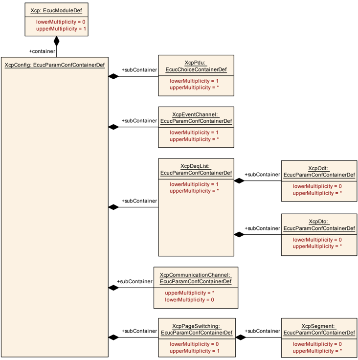

| SWS 条目 | [ECUC_Xcp_00020] |
|---|---|
| 容器名称 | XcpConfig |
| 父容器 | Xcp |
| 描述 | 该容器包含 AUTOSAR **Xcp** 模块的配置参数和子容器。 |
| 配置参数 | 见下方参数表 |

| 容器名称 | 多重性 | 作用域/依赖 |
|---|---|---|
| XcpCommunicationChannel | 0..* | 该容器表示 **XCP** 通信通道的配置。 |
| XcpDaqList | 1..* | 该容器包含 DAQ 的配置。 |
| XcpEventChannel | 1..* | 该容器包含 XCP 从设备上事件通道的配置。 |
| XcpPageSwitching | 0..1 | 该容器表示页切换特性的配置。 |
| XcpPdu | 1..* | 包含 PDU 信息。PDU 可以是发送 PDU 或接收 PDU。 |

#### 9.1.4. XcpDaqList

| SWS 条目 | [ECUC_Xcp_00050] |
|---|---|
| 容器名称 | XcpDaqList |
| 父容器 | XcpConfig |
| 描述 | 该容器包含 DAQ 的配置。 |
| 配置参数 | 见下方参数表 |

| SWS 条目 | [ECUC_Xcp_00051] |
|---|---|
| 参数名称 | XcpDaqListNumber |
| 父容器 | XcpDaqList |
| 描述 | DAQ 列表的索引编号。 |
| 多重性 | 1 |
| 类型 | EcucIntegerParamDef（为此参数生成符号名） |
| 范围 | 0 .. 65534 |
| 默认值 | - |
| Post-Build 变体值 | false |
| 值配置类 | Pre-compile time：x（All Variants）；Link time：-；Post-build time：- |
| 作用域/依赖 | scope: ECU |

| SWS 条目 | [ECUC_Xcp_00052] |
|---|---|
| 参数名称 | XcpDaqListType |
| 父容器 | XcpDaqList |
| 描述 | 这指示该 DAQ 列表表示 DAQ 还是 STIM。 |
| 多重性 | 1 |
| 类型 | EcucEnumerationParamDef |
| 范围 | DAQ：该 DAQ 列表是一个 DAQ。DAQ_STIM：该 DAQ 列表可以是 DAQ 或 STIM。STIM：该 DAQ 列表是一个 STIM。 |
| Post-Build 变体值 | false |
| 值配置类 | Pre-compile time：x（All Variants）；Link time：-；Post-build time：- |
| 作用域/依赖 | scope: ECU |

| SWS 条目 | [ECUC_Xcp_00053] |
|---|---|
| 参数名称 | XcpMaxOdt |
| 父容器 | XcpDaqList |
| 描述 | MAX_ODT 指示此 DAQ 列表（STATIC 配置）中 ODT 的最大数量。 |
| 多重性 | 1 |
| 类型 | EcucIntegerParamDef |
| 范围 | 0 .. 252 |
| 默认值 | - |
| Post-Build 变体值 | false |
| 值配置类 | Pre-compile time：x（All Variants）；Link time：-；Post-build time：- |
| 作用域/依赖 | scope: ECU；依赖：仅当 XcpDaqConfigType 为「DAQ_STATIC」（位设置为「0」）时可用 |

| SWS 条目 | [ECUC_Xcp_00058] |
|---|---|
| 参数名称 | XcpMaxOdtEntries |
| 父容器 | XcpDaqList |
| 描述 | 此参数指示此 DAQ 列表（STATIC 配置）的一个 ODT 中条目的最大数量。 |
| 多重性 | 1 |
| 类型 | EcucIntegerParamDef |
| 范围 | 0 .. 255 |
| 默认值 | - |
| Post-Build 变体值 | false |
| 值配置类 | Pre-compile time：x（All Variants）；Link time：-；Post-build time：- |
| 作用域/依赖 | scope: ECU；依赖：仅当 XcpDaqConfigType 为「DAQ_STATIC」（位设置为「0」）时可用 |

| 容器名称 | 多重性 | 作用域/依赖 |
|---|---|---|
| XcpDto | 0..* | 该容器为 DAQ 列表收集数据传输对象特定的参数。 |
| XcpOdt | 0..* | 该容器包含 DAQ 列表的 ODT 特定参数。 |

#### 9.1.5. XcpDto

| SWS 条目 | [ECUC_Xcp_00065] |
|---|---|
| 容器名称 | XcpDto |
| 父容器 | XcpDaqList |
| 描述 | 该容器为 DAQ 列表收集数据传输对象特定的参数。 |
| 配置参数 | 见下方参数表 |

| SWS 条目 | [ECUC_Xcp_00066] |
|---|---|
| 参数名称 | XcpDtoPid |
| 父容器 | XcpDto |
| 描述 | DTO 的包标识符（PID），它通过 DTO 的内容标识 ODT。 |
| 多重性 | 1 |
| 类型 | EcucIntegerParamDef（为此参数生成符号名） |
| 范围 | 0 .. 251 |
| 默认值 | - |
| Post-Build 变体值 | false |
| 值配置类 | Pre-compile time：x（All Variants）；Link time：-；Post-build time：- |
| 作用域/依赖 | scope: ECU |

| SWS 条目 | [ECUC_Xcp_00067] |
|---|---|
| 参数名称 | XcpDto2PduMapping |
| 父容器 | XcpDto |
| 描述 | 此引用指定 DTO 到下层接口（CanIf、FrIf、SoAd 和 Cdd）PDU 的映射。仅当 DaqListType 为 DAQ_STIM 时，对 XcpRxPdu 的引用才是可行的。仅当 DaqListType 为 DAQ 时，对 XcpTxPdu 的引用才是可行的。 |
| 多重性 | 1 |
| 类型 | 对 [XcpRxPdu, XcpTxPdu] 的选择引用（Choice reference） |
| Post-Build 变体值 | false |
| 值配置类 | Pre-compile time：x（All Variants）；Link time：-；Post-build time：- |
| 作用域/依赖 | scope: ECU |

无包含的容器。

#### 9.1.6. XcpOdt

| SWS 条目 | [ECUC_Xcp_00055] |
|---|---|
| 容器名称 | XcpOdt |
| 父容器 | XcpDaqList |
| 描述 | 该容器包含 DAQ 列表的 ODT 特定参数。 |
| 配置参数 | 见下方参数表 |

| SWS 条目 | [ECUC_Xcp_00060] |
|---|---|
| 参数名称 | XcpOdtEntryMaxSize |
| 父容器 | XcpOdt |
| 描述 | 此参数指示 ODT 条目所描述元素大小的上限。根据该 ODT 所属的 DaqListType，它描述 DAQ（MAX_ODT_ENTRY_SIZE_DAQ）或 STIM（MAX_ODT_ENTRY_SIZE_STIM）的限制。 |
| 多重性 | 1 |
| 类型 | EcucIntegerParamDef |
| 范围 | 0 .. 254 |
| 默认值 | - |
| Post-Build 变体值 | false |
| 值配置类 | Pre-compile time：x（All Variants）；Link time：-；Post-build time：- |
| 作用域/依赖 | scope: ECU |

| SWS 条目 | [ECUC_Xcp_00057] |
|---|---|
| 参数名称 | XcpOdtNumber |
| 父容器 | XcpOdt |
| 描述 | 此 ODT 在 DAQ 列表内的索引编号。 |
| 多重性 | 0..1 |
| 类型 | EcucIntegerParamDef（为此参数生成符号名） |
| 范围 | 0 .. 251 |
| 默认值 | - |
| Post-Build 变体多重性 | false |
| Post-Build 变体值 | false |
| 多重性配置类 | Pre-compile time：x（All Variants）；Link time：-；Post-build time：- |
| 值配置类 | Pre-compile time：x（All Variants）；Link time：-；Post-build time：- |
| 作用域/依赖 | scope: ECU |

| SWS 条目 | [ECUC_Xcp_00056] |
|---|---|
| 参数名称 | XcpOdt2DtoMapping |
| 父容器 | XcpOdt |
| 描述 | 此引用将该 ODT 映射到其将被传输到的相应 DTO。 |
| 多重性 | 0..1 |
| 类型 | 对 XcpDto 的引用 |
| Post-Build 变体值 | false |
| 值配置类 | Pre-compile time：x（All Variants）；Link time：-；Post-build time：- |
| 作用域/依赖 | scope: ECU |

| 容器名称 | 多重性 | 作用域/依赖 |
|---|---|---|
| XcpOdtEntry | 1..* | 该容器收集构成一个 ODT 条目的所有配置参数。 |

#### 9.1.7. XcpOdtEntry

| SWS 条目 | [ECUC_Xcp_00061] |
|---|---|
| 容器名称 | XcpOdtEntry |
| 父容器 | XcpOdt |
| 描述 | 该容器收集构成一个 ODT 条目的所有配置参数。 |
| 配置参数 | 见下方参数表 |

| SWS 条目 | [ECUC_Xcp_00063] |
|---|---|
| 参数名称 | XcpOdtEntryAddress |
| 父容器 | XcpOdtEntry |
| 描述 | ODT 条目所引用的内存地址。 |
| 多重性 | 0..1 |
| 类型 | EcucLinkerSymbolDef |
| 默认值 | - |
| maxLength | - |
| minLength | - |
| 正则表达式 | - |
| Post-Build 变体多重性 | false |
| Post-Build 变体值 | false |
| 多重性配置类 | Pre-compile time：x；Link time：-；Post-build time：- |
| 值配置类 | Pre-compile time：x；Link time：-；Post-build time：- |
| 作用域/依赖 | scope: ECU |

| SWS 条目 | [ECUC_Xcp_00179] |
|---|---|
| 参数名称 | XcpOdtEntryBitOffset |
| 父容器 | XcpOdtEntry |
| 描述 | 当该元素表示状态位时，表示位偏移量。 |
| 多重性 | 0..1 |
| 类型 | EcucIntegerParamDef |
| 范围 | 0 .. 31 |
| 默认值 | - |
| Post-Build 变体多重性 | false |
| Post-Build 变体值 | false |
| 多重性配置类 | Pre-compile time：x；Link time：-；Post-build time：- |
| 值配置类 | Pre-compile time：x；Link time：-；Post-build time：- |
| 作用域/依赖 | scope: ECU |

| SWS 条目 | [ECUC_Xcp_00064] |
|---|---|
| 参数名称 | XcpOdtEntryLength |
| 父容器 | XcpOdtEntry |
| 描述 | 长度。 |
| 多重性 | 0..1 |
| 类型 | EcucIntegerParamDef |
| 范围 | 0 .. 255 |
| 默认值 | - |
| Post-Build 变体多重性 | false |
| Post-Build 变体值 | false |
| 多重性配置类 | Pre-compile time：x（All Variants）；Link time：-；Post-build time：- |
| 值配置类 | Pre-compile time：x（All Variants）；Link time：-；Post-build time：- |
| 作用域/依赖 | scope: ECU |

| SWS 条目 | [ECUC_Xcp_00062] |
|---|---|
| 参数名称 | XcpOdtEntryNumber |
| 父容器 | XcpOdtEntry |
| 描述 | ODT 条目的索引编号。 |
| 多重性 | 0..1 |
| 类型 | EcucIntegerParamDef |
| 范围 | 0 .. 254 |
| 默认值 | - |
| Post-Build 变体多重性 | false |
| Post-Build 变体值 | false |
| 多重性配置类 | Pre-compile time：x；Link time：-；Post-build time：- |
| 值配置类 | Pre-compile time：x；Link time：-；Post-build time：- |
| 作用域/依赖 | scope: ECU |

无包含的容器。

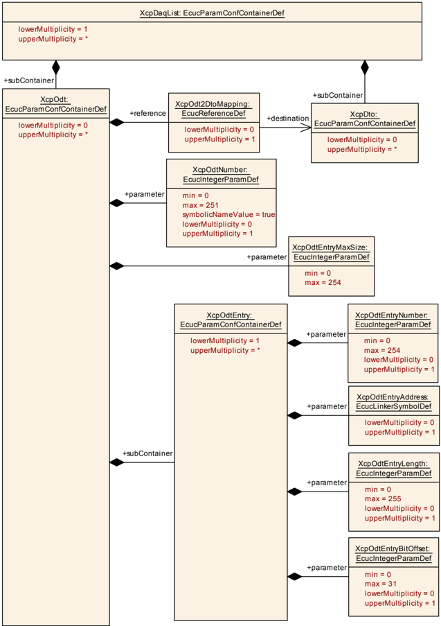

#### 9.1.8. XcpEventChannel

| SWS 条目 | [ECUC_Xcp_00150] |
|---|---|
| 容器名称 | XcpEventChannel |
| 父容器 | XcpConfig |
| 描述 | 该容器包含 XCP 从设备上事件通道的配置。 |
| 配置参数 | 见下方参数表 |

| SWS 条目 | [ECUC_Xcp_00171] |
|---|---|
| 参数名称 | XcpEventChannelConsistency |
| 父容器 | XcpEventChannel |
| 描述 | 事件通道使用的一致性类型。 |
| 多重性 | 1 |
| 类型 | EcucEnumerationParamDef |
| 范围 | DAQ：DAQ 列表级别的一致性。EVENT：事件通道级别的一致性。ODT：ODT 级别的一致性（默认值）。 |
| 默认值 | ODT |
| Post-Build 变体值 | false |
| 值配置类 | Pre-compile time：x（All Variants）；Link time：-；Post-build time：- |
| 作用域/依赖 | scope: local |

| SWS 条目 | [ECUC_Xcp_00153] |
|---|---|
| 参数名称 | XcpEventChannelMaxDaqList |
| 父容器 | XcpEventChannel |
| 描述 | 由该事件通道处理的 DAQ 列表的最大数量。 |
| 多重性 | 1 |
| 类型 | EcucIntegerParamDef |
| 范围 | 0 .. 255 |
| 默认值 | - |
| Post-Build 变体值 | false |
| 值配置类 | Pre-compile time：x（All Variants）；Link time：-；Post-build time：- |
| 作用域/依赖 | scope: ECU |

| SWS 条目 | [ECUC_Xcp_00152] |
|---|---|
| 参数名称 | XcpEventChannelNumber |
| 父容器 | XcpEventChannel |
| 描述 | 事件通道的索引编号。 |
| 多重性 | 1 |
| 类型 | EcucIntegerParamDef（为此参数生成符号名） |
| 范围 | 0 .. 65534 |
| 默认值 | - |
| Post-Build 变体值 | false |
| 值配置类 | Pre-compile time：x（All Variants）；Link time：-；Post-build time：- |
| 作用域/依赖 | scope: ECU |

| SWS 条目 | [ECUC_Xcp_00154] |
|---|---|
| 参数名称 | XcpEventChannelPriority |
| 父容器 | XcpEventChannel |
| 描述 | 事件通道的优先级。 |
| 多重性 | 1 |
| 类型 | EcucIntegerParamDef |
| 范围 | 0 .. 255 |
| 默认值 | - |
| Post-Build 变体值 | false |
| 值配置类 | Pre-compile time：x（All Variants）；Link time：-；Post-build time：- |
| 作用域/依赖 | scope: ECU |

| SWS 条目 | [ECUC_Xcp_00173] |
|---|---|
| 参数名称 | XcpEventChannelTimeCycle |
| 父容器 | XcpEventChannel |
| 描述 | 事件通道时间周期指示处理该事件通道所使用的采样周期。值 0 表示「非周期」。 |
| 多重性 | 1 |
| 类型 | EcucIntegerParamDef |
| 范围 | 0 .. 255 |
| 默认值 | - |
| Post-Build 变体值 | false |
| 值配置类 | Pre-compile time：x（All Variants）；Link time：-；Post-build time：- |
| 作用域/依赖 | scope: local |

| SWS 条目 | [ECUC_Xcp_00174] |
|---|---|
| 参数名称 | XcpEventChannelTimeUnit |
| 父容器 | XcpEventChannel |
| 描述 | 此配置参数指示事件通道时间周期的单位。 |
| 多重性 | 0..1 |
| 类型 | EcucEnumerationParamDef |
| 范围 | TIMESTAMP_UNIT_100MS：单位为 100 毫秒。TIMESTAMP_UNIT_100NS：单位为 100 纳秒。TIMESTAMP_UNIT_100PS：单位为 100 皮秒。TIMESTAMP_UNIT_100US：单位为 100 微秒。TIMESTAMP_UNIT_10MS：单位为 10 毫秒。TIMESTAMP_UNIT_10NS：单位为 10 纳秒。TIMESTAMP_UNIT_10PS：单位为 10 皮秒。TIMESTAMP_UNIT_10US：单位为 10 微秒。TIMESTAMP_UNIT_1MS：单位为 1 毫秒。TIMESTAMP_UNIT_1NS：单位为 1 纳秒。TIMESTAMP_UNIT_1PS：单位为 1 皮秒。TIMESTAMP_UNIT_1S：单位为 1 秒。TIMESTAMP_UNIT_1US：单位为 1 微秒。 |
| Post-Build 变体多重性 | false |
| Post-Build 变体值 | false |
| 多重性配置类 | Pre-compile time：x（All Variants）；Link time：-；Post-build time：- |
| 值配置类 | Pre-compile time：x（All Variants）；Link time：-；Post-build time：- |
| 作用域/依赖 | scope: local；依赖：取决于参数 EventChannelTimeCycle。当此参数设置为 0 时，整个事件通道时间单位参数应被忽略。 |

| SWS 条目 | [ECUC_Xcp_00172] |
|---|---|
| 参数名称 | XcpEventChannelType |
| 父容器 | XcpEventChannel |
| 描述 | 此配置参数指示可以分配给该事件通道的 DAQ 列表的种类。 |
| 多重性 | 1 |
| 类型 | EcucEnumerationParamDef |
| 范围 | DAQ：仅支持 DAQ（默认值）。DAQ_STIM：同时支持 DAQ 和 STIM（同时进行）。STIM：仅支持 STIM。 |
| 默认值 | DAQ |
| Post-Build 变体值 | false |
| 值配置类 | Pre-compile time：x（All Variants）；Link time：-；Post-build time：- |
| 作用域/依赖 | scope: local |

| SWS 条目 | [ECUC_Xcp_00151] |
|---|---|
| 参数名称 | XcpEventChannelTriggeredDaqListRef |
| 父容器 | XcpEventChannel |
| 描述 | 引用由该事件通道触发的所有 DAQ 列表。 |
| 多重性 | 0..* |
| 类型 | 对 XcpDaqList 的引用 |
| Post-Build 变体多重性 | false |
| Post-Build 变体值 | false |
| 多重性配置类 | Pre-compile time：x（All Variants）；Link time：-；Post-build time：- |
| 值配置类 | Pre-compile time：x（All Variants）；Link time：-；Post-build time：- |
| 作用域/依赖 | scope: ECU |

无包含的容器。

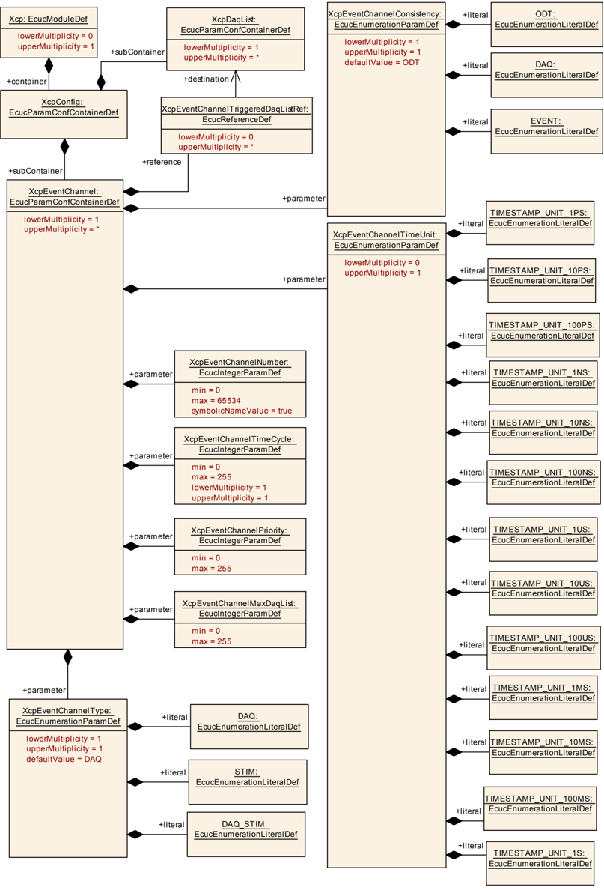

#### 9.1.9. XcpPdu

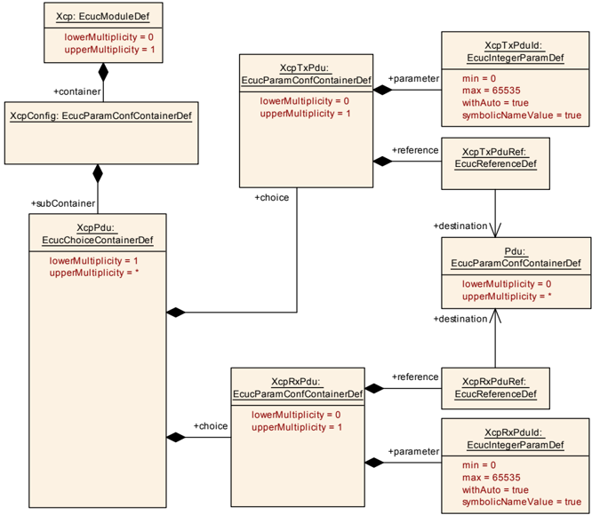

| SWS 条目 | [ECUC_Xcp_00100] |
|---|---|
| 选择容器名称 | XcpPdu |
| 父容器 | XcpConfig |
| 描述 | 包含 PDU 信息。PDU 可以是发送 PDU 或接收 PDU。 |

| 容器选择 |  |  |
|---|---|---|
| XcpRxPdu | 0..1 | 该容器规定接收的 PDU。 |
| XcpTxPdu | 0..1 | 该容器规定发送的 PDU。 |

#### 9.1.10. XcpRxPdu

| SWS 条目 | [ECUC_Xcp_00105] |
|---|---|
| 容器名称 | XcpRxPdu |
| 父容器 | XcpPdu |
| 描述 | 该容器规定接收的 PDU。 |
| 配置参数 | 见下方参数表 |

| SWS 条目 | [ECUC_Xcp_00106] |
|---|---|
| 参数名称 | XcpRxPduId |
| 父容器 | XcpRxPdu |
| 描述 | 将通过 Xcp_&lt;module&gt;RxIndication 接收的 PDU 的 ID。 |
| 多重性 | 1 |
| 类型 | EcucIntegerParamDef（为此参数生成符号名） |
| 范围 | 0 .. 65535 |
| 默认值 | - |
| Post-Build 变体值 | false |
| 值配置类 | Pre-compile time：x（All Variants）；Link time：-；Post-build time：- |
| 作用域/依赖 | scope: ECU（withAuto = true） |

| SWS 条目 | [ECUC_Xcp_00107] |
|---|---|
| 参数名称 | XcpRxPduRef |
| 父容器 | XcpRxPdu |
| 描述 | - |
| 多重性 | 1 |
| 类型 | 对 Pdu 的引用 |
| Post-Build 变体值 | true |
| 值配置类 | Pre-compile time：x（VARIANT-PRE-COMPILE）；Link time：-；Post-build time：x（VARIANT-POST-BUILD） |
| 作用域/依赖 | scope: ECU |

无包含的容器。

#### 9.1.11. XcpTxPdu

| SWS 条目 | [ECUC_Xcp_00101] |
|---|---|
| 容器名称 | XcpTxPdu |
| 父容器 | XcpPdu |
| 描述 | 该容器规定发送的 PDU。 |
| 配置参数 | 见下方参数表 |

| SWS 条目 | [ECUC_Xcp_00103] |
|---|---|
| 参数名称 | XcpTxPduId |
| 父容器 | XcpTxPdu |
| 描述 | 下层 BSW 模块必须用于 Tx 确认或 TriggerTransmit 的 PDU 标识符。 |
| 多重性 | 1 |
| 类型 | EcucIntegerParamDef（为此参数生成符号名） |
| 范围 | 0 .. 65535 |
| 默认值 | - |
| Post-Build 变体值 | false |
| 值配置类 | Pre-compile time：x（All Variants）；Link time：-；Post-build time：- |
| 作用域/依赖 | scope: ECU |

| SWS 条目 | [ECUC_Xcp_00104] |
|---|---|
| 参数名称 | XcpTxPduRef |
| 父容器 | XcpTxPdu |
| 描述 | 对外部 PDU 定义的引用。 |
| 多重性 | 1 |
| 类型 | 对 Pdu 的引用 |
| Post-Build 变体值 | true |
| 值配置类 | Pre-compile time：x（VARIANT-PRE-COMPILE）；Link time：-；Post-build time：x（VARIANT-POST-BUILD） |
| 作用域/依赖 | scope: ECU |

无包含的容器。

#### 9.1.12. XcpCommunicationChannel

| SWS 条目 | [ECUC_Xcp_00183] |
|---|---|
| 容器名称 | XcpCommunicationChannel |
| 父容器 | XcpConfig |
| 描述 | 该容器表示 **XCP** 通信通道的配置。 |
| 配置参数 | 见下方参数表 |

| SWS 条目 | [ECUC_Xcp_00185] |
|---|---|
| 参数名称 | XcpChannelRxPduRef |
| 父容器 | XcpCommunicationChannel |
| 描述 | 对 XCP Rx PDU 的可选引用。 |
| 多重性 | 0..1 |
| 类型 | 对 XcpRxPdu 的引用 |
| Post-Build 变体值 | true |
| 值配置类 | Pre-compile time：x（VARIANT-PRE-COMPILE）；Link time：-；Post-build time：x（VARIANT-POST-BUILD） |
| 作用域/依赖 | scope: ECU |

| SWS 条目 | [ECUC_Xcp_00184] |
|---|---|
| 参数名称 | XcpChannelTxPduRef |
| 父容器 | XcpCommunicationChannel |
| 描述 | 对 XCP Tx PDU 的引用。 |
| 多重性 | 1 |
| 类型 | 对 XcpTxPdu 的引用 |
| Post-Build 变体值 | true |
| 值配置类 | Pre-compile time：x（VARIANT-PRE-COMPILE）；Link time：-；Post-build time：x（VARIANT-POST-BUILD） |
| 作用域/依赖 | scope: ECU |

| SWS 条目 | [ECUC_Xcp_00186] |
|---|---|
| 参数名称 | XcpComMChannelRef |
| 父容器 | XcpCommunicationChannel |
| 描述 | 对这些 PDU 所属的 ComM 通道的引用。 |
| 多重性 | 1 |
| 类型 | 对 ComMChannel 的引用 |
| Post-Build 变体值 | true |
| 值配置类 | Pre-compile time：x（VARIANT-PRE-COMPILE）；Link time：-；Post-build time：x（VARIANT-POST-BUILD） |
| 作用域/依赖 | scope: ECU |

无包含的容器。

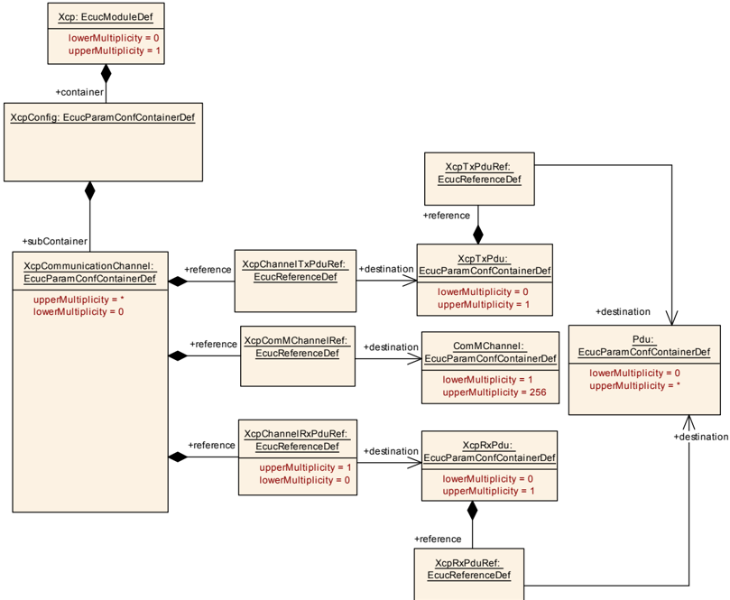

#### 9.1.13. XcpPageSwitching

| SWS 条目 | [ECUC_Xcp_00187] |
|---|---|
| 容器名称 | XcpPageSwitching |
| 父容器 | XcpConfig |
| 描述 | 该容器表示页切换特性的配置。 |
| 配置参数 | 见下方参数表 |

| 容器名称 | 多重性 | 作用域/依赖 |
|---|---|---|
| XcpSegment | 0..* | 该容器表示页切换段（segment）元素的配置。 |

#### 9.1.14. XcpSegment

| SWS 条目 | [ECUC_Xcp_00188] |
|---|---|
| 容器名称 | XcpSegment |
| 父容器 | XcpPageSwitching |
| 描述 | 该容器表示页切换段（segment）元素的配置。 |
| 配置参数 | 见下方参数表 |

| SWS 条目 | [ECUC_Xcp_00189] |
|---|---|
| 参数名称 | XcpReferencePageAddress |
| 父容器 | XcpSegment |
| 描述 | 参考页（Page ID = 0）的内存地址。 |
| 多重性 | 1 |
| 类型 | EcucLinkerSymbolDef |
| 默认值 | - |
| maxLength | - |
| minLength | - |
| 正则表达式 | - |
| 值配置类 | Pre-compile time：x（All Variants）；Link time：-；Post-build time：- |
| 作用域/依赖 | scope: local |

| SWS 条目 | [ECUC_Xcp_00191] |
|---|---|
| 参数名称 | XcpSegmentLength |
| 父容器 | XcpSegment |
| 描述 | 段的长度（字节）。 |
| 多重性 | 1 |
| 类型 | EcucIntegerParamDef |
| 范围 | 0 .. 18446744073709551615 |
| 默认值 | - |
| 值配置类 | Pre-compile time：x（All Variants）；Link time：-；Post-build time：- |
| 作用域/依赖 | scope: local |

| SWS 条目 | [ECUC_Xcp_00190] |
|---|---|
| 参数名称 | XcpWorkingPageAddress |
| 父容器 | XcpSegment |
| 描述 | 工作页（Page ID = 1）的内存地址。 |
| 多重性 | 1 |
| 类型 | EcucLinkerSymbolDef |
| 默认值 | - |
| maxLength | - |
| minLength | - |
| 正则表达式 | - |
| 值配置类 | Pre-compile time：x（All Variants）；Link time：-；Post-build time：- |
| 作用域/依赖 | scope: local |

| 容器名称 | 多重性 | 作用域/依赖 |
|---|---|---|
| XcpPage | 0..254 | 该容器表示可选页（page）元素的配置。 |

#### 9.1.15. XcpPage

| SWS 条目 | [ECUC_Xcp_00192] |
|---|---|
| 容器名称 | XcpPage |
| 父容器 | XcpSegment |
| 描述 | 该容器表示可选页（page）元素的配置。 |
| 配置参数 | 见下方参数表 |

| SWS 条目 | [ECUC_Xcp_00193] |
|---|---|
| 参数名称 | XcpPageAddress |
| 父容器 | XcpPage |
| 描述 | 可选页（Page ID = 2 ... 255）的内存地址。 |
| 多重性 | 1 |
| 类型 | EcucLinkerSymbolDef |
| 默认值 | - |
| maxLength | - |
| minLength | - |
| 正则表达式 | - |
| 值配置类 | Pre-compile time：x（All Variants）；Link time：-；Post-build time：- |
| 作用域/依赖 | scope: local |

无包含的容器。

### 9.2. 发布信息

有关详细信息，可参见 [\[2\]](#ref-2) 中的第 10.3 章「Published Information」（发布信息）。

## B. AUTOSAR 可追溯项变更历史

### B.1. 本文档的可追溯项历史（按AUTOSAR R22-11版本）

#### B.1.1. R22-11中新增的规范项

```
[SWS_Xcp_00102] [SWS_Xcp_00103] [SWS_Xcp_00104] [SWS_Xcp_00105] [SWS_Xcp_00501] [SWS_Xcp_00701] [SWS_Xcp_00702] [SWS_Xcp_00703] [SWS_Xcp_00705] [SWS_Xcp_00706] [SWS_Xcp_00707] [SWS_Xcp_00708] [SWS_Xcp_00710] [SWS_Xcp_00711] [SWS_Xcp_00712] [SWS_Xcp_00713] [SWS_Xcp_00714] [SWS_Xcp_00715] [SWS_Xcp_00716] [SWS_Xcp_00718] [SWS_Xcp_00719] [SWS_Xcp_00720] [SWS_Xcp_00721] [SWS_Xcp_00722] [SWS_Xcp_00723] [SWS_Xcp_00724] [SWS_Xcp_00725] [SWS_Xcp_00726] [SWS_Xcp_00728] [SWS_Xcp_00729] [SWS_Xcp_00730] [SWS_Xcp_00731] [SWS_Xcp_00732] [SWS_Xcp_00733] [SWS_Xcp_00734] [SWS_Xcp_00735] [SWS_Xcp_00736] [SWS_Xcp_00737] [SWS_Xcp_00738] [SWS_Xcp_00739] [SWS_Xcp_00740] [SWS_Xcp_00741] [SWS_Xcp_00742] [SWS_Xcp_00761] [SWS_Xcp_00763] [SWS_Xcp_00766] [SWS_Xcp_00768] [SWS_Xcp_00801] [SWS_Xcp_00802] [SWS_Xcp_00803] [SWS_Xcp_00807] [SWS_Xcp_00813] [SWS_Xcp_00814] [SWS_Xcp_00823] [SWS_Xcp_00824] [SWS_Xcp_00825] [SWS_Xcp_00832] [SWS_Xcp_00835] [SWS_Xcp_00836] [SWS_Xcp_00840] [SWS_Xcp_00841] [SWS_Xcp_00842] [SWS_Xcp_00843] [SWS_Xcp_00844] [SWS_Xcp_00845] [SWS_Xcp_00846] [SWS_Xcp_00847] [SWS_Xcp_00848] [SWS_Xcp_00849] [SWS_Xcp_00850] [SWS_Xcp_00852] [SWS_Xcp_00853] [SWS_Xcp_00854] [SWS_Xcp_00855] [SWS_Xcp_00856] [SWS_Xcp_00857] [SWS_Xcp_00859] [SWS_Xcp_91001]
```

#### B.1.2. R22-11中变更的规范项

无

#### B.1.3. R22-11中删除的规范项

无

### B.2. 本文档的可追溯项历史（按AUTOSAR R23-11版本）

#### B.2.1. R23-11中新增的规范项

```
[SWS_Xcp_00102] [SWS_Xcp_00103] [SWS_Xcp_00104] [SWS_Xcp_00105] [SWS_Xcp_00501] [SWS_Xcp_00701] [SWS_Xcp_00702] [SWS_Xcp_00703] [SWS_Xcp_00705] [SWS_Xcp_00706] [SWS_Xcp_00707] [SWS_Xcp_00708] [SWS_Xcp_00709] [SWS_Xcp_00710] [SWS_Xcp_00711] [SWS_Xcp_00712] [SWS_Xcp_00713] [SWS_Xcp_00714] [SWS_Xcp_00715] [SWS_Xcp_00716] [SWS_Xcp_00718] [SWS_Xcp_00719] [SWS_Xcp_00720] [SWS_Xcp_00721] [SWS_Xcp_00722] [SWS_Xcp_00723] [SWS_Xcp_00724] [SWS_Xcp_00725] [SWS_Xcp_00726] [SWS_Xcp_00728] [SWS_Xcp_00729] [SWS_Xcp_00730] [SWS_Xcp_00731] [SWS_Xcp_00732] [SWS_Xcp_00733] [SWS_Xcp_00734] [SWS_Xcp_00735] [SWS_Xcp_00736] [SWS_Xcp_00737] [SWS_Xcp_00738] [SWS_Xcp_00739] [SWS_Xcp_00740] [SWS_Xcp_00741] [SWS_Xcp_00742] [SWS_Xcp_00761] [SWS_Xcp_00763] [SWS_Xcp_00766] [SWS_Xcp_00768] [SWS_Xcp_00801] [SWS_Xcp_00802] [SWS_Xcp_00803] [SWS_Xcp_00807] [SWS_Xcp_00813] [SWS_Xcp_00814] [SWS_Xcp_00823] [SWS_Xcp_00824] [SWS_Xcp_00825] [SWS_Xcp_00832] [SWS_Xcp_00835] [SWS_Xcp_00836] [SWS_Xcp_00840] [SWS_Xcp_00841] [SWS_Xcp_00842] [SWS_Xcp_00843] [SWS_Xcp_00844] [SWS_Xcp_00845] [SWS_Xcp_00846] [SWS_Xcp_00847] [SWS_Xcp_00848] [SWS_Xcp_00849] [SWS_Xcp_00850] [SWS_Xcp_00852] [SWS_Xcp_00853] [SWS_Xcp_00854] [SWS_Xcp_00855] [SWS_Xcp_00856] [SWS_Xcp_00857] [SWS_Xcp_00859] [SWS_Xcp_91001]
```

#### B.2.2. R23-11中变更的规范项

无

#### B.2.3. R23-11中删除的规范项

无
