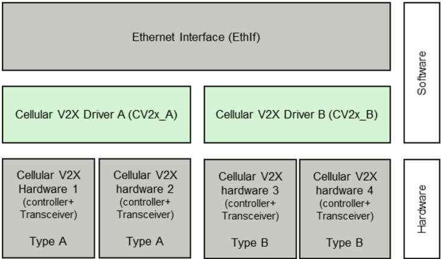

## 1. 简介和功能概述

本规范规定 **AUTOSAR** 基础软件模块 **Cellular V2X Driver**（蜂窝V2X驱动程序）的功能、**API** 和配置。

在 **AUTOSAR** 分层软件架构中，若蜂窝 V2X 控制器为片内（internal）类型，则 **Cellular V2X** 驱动属于微控制器抽象层；若蜂窝 V2X 控制器为片外（external）类型，则 **Cellular V2X** 驱动属于硬件抽象层。

这表明了 **Cellular V2X** 驱动的主要任务，即：

为上层（例如 **Ethernet Interface**）提供一个硬件无关的接口，该接口由多个等同的控制器组成。该接口对所有控制器应是统一的。这样，上层（例如 **Ethernet Interface**）便可以统一的方式访问底层总线系统。该接口提供初始化、配置和数据传输功能，以及管理/观测硬件生命周期的设施。然而 **Cellular V2X Driver** 的配置是总线特定的，因为它考虑了无线通信控制器的特定特性。

单个 **Cellular V2X** 驱动模块只支持一种类型的蜂窝 V2X 硬件。**Cellular V2X** 驱动的前缀要求一个唯一的命名空间。**Ethernet Interface** 可以通过使用具有不同前缀的不同 **Cellular V2X** 驱动来访问不同的控制器类型。使用哪个驱动访问哪个特定控制器是 **Ethernet Interface** 的一个配置参数。

图 1 给出了 **Cellular V2X** 协议栈下层的示例。一个 **Ethernet Interface** 可以使用多个 **Cellular V2X** 驱动访问多个蜂窝 V2X 硬件单元。



1. 通常，蜂窝 V2X 硬件同时包括蜂窝 V2X **RF** 收发器和蜂窝 V2X 控制器。市场上没有分离的蜂窝 V2X 收发器/控制器，且蜂窝 V2X 收发器不由 **ECU** 直接控制，因此蜂窝 V2X 不需要收发器驱动。为了在 **AUTOSAR** 中保持命名一致，本文档也使用「控制器」来表示蜂窝 V2X 硬件。
2. **Cellular V2X** 驱动的规范方式允许代码模块以目标代码形式交付，遵循「one-fits-all」原则，即 **Ethernet Interface** 的全部配置都可以在不修改任何源代码的情况下完成。因此，**Cellular V2X** 驱动的配置可以在几乎不了解 **Cellular V2X** 驱动软件细节的情况下完成。

本文档的基础是中国基于 **LTE-V2X** 的标准 [\[1\]](#ref-1) [\[2\]](#ref-2)。假定读者已熟悉这些标准。

## 2. 缩略语

以下术语表包含与 **Cellular V2X** 驱动模块相关、但未包含在 [\[3, AUTOSAR 术语表\]](#ref-3) 中的缩略语和缩写。

**CBR**
> 信道忙闲比（**Channel Busy Ratio**）。

**CCSA**
> 中国通信标准化协会（**China Communications Standards Association**）。

**CV2x**
> **Cellular Vehicle-2-X Driver**，蜂窝V2X驱动程序。

**DSMP**
> 专用短消息协议（**Dedicated Short Message Protocol**）。

**IP**
> 互联网协议（**Internet protocol**）。

**LTE-V2X**
> 基于长期演动的车联网技术（**Long Term Evolution based Vehicle to Everything**）。

**V2X**
> 车联网（**Vehicle to Everything**）。

**NTCAS**
> 全国汽车标准化技术委员会（**National Technical Committee of Auto Standardization**）。

**PC5**
> 用于 V2X 业务的 ProSe（基于邻近的服务）直接通信中 **UE**（用户设备）之间控制面和用户面的参考点。

**PPPP**
> ProSe 按包优先级（**ProSe Per-Packet Priority**）。

## 3. 相关文档

### 3.1. 输入文件和相关标准与规范

<a id="ref-1"></a>[1] YD/T 3707-2020:Technical requirements of network layer of LTE-based vehicular communication http://www.ccsa.org.cn/

<a id="ref-2"></a>[2] YD/T 3756-2020:Technical requirement of vehicle terminal for LTE-based vehicular communication http://www.ccsa.org.cn/

<a id="ref-3"></a>[3] Glossary
> AUTOSAR_FO_TR_Glossary

<a id="ref-4"></a>[4] General Specification of Basic Software Modules
> AUTOSAR_CP_SWS_BSWGeneral

<a id="ref-5"></a>[5] Specification of Ethernet Driver
> AUTOSAR_CP_SWS_EthernetDriver

<a id="ref-6"></a>[6] Specification of Ethernet Interface
> AUTOSAR_CP_SWS_EthernetInterface

### 3.2. 相关规范

**AUTOSAR** 提供了基础软件模块的通用规范 [\[4\]](#ref-4)，该规范同样适用于 **Cellular V2X Driver**。

因此，规范 **SWS BSW General** [\[4\]](#ref-4) 应被视为 **Cellular V2X Driver** 的附加且必需的规范。

## 4. 约束和假设

### 4.1. 限制

* **Cellular V2X Driver** 仅支持 **NTCAS** 和 **CCSA** [\[1\]](#ref-1) [\[2\]](#ref-2) 定义的 **LTE-V2X** **PC5**。其他基于蜂窝的无线通信（例如 **LTE Uu** 接口）可以在 **AUTOSAR** 标准的未来版本中扩展。
* **CV2x** 模块仅支持非 **IP**（即 **DSMP**）传输，并且在 R22-11 中主要聚焦于基于广播的包传输服务。
* 无法传输超出所用控制器可用缓冲区大小的数据。
* 蜂窝 V2X 硬件中接入层的公共参数通常是预配置的，因此本版本不支持公共参数设置（即发射功率、中心频率）。
* 微控制器抽象层多核分发概念在本软件规范中作为「draft」实现。更多信息参见第 [9](#9-配置规范) 章。

### 4.2. 汽车域的适用性

本规范适用于所有汽车域。

## 5. 对其他模块的依赖

本章列出与 **Cellular V2X Driver** 模块交互的模块。

使用 **Cellular V2X Driver** 模块的模块：

* **Ethernet Interface**（EthIf）

### 5.1. 驱动服务

**注意：** 如果蜂窝 V2X 控制器为片内控制器，**Cellular V2X Driver** 模块不应使用任何其他驱动程序的服务。

如果使用片外蜂窝 V2X 控制器，**Wireless Ethernet** 驱动应使用其他 **MCAL** 驱动（例如 **SPI**、**DIO**）的服务。

**注意：** 在这种情况下，**Cellular V2X Driver** 不再属于微控制器抽象层，而是属于 **ECU** 抽象层的一部分。因此，理论上允许它使用所需的任何微控制器抽象层驱动。

实现提示：如果 **Cellular V2X** 驱动使用其他 **MCAL** 驱动（例如 **SPI**、**DIO**）的服务，必须确保在初始化 **Wireless Ethernet** 驱动之前这些驱动已经启动并运行。

**Cellular V2X Driver** 的所有接口都应以非阻塞方式实现。在操作可以立即且原子地完成的情况下，确认信息通过请求函数的返回码上报。或者，通过调用「request」函数启动一个操作，操作的结果通过相应的「confirm」回调上报。

## 6. 功能规格

**Cellular V2X** 驱动通过访问蜂窝 V2X 无线电提供通信，并使能中国 V2X 服务。在发送方向，驱动程序将包写入 **Cellular V2X** 驱动内部的适当缓冲区；在包接收方向，**Cellular V2X** 驱动调用接收包回调函数，并在参数中传入包内容。

### 6.1. 蜂窝V2X BSW协议栈

作为 **AUTOSAR** 分层软件架构的一部分，蜂窝 V2X **BSW** 模块也构成一个分层软件协议栈。为实现 V2X 服务，**Ethernet Interface**（EthIf）模块可以使用 **Cellular V2X Driver** 层访问一个或多个控制器，该层可以由一个或多个 **Cellular V2X** 驱动模块组成。

#### 6.1.1. 索引方案

**Cellular V2X** 驱动的用户使用以太网驱动 [\[5\]](#ref-5) 中描述的索引方案来标识控制器资源。

**Cellular V2X Driver** 使用从零开始的索引来抽象硬件抽象层的访问。

**注意：** 配置中的索引 CV2xCtrlId 对应于第 [7.3](#73-函数定义) 章定义的 **API** 中附加的 CtrlId。

缓冲区索引（BufId）标识由 **Cellular V2X Driver API** 函数处理的一个蜂窝 V2X 缓冲区。

每个控制器的缓冲区由缓冲区索引 0 到（n-1）标识，其中 n 是相应控制器处理的缓冲区数量，接收和发送缓冲区的数量分别可通过 CV2xCtrlRxBufTotal 和 CV2xCtrlTxBufTotal 进行配置。

缓冲区索引仅在元组 &lt;CtrlId, BufId&gt; 内有效。

BufId 唯一地标识 **Cellular V2X Driver** 使用的缓冲区。

#### 6.1.2. 通用需求

本章列出 **Cellular V2X Driver** 模块实现应满足的需求。**Cellular V2X Driver** 模块的环境由所有调用 **Cellular V2X Driver** 模块接口的模块组成。

**Cellular V2X Driver** 应确保所有接收和发送缓冲区的基地址满足相应平台所有 **AUTOSAR** 数据类型的内存对齐要求，以便可以进行高效的 **DMA** 和 **Memcopy** 操作。

**Cellular V2X Driver** 应在中断例程中调用 EthIf_TxConfirmation 以指示一次成功的发送（如果通知已通过 EthIfTxConfirmationFunction 使能）。

**Cellular V2X Driver** 应在中断例程中调用 EthIf_RxIndication 以指示一次成功的接收。

#### 6.1.3. 按包参数

对于 **Cellular V2X Driver**，能够为蜂窝 V2X 的目标无线电配置发送和接收参数十分重要。

**Cellular V2X Driver** 应提供 **API** [CV2x_GetBufCV2xPC5RxParams](#739-cv2x_getbufcv2xpc5rxparams)，提供与接收到的包相关的一系列基于缓冲区的接收参数。

**Cellular V2X Driver** 应提供 **API** [CV2x_GetBufCV2xPC5TxParams](#7310-cv2x_getbufcv2xpc5txparams)，提供与发送的包相关的一系列基于缓冲区的发送参数。

**Cellular V2X Driver** 应提供 **API** [CV2x_SetBufCV2xPC5TxParams](#7311-cv2x_setbufcv2xpc5txparams)，设置与发送的包相关的一系列基于缓冲区的发送参数。

#### 6.1.4. 键/值参数映射

为了唯一引用所发送或接收的蜂窝 V2X 包的发送和接收参数，本模块内应使用唯一的枚举值。

**API** [CV2x_GetBufCV2xPC5RxParams](#739-cv2x_getbufcv2xpc5rxparams) 使用类型 [CV2x_BufCV2xPC5RxParamIdType](#723-cv2x_bufcv2xpc5rxparamidtype)，应将 [\[1\]](#ref-1) 中定义的以下参数转换为 uint32 或 uint8 类型。

| ParamId | ParamValue 类型 |
|---|---|
| CV2X_BUFCV2XPC5RXPID_SRC_LAYER2_ID | uint32 |
| CV2X_BUFCV2XPC5RXPID_DST_LAYER2_ID | uint32 |
| CV2X_BUFCV2XPC5RXPID_PPPP | uint8 |
| CV2X_BUFCV2XPC5RXPID_CBR | uint8 |
| CV2X_BUFCV2XPC5RXPID_MAX_DATA_RATE | uint32 |
| CV2X_BUFCV2XPC5RXPID_TRANSACTION_ID_32 | uint32 |

**API** [CV2x_GetBufCV2xPC5TxParams](#7310-cv2x_getbufcv2xpc5txparams) 和 **API** [CV2x_SetBufCV2xPC5TxParams](#7311-cv2x_setbufcv2xpc5txparams) 使用 [**CV2x_BufCV2xPC5TxParamIdType**](#724-cv2x_bufcv2xpc5txparamidtype)，应将 [\[1\]](#ref-1) 中定义的以下参数转换为 uint32 或 uint8 类型。

| ParamId | ParamValue 类型 |
|---|---|
| CV2X_BUFCV2XPC5TXPID_PDCP_SDU_TYPE | uint8 |
| CV2X_BUFCV2XPC5TXPID_SRC_LAYER2_ID | uint32 |
| CV2X_BUFCV2XPC5TXPID_DST_LAYER2_ID | uint32 |
| CV2X_BUFCV2XPC5TXPID_PPPP | uint8 |
| CV2X_BUFCV2XPC5TXPID_CBR | uint8 |
| CV2X_BUFCV2XPC5TXPID_TRAFFIC_PERIOD | uint32 |
| CV2X_BUFCV2XPC5TXPID_SRC_IP_ADDR | uint32 |
| CV2X_BUFCV2XPC5TXPID_TRANSACTION_ID_32 | uint32 |

**API** [CV2x_GetChanTxParamIdType](#725-cv2x_getchantxparamidtype) 使用 [**CV2x_GetChanTxParamIdType**](#725-cv2x_getchantxparamidtype)，应将 [\[1\]](#ref-1) 中定义的以下参数转换为 uint32 类型。

| ParamId | ParamValue 类型 |
|---|---|
| CV2X_GETCHRXPID_CBR | uint32 |
| CV2X_GETCHRXPID_TP | uint32 |
| CV2X_GETCHRXPID_SYNC_TYPE | uint32 |
| CV2X_GETCHRXPID_SYNC_STATUS | uint32 |

### 6.2. 错误分类

本章列出并分类本软件模块内可检测到的所有错误。每个错误按相关性（开发/生产）和相关错误代码进行分类。对于开发错误，定义了一个值。

#### 6.2.1. 开发错误

| 错误类型 | 相关错误代码 | 错误值 |
|---|---|---|
| 无效的控制器索引 | CV2X_E_INV_CTRL_IDX | 0x01 |
| **CV2x** 模块未初始化 | CV2X_E_UNINIT | 0x02 |
| 参数列表中的指针无效 | CV2X_E_PARAM_POINTER | 0x03 |
| 参数无效 | CV2X_E_INV_PARAM | 0x04 |
| 模式无效 | CV2X_E_INV_MODE | 0x05 |

#### 6.2.2. 运行时错误

没有运行时错误。

#### 6.2.3. 瞬态故障

没有运行时错误。

#### 6.2.4. 生产错误

没有运行时错误。

#### 6.2.5. 扩展生产错误

没有扩展生产错误。扩展生产错误作为 **Diagnostic Event Manager** 的事件处理。事件 **ID** 在下表中定义，而实际值由 **Diagnostic Event Manager** 的配置在外部分配，并通过 Dem.h 包含进模块。

| 错误名称： | CV2X_E_ACCESS |
|---|---|
| 简短描述： | 蜂窝 V2X 控制器访问失败 |
| 长描述： | 监视对蜂窝 V2X 控制器的访问 |
| 检测条件： | 失败（Fail） —— 当对蜂窝 V2X 控制器的访问失败时，模块应以事件状态 DEM_EVENT_STATUS_PREFAILED 向 **DEM** 上报该扩展生产错误。 |
| 检测条件： | 通过（Pass） —— 当对蜂窝 V2X 控制器的访问成功时，模块应以事件状态 DEM_EVENT_STATUS_PREPASSED 向 **DEM** 上报该扩展生产错误。 |
| 二级参数： | 无 |
| 所需时间： | 无 |
| 监视频率： | 无 |

## 7. API规范

### 7.1. 导入的类型

本章列出从以下文件包含的所有类型。

| 模块 | 头文件 | 导入的类型 |
|---|---|---|
| ComStack_Types | ComStack_Types.h | BufReq_ReturnType |
| ComStack_Types | ComStackTypes.h | TimeStampQualType（draft） |
| ComStack_Types | ComStackTypes.h | TimeStampType（draft） |
| ComStack_Types | ComStackTypes.h | TimeTupleType（draft） |
| Dem | Rte_Dem_Type.h | Dem_EventIdType |
| Dem | Rte_Dem_Type.h | Dem_EventStatusType |
| Eth | Eth_GeneralTypes.h | Eth_BufIdxType |
| Eth | Eth_GeneralTypes.h | Eth_DataType |
| Eth | Eth_GeneralTypes.h | Eth_FrameType |
| Eth | Eth_GeneralTypes.h | Eth_ModeType |
| Eth | Eth_GeneralTypes.h | Eth_RxStatusType |
| Std | Std_Types.h | Std_ReturnType |
| Std | Std_Types.h | Std_VersionInfoType |

### 7.2. 类型定义

#### 7.2.1. CV2x_ConfigType

| 名称 | CV2x_ConfigType | | |
| --- | --- | --- | --- |
| 类别 | Structure | | |
| 描述 | Post-build 配置的实现特定结构。 | | |
| 可通过 | CV2x.h 获得 | | |

#### 7.2.2. CV2x_StateType

| 名称 | CV2x_StateType | | |
| --- | --- | --- | --- |
| 类别 | 枚举 | | |
| 取值 | CV2X_STATE_UNINIT | 0x00 | 驱动程序尚未配置 |
| | CV2X_STATE_INIT | 0x01 | 驱动程序已配置 |
| 描述 | 已接收包的无线参数。 | | |
| 可通过 | CV2x_GeneralTypes.h 获得 | | |

#### 7.2.3. CV2x_BufCV2xPC5RxParamIdType

| 名称 | CV2x_BufCV2xPC5RxParamIdType | | |
| --- | --- | --- | --- |
| 类别 | 枚举 | | |
| 取值 | CV2X_BUFCV2XPC5RXPID_SRC_LAYER2_ID | 0x00 | 蜂窝 V2X 包的源 Layer 2 ID |
| | CV2X_BUFCV2XPC5RXPID_DST_LAYER2_ID | 0x01 | 蜂窝 V2X 包的目的 Layer 2 ID |
| | CV2X_BUFCV2XPC5RXPID_PPPP | 0x02 | ProSe 按包优先级 |
| | CV2X_BUFCV2XPC5RXPID_CBR | 0x03 | 信道忙率 |
| | CV2X_BUFCV2XPC5RXPID_MAX_DATA_RATE | 0x04 | 最大数据速率 |
| | CV2X_BUFCV2XPC5RXPID_TRANSACTION_ID_32 | 0x05 | 已接收帧的唯一 id |
| 描述 | 已接收包的无线参数。 | | |
| 可通过 | CV2x_GeneralTypes.h 获得 | | |

#### 7.2.4. CV2x_BufCV2xPC5TxParamIdType

| 名称 | CV2x_BufCV2xPC5TxParamIdType | | |
| --- | --- | --- | --- |
| 类别 | 枚举 | | |
| 取值 | CV2X_BUFCV2XPC5TXPID_PDCP_SDU_TYPE | 0x00 | 网络层协议类型。 |
| | CV2X_BUFCV2XPC5TXPID_SRC_LAYER2_ID | 0x01 | 蜂窝 V2X 包的源 Layer 2 ID |
| | CV2X_BUFCV2XPC5TXPID_DST_LAYER2_ID | 0x02 | 蜂窝 V2X 包的目的 Layer 2 ID |
| | CV2X_BUFCV2XPC5TXPID_PPPP | 0x03 | ProSe 按包优先级 |
| | CV2X_BUFCV2XPC5TXPID_PDB | 0x04 | 包时延预算（**Packet Delay Budget**） |
| | CV2X_BUFCV2XPC5TXPID_TRAFFIC_PERIOD | 0x05 | 业务周期（**Traffic Period**） |
| | CV2X_BUFCV2XPC5TXPID_SRC_IP_ADDR | 0x06 | 源 **IP** 地址 |
| | CV2X_BUFCV2XPC5TXPID_TRANSACTION_ID_16 | 0x07 | 待发送帧的唯一 id |
| 描述 | 待发送包的无线参数。 | | |
| 可通过 | CV2x_GeneralTypes.h 获得 | | |

#### 7.2.5. CV2x_GetChanTxParamIdType

| 名称 | CV2x_GetChanTxParamIdType | | |
| --- | --- | --- | --- |
| 类别 | 枚举 | | |
| 取值 | CV2X_GETCHTXPID_CBR | 0x00 | 信道忙闲比（**Channel Busy Ratio**） |
| | CV2X_GETCHTXPID_TP | 0x01 | 发射功率（**Transmit Power**） |
| | CV2X_GETCHTXPID_SYNC_TYPE | 0x02 | 同步源 |
| | CV2X_GETCHTXPID_SYNC_STATUS | 0x03 | 同步状态 |
| 描述 | 接收侧获取的无线信道参数。 | | |
| 可通过 | CV2x_GeneralTypes.h 获得 | | |

### 7.3. 函数定义

#### 7.3.1. CV2x_Init

**说明**: 初始化 **Cellular V2X** 驱动程序。可通过 **CV2x.h** 获得。本服务为同步调用，不可重入。参数 CfgPtr（in）：指向实现特定结构的指针。返回值：无。

```C
void CV2x_Init ( const CV2x_ConfigType* CfgPtr )
```

函数 CV2x_Init 应存储配置结构 [CV2xConfigSet](#914-cv2xconfigset) 的访问地址，供后续 **API** 调用使用。

函数 CV2x_Init 应初始化当前 [CV2xConfigSet](#914-cv2xconfigset) 中所有已配置的蜂窝 V2X 控制器，操作可包括：

* 禁用所有控制器
* 清除挂起的蜂窝 V2X 中断
* 配置所有控制器配置参数（例如帧长度等）
* 配置所有发送/接收资源（例如缓冲区初始化）
* 删除所有挂起的发送和接收请求

函数 CV2x_Init 应将组件的状态设置为 CV2X_STATE_INIT（当所有初始化操作完成时）。

函数 CV2x_Init 应检查对蜂窝 V2X 控制器的访问。如果检查失败，函数 CV2x_Init 应引发生产错误 [CV2X_E_ACCESS](#625-扩展生产错误)。

#### 7.3.2. CV2x_GetVersionInfo

**说明**: 返回本模块的版本信息。可通过 **CV2x.h** 获得。本服务为同步调用，可重入。参数 VersionInfoPtr（out）：存储本模块版本信息的指针。返回值：无。

```C
void CV2x_GetVersionInfo ( Std_VersionInfoType* VersionInfoPtr )
```

如果启用了开发错误检测：函数 CV2x_GetVersionInfo 应检查参数 VersionInfoPtr 是否有效。如果检查失败，函数 CV2x_GetVersionInfo 应引发开发错误 [CV2X_E_PARAM_POINTER](#621-开发错误)。

#### 7.3.3. CV2x_SetControllerMode

**说明**: 启用/禁用被索引的控制器。可通过 **CV2x.h** 获得。本服务为异步调用，不可重入。参数 CtrlId（in）：**Cellular V2X Driver** 上下文中控制器的索引。参数 CtrlMode（in）：**ETH_MODE_DOWN**：禁用控制器；**ETH_MODE_ACTIVE**：启用控制器。返回值：Std_ReturnType，E_OK：成功；E_NOT_OK：无法改变控制器模式。

```C
Std_ReturnType CV2x_SetControllerMode ( uint8 CtrlId, Eth_ModeType CtrlMode )
```

函数 CV2x_SetControllerMode 应将控制器置于参数「CtrlMode」给定的指定模式：

* 在模式 **ETH_MODE_DOWN** 下，驱动程序应：
  * 禁用蜂窝 V2X 控制器
  * 重置所有发送和接收缓冲区（即忽略所有挂起的发送和接收请求）
* 在模式 **ETH_MODE_ACTIVE** 下，驱动程序应：
  * 启用所有发送和接收缓冲区
  * 启用蜂窝 V2X 控制器

如果启用了开发错误检测：函数 CV2x_SetControllerMode 应检查先前是否已调用过服务 [CV2x_Init](#731-cv2x_init)。如果检查失败，函数 CV2x_SetControllerMode 应引发开发错误 [CV2X_E_UNINIT](#621-开发错误)，否则（如果 **DET** 被禁用）返回 **E_NOT_OK**。

如果启用了开发错误检测：函数 CV2x_SetControllerMode 应检查参数 CtrlId 是否有效。如果检查失败，函数 CV2x_SetControllerMode 应引发开发错误 [CV2X_E_INV_CTRL_IDX](#621-开发错误)，否则（如果 **DET** 被禁用）返回 **E_NOT_OK**。

如果启用了开发错误检测：函数 CV2x_SetControllerMode 应检查先前是否已调用过服务 [CV2x_Init](#731-cv2x_init)。如果检查失败，函数 CV2x_SetControllerMode 应引发开发错误 [CV2X_E_UNINIT](#621-开发错误)，否则（如果 **DET** 被禁用）返回 **E_NOT_OK**。

函数 CV2x_SetControllerMode 要求先调用 [CV2x_Init](#731-cv2x_init)。

#### 7.3.4. CV2x_GetControllerMode

**说明**: 获取被索引控制器的状态。可通过 **CV2x.h** 获得。本服务为同步调用，不可重入。参数 CtrlId（in）：**Cellular V2X Driver** 上下文中控制器的索引。参数 CtrlModePtr（out）：**ETH_MODE_DOWN**：禁用控制器；**ETH_MODE_ACTIVE**：启用控制器。返回值：Std_ReturnType，E_OK：成功；E_NOT_OK：无法改变控制器模式。

```C
Std_ReturnType CV2x_GetControllerMode ( uint8 CtrlId, Eth_ModeType* CtrlModePtr )
```

函数 CV2x_GetControllerMode 应读取当前控制器模式。

如果启用了开发错误检测：函数 CV2x_GetControllerMode 应检查先前是否已调用过服务 Cv2x_Init。如果检查失败，函数 CV2x_GetControllerMode 应引发开发错误 [CV2X_E_UNINIT](#621-开发错误)，否则（如果 **DET** 被禁用）返回 **E_NOT_OK**。

如果启用了开发错误检测：函数 CV2x_GetControllerMode 应检查参数 CtrlId 是否有效。如果检查失败，函数 CV2x_GetControllerMode 应引发开发错误 [CV2X_E_INV_CTRL_IDX](#621-开发错误)，否则（如果 **DET** 被禁用）返回 **E_NOT_OK**。

如果启用了开发错误检测：函数 CV2x_GetControllerMode 应检查参数 CtrlModePtr 是否有效。如果检查失败，函数 CV2x_GetControllerMode 应引发开发错误 [CV2X_E_PARAM_POINTER](#621-开发错误)，否则（如果 **DET** 被禁用）返回 **E_NOT_OK**。

函数 CV2x_GetControllerMode 要求先调用 [CV2x_Init](#731-cv2x_init)。

#### 7.3.5. CV2x_ProvideTxBuffer

**说明**: 提供对指定控制器发送缓冲区的访问。可通过 **CV2x.h** 获得。本服务为同步调用，不可重入。参数 CtrlId（in）：**Cellular V2X Driver** 上下文中控制器的索引。参数 Priority（in）：用于选择不同无线发送队列的优先级值。参数 LenBytePtr（inout）：in：期望的长度（字节）；out：分配的长度（字节）。参数 BufIdPtr（out）：被分配缓冲区资源的索引，用于后续请求。参数 BufPtr（out）：被分配缓冲区的指针。返回值：BufReq_ReturnType，BUFREQ_OK：成功；BUFREQ_E_NOT_OK：检测到默认错误；BUFREQ_E_BUSY：所有缓冲区都在使用中；BUFREQ_E_OVFL：请求的缓冲区过大。

```C
BufReq_ReturnType CV2x_ProvideTxBuffer ( uint8 CtrlId, uint8 Priority, Eth_BufIdxType* BufIdPtr, uint8** BufPtr, uint16* LenBytePtr )
```

函数 CV2x_ProvideTxBuffer 应提供一个发送缓冲区资源。

**Cellular V2X Driver** 应锁定该缓冲区，直到收到后续以 BufIdxPtr 参数中返回的缓冲区索引对 [CV2x_Transmit](#736-cv2x_transmit) 服务的调用。

如果控制器通过 [CV2x_SetControllerMode](#733-cv2x_setcontrollermode) 被禁用，所有被锁定的发送缓冲区都应被释放。

如果通过 Cv2x_ProvideTxBuffer 请求的缓冲区大于可用缓冲区长度，则不应锁定该缓冲区，而应返回可用长度和 BUFREQ_E_OVFL。

如果所有可用缓冲区都在使用中，组件应返回 BUFREQ_E_BUSY。

如果启用了开发错误检测：函数 CV2x_ProvideTxBuffer 应检查先前是否已调用过服务 [CV2x_Init](#731-cv2x_init)。如果检查失败，函数 CV2x_ProvideTxBuffer 应引发开发错误 [CV2X_E_UNINIT](#621-开发错误) 并返回 BUFREQ_E_NOT_OK。

如果启用了开发错误检测：函数 CV2x_ProvideTxBuffer 应检查参数 CtrlId 是否有效。如果检查失败，函数 CV2x_ProvideTxBuffer 应引发开发错误 [CV2X_E_INV_CTRL_IDX](#621-开发错误) 并返回 BUFREQ_E_NOT_OK。

如果启用了开发错误检测：函数 CV2x_ProvideTxBuffer 应检查参数 BufIdxPtr 是否有效。如果检查失败，函数 CV2x_ProvideTxBuffer 应引发开发错误 [CV2X_E_PARAM_POINTER](#621-开发错误) 并返回 BUFREQ_E_NOT_OK。

如果启用了开发错误检测：函数 CV2x_ProvideTxBuffer 应检查参数 BufPtr 是否有效。如果检查失败，函数 CV2x_ProvideTxBuffer 应引发开发错误 [CV2X_E_PARAM_POINTER](#621-开发错误) 并返回 BUFREQ_E_NOT_OK。

如果启用了开发错误检测：函数 CV2x_ProvideTxBuffer 应检查参数 LenBytePtr 是否有效。如果检查失败，函数 CV2x_ProvideTxBuffer 应引发开发错误 [CV2X_E_PARAM_POINTER](#621-开发错误) 并返回 BUFREQ_E_NOT_OK。

函数 CV2x_ProvideTxBuffer 要求先调用 [CV2x_Init](#731-cv2x_init)。

#### 7.3.6. CV2x_Transmit

**说明**: 触发发送一个先前已填充的发送缓冲区。可通过 **CV2x.h** 获得。本服务为同步调用，不可重入。参数 CtrlId（in）：**Cellular V2X Driver** 上下文中控制器的索引。参数 BufId（in）：缓冲区资源的索引。参数 TxConfirmation（in）：使能发送确认。参数 LenByte（in）：数据长度（字节）（适配帧长度）。返回值：Std_ReturnType，E_OK：成功；E_NOT_OK：发送失败。

```C
Std_ReturnType CV2x_Transmit ( uint8 CtrlId, Eth_BufIdxType BufId, boolean TxConfirmation, uint16 LenByte )
```

函数 CV2x_Transmit 应触发发送一个先前已填充的发送缓冲区。发送之后，驱动程序需要释放分配的缓冲区。实际缓冲区释放发生的时机由实现决定，例如在 [CV2x_TxConfirmation](#737-cv2x_txconfirmation)、[CV2x_MainFunction](#751-cv2x_mainfunction) 的上下文中，或在下一次 [CV2x_ProvideTxBuffer](#735-cv2x_providetxbuffer) 期间。

如果控制器通过 [CV2x_SetControllerMode](#733-cv2x_setcontrollermode) 被禁用，所有挂起的发送缓冲区都应被释放。

如果启用了开发错误检测：函数 CV2x_Transmit 应检查先前是否已调用过服务 [CV2x_Init](#731-cv2x_init)。如果检查失败，函数 CV2x_Transmit 应引发开发错误 [CV2X_E_UNINIT](#621-开发错误)，否则（如果 **DET** 被禁用）返回 **E_NOT_OK**。

如果启用了开发错误检测：函数 CV2x_Transmit 应检查参数 CtrlId 是否有效。如果检查失败，函数 CV2x_Transmit 应引发开发错误 [CV2X_E_INV_CTRL_IDX](#621-开发错误)，否则（如果 **DET** 被禁用）返回 **E_NOT_OK**。

如果启用了开发错误检测：函数 CV2x_Transmit 应检查参数 BufIdx 是否有效。如果检查失败，函数 CV2x_Transmit 应引发开发错误 [CV2X_E_INV_PARAM](#621-开发错误)，否则（如果 **DET** 被禁用）返回 **E_NOT_OK**。

如果启用了开发错误检测：函数 CV2x_Transmit 应检查控制器模式是否为活动状态（**ETH_MODE_ACTIVE**）。如果检查失败，函数 CV2x_Transmit 应引发开发错误 [CV2X_E_INV_MODE](#621-开发错误)，否则（如果 **DET** 被禁用）返回 **E_NOT_OK**。

函数 CV2x_Transmit 要求先调用 [CV2x_ProvideTxBuffer](#735-cv2x_providetxbuffer)。

#### 7.3.7. CV2x_TxConfirmation

**说明**: 触发发送确认。可通过 **CV2x.h** 获得。本服务为同步调用，不可重入。参数 CtrlId（in）：**Cellular V2X Driver** 上下文中控制器的索引。返回值：无。

```C
void CV2x_TxConfirmation ( uint8 CtrlId )
```

函数 CV2x_TxConfirmation 应检查所有已填充的发送缓冲区的发送是否成功。如果先前调用 [CV2x_Transmit](#736-cv2x_transmit) 服务时有所请求，函数 CV2x_TxConfirmation 使用回调函数 EthIf_TxConfirmation 对每个已发送的帧发出发送确认。

如果先前调用 [CV2x_Transmit](#736-cv2x_transmit) 函数时使能了发送确认，函数 CV2x_TxConfirmation 应释放缓冲区资源。

如果启用了开发错误检测：函数 CV2x_TxConfirmation 应检查先前是否已调用过服务 [CV2x_Init](#731-cv2x_init)。如果检查失败，函数 CV2x_TxConfirmation 应引发开发错误 [CV2X_E_UNINIT](#621-开发错误)。

如果启用了开发错误检测：函数 CV2x_TxConfirmation 应检查参数 CtrlId 是否有效。如果检查失败，函数 CV2x_TxConfirmation 应引发开发错误 [CV2X_E_INV_CTRL_IDX](#621-开发错误)。

如果启用了开发错误检测：函数 CV2x_TxConfirmation 应检查控制器模式是否为活动状态（**ETH_MODE_ACTIVE**）。如果检查失败，函数 CV2x_TxConfirmation 应引发开发错误 [CV2X_E_INV_MODE](#621-开发错误)。

函数 CV2x_TxConfirmation 要求先调用 [CV2x_Init](#731-cv2x_init)。

#### 7.3.8. CV2x_Receive

**说明**: 触发帧接收。可通过 **CV2x.h** 获得。本服务为同步调用，不可重入。参数 CtrlId（in）：**Cellular V2X Driver** 上下文中控制器的索引。参数 RxStatusPtr（out）：指示是否已接收帧；如果是，还指示是否还有更多帧可用或帧已丢失。返回值：无。

```C
void CV2x_Receive ( uint8 CtrlId, Eth_RxStatusType* RxStatusPtr )
```

函数 CV2x_Receive 应从接收缓冲区中读取下一帧。

函数 CV2x_Receive 使用回调函数 EthIf_RxIndication 将接收到的帧传递给以太网接口，并指示接收缓冲区中是否还有更多帧。

如果启用了开发错误检测：函数 CV2x_Receive 应检查先前是否已调用过服务 [CV2x_Init](#731-cv2x_init)。如果检查失败，函数 CV2x_Receive 应引发开发错误 [CV2X_E_UNINIT](#621-开发错误)。

如果启用了开发错误检测：函数 CV2x_Receive 应检查参数 CtrlId 是否有效。如果检查失败，函数 CV2x_Receive 应引发开发错误 [CV2X_E_INV_CTRL_IDX](#621-开发错误)。

如果启用了开发错误检测：函数 CV2x_Receive 应检查控制器模式是否为活动状态（**ETH_MODE_ACTIVE**）。如果检查失败，函数 CV2x_Receive 应引发开发错误 [CV2X_E_INV_MODE](#621-开发错误)。

接收到的广播帧应通过回调函数 EthIf_RxIndication 指示给 **Ethernet Interface**。

函数 CV2x_Receive 要求先调用 [CV2x_Init](#731-cv2x_init)。

#### 7.3.9. CV2x_GetBufCV2xPC5RxParams

**说明**: 读取与接收到的包相关的值。例如，这可以是针对单个包的 **CBR**。本 **API** 仅在 [CV2x_Receive](#738-cv2x_receive) 的上下文中有效。可通过 **CV2x.h** 获得。本服务为同步调用，不可重入。参数 CtrlId（in）：**Cellular V2X Driver** 上下文中控制器的索引。参数 RxParamIds（in）：所请求参数的 **ID**。参数 NumParams（in）：所请求参数的数量。参数 ParamValues（out）：所请求参数的值。返回值：Std_ReturnType，E_OK：成功；E_NOT_OK：读取参数失败。

```C
Std_ReturnType CV2x_GetBufCV2xPC5RxParams ( uint8 CtrlId, const CV2x_BufCV2xPC5RxParamIdType* RxParamIds, uint32* ParamValues, uint8 NumParams )
```

如果启用了开发错误检测：函数 CV2x_GetBufCV2xPC5RxParams 应检查先前是否已调用过 [CV2x_Init](#731-cv2x_init)。如果检查失败，函数 CV2x_GetBufCV2xPC5RxParams 应引发开发错误 [CV2X_E_UNINIT](#621-开发错误)。

如果启用了开发错误检测：函数 CV2x_GetBufCV2xPC5RxParams 应检查参数 CtrlId 是否有效。如果检查失败，函数 CV2x_GetBufCV2xPC5RxParams 应引发开发错误 [CV2X_E_INV_CTRL_IDX](#621-开发错误)，否则（如果 **DET** 被禁用）返回 **E_NOT_OK**。

如果启用了开发错误检测：函数 CV2x_GetBufCV2xPC5RxParams 应检查参数 RxParamIds 是否有效。如果检查失败，函数 CV2x_GetBufCV2xPC5RxParams 应引发开发错误 [CV2X_E_PARAM_POINTER](#621-开发错误)。

如果启用了开发错误检测：函数 CV2x_GetBufCV2xPC5RxParams 应检查参数 ParamValues 是否有效。如果检查失败，函数 CV2x_GetBufCV2xPC5RxParams 应引发开发错误 [CV2X_E_PARAM_POINTER](#621-开发错误)。

#### 7.3.10. CV2x_GetBufCV2xPC5TxParams

**说明**: 读取与所发送包的接收方向相关的值。例如，这可以是针对单个包的事务 **ID**。本 **API** 仅在 [CV2x_TxConfirmation](#737-cv2x_txconfirmation) 的上下文中有效。可通过 **CV2x.h** 获得。本服务为同步调用，不可重入。参数 CtrlId（in）：**Cellular V2X Driver** 上下文中控制器的索引。参数 TxParamIds（in）：所请求参数的 **ID**。参数 NumParams（in）：所请求参数的数量。参数 ParamValues（out）：所请求参数的值。返回值：Std_ReturnType，E_OK：成功；E_NOT_OK：读取参数失败。

```C
Std_ReturnType CV2x_GetBufCV2xPC5TxParams ( uint8 CtrlId, const CV2x_BufCV2xPC5TxParamIdType* TxParamIds, uint32* ParamValues, uint8 NumParams )
```

如果启用了开发错误检测：函数 CV2x_GetBufCV2xPC5TxParams 应检查先前是否已调用过服务 [CV2x_Init](#731-cv2x_init)。如果检查失败，函数 CV2x_GetBufCV2xPC5TxParams 应引发开发错误 [CV2X_E_UNINIT](#621-开发错误)。

如果启用了开发错误检测：函数 CV2x_GetBufCV2xPC5TxParams 应检查参数 CtrlId 是否有效。如果检查失败，函数 CV2x_GetBufCV2xPC5TxParams 应引发开发错误 [CV2X_E_INV_CTRL_IDX](#621-开发错误)，否则（如果 **DET** 被禁用）返回 **E_NOT_OK**。

如果启用了开发错误检测：函数 CV2x_GetBufCV2xPC5TxParams 应检查参数 TxParamIds 是否有效。如果检查失败，函数 CV2x_GetBufCV2xPC5TxParams 应引发开发错误 [CV2X_E_PARAM_POINTER](#621-开发错误)。

如果启用了开发错误检测：函数 CV2x_GetBufCV2xPC5TxParams 应检查参数 ParamValues 是否有效。如果检查失败，函数 CV2x_GetBufCV2xPC5TxParams 应引发开发错误 [CV2X_E_PARAM_POINTER](#621-开发错误)。

#### 7.3.11. CV2x_SetBufCV2xPC5TxParams

**说明**: 为特定缓冲区（待发送的包）设置与发送方向相关的值。例如，这可以是属于单个包的 **PPPP**。可通过 **CV2x.h** 获得。本服务为同步调用，不可重入。参数 CtrlId（in）：**Cellular V2X Driver** 上下文中控制器的索引。参数 BufId（in）：缓冲区资源的索引。参数 TxParamIds（in）：所请求参数的 **ID**。参数 ParamValues（in）：提供给发送无线电的参数值。参数 NumParams（in）：所请求参数的数量。返回值：Std_ReturnType，E_OK：成功；E_NOT_OK：读取参数失败。

```C
Std_ReturnType CV2x_SetBufCV2xPC5TxParams ( uint8 CtrlId, Eth_BufIdxType BufId, const CV2x_BufCV2xPC5TxParamIdType* TxParamIds, uint32* ParamValues, uint8 NumParams )
```

如果启用了开发错误检测：函数 CV2x_SetBufCV2xPC5TxParams 应检查先前是否已调用过服务 [CV2x_Init](#731-cv2x_init)。如果检查失败，函数 CV2x_SetBufCV2xPC5TxParams 应引发开发错误 [CV2X_E_UNINIT](#621-开发错误)。

如果启用了开发错误检测：函数 CV2x_SetBufCV2xPC5TxParams 应检查参数 CtrlId 是否有效。如果检查失败，函数 CV2x_SetBufCV2xPC5TxParams 应引发开发错误 [CV2X_E_INV_CTRL_IDX](#621-开发错误)，否则（如果 **DET** 被禁用）返回 **E_NOT_OK**。

如果启用了开发错误检测：函数 CV2x_SetBufCV2xPC5TxParams 应检查参数 BufId 是否有效。如果检查失败，函数 CV2x_SetBufCV2xPC5TxParams 应引发开发错误 [CV2X_E_INV_PARAM](#621-开发错误)，否则（如果 **DET** 被禁用）返回 **E_NOT_OK**。

如果启用了开发错误检测：函数 CV2x_SetBufCV2xPC5TxParams 应检查参数 TxParamIds 是否有效。如果检查失败，函数 CV2x_SetBufCV2xPC5TxParams 应引发开发错误 [CV2X_E_PARAM_POINTER](#621-开发错误)。

如果启用了开发错误检测：函数 CV2x_SetBufCV2xPC5TxParams 应检查参数 ParamValues 是否有效。如果检查失败，函数 CV2x_SetBufCV2xPC5TxParams 应引发开发错误 [CV2X_E_PARAM_POINTER](#621-开发错误)。

#### 7.3.12. CV2x_GetChanCV2xPC5TxParams

**说明**: 读取与信道接收方向相关的值。例如，这可以是信道忙闲比（**CBR**）。可通过 **CV2x.h** 获得。本服务为同步调用，不可重入。参数 CtrlId（in）：**Cellular V2X Driver** 上下文中控制器的索引（收发器 **ID**）。参数 ChannelId（in）：收发器无线电信道的索引。参数 ParamIds（in）：要读取的参数 **ID**。参数 NumParams（in）：要读取的参数数量。参数 ParamValues（out）：所请求参数的值。返回值：Std_ReturnType，E_OK：成功；E_NOT_OK：读取参数失败。

```C
Std_ReturnType CV2x_GetChanCV2xPC5TxParams ( uint8 CtrlId, uint8 ChannelId, const CV2x_GetChanTxParamIdType* ParamIds, uint32* ParamValues, uint8 NumParams )
```

函数 CV2x_GetChanCV2xPC5TxParams 应对 ParamIds 和 ParamValues 参数使用 SWS_CV2x_00027 规定的类型映射。

如果启用了开发错误检测：函数 CV2x_GetChanCV2xPC5TxParams 应检查先前是否已调用过服务 [CV2x_Init](#731-cv2x_init)。如果检查失败，函数 CV2x_GetChanCV2xPC5TxParams 应引发开发错误 [CV2X_E_UNINIT](#621-开发错误)。

如果启用了开发错误检测：函数 CV2x_GetChanCV2xPC5TxParams 应检查参数 CtrlId 是否有效。如果检查失败，函数 CV2x_GetChanCV2xPC5TxParams 应引发开发错误 [CV2X_E_INV_CTRL_IDX](#621-开发错误)，否则（如果 **DET** 被禁用）返回 **E_NOT_OK**。

如果启用了开发错误检测：函数 CV2x_GetChanCV2xPC5TxParams 应检查参数 ChannelId 是否有效。如果检查失败，函数 CV2x_GetChanCV2xPC5TxParams 应引发开发错误 [CV2X_E_PARAM_POINTER](#621-开发错误)。

如果启用了开发错误检测：函数 CV2x_GetChanCV2xPC5TxParams 应检查参数 ParamIds 是否有效。如果检查失败，函数 CV2x_GetChanCV2xPC5TxParams 应引发开发错误 [CV2X_E_PARAM_POINTER](#621-开发错误)。

如果启用了开发错误检测：函数 CV2x_GetChanCV2xPC5TxParams 应检查参数 ParamsValues 是否有效。如果检查失败，函数 CV2x_GetChanCV2xPC5TxParams 应引发开发错误 [CV2X_E_PARAM_POINTER](#621-开发错误)。

### 7.4. 回调通知

**Cellular V2X Driver** 不提供任何回调函数。

### 7.5. 调度函数

#### 7.5.1. CV2x_MainFunction

**说明**: 支持间接发送（扩展帧时序约束）。用于轮询状态变化。当控制器模式改变时调用 EthIf_CtrlModeIndication。可通过 SchM_CV2x.h 获得。服务 **ID** 0x10。

```C
void CV2x_MainFunction ( void )
```

函数 CV2x_MainFunction 用于轮询状态变化。当控制器模式改变时，应调用 EthIf_CtrlModeIndication。

函数 CV2x_MainFunction 用于硬件/软件实现特定的周期性任务执行。

### 7.6. 期望接口

#### 7.6.1. 强制接口

本章定义实现模块核心功能所需的全部外部接口。

| API 函数 | 头文件 | 描述 |
|---|---|---|
| Dem_SetEventStatus | Dem.h | 由 **SW-C** 或 **BSW** 模块调用，向 **Dem** 上报监视状态信息。调用 Dem_SetEventStatus 的 **BSW** 模块可以安全地忽略返回值。仅当 ({Dem/DemConfigSet/DemEventParameter/DemEventReportingType} == STANDARD_REPORTING) 时，本 **API** 才可用 |
| EthIf_CtrlModeIndication | EthIf.h | 当模式被读出时异步调用。由先前的 &lt;EthDrv&gt;_SetControllerMode 调用触发。可在触发函数内直接调用 |
| EthIf_RxIndication | EthIf.h | 由被索引控制器接收的以太网帧的接收指示 |
| EthIf_TxConfirmation | EthIf.h | 确认由被索引控制器的帧发送 |

**Cellular V2X Driver** 应忽略函数 EthIf_RxIndication 中的输入参数 FrameType 和 PhysAddr，因为 **FrameType** 在蜂窝 V2X 通信中不使用，而 PhysAddr 通过函数 EthIf_GetBufCV2xPC5RxParams 获取。

#### 7.6.2. 可选接口

本章定义实现模块可选功能所需的全部外部接口。

| API 函数 | 头文件 | 描述 |
|---|---|---|
| Det_ReportError | Det.h | 上报开发错误的服务 |

#### 7.6.3. 可配置接口

**Cellular V2X Driver** 不使用可配置接口。

## 8. 时序图

**Cellular V2X Driver** 与 **Ethernet Interface** 的交互方式与以太网驱动相同，时序图参见 [\[6\]](#ref-6)。

## 9. 配置规范

第 9.1 章规定 **CV2x** 模块的结构（容器）和参数。此外还规定了模块 **CV2x** 的发布信息。

### 9.1. 容器与配置参数

以下各章汇总所有配置参数。

**Cellular V2X Driver** 模块应拒绝其实现所不支持的、带有分区映射的配置。

#### 9.1.1. 变体

**Cellular V2X Driver** 模块应支持预编译期、链接期和 post-build 期配置。

#### 9.1.2. CV2x

| SWS 条目 | [ECUC_CV2x_00001] |
|---|---|
| 模块名称 | CV2x |
| 描述 | **CV2x** 模块（**Cellular V2X Driver**）的配置。 |
| Post-Build 变体支持 | true |
| 支持的配置变体 | VARIANT-LINK-TIME, VARIANT-POST-BUILD, VARIANT-PRE-COMPILE |

| 容器名称 | 多重性 | 作用域/依赖 |
|---|---|---|
| CV2xConfigSet | 1 | 该容器包含 **AUTOSAR** **CV2x** 模块的配置参数和子容器。 |
| CV2xGeneral | 1 | **Cellular V2X Driver** 的通用配置。 |

#### 9.1.3. CV2xGeneral

| SWS 条目 | [ECUC_CV2x_00002] |
|---|---|
| 容器名称 | CV2xGeneral |
| 父容器 | CV2x |
| 描述 | **Cellular V2X Driver** 的通用配置。 |
| 配置参数 | 见下方参数表 |

| SWS 条目 | [ECUC_CV2x_00004] |
|---|---|
| 参数名称 | CV2xDevErrorDetect |
| 父容器 | CV2xGeneral |
| 描述 | 将默认错误跟踪器（**Det**）的检测和通知打开或关闭。* **true**：检测和通知被使能。* **false**：检测和通知被禁用。 |
| 多重性 | 1 |
| 类型 | EcucBooleanParamDef |
| 默认值 | false |
| Post-Build 变体值 | false |
| 值配置类 | Pre-compile time：x（All Variants）；Link time：-；Post-build time：- |
| 作用域/依赖 | scope: local |

| SWS 条目 | [ECUC_CV2x_00005] |
|---|---|
| 参数名称 | CV2xIndex |
| 父容器 | CV2xGeneral |
| 描述 | 指定本模块实例的 InstanceId。如果只有一个实例，其 **Id** 应为 0。 |
| 多重性 | 1 |
| 类型 | EcucIntegerParamDef |
| 范围 | 0 .. 255 |
| 默认值 | - |
| Post-Build 变体值 | false |
| 值配置类 | Pre-compile time：x（All Variants）；Link time：-；Post-build time：- |
| 作用域/依赖 | scope: local |

| SWS 条目 | [ECUC_CV2x_00006] |
|---|---|
| 参数名称 | CV2xMainFunctionPeriod |
| 父容器 | CV2xGeneral |
| 描述 | 以秒为单位指定主函数 CV2x_MainFunction 的周期。**Cellular V2X** 驱动不需要此信息，但 **BSW** 调度器需要。 |
| 多重性 | 1 |
| 类型 | EcucFloatParamDef |
| 范围 | ]0 .. INF[ |
| 默认值 | - |
| Post-Build 变体值 | false |
| 值配置类 | Pre-compile time：x（All Variants）；Link time：-；Post-build time：- |
| 作用域/依赖 | scope: local |

| SWS 条目 | [ECUC_CV2x_00007] |
|---|---|
| 参数名称 | CV2xVersionInfoApi |
| 父容器 | CV2xGeneral |
| 描述 | 使能/禁用版本信息 **API**。 |
| 多重性 | 1 |
| 类型 | EcucBooleanParamDef |
| 默认值 | false |
| Post-Build 变体值 | false |
| 值配置类 | Pre-compile time：x（All Variants）；Link time：-；Post-build time：- |
| 作用域/依赖 | scope: local |

| SWS 条目 | [ECUC_CV2x_00008] |
|---|---|
| 参数名称 | CV2xEcucPartitionRef |
| 父容器 | CV2xGeneral |
| 描述 | 将 **Cellular V2X** 驱动映射到零个或多个 **ECUC** 分区，使模块的 **API** 在该分区中可用。**Cellular V2X** 驱动将在每个分区中作为一个独立实例运行。 |
| 多重性 | 0..* |
| 类型 | Reference to EcucPartition |
| Post-Build 变体多重性 | false |
| Post-Build 变体值 | true |
| 多重性配置类 | Pre-compile time：x；Link time：-；Post-build time：- |
| 值配置类 | Pre-compile time：x；Link time：-；Post-build time：- |
| 作用域/依赖 | scope: ECU |

无包含的容器。

**注意：** 模块将在每个分区中作为一个独立实例运行，即所调用的 **API** 只作用于其被调用所在的分区。

**注意：** 如果 CV2xEcucPartitionRef 引用一个或多个 **ECUC** 分区，则 CV2xCtrlEcucPartitionRef 的多重性应为 1，并且也应引用这些 **ECUC** 分区之一。

#### 9.1.4. CV2xConfigSet

| SWS 条目 | [ECUC_CV2x_00003] |
|---|---|
| 容器名称 | CV2xConfigSet |
| 父容器 | CV2x |
| 描述 | 该容器包含 **AUTOSAR** **CV2x** 模块的配置参数和子容器。 |
| 配置参数 | 见下方参数表 |

| 容器名称 | 多重性 | 作用域/依赖 |
|---|---|---|
| CV2xCtrlConfig | 1 | 单个控制器的配置 |

#### 9.1.5. CV2xCtrlConfig

| SWS 条目 | [ECUC_CV2x_00009] |
|---|---|
| 容器名称 | CV2xCtrlConfig |
| 父容器 | CV2xConfigSet |
| 描述 | 单个控制器的配置。 |
| 配置参数 | 见下方参数表 |

| SWS 条目 | [ECUC_CV2x_00010] |
|---|---|
| 参数名称 | CV2xCtrlId |
| 父容器 | CV2xCtrlConfig |
| 描述 | 指定所配置控制器的实例 **ID**。 |
| 多重性 | 1 |
| 类型 | EcucIntegerParamDef（为该参数生成符号名） |
| 范围 | 0 .. 255 |
| 默认值 | - |
| Post-Build 变体值 | false |
| 值配置类 | Pre-compile time：x（All Variants）；Link time：-；Post-build time：- |
| 作用域/依赖 | scope: ECU |

| SWS 条目 | [ECUC_CV2x_00011] |
|---|---|
| 参数名称 | CV2xCtrlRxBufLenByte |
| 父容器 | CV2xCtrlConfig |
| 描述 | 限制最大接收缓冲区长度（帧长度）（字节）。 |
| 多重性 | 1 |
| 类型 | EcucIntegerParamDef |
| 范围 | 0 .. 131071 |
| 默认值 | - |
| Post-Build 变体值 | false |
| 值配置类 | Pre-compile time：x（VARIANT-PRE-COMPILE）；Link time：x（VARIANT-LINK-TIME）；Post-build time：x（VARIANT-POST-BUILD） |
| 作用域/依赖 | scope: local |

| SWS 条目 | [ECUC_CV2x_00013] |
|---|---|
| 参数名称 | CV2xCtrlRxBufTotal |
| 父容器 | CV2xCtrlConfig |
| 描述 | 配置接收缓冲区的数量。 |
| 多重性 | 1 |
| 类型 | EcucIntegerParamDef |
| 范围 | 0 .. 255 |
| 默认值 | - |
| Post-Build 变体值 | false |
| 值配置类 | Pre-compile time：x（VARIANT-PRE-COMPILE）；Link time：x（VARIANT-LINK-TIME）；Post-build time：x（VARIANT-POST-BUILD） |
| 作用域/依赖 | scope: local |

| SWS 条目 | [ECUC_CV2x_00012] |
|---|---|
| 参数名称 | CV2xCtrlTxBufLenByte |
| 父容器 | CV2xCtrlConfig |
| 描述 | 限制最大发送缓冲区长度（帧长度）（字节）。 |
| 多重性 | 1 |
| 类型 | EcucIntegerParamDef |
| 范围 | 0 .. 131071 |
| 默认值 | - |
| Post-Build 变体值 | false |
| 值配置类 | Pre-compile time：x（VARIANT-PRE-COMPILE）；Link time：x（VARIANT-LINK-TIME）；Post-build time：x（VARIANT-POST-BUILD） |
| 作用域/依赖 | scope: local |

| SWS 条目 | [ECUC_CV2x_00014] |
|---|---|
| 参数名称 | CV2xCtrlTxBufTotal |
| 父容器 | CV2xCtrlConfig |
| 描述 | 配置发送缓冲区的数量。 |
| 多重性 | 1 |
| 类型 | EcucIntegerParamDef |
| 范围 | 0 .. 255 |
| 默认值 | - |
| Post-Build 变体值 | false |
| 值配置类 | Pre-compile time：x（VARIANT-PRE-COMPILE）；Link time：x（VARIANT-LINK-TIME）；Post-build time：x（VARIANT-POST-BUILD） |
| 作用域/依赖 | scope: local |

| SWS 条目 | [ECUC_CV2x_00015] |
|---|---|
| 参数名称 | CV2xCtrlEcucPartitionRef |
| 父容器 | CV2xCtrlConfig |
| 描述 | 将蜂窝 V2X 控制器映射到零个或一个 **ECUC** 分区。所引用的 **ECUC** 分区是 **Cellular V2X** 驱动映射到的 **ECUC** 分区的子集。 |
| 多重性 | 0..1 |
| 类型 | Reference to EcucPartition |
| Post-Build 变体多重性 | true |
| Post-Build 变体值 | true |
| 多重性配置类 | Pre-compile time：x；Link time：-；Post-build time：- |
| 值配置类 | Pre-compile time：x；Link time：-；Post-build time：- |
| 作用域/依赖 | scope: ECU |

| 容器名称 | 多重性 | 作用域/依赖 |
|---|---|---|
| CV2xDemEventParameterRefs | 0..1 | 包含对 DemEventParameter 元素的引用的容器，当相应错误发生时应使用 **API** Dem_SetEventStatus 调用这些元素。EventId 取自所引用 DemEventParameter 的 DemEventId 符号值。标准化错误在此容器中提供，并可通过供应商特定错误引用进行扩展。 |

#### 9.1.6. CV2xDemEventParameterRefs

| SWS 条目 | [ECUC_CV2x_00016] |
|---|---|
| 容器名称 | CV2xDemEventParameterRefs |
| 父容器 | CV2xCtrlConfig |
| 描述 | 包含对 DemEventParameter 元素的引用的容器，当相应错误发生时应使用 **API** Dem_SetEventStatus 调用这些元素。EventId 取自所引用 DemEventParameter 的 DemEventId 符号值。标准化错误在此容器中提供，并可通过供应商特定错误引用进行扩展。 |
| Post-Build 变体多重性 | true |
| 多重性配置类 | Pre-compile time：x（VARIANT-PRE-COMPILE）；Link time：x（VARIANT-LINK-TIME）；Post-build time：x（VARIANT-POST-BUILD） |
| 配置参数 | 见下方参数表 |

| SWS 条目 | [ECUC_CV2x_00017] |
|---|---|
| 参数名称 | CV2X_E_ACCESS |
| 父容器 | CV2xDemEventParameterRefs |
| 描述 | 对当发生错误「控制器访问失败」时应发出的 DemEventParameter 的引用。 |
| 多重性 | 0..1 |
| 类型 | Symbolic name reference to DemEventParameter |
| Post-Build 变体多重性 | true |
| Post-Build 变体值 | true |
| 多重性配置类 | Pre-compile time：x（VARIANT-PRE-COMPILE）；Link time：x（VARIANT-LINK-TIME）；Post-build time：x（VARIANT-POST-BUILD） |
| 值配置类 | Pre-compile time：x（VARIANT-PRE-COMPILE）；Link time：x（VARIANT-LINK-TIME）；Post-build time：x（VARIANT-POST-BUILD） |
| 作用域/依赖 | scope: local |

无包含的容器。

## B. AUTOSAR 可追溯项变更历史

请注意，本章中的列表也包括在后续版本中已从规范中移除的可追溯项。这些项不会作为超链接出现在文档中。

### B.1. 本文档按 AUTOSAR 发布版本 R23-11 的可追溯项历史

#### B.1.1. R23-11 中新增的规范项

无

#### B.1.2. R23-11 中变更的规范项

无

#### B.1.3. R23-11 中删除的规范项

无

#### B.1.4. R23-11 中新增的约束

无

#### B.1.5. R23-11 中变更的约束

无

#### B.1.6. R23-11 中删除的约束

无
