## 已知限制

目前 **Charging Manager** 不支持以下功能：

* 不支持 [\[1\]](#ref-1) 规定的无线充电
* 不支持 [\[1\]](#ref-1) 规定的双向充电
* 不支持通过 **CAN** 按 Chademo 充电
* 不支持通过 **LIN** 充电

## 1. 简介和功能概述

本规范规定 **AUTOSAR** 基础软件模块 **ChrgM** 的功能、**API** 和配置。充电模块（ChrgM）属于 **AUTOSAR** 分层架构的服务层。

**ChrgM** 实现了 **V2GTP**（vehicle to grid transport protocol，车辆到电网传输协议）和 **EXI**（efficient XML interchange，高效 XML 交换）。**V2GTP** 定义 **PDU** 的结构，即报头和载荷定义；**EXI** 负责 **XML** 数据的压缩以加快处理。**ChrgM** 模块与 **Crypto** 协议栈通信，以支持数据认证和加密，以及证书管理和验证。

**ChrgM** 与其他模块的交互参见第 [5](#5-对其他模块的依赖) 章。下图描述了其架构：

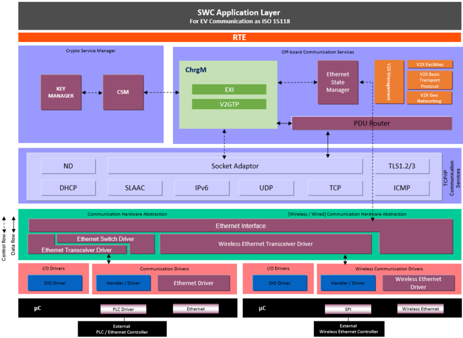

## 2. 缩略语

以下术语表包含相关缩略语和缩写。

**ChrgM**
> **Charging Manager**，充电管理器。

**V2GTP**
> 车辆到电网传输协议（**Vechile to Grid Transport Protocol**）。

**EVCC**
> 电动汽车通信控制器（**Electric Vehicle Communcation Controller**）。

**SECC**
> 供电设备通信控制器（**Supply Equipment Communcation Controller**）。

**HLC**
> 高层通信（**High Level Communcation**）。

**EVSE**
> 电动汽车供电设备（**Electrical Vehicle Supply Equipment**）。

**SDP**
> SECC 发现协议（**SECC Discovery Protocol**）。

**PLC**
> 导引线通信（**Pilot Line Communcation**）。

**EV**
> 电动汽车（**Electric Vehicle**）。

**CCS**
> 组合充电系统（**Combined Charging System**）。

**EXI**
> 高效 XML 交换（**Efficient XML Interchange**）。

**eMAID**
> e-移动账户标识符（**e-Mobility Account Identifier**）。

**EIM**
> 外部识别方式（**External Identification Means**）。

## 3. 相关文档

### 3.1. 输入文件和相关标准与规范

<a id="ref-1"></a>[1] ISO 15118-20:Road Vehicles - Vehicle to Grid Interface - Part 20:2nd Generation Network and Application Protocol Requirements

<a id="ref-2"></a>[2] ISO 15118-2:Road Vehicles - Vehicle to Grid Interface - Part 2:Network and Application Protocol Requirements

<a id="ref-3"></a>[3] Specification of Socket Adaptor
> AUTOSAR_CP_SWS_SocketAdaptor

<a id="ref-4"></a>[4] Specification of PDU Router
> AUTOSAR_CP_SWS_PDURouter

<a id="ref-5"></a>[5] Specification of Ethernet State Manager
> AUTOSAR_CP_SWS_EthernetStateManager

<a id="ref-6"></a>[6] Specification of Basic Software Mode Manager
> AUTOSAR_CP_SWS_BSWModeManager

<a id="ref-7"></a>[7] Specification of RTE Software
> AUTOSAR_CP_SWS_RTE

<a id="ref-8"></a>[8] Specification of ECU State Manager
> AUTOSAR_CP_SWS_ECUStateManager

<a id="ref-9"></a>[9] ISO 15118-3:Road Vehicles - Vehicle to Grid Interface - Part 3:Physical and Data Link Requirements

<a id="ref-10"></a>[10] Specification of Key Manager
> AUTOSAR_CP_SWS_KeyManager

<a id="ref-11"></a>[11] Specification of Crypto Service Manager
> AUTOSAR_CP_SWS_CryptoServiceManager

<a id="ref-12"></a>[12] General Specification of Basic Software Modules
> AUTOSAR_CP_SWS_BSWGeneral

### 3.2. 相关标准

无。

## 4. 约束和假设

### 4.1. 限制

**ChrgM** 模块（充电管理器）支持 **EV** 与 **EVSE** 之间按标准 **ISO-15118** 进行的通信，其他通信标准（例如 **CAN**、**LIN**、**FlexRay**）不受支持。无线和有线的以太网及收发器驱动必须分别配置为支持 **IEEE802.1X** 和 **HomePlugPHY** 标准。**ChrgM** 模块不支持双向充电。

### 4.2. 汽车域的适用性

**ChrgM** 模块可用于任何使用有线和无线以太网充电的场合。

## 5. 对其他模块的依赖

### 5.1. ECU 状态管理器（EcuM）

**EcuM** 模块初始化 **ChrgM** 模块。

### 5.2. 基础软件模式管理器（BswM）

**ChrgM** 模块将把以太网网络的模式变化通知 **BswM**。

### 5.3. BSW 调度器（SchM）

**BSW** 调度器模块调用 **ChrgM** 模块的主函数。

### 5.4. 以太网状态管理器（EthSM）

以太网状态管理器（EthSM）将把以太网网络的通信模式通知 **ChrgM** 模块。

### 5.5. 套接字适配器（SoAd）

套接字适配器是 **TCPIP** 协议栈的上层，**ChrgM** 模块使用它来打开和关闭 **TCP** 与 **UDP** 连接的套接字。

### 5.6. TcpIp

**TCPIP** 协议栈将被 **ChrgM** 模块用于提供 **TCP**、**UDP**、**ICMPv6**、**SLAAC**、**DHCP**、**NDP** 等服务。

### 5.7. 以太网接口（EthIf）

以太网接口提供访问以太网驱动和以太网收发器驱动的 **API**。它还向 **TCPIP** 协议栈提供发送和接收 **TCP** 与 **UDP** 包的 **API**。

### 5.8. 以太网驱动（EthDrv）

以太网驱动用于配置以太网控制器，按照概念 [\[2\]](#ref-2) 它必须支持 **HomePlugPHY** 标准。

### 5.9. 以太网收发器驱动（EthTrcv）

以太网收发器驱动提供配置以太网收发器的 **API**，收发器向以太网总线发送数据和从以太网总线接收数据。

### 5.10. 加密服务模块（Csm）

**ChrgM** 模块将使用加密模块的服务来支持消息的加密和解密。

### 5.11. 密钥管理器（KeyM）

**ChrgM** 模块将使用 **KeyManager** 的服务来支持证书管理和验证。

## 6. 功能规格

**Charging Manager**（ChrgM）模块使能供电设备（**EVSE**）与车辆（**EV**）之间的充电过程。充电过程基于标准 [\[2, ISO 15118-2\]](#ref-2)，支持 **AC** 和 **DC** 充电，并带有 **PnC**（plug and charge，即插即充）和 **EIM**（外部识别方式）2 种支付方式选项。**EV**（电动汽车）与 **EVSE**（电动汽车供电设备）之间的通信使用两侧各两个调制解调器建立，这些调制解调器按照 **HomePlugPHY** 标准配置。

### 6.1. 充电管理器（ChrgM）概述

**ChrgM**（充电模块）作为服务层的通信模块引入 **AUTOSAR** 分层架构，它使用不同的消息集控制充电过程。它提供与上层通信的接口，以及与下层（例如套接字适配器 [\[3, Socket Adaptor\]](#ref-3) 和 [\[4, PDU Router\]](#ref-4)）通信的接口。**ChrgM** 还与以太网状态管理器 [\[5, Ethernet State Manager\]](#ref-5)、基础软件模式管理器 [\[6, BSW Mode Manager\]](#ref-6)、基础软件调度器 [\[7, RTE\]](#ref-7) 以及 [\[8, Ecu State Manager\]](#ref-8) 通信。

当车辆将自身接入供电设备时，充电过程开始。**EVCC**（电动汽车通信控制器）在 **CP** 线上检测到电压，应用软件 **SwC** 需要轮询该 **CP** 线；一旦检测到电压，**SwC** 将通过 **API** [ChrgM_CpLineStatus](#733-chrgm_cplinestatus) 通知 **ChrgM**。这标志着充电过程的开始。**CP** 线的不同状态参见 ISO15118-1。

随后 **EVCC** 与 **SECC** 建立数据链路连接；数据链路一旦建立，它会通知 **ChrgM**。欧盟使用的充电接口是 **CCS-Type2**。车辆与供电设备之间的消息交换将通过 **CCS-Type2** 连接器的 **PP** 和 **CP** 线进行，这称为导引线通信（**PLC**），**EVCC** 和 **SECC** 在数据链路连接方面必须符合 [\[9, ISO 15118-3\]](#ref-9)。

高层架构见图 1.1。

### 6.2. 充电管理器通用需求

**ChrgM** 应提供面向上层的服务接口，请求和响应消息通过这些接口交换。

**ChrgM** 应能够根据其在上层请求消息中收到的 dataPtr 创建 V2G 消息。

**ChrgM** 应按照 [\[2, ISO 15118-2\]](#ref-2) 实现 **EXI** 编码和解码。

**ChrgM** 应按照 [\[2, ISO 15118-2\]](#ref-2) 实现 **V2GTP**。**V2GTP** 是 **EV** 与 **EVSE** 之间的标准通信协议。

**ChrgM** 应按照 [\[2, ISO 15118-2\]](#ref-2) 提供以下定时器及其 respective 超时值：

* V2G_EVCC_CommunicationSetup_Timer：**EVCC** 中的通信建立定时器
* V2G_EVCC_CommunicationSetup_Timeout：通信建立定时器的超时值
* V2G_EVCC_CableCheck_Timer：**EVCC** 中的电缆检查定时器
* V2G_EVCC_CableCheck_Timeout：CableCheck 定时器的超时值
* V2G_EVCC_PreCharge_Timer：**EVCC** 中的预充电定时器
* V2G_EVCC_Precharge_Timeout：PreCharge 定时器的超时值
* V2G_EVCC_Ongoing_Timer：**EVCC** 中的进行中定时器
* V2G_EVCC_Ongoing_Timeout：**EVCC** 中进行中定时器的超时值
* ChrgMV2G_EVCC_Msg_Timer：用于消息请求-响应对的定时器
* ChrgMV2G_EVCC_Msg_Timeout：消息时间的超时值。这是请求-响应对之间的时间
* ChrgM_SDPTimer：**SDP** 消息的定时器
* ChrgM_SDPTimerTimeout：**SDP** 消息的超时值

**注意：** 正向响应码以「OK」开头，负向响应码以「FAILED」开头。

#### 6.2.1. 充电控制消息的发送

**ChrgM** 应将 V2G 消息编码为 **EXI** 格式；在 **EXI** 编码成功后，**ChrgM** 应按 [\[2, ISO15118-2\]](#ref-2) 所述将该 **EXI** 流打包为 **V2GTP** 格式。

如果 **EXI** 编码操作期间发生错误，**ChrgM** 应向上层通报错误消息，并应停止充电过程、进入状态 [ChrgM_Init](#731-chrgm_init)。

**ChrgM** 应通过调用 PduR_&lt;User:Up&gt;Transmit 将 **V2GTP** **PDU** 发送给下层。**ChrgM** 在发送「Request」消息时还应启动定时器 ChrgMV2G_EVCC_Msg_Timer。

如果 **V2GTP** 格式化过程期间发生错误，**ChrgM** 应向上层通报错误消息，并应停止 V2G 会话、进入状态 [ChrgM_Init](#731-chrgm_init)。

#### 6.2.2. 充电控制消息的接收

收到来自下层的消息后，**ChrgM** 应按照 [\[2, ISO15118-2\]](#ref-2) 所述执行符合 **V2GTP** 的报头检查。

如果报头检查成功、响应码以「OK」开头且所有超时均被遵守，则 **ChrgM** 应：

* 解码收到的 **EXI** 编码消息
* 复位定时器 ChrgMV2G_EVCC_Msg_Timer
* 将完整消息（报头 + 载荷）发送给上层
* 等待触发下一条消息

如果所有超时均被遵守且报头检查不成功，则 **ChrgM** 应：

* 丢弃接收到的 **PDU**
* 向上层通报错误消息
* 停止充电过程并进入状态 Init
* 复位定时器 ChrgMV2G_EVCC_Msg_Timer
* 复位定时器 V2G_EVCC_CableCheck_Timer
* 复位定时器 V2G_EVCC_PreCharge_Timer
* 复位定时器 V2G_EVCC_Ongoing_Timer
* 通过调用 SoAd_CloseSoCon 关闭 **TCP-TLS** 连接
* 通过调用 SoAd_ReleaseIpAddrAssignment 释放 **IP** 地址
* 删除 **SECC IP** 地址和端口号

如果报头检查成功、所有超时均被遵守且响应码以「FAILED」开头，则 **ChrgM** 应：

* 丢弃接收到的 **PDU**
* 向上层通报错误消息
* 停止充电过程并进入状态 Init
* 复位定时器 ChrgMV2G_EVCC_Msg_Timer
* 复位定时器 V2G_EVCC_CableCheck_Timer
* 复位定时器 V2G_EVCC_PreCharge_Timer
* 复位定时器 V2G_EVCC_Ongoing_Timer
* 通过调用 SoAd_CloseSoCon 关闭 **TCP-TLS** 连接
* 通过调用 SoAd_ReleaseIpAddrAssignment 释放 **IP** 地址
* 删除 **SECC IP** 地址和端口号

如果任何定时器超出其 respective 超时值，则 **ChrgM** 应：

* 丢弃接收到的 **PDU**
* 向上层通报错误消息
* 停止充电过程并进入状态 Init
* 复位定时器 ChrgMV2G_EVCC_Msg_Timer
* 复位定时器 V2G_EVCC_CableCheck_Timer
* 复位定时器 V2G_EVCC_PreCharge_Timer
* 复位定时器 V2G_EVCC_Ongoing_Timer
* 通过调用 SoAd_CloseSoCon 关闭 **TCP-TLS** 连接
* 通过调用 SoAd_ReleaseIpAddrAssignment 释放 **IP** 地址
* 删除 **SECC IP** 地址和端口号

### 6.3. ChrgM 连接建立

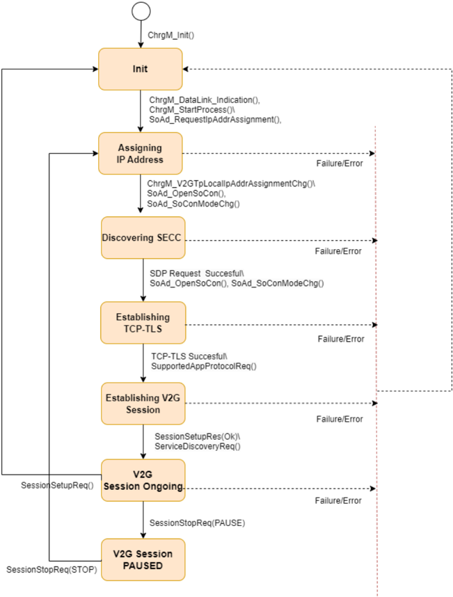

**ChrgM** 控制如下图所示的状态机，该状态机应包含以下状态：

* Init：**ChrgM** 模块的初始化。
* Assigning IP address：启动 **IP** 地址分配过程。
* Discovering SECC：**ChrgM** 建立 **UDP** 连接并发现 **SECC IP** 地址和端口号。
* Establishing TCP-TLS：**ChrgM** 建立 **TCP-TLS** 连接。
* Establishing V2G Session：**ChrgM** 建立 V2G 会话。
* V2G Session Ongoing：**ChrgM** 处于 V2G 会话中。
* V2G Session Paused：**ChrgM** 暂停 V2G 会话。

**ChrgM** 应在调用 [ChrgM_Init](#731-chrgm_init) 时进入状态 Init。

当 **ChrgM** 处于状态 Init 时，如果：

* 以「ETHTRCV_LINK_STATE_ACTIV」调用了 [ChrgM_DataLinkIndication](#734-chrgm_datalinkindication)，并且
* 以值「TRUE」调用了 [ChrgM_StartProcess](#732-chrgm_startprocess)，

则 **ChrgM** 应通过调用 SoAd_RequestIpAddrAssignment（参数 SoConId 从 ChrgMSoAdSocketConnectionRef 获得，另有 Type、LocalIpAddrPtr、Netmask 和 DefaultRouterPtr）进入状态 Assigning IP Address。**ChrgM** 应启动定时器 V2G_EVCC_CommunicationSetup_Timer。

当 **ChrgM** 处于状态 Assigning IP Address 时，如果：

* [ChrgM_V2GTpLocalIpAddrAssignmentChg](#741-chrgm_v2gtplocalipaddrassignmentchg) 返回「TCPIP_IPADDR_STATE_ASSIGNED」，

则 **ChrgM** 应通过调用 SoAd_OpenSoCon 打开 **UDP** 套接字进入状态 Discovering SECC，并等待 SoAdSoConModeChg 的响应。如果 SoAdSoConModeChg 返回「SOAD_SOCON_ONLINE」，则 **ChrgM** 应以 V2G_UDP_SDP_CLIENT 为源端口、V2G_UDP_SDP_SERVER 为目的端口发送 **SDP** 请求消息。参数 ChrgMV2GUdpSdpClientRef 所引用的套接字连接应按照 [\[2, ISO 15118-2\]](#ref-2) 配置端口 V2G_UDP_SDP_CLIENT、V2G_UDP_SDP_SERVER。

**ChrgM** 应为每条请求消息使用一个单独的 **UDP** 包。

**ChrgM** 在发送每条 **SDP** 请求消息后应至少等待 250 ms，为此应实现定时器 ChrgM_SDPTimer。该定时器超时后，应发送一条新的 **SDP** 请求消息并递增计数器。

当 **ChrgM** 处于状态 Assigning IP Address 时，如果：

* SoAdSoConModeChg 返回「SOAD_SOCON_OFFLINE」
* [ChrgM_V2GTpLocalIpAddrAssignmentChg](#741-chrgm_v2gtplocalipaddrassignmentchg) 未返回「TCPIP_IPADDR_STATE_ASSIGNED」，或
* V2G_EVCC_CommunicationSetup_Timer 超出 V2G_EVCC_CommunicationSetup_Timeout，或
* [ChrgM_DataLinkIndication](#734-chrgm_datalinkindication) 报告「ETHTRCV_LINK_STATE_INACTIV」，或
* [ChrgM_CpLineStatus](#733-chrgm_cplinestatus) 报告「INACTIVE」，

则 **ChrgM** 应停止充电过程并进入状态 Init。**ChrgM** 还应向上层通报错误消息。

当 **ChrgM** 处于状态 Discovering SECC 时，如果：

* 收到有效的 **SECC IP** 地址和端口号

则 **ChrgM** 应通过调用 SoAd_OpenSoCon 打开 **TCP** 套接字进入状态 Establishing TCP-TLS，并等待 SoAdSoConModeChg 的响应。如果 SoAdSoConModeChg 返回「SOAD_SOCON_ONLINE」，则 **ChrgM** 应在该 **TCP** 套接字上建立 **TLS** 连接，并通过调用 SoAd_CloseSoCon 关闭先前的 **UDP** 连接。

当 **ChrgM** 处于状态 Discovering SECC 时，如果：

* 未收到有效的 **SECC IP** 地址和端口号，或
* **SDP** 报头检查失败，或
* **TLS** 版本不兼容，或
* V2G_EVCC_CommunicationSetup_Timer 超出 V2G_EVCC_CommunicationSetup_Timeout，或
* [ChrgM_DataLinkIndication](#734-chrgm_datalinkindication) 报告「ETHTRCV_LINK_STATE_INACTIV」，或
* [ChrgM_CpLineStatus](#733-chrgm_cplinestatus) 报告「INACTIVE」，

则 **ChrgM** 应：

* 通过调用 SoAd_CloseSoCon 关闭 **UDP** 套接字
* 通过调用 SoAd_ReleaseIpAddrAssignment 释放 **IP** 地址
* 通过进入状态 Init 停止充电过程
* 向上层通报错误消息

**ChrgM** 应仅在 **TLS** 不可用时支持消息集 **EIM**。**TLS** 兼容性可在 **SDP** 响应消息中检查。

当 **ChrgM** 处于状态 Establishing TCP-TLS 时，如果：

* **TCP-TLS** 连接成功建立，

则 **ChrgM** 应触发消息「SupportedAppProtocolReq」以启动 V2G 会话的建立，并进入状态 Establishing V2G Session。**ChrgM** 应在触发该消息时启动定时器 ChrgMV2G_EVCC_Msg_Timer。

当 **ChrgM** 处于状态 Establishing TCP-TLS 时，如果：

* **TCP-TLS** 连接无法建立，或
* V2G_EVCC_CommunicationSetup_Timer 超出 V2G_EVCC_CommunicationSetup_Timeout，或
* [ChrgM_DataLinkIndication](#734-chrgm_datalinkindication) 报告「ETHTRCV_LINK_STATE_INACTIV」，或
* [ChrgM_CpLineStatus](#733-chrgm_cplinestatus) 报告「INACTIVE」，

则 **ChrgM** 应：

* 通过调用 SoAd_CloseSoCon 关闭 **TCP** 套接字
* 通过调用 SoAd_ReleaseIpAddrAssignment 释放 **IP** 地址
* 通过进入状态 Init 停止充电过程
* 向上层通报错误消息

**ChrgM** 应确保：如果先前建立的 **TLS** 会话被关闭，则充电过程应停止。应通过错误消息通知用户。

在 **TLS** 握手过程中，接收到的 **SECC** 证书或证书链应按照 [\[10, KeyManager\]](#ref-10) 所述通过调用 KeyM_VerifyCertificate 进行验证。

在 **TLS** 握手期间，应将所有受支持的 V2G 根证书的列表发送给 **SECC**。

在 **TLS** 握手期间，应按 [\[2, ISO-15118-2\]](#ref-2) 所述应用加密和解密机制。

当处于状态 Establishing V2G Session 时，如果响应消息「SupportedAppProtocolRes」以「Ok」返回，则 **ChrgM** 应触发下一条消息「SessionSetupReq」并等待响应。如果响应「SupportedAppProtocolRes」以「FAILED」返回，则 **ChrgM** 应：

* 通过调用 SoAd_CloseSoCon 关闭 **TCP** 套接字
* 通过调用 SoAd_ReleaseIpAddrAssignment 释放 **IP** 地址
* 通过进入状态 Init 停止充电过程
* 向上层通报错误消息

当处于状态 Establishing V2G Session 时，如果响应消息「SessionSetupRes」以「Ok」返回，则调用消息「ServiceDetailReq」将使 **ChrgM** 进入状态 V2G Session Ongoing。如果响应「SessionSetupRes」以「FAILED」返回，则 **ChrgM** 应：

* 通过调用 SoAd_CloseSoCon 关闭 **TCP** 套接字
* 通过调用 SoAd_ReleaseIpAddrAssignment 释放 **IP** 地址
* 通过进入状态 Init 停止充电过程
* 向上层通报错误消息

### 6.4. ChrgM 充电控制消息

**ChrgM** 有两组消息用于控制 **AC** 和 **DC** 充电。根据选择 **EiM** 还是 **PnC** 作为支付方式，它还提供两组不同的消息。

#### 6.4.1. 通用控制消息

**AC** 充电 **EiM** 的消息集如下：

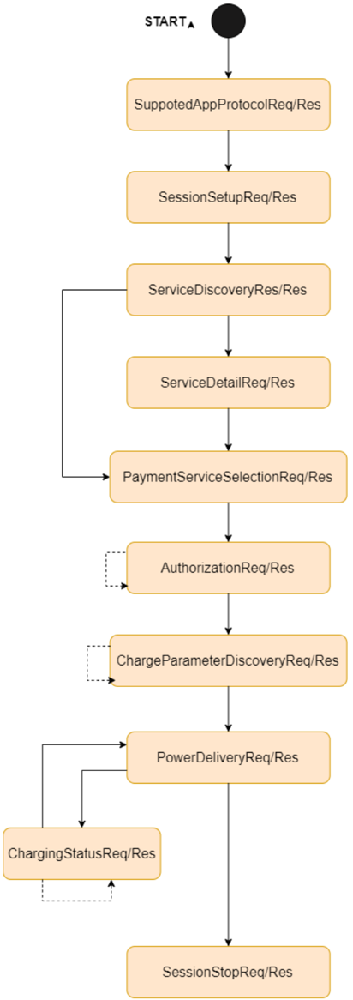

**AC** 充电 **PnC** 的消息集如下：

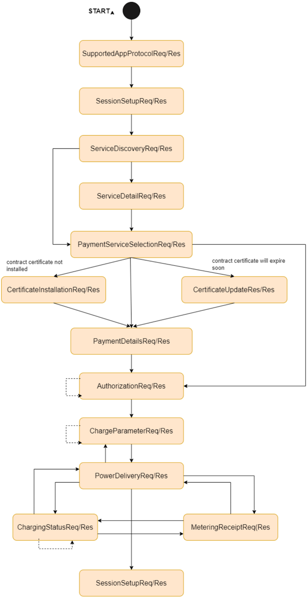

当 **ChrgM** 处于状态 V2G Session Ongoing 时，应通过服务接口 &lt;yyy&gt; 的操作 &lt;xxx&gt; 或 **API XYZ** 触发消息「ServiceDiscoveryReq」。随后 **ChrgM** 应按第 [6.2.1](#621-充电控制消息的发送) 节和第 [6.2.2](#622-充电控制消息的接收) 节的要求继续，并等待响应消息。

收到响应消息「ServiceDiscoveryRes」后，**ChrgM** 应按第 [6.2.2](#622-充电控制消息的接收) 节的要求继续。

一旦消息「ServiceDiscoveryRes」被成功处理，应通过服务接口 &lt;yyy&gt; 的操作 &lt;xxx&gt; 或 **API XYZ** 的调用触发消息「ServiceDetailReq」。随后 **ChrgM** 应按第 [6.2.1](#621-充电控制消息的发送) 节和第 [6.2.2](#622-充电控制消息的接收) 节的要求继续，并等待响应消息。

收到响应消息「ServiceDetailRes」后，**ChrgM** 应按第 [6.2.2](#622-充电控制消息的接收) 节的要求继续。

如果需要从 **SECC** 获取详细信息，则应再次触发消息「ServiceDetailReq」。

**注意：** 如果 **EVSE** 不提供服务列表，则应跳过消息「ServiceDetailReq」并触发下一条消息。

一旦消息「ServiceDetailRes」或「ServiceDiscoveryReq」被成功处理，应通过服务接口 &lt;yyy&gt; 的操作 &lt;xxx&gt; 或 **API XYZ** 的调用触发消息「PaymentServiceSelectionReq」。随后 **ChrgM** 应按第 [6.2.1](#621-充电控制消息的发送) 节和第 [6.2.2](#622-充电控制消息的接收) 节的要求继续，并等待响应消息。

收到响应消息「PaymentServiceSelectionRes」后，**ChrgM** 应按第 [6.2.2](#622-充电控制消息的接收) 节的要求继续。

如果支付选项为「AC Charging PnC 或 DC Charging PnC」且无意使用消息集「CertificateInstallationReq」和「CertificateUpdateReq」，则应通过服务接口 &lt;yyy&gt; 的操作 &lt;xxx&gt; 或 **API XYZ** 触发消息「PaymentDetailsReq」。随后 **ChrgM** 应按第 [6.2.1](#621-充电控制消息的发送) 节和第 [6.2.2](#622-充电控制消息的接收) 节的要求继续，并等待响应消息。

收到响应消息「PaymentDetailRes」后，**ChrgM** 应按第 [6.2.2](#622-充电控制消息的接收) 节的要求继续。

在成功处理响应消息「PaymentServiceSelectionRes」后，如果响应消息「ServiceDetailRes」指示证书安装可用且将使用消息集「Certificate Installation」，则应通过服务接口 &lt;yyy&gt; 的操作 &lt;xxx&gt; 或 **API XYZ** 触发消息「CertificateInstallationReq」。随后 **ChrgM** 应按第 [6.2.1](#621-充电控制消息的发送) 节和第 [6.2.2](#622-充电控制消息的接收) 节的要求继续，并等待响应消息。

**ChrgM** 应使用 **OEM** 供应证书中的签名对 **EXI** 编码消息「CertificateInstallationReq」的所有字段进行数字签名。

收到消息「CertificateInstalltionRes」后，**ChrgM** 应按第 [6.2.2](#622-充电控制消息的接收) 节的要求继续。随后应触发消息「PaymentDetailsReq」。

**ChrgM** 应通过调用 [\[11, CryptoServiceManager\]](#ref-11) 的 Csm_Decrypt 解密响应消息「CertificateInstallationRes」中的字段 ContractSignatureEncryptedPrivateKey。

在成功处理响应消息「PaymentServiceSelectionRes」后，如果响应消息「ServiceDetailRes」指示证书更新可用且将使用消息集「Certificate Update」，则应通过服务接口 &lt;yyy&gt; 的操作 &lt;xxx&gt; 或 **API XYZ** 触发消息「CertificateUpdateReq」。随后 **ChrgM** 应按第 [6.2.1](#621-充电控制消息的发送) 节和第 [6.2.2](#622-充电控制消息的接收) 节的要求继续，并等待响应消息。

**ChrgM** 应使用合同证书中的签名对 **EXI** 编码消息「CertificateUpdateReq」的所有字段进行数字签名。

收到消息「CertificateUpdateRes」后，**ChrgM** 应按第 [6.2.2](#622-充电控制消息的接收) 节的要求继续。随后应触发消息「PaymentDetailsReq」。

**ChrgM** 应通过调用 [\[11, CryptoServiceManager\]](#ref-11) 的 Csm_Decrypt 解密响应消息「CertificateUpdateRes」中的字段 ContractSignatureEncryptedPrivateKey。

在成功处理消息「PaymentDetailRes」后，应通过服务接口 &lt;yyy&gt; 的操作 &lt;xxx&gt; 或 **API XYZ** 触发消息「AuthorizationReq」。随后 **ChrgM** 应按第 [6.2.1](#621-充电控制消息的发送) 节和第 [6.2.2](#622-充电控制消息的接收) 节的要求继续，并等待响应消息。

**ChrgM** 应使用 [\[11, CryptoServiceManager\]](#ref-11) 的 Csm_SignatureGenerate 对 **EXI** 编码消息「AuthorizationReq」的所有字段进行数字签名。

收到响应消息「AuthorizationRes」后，**ChrgM** 应按第 [6.2.2](#622-充电控制消息的接收) 节的要求继续。

如果在收到第一条「AuthorizationRes」消息时参数 EVSEProcessing 被设置为 Ongoing，**ChrgM** 应触发定时器 V2G_EVCC_Ongoing_Timer，并等待参数 EVSEProcessing 等于 Finished。

如果响应消息「AuthorizationRes」中参数 EVSEProcessing 被设置为 Finished 且该响应消息被成功处理，则应通过服务接口 &lt;yyy&gt; 的操作 &lt;xxx&gt; 或 **API XYZ** 触发消息「ChargeParameterDiscoveryReq」。随后 **ChrgM** 应按第 [6.2.1](#621-充电控制消息的发送) 节和第 [6.2.2](#622-充电控制消息的接收) 节的要求继续，并等待响应消息。

如果响应消息「AuthorizationRes」中参数 EVSEProcessing 被设置为 Finished，且该响应消息已按第 [6.2.2](#622-充电控制消息的接收) 节的要求成功处理，则应通过服务接口 &lt;yyy&gt; 的操作 &lt;xxx&gt; 或 **API XYZ** 触发消息「ChargeParameterDiscoveryReq」。随后 **ChrgM** 应按第 [6.2.1](#621-充电控制消息的发送) 节和第 [6.2.2](#622-充电控制消息的接收) 节的要求继续，并等待响应消息。

如果响应消息「AuthorizationRes」中参数 EVSEProcessing 被设置为 Ongoing，且该响应消息已按第 [6.2.2](#622-充电控制消息的接收) 节的要求成功处理，则应再次触发请求消息「AuthorizationReq」。连续的「AuthorizationReq」消息应不带 Signature、Id 和 GenChallenge 发送。

收到消息「ChargeParameterDiscoveryRes」后，**ChrgM** 应按第 [6.2.2](#622-充电控制消息的接收) 节的要求继续。

**ChrgM** 应使用 [\[11, CryptoServiceManager\]](#ref-11) 的 Csm_SignatureVerify 验证消息「ChargeParameterDiscoveryRes」中的数字签名。

如果在收到第一条「ChargeParameterDiscoveryRes」消息时参数 EVSEProcessing 被设置为 Ongoing，**ChrgM** 应触发定时器 V2G_EVCC_Ongoing_Timer，并等待参数 EVSEProcessing 等于 Finished。

如果响应消息「ChargeParameterDiscoveryRes」中参数 EVSEProcessing 被设置为 Ongoing，且该响应消息已按第 [6.2.2](#622-充电控制消息的接收) 节的要求成功处理，则应再次触发请求消息「ChargeParameterDiscoveryReq」。

**注意：** 到此为止，**AC** 和 **DC** 的消息序列相同。

##### 6.4.1.1. AC 充电的控制消息

如果响应消息「ChargeParameterDiscoveryRes」中参数 EVSEProcessing 被设置为 Finished，且该响应消息已按第 [6.2.2](#622-充电控制消息的接收) 节的要求成功处理，则应通过服务接口 &lt;yyy&gt; 的操作 &lt;xxx&gt; 或 **API XYZ** 触发请求消息「PowerDeliveryReq」。随后 **ChrgM** 应按第 [6.2.1](#621-充电控制消息的发送) 节和第 [6.2.2](#622-充电控制消息的接收) 节的要求继续，并等待响应消息。

收到消息「PowerDeliveryRes」后，**ChrgM** 应按第 [6.2.2](#622-充电控制消息的接收) 节的要求继续。如果响应消息被成功处理，则应通过服务接口 &lt;yyy&gt; 的操作 &lt;xxx&gt; 或 **API XYZ** 触发消息「ChargeStatusReq」。随后 **ChrgM** 应按第 [6.2.1](#621-充电控制消息的发送) 节和第 [6.2.2](#622-充电控制消息的接收) 节的要求继续，并等待响应消息。

收到消息「ChargeStatusRes」后，**ChrgM** 应按第 [6.2.2](#622-充电控制消息的接收) 节的要求继续。如果响应消息被成功处理，则应通过服务接口 &lt;yyy&gt; 的操作 &lt;xxx&gt; 或 **API XYZ** 触发消息「MeteringReceiptReq」，前提是响应消息「ChargeStatusRes」中的参数 ReceiptRequired 被设置为 TRUE；如果参数 ReceiptRequired 被设置为 FALSE，则应再次发送消息「ChargeStatusReq」。

收到消息「MeteringReceiptRes」后，**ChrgM** 应按第 [6.2.2](#622-充电控制消息的接收) 节的要求继续。应再次触发消息「ChargeStatusReq」。**ChrgM** 应按第 [6.2.1](#621-充电控制消息的发送) 节和第 [6.2.2](#622-充电控制消息的接收) 节的要求继续，并等待响应消息。

在成功处理响应消息「ChargeStatusRes」后，如果要停止（STOPPED）充电过程，则应触发消息「PowerDeliveryReq」，参数 ChargeProgress 设置为 STOP。

如果消息「PowerDeliveryReq」以参数 ChargeProgress 设置为 STOP 触发，则 **ChrgM** 应按第 [6.2.1](#621-充电控制消息的发送) 节和第 [6.2.2](#622-充电控制消息的接收) 节的要求继续，并等待响应消息。在收到并成功处理响应「PowerDeliveryRes」消息（按第 [6.2.2](#622-充电控制消息的接收) 节）后，应触发请求消息「SesssionStopReq」以停止 **AC** 充电过程。

**注意：** 以下需求适用于 **EV** 发起的重新协商。

在成功处理响应消息「ChargeStatusRes」后，可通过发送参数 ChargeProgess 设置为 Renegotiate 的请求消息「PowerDeliveryReq」重新协商充电配置。

在成功处理响应消息「MeteringReceiptRes」后，可通过发送参数 ChargeProgess 设置为 Renegotiate 的请求消息「PowerDeliveryReq」重新协商充电配置。

**注意：** 以下需求适用于 **EVSE** 发起的重新协商。

在成功处理响应消息「ChargeStatusRes」后，如果 EVSEStatus 中的参数 EVSENotification 被设置为 Renegotiate，则应在 NotificationMaxDelay 提供的秒数内通过发送参数 ChargeProgess 设置为 Renegotiate 的请求消息「PowerDeliveryReq」来重新协商充电配置。

##### 6.4.1.2. DC 充电的控制消息

**DC** 充电 **EiM** 的消息集如下：

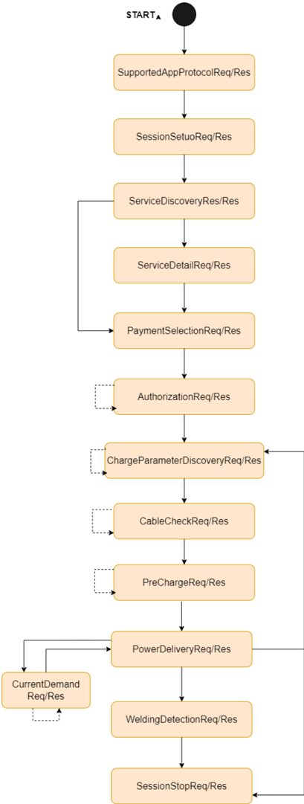

**DC** 充电 **PnC** 的消息集如下：

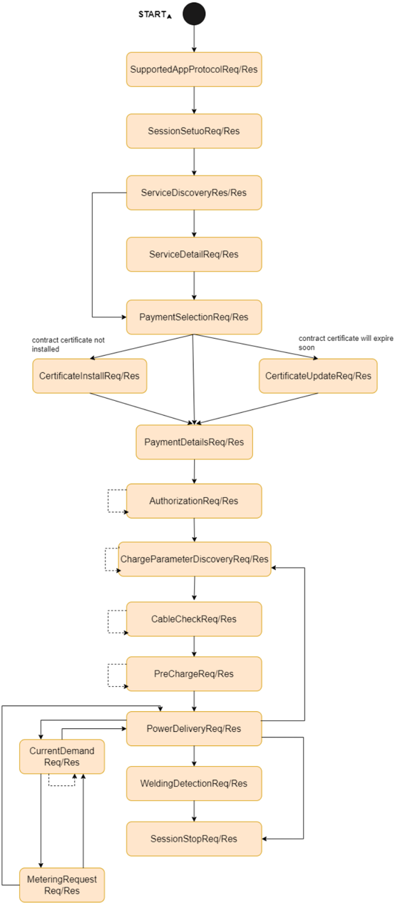

在成功处理响应消息「ChargeParameterDiscoveryRes」后，应通过服务接口 &lt;yyy&gt; 的操作 &lt;xxx&gt; 或 **API XYZ** 触发消息「CableCheckReq」。随后 **ChrgM** 应按第 [6.2.1](#621-充电控制消息的发送) 节和第 [6.2.2](#622-充电控制消息的接收) 节的要求继续，并等待响应消息。

收到消息「CableCheckRes」后，**ChrgM** 应按第 [6.2.2](#622-充电控制消息的接收) 节的要求继续。如果响应消息被成功处理且包含设置为 Ongoing 的参数 EVSEProcessing，则应再次发送消息「CableCheckReq」。

如果在收到第一条「CableCheckRes」消息时参数 EVSEProcessing 被设置为 Ongoing，**ChrgM** 应触发定时器 V2G_EVCC_Ongoing_Timer，并等待参数 EVSEProcessing 等于 Finished。

**ChrgM** 应在发送第一条请求消息「CableCheckReq」时触发定时器 V2G_EVCC_CableCheck_Timer。

收到消息「CableCheckRes」后，**ChrgM** 应按第 [6.2.2](#622-充电控制消息的接收) 节的要求继续。如果响应消息被成功处理且包含设置为 Finished 的参数 EVSEProcessing，则应通过服务接口 &lt;yyy&gt; 的操作 &lt;xxx&gt; 或 **API XYZ** 触发消息「PreChargeReq」。随后 **ChrgM** 应按第 [6.2.1](#621-充电控制消息的发送) 节和第 [6.2.2](#622-充电控制消息的接收) 节的要求继续，并等待响应消息。

收到消息「PreChargeRes」后，**ChrgM** 应按第 [6.2.2](#622-充电控制消息的接收) 节的要求继续。如果消息被成功处理且响应包含的参数 EVSEPresentVoltage 不满足 **EV** 的阈值要求，则应再次发送消息「PreChargeReq」。

**ChrgM** 应在第一次发送请求消息「PreChargeReq」时触发定时器 V2G_EVCC_PreCharge_Timer。**ChrgM** 应仅在响应指示 **EVSE** 输出电压已调整到 **EV RESS** 电压时处理该响应消息，否则 **ChrgM** 应丢弃该响应并停止 V2G 会话。

收到消息「PreChargeRes」后，**ChrgM** 应按第 [6.2.2](#622-充电控制消息的接收) 节的要求继续。如果消息被成功处理且响应包含的参数 EVSEPresentVoltage 满足 **EV** 的阈值要求，则应通过服务接口 &lt;yyy&gt; 的操作 &lt;xxx&gt; 或 **API XYZ** 触发消息「PowerDeliveyReq」。随后 **ChrgM** 应按第 [6.2.1](#621-充电控制消息的发送) 节和第 [6.2.2](#622-充电控制消息的接收) 节的要求继续，并等待响应消息。

收到消息「PowerDeliveryRes」后，**ChrgM** 应按第 [6.2.2](#622-充电控制消息的接收) 节的要求继续。如果消息被成功处理，则应通过服务接口 &lt;yyy&gt; 的操作 &lt;xxx&gt; 或 **API XYZ** 触发消息「CurrentDemandReq」。随后 **ChrgM** 应按第 [6.2.1](#621-充电控制消息的发送) 节和第 [6.2.2](#622-充电控制消息的接收) 节的要求继续，并等待响应消息。

收到消息「CurrentDemandRes」后，**ChrgM** 应按第 [6.2.2](#622-充电控制消息的接收) 节的要求继续。如果消息被成功处理且响应包含设置为 TRUE 的参数 MeteringReceipt，则应通过服务接口 &lt;yyy&gt; 的操作 &lt;xxx&gt; 或 **API XYZ** 触发消息「MeteringReceiptReq」。随后 **ChrgM** 应按第 [6.2.1](#621-充电控制消息的发送) 节和第 [6.2.2](#622-充电控制消息的接收) 节的要求继续，并等待响应消息。

**ChrgM** 应使用 [\[11, CryptoServiceManager\]](#ref-11) 的 Csm_SignatureGenerate 对 **EXI** 编码消息「MeteringReceiptReq」的所有字段进行数字签名。

收到消息「CurrentDemandRes」后，**ChrgM** 应按第 [6.2.2](#622-充电控制消息的接收) 节的要求继续。如果消息被成功处理、响应包含设置为 FALSE 的参数 MeteringReceipt 且充电过程将继续，则应再次触发消息「CurrentDemandReq」。

收到消息「MeteringReceiptRes」后，**ChrgM** 应按第 [6.2.2](#622-充电控制消息的接收) 节的要求继续。如果消息被成功处理且充电过程将继续，则应再次触发消息「CurrentDemandReq」。

收到消息「MeteringReceiptRes」后，**ChrgM** 应按第 [6.2.2](#622-充电控制消息的接收) 节的要求继续。如果消息被成功处理且充电过程将停止，则应触发参数 ChargeProgress 设置为 STOP 的消息「PowerDeliveryReq」。

收到消息「CurrentDemandRes」后，**ChrgM** 应按第 [6.2.2](#622-充电控制消息的接收) 节的要求继续。如果消息被成功处理且充电过程将停止，则应触发参数 ChargeProgress 设置为 STOP 的消息「PowerDeliveryReq」。

收到对先前参数 ChargeProgress 设置为 STOP 的「PowerDeliveryReq」的响应消息「PowerDeliveryRes」后，如果需要执行焊接检测，则应通过服务接口 &lt;yyy&gt; 的操作 &lt;xxx&gt; 或 **API XYZ** 触发消息「WeldingDetectionReq」，否则应触发消息「SessionStopReq」。

收到消息「WeldingDetectionRes」后，**ChrgM** 应按第 [6.2.2](#622-充电控制消息的接收) 节的要求继续。如果消息被成功处理，则应触发消息「SessionStopReq」。

如果消息「SessionSetupReq」以参数 ChargingSession 设置为 PAUSE 触发，则 **ChrgM** 应进入状态 V2G Session Paused，停止 V2G 会话并终止传输层，取消 **IP** 分配，删除 **SECC** 端口号和 **IP** 地址。**ChrgM** 应能够恢复「PAUSED」会话，即通过调用「SessionSetupReq」进入状态 Assigning IP Address，此时将进行以下事项：

* 重新分配 **IP** 地址
* 重新执行 **SDP**
* 重新建立 **TCP-TLS** 会话
* 重新建立 V2G 会话

需要提供以下内容：

* 先前 V2G 通信会话中 SessionSetupRes 消息报头内传递的 SessionID（用于从 SessionSetupReq 开始的所有请求消息）
* SelectedPaymentOption（PaymentServiceSelectionReq）
* RequestedEnergyTransferMode（ChargeParameterDiscoveryReq）
* ChargeParameterDiscoveryReq 中的 DepartureTime 减去已经流逝的时间
* ChargeParameterDiscoveryReq 中的参数 EAmount 减去已经充入的电量

**注意：** **EVCC** 可以通过发送带有消息报头（包含先前暂停的 V2G 通信会话的 SessionID 值）的 SesstionSetupReq 来恢复充电会话。**注意：** 以下需求适用于 **DC** 充电阶段中的重新协商。

在成功处理响应消息「CurrentDemandRes」后，可通过发送参数 ChargeProgess 设置为 Renegotiate 的请求消息「PowerDeliveryReq」重新协商充电配置。

在成功处理响应消息「MeteringReceiptRes」后，可通过发送参数 ChargeProgess 设置为 Renegotiate 的请求消息「PowerDeliveryReq」重新协商充电配置。

### 6.5. 错误分类

文档 [\[12\]](#ref-12)「基础软件模块通用规范」的「Error Handling」一章详细描述了基础软件的错误处理。其中最重要的是，它构成了一个由 **BSW** 模块中可能发生的五种错误类型组成的分类方案。

在此基础上，以下各小节按相应的子节规定了具体错误。

#### 6.5.1. 开发错误

| 错误类型 | 相关错误代码 | 错误值 |
|---|---|---|
| 在初始化模块之前调用了 **API** 服务 | CHRGM_E_UNINIT | 0x01 |
| 使用 **NULL** 指针调用 **API** 服务 | CHRGM_E_PARAM_POINTER | 0x02 |
| 参数无效 | CHRGM_E_INV_ARG | 0x03 |
| 配置集选择无效 | CHRGM_E_INIT_FAILED | 0x06 |

#### 6.5.2. 运行时错误

| 错误类型 | 相关错误代码 | 错误值 |
|---|---|---|
| 没有可用的缓冲区空间 | CHRGM_E_NOBUFS | 0x07 |

#### 6.5.3. 瞬态故障

没有瞬态错误。

#### 6.5.4. 生产错误

没有生产错误。

#### 6.5.5. 扩展生产错误

没有扩展生产错误。

### 6.6. 安全事件

本模块不上报任何安全事件。

## 7. API规范

**注意：** 第 [7](#7-api规范) 章和第 [8](#8-时序图) 章可通过以下链接获得。（源文截断：链接内容在转换中丢失）

### 7.1. 导入的类型

本章列出从以下文件包含的所有类型。

| 模块 | 头文件 | 导入的类型 |
|---|---|---|
| BswM | BswM.h | BswM_ModeType |
| BswM | BswM.h | BswM_UserType |
| ComStack_Types | ComStack_Types.h | BufReq_ReturnType |
| ComStack_Types | ComStack_Types.h | PduIdType |
| ComStack_Types | ComStack_Types.h | PduInfoType |
| ComStack_Types | ComStack_Types.h | PduLengthType |
| ComStack_Types | ComStack_Types.h | RetryInfoType |
| ComStack_Types | ComStack_Types.h | TpDataStateType |
| Csm | Rte_Csm_Type.h | Crypto_OperationModeType |
| Csm | Rte_Csm_Type.h | Crypto_VerifyResultType |
| EthTrcv | Eth_GeneralTypes.h | EthTrcv_LinkStateType |
| KeyM | KeyM.h | KeyM_CertDataType |
| KeyM | Rte_KeyM_Type.h | KeyM_CertificateIdType |
| SoAd | SoAd.h | SoAd_SoConIdType |
| SoAd | SoAd.h | SoAd_SoConModeType |
| Std | Std_Types.h | Std_ReturnType |
| TcpIp | TcpIp.h | TcpIp_DomainType |
| TcpIp | TcpIp.h | TcpIp_IpAddrAssignmentType |
| TcpIp | TcpIp.h | TcpIp_IpAddrStateType |
| TcpIp | TcpIp.h | TcpIp_LocalAddrIdType |
| TcpIp | TcpIp.h | TcpIp_ReturnType |
| TcpIp | TcpIp.h | TcpIp_SockAddrType |

### 7.2. 类型定义

#### 7.2.1. ChrgM_ConfigType

| 名称 | ChrgM_ConfigType | | |
| --- | --- | --- | --- |
| 类别 | Structure | | |
| 描述 | 包含 **COM** 初始化数据的数据结构的类型。 | | |
| 可通过 | ChrgM.h 获得 | | |

#### 7.2.2. ChrgM_ErrorHandlerType

| 名称 | ChrgM_ErrorHandlerType | | |
| --- | --- | --- | --- |
| 类别 | Type | | |
| 派生自 | string | | |
| 取值 | V2G_EVCC_CommunicationSetupTimeout | - | - |
| | V2G_EVCC_MsgTimeout | - | - |
| | V2G_EVCC_CableCheckTimeout | - | - |
| | V2G_EVCC_OngoingTimeout | - | - |
| | V2G_EVCC_PrechargeTimeout | - | - |
| | FAILED | - | - |
| | CHRGM_SequenceError | - | - |
| | CHRGM_SignatureError | - | - |
| | CHRGM_UnknownSession | - | - |
| | CHRGM_InvalidServiceID | - | - |
| | CHRGM_PaymentSelectionInvalid | - | - |
| | CHRGM_ServiceSelectionInvalid | - | - |
| | CHRGM_NoChargeServiceSelected | - | - |
| | CHRGM_CertificateExpired | - | - |
| | CHRGM_CertificateRevoked | - | - |
| | CHRGM_NoCertificateAvailable | - | - |
| | CHRGM_CertificateNotAllowedAtThisEVSE | - | - |
| | CHRGM_CertChainError | - | - |
| | CHRGM_ContractCancelled | - | - |
| | CHRGM_ChallengeInvalid | - | - |
| | CHRGM_WrongEnergyTransferMode | - | - |
| | CHRGM_WrongChargeParameter | - | - |
| | CHRGM_ChargingProfileInvalid | - | - |
| | CHRGM_TariffSelectionInvalid | - | - |
| | CHRGM_PowerDeliveryNotApplied | - | - |
| | CHRGM_ContactorError | - | - |
| 描述 | 基本类型。 | | |
| 可通过 | ChrgM.h 获得 | | |

#### 7.2.3. ChrgM_ResponseCodeType

| 名称 | ChrgM_ResponseCodeType | | |
| --- | --- | --- | --- |
| 类别 | Type | | |
| 派生自 | string | | |
| 取值 | Ok | - | - |
| | OK_SuccessfulNegotiation | - | - |
| | OK_SuccessfulNegotiationWithMinorDeviation | - | - |
| | Ok_NewSessionEstablished | - | - |
| | Ok_OldSessionJoined | - | - |
| | Ok_CertificateExpiresSoon | - | - |
| | FAILED | - | - |
| | FAILED_SequenceError | - | - |
| | FAILED_ServiceIDInvalid | - | - |
| | FAILED_UnknownSession | - | - |
| | FAILED_ServiceSelectionInvalid | - | - |
| | FAILED_PaymentSelectionInvalid | - | - |
| | FAILED_CertificateExpired | - | - |
| | FAILED_SignatureError | - | - |
| | FAILED_NoCertificateAvailable | - | - |
| | FAILED_CertChainError | - | - |
| | FAILED_ChallengeInvalid | - | - |
| | FAILED_ContractCanceled | - | - |
| | FAILED_WrongChargeParameter | - | - |
| | FAILED_PowerDeliveryNotApplied | - | - |
| | FAILED_TariffSelectionInvalid | - | - |
| | FAILED_ChargingProfileInvalid | - | - |
| | FAILED_MeteringSignatureNotValid | - | - |
| | FAILED_NoChargeServiceSelected | - | - |
| | FAILED_WrongEnergyTransferMode | - | - |
| | FAILED_ContactorError | - | - |
| | FAILED_CertificateNotAllowedAtThisEVSE | - | - |
| | FAILED_CertificateRevoked | - | - |
| | Failed_NoNegotiation | - | - |
| 描述 | 元素 ResponseCode 的基本类型。 | | |
| 可通过 | ChrgM.h 获得 | | |

### 7.3. 函数定义

#### 7.3.1. ChrgM_Init

**说明**: 本服务初始化 **ChrgM** 模块。可通过 **ChrgM.h** 获得。服务 **ID** 0x1。本服务为同步调用，不可重入。参数 ConfigPtr（in）：指向配置参数集的指针，例如用于 post-build 参数。返回值：无。

```C
void ChrgM_Init ( const ChrgM_ConfigType* ConfigPtr )
```

#### 7.3.2. ChrgM_StartProcess

**说明**: 上层调用本 **API** 以启动充电过程：如果布尔参数设置为 TRUE，**ChrgM** 将启动 **IP** 地址分配过程，否则不启动。可通过 **ChrgM.h** 获得。服务 **ID** 0x25。本服务为同步调用，不可重入。参数 Process（in）：用于启动充电过程的布尔值。返回值：无。

```C
void ChrgM_StartProcess ( boolean Process )
```

#### 7.3.3. ChrgM_CpLineStatus

**说明**: 上层调用本 **API** 向 **ChrgM** 通报 **CP** 线状态。可通过 **ChrgM.h** 获得。服务 **ID** 0x1e。本服务为同步调用，可重入。参数 CpLineStatus（in）：**CP** 线的状态，详情参见文档 ISO 15118-1。返回值：无。

```C
void ChrgM_CpLineStatus ( char CpLineStatus )
```

#### 7.3.4. ChrgM_DataLinkIndication

**说明**: 本 **API** 由 **EthSM** 调用，向 **ChrgM** 通报数据链路连接的状态。可通过 **ChrgM.h** 获得。服务 **ID** 0x2。本服务为同步调用，不可重入。参数 CtrlIdx（in）：**Ethernet Interface** 上下文中以太网控制器的索引。参数 TransceiverLinkState（in）：特定网络句柄的实际收发器链路状态。返回值：无。

```C
void ChrgM_DataLinkIndication ( uint8 CtrlIdx, EthTrcv_LinkStateType TransceiverLinkState )
```

#### 7.3.5. ChrgM_ErrorIndication

**说明**: **ChrgM** 向上层通报错误。可通过 **ChrgM_Externals.h** 获得。服务 **ID** 0x1d。本服务为同步调用，可重入。参数 ErrorHandler（in）：定义错误的类型。返回值：无。

```C
void ChrgM_ErrorIndication ( ChrgM_ErrorHandlerType ErrorHandler )
```

#### 7.3.6. ChrgM_MainFunction_Rx

**说明**: 本函数执行 **AUTOSAR ChrgM** 模块的接收处理。可通过 SchM_ChrgM.h 获得。服务 **ID** 0x24。本服务为同步调用，对不同实例可重入，对同一实例不可重入。参数：无。返回值：无。

```C
void ChrgM_MainFunction_Rx ( void )
```

#### 7.3.7. ChrgM_MainFunction_Tx

**说明**: 本函数执行 **AUTOSAR ChrgM** 模块的发送处理。可通过 ChrgM_SchM.h 获得。服务 **ID** 0x23。返回值：无。

```C
void ChrgM_MainFunction_Tx ( void )
```

#### 7.3.8. ChrgM_PaymentServiceSelectionIndication

**说明**: **ChrgM** 向上层通报 **SECC** 提供的支付方式。可通过 **ChrgM_Externals.h** 获得。服务 **ID** 0x15。本服务为同步调用，可重入。参数 ResponseCode（in）：指示 **SECC** 接收到的任何 V2G 消息的确认状态的响应码。返回值：无。

```C
void ChrgM_PaymentServiceSelectionIndication ( ChrgM_ResponseCodeType ResponseCode )
```

#### 7.3.9. ChrgM_SessionSetupIndication

**说明**: **ChrgM** 向上层通报 V2G 会话建立信息。可通过 **ChrgM_Externals.h** 获得。服务 **ID** 0x12。本服务为同步调用，可重入。参数 ResponseCode（in）：指示 **SECC** 接收到的任何 V2G 消息的确认状态的响应码。返回值：无。

```C
void ChrgM_SessionSetupIndication ( ChrgM_ResponseCodeType ResponseCode )
```

#### 7.3.10. ChrgM_SessionStopIndication

**说明**: **ChrgM** 向上层通报 V2G 会话的状态。所有可能情况参见类型定义 Response Code。可通过 **ChrgM_Externals.h** 获得。服务 **ID** 0x1c。本服务为同步调用，可重入。参数 ResponseCode（in）：指示 **SECC** 接收到的任何 V2G 消息的确认状态的响应码。返回值：无。

```C
void ChrgM_SessionStopIndication ( ChrgM_ResponseCodeType ResponseCode )
```

#### 7.3.11. ChrgM_V2GTpCopyRxData

**说明**: 调用本函数以向上层提供 I-PDU 段（N-PDU）的接收数据。每次调用本函数提供 I-PDU 数据的下一部分。剩余缓冲区的大小写入 bufferSizePtr 指示的位置。可通过 **ChrgM.h** 获得。服务 **ID** 0x44。本服务为同步调用，可重入。参数 id（in）：接收到的 I-PDU 的标识。参数 info（in）：提供源缓冲区（SduDataPtr）和要复制的字节数（SduLength）。SduLength 为 0 可用于查询上层模块当前可用的缓冲区量；此时 SduDataPtr 可为 NULL_PTR。参数 bufferSizePtr（out）：数据复制后可用的接收缓冲区。返回值：BufReq_ReturnType，BUFREQ_OK：数据复制成功；BUFREQ_E_NOT_OK：由于发生错误，数据未被复制。

```C
BufReq_ReturnType ChrgM_V2GTpCopyRxData ( PduIdType id, const PduInfoType* info, PduLengthType* bufferSizePtr )
```

#### 7.3.12. ChrgM_V2GTpCopyTxData

**说明**: 调用本函数以获取 I-PDU 段（N-PDU）的发送数据。除非 retry-&gt;TpDataState 为 TP_DATARETRY，每次调用本函数提供 I-PDU 数据的下一部分；在该情况下，函数从 retry-&gt;TxTpDataCnt 指示的当前位置偏移处重新开始复制数据。剩余数据的大小写入 availableDataPtr 指示的位置。可通过 **ChrgM.h** 获得。服务 **ID** 0x43。本服务为同步调用，可重入。参数 id（in）：发送的 I-PDU 的标识。参数 info（in）：提供目标缓冲区（SduDataPtr）和要复制的字节数（SduLength）。如果没有足够的发送数据，上层模块不复制任何数据并返回 BUFREQ_E_BUSY；下层模块可重试调用。SduLength 为 0 可用于指示 retry 参数中的状态变化或查询上层模块当前可用的数据量；此时 SduDataPtr 可为 NULL_PTR。参数 retry（in）：该参数用于确认已发送的数据或在发送问题后重传数据。如果 retry 参数为 NULL_PTR，表示发送数据在复制后可立即从缓冲区移除。否则 retry 参数必须指向有效的 RetryInfoType 元素。如果 TpDataState 指示 TP_CONFPENDING，先前复制的数据必须保留在 **TP** 缓冲区中以供错误恢复使用。TP_DATACONF 表示在此调用之前复制的所有数据已被确认并可从 **TP** 缓冲区移除；本 **API** 调用复制的数据除外，稍后确认。TP_DATARETRY 表示本 **API** 调用应复制先前已复制的数据以便从错误中恢复；此时 TxTpDataCnt 指定距当前数据复制位置的字节偏移。参数 availableDataPtr（out）：指示上层模块 **Tx** 缓冲区中剩余的可用字节数。availableDataPtr 可被支持动态载荷长度的 **TP** 模块（例如 FrIsoTp）用于确定后续 **CF** 的大小。返回值：BufReq_ReturnType，BUFREQ_OK：数据已按要求完整复制到发送缓冲区；BUFREQ_E_BUSY：由于所需的 **Tx** 数据量不可用，请求无法满足。下层模块可稍后重试此调用。未复制任何数据；BUFREQ_E_NOT_OK：数据未被复制，请求失败。

```C
BufReq_ReturnType ChrgM_V2GTpCopyTxData ( PduIdType id, const PduInfoType* info, const RetryInfoType* retry, PduLengthType* availableDataPtr )
```

### 7.4. 回调通知

这是为其他模块提供的函数列表。

#### 7.4.1. ChrgM_V2GTpLocalIpAddrAssignmentChg

**说明**: **SoAd** 调用本 **API** 向 **ChrgM** 通报 **IP** 地址的状态。可通过 ChrgM_SoAd.h 获得。服务 **ID** 0x18。本服务为同步调用，不可重入。参数 IpAddrId（in）：**IP** 地址标识符，表示 **TcpIp** 模块配置中指定的 **IP** 地址（例如 EthIf 控制器 0 上的静态 **IPv4** 地址）。参数 State（in）：**IP** 地址分配的状态。返回值：无。

```C
void ChrgM_V2GTpLocalIpAddrAssignmentChg ( TcpIp_LocalAddrIdType IpAddrId, TcpIp_IpAddrStateType State )
```

#### 7.4.2. ChrgM_V2GTpRxIndication

**说明**: 在收到 I-PDU 之后（分段情况下为收到最后一个 I-PDU 之后）由下层调用。可通过 **ChrgM.h** 获得。服务 **ID** 0x45。本服务为同步调用，可重入。参数 id（in）：接收到的 I-PDU 的标识。参数 result（in）：E_OK：**PDU** 已接收。E_NOT_OK：**PDU** 接收失败。返回值：无。

```C
void ChrgM_V2GTpRxIndication ( PduIdType id, Std_ReturnType result )
```

#### 7.4.3. ChrgM_V2GTpSoConModeChg

**说明**: **SoAd** 调用本 **API** 向 **ChrgM** 通报套接字连接的状态。**注意：** 应配置 CP-SWS-SocketAdaptor 的容器 SoAdSocketConnectionGroup 中 SoAdSocketConnectionGroup 的参数 SoAdSocketSoConModeChgNotifUpperLayerRef（参见 ECUC_SoAd_00161）。可通过 ChrgM_SoAd.h 获得。服务 **ID** 0x21。本服务为同步调用，对不同 SoConId 可重入，对同一 SoConId 不可重入。参数 SoConId（in）：指定发生模式变化的套接字连接的套接字连接索引。参数 Mode（in）：新的套接字连接模式。返回值：无。

```C
void ChrgM_V2GTpSoConModeChg ( SoAd_SoConIdType SoConId, SoAd_SoConModeType Mode )
```

#### 7.4.4. ChrgM_V2GTpStartOfReception

**说明**: 在开始接收 N-SDU 时调用本函数。N-SDU 可能被分段为多个 N-PDU（FF 及其后的一个或多个 CF），也可能由单个 N-PDU（SF）组成。当以等于 0 的 TpSduLength 调用时，该服务应提供当前可用的最大缓冲区大小。可通过 **ChrgM.h** 获得。服务 **ID** 0x46。本服务为同步调用，可重入。参数 id（in）：I-PDU 的标识。参数 info（in）：指向 PduInfoType 结构的指针，该结构包含传输协议 I-PDU 接收的首帧或单帧的载荷数据（不含协议信息）和载荷长度，以及与此 **PDU** 相关的 MetaData。如果首帧/单帧数据和 MetaData 都不可用，此参数设置为 NULL_PTR。参数 TpSduLength（in）：要接收的 N-SDU 的总长度。参数 bufferSizePtr（out）：接收模块中可用的接收缓冲区。该参数将用于在传输协议模块中计算块大小（BS）。返回值：BufReq_ReturnType，BUFREQ_OK：连接已被接受。bufferSizePtr 指示可用的接收缓冲区；接收继续。如果没有所请求大小的缓冲区可用，bufferSizePtr 应指示接收缓冲区大小为 0；BUFREQ_E_NOT_OK：连接已被拒绝；接收中止。bufferSizePtr 保持不变；BUFREQ_E_OVFL：无法提供所需长度的缓冲区；接收中止。bufferSizePtr 保持不变。

```C
BufReq_ReturnType ChrgM_V2GTpStartOfReception ( PduIdType id, const PduInfoType* info, PduLengthType TpSduLength, PduLengthType* bufferSizePtr )
```

#### 7.4.5. ChrgM_V2GTpTxConfirmation

**说明**: 下层调用 **ChrgM** 的本 **API** 向 **ChrgM** 通报所发送 **PDU** 的状态。可通过 **ChrgM.h** 获得。服务 **ID** 0x48。本服务为同步调用，可重入。参数 id（in）：发送的 I-PDU 的标识。参数 result（in）：E_OK：**PDU** 已发送。E_NOT_OK：**PDU** 发送失败。返回值：无。

```C
void ChrgM_V2GTpTxConfirmation ( PduIdType id, Std_ReturnType result )
```

### 7.5. 调度函数

这些函数由基础软件调度器直接调用。以下函数应没有返回值和参数。所有函数应不可重入。

### 7.6. 期望接口

#### 7.6.1. 强制接口

| API 函数 | 头文件 | 描述 |
|---|---|---|
| BswM_RequestMode | BswM.h | 请求模式的通用函数调用。只有没有特定模式请求接口的其他 **BSW** 模块才应使用此函数 |
| Csm_Decrypt | Csm.h | 解密给定的加密数据，并将解密后的明文存储在结果指针所指向的内存位置 |
| Csm_Encrypt | Csm.h | 加密给定的数据，并将密文存储在结果指针所指向的内存位置 |
| Csm_SignatureGenerate | Csm.h | 使用给定的数据执行签名计算，并将签名存储在结果指针所指向的内存位置 |
| Csm_SignatureVerify | Csm.h | 通过比较签名是否由给定数据生成来验证给定的 **MAC** |
| Det_ReportRuntimeError | Det.h | 上报运行时错误的服务。如果配置了 callout，则应调用该 callout |
| KeyM_GetCertificate | KeyM.h | 本函数提供 **DER** 编码的证书数据 |
| KeyM_SetCertificate | KeyM.h | 本函数向密钥管理模块提供证书数据以临时存储该证书 |
| KeyM_VerifyCertificate | KeyM.h | 本函数针对已存储的证书以及以其他证书 **ID** 存储的已提供证书，验证先前通过 KeyM_SetCertificate() 提供的证书 |
| PduR_ChrgMTransmit | PduR_ChrgM.h | 请求发送一个 **PDU** |
| SoAd_CloseSoCon | SoAd.h | 本服务关闭 SoConId 指定的套接字连接 |
| SoAd_IfTransmit | SoAd.h | 请求发送一个 **PDU** |
| SoAd_IsConnectionReady | SoAd.h | 本 **API** 允许检查通过该套接字连接是否可能与特定远端地址通信。它包括：套接字连接已绑定到套接字、所请求的远端地址的物理地址可用，以及（如果配置了安全关联）已建立安全连接 |
| SoAd_OpenSoCon | SoAd.h | 本服务打开 SoConId 指定的套接字连接 |
| SoAd_RequestIpAddrAssignment | SoAd.h | 通过本 **API** 服务，启动 SoConId 指定的套接字连接将要使用的本地 **IP** 地址分配 |

#### 7.6.2. 可选接口

| API 函数 | 头文件 | 描述 |
|---|---|---|
| Det_ReportError | Det.h | 上报开发错误的服务 |

## 8. 时序图

### 8.1. 数据链路指示

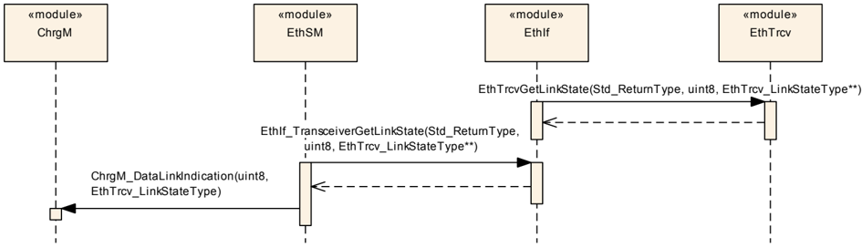

### 8.2. 启动 IP 地址分配

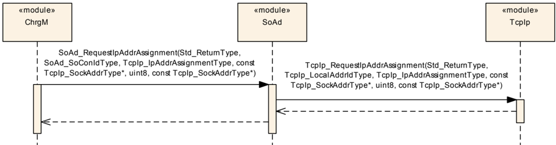

### 8.3. SECC 发现过程

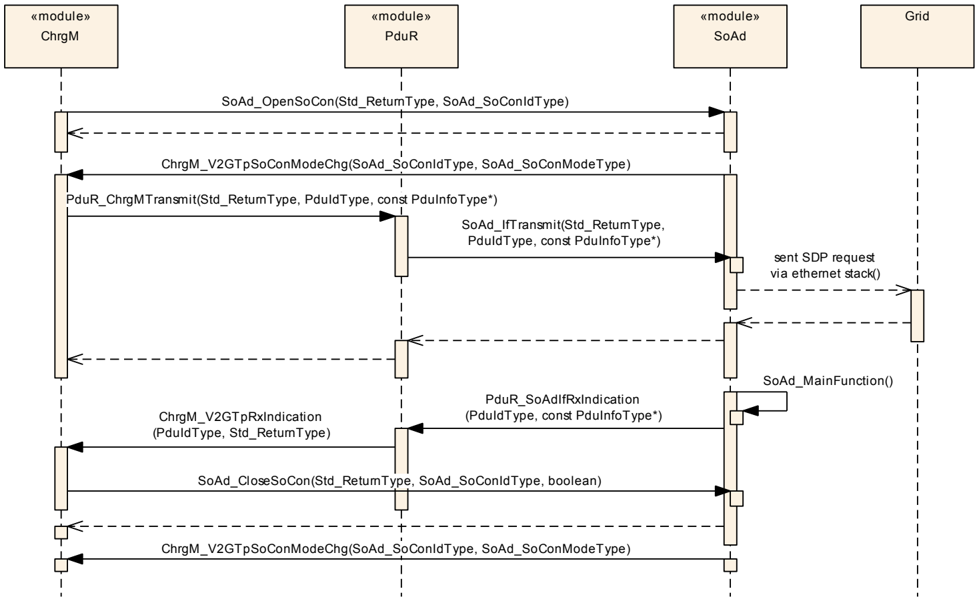

### 8.4. 发送

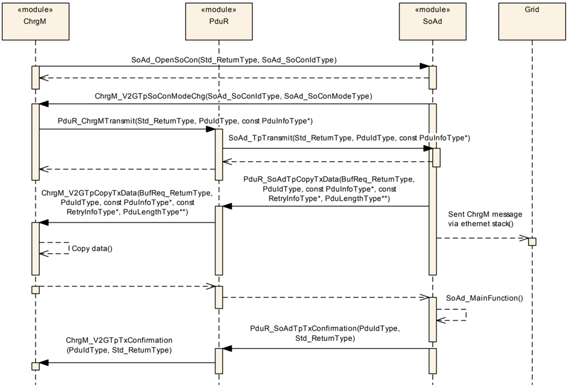

### 8.5. 接收

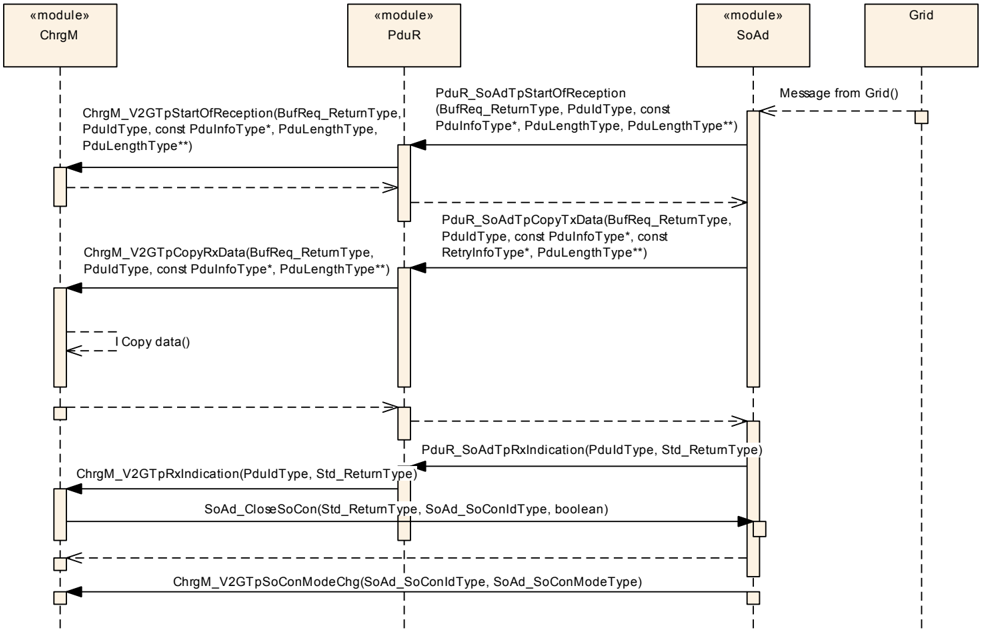

## 9. 配置规范

一般而言，本章定义配置参数及其到容器中的聚类。为支持本规范，第 9.1 章描述基本知识。我们还规定用于参数规范的模板（表）。我们打算将第 9.1 章保留在规范中以保证理解。

第 9.2 章规定模块 **ChrgM** 的结构（容器）和参数。

第 9.3 章规定模块 **ChrgM** 的发布信息。

### 9.1. 如何阅读本章

详情参见 SWS_BSWGeneral 的第 10.1 章「配置规范简介」。

### 9.2. 容器与配置参数

#### 9.2.1. ChrgM

| SWS 条目 | [ECUC_ChrgM_00001] |
|---|---|
| 模块名称 | ChrgM |
| 描述 | **Charging Manager** 模块的配置。 |
| Post-Build 变体支持 | false |
| 支持的配置变体 | VARIANT-PRE-COMPILE |

| 容器名称 | 多重性 | 作用域/依赖 |
|---|---|---|
| ChrgMGeneral | 1 | **Charging Manager** 模块的通用配置。 |
| ChrgMService | 1 | 用于配置 ChrgMService 的配置参数。 |
| ChrgMTimer | 0..* | **ChrgM** 定时器的配置。 |
| ChrgMV2GTP | 0..1 | 车辆到电网传输协议的配置。 |

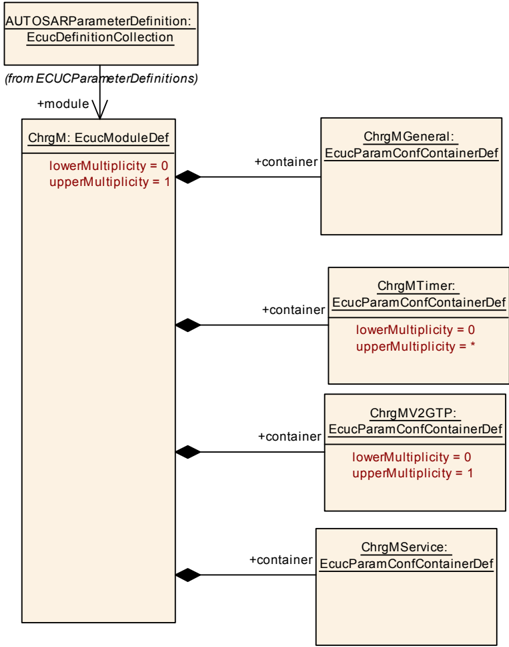

#### 9.2.2. ChrgMGeneral

| SWS 条目 | [ECUC_ChrgM_00009] |
|---|---|
| 容器名称 | ChrgMGeneral |
| 父容器 | ChrgM |
| 描述 | **Charging Manager** 模块的通用配置。 |
| 配置参数 | 见下方参数表 |

| SWS 条目 | [ECUC_ChrgM_00029] |
|---|---|
| 参数名称 | ChrgMDevErrorDetect |
| 父容器 | ChrgMGeneral |
| 描述 | 将开发错误检测和通知打开或关闭。* **true**：检测和通知被使能。* **false**：检测和通知被禁用。 |
| 多重性 | 1 |
| 类型 | EcucBooleanParamDef |
| 默认值 | false |
| Post-Build 变体值 | false |
| 值配置类 | Pre-compile time：x（All Variants）；Link time：-；Post-build time：- |
| 作用域/依赖 | scope: local |

| SWS 条目 | [ECUC_ChrgM_00031] |
|---|---|
| 参数名称 | ChrgMMainFunctionCycleTime |
| 父容器 | ChrgMGeneral |
| 描述 | 本参数以秒为单位定义周期性调用 **ChrgM** 主函数的周期。 |
| 多重性 | 1 |
| 类型 | EcucFloatParamDef |
| 范围 | ]0 .. INF[ |
| 默认值 | - |
| Post-Build 变体值 | false |
| 值配置类 | Pre-compile time：x（All Variants）；Link time：-；Post-build time：- |
| 作用域/依赖 | scope: local |

| SWS 条目 | [ECUC_ChrgM_00030] |
|---|---|
| 参数名称 | ChrgMVersionInfoApi |
| 父容器 | ChrgMGeneral |
| 描述 | 使能和禁用版本信息 **API**。 |
| 多重性 | 1 |
| 类型 | EcucBooleanParamDef |
| 默认值 | false |
| Post-Build 变体值 | false |
| 值配置类 | Pre-compile time：x（All Variants）；Link time：-；Post-build time：- |
| 作用域/依赖 | scope: local |

无包含的容器。

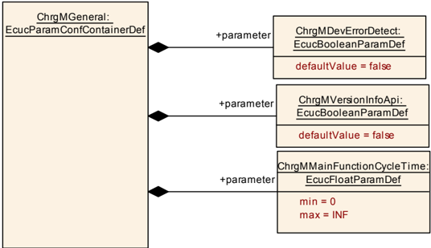

#### 9.2.3. ChrgMTimer

| SWS 条目 | [ECUC_ChrgM_00033] |
|---|---|
| 容器名称 | ChrgMTimer |
| 父容器 | ChrgM |
| 描述 | **ChrgM** 定时器的配置。 |
| Post-Build 变体多重性 | false |
| 配置参数 | 见下方参数表 |

| SWS 条目 | [ECUC_ChrgM_00013] |
|---|---|
| 参数名称 | ChrgMV2gEvccMsgTimeout |
| 父容器 | ChrgMTimer |
| 描述 | 本参数定义请求与其对应响应消息之间允许的最大时间。 |
| 多重性 | 1 |
| 类型 | EcucFloatParamDef |
| 范围 | [-INF .. INF] |
| 默认值 | - |
| 作用域/依赖 | scope: ECU |

无包含的容器。

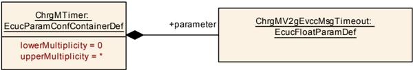

#### 9.2.4. ChrgMV2GTP

| SWS 条目 | [ECUC_ChrgM_00010] |
|---|---|
| 容器名称 | ChrgMV2GTP |
| 父容器 | ChrgM |
| 描述 | 车辆到电网传输协议的配置。 |
| Post-Build 变体多重性 | false |
| 配置参数 | 见下方参数表 |

| SWS 条目 | [ECUC_ChrgM_00026] |
|---|---|
| 参数名称 | ChrgMV2GSrcTcpDataRef |
| 父容器 | ChrgMV2GTP |
| 描述 | 对 SoAdSocketConnectionGroup 的引用，用于访问本地 **IP** 地址和 **TCP** 端口，以构建发送 V2G 消息的端点选项。 |
| 多重性 | 1 |
| 类型 | Reference to SoAdSocketConnectionGroup |
| Post-Build 变体多重性 | false |
| Post-Build 变体值 | false |
| 多重性配置类 | Pre-compile time：x；Link time：-；Post-build time：- |
| 值配置类 | Pre-compile time：x；Link time：-；Post-build time：- |
| 作用域/依赖 | scope: ECU |

| SWS 条目 | [ECUC_ChrgM_00034] |
|---|---|
| 参数名称 | ChrgMV2GUdpSdpClientRef |
| 父容器 | ChrgMV2GTP |
| 描述 | 对 SoAdSocketConnectionGroup 的引用，用于访问本地 **IP** 地址和 **UDP** 端口，以构建 **SECC** 发现过程的端点选项。 |
| 多重性 | 0..1 |
| 类型 | Reference to SoAdSocketConnectionGroup |
| Post-Build 变体多重性 | false |
| Post-Build 变体值 | false |
| 多重性配置类 | Pre-compile time：x；Link time：-；Post-build time：- |
| 值配置类 | Pre-compile time：x；Link time：-；Post-build time：- |
| 作用域/依赖 | scope: ECU |

| 容器名称 | 多重性 | 作用域/依赖 |
|---|---|---|
| ChrgMV2GTPPdu | 0..1 | 包含 **ChrgM** 模块在 **ChrgM** 与 **PduR** 之间交换的 **Pdu** 的配置参数。 |

| SWS 条目 | [ECUC_ChrgM_00035] |
|---|---|
| 容器名称 | ChrgMV2GTPPdu |
| 父容器 | ChrgMV2GTP |
| 描述 | 包含 **ChrgM** 模块在 **ChrgM** 与 **PduR** 之间交换的 **Pdu** 的配置参数。 |
| Post-Build 变体多重性 | true |
| 多重性配置类 | Pre-compile time：x（VARIANT-PRE-COMPILE）；Link time：-；Post-build time：- |
| 配置参数 | 见下方参数表 |

| SWS 条目 | [ECUC_ChrgM_00027] |
|---|---|
| 参数名称 | ChgMV2GTPPduPayloadType |
| 父容器 | ChrgMV2GTPPdu |
| 描述 | 本参数包含关于如何解码 **V2GTP** 报头之后的载荷的信息。 |
| 多重性 | 1 |
| 类型 | EcucIntegerParamDef |
| 范围 | 0 .. 65535 |
| 默认值 | - |
| 作用域/依赖 | scope: local |

| SWS 条目 | [ECUC_ChrgM_00028] |
|---|---|
| 参数名称 | ChgMV2GTPPduProtocolVersion |
| 父容器 | ChrgMV2GTPPdu |
| 描述 | 本参数指定在 **Pdu** 中发送的 **V2GTP** 消息的协议版本。 |
| 多重性 | 1 |
| 类型 | EcucIntegerParamDef |
| 范围 | 0 .. 255 |
| 默认值 | - |
| 作用域/依赖 | scope: local |

| SWS 条目 | [ECUC_ChrgM_00023] |
|---|---|
| 参数名称 | ChrgMV2GTPPduHandleId |
| 父容器 | ChrgMV2GTPPdu |
| 描述 | 由 **ChrgM** 模块分配的 **PDU** 标识符。从 **PduR** 接收 I-PDU 时，**API** 调用 ChrgM_V2GTpRxIndication、ChrgM_V2GTpCopyRxData、ChrgM_V2GTpStartOfReception 需要该参数。对于 **Tx** I-PDU，此句柄 **Id** 用于 **API** 调用 ChrgM_V2GTpTxConfirmation、ChrgM_V2GTpCopyTxData，以发送并确认 I-PDU 的传输。 |
| 多重性 | 0..1 |
| 类型 | EcucIntegerParamDef（为该参数生成符号名） |
| 范围 | 0 .. 65535 |
| 默认值 | - |
| Post-Build 变体多重性 | false |
| Post-Build 变体值 | false |
| 多重性配置类 | Pre-compile time：x；Link time：-；Post-build time：- |
| 值配置类 | Pre-compile time：x；Link time：-；Post-build time：- |
| 作用域/依赖 | scope: ECU |

| SWS 条目 | [ECUC_ChrgM_00024] |
|---|---|
| 参数名称 | ChrgMV2GTPPduRef |
| 父容器 | ChrgMV2GTPPdu |
| 描述 | 对「全局」**Pdu** 结构的引用，以允许 **COM-Stack** 中句柄 **ID** 的协调一致。 |
| 多重性 | 1 |
| 类型 | Reference to Pdu |
| Post-Build 变体值 | false |
| 值配置类 | Pre-compile time：x（VARIANT-PRE-COMPILE）；Link time：-；Post-build time：- |
| 作用域/依赖 | - |

无包含的容器。

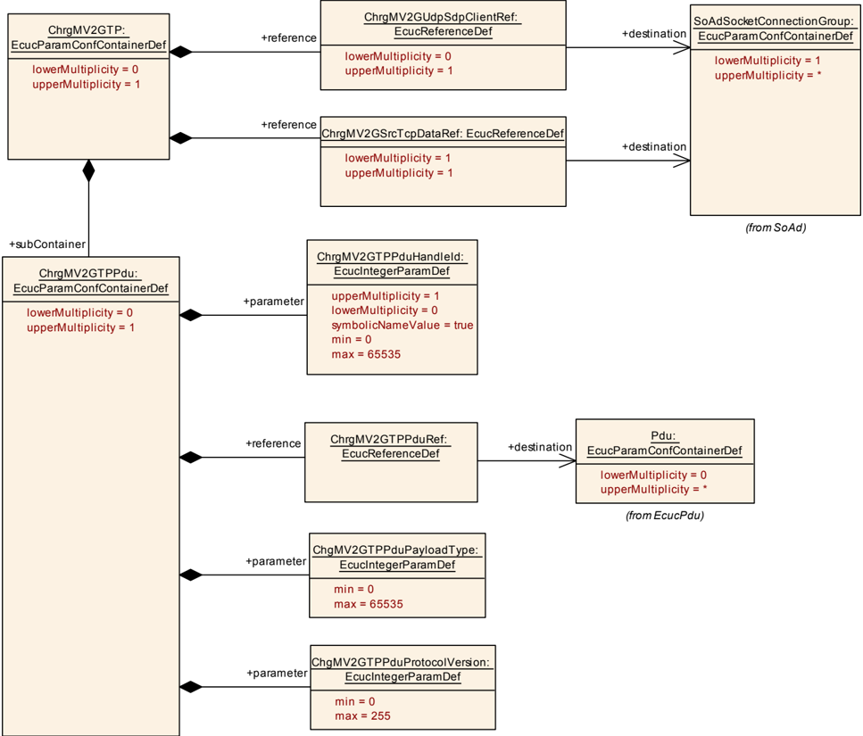

#### 9.2.5. ChrgMService

| SWS 条目 | [ECUC_ChrgM_00032] |
|---|---|
| 容器名称 | ChrgMService |
| 父容器 | ChrgM |
| 描述 | 用于配置 ChrgMService 的配置参数。 |
| 配置参数 | 见下方参数表 |

| SWS 条目 | [ECUC_ChrgM_00025] |
|---|---|
| 参数名称 | ChrgMSoAdSocketConnectionRef |
| 父容器 | ChrgMService |
| 描述 | 对 SoAdSocketConnection 的引用，指定套接字连接组的套接字连接。**ChrgM** 接收用于 **ChrgM** 与 **SoAd** 之间 **API** 调用的 SoConId。 |
| 多重性 | 1 |
| 类型 | Symbolic name reference to SoAdSocketConnection |
| Post-Build 变体值 | false |
| 值配置类 | Pre-compile time：x（All Variants）；Link time：-；Post-build time：- |
| 作用域/依赖 | scope: ECU |

无包含的容器。

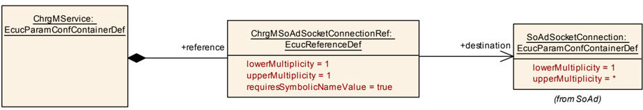

### 9.3. 发布信息

详情参见 SWS_BSWGeneral 的第 10.3 章「发布信息」。

## B. AUTOSAR 可追溯项变更历史

### B.1. 本文档按 AUTOSAR 发布版本 R23-11 的约束与规范项历史

#### B.1.1. R23-11 中新增的规范项

```
[CP_SWS_ChrgM_00001]
[CP_SWS_ChrgM_00002]
[CP_SWS_ChrgM_00003]
[CP_SWS_ChrgM_00004]
[CP_SWS_ChrgM_00005]
[CP_SWS_ChrgM_00006]
[CP_SWS_ChrgM_00007]
[CP_SWS_ChrgM_00008]
[CP_SWS_ChrgM_00009]
[CP_SWS_ChrgM_00010]
[CP_SWS_ChrgM_00011]
[CP_SWS_ChrgM_00012]
[CP_SWS_ChrgM_00013]
[CP_SWS_ChrgM_00014]
[CP_SWS_ChrgM_00015]
[CP_SWS_ChrgM_00016]
[CP_SWS_ChrgM_00017]
[CP_SWS_ChrgM_00018]
[CP_SWS_ChrgM_00019]
[CP_SWS_ChrgM_00020]
[CP_SWS_ChrgM_00021]
[CP_SWS_ChrgM_00022]
[CP_SWS_ChrgM_00023]
[CP_SWS_ChrgM_00024]
[CP_SWS_ChrgM_00025]
[CP_SWS_ChrgM_00026]
[CP_SWS_ChrgM_00027]
[CP_SWS_ChrgM_00028]
[CP_SWS_ChrgM_00029]
[CP_SWS_ChrgM_00030]
[CP_SWS_ChrgM_00031]
[CP_SWS_ChrgM_00032]
[CP_SWS_ChrgM_00033]
[CP_SWS_ChrgM_00034]
[CP_SWS_ChrgM_00035]
[CP_SWS_ChrgM_00036]
[CP_SWS_ChrgM_00037]
[CP_SWS_ChrgM_00038]
[CP_SWS_ChrgM_00039]
[CP_SWS_ChrgM_00040]
[CP_SWS_ChrgM_00041]
[CP_SWS_ChrgM_00042]
[CP_SWS_ChrgM_00043]
[CP_SWS_ChrgM_00044]
[CP_SWS_ChrgM_00045]
[CP_SWS_ChrgM_00046]
[CP_SWS_ChrgM_00047]
[CP_SWS_ChrgM_00048]
[CP_SWS_ChrgM_00049]
[CP_SWS_ChrgM_00050]
[CP_SWS_ChrgM_00051]
[CP_SWS_ChrgM_00052]
[CP_SWS_ChrgM_00053]
[CP_SWS_ChrgM_00054]
[CP_SWS_ChrgM_00055]
[CP_SWS_ChrgM_00056]
[CP_SWS_ChrgM_00057]
[CP_SWS_ChrgM_00058]
[CP_SWS_ChrgM_00059]
[CP_SWS_ChrgM_00060]
[CP_SWS_ChrgM_00061]
[CP_SWS_ChrgM_00062]
[CP_SWS_ChrgM_00063]
[CP_SWS_ChrgM_00064]
[CP_SWS_ChrgM_00065]
[CP_SWS_ChrgM_00066]
[CP_SWS_ChrgM_00067]
[CP_SWS_ChrgM_00068]
[CP_SWS_ChrgM_00069]
[CP_SWS_ChrgM_00070]
[CP_SWS_ChrgM_00071]
[CP_SWS_ChrgM_00072]
[CP_SWS_ChrgM_00073]
[CP_SWS_ChrgM_00074]
[CP_SWS_ChrgM_00075]
[CP_SWS_ChrgM_00076]
[CP_SWS_ChrgM_00077]
[CP_SWS_ChrgM_00078]
[CP_SWS_ChrgM_00079]
[CP_SWS_ChrgM_00080]
[CP_SWS_ChrgM_00081]
[CP_SWS_ChrgM_00082]
[CP_SWS_ChrgM_00084]
[CP_SWS_ChrgM_00085]
[CP_SWS_ChrgM_00086]
[CP_SWS_ChrgM_00087]
[CP_SWS_ChrgM_00089]
[CP_SWS_ChrgM_00090]
[CP_SWS_ChrgM_00091]
[CP_SWS_ChrgM_00113]
[CP_SWS_ChrgM_00114]
[CP_SWS_ChrgM_00115]
[CP_SWS_ChrgM_00116]
[CP_SWS_ChrgM_00117]
[CP_SWS_ChrgM_00118]
[CP_SWS_ChrgM_00119]
[CP_SWS_ChrgM_00122]
[CP_SWS_ChrgM_00123]
[CP_SWS_ChrgM_00125]
[CP_SWS_ChrgM_00128]
[CP_SWS_ChrgM_00131]
[CP_SWS_ChrgM_00133]
[CP_SWS_ChrgM_00135]
[CP_SWS_ChrgM_00136]
[CP_SWS_ChrgM_00137]
[CP_SWS_ChrgM_00138]
[CP_SWS_ChrgM_00139]
[CP_SWS_ChrgM_00140]
[CP_SWS_ChrgM_00141]
[CP_SWS_ChrgM_00143]
[CP_SWS_ChrgM_00145]
[CP_SWS_ChrgM_00146]
[CP_SWS_ChrgM_00147]
[CP_SWS_ChrgM_00148]
```

#### B.1.2. R23-11 中变更的规范项

无

#### B.1.3. R23-11 中删除的规范项

无
